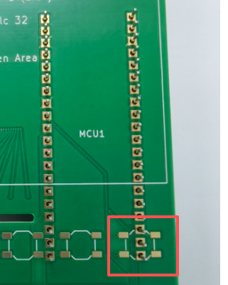
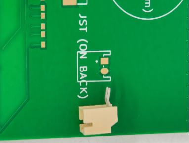
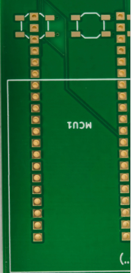
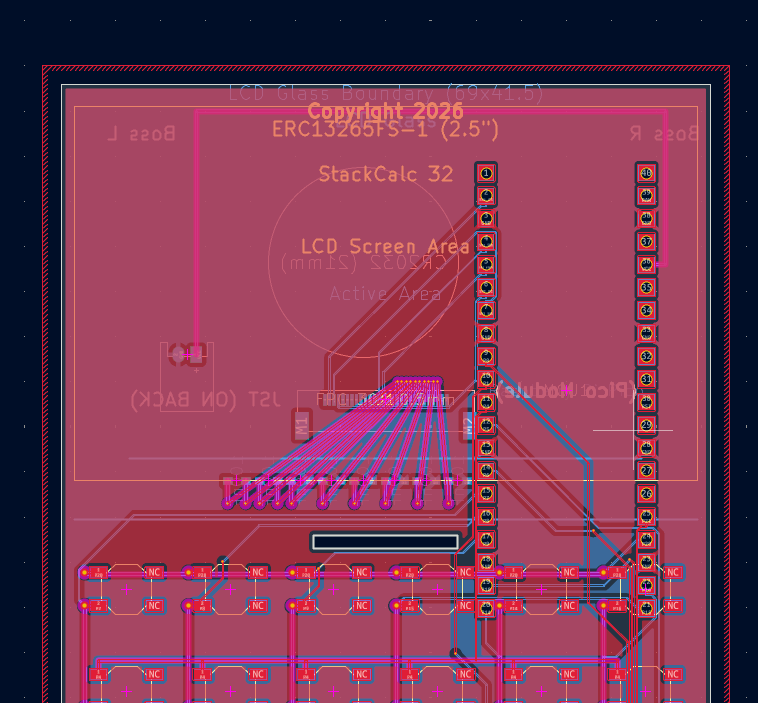

Passing local Design Rule Checks (DRC) in KiCad is a satisfying milestone, but it is not the same thing as passing physical assembly on the factory floor.

Shortly after we submitted our initial 4-layer calculator mainboard (`calculator.kicad_pcb`), BOM (`bom.csv`), and pick-and-place centroid files to **PCBWay** for turnkey SMT and through-hole assembly, their engineering team paused the line and sent back a set of real bench inspection photos. Those photos caught four physical integration bugs that a software DRC never flags: through-hole MCU header pins colliding with a front-side tactile switch, a through-hole JST battery header paired with undrilled surface-mount pads, mirrored silkscreen layers, and implicit jumper connections across the 4-pad tactile switches.

Here is what the PCBWay team found on the bench and how we fixed the board layout and jumper routing with Python scripts in KiCad's `pcbnew` API.

<!-- more -->

---

## 1. The Red Box: Rear `MCU1` Header Pins vs. Front Tactile Switch `SOFT6`

In our prototype architecture, the Raspberry Pi Pico 2 (`MCU1`) mounts horizontally on the **back** of the mainboard (`B.Cu`), while the 43 tactile switches (`B1`–`B37` and `SOFT1`–`SOFT6`) mount on the **front** (`F.Cu`).

In our initial BOM, we accidentally specified part number `SC1632` (the Raspberry Pi Pico 2 **with pre-soldered through-hole header pins**) alongside a plated through-hole (PTH) footprint in KiCad. When PCBWay's technicians dry-fitted the module from the rear, the header pins poked straight through the $1.6\text{ mm}$ FR-4 substrate and emerged on the front face—right inside the courtyard of softkey **`SOFT6`**:

*Figure 1: PCBWay bench inspection photo (`headers.png`). The red box highlights the rear `MCU1` through-hole header pins poking through the front of the board directly between the four SMD pads of tactile switch `SOFT6`.*

Even if those protruding pins were clipped flush after soldering, the exposed solder fillets and pin tips sat directly beneath the metal snap-dome body of `SOFT6`, preventing the switch from seating flat on its `F.Cu` pads and risking a dead short against the switch housing.

### The Fix: Castellated SMD Mounting (`SC1631`) & `fix_mcu_pads.py`

Because the Raspberry Pi Pico 2 features castellated edge pads along all 40 pins, through-hole headers are completely unnecessary when mounting the module flush against the rear copper layer. We:
1. Updated `MCU1` in `bom.csv` from `SC1632` (pre-headered) to **`SC1631`** (bare castellated Pico 2).
2. Wrote a `pcbnew` script (`Hardware/fix_mcu_pads.py`) to convert all 40 `MCU1` pads from `PAD_ATTRIB_PTH` to pure bottom-side `PAD_ATTRIB_SMD` (`B.Cu`, `B.Paste`, `B.Mask`) with zero drill holes, leaving the front switch surface unbroken.

---

## 2. The `JST1` Footprint Mismatch & Stranded Front Silkscreen

The second photo from PCBWay flagged `JST1`, our 2-pin right-angle battery connector at the top-right corner of the board:

*Figure 2: PCBWay bench photo (`jst.png`) showing the through-hole `S2B-PH-K-S` header next to the surface-mount `JST1` pads.*

Two things had gone wrong simultaneously:
1. **Through-Hole Part vs. SMD Pads:** Our BOM listed `S2B-PH-K-S(LF)(SN)`—a through-hole right-angle JST PH header with bent metal pins—while the footprint on the board used undrilled surface-mount pads. We updated `bom.csv` to specify the surface-mount **`S2B-PH-SM4-TB`** right-angle connector (and coordinated the jumper/lead seating for the initial boards with the PCBWay assembly team).
2. **Mirrored Silkscreen on the Wrong Layer:** Notice how the text `JST (ON BACK)` in Figure 2 and the `MCU1` outline in Figure 3 below were printed in white silkscreen on the **front** (`F.Silkscreen`) of the green board, even though both components mount on the back!

*Figure 3: PCBWay bench photo (`silkscreen.png`) showing `MCU1` silkscreen graphics stranded on `F.Silkscreen` and overlapping the upper switch row.*

When we originally flipped `MCU1` to the back layer in KiCad, several child graphical primitives inside the footprint remained explicitly bound to `F.Silkscreen` and `F.Fab`. We wrote `Hardware/fix_silkscreen.py` to iterate through every graphical item and standalone text callout, migrating them to `B.Silkscreen` and `B.Fab` with proper mirroring.

---

## 3. Cleaning Up Tactile Switch Jumper Connections

The most subtle issue involved how the 43 tactile switches (`SW_TACT_ALPS_SKQGABE010`) were wired into the $8 \times 6$ keypad matrix.

A standard 4-terminal SMD tactile switch has two internally bridged pairs of legs (legs `1`–`1'` form one continuous metal bar inside the switch body, and legs `2`–`2'` form the switched bar). Many community KiCad footprints assign duplicate pad numbers (`1`, `1` and `2`, `2`) with `(duplicate_pad_numbers_are_jumpers yes)`, allowing the router to pass a row or column bus *through* the switch's internal metal frame instead of routing a continuous copper trace on the PCB.

During DFM review and rework around the `MCU1` / `SOFT6` overlap zone, relying on implicit switch-body jumpers and ambiguous 4-pad assignments created confusion about which pads required active electrical jumpering versus mechanical anchoring:

*Figure 4: Updated KiCad layout (`kicad.png`) with `(duplicate_pad_numbers_are_jumpers no)`, explicit active pads (`1` and `2`), isolated `NC` anchor pads, and continuous copper bus routing.*

To make the schematic-to-board netlist 100% explicit for both the pick-and-place line and our rework instructions:
* We set `(duplicate_pad_numbers_are_jumpers no)` across every tactile switch footprint on the board.
* We designated the left-side pair as active electrical pads **`1`** (row net) and **`2`** (column net), and explicitly marked the opposite mechanical stabilizing pads as **`NC`**.
* We rerouted the row and column buses (`P0`–`P21`) as continuous $0.25\text{ mm}$ copper segments on `F.Cu` and `B.Cu`, eliminating any dependency on internal switch jumpers to carry matrix continuity downstream.

Catching these issues via PCBWay's bench photos before final pack-out saved our first hardware batch from arriving with unpressable top-row softkeys and unpopulated battery headers.
