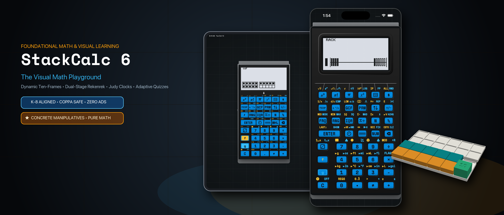
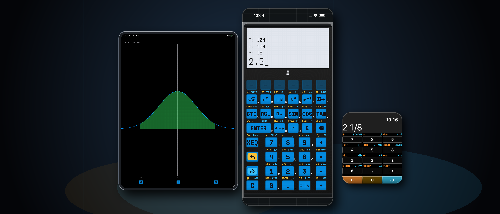

When I trained my own kids to use Reverse Polish Notation (RPN) on a SwissMicros DM41CC, three things became immediately obvious:
1. **Kids do not struggle with RPN—they struggle with infix parentheses.** Pushing two numbers onto a visible stack and combining them matches the exact order in which children push physical blocks together on a desk. Even better, because there is no hidden infix parser behind an `=` key, **users learn `operator-precedence parsing` in their own minds** in order to decompose and enter expressions onto the stack—appreciating the lessons learned in the past 50 years of computing so they can build the next 50 years.
2. **Handing a student a CAS calculator is a trap for exams.** Because Computer Algebra System (CAS) calculators are banned on the SAT, ACT, IB, UIL, NCEES FE/PE engineering exams, and university calculus midterms, we purposefully designed StackCalc to be **allowed in testing situations** (no CAS symbolic manipulation, no QWERTY keyboard, and no wireless transceivers on the hardware).
3. **Sending a kid to school with a \$250 collector's calculator or a \$200 vintage eBay HP-32SII is a terrible idea.**

That realization sparked the overarching vision for **StackCalc**: building a low-cost, kid-friendly RPN calculator and tactile learning ecosystem that grows with a student from first grade through university engineering—starting with our small-batch maker hardware at **\$89.99** while engineering our production roadmap toward a **\$29.99** student backpack target.

Today, **StackCalc Calculator v1.1** is live on the [Apple App Store](https://apps.apple.com/app/id6801788040) for **iPhone, iPad, and as a 100% standalone Apple Watch app**, uniting **Visual Learning Mode (`StackCalc 6`)** for Common Core K–6 math with **Scientific Mode (`StackCalc 32`)** inside one universal binary.

<!-- more -->

---

## 1. Why the HP-32SII Architecture Over the HP-15C or HP-42S?

As a longtime collector who used an HP-32SII in high school—and currently owns a DM42 (converted to a C47 with custom-printed and cut labels), a DM32, a DM41CC, and a DM15CC—I weighed all three classic HP architectures before designing `StackCalc 32`:

* **Why not the HP-42S / C47?** While powerhouse instruments on an engineer's bench, burying everyday operations inside deep hierarchical softkey menus slows down students and hides what the calculator can do.
* **Why not the HP-15C?** The horizontal Voyager form factor and two-digit numeric matrix/label codes are iconic, but less intuitive for a student's first scientific instrument.
* **Why the HP-32SII?** The 32SII achieved the ideal ergonomic balance: **almost every essential scientific operation sits directly on the primary or shifted keys with zero menu diving**, while a clean 1-line context menu handles grouped actions like `CLEAR`, `STAT`, `SOLVE`, and `INTG`.

---

## 2. Not an Emulator: Clean-Room `RPNCore` Upgrades (`H.M.`, `TVM`, `POLY`, `PLOT`)

Unlike vintage calculator apps that wrap dumped 1980s ROM microcode, StackCalc is powered by **`RPNCore`**—a clean-room engine written from scratch in Swift that compiles natively to watchOS, iOS, and bare-metal Raspberry Pi RP2350 silicon (via Embedded Swift).

Writing a clean-room engine allowed us to preserve the classic 4-level stack (`X, Y, Z, T`), `LASTx`, and 26 lettered registers (`A–Z`) while adding the modern capabilities we always wished the original HP-32SII had:

1. **Harmonic Mean (`H.M.`):** Built directly into the `STAT` analysis suite alongside arithmetic and weighted means for rates, parallel resistance, and physics labs.
2. **Time Value of Money (`TVM`):** Dedicated 5-variable financial solver (`N`, `I%YR`, `PV`, `PMT`, `FV`) for personal finance and engineering economics.
3. **Quadratic & Cubic Polynomial Root Solver (`POLY`):** Solves real and complex roots for $Ax^3 + Bx^2 + Cx + D = 0$ without requiring iterative root-guessing.
4. **Interactive Function & Regression Plotting (`PLOT`):** Renders live function curves, roots, Simpson shaded integrals, and statistical scatter plots directly on the monochrome dot-matrix LCD.

---

## 3. `StackCalc 6`: Common Core K–6 Operations & Pictorial Models

Opening `stackcalc://sc6` (or switching modes in the menu) transforms the calculator into **`StackCalc 6`**—purpose-built around the operations students need to master in Common Core math up through 6th grade:

* **Step-by-Step Prime Fraction Simplification (`[SIMP]`):** Students enter fractions using quick dot-separated syntax (e.g., `.1.2 [ENTER] .1.3 [+]` for $\frac{1}{2} + \frac{1}{3}$). Instead of reducing $\frac{12}{18}$ to $\frac{2}{3}$ inside a black box, pressing `[SIMP]` in `StackCalc 6` factors out **one prime divisor per press** (displaying the divisor `2` to yield $\frac{6}{9}$, then `3` to yield $\frac{2}{3}$) so students see *why* fractions simplify.
* **Core K–6 Number Theory Keys:** Dedicated one-touch keys for **integer division with remainder (`÷R`)**, **prime factorization (`[PRIME]`)**, **Greatest Common Divisor (`[GCD]`)**, **Least Common Multiple (`[LCM]`)**, and decimal-to-fraction toggling (`[FDISP]`).
* **Live Pictorial Dot-Matrix Models:** As students calculate on a focused 2-level stack, the $132 \times 65$ LCD dynamically renders quantities as **Ten-Frames (`10F`)**, a **20-Bead Rekenrek Number Rack (`RACK`)**, a **Proportional Number Line (`LINE`)**, a **Geared Analog Clock (`🕒`)**, and a **5-Level Adaptive Fluency Quiz (`?`)**.

---

## 4. STL-Backed Digital Twin Co-Development

To develop the app and bare-metal RP2350 firmware simultaneously while waiting for PCB fabrication, we connected our OpenSCAD hardware pipeline (`generate_scad.py`) and laser SVG decal generator (`generate_laser_svg.py`) directly to our Swift codebase.

By exporting exact switch centers, keycap profiles, and legends into JSON layout registries (`layout_data.json`), SwiftUI renders a dimensionally exact replica of the physical hardware running the identical $132 \times 65$ bitmap framebuffer and `CoreHaptics` tactile key-seam simulation—letting users experience the instrument on iPhone, iPad, and Apple Watch today with **zero ads and zero subscriptions**.
