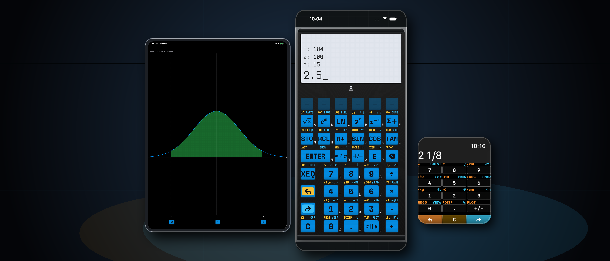
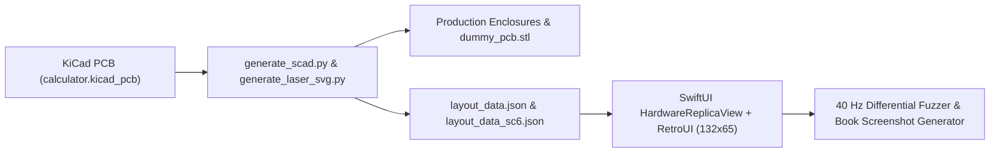

Waiting for PCB fabrication and 3D-printed enclosures usually creates a painful bottleneck in hardware startups: firmware engineers wait for boards to arrive, while app developers build UI mockups that drift away from the physical device.

To build **StackCalc**—a kid-friendly, exam-legal RPN scientific and educational calculator that grows with learners from `StackCalc 6` (Common Core K–6) to `StackCalc 32` (AP Calculus and engineering)—we architected our software and mechanical CAD pipelines so the **iOS/iPadOS/watchOS App Store app** and our **bare-metal Raspberry Pi RP2350 firmware** share a single Swift codebase (`RPNCore`) and co-develop against an **STL-backed Digital Twin**.

<!-- more -->

---

## 1. One Clean-Room Swift Codebase (`RPNCore`) Across Apple Silicon and Bare-Metal RP2350

Rather than wrapping a vintage 1980s calculator ROM dump in an emulator, we wrote **`RPNCore`** from scratch in pure, deterministic Swift with zero external framework dependencies. Because all calculator registers, program steps, statistical accumulators, and solver states live inside value-type structs without dynamic runtime reflection, the exact same Swift package compiles to:

1. **iOS, iPadOS & 100% Standalone watchOS (`StackCalc Calculator v1.1`):**
   * **Scientific Mode (`StackCalc 32`):** Full 4-level RPN stack (`X, Y, Z, T`), `LASTx`, 26 lettered storage registers (`A–Z`), multi-variable equation solver (`SOLVE`), numerical Simpson integration (`∫`), **Harmonic Mean (`H.M.`)**, **Time Value of Money (`TVM`)**, **Quadratic & Cubic Polynomial Root Solver (`POLY`)**, and interactive curve/scatter-plot graphing (`PLOT`).
   * **Visual Learning Mode (`StackCalc 6`):** Focused 2-level K–6 Common Core stack with **step-by-step prime fraction simplification (`[SIMP]`)**, integer division with remainder (`÷R`), `[PRIME]`, `[GCD]`, `[LCM]`, and live dot-matrix **Ten-Frames (`10F`)**, **20-Bead Rekenrek (`RACK`)**, **Proportional Number Line (`LINE`)**, **Geared Clock (`🕒`)**, and **5-Level Adaptive Quiz (`?`)**.
2. **Bare-Metal Raspberry Pi RP2350 Firmware (Embedded Swift):**
   * Compiled for `armv8m.main-none-eabi` using Embedded Swift and linked against a thin C hardware abstraction layer (`hardware_wrapper.c`) that scans our 43-key tactile matrix (using active-LOW open-drain column pull-ups for RP2350 Erratum E9 immunity) and drives a $132 \times 65$ EastRising `ERC13265` (ST7567) transflective LCD over 4-wire SPI.

---

## 2. Wiring OpenSCAD STLs & Laser Decals Into SwiftUI for 1:1 Co-Development

To guarantee that our firmware UX, key legends, and companion textbooks match the physical calculator down to the tenth of a millimeter before boards even leave the factory, we connected our KiCad and OpenSCAD hardware scripts directly to our Swift workspace:

* **CAD-Driven Layout Registries (`layout_data.json` & `layout_data_sc6.json`):** Whenever we update switch coordinates in KiCad or keycap legends in `generate_laser_svg.py`, our build pipeline exports the exact physical button geometry, primary/shifted/alpha labels, and bezel dimensions into JSON registries consumed by Swift.
* **Pixel-Exact $132 \times 65$ Framebuffer (`RetroUI.swift` & `LCDDisplayView.swift`):** Both the RP2350 firmware and the SwiftUI `HardwareReplicaView` render into the exact same $132 \times 65$ monochrome dot-matrix bitmap coordinate space—using custom $5 \times 7$ and $6 \times 8$ pixel fonts so every menu bar, fraction stack, and plot curve looks identical on iPhone, iPad, Apple Watch, and physical transflective glass.
* **Continuous Tactile Field (`CoreHaptics`):** On iOS, sliding a thumb across the replica fires subtle haptic pulses when crossing physical key-seam boundaries and crisp mechanical switch transients on actuation.

---

## 3. Verifying Firmware & Textbooks at 40 Hz

Sharing a single Swift core unlocked two automated verification workflows that would be impossible on a traditional split C/Swift codebase:
1. **40 Hz Differential Grammar Fuzzer:** Our cross-surface fuzz harness (`Tools/fuzz_harness/`) generates valid and adversarial postfix token streams (including domain boundaries like `0 ÷`, singular matrices, stiffness oscillations in `SOLVE`, and deep fraction reductions) and executes them across both host `RPNCore` and the emulated RP2350 firmware loop at 40 Hz, asserting bit-for-bit register and display parity.
2. **Compiling 590+ Workbook Problems Like Unit Tests (`book_engine.py`):** Every worked example across our **SC-32 Scientific Manual**, **SC-6 Elementary Manual**, **339-Problem SC-32 Casebook**, and **253-Problem SC-6 Workbook** is extracted from Markdown, executed against `RPNCore` inside `XCTest` (`TextbookVerificationTests_SC32.swift` and `TextbookVerificationTests_SC6.swift`), and automatically captured as a crisp simulator screenshot.

You can try the universal app today on the [Apple App Store](https://apps.apple.com/app/id6801788040) (100% offline, zero ads, zero subscriptions) or explore our open-source STLs and hardware build logs on [Hackaday.io](https://hackaday.io/project/206743-stackcalc32-a-tactile-rpn-calculator).
