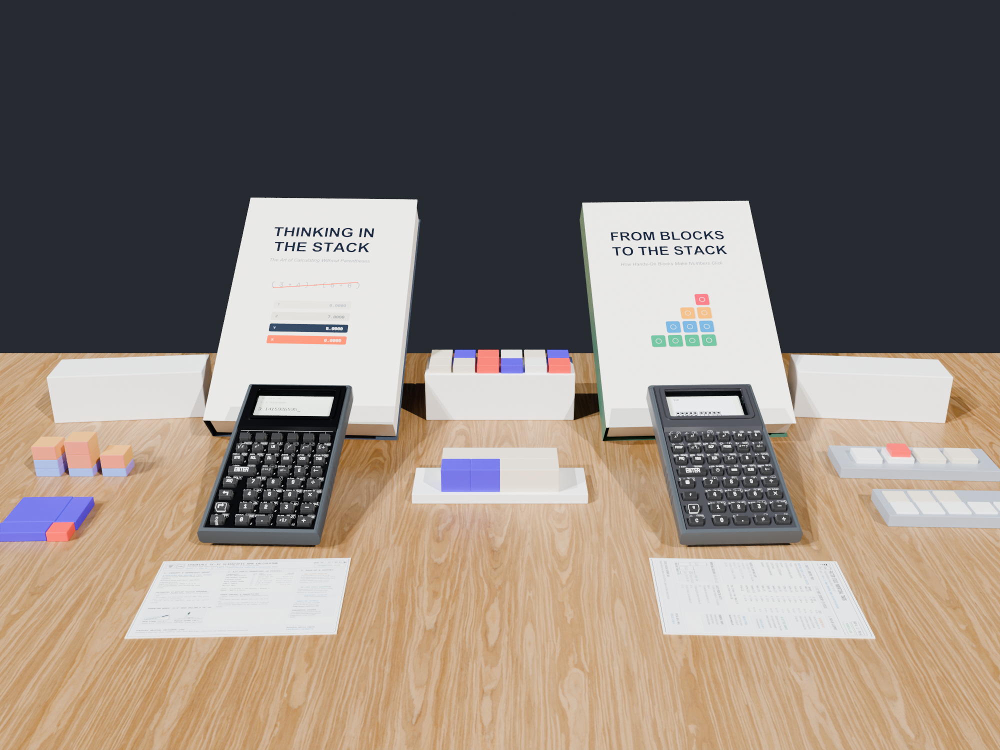
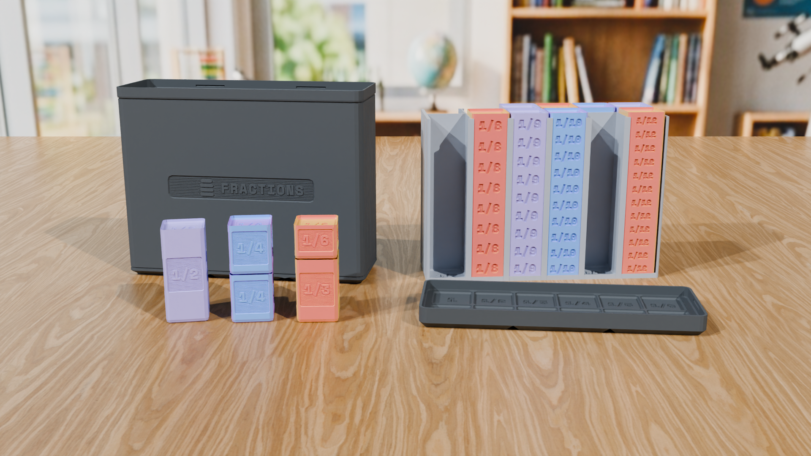

Waiting for a PCB fab house to finish assembling boards is usually dead time in a hardware project. For StackCalc, however, the pocket calculator is only one leg of a three-part triad: **Tactile Hardware + Physical Classroom Manipulatives + Test-Verified Reference Books**.

Because our physical math blocks and printed textbooks do not depend on the PCB assembly line, we used this window to move our core **Learning Lab manipulatives** into active manufacturing—both on our in-house printers and via **Slant3D**—while building an automated, unit-test-verified publishing pipeline for our reference manuals and student workbooks.

<!-- more -->



---

## 1. Manufacturing the Physical Blocks: In-House Precision & Slant3D Scale

Every physical kit in the [StackCalc Catalog](../../products.md) is engineered in parametric OpenSCAD around the **$42\text{ mm}$ Gridfinity modular desk standard**, meaning the storage box lid doubles as an active mathematical workbench on the student's desk.

To get physical kits ready without choking our workshop printers on heavy storage enclosures, we split production across two parallel tracks:

1. **In-House Precision Pilot Runs:** Multi-color silk proportional towers, tight-clearance sliding comparators, planetary clock gear trains, and our 4-part mechanical calculator enclosures are printed and inspected in-house on calibrated PEI plates.
2. **Slant3D Print-Farm Scaling:** High-volume, single-material structural components—such as monolithic Gridfinity storage boxes, ten-frame trays, and bulk counting tiles—are queued on Slant3D's automated print farm.

### The Core Classroom Kits in Production

* **[Fraction Studio Proportional Towers](../../products/fraction-studio/index.md):** Upright $84\text{ mm}$ whole-datum towers ($\frac{1}{1}$ through $\frac{1}{12}$) that dock into a twin comparator stage. Students physically stack $\frac{1}{2} + \frac{1}{3}$, compare heights against $\frac{5}{6}$, and execute the exact same sequence on the calculator's `[FDISP]` and `[SIMP]` keys.
* **[Prime Factor Studio & Slide Rule Comparator](../../products/prime-factor-studio/index.md):** Tactile prime-factor blocks ($2, 3, 5, 7$) and a logarithmic slide-rule rail that turn Greatest Common Divisor (`GCD`) and Least Common Multiple (`LCM`) into a physical length-matching puzzle.
* **[Place Value Studio & Regrouping Trays](../../products/place-value/index.md) & [Ten-Frames](../../products/ten-frames/index.md):** Base-10 ones, tens, and hundreds blocks with physical carry slots that mirror how numbers push and combine on the RPN stack.
* **[SC-6 Quest Scoreboard](../../products/quest-scoreboard/index.md):** A physical $+10$ token tracker that pairs with the adaptive fluency quiz engine in `StackCalc 6`.



---

## 2. Compiling Books Like Firmware: A Unit-Tested Publishing Pipeline

A mathematical instrument is only as useful as the books that teach you how to think with it. Over the past month, we authored and compiled a complete library of [Official Manuals & Companion Workbooks](../../manuals/index.md):

* **The SC-32 Scientific Owner's Manual & Reference Guide**
* **The SC-6 Elementary Owner's Manual & Visual Math Guide**
* **[SC-32 Scientific Companion Casebook (339 Graded Problems)](../../curriculum/sc32-scientific-companion-workbook.md)**
* **[SC-6 Elementary Companion Workbook (253 Graded Problems)](../../curriculum/sc6-elementary-companion-workbook.md)**
* **[120 Printable Station Worksheets](../../curriculum/worksheets.md) & [24 UIL Speed-Calculation Exams](../../curriculum/uil-competition.md)**

### Why Traditional Math Workbooks Have Typos—and How We Eliminated Them

In a traditional textbook workflow, an author types a keystroke sequence into a word processor by hand, pastes a static screenshot, and hopes the answer key matches. If a key legend or firmware behavior changes later, the book silently goes stale.

We built our documentation pipeline (`Makefile` + `Tools/book_engine.py`) so that **our books compile and test just like source code**:

```
OpenSCAD (.scad) ──► STL Meshes ──► Orthographic Block Diagrams (blocks_registry.json)
                                               │
Swift Keymaps & RPNCore ──► Simulator Tests ───┼──► book_engine.py ──► Validated Manuals & PDFs
                                               │
Manuscript Chapters (.md) ─────────────────────┘
```

1. **Executable Keystroke Macros:** Every worked example in the SC-32 and SC-6 manuals is written as a declarative sequence macro. During `make verify`, our build engine extracts every keystroke sequence from the prose and executes it against `RPNCore` in `TextbookVerificationTests_SC32.swift` and `TextbookVerificationTests_SC6.swift`. If a single worked example in the book does not produce the exact register state printed on the page, the build fails.
2. **Automated Simulator Screenshots:** Our SwiftUI visual test suite runs every textbook sequence in a crisp, high-contrast "Paper" theme and exports the exact LCD dot-matrix state directly into `docs/assets/manuals/screenshots/`.
3. **STL-Backed Manipulative Diagrams:** Every diagram of a Ten-Frame, Fraction Tower, or Prime Comparator in the workbooks is rendered directly from the production OpenSCAD `.stl` meshes (`blocks_registry.json`), guaranteeing 1:1 geometric fidelity between the page and the 3D print in the student's hands.

You can browse the full curriculum online today in the [Master Curriculum Guide](../../curriculum/index.md) or download the printable PDFs and 3MF files from the [Download Center](../../downloads.md).
