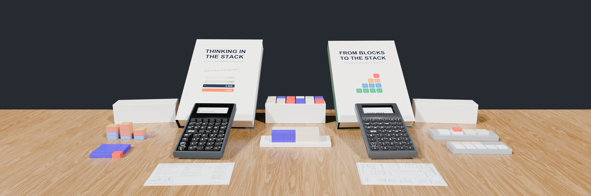

Today we are launching the complete **StackCalc** ecosystem simultaneously across five surfaces: our **first batch of RP2350 physical calculators**, **StackCalc v1.1 on the App Store** (iPhone, iPad, and 100% standalone Apple Watch), our **Etsy storefront** of 3D-printed Gridfinity math manipulatives, **free open-source STL/3MF files on Printables**, and our **unit-test-verified reference manuals and workbooks**.

Whenever we tell someone we built a new calculator from scratch, the first question is always: **"In an age of smartphones and frontier AI, why does the world need another calculator?"**

Here is the personal story—and the engineering thesis—behind StackCalc.

<!-- more -->

---

## 1. The Origin Story: Training My Kids on a DM41CC (and the \$250 Backpack Problem)

I fell in love with Reverse Polish Notation (RPN) on an **HP-32SII** in high school, and I was heartbroken when it was taken away. Over the years, I bought a few vintage HP-32SII calculators off eBay, only to be disappointed by aging membranes and worn-out switches. Like many RPN enthusiasts, I turned to boutique collector hardware: I own a **DM42** (which I converted to a **C47**, including printing and cutting the custom overlays), a **DM32**, a **DM41CC**, and a **DM15CC**.

When I trained my own kids on my DM41CC, it was a revelation. They picked up the stack immediately. Why? Because when a child adds blocks on a desk, they are already working in Postfix:
1. Place the first group of blocks on the table.
2. Place the second group of blocks on the table.
3. Push them together.

Kids don't struggle with RPN; they struggle with the artificial parenthesis syntax (`(12 + 8) / (5 - 1) =`) forced on them by standard school calculators.

Wait—why not just buy a \$20 Casio/TI algebraic calculator at the drugstore, or hand everyone a CAS graphing calculator?
* **Users Learn `Operator-Precedence Parsing` Instead of Offloading It to a Black Box:** On an infix calculator, a student types `(12 + 8) / (5 - 1) =` and delegates order-of-operations to a hidden parser behind `=`. On a stack-based postfix calculator, **the user must learn operator-precedence parsing** to decompose and enter the expression onto the visible stack—watching every intermediate sub-expression resolve step by step. While the original 1970s motivation for RPN may have been early microchip transistor and memory limitations, we want kids today to appreciate the lessons learned in the past 50 years of computing so they have the mental model to build the next 50 years.
* **Designed to Be Allowed in Testing Situations (Why Not CAS?):** Handing a student a CAS (Computer Algebra System) calculator is a trap because **CAS calculators are banned on standardized and university exams** (banned on both the SAT and ACT, IB exams, UIL, NCEES FE/PE engineering licensing exams, and most university calculus midterms). StackCalc is purposefully designed to be **exam-legal**—with zero symbolic CAS manipulation, zero QWERTY keyboard, and zero wireless/Wi-Fi/Bluetooth transceivers on our hardware.
* **The \$250 Backpack Problem:** For parents who already love RPN, no parent in their right mind wants their child carrying a **\$250 boutique collector's calculator** or a **\$200 fragile eBay antique** to school in their backpack every day.

We founded StackCalc with a single goal: **build a durable, repairable, kid-friendly RPN calculator that grows with a learner from 1st grade (`StackCalc 6`) through AP Calculus and professional engineering (`StackCalc 32`).** We are launching our first small-batch maker units at **\$89.99**, and we have already engineered our next bare-silicon revision to drive volume manufacturing toward a **\$29.99 student price point**.

---

## 2. Why the HP-32SII Architecture (and Why Clean-Room Beats ROM Emulation)

When designing `StackCalc 32`, we evaluated all three legendary HP architectures—the **HP-15C**, the **HP-42S**, and the **HP-32SII**:
* **Why not the HP-42S / C47?** Deep hierarchical softkey menus are powerful on an engineer's bench, but burying everyday scientific operations inside menus slows down learners.
* **Why not the HP-15C?** The horizontal form factor and numeric matrix/label codes are less intuitive as a student's primary school calculator.
* **Why the HP-32SII?** Every essential scientific operation lives directly on the primary or shifted keys—zero menu diving—while a clean 1-line context bar handles `CLEAR`, `STAT`, `SOLVE`, and `INTG`.

Rather than wrapping a 1980s ROM dump in an emulator, we wrote **`RPNCore`** from scratch in clean-room Swift so the exact same engine runs on iOS, watchOS, and bare-metal Raspberry Pi RP2350 silicon—adding modern capabilities to `StackCalc 32` that the original 32SII never had:
* **Harmonic Mean (`H.M.`)** alongside arithmetic and weighted means in `STAT`.
* **Time Value of Money (`TVM`)** financial solver (`N`, `I%YR`, `PV`, `PMT`, `FV`).
* **Quadratic & Cubic Polynomial Root Solver (`POLY`)** with complex root support.
* **Interactive Curve & Regression Plotting (`PLOT`)** on the dot-matrix canvas.

And in **`StackCalc 6` (`SC-6`)**, we built dedicated Common Core K–6 operations—including **Step-by-Step Prime Fraction Simplification (`[SIMP]`)** (which factors out one prime divisor per key press from dot-entered fractions like `.12.18` so students see *how* a fraction reduces instead of getting a black-box answer), **integer division with remainder (`÷R`)**, **`[PRIME]`**, **`[GCD]`**, and **`[LCM]`**.

---

## 3. Using AI & Physics Simulations to Build Deterministic Tools (Because Students Still Need Math)

As a software and AI engineer, I used modern AI coding agents across every layer of this project:
* **280-Condition TPU Membrane Button Physics Simulations:** To prevent 3D-printed keys from feeling mushy or binding on corner strikes, we ran a [280-condition Finite Element Analysis (FEA) off-axis press sweep](2026-09-24-tpu-keypad-280-presses.md) ($7\text{ angles up to } 15^\circ \times 8\text{ compass directions} \times 5\text{ strike offsets}$) on our Shore 95A TPU keypad membrane—tuning faceplate aperture chamfers and webbing geometry so off-center thumb strikes transmit clean vertical force to the SMD switch plunger without wedging or causing parasitic cross-talk on neighboring keys.
* **Mathematical CAD Invariants in 3D-Printed Blocks:** We engineered our [Fraction Studio Proportional Towers](../../products/fraction-studio/index.md) around an **$84\text{ mm}$ Whole (`1/1`) datum** so $\frac{1}{2}, \frac{1}{3}, \frac{1}{4}, \frac{1}{6}, \frac{1}{7},$ and $\frac{1}{12}$ divide into exact integer millimeters with zero slicer layer-rounding drift, and scaled our [Prime Factor Studio](../../products/prime-factor-studio/index.md) blocks **logarithmically** ($\text{Length} \propto \log(p)$) so snapping a `2` block and a `3` block end-to-end physically equals the length of `6`.
* **KiCad `pcbnew` Automation & 40 Hz Differential Fuzzing:** We generated 3D-printable `dummy_pcb.stl` fit-check models directly from KiCad, automated our Blender studio renders, and built a **40 Hz differential grammar fuzzer** that tests host Swift against our bare-metal firmware loop.

The irony is deliberate: **we used AI to build a 100% offline, deterministic mathematical instrument because, despite the availability of AI, students still need to know how to do math.**

---

## 4. Explore All Five Pillars of Today's Launch

1. **First Batch Physical Hardware & 3D-Printed Manipulatives ([Etsy Storefront](https://www.etsy.com/shop/StackCalc) & [Product Catalog](../../products.md)):**
   * **Founder's Batch `SC-32` & `SC-6` Hardware:** Built with our 4-part screwless sliding enclosure, Shore 95A TPU membrane, and RP2350 mainboard.
   * **84mm Datum [Fraction Studio Towers](../../products/fraction-studio/index.md) & Logarithmic [Prime Factor Studio](../../products/prime-factor-studio/index.md):** Physical $42\text{ mm}$ Gridfinity desk blocks manufactured in-house and on Slant3D that map $1:1$ to our calculator keys.
2. **StackCalc Calculator v1.1 ([Apple App Store](https://apps.apple.com/app/id6801788040)):**
   * Universal app for **iPhone, iPad, and 100% standalone Apple Watch** uniting `StackCalc 32` Scientific Mode and `StackCalc 6` Common Core K–6 Visual Mode (`10F` Ten-Frames, `RACK` 20-Bead Rekenrek, `LINE` Number Line, `🕒` Geared Clock, and `?` 5-Level Adaptive Quiz). 100% offline, zero ads, zero subscriptions.
3. **Unit-Test-Verified [Official Manuals & Companion Workbooks](../../manuals/index.md):**
   * The **SC-32 Scientific Manual**, **SC-6 Elementary Manual**, **339-Problem SC-32 Casebook**, **253-Problem SC-6 Workbook**, and **24 UIL Competition Exams**—compiled via `book_engine.py` so every worked keystroke sequence is verified in automated unit tests.
4. **Free Open-Source STLs & Teacher Curriculum ([Download Center](../../downloads.md) & Printables):**
   * Download our 43-page K–12 Teacher Curriculum Guide, 120 printable station worksheets, and open-source `.3mf`/`.stl` files under our *"No Lost Piece Left Behind"* commitment.
5. **Open Engineering Build Logs ([Hackaday.io](https://hackaday.io/project/206743-stackcalc32-a-tactile-rpn-calculator)):**
   * Follow our bring-up logs as we verify the first 5 calculators on the bench and kick off our 20-unit bare-silicon Hardware V2 production run.
