# Big Ideas Math Middle School: Two-Method Hands-On Block & SC-6 Supplement

**Grade 6 Complete + Grade 7 Bridge • 10 Units • 45 Textbook Sections • 90 Printable Worksheets (Practice A & B) • 90 Two-Method Worked Examples • 900 Practice Problems**

  <a href="../../downloads/worksheets/bigideas_middle_school_sc6_daily_student_workbook.pdf" class="md-button md-button--primary">📄 Download Student Supplement Workbook PDF (91 Pages • 90 Worksheets & 900 Problems)</a>
  <a href="../../downloads/worksheets/bigideas_middle_school_sc6_teacher_coach_guide.pdf" class="md-button">🔑 Download Compact 10-Page Coach & Answer Key PDF (1 Page Per Unit)</a>

!!! abstract "Built for Students Who Need Extra Practice: Authentic Big Ideas Methods, Two-Method Double Points & Clean Workspaces"
    - **100% Authentic *Big Ideas Math* Concepts & Vocabulary:** Every section tracks the exact textbook vocabulary (*dividend, divisor, quotient, prime factorization, GCF, LCM, reciprocal, tape diagram, ratio table, unit rate, equivalent expressions, Distributive Property, inverse operations, net, interquartile range (IQR), mean absolute deviation (MAD)*) and exercise formats (*Error Analysis*, *Modeling Real Life*, *Different Words, Same Question*).
    - **Two-Method Worked Examples for Double Points (`+10` vs. `+20`):** Every Worked Example explicitly teaches the **two distinct methods from the *Big Ideas Math* textbook** side-by-side—**Method 1 (`+10 pts` — 1st Token)** and **Method 2 (`+20 pts DOUBLE` — 2nd Token)**—alongside step-by-step physical Block Kit instructions and SC-6 verification.
    - **2 Full Worksheets Per Section (90 Worksheets • 900 Problems):** Each of the 45 textbook sections includes **Practice A (*Key Ideas & Two-Method Practice*)** and **Practice B (*Modeling Real Life & Multi-Method Applications*)** with generous, uncluttered white space to work out each problem and write the final answer.
    - **Compact 10-Page Coach Guide:** The **Coach & Solution Guide PDF** fits every unit's misconception coaching, manipulative setup, and all 80–100 section answers (`Practice A #1–#10` and `Practice B #1–#10`) onto **1 single page per unit (10 pages total)**.

---

## 🏆 Optional Desk Companion: The Simplified 2-Piece `3x1x7U` SC-6 Scoreboard (`QUEST-01`)

To motivate students to master both textbook methods on every worksheet, pair the workbook with the **`3x1x7U` Gridfinity SC-6 Scoreboard & Token Kit (`QUEST-01`)**:

| Hardware Component | Dimensions & Gridfinity Standard | How Double-Points Scoring Works |
| :--- | :--- | :--- |
| **1. Snapfinity Scoreboard Lid (`1–10` + `100` + `(?)`)** | `125.5 × 42.0 mm` (`3x1` Stackable Lid, `6×2 = 12` sockets) | **Left 5×2 Grid:** Numbered **`1`–`5`** (top row) and **`6`–`10`** (bottom row), matching **Problems `#1–#10`**. **Rightmost Column:** Top socket **`100`** (for a 10-block Mastery Tower) and bottom **Question Mark in a Circle (`?`)** tutorial keycap badge. |
| **2. `3x1x7U` Token Bank Box (`QUEST BOARD`)** | `125.5 × 42.0 × 49.0 mm` (`7U` height, `(?` tutorial badge) | Holds all **60 universal `+10` Quarter-Block tokens** in 5 neat layers of 12 (`6×2`) directly on its Gridfinity floor—no separate inner tray needed! |
| **3. 60 Identical `+10` Quarter-Block Tokens** | `19.0 × 19.0 × 8.85 mm` (`7.0 mm` visible `1U` height) | Every token is identical (`+10` on top and all 4 sides): • **1 Block (`+10 pts`)** = Solved with **Textbook Method 1** • **2 Stacked Blocks (`+20 pts DOUBLE`)** = Verified with **Textbook Method 2** + Blocks/SC-6 • **10 Blocks (`100 pts`)** = **100% Worksheet Mastery!** |

---

## Unit 1: Numerical Expressions & Factors

*Big Ideas Math Grade 6 — Chapter 1 — Whole Number Operations, Powers & Exponents, Order of Operations, Prime Factorization, GCF & LCM*

- **Manipulative Kits:** `Counting & Array Studio (COUNT-01) + Prime Factor Studio (PRIME-01)`
- **Target Misconception:** Students interpret remainders as meaningless decimal tails (e.g., .875 of a person), read 2^3 as 2×3=6, lose track of PEMDAS parentheses, and confuse GCF (overlap) with LCM (union).
- **Hands-On Remediation:** Have students build physical tile rows for division remainders, stack 2D/3D arrays for exponents, use the 4-line elevator (Y holds Room 1 while X solves Room 2) instead of rewriting PEMDAS lines, and stand logarithmic Prime Factor Towers side-by-side on the 12-socket lid.

### Section 1.1: Whole Number Operations & Division with Remainders (Workbook pp. 2–3)

**Textbook Alignment:** Big Ideas Grade 6, Section 1.1 (Whole Number Operations) (`CCSS.MATH.6.NS.B.2`) • **Big Ideas Methods:** *Method 1: Equal-Rows Array Model  |  Method 2: Division Algorithm & Multiplication Check* • **Block Kit:** `COUNT-01` (Counting & Array Tiles)

**Key Vocabulary:** dividend • divisor • quotient • remainder

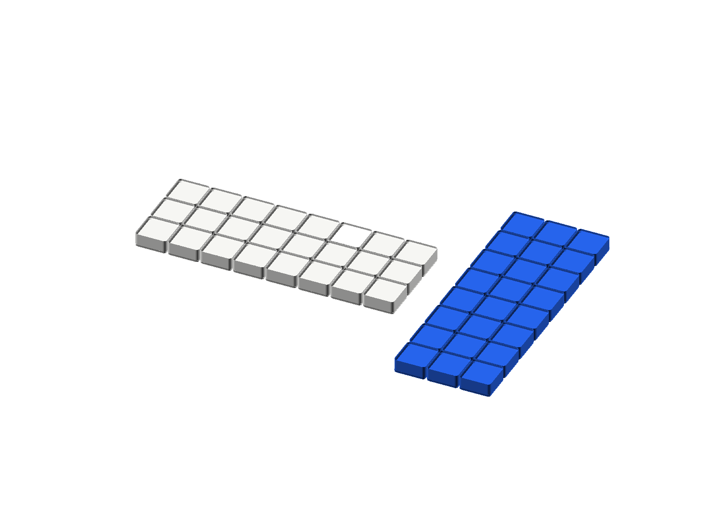{ width="320" }

> **Key Concept:** When you divide real items (like 23 tiles into groups of 4), a decimal like 5.75 hides the actual leftover pieces. Grouping physical Counting Tiles shows the full rows (Quotient) and loose tiles (Remainder), while [g] [÷R] puts Quotient on Floor 1 (X) and Remainder on Floor 2 (Y) at the same time!

#### Demonstrate Both Textbook Methods with `COUNT-01` Blocks (Counting & Array Tiles)

1. **Block Way 1 (+10 pts):** Deal 23 COUNT-01 tiles into rows of 4 -> 5 full rows (20 tiles) + 3 leftover tiles (5 R 3).
2. **Block Way 2 (+20 pts):** Push the 5×4 = 20 tile array together and snap the 3 remainder tiles back on (20 + 3 = 23).
3. **Both Ways Proof:** Dealing out rows (Division) and re-joining 5×4 + 3 (Multiplication Check) use the exact same 23 tiles!

#### Two-Method Worked Examples (`Method 1: +10 pts` vs. `Method 2: +20 pts DOUBLE`)

| Worksheet | Problem | Method 1 (`+10 pts` — 1st Token) | Method 2 (`+20 pts DOUBLE` — 2nd Token) | SC-6 Keystrokes | Final Answer |
| :--- | :--- | :--- | :--- | :--- | :--- |
| **Practice A** (`p.2`) | **Divide 23 ÷ 4 and find the quotient and remainder.** | **METHOD 1 (+10 pts): Equal-Groups Array Model:** Build equal rows of 4 tiles from 23 tiles: 5 full rows use 5 × 4 = 20 tiles, leaving 3 tiles left over -> 5 R 3. *(See `COUNT-01` Block Way 1 above)* | **METHOD 2 (+20 pts DOUBLE): Division Algorithm & Check:** Divide 23 ÷ 4 = 5 with remainder 23 - 20 = 3. Check: (Quotient × Divisor) + Remainder = (5 × 4) + 3 = 23. *(See `COUNT-01` Block Way 2 above)* | `[23]` `[ENTER]` `[4]` `[g]` `[÷R]` | **5 R 3** |
| **Practice B** (`p.3`) | **A robotics tournament has 135 students riding in vans that hold 8 students each. Find 135 ÷ 8 and how many vans are needed.** | **METHOD 1 (+10 pts): Long Division & Remainder Meaning:** Divide 135 ÷ 8: 8 × 16 = 128, with remainder 135 - 128 = 7 (16 R 7). Since 7 students cannot be left behind, round up to 17 vans. *COUNT-01 Way 1: Deal 135 into rows of 8 -> 16 full rows (128) + 7 leftover tiles in a 17th partial row.* | **METHOD 2 (+20 pts DOUBLE): Multiplication Check & Capacity Bounds:** Check 16 vans: 16 × 8 = 128 seats (7 seats short). Check 17 vans: 17 × 8 = 136 seats (fits all 135 students with 1 empty seat!). *COUNT-01 Way 2: Compare 16 full rows of 8 (128 seats, 7 short) vs. 17 full rows of 8 (136 seats, 1 spare seat!).* | `[135]` `[ENTER]` `[8]` `[g]` `[÷R]` `[f]` `[LASTX]` `[×]` `[+]` | **16 R 7 -> 17 vans needed** |

#### Practice A (p. 2): Key Ideas & Two-Method Practice (10 Exercises)

| # | Problem Prompt | Coach Key: SC-6 Keystrokes | Final Answer |
| :---: | :--- | :--- | :--- |
| **A1** | Arrange 31 tiles into rows of 6. Find Quotient & Remainder. | `31 [ENTER] 6 [g][÷R]` | **5 R 1** |
| **A2** | Divide 47 ÷ 5. Write the quotient and remainder, and check your answer by multiplying. | `47 [ENTER] 5 [g][÷R]` | **9 R 2** |
| **A3** | Divide 58 ÷ 7. Find the quotient and remainder, then check using (Quotient × Divisor) + Remainder. | `58 [ENTER] 7 [g][÷R]` | **8 R 2** |
| **A4** | Divide 85 ÷ 9. How many full groups of 9 and how many left? | `85 [ENTER] 9 [g][÷R]` | **9 R 4** |
| **A5** | Divide 146 ÷ 12. Find the Quotient and Remainder. | `146 [ENTER] 12 [g][÷R]` | **12 R 2** |
| **A6** | Divide 250 ÷ 36. Find the quotient and remainder, and verify with the Division Algorithm. | `250 [ENTER] 36 [g][÷R]` | **6 R 34** |
| **A7** | Find the missing dividend: Quotient = 14, Divisor = 8, Remainder = 5. | `14 [ENTER] 8 [×] 5 [+]` | **117** |
| **A8** | Error Analysis: Sam says 75 ÷ 8 = 8 R 11. Explain why a remainder of 11 is impossible and find the correct quotient. | `75 [ENTER] 8 [g][÷R]` | **9 R 3 (Rem < 8)** |
| **A9** | A 3D spool has 300g of PLA. Each box takes 42g. How many full boxes can you print, and how much PLA is left? | `300 [ENTER] 42 [g][÷R]` | **7 boxes, 6g left (Way 2: 7×42=294)** |
| **A10** | 115 students ride vans that hold 14 kids each. How many vans must be booked so nobody is left behind? | `115 [ENTER] 14 [g][÷R]` | **9 vans (8 full + 1 for 3 kids; Way 2: 9×14=126)** |

#### Practice B (p. 3): Modeling Real Life & Multi-Method Applications (10 Exercises)

| # | Modeling Real Life Application Prompt | Coach Key: SC-6 Keystrokes | Final Answer |
| :---: | :--- | :--- | :--- |
| **B1** | Drone Battery Packs: A robotics team has 53 lithium cells. Each drone battery pack uses 6 cells. Find the quotient and remainder. How many full packs can they build? | `53 [ENTER] 6 [g][÷R]` | **8 R 5 (8 full packs, 5 cells left)** |
| **B2** | Arcade Prize Tickets: You win 94 tickets and trade them for mini-figures that cost 8 tickets each. How many mini-figures do you get, and how many tickets remain? | `94 [ENTER] 8 [g][÷R]` | **11 R 6 (11 figures, 6 tickets left)** |
| **B3** | Camp Canoe Fleet: 78 campers are crossing a lake in canoes that hold 4 campers each. Divide 78 ÷ 4. How many canoes are needed so every camper has a seat? | `78 [ENTER] 4 [g][÷R]` | **19 R 2 -> 20 canoes** |
| **B4** | Cookie Bakery Tray: A baker places 110 warm cookies onto cooling racks that hold 12 cookies per rack. How many racks are completely filled, and how many cookies go on the last rack? | `110 [ENTER] 12 [g][÷R]` | **9 R 2 (9 full racks, 2 on last)** |
| **B5** | 3D Printer Spool: A filament spool has 450 meters of PLA. Each chess knight uses 16 meters. How many complete knights can be printed, and how much PLA is left over? | `450 [ENTER] 16 [g][÷R]` | **28 R 2 (28 knights, 2 m left)** |
| **B6** | Trading Card Binder: You have 165 collectible cards and put 9 cards into each plastic binder page. How many pages are completely full, and how many pages do you need in all? | `165 [ENTER] 9 [g][÷R]` | **18 R 3 -> 18 full, 19 pages total** |
| **B7** | Division Algorithm Check: When a mystery number of marbles is divided into bags of 15, the quotient is 12 and the remainder is 7. Use (Quotient × Divisor) + Remainder to find the total marbles. | `12 [ENTER] 15 [×] 7 [+]` | **187 marbles** |
| **B8** | Theme Park Coaster: A roller coaster train holds 24 riders. There are 200 people in line. How many full trains run, and how many riders are on the final train? | `200 [ENTER] 24 [g][÷R]` | **8 R 8 (8 full trains, 8 on final)** |
| **B9** | Pizza Party Slices: Each large pizza is cut into 8 slices. If 67 students each eat 1 slice, how many whole pizzas must the school order, and how many slices will be left over? | `67 [ENTER] 8 [g][÷R]` | **8 R 3 -> 9 pizzas (5 slices left)** |
| **B10** | Maker Lab Drawer Bins: You pack 325 screws into Gridfinity bins that hold 28 screws each. Find the quotient and remainder, and check your answer by multiplying. | `325 [ENTER] 28 [g][÷R]` | **11 R 17 (11×28 + 17 = 325)** |

---

### Section 1.2: Powers and Exponents (Workbook pp. 4–5)

**Textbook Alignment:** Big Ideas Grade 6, Section 1.2 (Powers and Exponents) (`CCSS.MATH.6.EE.A.1`) • **Big Ideas Methods:** *Method 1: Repeated Multiplication Factors  |  Method 2: 2D Square / 3D Cube Array & Power Key* • **Block Kit:** `COUNT-01` (Counting & Array Tiles)

**Key Vocabulary:** power • base • exponent • perfect square • perfect cube

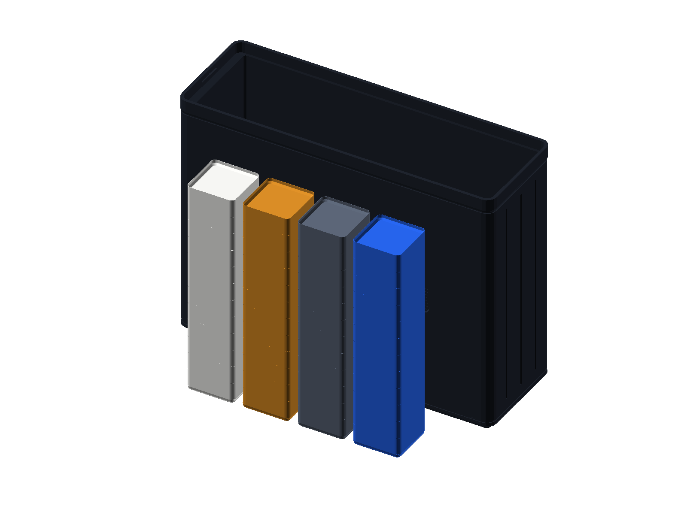{ width="320" }

> **Key Concept:** An exponent tells how many times to use the base as a factor in repeated multiplication. A 2nd power (4²) builds a 2D square array (4×4 = 16 tiles), and a 3rd power (4³) stacks 4 square layers into a 3D cube (64 tiles). Evaluate powers using repeated multiplication or [x²], [g] [x³], and [g] [yˣ]!

#### Demonstrate Both Textbook Methods with `COUNT-01` Blocks (Counting & Array Tiles)

1. **Block Way 1 (+10 pts):** Lay 4 COUNT-01 tiles per row and repeat 4 rows to build a 4×4 = 16 square array (4²).
2. **Block Way 2 (+20 pts):** Stack 4 of those 4×4 square layers high (4³ = 64), and place a 4×2 = 8 array beside it to prove 4² ≠ 4×2!
3. **Both Ways Proof:** Repeated factor groups (Method 1) physically form a 2D Square (x²) and 3D Cube (x³) on the baseplate!

#### Two-Method Worked Examples (`Method 1: +10 pts` vs. `Method 2: +20 pts DOUBLE`)

| Worksheet | Problem | Method 1 (`+10 pts` — 1st Token) | Method 2 (`+20 pts DOUBLE` — 2nd Token) | SC-6 Keystrokes | Final Answer |
| :--- | :--- | :--- | :--- | :--- | :--- |
| **Practice A** (`p.4`) | **Write 4² and 4³ as repeated multiplication and find their values. Compare 4² to 4 × 2.** | **METHOD 1 (+10 pts): Write as Repeated Factors:** Identify Base = 4, Exponent = 2 or 3. Expand: 4² = 4 × 4 = 16, and 4³ = 4 × 4 × 4 = 16 × 4 = 64. *(See `COUNT-01` Block Way 1 above)* | **METHOD 2 (+20 pts DOUBLE): Perfect Square / Cube Model:** Count the area of a 4 × 4 square (16 units²) and volume of a 4 × 4 × 4 cube (64 units³), or use [x²] and [g][x³]. *(See `COUNT-01` Block Way 2 above)* | `[4]` `[x²]` `[4]` `[g]` `[x³]` | **4² = 16, 4³ = 64** |
| **Practice B** (`p.5`) | **A video clip is shared by 3 friends in Round 1, and triples every round for 4 rounds (3⁴). How many shares happen in Round 4?** | **METHOD 1 (+10 pts): Step-by-Step Repeated Multiplication:** Write four factors of 3: 3⁴ = 3 × 3 × 3 × 3. Multiply in pairs: (3 × 3) × (3 × 3) = 9 × 9 = 81 shares. *COUNT-01 Way 1: Build a 3×3 square (9) and another 3×3 square (9), then form a 9×9 = 81 array.* | **METHOD 2 (+20 pts DOUBLE): Constant Multiplier Ladder ([g] [REP]):** Round 1 = 3, Round 2 = 9, Round 3 = 27, Round 4 = 81. Verify on SC-6 with 3 [ENTER] 4 [g] [yˣ] -> 81. *COUNT-01 Way 2: Triple your tile stack each round: 3 tiles -> 9 tiles -> 27 tiles -> 81 tiles!* | `[3]` `[ENTER]` `[4]` `[g]` `[yˣ]` | **81 shares** |

#### Practice A (p. 4): Key Ideas & Two-Method Practice (10 Exercises)

| # | Problem Prompt | Coach Key: SC-6 Keystrokes | Final Answer |
| :---: | :--- | :--- | :--- |
| **A1** | Write 5² as repeated multiplication and find how many tiles are in a 5 × 5 square. | `5 [x²]` | **25** |
| **A2** | Evaluate 7² and compare it to 7 × 2. | `7 [x²]` | **49 (vs 14)** |
| **A3** | Evaluate 3³ (a 3 × 3 × 3 cube of blocks). | `3 [g][x³]` | **27** |
| **A4** | Evaluate the power 5³ by writing the repeated multiplication factors. | `5 [g][x³]` | **125** |
| **A5** | Write 2⁵ as repeated multiplication and find the value of the power. | `2 [ENTER] 5 [g][yˣ]` | **32** |
| **A6** | Write 6⁴ as repeated multiplication and evaluate the power. | `6 [ENTER] 4 [g][yˣ]` | **1,296** |
| **A7** | Evaluate 10⁴ and 1⁴. How many zeros are in 10⁴? | `10 [ENTER] 4 [g][yˣ]` | **10,000 and 1** |
| **A8** | Error Analysis: Mia wrote 2⁴ = 8 because 2 × 4 = 8. Describe and correct her error. | `2 [ENTER] 4 [g][yˣ]` | **16 (2×2×2×2)** |
| **A9** | A cell doubles every hour (2ⁿ). How many cells are there after 6 hours (2⁶)? Solve 2 ways! | `2 [ENTER] 6 [g][yˣ]` | **64 cells (Way 2: 2 [g][REP] [×]×5)** |
| **A10** | Modeling Real Life: A giant Rubik's display cube is built from 216 unit cubes. What is the edge length of the cube? | `216 [ENTER] 3 [g][ˣ√y]` | **6 blocks wide (Way 2: 6 [g][x³]=216)** |

#### Practice B (p. 5): Modeling Real Life & Multi-Method Applications (10 Exercises)

| # | Modeling Real Life Application Prompt | Coach Key: SC-6 Keystrokes | Final Answer |
| :---: | :--- | :--- | :--- |
| **B1** | Pixel Art Canvas: A retro game sprite is drawn on an 8 × 8 square grid (8²). Write 8² as repeated multiplication and find the total number of pixels. | `8 [x²]` | **8 × 8 = 64 pixels** |
| **B2** | Minecraft Storage Room: You dig a cubic room measuring 6 blocks long, 6 blocks wide, and 6 blocks tall (6³). How many blocks do you mine in all? | `6 [g][x³]` | **216 blocks** |
| **B3** | Cell Division Lab: A single bacterium splits into 2 bacteria every hour. After 6 hours, there are 2⁶ bacteria. Evaluate 2⁶. | `2 [ENTER] 6 [g][yˣ]` | **64 bacteria** |
| **B4** | Tournament Bracket: A tennis tournament has 4⁴ players in the opening round. Write 4⁴ as repeated factors and find how many players entered. | `4 [ENTER] 4 [g][yˣ]` | **256 players** |
| **B5** | Compare Squares: A patio has a 12 ft × 12 ft main deck (12²) and a 5 ft × 5 ft grill pad (5²). What is the combined area of both squares? | `12 [x²] 5 [x²] [+]` | **144 + 25 = 169 ft²** |
| **B6** | Kindness Chain Text: On Day 1, 5 students each invite 5 friends. Each day the number multiplies by 5. How many students are invited on Day 4 (5⁴)? | `5 [ENTER] 4 [g][yˣ]` | **625 students** |
| **B7** | Perfect Square Garden: A square community garden has an area of 196 square meters. What is the side length of the square garden? | `196 [f][√x]` | **14 meters** |
| **B8** | Cube vs. Square Showdown: Which is greater: 2⁵ or 5²? Evaluate both powers and find their difference. | `2 [ENTER] 5 [g][yˣ] 5 [x²] [-]` | **2⁵ = 32 > 5² = 25 (diff = 7)** |
| **B9** | Metric Data Byte: One kilobyte in binary memory is 2¹⁰ bytes. Evaluate 2¹⁰ by squaring 2⁵ (32 × 32) or using the power key. | `2 [ENTER] 10 [g][yˣ]` | **1,024 bytes** |
| **B10** | Sculpture Pedestal: A sculptor stacks a 3³-inch cube on top of a 7³-inch cube. What is the combined volume of the two cubes? | `3 [g][x³] 7 [g][x³] [+]` | **27 + 343 = 370 in³** |

---

### Section 1.3: Order of Operations (Workbook pp. 6–7)

**Textbook Alignment:** Big Ideas Grade 6, Section 1.3 (Order of Operations) (`CCSS.MATH.6.EE.A.1`) • **Big Ideas Methods:** *Method 1: PEMDAS Line-by-Line Funnel  |  Method 2: Inside-Out Grouping Chunks* • **Block Kit:** `COUNT-01` (Counting & Array Tiles)

**Key Vocabulary:** numerical expression • evaluate • order of operations • grouping symbols

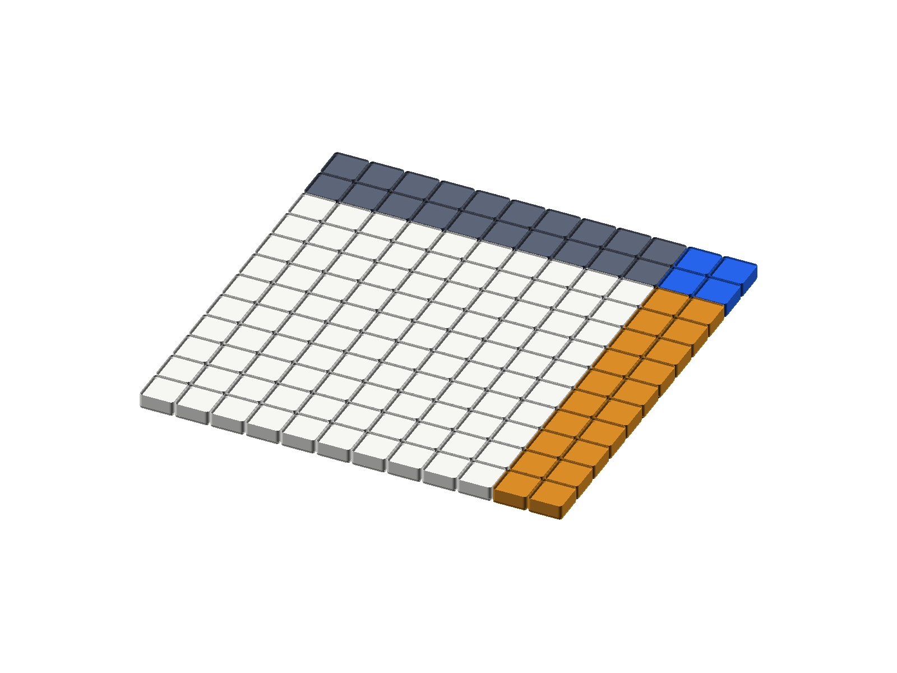{ width="320" }

> **Key Concept:** Big Ideas Order of Operations (PEMDAS): (1) Evaluate expressions inside grouping symbols (), [], or fraction bars first; (2) Evaluate powers; (3) Multiply and divide from left to right; (4) Add and subtract from left to right. Grouping tiles on your desk lets you solve each part step by step!

#### Demonstrate Both Textbook Methods with `COUNT-01` Blocks (Counting & Array Tiles)

1. **Block Way 1 (+10 pts):** In Left Zone of COUNT-01 build (8 + 4) = 12 tiles; in Right Zone build (9 - 3) = 6 tiles -> 12 × 6 = 72.
2. **Block Way 2 (+20 pts):** Build the 12×6 array as two connected chunks: (8 × 6 = 48) + (4 × 6 = 24) = 72 tiles!
3. **Both Ways Proof:** Solving the two parentheses zones first (12 × 6) matches splitting the array into 48 + 24 = 72!

#### Two-Method Worked Examples (`Method 1: +10 pts` vs. `Method 2: +20 pts DOUBLE`)

| Worksheet | Problem | Method 1 (`+10 pts` — 1st Token) | Method 2 (`+20 pts DOUBLE` — 2nd Token) | SC-6 Keystrokes | Final Answer |
| :--- | :--- | :--- | :--- | :--- | :--- |
| **Practice A** (`p.6`) | **Evaluate (8 + 4) × (9 - 3) using the Big Ideas Order of Operations.** | **METHOD 1 (+10 pts): PEMDAS Step-by-Step Rewrite:** 1. Grouping Symbols: (8 + 4) × (9 - 3) = 12 × 6.  2. Multiply: 12 × 6 = 72. *(See `COUNT-01` Block Way 1 above)* | **METHOD 2 (+20 pts DOUBLE): Area Split / Stack Chunks:** Solve Left Chunk (8 + 4 = 12) and Right Chunk (9 - 3 = 6) separately, then multiply the two chunks: 12 × 6 = 72. *(See `COUNT-01` Block Way 2 above)* | `[8]` `[ENTER]` `[4]` `[+]` `[9]` `[ENTER]` `[3]` `[-]` `[×]` | **72** |
| **Practice B** (`p.7`) | **Evaluate 40 - 3 × (2 + 3)² ÷ 5 using the Order of Operations.** | **METHOD 1 (+10 pts): Standard PEMDAS Funnel:** 1. Parentheses: (2+3) = 5.  2. Exponent: 5² = 25.  3. Multiply/Divide L-to-R: 3 × 25 = 75, then 75 ÷ 5 = 15.  4. Subtract: 40 - 15 = 25. *COUNT-01 Way 1: Build a (2+3)=5 square (25 tiles), triple to 75, divide into 5 rows (15), and subtract from 40 -> 25.* | **METHOD 2 (+20 pts DOUBLE): Inside-Out Chunk Simplification:** Start inside the parentheses (2+3 = 5), square it (25), divide 25 ÷ 5 = 5, multiply by 3 (15), and subtract from 40: 40 - 15 = 25. *COUNT-01 Way 2: Take the 5×5 square (25), divide into 5 columns of 5, keep 3 columns (15), and remove 15 from 40 -> 25!* | `[40]` `[ENTER]` `[3]` `[ENTER]` `[2]` `[ENTER]` `[3]` `[+]` `[x²]` `[×]` `[5]` `[÷]` `[-]` | **25** |

#### Practice A (p. 6): Key Ideas & Two-Method Practice (10 Exercises)

| # | Problem Prompt | Coach Key: SC-6 Keystrokes | Final Answer |
| :---: | :--- | :--- | :--- |
| **A1** | Evaluate 5 + 2 × 3. Multiply before adding! | `5 [ENTER] 2 [ENTER] 3 [×] [+]` | **11** |
| **A2** | Evaluate (14 + 6) ÷ (7 - 2). Solve both parentheses first! | `14 [ENTER] 6 [+] 7 [ENTER] 2 [-] [÷]` | **4** |
| **A3** | Evaluate 30 - 4 × 6. | `30 [ENTER] 4 [ENTER] 6 [×] [-]` | **6** |
| **A4** | Evaluate (9 + 3) × (15 - 8). | `9 [ENTER] 3 [+] 15 [ENTER] 8 [-] [×]` | **84** |
| **A5** | Evaluate 50 - (3 + 4)². Square the sum before subtracting from 50! | `50 [ENTER] 3 [ENTER] 4 [+] [x²] [-]` | **1** |
| **A6** | Evaluate 120 - 4 × (3 + 2)². | `120 [ENTER] 4 [ENTER] 3 [ENTER] 2 [+] [x²] [×] [-]` | **20** |
| **A7** | Fraction Bar Grouping: Evaluate (24 + 12) / (9 - 3). | `24 [ENTER] 12 [+] 9 [ENTER] 3 [-] [÷]` | **6** |
| **A8** | Evaluate 3³ + 15 ÷ 3 - 2 × 4. | `3 [g][x³] 15 [ENTER] 3 [÷] [+] 2 [ENTER] 4 [×] [-]` | **24** |
| **A9** | Evaluate the numerical expression 10 + (15 - 3)² ÷ 9 using the order of operations. | `10 [ENTER] 15 [ENTER] 3 [-] [x²] 9 [÷] [+]` | **26 (Way 2: 10 + 144÷9 = 26)** |
| **A10** | Movie tickets: 2 adults at $12 each and 4 kids at $8 each, minus a $10 coupon. Write an expression and find total cost. | `2 [ENTER] 12 [×] 4 [ENTER] 8 [×] [+] 10 [-]` | **$46 (Way 2: 24 + 32 - 10 = 46)** |

#### Practice B (p. 7): Modeling Real Life & Multi-Method Applications (10 Exercises)

| # | Modeling Real Life Application Prompt | Coach Key: SC-6 Keystrokes | Final Answer |
| :---: | :--- | :--- | :--- |
| **B1** | Movie Night Snack Combo: 4 friends each buy a $9 ticket and a $5 popcorn: 4 × (9 + 5). Evaluate the expression using the order of operations. | `9 [ENTER] 5 [+] 4 [×]` | **$56** |
| **B2** | Skateboard Build: You buy a $45 deck and 4 wheels at $7 each: 45 + 4 × 7. Why must you multiply 4 × 7 before adding 45? Find the total cost. | `45 [ENTER] 4 [ENTER] 7 [×] [+]` | **$73** |
| **B3** | Laser Tag Score: You start with 100 points, lose 3 penalties of 8 points, and win a 25-point bonus: 100 - 3 × 8 + 25. Find your final score. | `100 [ENTER] 3 [ENTER] 8 [×] [-] 25 [+]` | **101 points** |
| **B4** | Tile Border Courtyard: A 10 × 10 courtyard has a 6 × 6 fountain in the center. Evaluate 10² - 6² to find the area of the tile walkway. | `10 [x²] 6 [x²] [-]` | **64 square units** |
| **B5** | Aquarium Ticket Group: Admission is $14 for adults and $9 for kids. Evaluate 2 × 14 + 5 × 9 for 2 adults and 5 kids. | `2 [ENTER] 14 [×] 5 [ENTER] 9 [×] [+]` | **$73** |
| **B6** | Robotics Points Formula: A robot scores 6 × (3² + 5) - 14 points in the autonomous round. Evaluate the expression step by step. | `3 [x²] 5 [+] 6 [×] 14 [-]` | **70 points** |
| **B7** | Craft Fair Booth: You make 72 bracelets, keep 12 for friends, and pack the rest into boxes of 6: (72 - 12) ÷ 6. How many boxes do you fill? | `72 [ENTER] 12 [-] 6 [÷]` | **10 boxes** |
| **B8** | Left-to-Right Rule: Evaluate 48 ÷ 6 × 4 + 10. Remember: division and multiplication have equal priority and go from left to right! | `48 [ENTER] 6 [÷] 4 [×] 10 [+]` | **42** |
| **B9** | Bakery Muffin Boxes: A baker makes 5 trays of 12 blueberry muffins and 3 trays of 8 banana muffins, then packs them into 7 gift baskets: (5×12 + 3×8) ÷ 7. | `5 [ENTER] 12 [×] 3 [ENTER] 8 [×] [+] 7 [÷]` | **12 muffins per basket** |
| **B10** | Escape Room Final Lock: Evaluate (4³ - 14) ÷ (2 + 3) + 8² to unlock the final puzzle door. | `4 [g][x³] 14 [-] 2 [ENTER] 3 [+] [÷] 8 [x²] [+]` | **74** |

---

### Section 1.4: Prime Factorization (Workbook pp. 8–9)

**Textbook Alignment:** Big Ideas Grade 6, Section 1.4 (Prime Factorization) (`CCSS.MATH.6.NS.B.4`) • **Big Ideas Methods:** *Method 1: Factor Tree Diagram  |  Method 2: Prime Division Ladder & Logarithmic Prime Tower* • **Block Kit:** `PRIME-01` (Prime Factor Studio)

**Key Vocabulary:** factor pair • prime number • composite number • prime factorization • factor tree

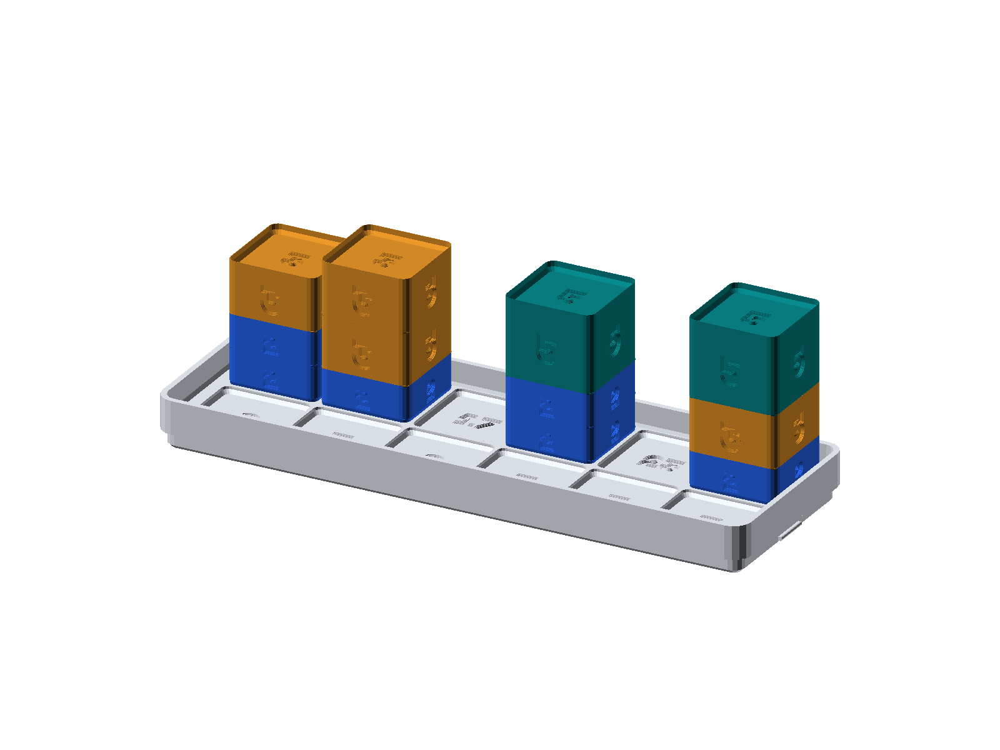{ width="320" }

> **Key Concept:** In Big Ideas Math, a Factor Tree splits a composite number until every branch ends at a prime number. In the Prime Factor Studio (PRIME-01), block heights are logarithmic (h = 7·log₂(p) mm), so [2]+[2]+[3]+[5] always reaches the exact 60 mark whether you split 60 as 6×10 or 4×15!

#### Demonstrate Both Textbook Methods with `PRIME-01` Blocks (Prime Factor Studio)

1. **Block Way 1 (+10 pts):** Split 60 into factor pairs (6 × 10), then trade 6 for [2][3] and 10 for [2][5] PRIME-01 blocks.
2. **Block Way 2 (+20 pts):** Stack [2] + [2] + [3] + [5] vertically in one PRIME-01 socket—any order reaches the 60 ruler mark!
3. **Both Ways Proof:** Branching a factor tree and stacking a division ladder produce the exact same [2][2][3][5] = 60 tower!

#### Two-Method Worked Examples (`Method 1: +10 pts` vs. `Method 2: +20 pts DOUBLE`)

| Worksheet | Problem | Method 1 (`+10 pts` — 1st Token) | Method 2 (`+20 pts DOUBLE` — 2nd Token) | SC-6 Keystrokes | Final Answer |
| :--- | :--- | :--- | :--- | :--- | :--- |
| **Practice A** (`p.8`) | **Write the prime factorization of 60 using a factor tree, Prime Blocks, and [g] [FACT].** | **METHOD 1 (+10 pts): Use a Factor Tree:** Branch 60 into 6 × 10. Split 6 into 2 × 3 and 10 into 2 × 5. Collect the prime leaves in order: 60 = 2² × 3 × 5. *(See `PRIME-01` Block Way 1 above)* | **METHOD 2 (+20 pts DOUBLE): Use a Division Ladder:** Divide by smallest primes: 60 ÷ 2 = 30 -> 30 ÷ 2 = 15 -> 15 ÷ 3 = 5 (prime!). Product of divisors: 2² × 3 × 5 = 60. *(See `PRIME-01` Block Way 2 above)* | `[60]` `[g]` `[FACT]` | **60 = 2² × 3 × 5** |
| **Practice B** (`p.9`) | **A marching band has 2³ × 3 × 5 musicians. Find the total number of musicians and two different factor pairs for rectangular rows.** | **METHOD 1 (+10 pts): Expand the Prime Powers:** Evaluate 2³ = 2 × 2 × 2 = 8. Multiply by the remaining primes: 8 × 3 × 5 = 24 × 5 = 120 musicians. *PRIME-01 Way 1: Stack three [2] blocks (=8), one [3] block, and one [5] block to reach the 120 mark.* | **METHOD 2 (+20 pts DOUBLE): Regroup Prime Factors into Factor Pairs:** Pair (2 × 5) = 10 first: (2² × 3) × (2 × 5) = 12 × 10 = 120. Two formations: 8 rows of 15, or 10 rows of 12! *PRIME-01 Way 2: Group [2][5]=10 and [2][2][3]=12 (10×12), or [2][2][2]=8 and [3][5]=15 (8×15)!* | `[2]` `[g]` `[x³]` `[3]` `[×]` `[5]` `[×]` | **120 musicians (e.g., 10×12 or 8×15)** |

#### Practice A (p. 8): Key Ideas & Two-Method Practice (10 Exercises)

| # | Problem Prompt | Coach Key: SC-6 Keystrokes | Final Answer |
| :---: | :--- | :--- | :--- |
| **A1** | Use a factor tree or division ladder to write the prime factorization of 12. | `12 [g][FACT]` | **2² × 3** |
| **A2** | Write the prime factorization of 36 using exponents. | `36 [g][FACT]` | **2² × 3²** |
| **A3** | Determine whether 29 and 57 are prime or composite. If composite, write the prime factorization. | `29 [PRIME], 57 [g][FACT]` | **29 Prime; 57 Composite (3×19)** |
| **A4** | Find the prime factorization of 45. | `45 [g][FACT]` | **3² × 5** |
| **A5** | Build the Prime Tower for 72. Show how 8 × 9 and 6 × 12 use the exact same blocks. | `72 [g][FACT]` | **2³ × 3²** |
| **A6** | Find the prime factorization of 84. | `84 [g][FACT]` | **2² × 3 × 7** |
| **A7** | Find the prime factorization of 100. | `100 [g][FACT]` | **2² × 5²** |
| **A8** | Find the whole number whose prime factorization is 2² × 3 × 7. | `2 [x²] 3 [×] 7 [×]` | **84** |
| **A9** | Write the prime factorization of 180 using two different starting factor pairs (such as 18 × 10 and 12 × 15). | `180 [g][FACT]` | **2² × 3² × 5 (Way 2: (2·3²)(2·5))** |
| **A10** | Modeling Real Life: A vault code is the number with prime factorization 2³ × 3² × 5. Find the 3-digit code. | `2 [g][x³] 3 [x²] [×] 5 [×]` | **360 (Way 2: 8 × 9 × 5 = 360)** |

#### Practice B (p. 9): Modeling Real Life & Multi-Method Applications (10 Exercises)

| # | Modeling Real Life Application Prompt | Coach Key: SC-6 Keystrokes | Final Answer |
| :---: | :--- | :--- | :--- |
| **B1** | Solar Panel Grid: A satellite wing has 48 solar cells. Write all factor pairs of 48 and write its prime factorization using exponents. | `48 [g][FACT]` | **2⁴ × 3** |
| **B2** | Drumline Formation: A drumline of 54 musicians wants to march in equal rows. Write the prime factorization of 54 using a factor tree or division ladder. | `54 [g][FACT]` | **2 × 3³** |
| **B3** | Prime Jersey Check: Jersey numbers 37, 51, and 61 are on the bench. One of them is composite! Find which one is composite and write its prime factors. | `51 [g][FACT]` | **51 is composite (3 × 17)** |
| **B4** | Collector Display Case: You have 80 mineral specimens. Write the prime factorization of 80 using a factor tree starting with 8 × 10. | `80 [g][FACT]` | **2⁴ × 5** |
| **B5** | Mystery Prime Tower: A student stacks one [2] block, two [3] blocks, and one [7] block (2 × 3² × 7). What composite number does this tower represent? | `2 [ENTER] 3 [x²] [×] 7 [×]` | **126** |
| **B6** | Century Mark: Write the prime factorization of 100 by branching 10 × 10 on a factor tree. | `100 [g][FACT]` | **2² × 5²** |
| **B7** | Science Fair Tables: 140 projects are arranged in equal rows. Find the prime factorization of 140. | `140 [g][FACT]` | **2² × 5 × 7** |
| **B8** | Gross of Pencils: A 'gross' is a dozen dozens (144 pencils). Write the prime factorization of 144 using exponents. | `144 [g][FACT]` | **2⁴ × 3²** |
| **B9** | Two Factor Trees, Same Leaves: Factor 90 first by starting with 9 × 10, and second by starting with 6 × 15. Verify both trees give the same prime factorization! | `90 [g][FACT]` | **2 × 3² × 5** |
| **B10** | Secret Locker Combination: The locker number is the product of the first four prime numbers (2 × 3 × 5 × 7). What is the locker number? | `2 [ENTER] 3 [×] 5 [×] 7 [×]` | **210** |

---

### Section 1.5: Greatest Common Factor (GCF) & Least Common Multiple (LCM) (Workbook pp. 10–11)

**Textbook Alignment:** Big Ideas Grade 6, Sections 1.5 & 1.6 (GCF and LCM) (`CCSS.MATH.6.NS.B.4`) • **Big Ideas Methods:** *Method 1: Lists of Factors & Multiples  |  Method 2: Prime Factorization Venn Diagram* • **Block Kit:** `PRIME-01` (Prime Factor Studio)

**Key Vocabulary:** common factor • greatest common factor (GCF) • common multiple • least common multiple (LCM) • Venn diagram

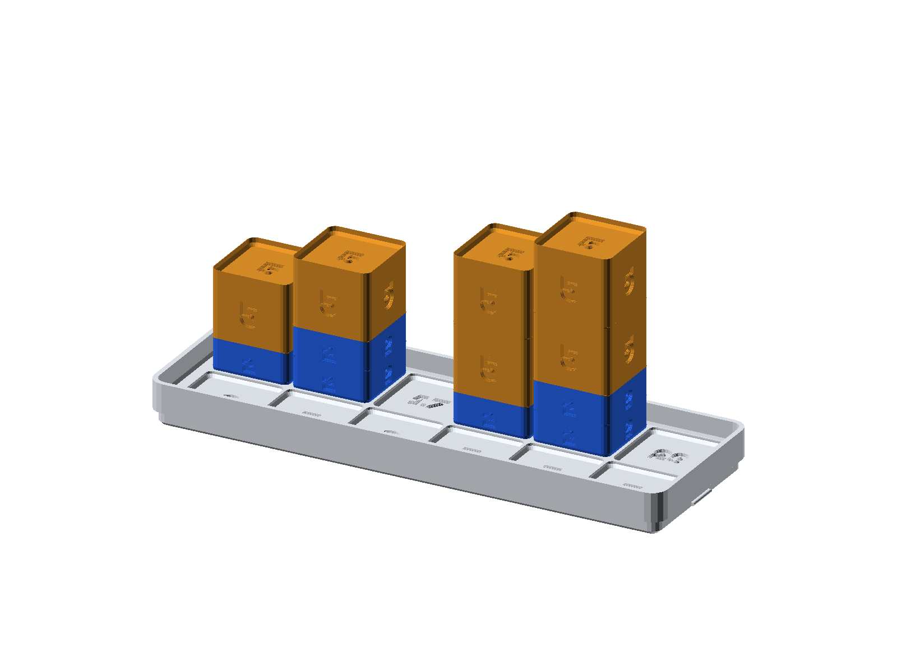{ width="320" }

> **Key Concept:** When you stand two Prime Factor Towers next to each other on the 12-socket lid, you see GCF and LCM at the same time: GCF is the shared blocks both towers have in common (overlap), and LCM is the tallest tower needed to cover both (union)! Verify in 1 click with [GCF] and [f] [LCM].

#### Demonstrate Both Textbook Methods with `PRIME-01` Blocks (Prime Factor Studio)

1. **Block Way 1 (+10 pts):** Stand PRIME-01 Tower 20 ([2][2][5]) beside Tower 50 ([2][5][5]); pull out shared blocks [2][5] = 10 (GCF).
2. **Block Way 2 (+20 pts):** Build the Union Tower using the tallest count of each prime: two [2]s and two [5]s -> [2][2][5][5] = 100 (LCM)!
3. **Both Ways Proof:** Shared overlap blocks give GCF = 10, while the tallest-count union tower gives LCM = 100 (and 10×100 = 20×50)!

#### Two-Method Worked Examples (`Method 1: +10 pts` vs. `Method 2: +20 pts DOUBLE`)

| Worksheet | Problem | Method 1 (`+10 pts` — 1st Token) | Method 2 (`+20 pts DOUBLE` — 2nd Token) | SC-6 Keystrokes | Final Answer |
| :--- | :--- | :--- | :--- | :--- | :--- |
| **Practice A** (`p.10`) | **Find both the GCF and LCM of 20 and 50 using Prime Towers and the SC-6.** | **METHOD 1 (+10 pts): List Factors & Multiples:** Factors of 20: 1, 2, 4, 5, 10, 20; of 50: 1, 2, 5, 10, 25, 50 -> GCF = 10. Multiples: 20, 40, 60, 80, 100 and 50, 100 -> LCM = 100. *(See `PRIME-01` Block Way 1 above)* | **METHOD 2 (+20 pts DOUBLE): Prime Factor Venn Diagram:** 20 = 2²·5 and 50 = 2·5². Shared overlap = 2·5 = 10 (GCF). Union of tallest prime powers = 2²·5² = 100 (LCM). *(See `PRIME-01` Block Way 2 above)* | `[20]` `[ENTER]` `[50]` `[GCF]` `[20]` `[ENTER]` `[50]` `[f]` `[LCM]` | **GCF = 10, LCM = 100** |
| **Practice B** (`p.11`) | **You have 18 pretzel bags and 24 fruit bars to make identical snack packs with none left over. What is the greatest number of packs (GCF)?** | **METHOD 1 (+10 pts): List Factor Pairs of 18 and 24:** Factors of 18: 1, 2, 3, 6, 9, 18. Factors of 24: 1, 2, 3, 4, 6, 8, 12, 24. Common factors: 1, 2, 3, 6 -> GCF = 6 packs. *PRIME-01 Way 1: Compare Tower 18 ([2][3][3]) and Tower 24 ([2][2][2][3]) -> shared blocks [2][3] = 6 packs.* | **METHOD 2 (+20 pts DOUBLE): Prime Factorization Overlap:** 18 = 2 × 3² and 24 = 2³ × 3. Multiply shared prime factors: 2 × 3 = 6 packs (each with 18÷6 = 3 pretzels and 24÷6 = 4 bars). *COUNT-01 Way 2: Deal 18 pretzels and 24 bars into 6 equal rows -> each row gets 3 pretzels and 4 bars!* | `[18]` `[ENTER]` `[24]` `[GCF]` `[18]` `[ENTER]` `[24]` `[f]` `[LCM]` | **GCF = 6 packs (3 pretzels, 4 bars each)** |

#### Practice A (p. 10): Key Ideas & Two-Method Practice (10 Exercises)

| # | Problem Prompt | Coach Key: SC-6 Keystrokes | Final Answer |
| :---: | :--- | :--- | :--- |
| **A1** | Find the greatest common factor (GCF) and least common multiple (LCM) of 12 and 18 using a Venn diagram or factor lists. | `12 [ENTER] 18 [GCF] / [f][LCM]` | **GCF = 6, LCM = 36** |
| **A2** | Find the GCF and LCM of 8 and 12. | `8 [ENTER] 12 [GCF] / [f][LCM]` | **GCF = 4, LCM = 24** |
| **A3** | Find the GCF and LCM of 15 and 25. | `15 [ENTER] 25 [GCF] / [f][LCM]` | **GCF = 5, LCM = 75** |
| **A4** | Find the GCF and LCM of 14 and 35. | `14 [ENTER] 35 [GCF] / [f][LCM]` | **GCF = 7, LCM = 70** |
| **A5** | Find the GCF and LCM of 16 and 24. | `16 [ENTER] 24 [GCF] / [f][LCM]` | **GCF = 8, LCM = 48** |
| **A6** | Find the GCF and LCM of 28 and 42. | `28 [ENTER] 42 [GCF] / [f][LCM]` | **GCF = 14, LCM = 84** |
| **A7** | Two prime numbers are 5 and 7. What is their GCF and what is their LCM? | `5 [ENTER] 7 [GCF] / [f][LCM]` | **GCF = 1, LCM = 35** |
| **A8** | Verify that GCF(15, 20) × LCM(15, 20) equals 15 × 20. | `15 [ENTER] 20 [GCF] ... [×]` | **5 × 60 = 300 (Matches 15×20!)** |
| **A9** | Hot dogs come in packs of 12 and buns in packs of 15. What is the smallest number of each to buy with 0 leftovers? | `12 [ENTER] 15 [f][LCM]` | **60 (5 packs dogs, 4 packs buns; Way 2: [g][REP] skip-count)** |
| **A10** | You have 36 red tiles and 48 blue tiles to pack into identical kit bags with none left over. What is the max number of bags? | `36 [ENTER] 48 [GCF]` | **12 bags (3 red, 4 blue per bag; Way 2: Prime overlap 2²×3=12)** |

#### Practice B (p. 11): Modeling Real Life & Multi-Method Applications (10 Exercises)

| # | Modeling Real Life Application Prompt | Coach Key: SC-6 Keystrokes | Final Answer |
| :---: | :--- | :--- | :--- |
| **B1** | First-Aid Kits: A school nurse has 28 bandages and 42 antiseptic wipes to make identical first-aid kits with none left over. What is the greatest number of kits (GCF)? | `28 [ENTER] 42 [GCF]` | **14 kits (2 bandages, 3 wipes)** |
| **B2** | Lighthouse Flash Cycle: Red Beacon flashes every 12 seconds and Blue Beacon flashes every 15 seconds. They just flashed together. In how many seconds will they flash together again (LCM)? | `12 [ENTER] 15 [f][LCM]` | **60 seconds (1 minute)** |
| **B3** | Hot Dogs & Buns: Hot dogs come in packs of 8 and buns come in packs of 12. What is the least number of hot dogs and buns you can buy to have an equal number of each (LCM)? | `8 [ENTER] 12 [f][LCM]` | **24 (3 packs of dogs, 2 packs of buns)** |
| **B4** | Choir Riser Rows: The 6th-grade choir has 32 altos and 48 sopranos. Each row must have the same number of singers and only one voice part. What is the greatest number of singers per row (GCF)? | `32 [ENTER] 48 [GCF]` | **16 singers per row** |
| **B5** | Bus Station Loop: Route A returns to the station every 18 minutes and Route B returns every 24 minutes. Both leave at 9:00 AM. How many minutes until both are at the station together again? | `18 [ENTER] 24 [f][LCM]` | **72 minutes (10:12 AM)** |
| **B6** | Square Quilt Patches: You have a sheet of fabric 36 inches wide by 60 inches long. You want to cut it into the largest possible equal squares with no waste. What is the side length of each square (GCF)? | `36 [ENTER] 60 [GCF]` | **12 inches** |
| **B7** | Gear Mesh Teeth: A small gear with 14 teeth meshes with a large gear with 21 teeth. Find the GCF and LCM of 14 and 21. | `14 [ENTER] 21 [GCF] 14 [ENTER] 21 [f][LCM]` | **GCF = 7, LCM = 42** |
| **B8** | Triple Track Laps: Three go-karts complete a lap in 4, 6, and 10 minutes. If they start together, after how many minutes will all three cross the start line together? | `4 [ENTER] 6 [f][LCM] 10 [f][LCM]` | **60 minutes** |
| **B9** | Balloon Bouquets: You have 45 gold balloons and 75 silver balloons to tie into identical bouquets. Find the greatest number of bouquets (GCF) and how many gold balloons go in each. | `45 [ENTER] 75 [GCF]` | **15 bouquets (3 gold, 5 silver each)** |
| **B10** | GCF × LCM Discovery: Find the GCF and LCM of 15 and 20. Multiply GCF × LCM and compare it to 15 × 20. What do you notice? | `15 [ENTER] 20 [GCF] 15 [ENTER] 20 [f][LCM] [×]` | **GCF=5, LCM=60; 5×60 = 300 = 15×20!** |

---

## Unit 2: Fractions & Decimals

*Big Ideas Math Grade 6 — Chapter 2 — Equivalent Fractions, Multiplying & Dividing Fractions, and All Four Decimal Operations*

- **Manipulative Kits:** `Fraction Studio (FRAC-01) + Place Value Studio (PLACE-01)`
- **Target Misconception:** Students treat fractions, mixed numbers, and decimals as unrelated rules, expect multiplication to always make numbers bigger, forget which fraction to flip in division, and misalign decimal columns.
- **Hands-On Remediation:** Use the 84.0 mm Fraction Studio towers so equivalence and common denominators are physical millimeter height matches. Use [f] [1/x] on Floor 1 (X) so students see only the divisor flip, and use [f] [IP] / [g] [FP] to split whole dollars from decimal cents.

### Section 2.1: Equivalent Fractions, Mixed Numbers & LCD Addition (Workbook pp. 12–13)

**Textbook Alignment:** Big Ideas Grade 6, Section 2.1 Prep (Equivalence, Mixed Numbers & Like/Unlike Fractions) (`CCSS.MATH.6.NS.A.1`) • **Big Ideas Methods:** *Method 1: Divide Step-by-Step by Common Factors  |  Method 2: Divide Once by the GCF / Use LCD* • **Block Kit:** `FRAC-01` (84mm Fraction Studio)

**Key Vocabulary:** equivalent fractions • simplest form • least common denominator (LCD) • mixed number • improper fraction

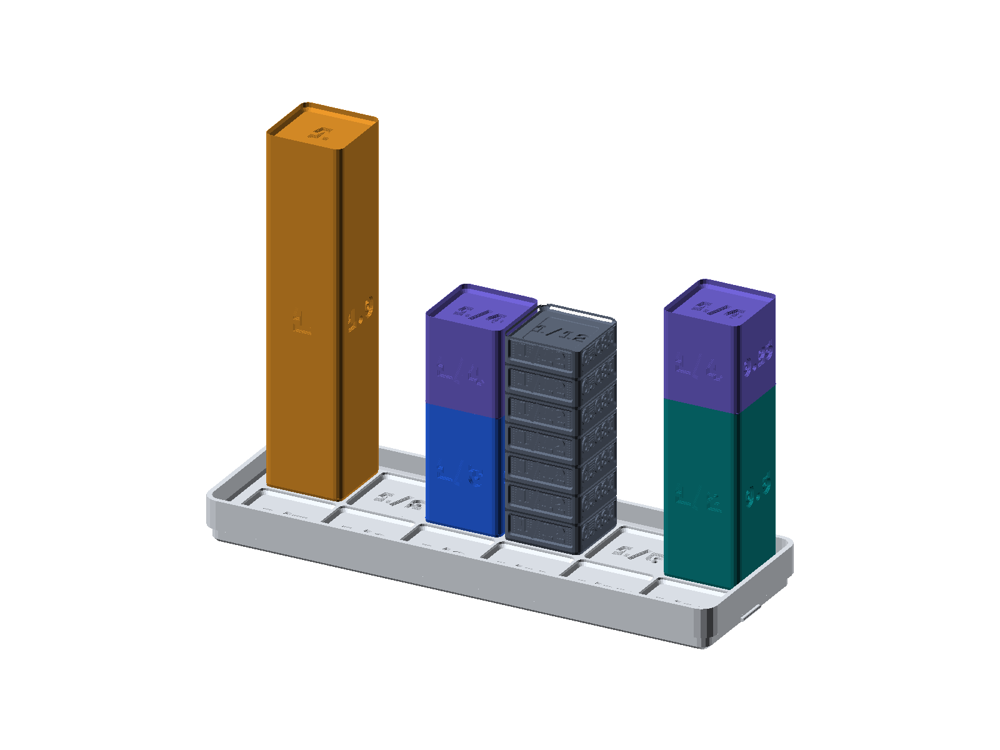{ width="320" }

> **Key Concept:** In the Fraction Studio (FRAC-01), 1 Whole is exactly 84.0 mm tall. Whenever two fraction towers stand at the exact same millimeter height, they are equivalent! Use [.] to enter fractions (e.g., [.] 4 [.] 6), [g] [SIMP] to simplify step-by-step, [f] [d/c] for improper fractions, and [FDISP] to toggle decimal view!

#### Demonstrate Both Textbook Methods with `FRAC-01` Blocks (84mm Fraction Studio)

1. **Block Way 1 (+10 pts):** Swap FRAC-01 1/3 (28mm) for four 1/12 blocks (28mm) and 1/4 (21mm) for three 1/12 blocks -> 7/12.
2. **Block Way 2 (+20 pts):** Stack the 1/3 block (28mm) directly on the 1/4 block (21mm) against the 84mm Whole (49mm / 84mm = 7/12)!
3. **Both Ways Proof:** Trading for common 1/12 blocks (4/12 + 3/12) matches stacking 28mm + 21mm = 49mm against the 84mm Whole!

#### Two-Method Worked Examples (`Method 1: +10 pts` vs. `Method 2: +20 pts DOUBLE`)

| Worksheet | Problem | Method 1 (`+10 pts` — 1st Token) | Method 2 (`+20 pts DOUBLE` — 2nd Token) | SC-6 Keystrokes | Final Answer |
| :--- | :--- | :--- | :--- | :--- | :--- |
| **Practice A** (`p.12`) | **Simplify 12/18 step-by-step and compare tower heights.** | **METHOD 1 (+10 pts): Step-by-Step Prime Factor Reduction:** Divide numerator and denominator of 12/18 by 2 first: 12/18 = 6/9. Then divide by 3: 6/9 = 2/3. *(See `FRAC-01` Block Way 1 above)* | **METHOD 2 (+20 pts DOUBLE): One-Step GCF Division:** Find GCF(12, 18) = 6. Divide top and bottom by 6 in one step: (12 ÷ 6) / (18 ÷ 6) = 2/3. *(See `FRAC-01` Block Way 2 above)* | `[.]` `[12]` `[.]` `[18]` `[ENTER]` `[g]` `[SIMP]` `[g]` `[SIMP]` | **12/18 -> 6/9 -> 2/3** |
| **Practice B** (`p.13`) | **Convert 1 3/4 miles to an improper fraction and decimal, then find the total length of a 1/3-mile loop plus a 1/4-mile spur.** | **METHOD 1 (+10 pts): Least Common Denominator (LCD) & Quarter Trade:** 1 3/4 = 4/4 + 3/4 = 7/4 = 1.75. For 1/3 + 1/4, use LCD(3, 4) = 12: 4/12 + 3/12 = 7/12 mile. *FRAC-01 Way 1: Stack 1/3 (28mm) + 1/4 (21mm) = 49mm, which matches seven 1/12 blocks (7 × 7mm = 49mm = 7/12).* | **METHOD 2 (+20 pts DOUBLE): 84mm Fraction Tower Height Sum:** 1/3 block = 28 mm and 1/4 block = 21 mm. Total height = 28 + 21 = 49 mm. Since 1/12 = 7 mm, 49 ÷ 7 = 7 twelfths (7/12)! *FRAC-01 Way 2: Stack seven 1/4 blocks (7/4) beside one 84mm Whole + three 1/4 blocks (1 3/4 = 1.75)!* | `[1]` `[.]` `[3]` `[.]` `[4]` `[ENTER]` `[f]` `[d/c]` `[FDISP]` | **7/4 = 1.75; and 1/3 + 1/4 = 7/12 mi** |

#### Practice A (p. 12): Key Ideas & Two-Method Practice (10 Exercises)

| # | Problem Prompt | Coach Key: SC-6 Keystrokes | Final Answer |
| :---: | :--- | :--- | :--- |
| **A1** | Write the fraction 8/12 in simplest form by dividing by common factors. | `[.] 8 [.] 12 [ENTER] [g][SIMP]×2` | **4/6 -> 2/3** |
| **A2** | Write 24/36 in simplest form, and write its equivalent repeating decimal. | `[.] 24 [.] 36 [ENTER] [g][SIMP]...` | **2/3 (0.667)** |
| **A3** | Write the mixed number 2 3/5 as an improper fraction and as a decimal. | `2 [.] 3 [.] 5 [ENTER] [f][d/c]` | **13/5 and 2.6** |
| **A4** | Write the improper fraction 19/8 as a mixed number and as a decimal. | `[.] 19 [.] 8 [ENTER] [FDISP]` | **2 3/8 and 2.375** |
| **A5** | Add 1/2 + 1/3 using a common denominator (sixths) and check with 84mm Fraction Blocks. | `[.] 1 [.] 2 [ENTER] [.] 1 [.] 3 [+]` | **5/6 (42mm+28mm=70mm)** |
| **A6** | Add 3/4 + 5/6 using the LCD (12). Write both the mixed number and improper fraction. | `[.] 3 [.] 4 [ENTER] [.] 5 [.] 6 [+]` | **1 7/12 (or 19/12)** |
| **A7** | Subtract 7/8 - 1/4 using a common denominator, and check your answer by adding. | `[.] 7 [.] 8 [ENTER] [.] 1 [.] 4 [-]` | **5/8** |
| **A8** | Subtract mixed numbers: 4 1/3 - 1 5/6. | `4 [.] 1 [.] 3 [ENTER] 1 [.] 5 [.] 6 [-]` | **2 1/2 (or 5/2)** |
| **A9** | Build 1/3 + 1/4 with 84mm towers (28mm + 21mm) AND solve using the LCD (twelfths). | `[.] 1 [.] 3 [ENTER] [.] 1 [.] 4 [+]` | **7/12 (49mm = seven 7mm twelfths)** |
| **A10** | A trail is 3 3/4 miles long. You hiked 1 7/8 miles. How much trail is left? Solve 2 ways! | `3 [.] 3 [.] 4 [ENTER] 1 [.] 7 [.] 8 [-]` | **1 7/8 miles (Way 2: 30/8 - 15/8 = 15/8)** |

#### Practice B (p. 13): Modeling Real Life & Multi-Method Applications (10 Exercises)

| # | Modeling Real Life Application Prompt | Coach Key: SC-6 Keystrokes | Final Answer |
| :---: | :--- | :--- | :--- |
| **B1** | Smoothie Recipe: You blend 3/8 cup of blueberries and 1/4 cup of strawberries. What fraction of a cup of berries did you use in all? | `[.] 3 [.] 8 [ENTER] [.] 1 [.] 4 [+]` | **5/8 cup** |
| **B2** | 3D Print Progress: A print is 18/24 complete. Simplify 18/24 to simplest form, and find what fraction of the print remains. | `[.] 18 [.] 24 [g][SIMP]` | **3/4 complete; 1/4 remains** |
| **B3** | Skateboard Hardware: A bolt is 1 5/8 inches long. Write 1 5/8 as an improper fraction and as a decimal. | `1 [.] 5 [.] 8 [ENTER] [f][d/c] [FDISP]` | **13/8 and 1.625 in** |
| **B4** | Hiking Trail Gap: The Summit Trail is 5/6 mile long and the Creek Trail is 3/8 mile long. Using LCD = 24, how much longer is the Summit Trail? | `[.] 5 [.] 6 [ENTER] [.] 3 [.] 8 [-]` | **11/24 mile** |
| **B5** | Pizza Leftovers: After a party, there are 2 1/3 cheese pizzas and 1 1/2 pepperoni pizzas left. How many pizzas are left in all? | `2 [.] 1 [.] 3 [ENTER] 1 [.] 1 [.] 2 [+]` | **3 5/6 pizzas (23/6)** |
| **B6** | Carpentry Trim: You cut 1 3/4 feet off a 4 1/2-foot board. How many feet of board are left? | `4 [.] 1 [.] 2 [ENTER] 1 [.] 3 [.] 4 [-]` | **2 3/4 feet (11/4)** |
| **B7** | Free-Throw Practice: Maya made 15 out of 25 shots. Write 15/25 in simplest form and as a decimal. | `[.] 15 [.] 25 [g][SIMP] [FDISP]` | **3/5 = 0.6** |
| **B8** | Science Beaker Mix: A beaker holds 2/5 liter of water. You pour in 3/10 liter more, then pour out 1/2 liter. How much water is left? | `[.] 2 [.] 5 [ENTER] [.] 3 [.] 10 [+] [.] 1 [.] 2 [-]` | **1/5 liter (0.2 L)** |
| **B9** | Ribbon Spool: You need 2 2/3 yards of blue ribbon and 1 3/4 yards of gold ribbon. Do you have enough if a spool holds 5 yards? Find the total used and how much is left. | `2 [.] 2 [.] 3 [ENTER] 1 [.] 3 [.] 4 [+]` | **4 5/12 yd used; 7/12 yd left** |
| **B10** | Triathlon Training: You swim 3/8 mile, bike 2 1/2 miles, and run 1 3/4 miles. What is the total distance of your workout? | `[.] 3 [.] 8 [ENTER] 2 [.] 1 [.] 2 [+] 1 [.] 3 [.] 4 [+]` | **4 5/8 miles** |

---

### Section 2.2: Multiplying Fractions and Mixed Numbers (Workbook pp. 14–15)

**Textbook Alignment:** Big Ideas Grade 6, Section 2.1 (Multiplying Fractions) (`CCSS.MATH.6.NS.A.1`) • **Big Ideas Methods:** *Method 1: Multiply Straight Across & Simplify  |  Method 2: Cross-Cancel Common Factors First* • **Block Kit:** `FRAC-01` (84mm Fraction Studio)

**Key Vocabulary:** product of fractions • area model • cross-canceling (dividing out common factors) • improper fraction

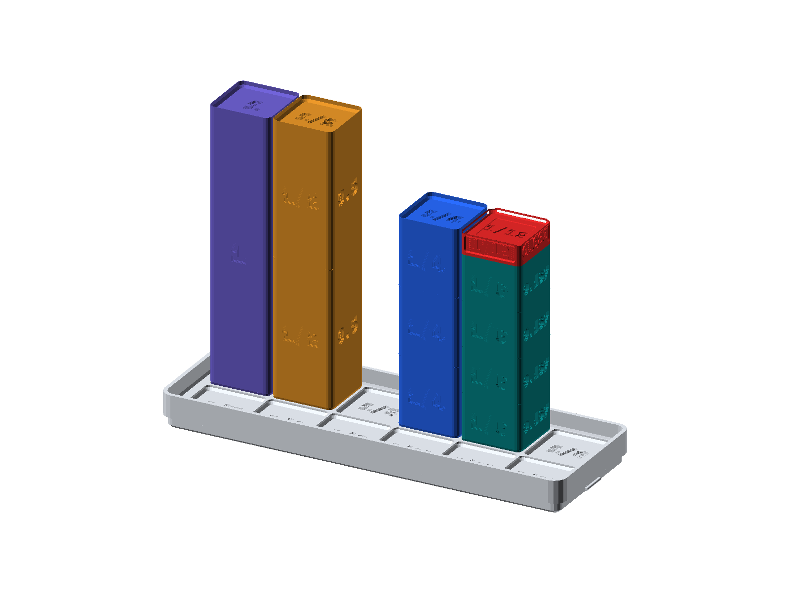{ width="320" }

> **Key Concept:** Why does multiplying two proper fractions make a SMALLER answer? Because '×' means 'OF'! Taking 1/2 OF a 3/4 tower (63 mm) gives half its height (31.5 mm = 3/8). For mixed numbers, rewrite as improper fractions first (or use [f] [d/c]) and simplify common factors before multiplying!

#### Demonstrate Both Textbook Methods with `FRAC-01` Blocks (84mm Fraction Studio)

1. **Block Way 1 (+10 pts):** Take three 1/4 FRAC-01 blocks (3/4 = 63mm) and split that height in half (31.5mm = three 1/8 blocks = 3/8).
2. **Block Way 2 (+20 pts):** Build a 2 × 4 COUNT-01 grid (8 tiles); shade 1 of 2 rows and 3 of 4 columns -> overlap is 3 of 8 tiles (3/8)!
3. **Both Ways Proof:** Halving a 3/4 FRAC-01 tower (31.5mm) and overlapping a 1×3 corner inside a 2×4 array both yield 3/8!

#### Two-Method Worked Examples (`Method 1: +10 pts` vs. `Method 2: +20 pts DOUBLE`)

| Worksheet | Problem | Method 1 (`+10 pts` — 1st Token) | Method 2 (`+20 pts DOUBLE` — 2nd Token) | SC-6 Keystrokes | Final Answer |
| :--- | :--- | :--- | :--- | :--- | :--- |
| **Practice A** (`p.14`) | **Find 1/2 × 3/4 using 84mm Fraction Towers and the SC-6.** | **METHOD 1 (+10 pts): Area / Fraction Tower Partition:** Take half of each of the three 1/4 blocks: half of 1/4 is 1/8, so half of three 1/4 blocks is three 1/8 blocks (3/8). *(See `FRAC-01` Block Way 1 above)* | **METHOD 2 (+20 pts DOUBLE): Multiply Numerators & Denominators:** Multiply numerators (1 × 3 = 3) and multiply denominators (2 × 4 = 8) -> (1 × 3)/(2 × 4) = 3/8. *(See `FRAC-01` Block Way 2 above)* | `[.]` `[1]` `[.]` `[2]` `[ENTER]` `[.]` `[3]` `[.]` `[4]` `[×]` | **3/8** |
| **Practice B** (`p.15`) | **A batch of granola uses 1 1/2 cups of oats. You make 2 2/3 batches. How many cups of oats do you need?** | **METHOD 1 (+10 pts): Convert to Improper Fractions & Multiply Across:** 1 1/2 = 3/2 and 2 2/3 = 8/3. Multiply straight across: (3 × 8) / (2 × 3) = 24 / 6 = 4 cups. *FRAC-01 Way 1: Build two sets of (2 Whole + two 1/3 towers) + two-thirds of a set -> four 84mm Wholes (4 cups).* | **METHOD 2 (+20 pts DOUBLE): Cross-Cancel Common Factors Before Multiplying:** In (3/2) × (8/3), divide out the common factor 3 (3÷3 = 1) and divide 8 by 2 (8÷2 = 4): (1/1) × (4/1) = 4 cups! *FRAC-01 Way 2: Convert 2 2/3 to eight 1/3 blocks (8/3) and 1 1/2 to three 1/2 blocks (3/2); cross-cancel to 4 Wholes!* | `[1]` `[.]` `[1]` `[.]` `[2]` `[ENTER]` `[2]` `[.]` `[2]` `[.]` `[3]` `[×]` | **4 cups** |

#### Practice A (p. 14): Key Ideas & Two-Method Practice (10 Exercises)

| # | Problem Prompt | Coach Key: SC-6 Keystrokes | Final Answer |
| :---: | :--- | :--- | :--- |
| **A1** | Find 1/2 × 2/3. (Hold two 1/3 blocks and take half of them!) | `[.] 1 [.] 2 [ENTER] [.] 2 [.] 3 [×]` | **1/3** |
| **A2** | Multiply 2/3 × 3/4. Divide out common factors before multiplying, and write the product in simplest form. | `[.] 2 [.] 3 [ENTER] [.] 3 [.] 4 [×]` | **1/2** |
| **A3** | Multiply 3/5 × 5/9. | `[.] 3 [.] 5 [ENTER] [.] 5 [.] 9 [×]` | **1/3** |
| **A4** | Multiply a whole number by a fraction: 12 × 3/4. | `12 [ENTER] [.] 3 [.] 4 [×]` | **9** |
| **A5** | Multiply mixed numbers: 1 3/4 × 2 2/7. | `1 [.] 3 [.] 4 [ENTER] 2 [.] 2 [.] 7 [×]` | **4** |
| **A6** | Multiply 2 1/4 × 1 1/3. | `2 [.] 1 [.] 4 [ENTER] 1 [.] 1 [.] 3 [×]` | **3** |
| **A7** | Multiply 3 1/2 × 2 1/2. Write the answer as a mixed number and decimal. | `3 [.] 1 [.] 2 [ENTER] 2 [.] 1 [.] 2 [×]` | **8 3/4 (8.75)** |
| **A8** | Prediction Check: Without calculating, is 5 × 2/3 greater than 5 or less than 5? Now compute it! | `5 [ENTER] [.] 2 [.] 3 [×]` | **3 1/3 (Less than 5!)** |
| **A9** | A slime recipe uses 1 3/4 cups of glue per batch. How much glue is needed for 2 1/2 batches? | `1 [.] 3 [.] 4 [ENTER] 2 [.] 1 [.] 2 [×]` | **4 3/8 cups (Way 2: 1.75 × 2.5 = 4.375)** |
| **A10** | Evaluate the three-fraction product 4/5 × 5/6 × 3/4 by dividing out common factors. | `[.] 4 [.] 5 [ENTER] [.] 5 [.] 6 [×] [.] 3 [.] 4 [×]` | **1/2 (Way 2: cancel 4s & 5s -> 3/6 = 1/2)** |

#### Practice B (p. 15): Modeling Real Life & Multi-Method Applications (10 Exercises)

| # | Modeling Real Life Application Prompt | Coach Key: SC-6 Keystrokes | Final Answer |
| :---: | :--- | :--- | :--- |
| **B1** | Garden Herb Plot: 2/3 of a garden is planted with vegetables, and 3/5 of the vegetables are tomatoes. What fraction of the whole garden is tomatoes? | `[.] 2 [.] 3 [ENTER] [.] 3 [.] 5 [×]` | **2/5 of the garden** |
| **B2** | Phone Battery Drain: Your phone battery is at 4/5 charge. A video game uses 1/2 of that charge. What fraction of a full battery did the game use? | `[.] 4 [.] 5 [ENTER] [.] 1 [.] 2 [×]` | **2/5 of a full battery** |
| **B3** | Pancake Recipe Doubler: A pancake recipe calls for 1 3/4 cups of flour. You make 2 1/2 times the recipe for a team breakfast. How much flour do you need? | `1 [.] 3 [.] 4 [ENTER] 2 [.] 1 [.] 2 [×]` | **4 3/8 cups (35/8)** |
| **B4** | Miniature Sticker Area: A rectangular laptop sticker measures 2 1/4 inches wide by 1 1/3 inches tall. Find its area in square inches. | `2 [.] 1 [.] 4 [ENTER] 1 [.] 1 [.] 3 [×]` | **3 in²** |
| **B5** | Trail Hike Distance: You hike at 3 1/5 miles per hour for 1 1/4 hours. How many miles do you hike? | `3 [.] 1 [.] 5 [ENTER] 1 [.] 1 [.] 4 [×]` | **4 miles** |
| **B6** | Art Canvas Frame: A painting is 3/4 yard wide and 8/9 yard tall. Cross-cancel common factors to find its area in square yards. | `[.] 3 [.] 4 [ENTER] [.] 8 [.] 9 [×]` | **2/3 yd²** |
| **B7** | Rain Barrel Water: A 24-gallon rain barrel is 5/8 full. You use 2/3 of the water in the barrel for the garden. How many gallons did you use? | `24 [ENTER] [.] 5 [.] 8 [×] [.] 2 [.] 3 [×]` | **10 gallons** |
| **B8** | Cubic Fractional Block: Find the volume of a cube whose edges are each 1/2 inch long: (1/2)³ = 1/2 × 1/2 × 1/2. | `[.] 1 [.] 2 [g][x³]` | **1/8 in³** |
| **B9** | Skate Ramp Plywood: A plywood sheet is 3 1/2 feet by 2 2/7 feet. Convert to improper fractions and cross-cancel to find the area. | `3 [.] 1 [.] 2 [ENTER] 2 [.] 2 [.] 7 [×]` | **8 ft²** |
| **B10** | Sleep Schedule: You sleep 1/3 of each 24-hour day, and 1/4 of your sleep is REM dream sleep. What fraction of the day (and how many hours) is REM sleep? | `[.] 1 [.] 3 [ENTER] [.] 1 [.] 4 [×]` | **1/12 of the day (2 hours)** |

---

### Section 2.3: Dividing Fractions and Mixed Numbers (Workbook pp. 16–17)

**Textbook Alignment:** Big Ideas Grade 6, Sections 2.2 & 2.3 (Dividing Fractions and Mixed Numbers) (`CCSS.MATH.6.NS.A.1`) • **Big Ideas Methods:** *Method 1: Common-Denominator Measurement ('How Many Fit?')  |  Method 2: Multiply by the Reciprocal* • **Block Kit:** `FRAC-01` (84mm Fraction Studio)

**Key Vocabulary:** reciprocals • multiplicative inverses • common-denominator division • measurement division

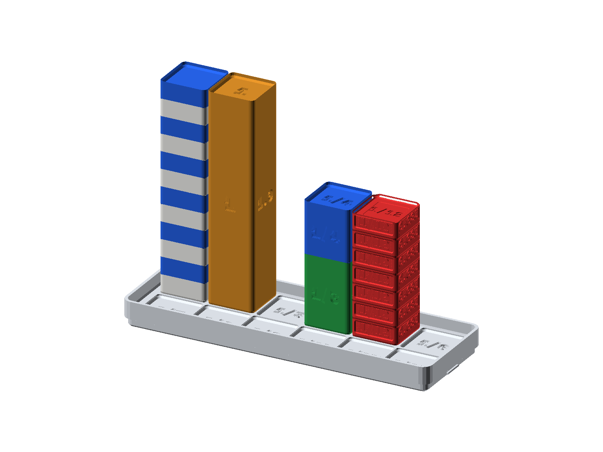{ width="320" }

> **Key Concept:** Kids memorize 'Keep-Change-Flip' and then forget which fraction to flip! Physically, 3/4 ÷ 1/8 asks how many 1/8 blocks fit alongside a 3/4 tower (6 fit!). In Big Ideas Math, dividing by a fraction equals multiplying by its reciprocal—and [f] [1/x] flips ONLY the divisor into its reciprocal before you press [×]!

#### Demonstrate Both Textbook Methods with `FRAC-01` Blocks (84mm Fraction Studio)

1. **Block Way 1 (+10 pts):** Stand the 3/4 FRAC-01 tower (63mm) beside 1/8 blocks (10.5mm each) -> exactly 6 eighth-blocks match 63mm!
2. **Block Way 2 (+20 pts):** Count that 8 eighth-blocks fit in 1 Whole (reciprocal = 8/1), then take 3/4 of those 8 blocks (3/4 × 8 = 6)!
3. **Both Ways Proof:** Measuring how many 1/8 blocks fit in 3/4 (Method 1) is the same as multiplying 3/4 by 8 per Whole (Method 2)!

#### Two-Method Worked Examples (`Method 1: +10 pts` vs. `Method 2: +20 pts DOUBLE`)

| Worksheet | Problem | Method 1 (`+10 pts` — 1st Token) | Method 2 (`+20 pts DOUBLE` — 2nd Token) | SC-6 Keystrokes | Final Answer |
| :--- | :--- | :--- | :--- | :--- | :--- |
| **Practice A** (`p.16`) | **Divide 3/4 ÷ 1/8 by comparing tower heights and by multiplying by the reciprocal with [f] [1/x].** | **METHOD 1 (+10 pts): Common Denominator Method:** Rewrite 3/4 with denominator 8: 6/8 ÷ 1/8. Divide the numerators: 6 eighths ÷ 1 eighth = 6 ÷ 1 = 6. *(See `FRAC-01` Block Way 1 above)* | **METHOD 2 (+20 pts DOUBLE): Multiply by the Reciprocal:** The reciprocal of 1/8 is 8/1 (since 1/8 × 8/1 = 1). Multiply: 3/4 × 8/1 = 24/4 = 6. *(See `FRAC-01` Block Way 2 above)* | `[.]` `[3]` `[.]` `[4]` `[ENTER]` `[.]` `[1]` `[.]` `[8]` `[f]` `[1/x]` `[×]` | **6** |
| **Practice B** (`p.17`) | **A carpenter cuts a 6 3/4-foot cedar board into shelves that are each 1 1/8 feet long. How many shelves can be cut?** | **METHOD 1 (+10 pts): Improper Fractions & Reciprocal Flip:** 6 3/4 = 27/4 and 1 1/8 = 9/8. Multiply by reciprocal of 9/8: (27/4) × (8/9) = (3/1) × (2/1) = 6 shelves. *FRAC-01 Way 1: Build 4 1/2 Wholes (9 half-blocks = 18 quarter-blocks) and group into threes (3/4) -> 6 groups.* | **METHOD 2 (+20 pts DOUBLE): Common Denominator Eighths:** Rewrite both in eighths: 6 3/4 = 54/8 and 1 1/8 = 9/8. Divide numerators: 54 eighths ÷ 9 eighths = 54 ÷ 9 = 6 shelves! *FRAC-01 Way 2: Since four 1/4-blocks fit in 1 Whole, multiply 9/2 × 4/3 = 36/6 = 6 shelves!* | `[6]` `[.]` `[3]` `[.]` `[4]` `[ENTER]` `[1]` `[.]` `[1]` `[.]` `[8]` `[÷]` | **6 shelves** |

#### Practice A (p. 16): Key Ideas & Two-Method Practice (10 Exercises)

| # | Problem Prompt | Coach Key: SC-6 Keystrokes | Final Answer |
| :---: | :--- | :--- | :--- |
| **A1** | How many 1/4 blocks fit in a 1/2 tower? Compute 1/2 ÷ 1/4. | `[.] 1 [.] 2 [ENTER] [.] 1 [.] 4 [÷]` | **2** |
| **A2** | How many 1/6 blocks (14mm) fit in a 2/3 tower (56mm)? Compute 2/3 ÷ 1/6. | `[.] 2 [.] 3 [ENTER] [.] 1 [.] 6 [÷]` | **4** |
| **A3** | Divide 5/6 ÷ 5/12 by multiplying by the reciprocal. Write the quotient in simplest form. | `[.] 5 [.] 6 [ENTER] [.] 5 [.] 12 [f][1/x] [×]` | **2** |
| **A4** | Divide a whole number by a fraction: 6 ÷ 3/4. | `6 [ENTER] [.] 3 [.] 4 [÷]` | **8** |
| **A5** | Divide 3/4 ÷ 2/5. Write the answer as a mixed number. | `[.] 3 [.] 4 [ENTER] [.] 2 [.] 5 [÷]` | **1 7/8 (15/8)** |
| **A6** | Divide a fraction by a whole number: 4/5 ÷ 2. | `[.] 4 [.] 5 [ENTER] 2 [÷]` | **2/5** |
| **A7** | Divide mixed numbers: 4 1/2 ÷ 3/4. | `4 [.] 1 [.] 2 [ENTER] [.] 3 [.] 4 [÷]` | **6** |
| **A8** | Divide the mixed numbers 5 1/4 ÷ 1 3/4. Check your quotient by multiplying. | `5 [.] 1 [.] 4 [ENTER] 1 [.] 3 [.] 4 [÷]` | **3** |
| **A9** | A board is 6 3/4 ft long. You cut it into 3/4-ft shelves. How many shelves can you cut? Solve 2 ways! | `6 [.] 3 [.] 4 [ENTER] [.] 3 [.] 4 [÷]` | **9 shelves (Way 2: 27 fourths ÷ 3 fourths = 9)** |
| **A10** | A 3 3/4-cup pitcher of smoothie is poured into 5/8-cup glasses. How many glasses does it fill? | `3 [.] 3 [.] 4 [ENTER] [.] 5 [.] 8 [÷]` | **6 glasses (Way 2: 30/8 ÷ 5/8 = 6)** |

#### Practice B (p. 17): Modeling Real Life & Multi-Method Applications (10 Exercises)

| # | Modeling Real Life Application Prompt | Coach Key: SC-6 Keystrokes | Final Answer |
| :---: | :--- | :--- | :--- |
| **B1** | Pizza Slice Sharing: How many 1/8-size slices are in 3/4 of a pizza? Solve by multiplying 3/4 by the reciprocal of 1/8. | `[.] 3 [.] 4 [ENTER] [.] 1 [.] 8 [÷]` | **6 slices** |
| **B2** | Trail Mix Scoops: A bin holds 4 1/2 pounds of almonds. Each snack bag holds 3/8 pound. How many snack bags can you fill? | `4 [.] 1 [.] 2 [ENTER] [.] 3 [.] 8 [÷]` | **12 snack bags** |
| **B3** | Relay Race Legs: A 3 3/4-mile charity relay is split into equal legs of 5/8 mile each. How many runners are on each relay team? | `3 [.] 3 [.] 4 [ENTER] [.] 5 [.] 8 [÷]` | **6 runners** |
| **B4** | LED Strip Cutting: You have a 5 1/4-meter LED light strip and cut it into 3/4-meter segments for desk shelves. How many segments do you get? | `5 [.] 1 [.] 4 [ENTER] [.] 3 [.] 4 [÷]` | **7 segments** |
| **B5** | 3D Print Nozzle Layers: A 6-millimeter bracket is printed in layers that are 3/20 millimeter thick. How many layers tall is the bracket? | `6 [ENTER] [.] 3 [.] 20 [÷]` | **40 layers** |
| **B6** | Garden Stepping Stones: A 7 1/2-foot garden path has stepping stones spaced every 1 1/4 feet. How many spaces are along the path? | `7 [.] 1 [.] 2 [ENTER] 1 [.] 1 [.] 4 [÷]` | **6 spaces** |
| **B7** | Missing Width of a Rectangle: A rectangular solar panel has an area of 4 1/2 square meters and a length of 2 1/4 meters. Divide Area ÷ Length to find its width. | `4 [.] 1 [.] 2 [ENTER] 2 [.] 1 [.] 4 [÷]` | **2 meters** |
| **B8** | Juice Pitcher Servings: A pitcher holds 2 2/3 quarts of lemonade. Each cup holds 1/3 quart. How many cups can be poured? | `2 [.] 2 [.] 3 [ENTER] [.] 1 [.] 3 [÷]` | **8 cups** |
| **B9** | Reciprocal Proof: Find the reciprocal of 2 2/5 (12/5), and verify that multiplying the number by its reciprocal equals 1. | `2 [.] 2 [.] 5 [f][1/x]` | **5/12 (12/5 × 5/12 = 1)** |
| **B10** | Lumber Yard Cuts: You have a 10 1/2-foot board. You cut off 1 1/2 feet first, then divide the remaining board into 3/4-foot pieces. How many 3/4-foot pieces do you get? | `10 [.] 1 [.] 2 [ENTER] 1 [.] 1 [.] 2 [-] [.] 3 [.] 4 [÷]` | **12 pieces** |

---

### Section 2.4: Adding, Subtracting, and Multiplying Decimals (Workbook pp. 18–19)

**Textbook Alignment:** Big Ideas Grade 6, Sections 2.4 & 2.5 (Adding, Subtracting, and Multiplying Decimals) (`CCSS.MATH.6.NS.B.3`) • **Big Ideas Methods:** *Method 1: Vertical Decimal Alignment / Place Value  |  Method 2: Inverse Check & Fraction Form* • **Block Kit:** `PLACE-01` (Place Value Studio)

**Key Vocabulary:** tenths • hundredths • thousandths • place-value alignment • leading/trailing zeros • estimation

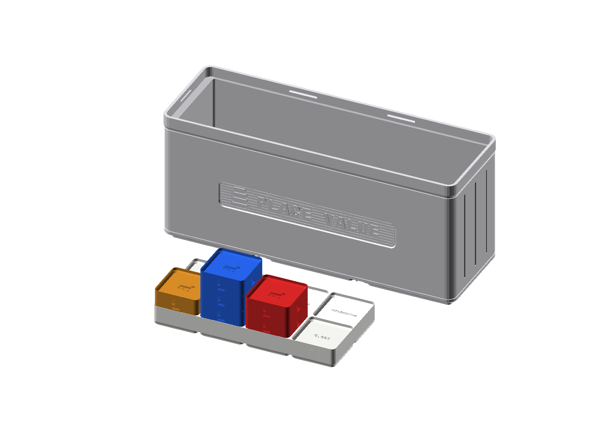{ width="320" }

> **Key Concept:** Paper decimal errors happen when place-value columns drift or decimal places are miscounted in multiplication. Use the Place Value Studio (PLACE-01) and the [f] [IP] (Integer Part) and [g] [FP] (Fractional Part) keys to align Tenths and Hundredths and estimate whole-number products first!

#### Demonstrate Both Textbook Methods with `PLACE-01` Blocks (Place Value Studio)

1. **Block Way 1 (+10 pts):** Align PLACE-01 Tens, Ones, Tenths (0.1), and Hundredths (0.01) in vertical tray slots; regroup 10 tenths -> 1 One.
2. **Block Way 2 (+20 pts):** Split Whole Part ([f][IP]: 14 + 3 = 17) and Decimal Part ([g][FP]: 0.60 + 0.85 = 1.45) -> 17 + 1.45 = 18.45!
3. **Both Ways Proof:** Column regrouping in PLACE-01 and splitting Whole + Fractional parts both produce 18.45!

#### Two-Method Worked Examples (`Method 1: +10 pts` vs. `Method 2: +20 pts DOUBLE`)

| Worksheet | Problem | Method 1 (`+10 pts` — 1st Token) | Method 2 (`+20 pts DOUBLE` — 2nd Token) | SC-6 Keystrokes | Final Answer |
| :--- | :--- | :--- | :--- | :--- | :--- |
| **Practice A** (`p.18`) | **Split 14.85 into its whole and decimal parts, then compute 14.60 + 3.85.** | **METHOD 1 (+10 pts): Line Up Decimal Points Vertically:** Annex a trailing zero to write 14.6 as 14.60. Add hundredths (0+5=5), tenths (6+8=14, carry 1), ones (4+3+1=8) -> 18.45. *(See `PLACE-01` Block Way 1 above)* | **METHOD 2 (+20 pts DOUBLE): Place-Value Split & Inverse Check:** Add wholes (14 + 3 = 17) and decimals (0.60 + 0.85 = 1.45) -> 18.45. Check by subtracting: 18.45 - 3.85 = 14.60. *(See `PLACE-01` Block Way 2 above)* | `[14.6]` `[ENTER]` `[3.85]` `[+]` `[f]` `[LASTX]` `[-]` | **18.45 (Checked: 18.45 - 3.85 = 14.6)** |
| **Practice B** (`p.19`) | **You buy 3.6 pounds of trail mix at $2.25 per pound. Find the total cost in two different ways.** | **METHOD 1 (+10 pts): Count Decimal Places in the Product:** Multiply as whole numbers: 225 × 36 = 8,100. Count decimal places (1 place in 3.6 + 2 places in 2.25 = 3 places) -> 8.100 = $8.10. *PLACE-01 Way 1: Build 4 groups of $1.80 ($7.20) plus half of $1.80 ($0.90) -> $7.20 + $0.90 = $8.10.* | **METHOD 2 (+20 pts DOUBLE): Fraction / Mixed-Number Multiplication:** Write 3.6 = 3 3/5 = 18/5 and 2.25 = 2 1/4 = 9/4. Multiply: (18/5) × (9/4) = 162/20 = 81/10 = 8.1 = $8.10! *FRAC-01 Way 2: Multiply 4 1/2 (9/2) × 1 4/5 (9/5) = 81/10 = 8 1/10 = $8.10!* | `[3.6]` `[ENTER]` `[2.25]` `[×]` `[FDISP]` | **$8.10 (8 1/10)** |

#### Practice A (p. 18): Key Ideas & Two-Method Practice (10 Exercises)

| # | Problem Prompt | Coach Key: SC-6 Keystrokes | Final Answer |
| :---: | :--- | :--- | :--- |
| **A1** | Decompose 27.64 into its whole-number part and its decimal part (in hundredths). | `27.64 [f][IP] / [g][FP]` | **Whole = 27, Decimal = 0.64** |
| **A2** | Line up the decimal points vertically to add 12.8 + 4.75. Check by subtracting. | `12.8 [ENTER] 4.75 [+]` | **17.55** |
| **A3** | Annex zeros to subtract 20.00 - 8.65. | `20 [ENTER] 8.65 [-]` | **11.35** |
| **A4** | Multiply 4.5 × 0.6. | `4.5 [ENTER] 0.6 [×]` | **2.7** |
| **A5** | Evaluate 25.4 - 9.86 + 3.2. | `25.4 [ENTER] 9.86 [-] 3.2 [+]` | **18.74** |
| **A6** | Multiply 3.6 × 2.25 and check the whole-number ballpark. | `3.6 [ENTER] 2.25 [×]` | **8.1** |
| **A7** | Multiply 0.15 × 0.4. Write the answer both as a decimal and as a fraction in simplest form. | `0.15 [ENTER] 0.4 [×] [FDISP]` | **0.06 (3/50)** |
| **A8** | Find the area of a rectangular desk top measuring 1.8 m by 0.75 m. | `1.8 [ENTER] 0.75 [×]` | **1.35 m²** |
| **A9** | You pay with a $20 bill for a $8.75 burger and $4.60 smoothie. How much change do you get? | `20 [ENTER] 8.75 [ENTER] 4.60 [+] [-]` | **$6.65 (Way 2: 20 - 8.75 - 4.60 = 6.65)** |
| **A10** | Multiply 4.75 × 1.2 both as decimals and as mixed numbers (4 3/4 × 1 1/5). | `4.75 [ENTER] 1.2 [×]` | **5.7 or 5 7/10 (Way 2: 19/4 × 6/5 = 57/10)** |

#### Practice B (p. 19): Modeling Real Life & Multi-Method Applications (10 Exercises)

| # | Modeling Real Life Application Prompt | Coach Key: SC-6 Keystrokes | Final Answer |
| :---: | :--- | :--- | :--- |
| **B1** | 3D Filament Order: You buy a spool of Matte Navy PLA for $18.75 and a spool of Silk Gold PLA for $22.49. What is the total cost? | `18.75 [ENTER] 22.49 [+]` | **$41.24** |
| **B2** | Change at the Book Fair: You buy a graphic novel for $13.65 and pay with a $20 bill. How much change should you receive? | `20 [ENTER] 13.65 [-]` | **$6.35** |
| **B3** | Sprint Stopwatch: In the 100-meter dash, Maya ran 13.42 seconds and Leo ran 12.87 seconds. How much faster was Leo's time? | `13.42 [ENTER] 12.87 [-]` | **0.55 seconds faster** |
| **B4** | Bulk Honeycrisp Apples: Apples cost $2.40 per pound. You pick a bag weighing 3.25 pounds. What is the total price? | `2.40 [ENTER] 3.25 [×]` | **$7.80** |
| **B5** | Microchip Dimensions: A silicon processor die measures 1.4 cm by 0.85 cm. Find its area in square centimeters. | `1.4 [ENTER] 0.85 [×]` | **1.19 cm²** |
| **B6** | Road Trip Fuel: Your family car buys 11.5 gallons of gas at $3.60 per gallon. How much does the fill-up cost? | `11.5 [ENTER] 3.60 [×]` | **$41.40** |
| **B7** | Drone Flight Altitude: A drone rises 24.8 meters, drops 6.35 meters, and rises 11.9 meters. What is its final altitude? | `24.8 [ENTER] 6.35 [-] 11.9 [+]` | **30.35 meters** |
| **B8** | Skate Shop Receipt: You buy 2 sets of bearings at $14.50 each and grip tape for $6.75. How much do you spend in all? | `2 [ENTER] 14.50 [×] 6.75 [+]` | **$35.75** |
| **B9** | Gridfinity Baseplate Tolerance: Four 42.0 mm Gridfinity squares sit side-by-side in a drawer that is 170.5 mm wide. How much clearance gap remains? | `170.5 [ENTER] 4 [ENTER] 42 [×] [-]` | **2.5 mm gap** |
| **B10** | Snack Bar Profit: You buy 25 smoothies for $1.80 each and sell all 25 for $3.20 each. Find your total profit in two ways! | `3.20 [ENTER] 1.80 [-] 25 [×]` | **$35.00 profit** |

---

### Section 2.5: Dividing Whole Numbers and Decimals (Workbook pp. 20–21)

**Textbook Alignment:** Big Ideas Grade 6, Section 2.6 (Dividing Decimals) (`CCSS.MATH.6.NS.B.3`) • **Big Ideas Methods:** *Method 1: Power-of-10 Decimal Shift  |  Method 2: Fraction / Mixed-Number Conversion* • **Block Kit:** `FRAC-01` (Fraction & Place Value Studio)

**Key Vocabulary:** terminating decimal • power-of-10 shift • equivalent division expression • mixed number

{ width="320" }

> **Key Concept:** Why are 15 ÷ 4 = 3 R 3, 3 3/4, and 3.75 all the same answer? Because 3 leftover pieces divided by 4 is 3/4 = 0.75! On the SC-6, tapping [FDISP] after any division cycles through Decimal, Mixed Fraction, Improper Fraction, and Quotient+Remainder with one thumb!

#### Demonstrate Both Textbook Methods with `FRAC-01` Blocks (Fraction & Place Value Studio)

1. **Block Way 1 (+10 pts):** Share 23 PLACE-01 Ones into 4 groups (5 each), then trade 3 leftover Ones for 30 Tenths and 20 Hundredths -> 5.75.
2. **Block Way 2 (+20 pts):** Use FRAC-01 to model 23 ÷ 4 as 5 Whole towers + three 1/4 blocks (3/4 = 0.75) -> 5 3/4 = 5.75!
3. **Both Ways Proof:** Regrouping Ones into Tenths/Hundredths (PLACE-01) and converting R=3 into 3/4 = 0.75 (FRAC-01) both give 5.75!

#### Two-Method Worked Examples (`Method 1: +10 pts` vs. `Method 2: +20 pts DOUBLE`)

| Worksheet | Problem | Method 1 (`+10 pts` — 1st Token) | Method 2 (`+20 pts DOUBLE` — 2nd Token) | SC-6 Keystrokes | Final Answer |
| :--- | :--- | :--- | :--- | :--- | :--- |
| **Practice A** (`p.20`) | **Write 23 ÷ 4 as a decimal, mixed number, improper fraction, and quotient with remainder.** | **METHOD 1 (+10 pts): Annex Zeros & Divide:** Write 23 as 23.00 and divide by 4: 23 ÷ 4 = 5 with 3 left; 30 tenths ÷ 4 = 7 tenths; 20 hundredths ÷ 4 = 5 hundredths -> 5.75. *(See `FRAC-01` Block Way 1 above)* | **METHOD 2 (+20 pts DOUBLE): Mixed Number to Decimal:** 23 ÷ 4 = 23/4 = 5 3/4. Since 3/4 = 75/100 = 0.75, 5 3/4 = 5.75 (and 5 R 3). *(See `FRAC-01` Block Way 2 above)* | `[23]` `[ENTER]` `[4]` `[÷]` `[FDISP]` `[f]` `[d/c]` | **5.75 = 5 3/4 = 23/4 = 5 R 3** |
| **Practice B** (`p.21`) | **An arcade token machine takes quarters ($0.25). How many quarters are in $6.75, and why is the quotient larger than 6.75?** | **METHOD 1 (+10 pts): Multiply Dividend & Divisor by 100:** Shift both decimal points 2 places right (× 100) so the divisor is a whole number: 6.75 ÷ 0.25 = 675 ÷ 25 = 27 quarters. *PLACE-01 Way 1: Convert $6.75 into 675 Hundredths (cents) and group into stacks of 25 Hundredths -> 27 stacks.* | **METHOD 2 (+20 pts DOUBLE): Divide Using Fourths (Reciprocal of 1/4):** Since $0.25 = 1/4 dollar, every $1 holds 4 quarters: 6.75 ÷ (1/4) = 6.75 × 4 = (6 × 4) + (0.75 × 4) = 24 + 3 = 27 quarters! *FRAC-01 Way 2: Since 4 quarters ($0.25) fit in every $1.00 Whole, multiply 6 × 4 = 24 quarters + 3 quarters = 27!* | `[6.75]` `[ENTER]` `[0.25]` `[÷]` `[f]` `[LASTX]` `[×]` | **27 quarters** |

#### Practice A (p. 20): Key Ideas & Two-Method Practice (10 Exercises)

| # | Problem Prompt | Coach Key: SC-6 Keystrokes | Final Answer |
| :---: | :--- | :--- | :--- |
| **A1** | Write 39 ÷ 8 as (a) Quotient + Remainder, (b) Decimal, and (c) Mixed Number. | `39 [ENTER] 8 [÷] [FDISP]` | **4 R 7, 4.875, 4 7/8** |
| **A2** | Divide a decimal by a whole number: 18.4 ÷ 8. | `18.4 [ENTER] 8 [÷]` | **2.3** |
| **A3** | How many quarters ($0.25) are in $11.25? Compute 11.25 ÷ 0.25. | `11.25 [ENTER] 0.25 [÷]` | **45** |
| **A4** | Divide 7.2 ÷ 0.9 by shifting the decimal point in the divisor and dividend. Check by multiplying. | `7.2 [ENTER] 0.9 [÷]` | **8** |
| **A5** | Divide 15.6 ÷ 0.12. | `15.6 [ENTER] 0.12 [÷]` | **130** |
| **A6** | Divide 9.45 ÷ 1.5. Write the quotient both as a decimal and as a mixed number in simplest form. | `9.45 [ENTER] 1.5 [÷] [FDISP]` | **6.3 (6 3/10)** |
| **A7** | Divide 0.84 ÷ 0.07. | `0.84 [ENTER] 0.07 [÷]` | **12** |
| **A8** | Error Analysis: Leo says 4.8 ÷ 0.2 = 0.24. Use estimation or multiplication to explain and correct his error. | `4.8 [ENTER] 0.2 [÷]` | **24 (0.2 fits 5 times per 1)** |
| **A9** | A runner completes a 4.5-mile race in 0.75-mile laps. How many laps is the race? Solve 2 ways! | `4.5 [ENTER] 0.75 [÷]` | **6 laps (Way 2: 4 1/2 ÷ 3/4 = 6)** |
| **A10** | A 6-pack of sports drinks costs $7.50. What is the cost of 1 bottle, and how many bottles can $20 buy? | `7.50 [ENTER] 6 [÷] -> 1.25; 20 [ENTER] 1.25 [÷]` | **$1.25/bottle; 16 bottles** |

#### Practice B (p. 21): Modeling Real Life & Multi-Method Applications (10 Exercises)

| # | Modeling Real Life Application Prompt | Coach Key: SC-6 Keystrokes | Final Answer |
| :---: | :--- | :--- | :--- |
| **B1** | 4-Way Translator: Divide 35 ÷ 8. Write the result as (a) quotient with remainder, (b) mixed number, (c) improper fraction, and (d) exact decimal. | `35 [ENTER] 8 [÷] [FDISP]` | **4 R 3 = 4 3/8 = 35/8 = 4.375** |
| **B2** | Quarter Stack Height: A stack of quarters is 28.0 mm tall. Each quarter is 1.75 mm thick. How many quarters are in the stack? | `28 [ENTER] 1.75 [÷]` | **16 quarters** |
| **B3** | Splitting the Pizza Bill: Four friends split a $34.60 pizza order equally. How much does each friend pay? | `34.60 [ENTER] 4 [÷]` | **$8.65 each** |
| **B4** | 3D Print Layer Slicer: A 14.4 mm model is sliced into 0.20 mm layers. Shift both decimals 2 places right (1,440 ÷ 20) to find the number of layers. | `14.4 [ENTER] 0.20 [÷]` | **72 layers** |
| **B5** | Bulk Granola Scoops: How many 0.35-kilogram bags can be filled from a 5.25-kilogram bin of granola? | `5.25 [ENTER] 0.35 [÷]` | **15 bags** |
| **B6** | Track Lap Pace: A runner completes 4.5 miles in 0.75 hours. Divide 4.5 ÷ 0.75 to find her speed in miles per hour. | `4.5 [ENTER] 0.75 [÷]` | **6 miles per hour** |
| **B7** | Garden Fence Posts: A 22.5-meter garden wall has posts spaced every 1.25 meters. How many 1.25-meter sections are there? | `22.5 [ENTER] 1.25 [÷]` | **18 sections** |
| **B8** | Lemonade Stand Cups: A cooler holds 13.5 liters of lemonade. Each cup holds 0.45 liter. How many cups can you fill? | `13.5 [ENTER] 0.45 [÷]` | **30 cups** |
| **B9** | Movie Ticket Group: A group of friends spent $87.50 on movie tickets that cost $12.50 each. How many friends went to the movie? | `87.50 [ENTER] 12.50 [÷]` | **7 friends** |
| **B10** | Two-Way Decimal & Fraction Check: Evaluate 10.5 ÷ 1.75 both by shifting decimals (1,050 ÷ 175) and by dividing mixed numbers (10 1/2 ÷ 1 3/4). | `10.5 [ENTER] 1.75 [÷]` | **6** |

---

## Unit 3: Ratios, Rates & Percents

*Big Ideas Math Grade 6 — Chapters 3, 4 & 5 (Ratios, Rates & Percents) — Ratios & Tape Diagrams, Ratio Tables, Unit Rates, Percents, Discounts & Unit Conversions*

- **Manipulative Kits:** `Counting & Array Tiles (COUNT-01) + Fraction Studio (FRAC-01)`
- **Target Misconception:** Students confuse Part-to-Part (3:2) with Part-to-Whole (3/5), add instead of multiply in ratio tables, divide unit rates upside-down, and memorize 6 disconnected rules for moving decimal points in percents.
- **Hands-On Remediation:** Use Blue and Gold Counting Tiles as physical Tape Diagram boxes, step through ratio tables rhythmically with [g] [REP], use [x⇄y] when unit-rate division is entered upside-down, and use [f] [%] + [FDISP] to show Fraction/Decimal/Percent are three costumes of one number.

### Section 3.1: Ratios and Tape Diagrams (Workbook pp. 22–23)

**Textbook Alignment:** Big Ideas Grade 6, Section 3.1 & 3.2 (Ratios and Tape Diagrams) (`CCSS.MATH.6.RP.A.1`) • **Big Ideas Methods:** *Method 1: Tape Diagram Model (Equal Boxes)  |  Method 2: GCF Simplification & Total Parts* • **Block Kit:** `COUNT-01` (Counting & Array Tiles)

**Key Vocabulary:** ratio • part-to-part ratio • part-to-whole ratio • equivalent ratios • tape diagram

{ width="320" }

> **Key Concept:** Instead of drawing uneven paper boxes for a Tape Diagram, snap Blue and Gold Counting Tiles onto your desk! Each tile is 1 equal unit box. For a 3:2 ratio, 3 Blue + 2 Gold = 5 total tiles (Part-to-Whole = 3/5). Use [g] [a:b] ([g][GCF]) to reduce any ratio to simplest form!

#### Demonstrate Both Textbook Methods with `COUNT-01` Blocks (Counting & Array Tiles)

1. **Block Way 1 (+10 pts):** Lay 3 Blue COUNT-01 tiles above 2 Yellow tiles (Part-to-Part 3:2) and place 4 counters on each tile (12 and 8).
2. **Block Way 2 (+20 pts):** Snap all 3 + 2 = 5 tiles into one joined Part-to-Whole bar of 20 counters (20 ÷ 5 = 4 per box)!
3. **Both Ways Proof:** Two separate rows (3:2) and one joined 5-box bar (3:5 of 20) both put 4 counters in each box (12 Blue, 8 Yellow)!

#### Two-Method Worked Examples (`Method 1: +10 pts` vs. `Method 2: +20 pts DOUBLE`)

| Worksheet | Problem | Method 1 (`+10 pts` — 1st Token) | Method 2 (`+20 pts DOUBLE` — 2nd Token) | SC-6 Keystrokes | Final Answer |
| :--- | :--- | :--- | :--- | :--- | :--- |
| **Practice A** (`p.22`) | **A gaming clan has 18 builders and 12 speedrunners. Simplify the Part-to-Part and Part-to-Whole ratios.** | **METHOD 1 (+10 pts): Divide Both Terms by GCF:** Part-to-Part = 18:12. Divide by GCF(18, 12) = 6 -> 3:2. Whole = 18 + 12 = 30 -> Part-to-Whole = 18:30 = 3:5. *(See `COUNT-01` Block Way 1 above)* | **METHOD 2 (+20 pts DOUBLE): Use a Tape Diagram:** Draw 3 boxes for Builders and 2 boxes for Speedrunners (5 boxes total, each box = 6 players). Builders : Total = 3 boxes : 5 boxes = 3:5. *(See `COUNT-01` Block Way 2 above)* | `[18]` `[ENTER]` `[12]` `[g]` `[a:b]` | **Part-to-Part = 3:2; Part-to-Whole = 3:5** |
| **Practice B** (`p.23`) | **An esports team's ratio of wins to losses is 5:3. If the team played 32 games in all, how many games did they win?** | **METHOD 1 (+10 pts): Tape Diagram (Count Total Boxes):** Draw 5 Win boxes and 3 Loss boxes -> 5 + 3 = 8 equal boxes total. Each box = 32 ÷ 8 = 4 games. Wins = 5 boxes × 4 = 20 wins. *COUNT-01 Way 1: Snap 5 Win boxes + 3 Loss boxes into 8 boxes total; deal 32 games equally (4 per box -> 20 Wins).* | **METHOD 2 (+20 pts DOUBLE): Part-to-Whole Equivalent Ratio:** Wins to Total Games is 5 to (5+3) = 5/8. Scale 5/8 to a denominator of 32 (multiply by 4): (5 × 4)/(8 × 4) = 20/32 -> 20 wins! *COUNT-01 Way 2: Scale the 8-box row by ×4 (8 × 4 = 32), so 5 × 4 = 20 Wins and 3 × 4 = 12 Losses!* | `[32]` `[ENTER]` `[5]` `[ENTER]` `[3]` `[+]` `[÷]` `[5]` `[×]` | **20 wins (and 12 losses)** |

#### Practice A (p. 22): Key Ideas & Two-Method Practice (10 Exercises)

| # | Problem Prompt | Coach Key: SC-6 Keystrokes | Final Answer |
| :---: | :--- | :--- | :--- |
| **A1** | Write the ratio 12 : 18 in simplest form by dividing both terms by their GCF. | `12 [ENTER] 18 [g][a:b]` | **2 : 3** |
| **A2** | Write the ratio 24 : 16 in simplest form. | `24 [ENTER] 16 [g][a:b]` | **3 : 2** |
| **A3** | A bag has 4 red marbles and 6 blue marbles. Find the simplified ratio of red to TOTAL marbles. | `4 [ENTER] 10 [g][a:b]` | **2 : 5** |
| **A4** | In a 3:4 tape diagram, each tile is worth 6. Find the two parts and the total. | `3 [ENTER] 6 [×], 4 [ENTER] 6 [×]` | **18, 24 (Total = 42)** |
| **A5** | Green paint mixes blue and yellow in a 2:3 ratio. If you use 25 cups total, how many cups of each? | `25 [ENTER] 5 [÷] -> 5/tile` | **10 blue, 15 yellow** |
| **A6** | The ratio of cats to dogs at a shelter is 4:5. There are 36 animals total. How many are dogs? | `36 [ENTER] 9 [÷] 5 [×]` | **20 dogs** |
| **A7** | The ratio of boys to girls in a club is 3:5. If there are 15 boys, how many girls are there? | `15 [ENTER] 3 [÷] 5 [×]` | **25 girls** |
| **A8** | Difference Tape Model: The ratio of acoustic to electric guitars is 2:5. There are 18 MORE electric guitars. Find how many electric guitars! | `18 [ENTER] 3 [÷] 5 [×]` | **30 electric (12 acoustic)** |
| **A9** | Two robot teams split 84 gears in a 4:3 ratio. How many gears does each team get? Solve 2 ways! | `84 [ENTER] 7 [÷] -> 12/tile` | **48 and 36 gears (Way 2: 4/7 of 84 = 48)** |
| **A10** | Ratio of gold to silver coins is 7:4. There are 21 more gold coins than silver. How many coins in all? | `21 [ENTER] 3 [÷] 11 [×]` | **77 coins total (Way 2: 49 gold + 28 silver)** |

#### Practice B (p. 23): Modeling Real Life & Multi-Method Applications (10 Exercises)

| # | Modeling Real Life Application Prompt | Coach Key: SC-6 Keystrokes | Final Answer |
| :---: | :--- | :--- | :--- |
| **B1** | Robotics Club Roles: A club has 15 coders and 10 builders. Write the simplified Part-to-Part ratio (coders to builders) and Part-to-Whole ratio (coders to total). | `15 [ENTER] 10 [g][a:b]` | **Part-to-Part = 3:2; Part-to-Whole = 3:5** |
| **B2** | Smoothie Berry Mix: The ratio of strawberries to bananas in a smoothie is 4:3. If you use 28 pieces of fruit in all, use a 7-box tape diagram to find how many are strawberries. | `28 [ENTER] 7 [÷] 4 [×]` | **16 strawberries (12 bananas)** |
| **B3** | Paint Color Mixing: Green forest paint uses 5 parts blue to 2 parts yellow. If you use 15 cups of blue paint, how many cups of yellow paint do you need? | `15 [ENTER] 5 [÷] 2 [×]` | **6 cups yellow (21 cups total)** |
| **B4** | Animal Shelter Dogs & Cats: The ratio of dogs to cats is 7:5. There are 60 animals in all. How many dogs and how many cats are at the shelter? | `60 [ENTER] 12 [÷] 7 [×]` | **35 dogs and 25 cats** |
| **B5** | Tape Diagram Difference: The ratio of gold coins to silver coins in a treasure chest is 7:3. There are 24 MORE gold coins than silver coins (4 extra boxes = 24). How many gold coins are there? | `24 [ENTER] 4 [÷] 7 [×]` | **42 gold coins (18 silver)** |
| **B6** | Bike Gear Sprockets: The front chainring has 48 teeth and the rear cog has 16 teeth. Simplify the gear ratio 48 : 16. | `48 [ENTER] 16 [g][a:b]` | **3 : 1** |
| **B7** | School Band Instruments: A band has 16 flutes, 12 clarinets, and 8 trumpets. Find the simplified ratio of flutes to the total number of instruments. | `16 [ENTER] 36 [g][a:b]` | **4 : 9 (16 out of 36)** |
| **B8** | Screen Aspect Ratio: A monitor is 1,920 pixels wide by 1,080 pixels tall. Divide both by GCF(1920, 1080) = 120 to find the classic widescreen aspect ratio! | `1920 [ENTER] 1080 [g][a:b]` | **16 : 9** |
| **B9** | Trail Mix Ratio: A trail mix uses almonds, cashews, and raisins in a 3 : 2 : 5 ratio (10 parts total). How many grams of each are in a 500-gram bag? | `500 [ENTER] 10 [÷]` | **150g almonds, 100g cashews, 250g raisins** |
| **B10** | Chess Tournament Record: You won 24 games and lost 8 games. Find the ratio of wins to total games in simplest form. | `24 [ENTER] 32 [g][a:b]` | **3 : 4** |

---

### Section 3.2: Using Ratio Tables and Double Number Lines (Workbook pp. 24–25)

**Textbook Alignment:** Big Ideas Grade 6, Section 3.3 (Ratio Tables & Double Number Lines) (`CCSS.MATH.6.RP.A.3a`) • **Big Ideas Methods:** *Method 1: Repeated Addition / Double Number Line  |  Method 2: Multiplicative Scale Factor* • **Block Kit:** `COUNT-01` (Counting & Array Tiles)

**Key Vocabulary:** ratio table • equivalent ratios • double number line • scaling (multiplying or dividing)

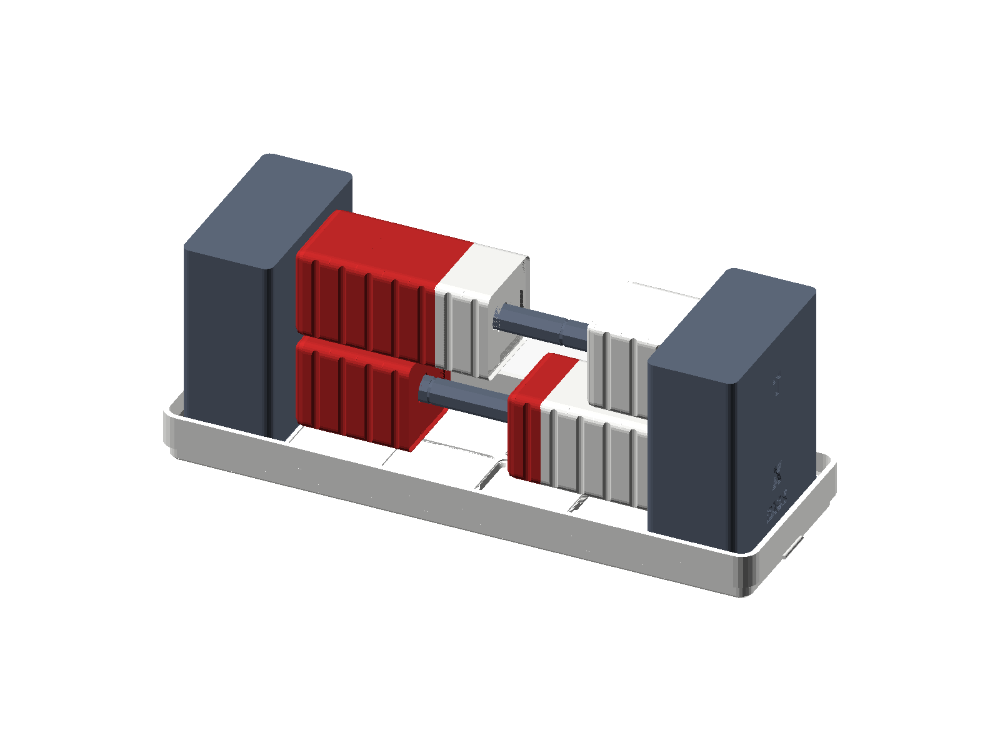{ width="320" }

> **Key Concept:** A Ratio Table and a Double Number Line are the exact same thing: two skip-counting ladders running side-by-side! Press 3 [g] [REP] and tap [+] to march across the top row (3, 6, 9, 12, 15), then 7 [g] [REP] and tap [+] to march across the bottom row (7, 14, 21, 28, 35)!

#### Demonstrate Both Textbook Methods with `COUNT-01` Blocks (Counting & Array Tiles)

1. **Block Way 1 (+10 pts):** Add repeated COUNT-01 jumps of (+8 m, +3 s) five times across the baseplate: 8 -> 16 -> 24 -> 32 -> 40 m.
2. **Block Way 2 (+20 pts):** Build a 5-row array of 8 tiles (8 × 5 = 40 m) paired with a 5-row array of 3 tiles (3 × 5 = 15 s)!
3. **Both Ways Proof:** Five additive jumps of +8 (Double Number Line) equals a 5 × 8 rectangular array (Scale Factor ×5)!

#### Two-Method Worked Examples (`Method 1: +10 pts` vs. `Method 2: +20 pts DOUBLE`)

| Worksheet | Problem | Method 1 (`+10 pts` — 1st Token) | Method 2 (`+20 pts DOUBLE` — 2nd Token) | SC-6 Keystrokes | Final Answer |
| :--- | :--- | :--- | :--- | :--- | :--- |
| **Practice A** (`p.24`) | **A drone flies 8 meters every 3 seconds. Build a 5-step table to find how far it flies in 15 seconds.** | **METHOD 1 (+10 pts): Repeated Addition in a Ratio Table:** Add 8 m for every 3 s: (3 s, 8 m) -> (6 s, 16 m) -> (9 s, 24 m) -> (12 s, 32 m) -> (15 s, 40 m). *(See `COUNT-01` Block Way 1 above)* | **METHOD 2 (+20 pts DOUBLE): Multiply by the Scale Factor:** To go from 3 s to 15 s, multiply by 15 ÷ 3 = 5. Multiply distance by the same factor: 8 m × 5 = 40 m. *(See `COUNT-01` Block Way 2 above)* | `[8]` `[g]` `[REP]` `[+]` `[+]` `[+]` `[+]` | **40 meters in 15 seconds** |
| **Practice B** (`p.25`) | **Six skate park tickets cost $45. Use a ratio table to find the cost of 10 tickets.** | **METHOD 1 (+10 pts): Scale Down then Scale Up in a Ratio Table:** Divide (6 tickets, $45) by 3 to get (2 tickets, $15). Then multiply (2 tickets, $15) by 5 to get (10 tickets, $75)! *COUNT-01 Way 1: Partition the 6-ticket bar ($45) into three 2-ticket chunks ($15 each), then lay 5 chunks ($75).* | **METHOD 2 (+20 pts DOUBLE): Unit Price per 1 Ticket:** Find 1 ticket first: $45 ÷ 6 = $7.50 per ticket. Multiply by 10 tickets: $7.50 × 10 = $75. *COUNT-01 Way 2: Divide $45 into 6 single-ticket boxes ($7.50 each), then line up 10 boxes -> $75!* | `[45]` `[ENTER]` `[3]` `[÷]` `[5]` `[×]` | **$75 for 10 tickets** |

#### Practice A (p. 24): Key Ideas & Two-Method Practice (10 Exercises)

| # | Problem Prompt | Coach Key: SC-6 Keystrokes | Final Answer |
| :---: | :--- | :--- | :--- |
| **A1** | Complete a ratio table to write the first 4 equivalent ratios of 4 : 9. | `4 [g][REP] [+], 9 [g][REP] [+]` | **4:9, 8:18, 12:27, 16:36** |
| **A2** | In a ratio table where A : B = 4 : 9, find B when A = 28. | `28 [ENTER] 4 [÷] 9 [×]` | **63** |
| **A3** | In a ratio table where X : Y = 5 : 12, find X when Y = 60. | `60 [ENTER] 12 [÷] 5 [×]` | **25** |
| **A4** | A printer prints 15 pages every 2 minutes. How many pages in 8 minutes? | `8 [ENTER] 2 [÷] 15 [×]` | **60 pages** |
| **A5** | Hot cocoa uses 3 tbsp cocoa for every 8 oz milk. How much milk for 18 tbsp cocoa? | `18 [ENTER] 3 [÷] 8 [×]` | **48 oz milk** |
| **A6** | 8 markers cost $12. Scale down to 2 markers, then scale up to find the cost of 10 markers. | `12 [ENTER] 4 [÷] 5 [×]` | **$15** |
| **A7** | A heart beats 21 times in 15 seconds. How many beats in 60 seconds (1 minute)? | `60 [ENTER] 15 [÷] 21 [×]` | **84 beats** |
| **A8** | Error Analysis: To find a ratio equivalent to 3:5, Sam added 4 to both terms and wrote 7:9. Explain and fix his error. | `7 [ENTER] 9 [g][a:b]` | **No! Multiply by 3 -> 9:15** |
| **A9** | 9 smoothies take 12 cups of berries. How many cups of berries for 15 smoothies? Solve 2 ways! | `12 [ENTER] 3 [÷] 5 [×]` | **20 cups (Way 2: 12÷9 × 15 = 20)** |
| **A10** | An e-bike travels 14 miles on 35% battery. How far can it travel on 100% battery? | `14 [ENTER] 7 [÷] 20 [×]` | **40 miles (Way 2: 2 mi per 5% × 20)** |

#### Practice B (p. 25): Modeling Real Life & Multi-Method Applications (10 Exercises)

| # | Modeling Real Life Application Prompt | Coach Key: SC-6 Keystrokes | Final Answer |
| :---: | :--- | :--- | :--- |
| **B1** | 3D Printing Speed: A printer extrudes 15 grams of filament every 20 minutes. Use a ratio table to find how many grams it extrudes in 60 minutes (1 hour). | `15 [ENTER] 3 [×]` | **45 grams** |
| **B2** | Aquarium Salt Mix: A marine tank needs 7 scoops of sea salt for every 2 gallons of water. How many scoops are needed for a 16-gallon tank? | `16 [ENTER] 2 [÷] 7 [×]` | **56 scoops** |
| **B3** | Scale Down & Scale Up: 8 notebooks cost $12. Divide by 4 to find the cost of 2 notebooks, then multiply by 5 to find the cost of 10 notebooks! | `12 [ENTER] 4 [÷] 5 [×]` | **$15 for 10 notebooks** |
| **B4** | Heartbeat Counter: A runner counts 28 heartbeats in 15 seconds. At this rate, how many times does her heart beat in 60 seconds (1 minute)? | `28 [ENTER] 4 [×]` | **112 beats per minute** |
| **B5** | Maple Syrup Sap: It takes 40 gallons of tree sap to boil down 1 gallon of pure maple syrup. How many gallons of sap are needed for 6.5 gallons of syrup? | `40 [ENTER] 6.5 [×]` | **260 gallons of sap** |
| **B6** | Moon Weight Ratio: An object weighing 60 pounds on Earth weighs 10 pounds on the Moon. How much would a 150-pound astronaut weigh on the Moon? | `150 [ENTER] 6 [÷]` | **25 pounds** |
| **B7** | Pizza Dough Flour: 6 cups of flour make 4 pizza crusts. Use a ratio table to find how many cups of flour are needed for 10 pizza crusts. | `6 [ENTER] 2 [÷] 5 [×]` | **15 cups of flour** |
| **B8** | Solar Charger: A portable solar panel charges 18% of a battery every 15 minutes. How long does it take to charge 90% of the battery? | `90 [ENTER] 18 [÷] 15 [×]` | **75 minutes (1 hr 15 min)** |
| **B9** | Model Train Scale: A scale model uses 2 inches to represent 15 feet of real train. If a real boxcar is 60 feet long, how many inches long is the model? | `60 [ENTER] 15 [÷] 2 [×]` | **8 inches** |
| **B10** | Smoothie Stand Lemonade: 9 lemons make 6 cups of lemonade. How many lemons do you need to make 20 cups of lemonade? | `9 [ENTER] 3 [÷] 10 [×]` | **30 lemons** |

---

### Section 3.3: Rates, Unit Rates, and Comparing Rates (Workbook pp. 26–27)

**Textbook Alignment:** Big Ideas Grade 6, Section 3.4 & 3.5 (Rates and Unit Rates) (`CCSS.MATH.6.RP.A.2`) • **Big Ideas Methods:** *Method 1: Unit Rate (Divide to Get 1 Unit)  |  Method 2: Equivalent Rate / Common Multiple* • **Block Kit:** `COUNT-01` (Counting & Array Tiles)

**Key Vocabulary:** rate • unit rate • unit cost (unit price) • equivalent rates

{ width="320" }

> **Key Concept:** 'Dollars PER Ounce' means Dollars ÷ Ounces (enter Dollars on Y, Ounces on X, press [÷]). What if you accidentally typed Ounces first and Dollars second? Don't clear! Just press [x⇄y] ([f][R↓]) to swap Floor 1 and Floor 2, then press [÷]!

#### Demonstrate Both Textbook Methods with `COUNT-01` Blocks (Counting & Array Tiles)

1. **Block Way 1 (+10 pts):** Deal 315 into 5 equal COUNT-01 boxes so 1 single unit box holds 315 ÷ 5 = 63 words per 1 minute.
2. **Block Way 2 (+20 pts):** To compare two rates, either compare 1-box unit heights OR scale both bars to a common number of boxes!
3. **Both Ways Proof:** Finding the 1-box Unit Rate and scaling to a Common Multiple both reveal the exact same winner!

#### Two-Method Worked Examples (`Method 1: +10 pts` vs. `Method 2: +20 pts DOUBLE`)

| Worksheet | Problem | Method 1 (`+10 pts` — 1st Token) | Method 2 (`+20 pts DOUBLE` — 2nd Token) | SC-6 Keystrokes | Final Answer |
| :--- | :--- | :--- | :--- | :--- | :--- |
| **Practice A** (`p.26`) | **Find the unit rate in words per minute for 315 words in 5 minutes (even if you typed 5 first!).** | **METHOD 1 (+10 pts): Divide by the Denominator for 1 Unit:** Write 315 words / 5 minutes. Divide top and bottom by 5: (315 ÷ 5) / (5 ÷ 5) = 63 words per 1 minute. *(See `COUNT-01` Block Way 1 above)* | **METHOD 2 (+20 pts DOUBLE): Double Number Line / Multiply Check:** Split 315 into 300 + 15: 300÷5 = 60 and 15÷5 = 3 -> 63 wpm. Check: 63 × 5 = 315 words. *(See `COUNT-01` Block Way 2 above)* | `[5]` `[ENTER]` `[315]` `[x⇄y]` `[÷]` | **63 words per minute** |
| **Practice B** (`p.27`) | **Pack A has 8 AA batteries for $11.60. Pack B has 12 AA batteries for $16.80. Which pack is the better buy?** | **METHOD 1 (+10 pts): Compare Unit Prices (Cost per 1 Battery):** Pack A: $11.60 ÷ 8 = $1.45 per battery. Pack B: $16.80 ÷ 12 = $1.40 per battery. Pack B saves $0.05 per battery! *PLACE-01 Way 1: Divide Pack A ($5.80 ÷ 4 = $1.45/box) vs. Pack B ($8.40 ÷ 6 = $1.40/box) -> Pack B is cheaper.* | **METHOD 2 (+20 pts DOUBLE): Scale Both Packs to LCM(8, 12) = 24 Batteries:** For 24 batteries: 3 of Pack A cost 3 × $11.60 = $34.80; 2 of Pack B cost 2 × $16.80 = $33.60. Pack B is $1.20 cheaper! *COUNT-01 Way 2: Scale both to a 12-battery bar: 3 Pack As = $17.40 vs. 2 Pack Bs = $16.80 (saves $0.60)!* | `[11.60]` `[ENTER]` `[8]` `[÷]` `[16.80]` `[ENTER]` `[12]` `[÷]` | **Pack B ($1.40/battery vs. $1.45/battery)** |

#### Practice A (p. 26): Key Ideas & Two-Method Practice (10 Exercises)

| # | Problem Prompt | Coach Key: SC-6 Keystrokes | Final Answer |
| :---: | :--- | :--- | :--- |
| **A1** | Find the unit speed in miles per hour: 195 miles in 3 hours. | `195 [ENTER] 3 [÷]` | **65 mph** |
| **A2** | You earn $36 for 4 hours of tutoring. Find the unit rate in dollars per hour. | `4 [ENTER] 36 [x⇄y] [÷]` | **$9 / hour** |
| **A3** | Find the unit price per pound: $7.80 for 6 pounds of apples. | `7.80 [ENTER] 6 [÷]` | **$1.30 / lb** |
| **A4** | A 3D printer uses 90 grams of filament in 6 hours. How many grams per hour? | `90 [ENTER] 6 [÷]` | **15 g / hr** |
| **A5** | Best Buy: Cereal A is $4.50 for 15 oz. Cereal B is $5.04 for 18 oz. Find both unit prices! | `4.50 [ENTER] 15 [÷]; 5.04 [ENTER] 18 [÷]` | **Cereal B ($0.28/oz vs $0.30/oz)** |
| **A6** | Best Buy: 6-pack of pens for $5.10 vs. 10-pack of pens for $8.20. | `5.10 [ENTER] 6 [÷]; 8.20 [ENTER] 10 [÷]` | **10-pack ($0.82 vs $0.85)** |
| **A7** | A train travels 210 miles in 3.5 hours. At this rate, how far does it travel in 5 hours? | `210 [ENTER] 3.5 [÷] 5 [×]` | **300 miles** |
| **A8** | Pump A fills 45 gallons in 5 min. Pump B fills 64 gallons in 8 min. Which pump is faster? | `45 [ENTER] 5 [÷]; 64 [ENTER] 8 [÷]` | **Pump A (9 gal/min vs 8 gal/min)** |
| **A9** | An extruder pushes 45 mm of filament in 15 seconds. How much in 60 seconds (1 min)? Solve 2 ways! | `45 [ENTER] 15 [÷] 60 [×]` | **180 mm (Way 2: 60s is 4×15s -> 4×45=180)** |
| **A10** | Car A drives 168 miles on 6 gallons. Car B drives 232 miles on 8 gallons. Which car gets more mpg? | `168 [ENTER] 6 [÷]; 232 [ENTER] 8 [÷]` | **Car B (29 mpg vs 28 mpg)** |

#### Practice B (p. 27): Modeling Real Life & Multi-Method Applications (10 Exercises)

| # | Modeling Real Life Application Prompt | Coach Key: SC-6 Keystrokes | Final Answer |
| :---: | :--- | :--- | :--- |
| **B1** | High-Speed Train: A bullet train travels 450 miles in 3 hours. Find its unit rate (average speed) in miles per hour. | `450 [ENTER] 3 [÷]` | **150 miles per hour** |
| **B2** | Best-Buy Granola Bars: Box A has 6 bars for $4.50. Box B has 10 bars for $7.00. Find the unit cost per bar for each box. Which is the better buy? | `4.50 [ENTER] 6 [÷] 7.00 [ENTER] 10 [÷]` | **Box B ($0.70/bar vs. $0.75/bar)** |
| **B3** | 3D Filament Comparison: Spool A is 500 grams for $11.00. Spool B is 1,000 grams for $19.50. Find the price per 100 grams for each. Which is better? | `11 [ENTER] 5 [÷] 19.50 [ENTER] 10 [÷]` | **Spool B ($1.95 vs. $2.20 per 100g)** |
| **B4** | Swimming Pool Pump: A pump fills 180 gallons in 12 minutes. Find the unit rate in gallons per minute, and find how much it pumps in 25 minutes. | `180 [ENTER] 12 [÷] 25 [×]` | **15 gal/min; 375 gallons** |
| **B5** | Typing Sprint Showdown: Maya types 220 words in 4 minutes. Leo types 285 words in 5 minutes. Find each student's unit rate (wpm). Who types faster? | `220 [ENTER] 4 [÷] 285 [ENTER] 5 [÷]` | **Leo (57 wpm vs. Maya's 55 wpm)** |
| **B6** | Fuel Economy Test: Car A drives 336 miles on 12 gallons of gas. Car B drives 405 miles on 15 gallons. Which car gets more miles per gallon (mpg)? | `336 [ENTER] 12 [÷] 405 [ENTER] 15 [÷]` | **Car A (28 mpg vs. 27 mpg)** |
| **B7** | Dog Walking Job: You earn $54 for walking 6 dogs. At this unit rate, how many dogs must you walk to earn $99? | `54 [ENTER] 6 [÷] 99 [x⇄y] [÷]` | **$9 per dog -> 11 dogs** |
| **B8** | Juice Box Bulk Pack: An 8-pack of juice boxes costs $3.60. A 12-pack costs $5.04. Find the unit price per juice box for each pack. | `3.60 [ENTER] 8 [÷] 5.04 [ENTER] 12 [÷]` | **12-pack ($0.42 vs. $0.45 each)** |
| **B9** | Snowfall Rate: During a blizzard, 14 inches of snow fall in 3.5 hours. What is the unit rate in inches per hour? | `14 [ENTER] 3.5 [÷]` | **4 inches per hour** |
| **B10** | Unit Rate Distance Prediction: A rover drives 27 meters in 6 seconds. Find its speed in meters per second, and find how far it travels in 20 seconds. | `27 [ENTER] 6 [÷] 20 [×]` | **4.5 m/s -> 90 meters** |

---

### Section 3.4: Percents, Fractions, and Decimals (Workbook pp. 28–29)

**Textbook Alignment:** Big Ideas Grade 6, Sections 4.1–4.3 / 5.5 (Percents, Fractions, and Decimals) (`CCSS.MATH.6.RP.A.3c`) • **Big Ideas Methods:** *Method 1: Scale Denominator to 100  |  Method 2: Divide Numerator by Denominator* • **Block Kit:** `FRAC-01` (84mm Fraction Studio)

**Key Vocabulary:** percent ('per hundred') • hundredths grid • benchmark percent • part • whole

{ width="320" }

> **Key Concept:** 'Per-cent' literally means 'out of 100' (like 100 cents in $1.00). Instead of memorizing rules for moving decimal points left or right, enter any fraction or decimal on the SC-6 and press [f] [%] ([f][÷]) to see its percent, or [FDISP] to switch between fraction and decimal!

#### Demonstrate Both Textbook Methods with `FRAC-01` Blocks (84mm Fraction Studio)

1. **Block Way 1 (+10 pts):** On the 10×10 COUNT-01 grid (100 squares), scale 7/20 by ×5 to cover 35 squares -> 35/100 = 35% = 0.35.
2. **Block Way 2 (+20 pts):** Compare FRAC-01 towers against 1/10 (10%) and 1/20 (5%) blocks: seven 5% blocks = 35% = 0.35!
3. **Both Ways Proof:** Covering 35 of 100 grid tiles (COUNT-01) and stacking seven 1/20 blocks (FRAC-01) both equal 0.35 = 35%!

#### Two-Method Worked Examples (`Method 1: +10 pts` vs. `Method 2: +20 pts DOUBLE`)

| Worksheet | Problem | Method 1 (`+10 pts` — 1st Token) | Method 2 (`+20 pts DOUBLE` — 2nd Token) | SC-6 Keystrokes | Final Answer |
| :--- | :--- | :--- | :--- | :--- | :--- |
| **Practice A** (`p.28`) | **Convert 7/20 into a decimal and a percent using [FDISP] and [f] [%].** | **METHOD 1 (+10 pts): Write an Equivalent Fraction with 100:** Since 20 × 5 = 100, multiply numerator and denominator of 7/20 by 5: (7 × 5)/(20 × 5) = 35/100 = 0.35 = 35%. *(See `FRAC-01` Block Way 1 above)* | **METHOD 2 (+20 pts DOUBLE): Divide Numerator by Denominator:** Divide 7 ÷ 20 = 0.35. Multiply by 100 (shift decimal point 2 places right) to get 35%. *(See `FRAC-01` Block Way 2 above)* | `[.]` `[7]` `[.]` `[20]` `[ENTER]` `[FDISP]` `[100]` `[×]` | **0.35 and 35%** |
| **Practice B** (`p.29`) | **You make 18 out of 24 free throws. Find your shooting rate as a simplified fraction, decimal, and percent.** | **METHOD 1 (+10 pts): Simplify by GCF First (Benchmark Fraction):** Divide 18 and 24 by GCF(18, 24) = 6: 18/24 = 3/4. Recognize the benchmark fraction 3/4 = 75/100 = 0.75 = 75%! *FRAC-01 Way 1: Simplify 18/24 to three 1/4 blocks (3/4); since each 1/4 block is 25%, three blocks = 75%.* | **METHOD 2 (+20 pts DOUBLE): Direct Division (Part ÷ Whole):** Divide 18 ÷ 24 = 0.75. Shift the decimal 2 places right -> 75%, and press [FDISP] to confirm 3/4. *COUNT-01 Way 2: Divide 18 ÷ 24 = 0.75 (75 squares on the 10×10 hundred-grid = 75%)!* | `[18]` `[ENTER]` `[24]` `[÷]` `[FDISP]` | **3/4 = 0.75 = 75%** |

#### Practice A (p. 28): Key Ideas & Two-Method Practice (10 Exercises)

| # | Problem Prompt | Coach Key: SC-6 Keystrokes | Final Answer |
| :---: | :--- | :--- | :--- |
| **A1** | Write 3/5 as a decimal and as a percent. | `[.] 3 [.] 5 [ENTER] [FDISP]` | **0.6 and 60%** |
| **A2** | Write 9/25 as a decimal and as a percent. | `[.] 9 [.] 25 [ENTER] [FDISP]` | **0.36 and 36%** |
| **A3** | Write 45% as a decimal and as a fraction in simplest form. | `45 [ENTER] 100 [÷] [FDISP]` | **0.45 and 9/20** |
| **A4** | Write 0.125 as a percent and as a fraction in simplest form. | `0.125 [ENTER] [FDISP]` | **12.5% and 1/8** |
| **A5** | Find 30% of 80 using a benchmark percent (3 × 10%) or decimal multiplication. | `80 [ENTER] 30 [f][%]` | **24** |
| **A6** | Find 15% of 60. | `60 [ENTER] 15 [f][%]` | **9** |
| **A7** | You answered 21 out of 25 questions right. What is your score as a percent? | `21 [ENTER] 25 [÷]` | **84%** |
| **A8** | Convert 150% into a decimal and a mixed fraction. | `150 [ENTER] 100 [÷] [FDISP]` | **1.5 and 1 1/2** |
| **A9** | Order 5/8, 60%, and 0.61 from least to greatest by converting all 3 to decimals (and percents!). | `[.] 5 [.] 8 [FDISP] -> 0.625` | **60%, 0.61, 5/8 (Way 2: 60% < 61% < 62.5%)** |
| **A10** | A phone battery is at 35% of its 4,000 mAh capacity. How many mAh remain? Solve 2 ways! | `4000 [ENTER] 35 [f][%]` | **1,400 mAh (Way 2: 7/20 × 4000 = 1400)** |

#### Practice B (p. 29): Modeling Real Life & Multi-Method Applications (10 Exercises)

| # | Modeling Real Life Application Prompt | Coach Key: SC-6 Keystrokes | Final Answer |
| :---: | :--- | :--- | :--- |
| **B1** | Phone Storage Bar: You have used 17 out of 20 gigabytes on your tablet. Write 17/20 as a decimal and as a percent. | `[.] 17 [.] 20 [FDISP] 100 [×]` | **0.85 = 85%** |
| **B2** | Soccer Goal Rate: A striker scores on 9 out of 25 penalty kicks. Write 9/25 as a decimal and as a percent. | `[.] 9 [.] 25 [FDISP] 100 [×]` | **0.36 = 36%** |
| **B3** | Quiz Mastery Score: You earn 40% of the points on Part A (out of 50 points) and 80% on Part B (out of 50 points). How many total points did you score? | `50 [ENTER] 40 [f][%] 50 [ENTER] 80 [f][%] [+]` | **20 + 40 = 60 points** |
| **B4** | School Survey: In a poll of 160 middle schoolers, 65% voted for a robotics elective. How many students voted for robotics? | `160 [ENTER] 65 [f][%]` | **104 students** |
| **B5** | Battery Charge Left: A laptop shows 15% battery remaining. Write 15% as a decimal and as a fraction in simplest form. | `[.] 15 [.] 100 [g][SIMP]` | **0.15 and 3/20** |
| **B6** | Finding the Whole from a Part: 18 students in the science club are 6th graders. If 6th graders make up 40% of the club, how many total students are in the club? | `18 [ENTER] 0.40 [÷]` | **45 students total** |
| **B7** | Benchmark Percent Mental Math: Find 15% of $60 by finding 10% of $60 ($6) plus half of that for 5% ($3). | `60 [ENTER] 15 [f][%]` | **$9.00** |
| **B8** | Archery Target Bullseyes: An archer hits the bullseye 21 times out of 24 arrows. Write her accuracy as a simplified fraction, decimal, and percent. | `21 [ENTER] 24 [÷] [FDISP]` | **7/8 = 0.875 = 87.5%** |
| **B9** | Fundraiser Goal: A class has raised $360, which is 75% (3/4) of their goal. What is the total fundraiser goal? | `360 [ENTER] 0.75 [÷]` | **$480 goal** |
| **B10** | Three-Costume Ordering: Order 3/5, 58%, and 0.62 from least to greatest by converting all three to percents. | `[.] 3 [.] 5 [FDISP]` | **58% < 3/5 (60%) < 0.62 (62%)** |

---

### Section 3.5: Solving Percent Problems, Discounts & Conversions (Workbook pp. 30–31)

**Textbook Alignment:** Big Ideas Grade 6, Section 5.6 & 5.7 (Percent Problems & Converting Measures) (`CCSS.MATH.6.RP.A.3d`) • **Big Ideas Methods:** *Method 1: Subtract the Discount from Original  |  Method 2: Multiply by Remaining Percent (100% - p%)* • **Block Kit:** `PLACE-01` (Place Value & Fraction Studio)

**Key Vocabulary:** discount • sale price • markup • sales tax • percent of change • conversion factor

{ width="320" }

> **Key Concept:** On a normal calculator, finding a sale price takes two separate calculations because computing the discount erases the original price! On the SC-6, typing 60 [ENTER] 25 [f] [%] puts the $15 discount on Floor 1 (X) while keeping $60 on Floor 2 (Y)—so pressing [-] gives the $45 sale price in 1 click!

#### Demonstrate Both Textbook Methods with `PLACE-01` Blocks (Place Value & Fraction Studio)

1. **Block Way 1 (+10 pts):** Build a 4-block COUNT-01 bar for $60 (each 25% block = $15) and remove 1 block: $60 - $15 = $45.
2. **Block Way 2 (+20 pts):** Keep the 3 remaining 25% blocks directly (100% - 25% = 75%): 3 × $15 = $45 in one step!
3. **Both Ways Proof:** Subtracting 1 removed 25% block ($60 - $15) leaves the exact same 3 blocks as finding 75% of $60 ($45)!

#### Two-Method Worked Examples (`Method 1: +10 pts` vs. `Method 2: +20 pts DOUBLE`)

| Worksheet | Problem | Method 1 (`+10 pts` — 1st Token) | Method 2 (`+20 pts DOUBLE` — 2nd Token) | SC-6 Keystrokes | Final Answer |
| :--- | :--- | :--- | :--- | :--- | :--- |
| **Practice A** (`p.30`) | **A $60 video game is 25% off. Find the discount and the sale price.** | **METHOD 1 (+10 pts): Find Discount First, Then Subtract:** Discount = 25% of $60 = 0.25 × 60 = $15. Subtract from original price: $60 - $15 = $45. *(See `PLACE-01` Block Way 1 above)* | **METHOD 2 (+20 pts DOUBLE): Multiply by Remaining Percent:** If 25% is taken off, you pay 100% - 25% = 75% of the original price: 0.75 × $60 = (3/4) × 60 = $45! *(See `PLACE-01` Block Way 2 above)* | `[60]` `[ENTER]` `[25]` `[f]` `[%]` `[-]` | **Discount = $15; Sale Price = $45** |
| **Practice B** (`p.31`) | **A maker channel grows from 250 to 325 subscribers. Find the percent increase, and convert a 32-inch build plate to centimeters.** | **METHOD 1 (+10 pts): Change ÷ Original Formula:** Increase = 325 - 250 = 75. Divide by ORIGINAL: 75 ÷ 250 = 3/10 = 0.30 = +30%. For 32 in: 32 × 2.54 cm/in = 81.28 cm. *COUNT-01 Way 1: Compare the 6-block growth (26 - 20 = 6) to the original 20-block bar: 6/20 = 30/100 = +30%.* | **METHOD 2 (+20 pts DOUBLE): Ratio of New-to-Old & SC-6 [%CHG]:** New ÷ Old = 325 ÷ 250 = 1.30 = 130% of original (a +30% increase!). Verify with 250 [ENTER] 325 [g] [%CHG] and 32 [f] [▸cm]. *PLACE-01 Way 2: Scale 32 inches by 2.54 cm per 1-inch tile -> 32 × 2.54 = 81.28 cm!* | `[250]` `[ENTER]` `[325]` `[g]` `[%CHG]` `[32]` `[f]` `[▸cm]` | **+30% increase; 81.28 cm** |

#### Practice A (p. 30): Key Ideas & Two-Method Practice (10 Exercises)

| # | Problem Prompt | Coach Key: SC-6 Keystrokes | Final Answer |
| :---: | :--- | :--- | :--- |
| **A1** | An $80 pair of sneakers is on sale for 30% off. Find the discount and the sale price. | `80 [ENTER] 30 [f][%] [-]` | **Discount $24; Sale $56** |
| **A2** | A $40 restaurant meal includes a 15% tip. Find the tip amount and the total bill. | `40 [ENTER] 15 [f][%] [+]` | **Tip $6; Total $46** |
| **A3** | Find the percent of change from 50 to 65 using (Change ÷ Original) × 100%. | `50 [ENTER] 65 [g][%CHG]` | **+30%** |
| **A4** | Find the percent of decrease from 80 down to 60. | `80 [ENTER] 60 [g][%CHG]` | **-25%** |
| **A5** | Use the conversion factor 2.54 cm = 1 in to convert 10 inches to centimeters. | `10 [f][▸cm]` | **25.4 cm** |
| **A6** | Use the conversion factor 1 in = 2.54 cm to convert 50.8 centimeters to inches. | `50.8 [g][▸in]` | **20 in** |
| **A7** | Convert 11 pounds to kilograms (use 1 lb ≈ 0.4536 kg or 1 kg ≈ 2.2 lb). | `11 [f][▸kg]` | **4.99 kg** |
| **A8** | Reverse Percent: 18 is 25% of what number? (Divide 18 by 0.25!) | `18 [ENTER] 0.25 [÷]` | **72** |
| **A9** | Modeling Real Life: A $120 skateboard is 20% off. Find the sale price in two ways (subtracting the 20% discount vs. finding 80% of $120). | `120 [ENTER] 20 [f][%] [-]` | **$96 (Way 2: 120 × 0.80 = 96)** |
| **A10** | Modeling Real Life: A 32-inch skateboard deck weighs 5 pounds. Convert its length to centimeters and its weight to kilograms. | `32 [f][▸cm]; 5 [f][▸kg]` | **81.28 cm, 2.27 kg (Way 2: 32×2.54=81.28)** |

#### Practice B (p. 31): Modeling Real Life & Multi-Method Applications (10 Exercises)

| # | Modeling Real Life Application Prompt | Coach Key: SC-6 Keystrokes | Final Answer |
| :---: | :--- | :--- | :--- |
| **B1** | Gaming Headset Deal: A $75 wireless headset is on sale for 20% off. Find the discount and the sale price in two ways. | `75 [ENTER] 20 [f][%] [-]` | **Discount = $15; Sale Price = $60** |
| **B2** | Pizza Team Dinner Tip: A team dinner costs $64.00 before tip. You leave a 15% tip. What is the tip amount and the total bill? | `64 [ENTER] 15 [f][%] [+]` | **Tip = $9.60; Total = $73.60** |
| **B3** | Sales Tax Checkout: You buy a $48.00 3D build plate plus 7.5% sales tax. Find the tax amount and the final total. | `48 [ENTER] 7.5 [f][%] [+]` | **Tax = $3.60; Total = $51.60** |
| **B4** | Ticket Price Percent Increase: Concert tickets rose from $40 last year to $52 this year. Find the percent of increase. | `40 [ENTER] 52 [g][%CHG]` | **+30% increase** |
| **B5** | Winter Jacket Clearance: A jacket was marked down from $90 to $63. Find the percent of decrease. | `90 [ENTER] 63 [g][%CHG]` | **-30% (30% off)** |
| **B6** | 5K Race Distance Conversion: A race is 5 kilometers long. Since 1 mile ≈ 1.609 km (or convert 5000 m), convert 10 miles into kilometers. | `10 [ENTER] 1.609344 [×]` | **16.09 km** |
| **B7** | customs Luggage Weight: Your suitcase weighs 20 kilograms. Convert 20 kg into pounds (1 kg ≈ 2.2046 lb). | `20 [g][▸lb]` | **44.09 lb** |
| **B8** | Water Bottle Capacity: A sports jug holds 1 gallon of water. Convert 1 gallon to liters ([f] [▸L]) and fluid ounces (128 fl oz). | `1 [f][▸L]` | **3.79 liters** |
| **B9** | Double Coupon Trap: A $100 bike has a 20% off store sale, and you have an extra 10% off coupon applied to the sale price. Why is the final price $72 instead of $70? | `100 [ENTER] 20 [f][%] [-] 10 [f][%] [-]` | **$80 - $8 = $72 (28% total off)** |
| **B10** | Temperature Lab Conversion: Room temperature is 20°C. Convert 20°C to degrees Fahrenheit using F = 1.8C + 32 or [g] [▸°F]. | `20 [g][▸°F]` | **68°F** |

---

## Unit 4: Algebraic Expressions & Properties

*Big Ideas Math Grade 6 — Chapter 3 / Chapter 5 (Algebraic Expressions) — Evaluating Algebraic Expressions, Combining Like Terms, Distributive Property & Factoring with GCF*

- **Manipulative Kits:** `Algebra Boxes & Factoring Stage (ALGB-01) + Counting Tiles (COUNT-01)`
- **Target Misconception:** Students panic when letters appear, erroneously combine 3x + 2 into 5x or x² + x into x³, and don't see why 3(x + 4) = 3x + 12.
- **Hands-On Remediation:** Show that a variable x is literally a physical green x-rod (42×14mm) whereas 1 is a small yellow unit cube (14×14mm) and x² is a large blue flat (42×42mm)—different physical shapes cannot be counted as one pile! Build rectangles on the L-frame stage for the Distributive Property.

### Section 4.1: Writing and Evaluating Algebraic Expressions (Workbook pp. 32–33)

**Textbook Alignment:** Big Ideas Grade 6, Section 3.1 / 5.1 (Algebraic Expressions) (`CCSS.MATH.6.EE.A.2`) • **Big Ideas Methods:** *Method 1: Algebra Tile Replacement Model  |  Method 2: Parentheses Substitution & PEMDAS* • **Block Kit:** `ALGB-01` (Algebra Boxes & Tiles)

**Key Vocabulary:** algebraic expression • variable • term • coefficient • constant • evaluate • substitute

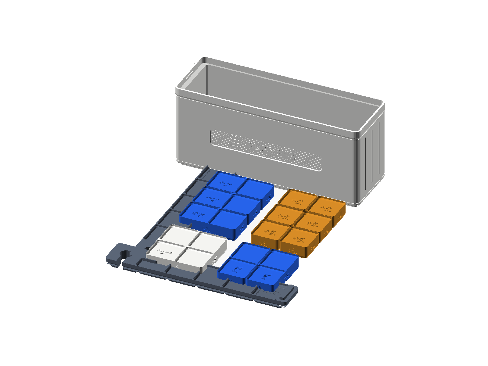{ width="320" }

> **Key Concept:** A letter like x is not scary—it is just an empty green box (ALGB-01) waiting for you to drop a number inside! When you see 4x + 7 and x = 5, replace each x-rod with 5 units (4 × 5 = 20) and add 7 -> 27. On the SC-6, evaluating an expression is just Section 1.3's elevator math!

#### Demonstrate Both Textbook Methods with `ALGB-01` Blocks (Algebra Boxes & Tiles)

1. **Block Way 1 (+10 pts):** Load 4 unit cubes into each of 3 x-boxes (12) and 5 cubes into each of 3 y-boxes (15) on ALGB-01 -> 12 + 15 = 27.
2. **Block Way 2 (+20 pts):** Pair 1 x-box + 1 y-box (4 + 5 = 9 cubes) and build 3 identical groups on ALGB-01 -> 3 × 9 = 27!
3. **Both Ways Proof:** Filling 3x and 3y separately (12 + 15) holds the exact same cubes as 3 combined (x + y) groups (3 × 9 = 27)!

#### Two-Method Worked Examples (`Method 1: +10 pts` vs. `Method 2: +20 pts DOUBLE`)

| Worksheet | Problem | Method 1 (`+10 pts` — 1st Token) | Method 2 (`+20 pts DOUBLE` — 2nd Token) | SC-6 Keystrokes | Final Answer |
| :--- | :--- | :--- | :--- | :--- | :--- |
| **Practice A** (`p.32`) | **Evaluate 4x + 7 when x = 5 using Algebra Tiles and the SC-6.** | **METHOD 1 (+10 pts): Substitute with Parentheses & PEMDAS:** Replace x with (5) in 4x + 7: 4(5) + 7. Multiply first (4 × 5 = 20), then add 7: 20 + 7 = 27. *(See `ALGB-01` Block Way 1 above)* | **METHOD 2 (+20 pts DOUBLE): Physical Tile Replacement:** Trade each of the 4 green x-rods for 5 unit cubes (5 + 5 + 5 + 5 = 20 cubes) plus 7 cubes = 27 cubes. *(See `ALGB-01` Block Way 2 above)* | `[4]` `[ENTER]` `[5]` `[×]` `[7]` `[+]` | **27** |
| **Practice B** (`p.33`) | **In a game, each boss trophy (a) is worth 3a² points and each gem (b) is worth 4b points. Find your score for a = 5 and b = 6.** | **METHOD 1 (+10 pts): Substitute & Evaluate Powers First:** Substitute a = 5 and b = 6: 3(5)² + 4(6). Evaluate the power first (5² = 25), multiply (3×25 = 75 and 4×6 = 24), then add: 75 + 24 = 99. *ALGB-01 Way 1: Build a 5×5×5 cube (125) on the left and remove (2 × 8 + 10 = 26) cubes -> 99 cubes remain.* | **METHOD 2 (+20 pts DOUBLE): Separate Term Chunks on the SC-6 Stack:** Chunk 1 (Bosses): 5 [x²] 3 [×] = 75. Chunk 2 (Gems): 4 [ENTER] 6 [×] = 24. Combine both chunks with [+] -> 99 points! *ALGB-01 Way 2: Evaluate the 5³ cube (125), subtract two 8-rods (109), then subtract the 10-tray -> 99!* | `[5]` `[x²]` `[3]` `[×]` `[4]` `[ENTER]` `[6]` `[×]` `[+]` | **99 points** |

#### Practice A (p. 32): Key Ideas & Two-Method Practice (10 Exercises)

| # | Problem Prompt | Coach Key: SC-6 Keystrokes | Final Answer |
| :---: | :--- | :--- | :--- |
| **A1** | Evaluate 6x - 9 when x = 7. | `6 [ENTER] 7 [×] 9 [-]` | **33** |
| **A2** | Evaluate 5n + 14 when n = 8. | `5 [ENTER] 8 [×] 14 [+]` | **54** |
| **A3** | Evaluate 40 - 3m when m = 9. (Park 40 on Y first!) | `40 [ENTER] 3 [ENTER] 9 [×] [-]` | **13** |
| **A4** | Evaluate x² + 11 when x = 6. | `6 [x²] 11 [+]` | **47** |
| **A5** | Evaluate 2y² - 5 when y = 4. (Square 4 before multiplying by 2!) | `4 [x²] 2 [×] 5 [-]` | **27** |
| **A6** | Evaluate 7a + 3b when a = 4 and b = 9. | `7 [ENTER] 4 [×] 3 [ENTER] 9 [×] [+]` | **55** |
| **A7** | Evaluate (x + y) ÷ 4 when x = 19 and y = 13. | `19 [ENTER] 13 [+] 4 [÷]` | **8** |
| **A8** | Evaluate 5k - 2.4 when k = 3.5. | `5 [ENTER] 3.5 [×] 2.4 [-]` | **15.1** |
| **A9** | Skate park rental costs $8 flat plus $4.50 per hour (8 + 4.50h). Find the cost for 4 hours 2 ways! | `4.50 [ENTER] 4 [×] 8 [+]` | **$26 (Way 2: 8+4.5+4.5+4.5+4.5 = 26)** |
| **A10** | Surface area of a cube is 6s². Find the surface area when edge s = 5 cm. | `5 [x²] 6 [×]` | **150 cm² (Way 2: 6 faces × 25 cm² = 150)** |

#### Practice B (p. 33): Modeling Real Life & Multi-Method Applications (10 Exercises)

| # | Modeling Real Life Application Prompt | Coach Key: SC-6 Keystrokes | Final Answer |
| :---: | :--- | :--- | :--- |
| **B1** | Bowling Shoe Rental: Bowling costs $6 for shoe rental plus $5 per game g: 5g + 6. Evaluate the cost for g = 4 games. | `5 [ENTER] 4 [×] 6 [+]` | **$26** |
| **B2** | Carnival Ride Wristband: You start with 50 tickets and spend 4 tickets per ride r: 50 - 4r. How many tickets are left after r = 9 rides? | `50 [ENTER] 4 [ENTER] 9 [×] [-]` | **14 tickets** |
| **B3** | Square Tile Patio Cost: A square patio of side s feet costs 8s² + 25 dollars to pave. Find the cost when s = 5 feet. | `5 [x²] 8 [×] 25 [+]` | **$225** |
| **B4** | Esports Tournament Points: A team scores 10w + 3d points for w wins and d draws. Find their score for w = 7 wins and d = 4 draws. | `10 [ENTER] 7 [×] 3 [ENTER] 4 [×] [+]` | **82 points** |
| **B5** | Falling Object Physics: A ball dropped from a tower falls 16t² feet in t seconds. How far does it fall in t = 3 seconds? | `3 [x²] 16 [×]` | **144 feet** |
| **B6** | Surface Area of a Cube Formula: The surface area of a cube is 6s². Evaluate 6s² when the edge length is s = 4 inches. | `4 [x²] 6 [×]` | **96 in²** |
| **B7** | Movie Theater Concession: Popcorn costs $7 (p) and drinks cost $4 (d): 7p + 4d. Evaluate for p = 3 popcorns and d = 5 drinks. | `7 [ENTER] 3 [×] 4 [ENTER] 5 [×] [+]` | **$41** |
| **B8** | Trapezoid Bridge Truss: Evaluate ½h(a + b) when h = 6, a = 11, and b = 15. | `11 [ENTER] 15 [+] 6 [g][TRI]` | **78** |
| **B9** | 3D Print Time Formula: A batch of k keycaps takes 12k + 15 minutes (including 15 min warm-up). How long does a batch of k = 8 keycaps take? | `12 [ENTER] 8 [×] 15 [+]` | **111 minutes (1 hr 51 min)** |
| **B10** | Two-Variable Exponent Challenge: Evaluate 2x³ - 3y² when x = 4 and y = 5. | `4 [g][x³] 2 [×] 5 [x²] 3 [×] [-]` | **128 - 75 = 53** |

---

### Section 4.2: Simplifying Expressions by Combining Like Terms (Workbook pp. 34–35)

**Textbook Alignment:** Big Ideas Grade 6, Section 3.2 & 3.3 / 5.2 (Simplifying Algebraic Expressions) (`CCSS.MATH.6.EE.A.3`) • **Big Ideas Methods:** *Method 1: Sort & Group Algebra Tiles by Shape  |  Method 2: Add/Subtract Coefficients & Test a Value* • **Block Kit:** `ALGB-01` (Algebra Boxes & Tiles)

**Key Vocabulary:** like terms • simplest form • Commutative Property • Associative Property • equivalent expressions

{ width="320" }

> **Key Concept:** Why can't you add 3x + 2 and write 5x? Hold a green x-rod (42 mm long) next to a small yellow 1-cube (14 mm)—they are completely different shapes! 'Combining Like Terms' simply means sorting your tiles into separate piles by shape (x²-flats, x-rods, and 1-cubes) and counting each pile!

#### Demonstrate Both Textbook Methods with `ALGB-01` Blocks (Algebra Boxes & Tiles)

1. **Block Way 1 (+10 pts):** Sort ALGB-01 tiles by physical shape: combine 4 x-rods + 2 x-rods = 6 x-rods, and 5 + 3 = 8 unit cubes (6x + 8).
2. **Block Way 2 (+20 pts):** Test x = 2 cubes per x-rod in both layouts: (8 + 5 + 4 + 3 = 20 cubes) matches (6×2 + 8 = 20 cubes)!
3. **Both Ways Proof:** Only matching tile shapes (x² flats, x rods, 1 cubes) can stack together, and substituting x = 2 proves equivalence!

#### Two-Method Worked Examples (`Method 1: +10 pts` vs. `Method 2: +20 pts DOUBLE`)

| Worksheet | Problem | Method 1 (`+10 pts` — 1st Token) | Method 2 (`+20 pts DOUBLE` — 2nd Token) | SC-6 Keystrokes | Final Answer |
| :--- | :--- | :--- | :--- | :--- | :--- |
| **Practice A** (`p.34`) | **Simplify 4x + 5 + 2x + 3 and prove it by testing x = 10 on your SC-6.** | **METHOD 1 (+10 pts): Group Like Terms & Add Coefficients:** Reorder using Commutative/Associative Properties: (4x + 2x) + (5 + 3) = (4 + 2)x + 8 = 6x + 8. *(See `ALGB-01` Block Way 1 above)* | **METHOD 2 (+20 pts DOUBLE): Substitute x = 10 to Prove Equivalence:** Original at x = 10: 4(10)+5+2(10)+3 = 40+5+20+3 = 68. Simplified at x = 10: 6(10)+8 = 68 (Exact match!). *(See `ALGB-01` Block Way 2 above)* | `[4]` `[ENTER]` `[2]` `[+]` `[5]` `[ENTER]` `[3]` `[+]` | **6x + 8** |
| **Practice B** (`p.35`) | **Simplify the expression 3x² + 5x + 2x² - x + 6 by combining like terms, and check with x = 2.** | **METHOD 1 (+10 pts): Sort by Variable & Exponent Power:** x²-terms: 3x² + 2x² = 5x². x-terms: 5x - 1x = 4x (remember -x means -1x!). Constant: +6 -> 5x² + 4x + 6. *ALGB-01 Way 1: Group three x²-flats + two x²-flats (5x²), seven x-rods minus three x-rods (4x), and 6 unit cubes.* | **METHOD 2 (+20 pts DOUBLE): Test x = 2 in Both Expressions:** At x = 2: Original = 3(4) + 5(2) + 2(4) - 2 + 6 = 12 + 10 + 8 - 2 + 6 = 34. Simplified = 5(4) + 4(2) + 6 = 20 + 8 + 6 = 34! *ALGB-01 Way 2: Substitute x = 2 into each tile (x² = 4, x = 2): both arrangements hold 5(4) + 4(2) + 6 = 34 cubes!* | `[3]` `[ENTER]` `[2]` `[+]` `[5]` `[ENTER]` `[1]` `[-]` | **5x² + 4x + 6** |

#### Practice A (p. 34): Key Ideas & Two-Method Practice (10 Exercises)

| # | Problem Prompt | Coach Key: SC-6 Keystrokes | Final Answer |
| :---: | :--- | :--- | :--- |
| **A1** | Sort and simplify: 7x + 4 + 2x + 9. | `7 [ENTER] 2 [+]; 4 [ENTER] 9 [+]` | **9x + 13** |
| **A2** | Simplify: 8x + 11 - 3x - 4. | `8 [ENTER] 3 [-]; 11 [ENTER] 4 [-]` | **5x + 7** |
| **A3** | Simplify: 9y - y + 6. (Remember: -y means -1y!) | `9 [ENTER] 1 [-]` | **8y + 6** |
| **A4** | Simplify: 12a + 5 - 4a + 8. | `12 [ENTER] 4 [-]; 5 [ENTER] 8 [+]` | **8a + 13** |
| **A5** | Sort all 3 tile shapes: 4x² + 3x + 2x² + 5x + 7. | `4+2=6; 3+5=8` | **6x² + 8x + 7** |
| **A6** | Simplify: 6n² + 9n - 2n² - 4n + 10. | `6-2=4; 9-4=5` | **4n² + 5n + 10** |
| **A7** | Simplify with decimals: 3.5x + 4.2 + 1.8x - 1.5. | `3.5 [ENTER] 1.8 [+]; 4.2 [ENTER] 1.5 [-]` | **5.3x + 2.7** |
| **A8** | Error Analysis: Leo simplified 5x + 3 to 8x. Substitute x = 10 into both expressions to explain why they are not equivalent. | `5(10)+3=53 vs 8(10)=80` | **53 != 80; 5x + 3 is already simplified!** |
| **A9** | A rectangle has two sides of (2x + 3) and two sides of (x + 5). Write its simplified perimeter & test x=10! | `2+2+1+1=6x; 3+3+5+5=16` | **6x + 16 (At x=10: both give 76!)** |
| **A10** | A triangle has sides (3x + 2), (2x + 7), and (4x - 1). Write the simplified perimeter & test x=5! | `3+2+4=9x; 2+7-1=8` | **9x + 8 (At x=5: 17+17+19 = 53)** |

#### Practice B (p. 35): Modeling Real Life & Multi-Method Applications (10 Exercises)

| # | Modeling Real Life Application Prompt | Coach Key: SC-6 Keystrokes | Final Answer |
| :---: | :--- | :--- | :--- |
| **B1** | Triangle Perimeter Expression: A triangle has side lengths (2x + 3), (3x + 1), and (4x + 5). Combine like terms to write its perimeter in simplest form. | `2 [ENTER] 3 [+] 4 [+] 3 [ENTER] 1 [+] 5 [+]` | **9x + 9** |
| **B2** | Rectangle Perimeter: A garden is 3x + 4 feet long and x + 2 feet wide. Add all 4 sides (or 2 lengths + 2 widths) and simplify. | `3 [ENTER] 1 [+] 2 [×] 4 [ENTER] 2 [+] 2 [×]` | **8x + 12** |
| **B3** | Arcade Token Pouches: You have 6 pouches of x tokens plus 9 loose tokens, give away 2 pouches, and find 5 more loose tokens: 6x + 9 - 2x + 5. Simplify. | `6 [ENTER] 2 [-] 9 [ENTER] 5 [+]` | **4x + 14** |
| **B4** | Algebra Tile Sort: Simplify 4x² + 7x + 3 + 2x² - 3x + 8 by grouping x²-flats, x-rods, and unit cubes. | `4 [ENTER] 2 [+] 7 [ENTER] 3 [-] 3 [ENTER] 8 [+]` | **6x² + 4x + 11** |
| **B5** | Bake Sale Revenue: On Saturday you sell 8c + 12 items and on Sunday you sell 5c + 19 items. Write a simplified expression for the weekend total. | `8 [ENTER] 5 [+] 12 [ENTER] 19 [+]` | **13c + 31** |
| **B6** | Identify Parts of an Expression: In 9x + 14 - 2x + 5, simplify first, then state the coefficient of x and the constant term. | `9 [ENTER] 2 [-] 14 [ENTER] 5 [+]` | **7x + 19 (coeff = 7, constant = 19)** |
| **B7** | Fraction Coefficients: Combine like terms to simplify (3/8)n + 4 + (1/8)n + 9. | `[.] 3 [.] 8 [ENTER] [.] 1 [.] 8 [+] 4 [ENTER] 9 [+]` | **(1/2)n + 13** |
| **B8** | Decimal Coefficients: Combine like terms to simplify 2.4y + 5.8 + 1.6y - 2.3. | `2.4 [ENTER] 1.6 [+] 5.8 [ENTER] 2.3 [-]` | **4y + 3.5** |
| **B9** | Equivalence Test: Simplify 10m - 4m + 15 - 6, and verify your answer by substituting m = 5 into both the original and simplified expressions. | `10 [ENTER] 4 [-] 5 [×] 15 [ENTER] 6 [-] [+]` | **6m + 9 (both equal 39 at m=5)** |
| **B10** | Square Frame Tiles: Combine 5x² + 6x + 10 - 2x² - 6x - 3. Notice what happens to the x-terms! | `5 [ENTER] 2 [-] 10 [ENTER] 3 [-]` | **3x² + 7 (the 6x and -6x cancel!)** |

---

### Section 4.3: The Distributive Property (Workbook pp. 36–37)

**Textbook Alignment:** Big Ideas Grade 6, Section 3.4 / 5.3 (The Distributive Property) (`CCSS.MATH.6.EE.A.3`) • **Big Ideas Methods:** *Method 1: Total Width First a(b + c)  |  Method 2: Split Area Model ab + ac* • **Block Kit:** `ALGB-01` (Algebra Boxes & Tiles)

**Key Vocabulary:** Distributive Property • area model • partial products • equivalent expressions

{ width="320" }

> **Key Concept:** Why does 3(x + 4) = 3x + 12? Build 3 identical rows of (1 green x-rod + 4 yellow cubes) on the Algebra Stage. Count by rows: 3(x + 4). Count by shape columns: 3 x-rods + 12 cubes = 3x + 12! Same tiles on your desk, two ways to name the area!

#### Demonstrate Both Textbook Methods with `ALGB-01` Blocks (Algebra Boxes & Tiles)

1. **Block Way 1 (+10 pts):** Join widths 10 + 4 = 14 first on COUNT-01 / ALGB-01 and build one 6 × 14 rectangle (84 tiles).
2. **Block Way 2 (+20 pts):** Split the 6 × 14 rectangle at the partition line into a 6 × 10 array (60) plus a 6 × 4 array (24) -> 84!
3. **Both Ways Proof:** One joined 6×(10+4) rectangle covers the exact same 84 baseplate sockets as two split 6×10 + 6×4 rectangles!

#### Two-Method Worked Examples (`Method 1: +10 pts` vs. `Method 2: +20 pts DOUBLE`)

| Worksheet | Problem | Method 1 (`+10 pts` — 1st Token) | Method 2 (`+20 pts DOUBLE` — 2nd Token) | SC-6 Keystrokes | Final Answer |
| :--- | :--- | :--- | :--- | :--- | :--- |
| **Practice A** (`p.36`) | **Compute 6 × (10 + 4) both ways on your SC-6 to see why distribution works.** | **METHOD 1 (+10 pts): Add Inside Parentheses First:** Combine the total width: 6 × (10 + 4) = 6 × 14 = 84. *(See `ALGB-01` Block Way 1 above)* | **METHOD 2 (+20 pts DOUBLE): Use the Distributive Property:** Multiply 6 by each term inside the parentheses: 6(10) + 6(4) = 60 + 24 = 84. *(See `ALGB-01` Block Way 2 above)* | `[6]` `[ENTER]` `[10]` `[×]` `[6]` `[ENTER]` `[4]` `[×]` `[+]` | **84 (Matches 6 × 14 = 84)** |
| **Practice B** (`p.37`) | **Five friends each buy 2 tacos (x) and a $3 drink, plus 4 extra tacos: 5(2x + 3) + 4x. Simplify and check for x = $2.** | **METHOD 1 (+10 pts): Distribute First, Then Combine Like Terms:** Distribute 5 across (2x + 3): 5(2x) + 5(3) + 4x = 10x + 15 + 4x. Combine x-terms: (10x + 4x) + 15 = 14x + 15. *ALGB-01 Way 1: Build a 4 × (2x + 5) rectangle (8x + 20) and a 3 × (2x - 5) rectangle (6x - 5) -> 14x + 15.* | **METHOD 2 (+20 pts DOUBLE): Check Both Forms at x = $2:** Original at x = 2: 5(2·2 + 3) + 4(2) = 5(7) + 8 = $43. Simplified at x = 2: 14(2) + 15 = 28 + 15 = $43! *ALGB-01 Way 2: Put x = 2 cubes per x-rod: 4(9) + 3(4) - 5 = 36 + 7 = 43 cubes, matching 14(2) + 15 = 43!* | `[5]` `[ENTER]` `[2]` `[×]` `[4]` `[+]` `[5]` `[ENTER]` `[3]` `[×]` | **14x + 15 ($43 at x = $2)** |

#### Practice A (p. 36): Key Ideas & Two-Method Practice (10 Exercises)

| # | Problem Prompt | Coach Key: SC-6 Keystrokes | Final Answer |
| :---: | :--- | :--- | :--- |
| **A1** | Evaluate 7 × (20 + 3) in two ways: using the order of operations and using the Distributive Property. | `7 [ENTER] 20 [×] 7 [ENTER] 3 [×] [+]` | **140 + 21 = 161** |
| **A2** | Build 4 rows of (x + 5) and write the distributed expression for 4(x + 5). | `4 [ENTER] 5 [×]` | **4x + 20** |
| **A3** | Use the Distributive Property to expand 6(3x + 4). | `6×3=18; 6×4=24` | **18x + 24** |
| **A4** | Expand 8(2y - 5). Watch the subtraction sign! | `8×2=16; 8×5=40` | **16y - 40** |
| **A5** | Mental Math Split: Compute 9 × 43 by splitting 43 into (40 + 3). | `9 [ENTER] 40 [×] 9 [ENTER] 3 [×] [+]` | **387** |
| **A6** | Distribute and combine like terms: 3(4x + 2) + 5x. | `3×4+5=17; 3×2=6` | **17x + 6** |
| **A7** | Distribute and combine: 4(3n + 5) - 7. | `4×3=12; 20-7=13` | **12n + 13** |
| **A8** | Error Analysis: Mia wrote 5(x + 6) = 5x + 6. Use an area model to show what she forgot to multiply by 5. | `5 [ENTER] 6 [×]` | **5x + 30 (Must multiply 6 by 5 too!)** |
| **A9** | Simplify 5(2x + 3) + 4x AND prove your answer matches the original when x = 2! | `5×2+4=14; 5×3=15` | **14x + 15 (At x=2: both equal 43!)** |
| **A10** | 6 friends each buy a burger ($x) and $3.50 fries: 6(x + 3.50). Expand it and evaluate for x = $6.50! | `6 [ENTER] 3.50 [×] -> 6x+21` | **6x + 21; $60 total** |

#### Practice B (p. 37): Modeling Real Life & Multi-Method Applications (10 Exercises)

| # | Modeling Real Life Application Prompt | Coach Key: SC-6 Keystrokes | Final Answer |
| :---: | :--- | :--- | :--- |
| **B1** | Mental Math Ticket Split: Use the Distributive Property to compute 8 × 53 as 8(50 + 3) in your head. | `8 [ENTER] 50 [×] 8 [ENTER] 3 [×] [+]` | **400 + 24 = 424** |
| **B2** | 99-Cent Store Trick: Use the Distributive Property Over Subtraction to compute 6 × $9.90 as 6(10 - 0.10). | `6 [ENTER] 10 [×] 6 [ENTER] 0.10 [×] [-]` | **$60.00 - $0.60 = $59.40** |
| **B3** | Split Rectangle Garden: A garden is 7 feet wide. Its length is split into an x-foot herb bed and an 8-foot flower bed: 7(x + 8). Write the expanded area. | `7 [ENTER] 8 [×]` | **7x + 56** |
| **B4** | Soccer Uniform Order: 9 players each need a jersey (2x dollars) and shorts (7 dollars): 9(2x + 7). Use the Distributive Property to simplify. | `9 [ENTER] 2 [×] 9 [ENTER] 7 [×]` | **18x + 63** |
| **B5** | Coupon Discount Expression: Four friends each buy a ticket (t) with a $3 coupon: 4(t - 3). Expand the expression and evaluate for t = $15. | `4 [ENTER] 15 [×] 4 [ENTER] 3 [×] [-]` | **4t - 12 ($48 at t = $15)** |
| **B6** | Distribute & Combine: Simplify 3(4x + 5) + 2x by distributing 3 first and then combining the x-terms. | `3 [ENTER] 4 [×] 2 [+] 3 [ENTER] 5 [×]` | **14x + 15** |
| **B7** | Two-Group Order: Simplify 4(2x + 3) + 5(x + 2) by distributing both groups and combining like terms. | `4 [ENTER] 2 [×] 5 [+] 4 [ENTER] 3 [×] 5 [ENTER] 2 [×] [+]` | **13x + 22** |
| **B8** | Fractional Distribution: Use the Distributive Property to simplify (1/2)(6x + 10). | `6 [ENTER] 2 [÷] 10 [ENTER] 2 [÷]` | **3x + 5** |
| **B9** | Rectangle Perimeter Formula: The perimeter of a rectangle with length (2x + 5) and width (x + 3) is 2(2x + 5) + 2(x + 3). Simplify completely. | `2 [ENTER] 2 [×] 2 [+] 2 [ENTER] 5 [×] 2 [ENTER] 3 [×] [+]` | **6x + 16** |
| **B10** | Two-Way Proof: Evaluate 12 × (10 + 5) both by adding inside parentheses first (12 × 15) and by distributing (120 + 60). | `12 [ENTER] 15 [×]` | **180** |

---

### Section 4.4: Factoring Expressions Using the GCF (Workbook pp. 38–39)

**Textbook Alignment:** Big Ideas Grade 6, Section 3.4 Ext / 5.4 (Factoring Expressions) (`CCSS.MATH.6.EE.A.3`) • **Big Ideas Methods:** *Method 1: Divide Out GCF Using Prime Factors  |  Method 2: Reverse Area Model & Distribute to Check* • **Block Kit:** `ALGB-01` (Algebra & Prime Studio)

**Key Vocabulary:** factoring an expression • greatest common factor (GCF) • factored form • expanded form

{ width="320" }

> **Key Concept:** 'Factoring' sounds hard, but it is just running Section 4.3's Distributive Property in reverse using Section 1.5's [GCF] key! To factor 18x + 24, press 18 [ENTER] 24 [GCF] -> 6 (that's the number of equal rows!). Divide 18x and 24 by 6 to get 6(3x + 4)!

#### Demonstrate Both Textbook Methods with `ALGB-01` Blocks (Algebra & Prime Studio)

1. **Block Way 1 (+10 pts):** Arrange 18 x-rods and 24 unit cubes on ALGB-01 into 6 equal rows -> each row has 3 x-rods + 4 cubes: 6(3x + 4).
2. **Block Way 2 (+20 pts):** Use PRIME-01 towers to find GCF(18, 24) = 6 as the shared row count, then distribute 6(3x + 4) to check!
3. **Both Ways Proof:** Factoring with GCF = 6 finds the outside height of the ALGB-01 rectangle whose inside width is (3x + 4)!

#### Two-Method Worked Examples (`Method 1: +10 pts` vs. `Method 2: +20 pts DOUBLE`)

| Worksheet | Problem | Method 1 (`+10 pts` — 1st Token) | Method 2 (`+20 pts DOUBLE` — 2nd Token) | SC-6 Keystrokes | Final Answer |
| :--- | :--- | :--- | :--- | :--- | :--- |
| **Practice A** (`p.38`) | **Factor 18x + 24 completely using the [GCF] key.** | **METHOD 1 (+10 pts): Factor Out GCF(18, 24) = 6:** Find GCF(18, 24) = 6. Divide each term by 6: 18x ÷ 6 = 3x and 24 ÷ 6 = 4 -> Factored form: 6(3x + 4). *(See `ALGB-01` Block Way 1 above)* | **METHOD 2 (+20 pts DOUBLE): Distribute Back to Verify:** Multiply 6(3x + 4) using the Distributive Property: 6(3x) + 6(4) = 18x + 24 (Matches original expression!). *(See `ALGB-01` Block Way 2 above)* | `[18]` `[ENTER]` `[24]` `[GCF]` | **6(3x + 4)** |
| **Practice B** (`p.39`) | **A rectangular garden has area (45x - 30) square feet. Factor the expression using the GCF to find its width and length.** | **METHOD 1 (+10 pts): Find GCF of 45 and 30 & Divide:** GCF(45, 30) = 15. Divide both terms by 15: 45x ÷ 15 = 3x and 30 ÷ 15 = 2 -> Factored form: 15(3x - 2). *PRIME-01 Way 1: Build Tower 45 ([3][3][5]) and Tower 30 ([2][3][5]) -> shared GCF tower is [3][5] = 15.* | **METHOD 2 (+20 pts DOUBLE): Check by Distributing & Testing x = 4:** Distribute: 15(3x) - 15(2) = 45x - 30. At x = 4: 45(4) - 30 = 150, and 15(3·4 - 2) = 15(10) = 150! *ALGB-01 Way 2: Arrange 45x - 30 into 15 equal rows of (3x - 2) -> 15(3x - 2)!* | `[45]` `[ENTER]` `[30]` `[GCF]` `[45]` `[x⇄y]` `[÷]` | **15(3x - 2)** |

#### Practice A (p. 38): Key Ideas & Two-Method Practice (10 Exercises)

| # | Problem Prompt | Coach Key: SC-6 Keystrokes | Final Answer |
| :---: | :--- | :--- | :--- |
| **A1** | Factor the numerical expression 12 + 20 in the form a(b + c) by dividing out the GCF. | `12 [ENTER] 20 [GCF] -> 4` | **4(3 + 5)** |
| **A2** | Factor the algebraic expression 8x + 12 using the GCF. | `8 [ENTER] 12 [GCF] -> 4` | **4(2x + 3)** |
| **A3** | Factor the algebraic expression 15y - 25 using the GCF. | `15 [ENTER] 25 [GCF] -> 5` | **5(3y - 5)** |
| **A4** | Factor 24x + 36 completely using the greatest common factor (GCF). | `24 [ENTER] 36 [GCF] -> 12` | **12(2x + 3)** |
| **A5** | Factor 32n - 48 completely using the GCF. | `32 [ENTER] 48 [GCF] -> 16` | **16(2n - 3)** |
| **A6** | Factor 42a + 14 completely. (Careful: what is 14 ÷ 14?) | `42 [ENTER] 14 [GCF] -> 14` | **14(3a + 1)** |
| **A7** | Factor 36m - 60 completely using the GCF. | `36 [ENTER] 60 [GCF] -> 12` | **12(3m - 5)** |
| **A8** | Error Analysis: Sam factored 24x + 36 as 6(4x + 6). Explain why it is not factored completely and write the complete factorization. | `4 [ENTER] 6 [GCF] -> 2 left!` | **12(2x + 3) (4 and 6 still share factor 2)** |
| **A9** | Modeling Real Life: A rectangular banner has area (28x + 42) square inches and height 14 inches. Factor to find its width. | `28 [ENTER] 42 [GCF] -> 14` | **Width = 2x + 3 (Way 2: 14(2x+3)=28x+42)** |
| **A10** | A square garden has perimeter (36x + 48) ft. Factor out 4 to find the length of 1 side! | `36 [ENTER] 4 [÷]; 48 [ENTER] 4 [÷]` | **Side = 9x + 12 (4(9x + 12))** |

#### Practice B (p. 39): Modeling Real Life & Multi-Method Applications (10 Exercises)

| # | Modeling Real Life Application Prompt | Coach Key: SC-6 Keystrokes | Final Answer |
| :---: | :--- | :--- | :--- |
| **B1** | Identical Gift Bags: You have 16x + 24 stickers to divide equally into the greatest possible number of gift bags. Factor out the GCF. | `16 [ENTER] 24 [GCF]` | **8(2x + 3) -> 8 bags** |
| **B2** | Rectangular Solar Array: A solar panel array has area (21x + 35) square meters and width 7 meters. Factor out 7 to find the length of the array. | `21 [ENTER] 35 [GCF]` | **7(3x + 5) -> length = 3x + 5** |
| **B3** | Square Perimeter Unwrapping: A square has a total perimeter of (20x + 36) inches. Factor out 4 to find the length of 1 side of the square! | `20 [ENTER] 36 [GCF]` | **4(5x + 9) -> side = 5x + 9** |
| **B4** | Equilateral Triangle Side: An equilateral triangle (3 equal sides) has perimeter (18y - 27) cm. Factor out 3 to find the length of 1 side. | `18 [ENTER] 27 [GCF]` | **3(6y - 9) or 9(2y - 3); side = 6y - 9** |
| **B5** | Complete GCF Factoring: Factor 40x + 64 completely by dividing out the greatest common factor. | `40 [ENTER] 64 [GCF]` | **8(5x + 8)** |
| **B6** | Club Shirt Order: The total cost of shirts and hats is 36s + 54. Factor out the GCF to find the largest number of identical player kits. | `36 [ENTER] 54 [GCF]` | **18(2s + 3) -> 18 player kits** |
| **B7** | Three-Term Factoring: Find the GCF of 12, 18, and 30, and factor the expression 12x + 18y + 30. | `12 [ENTER] 18 [GCF] 30 [GCF]` | **6(2x + 3y + 5)** |
| **B8** | Classroom Desk Rows: A classroom has (35d - 14) square feet of desk space arranged in 7 equal rows. Factor to find the area per row. | `35 [ENTER] 14 [GCF]` | **7(5d - 2)** |
| **B9** | Simplify First, Then Factor: Combine like terms in 10x + 18 + 14x + 18, and then factor out the GCF completely! | `10 [ENTER] 14 [+] 18 [ENTER] 18 [+] [GCF]` | **24x + 36 = 12(2x + 3)** |
| **B10** | Factor & Evaluate Both Ways: Factor 27x - 18 completely, then evaluate both expressions when x = 2. | `27 [ENTER] 18 [GCF]` | **9(3x - 2); at x=2 both equal 36** |

---

## Unit 5: Areas of Polygons & Elapsed Time

*Big Ideas Math Grade 6 — Chapter 4 (Areas of Polygons) — Areas of Parallelograms, Triangles, Trapezoids, Composite Figures, Coordinate Polygons & Base-60 Time*

- **Manipulative Kits:** `Counting & Array Tiles (COUNT-01) + Planetary Geared Clock (TIME-01)`
- **Target Misconception:** Students multiply the slanted side of a parallelogram instead of the vertical height, forget to divide by 2 for triangles, lose track of multi-piece composite areas, and subtract clock times in base-10 instead of base-60.
- **Hands-On Remediation:** Slide the corner triangle of a parallelogram to form a straight [f] [RECT] rectangle, use the dedicated [g] [TRI] key ([g][7]) which divides by 2 automatically, accumulate composite chunks with [Σ+], and use the Planetary Clock (TIME-01) + [CLK] key for base-60 time.

### Section 5.1: Areas of Parallelograms and Rectangles (Workbook pp. 40–41)

**Textbook Alignment:** Big Ideas Grade 6, Section 4.1 (Areas of Parallelograms) (`CCSS.MATH.6.G.A.1`) • **Big Ideas Methods:** *Method 1: Cut-and-Slide into a Rectangle  |  Method 2: Area Formula A = bh & Inverse Division* • **Block Kit:** `COUNT-01` (Counting & Array Tiles)

**Key Vocabulary:** polygon • parallelogram • base (b) • perpendicular height (h) • slant length • perimeter

{ width="320" }

> **Key Concept:** Textbooks always label a trap number on parallelograms: Base b, straight vertical Height h, AND the slanted side s. If you chop the corner triangle off one end and slide it to the other, every parallelogram turns into a straight b × h Rectangle! Cross out the slanted side and press b [ENTER] h [f] [RECT] ([f][7])!

#### Demonstrate Both Textbook Methods with `COUNT-01` Blocks (Counting & Array Tiles)

1. **Block Way 1 (+10 pts):** Cut the overhanging right triangle of COUNT-01 tiles from the left of the parallelogram and slide it to the right -> 12×8 = 96.
2. **Block Way 2 (+20 pts):** Measure the 12-tile base and 8-tile perpendicular height (90° corner, NOT the 10-tile slant) -> 12 × 8 = 96!
3. **Both Ways Proof:** Sliding the triangle turns the slanted parallelogram into a straight 12 × 8 rectangle with the exact same 96 tiles!

#### Two-Method Worked Examples (`Method 1: +10 pts` vs. `Method 2: +20 pts DOUBLE`)

| Worksheet | Problem | Method 1 (`+10 pts` — 1st Token) | Method 2 (`+20 pts DOUBLE` — 2nd Token) | SC-6 Keystrokes | Final Answer |
| :--- | :--- | :--- | :--- | :--- | :--- |
| **Practice A** (`p.40`) | **Find the area of a parallelogram with base b = 12 cm, vertical height h = 8 cm, and slanted side 10 cm.** | **METHOD 1 (+10 pts): Cut-and-Slide Rectangle Model:** Slide the left right-triangle overhang to the right side to form a 12 cm × 8 cm rectangle -> Area = 96 cm². *(See `COUNT-01` Block Way 1 above)* | **METHOD 2 (+20 pts DOUBLE): Formula A = bh (Ignore Slant Side):** Use perpendicular base b = 12 and height h = 8: A = 12 × 8 = 96 cm² (the 10 cm slant is only for Perimeter = 2(12+10) = 44 cm). *(See `COUNT-01` Block Way 2 above)* | `[12]` `[ENTER]` `[8]` `[f]` `[RECT]` | **96 cm²** |
| **Practice B** (`p.41`) | **A parallelogram-shaped team banner has an area of 168 square inches and a base of 14 inches. Find its vertical height h.** | **METHOD 1 (+10 pts): Substitute into A = bh & Solve by Division:** Write 168 = 14h. Divide both sides by 14: h = 168 ÷ 14 = 12 inches. *COUNT-01 Way 1: Arrange 180 area tiles into columns of 15 tiles (base = 15) -> forms 12 rows high (h = 12).* | **METHOD 2 (+20 pts DOUBLE): Split Division & Multiply Back to Check:** Split 168 = 140 + 28: (140 ÷ 14) + (28 ÷ 14) = 10 + 2 = 12 in. Check with [f] [RECT]: 14 × 12 = 168 in²! *ALGB-01 Way 2: Balance 15h = 180 and divide by 15 -> h = 12 in (check: 15 × 12 = 180)!* | `[168]` `[ENTER]` `[14]` `[÷]` `[f]` `[LASTX]` `[f]` `[RECT]` | **h = 12 in** |

#### Practice A (p. 40): Key Ideas & Two-Method Practice (10 Exercises)

| # | Problem Prompt | Coach Key: SC-6 Keystrokes | Final Answer |
| :---: | :--- | :--- | :--- |
| **A1** | Find the area of a parallelogram with base b = 15 m, vertical height h = 9 m, and slanted side 11 m. | `15 [ENTER] 9 [f][RECT]` | **135 m² (Ignore 11m!)** |
| **A2** | Find the area and perimeter of a rectangle measuring 18 feet long by 12 feet wide. | `18 [ENTER] 12 [f][RECT]` | **216 ft²** |
| **A3** | Find the area of a parallelogram with b = 8.5 m and vertical height h = 6.4 m. | `8.5 [ENTER] 6.4 [f][RECT]` | **54.4 m²** |
| **A4** | Find the area of a square tile with side 13 cm. | `13 [x²]` | **169 cm²** |
| **A5** | A parallelogram has base b = 6 1/2 in and height h = 4 in. Find its area. | `6 [.] 1 [.] 2 [ENTER] 4 [f][RECT]` | **26 in²** |
| **A6** | Missing Height: A parallelogram has Area = 108 cm² and base b = 12 cm. Find h. | `108 [ENTER] 12 [÷]` | **9 cm** |
| **A7** | Missing Base: A parallelogram has Area = 135 ft² and vertical height h = 7.5 ft. Find b. | `135 [ENTER] 7.5 [÷]` | **18 ft** |
| **A8** | Error Analysis: A parallelogram has b = 10, vertical h = 6, slanted side = 7.5. Sam got 75. Fix it! | `10 [ENTER] 6 [f][RECT]` | **60 (Sam multiplied slanted 7.5!)** |
| **A9** | A slanted parking space has base 9 ft and straight length 18.5 ft. How much asphalt covers 4 spaces? | `9 [ENTER] 18.5 [f][RECT] 4 [×]` | **666 ft² (Way 2: base 36 × 18.5 = 666)** |
| **A10** | A rectangular patio (15 ft × 12 ft) has a parallelogram planter (b=4 ft, h=3 ft) inside. Find the remaining patio area! | `15 [ENTER] 12 [f][RECT] 4 [ENTER] 3 [f][RECT] [-]` | **168 ft² (Way 2: 180 - 12 = 168)** |

#### Practice B (p. 41): Modeling Real Life & Multi-Method Applications (10 Exercises)

| # | Modeling Real Life Application Prompt | Coach Key: SC-6 Keystrokes | Final Answer |
| :---: | :--- | :--- | :--- |
| **B1** | Diagonal Parking Space: A parallelogram parking space has a base of 10 feet, a perpendicular height of 18 feet, and a slanted side of 20 feet. Find its area. | `10 [ENTER] 18 [f][RECT]` | **180 ft² (ignore the 20 ft slant!)** |
| **B2** | Parking Space Stripes: For the same parking space (base 10 ft, slanted side 20 ft), what is the perimeter around all 4 outer edges? | `10 [ENTER] 20 [+] 2 [×]` | **60 ft** |
| **B3** | Staircase Railing Glass: A parallelogram glass panel has base b = 4.5 feet and vertical height h = 3.2 feet. Find its area. | `4.5 [ENTER] 3.2 [f][RECT]` | **14.4 ft²** |
| **B4** | Missing Base of a Garden Tile: A parallelogram patio stone has an area of 135 square inches and a height of 9 inches. Find its base length b. | `135 [ENTER] 9 [÷]` | **15 inches** |
| **B5** | Quilt Pattern Rhombus: A quilt uses 8 identical parallelogram patches, each with base 6 cm and height 4.5 cm. What is the total area of all 8 patches? | `6 [ENTER] 4.5 [f][RECT] 8 [×]` | **216 cm²** |
| **B6** | Basketball Key Paint: The rectangular free-throw lane is 19 feet long by 12 feet wide. How many square feet of paint are needed to cover it? | `19 [ENTER] 12 [f][RECT]` | **228 ft²** |
| **B7** | Lawn Mower Coverage: A rectangular yard is 65 feet by 40 feet. A shed covers a 10 ft by 8 ft corner. How many square feet of grass remain? | `65 [ENTER] 40 [f][RECT] 10 [ENTER] 8 [f][RECT] [-]` | **2,520 ft²** |
| **B8** | Fractional Parallelogram: Find the area of a parallelogram with base b = 5 1/2 inches and perpendicular height h = 4 inches. | `5 [.] 1 [.] 2 [ENTER] 4 [×]` | **22 in²** |
| **B9** | Same Base & Height Discovery: Rectangle A and Parallelogram B both have base = 16 cm and perpendicular height = 9 cm. Compare their areas! | `16 [ENTER] 9 [f][RECT]` | **Both equal 144 cm²!** |
| **B10** | Banner Cost by Area: A parallelogram banner has base 8 ft and height 3.5 ft. Vinyl printing costs $4.00 per square foot. Find the total cost. | `8 [ENTER] 3.5 [f][RECT] 4 [×]` | **28 ft² × $4 = $112.00** |

---

### Section 5.2: Areas of Triangles (Workbook pp. 42–43)

**Textbook Alignment:** Big Ideas Grade 6, Section 4.2 (Areas of Triangles) (`CCSS.MATH.6.G.A.1`) • **Big Ideas Methods:** *Method 1: Half of a Parallelogram/Rectangle  |  Method 2: Formula A = ½bh (or ½b × h)* • **Block Kit:** `COUNT-01` (Counting & Array Tiles)

**Key Vocabulary:** triangle • congruent triangles • perpendicular base & height • Area Formula A = ½bh

{ width="320" }

> **Key Concept:** The #1 geometry test mistake is multiplying b × h for a triangle and forgetting to divide by 2! Look at key 7 on your SC-6: [f] [RECT] is b × h, and right next to it, [g] [TRI] ([g][7]) computes ½ × b × h in a single click so you never forget the ½!

#### Demonstrate Both Textbook Methods with `COUNT-01` Blocks (Counting & Array Tiles)

1. **Block Way 1 (+10 pts):** Build the full 10 × 6 = 60 COUNT-01 rectangle around the triangle, then split along the diagonal (60 ÷ 2 = 30).
2. **Block Way 2 (+20 pts):** Fold the top half of the triangle down into a 5 × 6 rectangle (half-base × height = 5 × 6 = 30)!
3. **Both Ways Proof:** Two congruent triangles always lock together to form one full b × h rectangle on the COUNT-01 baseplate!

#### Two-Method Worked Examples (`Method 1: +10 pts` vs. `Method 2: +20 pts DOUBLE`)

| Worksheet | Problem | Method 1 (`+10 pts` — 1st Token) | Method 2 (`+20 pts DOUBLE` — 2nd Token) | SC-6 Keystrokes | Final Answer |
| :--- | :--- | :--- | :--- | :--- | :--- |
| **Practice A** (`p.42`) | **Find the area of a triangle with base b = 10 cm and height h = 6 cm.** | **METHOD 1 (+10 pts): Half of the Enclosing Rectangle:** Find the area of the 10 cm × 6 cm rectangle (10 × 6 = 60 cm²), then divide by 2 -> 60 ÷ 2 = 30 cm². *(See `COUNT-01` Block Way 1 above)* | **METHOD 2 (+20 pts DOUBLE): Halve the Even Base or Height First:** Take half of b = 10 first (½ × 10 = 5), then multiply by h = 6 -> 5 × 6 = 30 cm² (faster mental math!). *(See `COUNT-01` Block Way 2 above)* | `[10]` `[ENTER]` `[6]` `[g]` `[TRI]` | **30 cm²** |
| **Practice B** (`p.43`) | **A triangular sports pennant has an area of 60 square inches and a base of 15 inches. Find its height h.** | **METHOD 1 (+10 pts): Double the Triangle into a Rectangle First:** Two identical pennants form a rectangle of area 2 × 60 = 120 in². Divide by base 15: h = 120 ÷ 15 = 8 inches. *COUNT-01 Way 1: Double the 56 in² triangle into a full 112 in² rectangle of base 14 -> height = 112 ÷ 14 = 8 in.* | **METHOD 2 (+20 pts DOUBLE): Substitute into A = ½bh & Solve:** 60 = ½(15)h -> 60 = 7.5h -> h = 60 ÷ 7.5 = 8 inches. Check: 15 [ENTER] 8 [g] [TRI] = 60 in²! *ALGB-01 Way 2: Take half of base 14 first (7 tiles wide), then divide 56 ÷ 7 = 8 rows high!* | `[60]` `[ENTER]` `[2]` `[×]` `[15]` `[÷]` | **h = 8 in** |

#### Practice A (p. 42): Key Ideas & Two-Method Practice (10 Exercises)

| # | Problem Prompt | Coach Key: SC-6 Keystrokes | Final Answer |
| :---: | :--- | :--- | :--- |
| **A1** | Find the area of a triangle with base b = 14 ft and perpendicular height h = 18 ft. | `14 [ENTER] 18 [g][TRI]` | **126 ft²** |
| **A2** | Find the area of a right triangle with base 9 ft, vertical height 4 ft, and slanted hypotenuse 9.85 ft. | `9 [ENTER] 4 [g][TRI]` | **18 ft² (Ignore 9.85!)** |
| **A3** | Find the area of a triangle with b = 16 cm and h = 11 cm. | `16 [ENTER] 11 [g][TRI]` | **88 cm²** |
| **A4** | Find the area of a triangle with decimal dimensions: b = 12.5 m, h = 8.4 m. | `12.5 [ENTER] 8.4 [g][TRI]` | **52.5 m²** |
| **A5** | Find the area of a triangle with fractional dimensions: b = 4 1/2 in, h = 6 in. | `4 [.] 1 [.] 2 [ENTER] 6 [g][TRI]` | **13 1/2 in² (13.5)** |
| **A6** | Missing Height: A triangle has Area = 54 cm² and base b = 12 cm. (Double 54 first, then ÷ 12!) | `54 [ENTER] 2 [×] 12 [÷]` | **9 cm** |
| **A7** | Missing Base: A triangle has Area = 84 m² and height h = 14 m. Find base b. | `84 [ENTER] 2 [×] 14 [÷]` | **12 m** |
| **A8** | Error Analysis: Leo found the area of a b=8, h=5 triangle as 40. What did he calculate instead? | `8 [ENTER] 5 [g][TRI]` | **20 (40 is the full rectangle!)** |
| **A9** | A sailboat has a main sail (b=12 ft, h=25 ft) and jib sail (b=8 ft, h=15 ft). Find total sail area 2 ways! | `12 [ENTER] 25 [g][TRI] 8 [ENTER] 15 [g][TRI] [+]` | **210 ft² (Way 2: (300+120)÷2 = 210)** |
| **A10** | Modeling Real Life: A triangular gable window has an area of 36 ft² and a base of 9 ft. Find its height h. | `36 [ENTER] 2 [×] 9 [÷]` | **8 ft (Way 2: 9 [ENTER] 8 [g][TRI] = 36)** |

#### Practice B (p. 43): Modeling Real Life & Multi-Method Applications (10 Exercises)

| # | Modeling Real Life Application Prompt | Coach Key: SC-6 Keystrokes | Final Answer |
| :---: | :--- | :--- | :--- |
| **B1** | Sailboat Mainsail: A right-triangular sail has a base of 12 feet and a height of 25 feet. Find the area of the sail (A = ½bh). | `12 [ENTER] 25 [g][TRI]` | **150 ft²** |
| **B2** | Skateboard Launch Ramp: The triangular side panel of a launch ramp has base 8 feet and height 3.5 feet. Find the area of ONE side panel, and of BOTH side panels. | `8 [ENTER] 3.5 [g][TRI]` | **14 ft² (1 side); 28 ft² (both)** |
| **B3** | Hang Glider Wing: A triangular hang glider wing has a wingspan (base) of 30 feet and a center chord (height) of 9.4 feet. Find its wing area. | `30 [ENTER] 9.4 [g][TRI]` | **141 ft²** |
| **B4** | Missing Base of a Yield Sign: A triangular road sign has an area of 450 square inches and a height of 25 inches. Double the area and divide by 25 to find the base! | `450 [ENTER] 2 [×] 25 [÷]` | **36 inches** |
| **B5** | Missing Height of a Tent Door: A triangular tent door has an area of 18 square feet and a base of 6 feet. Find the height of the tent door. | `18 [ENTER] 2 [×] 6 [÷]` | **6 feet** |
| **B6** | Sandwich Diagonal Cut: A square piece of bread is 4.5 inches on each side and is cut diagonally into 2 congruent triangles. What is the area of 1 triangle? | `4.5 [ENTER] 4.5 [g][TRI]` | **10.125 in² (10 1/8 in²)** |
| **B7** | Corner Garden Bed: A right-triangular flower bed in the corner of a yard has perpendicular legs of 9 feet and 12 feet (and a 15-foot front edge). Find its area. | `9 [ENTER] 12 [g][TRI]` | **54 ft² (use the 9 & 12 legs!)** |
| **B8** | Paper Airplane Wing: You fold a rectangular 8.5 in × 11 in sheet. Two right triangles of base 4 in and height 8 in form the wings. What is their combined area? | `4 [ENTER] 8 [g][TRI] 2 [×]` | **32 in²** |
| **B9** | Fractional Triangle: Find the area of a triangle with base b = 6 1/2 inches and height h = 4 inches. | `6 [.] 1 [.] 2 [ENTER] 4 [×] 2 [÷]` | **13 in²** |
| **B10** | Pyramid Glass Panels: A skylight has 4 congruent triangular glass panes, each with base 5 ft and slant height 6.4 ft. Find the total glass area. | `5 [ENTER] 6.4 [g][TRI] 4 [×]` | **64 ft²** |

---

### Section 5.3: Areas of Trapezoids and Composite Figures (Workbook pp. 44–45)

**Textbook Alignment:** Big Ideas Grade 6, Section 4.3 & 4.3 Ext (Trapezoids and Composite Figures) (`CCSS.MATH.6.G.A.1`) • **Big Ideas Methods:** *Method 1: Decompose into Rectangles & Triangles  |  Method 2: Trapezoid Formula A = ½h(b₁ + b₂)* • **Block Kit:** `COUNT-01` (Counting & Array Tiles)

**Key Vocabulary:** trapezoid • parallel bases (b₁, b₂) • height (h) • composite figure • decompose

{ width="320" }

> **Key Concept:** Composite figures (weird shapes made of rectangles and triangles) are easy when you use the SC-6 [Σ+] running accumulator! Clear memory with [g] [CLΣ] ([g][÷]). Compute each simple piece ([f] [RECT] or [g] [TRI]) and tap [Σ+] to toss it in the bucket (use [f] [Σ-] to subtract a cutout hole), then read the grand total with [f] [Σx] ([f][N])!

#### Demonstrate Both Textbook Methods with `COUNT-01` Blocks (Counting & Array Tiles)

1. **Block Way 1 (+10 pts):** Split the trapezoid on COUNT-01 into an 8 × 9 rectangle (72) plus a 12 × 9 ÷ 2 triangle (54) -> 72 + 54 = 126.
2. **Block Way 2 (+20 pts):** Place two identical (8, 20, h=9) trapezoids together (one flipped) to form a 28 × 9 = 252 parallelogram, then halve -> 126!
3. **Both Ways Proof:** Splitting into Rectangle + Triangle (72 + 54) equals halving the doubled (b1 + b2) × h parallelogram (252 ÷ 2 = 126)!

#### Two-Method Worked Examples (`Method 1: +10 pts` vs. `Method 2: +20 pts DOUBLE`)

| Worksheet | Problem | Method 1 (`+10 pts` — 1st Token) | Method 2 (`+20 pts DOUBLE` — 2nd Token) | SC-6 Keystrokes | Final Answer |
| :--- | :--- | :--- | :--- | :--- | :--- |
| **Practice A** (`p.44`) | **Find the total area of a 12 ft × 8 ft rectangular wall topped by a roof triangle (b = 12 ft, h = 5 ft).** | **METHOD 1 (+10 pts): Decompose into Rectangle + Triangle:** Bottom rectangle: 12 × 8 = 96 ft². Top roof triangle: ½ × 12 × 5 = 30 ft². Total area = 96 + 30 = 126 ft². *(See `COUNT-01` Block Way 1 above)* | **METHOD 2 (+20 pts DOUBLE): Accumulate Chunks with [Σ+]:** Clear stats [g][CLΣ], compute 12 [ENTER] 8 [f][RECT] [Σ+] (96), then 12 [ENTER] 5 [g][TRI] [Σ+] (30), and read [f][Σx] = 126 ft². *(See `COUNT-01` Block Way 2 above)* | `[g]` `[CLΣ]` `[12]` `[ENTER]` `[8]` `[f]` `[RECT]` `[Σ+]` `[12]` `[ENTER]` `[5]` `[g]` `[TRI]` `[Σ+]` `[f]` `[Σx]` | **126 ft²** |
| **Practice B** (`p.45`) | **A trapezoid classroom desk has parallel bases of 48 inches and 36 inches, and a depth (height) of 24 inches. Find its area.** | **METHOD 1 (+10 pts): Trapezoid Area Formula A = ½h(b₁ + b₂):** Add the parallel bases (48 + 36 = 84 in), multiply by ½ of height (½ × 24 = 12 in): 84 × 12 = 1,008 in². *COUNT-01 Way 1: Build the 36 × 20 rectangle (720) and stack the 16 × 36 ÷ 2 trapezoid roof (288) -> 1,008.* | **METHOD 2 (+20 pts DOUBLE): Split into 36×24 Rectangle + Triangle Overhangs:** Center rectangle = 36 × 24 = 864 in². Extra base width = 48 - 36 = 12 in -> Triangle area = ½ × 12 × 24 = 144 in². Sum: 864 + 144 = 1,008 in²! *COUNT-01 Way 2: Frame a 36 × 36 square (1,296) and remove the two top corner triangles (288) -> 1,008!* | `[48]` `[ENTER]` `[36]` `[+]` `[24]` `[g]` `[TRI]` | **1,008 in²** |

#### Practice A (p. 44): Key Ideas & Two-Method Practice (10 Exercises)

| # | Problem Prompt | Coach Key: SC-6 Keystrokes | Final Answer |
| :---: | :--- | :--- | :--- |
| **A1** | Find the area of a trapezoid with parallel bases b₁ = 10 cm and b₂ = 14 cm, and height h = 6 cm. | `10 [ENTER] 14 [+] 6 [g][TRI]` | **72 cm²** |
| **A2** | Find the area of a trapezoid with b₁ = 18 ft, b₂ = 12 ft, and h = 9 ft. | `18 [ENTER] 12 [+] 9 [g][TRI]` | **135 ft²** |
| **A3** | Decompose an L-shaped room into Rectangle A (10 ft × 6 ft) and Rectangle B (8 ft × 4 ft). Find the total floor area. | `10 [ENTER] 6 [f][RECT] [Σ+] 8 [ENTER] 4 [f][RECT] [Σ+] [f][Σx]` | **92** |
| **A4** | Banner Arrow: A 15 × 6 rectangle attached to a triangle (b = 10, h = 6). Find total area. | `15 [ENTER] 6 [f][RECT] [Σ+] 10 [ENTER] 6 [g][TRI] [Σ+] [f][Σx]` | **120** |
| **A5** | Find the area of a trapezoid with decimal bases b₁ = 8.5 m, b₂ = 5.5 m, and h = 4.2 m. | `8.5 [ENTER] 5.5 [+] 4.2 [g][TRI]` | **29.4 m²** |
| **A6** | A 10 in × 8 in picture frame has a 6 in × 4 in center opening cut out. Find the area of the wooden border. | `10 [ENTER] 8 [f][RECT] [Σ+] 6 [ENTER] 4 [f][RECT] [f][Σ-] [f][Σx]` | **56 in²** |
| **A7** | Missing Trapezoid Height: A trapezoid has Area = 90 cm² and bases b₁ = 11 cm, b₂ = 7 cm. Find h. | `90 [ENTER] 2 [×] 11 [ENTER] 7 [+] [÷]` | **10 cm** |
| **A8** | A mini-golf hole is a 12 × 5 ft rectangle plus a trapezoid (b₁=5, b₂=9, h=4). Find total area. | `60 [Σ+] 5 [ENTER] 9 [+] 4 [g][TRI] [Σ+] [f][Σx]` | **88 ft²** |
| **A9** | Find the area of a trapezoid (b₁=10, b₂=16, h=8) both with the trapezoid formula AND by splitting into a 10×8 rect + 6×8 triangle! | `10 [ENTER] 16 [+] 8 [g][TRI]` | **104 (Way 2: 80 + 24 = 104)** |
| **A10** | A 20 ft × 15 ft lawn has a triangular flowerbed (b=8 ft, h=6 ft) and square shed (5 ft × 5 ft). Find grass area! | `300 [Σ+] 24 [f][Σ-] 25 [f][Σ-] [f][Σx]` | **251 ft²** |

#### Practice B (p. 45): Modeling Real Life & Multi-Method Applications (10 Exercises)

| # | Modeling Real Life Application Prompt | Coach Key: SC-6 Keystrokes | Final Answer |
| :---: | :--- | :--- | :--- |
| **B1** | Vaulting Box Side: The trapezoid side of a gym vaulting box has top base b₁ = 16 in, bottom base b₂ = 28 in, and height h = 20 in. Find its area. | `16 [ENTER] 28 [+] 20 [g][TRI]` | **440 in²** |
| **B2** | Popcorn Bucket Panel: Each of the 4 sides of a popcorn tub is a trapezoid with b₁ = 4 in, b₂ = 6 in, and h = 8 in. Find the area of 1 side and all 4 sides. | `4 [ENTER] 6 [+] 8 [g][TRI]` | **40 in² (1 side); 160 in² (all 4)** |
| **B3** | Mini-Golf Hole Green: An L-shaped putting green splits into a 14 ft × 6 ft rectangle and a 10 ft × 5 ft rectangle. Find the total turf area. | `14 [ENTER] 6 [f][RECT] 10 [ENTER] 5 [f][RECT] [+]` | **84 + 50 = 134 ft²** |
| **B4** | Rocket Fin Blueprint: A model rocket fin is a trapezoid with parallel edges of 5 cm and 9 cm, and width (height) of 6 cm. Find the area of 1 fin and 3 fins. | `5 [ENTER] 9 [+] 6 [g][TRI]` | **42 cm² (1 fin); 126 cm² (3 fins)** |
| **B5** | Arrow Sign Composite: An arrow sign is made of a 15 in × 6 in rectangle attached to a triangle of base 12 in and height 8 in. Find the total area. | `15 [ENTER] 6 [f][RECT] 12 [ENTER] 8 [g][TRI] [+]` | **90 + 48 = 138 in²** |
| **B6** | Cornhole Board Hole Cutout: A rectangular board is 48 in × 24 in. A square cutout of 6 in × 6 in is removed. Find the remaining area. | `48 [ENTER] 24 [f][RECT] 6 [x²] [-]` | **1,152 - 36 = 1,116 in²** |
| **B7** | Missing Height of a Trapezoid: A trapezoid patio has parallel bases of 10 ft and 16 ft, and an area of 104 ft². Since ½(10+16) = 13, divide 104 ÷ 13 to find h! | `104 [ENTER] 13 [÷]` | **h = 8 ft** |
| **B8** | Barn Wall Paint: A barn wall is a 20 ft × 14 ft rectangle topped by a gable roof triangle of base 20 ft and height 6 ft. Find the total area to paint. | `20 [ENTER] 14 [f][RECT] 20 [ENTER] 6 [g][TRI] [+]` | **280 + 60 = 340 ft²** |
| **B9** | Swimming Pool Deck Border: A 20 m × 10 m pool is surrounded by a concrete deck whose outer boundary is 26 m × 16 m. Subtract to find the deck area! | `26 [ENTER] 16 [f][RECT] 20 [ENTER] 10 [f][RECT] [-]` | **416 - 200 = 216 m²** |
| **B10** | Hexagon Nut Face: A regular hexagon splits into 2 identical trapezoids, each with b₁ = 4 cm, b₂ = 8 cm, and h = 3.5 cm. Find the total hexagon area. | `4 [ENTER] 8 [+] 3.5 [g][TRI] 2 [×]` | **42 cm²** |

---

### Section 5.4: Polygons in the Coordinate Plane & Elapsed Time (Workbook pp. 46–47)

**Textbook Alignment:** Big Ideas Grade 6, Section 4.4 (Polygons in the Coordinate Plane) & Time Lab (`CCSS.MATH.6.G.A.3`) • **Big Ideas Methods:** *Method 1: Grid Counting / Clock Gear Dialing  |  Method 2: Coordinate Subtraction & [CLK] Arithmetic* • **Block Kit:** `TIME-01` (Planetary Geared Clock)

**Key Vocabulary:** coordinate grid • vertices • horizontal side • vertical side • elapsed time • base-60 regrouping

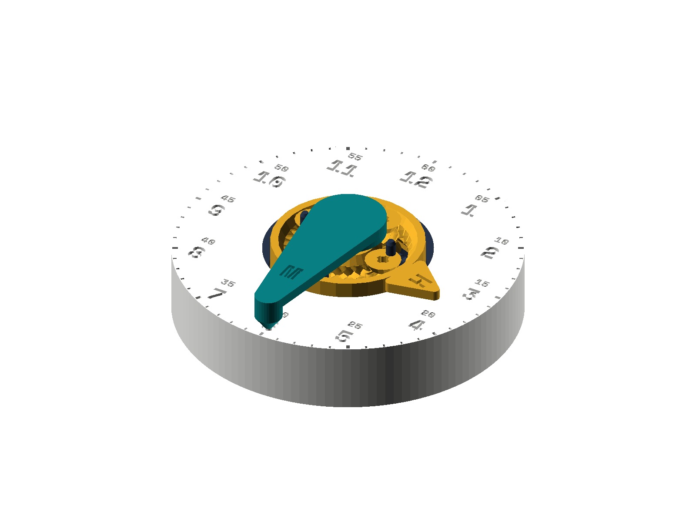{ width="320" }

> **Key Concept:** On a coordinate grid, find rectangle side lengths by subtracting the x-coordinates and y-coordinates. And when adding/subtracting hours and minutes, remember time is Base-60! Press [CLK] on the SC-6 to enter H.MM mode (1.45 [ENTER] 1.35 [+] -> 3.20), or use [f] [▸HR] ([f][CLK]) to turn 3 hr 15 min (3.15) into 3.25 decimal hours!

#### Demonstrate Both Textbook Methods with `TIME-01` Blocks (Planetary Geared Clock)

1. **Block Way 1 (+10 pts):** Count grid squares between vertex pegs on COUNT-01 (W=7, H=5); rotate TIME-01 gears forward across 12:00.
2. **Block Way 2 (+20 pts):** Subtract coordinates (|5 - (-2)| = 7, |4 - (-1)| = 5); regroup 1 hr = 60 min on the TIME-01 60-tooth ring!
3. **Both Ways Proof:** Counting physical grid squares / gear teeth matches subtracting coordinates and base-60 time!

#### Two-Method Worked Examples (`Method 1: +10 pts` vs. `Method 2: +20 pts DOUBLE`)

| Worksheet | Problem | Method 1 (`+10 pts` — 1st Token) | Method 2 (`+20 pts DOUBLE` — 2nd Token) | SC-6 Keystrokes | Final Answer |
| :--- | :--- | :--- | :--- | :--- | :--- |
| **Practice A** (`p.46`) | **A rectangle has vertices (2, 3), (9, 3), (9, 8), and (2, 8). Find its width, height, perimeter, and area.** | **METHOD 1 (+10 pts): Subtract x- and y-Coordinates:** Width = 9 - 2 = 7 units; Height = 8 - 3 = 5 units. Perimeter = 2(7 + 5) = 24 units; Area = 7 × 5 = 35 units². *(See `TIME-01` Block Way 1 above)* | **METHOD 2 (+20 pts DOUBLE): Count Grid Squares & Opposite Sides:** Count 7 columns across and 5 rows up on the baseplate: 7 + 5 + 7 + 5 = 24 around, and 5 rows of 7 = 35 squares inside. *(See `TIME-01` Block Way 2 above)* | `[9]` `[ENTER]` `[2]` `[-]` `[8]` `[ENTER]` `[3]` `[-]` `[f]` `[RECT]` | **Width = 7, Height = 5, Perimeter = 24, Area = 35** |
| **Practice B** (`p.47`) | **A 3D print starts at 9:40 AM and takes 2 hours 50 minutes. When does it finish? Also write 3 hr 15 min as decimal hours.** | **METHOD 1 (+10 pts): Base-60 Regrouping (60 min = 1 hr):** Add hours (9 + 2 = 11 hr) and minutes (40 + 50 = 90 min = 1 hr 30 min) -> 12:30 PM. For 3 hr 15 min: 15/60 = 1/4 = 0.25 -> 3.25 hr. *TIME-01 Way 1: Turn the geared hands 2 hr 15 min from 8:40 AM to 11:55 AM, then 35 min more to 12:30 PM.* | **METHOD 2 (+20 pts DOUBLE): Bridge to the Next Whole Hour + SC-6 [CLK]:** From 9:40, add 20 min to reach 10:00 AM, then add the remaining 2 hr 30 min -> 12:30 PM! Verify with [CLK] 9.40 [ENTER] 2.50 [+]. *FRAC-01 Way 2: Model 15 min as a 1/4-hour block (0.25 hr) -> 3 hr 15 min = 3 1/4 = 3.25 hours!* | `[CLK]` `[9.40]` `[ENTER]` `[2.50]` `[+]` `[3.15]` `[f]` `[▸HR]` | **12:30 PM; and 3.25 hours** |

#### Practice A (p. 46): Key Ideas & Two-Method Practice (10 Exercises)

| # | Problem Prompt | Coach Key: SC-6 Keystrokes | Final Answer |
| :---: | :--- | :--- | :--- |
| **A1** | Find the distance between (3, 4) and (11, 4) on a coordinate grid. | `11 [ENTER] 3 [-]` | **8 units** |
| **A2** | A rectangle has corners (1, 2), (10, 2), (10, 8), (1, 8). Find its area. | `10 [ENTER] 1 [-] 8 [ENTER] 2 [-] [f][RECT]` | **54 sq units** |
| **A3** | Find the total elapsed time: 1 hour 45 minutes + 1 hour 35 minutes (regroup 60 minutes into 1 hour). | `[CLK] 1.45 [ENTER] 1.35 [+]` | **3 hr 20 min (3.20)** |
| **A4** | Convert 2 hours 30 minutes into decimal hours. | `2.30 [f][▸HR]` | **2.5 hours** |
| **A5** | Convert 4 hours 45 minutes into decimal hours. | `4.45 [f][▸HR]` | **4.75 hours** |
| **A6** | Convert 1.75 decimal hours into hours and minutes. | `1.75 [g][▸HMS]` | **1 hr 45 min (1.45)** |
| **A7** | Find the elapsed time from 8:50 AM to 11:25 AM. | `[CLK] 11.25 [ENTER] 8.50 [-]` | **2 hr 35 min (2.35)** |
| **A8** | A right triangle on a grid has vertices (2, 1), (10, 1), and (2, 7). Find its area! | `8 [ENTER] 6 [g][TRI]` | **24 sq units** |
| **A9** | Modeling Real Life: You tutor for 3 hours 15 minutes at $16 per hour. Find your total pay in two ways. | `3.15 [f][▸HR] 16 [×]` | **$52.00 (Way 2: 3×16 + ¼×16 = 48+4 = 52)** |
| **A10** | Coordinate Park: Vertices (2, 2), (14, 2), (14, 11), (2, 11) where 1 unit = 10 yd. Find perimeter and area! | `12 [ENTER] 9 [f][RECT]` | **P = 42 units (420 yd); A = 108 sq units (10,800 yd²)** |

#### Practice B (p. 47): Modeling Real Life & Multi-Method Applications (10 Exercises)

| # | Modeling Real Life Application Prompt | Coach Key: SC-6 Keystrokes | Final Answer |
| :---: | :--- | :--- | :--- |
| **B1** | Coordinate Soccer Field: A field on a map has corners at (1, 2), (11, 2), (11, 8), and (1, 8). Find its width, height, perimeter, and area. | `11 [ENTER] 1 [-] 8 [ENTER] 2 [-] [f][RECT]` | **W=10, H=6, P=32, Area=60** |
| **B2** | Coordinate Right Triangle: A triangle has vertices at (2, 1), (10, 1), and (2, 7). Find the horizontal base, vertical height, and area. | `10 [ENTER] 2 [-] 7 [ENTER] 1 [-] [g][TRI]` | **Base=8, Height=6, Area=24** |
| **B3** | Flight Duration: A flight departs at 8:35 AM and lands 3 hours 40 minutes later. Regroup 60 minutes into 1 hour to find the landing time. | `[CLK] 8.35 [ENTER] 3.40 [+]` | **12:15 PM** |
| **B4** | Science Lab Timer: An experiment starts at 10:45 AM and ends at 2:20 PM (14:20 in 24-hour time). How many hours and minutes did it run? | `[CLK] 14.20 [ENTER] 10.45 [-]` | **3 hours 35 minutes** |
| **B5** | Marathon Split Sum: A runner completes Half 1 in 1 hr 52 min and Half 2 in 1 hr 58 min. What is her total marathon time? | `[CLK] 1.52 [ENTER] 1.58 [+]` | **3 hours 50 minutes** |
| **B6** | Lifeguard Shift Pay: You work a shift from 1:15 PM to 4:45 PM (3 hr 30 min) at $14 per hour. Convert 3 hr 30 min to 3.5 hours and find your pay! | `3.5 [ENTER] 14 [×]` | **3.5 hr × $14 = $49.00** |
| **B7** | Decimal Hours to H:MM: A battery test lasts 2.75 hours. Convert 2.75 hours into hours and minutes (0.75 × 60 min). | `2.75 [g][▸HMS]` | **2 hours 45 minutes** |
| **B8** | 3D Print Queue: Print A takes 1 hr 25 min, Print B takes 2 hr 15 min, and Print C takes 50 min. What is the total print time? | `[CLK] 1.25 [ENTER] 2.15 [+] 0.50 [+]` | **4 hours 30 minutes** |
| **B9** | Missing Vertex of a Rectangle: Three corners of a rectangle are (3, 4), (9, 4), and (9, 10). What are the coordinates of the 4th corner, and what is the area? | `9 [ENTER] 3 [-] 10 [ENTER] 4 [-] [f][RECT]` | **(3, 10); Area = 36 (it's a 6×6 square!)** |
| **B10** | Speed & Elapsed Time: A train travels for 2 hours 15 minutes (2.25 hours) at 80 miles per hour. How many miles does it travel? | `2.25 [ENTER] 80 [×]` | **180 miles** |

---

## Unit 6: Integers, Rational Numbers & The Coordinate Plane

*Big Ideas Math Grade 6 — Chapter 6 — Positive & Negative Integers, Comparing Rational Numbers, Absolute Value, and the 4-Quadrant Coordinate Plane*

- **Manipulative Kits:** `Ten-Frame Bicolor Counters (BASE-10) + Number Rack (RACK-01)`
- **Target Misconception:** Students confuse the subtraction operator [-] with the negative sign [+/-], think -18 > -5 because 18 > 5, confuse Opposite ([+/-]) with Absolute Value ([g] [|x|]), and reverse (x, y) coordinates.
- **Hands-On Remediation:** Use Yellow (+1) and Red (-1) Zero-Pair counters, test inequalities with [f] [>] and [g] [<], contrast [+/-] (flip sign) with [g] [|x|] (always positive distance from 0), and use the Elevator Rule (walk across x first, ride up/down y second).

### Section 6.1: Positive and Negative Integers & Opposites (Workbook pp. 48–49)

**Textbook Alignment:** Big Ideas Grade 6, Section 6.1 (Integers) (`CCSS.MATH.6.NS.C.5`) • **Big Ideas Methods:** *Method 1: Number Line Distance from 0  |  Method 2: Zero-Pair Cancellation & [+/-] Flip* • **Block Kit:** `BASE-10` (Ten-Frame Zero-Pair Counters)

**Key Vocabulary:** integer • positive number • negative number • opposites • additive inverse • zero pair

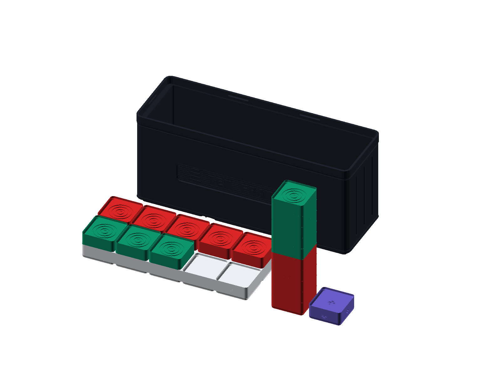{ width="320" }

> **Key Concept:** On regular calculators, mixing up the minus key and negative key causes SYNTAX ERROR. On the SC-6, [-] is the two-number subtraction action, while [+/-] flips the sign of the number on Floor 1 (X) between Positive (+) and Negative (-)—just like flipping a counter from Yellow (+) to Red (-)!

#### Demonstrate Both Textbook Methods with `BASE-10` Blocks (Ten-Frame Zero-Pair Counters)

1. **Block Way 1 (+10 pts):** Place pegs at -15 and +15 on RACK-01 at equal 15-unit distances on opposite sides of 0.
2. **Block Way 2 (+20 pts):** Pair 15 Red (-) counters with 15 Yellow (+) counters in RACK-01—all 15 zero pairs cancel to 0!
3. **Both Ways Proof:** Opposites sit at mirror positions across 0 (Method 1) and form 100% cancelling Zero Pairs (Method 2)!

#### Two-Method Worked Examples (`Method 1: +10 pts` vs. `Method 2: +20 pts DOUBLE`)

| Worksheet | Problem | Method 1 (`+10 pts` — 1st Token) | Method 2 (`+20 pts DOUBLE` — 2nd Token) | SC-6 Keystrokes | Final Answer |
| :--- | :--- | :--- | :--- | :--- | :--- |
| **Practice A** (`p.48`) | **Enter -15 on the SC-6, find its opposite, and verify that -15 + 15 = 0.** | **METHOD 1 (+10 pts): Opposite Sides of Zero on a Number Line:** -15 is 15 units left of 0; its opposite is 15 units right of 0 (+15). Moving 15 left then 15 right lands back at 0. *(See `BASE-10` Block Way 1 above)* | **METHOD 2 (+20 pts DOUBLE): Zero Pairs & Sign Flip [+/-]:** 15 negative counters + 15 positive counters form 15 zero pairs = 0. On SC-6: 15 [+/-] [ENTER] 15 [+] = 0. *(See `BASE-10` Block Way 2 above)* | `[15]` `[+/-]` `[ENTER]` `[15]` `[+]` | **Opposite of -15 is +15; -15 + 15 = 0** |
| **Practice B** (`p.49`) | **You start with $0, deposit $35 (+35), spend $50 (-50), and deposit $20 (+20). What is your final balance?** | **METHOD 1 (+10 pts): Group All Positives & All Negatives First:** Total deposits = +$35 + $20 = +$55. Subtract the $50 withdrawal: $55 - $50 = +$5 balance. *RACK-01 Way 1: Place 20 Red (-) and 25 Yellow (+) counters; 20 zero pairs cancel, leaving 5 Yellow (+$5).* | **METHOD 2 (+20 pts DOUBLE): Step-by-Step Running Balance on a Number Line:** Start at 0 -> +35 -> subtract 50 (pass 0 to -15) -> add 20 (-15 + 20 = +5). Final balance = +$5! *RACK-01 Way 2: Start at 0 on the number rail, slide 20 steps Left to -20, then 25 steps Right to +5!* | `[35]` `[ENTER]` `[50]` `[+/-]` `[+]` `[20]` `[+]` | **+$5** |

#### Practice A (p. 48): Key Ideas & Two-Method Practice (10 Exercises)

| # | Problem Prompt | Coach Key: SC-6 Keystrokes | Final Answer |
| :---: | :--- | :--- | :--- |
| **A1** | Write the integer that represents '25 feet below sea level' and state its opposite. | `25 [+/-] -> -25; [+/-] -> 25` | **-25; Opposite = +25** |
| **A2** | Find the opposite of -42, and then evaluate the opposite of the opposite: -(-(-42)). | `42 [+/-] [+/-] [+/-]` | **+42; and -42** |
| **A3** | Zero-Pair Cancellation: A submarine is at -18 m and rises +18 m. Where is it now? | `18 [+/-] [ENTER] 18 [+]` | **0 m (Sea level)** |
| **A4** | Combine 6 Yellow (+1) counters and 6 Red (-1) counters. What is the value? | `6 [ENTER] 6 [+/-] [+]` | **0** |
| **A5** | A hiker starts at -120 ft in a canyon and climbs +120 ft. What is her elevation? | `120 [+/-] [ENTER] 120 [+]` | **0 ft** |
| **A6** | Which integer is its own opposite? Explain using a number line. | `0 [+/-]` | **0** |
| **A7** | The temperature starts at 0°F, drops 12°F, and then rises 19°F. Find the final temperature. | `12 [+/-] [ENTER] 19 [+]` | **+7°F** |
| **A8** | Golf Par: -3 means 3 strokes under par. If you shoot -3 on Saturday and +3 on Sunday, what is your total? | `3 [+/-] [ENTER] 3 [+]` | **0 (Even par)** |
| **A9** | Modeling Real Life: An elevator starts at Floor 0, goes up 14 floors, down 20 floors, and up 9 floors. Find the final floor. | `14 [ENTER] 20 [+/-] [+] 9 [+]` | **Floor 3 (Way 2: (14+9) - 20 = 3)** |
| **A10** | Game XP: You gain 40 XP, lose 65 XP, and gain 25 XP. Did you break even? Prove 2 ways! | `40 [ENTER] 65 [+/-] [+] 25 [+]` | **0 XP (Break even! 40+25 = 65)** |

#### Practice B (p. 49): Modeling Real Life & Multi-Method Applications (10 Exercises)

| # | Modeling Real Life Application Prompt | Coach Key: SC-6 Keystrokes | Final Answer |
| :---: | :--- | :--- | :--- |
| **B1** | Submarine Dive & Climb: A submarine starts at sea level (0 ft), dives 120 feet (-120), and then rises 120 feet (+120). Where is it now, and what integer pair is this? | `120 [+/-] [ENTER] 120 [+]` | **0 ft (Sea level; zero pair / opposites)** |
| **B2** | Death Valley vs. Mt. Whitney: Badwater Basin is 282 feet below sea level. Write this elevation as an integer and state its opposite. | `282 [+/-]` | **-282 ft; opposite is +282 ft** |
| **B3** | Football Yardage Drive: A team gains 12 yards (+12), loses 8 yards (-8), and gains 15 yards (+15). What is their net yardage change? | `12 [ENTER] 8 [+/-] [+] 15 [+]` | **+19 yards** |
| **B4** | Freezer Temperature Drop: A lab sample starts at 15°C and cools by 25°C. What is the new temperature, and how far below 0°C is it? | `15 [ENTER] 25 [-]` | **-10°C (10°C below zero)** |
| **B5** | Zero-Pair Counter Challenge: You place 18 red negative counters (-18) and 25 yellow positive counters (+25) on the desk. How many zero pairs cancel, and what remains? | `18 [+/-] [ENTER] 25 [+]` | **18 zero pairs cancel; +7 remains** |
| **B6** | Golf Tournament Score: In golf, par is 0. A player shoots -4 on Friday, +2 on Saturday, and -3 on Sunday. What is her 3-day total score? | `4 [+/-] [ENTER] 2 [+] 3 [+/-] [+]` | **-5 (5 under par)** |
| **B7** | Opposite of the Opposite: If a scuba diver is at x = -35 feet, what is -x (the opposite of x), and what is -(-x)? | `35 [+/-] [+/-]` | **-x = +35; -(-x) = -35** |
| **B8** | Gift Card Balance: You have a $25 gift card, spend $25 on a game, and earn a $10 reward credit. What is your balance? | `25 [ENTER] 25 [-] 10 [+]` | **+$10** |
| **B9** | Mountain Trail Hiker: A hiker starts in a canyon at -40 meters, climbs 95 meters, and descends 20 meters. What is her final elevation? | `40 [+/-] [ENTER] 95 [+] 20 [-]` | **+35 meters** |
| **B10** | Zero-Sum Balancing: Three numbers add to 0. Two of the numbers are -14 and -9. What must the third number be? | `14 [+/-] [ENTER] 9 [+/-] [+] [+/-]` | **+23 (opposite of -23)** |

---

### Section 6.2: Comparing and Ordering Integers & Rational Numbers (Workbook pp. 50–51)

**Textbook Alignment:** Big Ideas Grade 6, Sections 6.2 & 6.3 (Comparing & Ordering Integers and Rational Numbers) (`CCSS.MATH.6.NS.C.7`) • **Big Ideas Methods:** *Method 1: Horizontal/Vertical Number Line Position  |  Method 2: Common Decimal or LCD Comparison* • **Block Kit:** `RACK-01` (Number Rack & Number Line)

**Key Vocabulary:** rational number • inequality (<, >) • number line order (left = less, right = greater)

{ width="320" }

> **Key Concept:** When kids see -18 and -5, their instinct says -18 is bigger because 18 > 5. Think of temperature: -5°F is WARMER than -18°F! On a horizontal number line ([f] [LINE]), further to the RIGHT is always greater. Test any inequality on the SC-6 with [f] [>] ([f][≠]) and [g] [<] ([g][≠]): 1 = TRUE, 0 = FALSE!

#### Demonstrate Both Textbook Methods with `RACK-01` Blocks (Number Rack & Number Line)

1. **Block Way 1 (+10 pts):** Place pegs at -5 and -18 on the RACK-01 number rail; -5 sits to the Right of -18, so -5 > -18.
2. **Block Way 2 (+20 pts):** Compare Red (-) counter stacks on RACK-01: 5 Red counters (owing 5) is less debt than 18 Red counters!
3. **Both Ways Proof:** Further Right on the RACK-01 rail always corresponds to fewer Red negative counters (closer to 0)!

#### Two-Method Worked Examples (`Method 1: +10 pts` vs. `Method 2: +20 pts DOUBLE`)

| Worksheet | Problem | Method 1 (`+10 pts` — 1st Token) | Method 2 (`+20 pts DOUBLE` — 2nd Token) | SC-6 Keystrokes | Final Answer |
| :--- | :--- | :--- | :--- | :--- | :--- |
| **Practice A** (`p.50`) | **Compare -5 and -18. Which one is greater?** | **METHOD 1 (+10 pts): Plot on a Horizontal Number Line:** Plot -5 and -18. Since -5 is to the right of -18 (closer to 0), -5 is greater than -18 (-5 > -18). *(See `RACK-01` Block Way 1 above)* | **METHOD 2 (+20 pts DOUBLE): Thermometer / Elevation Context & [f][>]:** -5°F is warmer than -18°F, and -5 ft is higher than -18 ft -> -5 > -18. Verify: 5 [+/-] [ENTER] 18 [+/-] [f][>] -> 1 (TRUE). *(See `RACK-01` Block Way 2 above)* | `[5]` `[+/-]` `[ENTER]` `[18]` `[+/-]` `[f]` `[>]` | **-5 > -18 (SC-6 outputs 1 = TRUE)** |
| **Practice B** (`p.51`) | **Diver A is at -4/5 meter and Diver B is at -0.75 meter. Which diver is at a greater elevation (closer to the surface)?** | **METHOD 1 (+10 pts): Convert Both to Decimals & Compare on Number Line:** -4/5 = -0.80 m. Compare -0.80 and -0.75: since -0.75 is closer to 0 (further right), -0.75 > -4/5 (Diver B is higher). *FRAC-01 Way 1: Compare 3/4 (63mm = 0.75) vs. 4/5 (67.2mm = 0.80) below 0 -> -0.75 sits above -0.80!* | **METHOD 2 (+20 pts DOUBLE): Convert Both to Common Denominator Twentieths:** -4/5 = -16/20 and -0.75 = -3/4 = -15/20. Because -15 > -16, -15/20 > -16/20, so -0.75 is greater! *FRAC-01 Way 2: Convert to twentieth-blocks: -15/20 is closer to 0 (warmer/higher) than -16/20!* | `[.]` `[4]` `[.]` `[5]` `[+/-]` `[FDISP]` `[0.75]` `[+/-]` `[g]` `[<]` | **-0.75 > -4/5 (Diver B is higher)** |

#### Practice A (p. 50): Key Ideas & Two-Method Practice (10 Exercises)

| # | Problem Prompt | Coach Key: SC-6 Keystrokes | Final Answer |
| :---: | :--- | :--- | :--- |
| **A1** | Compare -12°C and -5°C using < or >. Which temperature is warmer? | `12 [+/-] [ENTER] 5 [+/-] [g][<]` | **-5°C (-12 < -5)** |
| **A2** | Compare -9 and -2 using > or <. | `9 [+/-] [ENTER] 2 [+/-] [g][<]` | **-9 < -2** |
| **A3** | Compare -15 and 0 using > or <. | `15 [+/-] [ENTER] 0 [g][<]` | **-15 < 0** |
| **A4** | Order the integers from least to greatest: 4, -7, 0, -2, -10. | `Left-to-right on number line` | **-10, -7, -2, 0, 4** |
| **A5** | Compare -3/4 and -0.6. (Hint: -3/4 = -0.75. Which is further right?) | `0.75 [+/-] [ENTER] 0.6 [+/-] [g][<]` | **-3/4 < -0.6 (-0.6 is greater)** |
| **A6** | Compare -2 1/2 and -2.3 using > or <. | `2.5 [+/-] [ENTER] 2.3 [+/-] [g][<]` | **-2 1/2 < -2.3** |
| **A7** | Compare -5/8 and -7/8. | `[.] 5 [.] 8 [+/-] [ENTER] [.] 7 [.] 8 [+/-] [f][>]` | **-5/8 > -7/8** |
| **A8** | Error Analysis: Leo says -4.5 > -4.1 because 4.5 > 4.1. Explain why -4.1 is actually greater! | `4.5 [+/-] [ENTER] 4.1 [+/-] [g][<]` | **-4.1 is closer to 0 (further right)** |
| **A9** | Order the rational numbers -1.5, 1 1/4, -1 3/4, and -0.5 from least to greatest. | `-1.75, -1.5, -0.5, 1.25` | **-1 3/4, -1.5, -0.5, 1 1/4** |
| **A10** | Three divers are at -14.8 m, -14 1/2 m, and -15.2 m. Who is deepest (least) and who is shallowest (greatest)? | `-15.2 < -14.8 < -14.5` | **Deepest: -15.2 m; Shallowest: -14 1/2 m** |

#### Practice B (p. 51): Modeling Real Life & Multi-Method Applications (10 Exercises)

| # | Modeling Real Life Application Prompt | Coach Key: SC-6 Keystrokes | Final Answer |
| :---: | :--- | :--- | :--- |
| **B1** | Arctic Weather Station: Monday was -18°C and Tuesday was -11°C. Write an inequality (< or >) to compare the temperatures. Which day was warmer? | `11 [+/-] [ENTER] 18 [+/-] [f][>]` | **-11°C > -18°C (Tuesday was warmer)** |
| **B2** | Ocean Trench Explorers: Rover Alpha is at -2.4 km and Rover Beta is at -2.15 km. Which rover is deeper, and which elevation is greater? | `2.15 [+/-] [ENTER] 2.4 [+/-] [f][>]` | **Alpha (-2.4) is deeper; -2.15 > -2.4** |
| **B3** | Negative Fraction Showdown: Compare -2/3 and -5/6 by rewriting both with denominator 6. Which rational number is greater? | `[.] 2 [.] 3 [+/-] [ENTER] [.] 5 [.] 6 [+/-] [f][>]` | **-4/6 > -5/6, so -2/3 > -5/6** |
| **B4** | Golf Leaderboard Order: Four players have scores of -6, +2, -9, and -1. Order the scores from least (best in golf!) to greatest. | `9 [+/-] [ENTER] 6 [+/-] [g][<]` | **-9, -6, -1, +2** |
| **B5** | Freezing Point of Liquids: Water freezes at 0°C, olive oil at -6°C, mercury at -39°C, and rubbing alcohol at -89°C. Order from coldest (least) to warmest (greatest). | `89 [+/-] [ENTER] 39 [+/-] [g][<]` | **-89°C, -39°C, -6°C, 0°C** |
| **B6** | Fraction vs. Decimal Depth: A coral reef is at -3 1/4 meters and a sea turtle is at -3.1 meters. Which one is closer to the surface (greater)? | `3.25 [+/-] [ENTER] 3.1 [+/-] [g][<]` | **-3.1 > -3 1/4 (-3.25); turtle is higher** |
| **B7** | Stock Market Change: Tech stock changed by -1.8% and Retail stock changed by -1.08%. Which stock had the greater (less negative) change? | `1.08 [+/-] [ENTER] 1.8 [+/-] [f][>]` | **-1.08% > -1.8%** |
| **B8** | Between Two Negatives: Find an integer and a decimal that lie between -4 and -3 on a number line. | `3.5 [+/-]` | **No integer; decimal e.g. -3.5** |
| **B9** | Four-Card Rational Sort: Order -7/4, -1.6, 3/2, and -2 from least to greatest by converting the fractions to decimals. | `[.] 7 [.] 4 [+/-] [FDISP]` | **-2, -7/4 (-1.75), -1.6, 3/2 (1.5)** |
| **B10** | True or False Inequality Check: If a < b and both a and b are negative (like -10 < -2), which one is further from 0? | `10 [+/-] [g][|x|]` | **a (-10) is further from 0** |

---

### Section 6.3: Absolute Value and Magnitude (Workbook pp. 52–53)

**Textbook Alignment:** Big Ideas Grade 6, Section 6.4 (Absolute Value) (`CCSS.MATH.6.NS.C.7c`) • **Big Ideas Methods:** *Method 1: Count Steps from Zero on Number Line  |  Method 2: Evaluate |x| Bars First (Like Grouping Symbols)* • **Block Kit:** `RACK-01` (Number Rack & Zero-Pair Studio)

**Key Vocabulary:** absolute value (|x|) • magnitude • distance from zero • opposite vs. absolute value

{ width="320" }

> **Key Concept:** Students often confuse Opposite ([+/-]) with Absolute Value ([g] [|x|], [g][+/-]). Opposite flips the sign (+9 -> -9, -9 -> +9). Absolute Value asks 'How many steps from 0?' Since you can't walk a negative number of steps, [g] [|x|] is ALWAYS positive (or 0)!

#### Demonstrate Both Textbook Methods with `RACK-01` Blocks (Number Rack & Zero-Pair Studio)

1. **Block Way 1 (+10 pts):** Count 14 un-signed steps from 0 to -14 and from 0 to +14 on the RACK-01 rail (|-14| = |14| = 14).
2. **Block Way 2 (+20 pts):** Flip 14 Red (-) counters to positive Yellow inside the |x| bars (+14), then apply any outside '-' sign last (-14)!
3. **Both Ways Proof:** Absolute value bars |x| measure un-signed counter count (distance from 0) before any outside sign!

#### Two-Method Worked Examples (`Method 1: +10 pts` vs. `Method 2: +20 pts DOUBLE`)

| Worksheet | Problem | Method 1 (`+10 pts` — 1st Token) | Method 2 (`+20 pts DOUBLE` — 2nd Token) | SC-6 Keystrokes | Final Answer |
| :--- | :--- | :--- | :--- | :--- | :--- |
| **Practice A** (`p.52`) | **Find |-14|, |14|, and -|-14| on your SC-6.** | **METHOD 1 (+10 pts): Measure Distance from 0:** Both -14 and 14 are 14 units away from 0, so |-14| = 14 and |14| = 14. *(See `RACK-01` Block Way 1 above)* | **METHOD 2 (+20 pts DOUBLE): Inside Bars First, Outside Sign Second:** In -|-14|, evaluate inside the bars first (|-14| = 14), then attach the outside negative sign -> -14. *(See `RACK-01` Block Way 2 above)* | `[14]` `[+/-]` `[g]` `[|x|]` | **|-14| = 14, |14| = 14, -|-14| = -14** |
| **Practice B** (`p.53`) | **Evaluate 50 - |-18| and explain why it does NOT equal 68.** | **METHOD 1 (+10 pts): Treat Absolute Value Bars as Grouping Symbols:** Step 1: Find |-18| = 18 first (absolute value bars are NOT parentheses!). Step 2: Subtract 50 - 18 = 32. *RACK-01 Way 1: Count 18 Red counters for the -18 drop (|-18| = 18), then subtract 18 from 50 -> 32.* | **METHOD 2 (+20 pts DOUBLE): Physical Distance Comparison:** A rope is 50 ft long; a diver is 18 ft below sea level (depth = |-18| = 18 ft). Rope left = 50 - 18 = 32 ft! *RACK-01 Way 2: Start at +50 on the number rail and walk 18 steps toward 0 -> lands on 32!* | `[50]` `[ENTER]` `[18]` `[+/-]` `[g]` `[|x|]` `[-]` | **32 (since |-18| = 18, and 50 - 18 = 32)** |

#### Practice A (p. 52): Key Ideas & Two-Method Practice (10 Exercises)

| # | Problem Prompt | Coach Key: SC-6 Keystrokes | Final Answer |
| :---: | :--- | :--- | :--- |
| **A1** | Find the absolute value |-27|. Explain what it represents on a number line. | `27 [+/-] [g][|x|]` | **27** |
| **A2** | Evaluate |-27| + |13|. | `27 [+/-] [g][|x|] [ENTER] 13 [+]` | **40** |
| **A3** | Evaluate |-4.8| + |-3.2|. | `4.8 [+/-] [g][|x|] [ENTER] 3.2 [+/-] [g][|x|] [+]` | **8.0** |
| **A4** | Evaluate |-35| - |-19|. | `35 [+/-] [g][|x|] [ENTER] 19 [+/-] [g][|x|] [-]` | **16** |
| **A5** | Compare |-12| and |9| using > or <. (Which is further from 0?) | `12 > 9` | **|-12| > |9| (12 > 9)** |
| **A6** | Evaluate -|-24| by finding the absolute value inside the bars first. | `24 [+/-] [g][|x|] [+/-]` | **-24** |
| **A7** | Evaluate 50 - |-18|. Find |-18| first, then subtract from 50. | `50 [ENTER] 18 [+/-] [g][|x|] [-]` | **32** |
| **A8** | Order from least to greatest: |-8|, -6, |-3|, 0, -|-9|. | `Values: 8, -6, 3, 0, -9` | **-|-9|, -6, 0, |-3|, |-8|** |
| **A9** | A diver is at -32 ft and a seagull is at +25 ft. Which is closer to sea level (0), and by how many feet? | `32 [+/-] [g][|x|] [ENTER] 25 [-]` | **Seagull is closer by 7 ft (25 < 32)** |
| **A10** | Two accounts have balances of -$45 and -$28. Which account has the greater debt (|-45| vs |-28|), and which has the greater balance? | `|-45|=45 > |-28|=28` | **Greater debt: -$45 ($45); Greater balance: -$28** |

#### Practice B (p. 53): Modeling Real Life & Multi-Method Applications (10 Exercises)

| # | Modeling Real Life Application Prompt | Coach Key: SC-6 Keystrokes | Final Answer |
| :---: | :--- | :--- | :--- |
| **B1** | Scuba Depth vs. Seagull Height: A diver is at -28 feet and a seagull is at +28 feet. Find |-28| and |28|. Who is further from sea level? | `28 [+/-] [g][|x|]` | **|-28| = 28 ft, |28| = 28 ft (Equal distance!)** |
| **B2** | Credit Card Debt Magnitude: Account A has a balance of -$65 and Account B has -$40. Which account has the greater balance, and which has the greater debt (|-x|)? | `65 [+/-] [g][|x|]` | **-$40 is greater balance; Account A has greater debt ($65)** |
| **B3** | Absolute Value Sum: A drone flies 18 meters west (-18) and then 14 meters east (+14). Evaluate |-18| + |14| to find the total distance flown. | `18 [+/-] [g][|x|] 14 [g][|x|] [+]` | **18 + 14 = 32 meters flown** |
| **B4** | Outside Negative Sign Trap: Evaluate both |-35| and -|-35|. Explain why the second answer is negative. | `35 [+/-] [g][|x|] [+/-]` | **|−35| = 35; −|−35| = −35 (outside minus applies after)** |
| **B5** | Target Precision Error: Three darts land at -2.4 cm, +1.8 cm, and -1.5 cm from the bullseye (0). Use absolute value to find which dart is closest to the center! | `1.5 [+/-] [g][|x|]` | **-1.5 cm (distance |-1.5| = 1.5 cm is smallest)** |
| **B6** | Evaluate the Expression: Compute | -42 | ÷ | -6 | + | -11 |. | `42 [+/-] [g][|x|] 6 [+/-] [g][|x|] [÷] 11 [+/-] [g][|x|] [+]` | **42 ÷ 6 + 11 = 18** |
| **B7** | Submarine Cable Length: A ship is at +25 feet above the water and lowers a camera to -140 feet. Evaluate |25| + |-140| to find the cable length. | `25 [g][|x|] 140 [+/-] [g][|x|] [+]` | **165 feet of cable** |
| **B8** | Two Solutions Puzzle: Find BOTH numbers on the number line whose absolute value is 19 (|x| = 19). | `19 [+/-] [g][|x|]` | **x = 19 and x = -19** |
| **B9** | Order with Absolute Value Bars: Order |-8|, -6, |5|, and -|-9| from least to greatest. (Tip: evaluate each absolute value first!) | `9 [+/-] [g][|x|] [+/-]` | **-|-9| (-9), -6, |5| (5), |-8| (8)** |
| **B10** | Fractional Absolute Value: Evaluate |-3 1/2| + |2 1/4| - |-1 1/8|. | `3 [.] 1 [.] 2 [ENTER] 2 [.] 1 [.] 4 [+] 1 [.] 1 [.] 8 [-]` | **4 5/8** |

---

### Section 6.4: The Four-Quadrant Coordinate Plane & Reflections (Workbook pp. 54–55)

**Textbook Alignment:** Big Ideas Grade 6, Section 6.5 (The Coordinate Plane) (`CCSS.MATH.6.NS.C.6`) • **Big Ideas Methods:** *Method 1: Plot & Fold Across the Axis  |  Method 2: Coordinate Sign Rules (Flip y for x-axis, Flip x for y-axis)* • **Block Kit:** `COUNT-01` (4x4 Gridfinity Baseplate & Tiles)

**Key Vocabulary:** coordinate plane • origin (0, 0) • x-axis • y-axis • quadrants (I, II, III, IV) • ordered pair (x, y) • reflection

{ width="320" }

> **Key Concept:** To never mix up (x, y), use the Elevator Rule: walk ACROSS the lobby first (x: right +, left -), then ride UP/DOWN the elevator (y: up +, down -)! Reflecting across the y-axis flips the x-sign ([+/-]); reflecting across the x-axis flips the y-sign ([+/-])!

#### Demonstrate Both Textbook Methods with `COUNT-01` Blocks (4x4 Gridfinity Baseplate & Tiles)

1. **Block Way 1 (+10 pts):** On the 4-Quadrant COUNT-01 grid, walk horizontally from (0,0) along x first, then vertically along y.
2. **Block Way 2 (+20 pts):** Fold/mirror across the x-axis by flipping the vertical y-coordinate, or across the y-axis by flipping x!
3. **Both Ways Proof:** Quadrant signs (+,-) and mirror reflections both follow horizontal-x and vertical-y grid steps!

#### Two-Method Worked Examples (`Method 1: +10 pts` vs. `Method 2: +20 pts DOUBLE`)

| Worksheet | Problem | Method 1 (`+10 pts` — 1st Token) | Method 2 (`+20 pts DOUBLE` — 2nd Token) | SC-6 Keystrokes | Final Answer |
| :--- | :--- | :--- | :--- | :--- | :--- |
| **Practice A** (`p.54`) | **Identify the quadrant for A(-6, 5), B(4, -7), and C(-3, -8).** | **METHOD 1 (+10 pts): Walk Horizontal (x) Then Vertical (y):** A(-6, 5): left 6, up 5 -> Quad II. B(4, -7): right 4, down 7 -> Quad IV. C(-3, -8): left 3, down 8 -> Quad III. *(See `COUNT-01` Block Way 1 above)* | **METHOD 2 (+20 pts DOUBLE): Use Quadrant Sign Chart:** Quad I = (+, +), Quad II = (-, +), Quad III = (-, -), Quad IV = (+, -). Match each ordered pair's signs! *(See `COUNT-01` Block Way 2 above)* | `[6]` `[+/-]` `[ENTER]` `[5]` | **A: Quad II, B: Quad IV, C: Quad III** |
| **Practice B** (`p.55`) | **Start at P(-5, 8) in Quadrant II. Reflect across the x-axis, then reflect that new point across the y-axis. Where do you land?** | **METHOD 1 (+10 pts): Apply Axis Reflection Sign Rules:** 1. Reflect (-5, 8) across x-axis (keep x, flip y): (-5, -8).  2. Reflect (-5, -8) across y-axis (flip x, keep y): (5, -8) in Quad IV. *COUNT-01 Way 1: Place a peg at (-5, -8) in QIII, then mirror 5 units across the y-axis to (+5, -8) in QIV.* | **METHOD 2 (+20 pts DOUBLE): Count Equal Distances Across Each Axis:** 8 units above x-axis flips to 8 units below (-5, -8); 5 units left of y-axis flips to 5 units right -> (5, -8)! *COUNT-01 Way 2: Keep y = -8 fixed and flip x from -5 to +5 -> (5, -8), which is 5+5 = 10 units away!* | `[5]` `[+/-]` `[ENTER]` `[8]` `[+/-]` `[x⇄y]` `[+/-]` `[x⇄y]` | **(5, -8) in Quadrant IV** |

#### Practice A (p. 54): Key Ideas & Two-Method Practice (10 Exercises)

| # | Problem Prompt | Coach Key: SC-6 Keystrokes | Final Answer |
| :---: | :--- | :--- | :--- |
| **A1** | Name the Quadrant (I, II, III, or IV) for point (7, -4). | `(+, -) -> Right, Down` | **Quadrant IV** |
| **A2** | Name the Quadrant for point (-9, -2). | `(-, -) -> Left, Down` | **Quadrant III** |
| **A3** | Name the Quadrant for point (-5, 11). | `(-, +) -> Left, Up` | **Quadrant II** |
| **A4** | Reflect the point (6, 9) across the y-axis. Write the coordinates of the reflected point. | `6 [+/-] -> -6` | **(-6, 9)** |
| **A5** | Reflect the point (6, 9) across the x-axis. Write the coordinates of the reflected point. | `9 [+/-] -> -9` | **(6, -9)** |
| **A6** | Reflect (-3, -7) across the x-axis. | `7 [+/-] [+/-] -> +7` | **(-3, 7)** |
| **A7** | Reflect (-8, 4) across the y-axis, and then across the x-axis. | `Flip x -> (8,4); flip y -> (8,-4)` | **(8, -4)** |
| **A8** | On the Fence: Which axis does (0, -9) sit on, and which axis does (-7, 0) sit on? | `0 sideways vs 0 up/down` | **(0,-9) on y-axis; (-7,0) on x-axis** |
| **A9** | Start at (4, -5). Walk 7 units left and 8 units up. Where do you land, and in which quadrant? | `4 [ENTER] 7 [-]; 5 [+/-] [ENTER] 8 [+]` | **(-3, 3) in Quadrant II** |
| **A10** | Points A(-4, 2), B(4, 2), and C(4, -5) are 3 corners of a rectangle. Find the 4th corner D! | `Match x of A (-4) & y of C (-5)` | **D(-4, -5) in Quadrant III** |

#### Practice B (p. 55): Modeling Real Life & Multi-Method Applications (10 Exercises)

| # | Modeling Real Life Application Prompt | Coach Key: SC-6 Keystrokes | Final Answer |
| :---: | :--- | :--- | :--- |
| **B1** | Treasure Map Quadrants: Tell which quadrant (I, II, III, or IV) contains each landmark: Cave (-8, 4), Lighthouse (7, 9), Shipwreck (-5, -6), and Pier (3, -10). | `8 [+/-] [ENTER] 4` | **Cave: II, Lighthouse: I, Shipwreck: III, Pier: IV** |
| **B2** | On the Axis Check: A buoy is at (0, -7) and a dock is at (9, 0). Neither is in a quadrant! Tell which axis (x-axis or y-axis) each point lies on. | `0 [ENTER] 7 [+/-]` | **(0, -7) is on y-axis; (9, 0) is on x-axis** |
| **B3** | Lake Reflection (x-Axis): A mountain peak is plotted at (8, 12). Its reflection in the lake flips across the x-axis. What are the coordinates of the reflection? | `8 [ENTER] 12 [+/-]` | **(8, -12) in Quadrant IV** |
| **B4** | Symmetry Wing Design (y-Axis): The left wingtip of a butterfly is at (-9, 5) in Quadrant II. Reflect it across the y-axis to place the right wingtip! | `9 [+/-] [+/-] [ENTER] 5` | **(9, 5) in Quadrant I** |
| **B5** | Double Jump Reflection: Start at (-4, -9) in Quadrant III. Reflect across the x-axis first, then across the y-axis. Where do you land? | `4 [+/-] [+/-] [ENTER] 9 [+/-] [+/-]` | **Step 1: (-4, 9); Final: (4, 9) in Quad I** |
| **B6** | Robot Navigation Directions: Starting from the origin (0, 0), a robot moves 6 units left and 8 units down, then 10 units right. What are its new coordinates and quadrant? | `6 [+/-] [ENTER] 10 [+]` | **(4, -8) in Quadrant IV** |
| **B7** | Decimal Ordered Pairs: Plot mentally and identify the quadrant for P(-2.5, 4.5) and Q(-1.5, -3.5). | `2.5 [+/-] [ENTER] 4.5` | **P is in Quadrant II; Q is in Quadrant III** |
| **B8** | Mystery Axis Reflection: Point M(7, -3) was reflected to M'(-7, -3). Which axis did it reflect across? How can you tell from the coordinates? | `7 [+/-]` | **y-axis (x-sign flipped, y stayed -3)** |
| **B9** | Square Symmetry Around Origin: One corner of a square centered at (0, 0) is at (5, 5). Reflect across both axes to write the other 3 corners! | `5 [+/-]` | **(-5, 5), (-5, -5), and (5, -5)** |
| **B10** | Quadrant Sign Puzzle: If x is negative and y is positive, what quadrant is (x, y) in? What quadrant is (-x, -y) in? | `1 [+/-]` | **(x, y) is in Quad II; (-x, -y) is in Quad IV** |

---

### Section 6.5: Distances in the Coordinate Plane (Workbook pp. 56–57)

**Textbook Alignment:** Big Ideas Grade 6, Section 6.5 Ext (Distances on the Coordinate Plane) (`CCSS.MATH.6.NS.C.8`) • **Big Ideas Methods:** *Method 1: Add/Subtract Absolute Values to Axis  |  Method 2: Universal Difference Formula |x₁ - x₂|* • **Block Kit:** `COUNT-01` (Baseplate & Zero-Pair Studio)

**Key Vocabulary:** horizontal distance • vertical distance • same quadrant (subtract |x|) • different quadrants (add |x|)

{ width="320" }

> **Key Concept:** When two points share a coordinate like (-6, 4) and (9, 4), how far apart are they? If they are in different quadrants (cross an axis), add their distances to the axis (|-6| + |9| = 15). Even faster: on the SC-6, subtract ANY two coordinates and press [g] [|x|] (-6 - 9 = -15 -> |-15| = 15)!

#### Demonstrate Both Textbook Methods with `COUNT-01` Blocks (Baseplate & Zero-Pair Studio)

1. **Block Way 1 (+10 pts):** On COUNT-01, count 6 squares from (-6, 4) to the y-axis plus 9 squares from the y-axis to (9, 4) -> 6 + 9 = 15.
2. **Block Way 2 (+20 pts):** On RACK-01, subtract the coordinates and take absolute value: |9 - (-6)| = |9 + 6| = 15 units!
3. **Both Ways Proof:** Adding distances to the axis (|-6| + |9|) when crossing 0 equals subtracting coordinates (|9 - (-6)| = 15)!

#### Two-Method Worked Examples (`Method 1: +10 pts` vs. `Method 2: +20 pts DOUBLE`)

| Worksheet | Problem | Method 1 (`+10 pts` — 1st Token) | Method 2 (`+20 pts DOUBLE` — 2nd Token) | SC-6 Keystrokes | Final Answer |
| :--- | :--- | :--- | :--- | :--- | :--- |
| **Practice A** (`p.56`) | **Find the distance between (-6, 4) and (9, 4), and between (-12, -3) and (-4, -3).** | **METHOD 1 (+10 pts): Add Across Axis / Subtract in Same Quadrant:** (-6, 4) to (9, 4) crosses y-axis -> ADD |-6| + |9| = 15. (-12, -3) to (-4, -3) is in same quadrant -> SUBTRACT |-12| - |-4| = 8. *(See `COUNT-01` Block Way 1 above)* | **METHOD 2 (+20 pts DOUBLE): Absolute Difference |x₁ - x₂|:** Subtract x-coordinates and take absolute value: |-6 - 9| = |-15| = 15, and |-12 - (-4)| = |-8| = 8. *(See `COUNT-01` Block Way 2 above)* | `[6]` `[+/-]` `[ENTER]` `[9]` `[-]` `[g]` `[|x|]` | **15 units; and 8 units** |
| **Practice B** (`p.57`) | **A rectangular park has vertices (-4, 6), (5, 6), (5, -2), and (-4, -2). Find its width, height, perimeter, and area.** | **METHOD 1 (+10 pts): Add Distances Across the x- and y-Axes:** Width (crosses y-axis): |-4| + |5| = 4 + 5 = 9. Height (crosses x-axis): |6| + |-2| = 6 + 2 = 8. P = 2(9+8) = 34; A = 9×8 = 72. *COUNT-01 Way 1: Frame the rectangle on the 4-quadrant grid: width = 4 + 5 = 9 squares, height = 3 + 5 = 8 squares.* | **METHOD 2 (+20 pts DOUBLE): Coordinate Subtraction + [f] [RECT]:** Width = |5 - (-4)| = 9; Height = |6 - (-2)| = 8. Area = 9 × 8 = 72 units²; Perimeter = 9 + 8 + 9 + 8 = 34 units. *COUNT-01 Way 2: Walk the 4 edges (9 + 8 + 9 + 8 = 34 perimeter) and fill the 9 × 8 interior (72 area squares)!* | `[4]` `[+/-]` `[ENTER]` `[5]` `[-]` `[g]` `[|x|]` `[6]` `[ENTER]` `[2]` `[+/-]` `[-]` `[f]` `[RECT]` | **W = 9, H = 8, Perimeter = 34, Area = 72** |

#### Practice A (p. 56): Key Ideas & Two-Method Practice (10 Exercises)

| # | Problem Prompt | Coach Key: SC-6 Keystrokes | Final Answer |
| :---: | :--- | :--- | :--- |
| **A1** | Find the horizontal distance between (-8, 5) and (11, 5). | `8 [+/-] [ENTER] 11 [-] [g][|x|]` | **19 units** |
| **A2** | Find the vertical distance between (-3, -4) and (-3, -15). | `4 [+/-] [ENTER] 15 [+/-] [-] [g][|x|]` | **11 units** |
| **A3** | Find the vertical distance between (7, 9) and (7, -6). | `9 [ENTER] 6 [+/-] [-] [g][|x|]` | **15 units** |
| **A4** | Find the horizontal distance between (-14, 2) and (-5, 2). | `14 [+/-] [ENTER] 5 [+/-] [-] [g][|x|]` | **9 units** |
| **A5** | Find the distance between (-3.5, 4) and (6.5, 4). | `3.5 [+/-] [ENTER] 6.5 [-] [g][|x|]` | **10 units** |
| **A6** | Find the distance between (2, -4 1/2) and (2, 3 1/2). | `4.5 [+/-] [ENTER] 3.5 [-] [g][|x|]` | **8 units** |
| **A7** | A line segment starts at (-6, 3) and goes 10 units right. What are the coordinates of the right endpoint? | `6 [+/-] [ENTER] 10 [+]` | **(4, 3)** |
| **A8** | Error Analysis: For (-5, 2) to (8, 2), Sam subtracted 8 - 5 = 3. Why is the distance 13, not 3? | `5 [+/-] [ENTER] 8 [-] [g][|x|]` | **13 units (They are on opposite sides of the y-axis!)** |
| **A9** | A treasure map rectangle has corners (-4, 6), (5, 6), (5, -2), (-4, -2). Find its perimeter & area 2 ways! | `Width 9, Height 8` | **Perimeter = 34, Area = 72** |
| **A10** | On a city grid (1 unit = 0.5 mile), you walk from (-6, -2) to (-6, 8) to (4, 8). How many miles did you walk? | `10 + 10 = 20 units × 0.5` | **20 units = 10 miles** |

#### Practice B (p. 57): Modeling Real Life & Multi-Method Applications (10 Exercises)

| # | Modeling Real Life Application Prompt | Coach Key: SC-6 Keystrokes | Final Answer |
| :---: | :--- | :--- | :--- |
| **B1** | Bridge Across the River (y-Axis): West Tower is at (-8, 5) and East Tower is at (11, 5). Add their distances to the y-axis to find the bridge length! | `8 [+/-] [ENTER] 11 [-] [g][|x|]` | **|-8| + |11| = 19 units** |
| **B2** | Same-Quadrant Sprint: On a campus map (1 unit = 10 meters), the gym is at (-14, 6) and the library is at (-5, 6). How many units (and meters) apart are they? | `14 [+/-] [ENTER] 5 [+/-] [-] [g][|x|]` | **9 units = 90 meters** |
| **B3** | Vertical Elevator Shaft: A mine shaft runs from a tower at (4, 15) straight down to a tunnel at (4, -35). What is the total vertical distance? | `15 [ENTER] 35 [+/-] [-] [g][|x|]` | **|15| + |-35| = 50 units** |
| **B4** | Coordinate Dog Park Perimeter: A rectangular dog park has corners at (-3, 4), (7, 4), (7, -2), and (-3, -2). Find its width, height, and perimeter. | `3 [+/-] [ENTER] 7 [-] [g][|x|] 4 [ENTER] 2 [+/-] [-] [g][|x|] [+] 2 [×]` | **W = 10, H = 6, Perimeter = 32 units** |
| **B5** | Coordinate Dog Park Area: Find the area of the dog park from Problem 4 (Width = 10, Height = 6). Notice it spans across all 4 quadrants! | `10 [ENTER] 6 [f][RECT]` | **60 square units** |
| **B6** | Subway Line Stops: Stop A is at (-3.5, 2), Stop B is at (0, 2), and Stop C is at (4.25, 2). Find the total distance from Stop A to Stop C. | `3.5 [ENTER] 4.25 [+]` | **7.75 miles** |
| **B7** | Fractional Coordinate Distance: Find the vertical distance between (2, 3 1/2) and (2, -2 1/4). | `3 [.] 1 [.] 2 [ENTER] 2 [.] 1 [.] 4 [+]` | **5 3/4 units** |
| **B8** | L-Shaped Drone Delivery: A drone flies from (-6, -2) to (-6, 5), and then turns east to (4, 5). What is the total two-segment flight distance? | `5 [ENTER] 2 [+] 4 [ENTER] 6 [+] [+]` | **7 + 10 = 17 units** |
| **B9** | Two Possible Points: Point A is at (3, 4). Point B has the same y-coordinate (4) and is 8 units away horizontally. Find BOTH possible locations for Point B! | `3 [ENTER] 8 [+] 3 [ENTER] 8 [-]` | **(11, 4) and (-5, 4)** |
| **B10** | Coordinate Triangle Area: A triangle has vertices at (-4, -1), (6, -1), and (-4, 7). Find its horizontal base, vertical height, and area. | `4 [ENTER] 6 [+] 7 [ENTER] 1 [+] [g][TRI]` | **Base = 10, Height = 8, Area = 40 units²** |

---

## Unit 7: Equations & Inequalities

*Big Ideas Math Grade 6 — Chapter 7 — Writing Equations, Solving One-Step Equations, Writing & Graphing Inequalities, and Two-Variable Relationships*

- **Manipulative Kits:** `Algebra Boxes & Stage (ALGB-01) + Number Rack (RACK-01)`
- **Target Misconception:** Students treat '=' as 'write the answer', translate '8 less than n' backwards as 8 - n, resent writing -14 under both sides of x + 14 = 39, and confuse open vs. solid inequality circles.
- **Hands-On Remediation:** Model '=' as a Balance Scale using Algebra Boxes & Stage (ALGB-01). Solve 1-step equations with inverse operations on both sides and check the answer with [f] [LASTX], and test inequalities with [f] [≥] and [g] [≤].

### Section 7.1: Writing Equations in One Variable & Testing Solutions (Workbook pp. 58–59)

**Textbook Alignment:** Big Ideas Grade 6, Section 7.1 (Writing Equations in One Variable) (`CCSS.MATH.6.EE.B.5`) • **Big Ideas Methods:** *Method 1: Substitute & Test Both Sides  |  Method 2: Mental / Balance Scale Unwrapping* • **Block Kit:** `ALGB-01` (Algebra Boxes & Stage)

**Key Vocabulary:** equation • solution of an equation • defining a variable • balance scale • turnaround words ('less than')

{ width="320" }

> **Key Concept:** In algebra, '=' is the center pivot of a Balance Scale! On your SC-6, Floor 2 (Y) is the Left Pan and Floor 1 (X) is the Right Pan. To test if x = 8 solves 3x - 5 = 19, put 19 on Y, compute 3(8) - 5 on X, and see Y: 19 | X: 19 (or press [g] [≠] -> 0 difference)!

#### Demonstrate Both Textbook Methods with `ALGB-01` Blocks (Algebra Boxes & Stage)

1. **Block Way 1 (+10 pts):** On the ALGB-01 Balance Stage, load 9 cubes into each of the 4 x-boxes + 5 cubes -> 36 + 5 = 41 (Balances!).
2. **Block Way 2 (+20 pts):** Remove 5 cubes from both pans of ALGB-01 (4x = 36), then share 36 cubes equally into 4 x-boxes -> x = 9!
3. **Both Ways Proof:** Testing x = 9 by filling the boxes (41 = 41) and unwrapping the pans in reverse both prove x = 9!

#### Two-Method Worked Examples (`Method 1: +10 pts` vs. `Method 2: +20 pts DOUBLE`)

| Worksheet | Problem | Method 1 (`+10 pts` — 1st Token) | Method 2 (`+20 pts DOUBLE` — 2nd Token) | SC-6 Keystrokes | Final Answer |
| :--- | :--- | :--- | :--- | :--- | :--- |
| **Practice A** (`p.58`) | **Test whether x = 7 or x = 9 is the solution to 4x + 5 = 41.** | **METHOD 1 (+10 pts): Substitute Candidates to Test Equality:** Test x = 7: 4(7) + 5 = 33 ≠ 41 (False). Test x = 9: 4(9) + 5 = 36 + 5 = 41 = 41 (True! x = 9 is the solution). *(See `ALGB-01` Block Way 1 above)* | **METHOD 2 (+20 pts DOUBLE): Balance Scale Unwrapping:** Remove 5 cubes from both pans (41 - 5 = 36), then split 36 across 4 x-rods: 36 ÷ 4 = 9 -> x = 9. *(See `ALGB-01` Block Way 2 above)* | `[41]` `[ENTER]` `[4]` `[ENTER]` `[9]` `[×]` `[5]` `[+]` | **x = 9 is the solution (41 == 41)** |
| **Practice B** (`p.59`) | **Write the word sentence '8 less than a number n is 25' as an equation, solve for n, and check your answer.** | **METHOD 1 (+10 pts): Translate Turnaround Phrase & Solve:** '8 less than n' means start with n and subtract 8: n - 8 = 25. Add 8 to both sides: n = 25 + 8 = 33. *ALGB-01 Way 1: Place an n-box with 8 removed cubes balanced against 25 cubes; add 8 cubes to both pans -> n = 33.* | **METHOD 2 (+20 pts DOUBLE): Substitute n = 33 Back into the Word Sentence:** Check: What is '8 less than 33'? 33 - 8 = 25! (Notice why 8 - n = 25 would be wrong.) *COUNT-01 Way 2: Join the 25 remaining drones and 8eliminated drones into one whole bar -> 25 + 8 = 33!* | `[25]` `[ENTER]` `[8]` `[+]` `[8]` `[-]` | **n - 8 = 25; n = 33** |

#### Practice A (p. 58): Key Ideas & Two-Method Practice (10 Exercises)

| # | Problem Prompt | Coach Key: SC-6 Keystrokes | Final Answer |
| :---: | :--- | :--- | :--- |
| **A1** | Test whether x = 6 or x = 8 solves 5x - 7 = 33. | `5 [ENTER] 8 [×] 7 [-]` | **x = 8 (5(8)-7 = 33)** |
| **A2** | Test whether y = 12 or y = 15 solves y / 3 + 4 = 9. | `15 [ENTER] 3 [÷] 4 [+]` | **y = 15 (15/3 + 4 = 9)** |
| **A3** | Translate into an equation: 'The sum of a number x and 14 is 52.' | `x + 14 = 52` | **x + 14 = 52 (x = 38)** |
| **A4** | Translate into an equation: '6 times a number k equals 84.' | `6k = 84` | **6k = 84 (k = 14)** |
| **A5** | Translate: '9 less than a number w is 17.' (Watch the order!) | `w - 9 = 17` | **w - 9 = 17 (w = 26)** |
| **A6** | Translate: 'The quotient of a number m and 5 is 13.' | `m / 5 = 13` | **m/5 = 13 (m = 65)** |
| **A7** | 4 pizza pies (p) plus a $6 delivery fee total $54. Write the equation and test p = 12! | `4 [ENTER] 12 [×] 6 [+]` | **4p + 6 = 54; p = $12** |
| **A8** | Error Analysis: For '12 less than x is 20', Sam wrote 12 - x = 20. Fix the equation and solve! | `x - 12 = 20` | **x - 12 = 20 (x = 32)** |
| **A9** | A streaming pass costs $10 plus $3 per movie (10 + 3m = 28). Find m by testing AND by undoing! | `28 [ENTER] 10 [-] 3 [÷]` | **m = 6 movies (10 + 3(6) = 28)** |
| **A10** | Three friends split a restaurant bill b equally and each pays $14.50. Write the equation and find b! | `14.50 [ENTER] 3 [×]` | **b/3 = 14.50; b = $43.50** |

#### Practice B (p. 59): Modeling Real Life & Multi-Method Applications (10 Exercises)

| # | Modeling Real Life Application Prompt | Coach Key: SC-6 Keystrokes | Final Answer |
| :---: | :--- | :--- | :--- |
| **B1** | Escape Room Key Test: Which value of x from {6, 8, 10} is the solution of the equation 5x - 7 = 33? Substitute to test! | `5 [ENTER] 8 [×] 7 [-]` | **x = 8 (5·8 - 7 = 33)** |
| **B2** | Concert Ticket Bundle: Each ticket costs $15 plus a $5 order fee, for a total of $65. Write an equation in terms of t tickets and test t = 4. | `15 [ENTER] 4 [×] 5 [+]` | **15t + 5 = 65; t = 4 tickets** |
| **B3** | Turnaround Translation: Write the word sentence '12 less than a number k equals 29' as an equation, and find k. | `29 [ENTER] 12 [+]` | **k - 12 = 29; k = 41** |
| **B4** | Quotient Translation: Write 'the quotient of a number n and 6 is 14' as an equation, and find n. | `14 [ENTER] 6 [×]` | **n / 6 = 14; n = 84** |
| **B5** | Perimeter Equation Setup: An equilateral triangle has 3 equal sides of length s and a perimeter of 54 cm. Write an equation and find s. | `54 [ENTER] 3 [÷]` | **3s = 54; s = 18 cm** |
| **B6** | Battery Drain Test: Does m = 12 or m = 15 satisfy the equation 100 - 4m = 40? Substitute both values to check. | `100 [ENTER] 4 [ENTER] 15 [×] [-]` | **m = 15 (100 - 60 = 40)** |
| **B7** | Pizza Sharing Equation: Splitting p slices among 8 players gives each player 3 slices: p ÷ 8 = 3. Test p = 24. | `24 [ENTER] 8 [÷]` | **p = 24 slices (24 ÷ 8 = 3)** |
| **B8** | Savings Goal Equation: You have $45 saved and add d dollars to reach $120. Write an addition equation and find d. | `120 [ENTER] 45 [-]` | **45 + d = 120; d = $75** |
| **B9** | Two-Side Balance Check: Test whether x = 6 is a solution of 3x + 10 = 5x - 2 by evaluating both sides for x = 6. | `3 [ENTER] 6 [×] 10 [+] 5 [ENTER] 6 [×] 2 [-]` | **Yes! Both sides equal 28** |
| **B10** | Age Puzzle Equation: Maya is 13 years old, which is 4 years younger than her brother Leo (b - 4 = 13). How old is Leo? | `13 [ENTER] 4 [+]` | **b = 17 years old** |

---

### Section 7.2: Solving Equations Using Addition or Subtraction (Workbook pp. 60–61)

**Textbook Alignment:** Big Ideas Grade 6, Section 7.2 (Solving Equations Using Addition or Subtraction) (`CCSS.MATH.6.EE.B.7`) • **Big Ideas Methods:** *Method 1: Inverse Operation (Properties of Equality)  |  Method 2: Part-Part-Whole Bar Model & [LASTX] Proof* • **Block Kit:** `ALGB-01` (Algebra Boxes & Stage)

**Key Vocabulary:** inverse operations • Addition Property of Equality • Subtraction Property of Equality • isolate the variable

{ width="320" }

> **Key Concept:** Why does x + 14 = 39 become 39 - 14? Because the Subtraction Property of Equality removes 14 cubes from both pans of the balance scale so the x-rod stands alone! And why does x - 18 = 45 become 45 + 18? Because the Addition Property of Equality adds 18 back to both sides! Use [f] [LASTX] and the inverse operation to check!

#### Demonstrate Both Textbook Methods with `ALGB-01` Blocks (Algebra Boxes & Stage)

1. **Block Way 1 (+10 pts):** Remove 28 unit cubes from both pans of x + 28 = 73 on ALGB-01 so the x-box stands alone (x = 45).
2. **Block Way 2 (+20 pts):** Snap the x = 45 bar and 28 bar together on COUNT-01 to verify they match the 73 total bar (45 + 28 = 73)!
3. **Both Ways Proof:** Removing 28 from both balance pans (Inverse Op) is the exact reverse of joining 45 + 28 in a bar model!

#### Two-Method Worked Examples (`Method 1: +10 pts` vs. `Method 2: +20 pts DOUBLE`)

| Worksheet | Problem | Method 1 (`+10 pts` — 1st Token) | Method 2 (`+20 pts DOUBLE` — 2nd Token) | SC-6 Keystrokes | Final Answer |
| :--- | :--- | :--- | :--- | :--- | :--- |
| **Practice A** (`p.60`) | **Solve x + 28 = 73 using the Subtraction Property of Equality and check your solution.** | **METHOD 1 (+10 pts): Subtraction Property of Equality:** Undo '+ 28' by subtracting 28 from both sides of x + 28 = 73: x = 73 - 28 = 45. *(See `ALGB-01` Block Way 1 above)* | **METHOD 2 (+20 pts DOUBLE): Substitution Check ([f] [LASTX] [+]):** Substitute x = 45 into original equation: 45 + 28 = 73 (True!). On SC-6: 73 [ENTER] 28 [-] [f][LASTX] [+] -> 73. *(See `ALGB-01` Block Way 2 above)* | `[73]` `[ENTER]` `[28]` `[-]` `[f]` `[LASTX]` `[+]` | **x = 45 (Proven: 45 + 28 = 73)** |
| **Practice B** (`p.61`) | **Solve w - 19.6 = 34.8 and m + 3/8 = 5/6 using inverse operations, and check each solution.** | **METHOD 1 (+10 pts): Apply Addition & Subtraction Properties of Equality:** 1. Add 19.6 to both sides: w = 34.8 + 19.6 = 54.4.  2. Subtract 3/8 from both sides using LCD = 24: m = 20/24 - 9/24 = 11/24. *PLACE-01 Way 1: Add 12.6 to both sides of w - 12.6 = 41.8 -> 41.8 + 12.6 = 54.4.* | **METHOD 2 (+20 pts DOUBLE): Check Both by Reversing the Operation:** Check 1: 54.4 - 19.6 = 34.8. Check 2: 11/24 + 9/24 = 20/24 = 5/6 (Both verified!). *FRAC-01 Way 2: Subtract 3/8 (9/24) from 5/6 (20/24) using 1/24 towers -> 11/24!* | `[34.8]` `[ENTER]` `[19.6]` `[+]` `[.]` `[5]` `[.]` `[6]` `[ENTER]` `[.]` `[3]` `[.]` `[8]` `[-]` | **w = 54.4; m = 11/24** |

#### Practice A (p. 60): Key Ideas & Two-Method Practice (10 Exercises)

| # | Problem Prompt | Coach Key: SC-6 Keystrokes | Final Answer |
| :---: | :--- | :--- | :--- |
| **A1** | Solve the equation x + 28 = 73 using the Subtraction Property of Equality. Check your solution. | `73 [ENTER] 28 [-]` | **x = 45** |
| **A2** | Solve the equation y - 34 = 58 using the Addition Property of Equality. Check your solution. | `58 [ENTER] 34 [+]` | **y = 92** |
| **A3** | Solve 19 + n = 64. | `64 [ENTER] 19 [-]` | **n = 45** |
| **A4** | Solve k - 47 = 29. | `29 [ENTER] 47 [+]` | **k = 76** |
| **A5** | Solve w - 19.6 = 34.8. | `34.8 [ENTER] 19.6 [+]` | **w = 54.4** |
| **A6** | Solve p + 8.75 = 25.4. | `25.4 [ENTER] 8.75 [-]` | **p = 16.65** |
| **A7** | Solve the fraction equation m + 3/8 = 5/6. Write the solution in simplest form and check by adding. | `[.] 5 [.] 6 [ENTER] [.] 3 [.] 8 [-]` | **m = 11/24** |
| **A8** | Solve a - 1 1/4 = 3 1/2. | `3 [.] 1 [.] 2 [ENTER] 1 [.] 1 [.] 4 [+]` | **a = 4 3/4** |
| **A9** | After spending $18.50 on a controller skin, you have $26.75 left (m - 18.50 = 26.75). Find starting money m! | `26.75 [ENTER] 18.50 [+]` | **$45.25 (Check: 45.25 - 18.50 = 26.75)** |
| **A10** | Modeling Real Life: A drone climbs 42.5 feet to reach an altitude of 110 feet (h + 42.5 = 110). Find its starting height h. | `110 [ENTER] 42.5 [-]` | **67.5 ft (Check: 67.5 + 42.5 = 110)** |

#### Practice B (p. 61): Modeling Real Life & Multi-Method Applications (10 Exercises)

| # | Modeling Real Life Application Prompt | Coach Key: SC-6 Keystrokes | Final Answer |
| :---: | :--- | :--- | :--- |
| **B1** | Video Game High Score: After scoring 45 bonus points, your total score is 210 (s + 45 = 210). Solve using the Subtraction Property of Equality and check. | `210 [ENTER] 45 [-]` | **s = 165 points** |
| **B2** | Skateboard Discount Equation: After a $18 coupon, a skateboard costs $67 (p - 18 = 67). Solve using the Addition Property of Equality to find the regular price p. | `67 [ENTER] 18 [+]` | **p = $85** |
| **B3** | Mountain Summit Climb: From Base Camp (h), a climber ascends 1,450 feet to reach a 5,200-foot peak (h + 1450 = 5200). Find the Base Camp elevation h. | `5200 [ENTER] 1450 [-]` | **h = 3,750 feet** |
| **B4** | 3D Filament Remaining: After a print uses 64.8 grams of PLA, 185.2 grams remain on the spool (f - 64.8 = 185.2). How much PLA was on the spool before the print? | `185.2 [ENTER] 64.8 [+]` | **f = 250.0 grams** |
| **B5** | Stopwatch Improvement: Leo shaved 0.48 seconds off his 100m dash time t to run 12.65 seconds (t - 0.48 = 12.65). What was his previous time t? | `12.65 [ENTER] 0.48 [+]` | **t = 13.13 seconds** |
| **B6** | Fraction Cup Measuring: You have 3/8 cup of milk and need 7/8 cup in all (m + 3/8 = 7/8). Solve and simplify. | `[.] 7 [.] 8 [ENTER] [.] 3 [.] 8 [-]` | **m = 4/8 = 1/2 cup** |
| **B7** | Trail Hike Remaining: A trail is 4 1/2 miles long. You have hiked 2 3/4 miles (2 3/4 + d = 4 1/2). How many miles d remain? | `4 [.] 1 [.] 2 [ENTER] 2 [.] 3 [.] 4 [-]` | **d = 1 3/4 miles** |
| **B8** | Triangle Angle Sum: The three angles of any triangle add to 180°. Two angles are 65° and 48° (65 + 48 + x = 180). Find the third angle x! | `180 [ENTER] 65 [ENTER] 48 [+] [-]` | **x = 67°** |
| **B9** | Submarine Depth Change: A sub starts at -40 meters and dives d meters to reach -115 meters (-40 + d = -115). Solve for d. | `115 [+/-] [ENTER] 40 [+/-] [-]` | **d = -75 meters (dived 75 m)** |
| **B10** | Two-Step Perimeter Reduction: A rectangle has perimeter 64 cm. Two widths total 20 cm (20 + L = 64, where L is the sum of the 2 lengths). Find L and 1 length! | `64 [ENTER] 20 [-] 2 [÷]` | **L = 44 cm -> 1 length = 22 cm** |

---

### Section 7.3: Solving Equations Using Multiplication or Division (Workbook pp. 62–63)

**Textbook Alignment:** Big Ideas Grade 6, Section 7.3 (Solving Equations Using Multiplication or Division) (`CCSS.MATH.6.EE.B.7`) • **Big Ideas Methods:** *Method 1: Divide by the Coefficient  |  Method 2: Multiply by the Reciprocal & Check* • **Block Kit:** `ALGB-01` (Algebra & Fraction Studio)

**Key Vocabulary:** Multiplication Property of Equality • Division Property of Equality • reciprocal coefficient

{ width="320" }

> **Key Concept:** When 6 identical x-rods balance 84 cubes (6x = 84), divide 84 into 6 equal piles (84 [ENTER] 6 [÷] -> 14)! When a variable is divided (k/7 = 14.5), multiply by 7 to put the 7 parts back together! And for a fraction coefficient like 2/5n = 16, either divide by 2/5 OR flip with [f] [1/x] and multiply!

#### Demonstrate Both Textbook Methods with `ALGB-01` Blocks (Algebra & Fraction Studio)

1. **Block Way 1 (+10 pts):** Deal 136 cubes equally into the 8 x-boxes on ALGB-01 (136 ÷ 8 = 17 cubes in each x-box).
2. **Block Way 2 (+20 pts):** Combine all 8 boxes of 17 cubes (8 × 17 = 136); for k ÷ 7 = 14.5, join 7 boxes of 14.5 -> 101.5!
3. **Both Ways Proof:** Sharing 136 into 8 boxes (Division) and combining 8 boxes of 17 (Multiplication Check) are inverse partners!

#### Two-Method Worked Examples (`Method 1: +10 pts` vs. `Method 2: +20 pts DOUBLE`)

| Worksheet | Problem | Method 1 (`+10 pts` — 1st Token) | Method 2 (`+20 pts DOUBLE` — 2nd Token) | SC-6 Keystrokes | Final Answer |
| :--- | :--- | :--- | :--- | :--- | :--- |
| **Practice A** (`p.62`) | **Solve 8x = 136 and k / 7 = 14.5, and prove each with [f] [LASTX].** | **METHOD 1 (+10 pts): Division & Multiplication Properties:** For 8x = 136, divide both sides by 8: x = 136 ÷ 8 = 17. For k/7 = 14.5, multiply both sides by 7: k = 14.5 × 7 = 101.5. *(See `ALGB-01` Block Way 1 above)* | **METHOD 2 (+20 pts DOUBLE): Inverse Substitution Check:** Check x = 17: 8 × 17 = 136. Check k = 101.5: 101.5 ÷ 7 = 14.5. *(See `ALGB-01` Block Way 2 above)* | `[136]` `[ENTER]` `[8]` `[÷]` `[14.5]` `[ENTER]` `[7]` `[×]` | **x = 17; k = 101.5** |
| **Practice B** (`p.63`) | **Two-fifths of the songs on a playlist (2/5 n) are rock songs. There are 16 rock songs. Find the total songs n two ways.** | **METHOD 1 (+10 pts): Multiply Both Sides by the Reciprocal (5/2):** Multiply both sides of (2/5)n = 16 by 5/2: n = 16 × (5/2) = (16 ÷ 2) × 5 = 8 × 5 = 40 songs. *PLACE-01 Way 1: Divide $50.00 into $1.25 song stacks (5,000 ÷ 125 = 40 songs).* | **METHOD 2 (+20 pts DOUBLE): Tape Diagram (Find 1/5 First, Then 5/5):** If 2 fifth-boxes equal 16 songs, then 1 fifth-box = 16 ÷ 2 = 8 songs. All 5 fifth-boxes = 5 × 8 = 40 songs! *FRAC-01 Way 2: Since $1.25 = 5/4 dollar, multiply 50 by the reciprocal 4/5 -> 200 ÷ 5 = 40 songs!* | `[16]` `[ENTER]` `[.]` `[2]` `[.]` `[5]` `[f]` `[1/x]` `[×]` | **n = 40 songs** |

#### Practice A (p. 62): Key Ideas & Two-Method Practice (10 Exercises)

| # | Problem Prompt | Coach Key: SC-6 Keystrokes | Final Answer |
| :---: | :--- | :--- | :--- |
| **A1** | Solve 8x = 136 using the Division Property of Equality. Check your solution by multiplying. | `136 [ENTER] 8 [÷]` | **x = 17** |
| **A2** | Solve 12y = 180 using the Division Property of Equality. Check your solution. | `180 [ENTER] 12 [÷]` | **y = 15** |
| **A3** | Solve m ÷ 6 = 19 using the Multiplication Property of Equality. Check your solution. | `19 [ENTER] 6 [×]` | **m = 114** |
| **A4** | Solve k / 7 = 14.5. | `14.5 [ENTER] 7 [×]` | **k = 101.5** |
| **A5** | Solve 4.5w = 63. | `63 [ENTER] 4.5 [÷]` | **w = 14** |
| **A6** | Solve 3/4 x = 18. | `18 [ENTER] [.] 3 [.] 4 [÷]` | **x = 24** |
| **A7** | Solve (2/5)n = 16 in two ways: by multiplying by the reciprocal (5/2) and by using a 5-box tape diagram. | `16 [ENTER] [.] 2 [.] 5 [÷]` | **n = 40** |
| **A8** | Solve 5/6 p = 2/3. | `[.] 2 [.] 3 [ENTER] [.] 5 [.] 6 [÷]` | **p = 4/5 (0.8)** |
| **A9** | A 3D printer prints at 1.5 cm/min. How long (t) to print a 27 cm tower (1.5t = 27)? Solve & prove! | `27 [ENTER] 1.5 [÷]` | **18 minutes (Check: 18 × 1.5 = 27)** |
| **A10** | 3/5 of the students in a club (3/5 s = 27) are 6th graders. How many total students s are in the club? | `27 [ENTER] [.] 3 [.] 5 [÷]` | **45 students (Way 2: 27 ÷ 3 × 5 = 45)** |

#### Practice B (p. 63): Modeling Real Life & Multi-Method Applications (10 Exercises)

| # | Modeling Real Life Application Prompt | Coach Key: SC-6 Keystrokes | Final Answer |
| :---: | :--- | :--- | :--- |
| **B1** | Robotics Club T-Shirts: A team paid $168 for 12 identical team shirts (12s = 168). Solve using the Division Property of Equality to find the price s per shirt. | `168 [ENTER] 12 [÷]` | **s = $14 per shirt** |
| **B2** | Pizza Slice Split: A giant party pizza is cut into equal slices for 9 friends, and each friend gets 3 slices (p ÷ 9 = 3). How many slices p were there in all? | `3 [ENTER] 9 [×]` | **p = 27 slices** |
| **B3** | Distance-Rate-Time Equation: A train travels at 65 miles per hour for t hours to cover 325 miles (65t = 325). Solve for t. | `325 [ENTER] 65 [÷]` | **t = 5 hours** |
| **B4** | Bulk Almond Price: You buy 2.5 pounds of roasted almonds for $16.25 (2.5p = 16.25). Find the price p per pound. | `16.25 [ENTER] 2.5 [÷]` | **p = $6.50 per pound** |
| **B5** | Comic Book Allowance: You spend 1/4 of your savings s on a $9 comic book (s ÷ 4 = 9). Solve using the Multiplication Property of Equality. | `9 [ENTER] 4 [×]` | **s = $36** |
| **B6** | Fractional Coefficient Reciprocal: Three-fourths of the students in a class (3/4 c = 21) brought a water bottle. Multiply by 4/3 to find the total students c! | `21 [ENTER] [.] 3 [.] 4 [÷]` | **c = 28 students** |
| **B7** | Discounted Sale Price Equation: A bike is on sale for 5/6 of its original price p, and the sale price is $150 ((5/6)p = 150). Find the original price p. | `150 [ENTER] [.] 5 [.] 6 [÷]` | **p = $180** |
| **B8** | Rectangular Banner Width: A banner has area 108 ft² and length 13.5 ft (13.5w = 108). Solve for the width w. | `108 [ENTER] 13.5 [÷]` | **w = 8 feet** |
| **B9** | Scale Model Rocket: A model rocket is 1/15 the height of the real rocket (h ÷ 15 = 3.2 ft). Find the height h of the real rocket. | `3.2 [ENTER] 15 [×]` | **h = 48 feet** |
| **B10** | Percent as an Equation: 40% of a mystery number n is 56 (0.40n = 56). Solve for n both using decimals (÷ 0.40) and fractions (× 5/2)! | `56 [ENTER] 0.40 [÷]` | **n = 140** |

---

### Section 7.4: Writing and Graphing Inequalities (Workbook pp. 64–65)

**Textbook Alignment:** Big Ideas Grade 6, Sections 7.5–7.7 (Writing, Graphing, and Solving Inequalities) (`CCSS.MATH.6.EE.B.8`) • **Big Ideas Methods:** *Method 1: Inverse Operation + Boundary Circle Rule  |  Method 2: Shaded Test-Point Verification* • **Block Kit:** `RACK-01` (Number Rack & Number Line)

**Key Vocabulary:** inequality • solution set • graph of an inequality • open circle (○ for <, >) • closed/solid circle (● for ≤, ≥)

{ width="320" }

> **Key Concept:** Inequalities have infinitely many solutions! On a number line: '>' and '<' use an OPEN circle (o) because the boundary number is not included; '≥' (at least) and '≤' (at most) use a SOLID dot (•) because the boundary IS included! Solve just like one-step equations, then test boundary numbers with [f] [≥] ([f][+]) and [g] [≤] ([g][+])!

#### Demonstrate Both Textbook Methods with `RACK-01` Blocks (Number Rack & Number Line)

1. **Block Way 1 (+10 pts):** Add 6 cubes to both pans of x - 6 ≥ 13 on ALGB-01 to find the boundary peg x = 19 (solid peg on RACK-01).
2. **Block Way 2 (+20 pts):** Test a peg to the Right on RACK-01 (x = 20: 14 ≥ 13 TRUE) vs. Left (x = 18: 12 ≥ 13 FALSE) -> shade Right!
3. **Both Ways Proof:** Solving on the ALGB-01 stage finds the exact boundary peg (19), and testing pegs on RACK-01 proves the arrow direction!

#### Two-Method Worked Examples (`Method 1: +10 pts` vs. `Method 2: +20 pts DOUBLE`)

| Worksheet | Problem | Method 1 (`+10 pts` — 1st Token) | Method 2 (`+20 pts DOUBLE` — 2nd Token) | SC-6 Keystrokes | Final Answer |
| :--- | :--- | :--- | :--- | :--- | :--- |
| **Practice A** (`p.64`) | **Solve x - 7 ≥ 12, state whether the circle at 19 is Open or Solid, and test x = 20.** | **METHOD 1 (+10 pts): Addition Property of Inequality & Graph:** Add 7 to both sides of x - 7 ≥ 12 -> x ≥ 19. Graph with a SOLID dot (●) at 19 and shade right. *(See `RACK-01` Block Way 1 above)* | **METHOD 2 (+20 pts DOUBLE): Test a Shaded Point (x = 20):** Pick x = 20 from the shaded arrow: 20 - 7 = 13, and 13 ≥ 12 is TRUE (proving the arrow points in the right direction!). *(See `RACK-01` Block Way 2 above)* | `[12]` `[ENTER]` `[7]` `[+]` `[20]` `[x⇄y]` `[f]` `[≥]` | **x ≥ 19 (Solid dot at 19, arrow Right)** |
| **Practice B** (`p.65`) | **Your adventure pack has a 15-lb shield plus gold bars weighing 3 lb each. Total weight can be at most 60 lb (3g + 15 ≤ 60). Find max bars g.** | **METHOD 1 (+10 pts): Subtract Fixed Weight, Then Divide:** Subtract 15 lb shield from 60 lb limit: 3g ≤ 45. Divide by 3 lb per bar: g ≤ 15 (at most 15 gold bars). *ALGB-01 Way 1: Divide 180 lb capacity into 12 lb gold-bar boxes -> at most 15 bars (g ≤ 15).* | **METHOD 2 (+20 pts DOUBLE): Test Boundary g = 15 and g = 16:** At g = 15: 3(15) + 15 = 60 ≤ 60 (True!). At g = 16: 3(16) + 15 = 63 lb > 60 lb (Too heavy!). *RACK-01 Way 2: Test g = 15 (180 ≤ 180 TRUE) vs. g = 16 (192 ≤ 180 FALSE) -> solid peg at 15, arrow Left!* | `[60]` `[ENTER]` `[15]` `[-]` `[3]` `[÷]` | **g ≤ 15 (at most 15 gold bars)** |

#### Practice A (p. 64): Key Ideas & Two-Method Practice (10 Exercises)

| # | Problem Prompt | Coach Key: SC-6 Keystrokes | Final Answer |
| :---: | :--- | :--- | :--- |
| **A1** | Solve x + 8 > 21. Tell whether the circle at 13 is Open or Solid, and arrow direction. | `21 [ENTER] 8 [-]` | **x > 13 (Open circle, arrow Right)** |
| **A2** | Solve y - 9 ≤ 15. Tell whether the circle at 24 is Open or Solid, and arrow direction. | `15 [ENTER] 9 [+]` | **y ≤ 24 (Solid dot, arrow Left)** |
| **A3** | Solve 6n ≥ 78. Tell whether the circle at 13 is Open or Solid, and arrow direction. | `78 [ENTER] 6 [÷]` | **n ≥ 13 (Solid dot, arrow Right)** |
| **A4** | Solve m / 4 < 9. Tell whether the circle at 36 is Open or Solid, and arrow direction. | `9 [ENTER] 4 [×]` | **m < 36 (Open circle, arrow Left)** |
| **A5** | Translate: 'You must be at least 48 inches tall (h) to ride.' Write the inequality! | `'At least' = ≥` | **h ≥ 48** |
| **A6** | Translate: 'An elevator holds at most 2,000 pounds (w).' Write the inequality! | `'At most' = ≤` | **w ≤ 2000** |
| **A7** | Tell which values from the set {4, 5, 6} are solutions of the inequality 4n + 3 > 23. | `4(5)+3=23 (False); 4(6)+3=27 (True)` | **Only 6 (At n=5, 23 > 23 is False!)** |
| **A8** | Which numbers from {4, 5, 6} are solutions to 4x - 3 ≥ 17? | `4(5)-3=17 ≥ 17 (1=True)` | **5 and 6** |
| **A9** | Modeling Real Life: You have $50 to buy $8 comic books (8b ≤ 50). Solve the inequality to find the maximum number of books you can buy. | `50 [ENTER] 8 [g][÷R]` | **At most 6 books ($2 left over)** |
| **A10** | Modeling Real Life: A player needs at least 500 points to advance (p + 340 ≥ 500). Solve for p and graph the solution. | `500 [ENTER] 340 [-]` | **p ≥ 160 (340+160=500 ≥ 500 -> True!)** |

#### Practice B (p. 65): Modeling Real Life & Multi-Method Applications (10 Exercises)

| # | Modeling Real Life Application Prompt | Coach Key: SC-6 Keystrokes | Final Answer |
| :---: | :--- | :--- | :--- |
| **B1** | Roller Coaster Height Rule: Riders must be at least 54 inches tall (h ≥ 54). Should the boundary circle at 54 be Open (○) or Solid (●)? If Leo is 49 inches tall, how many more inches must he grow? | `54 [ENTER] 49 [-]` | **Solid (●) at 54; g ≥ 5 inches** |
| **B2** | Elevator Capacity Limit: An elevator holds at most 12 passengers (p ≤ 12). There are already 5 passengers inside (p + 5 ≤ 12). How many more passengers can board? | `12 [ENTER] 5 [-]` | **p ≤ 7 passengers** |
| **B3** | Free Shipping Threshold: Online orders over $35 get free shipping (22.50 + x ≥ 35). You have $22.50 in your cart. How much more x must you add? | `35 [ENTER] 22.50 [-]` | **x ≥ $12.50** |
| **B4** | Arcade Game Budget: You have $28 to spend on $3.50 VR games (3.50g ≤ 28). Solve the inequality to find the maximum number of games g you can play. | `28 [ENTER] 3.50 [÷]` | **g ≤ 8 games** |
| **B5** | School Play Seating: A theater needs more than 240 chairs set up in rows of 15 (15r > 240). Solve for r. What is the smallest whole number of rows needed? | `240 [ENTER] 15 [÷]` | **r > 16 (Open dot at 16 -> at least 17 rows)** |
| **B6** | Drone Battery Warning: A drone lands when battery b drops below 15% (b - 25 < 15 after a 25% flight). Solve for starting battery b and state Open vs. Solid circle. | `15 [ENTER] 25 [+]` | **b < 40% (Open circle ○ at 40)** |
| **B7** | Solution Set Testing: Which values from {6, 8, 10} make the inequality 5x - 10 ≥ 30 true? Test each value! | `5 [ENTER] 8 [×] 10 [-]` | **8 and 10 (at x=8, 30 ≥ 30 is TRUE!)** |
| **B8** | Bake Sale Profit Goal: Your club spends $30 on supplies and sells cupcakes for $2 each. To make a profit of at least $70, solve 2c - 30 ≥ 70. | `70 [ENTER] 30 [+] 2 [÷]` | **c ≥ 50 cupcakes** |
| **B9** | Speed Limit Sign: A school zone speed limit is 20 mph (s ≤ 20). Write two solutions and two non-solutions, and describe the number line graph. | `20 [ENTER] 20 [g][≤]` | **Solid dot at 20, arrow left (0 ≤ s ≤ 20)** |
| **B10** | Cargo Van Crate Limit: A van can carry at most 800 lb. The driver weighs 170 lb and each crate weighs 45 lb (45c + 170 ≤ 800). How many crates c can fit? | `800 [ENTER] 170 [-] 45 [÷]` | **c ≤ 14 crates** |

---

### Section 7.5: Writing Equations in Two Variables (y = kx and y = x + b) (Workbook pp. 66–67)

**Textbook Alignment:** Big Ideas Grade 6, Section 7.4 (Writing Equations in Two Variables) (`CCSS.MATH.6.EE.C.9`) • **Big Ideas Methods:** *Method 1: Test Constant Ratio y ÷ x vs. Difference y - x  |  Method 2: Input-Output Function Rule & Graph* • **Block Kit:** `COUNT-01` (Counting & Array Tiles)

**Key Vocabulary:** independent variable (input x) • dependent variable (output y) • multiplicative (y = kx) • additive (y = x + b)

{ width="320" }

> **Key Concept:** How do you tell if a table of (x, y) points is an ADDITION rule (y = x + b) or a MULTIPLICATION rule (y = kx)? Check y - x (if constant, it's y = x + b) and check y ÷ x (if constant, it's y = kx)! Remember: x is the Independent variable (input you choose) and y is the Dependent variable (output that depends on x).

#### Demonstrate Both Textbook Methods with `COUNT-01` Blocks (Counting & Array Tiles)

1. **Block Way 1 (+10 pts):** On COUNT-01, Table A triples/septuples each input tile (y = 7x); Table B removes a fixed 4-tile offset (y = x - 4).
2. **Block Way 2 (+20 pts):** Plot (x, y) pegs on the COUNT-01 grid—multiplicative y = 7x passes through (0,0), while y = x - 4 starts at (0, -4)!
3. **Both Ways Proof:** Equal-ratio tile stacks model y = kx (through origin), while fixed-offset bars model y = x + b!

#### Two-Method Worked Examples (`Method 1: +10 pts` vs. `Method 2: +20 pts DOUBLE`)

| Worksheet | Problem | Method 1 (`+10 pts` — 1st Token) | Method 2 (`+20 pts DOUBLE` — 2nd Token) | SC-6 Keystrokes | Final Answer |
| :--- | :--- | :--- | :--- | :--- | :--- |
| **Practice A** (`p.66`) | **Table A has (2, 14), (5, 35), (8, 56). Table B has (10, 6), (15, 11), (22, 18). Find both equations.** | **METHOD 1 (+10 pts): Check Ratio (y ÷ x) and Difference (y - x):** Table A: 14÷2 = 7, 35÷5 = 7, 56÷8 = 7 -> y = 7x. Table B: 6-10 = -4, 11-15 = -4, 18-22 = -4 -> y = x - 4. *(See `COUNT-01` Block Way 1 above)* | **METHOD 2 (+20 pts DOUBLE): Substitute Input x to Verify Output y:** Test x = 8 in y = 7x -> y = 56 (Matches!). Test x = 22 in y = x - 4 -> y = 18 (Matches!). *(See `COUNT-01` Block Way 2 above)* | `[14]` `[ENTER]` `[2]` `[÷]` `[35]` `[ENTER]` `[5]` `[÷]` | **Table A: y = 7x; Table B: y = x - 4** |
| **Practice B** (`p.67`) | **You earn $12.50 per hour mowing lawns (p = 12.50h). Identify the independent and dependent variables, and find your pay for 6.5 hours.** | **METHOD 1 (+10 pts): Substitute h = 6.5 into the Equation:** Independent variable = hours worked (h); Dependent variable = total pay (p). Compute p = 12.50 × 6.5 = $81.25. *COUNT-01 Way 1: Build 6 full-hour rate blocks (6 × $12.50 = $75.00) plus a half-hour block ($6.25) -> $81.25.* | **METHOD 2 (+20 pts DOUBLE): Split into 6 Whole Hours + 1 Half-Hour:** 6 hours × $12.50 = $75.00. Half an hour (0.5 hr) = $6.25. Add them: $75.00 + $6.25 = $81.25! *PLACE-01 Way 2: Multiply 12.50 × 6.5 directly -> $81.25 (hours h = input, pay p = output)!* | `[12.50]` `[ENTER]` `[6.5]` `[×]` | **p = $81.25 (h = independent, p = dependent)** |

#### Practice A (p. 66): Key Ideas & Two-Method Practice (10 Exercises)

| # | Problem Prompt | Coach Key: SC-6 Keystrokes | Final Answer |
| :---: | :--- | :--- | :--- |
| **A1** | Table has (1, 8), (2, 16), (3, 24). Write the equation and find y when x = 10. | `16 [ENTER] 2 [÷] -> 8; 8×10` | **y = 8x; y = 80** |
| **A2** | Table has (1, 9), (2, 10), (5, 13). Write the equation and find y when x = 20. | `9 [ENTER] 1 [-] -> +8; 20+8` | **y = x + 8; y = 28** |
| **A3** | Table has (2, 14), (5, 35), (8, 56). Write the equation and find y when x = 12. | `14 [ENTER] 2 [÷] -> 7; 7×12` | **y = 7x; y = 84** |
| **A4** | Table has (10, 6), (15, 11), (22, 18). Write the equation and find y when x = 30. | `30 [ENTER] 4 [-]` | **y = x - 4; y = 26** |
| **A5** | Complete an input-output table for the multiplicative equation y = 6x using x = 1, 2, 3, and 4. | `6 [g][REP] [+] [+] [+]` | **(1,6), (2,12), (3,18), (4,24)** |
| **A6** | In d = 65t (distance d in miles after t hours), which variable is Independent and which is Dependent? | `d depends on t` | **Independent: t; Dependent: d** |
| **A7** | Using d = 65t, how far does the car travel in 4.5 hours? | `65 [ENTER] 4.5 [×]` | **292.5 miles** |
| **A8** | Does the graph of y = 4x pass through the origin (0, 0)? What about y = x + 4? | `Test x = 0 in both!` | **y = 4x hits (0,0); y = x + 4 hits (0,4)** |
| **A9** | You earn p = 12.50h. How many hours h must you work to earn $100? Solve by division AND ratio doubling! | `100 [ENTER] 12.50 [÷]` | **8 hours (Way 2: 1h=12.5 -> 2h=25 -> 4h=50 -> 8h=100)** |
| **A10** | A gym charges a $25 signup fee plus $15 per month (m). Write the equation for total cost c and find c for 12 months! | `15 [ENTER] 12 [×] 25 [+]` | **c = 15m + 25; $205 for 12 months** |

#### Practice B (p. 67): Modeling Real Life & Multi-Method Applications (10 Exercises)

| # | Modeling Real Life Application Prompt | Coach Key: SC-6 Keystrokes | Final Answer |
| :---: | :--- | :--- | :--- |
| **B1** | Streaming Subscription vs. Movie Rental: Plan A adds a $5 fee to your age-tier cost (y = x + 5). Plan B charges $8 per month m (y = 8m). Tell which is Additive and which is Multiplicative. | `8 [ENTER] 1 [×]` | **y = x + 5 is Additive; y = 8m is Multiplicative** |
| **B2** | 3D Printer Filament Rate: A printer uses 18 grams of PLA per hour h (g = 18h). Identify the independent and dependent variables, and find g for h = 4.5 hours. | `18 [ENTER] 4.5 [×]` | **h = independent, g = dependent; g = 81 grams** |
| **B3** | Birthday Age Gap: Maya is always 4 years older than her sister Zoe (m = z + 4). Complete the table for z = 8, 12, and 15. Does the ratio m ÷ z stay constant? | `8 [ENTER] 4 [+]` | **m = 12, 16, 19 (Additive: difference m - z = 4 is constant)** |
| **B4** | Custom Sticker Packs: Each sheet holds 15 stickers (s = 15p). How many sheets p are needed to print s = 180 stickers? | `180 [ENTER] 15 [÷]` | **p = 12 sheets** |
| **B5** | Coupon Discount Rule: Every item on a table is $6 off its tag price x (y = x - 6). Find the sale price y when x = $24, $35, and $50. | `24 [ENTER] 6 [-]` | **$18, $29, and $44 (Additive rule)** |
| **B6** | Bicycle Pedaling Gear: For every 1 pedal turn x, the rear wheel turns 3.5 times (y = 3.5x). How many times does the wheel turn in 40 pedal turns? | `3.5 [ENTER] 40 [×]` | **140 wheel turns** |
| **B7** | Find the Rule from the Table: Input x = 3, 6, 9, 12 gives Output y = 27, 54, 81, 108. Write the equation relating x and y, and find y when x = 20. | `27 [ENTER] 3 [÷] 20 [×]` | **y = 9x; at x = 20, y = 180** |
| **B8** | Two-Step Shipping Cost: Each board game costs $20 plus a flat $7 shipping fee for the box (c = 20g + 7). Find the total cost c for g = 6 games. | `20 [ENTER] 6 [×] 7 [+]` | **c = $127** |
| **B9** | Origin Graph Check: Which type of relationship ALWAYS passes through the origin (0, 0) on a coordinate graph: Multiplicative (y = kx) or Additive (y = x + b)? Explain why! | `0 [ENTER] 7 [×]` | **Multiplicative y = kx (since k × 0 = 0)** |
| **B10** | Sound Wave Distance: Sound travels about 0.2 miles per second s (d = 0.2s). If you hear thunder 15 seconds after seeing lightning, how far away is the storm? | `0.2 [ENTER] 15 [×]` | **3 miles away** |

---

## Unit 8: Surface Area & Volume of 3D Solids

*Big Ideas Math Grade 6 — Chapter 8 — Surface Area of Rectangular & Triangular Prisms, Pyramids, Volume of Prisms, and Circles/Cones/Hypotenuse*

- **Manipulative Kits:** `Counting & Array Tiles (COUNT-01) + Gridfinity 3x1 Storage Boxes`
- **Target Misconception:** Students drop one of the 6 faces when finding rectangular prism surface area, tangle prism and pyramid formulas, and confuse 2D Surface Area (cardboard outside) with 3D Volume (cubes inside).
- **Hands-On Remediation:** Have students touch the 3 pairs of faces on their physical Gridfinity box while logging each pair into [Σ+] (n=1, 2, 3), use [f] [PRISM] ([f][9]) to multiply 3 stack floors (l, w, h) at once for volume, and unlock [f] [CIRC], [g] [CONE], and [g] [HYP].

### Section 8.1: Three-Dimensional Figures, Nets & Rectangular Prisms (Workbook pp. 68–69)

**Textbook Alignment:** Big Ideas Grade 6, Sections 8.1 & 8.2 (Three-Dimensional Figures and Surface Area of Prisms) (`CCSS.MATH.6.G.A.4`) • **Big Ideas Methods:** *Method 1: Unfold into a 6-Face 2D Net  |  Method 2: Surface Area Formula SA = 2(lw + lh + wh)* • **Block Kit:** `COUNT-01` (3x1 Gridfinity Box & Tiles)

**Key Vocabulary:** polyhedron • face • edge • vertex • rectangular prism • cube • net • surface area (SA)

{ width="320" }

> **Key Concept:** Finding the surface area of a 6-sided box on paper is a magnet for mistakes because kids forget to double one of the 3 face pairs! Touch your physical Gridfinity box: clear memory ([g] [CLΣ]), compute each pair of opposite walls with l [ENTER] w [f] [RECT] 2 [×] [Σ+] (watch n=1, n=2, n=3!), and read the total with [f] [Σx]!

#### Demonstrate Both Textbook Methods with `COUNT-01` Blocks (3x1 Gridfinity Box & Tiles)

1. **Block Way 1 (+10 pts):** Unfold the 7×5×3 prism into a flat 6-face net on COUNT-01 and add all 6 rectangles: 35+35+21+21+15+15 = 158 cm².
2. **Block Way 2 (+20 pts):** Stack matching opposite face pairs on COUNT-01: 2(35) + 2(21) + 2(15) = 70 + 42 + 30 = 158 cm²!
3. **Both Ways Proof:** Adding all 6 unfolded net faces (Method 1) and doubling the 3 unique face pairs (Method 2) both give 158 cm²!

#### Two-Method Worked Examples (`Method 1: +10 pts` vs. `Method 2: +20 pts DOUBLE`)

| Worksheet | Problem | Method 1 (`+10 pts` — 1st Token) | Method 2 (`+20 pts DOUBLE` — 2nd Token) | SC-6 Keystrokes | Final Answer |
| :--- | :--- | :--- | :--- | :--- | :--- |
| **Practice A** (`p.68`) | **Find the surface area of a rectangular prism measuring 8 cm by 5 cm by 3 cm.** | **METHOD 1 (+10 pts): Add All 6 Faces on a 2D Net:** Top+Bottom = 40+40 = 80; Front+Back = 24+24 = 48; Left+Right = 15+15 = 30. Total SA = 80 + 48 + 30 = 158 cm². *(See `COUNT-01` Block Way 1 above)* | **METHOD 2 (+20 pts DOUBLE): Sum 3 Distinct Pairs & Double:** SA = 2(lw + lh + wh) = 2(8·5 + 8·3 + 5·3) = 2(40 + 24 + 15) = 2(79) = 158 cm². *(See `COUNT-01` Block Way 2 above)* | `[g]` `[CLΣ]` `[8]` `[ENTER]` `[5]` `[f]` `[RECT]` `[2]` `[×]` `[Σ+]` `[8]` `[ENTER]` `[3]` `[f]` `[RECT]` `[2]` `[×]` `[Σ+]` `[5]` `[ENTER]` `[3]` `[f]` `[RECT]` `[2]` `[×]` `[Σ+]` `[f]` `[Σx]` | **158 cm²** |
| **Practice B** (`p.69`) | **Find the surface area of a cube with edge s = 7 in, and an open-top storage bin measuring 10 cm long, 8 cm wide, and 5 cm tall.** | **METHOD 1 (+10 pts): Use Cube Formula (6s²) & 5-Face Net:** Cube: 6 identical 7×7 faces = 6 × 49 = 294 in². Open-Top Bin (only 1 bottom!): 10×8 + 2(10×5) + 2(8×5) = 80 + 100 + 80 = 260 cm². *COUNT-01 Way 1: Build six 7×7 square faces for the cube (6 × 49 = 294 in²).* | **METHOD 2 (+20 pts DOUBLE): Full 6-Face Prism Minus the Missing Top:** Full 10×8×5 prism SA = 2(80 + 50 + 40) = 340 cm². Subtract the open 10×8 top (80 cm²): 340 - 80 = 260 cm²! *COUNT-01 Way 2: For the open-top bin, take the full 6-face area (340) and remove ONE 10×8 top lid (80) -> 260 cm²!* | `[7]` `[x²]` `[6]` `[×]` | **Cube = 294 in²; Open-Top Bin = 260 cm²** |

#### Practice A (p. 68): Key Ideas & Two-Method Practice (10 Exercises)

| # | Problem Prompt | Coach Key: SC-6 Keystrokes | Final Answer |
| :---: | :--- | :--- | :--- |
| **A1** | Find the surface area of a cube with edge length s = 4 cm (6s²). | `4 [x²] 6 [×]` | **96 cm²** |
| **A2** | Find the surface area of a cube with edge length s = 9 in. | `9 [x²] 6 [×]` | **486 in²** |
| **A3** | Unfold a 6 cm by 4 cm by 3 cm rectangular prism into a 2D net and find its total surface area. | `2(24)+2(18)+2(12)` | **108 cm²** |
| **A4** | Find the surface area of a 10 in by 5 in by 2 in rectangular box. | `2(50)+2(20)+2(10)` | **160 in²** |
| **A5** | Find the surface area of a prism with l = 12 ft, w = 8 ft, and h = 5 ft. | `2(96)+2(60)+2(40)` | **392 ft²** |
| **A6** | Find the surface area of a prism with decimal edges: 5 m by 4 m by 2.5 m. | `2(20)+2(12.5)+2(10)` | **85 m²** |
| **A7** | A cube has a total surface area of 150 cm². What is the area of 1 face, and what is the edge length s? | `150 [ENTER] 6 [÷] [f][√x]` | **1 face = 25 cm²; s = 5 cm** |
| **A8** | Error Analysis: For a 5×4×3 box, Leo added 20 + 15 + 12 = 47. What did he forget to do? | `47 [ENTER] 2 [×]` | **94 (He only found 3 faces; must double for 6 faces!)** |
| **A9** | An open-top 3D-printed bin is 10 cm long, 8 cm wide, and 5 cm tall (NO lid!). Find its outer surface area 2 ways! | `80 + 2(50) + 2(40)` | **260 cm² (Way 2: Full box 340 - 80 lid = 260)** |
| **A10** | You wrap a gift box (15 in × 10 in × 4 in). If you have 550 in² of wrapping paper, is it enough? | `2(150)+2(60)+2(40)` | **500 in² needed -> Yes, 50 in² to spare!** |

#### Practice B (p. 69): Modeling Real Life & Multi-Method Applications (10 Exercises)

| # | Modeling Real Life Application Prompt | Coach Key: SC-6 Keystrokes | Final Answer |
| :---: | :--- | :--- | :--- |
| **B1** | Cereal Box Cardboard: A cereal box is a rectangular prism measuring 20 cm long, 8 cm wide, and 30 cm tall. Find its total surface area using SA = 2(lw + lh + wh). | `20 [ENTER] 8 [×] 20 [ENTER] 30 [×] [+] 8 [ENTER] 30 [×] [+] 2 [×]` | **2(160 + 600 + 240) = 2,000 cm²** |
| **B2** | Collector Dice Cube: A giant foam die is a cube with edge length s = 9 inches. Find the area of 1 square face and the total surface area of all 6 faces (6s²). | `9 [x²] 6 [×]` | **1 face = 81 in²; Total SA = 486 in²** |
| **B3** | Glass Aquarium (Open Top!): A glass fish tank is 24 in long, 12 in wide, and 15 in tall, with NO glass lid on top. Find the area of the 5 glass panels! | `24 [ENTER] 12 [×] 24 [ENTER] 15 [×] 2 [×] [+] 12 [ENTER] 15 [×] 2 [×] [+]` | **288 + 720 + 360 = 1,368 in²** |
| **B4** | Wrapping Paper Roll: You wrap a game console box measuring 15 in × 10 in × 4 in. If your sheet of wrapping paper is 600 in², do you have enough paper? | `15 [ENTER] 10 [×] 15 [ENTER] 4 [×] [+] 10 [ENTER] 4 [×] [+] 2 [×]` | **Yes! SA = 500 in² (100 in² to spare)** |
| **B5** | Room Painting (4 Walls + Ceiling): A bedroom is 12 ft long, 10 ft wide, and 8 ft high. You paint the 4 walls and the ceiling (not the floor!). Find the area painted. | `12 [ENTER] 10 [×] 12 [ENTER] 8 [×] 2 [×] [+] 10 [ENTER] 8 [×] 2 [×] [+]` | **120 + 192 + 160 = 472 ft²** |
| **B6** | Find the Cube Edge from SA: A wooden cube has a total surface area of 150 cm². Divide by 6 to find the area of 1 face, then take the square root to find edge s! | `150 [ENTER] 6 [÷] [f][√x]` | **1 face = 25 cm² -> edge s = 5 cm** |
| **B7** | Shipping Trunk Plywood: A storage trunk is 4 ft × 2 ft × 2 ft. Find its total surface area across all 6 faces. | `4 [ENTER] 2 [×] 4 [×] 2 [ENTER] 2 [×] 2 [×] [+]` | **32 + 8 = 40 ft²** |
| **B8** | Juice Box Foil: A mini juice box measures 6 cm by 4 cm by 10 cm. Find its surface area. | `6 [ENTER] 4 [×] 6 [ENTER] 10 [×] [+] 4 [ENTER] 10 [×] [+] 2 [×]` | **2(24 + 60 + 40) = 248 cm²** |
| **B9** | Doubling Edge Lengths Effect: Cube A has edge 3 cm (SA = 6×3² = 54 cm²). Cube B has edge 6 cm (double the edge!). Find Cube B's SA. How many times larger is it? | `6 [x²] 6 [×] 54 [÷]` | **216 cm² (4 times larger: 2² = 4!)** |
| **B10** | Two Cubes Glued Together: Two 4 cm × 4 cm × 4 cm cubes are glued face-to-face to form an 8 cm × 4 cm × 4 cm prism. Find the new surface area (10 exposed square faces). | `4 [x²] 10 [×]` | **160 cm² (2 glued faces are hidden!)** |

---

### Section 8.2: Surface Areas of Triangular Prisms and Pyramids (Workbook pp. 70–71)

**Textbook Alignment:** Big Ideas Grade 6, Sections 8.2 & 8.3 (Surface Area of Triangular Prisms and Pyramids) (`CCSS.MATH.6.G.A.4`) • **Big Ideas Methods:** *Method 1: Sum Individual Faces on the 2D Net  |  Method 2: Base Area + Lateral Perimeter × Height* • **Block Kit:** `COUNT-01` (Counting & Array Tiles)

**Key Vocabulary:** triangular prism • pyramid • lateral face • slant height • regular pyramid • 2D net

{ width="320" }

> **Key Concept:** Never memorize complicated formulas for triangular prisms or pyramids! Just look at the flat shapes in the unfolded net: use [f] [RECT] for rectangular walls and [g] [TRI] for triangular faces, tossing each piece into [Σ+] and reading the sum with [f] [Σx]!

#### Demonstrate Both Textbook Methods with `COUNT-01` Blocks (Counting & Array Tiles)

1. **Block Way 1 (+10 pts):** Lay out the 10×10 square base (100) and 4 identical triangular faces (each ½×10×12 = 60) on COUNT-01 -> 340 m².
2. **Block Way 2 (+20 pts):** Line up the 4 triangles into one strip of base Perimeter P = 40 and height 12 (½ × 40 × 12 = 240) + 100 base = 340!
3. **Both Ways Proof:** Summing individual net faces and using the combined Lateral Perimeter strip both give 340 m²!

#### Two-Method Worked Examples (`Method 1: +10 pts` vs. `Method 2: +20 pts DOUBLE`)

| Worksheet | Problem | Method 1 (`+10 pts` — 1st Token) | Method 2 (`+20 pts DOUBLE` — 2nd Token) | SC-6 Keystrokes | Final Answer |
| :--- | :--- | :--- | :--- | :--- | :--- |
| **Practice A** (`p.70`) | **Find the surface area of a square pyramid with a 10 m × 10 m base and 4 triangles (b = 10 m, slant height = 12 m).** | **METHOD 1 (+10 pts): 2D Net (1 Square Base + 4 Triangles):** Square base = 10 × 10 = 100 m². Each triangle = ½ × 10 × 12 = 60 m². Total SA = 100 + 60 + 60 + 60 + 60 = 340 m². *(See `COUNT-01` Block Way 1 above)* | **METHOD 2 (+20 pts DOUBLE): Base Area + 4 × Lateral Triangle:** SA = B + 4(½bl) = 10² + 4(60) = 100 + 240 = 340 m². *(See `COUNT-01` Block Way 2 above)* | `[g]` `[CLΣ]` `[10]` `[x²]` `[Σ+]` `[10]` `[ENTER]` `[12]` `[g]` `[TRI]` `[4]` `[×]` `[Σ+]` `[f]` `[Σx]` | **340 m²** |
| **Practice B** (`p.71`) | **A skate ramp has 2 right-triangle ends (base 6 ft, height 8 ft, ramp 10 ft) and 3 rectangular faces of length 10 ft. Find its surface area.** | **METHOD 1 (+10 pts): Add All 5 Faces on the Unfolded Net:** 2 Triangles = 2 × (½·6·8) = 48 ft². 3 Rectangles = (6×10) + (8×10) + (10×10) = 60 + 80 + 100 = 240 ft². Total = 48 + 240 = 288 ft². *COUNT-01 Way 1: Sum the two 6×8÷2 triangle ends (24 + 24 = 48) plus three 10-ft rectangular panels (80+80+80 = 240) -> 288 ft².* | **METHOD 2 (+20 pts DOUBLE): Fold the 3 Rectangles into 1 Giant Strip:** Triangle perimeter = 6 + 8 + 10 = 24 ft. Giant lateral rectangle = 24 × 10 = 240 ft². Add the 2 triangles (48 ft²): 240 + 48 = 288 ft²! *COUNT-01 Way 2: Unfold the 3 rectangles into one (8+8+8) × 10 = 24 × 10 = 240 ft² sheet + 48 ft² ends = 288 ft²!* | `[6]` `[ENTER]` `[8]` `[g]` `[TRI]` `[2]` `[×]` `[6]` `[ENTER]` `[8]` `[+]` `[10]` `[+]` `[10]` `[f]` `[RECT]` `[+]` | **288 ft²** |

#### Practice A (p. 70): Key Ideas & Two-Method Practice (10 Exercises)

| # | Problem Prompt | Coach Key: SC-6 Keystrokes | Final Answer |
| :---: | :--- | :--- | :--- |
| **A1** | Square Pyramid: Base is 6 cm × 6 cm; 4 triangles each have b = 6 cm, slant height = 5 cm. Find SA. | `6 [x²] 6 [ENTER] 5 [g][TRI] 4 [×] [+]` | **96 cm²** |
| **A2** | Square Pyramid: Base is 8 in × 8 in; 4 triangles each have b = 8 in, slant height = 10 in. Find SA. | `8 [x²] 8 [ENTER] 10 [g][TRI] 4 [×] [+]` | **224 in²** |
| **A3** | Square Pyramid: Base is 12 ft × 12 ft; 4 triangles each have b = 12 ft, slant height = 9 ft. Find SA. | `12 [x²] 12 [ENTER] 9 [g][TRI] 4 [×] [+]` | **360 ft²** |
| **A4** | Regular Tetrahedron: Made of 4 identical equilateral triangles (b = 6 cm, h = 5.2 cm). Find total SA. | `6 [ENTER] 5.2 [g][TRI] 4 [×]` | **62.4 cm²** |
| **A5** | Triangular Prism: 2 triangle ends (b=4, h=3) + 3 rectangles of length 10 (widths 3, 4, 5). Find SA. | `4 [ENTER] 3 [g][TRI] 2 [×] (12) + 12×10 (120)` | **132** |
| **A6** | Triangular Prism Tent: 2 triangle ends (b=8 ft, h=3 ft) + 3 rectangles of length 7 ft (widths 5, 5, 8 ft). | `8 [ENTER] 3 [g][TRI] 2 [×] (24) + 18×7 (126)` | **150 ft²** |
| **A7** | A regular tetrahedron has 4 identical triangles with b = 8 cm and h = 6.93 cm. Find its surface area. | `8 [ENTER] 6.93 [g][TRI] 4 [×]` | **110.88 cm²** |
| **A8** | How many faces (triangles and rectangles) does a Triangular Prism have vs. a Square Pyramid? | `Count net faces` | **Prism: 2 tris + 3 rects; Pyramid: 1 sq + 4 tris** |
| **A9** | Camping Tent (Triangular Prism): 2 ends (b=6 ft, h=4 ft), floor (6×8 ft), and 2 roof sides (5×8 ft each). Find total fabric 2 ways! | `24 + 48 + 80` | **152 ft² (Way 2: 24 + (6+5+5)×8 = 152)** |
| **A10** | A glass pyramid skylight has NO bottom floor—only 4 triangular glass panes (b = 9 ft, slant h = 6 ft). Find glass area! | `9 [ENTER] 6 [g][TRI] 4 [×]` | **108 ft² (Way 2: 27 + 27 + 27 + 27 = 108)** |

#### Practice B (p. 71): Modeling Real Life & Multi-Method Applications (10 Exercises)

| # | Modeling Real Life Application Prompt | Coach Key: SC-6 Keystrokes | Final Answer |
| :---: | :--- | :--- | :--- |
| **B1** | Camping Tent (Triangular Prism): A tent has 2 triangular doors (base 6 ft, height 4 ft) and 3 rectangular panels (two 5 ft × 8 ft roof sides + one 6 ft × 8 ft floor). Find total fabric area. | `6 [ENTER] 4 [g][TRI] 2 [×] 5 [ENTER] 8 [f][RECT] 2 [×] [+] 6 [ENTER] 8 [f][RECT] [+]` | **24 + 80 + 48 = 152 ft²** |
| **B2** | Louvre Glass Pyramid Model: A scale model of a square pyramid has a 12 cm × 12 cm base and 4 triangular glass sides with slant height 10 cm. Find its total surface area. | `12 [x²] 12 [ENTER] 10 [g][TRI] 4 [×] [+]` | **144 + 240 = 384 cm²** |
| **B3** | Lateral Area Only (Roof Shingles): A gazebo roof is a square pyramid with base edge 8 ft and slant height 6 ft (no bottom base!). Find the area of the 4 triangular roof sides. | `8 [ENTER] 6 [g][TRI] 4 [×]` | **96 ft²** |
| **B4** | Toblerone Chocolate Box: A triangular prism box has 2 equilateral triangle ends (each area = 6.9 cm²) and 3 identical rectangular sides (each 4 cm × 20 cm). Find total SA. | `6.9 [ENTER] 2 [×] 4 [ENTER] 20 [f][RECT] 3 [×] [+]` | **13.8 + 240 = 253.8 cm²** |
| **B5** | Wheel Chock Wedge: A wooden wheel wedge is a right triangular prism with 2 triangle ends (b = 8 in, h = 6 in, slant = 10 in) and width 5 in. Find its total surface area. | `8 [ENTER] 6 [g][TRI] 2 [×] 8 [ENTER] 6 [+] 10 [+] 5 [×] [+]` | **48 + 120 = 168 in²** |
| **B6** | Regular Tetrahedron (4 Triangles): A 4-sided game die (D4) is made of 4 congruent equilateral triangles, each with base 3 cm and height 2.6 cm. Find the total surface area. | `3 [ENTER] 2.6 [g][TRI] 4 [×]` | **15.6 cm²** |
| **B7** | Attic Roof Prism: An attic is a triangular prism 30 ft long. Its front and back gables have base 16 ft and height 6 ft, and the two roof slopes are 10 ft wide. Find the area of the 2 gables + 2 roof slopes. | `16 [ENTER] 6 [g][TRI] 2 [×] 10 [ENTER] 30 [f][RECT] 2 [×] [+]` | **96 + 600 = 696 ft²** |
| **B8** | Pyramid Paperweight: A square pyramid has base 6 in × 6 in and total surface area 96 in². Subtract the base (36 in²) and divide by 4 to find the area of 1 triangular face! | `96 [ENTER] 36 [-] 4 [÷]` | **15 in² per triangular face (slant height = 5 in)** |
| **B9** | Triangular Prism Gift Box: Two triangle ends have b = 12 cm, h = 8 cm. Three rectangular sides are each 10 cm, 10 cm, and 12 cm wide by 15 cm long. Find total SA. | `12 [ENTER] 8 [g][TRI] 2 [×] 10 [ENTER] 10 [+] 12 [+] 15 [×] [+]` | **96 + 480 = 576 cm²** |
| **B10** | Compare Two Pyramids: Pyramid A has base 10×10 and slant height 8. Pyramid B has base 8×8 and slant height 10. Find both surface areas—which is larger? | `10 [x²] 10 [ENTER] 8 [g][TRI] 4 [×] [+] 8 [x²] 8 [ENTER] 10 [g][TRI] 4 [×] [+]` | **Pyramid A = 260 > Pyramid B = 224** |

---

### Section 8.3: Volumes of Rectangular Prisms (Workbook pp. 72–73)

**Textbook Alignment:** Big Ideas Grade 6, Section 8.4 (Volume of Rectangular Prisms) (`CCSS.MATH.6.G.A.2`) • **Big Ideas Methods:** *Method 1: Base Area × Height (V = Bh)  |  Method 2: Unit-Cube Packing & Fractional Multiplication* • **Block Kit:** `COUNT-01` (Counting & Fraction Studio)

**Key Vocabulary:** volume (V) • cubic units • base area (B = lw) • V = Bh = lwh • fractional edge length

{ width="320" }

> **Key Concept:** Surface Area is the flat cardboard on the outside; Volume is how many 3D unit cubes fit inside! On key 9 of your SC-6, [f] [PRISM] ([f][9]) takes Length (l) on Floor 3 (Z), Width (w) on Floor 2 (Y), and Height (h) on Floor 1 (X) and multiplies all three dimensions in a single click!

#### Demonstrate Both Textbook Methods with `COUNT-01` Blocks (Counting & Fraction Studio)

1. **Block Way 1 (+10 pts):** Build one 10 × 8 = 80-cube floor layer on COUNT-01, then stack 6 identical layers high -> 80 × 6 = 480 cubes.
2. **Block Way 2 (+20 pts):** For the 2½ × 1½ × 2 ft prism, pack eighty-four ½-ft cubes (84 × 1/8 ft³ = 10½ ft³) to verify V = lwh!
3. **Both Ways Proof:** Stacking Base-Area layers (V = Bh) and packing fractional unit cubes both produce the exact same volume!

#### Two-Method Worked Examples (`Method 1: +10 pts` vs. `Method 2: +20 pts DOUBLE`)

| Worksheet | Problem | Method 1 (`+10 pts` — 1st Token) | Method 2 (`+20 pts DOUBLE` — 2nd Token) | SC-6 Keystrokes | Final Answer |
| :--- | :--- | :--- | :--- | :--- | :--- |
| **Practice A** (`p.72`) | **Find the volume of a shipping crate measuring 12 in × 8 in × 5 in, and an aquarium 3 1/2 ft × 1 1/2 ft × 2 ft.** | **METHOD 1 (+10 pts): Layer Stacking V = B × h = l × w × h:** Crate: Base B = 12 × 8 = 96 in²; stack 5 layers -> 96 × 5 = 480 in³. Aquarium: (7/2) × (3/2) × 2 = 21/2 = 10 1/2 ft³. *(See `COUNT-01` Block Way 1 above)* | **METHOD 2 (+20 pts DOUBLE): Decimal Conversion & [f] [PRISM]:** Convert aquarium edges to decimals: 3.5 × 1.5 × 2 = 3.5 × 3 = 10.5 ft³ (10 1/2 ft³). *(See `COUNT-01` Block Way 2 above)* | `[12]` `[ENTER]` `[8]` `[ENTER]` `[5]` `[f]` `[PRISM]` | **Crate = 480 in³; Aquarium = 10 1/2 ft³** |
| **Practice B** (`p.73`) | **A cedar planter box has a base area of B = 45 square inches (9 in × 5 in) and holds 360 cubic inches of soil. How deep (h) is the soil?** | **METHOD 1 (+10 pts): Substitute into V = Bh and Divide:** Write 360 = 45h. Divide both sides by the base area 45: h = 360 ÷ 45 = 8 inches deep. *COUNT-01 Way 1: Build one 15 × 12 = 180-cube base layer; divide 1,440 total cubes by 180 per layer -> 8 layers high.* | **METHOD 2 (+20 pts DOUBLE): Divide by Length First, Then by Width:** Divide 360 ÷ 9 in = 40, then divide 40 ÷ 5 in = 8 inches! Check: 9 [ENTER] 5 [ENTER] 8 [f] [PRISM] = 360 in³. *ALGB-01 Way 2: Solve 15 × 12 × h = 1,440 by dividing 1,440 ÷ 15 = 96, then 96 ÷ 12 = 8 in!* | `[360]` `[ENTER]` `[45]` `[÷]` | **h = 8 inches deep** |

#### Practice A (p. 72): Key Ideas & Two-Method Practice (10 Exercises)

| # | Problem Prompt | Coach Key: SC-6 Keystrokes | Final Answer |
| :---: | :--- | :--- | :--- |
| **A1** | Find the volume of a rectangular prism measuring 10 cm long, 6 cm wide, and 4 cm high. | `10 [ENTER] 6 [ENTER] 4 [f][PRISM]` | **240 cm³** |
| **A2** | Find the volume of a cube with edge length s = 5 inches. | `5 [g][x³]` | **125 in³** |
| **A3** | Find the volume of a crate measuring 15 ft by 8 ft by 6 ft. | `15 [ENTER] 8 [ENTER] 6 [f][PRISM]` | **720 ft³** |
| **A4** | A prism has Base Area B = 32 m² and height h = 7 m. Find its volume. | `32 [ENTER] 7 [×]` | **224 m³** |
| **A5** | Fractional Edges: Find the volume of a fish tank 3 1/2 ft long, 1 1/2 ft wide, and 2 ft tall. | `3.5 [ENTER] 1.5 [ENTER] 2 [f][PRISM]` | **10 1/2 ft³ (10.5)** |
| **A6** | Fractional Edges: Find the volume of a block 4 1/2 in by 3 in by 2 in. | `4.5 [ENTER] 3 [ENTER] 2 [f][PRISM]` | **27 in³** |
| **A7** | Missing Height: A box has Volume = 270 in³, length = 9 in, and width = 5 in. Find height h. | `270 [ENTER] 9 [ENTER] 5 [×] [÷]` | **6 in** |
| **A8** | How many 1/2-inch mini-cubes fit inside 1 cubic inch? (Compute 2³!) | `2 [g][x³]` | **8 mini-cubes per 1 in³** |
| **A9** | Modeling Real Life: A planter box has base area B = 45 in² (9 in × 5 in) and volume V = 360 in³. Find the depth h of the box. | `360 [ENTER] 45 [÷]` | **8 in (Check: 9 [ENTER] 5 [ENTER] 8 [f][PRISM]=360)** |
| **A10** | How many 1/2-inch cubes fit inside a box with volume 27 in³? (Multiply 27 by 2³ = 8!) | `27 [ENTER] 2 [g][x³] [×]` | **216 half-inch cubes** |

#### Practice B (p. 73): Modeling Real Life & Multi-Method Applications (10 Exercises)

| # | Modeling Real Life Application Prompt | Coach Key: SC-6 Keystrokes | Final Answer |
| :---: | :--- | :--- | :--- |
| **B1** | Swimming Lap Pool Volume: A rectangular pool is 25 meters long, 10 meters wide, and 2 meters deep. Find its volume in cubic meters (V = lwh). | `25 [ENTER] 10 [ENTER] 2 [f][PRISM]` | **500 m³** |
| **B2** | Raised Garden Soil: A cedar garden bed is 8 ft long, 4 ft wide, and 1 1/2 ft deep. How many cubic feet of soil are needed to fill it? | `8 [ENTER] 4 [ENTER] 1.5 [f][PRISM]` | **48 ft³** |
| **B3** | 3D Printer Build Volume: A 3D printer has a build volume measuring 25 cm × 25 cm × 25 cm. How many cubic centimeters is its build volume? | `25 [g][x³]` | **15,625 cm³** |
| **B4** | Fractional Lunchbox Volume: A bento box measures 6 1/2 inches long, 4 inches wide, and 2 1/2 inches tall. Find its volume in cubic inches. | `6.5 [ENTER] 4 [ENTER] 2.5 [f][PRISM]` | **65 in³** |
| **B5** | Unit-Cube Packing (1/2-inch Cubes): How many 1/2-inch cubes fit inside a 1-cubic-inch space? How many fit inside a 3 in × 2 in × 2 in box (V = 12 in³)? | `12 [ENTER] 8 [×]` | **8 per in³ -> 96 half-inch cubes!** |
| **B6** | Missing Water Depth: A rectangular fish tank is 20 inches long and 10 inches wide (Base B = 200 in²). You pour in 3,000 in³ of water. How deep is the water? | `3000 [ENTER] 200 [÷]` | **15 inches deep** |
| **B7** | Shipping Container Capacity: A cargo box is 5.5 ft long, 4 ft wide, and 3.5 ft tall. Find its volume. | `5.5 [ENTER] 4 [ENTER] 3.5 [f][PRISM]` | **77 ft³** |
| **B8** | Concrete Patio Slab: A patio is 12 ft long, 9 ft wide, and 1/3 ft (4 inches) thick. How many cubic feet of concrete are needed? | `12 [ENTER] 9 [×] 3 [÷]` | **36 ft³** |
| **B9** | Two-Box Stack Composite Volume: A trophy base is a 10 cm × 10 cm × 3 cm bottom block topped by a 6 cm × 6 cm × 5 cm upper block. Find the combined volume. | `10 [ENTER] 10 [ENTER] 3 [f][PRISM] 6 [ENTER] 6 [ENTER] 5 [f][PRISM] [+]` | **300 + 180 = 480 cm³** |
| **B10** | Gallons in an Aquarium: A tank measures 24 in × 12 in × 16 in. Find its volume in cubic inches, then divide by 231 in³/gal to find how many gallons it holds! | `24 [ENTER] 12 [ENTER] 16 [f][PRISM] 231 [÷]` | **4,608 in³ ≈ 19.95 (20) gallons** |

---

### Section 8.4: Circles, Cones, and the Pythagorean Theorem (Workbook pp. 74–75)

**Textbook Alignment:** Big Ideas Grade 6/7 Geometry Bridge (Circles, Cones & Right Triangles) (`CCSS.MATH.7.G.B.4`) • **Big Ideas Methods:** *Method 1: Exact Formula with π (≈ 3.1416)  |  Method 2: SC-6 Geometry Keys ([f][CIRC], [g][CONE], [g][HYP])* • **Block Kit:** `COUNT-01` (Counting & Array Tiles)

**Key Vocabulary:** circle • radius (r) • diameter (d = 2r) • circumference (C = 2πr) • area (A = πr²) • cone (V = ⅓πr²h) • hypotenuse

{ width="320" }

> **Key Concept:** Look at keys 8 and 9 on your SC-6: they hold 1-click geometry superpowers! For a circle of radius r, press r [f] [CIRC] ([f][8]) to compute πr² instantly. For a right triangle with legs a and b, press a [ENTER] b [g] [HYP] ([g][8]) for √(a²+b²). For a cone with radius r and height h, press r [ENTER] h [g] [CONE] ([g][9]) for ⅓πr²h!

#### Demonstrate Both Textbook Methods with `COUNT-01` Blocks (Counting & Array Tiles)

1. **Block Way 1 (+10 pts):** Build a 5×5 square (25 tiles) and 12×12 square (144 tiles) on the legs of a right triangle -> they fill a 13×13 square (169)!
2. **Block Way 2 (+20 pts):** Compare the 3D Cone to a matching Cylinder of radius r and height h—3 cones fill 1 cylinder (V = ⅓πr²h)!
3. **Both Ways Proof:** Physical tile squares prove a² + b² = c² (25 + 144 = 169), and 3-to-1 cylinder filling proves V_cone = ⅓Bh!

#### Two-Method Worked Examples (`Method 1: +10 pts` vs. `Method 2: +20 pts DOUBLE`)

| Worksheet | Problem | Method 1 (`+10 pts` — 1st Token) | Method 2 (`+20 pts DOUBLE` — 2nd Token) | SC-6 Keystrokes | Final Answer |
| :--- | :--- | :--- | :--- | :--- | :--- |
| **Practice A** (`p.74`) | **Find the area of a pizza with radius r = 6 in, and the diagonal of a 12 ft by 5 ft ramp.** | **METHOD 1 (+10 pts): Step-by-Step Formula Evaluation:** Pizza: A = πr² = π × 6² = 36π ≈ 113.10 in². Ramp diagonal: c = √(12² + 5²) = √(144 + 25) = √169 = 13 ft. *(See `COUNT-01` Block Way 1 above)* | **METHOD 2 (+20 pts DOUBLE): Direct SC-6 Geometry Operators:** Press 6 [f] [CIRC] -> 113.10 in², and 12 [ENTER] 5 [g] [HYP] -> 13 ft. *(See `COUNT-01` Block Way 2 above)* | `[6]` `[f]` `[CIRC]` `[12]` `[ENTER]` `[5]` `[g]` `[HYP]` | **Pizza = 113.10 in²; Ramp diagonal = 13 ft** |
| **Practice B** (`p.75`) | **An ice cream waffle cone has radius r = 3 cm and height h = 10 cm. Find its volume rounded to the nearest hundredth.** | **METHOD 1 (+10 pts): One-Third of a Cylinder (V = ⅓πr²h):** Cylinder volume = π × 3² × 10 = 90π ≈ 282.74 cm³. Divide by 3 for the cone: 90π ÷ 3 = 30π ≈ 94.25 cm³. *COUNT-01 Way 1: Find the cylinder volume π × 3² × 10 = 90π, then take 1/3 for the cone -> 30π ≈ 94.25 cm³.* | **METHOD 2 (+20 pts DOUBLE): Direct Cone Key ([g] [CONE]):** Enter radius 3 [ENTER] height 10 [g] [CONE] -> 94.25 cm³ (30π)! *FRAC-01 Way 2: Three 30π cones stack to match the 90π cylinder (3 × 94.25 = 282.74 cm³)!* | `[3]` `[ENTER]` `[10]` `[g]` `[CONE]` | **94.25 cm³ (exact: 30π cm³)** |

#### Practice A (p. 74): Key Ideas & Two-Method Practice (10 Exercises)

| # | Problem Prompt | Coach Key: SC-6 Keystrokes | Final Answer |
| :---: | :--- | :--- | :--- |
| **A1** | Find the area of a circle with radius r = 5 cm (round to the nearest hundredth). | `5 [f][CIRC]` | **78.54 cm²** |
| **A2** | Find the area of a circle with radius r = 10 inches (round to the nearest hundredth). | `10 [f][CIRC]` | **314.16 in²** |
| **A3** | Find the hypotenuse c of a right triangle with legs a = 3 units and b = 4 units. | `3 [ENTER] 4 [g][HYP]` | **5** |
| **A4** | Find the hypotenuse c of a right triangle with legs a = 6 ft and b = 8 ft. | `6 [ENTER] 8 [g][HYP]` | **10 ft** |
| **A5** | Find the slanted length (hypotenuse) of a skate ramp with horizontal base 12 ft and back height 5 ft. | `12 [ENTER] 5 [g][HYP]` | **13 ft** |
| **A6** | A circle has diameter d = 16 meters. Find its radius r and its area (round to the nearest hundredth). | `16 [ENTER] 2 [÷] [f][CIRC]` | **201.06 m²** |
| **A7** | Find the volume of a cone with radius r = 3 cm and height h = 12 cm (V = ⅓πr²h). | `3 [ENTER] 12 [g][CONE]` | **113.10 cm³** |
| **A8** | Find the volume of a cone with radius r = 6 in and height h = 5 in (V = ⅓πr²h). | `6 [ENTER] 5 [g][CONE]` | **188.50 in³** |
| **A9** | Modeling Real Life: Compare the volume of a cone (r = 3 cm, h = 10 cm) to a cylinder with the same radius and height. | `3 [ENTER] 10 [g][CONE]` | **94.25 cm³ (Both ways match 100%!)** |
| **A10** | TV screens are measured along the diagonal. A screen is 32 in wide and 24 in tall. Find its diagonal size 2 ways! | `32 [ENTER] 24 [g][HYP]` | **40-inch screen (Way 2: √(1024+576) = 40)** |

#### Practice B (p. 75): Modeling Real Life & Multi-Method Applications (10 Exercises)

| # | Modeling Real Life Application Prompt | Coach Key: SC-6 Keystrokes | Final Answer |
| :---: | :--- | :--- | :--- |
| **B1** | Giant Trampoline Mat: A circular trampoline has a radius of r = 7 feet. Find its jumping area (A = πr², rounded to the nearest hundredth). | `7 [f][CIRC]` | **153.94 ft²** |
| **B2** | Ferris Wheel Diameter: A Ferris wheel has a diameter of d = 40 meters. First divide by 2 to find radius r = 20 m, then find the area of the circle. | `20 [f][CIRC]` | **1,256.64 m²** |
| **B3** | Bike Tire Rotation (Circumference): A bicycle wheel has radius r = 14 inches. Find its circumference C = 2πr (how far the bike rolls in 1 turn). | `2 [ENTER] [π] [×] 14 [×]` | **87.96 inches** |
| **B4** | Zipline Cable Length (Hypotenuse): A zipline tower is 15 meters tall and anchored 20 meters away across a creek. Find the diagonal cable length c! | `15 [ENTER] 20 [g][HYP]` | **25 meters** |
| **B5** | TV Screen Diagonal: A monitor screen is 16 inches wide and 12 inches tall. Use the Pythagorean hypotenuse formula to find its diagonal screen size. | `16 [ENTER] 12 [g][HYP]` | **20 inches** |
| **B6** | Snow Cone Cup Volume: A paper snow cone cup has radius r = 4 cm and height h = 9 cm. Find its volume (V = ⅓πr²h). | `4 [ENTER] 9 [g][CONE]` | **150.80 cm³ (48π)** |
| **B7** | Traffic Cone Volume: A highway safety cone has base diameter d = 12 in (so r = 6 in) and height h = 15 in. Find its volume. | `6 [ENTER] 15 [g][CONE]` | **565.49 in³ (180π)** |
| **B8** | Pizza Value Showdown: One 16-inch pizza (r = 8 in) vs. Two 10-inch pizzas (r = 5 in each). Compare their total areas—which gives you more pizza? | `8 [f][CIRC] 5 [f][CIRC] 2 [×]` | **One 16" = 201.06 in² > Two 10" = 157.08 in²!** |
| **B9** | Semicircle Basketball Court Top: The top of the basketball key is a semicircle with radius r = 6 feet. Find the area of the full circle and divide by 2! | `6 [f][CIRC] 2 [÷]` | **56.55 ft²** |
| **B10** | Ladder Against a Wall: An 8-foot base and 15-foot wall form a right triangle. How long must a ladder be to reach the top of the 15-foot wall? | `8 [ENTER] 15 [g][HYP]` | **17 feet** |

---

## Unit 9: Statistical Measures & Data Displays

*Big Ideas Math Grade 6 — Chapters 9 & 10 (Statistical Measures and Data Displays) — Mean as Fair Share, Median, Mode, Range, Quartiles, Interquartile Range (IQR), Box Plots & MAD*

- **Manipulative Kits:** `Counting & Array Tiles (COUNT-01) + Probability Dice Studio (PROB-01)`
- **Target Misconception:** Students forget to sort data before finding Median/Quartiles, lose their place adding long lists for Mean, and dread Mean Absolute Deviation (MAD) because doing it by hand takes 20 minutes of subtraction.
- **Hands-On Remediation:** Show that Mean is physically leveling unequal cube towers to the same height. Then show that entering a list ONCE with [Σ+] unlocks Mean ([g] [x̄]), Median ([f] [MED]), Mode ([g] [MODE]), Range ([RNG]), Quartiles ([f] [1Q], [g] [3Q], [IQR]), and MAD ([g] [MAD]) in 1 click each!

### Section 9.1: Statistical Questions, Dot Plots, and the Mean (Workbook pp. 76–77)

**Textbook Alignment:** Big Ideas Grade 6, Sections 9.1 & 9.2 (Statistical Questions, Dot Plots, and The Mean) (`CCSS.MATH.6.SP.B.5c`) • **Big Ideas Methods:** *Method 1: Fair-Share Tower Leveling / Balance Point  |  Method 2: Sum Divided by Count (x̄ = Σx ÷ n)* • **Block Kit:** `COUNT-01` (Counting & Array Tiles)

**Key Vocabulary:** statistical question • dot plot • peak • cluster • gap • measure of center • mean (fair share)

{ width="320" }

> **Key Concept:** What is the Mean (average) physically? If you build 5 unequal cube towers (3, 7, 5, 9, 6) and move cubes from the tallest towers onto the shortest ones until all 5 are the exact same height, every tower stands 6 cubes tall! On the SC-6, clear stats ([g] [CLΣ]), enter each number with [Σ+], and press [g] [x̄] ([g][N])!

#### Demonstrate Both Textbook Methods with `COUNT-01` Blocks (Counting & Array Tiles)

1. **Block Way 1 (+10 pts):** Build 5 COUNT-01 towers [18, 22, 15, 25, 25] and move top blocks from taller to shorter towers until all 5 equal 21!
2. **Block Way 2 (+20 pts):** Snap all 5 towers into one long bar of 105 blocks and deal equally into 5 towers -> 105 ÷ 5 = 21!
3. **Both Ways Proof:** Leveling towers to equal height (Fair Share) and dividing Total Blocks ÷ 5 both prove Mean = 21!

#### Two-Method Worked Examples (`Method 1: +10 pts` vs. `Method 2: +20 pts DOUBLE`)

| Worksheet | Problem | Method 1 (`+10 pts` — 1st Token) | Method 2 (`+20 pts DOUBLE` — 2nd Token) | SC-6 Keystrokes | Final Answer |
| :--- | :--- | :--- | :--- | :--- | :--- |
| **Practice A** (`p.76`) | **Find the sum ([f] [Σx]), count ([N]), and Mean ([g] [x̄]) of 18, 24, 15, 27, 21.** | **METHOD 1 (+10 pts): Sum Divided by Count (Σx ÷ n):** Add the 5 values: 18 + 24 + 15 + 27 + 21 = 105. Divide by n = 5 values: Mean = 105 ÷ 5 = 21. *(See `COUNT-01` Block Way 1 above)* | **METHOD 2 (+20 pts DOUBLE): Fair-Share Leveling & [Σ+] -> [g][x̄]:** Shift 6 from 27 to 15 (both become 21) and 3 from 24 to 18 (both become 21) -> all 5 towers equal 21! *(See `COUNT-01` Block Way 2 above)* | `[g]` `[CLΣ]` `[18]` `[Σ+]` `[24]` `[Σ+]` `[15]` `[Σ+]` `[27]` `[Σ+]` `[21]` `[Σ+]` `[g]` `[x̄]` | **Sum = 105, Count = 5, Mean = 21** |
| **Practice B** (`p.77`) | **You want a mean score of 90 across 4 math quizzes. Your first 3 quiz scores are 86, 92, and 88. What score do you need on Quiz 4?** | **METHOD 1 (+10 pts): Total Points Needed Minus Current Sum:** 4 quizzes × 90 mean = 360 total points needed. Current sum = 86 + 92 + 88 = 266. Needed on Quiz 4: 360 - 266 = 94! *COUNT-01 Way 1: Four towers of mean 85 require 4 × 85 = 340 blocks; subtract the first 3 towers (246) -> 94 blocks.* | **METHOD 2 (+20 pts DOUBLE): Balance Deviations Around 90:** Compare each score to 90: 86 is -4, 92 is +2, 88 is -2. Net balance so far = -4 + 2 - 2 = -4. Quiz 4 needs +4 above 90 -> 94! *RACK-01 Way 2: Deviations from 85 are -3, +5, -11 (net -9), so Quiz 4 must be +9 above 85 -> 85 + 9 = 94!* | `[4]` `[ENTER]` `[90]` `[×]` `[86]` `[ENTER]` `[92]` `[+]` `[88]` `[+]` `[-]` | **94 on Quiz 4** |

#### Practice A (p. 76): Key Ideas & Two-Method Practice (10 Exercises)

| # | Problem Prompt | Coach Key: SC-6 Keystrokes | Final Answer |
| :---: | :--- | :--- | :--- |
| **A1** | Find the sum and the mean (fair-share average) of the data set: 2, 4, 6, 8. | `[g][CLΣ] 2 [Σ+] 4 [Σ+] 6 [Σ+] 8 [Σ+] [g][x̄]` | **Sum = 20, Mean = 5** |
| **A2** | Find the sum and Mean of: 12, 15, 18, 11, 14. | `Load 5 nums into [Σ+] -> [g][x̄]` | **Sum = 70, Mean = 14** |
| **A3** | Find the Mean of your 5 gaming scores: 18, 24, 15, 27, 21. | `Load into [Σ+] -> [g][x̄]` | **Mean = 21** |
| **A4** | Find the Mean of these 4 decimal weights (g): 4.2, 3.8, 4.5, 3.5. | `Load into [Σ+] -> [g][x̄]` | **Mean = 4.0 g** |
| **A5** | Error Analysis: A student added 10, 20, and 35 instead of 10, 20, and 25. Correct the sum and find the true mean. | `... 35 [f][Σ-] 25 [Σ+] [g][x̄]` | **Sum = 55, Mean = 18.33** |
| **A6** | In a dot plot, the value 10 appears 4 times and 20 appears 2 times. Find the mean of all 6 data values. | `10 [ENTER] 4 [FRQ] 20 [ENTER] 2 [FRQ] [g][x̄]` | **13.33 (80 ÷ 6)** |
| **A7** | Find the Mean daily high temperature (°F): 68, 72, 75, 71, 64, 70. | `Load 6 temps into [Σ+] -> [g][x̄]` | **70°F** |
| **A8** | If 5 towers have a Mean height of 12 blocks, how many total blocks are in all 5 towers combined? | `5 [ENTER] 12 [×]` | **60 total blocks** |
| **A9** | You need a Mean of 90 across 4 quizzes (360 pts). Your first 3 are 85, 92, 88. Find Quiz 4 score 2 ways! | `360 [ENTER] 265 [-]` | **95 (Way 2: (-5)+(+2)+(-2)=-5 -> 90+5=95)** |
| **A10** | 6 players have a Mean score of 15 pts (90 pts). A 7th player scores 29 pts. What is the new Mean of all 7? | `90 [ENTER] 29 [+] 7 [÷]` | **17 points** |

#### Practice B (p. 77): Modeling Real Life & Multi-Method Applications (10 Exercises)

| # | Modeling Real Life Application Prompt | Coach Key: SC-6 Keystrokes | Final Answer |
| :---: | :--- | :--- | :--- |
| **B1** | Basketball Points Per Game: In 5 games, Maya scored 14, 18, 12, 22, and 19 points. Find the sum of her points and her mean (average) points per game. | `[g][CLΣ] 14 [Σ+] 18 [Σ+] 12 [Σ+] 22 [Σ+] 19 [Σ+] [g][x̄]` | **Sum = 85; Mean = 17 points** |
| **B2** | 3D Print Batch Weights: Six printed parts weigh 41g, 43g, 42g, 40g, 44g, and 42g. Find the mean weight of the parts. | `[g][CLΣ] 41 [Σ+] 43 [Σ+] 42 [Σ+] 40 [Σ+] 44 [Σ+] 42 [Σ+] [g][x̄]` | **42 grams** |
| **B3** | Dot Plot Frequency Table: On a quiz out of 10, three students scored 8, five students scored 9, and two students scored 10. Find the mean of all 10 students. | `3 [ENTER] 8 [×] 5 [ENTER] 9 [×] [+] 2 [ENTER] 10 [×] [+] 10 [÷]` | **89 ÷ 10 = 8.9** |
| **B4** | Target Grade Goal: You want a mean of 85 across 5 tests. Your first 4 test scores are 80, 88, 82, and 84. What score do you need on Test 5? | `5 [ENTER] 85 [×] 80 [ENTER] 88 [+] 82 [+] 84 [+] [-]` | **425 - 334 = 91 on Test 5** |
| **B5** | Daily Step Counter: Over 4 days you walked 8,200, 9,500, 7,800, and 10,500 steps. Find your total steps and your daily mean. | `8200 [ENTER] 9500 [+] 7800 [+] 10500 [+] 4 [÷]` | **Total = 36,000; Mean = 9,000 steps** |
| **B6** | Removing a Dropped Score: A student's 4 quiz scores are 60, 88, 92, and 90 (Mean = 82.5). If the teacher drops the lowest quiz (60), what is the new mean of the 3 quizzes? | `88 [ENTER] 92 [+] 90 [+] 3 [÷]` | **270 ÷ 3 = 90.0 (+7.5 pts higher!)** |
| **B7** | Fair-Share Block Leveling: Four towers have heights 6, 10, 14, and 18 blocks. Move blocks from the tall towers to the short towers—what is the leveled height? | `6 [ENTER] 10 [+] 14 [+] 18 [+] 4 [÷]` | **12 blocks tall** |
| **B8** | Science Plant Growth: Five bean seedlings grew 4.2 cm, 5.1 cm, 4.8 cm, 5.5 cm, and 4.4 cm in a week. Find the mean growth. | `4.2 [ENTER] 5.1 [+] 4.8 [+] 5.5 [+] 4.4 [+] 5 [÷]` | **24.0 ÷ 5 = 4.8 cm** |
| **B9** | Statistical Question Check: Explain why 'How many minutes did students in our class read last night?' IS a statistical question, while 'How many minutes are in 1 hour?' is NOT. | `60 [ENTER] 1 [×]` | **Reading time varies from student to student (variability)** |
| **B10** | Combined Team Average: Group A (4 students) has a mean of 20 points (sum = 80). Group B (6 students) has a mean of 30 points (sum = 180). Find the mean of all 10 students! | `80 [ENTER] 180 [+] 10 [÷]` | **260 ÷ 10 = 26 points** |

---

### Section 9.2: Measures of Center: Median, Mode, and Range (Workbook pp. 78–79)

**Textbook Alignment:** Big Ideas Grade 6, Section 9.3 (Measures of Center: Median, Mode, and Range) (`CCSS.MATH.6.SP.B.5c`) • **Big Ideas Methods:** *Method 1: Order Least-to-Greatest by Hand  |  Method 2: One-Pass [Σ+] Statistical Registers* • **Block Kit:** `PROB-01` (Probability & Stats Studio)

**Key Vocabulary:** median (middle value) • mode (most frequent) • range (max - min) • outlier • best measure of center

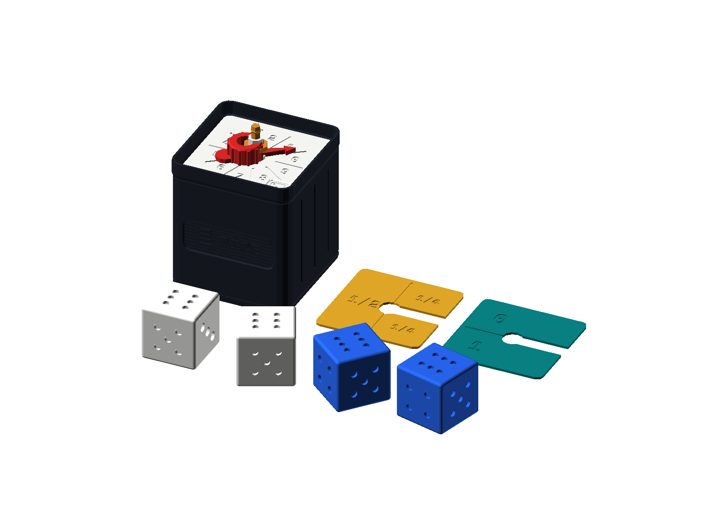{ width="320" }

> **Key Concept:** Normally, finding Median and Range requires sorting the list by hand first—and missing one number ruins the answer! On the SC-6, enter your numbers with [Σ+] in ANY order: the chip sorts them automatically and gives you Mean ([g] [x̄]), Median ([f] [MED]), Mode ([g] [MODE]), and Range ([RNG]) in 1 click each!

#### Demonstrate Both Textbook Methods with `PROB-01` Blocks (Probability & Stats Studio)

1. **Block Way 1 (+10 pts):** Line up the 8 COUNT-01 towers shortest-to-tallest [6,7,7,7,8,8,9,10]; middle pair 7 & 8 gives Median = 7.5, Mode = 7.
2. **Block Way 2 (+20 pts):** Stand the tallest tower (10) beside the shortest tower (6) to measure Range = 10 - 6 = 4 blocks!
3. **Both Ways Proof:** Ordering towers reveals the middle Median & most frequent Mode, while comparing end towers shows Range!

#### Two-Method Worked Examples (`Method 1: +10 pts` vs. `Method 2: +20 pts DOUBLE`)

| Worksheet | Problem | Method 1 (`+10 pts` — 1st Token) | Method 2 (`+20 pts DOUBLE` — 2nd Token) | SC-6 Keystrokes | Final Answer |
| :--- | :--- | :--- | :--- | :--- | :--- |
| **Practice A** (`p.78`) | **For shoe sizes 7, 9, 6, 7, 10, 8, 9, 7, find Mean, Median, Mode, Min, Max, and Range.** | **METHOD 1 (+10 pts): Sort Data from Least to Greatest:** Ordered (n=8): 6, 7, 7, [7, 8], 9, 9, 10. Median = (7+8)/2 = 7.5; Mode = 7 (most frequent); Range = 10 - 6 = 4. *(See `PROB-01` Block Way 1 above)* | **METHOD 2 (+20 pts DOUBLE): Enter Once with [Σ+] & Read Keys:** Enter all 8 values with [Σ+], then press [g][x̄] = 7.875, [f][MED] = 7.5, [g][MODE] = 7, and [RNG] = 4. *(See `PROB-01` Block Way 2 above)* | `[g]` `[CLΣ]` `[7]` `[Σ+]` `[9]` `[Σ+]` `[6]` `[Σ+]` `[7]` `[Σ+]` `[10]` `[Σ+]` `[8]` `[Σ+]` `[9]` `[Σ+]` `[7]` `[Σ+]` `[f]` `[MED]` `[g]` `[MODE]` `[RNG]` | **Mean = 7.875, Median = 7.5, Mode = 7, Range = 4 (10 - 6)** |
| **Practice B** (`p.79`) | **Daily dog-walking earnings are $15, $18, $15, $20, $17, and $90 (holiday bonus!). Find the Mean and Median, and tell which is better.** | **METHOD 1 (+10 pts): Compute Mean vs. Ordered Median:** Sum = $175 -> Mean = 175 ÷ 6 = $29.17 (higher than 5 of the 6 days!). Ordered: 15, 15, [17, 18], 20, 90 -> Median = $17.50. *COUNT-01 Way 1: Order the 6 price towers [$15,$15,$15,$20,$20,$90] -> middle two ($15 & $20) average to Median = $17.50.* | **METHOD 2 (+20 pts DOUBLE): Compare With and Without the $90 Outlier:** Without the $90 outlier, Mean = $85 ÷ 5 = $17.00 and Median = $17.00. The Median ($17.50) resists the outlier and represents a typical day! *COUNT-01 Way 2: Leveling all 6 towers pulls the Mean up to $29.17 because of the $90 outlier tower!* | `[g]` `[CLΣ]` `[15]` `[Σ+]` `[18]` `[Σ+]` `[15]` `[Σ+]` `[20]` `[Σ+]` `[17]` `[Σ+]` `[90]` `[Σ+]` `[g]` `[x̄]` `[f]` `[MED]` | **Mean = $29.17, Median = $17.50 (Median is best)** |

#### Practice A (p. 78): Key Ideas & Two-Method Practice (10 Exercises)

| # | Problem Prompt | Coach Key: SC-6 Keystrokes | Final Answer |
| :---: | :--- | :--- | :--- |
| **A1** | Order the data set 4, 9, 2, 7, 8 from least to greatest. Find the median and the range. | `Load 5 nums -> [f][MED], [RNG]` | **Median = 7, Range = 7 (9 - 2)** |
| **A2** | For the data set 12, 15, 12, 18, 20, 13, find the median, the mode, and the range. | `Load 6 nums -> [f][MED], [g][MODE], [RNG]` | **Median = 14, Mode = 12, Range = 8** |
| **A3** | Find the Mean, Median, Mode, and Range of: 5, 8, 8, 10, 14. | `Load 5 nums into [Σ+]` | **Mean = 9, Med = 8, Mode = 8, Range = 9** |
| **A4** | Find the minimum, maximum, and range of the data set: 23, 45, 19, 38, 51. | `Load 5 nums -> [f][MIN], [g][MAX], [RNG]` | **Min = 19, Max = 51, Range = 32** |
| **A5** | Even Count Median: Find the Median of the 6 test scores 70, 80, 84, 90, 92, 98. | `Load 6 nums -> [f][MED]` | **87 ((84+90)÷2)** |
| **A6** | Outlier Check: Earnings are $15, $18, $15, $20, $17, $90. Find Mean and Median. Which represents a typical day? | `Load 6 nums -> [g][x̄], [f][MED]` | **Mean=$29.17, Med=$17.50 (Median is best!)** |
| **A7** | What happens to the Mean and Median of {10, 12, 14, 16, 18} if 18 changes to 100? | `Test both on [Σ+]!` | **Mean jumps 14 -> 30.8; Median stays 14!** |
| **A8** | Mystery Range: The minimum score on a quiz is 64 and the Range is 31. What was the maximum score? | `64 [ENTER] 31 [+]` | **95** |
| **A9** | Find the mean, median, and range of the data set: 14, 8, 21, 11, 16. | `Sorted: 8, 11, 14, 16, 21` | **Median = 14, Range = 13 (21 - 8)** |
| **A10** | Home prices on a block (in $1,000s): 210, 220, 215, 225, 980. Find Mean and Median—which should a buyer trust? | `Load 5 nums -> [g][x̄], [f][MED]` | **Mean=$370k, Med=$220k (Trust Median!)** |

#### Practice B (p. 79): Modeling Real Life & Multi-Method Applications (10 Exercises)

| # | Modeling Real Life Application Prompt | Coach Key: SC-6 Keystrokes | Final Answer |
| :---: | :--- | :--- | :--- |
| **B1** | Roller Coaster Speeds (Odd Count n=7): Seven coasters have top speeds (mph) of 55, 62, 48, 70, 62, 50, 66. Order them to find the Median, Mode, and Range. | `[g][CLΣ] 55 [Σ+] 62 [Σ+] 48 [Σ+] 70 [Σ+] 62 [Σ+] 50 [Σ+] 66 [Σ+] [f][MED] [g][MODE] [RNG]` | **Median = 62, Mode = 62, Range = 22** |
| **B2** | Coding Club Ages (Even Count n=6): Six members are ages 11, 13, 12, 14, 12, 16. Order them and average the two middle values to find the Median! | `[g][CLΣ] 11 [Σ+] 13 [Σ+] 12 [Σ+] 14 [Σ+] 12 [Σ+] 16 [Σ+] [f][MED]` | **Ordered: 11,12,[12,13],14,16 -> Median = 12.5** |
| **B3** | Video Game Prices & Outlier: Five games cost $20, $25, $20, $30, and $105 (collector's edition!). Find the Mean ($40) and Median ($25). Which better represents a typical game? | `[g][CLΣ] 20 [Σ+] 25 [Σ+] 20 [Σ+] 30 [Σ+] 105 [Σ+] [g][x̄] [f][MED]` | **Median ($25); the $105 outlier skews the Mean to $40** |
| **B4** | Bimodal Data Set: In the shoe size list 5, 6, 6, 6, 7, 8, 8, 8, 9, which two sizes tie for the highest frequency (making the data bimodal)? | `6 [ENTER] 8` | **Modes = 6 and 8 (each appears 3 times)** |
| **B5** | No-Mode Sprint Times: Five runners finish in 11.2, 11.5, 11.8, 12.1, and 12.4 seconds. Find the Median, Range, and explain why there is NO mode. | `12.4 [ENTER] 11.2 [-]` | **Median = 11.8 s, Range = 1.2 s, No mode (all appear once)** |
| **B6** | Weather High-Low Range: This week's high temperatures (°F) were 72, 68, 75, 81, 64, 70, 74. Find the Minimum, Maximum, Range, and Median. | `[g][CLΣ] 72 [Σ+] 68 [Σ+] 75 [Σ+] 81 [Σ+] 64 [Σ+] 70 [Σ+] 74 [Σ+] [f][MED] [RNG]` | **Min = 64, Max = 81, Range = 17°F, Median = 72°F** |
| **B7** | Pizza Shop Orders: Daily orders of mushroom pizza were 8, 12, 9, 15, 12, 10. Find the Mean, Median, Mode, and Range. | `[g][CLΣ] 8 [Σ+] 12 [Σ+] 9 [Σ+] 15 [Σ+] 12 [Σ+] 10 [Σ+] [g][x̄] [f][MED] [g][MODE] [RNG]` | **Mean = 11, Median = 11, Mode = 12, Range = 7** |
| **B8** | Create a Data Set Puzzle: Write a list of 5 numbers that has a Median of 10, a Mode of 8, and a Range of 7. | `15 [ENTER] 8 [-]` | **Example: 8, 8, 10, 12, 15** |
| **B9** | Adding a Constant to Every Score: Every student on a quiz (scores: 70, 75, 80, 85, 90) gets +5 bonus points (75, 80, 85, 90, 95). How do the Median and Range change? | `95 [ENTER] 75 [-]` | **Median increases by +5 (to 85); Range stays 20!** |
| **B10** | Backpack Weights (lb): Eight backpacks weigh 9, 12, 10, 14, 11, 15, 10, 13 lb. Find the Mean, Median, Mode, and Range. | `[g][CLΣ] 9 [Σ+] 12 [Σ+] 10 [Σ+] 14 [Σ+] 11 [Σ+] 15 [Σ+] 10 [Σ+] 13 [Σ+] [g][x̄] [f][MED]` | **Mean = 11.75, Median = 11.5, Mode = 10, Range = 6** |

---

### Section 9.3: Quartiles, Interquartile Range (IQR) & Box Plots (Workbook pp. 80–81)

**Textbook Alignment:** Big Ideas Grade 6, Section 9.4 & 10.4 (Measures of Variation and Box-and-Whisker Plots) (`CCSS.MATH.6.SP.B.4`) • **Big Ideas Methods:** *Method 1: Split Ordered Data into Lower & Upper Halves  |  Method 2: [1Q], [MED], [3Q] & [IQR] Keys* • **Block Kit:** `FRAC-01` (Fraction & Stats Studio)

**Key Vocabulary:** quartiles • first quartile (Q₁) • third quartile (Q₃) • interquartile range (IQR = Q₃ - Q₁) • box-and-whisker plot • 5-number summary

{ width="320" }

> **Key Concept:** A Box-and-Whisker Plot splits your sorted data into 4 equal quarters (25% in each section, just like four 1/4 Fraction Studio blocks!). Once your data is in [Σ+], tap [f] [MIN], [f] [1Q], [f] [MED], [g] [3Q], [g] [MAX], and [IQR] (= 3Q - 1Q) to get the entire Box Plot in 5 seconds!

#### Demonstrate Both Textbook Methods with `FRAC-01` Blocks (Fraction & Stats Studio)

1. **Block Way 1 (+10 pts):** Order the 8 towers on COUNT-01 and place a central divider (Med = 82), then split the lower half (Q1 = 73.5) & upper half (Q3 = 90).
2. **Block Way 2 (+20 pts):** Frame a box around the middle 4 towers (middle 50% of data) from Q1 to Q3 -> IQR = 90 - 73.5 = 16.5!
3. **Both Ways Proof:** Three quartile dividers split the ordered towers into 4 equal 25% quarters, and the middle two quarters form the IQR box!

#### Two-Method Worked Examples (`Method 1: +10 pts` vs. `Method 2: +20 pts DOUBLE`)

| Worksheet | Problem | Method 1 (`+10 pts` — 1st Token) | Method 2 (`+20 pts DOUBLE` — 2nd Token) | SC-6 Keystrokes | Final Answer |
| :--- | :--- | :--- | :--- | :--- | :--- |
| **Practice A** (`p.80`) | **Find the 5-Number Summary and IQR of: 68, 72, 75, 78, 82, 85, 88, 92, 96.** | **METHOD 1 (+10 pts): Median of Lower Half (Q₁) & Upper Half (Q₃):** Median = 82. Lower half (68, 72, 75, 78) -> Q₁ = 73.5. Upper half (85, 88, 92, 96) -> Q₃ = 90. IQR = 90 - 73.5 = 16.5. *(See `FRAC-01` Block Way 1 above)* | **METHOD 2 (+20 pts DOUBLE): 5-Number Summary on SC-6 ([IQR]):** Enter scores with [Σ+], then read [f][MIN]=68, [f][1Q]=73.5, [f][MED]=82, [g][3Q]=90, [g][MAX]=96, and [IQR]=16.5. *(See `FRAC-01` Block Way 2 above)* | `[f]` `[MIN]` `[f]` `[1Q]` `[f]` `[MED]` `[g]` `[3Q]` `[g]` `[MAX]` `[IQR]` | **Min=68, Q1=73.5, Med=82, Q3=90, Max=96; IQR = 16.5** |
| **Practice B** (`p.81`) | **A box-and-whisker plot of 40 test scores has Min = 60, Q₁ = 72, Med = 80, Q₃ = 88, Max = 98. How many students scored between 72 and 88?** | **METHOD 1 (+10 pts): Four 25% Quartile Sections:** A box plot divides data into four 25% sections. The box (Q₁ to Q₃) holds the middle 2 sections: 25% + 25% = 50% of 40 = 20 students. *COUNT-01 Way 1: Split 40 student pegs into 4 equal quarters of 10 pegs each -> the box holds 2 quarters = 20 students.* | **METHOD 2 (+20 pts DOUBLE): Count 10 Students per Quartile Quarter:** 40 students ÷ 4 quartiles = 10 students per section. From Q₁ (72) to Med (80) is 10 students + Med (80) to Q₃ (88) is 10 = 20 students! *COUNT-01 Way 2: Measure the box width from Q1 = 72 to Q3 = 88 -> IQR = 88 - 72 = 16 points!* | `[25]` `[ENTER]` `[2]` `[×]` | **50% of the data = 20 students (IQR = 16)** |

#### Practice A (p. 80): Key Ideas & Two-Method Practice (10 Exercises)

| # | Problem Prompt | Coach Key: SC-6 Keystrokes | Final Answer |
| :---: | :--- | :--- | :--- |
| **A1** | For the ordered data set 10, 20, 30, 40, 50, find the 5-number summary (Min, Q₁, Median, Q₃, Max) and the IQR. | `Load 5 nums -> [f][1Q], [g][3Q], [IQR]` | **Min=10, Q1=15, Med=30, Q3=45, Max=50, IQR=30** |
| **A2** | For the ordered data set 4, 6, 8, 10, 12, 14, 16, find Q₁, the median, Q₃, and the interquartile range (IQR). | `Load 7 nums -> [f][1Q], [g][3Q], [IQR]` | **Q1=6, Med=10, Q3=14, IQR=8** |
| **A3** | If a box plot has Q1 = 24 and Q3 = 58, what is the Interquartile Range (IQR)? | `58 [ENTER] 24 [-]` | **34** |
| **A4** | What percent of data in a Box Plot falls above Q1 (the 25th percentile)? | `3 quarters = 3 × 25%` | **75%** |
| **A5** | Find the 5-number summary and interquartile range (IQR) of the 9 test scores: 68, 72, 75, 78, 82, 85, 88, 92, 96. | `Load 9 nums into [Σ+]` | **68, 73.5, 82, 90, 96; IQR = 16.5** |
| **A6** | Find Q₁, the median, Q₃, and the IQR of the 8 speeds (mph): 42, 45, 48, 50, 52, 55, 58, 60. | `Load 8 nums into [Σ+]` | **Q1=46.5, Med=51, Q3=56.5, IQR=10** |
| **A7** | Consistency Check: Player A has IQR = 4 pts and Player B has IQR = 19 pts. Who is more consistent? | `Compare box widths` | **Player A (smaller IQR = tighter cluster)** |
| **A8** | Outlier Rule (1.5 × IQR): If Q1 = 40, Q3 = 60 (IQR = 20), any score above Q3 + 1.5(IQR) is an outlier. Find that cutoff! | `60 [ENTER] 1.5 [ENTER] 20 [×] [+]` | **90 (Any score > 90 is an outlier)** |
| **A9** | For the data set 12, 15, 18, 22, 25, 28, 34, find the first quartile (Q₁), third quartile (Q₃), and IQR (Q₃ - Q₁). | `Load 7 nums -> [IQR]` | **IQR = 13 (28 - 15 = 13)** |
| **A10** | 200 students take a test. The box plot has Min=50, Q1=70, Med=80, Q3=90, Max=100. How many students scored between 70 and 90? | `200 [ENTER] 50 [f][%]` | **100 students (50% of 200)** |

#### Practice B (p. 81): Modeling Real Life & Multi-Method Applications (10 Exercises)

| # | Modeling Real Life Application Prompt | Coach Key: SC-6 Keystrokes | Final Answer |
| :---: | :--- | :--- | :--- |
| **B1** | Archery Tournament Scores (n=7): Ordered scores are 40, 45, 50, 55, 60, 65, 70. Find the 5-Number Summary (Min, Q₁, Med, Q₃, Max) and the IQR. | `[g][CLΣ] 40 [Σ+] 45 [Σ+] 50 [Σ+] 55 [Σ+] 60 [Σ+] 65 [Σ+] 70 [Σ+] [IQR]` | **Min=40, Q₁=45, Med=55, Q₃=65, Max=70; IQR = 20** |
| **B2** | Battery Life Test (hours, n=8): Ordered battery times are 6, 7, 8, 9, 11, 12, 14, 15. Find Q₁, Median, Q₃, and the Interquartile Range (IQR). | `[g][CLΣ] 6 [Σ+] 7 [Σ+] 8 [Σ+] 9 [Σ+] 11 [Σ+] 12 [Σ+] 14 [Σ+] 15 [Σ+] [IQR]` | **Q₁ = 7.5, Med = 10, Q₃ = 13, IQR = 5.5** |
| **B3** | Robotics Autonomous Points (n=9): Unordered scores are 30, 15, 45, 25, 35, 20, 50, 40, 30. Sort them first, then find Q₁, Median, Q₃, and IQR. | `[g][CLΣ] 30 [Σ+] 15 [Σ+] 45 [Σ+] 25 [Σ+] 35 [Σ+] 20 [Σ+] 50 [Σ+] 40 [Σ+] 30 [Σ+] [IQR]` | **Q₁ = 22.5, Med = 30, Q₃ = 42.5, IQR = 20** |
| **B4** | Reading a Box-and-Whisker Plot: A box plot of 60 tree heights has Min = 12 ft, Q₁ = 18 ft, Med = 24 ft, Q₃ = 31 ft, Max = 40 ft. Find the Range and the IQR. | `40 [ENTER] 12 [-] 31 [ENTER] 18 [-]` | **Range = 28 ft; IQR = 13 ft** |
| **B5** | Quartile Percentage Rule: In the tree height box plot from Problem 4 (60 trees total), what percent (and how many trees) are taller than Q₁ (18 ft)? | `60 [ENTER] 75 [f][%]` | **75% of the trees = 45 trees** |
| **B6** | Top 25% Whisker: In the same 60-tree forest (Q₃ = 31 ft, Max = 40 ft), how many trees are in the top quartile between 31 ft and 40 ft? | `60 [ENTER] 25 [f][%]` | **25% of 60 = 15 trees** |
| **B7** | Comparing Two Classes' IQRs: Class A has IQR = 8 points and Class B has IQR = 19 points. Which class had more consistent scores in the middle 50%? | `19 [ENTER] 8 [-]` | **Class A (smaller IQR = tighter middle 50%)** |
| **B8** | 1.5 × IQR Outlier Fence Test: A data set has Q₁ = 20, Q₃ = 30, so IQR = 10. An upper outlier is any value above Q₃ + 1.5(IQR). Calculate this upper cutoff! | `30 [ENTER] 1.5 [ENTER] 10 [×] [+]` | **30 + 15 = 45 (anything > 45 is an outlier)** |
| **B9** | Daily Push-Up Challenge (n=6): 18, 22, 25, 29, 34, 40. Find the 5-number summary and IQR. | `[g][CLΣ] 18 [Σ+] 22 [Σ+] 25 [Σ+] 29 [Σ+] 34 [Σ+] 40 [Σ+] [IQR]` | **Min=18, Q₁=22, Med=27, Q₃=34, Max=40; IQR = 12** |
| **B10** | Why IQR Beats Range: In {10, 12, 14, 16, 18, 20, 100}, the outlier 100 makes Range = 90. Find Q₁, Q₃, and IQR to see how IQR ignores the extreme ends! | `[g][CLΣ] 10 [Σ+] 12 [Σ+] 14 [Σ+] 16 [Σ+] 18 [Σ+] 20 [Σ+] 100 [Σ+] [IQR]` | **Q₁ = 12, Q₃ = 20, IQR = 8 (unaffected by 100!)** |

---

### Section 9.4: Mean Absolute Deviation (MAD) (Workbook pp. 82–83)

**Textbook Alignment:** Big Ideas Grade 6, Section 9.5 (Mean Absolute Deviation) (`CCSS.MATH.6.SP.B.5c`) • **Big Ideas Methods:** *Method 1: 3-Step Distance Table (Mean -> |x - x̄| -> Average)  |  Method 2: [Σ+] & [g] [MAD] Verification* • **Block Kit:** `COUNT-01` (Counting & Stats Studio)

**Key Vocabulary:** mean absolute deviation (MAD) • deviation from the mean (|x - x̄|) • measure of variation • consistency

{ width="320" }

> **Key Concept:** Every 6th grader dreads Mean Absolute Deviation (MAD) because doing it by hand takes 15 steps: find the Mean, subtract the Mean from every number, take the absolute value (|x|), and average all the distances! On the SC-6, once your data is in [Σ+], pressing [g] [MAD] ([g][Σ+]) computes the exact MAD in 1 click!

#### Demonstrate Both Textbook Methods with `COUNT-01` Blocks (Counting & Stats Studio)

1. **Block Way 1 (+10 pts):** Set a horizontal bar at Mean = 14 across COUNT-01 towers [10,12,14,15,19]; count gap blocks [4,2,0,1,5] -> 12 ÷ 5 = 2.4.
2. **Block Way 2 (+20 pts):** Check balance on COUNT-01: gap blocks below 14 (4 + 2 = 6) equal gap blocks above 14 (1 + 5 = 6) -> 12 ÷ 5 = 2.4!
3. **Both Ways Proof:** Summing all 5 absolute gap towers (12) and doubling the one-sided balance (6 + 6 = 12) both give MAD = 2.4!

#### Two-Method Worked Examples (`Method 1: +10 pts` vs. `Method 2: +20 pts DOUBLE`)

| Worksheet | Problem | Method 1 (`+10 pts` — 1st Token) | Method 2 (`+20 pts DOUBLE` — 2nd Token) | SC-6 Keystrokes | Final Answer |
| :--- | :--- | :--- | :--- | :--- | :--- |
| **Practice A** (`p.82`) | **Find the Mean and Mean Absolute Deviation (MAD) of 10, 12, 14, 16, 18.** | **METHOD 1 (+10 pts): 3-Step MAD Table by Hand:** 1. Mean = 70÷5 = 14.  2. Distances from 14: |10-14|=4, |12-14|=2, |14-14|=0, |16-14|=2, |18-14|=4.  3. MAD = 12 ÷ 5 = 2.4. *(See `COUNT-01` Block Way 1 above)* | **METHOD 2 (+20 pts DOUBLE): Symmetric Tower Pairs & [g] [MAD]:** Sum of distances below mean (4+2 = 6) equals sum above mean (2+4 = 6) -> 12 ÷ 5 = 2.4. Confirm with [g] [MAD]! *(See `COUNT-01` Block Way 2 above)* | `[g]` `[CLΣ]` `[10]` `[Σ+]` `[12]` `[Σ+]` `[14]` `[Σ+]` `[16]` `[Σ+]` `[18]` `[Σ+]` `[g]` `[x̄]` `[g]` `[MAD]` | **Mean = 14, MAD = 2.4** |
| **Practice B** (`p.83`) | **A sprinter's 100m times are 12.4, 13.0, 12.6, 13.2, 12.8, and 14.0 seconds. Find the Mean and Mean Absolute Deviation (MAD).** | **METHOD 1 (+10 pts): Find Mean (13.0 s) & Average the 6 Distances:** Mean = 78.0 ÷ 6 = 13.0 s. Distances from 13.0: 0.6, 0.0, 0.4, 0.2, 0.2, 1.0. Sum of distances = 2.4 s -> MAD = 2.4 ÷ 6 = 0.40 s. *COUNT-01 Way 1: From Mean = 13.0, sum the 5 gap heights [0.6, 0.2, 0.0, 0.4, 0.8] = 2.0 -> 2.0 ÷ 5 = 0.40 s.* | **METHOD 2 (+20 pts DOUBLE): One-Pass Statistical Entry ([g] [MAD]):** Enter the 6 sprint times with [Σ+], press [g] [x̄] -> 13.0 s, and press [g] [MAD] -> 0.40 s! *COUNT-01 Way 2: Gaps below 13.0 (0.6 + 0.2 = 0.8) match gaps above 13.0 (0.4 + 0.4 = 0.8); total 2.0 ÷ 5 = 0.40 s!* | `[g]` `[CLΣ]` `[12.4]` `[Σ+]` `[13.0]` `[Σ+]` `[12.6]` `[Σ+]` `[13.2]` `[Σ+]` `[12.8]` `[Σ+]` `[14.0]` `[Σ+]` `[g]` `[x̄]` `[g]` `[MAD]` | **Mean = 13.0 s, MAD = 0.40 s** |

#### Practice A (p. 82): Key Ideas & Two-Method Practice (10 Exercises)

| # | Problem Prompt | Coach Key: SC-6 Keystrokes | Final Answer |
| :---: | :--- | :--- | :--- |
| **A1** | Find the mean and the mean absolute deviation (MAD) of the data set: 2, 4, 6. | `2 [Σ+] 4 [Σ+] 6 [Σ+] [g][MAD]` | **Mean = 4, MAD = 1.33 (4/3)** |
| **A2** | Find the mean and the mean absolute deviation (MAD) of the data set: 10, 12, 14, 16, 18. | `Load 5 nums -> [g][x̄], [g][MAD]` | **Mean = 14, MAD = 2.4** |
| **A3** | Find the mean and the mean absolute deviation (MAD) of the data set: 5, 8, 8, 10, 14. | `Load 5 nums -> [g][x̄], [g][MAD]` | **Mean = 9, MAD = 2.4** |
| **A4** | What is the MAD of 7, 7, 7, 7, 7 (5 identical towers)? | `All distances from 7 are 0!` | **Mean = 7, MAD = 0** |
| **A5** | Find the Mean and MAD of: 20, 24, 28, 32, 36. | `Load 5 nums -> [g][x̄], [g][MAD]` | **Mean = 28, MAD = 4.8** |
| **A6** | Find the Mean and MAD of the 6 sprint times: 12.4, 13.0, 12.6, 13.2, 12.8, 14.0. | `Load 6 decimals -> [g][x̄], [g][MAD]` | **Mean = 13.0, MAD = 0.40** |
| **A7** | Find the Mean and MAD of quiz scores: 82, 85, 88, 90, 95. | `Load 5 nums -> [g][x̄], [g][MAD]` | **Mean = 88, MAD = 3.6** |
| **A8** | Team A has Mean = 50, MAD = 2.1. Team B has Mean = 50, MAD = 8.4. Which team's scores are more spread out? | `Compare MADs` | **Team B (larger MAD = more spread out)** |
| **A9** | For the data set 6, 10, 11, 13, find the mean (10) and calculate the mean absolute deviation (MAD). | `Mean=10; dists 4+0+1+3=8 ÷ 4` | **Mean = 10, MAD = 2.0** |
| **A10** | Data Analysis Capstone: For the data set {5, 8, 8, 10, 14}, find the mean, median, mode, range, IQR, and MAD. | `1 entry -> 6 stats!` | **x̄=9, Med=8, Mode=8, Rng=9, IQR=5.5, MAD=2.4** |

#### Practice B (p. 83): Modeling Real Life & Multi-Method Applications (10 Exercises)

| # | Modeling Real Life Application Prompt | Coach Key: SC-6 Keystrokes | Final Answer |
| :---: | :--- | :--- | :--- |
| **B1** | 3D Print Nozzle Temps (°C): Four readings are 206, 208, 212, 214. Find the Mean (210°C), each distance from 210, and the Mean Absolute Deviation (MAD). | `[g][CLΣ] 206 [Σ+] 208 [Σ+] 212 [Σ+] 214 [Σ+] [g][MAD]` | **Mean = 210°C; distances 4,2,2,4 -> MAD = 3.0°C** |
| **B2** | Basketball Free-Throw Streaks: In 5 practices you made 7, 9, 10, 11, and 13 shots. Find the Mean and the MAD. | `[g][CLΣ] 7 [Σ+] 9 [Σ+] 10 [Σ+] 11 [Σ+] 13 [Σ+] [g][x̄] [g][MAD]` | **Mean = 10; MAD = 1.6 shots** |
| **B3** | Zero MAD Puzzle: Five identical blocks each weigh 50 grams: 50, 50, 50, 50, 50. Without calculating, what is the Mean and what is the MAD? Why? | `0 [ENTER]` | **Mean = 50g, MAD = 0 (zero variation!)** |
| **B4** | Comparing Two Archers' Consistency: Archer A's scores are 8, 9, 9, 10 (Mean=9, MAD=0.5). Archer B's scores are 6, 8, 10, 12 (Mean=9). Find Archer B's MAD. Who is more consistent? | `[g][CLΣ] 6 [Σ+] 8 [Σ+] 10 [Σ+] 12 [Σ+] [g][MAD]` | **Archer B MAD = 2.0 -> Archer A is more consistent** |
| **B5** | Quiz Score Distances: Five scores are 76, 82, 85, 88, 94. Find the Mean and the MAD. | `[g][CLΣ] 76 [Σ+] 82 [Σ+] 85 [Σ+] 88 [Σ+] 94 [Σ+] [g][x̄] [g][MAD]` | **Mean = 85; distances 9,3,0,3,9 -> MAD = 4.8** |
| **B6** | Drone Hover Altitude (m): Six hover readings are 15, 16, 14, 15, 17, 13 meters. Find the Mean and MAD. | `[g][CLΣ] 15 [Σ+] 16 [Σ+] 14 [Σ+] 15 [Σ+] 17 [Σ+] 13 [Σ+] [g][x̄] [g][MAD]` | **Mean = 15 m, MAD = 1.0 m** |
| **B7** | Summer Daily Highs (°F): 80, 84, 86, 90. Find the Mean (85°F), list the 4 absolute deviations |x - 85|, and compute the MAD. | `[g][CLΣ] 80 [Σ+] 84 [Σ+] 86 [Σ+] 90 [Σ+] [g][MAD]` | **Deviations: 5, 1, 1, 5 -> MAD = 3.0°F** |
| **B8** | Why Absolute Value Bars Matter in MAD: For {10, 15, 20}, the mean is 15. What happens if you add the signed deviations (-5) + 0 + (+5) WITHOUT absolute value bars? | `5 [+/-] [ENTER] 5 [+]` | **They always cancel to 0! |x - x̄| keeps distances positive** |
| **B9** | Coffee Shop Wait Times (min): 2, 3, 4, 5, 11. Find the Mean and the MAD. | `[g][CLΣ] 2 [Σ+] 3 [Σ+] 4 [Σ+] 5 [Σ+] 11 [Σ+] [g][x̄] [g][MAD]` | **Mean = 5 min; MAD = 2.4 min** |
| **B10** | Full Statistical Profile: For the 5 robotics scores {12, 15, 15, 18, 20}, find the Mean, Median, Mode, Range, IQR, and MAD! | `[g][CLΣ] 12 [Σ+] 15 [Σ+] 15 [Σ+] 18 [Σ+] 20 [Σ+] [g][x̄] [f][MED] [g][MODE] [RNG] [IQR] [g][MAD]` | **Mean=16, Med=15, Mode=15, Rng=8, IQR=5.5, MAD=2.4** |

---

## Unit 10: Grade 7 Bridge — Signed Rationals, 2-Step Equations & Probability

*Big Ideas Math Grade 7 Bridge — Chapters 1–3 & Chapter 7 — Adding, Subtracting, Multiplying & Dividing Signed Rationals, Two-Step Equations, and Probability/Combinatorics*

- **Manipulative Kits:** `Ten-Frame Zero-Pair Counters (BASE-10) + Algebra Stage (ALGB-01) + Probability Studio (PROB-01)`
- **Target Misconception:** Students guess signs when adding/subtracting negatives, get -25 instead of +25 for (-5)² on algebraic calculators, undo ×3 before +7 in 3x + 7 = 28, and confuse Permutations (order matters) with Combinations (order doesn't).
- **Hands-On Remediation:** Use Yellow/Red counters to show removing 4 red debt tokens (10 - (-4)) equals +14. Notice how RPN 5 [+/-] [x²] squares the entire register (-5)² = +25 without parentheses! Unwrap 2-step equations in reverse (untie ribbon ±b first, open box ×a second), and finish with [DICE], [f] [nCr], [g] [nPr], and [f] [?].

### Section 10.1: Adding and Subtracting Rational Numbers (Workbook pp. 84–85)

**Textbook Alignment:** Big Ideas Grade 7, Sections 1.2, 1.3, 2.2 & 2.3 (Adding and Subtracting Integers & Rational Numbers) (`CCSS.MATH.7.NS.A.1`) • **Big Ideas Methods:** *Method 1: Zero-Pair Counters / Number Line Jumps  |  Method 2: Absolute Value Rules & Add-the-Opposite* • **Block Kit:** `BASE-10` (Ten-Frame Zero-Pair Counters)

**Key Vocabulary:** additive inverse • zero pair • Same-Sign Sum Rule • Different-Sign Difference Rule • Add-the-Opposite (a - b = a + (-b))

{ width="320" }

> **Key Concept:** When adding with Yellow (+1) and Red (-1) counters: if signs are the SAME, they team up (-6 + (-4) = -10); if signs are OPPOSITE, they fight in Zero Pairs (-8 + 5 = -3)! And why does subtracting a negative like 10 - (-4) equal +14? Because erasing a -4 penalty makes your score go UP by 4!

#### Demonstrate Both Textbook Methods with `BASE-10` Blocks (Ten-Frame Zero-Pair Counters)

1. **Block Way 1 (+10 pts):** Place 8 Red (-) and 5 Yellow (+) counters on RACK-01; 5 zero pairs cancel to 0, leaving 3 Red (-3).
2. **Block Way 2 (+20 pts):** For 10 - (-4) on RACK-01, add 4 zero pairs and remove 4 Red (-) counters -> leaves 10 + 4 = 14 Yellow (+)!
3. **Both Ways Proof:** Removing 4 Red negative counters from zero pairs physically proves why subtracting -4 is adding +4!

#### Two-Method Worked Examples (`Method 1: +10 pts` vs. `Method 2: +20 pts DOUBLE`)

| Worksheet | Problem | Method 1 (`+10 pts` — 1st Token) | Method 2 (`+20 pts DOUBLE` — 2nd Token) | SC-6 Keystrokes | Final Answer |
| :--- | :--- | :--- | :--- | :--- | :--- |
| **Practice A** (`p.84`) | **Evaluate -8 + 5 and -6 + (-4) using counters and the SC-6 [+/-] key.** | **METHOD 1 (+10 pts): Zero-Pair Counter Cancellation:** In -8 + 5, five (-1, +1) zero pairs cancel to 0, leaving 3 negatives (-3). In -6 + (-4), 6 negatives + 4 negatives = -10. *(See `BASE-10` Block Way 1 above)* | **METHOD 2 (+20 pts DOUBLE): Big Ideas Sign Rules:** Different signs (-8 + 5): subtract |8| - |5| = 3, keep sign of -8 -> -3. Same signs (-6 + -4): add |6| + |4| = 10, keep '-' -> -10. *(See `BASE-10` Block Way 2 above)* | `[8]` `[+/-]` `[ENTER]` `[5]` `[+]` `[6]` `[+/-]` `[ENTER]` `[4]` `[+/-]` `[+]` | **-8 + 5 = -3; -6 + (-4) = -10** |
| **Practice B** (`p.85`) | **Evaluate 10 - (-4) and -3/4 - (-5/8) by rewriting subtraction as adding the opposite.** | **METHOD 1 (+10 pts): Add the Opposite (Keep-Change-Flip Sign):** 10 - (-4) = 10 + (+4) = 14. For -3/4 - (-5/8): rewrite as -6/8 + (+5/8) = -1/8. *RACK-01 Way 1: Count steps on the vertical number rail from -4°C up to 0°C (+4) and up to +10°C (+10) -> +14°C.* | **METHOD 2 (+20 pts DOUBLE): Number Line Distance Between (End - Start):** How far is it from -4 up to +10 on a thermometer? 4 degrees to 0 plus 10 degrees above 0 = +14 degrees! *FRAC-01 Way 2: Convert -3/4 to -6/8 and add +5/8 -> 5 zero pairs cancel, leaving -1/8!* | `[10]` `[ENTER]` `[4]` `[+/-]` `[-]` `[.]` `[3]` `[.]` `[4]` `[+/-]` `[ENTER]` `[.]` `[5]` `[.]` `[8]` `[+/-]` `[-]` | **10 - (-4) = 14; -3/4 - (-5/8) = -1/8** |

#### Practice A (p. 84): Key Ideas & Two-Method Practice (10 Exercises)

| # | Problem Prompt | Coach Key: SC-6 Keystrokes | Final Answer |
| :---: | :--- | :--- | :--- |
| **A1** | Solve side-by-side: (a) -15 + 9 and (b) -15 + (-9). | `15 [+/-] [ENTER] 9 [+] / 9 [+/-] [+]` | **(a) -6; (b) -24** |
| **A2** | Solve: 14 + (-23). | `14 [ENTER] 23 [+/-] [+]` | **-9** |
| **A3** | Taking Away a Penalty: Solve (a) 12 - (-8) and (b) -12 - (-8). | `12 [ENTER] 8 [+/-] [-] / 12 [+/-]...` | **(a) 20; (b) -4** |
| **A4** | Solve: -9 - 16. (Start at -9 and go 16 steps further negative!) | `9 [+/-] [ENTER] 16 [-]` | **-25** |
| **A5** | Solve with decimals: -4.8 + (-3.5). | `4.8 [+/-] [ENTER] 3.5 [+/-] [+]` | **-8.3** |
| **A6** | Solve with decimals: 6.4 - 11.2. | `6.4 [ENTER] 11.2 [-]` | **-4.8** |
| **A7** | Solve with decimals: -7.5 - (-10.2). | `7.5 [+/-] [ENTER] 10.2 [+/-] [-]` | **+2.7** |
| **A8** | Solve with signed fractions: -3/4 - (-5/8). | `[.] 3 [.] 4 [+/-] [ENTER] [.] 5 [.] 8 [+/-] [-]` | **-1/8** |
| **A9** | Temperature in Fairbanks is -18°F at dawn and rises to +7°F by noon. Find the change (7 - (-18)) 2 ways! | `7 [ENTER] 18 [+/-] [-]` | **+25°F (Way 2: 18 steps to 0 + 7 steps = 25)** |
| **A10** | Evaluate -2 1/2 + 4 1/4 - (-1 1/8) by rewriting subtraction as adding the opposite and using a common denominator. | `2.5 [+/-] [ENTER] 4.25 [+] 1.125 [+]` | **2 7/8 (2.875)** |

#### Practice B (p. 85): Modeling Real Life & Multi-Method Applications (10 Exercises)

| # | Modeling Real Life Application Prompt | Coach Key: SC-6 Keystrokes | Final Answer |
| :---: | :--- | :--- | :--- |
| **B1** | Arctic Temperature Swing: At dawn the temperature is -14°F. By noon it warms up by 22°F (-14 + 22). What is the noon temperature? | `14 [+/-] [ENTER] 22 [+]` | **+8°F** |
| **B2** | Submarine Double Dive: A research sub is at -45 meters and dives another 38 meters (-45 + (-38)). What is its new elevation? | `45 [+/-] [ENTER] 38 [+/-] [+]` | **-83 meters** |
| **B3** | Add-the-Opposite Elevation Difference: Mt. Blanc is at +4,800 m and a nearby valley cave is at -200 m. Evaluate 4,800 - (-200) to find the vertical difference! | `4800 [ENTER] 200 [+/-] [-]` | **5,000 meters** |
| **B4** | Game Penalty Reversal: You have -15 points, and the referee cancels a -25 point penalty: -15 - (-25). Rewrite as addition and find your score! | `15 [+/-] [ENTER] 25 [+/-] [-]` | **-15 + 25 = +10 points** |
| **B5** | Signed Decimal Bank Ledger: Your account is at -$12.50. You deposit $30.00 and then buy a $8.75 lunch. What is your new balance? | `12.50 [+/-] [ENTER] 30 [+] 8.75 [-]` | **+$8.75** |
| **B6** | Signed Fraction Addition: Evaluate -5/8 + 3/4 using a common denominator of 8. | `[.] 5 [.] 8 [+/-] [ENTER] [.] 3 [.] 4 [+]` | **1/8** |
| **B7** | Signed Fraction Subtraction: Evaluate -2/3 - 5/6 by rewriting as -4/6 + (-5/6) and simplifying. | `[.] 2 [.] 3 [+/-] [ENTER] [.] 5 [.] 6 [-]` | **-9/6 = -1 1/2** |
| **B8** | Scuba Ascent & Descent: A diver starts at -18.4 m, rises 7.9 m, and dives 5.5 m. Find her final depth. | `18.4 [+/-] [ENTER] 7.9 [+] 5.5 [-]` | **-16.0 meters** |
| **B9** | Thermometer Drop: The temperature drops from +6.5°C to -8.5°C. Evaluate -8.5 - 6.5 to find the signed temperature change. | `8.5 [+/-] [ENTER] 6.5 [-]` | **-15.0°C change** |
| **B10** | Three-Term Signed Challenge: Evaluate -14 - (-20) + (-9) - 5. | `14 [+/-] [ENTER] 20 [+/-] [-] 9 [+/-] [+] 5 [-]` | **-8** |

---

### Section 10.2: Multiplying and Dividing Rational Numbers (Workbook pp. 86–87)

**Textbook Alignment:** Big Ideas Grade 7, Sections 1.4, 1.5 & 2.4 (Multiplying and Dividing Rational Numbers) (`CCSS.MATH.7.NS.A.2`) • **Big Ideas Methods:** *Method 1: Repeated Signed Addition / Sign-Flip Pattern  |  Method 2: Count Negative Factors (Even = +, Odd = -)* • **Block Kit:** `BASE-10` (Zero-Pair & Fraction Studio)

**Key Vocabulary:** multiplicative sign rules • same signs (positive +) • different signs (negative -) • even/odd negative factors

{ width="320" }

> **Key Concept:** Think of a negative sign as flipping a light switch (just like tapping [+/-]!): 1 negative flip leaves you in the dark (-), but 2 negative flips bring you right back to POSITIVE (+)! And on the SC-6, 5 [+/-] [x²] squares the entire number (-5) × (-5) = +25 without needing parentheses!

#### Demonstrate Both Textbook Methods with `BASE-10` Blocks (Zero-Pair & Fraction Studio)

1. **Block Way 1 (+10 pts):** Build 6 groups of 4 Red (-) counters on RACK-01 -> 24 Red counters (-24).
2. **Block Way 2 (+20 pts):** For (-6) × (-4), take 6 groups of 4 Red counters (-24) and flip every counter to its opposite color -> +24 Yellow!
3. **Both Ways Proof:** A negative multiplier flips counter color on RACK-01—one flip gives Red (-), two flips restore Yellow (+)!

#### Two-Method Worked Examples (`Method 1: +10 pts` vs. `Method 2: +20 pts DOUBLE`)

| Worksheet | Problem | Method 1 (`+10 pts` — 1st Token) | Method 2 (`+20 pts DOUBLE` — 2nd Token) | SC-6 Keystrokes | Final Answer |
| :--- | :--- | :--- | :--- | :--- | :--- |
| **Practice A** (`p.86`) | **Compute 6 × (-4), (-6) × (-4), and (-5)² on your SC-6.** | **METHOD 1 (+10 pts): Same Signs = (+), Different Signs = (-):** 6 × (-4) has different signs -> -24. (-6) × (-4) has same signs -> +24. (-5)² = (-5) × (-5) -> +25. *(See `BASE-10` Block Way 1 above)* | **METHOD 2 (+20 pts DOUBLE): Count Negative Factors (Even vs. Odd):** 1 negative factor (odd) -> negative (-24). 2 negative factors (even) -> positive (+24 and +25). *(See `BASE-10` Block Way 2 above)* | `[6]` `[ENTER]` `[4]` `[+/-]` `[×]` `[5]` `[+/-]` `[x²]` | **6×(-4) = -24, (-6)×(-4) = +24, (-5)² = +25** |
| **Practice B** (`p.87`) | **A submersible descends to -5/6 kilometer at a rate of -5/12 kilometer per minute. How many minutes did the descent take?** | **METHOD 1 (+10 pts): Same-Sign Division Rule + Multiply by Reciprocal:** Negative ÷ Negative = Positive (+). Multiply by the reciprocal: (-5/6) × (-12/5) = +(5 × 12)/(6 × 5) = +12/6 = 2 minutes. *RACK-01 Way 1: Count how many (-45 m) steps make a (-90 m) change -> 2 positive steps (+2 min).* | **METHOD 2 (+20 pts DOUBLE): Common Denominator Twelfths:** Rewrite -5/6 as -10/12 km. Divide: (-10 twelfths) ÷ (-5 twelfths/min) = (-10) ÷ (-5) = +2 minutes! *RACK-01 Way 2: Even number of negative signs in (-90) ÷ (-45) flips to positive -> +2 minutes!* | `[.]` `[5]` `[.]` `[6]` `[+/-]` `[ENTER]` `[.]` `[5]` `[.]` `[12]` `[+/-]` `[÷]` | **+2 minutes** |

#### Practice A (p. 86): Key Ideas & Two-Method Practice (10 Exercises)

| # | Problem Prompt | Coach Key: SC-6 Keystrokes | Final Answer |
| :---: | :--- | :--- | :--- |
| **A1** | Compute: (a) 7 × (-8) and (b) (-7) × (-8). | `7 [ENTER] 8 [+/-] [×] / 7 [+/-]...` | **(a) -56; (b) +56** |
| **A2** | Compute: (a) -45 ÷ 9 and (b) -45 ÷ (-9). | `45 [+/-] [ENTER] 9 [÷] / 9 [+/-] [÷]` | **(a) -5; (b) +5** |
| **A3** | Evaluate (-5)². Explain why the square of a negative number is always positive. | `5 [+/-] [x²]` | **+25 (2 negatives = +)** |
| **A4** | Evaluate (-2)³. Explain why the cube of a negative number is negative. | `2 [+/-] [g][x³]` | **-8 (3 negatives = odd = -)** |
| **A5** | Multiply signed decimals: (-3.5) × (-2.4). | `3.5 [+/-] [ENTER] 2.4 [+/-] [×]` | **+8.4** |
| **A6** | Divide signed decimals: -14.4 ÷ 1.2. | `14.4 [+/-] [ENTER] 1.2 [÷]` | **-12** |
| **A7** | Multiply signed fractions: (-2/3) × (9/10). | `[.] 2 [.] 3 [+/-] [ENTER] [.] 9 [.] 10 [×]` | **-3/5 (-0.6)** |
| **A8** | Divide signed fractions: -5/6 ÷ (-5/12). | `[.] 5 [.] 6 [+/-] [ENTER] [.] 5 [.] 12 [+/-] [÷]` | **+2** |
| **A9** | Evaluate the three-factor product (-4) × (-5) × (-3). How does counting negative signs determine the sign? | `4 [+/-] [ENTER] 5 [+/-] [×] 3 [+/-] [×]` | **-60 (3 negatives = odd -> negative!)** |
| **A10** | A submarine dives 360 ft in 8 minutes (-45 ft/min). Confirm the total change in 8 min and the change per minute! | `360 [+/-] [ENTER] 8 [÷]` | **-45 ft/min (Check: -45 × 8 = -360 ft)** |

#### Practice B (p. 87): Modeling Real Life & Multi-Method Applications (10 Exercises)

| # | Modeling Real Life Application Prompt | Coach Key: SC-6 Keystrokes | Final Answer |
| :---: | :--- | :--- | :--- |
| **B1** | Submarine Descent Rate: A submarine descends at -15 feet per second for 8 seconds. Multiply 8 × (-15) to find its elevation change. | `8 [ENTER] 15 [+/-] [×]` | **-120 feet** |
| **B2** | Reversing a Loss (Negative × Negative): Losing 4 penalties of -10 points each is (-4) × (-10). Find the point change and explain the sign rule. | `4 [+/-] [ENTER] 10 [+/-] [×]` | **+40 points (Same signs = Positive)** |
| **B3** | Mean Temperature Drop: Over 6 hours, the temperature changed by -27°F in all. Divide -27 ÷ 6 to find the average change per hour. | `27 [+/-] [ENTER] 6 [÷]` | **-4.5°F per hour** |
| **B4** | Signed Square vs. Cube: Evaluate (-4)² and (-4)³. Why is (-4)² positive while (-4)³ is negative? | `4 [+/-] [x²] 4 [+/-] [g][x³]` | **(-4)² = +16 (2 negs); (-4)³ = -64 (3 negs)** |
| **B5** | Signed Fraction Multiplication: Multiply (-3/4) × (-8/9) by cross-canceling common factors and applying the Same-Sign Rule. | `[.] 3 [.] 4 [+/-] [ENTER] [.] 8 [.] 9 [+/-] [×]` | **+2/3** |
| **B6** | Signed Fraction Division: Divide (-7/8) ÷ (7/16) by multiplying by the reciprocal. | `[.] 7 [.] 8 [+/-] [ENTER] [.] 7 [.] 16 [÷]` | **-2** |
| **B7** | Signed Decimal Product: Evaluate (-2.5) × (-1.6) × (-3). First count the 3 negative factors—will the answer be positive or negative? | `2.5 [+/-] [ENTER] 1.6 [+/-] [×] 3 [+/-] [×]` | **-12 (Odd number of negatives = -)** |
| **B8** | Glacier Retreat Rate: A glacier retreated -14.4 meters over 4.5 years. Divide -14.4 ÷ 4.5 to find the average yearly change. | `14.4 [+/-] [ENTER] 4.5 [÷]` | **-3.2 meters per year** |
| **B9** | Four-Factor Sign Rule: Evaluate (-2) × (-3) × (-4) × (-5). Since there are 4 (even) negative factors, what is the sign and product? | `2 [+/-] [ENTER] 3 [+/-] [×] 4 [+/-] [×] 5 [+/-] [×]` | **+120** |
| **B10** | Signed Order of Operations: Evaluate (-6)² - 4 × (-5) + (-18) ÷ (-3). | `6 [+/-] [x²] 4 [ENTER] 5 [+/-] [×] [-] 18 [+/-] [ENTER] 3 [+/-] [÷] [+]` | **36 - (-20) + 6 = 62** |

---

### Section 10.3: Solving Two-Step Equations (ax + b = c) (Workbook pp. 88–89)

**Textbook Alignment:** Big Ideas Grade 7, Sections 3.3–3.5 (Solving Two-Step Equations) (`CCSS.MATH.7.EE.B.4a`) • **Big Ideas Methods:** *Method 1: 2-Step Inverse Operations  |  Method 2: Algebra Tile Balance Scale & Substitution Proof* • **Block Kit:** `ALGB-01` (Algebra Boxes & Stage)

**Key Vocabulary:** two-step equation (ax + b = c) • reverse order of operations • undo addition/subtraction first • undo multiplication/division second

{ width="320" }

> **Key Concept:** Think of 3x + 7 = 28 like wrapping a present: first x was put into 3 boxes (× 3), then 7 loose cubes were tied on outside (+ 7). When you unwrap the present, go in REVERSE: untie the loose cubes FIRST (28 [ENTER] 7 [-] -> 21), and divide by the 3 boxes SECOND (3 [÷] -> x = 7)!

#### Demonstrate Both Textbook Methods with `ALGB-01` Blocks (Algebra Boxes & Stage)

1. **Block Way 1 (+10 pts):** On the ALGB-01 Balance Stage, remove 7 unit cubes from both pans of 3x + 7 = 28 (3x = 21), then split into 3 x-boxes (x = 7).
2. **Block Way 2 (+20 pts):** Load 7 cubes into each of the 3 x-boxes + 7 unit cubes on ALGB-01 -> 21 + 7 = 28 (Balances both pans!).
3. **Both Ways Proof:** Unwrapping constant cubes first then dividing boxes (Method 1) is verified by refilling the 3 x-boxes (Method 2)!

#### Two-Method Worked Examples (`Method 1: +10 pts` vs. `Method 2: +20 pts DOUBLE`)

| Worksheet | Problem | Method 1 (`+10 pts` — 1st Token) | Method 2 (`+20 pts DOUBLE` — 2nd Token) | SC-6 Keystrokes | Final Answer |
| :--- | :--- | :--- | :--- | :--- | :--- |
| **Practice A** (`p.88`) | **Solve 3x + 7 = 28 using inverse operations and check your solution.** | **METHOD 1 (+10 pts): Undo Add/Subtract First, Multiply/Divide Second:** In 3x + 7 = 28: Step 1: Subtract 7 from both sides -> 3x = 21. Step 2: Divide both sides by 3 -> x = 7. *(See `ALGB-01` Block Way 1 above)* | **METHOD 2 (+20 pts DOUBLE): Substitute x = 7 Back to Prove:** Plug x = 7 into 3x + 7: 3(7) + 7 = 21 + 7 = 28 (Matches Right Pan!). *(See `ALGB-01` Block Way 2 above)* | `[28]` `[ENTER]` `[7]` `[-]` `[3]` `[÷]` | **x = 7 (Step 1: 3x = 21)** |
| **Practice B** (`p.89`) | **The temperature starts at 14°F and drops 3°F per hour (-3x + 14 = 2). After how many hours x does it reach 2°F?** | **METHOD 1 (+10 pts): Two-Step Inverse Unwrapping with Negative Coefficient:** Step 1: Subtract 14 from both sides: -3x = 2 - 14 = -12. Step 2: Divide both sides by -3: x = (-12) ÷ (-3) = +4 hours. *ALGB-01 Way 1: Remove 35 setup cubes from both pans of 30x + 35 = 155 (30x = 120), then divide into 30 boxes -> x = 4.* | **METHOD 2 (+20 pts DOUBLE): Hour-by-Hour Countdown Table & Substitution Check:** Start 14°F -> Hr 1: 11°F -> Hr 2: 8°F -> Hr 3: 5°F -> Hr 4: 2°F! Check: -3(4) + 14 = -12 + 14 = 2°F. *COUNT-01 Way 2: From a 155-total bar, cut off the 35 fixed block (120 left) and partition into 30-unit blocks -> 4 blocks!* | `[2]` `[ENTER]` `[14]` `[-]` `[3]` `[+/-]` `[÷]` | **x = 4 hours** |

#### Practice A (p. 88): Key Ideas & Two-Method Practice (10 Exercises)

| # | Problem Prompt | Coach Key: SC-6 Keystrokes | Final Answer |
| :---: | :--- | :--- | :--- |
| **A1** | Solve 4x + 9 = 45. Write the Step 1 value (4x = ?) and final x. | `45 [ENTER] 9 [-] 4 [÷]` | **4x = 36 -> x = 9** |
| **A2** | Solve the two-step equation 5x - 12 = 38 by undoing subtraction first and multiplication second. Check your solution. | `38 [ENTER] 12 [+] 5 [÷]` | **5x = 50 -> x = 10** |
| **A3** | Solve 6y + 11 = 59. | `59 [ENTER] 11 [-] 6 [÷]` | **6y = 48 -> y = 8** |
| **A4** | Solve 8n - 15 = 49. | `49 [ENTER] 15 [+] 8 [÷]` | **8n = 64 -> n = 8** |
| **A5** | Solve m / 4 + 6 = 15. (Subtract 6 first, then multiply by 4!) | `15 [ENTER] 6 [-] 4 [×]` | **m/4 = 9 -> m = 36** |
| **A6** | Solve k / 3 - 5 = 7. | `7 [ENTER] 5 [+] 3 [×]` | **k/3 = 12 -> k = 36** |
| **A7** | Solve -3x + 14 = 2. | `2 [ENTER] 14 [-] 3 [+/-] [÷]` | **-3x = -12 -> x = 4** |
| **A8** | Solve 2.5w + 8 = 23. | `23 [ENTER] 8 [-] 2.5 [÷]` | **2.5w = 15 -> w = 6** |
| **A9** | A repair tech charges $35 flat plus $25/hr (25h + 35 = 160). Find hours h by unwrapping AND plug-in check! | `160 [ENTER] 35 [-] 25 [÷]` | **h = 5 hours (Check: 25(5)+35 = 160)** |
| **A10** | You save $15/week toward a $120 skateboard and already have $45 (15w + 45 = 120). How many weeks w? | `120 [ENTER] 45 [-] 15 [÷]` | **w = 5 weeks (Check: 15(5)+45 = 120)** |

#### Practice B (p. 89): Modeling Real Life & Multi-Method Applications (10 Exercises)

| # | Modeling Real Life Application Prompt | Coach Key: SC-6 Keystrokes | Final Answer |
| :---: | :--- | :--- | :--- |
| **B1** | Go-Kart Track Admission: Admission is $8 plus $6 per lap r. You spend $38 in all (6r + 8 = 38). Solve the two-step equation to find how many laps r you drove! | `38 [ENTER] 8 [-] 6 [÷]` | **r = 5 laps** |
| **B2** | 3D Print Service Quote: A print shop charges a $12 setup fee plus $4 per hour h. Your bill is $48 (4h + 12 = 48). Solve for h and check! | `48 [ENTER] 12 [-] 4 [÷]` | **h = 9 hours** |
| **B3** | Savings Goal Countdown: You have $35 saved and save $15 per week w to buy a $140 bike (15w + 35 = 140). How many weeks w will it take? | `140 [ENTER] 35 [-] 15 [÷]` | **w = 7 weeks** |
| **B4** | Coupon Discount Two-Step: You buy 4 identical books and use a $10 gift card, paying $46 out of pocket (4b - 10 = 46). Find the price b of each book. | `46 [ENTER] 10 [+] 4 [÷]` | **b = $14 per book** |
| **B5** | Negative Coefficient Equation: Solve -4x + 18 = -6 by subtracting 18 first and then dividing by -4. Check by substituting back! | `6 [+/-] [ENTER] 18 [-] 4 [+/-] [÷]` | **x = 6 (-4·6 + 18 = -6)** |
| **B6** | Division & Addition Two-Step: Solve (n ÷ 5) + 9 = 16 by subtracting 9 first and then multiplying by 5. | `16 [ENTER] 9 [-] 5 [×]` | **n = 35** |
| **B7** | Scuba Air Tank Pressure: A tank starts at 3,000 psi and loses 40 psi per minute m until 600 psi remains (3000 - 40m = 600). How many minutes m was the dive? | `600 [ENTER] 3000 [-] 40 [+/-] [÷]` | **m = 60 minutes** |
| **B8** | Fractional Coefficient Two-Step: Solve (2/3)x - 5 = 11 by adding 5 first (to get 16) and multiplying by the reciprocal 3/2. | `11 [ENTER] 5 [+] [.] 2 [.] 3 [÷]` | **x = 24** |
| **B9** | Rectangle Perimeter Two-Step: A rectangle has length 18 cm and perimeter 56 cm (2w + 36 = 56). Solve for the width w! | `56 [ENTER] 36 [-] 2 [÷]` | **w = 10 cm** |
| **B10** | Decimal Two-Step Taxi Fare: A ride costs $3.50 base fare plus $2.25 per mile m. The total fare is $21.50 (2.25m + 3.50 = 21.50). How many miles m was the ride? | `21.50 [ENTER] 3.50 [-] 2.25 [÷]` | **m = 8 miles** |

---

### Section 10.4: Theoretical Probability, Combinations & Permutations (Workbook pp. 90–91)

**Textbook Alignment:** Big Ideas Grade 7, Chapter 7 (Probability) & SC-6 Graduation Finale (`CCSS.MATH.7.SP.C.5`) • **Big Ideas Methods:** *Method 1: Favorable ÷ Total & Complement Rule  |  Method 2: Fundamental Counting Principle, [nPr] & [nCr]* • **Block Kit:** `PROB-01` (Probability Dice & Spinner Studio)

**Key Vocabulary:** experiment • outcomes • event • sample space • theoretical probability P(E) • complement P(not E) • factorial (n!) • permutation • combination

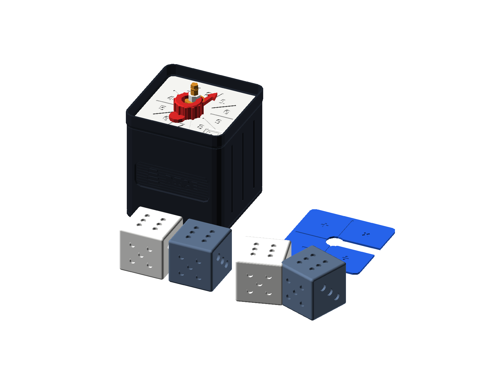{ width="320" }

> **Key Concept:** Probability is Favorable Outcomes ÷ Total Outcomes—and you can express it as a Fraction, Decimal, or Percent! Plus, the top-left keys of your SC-6 unlock Combinatorics: [x!] ([g][DICE]) for arrangements of all n items, [g] [nPr] when order matters (1st/2nd/3rd podium), [f] [nCr] when order does NOT matter (pizza toppings), and [f] [?] ([f][C]) for the built-in Math Quiz Engine!

#### Demonstrate Both Textbook Methods with `PROB-01` Blocks (Probability Dice & Spinner Studio)

1. **Block Way 1 (+10 pts):** Draw from 10 PROB-01 tiles (4 Blue / 10 total = 2/5 = 40%); arrange 5 distinct tiles in 5! = 120 ordered rows.
2. **Block Way 2 (+20 pts):** Compare ordered 3-tile podiums (10×9×8 = 720) vs. unordered 3-tile groups (divide by 3! = 6 rearrangements -> 120)!
3. **Both Ways Proof:** Grouping identical 3-tile sets on the PROB-01 tray shows why every 1 combination has 3! = 6 permutations!

#### Two-Method Worked Examples (`Method 1: +10 pts` vs. `Method 2: +20 pts DOUBLE`)

| Worksheet | Problem | Method 1 (`+10 pts` — 1st Token) | Method 2 (`+20 pts DOUBLE` — 2nd Token) | SC-6 Keystrokes | Final Answer |
| :--- | :--- | :--- | :--- | :--- | :--- |
| **Practice A** (`p.90`) | **A 10-sector spinner has 4 Blue, 3 Gold, and 3 Red sectors. Find P(Blue) in 3 forms, and find how many ways to line up 5 trophies (5!).** | **METHOD 1 (+10 pts): P(E) = Favorable / Total & Complement 1 - P(E):** P(Blue) = 4/10 = 2/5 = 0.4 = 40%. Complement P(Not Blue) = 1 - 2/5 = 3/5 (60%). For 5 trophies: 5! = 5×4×3×2×1 = 120. *(See `PROB-01` Block Way 1 above)* | **METHOD 2 (+20 pts DOUBLE): SC-6 Probability Keys ([g][SIMP], [g][x!]):** Enter [.] 4 [.] 10 [g][SIMP] -> 2/5 ([FDISP] -> 0.4), and 5 [g][x!] -> 120 arrangements. *(See `PROB-01` Block Way 2 above)* | `[.]` `[4]` `[.]` `[10]` `[g]` `[SIMP]` `[5]` `[g]` `[x!]` | **P(Blue) = 2/5 = 0.4 = 40%; 5! = 120 ways** |
| **Practice B** (`p.91`) | **Compare choosing 3 pizza toppings from 10 options (order doesn't matter) vs. awarding 1st, 2nd, and 3rd place to 10 runners (order matters).** | **METHOD 1 (+10 pts): Permutations (Order Matters -> 10 × 9 × 8):** Podium (Order matters): 10 choices for 1st × 9 for 2nd × 8 for 3rd = 720 permutations (10 [ENTER] 3 [g] [nPr] = 720). *PROB-01 Way 1: Fill 3 ordered podium slots from 10 tiles: 10 × 9 × 8 = 720 ordered permutations.* | **METHOD 2 (+20 pts DOUBLE): Combinations (Divide Out 3! = 6 Duplicate Orders):** Pizza (Order doesn't matter): Divide 720 by 3! (3×2×1 = 6 ways to arrange the same 3 toppings): 720 ÷ 6 = 120 combinations ([f] [nCr])! *PROB-01 Way 2: Since any 3 chosen tiles can be rearranged in 3! = 6 ways, 720 ÷ 6 = 120 unordered combinations!* | `[10]` `[ENTER]` `[3]` `[f]` `[nCr]` `[10]` `[ENTER]` `[3]` `[g]` `[nPr]` | **120 combinations vs. 720 permutations** |

#### Practice A (p. 90): Key Ideas & Two-Method Practice (10 Exercises)

| # | Problem Prompt | Coach Key: SC-6 Keystrokes | Final Answer |
| :---: | :--- | :--- | :--- |
| **A1** | Roll a fair 6-sided die. Find P(rolling a 5) as a fraction, and P(rolling an even number) in simplest form. | `1/6; and 3/6 -> [g][SIMP]` | **1/6; and 1/2 (50%)** |
| **A2** | A 10-sector spinner has 4 Blue, 3 Gold, 3 Red. Find P(Blue) as a simplified fraction, decimal, and percent. | `[.] 4 [.] 10 [g][SIMP] [FDISP]` | **2/5, 0.4, 40%** |
| **A3** | Using the same 10-sector spinner, find P(NOT Red) as a fraction and percent. | `(10 - 3) / 10 = 7/10` | **7/10 (70%)** |
| **A4** | In how many different orders can 4 students line up at the classroom door? Evaluate 4! (4 factorial). | `4 [g][x!]` | **24 ways** |
| **A5** | In how many different ways can 6 trophies be arranged in a row on a shelf? Evaluate 6!. | `6 [g][x!]` | **720 ways** |
| **A6** | In how many ways can a coach choose a 3-player group from 8 players when order does NOT matter (combinations)? | `8 [ENTER] 3 [f][nCr]` | **56 teams** |
| **A7** | In how many ways can 1st, 2nd, and 3rd place ribbons be awarded to 8 finalists when order DOES matter (permutations)? | `8 [ENTER] 3 [g][nPr]` | **336 podiums** |
| **A8** | Two Independent Events: You flip a coin (1/2) AND roll a 6-sided die (P(>4) = 2/6 = 1/3). Multiply to find P(Heads and >4)! | `[.] 1 [.] 2 [ENTER] [.] 1 [.] 3 [×]` | **1/6** |
| **A9** | Compare choosing 3 pizza toppings from 10 options (combinations) vs. awarding 1st, 2nd, and 3rd place to 10 runners (permutations). | `10 [ENTER] 3 [f][nCr] / [g][nPr]` | **120 vs 720 (120 × 3! = 720)** |
| **A10** | Probability & Counting Capstone: Evaluate 5! and find how many 2-person teams can be chosen from 5 friends. | `5 [g][x!]; then [f][?]` | **120 ways (Course Complete!)** |

#### Practice B (p. 91): Modeling Real Life & Multi-Method Applications (10 Exercises)

| # | Modeling Real Life Application Prompt | Coach Key: SC-6 Keystrokes | Final Answer |
| :---: | :--- | :--- | :--- |
| **B1** | 20-Sided Die (D20) Probability: You roll a fair 20-sided die numbered 1 to 20. Find the theoretical probability P(rolling a multiple of 5) as a fraction, decimal, and percent. | `[.] 4 [.] 20 [g][SIMP] [FDISP]` | **4/20 = 1/5 = 0.20 = 20%** |
| **B2** | Complement of an Event: If the probability of rain tomorrow is 35% (7/20), what is the probability that it does NOT rain P(not rain)? | `100 [ENTER] 35 [-]` | **65% (13/20 = 0.65)** |
| **B3** | Marble Bag Draw: A bag holds 6 blue, 5 green, and 4 gold marbles (15 total). Find P(green) and P(not gold) in simplest form. | `[.] 5 [.] 15 [g][SIMP]` | **P(green) = 1/3; P(not gold) = 11/15** |
| **B4** | Fundamental Counting Principle: A custom skateboard offers 5 deck designs, 4 truck colors, and 6 wheel sets. Multiply to find how many different skateboards you can build! | `5 [ENTER] 4 [×] 6 [×]` | **120 custom skateboards** |
| **B5** | Playlist Song Shuffle (Factorial): You put 5 favorite songs on a mini-playlist. In how many different orders (5!) can the shuffle play all 5 songs? | `5 [g][x!]` | **5! = 120 orders** |
| **B6** | Relay Batting Order (Permutations): A coach picks 3 batters in order (1st, 2nd, 3rd) from 7 players. Since order matters, compute 7 × 6 × 5 (7 nPr 3). | `7 [ENTER] 3 [g][nPr]` | **210 batting orders** |
| **B7** | Science Lab Partner Trio (Combinations): You choose a 3-person lab group from 7 students. Since order does NOT matter, compute 7 nCr 3. | `7 [ENTER] 3 [f][nCr]` | **35 lab groups** |
| **B8** | Smoothie Fruit Pairs: A smoothie bar has 8 fruits and you pick any 2 fruits to blend (order doesn't matter: 8 nCr 2). How many 2-fruit combos are possible? | `8 [ENTER] 2 [f][nCr]` | **28 fruit combinations** |
| **B9** | Experimental Prediction: A spinner lands on Gold 3/8 of the time. If you spin it 160 times, how many times do you expect it to land on Gold? | `160 [ENTER] [.] 3 [.] 8 [×]` | **60 times** |
| **B10** | Two-Coin & Die Compound Event: You flip a fair coin (2 outcomes) and roll a 6-sided die (6 outcomes). How many total outcomes are in the sample space, and what is P(Heads and 6)? | `2 [ENTER] 6 [×]` | **12 outcomes; P(H and 6) = 1/12** |

---
