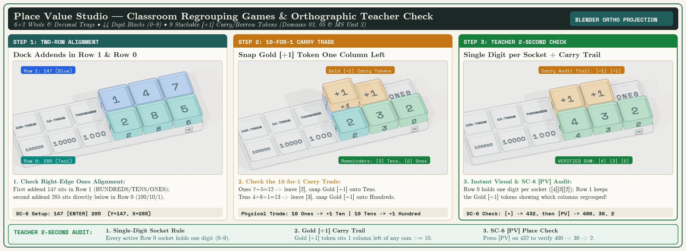
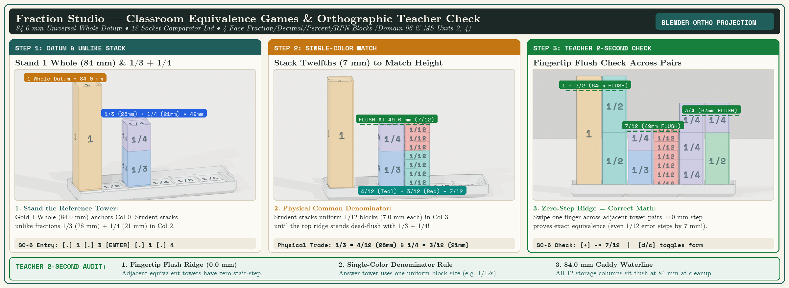

# Big Ideas Math Middle School: Two-Method Hands-On Block & SC-6 Supplement

  BIG IDEAS MATH SUPPLEMENT // 10 UNITS &bull; 45 SECTIONS &bull; 90 WORKSHEETS
  ● 900 MULTI-METHOD PRACTICE PROBLEMS &bull; 100-POINT DAILY GOAL

<nav class="curriculum-subnav flex flex-wrap gap-2 p-2.5 rounded-xl bg-[#0D1017] border border-white/10 mb-8 font-mono text-xs" aria-label="Curriculum Navigation">
  <a href="../" class="px-3 py-1.5 rounded bg-white/5 hover:bg-white/15 text-slate-300 hover:text-white transition font-bold">📖 Master Guide</a>
  <a href="../sc6-elementary-companion-workbook/" class="px-3 py-1.5 rounded bg-emerald-500/20 hover:bg-emerald-500/30 text-emerald-300 border border-emerald-500/30 transition font-bold">📗 SC-6 Companion Workbook (253 Problems)</a>
  <a href="../sc32-scientific-companion-workbook/" class="px-3 py-1.5 rounded bg-sky-500/20 hover:bg-sky-500/30 text-sky-300 border border-sky-500/30 transition font-bold">📘 SC-32 Companion Casebook (339 Problems)</a>
  <a href="./" class="px-3 py-1.5 rounded bg-white text-slate-950 font-bold transition">🚀 Big Ideas 45-Day Catch-Up (SC-6)</a>
  <a href="../rpn-elementary-guide/" class="px-3 py-1.5 rounded bg-white/5 hover:bg-white/15 text-slate-300 hover:text-white transition font-bold">⚡ RPN Power Guide</a>
  <a href="../worksheets/" class="px-3 py-1.5 rounded bg-white/5 hover:bg-white/15 text-slate-300 hover:text-white transition font-bold">📝 120 Station Worksheets</a>
  <a href="../alignment-matrix/" class="px-3 py-1.5 rounded bg-white/5 hover:bg-white/15 text-slate-300 hover:text-white transition font-bold">🎯 Standards Matrix</a>
  <a href="../teacher-guide/" class="px-3 py-1.5 rounded bg-white/5 hover:bg-white/15 text-slate-300 hover:text-white transition font-bold">🧑‍🏫 Teacher Guide</a>
  <a href="../uil-competition/" class="px-3 py-1.5 rounded bg-white/5 hover:bg-white/15 text-slate-300 hover:text-white transition font-bold">🏆 UIL Competition</a>
</nav>

**Grade 6 Complete + Grade 7 Bridge • Title Page & Preface • 10 Unit Introductions • 45 Textbook Sections • 90 Printable Worksheets (Practice A & B) • 90 Multi-Way Worked Examples • 900 Practice Problems • 5 Reference Appendices (Including Student Self-Check Answer Key)**

  <a href="../../downloads/worksheets/bigideas_middle_school_sc6_daily_student_workbook.pdf" class="md-button md-button--primary">📄 Download Complete Spiral Student Workbook PDF (115 Pages • pp. i–iv + 1–111)</a>
  <a href="https://www.lulu.com/spotlight/stackcalc" class="md-button">📘 Order Spiral-Bound Lay-Flat Workbook on Lulu ↗</a>
  <a href="#print-individual-chapters-units-110-separate-pdfs-for-parents-teachers" class="md-button">🖨️ Print Individual Chapters (Units 1–10 Separate PDFs)</a>
  <a href="../../downloads/worksheets/sc6_quest_token_scoring_guide.pdf" class="md-button">🏆 Download 1-Page Token Scoring & SC-6 Work-Check Guide PDF</a>
  <a href="../../downloads/stackcalc-curriculum-guide-letter.pdf" class="md-button">🔑 Download Unified Master Teacher's Guide PDF (Includes Complete 900-Problem Worked Setups & Keys)</a>
  <a href="../../downloads/worksheets/bigideas_middle_school_sc6_workbook_lulu_cover.pdf" class="md-button">🎨 Student Workbook Lulu Coil Cover PDF</a>

!!! abstract "Built for Students Who Need Extra Practice: Two Textbook Ways, Hands-On Block Models & 100-Point Daily Goal"
    - **Relatable Real-World Stories & Honest Student Perspectives:** Every Unit and lesson connects the math to real-world situations—from packing drone batteries, building skate ramps, and comparing bicycle gear sprockets to engineering workshops, Antarctic penguin huddles, and wildlife puzzles—showing how students who initially doubt themselves discover why each mathematical concept works.
    - **100% Focused on How *Big Ideas Math* Teaches & Tests Each Concept:** Every section tracks the exact paper-and-pencil algorithms, conceptual models, and vocabulary (*dividend, divisor, quotient, prime factorization, GCF, LCM, reciprocal, tape diagram, ratio table, unit rate, equivalent expressions, Distributive Property, inverse operations, net, interquartile range (IQR), mean absolute deviation (MAD)*) that students are tested on in school.
    - **2 or 3 Authentic Textbook Ways & 100-Point Daily Goal:** Every Worked Example explicitly teaches the **distinct textbook solution pathways from *Big Ideas Math*** (`WAY 1`, `WAY 2`, and `WAY 3` where applicable). Students reach the **100-Point Daily Goal** either by solving **any 5 problems in 2 Ways (`5 × 20 = 100 pts`)** OR **all 10 problems in 1 Way (`10 × 10 = 100 pts`)**.
    - **Warm-Up Step 1 Starter Scaffolds (`#1–#2`), Common-Trap Alerts & Graphic Organizers:** Every worksheet includes a section-specific **`⚠️ WATCH OUT:`** misconception alert, a 1-line **Starter Step 1** prompt on Problems `#1–#2` to eliminate blank-page anxiety, and faint ready-to-use graphic organizers (number lines, ratio tables, mini coordinate grids, Venn diagrams, and box-plot axes) right inside the problem cards.
    - **Blocks Reinforce Textbook Concepts Where Applicable:** Physical manipulatives (**Place Value Blocks**, **Prime Factor Towers**, and **Fraction Comparator Strips**) reinforce textbook concepts where they naturally fit, while paper/number-line/graph/table/formula sections focus directly on the textbook strategy.
    - **Spiral-Bound Lay-Flat Edition on Lulu, Complete 115-Page PDF (with Student Self-Check Answer Key), or Individual Chapter Packets:** Order the **Coil-Bound Lay-Flat Edition on [Lulu Press ↗](https://www.lulu.com/spotlight/stackcalc)** (including Front Matter `pp. i–iv` and Reference `Appendices A–E` on `pp. 103–111` with final answers for all 900 problems), print the complete PDF, or download any of the **10 standalone Chapter/Unit PDFs below** (10–14 pages each).

---

## 🖨️ Print Individual Chapters (Units 1–10 Separate PDFs for Parents & Teachers)

Don't want to print all 114 pages at once? Each standalone **Chapter Packet PDF** below contains that unit's **1-Page Real-World Story & Concept Opener**, all **Practice A & Practice B Section Worksheets** (`20 problems per section`), and the **1-Page Parent & Teacher Coach Answer Key** at the back of the packet.

| Unit | Big Ideas Math Chapter & Grade | Sections & Practice Load | *From Blocks to the Stack* Story & Block Listings | Standalone Printable Chapter PDF |
| :---: | :--- | :--- | :--- | :--- |
| **[Unit 1](#unit-1)** | **Numerical Expressions & Factors** *Big Ideas Math Grade 6 — Chapter 1* | Sections 1.1–1.5 (`10 Worksheets • 100 Problems`) | **"Why 24 Is the Champion Packing Number & The 17-Year Cicada Mystery"** — [SC-6 Ch. 4: Operations & Skip-Counting](../manuals/sc6/04-operations-skip-counting.md) & [Ch. 7: Data, Probability & Primes](../manuals/sc6/07-data-probability-primes.md) ([Appendix B Lessons 9–12](../manuals/sc6/appendix-b-teacher-lesson-plans.md)) **Blocks:** [Place Value Studio (`PLACE-01`)](../products/place-value/index.md) &bull; [Prime Factor Studio (`PRIME-01`)](../products/prime-factor-studio/index.md) | [**📄 Print Unit 1 PDF (12 pp.)**](../downloads/worksheets/bigideas_middle_school_sc6_unit_01.pdf) |
| **[Unit 2](#unit-2)** | **Fractions & Decimals** *Big Ideas Math Grade 6 — Chapter 2* | Sections 2.1–2.5 (`10 Worksheets • 100 Problems`) | **"The Pharaoh's Bakery, 84mm Fraction Towers & Simon Stevin's Decimals"** — [SC-6 Ch. 5: Fractions, Decimals & Ratios](../manuals/sc6/05-fractions-decimals-ratios.md) ([Appendix B Lessons 15–19](../manuals/sc6/appendix-b-teacher-lesson-plans.md)) **Blocks:** [84mm Fraction Comparator Studio (`FRAC-01`)](../products/fraction-studio/index.md) &bull; [Place Value Studio (`PLACE-01`)](../products/place-value/index.md) | [**📄 Print Unit 2 PDF (12 pp.)**](../downloads/worksheets/bigideas_middle_school_sc6_unit_02.pdf) |
| **[Unit 3](#unit-3)** | **Ratios, Rates & Percents** *Big Ideas Math Grade 6 — Chapters 3, 4 & 5 (Ratios, Rates & Percents)* | Sections 3.1–3.5 (`10 Worksheets • 100 Problems`) | **"Pythagoras's Guitar Strings & The Hunting-Tooth Bicycle Gear Secret"** — [SC-6 Ch. 5: Fractions, Decimals & Ratios](../manuals/sc6/05-fractions-decimals-ratios.md) ([Appendix B Lesson 18](../manuals/sc6/appendix-b-teacher-lesson-plans.md)) **Blocks:** [84mm Fraction Studio (`FRAC-01`)](../products/fraction-studio/index.md) &bull; [Place Value Studio (`PLACE-01`)](../products/place-value/index.md) | [**📄 Print Unit 3 PDF (12 pp.)**](../downloads/worksheets/bigideas_middle_school_sc6_unit_03.pdf) |
| **[Unit 4](#unit-4)** | **Algebraic Expressions & Properties** *Big Ideas Math Grade 6 — Chapter 3 / Chapter 5 (Algebraic Expressions)* | Sections 4.1–4.4 (`8 Worksheets • 80 Problems`) | **"Breaking Apart Rectangles, Frame Borders & Al-Khwarizmi's Squares"** — [SC-6 Ch. 4: Operations & Skip-Counting](../manuals/sc6/04-operations-skip-counting.md) & [SC-32 Ch. 7: Polynomials](../manuals/sc32/07-polynomials-brent-solver.md) **Blocks:** [Place Value Studio (`PLACE-01`)](../products/place-value/index.md) &bull; [Prime Factor Studio (`PRIME-01`)](../products/prime-factor-studio/index.md) | [**📄 Print Unit 4 PDF (10 pp.)**](../downloads/worksheets/bigideas_middle_school_sc6_unit_04.pdf) |
| **[Unit 5](#unit-5)** | **Areas of Polygons & Elapsed Time** *Big Ideas Math Grade 6 — Chapter 4 (Areas of Polygons)* | Sections 5.1–5.4 (`8 Worksheets • 80 Problems`) | **"Why Babylonians Counted to 60 & The Rope-Stretchers of the Nile"** — [SC-6 Ch. 6: Geometry, Time & Surface Area](../manuals/sc6/06-geometry-surface-area.md) ([Appendix B Lessons 20–21](../manuals/sc6/appendix-b-teacher-lesson-plans.md)) **Blocks:** [84mm Fraction Studio (`FRAC-01`)](../products/fraction-studio/index.md) &bull; [Place Value Studio (`PLACE-01`)](../products/place-value/index.md) | [**📄 Print Unit 5 PDF (10 pp.)**](../downloads/worksheets/bigideas_middle_school_sc6_unit_05.pdf) |
| **[Unit 6](#unit-6)** | **Integers, Rational Numbers & The Coordinate Plane** *Big Ideas Math Grade 6 — Chapter 6* | Sections 6.1–6.5 (`10 Worksheets • 100 Problems`) | **"Zero-Pair Counters, Sub-Zero Number Lines & Descartes's Coordinate Fly"** — [SC-6 Ch. 3: Counting & Place Value](../manuals/sc6/03-counting-place-value.md) & [Ch. 6: Geometry](../manuals/sc6/06-geometry-surface-area.md) **Blocks:** [Place Value Studio (`PLACE-01`)](../products/place-value/index.md) &bull; [84mm Fraction Studio (`FRAC-01`)](../products/fraction-studio/index.md) | [**📄 Print Unit 6 PDF (12 pp.)**](../downloads/worksheets/bigideas_middle_school_sc6_unit_06.pdf) |
| **[Unit 7](#unit-7)** | **Equations & Inequalities** *Big Ideas Math Grade 6 — Chapter 7* | Sections 7.1–7.5 (`10 Worksheets • 100 Problems`) | **"Al-Jabr's Balanced Two-Pan Scale & Missing-Addend Mysteries"** — [SC-6 Ch. 8: Math Quiz Engine](../manuals/sc6/08-math-quiz-engine.md) & [SC-32 Ch. 3: Algebra](../manuals/sc32/03-algebra-transcendentals.md) **Blocks:** [Place Value Studio (`PLACE-01`)](../products/place-value/index.md) &bull; [84mm Fraction Studio (`FRAC-01`)](../products/fraction-studio/index.md) | [**📄 Print Unit 7 PDF (12 pp.)**](../downloads/worksheets/bigideas_middle_school_sc6_unit_07.pdf) |
| **[Unit 8](#unit-8)** | **Surface Area & Volume of 3D Solids** *Big Ideas Math Grade 6 — Chapter 8* | Sections 8.1–8.4 (`8 Worksheets • 80 Problems`) | **"Galileo's Giant Bone Mystery (The Square-Cube Law) & Archimedes's Crown"** — [SC-6 Ch. 6: Geometry & Surface Area](../manuals/sc6/06-geometry-surface-area.md) ([Appendix B Lesson 22](../manuals/sc6/appendix-b-teacher-lesson-plans.md)) **Blocks:** [Place Value Studio (`PLACE-01`)](../products/place-value/index.md) &bull; [84mm Fraction Studio (`FRAC-01`)](../products/fraction-studio/index.md) | [**📄 Print Unit 8 PDF (10 pp.)**](../downloads/worksheets/bigideas_middle_school_sc6_unit_08.pdf) |
| **[Unit 9](#unit-9)** | **Statistical Measures & Data Displays** *Big Ideas Math Grade 6 — Chapters 9 & 10 (Statistical Measures and Data Displays)* | Sections 9.1–9.4 (`8 Worksheets • 80 Problems`) | **"Becoming a Data Detective: Leveling Mean Towers, Quartiles & Outliers"** — [SC-6 Ch. 7: Data, Probability & Primes](../manuals/sc6/07-data-probability-primes.md) ([Appendix B Lessons 23–25](../manuals/sc6/appendix-b-teacher-lesson-plans.md)) **Blocks:** [Place Value Studio (`PLACE-01`)](../products/place-value/index.md) &bull; [84mm Fraction Studio (`FRAC-01`)](../products/fraction-studio/index.md) | [**📄 Print Unit 9 PDF (10 pp.)**](../downloads/worksheets/bigideas_middle_school_sc6_unit_09.pdf) |
| **[Unit 10](#unit-10)** | **Grade 7 Bridge — Signed Rationals, 2-Step Equations & Probability** *Big Ideas Math Grade 7 Bridge — Chapters 1–3 & Chapter 7* | Sections 10.1–10.4 (`8 Worksheets • 80 Problems`) | **"Sir Francis Galton's 1873 Bean Machine & Fair Polyhedral Dice"** — [SC-6 Ch. 7: Data, Probability & Primes](../manuals/sc6/07-data-probability-primes.md) & [Ch. 9: Applied STEM Labs](../manuals/sc6/09-applied-stem-labs.md) **Blocks:** [Place Value Studio (`PLACE-01`)](../products/place-value/index.md) &bull; [84mm Fraction Studio (`FRAC-01`)](../products/fraction-studio/index.md) &bull; [Prime Factor Studio (`PRIME-01`)](../products/prime-factor-studio/index.md) | [**📄 Print Unit 10 PDF (10 pp.)**](../downloads/worksheets/bigideas_middle_school_sc6_unit_10.pdf) |

---

## 🏆 How the 100-Point Two-Method Mastery System Works

Every worksheet encourages students to master two independent solution methods and verify their work on the stack calculator:

| Mastery Step | Points Earned | How Two-Method Verification Works |
| :--- | :--- | :--- |
| **1. Solve in Your 1st Textbook Way** | **`+10 Points`** | Solve a problem by hand in the open workspace using the first textbook method (`WAY 1`) and check off `[x] +10 (1 Way)`. |
| **2. Verify with a 2nd Textbook Way** | **`+20 Points (Double)`** | Solve the same problem using a second independent textbook method (`WAY 2` or a hands-on block model) and check off `[x] +20 (2 Ways)`. |
| **3. Reach the 100-Point Daily Goal** | **`100 Points`** | Reach **100 points** either by solving **any 5 problems in 2 Ways (`5 × 20 = 100 pts`)** OR **all 10 problems in 1 Way (`10 × 10 = 100 pts`)**, then verify your answers using the section's **SC-6 Calculator Work-Check** box. |

---

## Unit 1: Numerical Expressions & Factors — The Backcountry Trail Crew & Maker Cabin (p. 3) {#unit-1}

*Big Ideas Math Grade 6 — Chapter 1 — Whole Number Operations, Powers & Exponents, Order of Operations, Prime Factorization, GCF & LCM*

  <a href="../../downloads/worksheets/bigideas_middle_school_sc6_unit_01.pdf" class="md-button md-button--primary">📄 Print Unit 1 Chapter Packet PDF (12 Pages: Story Opener + 10 Worksheets + 1-Page Answer Key)</a>

- **Hands-On Block Kits (When Applicable — `Place Value Studio (PLACE-01) + Prime Factor Studio (PRIME-01)`):** [Place Value Studio (`PLACE-01`)](../products/place-value/index.md) &bull; [Prime Factor Studio (`PRIME-01`)](../products/prime-factor-studio/index.md)
- **Aligned *From Blocks to the Stack* Story & Chapter:** **"Why 24 Is the Champion Packing Number & The 17-Year Cicada Mystery"** — [SC-6 Ch. 4: Operations & Skip-Counting](../manuals/sc6/04-operations-skip-counting.md) & [Ch. 7: Data, Probability & Primes](../manuals/sc6/07-data-probability-primes.md) ([Appendix B Lessons 9–12](../manuals/sc6/appendix-b-teacher-lesson-plans.md))
- **Target Misconception:** Students interpret remainders as meaningless decimal tails (e.g., .875 of a person), read 2^3 as 2×3=6, lose track of PEMDAS parentheses, and confuse GCF (overlap) with LCM (union).
- **Hands-On & Stack Remediation:** Have students model division remainders on the Place Value Tray, stack Prime Factor Blocks ([2][2][2] = 2³) for exponents, use the 4-line elevator (Y holds Room 1 while X solves Room 2) instead of rewriting PEMDAS lines, and stand logarithmic Prime Factor Towers side-by-side on the 12-socket lid.

Every summer in the Cascade Mountains, a group of sixth-grade volunteers helps the ranger station prepare backcountry campsites, wildlife observation blinds, and a small maker cabin. Maya signed up to organize the supply crates and battery banks, even though she secretly worried she would mess up the counts and leave a trail crew short on gear miles from the nearest road. Across the cabin, Leo tinkers with mountain bikes, solar signboards, and LEGO robotics prototypes, while Zoe hikes with the field biologists to watch Clark's nutcrackers hide thousands of pine seeds for the winter.

During their first week, guessing got all three of them into trouble. When Maya tried to pack 53 lithium battery cells into 6-cell drone packs, her phone calculator gave her a long decimal that didn't tell her how many real packs she could actually clip into a drone. When 78 campers showed up at the lake for 4-person canoes, Leo wasn't sure whether to round up or down so nobody got left on the dock. And when Sam and Leo added up the cost of a skateboard deck plus four wheels, they got two completely different totals from the exact same numbers.

In the bike and robotics shed, Leo noticed another puzzle: two gears with spiky teeth only mesh smoothly when their tooth counts share common building blocks, and two park shuttles leaving the trailhead on different schedules only meet up at the station when their loop times hit a shared multiple. Even Zoe's field notes on periodical cicadas that emerge every 12 or 15 years followed the exact same pattern.

None of them felt like 'math people' at the start of the summer. But by working out each supply puzzle by hand first and then checking their answers on their SC-6 calculators, they discovered that whole numbers have built-in patterns for leftovers, rapid doubling, grouping rules, and repeating cycles—turning messy real-world guesses into plans they could trust.

### Section 1.1: Whole Number Operations & Division with Remainders (Workbook pp. 4–5)

**Textbook Alignment:** Big Ideas Grade 6, Section 1.1 (Whole Number Operations) (`CCSS.MATH.6.NS.B.2`) • **Big Ideas Methods:** *Way 1: Standard Long Division  |  Way 2: Partial Quotients  |  Way 3: Equal-Groups Array Model* • **Block Kit:** `PLACE-01` (Place Value Studio)

**Key Vocabulary:** dividend • divisor • quotient • remainder

{ width="320" }

In Big Ideas Math, whole-number division splits a dividend into equal groups of the divisor: Dividend = (Quotient × Divisor) + Remainder, where the remainder is always less than the divisor. Modeling the dividend on the Place Value Tray (PLACE-01) physically separates the equal groups (Quotient) from the leftover ones (Remainder).

> **⚠️ WATCH OUT: A remainder must ALWAYS be smaller than the divisor (Rem < Divisor). Check whether the problem asks for full groups, leftovers, or rounding up!**

#### Textbook Concepts & Hands-On Reinforcement (`PLACE-01`: Place Value Studio)

1. **Textbook Concept:** Divide Dividend ÷ Divisor to find the Quotient (full equal groups) and Remainder (leftover < Divisor).
2. **Textbook Check:** Always verify division with the Division Algorithm: (Quotient × Divisor) + Remainder = Dividend.
3. **Block Reinforcement (PLACE-01):** Group 23 into rows of 4 -> 5 full groups (20) + a [3] Digit Block remainder (5 × 4 + 3 = 23).

#### Authentic Textbook Worked Examples (Learn & Solve by Hand First in 1 Way `+10 pts` or 2 Ways `+20 pts`)

| Worksheet | Problem | Way 1 | Way 2 (& Way 3 Where Applicable) | Final Answer |
| :--- | :--- | :--- | :--- | :--- |
| **Practice A** (`p.4`) | **Divide 23 ÷ 4 and check your answer using the Division Algorithm.** | **WAY 1: Standard Long Division:** Divide 23 by 4: 4 goes into 23 five times (5 × 4 = 20). Subtract 23 - 20 = 3 -> Quotient 5 R 3. | **WAY 2: Partial Quotients (Subtract Multiples):** Split 23 into friendly multiples of 4: take 3 × 4 = 12 (leaves 11), then 2 × 4 = 8 (leaves 3) -> (3 + 2) = 5 R 3. **WAY 3: Equal-Groups Array Model (With Blocks):** Arrange 23 tiles into rows of 4: you form 5 full rows of 4 (20 tiles) with 3 leftover tiles -> 5 R 3. (Check: 5×4+3 = 23.) | **5 R 3** |
| **Practice B** (`p.5`) | **A robotics tournament has 135 students riding in vans that hold 8 students each. How many vans are needed so every student has a seat?** | **WAY 1: Standard Long Division:** Divide 135 ÷ 8: 8 into 13 is 1 (13 - 8 = 5); bring down 5 -> 8 into 55 is 6 (55 - 48 = 7) -> 16 R 7. *Textbook Check: 16 × 8 + 7 = 128 + 7 = 135 students (Remainder 7 < Divisor 8).* | **WAY 2: Partial Quotients (10 Vans + 6 Vans):** Subtract 10 vans (10 × 8 = 80 students, leaving 55), then 6 vans (6 × 8 = 48, leaving 7) -> 16 full vans + 7 students. *Real-Life Rule: Round UP to 17 vans when every person needs a seat; use the quotient 16 when counting full vans.* **WAY 3: Interpret the Remainder in Context:** 16 vans hold 128 students, leaving 7 students waiting. Add 1 more van for the remaining 7 students -> 17 vans total. | **17 vans (16 full vans + 1 van with 7 students)** |

#### How to Use the SC-6 Calculator to Check Your Work

- **Practice A Work-Check (`p.4`):** Solve 23 ÷ 4 on paper first. Then check on your SC-6: type 23 [ENTER] 4 [g][÷R]. Read the Quotient (5) on line Y and the Remainder (3) on line X! Press [f][LASTX] [×] [+] to verify 5 × 4 + 3 = 23. *(Worked Example Keystrokes: `[23]` `[ENTER]` `[4]` `[g]` `[÷R]` → **`5 R 3`**)*
- **Practice B Real-Life Work-Check (`p.5`):** Work out 135 ÷ 8 by hand first, then press 135 [ENTER] 8 [g][÷R] on your SC-6. Line Y shows 16 full vans and line X shows 7 leftover students—confirming you must round up to 17 vans! Press [f][LASTX] [×] [+] to check 16 × 8 + 7 = 135. *(Worked Example Keystrokes: `[135]` `[ENTER]` `[8]` `[g]` `[÷R]` `[f]` `[LASTX]` `[×]` `[+]` → **`17 vans (16 full vans + 1 van with 7 students)`**)*

#### Practice A (p. 4): Key Ideas & Multi-Method Practice (10 Exercises)

| # | Problem Prompt | Tutor Setup & SC-6 Check | Final Answer |
| :---: | :--- | :--- | :--- |
| **A1** | Divide 31 ÷ 6. | `Setup: 31 ÷ 6 (Q & R)  |  SC-6: 31 [ENTER] 6 [g][÷R]` | **5 R 1** |
| **A2** | Divide 47 ÷ 5. | `Setup: 47 ÷ 5 (Q & R)  |  SC-6: 47 [ENTER] 5 [g][÷R]` | **9 R 2** |
| **A3** | Divide 58 ÷ 7 and check your answer by multiplying. | `Setup: 58 ÷ 7 (Q & R)  |  SC-6: 58 [ENTER] 7 [g][÷R]` | **8 R 2** |
| **A4** | Divide 85 ÷ 9. How many full groups of 9 can be made, and how many are left over? | `Setup: 85 ÷ 9 (Q & R)  |  SC-6: 85 [ENTER] 9 [g][÷R]` | **9 R 4** |
| **A5** | Divide 146 ÷ 12. | `Setup: 146 ÷ 12 (Q & R)  |  SC-6: 146 [ENTER] 12 [g][÷R]` | **12 R 2** |
| **A6** | Paracord Strap Cuts: Maya cuts 35 cm straps from a 250 cm roll of paracord. How many full lines can be cut, and how many centimeters of cord remain? | `Setup: 250 ÷ 35 (Q & R)  |  SC-6: 250 [ENTER] 35 [g][÷R]` | **7 full lines, 5 cm left** |
| **A7** | When a number is divided by 8, the quotient is 14 and the remainder is 5. What is the number? | `Setup: (14 × 8) + 5  |  SC-6: 14 [ENTER] 8 [×] 5 [+]` | **117** |
| **A8** | Error Analysis: Sam says 75 ÷ 8 = 8 R 11. Explain why a remainder of 11 is impossible and find the correct answer. | `Setup: 75 ÷ 8 (Q & R)  |  SC-6: 75 [ENTER] 8 [g][÷R]` | **9 R 3 (Rem < 8)** |
| **A9** | LEGO Rover Wheels: Leo has a bin of 78 rover tires. Each rover requires 4 tires. How many complete 4-wheel rovers can be built, and how many tires are left in spares? | `Setup: 78 ÷ 4 (Q & R)  |  SC-6: 78 [ENTER] 4 [g][÷R]` | **19 rovers, 2 tires left** |
| **A10** | Wilderness Tent Expedition: 29 explorers are setting up 4-person tents for a storm. How many tents must they pitch so every explorer has shelter? | `Setup: 29 ÷ 4 (Q & R)  |  SC-6: 29 [ENTER] 4 [g][÷R]` | **8 tents (7 full + 1 for the 29th explorer)** |

#### Practice B (p. 5): Modeling Real Life & Multi-Method Applications (10 Exercises)

At the ranger station, Maya stared at a bin of 53 lithium battery cells and felt her stomach sink. Each drone pack needed 6 cells, and when she typed 53 ÷ 6 into a phone calculator, it spat out 8.8333333—which made no sense at all when you are holding real metal batteries that cannot be cut into pieces. For a moment she worried she wasn't cut out to be supply quartermaster. Then she tried lining the batteries up in rows of 6 on the workbench and realized the messy decimal was hiding a simple whole-number remainder: 8 full rows of 6 use 48 cells, leaving 5 spare cells on the table. And when 78 campers arrived for 4-person canoes that afternoon, she saw that the same remainder meant 19 full canoes wouldn't be enough—they needed a 20th canoe so the last 2 campers wouldn't be left behind.

| # | Modeling Real Life Application Prompt | Tutor Setup & SC-6 Check | Final Answer |
| :---: | :--- | :--- | :--- |
| **B1** | Drone Battery Packs: A robotics team has 53 lithium cells. Each drone battery pack requires 6 cells. How many full battery packs can the team build, and how many cells are left over? | `Setup: 53 ÷ 6 (Q & R)  |  SC-6: 53 [ENTER] 6 [g][÷R]` | **8 full packs, 5 cells left** |
| **B2** | Arcade Prize Tickets: You win 94 tickets and trade them for mini-figures that cost 8 tickets each. How many mini-figures can you get, and how many tickets remain? | `Setup: 94 ÷ 8 (Q & R)  |  SC-6: 94 [ENTER] 8 [g][÷R]` | **11 figures, 6 tickets left** |
| **B3** | Camp Canoe Fleet: 78 campers are crossing a lake in canoes that hold 4 campers each. How many canoes are needed so every camper has a seat? | `Setup: 78 ÷ 4 (Q & R)  |  SC-6: 78 [ENTER] 4 [g][÷R]` | **20 canoes (19 full + 1 with 2 campers)** |
| **B4** | Cookie Bakery Tray: A baker places 110 warm cookies onto cooling racks that hold 12 cookies per rack. How many racks are completely filled, and how many cookies go on the last rack? | `Setup: 110 ÷ 12 (Q & R)  |  SC-6: 110 [ENTER] 12 [g][÷R]` | **9 full racks, 2 on last** |
| **B5** | 3D Printer Spool: A filament spool has 450 meters of PLA. Each chess knight uses 16 meters. How many complete knights can be printed, and how much PLA is left over? | `Setup: 450 ÷ 16 (Q & R)  |  SC-6: 450 [ENTER] 16 [g][÷R]` | **28 knights, 2 m left** |
| **B6** | Nutcracker Seed Caches: A Clark's nutcracker hides 165 pine seeds in underground caches of 9 seeds each and remembers every cache months later! How many caches are full, and how many does it dig in all? | `Setup: 165 ÷ 9 (Q & R)  |  SC-6: 165 [ENTER] 9 [g][÷R]` | **18 full, 19 caches total** |
| **B7** | Mystery Marble Bags: When a bag of marbles is packed into pouches of 15, there are 12 full pouches and 7 marbles left over. How many marbles were in the bag to start? | `Setup: (12 × 15) + 7  |  SC-6: 12 [ENTER] 15 [×] 7 [+]` | **187 marbles** |
| **B8** | Theme Park Coaster: A roller coaster train holds 24 riders. There are 200 people in line. How many full trains run, and how many riders are on the final train? | `Setup: 200 ÷ 24 (Q & R)  |  SC-6: 200 [ENTER] 24 [g][÷R]` | **8 full trains, 8 on final** |
| **B9** | Pizza Party Slices: Each large pizza is cut into 8 slices. If 67 students each eat 1 slice, how many whole pizzas must the school order, and how many slices will be left over? | `Setup: 67 ÷ 8 (Q & R)  |  SC-6: 67 [ENTER] 8 [g][÷R]` | **9 pizzas (5 slices left)** |
| **B10** | Apple Orchard Crates: An orchard harvests 325 apples and packs them into crates that hold 28 apples each. How many full crates are packed, and how many apples are left over? | `Setup: 325 ÷ 28 (Q & R)  |  SC-6: 325 [ENTER] 28 [g][÷R]` | **11 full crates, 17 apples left** |

---

### Section 1.2: Powers and Exponents (Workbook pp. 6–7)

**Textbook Alignment:** Big Ideas Grade 6, Section 1.2 (Powers and Exponents) (`CCSS.MATH.6.EE.A.1`) • **Big Ideas Methods:** *Way 1: Multiply Step-by-Step  |  Way 2: Group Factors in Pairs  |  Way 3: Square & Cube Array Model* • **Block Kit:** `PRIME-01` (Prime Factor Studio)

**Key Vocabulary:** power • base • exponent • perfect square • perfect cube

{ width="320" }

A power represents repeated multiplication of the same factor. In bⁿ, the base b is the repeated factor and the exponent n tells how many times the base is used as a factor. In the Prime Factor Studio (PRIME-01), stacking n identical prime blocks models bⁿ directly (for example, three [2] blocks build 2³ = 8, and four [2] blocks build 4² = 2⁴ = 16).

> **⚠️ WATCH OUT: 4³ means 4 × 4 × 4 = 64 — NEVER multiply the base by the exponent (4 × 3 = 12)!**

#### Textbook Concepts & Hands-On Reinforcement (`PRIME-01`: Prime Factor Studio)

1. **Textbook Concept:** In bⁿ, the base b is the repeated factor and the exponent n counts how many times b is multiplied.
2. **Textbook Watch-Out:** 4² means 4 × 4 = 16 (a 4-by-4 perfect square), NEVER base × exponent (4 × 2 = 8)!
3. **Block Reinforcement (PRIME-01):** Stack prime blocks for 4² = 2⁴ = 16 and 4³ = 2⁶ = 64 (or sketch a 4 × 4 square array vs. 4 × 2).

#### Authentic Textbook Worked Examples (Learn & Solve by Hand First in 1 Way `+10 pts` or 2 Ways `+20 pts`)

| Worksheet | Problem | Way 1 | Way 2 (& Way 3 Where Applicable) | Final Answer |
| :--- | :--- | :--- | :--- | :--- |
| **Practice A** (`p.6`) | **Write 4² and 4³ as repeated multiplication and find their values. Compare 4² to 4 × 2.** | **WAY 1: Multiply Step-by-Step Left to Right:** Write the base 4 as a repeated factor: 4² = 4 × 4 = 16. For 4³: 4 × 4 = 16, then 16 × 4 = 64. | **WAY 2: Square Area & Cube Volume Model (With Blocks):** 4² is the area of a 4 × 4 square (16 square units), and 4³ is the volume of a 4 × 4 × 4 cube (64 cubic units). **WAY 3: Decompose into Smaller Powers:** Use the previous power: since 4¹ = 4, 4² = 4 × 4¹ = 16, and 4³ = 4 × 4² = 4 × 16 = 64. | **4² = 16, 4³ = 64** |
| **Practice B** (`p.7`) | **A video clip is shared by 3 friends in Round 1, and the number of shares triples in each round. How many shares happen in Round 4?** | **WAY 1: Multiply Step-by-Step (Left to Right):** Write 3⁴ as four factors of 3: 3 × 3 = 9 -> 9 × 3 = 27 -> 27 × 3 = 81 shares. *Textbook Check: Group repeated factors in pairs: (3 × 3) × (3 × 3) = 9 × 9 = 81.* | **WAY 2: Group Factors in Pairs (Associative Property):** Pair the four factors of 3 into two squares: (3 × 3) × (3 × 3) = 9 × 9 = 81 shares. *Pattern Check: Multiply by the base 3 at each step: 3¹ = 3 -> 3² = 9 -> 3³ = 27 -> 3⁴ = 81.* **WAY 3: Pattern of Powers Table:** Track each round in a table: Round 1 = 3, Round 2 = 9, Round 3 = 27, Round 4 = 81 shares. | **81 shares** |

#### How to Use the SC-6 Calculator to Check Your Work

- **Practice A Work-Check (`p.6`):** Write out the repeated multiplication by hand first. Then check on your SC-6: press 4 [x²] to verify 4² = 16, and press 4 [x³] to verify 4³ = 64. *(Worked Example Keystrokes: `[4]` `[x²]` `[4]` `[x³]` → **`4² = 16, 4³ = 64`**)*
- **Practice B Real-Life Work-Check (`p.7`):** Calculate 3⁴ on paper first. To check any power bⁿ on your SC-6, type the base 3 [ENTER], type the exponent 4, and press [g][yˣ] to confirm 81. *(Worked Example Keystrokes: `[3]` `[ENTER]` `[4]` `[g]` `[yˣ]` → **`81 shares`**)*

#### Practice A (p. 6): Key Ideas & Multi-Method Practice (10 Exercises)

| # | Problem Prompt | Tutor Setup & SC-6 Check | Final Answer |
| :---: | :--- | :--- | :--- |
| **A1** | Write 5² as repeated multiplication and find its value. | `Setup: 5²  |  SC-6: 5 [x²]` | **5 × 5 = 25** |
| **A2** | Evaluate 7² and compare its value to 7 × 2. | `Setup: 7²  |  SC-6: 7 [x²]` | **49 (vs. 14)** |
| **A3** | Write 3³ as repeated multiplication and find its value. | `Setup: 3³  |  SC-6: 3 [x³]` | **3 × 3 × 3 = 27** |
| **A4** | Evaluate 5³. | `Setup: 5³  |  SC-6: 5 [x³]` | **125** |
| **A5** | Write 2⁵ as repeated multiplication and find its value. | `Setup: 2^5  |  SC-6: 2 [ENTER] 5 [g][yˣ]` | **32** |
| **A6** | Evaluate 6⁴. | `Setup: 6^4  |  SC-6: 6 [ENTER] 4 [g][yˣ]` | **1,296** |
| **A7** | Evaluate 10⁴ and 1⁴. How does the exponent relate to the number of zeros in a power of 10? | `Setup: 10^4  |  SC-6: 10 [ENTER] 4 [g][yˣ]` | **10,000 (4 zeros) and 1** |
| **A8** | Error Analysis: Mia wrote 2⁴ = 8 because 2 × 4 = 8. Describe and correct her error. | `Setup: 2^4  |  SC-6: 2 [ENTER] 4 [g][yˣ]` | **16 (2×2×2×2 = 16)** |
| **A9** | Rope Pulley Multiplier: Each stage of a treehouse pulley doubles a crew's pulling force. With 5 stages, the multiplier is 2⁵. If a crew pulls with 3 kN of force, what total force does the hoist lift? | `Setup: 2^5 × 3  |  SC-6: 2 [ENTER] 5 [g][yˣ] 3 [×]` | **96 kN (3 × 32)** |
| **A10** | Modular Storage Cubes: A camp gear station is assembled from cubic rooms measuring 2 m on each edge. What is the volume of 1 cubic room, and of 8 rooms? | `Setup: 2³ × 8  |  SC-6: 2 [x³] 8 [×]` | **8 m³ per room; 64 m³ total** |

#### Practice B (p. 7): Modeling Real Life & Multi-Method Applications (10 Exercises)

Leo was ready to give up when his biology lab sheet asked how many bacteria there would be after a single cell split in two every hour for 6 hours. He started drawing tiny branching lines on scratch paper, lost count around thirty, and muttered that he always messed up big numbers. Sitting next to him, Maya pointed out that every hour just multiplied the count by 2 again—just like his 8-by-8 LED matrix multiplied 8 × 8 for a square and his 6-by-6-by-6 storage crate multiplied 6 × 6 × 6 for a cube. Once Leo saw that an exponent simply counts how many times a number multiplies by itself (2⁶ = 64), a whole page of messy scribbles shrank into one step he could actually trust.

| # | Modeling Real Life Application Prompt | Tutor Setup & SC-6 Check | Final Answer |
| :---: | :--- | :--- | :--- |
| **B1** | Pixel Art Canvas: A retro game sprite is drawn on an 8-by-8 square grid. Write the total number of pixels as a power and find its value. | `Setup: 8²  |  SC-6: 8 [x²]` | **8² = 64 pixels** |
| **B2** | Cubic Storage Room: You dig a cubic room measuring 6 blocks long, 6 blocks wide, and 6 blocks tall. How many blocks do you mine in all? | `Setup: 6³  |  SC-6: 6 [x³]` | **6³ = 216 blocks** |
| **B3** | Cell Division Biology Lab: A single bacterium splits into 2 bacteria every hour. How many bacteria are there after 6 hours? | `Setup: 2^6  |  SC-6: 2 [ENTER] 6 [g][yˣ]` | **2⁶ = 64 bacteria** |
| **B4** | Tournament Bracket: A tennis tournament has 4⁴ players in the opening round. Write 4⁴ as repeated multiplication and find how many players entered. | `Setup: 4^4  |  SC-6: 4 [ENTER] 4 [g][yˣ]` | **4 × 4 × 4 × 4 = 256 players** |
| **B5** | Patio & Grill Pad: A patio has a 12 ft by 12 ft square main deck and a 5 ft by 5 ft square grill pad. What is the combined area of both squares? | `Setup: 12² + 5²  |  SC-6: 12 [x²] 5 [x²] [+]` | **144 + 25 = 169 ft²** |
| **B6** | Starling Flock Expansion: On call 1, 5 starlings alert 5 neighbors each. Each wave multiplies by 5. How many starlings are alerted on wave 4? | `Setup: 5^4  |  SC-6: 5 [ENTER] 4 [g][yˣ]` | **5⁴ = 625 starlings** |
| **B7** | Perfect Square Garden: A square community garden has an area of 196 square meters. What is the side length of the garden? | `Setup: √(196)  |  SC-6: 196 [f][√x]` | **14 meters** |
| **B8** | Power Showdown: Which is greater, 2⁵ or 5²? By how much? | `Setup: 2^5 - 5²  |  SC-6: 2 [ENTER] 5 [g][yˣ] 5 [x²] [-]` | **2⁵ = 32 > 5² = 25 (by 7)** |
| **B9** | Binary Memory Kilobyte: One kilobyte in binary computer memory is 2¹⁰ bytes. How many bytes are in one kilobyte? | `Setup: 2^10  |  SC-6: 2 [ENTER] 10 [g][yˣ]` | **1,024 bytes** |
| **B10** | Sculpture Pedestal: A sculptor stacks a 3-inch cube on top of a 7-inch cube. What is the combined volume of the two cubes? | `Setup: 3³ + 7³  |  SC-6: 3 [x³] 7 [x³] [+]` | **27 + 343 = 370 in³** |

---

### Section 1.3: Order of Operations (Workbook pp. 8–9)

**Textbook Alignment:** Big Ideas Grade 6, Section 1.3 (Order of Operations) (`CCSS.MATH.6.EE.A.1`) • **Big Ideas Methods:** *Way 1: PEMDAS Step-by-Step Funnel  |  Way 2: Distributive Property / Fraction-Bar Grouping* • **Block Kit:** `PLACE-01` (Place Value Studio)

**Key Vocabulary:** numerical expression • evaluate • order of operations • grouping symbols

{ width="320" }

Big Ideas Order of Operations (PEMDAS): (1) Evaluate expressions inside grouping symbols (), [], or fraction bars first; (2) Evaluate powers; (3) Multiply and divide from left to right; (4) Add and subtract from left to right.

> **⚠️ WATCH OUT: Multiply & Divide have EQUAL priority (go Left-to-Right!), and Add & Subtract have EQUAL priority (go Left-to-Right!).**

#### Textbook Concepts & Hands-On Reinforcement (`PLACE-01`: Place Value Studio)

1. **Textbook Concept (PEMDAS):** 1. Grouping Symbols ( ) [ ]  2. Exponents  3. Multiply & Divide (Left -> Right)  4. Add & Subtract (Left -> Right).
2. **Textbook Watch-Out:** Multiplication and division have EQUAL priority (go Left to Right); addition and subtraction also go Left to Right!
3. **Test Strategy:** Underline the operation to perform on each line and copy the rest of the expression down like a funnel.

#### Authentic Textbook Worked Examples (Learn & Solve by Hand First in 1 Way `+10 pts` or 2 Ways `+20 pts`)

| Worksheet | Problem | Way 1 | Way 2 (& Way 3 Where Applicable) | Final Answer |
| :--- | :--- | :--- | :--- | :--- |
| **Practice A** (`p.8`) | **Evaluate (8 + 4) × (9 - 3).** | **WAY 1: Standard Order of Operations (PEMDAS Funnel):** Evaluate inside both sets of parentheses first: (8 + 4) = 12 and (9 - 3) = 6. Then multiply: 12 × 6 = 72. | **WAY 2: Distributive Property Expansion:** Simplify (9 - 3) = 6 first, then distribute 6 across (8 + 4): (8 × 6) + (4 × 6) = 48 + 24 = 72. | **72** |
| **Practice B** (`p.9`) | **Evaluate 40 - 3 × (2 + 3)² ÷ 5.** | **WAY 1: Standard PEMDAS Funnel (Left-to-Right Multiply/Divide):** 1. Parentheses: (2+3) = 5.  2. Exponent: 5² = 25.  3. Multiply then Divide L-to-R: 3 × 25 = 75, then 75 ÷ 5 = 15.  4. Subtract: 40 - 15 = 25. *Step-by-Step Funnel: 40 - 3 × 5² ÷ 5 -> 40 - 3 × 25 ÷ 5 -> 40 - 75 ÷ 5 -> 40 - 15 = 25.* | **WAY 2: Write Division as a Fraction Term:** Rewrite 3 × 5² ÷ 5 as the fraction (3 × 25) / 5. Divide 25 ÷ 5 = 5 first, multiply 3 × 5 = 15, then subtract: 40 - 15 = 25. *Factor Check: Since 25 ÷ 5 = 5, 3 × (25 ÷ 5) = 3 × 5 = 15, and 40 - 15 = 25.* | **25** |

#### How to Use the SC-6 Calculator to Check Your Work

- **Practice A Work-Check (`p.8`):** Follow PEMDAS on paper first. To check (8 + 4) × (9 - 3) on your SC-6, solve the first parentheses with 8 [ENTER] 4 [+] (12 waits on Y), solve the second with 9 [ENTER] 3 [-] (6 on X), and press [×] to confirm 72! *(Worked Example Keystrokes: `[8]` `[ENTER]` `[4]` `[+]` `[9]` `[ENTER]` `[3]` `[-]` `[×]` → **`72`**)*
- **Practice B Real-Life Work-Check (`p.9`):** Work from the inside out on paper, then check on your SC-6 stack: type 40 [ENTER] 3 [ENTER] 2 [ENTER] 3 [+] [x²] [×] 5 [÷] [-]—the 4-line stack holds each intermediate result without parentheses keys and confirms 25! *(Worked Example Keystrokes: `[40]` `[ENTER]` `[3]` `[ENTER]` `[2]` `[ENTER]` `[3]` `[+]` `[x²]` `[×]` `[5]` `[÷]` `[-]` → **`25`**)*

#### Practice A (p. 8): Key Ideas & Multi-Method Practice (10 Exercises)

| # | Problem Prompt | Tutor Setup & SC-6 Check | Final Answer |
| :---: | :--- | :--- | :--- |
| **A1** | Evaluate 5 + 2 × 3. | `Setup: 5 + (2 × 3)  |  SC-6: 5 [ENTER] 2 [ENTER] 3 [×] [+]` | **11** |
| **A2** | Evaluate (14 + 6) ÷ (7 - 2). | `Setup: (14 + 6) ÷ (7 - 2)  |  SC-6: 14 [ENTER] 6 [+] 7 [ENTER] 2 [-] [÷]` | **4** |
| **A3** | Evaluate 30 - 4 × 6. | `Setup: 30 - (4 × 6)  |  SC-6: 30 [ENTER] 4 [ENTER] 6 [×] [-]` | **6** |
| **A4** | Evaluate (9 + 3) × (15 - 8). | `Setup: (9 + 3) × (15 - 8)  |  SC-6: 9 [ENTER] 3 [+] 15 [ENTER] 8 [-] [×]` | **84** |
| **A5** | Evaluate 50 - (3 + 4)². | `Setup: 50 - (3 + 4)²  |  SC-6: 50 [ENTER] 3 [ENTER] 4 [+] [x²] [-]` | **1** |
| **A6** | Evaluate 120 - 4 × (3 + 2)². | `Setup: 120 - (4 × (3 + 2)²)  |  SC-6: 120 [ENTER] 4 [ENTER] 3 [ENTER] 2 [+] [x²] [×] [-]` | **20** |
| **A7** | Evaluate the fraction-bar expression (48 - 4 × 6) / (3 + 2 × 4.5). | `Setup: (48 - (4 × 6)) ÷ (3 + (2 × 4.5))  |  SC-6: 48 [ENTER] 4 [ENTER] 6 [×] [-] 3 [ENTER] 2 [ENTER] 4.5 [×] [+] [÷]` | **2 (24 ÷ 12)** |
| **A8** | Evaluate 3³ + 15 ÷ 3 - 2 × 4. | `Setup: (3³ + (15 ÷ 3)) - (2 × 4)  |  SC-6: 3 [x³] 15 [ENTER] 3 [÷] [+] 2 [ENTER] 4 [×] [-]` | **24** |
| **A9** | Claw-Bot Robotics Kit: A team orders 5 high-torque servos at $12 each and 4 bumper sensors at $8 each. What is the total cost of the parts? | `Setup: (5 × 12) + (4 × 8)  |  SC-6: 5 [ENTER] 12 [×] 4 [ENTER] 8 [×] [+]` | **$92 (60 + 32)** |
| **A10** | 3D-Printed Mini-Drone Fundraiser: A maker club sells 45 mini-drone frames at $2 each and subtracts $28 for PLA filament spools. What is the club's net profit? | `Setup: (45 × 2) - 28  |  SC-6: 45 [ENTER] 2 [×] 28 [-]` | **$62 (90 - 28)** |

#### Practice B (p. 9): Modeling Real Life & Multi-Method Applications (10 Exercises)

Sam and Leo both worked out the price of a $45 skateboard deck plus 4 wheels at $7 each, but Sam got $343 while Leo got $73. Sam was ready to crumple up his paper, convinced that math rules like PEMDAS were just made up to trick kids who aren't fast at arithmetic. Then Leo set the actual parts on the counter: one wooden deck and a plastic pack of four $7 wheels. Looking at the table, Sam suddenly saw what had happened—when he added 45 + 4 first and multiplied by 7, he was pretending he bought 49 items at $7 each! Calculating the 4-wheel bundle (4 × $7 = $28) before adding the $45 deck wasn't a random school rule after all; it matched how the parts really sit on the workbench.

| # | Modeling Real Life Application Prompt | Tutor Setup & SC-6 Check | Final Answer |
| :---: | :--- | :--- | :--- |
| **B1** | Movie Night Snack Combo: Four friends each buy a $9 movie ticket and a $5 tub of popcorn. Write and evaluate an expression for the total cost. | `Setup: (9 + 5) × 4  |  SC-6: 9 [ENTER] 5 [+] 4 [×]` | **4(9 + 5) = $56** |
| **B2** | Skateboard Build: You buy a $45 skateboard deck and 4 wheels at $7 each. What is the total cost of the parts? | `Setup: 45 + (4 × 7)  |  SC-6: 45 [ENTER] 4 [ENTER] 7 [×] [+]` | **45 + 4(7) = $73** |
| **B3** | Laser Tag Score: You start with 100 points, lose 8 points on each of 3 penalties, and then win a 25-point bonus. What is your final score? | `Setup: (100 - (3 × 8)) + 25  |  SC-6: 100 [ENTER] 3 [ENTER] 8 [×] [-] 25 [+]` | **101 points** |
| **B4** | Tile Border Courtyard: A 10 m by 10 m square courtyard has a 6 m by 6 m square fountain in the center. What is the area of the surrounding tile walkway? | `Setup: 10² - 6²  |  SC-6: 10 [x²] 6 [x²] [-]` | **10² - 6² = 64 m²** |
| **B5** | Aquarium Ticket Group: Admission to an aquarium is $14 for adults and $9 for children. How much does admission cost for 2 adults and 5 children? | `Setup: (2 × 14) + (5 × 9)  |  SC-6: 2 [ENTER] 14 [×] 5 [ENTER] 9 [×] [+]` | **$73** |
| **B6** | Raven Puzzle Boxes: A raven solves 6 puzzle boxes. Each box awards 3² points for pulling a pin plus 5 points for sliding a latch, minus a 14-point time penalty total. Find the raven's final score. | `Setup: ((3² + 5) × 6) - 14  |  SC-6: 3 [x²] 5 [+] 6 [×] 14 [-]` | **70 points** |
| **B7** | Craft Fair Booth: You make 72 bracelets, keep 12 for friends, and pack the rest equally into 6 display boxes. How many bracelets go into each box? | `Setup: (72 - 12) ÷ 6  |  SC-6: 72 [ENTER] 12 [-] 6 [÷]` | **10 bracelets per box** |
| **B8** | Evaluate 48 ÷ 6 × 4 + 10. Explain why division is performed before multiplication in this expression. | `Setup: ((48 ÷ 6) × 4) + 10  |  SC-6: 48 [ENTER] 6 [÷] 4 [×] 10 [+]` | **42 (÷ and × go left to right)** |
| **B9** | Bakery Muffin Boxes: A baker makes 5 trays of 12 blueberry muffins and 3 trays of 8 banana muffins, then packs all of them equally into 7 gift baskets. How many muffins are in each basket? | `Setup: ((5 × 12) + (3 × 8)) ÷ 7  |  SC-6: 5 [ENTER] 12 [×] 3 [ENTER] 8 [×] [+] 7 [÷]` | **12 muffins per basket** |
| **B10** | Evaluate (4³ - 14) ÷ (2 + 3) + 8². | `Setup: ((4³ - 14) ÷ (2 + 3)) + 8²  |  SC-6: 4 [x³] 14 [-] 2 [ENTER] 3 [+] [÷] 8 [x²] [+]` | **74** |

---

### Section 1.4: Prime Factorization (Workbook pp. 10–11)

**Textbook Alignment:** Big Ideas Grade 6, Section 1.4 (Prime Factorization) (`CCSS.MATH.6.NS.B.4`) • **Big Ideas Methods:** *Way 1: Factor Tree (Pair A)  |  Way 2: Factor Tree (Pair B)  |  Way 3: Division Ladder* • **Block Kit:** `PRIME-01` (Prime Factor Studio)

**Key Vocabulary:** factor pair • prime number • composite number • prime factorization • factor tree

{ width="320" }

In Big Ideas Math, a Factor Tree or Division Ladder splits a composite number until every branch ends at a prime number. In the Prime Factor Studio (PRIME-01), block heights are logarithmic, so stacking [2]+[2]+[3]+[5] always reaches the exact 60 mark whether you split 60 as 6 × 10 or 4 × 15.

> **⚠️ WATCH OUT: Keep branching until EVERY bottom leaf is PRIME (do not stop at composite numbers like 4, 6, 8, or 9; and remember 1 is NOT prime).**

#### Textbook Concepts & Hands-On Reinforcement (`PRIME-01`: Prime Factor Studio)

1. **Textbook Method 1 (Factor Tree):** Branch a composite number into any factor pair until every leaf at the bottom is prime.
2. **Textbook Method 2 (Division Ladder):** Divide repeatedly by the smallest prime factors (2, 3, 5, ...) until the quotient is prime.
3. **Block Reinforcement (PRIME-01):** Stacking prime blocks [2][2][3][5] models why every factor tree of 60 has the exact same prime leaves (2² × 3 × 5).

#### Authentic Textbook Worked Examples (Learn & Solve by Hand First in 1 Way `+10 pts` or 2 Ways `+20 pts`)

| Worksheet | Problem | Way 1 | Way 2 (& Way 3 Where Applicable) | Final Answer |
| :--- | :--- | :--- | :--- | :--- |
| **Practice A** (`p.10`) | **Write the prime factorization of 60 using exponents.** | **WAY 1: Factor Tree Starting with 6 × 10:** Branch 60 -> 6 × 10. Split 6 -> 2 × 3 and 10 -> 2 × 5. Circle the prime leaves: 2 × 2 × 3 × 5 = 2² × 3 × 5. | **WAY 2: Factor Tree Starting with 4 × 15:** Branch 60 -> 4 × 15. Split 4 -> 2 × 2 and 15 -> 3 × 5. Same prime leaves (and same PRIME-01 blocks): 2² × 3 × 5. **WAY 3: Division Ladder (Repeated Prime Division):** Divide by smallest primes step-by-step: 60 ÷ 2 = 30 -> 30 ÷ 2 = 15 -> 15 ÷ 3 = 5 (prime) -> 2² × 3 × 5. | **60 = 2² × 3 × 5** |
| **Practice B** (`p.11`) | **A marching band has 120 musicians. Write the prime factorization of 120 and find two different rectangular row formations.** | **WAY 1: Factor Tree (12 × 10):** Split 120 = 12 × 10 -> (4 × 3) × (2 × 5) -> (2 × 2 × 3) × (2 × 5) = 2³ × 3 × 5. *Factor Tree Check: 120 = 12 × 10 = (2 × 2 × 3) × (2 × 5) = 2³ × 3 × 5.* | **WAY 2: Division Ladder by Smallest Primes:** 120 ÷ 2 = 60 -> 60 ÷ 2 = 30 -> 30 ÷ 2 = 15 -> 15 ÷ 3 = 5 -> 2³ × 3 × 5. *Ladder Check: 120 ÷ 2 = 60 -> ÷ 2 = 30 -> ÷ 2 = 15 -> ÷ 3 = 5 -> 2³ × 3 × 5.* **WAY 3: Regroup Prime Blocks into Factor Pairs:** Group [2][2][2][3][5] in two ways: (2³) × (3 × 5) = 8 rows of 15, or (2 × 5) × (2² × 3) = 10 rows of 12. | **2³ × 3 × 5 (e.g., 8 × 15 or 10 × 12)** |

#### How to Use the SC-6 Calculator to Check Your Work

- **Practice A Work-Check (`p.10`):** Build your factor tree for 60 by hand until every branch ends at a prime. On your SC-6, test any branch with [PRIME] (flashes YES/NO) and type 60 [g][FACT] to verify the prime factorization 2² × 3 × 5! *(Worked Example Keystrokes: `[60]` `[g]` `[FACT]` → **`60 = 2² × 3 × 5`**)*
- **Practice B Real-Life Work-Check (`p.11`):** To check the whole number built from 2³ × 3 × 5 on your SC-6, press 2 [x³] 3 [×] 5 [×] to confirm 120 (then press [g][FACT] to see its prime factors or [f][C.FAC] to compare two numbers). *(Worked Example Keystrokes: `[2]` `[x³]` `[3]` `[×]` `[5]` `[×]` → **`2³ × 3 × 5 (e.g., 8 × 15 or 10 × 12)`**)*

#### Practice A (p. 10): Key Ideas & Multi-Method Practice (10 Exercises)

| # | Problem Prompt | Tutor Setup & SC-6 Check | Final Answer |
| :---: | :--- | :--- | :--- |
| **A1** | Write the prime factorization of 12 using exponents. | `Setup: Factors(12)  |  SC-6: 12 [g][FACT]` | **2² × 3** |
| **A2** | Write the prime factorization of 36 using exponents. | `Setup: Factors(36)  |  SC-6: 36 [g][FACT]` | **2² × 3²** |
| **A3** | Determine whether 29 and 91 are prime or composite. If composite, write the prime factorization. | `Setup: Factors(91)  |  SC-6: 29 [PRIME], 91 [g][FACT]` | **29 is prime; 91 is composite (7 × 13)** |
| **A4** | Write the prime factorization of 45. | `Setup: Factors(45)  |  SC-6: 45 [g][FACT]` | **3² × 5** |
| **A5** | Two Factor Trees: Write the prime factorization of 72 using two different factor trees (starting with 8 × 9 and 6 × 12). | `Setup: Factors(72)  |  SC-6: 72 [g][FACT]` | **2³ × 3²** |
| **A6** | Write the prime factorization of 84. | `Setup: Factors(84)  |  SC-6: 84 [g][FACT]` | **2² × 3 × 7** |
| **A7** | Find the prime factorization of 210. | `Setup: Factors(210)  |  SC-6: 210 [g][FACT]` | **2 × 3 × 5 × 7** |
| **A8** | Write the prime factorization of 504 using exponents. | `Setup: Factors(504)  |  SC-6: 504 [g][FACT]` | **2³ × 3² × 7** |
| **A9** | Arabian Nights Mystery Number: Factor 1,001 into its three prime factors. | `Setup: Factors(1001)  |  SC-6: 1001 [g][FACT]` | **7 × 11 × 13** |
| **A10** | Base-60 Ancient Astronomer Number: There are 3,600 seconds in 1 hour. Write the prime factorization of 3,600 using exponents. | `Setup: Factors(3600)  |  SC-6: 3600 [g][FACT]` | **2⁴ × 3² × 5²** |

#### Practice B (p. 11): Modeling Real Life & Multi-Method Applications (10 Exercises)

When Maya tried to arrange 48 small solar cells into a neat rectangle on the cabin roof, she kept losing track of which row widths worked evenly and which ones left awkward gaps, while a spare batch of 37 cells wouldn't form any rectangle at all except one long, skinny line. She doubted she could ever find every possible layout without guessing all afternoon. Then Leo showed her how to branch 48 down a factor tree until only prime numbers (2 × 2 × 2 × 2 × 3) remained at the tips. Even when Maya started her tree with 6 × 8 and Leo started with 4 × 12, both trees ended at the exact same prime building blocks—giving her a foolproof way to see every factor pair inside a number.

| # | Modeling Real Life Application Prompt | Tutor Setup & SC-6 Check | Final Answer |
| :---: | :--- | :--- | :--- |
| **B1** | Solar Panel Grid: A satellite wing has 48 solar cells. List all factor pairs of 48 and write its prime factorization using exponents. | `Setup: Factors(48)  |  SC-6: 48 [g][FACT]` | **1×48, 2×24, 3×16, 4×12, 6×8; 2⁴ × 3** |
| **B2** | Drumline Formation: A drumline has 54 musicians. Write the prime factorization of 54. | `Setup: Factors(54)  |  SC-6: 54 [g][FACT]` | **2 × 3³** |
| **B3** | Prime Jersey Check: Three players wear jersey numbers 37, 51, and 61. Which jersey number is composite, and what is its prime factorization? | `Setup: Factors(51)  |  SC-6: 51 [g][FACT]` | **51 is composite (3 × 17)** |
| **B4** | Mineral Display Case: A museum case holds 80 mineral specimens. Write the prime factorization of 80. | `Setup: Factors(80)  |  SC-6: 80 [g][FACT]` | **2⁴ × 5** |
| **B5** | Mystery Composite Number: What whole number has the prime factorization 2 × 3² × 7? | `Setup: (2 × 3²) × 7  |  SC-6: 2 [ENTER] 3 [x²] [×] 7 [×]` | **126** |
| **B6** | Century Mark: Write the prime factorization of 100 using exponents. | `Setup: Factors(100)  |  SC-6: 100 [g][FACT]` | **2² × 5²** |
| **B7** | Songbird Brain Cells: Crows and parrots pack 140 million neurons into a single gram of brain tissue—denser than primates! Write the prime factorization of 140. | `Setup: Factors(140)  |  SC-6: 140 [g][FACT]` | **2² × 5 × 7** |
| **B8** | Gross of Pencils: A gross is 144 pencils (12 dozen). Write the prime factorization of 144 using exponents. | `Setup: Factors(144)  |  SC-6: 144 [g][FACT]` | **2⁴ × 3²** |
| **B9** | Two Factor Trees: Draw two different factor trees for 90—one starting with 9 × 10 and one starting with 6 × 15. How do their prime leaves compare? | `Setup: Factors(90)  |  SC-6: 90 [g][FACT]` | **Both give 2 × 3² × 5** |
| **B10** | Primorial Number: What is the smallest whole number that has the first four prime numbers as factors? | `Setup: ((2 × 3) × 5) × 7  |  SC-6: 2 [ENTER] 3 [×] 5 [×] 7 [×]` | **2 × 3 × 5 × 7 = 210** |

---

### Section 1.5: Greatest Common Factor (GCF) & Least Common Multiple (LCM) (Workbook pp. 12–13)

**Textbook Alignment:** Big Ideas Grade 6, Sections 1.5 & 1.6 (GCF and LCM) (`CCSS.MATH.6.NS.B.4`) • **Big Ideas Methods:** *Way 1: List Factors & Multiples  |  Way 2: Prime Factorization  |  Way 3: Prime Factor Venn Diagram* • **Block Kit:** `PRIME-01` (Prime Factor Studio)

**Key Vocabulary:** common factor • greatest common factor (GCF) • common multiple • least common multiple (LCM) • Venn diagram

{ width="320" }

In Big Ideas Math, a Prime Factor Venn Diagram places shared prime factors in the center overlap and remaining primes in the outer circles: multiplying the center overlap gives the GCF, and multiplying all regions together gives the LCM! Placing Prime Factor Blocks (PRIME-01) into the Venn circles makes the shared overlap and union visible.

> **⚠️ WATCH OUT: GCF is a factor that divides IN (smaller or equal, Venn overlap); LCM is a multiple they build UP to (larger or equal, all Venn blocks).**

#### Textbook Concepts & Hands-On Reinforcement (`PRIME-01`: Prime Factor Studio)

1. **Textbook Method 1 (Lists):** List all factor pairs to find the Greatest Common Factor (GCF); list multiples to find the Least Common Multiple (LCM).
2. **Textbook Method 2 (Prime Venn Diagram):** Overlap primes = GCF; union of all regions (highest power of each prime) = LCM.
3. **Block Reinforcement (PRIME-01):** Comparing prime towers for 20 (2²·5) and 50 (2·5²) shows the shared GCF (2·5 = 10) and union LCM (2²·5² = 100).

#### Authentic Textbook Worked Examples (Learn & Solve by Hand First in 1 Way `+10 pts` or 2 Ways `+20 pts`)

| Worksheet | Problem | Way 1 | Way 2 (& Way 3 Where Applicable) | Final Answer |
| :--- | :--- | :--- | :--- | :--- |
| **Practice A** (`p.12`) | **Find the greatest common factor (GCF) and least common multiple (LCM) of 20 and 50.** | **WAY 1: List Factors (for GCF) & Multiples (for LCM):** Factors of 20: 1, 2, 4, 5, 10, 20; of 50: 1, 2, 5, 10, 25, 50 -> GCF = 10. Multiples: 20, 40, 60, 80, 100 & 50, 100 -> LCM = 100. | **WAY 2: Prime Factorization Powers:** 20 = 2² × 5 and 50 = 2 × 5². Shared prime factors = 2 × 5 = 10 (GCF). Highest power of each prime = 2² × 5² = 100 (LCM). **WAY 3: Prime Factor Venn Diagram (With Blocks):** Left circle only: [2]. Center overlap: [2] and [5] -> GCF = 2×5 = 10. Right circle only: [5]. All regions: 2×10×5 = 100 (LCM). | **GCF = 10, LCM = 100** |
| **Practice B** (`p.13`) | **You have 18 pretzel bags and 24 fruit bars to make identical snack packs with none left over. What is the greatest number of packs you can make?** | **WAY 1: List All Factors of 18 and 24:** Factors of 18: 1, 2, 3, 6, 9, 18. Factors of 24: 1, 2, 3, 4, 6, 8, 12, 24. Greatest common factor = 6 packs. *Venn Diagram Check: 18 = 2 · 3² and 24 = 2³ · 3 -> shared overlap = 2 · 3 = 6 identical packs.* | **WAY 2: Prime Factor Venn Diagram:** 18 = 2 × 3 × 3 and 24 = 2 × 2 × 2 × 3. Center overlap has [2] and [3] -> GCF = 2 × 3 = 6 packs (left has 3 pretzels; right has 4 bars). *Distributive Check: 18 + 24 = 6(3 + 4) -> 6 packs with 3 pretzels and 4 granola bars per pack.* **WAY 3: Common Prime Division Ladder:** Divide (18, 24) by 2 -> (9, 12); divide by 3 -> (3, 4). Product of side divisors = 2 × 3 = 6 packs (with 3 and 4 inside). | **6 packs (3 pretzels and 4 fruit bars per pack)** |

#### How to Use the SC-6 Calculator to Check Your Work

- **Practice A Work-Check (`p.12`):** Find the GCF and LCM of 20 and 50 on paper first. Then check on your SC-6: press 20 [ENTER] 50 [GCF] to confirm GCF = 10, and 20 [ENTER] 50 [f][LCM] to confirm LCM = 100 (or [f][C.FAC] for shared primes). *(Worked Example Keystrokes: `[20]` `[ENTER]` `[50]` `[GCF]` `[20]` `[ENTER]` `[50]` `[f]` `[LCM]` → **`GCF = 10, LCM = 100`**)*
- **Practice B Real-Life Work-Check (`p.13`):** After solving by hand, press 18 [ENTER] 24 [GCF] on your SC-6 to verify 6 identical snack packs (and press 18 [ENTER] 24 [f][LCM] to confirm 72 when checking repeating cycles). *(Worked Example Keystrokes: `[18]` `[ENTER]` `[24]` `[GCF]` `[18]` `[ENTER]` `[24]` `[f]` `[LCM]` → **`6 packs (3 pretzels and 4 fruit bars per pack)`**)*

#### Practice A (p. 12): Key Ideas & Multi-Method Practice (10 Exercises)

| # | Problem Prompt | Tutor Setup & SC-6 Check | Final Answer |
| :---: | :--- | :--- | :--- |
| **A1** | Find the GCF and LCM of 12 and 18. | `Setup: GCF(12, 18); LCM(12, 18)  |  SC-6: 12 [ENTER] 18 [GCF] / [f][LCM]` | **GCF = 6, LCM = 36** |
| **A2** | Find the GCF and LCM of 8 and 12. | `Setup: GCF(8, 12); LCM(8, 12)  |  SC-6: 8 [ENTER] 12 [GCF] / [f][LCM]` | **GCF = 4, LCM = 24** |
| **A3** | Find the GCF and LCM of 15 and 25. | `Setup: GCF(15, 25); LCM(15, 25)  |  SC-6: 15 [ENTER] 25 [GCF] / [f][LCM]` | **GCF = 5, LCM = 75** |
| **A4** | Find the GCF and LCM of 14 and 35. | `Setup: GCF(14, 35); LCM(14, 35)  |  SC-6: 14 [ENTER] 35 [GCF] / [f][LCM]` | **GCF = 7, LCM = 70** |
| **A5** | Trail Crew Snack Packs: Maya has 48 granola bars and 72 fruit leather strips to pack into identical trail-snack pouches with none left over. What is the greatest number of identical pouches she can make? | `Setup: GCF(48, 72)  |  SC-6: 48 [ENTER] 72 [GCF]` | **24** |
| **A6** | Field Trip Snack Bags: You have 84 cheddar crackers and 140 pretzel sticks to pack into identical snack bags for a hike with none left over. What is the greatest number of identical snack bags you can make? | `Setup: GCF(84, 140)  |  SC-6: 84 [ENTER] 140 [GCF]` | **28** |
| **A7** | Find the GCF and LCM of 45 and 75. | `Setup: GCF(45, 75); LCM(45, 75)  |  SC-6: 45 [ENTER] 75 [GCF] / [f][LCM]` | **GCF = 15, LCM = 225** |
| **A8** | Park Shuttle Cycle: The North Trail shuttle completes a loop every 15 minutes and the South Trail shuttle every 20 minutes. If they leave the station together, in how many minutes will they meet at the station again? | `Setup: LCM(15, 20)  |  SC-6: 15 [ENTER] 20 [f][LCM]` | **60 minutes** |
| **A9** | Municipal Traffic Signals: Along an avenue, the North-South green light cycles every 45 seconds and the pedestrian walk signal cycles every 60 seconds. If both trigger together now, how many seconds pass before they trigger together again? | `Setup: LCM(45, 60)  |  SC-6: 45 [ENTER] 60 [f][LCM]` | **180 seconds (3 minutes)** |
| **A10** | Robotics Part Bags: Leo has 36 red LEGO Technic axles and 48 blue connector pins to pack into identical team kit bags with none left over. What is the greatest number of kit bags he can make, and how many of each part go into each bag? | `Setup: GCF(36, 48)  |  SC-6: 36 [ENTER] 48 [GCF]` | **12 bags (3 red, 4 blue per bag)** |

#### Practice B (p. 13): Modeling Real Life & Multi-Method Applications (10 Exercises)

Leo used to dread word problems with GCF and LCM because the two three-letter names sounded almost identical, and he always guessed the wrong one on quizzes. While helping pack 28 bandages and 42 antiseptic wipes into identical trail first-aid kits, he paused and asked himself what the physical objects were actually doing. Splitting supplies into smaller equal bags with zero leftovers meant dividing IN to find the biggest shared building block—the Greatest Common Factor (14 kits). Later, watching two camp shuttles on 18-minute and 24-minute loops and two meshing 14-tooth and 21-tooth LEGO gears, he realized repeating cycles build UP into the future until they meet at the Least Common Multiple.

| # | Modeling Real Life Application Prompt | Tutor Setup & SC-6 Check | Final Answer |
| :---: | :--- | :--- | :--- |
| **B1** | First-Aid Kits: A school nurse has 28 bandages and 42 antiseptic wipes to pack into identical first-aid kits with none left over. What is the greatest number of kits she can make? | `Setup: GCF(28, 42)  |  SC-6: 28 [ENTER] 42 [GCF]` | **14 kits (2 bandages, 3 wipes each)** |
| **B2** | Periodical Insect Cycles: Insect Species A emerges every 12 years and Species B peaks every 15 years. If both peak together this year, in how many years will they next peak together? | `Setup: LCM(12, 15)  |  SC-6: 12 [ENTER] 15 [f][LCM]` | **60 years** |
| **B3** | Cookout Packages: Hot dogs come in packs of 8 and buns come in packs of 12. What is the least number of hot dogs and buns you can buy to have an equal number of each? | `Setup: LCM(8, 12)  |  SC-6: 8 [ENTER] 12 [f][LCM]` | **24 (3 packs of hot dogs, 2 packs of buns)** |
| **B4** | Choir Riser Rows: The 6th-grade choir has 32 altos and 48 sopranos. Each row must have the same number of singers and only one voice part. What is the greatest number of singers that can be placed in each row? | `Setup: GCF(32, 48)  |  SC-6: 32 [ENTER] 48 [GCF]` | **16 singers per row** |
| **B5** | Bus Station Loop: Route A returns to the station every 18 minutes and Route B returns every 24 minutes. Both leave at 9:00 AM. At what time will both buses next be at the station together? | `Setup: LCM(18, 24)  |  SC-6: 18 [ENTER] 24 [f][LCM]` | **10:12 AM (72 minutes later)** |
| **B6** | Square Quilt Patches: You have a sheet of fabric 36 inches wide by 60 inches long and want to cut it into the largest possible equal squares with no fabric left over. What is the side length of each square? | `Setup: GCF(36, 60)  |  SC-6: 36 [ENTER] 60 [GCF]` | **12 inches** |
| **B7** | Meshing LEGO Gears: As a 14-tooth gear and a 21-tooth gear turn together, their teeth click 1-for-1. (a) What is the largest equal tooth-group size for both gears? (b) How many teeth click past before two marked teeth meet again? | `Setup: LCM(14, 21)  |  SC-6: 14 [ENTER] 21 [GCF] 14 [ENTER] 21 [f][LCM]` | **GCF = 7, LCM = 42** |
| **B8** | Triple Track Laps: Three go-karts complete a lap in 4, 6, and 10 minutes. If they start together, after how many minutes will all three cross the start line together again? | `Setup: LCM(LCM(4, 6), 10)  |  SC-6: 4 [ENTER] 6 [f][LCM] 10 [f][LCM]` | **60 minutes** |
| **B9** | Balloon Bouquets: You have 45 gold balloons and 75 silver balloons to tie into identical bouquets using all the balloons. What is the greatest number of bouquets you can make, and how many gold balloons go in each? | `Setup: GCF(45, 75)  |  SC-6: 45 [ENTER] 75 [GCF]` | **15 bouquets (3 gold, 5 silver each)** |
| **B10** | GCF & LCM Product Pattern: Find the GCF and LCM of 15 and 20. Compare the product GCF × LCM to the product 15 × 20. What do you notice? | `Setup: GCF(15, 20) × LCM(15, 20)  |  SC-6: 15 [ENTER] 20 [GCF] 15 [ENTER] 20 [f][LCM] [×]` | **GCF=5, LCM=60; 5×60 = 300 = 15×20** |

---

## Unit 2: Fractions & Decimals — The Kitchen Bakery, the Avian Lab & the 3D Print Shop (p. 14) {#unit-2}

*Big Ideas Math Grade 6 — Chapter 2 — Equivalent Fractions, Multiplying & Dividing Fractions, and All Four Decimal Operations*

  <a href="../../downloads/worksheets/bigideas_middle_school_sc6_unit_02.pdf" class="md-button md-button--primary">📄 Print Unit 2 Chapter Packet PDF (12 Pages: Story Opener + 10 Worksheets + 1-Page Answer Key)</a>

- **Hands-On Block Kits (When Applicable — `Fraction Studio (FRAC-01) + Place Value Studio (PLACE-01)`):** [84mm Fraction Comparator Studio (`FRAC-01`)](../products/fraction-studio/index.md) &bull; [Place Value Studio (`PLACE-01`)](../products/place-value/index.md)
- **Aligned *From Blocks to the Stack* Story & Chapter:** **"The Pharaoh's Bakery, 84mm Fraction Towers & Simon Stevin's Decimals"** — [SC-6 Ch. 5: Fractions, Decimals & Ratios](../manuals/sc6/05-fractions-decimals-ratios.md) ([Appendix B Lessons 15–19](../manuals/sc6/appendix-b-teacher-lesson-plans.md))
- **Target Misconception:** Students treat fractions, mixed numbers, and decimals as unrelated rules, expect multiplication to always make numbers bigger, forget which fraction to flip in division, and misalign decimal columns.
- **Hands-On & Stack Remediation:** Use the 84.0 mm Fraction Studio towers so equivalence and common denominators are physical millimeter height matches. Use [f] [1/x] on Floor 1 (X) so students see only the divisor flip, and use [f] [IP] / [g] [FP] to split whole dollars from decimal cents.

If you spend an afternoon helping Elena in her family's bakery kitchen, volunteering with Zoe at the bird-rehab aviary, or watching Marcus run the school's desktop 3D printer, you quickly run into an annoying truth: real measurements almost never land on whole numbers. Elena's measuring scoops are stamped in halves, thirds, quarters, and eighths, and she used to dread fractions because every rule felt backward—why did a bigger number on the bottom mean a smaller scoop?

Next door at the wildlife center, Zoe watches New Caledonian crows bend hooked twigs to pull grubs out of logs and drop pebbles into water tubes, raising the water level by tiny fractions of a centimeter with each splash until a floating treat rises within reach. To know how many pebbles a crow needs, Zoe has to figure out how many 3/8-centimeter splashes fit inside a 4 1/2-centimeter rise.

Meanwhile, in the maker room, Marcus deals with decimals every time he prints a part: the 3D printer's 'slicer' software chops a 14.4-millimeter bracket into paper-thin horizontal layers, each just 0.20 millimeters thick, and melts corn-based plastic one layer at a time. Out on the track, the stopwatch times 100-meter sprints to the hundredth of a second, where 0.55 seconds is the gap between first and second place.

At first, Elena, Zoe, and Marcus all second-guessed themselves whenever fractions or decimals showed up. Across these lessons, they learn how to trade unequal fraction slices for matching pieces, why taking a 'part of a part' shrinks a fraction, how dividing fractions counts how many scoops fit inside a whole, and how to verify every fraction and decimal step on the SC-6 calculator.

### Section 2.1: Equivalent Fractions, Mixed Numbers & LCD Addition (Workbook pp. 15–16)

**Textbook Alignment:** Big Ideas Grade 6, Section 2.1 Prep (Equivalence, Mixed Numbers & Like/Unlike Fractions) (`CCSS.MATH.6.NS.A.1`) • **Big Ideas Methods:** *Way 1: Divide Once by GCF / Use LCD  |  Way 2: Step-by-Step Common Factors  |  Way 3: Fraction Strips Model* • **Block Kit:** `FRAC-01` (84mm Fraction Studio)

**Key Vocabulary:** equivalent fractions • simplest form • least common denominator (LCD) • mixed number • improper fraction

{ width="320" }

In Big Ideas Math, divide the numerator and denominator by their GCF to write a fraction in simplest form, and rewrite unlike fractions using their Least Common Denominator (LCD) to add or subtract. With Fraction Strips (FRAC-01, 1 Whole = 84 mm), equivalent fractions match in length, and trading 1/3 + 1/4 for twelfths shows 4/12 + 3/12 = 7/12.

> **⚠️ WATCH OUT: Never add denominators directly (1/3 + 1/4 ≠ 2/7)! Rewrite with the Least Common Denominator (LCD) first, then add only the numerators.**

#### Textbook Concepts & Hands-On Reinforcement (`FRAC-01`: 84mm Fraction Studio)

1. **Textbook Concept:** Divide numerator and denominator by their GCF to simplify; use LCD = LCM of denominators to add or subtract fractions.
2. **Textbook Mixed Numbers:** Multiply Whole × Denominator + Numerator for improper fractions (a b/c = (ac+b)/c); divide to convert back.
3. **Block Reinforcement (FRAC-01):** Line up fraction strips to see that 12/18 = 2/3, and trade 1/3 + 1/4 for twelfths (4/12 + 3/12 = 7/12).

#### Authentic Textbook Worked Examples (Learn & Solve by Hand First in 1 Way `+10 pts` or 2 Ways `+20 pts`)

| Worksheet | Problem | Way 1 | Way 2 (& Way 3 Where Applicable) | Final Answer |
| :--- | :--- | :--- | :--- | :--- |
| **Practice A** (`p.15`) | **Write 12/18 in simplest form.** | **WAY 1: Divide by the GCF in One Step:** Find GCF(12, 18) = 6. Divide numerator and denominator by 6: (12 ÷ 6) / (18 ÷ 6) = 2/3. | **WAY 2: Divide Step-by-Step by Small Prime Factors:** Divide top and bottom of 12/18 by 2 first -> 6/9. Then divide top and bottom by 3 -> 2/3. **WAY 3: Prime Factor Cancellation / Fraction Strips:** Write 12/18 = (2 × 2 × 3) / (2 × 3 × 3). Cancel the shared (2 × 3) -> 2/3. | **2/3** |
| **Practice B** (`p.16`) | **A hiker walks a 1 2/3-mile ridge trail and a 1 1/4-mile creek trail. How many miles does the hiker walk in all?** | **WAY 1: Add Whole Numbers & LCD Fractions Separately:** LCD(3, 4) = 12. Rename: 1 8/12 + 1 3/12. Add wholes (1 + 1 = 2) and twelfths (8/12 + 3/12 = 11/12) -> 2 11/12 miles. *LCD Check: Rewrite 1/3 = 4/12 and 1/4 = 3/12 -> 4/12 + 3/12 = 7/12 of the garden.* | **WAY 2: Convert Both to Improper Fractions First:** 1 2/3 = 5/3 = 20/12 and 1 1/4 = 5/4 = 15/12. Add: 20/12 + 15/12 = 35/12 = 2 11/12 miles. *Inverse Subtraction Check: 7/12 - 1/4 = 7/12 - 3/12 = 4/12 = 1/3 (verified!).* **WAY 3: Fraction Strips Trade (Twelfths):** Combine 2 whole bars, trade two 1/3 bars for eight 1/12 bars, and trade one 1/4 bar for three 1/12 bars -> 2 11/12 miles. | **2 11/12 miles (35/12 miles)** |

#### How to Use the SC-6 Calculator to Check Your Work

- **Practice A Work-Check (`p.15`):** Simplify 12/18 by hand first. On the SC-6 (like the HP-32), enter fractions with the Two-Dot [.] syntax ([.] n [.] d): type [.] 12 [.] 18 [ENTER], then press [g][SIMP] to step through common factors to 2/3! *(Worked Example Keystrokes: `[.]` `[12]` `[.]` `[18]` `[ENTER]` `[g]` `[SIMP]` `[g]` `[SIMP]` → **`2/3`**)*
- **Practice B Real-Life Work-Check (`p.16`):** Add 1 2/3 + 1 1/4 on paper first. On your SC-6, enter mixed numbers as w [.] n [.] d: type 1 [.] 2 [.] 3 [ENTER] 1 [.] 1 [.] 4 [+] to confirm 2 11/12 (press [f][d/c] for 35/12 or [a b/c] for mixed view). *(Worked Example Keystrokes: `[1]` `[.]` `[2]` `[.]` `[3]` `[ENTER]` `[1]` `[.]` `[1]` `[.]` `[4]` `[+]` → **`2 11/12 miles (35/12 miles)`**)*

#### Practice A (p. 15): Key Ideas & Multi-Method Practice (10 Exercises)

| # | Problem Prompt | Tutor Setup & SC-6 Check | Final Answer |
| :---: | :--- | :--- | :--- |
| **A1** | Write 8/12 in simplest form. | `Setup: Simp(8/12)×2  |  SC-6: [.] 8 [.] 12 [ENTER] [g][SIMP]×2` | **2/3** |
| **A2** | Championship Pizza Party: A team eats 48 slices from trays cut into 18ths (48/18). Write 48/18 in simplest form and as a mixed number. | `Setup: Simp(48/18)  |  SC-6: [.] 48 [.] 18 [ENTER] [g][SIMP]` | **8/3 = 2 2/3 trays** |
| **A3** | Write the mixed number 2 3/5 as an improper fraction and as a decimal. | `Setup: Improper(2 3/5)  |  SC-6: 2 [.] 3 [.] 5 [ENTER] [f][d/c]` | **13/5 and 2.6** |
| **A4** | Pizza Slice Inventory: After a festival, 23 sixth-slices (23/6) remain. How many whole pizzas and leftover sixth-slices can be boxed? | `Setup: 23/6  |  SC-6: [.] 23 [.] 6 [ENTER]` | **3 5/6 pizzas (3 whole, 5 sixths)** |
| **A5** | Add 1/2 + 1/3. Write the sum in simplest form. | `Setup: 1/2 + 1/3  |  SC-6: [.] 1 [.] 2 [ENTER] [.] 1 [.] 3 [+]` | **5/6** |
| **A6** | Camp Lemonade Blend: Elena mixes 3/4 gallon of lemonade with 2/5 gallon of berry tea in a cooler. How many gallons of drink are in the cooler? | `Setup: 3/4 + 2/5  |  SC-6: [.] 3 [.] 4 [ENTER] [.] 2 [.] 5 [+]` | **1 3/20 gallons (23/20)** |
| **A7** | Lookout Balcony Rail: A carpenter welds a 1 1/2-foot bracket to a 2 1/3-foot rail. What is the combined length? | `Setup: 1 1/2 + 2 1/3  |  SC-6: 1 [.] 1 [.] 2 [ENTER] 2 [.] 1 [.] 3 [+]` | **3 5/6 feet** |
| **A8** | Sawing a Diagonal Cross-Brace: A timber frame carpenter trims 2 3/4 feet from a 5 1/3-foot cedar beam. How long is the remaining beam? | `Setup: 5 1/3 - 2 3/4  |  SC-6: 5 [.] 1 [.] 3 [ENTER] 2 [.] 3 [.] 4 [-]` | **2 7/12 feet** |
| **A9** | Climbing Wall Progress: Zoe climbs 1/2 of a rock wall in Minute 1, 1/4 in Minute 2, and 1/8 in Minute 3. What total fraction of the wall has she climbed, and what fraction remains? | `Setup: (1/2 + 1/4) + 1/8  |  SC-6: [.] 1 [.] 2 [ENTER] [.] 1 [.] 4 [+] [.] 1 [.] 8 [+]` | **7/8 climbed; 1/8 remains** |
| **A10** | Smoothie Pitcher Mix: Elena blends 3 1/2 pints of strawberry puree with 1 3/4 pints of peach juice. How many pints of smoothie does this make? | `Setup: 3 1/2 + 1 3/4  |  SC-6: 3 [.] 1 [.] 2 [ENTER] 1 [.] 3 [.] 4 [+]` | **5 1/4 pints** |

#### Practice B (p. 16): Modeling Real Life & Multi-Method Applications (10 Exercises)

In the bakery kitchen, Elena poured 3/8 cup of blueberries and 1/4 cup of strawberries into a blender and froze when she tried to write down the total. Part of her wanted to just add across the top and bottom to get 4/12, even though she had a nagging feeling that wasn't right—how could adding berries together give her less than she started with? Picking up the clear glass measuring cup, she looked closely at the etched lines and noticed that every 1/4-cup mark was the exact same height as two 1/8-cup marks. Once she traded 1/4 for 2/8 so all the scoops were the same size (eighths), adding 3/8 + 2/8 = 5/8 cup finally made complete sense.

| # | Modeling Real Life Application Prompt | Tutor Setup & SC-6 Check | Final Answer |
| :---: | :--- | :--- | :--- |
| **B1** | Smoothie Recipe: You blend 3/8 cup of blueberries and 1/4 cup of strawberries. How many cups of berries did you use in all? | `Setup: 3/8 + 1/4  |  SC-6: [.] 3 [.] 8 [ENTER] [.] 1 [.] 4 [+]` | **5/8 cup** |
| **B2** | 3D Print Progress: A print is 18/24 complete. Write the completed fraction in simplest form, and find what fraction of the print remains. | `Setup: Simp(18/24)  |  SC-6: [.] 18 [.] 24 [g][SIMP]` | **3/4 complete; 1/4 remains** |
| **B3** | Skateboard Hardware: A bolt is 1 5/8 inches long. Write 1 5/8 as an improper fraction and as a decimal. | `Setup: Improper(1 5/8)  |  SC-6: 1 [.] 5 [.] 8 [ENTER] [f][d/c] [FDISP]` | **13/8 and 1.625 in** |
| **B4** | Crow Twig Tools: A New Caledonian crow bends a hooked twig 5/6 foot long to fish a grub from a log, while a second crow uses a 3/8-foot twig. How much longer is the first crow's tool? | `Setup: 5/6 - 3/8  |  SC-6: [.] 5 [.] 6 [ENTER] [.] 3 [.] 8 [-]` | **11/24 foot** |
| **B5** | Pizza Leftovers: After a party, there are 2 1/3 cheese pizzas and 1 1/2 pepperoni pizzas left. How many pizzas are left in all? | `Setup: 2 1/3 + 1 1/2  |  SC-6: 2 [.] 1 [.] 3 [ENTER] 1 [.] 1 [.] 2 [+]` | **3 5/6 pizzas (23/6)** |
| **B6** | Carpentry Trim: You cut 1 3/4 feet off a 4 1/2-foot board. How many feet of board are left? | `Setup: 4 1/2 - 1 3/4  |  SC-6: 4 [.] 1 [.] 2 [ENTER] 1 [.] 3 [.] 4 [-]` | **2 3/4 feet (11/4)** |
| **B7** | Free-Throw Practice: Maya made 15 out of 25 shots. Write the fraction of shots she made in simplest form and as a decimal. | `Setup: Simp(15/25)  |  SC-6: [.] 15 [.] 25 [g][SIMP] [FDISP]` | **3/5 = 0.6** |
| **B8** | Science Beaker Mix: A beaker holds 2/5 liter of water. You pour in 3/10 liter more, then pour out 1/2 liter. How much water is in the beaker now? | `Setup: (2/5 + 3/10) - 1/2  |  SC-6: [.] 2 [.] 5 [ENTER] [.] 3 [.] 10 [+] [.] 1 [.] 2 [-]` | **1/5 liter (0.2 L)** |
| **B9** | Ribbon Spool: You need 2 2/3 yards of blue ribbon and 1 3/4 yards of gold ribbon. If your spool holds 5 yards, how much ribbon do you use and how much is left? | `Setup: 2 2/3 + 1 3/4  |  SC-6: 2 [.] 2 [.] 3 [ENTER] 1 [.] 3 [.] 4 [+]` | **4 5/12 yd used; 7/12 yd left** |
| **B10** | Triathlon Training: You swim 3/8 mile, bike 2 1/2 miles, and run 1 3/4 miles. What is the total distance of your workout? | `Setup: (3/8 + 2 1/2) + 1 3/4  |  SC-6: [.] 3 [.] 8 [ENTER] 2 [.] 1 [.] 2 [+] 1 [.] 3 [.] 4 [+]` | **4 5/8 miles** |

---

### Section 2.2: Multiplying Fractions and Mixed Numbers (Workbook pp. 17–18)

**Textbook Alignment:** Big Ideas Grade 6, Section 2.1 (Multiplying Fractions) (`CCSS.MATH.6.NS.A.1`) • **Big Ideas Methods:** *Way 1: Multiply Straight Across  |  Way 2: Cross-Cancel Common Factors First  |  Way 3: Area Model / Distributive Split* • **Block Kit:** `FRAC-01` (84mm Fraction Studio)

**Key Vocabulary:** product of fractions • area model • cross-canceling (dividing out common factors) • improper fraction

{ width="320" }

In Big Ideas Math, multiply fractions by multiplying the numerators and multiplying the denominators: (a/b) × (c/d) = (ac)/(bd). For mixed numbers, write each mixed number as an improper fraction first, and divide out common factors before multiplying. Partitioning a 3/4 Fraction Strip (FRAC-01) in half visually shows why 1/2 of 3/4 is 3/8.

> **⚠️ WATCH OUT: For mixed numbers, ALWAYS convert to improper fractions (a b/c = (ac+b)/c) BEFORE multiplying!**

#### Textbook Concepts & Hands-On Reinforcement (`FRAC-01`: 84mm Fraction Studio)

1. **Textbook Concept:** Multiply numerators and multiply denominators: (a/b) × (c/d) = (a·c)/(b·d). Write mixed numbers as improper fractions first.
2. **Textbook Shortcut (Cross-Canceling):** Divide out common factors between any numerator and denominator BEFORE multiplying.
3. **Block Reinforcement (FRAC-01):** Partitioning a 3/4 fraction strip in half (or shading a 2 × 4 area grid) visually shows 1/2 of 3/4 = 3/8.

#### Authentic Textbook Worked Examples (Learn & Solve by Hand First in 1 Way `+10 pts` or 2 Ways `+20 pts`)

| Worksheet | Problem | Way 1 | Way 2 (& Way 3 Where Applicable) | Final Answer |
| :--- | :--- | :--- | :--- | :--- |
| **Practice A** (`p.17`) | **Find 1/2 × 3/4.** | **WAY 1: Multiply Numerators & Multiply Denominators:** Multiply numerators across (1 × 3 = 3) and denominators across (2 × 4 = 8) -> (1 × 3) / (2 × 4) = 3/8. | **WAY 2: 2D Area Model Grid (Shaded Overlap):** Draw a 4-column by 2-row grid (8 eighths). Shade 3 columns (3/4) and 1 row (1/2); the overlap is 3 of 8 boxes = 3/8. **WAY 3: Partition Fraction Strips (FRAC-01):** Trade three 1/4 strips for six 1/8 strips, then take half of those six strips -> three 1/8 strips = 3/8. | **3/8** |
| **Practice B** (`p.18`) | **A batch of granola uses 1 1/2 cups of oats. You make 2 2/3 batches. How many cups of oats do you need?** | **WAY 1: Improper Fractions & Multiply Straight Across:** Write 1 1/2 = 3/2 and 2 2/3 = 8/3. Multiply across: (3 × 8) / (2 × 3) = 24 / 6 = 4 cups. *Improper Fraction Step: 2 2/3 × 1 1/2 = (8/3) × (3/2) = 24/6 = 4 cups.* | **WAY 2: Divide Out (Cross-Cancel) Common Factors First:** In (3/2) × (8/3), divide both 3s by 3 (-> 1) and divide 8 and 2 by 2 (-> 4 and 1): (1/1) × (4/1) = 4 cups. *Cross-Cancel Check: Divide 8 and 2 by 2 (-> 4) and 3 and 3 by 3 (-> 1): 4 × 1 = 4 cups.* **WAY 3: Distributive Property (2 Batches + 2/3 Batch):** 2 batches use 2 × 1 1/2 = 3 cups. Two-thirds of a batch uses (2/3) × (3/2) = 1 cup. Total = 3 + 1 = 4 cups. | **4 cups** |

#### How to Use the SC-6 Calculator to Check Your Work

- **Practice A Work-Check (`p.17`):** Multiply numerators and denominators (or cross-cancel) by hand first. Then check on your SC-6 using Two-Dot fraction entry: type [.] 1 [.] 2 [ENTER] [.] 3 [.] 4 [×] to verify 3/8 in simplest form. *(Worked Example Keystrokes: `[.]` `[1]` `[.]` `[2]` `[ENTER]` `[.]` `[3]` `[.]` `[4]` `[×]` → **`3/8`**)*
- **Practice B Real-Life Work-Check (`p.18`):** Convert mixed numbers to improper fractions and multiply on paper first. Then check on your SC-6: type 1 [.] 1 [.] 2 [ENTER] 2 [.] 2 [.] 3 [×] to confirm 4 cups. *(Worked Example Keystrokes: `[1]` `[.]` `[1]` `[.]` `[2]` `[ENTER]` `[2]` `[.]` `[2]` `[.]` `[3]` `[×]` → **`4 cups`**)*

#### Practice A (p. 17): Key Ideas & Multi-Method Practice (10 Exercises)

| # | Problem Prompt | Tutor Setup & SC-6 Check | Final Answer |
| :---: | :--- | :--- | :--- |
| **A1** | Find 1/2 × 2/3. Write the product in simplest form. | `Setup: 1/2 × 2/3  |  SC-6: [.] 1 [.] 2 [ENTER] [.] 2 [.] 3 [×]` | **1/3** |
| **A2** | Multiply 2/3 × 3/4. Divide out common factors before multiplying. | `Setup: 2/3 × 3/4  |  SC-6: [.] 2 [.] 3 [ENTER] [.] 3 [.] 4 [×]` | **1/2** |
| **A3** | Multiply 3/5 × 5/9. | `Setup: 3/5 × 5/9  |  SC-6: [.] 3 [.] 5 [ENTER] [.] 5 [.] 9 [×]` | **1/3** |
| **A4** | Cranberry Trail Mix: A recipe for 16 cups of trail mix is 3/8 dried cranberries. How many cups of cranberries are in the batch? | `Setup: 16 × 3/8  |  SC-6: 16 [ENTER] [.] 3 [.] 8 [×]` | **6 cups** |
| **A5** | Multiply 1 3/4 × 2 2/7. | `Setup: 1 3/4 × 2 2/7  |  SC-6: 1 [.] 3 [.] 4 [ENTER] 2 [.] 2 [.] 7 [×]` | **4** |
| **A6** | Multiply 2 1/4 × 1 1/3. | `Setup: 2 1/4 × 1 1/3  |  SC-6: 2 [.] 1 [.] 4 [ENTER] 1 [.] 1 [.] 3 [×]` | **3** |
| **A7** | High-Energy Trail Cookies: One batch of trail cookies uses 2 1/4 cups of rolled oats. How many cups of oats are needed to bake 4 batches? | `Setup: 2 1/4 × 4  |  SC-6: 2 [.] 1 [.] 4 [ENTER] 4 [×]` | **9 cups** |
| **A8** | Without calculating, is 5 × 2/3 greater than 5 or less than 5? Explain why, then find the product. | `Setup: 5 × 2/3  |  SC-6: 5 [ENTER] [.] 2 [.] 3 [×]` | **3 1/3 (Less than 5 because 2/3 < 1)** |
| **A9** | Light-Rail Blueprint Scale: On an transit map, 1 inch represents 3 1/2 miles. If a proposed rail line measures 4 1/4 inches on the map, how many miles long is the actual line? | `Setup: 3 1/2 × 4 1/4  |  SC-6: 3 [.] 1 [.] 2 [ENTER] 4 [.] 1 [.] 4 [×]` | **14 7/8 miles (119/8)** |
| **A10** | Robot Speed Gears: When a small gear turns a bigger gear, the spin slows down. In a LEGO robot, Gear 1 spins at 1/2 the motor's speed, Gear 2 at 2/3 of Gear 1, and Gear 3 at 3/4 of Gear 2. What fraction of the input speed comes out of Gear 3? | `Setup: (1/2 × 2/3) × 3/4  |  SC-6: [.] 1 [.] 2 [ENTER] [.] 2 [.] 3 [×] [.] 3 [.] 4 [×]` | **1/4 of the input speed** |

#### Practice B (p. 18): Modeling Real Life & Multi-Method Applications (10 Exercises)

Elena always assumed multiplying had to make a number get bigger, so when her phone battery was at 4/5 charge and a game used 1/2 of that charge, she was sure she needed to divide—and got a bigger number that made no sense. Discouraged, she sketched a bar split into fifths, shaded 4 of them, and sliced that shaded part in half. Seeing only 2/5 of the whole bar left, she realized that taking a 'fraction of a fraction' shrinks the piece because you are taking part of a part. Better yet, when scaling a 1 3/4-cup pancake recipe by 2 1/2 batches, dividing out matching factors on the diagonal kept the numbers small enough to multiply without getting lost.

| # | Modeling Real Life Application Prompt | Tutor Setup & SC-6 Check | Final Answer |
| :---: | :--- | :--- | :--- |
| **B1** | Garden Herb Plot: Two-thirds of a garden is planted with vegetables, and 3/5 of the vegetables are tomatoes. What fraction of the whole garden is planted with tomatoes? | `Setup: 2/3 × 3/5  |  SC-6: [.] 2 [.] 3 [ENTER] [.] 3 [.] 5 [×]` | **2/5 of the garden** |
| **B2** | Phone Battery Drain: Your phone battery is at 4/5 charge. Playing a video game uses 1/2 of that charge. What fraction of a full battery did the game use? | `Setup: 4/5 × 1/2  |  SC-6: [.] 4 [.] 5 [ENTER] [.] 1 [.] 2 [×]` | **2/5 of a full battery** |
| **B3** | Pancake Recipe Doubler: A pancake recipe calls for 1 3/4 cups of flour. You make 2 1/2 batches for a team breakfast. How many cups of flour do you need? | `Setup: 1 3/4 × 2 1/2  |  SC-6: 1 [.] 3 [.] 4 [ENTER] 2 [.] 1 [.] 2 [×]` | **4 3/8 cups (35/8)** |
| **B4** | Laptop Sticker Area: A rectangular laptop sticker measures 2 1/4 inches wide by 1 1/3 inches tall. What is its area? | `Setup: 2 1/4 × 1 1/3  |  SC-6: 2 [.] 1 [.] 4 [ENTER] 1 [.] 1 [.] 3 [×]` | **3 in²** |
| **B5** | Trail Hike Distance: You hike at a pace of 3 1/5 miles per hour for 1 1/4 hours. How many miles do you hike? | `Setup: 3 1/5 × 1 1/4  |  SC-6: 3 [.] 1 [.] 5 [ENTER] 1 [.] 1 [.] 4 [×]` | **4 miles** |
| **B6** | Art Canvas Frame: A rectangular painting is 3/4 yard wide and 8/9 yard tall. What is the area of the painting in square yards? | `Setup: 3/4 × 8/9  |  SC-6: [.] 3 [.] 4 [ENTER] [.] 8 [.] 9 [×]` | **2/3 yd²** |
| **B7** | Rain Barrel Water: A 24-gallon rain barrel is 5/8 full. You use 2/3 of the water in the barrel for the garden. How many gallons of water did you use? | `Setup: (24 × 5/8) × 2/3  |  SC-6: 24 [ENTER] [.] 5 [.] 8 [×] [.] 2 [.] 3 [×]` | **10 gallons** |
| **B8** | Fractional Cube Volume: What is the volume of a cube whose edges are each 1/2 inch long? | `Setup: 1/2³  |  SC-6: [.] 1 [.] 2 [x³]` | **1/8 in³** |
| **B9** | Skate Ramp Plywood: A rectangular plywood sheet measures 3 1/2 feet by 2 2/7 feet. What is the area of the plywood sheet? | `Setup: 3 1/2 × 2 2/7  |  SC-6: 3 [.] 1 [.] 2 [ENTER] 2 [.] 2 [.] 7 [×]` | **8 ft²** |
| **B10** | Sleeping in Flight: Migrating frigatebirds sleep 1/3 of each 24-hour day, and 1/4 of that sleep happens while flying with one brain hemisphere awake! What fraction of the day (and how many hours) do they sleep in flight? | `Setup: 1/3 × 1/4  |  SC-6: [.] 1 [.] 3 [ENTER] [.] 1 [.] 4 [×]` | **1/12 of the day (2 hours)** |

---

### Section 2.3: Dividing Fractions and Mixed Numbers (Workbook pp. 19–20)

**Textbook Alignment:** Big Ideas Grade 6, Sections 2.2 & 2.3 (Dividing Fractions and Mixed Numbers) (`CCSS.MATH.6.NS.A.1`) • **Big Ideas Methods:** *Way 1: Multiply by the Reciprocal  |  Way 2: Common-Denominator Division  |  Way 3: Fraction Strip / Number-Line Model* • **Block Kit:** `FRAC-01` (84mm Fraction Studio)

**Key Vocabulary:** reciprocals • multiplicative inverses • common-denominator division • measurement division

{ width="320" }

In Big Ideas Math, you can divide fractions in two ways: (1) Multiply by the Reciprocal of the divisor: (a/b) ÷ (c/d) = (a/b) × (d/c), or (2) Rewrite both fractions with a Common Denominator and divide their numerators! Placing 1/8 Fraction Strips (FRAC-01) alongside a 3/4 strip shows why six 1/8s fit inside 3/4.

> **⚠️ WATCH OUT: Keep the FIRST fraction as-is and flip ONLY the SECOND fraction (the divisor): a/b ÷ c/d = a/b × d/c.**

#### Textbook Concepts & Hands-On Reinforcement (`FRAC-01`: 84mm Fraction Studio)

1. **Textbook Method 1 (Multiply by the Reciprocal):** Keep the first fraction, change ÷ to ×, and flip the divisor: (a/b) ÷ (c/d) = (a/b) × (d/c).
2. **Textbook Method 2 (Common Denominators):** Rewrite both fractions with the LCD and divide their numerators: (a/d) ÷ (b/d) = a ÷ b.
3. **Block Reinforcement (FRAC-01):** Placing 1/8 strips alongside a 3/4 strip (6/8) shows that six 1/8 strips fit inside 3/4 (3/4 ÷ 1/8 = 6).

#### Authentic Textbook Worked Examples (Learn & Solve by Hand First in 1 Way `+10 pts` or 2 Ways `+20 pts`)

| Worksheet | Problem | Way 1 | Way 2 (& Way 3 Where Applicable) | Final Answer |
| :--- | :--- | :--- | :--- | :--- |
| **Practice A** (`p.19`) | **Find 3/4 ÷ 1/8.** | **WAY 1: Multiply by the Reciprocal:** Keep 3/4, change ÷ to ×, and flip 1/8 to its reciprocal 8/1: (3/4) × (8/1) = 24/4 = 6. | **WAY 2: Common Denominator Method:** Rewrite both fractions with LCD = 8: 6/8 ÷ 1/8. Divide the numerators: 6 eighths ÷ 1 eighth = 6 ÷ 1 = 6. **WAY 3: Fraction Strips / Number-Line Jumps (With Blocks):** Mark 0 to 3/4 (6/8) on a number line or FRAC-01 tray and count jumps of 1/8: it takes 6 jumps of 1/8 to reach 3/4. | **6** |
| **Practice B** (`p.20`) | **A carpenter cuts a 6 3/4-foot cedar board into shelves that are each 1 1/8 feet long. How many shelves can be cut?** | **WAY 1: Improper Fractions & Multiply by the Reciprocal:** Write 6 3/4 = 27/4 and 1 1/8 = 9/8. Multiply by the reciprocal: (27/4) × (8/9) = (3/1) × (2/1) = 6 shelves. *Reciprocal Step: 4 1/2 ÷ 3/4 = (9/2) × (4/3) = 36/6 = 6 bookshelves.* | **WAY 2: Common Denominator (Eighths):** Rewrite both in eighths: 6 3/4 = 54/8 and 1 1/8 = 9/8. Divide the numerators: 54 eighths ÷ 9 eighths = 54 ÷ 9 = 6 shelves. *Common Denominator Check: 18/4 ÷ 3/4 = 18 ÷ 3 = 6 bookshelves.* **WAY 3: Repeated Subtraction / Grouping:** Two shelves use 2 × 1 1/8 = 2 1/4 ft; four shelves use 4 1/2 ft; six shelves use 6 3/4 ft -> 6 shelves. | **6 shelves** |

#### How to Use the SC-6 Calculator to Check Your Work

- **Practice A Work-Check (`p.19`):** Multiply by the reciprocal on paper first. On your SC-6, check with Two-Dot fractions: type [.] 3 [.] 4 [ENTER] [.] 1 [.] 8 [÷] (or press [f][1/x] [×] to flip 1/8 to 8/1 and multiply) to confirm 6! *(Worked Example Keystrokes: `[.]` `[3]` `[.]` `[4]` `[ENTER]` `[.]` `[1]` `[.]` `[8]` `[f]` `[1/x]` `[×]` → **`6`**)*
- **Practice B Real-Life Work-Check (`p.20`):** Rewrite 6 3/4 ÷ 1 1/8 as improper fractions and multiply by the reciprocal by hand. Then check on your SC-6: type 6 [.] 3 [.] 4 [ENTER] 1 [.] 1 [.] 8 [÷] to verify 6 shelves. *(Worked Example Keystrokes: `[6]` `[.]` `[3]` `[.]` `[4]` `[ENTER]` `[1]` `[.]` `[1]` `[.]` `[8]` `[÷]` → **`6 shelves`**)*

#### Practice A (p. 19): Key Ideas & Multi-Method Practice (10 Exercises)

| # | Problem Prompt | Tutor Setup & SC-6 Check | Final Answer |
| :---: | :--- | :--- | :--- |
| **A1** | Divide 1/2 ÷ 1/4. | `Setup: 1/2 ÷ 1/4  |  SC-6: [.] 1 [.] 2 [ENTER] [.] 1 [.] 4 [÷]` | **2** |
| **A2** | Divide 2/3 ÷ 1/6. | `Setup: 2/3 ÷ 1/6  |  SC-6: [.] 2 [.] 3 [ENTER] [.] 1 [.] 6 [÷]` | **4** |
| **A3** | Divide 5/6 ÷ 5/12. Write the quotient in simplest form. | `Setup: 5/6 × 1/(5/12)  |  SC-6: [.] 5 [.] 6 [ENTER] [.] 5 [.] 12 [f][1/x] [×]` | **2** |
| **A4** | Divide 6 ÷ 3/4. | `Setup: 6 ÷ 3/4  |  SC-6: 6 [ENTER] [.] 3 [.] 4 [÷]` | **8** |
| **A5** | Divide 3/4 ÷ 2/5. Write the answer as a mixed number. | `Setup: 3/4 ÷ 2/5  |  SC-6: [.] 3 [.] 4 [ENTER] [.] 2 [.] 5 [÷]` | **1 7/8 (15/8)** |
| **A6** | Quarter-Batch Polymer Clay: A sculpture recipe uses 3 1/2 cups of base clay. If you divide the recipe equally into 4 mini-batches, how much clay is in each mini-batch? | `Setup: 3 1/2 ÷ 4  |  SC-6: 3 [.] 1 [.] 2 [ENTER] 4 [÷]` | **7/8 cup** |
| **A7** | Ceramic Bike Frame Polish: A mechanic has 2/3 liter of polish. Each bike frame requires 1/4 liter. How many frames (including fraction of a frame) can be coated? | `Setup: 2/3 ÷ 1/4  |  SC-6: [.] 2 [.] 3 [ENTER] [.] 1 [.] 4 [÷]` | **2 2/3 bike frames** |
| **A8** | Divide 5 1/4 ÷ 1 3/4 and check your answer by multiplying. | `Setup: 5 1/4 ÷ 1 3/4  |  SC-6: 5 [.] 1 [.] 4 [ENTER] 1 [.] 3 [.] 4 [÷]` | **3** |
| **A9** | Oak Crate Slats: A carpenter saws an 8-foot (96-inch) oak board into crate slats that are each 18 1/2 inches long. How many full slats can be sawed from the board? | `Setup: 96 ÷ 18 1/2  |  SC-6: 96 [ENTER] 18 [.] 1 [.] 2 [÷]` | **5 full slats (5 7/37 -> 3 1/2 in left)** |
| **A10** | Smoothie Pitcher Servings: A 3 3/4-cup pitcher of berry smoothie is poured into 5/8-cup glasses. How many glasses does it fill? | `Setup: 3 3/4 ÷ 5/8  |  SC-6: 3 [.] 3 [.] 4 [ENTER] [.] 5 [.] 8 [÷]` | **6 glasses** |

#### Practice B (p. 20): Modeling Real Life & Multi-Method Applications (10 Exercises)

Whenever a teacher said 'keep, change, flip' for dividing fractions, Zoe followed the steps like a robot but secretly hated that she had no idea why flipping the second fraction worked. At the bird-rehab center, she watched a crow drop pebbles into a clear tube where each pebble pushed the water up by 3/8 centimeter until the water rose 4 1/2 centimeters. She asked herself a simpler question first: how many 3/8-cm splashes does it take to raise the water 1 full centimeter? Since 1 centimeter is 8/8, it takes 8/3 pebbles per centimeter—which is the flipped fraction (the reciprocal)! Multiplying 4 1/2 centimeters by 8/3 pebbles per centimeter gave 12 pebbles, and for the first time the flip rule wasn't magic anymore.

| # | Modeling Real Life Application Prompt | Tutor Setup & SC-6 Check | Final Answer |
| :---: | :--- | :--- | :--- |
| **B1** | Pizza Slice Sharing: How many 1/8-size slices are in 3/4 of a pizza? | `Setup: 3/4 ÷ 1/8  |  SC-6: [.] 3 [.] 4 [ENTER] [.] 1 [.] 8 [÷]` | **6 slices** |
| **B2** | Crow Water Puzzle: To reach a floating grub in a lab tube, a crow drops pebbles that each raise the water level by 3/8 cm. How many pebbles must the crow drop to raise the water by 4 1/2 cm? | `Setup: 4 1/2 ÷ 3/8  |  SC-6: 4 [.] 1 [.] 2 [ENTER] [.] 3 [.] 8 [÷]` | **12 pebbles** |
| **B3** | Relay Race Legs: A 3 3/4-mile charity relay is split into equal legs of 5/8 mile each. How many runners are on each relay team? | `Setup: 3 3/4 ÷ 5/8  |  SC-6: 3 [.] 3 [.] 4 [ENTER] [.] 5 [.] 8 [÷]` | **6 runners** |
| **B4** | LED Strip Cutting: You have a 5 1/4-meter LED light strip and cut it into 3/4-meter segments for desk shelves. How many segments can you cut? | `Setup: 5 1/4 ÷ 3/4  |  SC-6: 5 [.] 1 [.] 4 [ENTER] [.] 3 [.] 4 [÷]` | **7 segments** |
| **B5** | 3D Print Nozzle Layers: A 6-millimeter bracket is printed in layers that are 3/20 millimeter thick. How many layers tall is the bracket? | `Setup: 6 ÷ 3/20  |  SC-6: 6 [ENTER] [.] 3 [.] 20 [÷]` | **40 layers** |
| **B6** | Garden Stepping Stones: A 7 1/2-foot garden path has stepping stones spaced every 1 1/4 feet. How many 1 1/4-foot sections are along the path? | `Setup: 7 1/2 ÷ 1 1/4  |  SC-6: 7 [.] 1 [.] 2 [ENTER] 1 [.] 1 [.] 4 [÷]` | **6 sections** |
| **B7** | Solar Panel Width: A rectangular solar panel has an area of 4 1/2 square meters and a length of 2 1/4 meters. What is its width? | `Setup: 4 1/2 ÷ 2 1/4  |  SC-6: 4 [.] 1 [.] 2 [ENTER] 2 [.] 1 [.] 4 [÷]` | **2 meters** |
| **B8** | Juice Pitcher Servings: A pitcher holds 2 2/3 quarts of lemonade. How many 1/3-quart cups can be filled from the pitcher? | `Setup: 2 2/3 ÷ 1/3  |  SC-6: 2 [.] 2 [.] 3 [ENTER] [.] 1 [.] 3 [÷]` | **8 cups** |
| **B9** | Reciprocal Check: Write the reciprocal of 2 2/5, and show what happens when you multiply 2 2/5 by its reciprocal. | `Setup: 1/(2 2/5)  |  SC-6: 2 [.] 2 [.] 5 [f][1/x]` | **5/12 (12/5 × 5/12 = 1)** |
| **B10** | Lumber Yard Cuts: You have a 10 1/2-foot board. You cut off a 1 1/2-foot piece first, then cut the remaining board into 3/4-foot pieces. How many 3/4-foot pieces do you get? | `Setup: (10 1/2 - 1 1/2) ÷ 3/4  |  SC-6: 10 [.] 1 [.] 2 [ENTER] 1 [.] 1 [.] 2 [-] [.] 3 [.] 4 [÷]` | **12 pieces** |

---

### Section 2.4: Adding, Subtracting, and Multiplying Decimals (Workbook pp. 21–22)

**Textbook Alignment:** Big Ideas Grade 6, Sections 2.4 & 2.5 (Adding, Subtracting, and Multiplying Decimals) (`CCSS.MATH.6.NS.B.3`) • **Big Ideas Methods:** *Way 1: Vertical Place-Value Algorithm  |  Way 2: Convert to Fractions/Hundredths  |  Way 3: Place-Value Split / Area Model* • **Block Kit:** `PLACE-01` (Place Value Studio)

**Key Vocabulary:** tenths • hundredths • thousandths • place-value alignment • trailing zeros • estimation

{ width="320" }

To add or subtract decimals, line up the decimal points vertically so ones, tenths, and hundredths align, and annex trailing zeros as needed. To multiply decimals, multiply as whole numbers and count the total number of decimal places in the factors—always checking with a whole-number front-end estimate.

> **⚠️ WATCH OUT: Line up decimal points for + and - (annex trailing 0s), but for × count the TOTAL decimal places in both factors!**

#### Textbook Concepts & Hands-On Reinforcement (`PLACE-01`: Place Value Studio)

1. **Textbook Addition/Subtraction:** Line up the decimal points vertically and annex trailing zeros so both numbers have the same place values.
2. **Textbook Multiplication:** Multiply as whole numbers, then count the total decimal places in both factors to place the decimal point.
3. **Test Strategy:** Always estimate with whole numbers first (e.g., 15 + 4 = 19) to verify your decimal point is in the reasonable place!

#### Authentic Textbook Worked Examples (Learn & Solve by Hand First in 1 Way `+10 pts` or 2 Ways `+20 pts`)

| Worksheet | Problem | Way 1 | Way 2 (& Way 3 Where Applicable) | Final Answer |
| :--- | :--- | :--- | :--- | :--- |
| **Practice A** (`p.21`) | **Find 14.6 + 3.85 and check by subtracting.** | **WAY 1: Line Up Decimal Points Vertically:** Annex a zero to write 14.6 as 14.60. Add hundredths (0+5=5), tenths (6+8=14, carry 1), and ones (14+3+1=18) -> 18.45. | **WAY 2: Decompose by Place Value (Wholes + Hundredths):** Add whole numbers (14 + 3 = 17) and decimals (0.60 + 0.85 = 1.45) separately, then combine: 17 + 1.45 = 18.45. **WAY 3: Add as Mixed Numbers (Hundredths):** 14 60/100 + 3 85/100 = 17 145/100 = 18 45/100 = 18.45. | **18.45** |
| **Practice B** (`p.22`) | **You buy 3.6 pounds of trail mix at $2.25 per pound. What is the total cost of the trail mix?** | **WAY 1: Multiply Whole Numbers & Count Decimal Places:** Multiply 225 × 36 = 8,100. Count decimal places (1 place in 3.6 + 2 places in 2.25 = 3 places) -> 8.100 = $8.10. *Decimal Places Check: 4.5 (1 place) × 1.80 (2 places) = 8.100 (3 places) = $8.10.* | **WAY 2: Distributive Split (3 lb + 0.6 lb):** 3 lb × $2.25 = $6.75, and 0.6 lb × $2.25 = $1.35. Add the partial products: $6.75 + $1.35 = $8.10. *Distributive Check: 4($1.80) + 0.5($1.80) = $7.20 + $0.90 = $8.10.* **WAY 3: Multiply as Fractions / Mixed Numbers:** 3.6 = 18/5 and 2.25 = 9/4. Multiply: (18/5) × (9/4) = 162/20 = 81/10 = $8.10. | **$8.10** |

#### How to Use the SC-6 Calculator to Check Your Work

- **Practice A Work-Check (`p.21`):** Line up the decimal points and add 14.60 + 3.85 by hand first. On your SC-6, check any place-value digit with [PV] (e.g., 14.6 [ENTER] 0.1 [PV]), then press 14.6 [ENTER] 3.85 [+] to confirm 18.45! *(Worked Example Keystrokes: `[14.6]` `[ENTER]` `[3.85]` `[+]` `[f]` `[LASTX]` `[-]` → **`18.45`**)*
- **Practice B Real-Life Work-Check (`p.22`):** Multiply 3.6 × 2.25 on paper and count decimal places first. Then check on your SC-6: press 3.6 [ENTER] 2.25 [×] (and press [$] for Currency Mode or [FDISP] for fraction/decimal view) to confirm $8.10. *(Worked Example Keystrokes: `[3.6]` `[ENTER]` `[2.25]` `[×]` `[FDISP]` → **`$8.10`**)*

#### Practice A (p. 21): Key Ideas & Multi-Method Practice (10 Exercises)

| # | Problem Prompt | Tutor Setup & SC-6 Check | Final Answer |
| :---: | :--- | :--- | :--- |
| **A1** | 3D Printer Calibration Shims: Marcus stacks a 345 mm base plate, a 0.6 mm spacer, and a 0.07 mm feeler shim. What is the combined thickness in millimeters? | `Setup: (345 + 0.6) + 0.07  |  SC-6: 345 [ENTER] 0.6 [+] 0.07 [+]` | **345.67 mm** |
| **A2** | Find 12.8 + 4.75 and check by subtracting. | `Setup: 12.8 + 4.75  |  SC-6: 12.8 [ENTER] 4.75 [+]` | **17.55** |
| **A3** | Find 20 - 8.65. | `Setup: 20 - 8.65  |  SC-6: 20 [ENTER] 8.65 [-]` | **11.35** |
| **A4** | Multiply 4.5 × 0.6. | `Setup: 4.5 × 0.6  |  SC-6: 4.5 [ENTER] 0.6 [×]` | **2.7** |
| **A5** | Evaluate 25.4 - 9.86 + 3.2. | `Setup: (25.4 - 9.86) + 3.2  |  SC-6: 25.4 [ENTER] 9.86 [-] 3.2 [+]` | **18.74** |
| **A6** | Multiply 3.6 × 2.25 and check that your answer is reasonable using a whole-number estimate. | `Setup: 3.6 × 2.25  |  SC-6: 3.6 [ENTER] 2.25 [×]` | **8.1 (Estimate: 4 × 2 = 8)** |
| **A7** | Multiply 0.15 × 0.4. Write the product as a decimal and as a simplified fraction. | `Setup: 0.15 × 0.4  |  SC-6: 0.15 [ENTER] 0.4 [×] [FDISP]` | **0.06 (3/50)** |
| **A8** | Bioplastic Funnel Mass: Every cubic centimeter of PLA bioplastic weighs 1.24 grams. If Marcus's 3D-printed funnel has a volume of 28.86 cm³, what is its mass in grams (rounded to the nearest hundredth)? | `Setup: 28.86 × 1.24  |  SC-6: 28.86 [ENTER] 1.24 [×]` | **35.79 g (35.7864)** |
| **A9** | You pay with a $20 bill for an $8.75 burger and a $4.60 smoothie. How much change should you receive? | `Setup: 20 - (8.75 + 4.60)  |  SC-6: 20 [ENTER] 8.75 [ENTER] 4.60 [+] [-]` | **$6.65** |
| **A10** | Greenhouse Strut Tubing: A camp greenhouse uses 30 struts of 1.20 m, 40 struts of 1.35 m, and 50 struts of 1.42 m. How many meters of aluminum tubing are required in all? | `Setup: ((30 × 1.20) + (40 × 1.35)) + (50 × 1.42)  |  SC-6: 30 [ENTER] 1.20 [×] 40 [ENTER] 1.35 [×] [+] 50 [ENTER] 1.42 [×] [+]` | **161 meters** |

#### Practice B (p. 22): Modeling Real Life & Multi-Method Applications (10 Exercises)

Marcus used to panic when decimal problems had uneven lengths, like adding a 345-mm base plate, a 0.6-mm spacer, and a 0.07-mm feeler shim, because he wasn't sure whether to line up the right-hand digits or the decimal points. And when multiplying 3.25 pounds of apples by $2.40 per pound, the decimal alignment rules seemed to change completely! After accidentally getting $780 for a bag of apples, he realized he could use common-sense estimation as a safety net: when adding or subtracting, lining up the decimal points keeps tenths with tenths; when multiplying, about 3 pounds at $2.40 HAS to be near $7.80, and counting the total decimal places lands the point in that exact spot.

| # | Modeling Real Life Application Prompt | Tutor Setup & SC-6 Check | Final Answer |
| :---: | :--- | :--- | :--- |
| **B1** | 3D Filament Order: You buy a spool of Matte Navy PLA for $18.75 and a spool of Silk Gold PLA for $22.49. What is the total cost? | `Setup: 18.75 + 22.49  |  SC-6: 18.75 [ENTER] 22.49 [+]` | **$41.24** |
| **B2** | Change at the Book Fair: You buy a graphic novel for $13.65 and pay with a $20 bill. How much change should you receive? | `Setup: 20 - 13.65  |  SC-6: 20 [ENTER] 13.65 [-]` | **$6.35** |
| **B3** | Sprint Stopwatch: In the 100-meter dash, Maya ran 13.42 seconds and Leo ran 12.87 seconds. How much faster was Leo's time? | `Setup: 13.42 - 12.87  |  SC-6: 13.42 [ENTER] 12.87 [-]` | **0.55 seconds faster** |
| **B4** | Bulk Honeycrisp Apples: Apples cost $2.40 per pound. How much does a 3.25-pound bag of apples cost? | `Setup: 2.40 × 3.25  |  SC-6: 2.40 [ENTER] 3.25 [×]` | **$7.80** |
| **B5** | Microchip Dimensions: A silicon processor die measures 1.4 cm by 0.85 cm. What is its area in square centimeters? | `Setup: 1.4 × 0.85  |  SC-6: 1.4 [ENTER] 0.85 [×]` | **1.19 cm²** |
| **B6** | Road Trip Fuel: Your family car takes 11.5 gallons of gas at $3.60 per gallon. How much does the fill-up cost? | `Setup: 11.5 × 3.60  |  SC-6: 11.5 [ENTER] 3.60 [×]` | **$41.40** |
| **B7** | Peregrine Falcon Thermal Climb: A falcon rises 24.8 meters on a thermal updraft, drops 6.35 meters, and climbs another 11.9 meters. What is its net altitude gain? | `Setup: (24.8 - 6.35) + 11.9  |  SC-6: 24.8 [ENTER] 6.35 [-] 11.9 [+]` | **30.35 meters** |
| **B8** | Skate Shop Receipt: You buy 2 sets of bearings at $14.50 each and grip tape for $6.75. How much do you spend in all? | `Setup: (2 × 14.50) + 6.75  |  SC-6: 2 [ENTER] 14.50 [×] 6.75 [+]` | **$35.75** |
| **B9** | Workshop Drawer Clearance: Four 42.0 mm storage boxes sit side-by-side in a drawer that is 170.5 mm wide. How much clearance width remains? | `Setup: 170.5 - (4 × 42)  |  SC-6: 170.5 [ENTER] 4 [ENTER] 42 [×] [-]` | **2.5 mm gap** |
| **B10** | Snack Bar Profit: You make 25 smoothies for $1.80 each and sell all 25 for $3.20 each. What is your total profit? | `Setup: (3.20 - 1.80) × 25  |  SC-6: 3.20 [ENTER] 1.80 [-] 25 [×]` | **$35.00 profit** |

---

### Section 2.5: Dividing Whole Numbers and Decimals (Workbook pp. 23–24)

**Textbook Alignment:** Big Ideas Grade 6, Section 2.6 (Dividing Decimals) (`CCSS.MATH.6.NS.B.3`) • **Big Ideas Methods:** *Way 1: Power-of-10 Decimal Shift & Long Division  |  Way 2: Equivalent Fraction Scaling  |  Way 3: Reciprocal Fraction Division* • **Block Kit:** `FRAC-01` (84mm Fraction Studio)

**Key Vocabulary:** terminating decimal • power-of-10 shift • equivalent division expression • mixed number

{ width="320" }

When dividing by a decimal (such as 6.75 ÷ 0.25), multiply both the divisor and the dividend by the same power of 10 (shift both decimal points the same number of places to the right) so the divisor becomes a whole number (675 ÷ 25 = 27).

> **⚠️ WATCH OUT: When dividing by a decimal, shift the decimal point the SAME number of places right in BOTH the divisor and the dividend!**

#### Textbook Concepts & Hands-On Reinforcement (`FRAC-01`: 84mm Fraction Studio)

1. **Textbook Whole-Number Division:** Annex a decimal point and zeros (23.00 ÷ 4) to continue dividing until the remainder is 0.
2. **Textbook Decimal Divisor Rule:** Multiply divisor and dividend by the same power of 10 (shift both decimal points right) to make the divisor a whole number.
3. **Test Strategy:** Check every decimal quotient by multiplying Quotient × Original Divisor = Dividend (e.g., 5.75 × 4 = 23).

#### Authentic Textbook Worked Examples (Learn & Solve by Hand First in 1 Way `+10 pts` or 2 Ways `+20 pts`)

| Worksheet | Problem | Way 1 | Way 2 (& Way 3 Where Applicable) | Final Answer |
| :--- | :--- | :--- | :--- | :--- |
| **Practice A** (`p.23`) | **Divide 23 ÷ 4. Write the quotient as a remainder, a mixed number, and an exact decimal.** | **WAY 1: Annex a Decimal Point & Zeros (Long Division):** Write 23 as 23.00 and divide by 4: 23 ÷ 4 = 5 (3 left) -> 30 tenths ÷ 4 = 7 tenths (2 left) -> 20 hundredths ÷ 4 = 5 -> 5.75. | **WAY 2: Write as a Mixed Number & Scale to Hundredths:** 23 ÷ 4 = 23/4 = 5 3/4. Scale 3/4 by ×25: (3×25)/(4×25) = 75/100 = 0.75 -> 5.75. **WAY 3: Decompose Dividend into Friendly Parts:** Split 23 = 20 + 2 + 1: (20 ÷ 4) + (2 ÷ 4) + (1 ÷ 4) = 5 + 0.50 + 0.25 = 5.75. | **5 R 3 = 5 3/4 = 5.75** |
| **Practice B** (`p.24`) | **An arcade token machine takes quarters ($0.25). A player inserts $6.75. How many quarters did the player insert?** | **WAY 1: Multiply Divisor & Dividend by 100 (Decimal Shift):** Move both decimal points 2 places right (× 100) so the divisor is a whole number: 6.75 ÷ 0.25 = 675 ÷ 25 = 27 quarters. *Decimal Shift Check: 6.75 ÷ 0.25 -> shift 2 places right -> 675 ÷ 25 = 27 quarters.* | **WAY 2: Convert to Fractions & Multiply by Reciprocal:** $6.75 = 6 3/4 = 27/4 and $0.25 = 1/4. Divide: (27/4) ÷ (1/4) = (27/4) × (4/1) = 27 quarters. *Multiplication Check: 27 × $0.25 = $6.75 (verified!).* **WAY 3: Count Quarters per Dollar:** Each $1.00 is 4 quarters: $6.00 = 6 × 4 = 24 quarters, plus $0.75 = 3 quarters -> 24 + 3 = 27 quarters. | **27 quarters** |

#### How to Use the SC-6 Calculator to Check Your Work

- **Practice A Work-Check (`p.23`):** Divide 23 ÷ 4 by hand first. On your SC-6, press 23 [ENTER] 4 [÷] and tap [FDISP], [a b/c], and [f][d/c] to cycle through 5.75, 5 3/4, and 23/4 (or use [f][0.3-rep] for repeating decimals)! *(Worked Example Keystrokes: `[23]` `[ENTER]` `[4]` `[÷]` `[FDISP]` `[f]` `[d/c]` → **`5 R 3 = 5 3/4 = 5.75`**)*
- **Practice B Real-Life Work-Check (`p.24`):** Shift the decimal point 2 places right (675 ÷ 25) and divide on paper first. Then check on your SC-6: press 6.75 [ENTER] 0.25 [÷] to confirm 27 quarters, and [f][LASTX] [×] to verify 27 × 0.25 = 6.75. *(Worked Example Keystrokes: `[6.75]` `[ENTER]` `[0.25]` `[÷]` `[f]` `[LASTX]` `[×]` → **`27 quarters`**)*

#### Practice A (p. 23): Key Ideas & Multi-Method Practice (10 Exercises)

| # | Problem Prompt | Tutor Setup & SC-6 Check | Final Answer |
| :---: | :--- | :--- | :--- |
| **A1** | Write 39 ÷ 8 as (a) a quotient with remainder, (b) a mixed number, and (c) a decimal. | `Setup: 39 ÷ 8  |  SC-6: 39 [ENTER] 8 [÷] [FDISP]` | **4 R 7, 4 7/8, and 4.875** |
| **A2** | Divide 18.4 ÷ 8. | `Setup: 18.4 ÷ 8  |  SC-6: 18.4 [ENTER] 8 [÷]` | **2.3** |
| **A3** | How many quarters ($0.25) are in $11.25? | `Setup: 11.25 ÷ 0.25  |  SC-6: 11.25 [ENTER] 0.25 [÷]` | **45 quarters** |
| **A4** | Divide 7.2 ÷ 0.9 and check by multiplying. | `Setup: 7.2 ÷ 0.9  |  SC-6: 7.2 [ENTER] 0.9 [÷]` | **8** |
| **A5** | Divide 15.6 ÷ 0.12. | `Setup: 15.6 ÷ 0.12  |  SC-6: 15.6 [ENTER] 0.12 [÷]` | **130** |
| **A6** | Divide 9.45 ÷ 1.5. Write the answer as a decimal and as a mixed number in simplest form. | `Setup: 9.45 ÷ 1.5  |  SC-6: 9.45 [ENTER] 1.5 [÷] [FDISP]` | **6.3 (6 3/10)** |
| **A7** | Team Material Budget Split: Six engineering students split a $124.80 hardware store bill equally. How much does each student pay? | `Setup: 124.80 ÷ 6  |  SC-6: 124.80 [ENTER] 6 [÷]` | **$20.80** |
| **A8** | Error Analysis: Leo says 4.8 ÷ 0.2 = 0.24. Use estimation or multiplication to explain and correct his error. | `Setup: 4.8 ÷ 0.2  |  SC-6: 4.8 [ENTER] 0.2 [÷]` | **24 (24 × 0.2 = 4.8)** |
| **A9** | Track Race Laps: A runner completes a 4.5-mile race on a track where each lap is 0.75 mile. How many laps is the race? | `Setup: 4.5 ÷ 0.75  |  SC-6: 4.5 [ENTER] 0.75 [÷]` | **6 laps** |
| **A10** | Sports Drink Case: A 6-pack of sports drinks costs $7.50. What is the price of 1 bottle, and how many bottles can you buy with $20.00? | `Setup: 7.50 ÷ 6; 20 ÷ 1.25  |  SC-6: 7.50 [ENTER] 6 [÷] -> 1.25; 20 [ENTER] 1.25 [÷]` | **$1.25 per bottle; 16 bottles** |

#### Practice B (p. 24): Modeling Real Life & Multi-Method Applications (10 Exercises)

Looking at the 3D-printer screen, Marcus needed to find how many 0.20-millimeter plastic layers it would take to build a 14.4-millimeter tall bracket, and how many 1.75-millimeter quarters were in a 28-millimeter stack. Long division was hard enough with whole numbers; dividing by 1.75 made him want to close his notebook. Then he thought about changing millimeters into hundredths of a millimeter: multiplying both 28 and 1.75 by 100 slid both decimal points two places right, turning 28 ÷ 1.75 into 2,800 ÷ 175. Because both numbers scaled by the same factor, the answer (16 quarters) stayed identical—and the scary decimal divisor disappeared.

| # | Modeling Real Life Application Prompt | Tutor Setup & SC-6 Check | Final Answer |
| :---: | :--- | :--- | :--- |
| **B1** | Four-Way Representation: Express 35 ÷ 8 as (a) a quotient with remainder, (b) a mixed number, (c) an improper fraction, and (d) an exact decimal. | `Setup: 35 ÷ 8  |  SC-6: 35 [ENTER] 8 [÷] [FDISP]` | **4 R 3 = 4 3/8 = 35/8 = 4.375** |
| **B2** | Quarter Stack Height: A stack of quarters is 28.0 mm tall. If each quarter is 1.75 mm thick, how many quarters are in the stack? | `Setup: 28 ÷ 1.75  |  SC-6: 28 [ENTER] 1.75 [÷]` | **16 quarters** |
| **B3** | Splitting the Pizza Bill: Four friends split a $34.60 pizza order equally. How much does each friend pay? | `Setup: 34.60 ÷ 4  |  SC-6: 34.60 [ENTER] 4 [÷]` | **$8.65 each** |
| **B4** | 3D Print Layer Slicer: A 14.4 mm tall model is sliced into layers that are each 0.20 mm thick. How many layers are in the print? | `Setup: 14.4 ÷ 0.20  |  SC-6: 14.4 [ENTER] 0.20 [÷]` | **72 layers** |
| **B5** | Hummingbird Nectar: A ruby-throated hummingbird drinks 5.25 milliliters of nectar by visiting flowers that hold 0.35 mL each. How many flowers did it visit? | `Setup: 5.25 ÷ 0.35  |  SC-6: 5.25 [ENTER] 0.35 [÷]` | **15 flowers** |
| **B6** | Track Lap Pace: A runner completes 4.5 miles in 0.75 hours. What is her average speed in miles per hour? | `Setup: 4.5 ÷ 0.75  |  SC-6: 4.5 [ENTER] 0.75 [÷]` | **6 miles per hour** |
| **B7** | Garden Fence Posts: A 22.5-meter garden wall is divided into equal sections that are 1.25 meters long. How many sections are there? | `Setup: 22.5 ÷ 1.25  |  SC-6: 22.5 [ENTER] 1.25 [÷]` | **18 sections** |
| **B8** | Lemonade Stand Cups: A cooler holds 13.5 liters of lemonade. How many 0.45-liter cups can be filled? | `Setup: 13.5 ÷ 0.45  |  SC-6: 13.5 [ENTER] 0.45 [÷]` | **30 cups** |
| **B9** | Movie Ticket Group: A group of friends spent $87.50 on movie tickets that cost $12.50 each. How many tickets did they buy? | `Setup: 87.50 ÷ 12.50  |  SC-6: 87.50 [ENTER] 12.50 [÷]` | **7 tickets** |
| **B10** | Evaluate 10.5 ÷ 1.75 in two ways: by dividing decimals and by converting both numbers to mixed numbers. | `Setup: 10.5 ÷ 1.75  |  SC-6: 10.5 [ENTER] 1.75 [÷]` | **6** |

---

## Unit 3: Ratios, Rates & Percents — Bicycle Sprockets, Supermarket Aisles & Field Surveys (p. 25) {#unit-3}

*Big Ideas Math Grade 6 — Chapters 3, 4 & 5 (Ratios, Rates & Percents) — Ratios & Tape Diagrams, Ratio Tables, Unit Rates, Percents, Discounts & Unit Conversions*

  <a href="../../downloads/worksheets/bigideas_middle_school_sc6_unit_03.pdf" class="md-button md-button--primary">📄 Print Unit 3 Chapter Packet PDF (12 Pages: Story Opener + 10 Worksheets + 1-Page Answer Key)</a>

- **Hands-On Block Kits (When Applicable — `Fraction Studio (FRAC-01) + Place Value Studio (PLACE-01)`):** [84mm Fraction Studio (`FRAC-01`)](../products/fraction-studio/index.md) &bull; [Place Value Studio (`PLACE-01`)](../products/place-value/index.md)
- **Aligned *From Blocks to the Stack* Story & Chapter:** **"Pythagoras's Guitar Strings & The Hunting-Tooth Bicycle Gear Secret"** — [SC-6 Ch. 5: Fractions, Decimals & Ratios](../manuals/sc6/05-fractions-decimals-ratios.md) ([Appendix B Lesson 18](../manuals/sc6/appendix-b-teacher-lesson-plans.md))
- **Target Misconception:** Students confuse Part-to-Part (3:2) with Part-to-Whole (3/5), add instead of multiply in ratio tables, divide unit rates upside-down, and memorize 6 disconnected rules for moving decimal points in percents.
- **Hands-On & Stack Remediation:** Use equal Fraction Studio blocks as physical Tape Diagram units, step through ratio tables rhythmically with [g] [REP], use [x⇄y] when unit-rate division is entered upside-down, and use [f] [▸%] + [FDISP] to show Fraction/Decimal/Percent are three costumes of one number.

Devon always wondered why pedaling his mountain bike uphill felt impossible in high gear, while shifting to low gear made his feet spin fast and easy. Flipping his bike upside down in the driveway, he counted 48 spiky teeth on the front pedal sprocket and 16 teeth on the back wheel sprocket. Because each link of the metal chain grabs one tooth at a time, pulling 48 front teeth forward forces the 16-tooth back gear to spin around three full times! One turn of Devon's feet spins the rear tire three times—trading harder pedal push for triple the speed.

That same day, Priya was at the grocery store buying granola bars for the robotics club and felt stuck in front of the shelf. Box A had 6 bars for $4.50, while Box B had 10 bars for $7.00. At first she thought the $4.50 box had to be the better deal simply because $4.50 is smaller than $7.00, until she wondered if she was paying more per bar without realizing it.

Over at the wildlife center, Zoe had a similar comparison problem: how do you fairly compare 17 out of 20 gigabytes used on a field tablet, 9 out of 25 penalty kicks made on the soccer field, and 21 out of 24 counting questions answered by an African grey parrot when every total is different?

Whether Devon is comparing bike gears, Priya is stretching the club snack budget, or Zoe is scaling scores to a 0-to-100 percent meter, all three of them learn how ratios, unit rates, and percents let you compare almost anything fairly—and how to check every ratio, unit rate, and percent change on the SC-6.

### Section 3.1: Ratios and Tape Diagrams (Workbook pp. 26–27)

**Textbook Alignment:** Big Ideas Grade 6, Section 3.1 & 3.2 (Ratios and Tape Diagrams) (`CCSS.MATH.6.RP.A.1`) • **Big Ideas Methods:** *Way 1: Tape Diagram (Equal Boxes)  |  Way 2: Equivalent Ratio Fraction  |  Way 3: Divide by GCF* • **Block Kit:** `FRAC-01` (84mm Fraction Studio)

**Key Vocabulary:** ratio • part-to-part ratio • part-to-whole ratio • equivalent ratios • tape diagram

{ width="320" }

A ratio compares two quantities (a to b, a:b, or a/b). In a Tape Diagram, each equal box (or equal-length Fraction Strip in FRAC-01) represents the same unit amount. For a 3:2 ratio, 3 equal strips + 2 equal strips = 5 total strips, making the Part-to-Whole ratios 3:5 and 2:5.

> **⚠️ WATCH OUT: Order matters in ratios! Check whether the question asks for Part-to-Part (3:2) or Part-to-Whole (3:5).**

#### Textbook Concepts & Hands-On Reinforcement (`FRAC-01`: 84mm Fraction Studio)

1. **Textbook Concept:** A ratio compares two quantities as a to b, a:b, or a/b. Distinguish Part-to-Part (3:2) from Part-to-Whole (3:5).
2. **Textbook Visual Model (Tape Diagram):** Draw equal-sized boxes for each ratio part so every box represents the same unit amount.
3. **Block Reinforcement (FRAC-01):** Build a 3-box row and a 2-box row (5 fifth-towers total); placing 4 units per box models 12:8 = 3:2.

#### Authentic Textbook Worked Examples (Learn & Solve by Hand First in 1 Way `+10 pts` or 2 Ways `+20 pts`)

| Worksheet | Problem | Way 1 | Way 2 (& Way 3 Where Applicable) | Final Answer |
| :--- | :--- | :--- | :--- | :--- |
| **Practice A** (`p.26`) | **A robotics team has 12 builders and 8 programmers. Write the simplified Part-to-Part and Part-to-Whole ratios.** | **WAY 1: Divide Both Terms by Their GCF:** Part-to-Part = 12:8. Divide both terms by GCF(12, 8) = 4 -> 3:2. Total = 12+8 = 20 -> Part-to-Whole = 12:20 = 3:5. | **WAY 2: Tape Diagram Model (With Blocks):** Place 4 members in each tile box: 12 is 3 boxes and 8 is 2 boxes (5 boxes total) -> Part-to-Part = 3:2; Part-to-Whole = 3:5. **WAY 3: Equivalent Ratio Table:** Scale down in steps: (12, 8, 20) ÷ 2 -> (6, 4, 10) ÷ 2 -> (3, 2, 5). | **Part-to-Part = 3:2; Part-to-Whole = 3:5** |
| **Practice B** (`p.27`) | **A robotics team's ratio of wins to losses is 5:3. If the team played 32 matches in all, how many matches did they win?** | **WAY 1: Tape Diagram (Count All Boxes):** Draw 5 Win boxes and 3 Loss boxes = 8 equal boxes total. Each box = 32 ÷ 8 = 4 matches. Wins = 5 × 4 = 20 matches. *Tape Diagram Step: 5 win boxes + 3 loss boxes = 8 boxes; 32 ÷ 8 = 4 games per box -> 20 wins.* | **WAY 2: Scale the Part-to-Whole Ratio:** Wins to Total is 5 to (5 + 3) = 5/8. Since 8 × 4 = 32, multiply numerator by 4: (5 × 4)/(8 × 4) = 20/32 -> 20 wins. *Equivalent Ratio Check: 5/8 = (5 × 4)/(8 × 4) = 20/32 (20 wins, 12 losses).* **WAY 3: Repeated Addition Ratio Table:** (Wins, Losses, Total): (5, 3, 8) -> (10, 6, 16) -> (15, 9, 24) -> (20, 12, 32) -> 20 wins. | **20 wins (and 12 losses)** |

#### How to Use the SC-6 Calculator to Check Your Work

- **Practice A Work-Check (`p.26`):** Simplify the ratio 12 : 8 on paper first. Then check on your SC-6 using Ratio Mode: press 12 [ENTER] 8 [g][a:b] to simplify directly to 3:2 (and tap [10F] to view the interactive Ratio Table)! *(Worked Example Keystrokes: `[12]` `[ENTER]` `[8]` `[g]` `[a:b]` → **`Part-to-Part = 3:2; Part-to-Whole = 3:5`**)*
- **Practice B Real-Life Work-Check (`p.27`):** Draw the 5 + 3 = 8-box tape diagram on paper first. Then check on your SC-6: press 32 [ENTER] 5 [ENTER] 3 [+] [÷] (4 games per box) and 5 [×] to confirm 20 wins. *(Worked Example Keystrokes: `[32]` `[ENTER]` `[5]` `[ENTER]` `[3]` `[+]` `[÷]` `[5]` `[×]` → **`20 wins (and 12 losses)`**)*

#### Practice A (p. 26): Key Ideas & Multi-Method Practice (10 Exercises)

| # | Problem Prompt | Tutor Setup & SC-6 Check | Final Answer |
| :---: | :--- | :--- | :--- |
| **A1** | Write the ratio 12 : 18 in simplest form. | `Setup: Ratio(12:18)  |  SC-6: 12 [ENTER] 18 [g][a:b]` | **2 : 3** |
| **A2** | Write the ratio 24 : 16 in simplest form. | `Setup: Ratio(24:16)  |  SC-6: 24 [ENTER] 16 [g][a:b]` | **3 : 2** |
| **A3** | A pouch holds 4 red marbles and 6 blue marbles. Find the simplified ratio of red marbles to total marbles. | `Setup: Ratio(4:10)  |  SC-6: 4 [ENTER] 10 [g][a:b]` | **2 : 5** |
| **A4** | In a 3:4 tape diagram, each box represents 6 items. Find the two parts and the total. | `Setup: 4 × 6  |  SC-6: 3 [ENTER] 6 [×], 4 [ENTER] 6 [×]` | **18 and 24 (Total = 42)** |
| **A5** | Living-Wall Hydroponic Reservoir: Nutrient solution mixes 2 parts plant concentrate with 15 parts water. How many liters of concentrate and water are in a 34-liter tank? | `Setup: 34 ÷ 17  |  SC-6: 34 [ENTER] 17 [÷] -> 2/part` | **4 L concentrate, 30 L water** |
| **A6** | The ratio of cats to dogs at an animal shelter is 4:5. If there are 36 animals in all, how many are dogs? | `Setup: (36 ÷ 9) × 5  |  SC-6: 36 [ENTER] 9 [÷] 5 [×]` | **20 dogs** |
| **A7** | The ratio of sixth graders to seventh graders in a chess club is 3:5. If there are 15 sixth graders, how many seventh graders are in the club? | `Setup: (15 ÷ 3) × 5  |  SC-6: 15 [ENTER] 3 [÷] 5 [×]` | **25 seventh graders** |
| **A8** | The ratio of acoustic guitars to electric guitars in a music shop is 2:5. There are 18 more electric guitars than acoustic guitars. How many electric guitars are there? | `Setup: (18 ÷ 3) × 5  |  SC-6: 18 [ENTER] 3 [÷] 5 [×]` | **30 electric guitars (12 acoustic)** |
| **A9** | Robotics Wheel Split: Two robotics squads split 84 wheels in a 4:3 ratio. How many wheels does each squad receive? | `Setup: 84 ÷ 7  |  SC-6: 84 [ENTER] 7 [÷] -> 12/box` | **48 gears and 36 gears** |
| **A10** | The ratio of gold coins to silver coins in a chest is 7:4. If there are 21 more gold coins than silver coins, how many coins are in the chest in all? | `Setup: (21 ÷ 3) × 11  |  SC-6: 21 [ENTER] 3 [÷] 11 [×]` | **77 coins total (49 gold, 28 silver)** |

#### Practice B (p. 27): Modeling Real Life & Multi-Method Applications (10 Exercises)

When a smoothie recipe called for strawberries and bananas in a 4:3 ratio using 28 pieces of fruit in all, Devon initially tried dividing 28 by 4 and 28 by 3—and when 28 ÷ 3 didn't even come out whole, he thought the problem was broken. Then he remembered how he had simplified his bike's 48-tooth front sprocket and 16-tooth rear sprocket into equal groups, and sketched 4 strawberry boxes and 3 banana boxes side by side. Looking at the sketch, he saw his mistake right away: there were 4 + 3 = 7 equal boxes sharing the 28 fruits! Dividing 28 ÷ 7 put 4 fruits in every box, making 16 strawberries and 12 bananas without any guesswork.

| # | Modeling Real Life Application Prompt | Tutor Setup & SC-6 Check | Final Answer |
| :---: | :--- | :--- | :--- |
| **B1** | Robotics Club Roles: A club has 15 coders and 10 builders. Write the simplified ratio of coders to builders, and the simplified ratio of coders to total club members. | `Setup: Ratio(15:10)  |  SC-6: 15 [ENTER] 10 [g][a:b]` | **Part-to-Part = 3:2; Part-to-Whole = 3:5** |
| **B2** | Smoothie Berry Mix: The ratio of strawberries to bananas in a smoothie is 4:3. If there are 28 pieces of fruit in all, how many are strawberries and how many are bananas? | `Setup: (28 ÷ 7) × 4  |  SC-6: 28 [ENTER] 7 [÷] 4 [×]` | **16 strawberries, 12 bananas** |
| **B3** | Paint Color Mixing: Forest green paint uses 5 parts blue to 2 parts yellow. If you use 15 cups of blue paint, how many cups of yellow paint do you need? | `Setup: (15 ÷ 5) × 2  |  SC-6: 15 [ENTER] 5 [÷] 2 [×]` | **6 cups yellow (21 cups total)** |
| **B4** | Scrub-Jay Seed Caches: When a western scrub-jay sees a rival jay watching, it re-hides its food in a 7:5 ratio of secret trays to open trays. Out of 60 seeds, how many are hidden in secret trays vs. open trays? | `Setup: (60 ÷ 12) × 7  |  SC-6: 60 [ENTER] 12 [÷] 7 [×]` | **35 secret and 25 open** |
| **B5** | Treasure Chest Coins: The ratio of gold coins to silver coins in a chest is 7:3. There are 24 more gold coins than silver coins. How many gold coins and how many silver coins are in the chest? | `Setup: (24 ÷ 4) × 7  |  SC-6: 24 [ENTER] 4 [÷] 7 [×]` | **42 gold coins, 18 silver coins** |
| **B6** | How Bike Gears Work: A bike's 48-tooth front pedal gear pulls a chain to spin a 16-tooth back wheel gear (every 16 front teeth spin the back wheel 1 full turn). What is the simplified ratio of front teeth to back teeth? | `Setup: Ratio(48:16)  |  SC-6: 48 [ENTER] 16 [g][a:b]` | **3 : 1** |
| **B7** | School Band Instruments: A band has 16 flutes, 12 clarinets, and 8 trumpets. What is the simplified ratio of flutes to total instruments? | `Setup: Ratio(16:36)  |  SC-6: 16 [ENTER] 36 [g][a:b]` | **4 : 9 (16 out of 36)** |
| **B8** | Screen Aspect Ratio: A monitor is 1,920 pixels wide by 1,080 pixels tall. Write the simplified width-to-height aspect ratio. | `Setup: Ratio(1920:1080)  |  SC-6: 1920 [ENTER] 1080 [g][a:b]` | **16 : 9** |
| **B9** | Trail Mix Ratio: A trail mix uses almonds, cashews, and raisins in a 3 : 2 : 5 ratio. How many grams of each ingredient are in a 500-gram bag? | `Setup: 500 ÷ 10  |  SC-6: 500 [ENTER] 10 [÷]` | **150g almonds, 100g cashews, 250g raisins** |
| **B10** | Chess Tournament Record: You won 24 games and lost 8 games. What is the simplified ratio of wins to total games played? | `Setup: Ratio(24:32)  |  SC-6: 24 [ENTER] 32 [g][a:b]` | **3 : 4** |

---

### Section 3.2: Using Ratio Tables and Double Number Lines (Workbook pp. 28–29)

**Textbook Alignment:** Big Ideas Grade 6, Section 3.3 (Ratio Tables & Double Number Lines) (`CCSS.MATH.6.RP.A.3a`) • **Big Ideas Methods:** *Way 1: Multiplicative Scale Factor  |  Way 2: Double Number Line / Repeated Addition  |  Way 3: Scale Down Then Up* • **Block Kit:** `PLACE-01` (Place Value Studio)

**Key Vocabulary:** ratio table • equivalent ratios • double number line • scaling (multiplying or dividing)

{ width="320" }

In Big Ideas Math, you can find equivalent ratios in a Ratio Table or on a Double Number Line by (1) adding the base ratio quantities repeatedly, (2) multiplying or dividing both quantities by the same scale factor, or (3) scaling down to a smaller equivalent ratio and then scaling up.

> **⚠️ WATCH OUT: Never add the same number to both rows of a ratio table — always MULTIPLY or DIVIDE both quantities by the same scale factor!**

#### Textbook Concepts & Hands-On Reinforcement (`PLACE-01`: Place Value Studio)

1. **Textbook Method 1 (Ratio Table — Addition):** Add the base ratio quantities repeatedly to build a table of equivalent ratios.
2. **Textbook Method 2 (Scale Factor — Multiplication/Division):** Multiply or divide both quantities in a ratio by the same nonzero number.
3. **Visual Reinforcement:** Five repeated jumps of (3 s, 8 m) on a double number line match scaling the 3:8 ratio by ×5 (15 s, 40 m).

#### Authentic Textbook Worked Examples (Learn & Solve by Hand First in 1 Way `+10 pts` or 2 Ways `+20 pts`)

| Worksheet | Problem | Way 1 | Way 2 (& Way 3 Where Applicable) | Final Answer |
| :--- | :--- | :--- | :--- | :--- |
| **Practice A** (`p.28`) | **A drone flies 8 meters every 3 seconds. How far does it fly in 15 seconds?** | **WAY 1: Multiply Both Quantities by the Scale Factor:** To scale Time from 3 s to 15 s, multiply by 5 (3 × 5 = 15). Multiply Distance by 5: 8 m × 5 = 40 m. | **WAY 2: Repeated Addition in a Ratio Table:** Add (3 s, 8 m) step-by-step: (3, 8) -> (6, 16) -> (9, 24) -> (12, 32) -> (15, 40) -> 40 m. **WAY 3: Double Number Line Jumps:** Mark jumps of +3 s on the top line (0, 3, 6, 9, 12, 15) and matching jumps of +8 m on the bottom line (0, 8, 16, 24, 32, 40). | **40 meters** |
| **Practice B** (`p.29`) | **Six skate park passes cost $45. At this rate, how much do 10 skate park passes cost?** | **WAY 1: Scale Down Then Scale Up in a Ratio Table:** Divide (6 passes, $45) by 3 to get (2 passes, $15). Then multiply (2 passes, $15) by 5 to get (10 passes, $75). *Scale Down / Scale Up: (6 tickets, $45) -> ÷3 -> (2 tickets, $15) -> ×5 -> (10 tickets, $75).* | **WAY 2: Add Columns in the Ratio Table (6 Passes + 4 Passes):** Since 2 passes cost $15, 4 passes cost $30. Add 6 passes ($45) + 4 passes ($30) = 10 passes for $75. *Unit Rate Check: $45 ÷ 6 = $7.50 per ticket; 10 × $7.50 = $75.00.* **WAY 3: Unit Rate (Cost per 1 Pass):** Divide $45 ÷ 6 = $7.50 per pass. Multiply by 10 passes: 10 × $7.50 = $75. | **$75** |

#### How to Use the SC-6 Calculator to Check Your Work

- **Practice A Work-Check (`p.28`):** Complete the ratio table columns by hand first. On your SC-6, enter 3 [ENTER] 8 [g][a:b] and press [10F] to step through the Ratio Table (or repeat steps with [g][REP]) to verify 15 : 40! *(Worked Example Keystrokes: `[8]` `[g]` `[REP]` `[+]` `[+]` `[+]` `[+]` → **`40 meters`**)*
- **Practice B Real-Life Work-Check (`p.29`):** Scale the ratio table on paper first (divide by 3 to find 1 bag, then multiply by 5). Check on your SC-6: press 45 [ENTER] 3 [÷] 5 [×] to confirm $75. *(Worked Example Keystrokes: `[45]` `[ENTER]` `[3]` `[÷]` `[5]` `[×]` → **`$75`**)*

#### Practice A (p. 28): Key Ideas & Multi-Method Practice (10 Exercises)

| # | Problem Prompt | Tutor Setup & SC-6 Check | Final Answer |
| :---: | :--- | :--- | :--- |
| **A1** | Write the first 4 equivalent ratios of 4 : 9. | `Setup: Repeat(+4), Repeat(+9)  |  SC-6: 4 [g][REP] [+], 9 [g][REP] [+]` | **4:9, 8:18, 12:27, 16:36** |
| **A2** | In a ratio table where A : B = 4 : 9, find B when A = 28. | `Setup: (28 ÷ 4) × 9  |  SC-6: 28 [ENTER] 4 [÷] 9 [×]` | **63** |
| **A3** | In a ratio table where X : Y = 5 : 12, find X when Y = 60. | `Setup: (60 ÷ 12) × 5  |  SC-6: 60 [ENTER] 12 [÷] 5 [×]` | **25** |
| **A4** | A laser printer prints 15 pages every 2 minutes. How many pages does it print in 8 minutes? | `Setup: (8 ÷ 2) × 15  |  SC-6: 8 [ENTER] 2 [÷] 15 [×]` | **60 pages** |
| **A5** | Hot cocoa uses 3 tablespoons of cocoa for every 8 ounces of milk. How many ounces of milk are needed for 18 tablespoons of cocoa? | `Setup: (18 ÷ 3) × 8  |  SC-6: 18 [ENTER] 3 [÷] 8 [×]` | **48 ounces** |
| **A6** | 8 studio markers cost $12. Find the cost of 10 markers. | `Setup: (12 ÷ 4) × 5  |  SC-6: 12 [ENTER] 4 [÷] 5 [×]` | **$15** |
| **A7** | A runner's heart beats 21 times in 15 seconds. At this rate, how many times does it beat in 1 minute (60 seconds)? | `Setup: (60 ÷ 15) × 21  |  SC-6: 60 [ENTER] 15 [÷] 21 [×]` | **84 beats** |
| **A8** | Error Analysis: To find a ratio equivalent to 3:5, Sam added 4 to both terms and wrote 7:9. Explain why 3:5 and 7:9 are not equivalent. | `Setup: Ratio(7:9)  |  SC-6: 7 [ENTER] 9 [g][a:b]` | **Ratios scale by multiplication (e.g., ×3 gives 9:15), not addition** |
| **A9** | Smoothie Bar: 9 berry smoothies require 12 cups of berries. How many cups of berries are needed to blend 15 smoothies? | `Setup: (12 ÷ 3) × 5  |  SC-6: 12 [ENTER] 3 [÷] 5 [×]` | **20 cups** |
| **A10** | Electric Scooter Range: An e-scooter travels 14 miles on 35% of its battery. At this rate, how many miles can it travel on a 100% full charge? | `Setup: (14 ÷ 7) × 20  |  SC-6: 14 [ENTER] 7 [÷] 20 [×]` | **40 miles** |

#### Practice B (p. 29): Modeling Real Life & Multi-Method Applications (10 Exercises)

Priya had to bake 10 pizza crusts for the robotics club using a recipe written for 4 crusts (6 cups of flour for 4 crusts), and she got stuck because 4 doesn't multiply evenly into 10. For a minute she thought she would have to deal with messy fractions in every column. Then she drew a quick ratio table and realized nobody forces you to jump from 4 to 10 in one step: she could divide both numbers by 2 first to find the amount for 2 crusts (3 cups of flour), and then multiply by 5 to reach 10 crusts (15 cups of flour). Stepping down to a smaller friendly column first made scaling any recipe feel effortless.

| # | Modeling Real Life Application Prompt | Tutor Setup & SC-6 Check | Final Answer |
| :---: | :--- | :--- | :--- |
| **B1** | 3D Printing Speed: A printer extrudes 15 grams of filament every 20 minutes. At this rate, how many grams does it extrude in 60 minutes? | `Setup: 15 × 3  |  SC-6: 15 [ENTER] 3 [×]` | **45 grams** |
| **B2** | Aquarium Salt Mix: A marine tank needs 7 scoops of sea salt for every 2 gallons of water. How many scoops are needed for a 16-gallon tank? | `Setup: (16 ÷ 2) × 7  |  SC-6: 16 [ENTER] 2 [÷] 7 [×]` | **56 scoops** |
| **B3** | School Store Notebooks: If 8 notebooks cost $12, how much do 10 notebooks cost at the same rate? | `Setup: (12 ÷ 4) × 5  |  SC-6: 12 [ENTER] 4 [÷] 5 [×]` | **$15 for 10 notebooks** |
| **B4** | Dove Heartbeat Rate: A resting dove's heart beats 28 times in 15 seconds. At this rate, how many times does its heart beat in 1 minute? | `Setup: 28 × 4  |  SC-6: 28 [ENTER] 4 [×]` | **112 beats per minute** |
| **B5** | Maple Syrup Sap: It takes 40 gallons of tree sap to boil down 1 gallon of pure maple syrup. How many gallons of sap are needed for 6.5 gallons of syrup? | `Setup: 40 × 6.5  |  SC-6: 40 [ENTER] 6.5 [×]` | **260 gallons of sap** |
| **B6** | Moon Weight Ratio: An object weighing 60 pounds on Earth weighs 10 pounds on the Moon. How much would a 150-pound astronaut weigh on the Moon? | `Setup: 150 ÷ 6  |  SC-6: 150 [ENTER] 6 [÷]` | **25 pounds** |
| **B7** | Pizza Dough Flour: Six cups of flour make 4 pizza crusts. How many cups of flour are needed to make 10 pizza crusts? | `Setup: (6 ÷ 2) × 5  |  SC-6: 6 [ENTER] 2 [÷] 5 [×]` | **15 cups of flour** |
| **B8** | Solar Charger: A portable solar panel charges 18% of a battery every 15 minutes. At this rate, how many minutes does it take to charge 90% of the battery? | `Setup: (90 ÷ 18) × 15  |  SC-6: 90 [ENTER] 18 [÷] 15 [×]` | **75 minutes (1 hr 15 min)** |
| **B9** | Model Train Scale: A scale model uses 2 inches to represent 15 feet of a real train. If a real boxcar is 60 feet long, how many inches long is the model? | `Setup: (60 ÷ 15) × 2  |  SC-6: 60 [ENTER] 15 [÷] 2 [×]` | **8 inches** |
| **B10** | Lemonade Pitcher: Nine lemons make 6 cups of lemonade. How many lemons do you need to make 20 cups of lemonade? | `Setup: (9 ÷ 3) × 10  |  SC-6: 9 [ENTER] 3 [÷] 10 [×]` | **30 lemons** |

---

### Section 3.3: Rates, Unit Rates, and Comparing Rates (Workbook pp. 30–31)

**Textbook Alignment:** Big Ideas Grade 6, Section 3.4 & 3.5 (Rates and Unit Rates) (`CCSS.MATH.6.RP.A.2`) • **Big Ideas Methods:** *Way 1: Divide to Find the Unit Rate (1 Unit)  |  Way 2: Common Multiple Comparison  |  Way 3: Double Number Line* • **Block Kit:** `PLACE-01` (Place Value Studio)

**Key Vocabulary:** rate • unit rate • unit cost (unit price) • equivalent rates

{ width="320" }

A rate compares two quantities measured in different units (such as miles and hours). A unit rate gives the amount per 1 unit of the second quantity (divide numerator ÷ denominator). Comparing unit prices shows which package is the better buy.

> **⚠️ WATCH OUT: For unit price ('per item' or 'per ounce'), divide Money ÷ Quantity. The smaller unit cost is the better buy!**

#### Textbook Concepts & Hands-On Reinforcement (`PLACE-01`: Place Value Studio)

1. **Textbook Concept:** A rate compares two quantities with different units. A unit rate has a denominator of 1 unit (divide numerator ÷ denominator).
2. **Textbook Comparison Strategy:** To find the 'Better Buy' or faster speed, compare the unit rates (cost per 1 item) or scale to a common multiple.
3. **Test Strategy:** Write the units in your fraction (Dollars / Items) so you divide in the right order to get 'Dollars per 1 Item'!

#### Authentic Textbook Worked Examples (Learn & Solve by Hand First in 1 Way `+10 pts` or 2 Ways `+20 pts`)

| Worksheet | Problem | Way 1 | Way 2 (& Way 3 Where Applicable) | Final Answer |
| :--- | :--- | :--- | :--- | :--- |
| **Practice A** (`p.30`) | **You type 315 words in 5 minutes. Find your unit rate in words per minute.** | **WAY 1: Divide Numerator and Denominator by 5:** Write 315 words / 5 min. Divide top and bottom by 5: (315 ÷ 5) / (5 ÷ 5) = 63 words per 1 minute. | **WAY 2: Partial Quotients / Place-Value Split:** Split 315 = 300 + 15: (300 ÷ 5) + (15 ÷ 5) = 60 + 3 = 63 words per minute. **WAY 3: Double Number Line Partition:** Divide the 0-to-315 segment into 5 equal 1-minute intervals: each interval is 63 words. | **63 words per minute** |
| **Practice B** (`p.31`) | **Pack A has 8 AA batteries for $11.60. Pack B has 12 AA batteries for $16.80. Which pack is the better buy?** | **WAY 1: Compare Unit Prices (Cost per 1 Battery):** Pack A: $11.60 ÷ 8 = $1.45 per battery. Pack B: $16.80 ÷ 12 = $1.40 per battery. Pack B is cheaper ($1.40 < $1.45). *Unit Price Comparison: Pack A = $5.80 ÷ 4 = $1.45/battery; Pack B = $8.40 ÷ 6 = $1.40/battery.* | **WAY 2: Scale Both Packs to LCM(8, 12) = 24 Batteries:** For 24 batteries: 3 of Pack A cost 3 × $11.60 = $34.80; 2 of Pack B cost 2 × $16.80 = $33.60. Pack B saves $1.20. *Common Multiple (12 Batteries): 3 Pack As = $17.40 vs. 2 Pack Bs = $16.80 -> Pack B is cheaper.* **WAY 3: Compare Cost of 4 Batteries (GCF = 4):** Divide Pack A by 2 -> 4 batteries cost $5.80. Divide Pack B by 3 -> 4 batteries cost $5.60. Pack B is the better buy. | **Pack B ($1.40 per battery vs. $1.45 per battery)** |

#### How to Use the SC-6 Calculator to Check Your Work

- **Practice A Work-Check (`p.30`):** Divide 315 words by 5 minutes on paper first to find the unit rate per 1 minute. Then check on your SC-6: press 315 [ENTER] 5 [÷] to confirm 63 words per minute. *(Worked Example Keystrokes: `[315]` `[ENTER]` `[5]` `[÷]` → **`63 words per minute`**)*
- **Practice B Real-Life Work-Check (`p.31`):** Find both unit prices on paper first. Then check on your SC-6: press 11.60 [ENTER] 8 [÷] ($1.45 sits on Y) and 16.80 [ENTER] 12 [÷] ($1.40 sits on X), then press [g][<] (flashes YES!) to confirm $1.40 < $1.45. *(Worked Example Keystrokes: `[11.60]` `[ENTER]` `[8]` `[÷]` `[16.80]` `[ENTER]` `[12]` `[÷]` → **`Pack B ($1.40 per battery vs. $1.45 per battery)`**)*

#### Practice A (p. 30): Key Ideas & Multi-Method Practice (10 Exercises)

| # | Problem Prompt | Tutor Setup & SC-6 Check | Final Answer |
| :---: | :--- | :--- | :--- |
| **A1** | A car travels 195 miles in 3 hours. Find the average speed in miles per hour. | `Setup: 195 ÷ 3  |  SC-6: 195 [ENTER] 3 [÷]` | **65 mph** |
| **A2** | You earn $36 for 4 hours of tutoring. What is your hourly pay rate? | `Setup: 36 ÷ 4  |  SC-6: 36 [ENTER] 4 [÷]` | **$9 per hour** |
| **A3** | A 6-pound bag of apples costs $7.80. What is the price per pound? | `Setup: 7.80 ÷ 6  |  SC-6: 7.80 [ENTER] 6 [÷]` | **$1.30 per pound** |
| **A4** | A 3D printer extrudes 90 grams of filament in 6 hours. How many grams does it extrude per hour? | `Setup: 90 ÷ 6  |  SC-6: 90 [ENTER] 6 [÷]` | **15 grams per hour** |
| **A5** | Craft Foil Comparison: Supplier A sells an 18-oz roll of copper craft foil for $3.24. Supplier B sells a 24-oz roll for $4.08. Find both unit prices—which supplier is cheaper per ounce? | `Setup: 3.24 ÷ 18; 4.08 ÷ 24  |  SC-6: 3.24 [ENTER] 18 [÷]; 4.08 [ENTER] 24 [÷]` | **Supplier B ($0.17/oz vs. $0.18/oz)** |
| **A6** | A 6-pack of gel pens costs $5.10, and a 10-pack costs $8.20. Which pack has the lower cost per pen? | `Setup: 5.10 ÷ 6; 8.20 ÷ 10  |  SC-6: 5.10 [ENTER] 6 [÷]; 8.20 [ENTER] 10 [÷]` | **10-pack ($0.82/pen vs. $0.85/pen)** |
| **A7** | A train travels 210 miles in 3.5 hours. At this constant speed, how far will it travel in 5 hours? | `Setup: (210 ÷ 3.5) × 5  |  SC-6: 210 [ENTER] 3.5 [÷] 5 [×]` | **300 miles** |
| **A8** | Pump A fills 45 gallons in 5 minutes. Pump B fills 64 gallons in 8 minutes. Which pump has the faster flow rate? | `Setup: 45 ÷ 5; 64 ÷ 8  |  SC-6: 45 [ENTER] 5 [÷]; 64 [ENTER] 8 [÷]` | **Pump A (9 gal/min vs. 8 gal/min)** |
| **A9** | 3D Printer Feed Speed: Marcus's 3D printer pushes 45 mm of filament into the nozzle in 15 seconds. At this rate, how many millimeters of filament does it push in 1 minute (60 seconds)? | `Setup: (45 ÷ 15) × 60  |  SC-6: 45 [ENTER] 15 [÷] 60 [×]` | **180 mm** |
| **A10** | Car A drives 168 miles on 6 gallons of gas. Car B drives 232 miles on 8 gallons. Which car gets better fuel mileage, and by how many miles per gallon? | `Setup: 168 ÷ 6; 232 ÷ 8  |  SC-6: 168 [ENTER] 6 [÷]; 232 [ENTER] 8 [÷]` | **Car B by 1 mpg (29 mpg vs. 28 mpg)** |

#### Practice B (p. 31): Modeling Real Life & Multi-Method Applications (10 Exercises)

Standing in the snack aisle, Priya held a 6-bar box of granola bars priced at $4.50 and a 10-bar box priced at $7.00. Her first instinct was to grab the $4.50 box because the price tag looked smaller, while Devon guessed the 10-bar box because bulk boxes are usually cheaper—neither of them was actually sure. Instead of arguing, Priya divided the cost by the number of bars to find the price of 1 single bar: $4.50 ÷ 6 = $0.75 per bar versus $7.00 ÷ 10 = $0.70 per bar. Stripping both packages down to a 'per 1' unit rate settled the question in seconds.

| # | Modeling Real Life Application Prompt | Tutor Setup & SC-6 Check | Final Answer |
| :---: | :--- | :--- | :--- |
| **B1** | High-Speed Train: A bullet train travels 450 miles in 3 hours. What is its average speed in miles per hour? | `Setup: 450 ÷ 3  |  SC-6: 450 [ENTER] 3 [÷]` | **150 miles per hour** |
| **B2** | Best-Buy Granola Bars: Box A has 6 bars for $4.50. Box B has 10 bars for $7.00. Find the unit price per bar for each box. Which box is the better buy? | `Setup: 7.00 ÷ 10  |  SC-6: 4.50 [ENTER] 6 [÷] 7.00 [ENTER] 10 [÷]` | **Box B ($0.70/bar vs. $0.75/bar)** |
| **B3** | 3D Filament Comparison: Spool A is 500 grams for $11.00. Spool B is 1,000 grams for $19.50. Find the price per 100 grams for each spool. Which is the better buy? | `Setup: 19.50 ÷ 10  |  SC-6: 11 [ENTER] 5 [÷] 19.50 [ENTER] 10 [÷]` | **Spool B ($1.95 vs. $2.20 per 100g)** |
| **B4** | Swimming Pool Pump: A pump fills 180 gallons in 12 minutes. What is its unit rate in gallons per minute, and how many gallons does it pump in 25 minutes? | `Setup: (180 ÷ 12) × 25  |  SC-6: 180 [ENTER] 12 [÷] 25 [×]` | **15 gal/min; 375 gallons** |
| **B5** | Woodpecker Tapping Speed: Woodpecker A taps a tree 220 times in 4 minutes to locate larvae. Woodpecker B taps 285 times in 5 minutes. Find each bird's unit rate in taps per minute. Which bird taps faster? | `Setup: 285 ÷ 5  |  SC-6: 220 [ENTER] 4 [÷] 285 [ENTER] 5 [÷]` | **B (57 taps/min vs. A's 55 taps/min)** |
| **B6** | Fuel Economy Test: Car A drives 336 miles on 12 gallons of gas. Car B drives 405 miles on 15 gallons. Which car gets more miles per gallon? | `Setup: 405 ÷ 15  |  SC-6: 336 [ENTER] 12 [÷] 405 [ENTER] 15 [÷]` | **Car A (28 mpg vs. 27 mpg)** |
| **B7** | Dog Walking Job: You earn $54 for walking 6 dogs. At this rate, how many dogs must you walk to earn $99? | `Setup: 99 ÷ (54 ÷ 6)  |  SC-6: 54 [ENTER] 6 [÷] 99 [x⇄y] [÷]` | **$9 per dog -> 11 dogs** |
| **B8** | Juice Box Bulk Pack: An 8-pack of juice boxes costs $3.60. A 12-pack costs $5.04. Find the unit price per juice box for each pack. Which is cheaper per box? | `Setup: 5.04 ÷ 12  |  SC-6: 3.60 [ENTER] 8 [÷] 5.04 [ENTER] 12 [÷]` | **12-pack ($0.42 vs. $0.45 each)** |
| **B9** | Snowfall Rate: During a snowstorm, 14 inches of snow fall in 3.5 hours. What is the snowfall rate in inches per hour? | `Setup: 14 ÷ 3.5  |  SC-6: 14 [ENTER] 3.5 [÷]` | **4 inches per hour** |
| **B10** | Rover Speed: A planetary rover drives 27 meters in 6 seconds. What is its speed in meters per second, and how far does it travel in 20 seconds? | `Setup: (27 ÷ 6) × 20  |  SC-6: 27 [ENTER] 6 [÷] 20 [×]` | **4.5 m/s -> 90 meters** |

---

### Section 3.4: Percents, Fractions, and Decimals (Workbook pp. 32–33)

**Textbook Alignment:** Big Ideas Grade 6, Sections 4.1–4.3 / 5.5 (Percents, Fractions, and Decimals) (`CCSS.MATH.6.RP.A.3c`) • **Big Ideas Methods:** *Way 1: Equivalent Fraction over 100  |  Way 2: Divide Numerator ÷ Denominator  |  Way 3: Percent Bar / Benchmark Model* • **Block Kit:** `FRAC-01` (84mm Fraction Studio)

**Key Vocabulary:** percent ('per hundred') • hundredths grid • benchmark percent • percent proportion

{ width="320" }

'Percent' (%) means 'per hundred' or 'out of 100.' Any fraction, decimal, or percent can be converted into the other two forms: scale the denominator to 100 (or divide numerator ÷ denominator and multiply by 100%). To find p% of a whole w, multiply (p/100) × w.

> **⚠️ WATCH OUT: 'Percent' means per 100: move the decimal 2 places RIGHT for % (0.06 = 6%, NOT 60%), and 2 places LEFT for a decimal.**

#### Textbook Concepts & Hands-On Reinforcement (`FRAC-01`: 84mm Fraction Studio)

1. **Textbook Concept:** Percent (%) means 'per hundred' (out of 100). Write an equivalent fraction with denominator 100, or divide numerator ÷ denominator.
2. **Textbook Finding a Percent of a Number:** Convert the percent to a decimal or fraction and multiply by the whole (p% of w = (p/100) × w).
3. **Block Reinforcement (FRAC-01 / PLACE-01):** On a 10 × 10 hundredths grid or Decimal Place Value Tray, 7/20 = 35/100 = 0.35 = 35%.

#### Authentic Textbook Worked Examples (Learn & Solve by Hand First in 1 Way `+10 pts` or 2 Ways `+20 pts`)

| Worksheet | Problem | Way 1 | Way 2 (& Way 3 Where Applicable) | Final Answer |
| :--- | :--- | :--- | :--- | :--- |
| **Practice A** (`p.32`) | **Write 7/20 as a decimal and as a percent.** | **WAY 1: Equivalent Fraction with Denominator 100:** Since 20 × 5 = 100, multiply top and bottom of 7/20 by 5: (7 × 5)/(20 × 5) = 35/100 = 0.35 = 35%. | **WAY 2: Divide Numerator by Denominator:** Divide 7 ÷ 20 = 0.35. Multiply by 100% (move decimal 2 places right) -> 35%. **WAY 3: Benchmark 1/20 = 5% Bar Model:** On a percent bar, 1/20 of 100% is 5%. Seven twentieths is 7 × 5% = 35%. | **0.35 and 35%** |
| **Practice B** (`p.33`) | **A basketball player makes 18 out of 24 free throws. What percent of the free throws did the player make?** | **WAY 1: Simplify by GCF First, Then Scale to 100:** Divide 18 and 24 by GCF = 6: 18/24 = 3/4. Scale 3/4 by ×25: 75/100 = 75%. *Simplify First: 18/24 = 3/4 = 75/100 = 75%.* | **WAY 2: Divide Part ÷ Whole (18 ÷ 24):** Divide 18 ÷ 24 = 0.75. Write the decimal as a percent: 0.75 = 75%. *Decimal Division Check: 18 ÷ 24 = 0.75 = 75%.* **WAY 3: Percent Proportion (Part / Whole = p / 100):** Write 18 / 24 = p / 100 -> 24p = 1,800 -> p = 1,800 ÷ 24 = 75%. | **75% (3/4 = 0.75)** |

#### How to Use the SC-6 Calculator to Check Your Work

- **Practice A Work-Check (`p.32`):** Convert 7/20 to a decimal and percent on paper first. Then check on your SC-6 using Two-Dot fraction entry: type [.] 7 [.] 20 [ENTER] [FDISP] to see 0.35, and press [f][▸%] (or 100 [×]) to confirm 35%. *(Worked Example Keystrokes: `[.]` `[7]` `[.]` `[20]` `[ENTER]` `[FDISP]` `[100]` `[×]` → **`0.35 and 35%`**)*
- **Practice B Real-Life Work-Check (`p.33`):** Simplify 18/24 and scale to 100 on paper first. Then check on your SC-6: press 18 [ENTER] 24 [÷] [FDISP] to toggle between 3/4 and 0.75 (and [f][▸%] for 75%). *(Worked Example Keystrokes: `[18]` `[ENTER]` `[24]` `[÷]` `[FDISP]` → **`75% (3/4 = 0.75)`**)*

#### Practice A (p. 32): Key Ideas & Multi-Method Practice (10 Exercises)

| # | Problem Prompt | Tutor Setup & SC-6 Check | Final Answer |
| :---: | :--- | :--- | :--- |
| **A1** | Write 3/5 as a decimal and as a percent. | `Setup: 3/5 -> Dec/Frac  |  SC-6: [.] 3 [.] 5 [ENTER] [FDISP]` | **0.6 and 60%** |
| **A2** | Write 9/25 as a decimal and as a percent. | `Setup: 9/25 -> Dec/Frac  |  SC-6: [.] 9 [.] 25 [ENTER] [FDISP]` | **0.36 and 36%** |
| **A3** | Write 45% as a decimal and as a fraction in simplest form. | `Setup: 45 ÷ 100  |  SC-6: 45 [ENTER] 100 [÷] [FDISP]` | **0.45 and 9/20** |
| **A4** | Write 0.125 as a percent and as a fraction in simplest form. | `Setup: 0.125 -> Dec/Frac  |  SC-6: 0.125 [ENTER] [FDISP]` | **12.5% and 1/8** |
| **A5** | Harvest Co-Op Banquet: A community hall seats 450 guests. If 60% of the seats are reserved for farm families, how many seats are reserved? | `Setup: 60% of 450  |  SC-6: 450 [ENTER] 60 [%]` | **270 seats** |
| **A6** | Bakery Dough Hydration: Elena uses a 65% hydration recipe (water weight is 65% of flour weight). For 5,400 grams of flour, how many grams of water are needed? | `Setup: 65% of 5400  |  SC-6: 5400 [ENTER] 65 [%]` | **3,510 grams** |
| **A7** | Grading Golden Honey Jars: An inspector grades 42 out of 50 jars of wildflower honey as Grade A Amber. What percent of the jars earned Grade A? | `Setup: 42 ÷ 50  |  SC-6: 42 [ENTER] 50 [÷]` | **84%** |
| **A8** | Write 150% as a decimal and as a mixed number in simplest form. | `Setup: 150 ÷ 100  |  SC-6: 150 [ENTER] 100 [÷] [FDISP]` | **1.5 and 1 1/2** |
| **A9** | Order 5/8, 60%, and 0.61 from least to greatest. | `Setup: 5/8 -> Dec/Frac  |  SC-6: [.] 5 [.] 8 [FDISP] -> 0.625` | **60%, 0.61, 5/8** |
| **A10** | Phone Battery Charge: A phone battery is at 35% of its 4,000 mAh capacity. How many mAh of charge remain? | `Setup: 35% of 4000  |  SC-6: 4000 [ENTER] 35 [%]` | **1,400 mAh** |

#### Practice B (p. 33): Modeling Real Life & Multi-Method Applications (10 Exercises)

Zoe was trying to compare three different results—17 out of 20 gigabytes used on a tablet, 9 out of 25 soccer penalty kicks made, and 21 out of 24 counting trials answered by Alex the African grey parrot—and felt overwhelmed because every fraction had a different denominator. Finding a common denominator for 20, 25, and 24 looked miserable. Then she remembered that 'percent' simply means 'out of 100.' By turning each score into a percent on the same 0-to-100 scale (85%, 36%, and 87.5%), she could compare all three at a single glance.

| # | Modeling Real Life Application Prompt | Tutor Setup & SC-6 Check | Final Answer |
| :---: | :--- | :--- | :--- |
| **B1** | Tablet Storage: You have used 17 out of 20 gigabytes on your tablet. Write the fraction of storage used as a decimal and as a percent. | `Setup: 17/20 × 100  |  SC-6: [.] 17 [.] 20 [FDISP] 100 [×]` | **0.85 = 85%** |
| **B2** | Soccer Goal Rate: A striker scores on 9 out of 25 penalty kicks. Write her scoring rate as a decimal and as a percent. | `Setup: 9/25 × 100  |  SC-6: [.] 9 [.] 25 [FDISP] 100 [×]` | **0.36 = 36%** |
| **B3** | Quiz Mastery Score: You earn 40% of the points on Part A (worth 50 points) and 80% of the points on Part B (worth 50 points). How many total points did you score? | `Setup: 40% of 50 + 80% of 50  |  SC-6: 50 [ENTER] 40 [%] 50 [ENTER] 80 [%] [+]` | **20 + 40 = 60 points** |
| **B4** | School Survey: In a poll of 160 middle schoolers, 65% voted for a robotics elective. How many students voted for robotics? | `Setup: 65% of 160  |  SC-6: 160 [ENTER] 65 [%]` | **104 students** |
| **B5** | Battery Charge Remaining: A laptop shows 15% battery remaining. Write 15% as a decimal and as a fraction in simplest form. | `Setup: Simp(15/100)  |  SC-6: [.] 15 [.] 100 [g][SIMP]` | **0.15 and 3/20** |
| **B6** | Science Club Membership: Eighteen students in the science club are 6th graders. If 6th graders make up 40% of the club, how many total students are in the science club? | `Setup: 18 ÷ 0.40  |  SC-6: 18 [ENTER] 0.40 [÷]` | **45 students total** |
| **B7** | Mental Math Tip: What is 15% of $60? | `Setup: 15% of 60  |  SC-6: 60 [ENTER] 15 [%]` | **$9.00** |
| **B8** | Alex the Parrot's Counting Trials: In Dr. Irene Pepperberg's lab, Alex the African grey parrot answered 21 out of 24 counting questions correctly! Write his accuracy as a simplified fraction, a decimal, and a percent. | `Setup: 21 ÷ 24  |  SC-6: 21 [ENTER] 24 [÷] [FDISP]` | **7/8 = 0.875 = 87.5%** |
| **B9** | Fundraiser Goal: A class has raised $360, which is 75% of their goal. What is their total fundraiser goal? | `Setup: 360 ÷ 0.75  |  SC-6: 360 [ENTER] 0.75 [÷]` | **$480 goal** |
| **B10** | Order 3/5, 58%, and 0.62 from least to greatest. | `Setup: 3/5 -> Dec/Frac  |  SC-6: [.] 3 [.] 5 [FDISP]` | **58% < 3/5 (60%) < 0.62 (62%)** |

---

### Section 3.5: Solving Percent Problems, Discounts & Conversions (Workbook pp. 34–35)

**Textbook Alignment:** Big Ideas Grade 6, Section 5.6 & 5.7 (Percent Problems & Converting Measures) (`CCSS.MATH.6.RP.A.3d`) • **Big Ideas Methods:** *Way 1: Find Discount & Subtract  |  Way 2: Multiply by Remaining %  |  Way 3: Percent Proportion / Ratio Bar* • **Block Kit:** `PLACE-01` (Place Value Studio)

**Key Vocabulary:** discount • sale price • markup • sales tax • percent of change • conversion factor

{ width="320" }

In Big Ideas Math, you can find a discounted sale price in two ways: (1) find the discount amount and subtract it from the original price, or (2) subtract the discount percent from 100% first and multiply! For percent change, divide (Change ÷ Original Amount) × 100%. For unit conversions, multiply by a conversion factor so the old units cancel.

> **⚠️ WATCH OUT: For percent change, ALWAYS divide the change by the ORIGINAL starting amount — never the new ending amount!**

#### Textbook Concepts & Hands-On Reinforcement (`PLACE-01`: Place Value Studio)

1. **Textbook Discounts & Markups:** Method 1: Find the discount/tax and subtract or add. Method 2: Multiply by the remaining/total percent (e.g., 75% or 107.5%).
2. **Textbook Percent of Change & Conversions:** Percent Change = (Amount of Change ÷ Original Amount) × 100%; multiply by unit conversion factors so old units cancel.
3. **Test Strategy:** Always divide by the ORIGINAL amount (never the new amount) when finding percent of increase or decrease!

#### Authentic Textbook Worked Examples (Learn & Solve by Hand First in 1 Way `+10 pts` or 2 Ways `+20 pts`)

| Worksheet | Problem | Way 1 | Way 2 (& Way 3 Where Applicable) | Final Answer |
| :--- | :--- | :--- | :--- | :--- |
| **Practice A** (`p.34`) | **A $60 video game is on sale for 25% off. Find the discount and the sale price.** | **WAY 1: Find the 25% Discount First, Then Subtract:** Discount = 25% of $60 = 0.25 × $60 = $15. Subtract from original price: $60 - $15 = $45. | **WAY 2: Multiply by the Remaining Percent (75%):** Taking 25% off leaves 100% - 25% = 75% of the price: 0.75 × $60 = (3/4) × $60 = $45. **WAY 3: Benchmark Quarters Bar Model:** Split $60 into four 25% quarters ($15 each). Remove 1 quarter ($15); 3 quarters ($45) remain. | **Discount = $15; Sale Price = $45** |
| **Practice B** (`p.35`) | **A robotics club grows from 250 to 325 members. Find the percent of increase, and convert a 32-inch robot arm to centimeters (1 in = 2.54 cm).** | **WAY 1: Amount of Change ÷ Original Amount:** Change = 325 - 250 = 75. Divide by original: 75 ÷ 250 = 0.30 = 30% increase. Conversion: 32 in × (2.54 cm / 1 in) = 81.28 cm. *Percent Change Check: (26 - 20) ÷ 20 = 6/20 = 30/100 = +30% increase.* | **WAY 2: Scale Ratio to 100 (or New ÷ Original):** 75/250 = 15/50 = 30/100 = 30% (or 325 ÷ 250 = 130% -> +30%). For 32 in: 30(2.54) + 2(2.54) = 76.2 + 5.08 = 81.28 cm. *Unit Analysis Check: 32 in × (2.54 cm / 1 in) = 81.28 cm (inches cancel!).* | **30% increase; 81.28 cm** |

#### How to Use the SC-6 Calculator to Check Your Work

- **Practice A Work-Check (`p.34`):** Calculate the 25% discount on paper first. Then check on your SC-6: type 60 [ENTER] 25 [%] (which computes 25% of 60 = $15 while keeping 60 on Y!) and press [-] to get the $45 sale price. *(Worked Example Keystrokes: `[60]` `[ENTER]` `[25]` `[%]` `[-]` → **`Discount = $15; Sale Price = $45`**)*
- **Practice B Real-Life Work-Check (`p.35`):** Find the percent change and unit conversion on paper first. On your SC-6, type 250 [ENTER] 325 [g][%CHG] to verify +30%, and 32 [f][▸cm] to convert 32 inches to 81.28 cm! *(Worked Example Keystrokes: `[250]` `[ENTER]` `[325]` `[g]` `[%CHG]` `[32]` `[f]` `[▸cm]` → **`30% increase; 81.28 cm`**)*

#### Practice A (p. 34): Key Ideas & Multi-Method Practice (10 Exercises)

| # | Problem Prompt | Tutor Setup & SC-6 Check | Final Answer |
| :---: | :--- | :--- | :--- |
| **A1** | Wool Work Coat: An $85 wool coat is on sale for 20% off. Find the discount amount and the sale price. | `Setup: 20% of 85  |  SC-6: 85 [ENTER] 20 [%] [-]` | **Discount $17; Sale price $68** |
| **A2** | Garden Cart Checkout: A steel garden cart costs $120.00 before an 8.5% sales tax. Find the sales tax and the final price. | `Setup: 8.5% of 120  |  SC-6: 120 [ENTER] 8.5 [%] [+]` | **Tax $10.20; Total $130.20** |
| **A3** | Seedling Height Surge: A pine seedling grows from 15 mm to 75 mm. What is the percent of increase in its height? | `Setup: %Chg(15->75)  |  SC-6: 15 [ENTER] 75 [g][%CHG]` | **+400% ((75-15)÷15 = 400%)** |
| **A4** | Find the percent of decrease from 80 down to 60. | `Setup: %Chg(80->60)  |  SC-6: 80 [ENTER] 60 [g][%CHG]` | **25% decrease** |
| **A5** | Use the conversion factor 1 in = 2.54 cm to convert 10 inches to centimeters. | `Setup: 10 (to cm)  |  SC-6: 10 [f][▸cm]` | **25.4 cm** |
| **A6** | Use the conversion factor 1 in = 2.54 cm to convert 50.8 centimeters to inches. | `Setup: 50.8 (to in)  |  SC-6: 50.8 [g][▸in]` | **20 in** |
| **A7** | Workshop Tool Backpack: A $56 canvas tool backpack is on sale for 30% off. What is the sale price? | `Setup: 30% of 56  |  SC-6: 56 [ENTER] 30 [%] [-]` | **$39.20** |
| **A8** | 18 is 25% of what whole number? | `Setup: 18 ÷ 0.25  |  SC-6: 18 [ENTER] 0.25 [÷]` | **72** |
| **A9** | Stacking Two Discounts on a Solar Battery: A $200 solar battery is marked 20% off, and an extra 10% clearance coupon is applied to the reduced sale price. What is the final price? | `Setup: 10% of 20% of 200  |  SC-6: 200 [ENTER] 20 [%] [-] 10 [%] [-]` | **$144 ($200 -> $160 -> $144)** |
| **A10** | A 32-inch skateboard deck weighs 5 pounds. Convert its length to centimeters (1 in = 2.54 cm) and its mass to kilograms (1 lb ≈ 0.4536 kg, rounded to the nearest hundredth). | `Setup: 32 (to cm); 5 (to kg)  |  SC-6: 32 [f][▸cm]; 5 [f][▸kg]` | **81.28 cm and 2.27 kg** |

#### Practice B (p. 35): Modeling Real Life & Multi-Method Applications (10 Exercises)

When a $100 bike helmet bundle went on sale for 20% off and Priya had an extra coupon for '10% off the sale price,' she confidently added 20% + 10% = 30% off and expected to pay $70. When the register rang up $72 instead, she thought the store had overcharged her! Writing out the two steps on paper, she saw why: the first 20% off dropped the $100 price to $80, and the extra 10% coupon came off that new $80 sale price (10% of $80 is $8, leaving $72). She realized you always have to ask what starting 'whole' a percent is being taken from.

| # | Modeling Real Life Application Prompt | Tutor Setup & SC-6 Check | Final Answer |
| :---: | :--- | :--- | :--- |
| **B1** | Gaming Headset Deal: A $75 wireless headset is on sale for 20% off. What is the discount amount, and what is the sale price? | `Setup: 20% of 75  |  SC-6: 75 [ENTER] 20 [%] [-]` | **Discount = $15; Sale Price = $60** |
| **B2** | Team Dinner Tip: A team dinner costs $64.00 before tip. Your family leaves a 15% tip. What is the tip amount, and what is the total bill? | `Setup: 15% of 64  |  SC-6: 64 [ENTER] 15 [%] [+]` | **Tip = $9.60; Total = $73.60** |
| **B3** | Sales Tax Checkout: You buy a $48.00 build plate plus 7.5% sales tax. Find the tax amount and the total cost. | `Setup: 7.5% of 48  |  SC-6: 48 [ENTER] 7.5 [%] [+]` | **Tax = $3.60; Total = $51.60** |
| **B4** | Wildlife Sanctuary Bald Eagle Recovery: A sanctuary's nesting eagle count rose from 40 pairs last year to 52 pairs this year. What is the percent of increase? | `Setup: %Chg(40->52)  |  SC-6: 40 [ENTER] 52 [g][%CHG]` | **30% increase** |
| **B5** | Winter Jacket Clearance: A jacket was marked down from $90 to $63. What is the percent of decrease? | `Setup: %Chg(90->63)  |  SC-6: 90 [ENTER] 63 [g][%CHG]` | **30% decrease** |
| **B6** | Race Distance Conversion: How many kilometers are in a 10-mile race? (Use 1 mi ≈ 1.609 km.) | `Setup: 10 × 1.609344  |  SC-6: 10 [ENTER] 1.609344 [×]` | **16.09 km** |
| **B7** | Luggage Weight: Your suitcase weighs 20 kilograms. How many pounds does it weigh? (Use 1 kg ≈ 2.205 lb.) | `Setup: 20 (to lb)  |  SC-6: 20 [g][▸lb]` | **44.09 lb** |
| **B8** | Water Jug Capacity: A sports jug holds 1 gallon of water. How many liters is that (1 gal ≈ 3.79 L), and how many fluid ounces (1 gal = 128 fl oz)? | `Setup: 1 (to L)  |  SC-6: 1 [f][▸L]` | **3.79 liters; 128 fl oz** |
| **B9** | Successive Discounts: A $100 bike is on sale for 20% off, and you have an additional 10%-off coupon that applies to the sale price. What is the final price, and why is it not $70? | `Setup: 10% of 20% of 100  |  SC-6: 100 [ENTER] 20 [%] [-] 10 [%] [-]` | **$72 (10% is taken off $80, not $100)** |
| **B10** | Temperature Lab: Room temperature in a science lab is 20°C. What is this temperature in degrees Fahrenheit? (Use F = 1.8C + 32.) | `Setup: 20 (to °F)  |  SC-6: 20 [g][▸°F]` | **68°F** |

---

## Unit 4: Algebraic Expressions & Properties — Coding an Arcade Game & Running the School Craft Booth (p. 36) {#unit-4}

*Big Ideas Math Grade 6 — Chapter 3 / Chapter 5 (Algebraic Expressions) — Evaluating Algebraic Expressions, Combining Like Terms, Distributive Property & Factoring with GCF*

  <a href="../../downloads/worksheets/bigideas_middle_school_sc6_unit_04.pdf" class="md-button md-button--primary">📄 Print Unit 4 Chapter Packet PDF (10 Pages: Story Opener + 8 Worksheets + 1-Page Answer Key)</a>

- **Hands-On Block Kits (When Applicable — `Place Value Studio (PLACE-01) + Prime Factor Studio (PRIME-01)`):** [Place Value Studio (`PLACE-01`)](../products/place-value/index.md) &bull; [Prime Factor Studio (`PRIME-01`)](../products/prime-factor-studio/index.md)
- **Aligned *From Blocks to the Stack* Story & Chapter:** **"Breaking Apart Rectangles, Frame Borders & Al-Khwarizmi's Squares"** — [SC-6 Ch. 4: Operations & Skip-Counting](../manuals/sc6/04-operations-skip-counting.md) & [SC-32 Ch. 7: Polynomials](../manuals/sc32/07-polynomials-brent-solver.md)
- **Target Misconception:** Students panic when letters appear, erroneously combine 3x + 2 into 5x or x² + x into x³, and don't see why 3(x + 4) = 3x + 12.
- **Hands-On & Stack Remediation:** Show that a variable x is simply an empty Place Value tray socket waiting for a Digit Block to be substituted in, and that different place-value columns (x², x, and 1s) cannot be combined into one column! Use Prime Factor Studio (PRIME-01) to find the GCF when factoring expressions.

When Noah tried to code his first arcade game for the school STEM showcase, he almost deleted the whole project in frustration. To track a player's carnival tickets, he started writing one line of code for 1 ride, another line for 2 rides, and another for 3 rides. By twenty lines, his screen was a tangled mess. And when letters like x and g showed up in his math homework that same week, he complained that letters belonged in English class, not math.

Then his older sister showed him that a letter in code—and in algebra—isn't a mystery to be afraid of: it's just a labeled box that holds whatever number changes from turn to turn. Writing one short rule like 50 - 4r let the computer plug in any number of rides r and find the remaining tickets in a split second.

Across the gym at the craft booth, Maya was having the same trouble keeping track of custom soccer uniform bundles—where every player needed both a jersey and $7 shorts—and packing leftover stickers into identical gift bags without coming up short.

As Noah, Maya, and Zoe work through these lessons, their nervousness around letters in math fades away. They see how plugging numbers into a formula, sorting matching items into neat piles, and bundling or unbundling group orders makes their work shorter—and how substituting a test number on the SC-6 proves whether two algebraic expressions are truly equivalent.

### Section 4.1: Writing and Evaluating Algebraic Expressions (Workbook pp. 37–38)

**Textbook Alignment:** Big Ideas Grade 6, Section 3.1 / 5.1 (Algebraic Expressions) (`CCSS.MATH.6.EE.A.2`) • **Big Ideas Methods:** *Way 1: Substitute in Parentheses & Follow PEMDAS  |  Way 2: Equal-Groups Bar / Place Value Model* • **Block Kit:** `PLACE-01` (Place Value Studio)

**Key Vocabulary:** algebraic expression • variable • term • coefficient • constant • evaluate • substitute

{ width="320" }

An algebraic expression contains numbers, variables (letters representing unknown quantities), and operations. In an expression like 4x + 7, 4x and 7 are terms, 4 is the coefficient of x, and 7 is a constant. To evaluate an algebraic expression, substitute the given number for each variable and follow the Order of Operations (PEMDAS).

> **⚠️ WATCH OUT: When substituting x into 4x + 7, 4x means 4 × x (multiply 4 × 5 = 20 first; do NOT write '45')!**

#### Textbook Concepts & Hands-On Reinforcement (`PLACE-01`: Place Value Studio)

1. **Textbook Concept:** To evaluate an algebraic expression, substitute the given value for each variable in parentheses and follow PEMDAS.
2. **Textbook Vocabulary:** Identify terms (parts added), coefficients (number multiplied by a variable), and constants (numbers alone).
3. **Block Reinforcement (PLACE-01):** Placing a [5] Digit Block into each of 4 variable sockets plus [7] visually shows 4(5) + 7 = 20 + 7 = 27.

#### Authentic Textbook Worked Examples (Learn & Solve by Hand First in 1 Way `+10 pts` or 2 Ways `+20 pts`)

| Worksheet | Problem | Way 1 | Way 2 (& Way 3 Where Applicable) | Final Answer |
| :--- | :--- | :--- | :--- | :--- |
| **Practice A** (`p.37`) | **Evaluate 4x + 7 when x = 5.** | **WAY 1: Substitute with Parentheses & Follow PEMDAS:** Replace x with (5) in 4x + 7: 4(5) + 7. Multiply first (4 × 5 = 20), then add 7: 20 + 7 = 27. | **WAY 2: Equal-Groups Bar / Place Value Model (With Blocks):** Write 4x + 7 as four x-groups plus 7: (5 + 5 + 5 + 5) + 7 = 20 + 7 = 27. | **27** |
| **Practice B** (`p.38`) | **In a game, each boss trophy (a) is worth 3a² points and each gem (b) is worth 4b points. What is your total score if you collect 5 trophies and 6 gems?** | **WAY 1: Substitute into 3a² + 4b & Follow PEMDAS:** Write 3(5)² + 4(6). Evaluate exponent first (5² = 25), multiply (3 × 25 = 75 and 4 × 6 = 24), then add: 75 + 24 = 99 points. *PEMDAS Order: In s³ - 2m - 10 for s=5, m=8: evaluate 5³ = 125 first, then 2(8) = 16 -> 125 - 16 - 10 = 99.* | **WAY 2: Find Each Item's Sub-Score Separately:** 1 trophy = 3(5×5) = 75 pts. 6 gems = 6 × 4 = 24 pts. Combine both sub-scores: 75 + 24 = 99 points. *Left-to-Right Subtraction: 125 - 16 = 109, then 109 - 10 = 99.* | **99 points** |

#### How to Use the SC-6 Calculator to Check Your Work

- **Practice A Work-Check (`p.37`):** Substitute x = 5 into 4x + 7 on paper first. Then check on your SC-6: press 4 [ENTER] 5 [×] 7 [+] to confirm 27. *(Worked Example Keystrokes: `[4]` `[ENTER]` `[5]` `[×]` `[7]` `[+]` → **`27`**)*
- **Practice B Real-Life Work-Check (`p.38`):** Substitute t = 5 and b = 4 into 3t² + 6b on paper first. Then check on your SC-6: press 5 [x²] 3 [×] (75 waits on Y), then 4 [ENTER] 6 [×] (24 on X), and [+] to confirm 99. *(Worked Example Keystrokes: `[5]` `[x²]` `[3]` `[×]` `[4]` `[ENTER]` `[6]` `[×]` `[+]` → **`99 points`**)*

#### Practice A (p. 37): Key Ideas & Multi-Method Practice (10 Exercises)

| # | Problem Prompt | Tutor Setup & SC-6 Check | Final Answer |
| :---: | :--- | :--- | :--- |
| **A1** | Evaluate 6x - 9 when x = 7. | `Setup: (6 × 7) - 9  |  SC-6: 6 [ENTER] 7 [×] 9 [-]` | **33** |
| **A2** | Evaluate 5n + 14 when n = 8. | `Setup: (5 × 8) + 14  |  SC-6: 5 [ENTER] 8 [×] 14 [+]` | **54** |
| **A3** | Evaluate 40 - 3m when m = 9. | `Setup: 40 - (3 × 9)  |  SC-6: 40 [ENTER] 3 [ENTER] 9 [×] [-]` | **13** |
| **A4** | Evaluate x² + 11 when x = 6. | `Setup: 6² + 11  |  SC-6: 6 [x²] 11 [+]` | **47** |
| **A5** | Evaluate 2y² - 5 when y = 4. | `Setup: (4² × 2) - 5  |  SC-6: 4 [x²] 2 [×] 5 [-]` | **27** |
| **A6** | Evaluate 7a + 3b when a = 4 and b = 9. | `Setup: (7 × 4) + (3 × 9)  |  SC-6: 7 [ENTER] 4 [×] 3 [ENTER] 9 [×] [+]` | **55** |
| **A7** | Evaluate (x + y) ÷ 4 when x = 19 and y = 13. | `Setup: (19 + 13) ÷ 4  |  SC-6: 19 [ENTER] 13 [+] 4 [÷]` | **8** |
| **A8** | Evaluate 5k - 2.4 when k = 3.5. | `Setup: (5 × 3.5) - 2.4  |  SC-6: 5 [ENTER] 3.5 [×] 2.4 [-]` | **15.1** |
| **A9** | Skate Park Rental: A skate park charges an $8 helmet fee plus $4.50 per hour. Write an algebraic expression for the total cost of h hours, and find the total cost for 4 hours. | `Setup: (4.50 × 4) + 8  |  SC-6: 4.50 [ENTER] 4 [×] 8 [+]` | **8 + 4.50h; $26** |
| **A10** | Cube Display Case: The surface area of a cube with edge length s is given by the expression 6s². What is the surface area of a cube with edge length s = 5 cm? | `Setup: 5² × 6  |  SC-6: 5 [x²] 6 [×]` | **150 cm²** |

#### Practice B (p. 38): Modeling Real Life & Multi-Method Applications (10 Exercises)

Noah used to freeze up whenever letters showed up inside math expressions like 6 + 5g or 16t², convinced that algebra was way over his head. While coding the checkout screen for a bowling game ($6 shoe rental plus $5 per game g), he realized that the letter g wasn't a number he had to solve for—it was just an empty input box waiting for the player to type how many games they bowled! Once he drew parentheses around the slot—6 + 5( )—and dropped the number 4 inside, it turned right back into ordinary arithmetic he already knew how to do.

| # | Modeling Real Life Application Prompt | Tutor Setup & SC-6 Check | Final Answer |
| :---: | :--- | :--- | :--- |
| **B1** | Bowling Alley: Bowling costs $6 for shoe rental plus $5 per game g. Write an expression for the total cost and find the cost of playing 4 games. | `Setup: (5 × 4) + 6  |  SC-6: 5 [ENTER] 4 [×] 6 [+]` | **5g + 6; $26** |
| **B2** | Carnival Wristband: You start with 50 tickets and spend 4 tickets on each ride r. Write an expression for your remaining tickets and find how many are left after 9 rides. | `Setup: 50 - (4 × 9)  |  SC-6: 50 [ENTER] 4 [ENTER] 9 [×] [-]` | **50 - 4r; 14 tickets** |
| **B3** | Square Tile Patio Cost: Paving a square patio of side length s feet costs 8s² + 25 dollars. What is the cost when s = 5 feet? | `Setup: (5² × 8) + 25  |  SC-6: 5 [x²] 8 [×] 25 [+]` | **$225** |
| **B4** | Kea Parrot Puzzle Box: In a New Zealand wildlife lab, a kea parrot earns 10w + 3d reward points for unlocking w wire latches and d sliding doors. Find its score when w = 7 and d = 4. | `Setup: (10 × 7) + (3 × 4)  |  SC-6: 10 [ENTER] 7 [×] 3 [ENTER] 4 [×] [+]` | **82 points** |
| **B5** | Falling Object Physics: A ball dropped from a tower falls 16t² feet in t seconds. How far does it fall in 3 seconds? | `Setup: 3² × 16  |  SC-6: 3 [x²] 16 [×]` | **144 feet** |
| **B6** | Cube Surface Area: The surface area of a cube with edge length s is 6s². What is the surface area when s = 4 inches? | `Setup: 4² × 6  |  SC-6: 4 [x²] 6 [×]` | **96 in²** |
| **B7** | Snack Stand Order: Popcorn costs $7 and drinks cost $4. Write an expression for p popcorns and d drinks, and find the total cost for 3 popcorns and 5 drinks. | `Setup: (7 × 3) + (4 × 5)  |  SC-6: 7 [ENTER] 3 [×] 4 [ENTER] 5 [×] [+]` | **7p + 4d; $41** |
| **B8** | Evaluate ½h(a + b) when h = 6, a = 11, and b = 15. | `Setup: A = ½((11 + 15) × 6)  |  SC-6: 11 [ENTER] 15 [+] 6 [g][TRI]` | **78** |
| **B9** | 3D Print Batch Time: Printing k keycaps takes 12k + 15 minutes (including 15 minutes for bed warm-up). How many minutes does a batch of 8 keycaps take? | `Setup: (12 × 8) + 15  |  SC-6: 12 [ENTER] 8 [×] 15 [+]` | **111 minutes (1 hr 51 min)** |
| **B10** | Evaluate 2x³ - 3y² when x = 4 and y = 5. | `Setup: (4³ × 2) - (5² × 3)  |  SC-6: 4 [x³] 2 [×] 5 [x²] 3 [×] [-]` | **128 - 75 = 53** |

---

### Section 4.2: Simplifying Expressions by Combining Like Terms (Workbook pp. 39–40)

**Textbook Alignment:** Big Ideas Grade 6, Section 3.2 & 3.3 / 5.2 (Simplifying Algebraic Expressions) (`CCSS.MATH.6.EE.A.3`) • **Big Ideas Methods:** *Way 1: Reorder & Add Coefficients (Properties)  |  Way 2: Sort by Variable Power Columns* • **Block Kit:** `PLACE-01` (Place Value Studio)

**Key Vocabulary:** like terms • simplest form • Commutative Property • Associative Property • equivalent expressions

{ width="320" }

Terms that have the exact same variable raised to the exact same exponent are called Like Terms (such as 4x and 2x, or 3x² and 2x²). Constant terms (such as 5 and 3) are also like terms. To simplify an expression, use the Commutative and Associative Properties to group like terms together and add or subtract their coefficients.

> **⚠️ WATCH OUT: Combine only terms with the EXACT same variable and exponent — never combine 6x + 8 into 14x!**

#### Textbook Concepts & Hands-On Reinforcement (`PLACE-01`: Place Value Studio)

1. **Textbook Concept:** Like terms have the exact same variable raised to the exact same power. Add or subtract their coefficients; keep the variable part unchanged.
2. **Textbook Equivalence Check:** Substitute a test value (such as x = 2 or x = 10) into both the original and simplified expressions to verify they match.
3. **Block Reinforcement (PLACE-01):** Assigning x², x, and constant terms to separate tray columns shows why 4x and 5 cannot combine into 9x!

#### Authentic Textbook Worked Examples (Learn & Solve by Hand First in 1 Way `+10 pts` or 2 Ways `+20 pts`)

| Worksheet | Problem | Way 1 | Way 2 (& Way 3 Where Applicable) | Final Answer |
| :--- | :--- | :--- | :--- | :--- |
| **Practice A** (`p.39`) | **Simplify the expression 4x + 5 + 2x + 3.** | **WAY 1: Commutative & Associative Grouping:** Reorder and group like terms: (4x + 2x) + (5 + 3) = (4 + 2)x + 8 = 6x + 8. | **WAY 2: Sort by Place-Value / Variable Columns:** Place x-terms in Column 1 (4x + 2x = 6x) and constants in Column 2 (+5 + 3 = +8) -> 6x + 8. | **6x + 8** |
| **Practice B** (`p.40`) | **Simplify the expression 3x² + 5x + 2x² - x + 6.** | **WAY 1: Group Terms with the Same Variable & Exponent:** Rewrite -x as -1x: (3x² + 2x²) + (5x - 1x) + 6 = (3 + 2)x² + (5 - 1)x + 6 = 5x² + 4x + 6. *Group by Degree: (3x² + 2x²) + (7x - 3x) + 6 = 5x² + 4x + 6.* | **WAY 2: Sort into x², x, and Constant Columns:** Combine 3 + 2 = 5 in the x²-column (5x²), 5 - 1 = 4 in the x-column (4x), and 6 in the ones column (+6) -> 5x² + 4x + 6. *Substitution Check (x = 2): Original = 12+14+8-6+6 = 34; Simplified = 5(4)+4(2)+6 = 34.* | **5x² + 4x + 6** |

#### How to Use the SC-6 Calculator to Check Your Work

- **Practice A Work-Check (`p.39`):** Group the x-terms (4+2=6) and constants (5+3=8) on paper first. On your SC-6, test x = 2 in both forms (20 [ENTER] 6 [ENTER] 2 [×] 8 [+]) and press [≠]—it flashes NO (not unequal, proving both match!). *(Worked Example Keystrokes: `[4]` `[ENTER]` `[2]` `[+]` `[5]` `[ENTER]` `[3]` `[+]` → **`6x + 8`**)*
- **Practice B Real-Life Work-Check (`p.40`):** Combine the x²-terms, x-terms, and constants on paper first. Check each coefficient sum on your SC-6 (3 [ENTER] 2 [+] = 5x² and 5 [ENTER] 1 [-] = 4x), then test x = 2 in both expressions with [≠] (flashes NO!). *(Worked Example Keystrokes: `[3]` `[ENTER]` `[2]` `[+]` `[5]` `[ENTER]` `[1]` `[-]` → **`5x² + 4x + 6`**)*

#### Practice A (p. 39): Key Ideas & Multi-Method Practice (10 Exercises)

| # | Problem Prompt | Tutor Setup & SC-6 Check | Final Answer |
| :---: | :--- | :--- | :--- |
| **A1** | Simplify the expression: 7x + 4 + 2x + 9. | `Setup: 7 + 2; 4 + 9  |  SC-6: 7 [ENTER] 2 [+]; 4 [ENTER] 9 [+]` | **9x + 13** |
| **A2** | Simplify the expression: 8x + 11 - 3x - 4. | `Setup: 8 - 3; 11 - 4  |  SC-6: 8 [ENTER] 3 [-]; 11 [ENTER] 4 [-]` | **5x + 7** |
| **A3** | Simplify the expression: 9y - y + 6. | `Setup: 9 - 1  |  SC-6: 9 [ENTER] 1 [-]` | **8y + 6** |
| **A4** | Simplify the expression: 12a + 5 - 4a + 8. | `Setup: 12 - 4; 5 + 8  |  SC-6: 12 [ENTER] 4 [-]; 5 [ENTER] 8 [+]` | **8a + 13** |
| **A5** | Simplify the expression: 4x² + 3x + 2x² + 5x + 7. | `Setup: 4+2=6; 3+5=8` | **6x² + 8x + 7** |
| **A6** | Simplify the expression: 6n² + 9n - 2n² - 4n + 10. | `Setup: 6-2=4; 9-4=5` | **4n² + 5n + 10** |
| **A7** | Simplify the expression: 3.5x + 4.2 + 1.8x - 1.5. | `Setup: 3.5 + 1.8; 4.2 - 1.5  |  SC-6: 3.5 [ENTER] 1.8 [+]; 4.2 [ENTER] 1.5 [-]` | **5.3x + 2.7** |
| **A8** | Error Analysis: Leo simplified 5x + 3 to 8x. Explain why 5x and 3 cannot be combined, and prove they are not equivalent by substituting x = 10 into both expressions. | `Setup: 5(10)+3=53 vs 8(10)=80` | **53 != 80; 5x + 3 is already in simplest form** |
| **A9** | Garden Border: A rectangular garden has two sides of length (2x + 3) meters and two sides of length (x + 5) meters. Write a simplified algebraic expression for its perimeter, and find the perimeter when x = 10. | `Setup: 2+2+1+1=6x; 3+3+5+5=16` | **6x + 16; 76 meters** |
| **A10** | Pennant Frame: A triangular frame has side lengths of (3x + 2) cm, (2x + 7) cm, and (4x - 1) cm. Write a simplified expression for its perimeter, and find the perimeter when x = 5. | `Setup: 3+2+4=9x; 2+7-1=8` | **9x + 8; 53 cm** |

#### Practice B (p. 40): Modeling Real Life & Multi-Method Applications (10 Exercises)

Looking at the expression 6x + 9 - 2x + 5, Noah was tempted to mash everything together into 18x so there would only be one piece left. To check if that made sense, he set 6 sealed pouches of x tokens and 9 loose tokens on his desk, took away 2 pouches, and added 5 loose tokens. Immediately he laughed at his first guess: you can't dump loose single tokens into the pouch count! Sorting the pouches together (6x - 2x = 4x) and the loose tokens together (9 + 5 = 14) showed him why only 'like terms' can be combined into 4x + 14.

| # | Modeling Real Life Application Prompt | Tutor Setup & SC-6 Check | Final Answer |
| :---: | :--- | :--- | :--- |
| **B1** | Triangle Perimeter: A triangle has side lengths (2x + 3), (3x + 1), and (4x + 5). Write and simplify an expression for its perimeter. | `Setup: (3 + 1) + 5  |  SC-6: 2 [ENTER] 3 [+] 4 [+] 3 [ENTER] 1 [+] 5 [+]` | **9x + 9** |
| **B2** | Rectangle Perimeter: A garden is (3x + 4) feet long and (x + 2) feet wide. Write and simplify an expression for its perimeter. | `Setup: (4 + 2) × 2  |  SC-6: 3 [ENTER] 1 [+] 2 [×] 4 [ENTER] 2 [+] 2 [×]` | **8x + 12** |
| **B3** | Arcade Token Pouches: You have 6 pouches of x tokens plus 9 loose tokens, give away 2 pouches, and win 5 more loose tokens. Write and simplify an expression for your total tokens. | `Setup: 9 + 5  |  SC-6: 6 [ENTER] 2 [-] 9 [ENTER] 5 [+]` | **4x + 14** |
| **B4** | Simplify 4x² + 7x + 3 + 2x² - 3x + 8. | `Setup: 3 + 8  |  SC-6: 4 [ENTER] 2 [+] 7 [ENTER] 3 [-] 3 [ENTER] 8 [+]` | **6x² + 4x + 11** |
| **B5** | Bake Sale Revenue: On Saturday you earn (8c + 12) dollars and on Sunday you earn (5c + 19) dollars. Write a simplified expression for your weekend total. | `Setup: 12 + 19  |  SC-6: 8 [ENTER] 5 [+] 12 [ENTER] 19 [+]` | **13c + 31** |
| **B6** | Simplify 9x + 14 - 2x + 5, then state the coefficient of x and the constant term. | `Setup: 14 + 5  |  SC-6: 9 [ENTER] 2 [-] 14 [ENTER] 5 [+]` | **7x + 19 (coeff = 7, constant = 19)** |
| **B7** | Simplify (3/8)n + 4 + (1/8)n + 9. | `Setup: 4 + 9  |  SC-6: [.] 3 [.] 8 [ENTER] [.] 1 [.] 8 [+] 4 [ENTER] 9 [+]` | **(1/2)n + 13** |
| **B8** | Simplify 2.4y + 5.8 + 1.6y - 2.3. | `Setup: 5.8 - 2.3  |  SC-6: 2.4 [ENTER] 1.6 [+] 5.8 [ENTER] 2.3 [-]` | **4y + 3.5** |
| **B9** | Simplify 10m - 4m + 15 - 6, then check your work by substituting m = 5 into both the original and simplified expressions. | `Setup: ((10 - 4) × 5) + (15 - 6)  |  SC-6: 10 [ENTER] 4 [-] 5 [×] 15 [ENTER] 6 [-] [+]` | **6m + 9 (both equal 39 at m=5)** |
| **B10** | Simplify 5x² + 6x + 10 - 2x² - 6x - 3. | `Setup: 10 - 3  |  SC-6: 5 [ENTER] 2 [-] 10 [ENTER] 3 [-]` | **3x² + 7** |

---

### Section 4.3: The Distributive Property (Workbook pp. 41–42)

**Textbook Alignment:** Big Ideas Grade 6, Section 3.4 / 5.3 (The Distributive Property) (`CCSS.MATH.6.EE.A.3`) • **Big Ideas Methods:** *Way 1: Multiply Each Term Inside a(b + c) = ab + ac  |  Way 2: Split-Rectangle Area Model  |  Way 3: Repeated Addition of Rows* • **Block Kit:** `PLACE-01` (Place Value Studio)

**Key Vocabulary:** Distributive Property • area model • partial products • equivalent expressions

{ width="320" }

To multiply a sum or difference by a number, multiply each term inside the parentheses by the number outside the parentheses: a(b + c) = ab + ac and a(b - c) = ab - ac. Geometrically, a rectangle of height 3 and split width (x + 4) has two partial areas: 3(x) + 3(4) = 3x + 12.

> **⚠️ WATCH OUT: Multiply the outside factor by EVERY term inside the parentheses: 3(2x + 5) = 6x + 15 (do not forget 3 × 5)!**

#### Textbook Concepts & Hands-On Reinforcement (`PLACE-01`: Place Value Studio)

1. **Textbook Concept (Distributive Property):** To multiply a sum or difference by a number, multiply EACH term inside parentheses: a(b + c) = ab + ac.
2. **Textbook Area Model:** A rectangle of height a and split width (b + c) has total area a(b + c), which equals the sum of the two sub-areas ab + ac.
3. **Block Reinforcement (PLACE-01):** Splitting 14 into Tens (10) and Ones (4) on the tray proves 6(10 + 4) = 60 + 24 = 84.

#### Authentic Textbook Worked Examples (Learn & Solve by Hand First in 1 Way `+10 pts` or 2 Ways `+20 pts`)

| Worksheet | Problem | Way 1 | Way 2 (& Way 3 Where Applicable) | Final Answer |
| :--- | :--- | :--- | :--- | :--- |
| **Practice A** (`p.41`) | **Evaluate 6(10 + 4) using the Order of Operations and using the Distributive Property.** | **WAY 1: Use the Distributive Property a(b + c) = ab + ac:** Multiply 6 by each term inside the parentheses: 6(10 + 4) = 6(10) + 6(4) = 60 + 24 = 84. | **WAY 2: Use the Order of Operations (Combine Width First):** Add inside the parentheses first: 6(10 + 4) = 6(14) = 84. **WAY 3: Split-Rectangle Area Model (Partial Products):** A 6-by-14 rectangle splits into a 6×10 section (60) and a 6×4 section (24): 60 + 24 = 84. | **84** |
| **Practice B** (`p.42`) | **Five friends each buy 2 tacos (x dollars each) and a $3 drink, and the group orders 4 extra tacos: 5(2x + 3) + 4x. Simplify the expression.** | **WAY 1: Distribute First, Then Combine Like Terms:** Distribute 5 across (2x + 3): 5(2x) + 5(3) + 4x = 10x + 15 + 4x. Combine x-terms: (10x + 4x) + 15 = 14x + 15. *Distribute & Combine: 4(2x + 5) + 3(2x - 5) = 8x + 20 + 6x - 5 = 14x + 15.* | **WAY 2: Equal-Group Rows (5 Groups of 2x + 3):** Five groups of (2x + 3) give 10x + 15. Add the 4 extra tacos (4x) -> 14x + 15. *Substitution Check (x = 2): 4(9) + 3(4) - 5 = 36 + 7 = 43, and 14(2) + 15 = 43.* | **14x + 15** |

#### How to Use the SC-6 Calculator to Check Your Work

- **Practice A Work-Check (`p.41`):** Distribute 6(10 + 4) on paper first. On your SC-6, evaluate 10 [ENTER] 4 [+] 6 [×] (84 on Y) and 6 [ENTER] 10 [×] 6 [ENTER] 4 [×] [+] (84 on X), then press [≠]—it flashes NO to prove both forms are equal! *(Worked Example Keystrokes: `[6]` `[ENTER]` `[10]` `[×]` `[6]` `[ENTER]` `[4]` `[×]` `[+]` → **`84`**)*
- **Practice B Real-Life Work-Check (`p.42`):** Distribute 5(2x + 3) + 4x = 14x + 15 on paper first. Check the coefficients on your SC-6 (5 [ENTER] 2 [×] 4 [+] = 14; 5 [ENTER] 3 [×] = 15) and test x = 2 in both forms with [≠] (flashes NO!). *(Worked Example Keystrokes: `[5]` `[ENTER]` `[2]` `[×]` `[4]` `[+]` `[5]` `[ENTER]` `[3]` `[×]` → **`14x + 15`**)*

#### Practice A (p. 41): Key Ideas & Multi-Method Practice (10 Exercises)

| # | Problem Prompt | Tutor Setup & SC-6 Check | Final Answer |
| :---: | :--- | :--- | :--- |
| **A1** | Use the Distributive Property to find the two partial products and total of 7(20 + 3). | `Setup: (7 × 20) + (7 × 3)  |  SC-6: 7 [ENTER] 20 [×] 7 [ENTER] 3 [×] [+]` | **140 + 21 = 161** |
| **A2** | Use the Distributive Property to simplify 4(x + 5). | `Setup: 4 × 5  |  SC-6: 4 [ENTER] 5 [×]` | **4x + 20** |
| **A3** | Use the Distributive Property to simplify 6(3x + 4). | `Setup: 6×3=18; 6×4=24` | **18x + 24** |
| **A4** | Use the Distributive Property to simplify 8(2y - 5). | `Setup: 8×2=16; 8×5=40` | **16y - 40** |
| **A5** | Evaluate 9 × 43 mentally using the Distributive Property by splitting 43 into (40 + 3). | `Setup: (9 × 40) + (9 × 3)  |  SC-6: 9 [ENTER] 40 [×] 9 [ENTER] 3 [×] [+]` | **387** |
| **A6** | Simplify the expression: 3(4x + 2) + 5x. | `Setup: 3×4+5=17; 3×2=6` | **17x + 6** |
| **A7** | Simplify the expression: 4(3n + 5) - 7. | `Setup: 4×3=12; 20-7=13` | **12n + 13** |
| **A8** | Error Analysis: Mia wrote 5(x + 6) = 5x + 6. Explain her error and write the correct simplified expression. | `Setup: 5 × 6  |  SC-6: 5 [ENTER] 6 [×]` | **5x + 30 (She forgot to multiply 6 by 5)** |
| **A9** | Simplify 5(2x + 3) + 4x, and verify your simplified expression by evaluating both expressions when x = 2. | `Setup: 5×2+4=14; 5×3=15` | **14x + 15 (Both equal 43 when x = 2)** |
| **A10** | Team Lunch Order: Six teammates each order a sandwich costing x dollars and a smoothie costing $3.50. Write a factored expression and an expanded expression for the total cost, then find the total if each sandwich costs $6.50. | `Setup: 6 × 3.50  |  SC-6: 6 [ENTER] 3.50 [×] -> 6x+21` | **6(x + 3.50) = 6x + 21; $60 total** |

#### Practice B (p. 42): Modeling Real Life & Multi-Method Applications (10 Exercises)

When Maya wrote 4(x + 7) for four soccer players each ordering an $x jersey and $7 shorts, she accidentally simplified it to 4x + 7—and couldn't figure out why her budget came up $21 short. Laying out four separate order cards on the craft booth table, she saw her mistake right away: all four players got the $x jersey AND all four players got the $7 shorts (4x + 28), whereas 4x + 7 only bought shorts for one kid! Better yet, she realized the same Distributive Property let her multiply 8 × $53 in her head without scratch paper by splitting $53 into 8($50 + $3) = $400 + $24 = $424.

| # | Modeling Real Life Application Prompt | Tutor Setup & SC-6 Check | Final Answer |
| :---: | :--- | :--- | :--- |
| **B1** | Mental Math Ticket Split: Use the Distributive Property to find the cost of 8 tickets at $53 each by splitting 53 into 50 + 3. | `Setup: (8 × 50) + (8 × 3)  |  SC-6: 8 [ENTER] 50 [×] 8 [ENTER] 3 [×] [+]` | **8(50 + 3) = 400 + 24 = $424** |
| **B2** | Price Tag Trick: Use the Distributive Property to find the cost of 6 shirts at $9.90 each by writing $9.90 as ($10 - $0.10). | `Setup: (6 × 10) - (6 × 0.10)  |  SC-6: 6 [ENTER] 10 [×] 6 [ENTER] 0.10 [×] [-]` | **6(10 - 0.10) = $60.00 - $0.60 = $59.40** |
| **B3** | Split Rectangle Garden: A rectangular garden is 7 feet wide. Its length is split into an x-foot herb bed and an 8-foot flower bed. Write the total area in factored form and expanded form. | `Setup: 7 × 8  |  SC-6: 7 [ENTER] 8 [×]` | **7(x + 8) = 7x + 56** |
| **B4** | Soccer Uniform Order: Nine players each buy a jersey for 2x dollars and shorts for $7. Write and simplify an expression for the team's total cost. | `Setup: 9 × 7  |  SC-6: 9 [ENTER] 2 [×] 9 [ENTER] 7 [×]` | **9(2x + 7) = 18x + 63** |
| **B5** | Coupon Discount: Four friends each buy a ticket priced at t dollars using a $3-off coupon. Write and expand an expression for the total paid, and find the total when t = $15. | `Setup: (4 × 15) - (4 × 3)  |  SC-6: 4 [ENTER] 15 [×] 4 [ENTER] 3 [×] [-]` | **4(t - 3) = 4t - 12 ($48 at t = $15)** |
| **B6** | Simplify 3(4x + 5) + 2x. | `Setup: 3 × 5  |  SC-6: 3 [ENTER] 4 [×] 2 [+] 3 [ENTER] 5 [×]` | **14x + 15** |
| **B7** | Simplify 4(2x + 3) + 5(x + 2). | `Setup: (4 × 3) + (5 × 2)  |  SC-6: 4 [ENTER] 2 [×] 5 [+] 4 [ENTER] 3 [×] 5 [ENTER] 2 [×] [+]` | **13x + 22** |
| **B8** | Simplify (1/2)(6x + 10). | `Setup: 10 ÷ 2  |  SC-6: 6 [ENTER] 2 [÷] 10 [ENTER] 2 [÷]` | **3x + 5** |
| **B9** | Rectangle Perimeter: A rectangle has length (2x + 5) and width (x + 3). Write and simplify an expression for its perimeter. | `Setup: (2 × 5) + (2 × 3)  |  SC-6: 2 [ENTER] 2 [×] 2 [+] 2 [ENTER] 5 [×] 2 [ENTER] 3 [×] [+]` | **2(2x + 5) + 2(x + 3) = 6x + 16** |
| **B10** | Evaluate 12(10 + 5) in two ways: using the Order of Operations and using the Distributive Property. | `Setup: 12 × 15  |  SC-6: 12 [ENTER] 15 [×]` | **12(15) = 180 and 120 + 60 = 180** |

---

### Section 4.4: Factoring Expressions Using the GCF (Workbook pp. 43–44)

**Textbook Alignment:** Big Ideas Grade 6, Section 3.4 Ext / 5.4 (Factoring Expressions) (`CCSS.MATH.6.EE.A.3`) • **Big Ideas Methods:** *Way 1: Factor Out the GCF Using Prime Factors  |  Way 2: Equal-Rows Area Model / Division Ladder* • **Block Kit:** `PRIME-01` (Prime Factor Studio)

**Key Vocabulary:** factoring an expression • greatest common factor (GCF) • factored form • expanded form

{ width="320" }

Factoring an expression means writing a sum or difference as a product—the exact reverse of the Distributive Property! To factor an expression completely, find the Greatest Common Factor (GCF) of its terms, write the GCF outside the parentheses, and divide each term by the GCF to find the terms inside.

> **⚠️ WATCH OUT: Factor out the GREATEST common factor (GCF) so the terms left inside parentheses share no common factor > 1.**

#### Textbook Concepts & Hands-On Reinforcement (`PRIME-01`: Prime Factor Studio)

1. **Textbook Concept (Factoring out the GCF):** Find the GCF of all terms, write the GCF outside parentheses, and divide each term by the GCF: ab + ac = a(b + c).
2. **Textbook Verification:** Distribute your factored expression back out and check that the inside terms have no common factors left (GCF = 1).
3. **Block Reinforcement (PRIME-01):** Prime towers for 18 ([2][3][3]) and 24 ([2][2][2][3]) share [2][3] = 6, factoring 18x + 24 into 6(3x + 4).

#### Authentic Textbook Worked Examples (Learn & Solve by Hand First in 1 Way `+10 pts` or 2 Ways `+20 pts`)

| Worksheet | Problem | Way 1 | Way 2 (& Way 3 Where Applicable) | Final Answer |
| :--- | :--- | :--- | :--- | :--- |
| **Practice A** (`p.43`) | **Factor 18x + 24 completely using the GCF.** | **WAY 1: Find GCF & Divide Each Term:** GCF(18, 24) = 6. Rewrite each term as a product with 6: 18x + 24 = 6(3x) + 6(4) = 6(3x + 4). | **WAY 2: Equal-Rows Area Model / Division Ladder (With Blocks):** Arrange 18x + 24 into 6 equal rows of (3x + 4), or use a ladder: divide (18x + 24) by 2 -> 3 -> GCF = 6, leaving (3x + 4). | **6(3x + 4)** |
| **Practice B** (`p.44`) | **A rectangular garden has an area of (45x - 30) square feet. Factor the expression using the GCF to find possible dimensions of the garden.** | **WAY 1: Prime Factorization GCF Method:** 45 = 3² × 5 and 30 = 2 × 3 × 5 -> GCF = 3 × 5 = 15. Divide each term by 15: 45x - 30 = 15(3x - 2). *GCF Step: GCF(45, 30) = 15 -> 45x ÷ 15 = 3x and 30 ÷ 15 = 2 -> 15(3x - 2).* | **WAY 2: Step-by-Step Division Ladder:** Divide (45x - 30) by 5 -> 5(9x - 6); then factor out 3 -> 5 · 3(3x - 2) = 15(3x - 2) (Width = 15 ft, Length = 3x - 2 ft). *Distributive Check: 15(3x) - 15(2) = 45x - 30 (and GCF(3, 2) = 1, so it is factored completely!).* | **15(3x - 2)** |

#### How to Use the SC-6 Calculator to Check Your Work

- **Practice A Work-Check (`p.43`):** Find the GCF of 18 and 24 and factor on paper first. Check on your SC-6: press 18 [ENTER] 24 [GCF] to confirm GCF = 6, giving 6(3x + 4), and test x = 2 in both forms with [≠] (flashes NO!). *(Worked Example Keystrokes: `[18]` `[ENTER]` `[24]` `[GCF]` → **`6(3x + 4)`**)*
- **Practice B Real-Life Work-Check (`p.44`):** Factor 45x - 30 by hand first. Then check on your SC-6: press 45 [ENTER] 30 [GCF] to confirm GCF = 15, divide 45 ÷ 15 = 3 and 30 ÷ 15 = 2 for 15(3x - 2), and test x = 2 with [≠] (flashes NO!). *(Worked Example Keystrokes: `[45]` `[ENTER]` `[30]` `[GCF]` `[45]` `[x⇄y]` `[÷]` → **`15(3x - 2)`**)*

#### Practice A (p. 43): Key Ideas & Multi-Method Practice (10 Exercises)

| # | Problem Prompt | Tutor Setup & SC-6 Check | Final Answer |
| :---: | :--- | :--- | :--- |
| **A1** | Factor the numerical expression 12 + 20 using the GCF. | `Setup: GCF(12, 20)  |  SC-6: 12 [ENTER] 20 [GCF] -> 4` | **4(3 + 5)** |
| **A2** | Factor 8x + 12 completely using the GCF. | `Setup: GCF(8, 12)  |  SC-6: 8 [ENTER] 12 [GCF] -> 4` | **4(2x + 3)** |
| **A3** | Factor 15y - 25 completely using the GCF. | `Setup: GCF(15, 25)  |  SC-6: 15 [ENTER] 25 [GCF] -> 5` | **5(3y - 5)** |
| **A4** | Factor 24x + 36 completely using the GCF. | `Setup: GCF(24, 36)  |  SC-6: 24 [ENTER] 36 [GCF] -> 12` | **12(2x + 3)** |
| **A5** | Factor 32n - 48 completely using the GCF. | `Setup: GCF(32, 48)  |  SC-6: 32 [ENTER] 48 [GCF] -> 16` | **16(2n - 3)** |
| **A6** | Factor 42a + 14 completely using the GCF. | `Setup: GCF(42, 14)  |  SC-6: 42 [ENTER] 14 [GCF] -> 14` | **14(3a + 1)** |
| **A7** | Factor 36m - 60 completely using the GCF. | `Setup: GCF(36, 60)  |  SC-6: 36 [ENTER] 60 [GCF] -> 12` | **12(3m - 5)** |
| **A8** | Error Analysis: Sam factored 24x + 36 as 6(4x + 6). Explain why his expression is not factored completely, and write the completely factored form. | `Setup: GCF(4, 6)  |  SC-6: 4 [ENTER] 6 [GCF] -> 2 left!` | **12(2x + 3) (4 and 6 still share a factor of 2)** |
| **A9** | Club Banner Width: A rectangular banner has an area of (28x + 42) square inches. Its height in inches is the greatest whole number that divides evenly into both 28 and 42. What are the height and width of the banner? | `Setup: GCF(28, 42)  |  SC-6: 28 [ENTER] 42 [GCF] -> 14` | **Height = 14 in.; Width = (2x + 3) in.** |
| **A10** | Square Garden Perimeter: A square garden has a total perimeter of (36x + 48) feet. What is the length of one side of the garden? | `Setup: 36 ÷ 4; 48 ÷ 4  |  SC-6: 36 [ENTER] 4 [÷]; 48 [ENTER] 4 [÷]` | **(9x + 12) feet** |

#### Practice B (p. 44): Modeling Real Life & Multi-Method Applications (10 Exercises)

At the end of the craft fair, Maya had (16x + 24) stickers to pack into the greatest possible number of identical gift bags, and the word 'factor the expression' on her worksheet sounded intimidating. Then she noticed that packing identical bags was just the uniform-bundle problem from the day before running in reverse! Instead of multiplying the number of bags into the parentheses, she pulled out the Greatest Common Factor of 16 and 24 (which is 8) to write 8(2x + 3)—showing 8 identical gift bags with (2x + 3) stickers inside each bag.

| # | Modeling Real Life Application Prompt | Tutor Setup & SC-6 Check | Final Answer |
| :---: | :--- | :--- | :--- |
| **B1** | Identical Gift Bags: You have (16x + 24) stickers to divide equally into the greatest possible number of identical gift bags. Factor the expression to find the number of bags and the contents of each bag. | `Setup: GCF(16, 24)  |  SC-6: 16 [ENTER] 24 [GCF]` | **8(2x + 3) -> 8 bags** |
| **B2** | Rectangular Solar Array: A solar panel array has area (21x + 35) square meters and width 7 meters. What is the length of the array? | `Setup: GCF(21, 35)  |  SC-6: 21 [ENTER] 35 [GCF]` | **7(3x + 5) -> length = 3x + 5 m** |
| **B3** | Square Perimeter: A square has a perimeter of (20x + 36) inches. What is the length of one side of the square? | `Setup: GCF(20, 36)  |  SC-6: 20 [ENTER] 36 [GCF]` | **4(5x + 9) -> side = 5x + 9 in** |
| **B4** | Equilateral Triangle Side: An equilateral triangle has a perimeter of (18y - 27) centimeters. What is the length of one side? | `Setup: GCF(18, 27)  |  SC-6: 18 [ENTER] 27 [GCF]` | **3(6y - 9) -> side = 6y - 9 cm** |
| **B5** | Factor 40x + 64 completely using the GCF. | `Setup: GCF(40, 64)  |  SC-6: 40 [ENTER] 64 [GCF]` | **8(5x + 8)** |
| **B6** | Club Uniform Kits: Every player on a team receives an identical kit of shirts and hats, and the team's total cost is (36s + 54) dollars. Write the expression in factored form to find the greatest possible number of players and the cost of one kit. | `Setup: GCF(36, 54)  |  SC-6: 36 [ENTER] 54 [GCF]` | **18(2s + 3) -> 18 player kits** |
| **B7** | Factor 12x + 18y + 30 completely using the GCF. | `Setup: GCF(GCF(12, 18), 30)  |  SC-6: 12 [ENTER] 18 [GCF] 30 [GCF]` | **6(2x + 3y + 5)** |
| **B8** | Classroom Desk Rows: A classroom has (35d - 14) square feet of desk space arranged in 7 equal rows. Write an expression for the desk space in each row. | `Setup: GCF(35, 14)  |  SC-6: 35 [ENTER] 14 [GCF]` | **7(5d - 2) -> 5d - 2 per row** |
| **B9** | Combine like terms in 10x + 18 + 14x + 18, and then factor the result completely. | `Setup: GCF((10 + 14), (18 + 18))  |  SC-6: 10 [ENTER] 14 [+] 18 [ENTER] 18 [+] [GCF]` | **24x + 36 = 12(2x + 3)** |
| **B10** | Factor 27x - 18 completely, and check by evaluating both expressions when x = 2. | `Setup: GCF(27, 18)  |  SC-6: 27 [ENTER] 18 [GCF]` | **9(3x - 2); at x=2 both equal 36** |

---

## Unit 5: Areas of Polygons & Elapsed Time — Building Skate Ramps, Measuring Sails & Navigating by Grid (p. 45) {#unit-5}

*Big Ideas Math Grade 6 — Chapter 4 (Areas of Polygons) — Areas of Parallelograms, Triangles, Trapezoids, Composite Figures, Coordinate Polygons & Base-60 Time*

  <a href="../../downloads/worksheets/bigideas_middle_school_sc6_unit_05.pdf" class="md-button md-button--primary">📄 Print Unit 5 Chapter Packet PDF (10 Pages: Story Opener + 8 Worksheets + 1-Page Answer Key)</a>

- **Hands-On Block Kits (When Applicable — `Fraction Studio (FRAC-01) + Place Value Studio (PLACE-01)`):** [84mm Fraction Studio (`FRAC-01`)](../products/fraction-studio/index.md) &bull; [Place Value Studio (`PLACE-01`)](../products/place-value/index.md)
- **Aligned *From Blocks to the Stack* Story & Chapter:** **"Why Babylonians Counted to 60 & The Rope-Stretchers of the Nile"** — [SC-6 Ch. 6: Geometry, Time & Surface Area](../manuals/sc6/06-geometry-surface-area.md) ([Appendix B Lessons 20–21](../manuals/sc6/appendix-b-teacher-lesson-plans.md))
- **Target Misconception:** Students multiply the slanted side of a parallelogram instead of the vertical height, forget to divide by 2 for triangles, lose track of multi-piece composite areas, and subtract clock times in base-10 instead of base-60.
- **Hands-On & Stack Remediation:** Slide the corner triangle of a parallelogram to form a straight [f] [RECT] rectangle, use the dedicated [g] [TRI] key which divides by 2 automatically, accumulate composite chunks with [Σ+], and use the Place Value Blocks + [CLK] key for base-60 time.

When Liam set out to build a wooden skateboard launch ramp and a pair of cornhole boards in his garage, he hit a wall right away at the hardware store. Plywood and grip tape are sold by the square foot, yet almost none of the pieces in his sketch were plain rectangles. The side panels of his ramp were right triangles, the gym vaulting box he wanted to copy had trapezoid sides, and the cornhole board had a square hole cut right out of the middle.

Down at the marina, Sora felt just as unsure when she had to order replacement sailcloth for a triangular mainsail and measure diagonal boat-trailer spaces in the lot. Whenever slanted sides and strange angles appeared, both Liam and Sora worried they would mix up which numbers to multiply and waste expensive materials.

Even plotting a rectangular field on a map grid or adding flight times across the 60-minute clock mark tripped them up when they tried to count squares one by one or add minutes like ordinary base-10 decimals.

Everything changed when they took a pair of scissors to scrap cardboard and saw that every parallelogram, triangle, and trapezoid is secretly built from ordinary rectangles. Once they learned to slice and slide shapes by hand—and check their areas and elapsed times using the geometry and clock keys on the SC-6—they never had to guess a formula again.

### Section 5.1: Areas of Parallelograms and Rectangles (Workbook pp. 46–47)

**Textbook Alignment:** Big Ideas Grade 6, Section 4.1 (Areas of Parallelograms) (`CCSS.MATH.6.G.A.1`) • **Big Ideas Methods:** *Way 1: Area Formula A = bh  |  Way 2: Cut-and-Slide Rectangle Decomposition* • **Block Kit:** `PLACE-01` (Place Value Studio)

**Key Vocabulary:** polygon • parallelogram • base (b) • perpendicular height (h) • slant length • perimeter

{ width="320" }

If you cut a right triangle from one end of a parallelogram and translate (slide) it to the other end, the parallelogram forms a rectangle with the exact same base b and perpendicular height h! Therefore, the area of any parallelogram is A = bh, where h is the perpendicular vertical height (never the slanted side length).

> **⚠️ WATCH OUT: Always multiply Base b × Perpendicular Height h (at 90°) — ignore the slanted side length when finding area!**

#### Textbook Concepts & Hands-On Reinforcement (`PLACE-01`: Place Value Studio)

1. **Textbook Concept:** Area of a rectangle = lw; Area of a parallelogram = bh, where height h is PERPENDICULAR (90°) to the base b.
2. **Textbook Visual Proof:** Cut the right triangle from one end of a parallelogram and slide it to the other end to form a b × h rectangle.
3. **Visual Proof:** Sliding the overhanging right triangle on the grid turns the slanted parallelogram into a 12 × 8 rectangle (96 cm²).

#### Authentic Textbook Worked Examples (Learn & Solve by Hand First in 1 Way `+10 pts` or 2 Ways `+20 pts`)

| Worksheet | Problem | Way 1 | Way 2 (& Way 3 Where Applicable) | Final Answer |
| :--- | :--- | :--- | :--- | :--- |
| **Practice A** (`p.46`) | **Find the area of a parallelogram with base b = 12 cm, perpendicular height h = 8 cm, and slanted side 10 cm.** | **WAY 1: Use the Parallelogram Area Formula A = bh:** Multiply base b = 12 cm by perpendicular height h = 8 cm: A = 12 × 8 = 96 cm² (ignore the 10 cm slant side for area!). | **WAY 2: Cut-and-Slide into a Rectangle:** Cut the right triangle off one end and slide it to the other end to form a 12 cm by 8 cm rectangle -> Area = 96 cm². | **96 cm²** |
| **Practice B** (`p.47`) | **A parallelogram-shaped team banner has an area of 168 square inches and a base of 14 inches. What is the vertical height of the banner?** | **WAY 1: Substitute into A = bh & Solve Using Division:** Write 168 = 14h. Divide both sides by 14: h = 168 ÷ 14 = 12 inches. *Substitute Known Values: 180 = 15h -> divide both sides by 15 -> h = 12 inches.* | **WAY 2: Partial Quotients / Area Decomposition:** Split 168 in² into 140 in² + 28 in²: (140 ÷ 14) + (28 ÷ 14) = 10 in + 2 in = 12 inches. *Area Check: b × h = 15 in × 12 in = 180 in².* | **12 inches** |

#### How to Use the SC-6 Calculator to Check Your Work

- **Practice A Work-Check (`p.46`):** Multiply base × perpendicular height (12 × 8) on paper first. Then check on your SC-6: press 12 [ENTER] 8 [f][RECT] to confirm Area = 96 cm² on X (and Perimeter = 40 cm on Y). *(Worked Example Keystrokes: `[12]` `[ENTER]` `[8]` `[f]` `[RECT]` → **`96 cm²`**)*
- **Practice B Real-Life Work-Check (`p.47`):** Solve 168 ÷ 14 by hand first to find the missing height. Then check on your SC-6: press 168 [ENTER] 14 [÷] to confirm 12 inches, and [f][LASTX] [f][RECT] to verify 12 × 14 = 168 in². *(Worked Example Keystrokes: `[168]` `[ENTER]` `[14]` `[÷]` `[f]` `[LASTX]` `[f]` `[RECT]` → **`12 inches`**)*

#### Practice A (p. 46): Key Ideas & Multi-Method Practice (10 Exercises)

| # | Problem Prompt | Tutor Setup & SC-6 Check | Final Answer |
| :---: | :--- | :--- | :--- |
| **A1** | Find the area of a parallelogram with base b = 15 m, perpendicular height h = 9 m, and slanted side 11 m. | `Setup: A = 15 × 9  |  SC-6: 15 [ENTER] 9 [f][RECT]` | **135 m²** |
| **A2** | Parallelogram Flower Bed: A botanical garden bed is shaped like a parallelogram with a base of 8 meters and a perpendicular height of 4.5 meters. What is the area of the flower bed? | `Setup: A = 8 × 4.5  |  SC-6: 8 [ENTER] 4.5 [f][RECT]` | **36 m²** |
| **A3** | Find the area of a parallelogram with base b = 8.5 m and perpendicular height h = 6.4 m. | `Setup: A = 8.5 × 6.4  |  SC-6: 8.5 [ENTER] 6.4 [f][RECT]` | **54.4 m²** |
| **A4** | Find the area of a square courtyard tile with side length 13 cm. | `Setup: 13²  |  SC-6: 13 [x²]` | **169 cm²** |
| **A5** | A parallelogram has a base of 6 1/2 inches and a perpendicular height of 4 inches. What is its area? | `Setup: A = 6 1/2 × 4  |  SC-6: 6 [.] 1 [.] 2 [ENTER] 4 [f][RECT]` | **26 in.²** |
| **A6** | A parallelogram has an area of 108 cm² and a base of 12 cm. What is its perpendicular height? | `Setup: 108 ÷ 12  |  SC-6: 108 [ENTER] 12 [÷]` | **9 cm** |
| **A7** | A parallelogram has an area of 135 ft² and a perpendicular height of 7.5 ft. What is its base? | `Setup: 135 ÷ 7.5  |  SC-6: 135 [ENTER] 7.5 [÷]` | **18 ft** |
| **A8** | Error Analysis: A parallelogram has base b = 10 cm, perpendicular height h = 6 cm, and slanted side s = 7.5 cm. Sam calculated the area as 75 cm². Explain his error and find the correct area. | `Setup: A = 10 × 6  |  SC-6: 10 [ENTER] 6 [f][RECT]` | **60 cm² (He multiplied by the slanted side 7.5)** |
| **A9** | Angled Parking Spaces: Each angled parking space is a parallelogram with a base of 9 feet and a perpendicular length of 18.5 feet. How many square feet of asphalt are needed to pave 4 adjacent spaces? | `Setup: (9×18.5) × 4  |  SC-6: 9 [ENTER] 18.5 [f][RECT] 4 [×]` | **666 ft²** |
| **A10** | Patio Planter Cutout: A rectangular stone patio measuring 15 feet by 12 feet has a parallelogram-shaped herb planter (base 4 feet, perpendicular height 3 feet) built in the center. How many square feet of stone paving surround the planter? | `Setup: (15×12) - (4×3)  |  SC-6: 15 [ENTER] 12 [f][RECT] 4 [ENTER] 3 [f][RECT] [-]` | **168 ft²** |

#### Practice B (p. 47): Modeling Real Life & Multi-Method Applications (10 Exercises)

When Liam measured a slanted parallelogram parking space in the marina lot, his tape measure showed a 10-foot base, an 18-foot straight-up perpendicular height, and a 20-foot slanted side stripe. Having three numbers confused him, and he multiplied 10 × 20 first because those were the outer edges. Unsure if 200 square feet was right, he sketched the parallelogram on grid paper, snipped off the slanted right triangle on one end, and slid it to the other end. It locked into a 10-by-18 rectangle (180 square feet)! That one cut showed him why area always uses perpendicular height, while the 20-foot slanted edge is only used when walking the perimeter.

| # | Modeling Real Life Application Prompt | Tutor Setup & SC-6 Check | Final Answer |
| :---: | :--- | :--- | :--- |
| **B1** | Diagonal Parking Space: A parallelogram parking space has a base of 10 feet, a perpendicular height of 18 feet, and a slanted side of 20 feet. What is the area of the parking space? | `Setup: A = 10 × 18  |  SC-6: 10 [ENTER] 18 [f][RECT]` | **180 ft²** |
| **B2** | Parking Space Stripes: What is the perimeter around all four outer edges of the parking space in Problem 1? | `Setup: (10 + 20) × 2  |  SC-6: 10 [ENTER] 20 [+] 2 [×]` | **60 ft** |
| **B3** | Staircase Railing Glass: A parallelogram glass panel has a base of 4.5 feet and a vertical height of 3.2 feet. What is its area? | `Setup: A = 4.5 × 3.2  |  SC-6: 4.5 [ENTER] 3.2 [f][RECT]` | **14.4 ft²** |
| **B4** | Garden Patio Stone: A parallelogram patio stone has an area of 135 square inches and a perpendicular height of 9 inches. What is its base length? | `Setup: 135 ÷ 9  |  SC-6: 135 [ENTER] 9 [÷]` | **15 inches** |
| **B5** | Quilt Pattern Rhombus: A quilt uses 8 identical parallelogram patches, each with base 6 cm and perpendicular height 4.5 cm. What is the total area of all 8 patches? | `Setup: (6×4.5) × 8  |  SC-6: 6 [ENTER] 4.5 [f][RECT] 8 [×]` | **216 cm²** |
| **B6** | Basketball Key Paint: The rectangular free-throw lane is 19 feet long by 12 feet wide. How many square feet of paint are needed to cover it? | `Setup: A = 19 × 12  |  SC-6: 19 [ENTER] 12 [f][RECT]` | **228 ft²** |
| **B7** | Lawn Area: A rectangular yard is 65 feet by 40 feet. A storage shed covers a 10 ft by 8 ft corner. How many square feet of grass remain? | `Setup: (65×40) - (10×8)  |  SC-6: 65 [ENTER] 40 [f][RECT] 10 [ENTER] 8 [f][RECT] [-]` | **2,520 ft²** |
| **B8** | Find the area of a parallelogram with base 5 1/2 inches and perpendicular height 4 inches. | `Setup: 5 1/2 × 4  |  SC-6: 5 [.] 1 [.] 2 [ENTER] 4 [×]` | **22 in²** |
| **B9** | Rectangle A and Parallelogram B both have a base of 16 cm and a perpendicular height of 9 cm. How do their areas compare, and why? | `Setup: A = 16 × 9  |  SC-6: 16 [ENTER] 9 [f][RECT]` | **Both equal 144 cm² (same base and perpendicular height)** |
| **B10** | Banner Cost: A parallelogram banner has a base of 8 feet and a height of 3.5 feet. If vinyl printing costs $4.00 per square foot, how much does the banner cost? | `Setup: (8×3.5) × 4  |  SC-6: 8 [ENTER] 3.5 [f][RECT] 4 [×]` | **28 ft² × $4 = $112.00** |

---

### Section 5.2: Areas of Triangles (Workbook pp. 48–49)

**Textbook Alignment:** Big Ideas Grade 6, Section 4.2 (Areas of Triangles) (`CCSS.MATH.6.G.A.1`) • **Big Ideas Methods:** *Way 1: Formula A = (b × h) ÷ 2  |  Way 2: Take Half of Base or Height First (½b × h)* • **Block Kit:** `FRAC-01` (84mm Fraction Studio)

**Key Vocabulary:** triangle • congruent triangles • perpendicular base & height • Area Formula A = ½bh

{ width="320" }

Any triangle can be duplicated and rotated to form a parallelogram with the same base b and height h. Because the two congruent triangles make up one bh parallelogram, the area of a single triangle is exactly half the area of the parallelogram: A = ½bh = (b × h) ÷ 2.

> **⚠️ WATCH OUT: Don't forget to divide by 2 for triangles (A = ½bh)! And when solving for a missing height, double the area first (h = 2A ÷ b).**

#### Textbook Concepts & Hands-On Reinforcement (`FRAC-01`: 84mm Fraction Studio)

1. **Textbook Concept:** Two congruent triangles always form a parallelogram of area bh, so every triangle has area A = ½bh = (b × h) ÷ 2.
2. **Textbook Mental-Math Tip:** You can either multiply b × h first and divide by 2, OR take half of the even dimension first and then multiply.
3. **Block Reinforcement (FRAC-01):** Framing a 10 × 6 rectangle (60 squares) around the triangle shows the triangle covers 1/2 of the rectangle (30 squares).

#### Authentic Textbook Worked Examples (Learn & Solve by Hand First in 1 Way `+10 pts` or 2 Ways `+20 pts`)

| Worksheet | Problem | Way 1 | Way 2 (& Way 3 Where Applicable) | Final Answer |
| :--- | :--- | :--- | :--- | :--- |
| **Practice A** (`p.48`) | **Find the area of a triangle with base b = 10 cm and perpendicular height h = 6 cm.** | **WAY 1: Multiply Base × Height, Then Divide by 2:** Find the enclosing rectangle area (10 × 6 = 60 cm²), then divide by 2: 60 ÷ 2 = 30 cm². | **WAY 2: Take Half of an Even Dimension First:** Take ½ of base 10 first (½ × 10 = 5), then multiply by height 6: 5 × 6 = 30 cm² (or 10 × ½(6) = 10 × 3 = 30 cm²). | **30 cm²** |
| **Practice B** (`p.49`) | **A triangular sports pennant has an area of 60 square inches and a base of 15 inches. What is the height of the pennant?** | **WAY 1: Substitute into A = ½bh & Solve:** Write 60 = ½(15)h -> 60 = 7.5h. Divide both sides by 7.5: h = 60 ÷ 7.5 = 8 inches. *Double the Area First: 2 × 56 = 112 in² (full rectangle) -> 112 ÷ 14 = 8 inches.* | **WAY 2: Double the Triangle into a Parallelogram First:** Two identical pennants form a parallelogram of area 2 × 60 = 120 in². Divide by base 15: h = 120 ÷ 15 = 8 inches. *Half-Base First: ½(14)h = 56 -> 7h = 56 -> h = 56 ÷ 7 = 8 inches.* | **8 inches** |

#### How to Use the SC-6 Calculator to Check Your Work

- **Practice A Work-Check (`p.48`):** Calculate ½ × 10 × 6 on paper first. Then check on your SC-6 using the Triangle Area key: press 10 [ENTER] 6 [g][TRI] (which automatically computes ½ × b × h) to confirm 30 cm²! *(Worked Example Keystrokes: `[10]` `[ENTER]` `[6]` `[g]` `[TRI]` → **`30 cm²`**)*
- **Practice B Real-Life Work-Check (`p.49`):** Double the area and divide by the base on paper first. Then check on your SC-6: press 60 [ENTER] 2 [×] 15 [÷] to confirm h = 8 in. (and test 15 [ENTER] 8 [g][TRI] = 60!). *(Worked Example Keystrokes: `[60]` `[ENTER]` `[2]` `[×]` `[15]` `[÷]` → **`8 inches`**)*

#### Practice A (p. 48): Key Ideas & Multi-Method Practice (10 Exercises)

| # | Problem Prompt | Tutor Setup & SC-6 Check | Final Answer |
| :---: | :--- | :--- | :--- |
| **A1** | Triangular Park Pavilion Pennant: A nylon celebration pennant for the park pavilion has a base of 25 cm and a height of 60 cm. What is the area of the pennant? | `Setup: A = ½(25 × 60)  |  SC-6: 25 [ENTER] 60 [g][TRI]` | **750 cm²** |
| **A2** | A right triangle has legs of 9 feet and 4 feet, and a slanted hypotenuse of 9.85 feet. What is its area? | `Setup: A = ½(9 × 4)  |  SC-6: 9 [ENTER] 4 [g][TRI]` | **18 ft²** |
| **A3** | Find the area of a triangle with base b = 16 cm and height h = 11 cm. | `Setup: A = ½(16 × 11)  |  SC-6: 16 [ENTER] 11 [g][TRI]` | **88 cm²** |
| **A4** | Find the area of a triangle with base b = 12.5 m and height h = 8.4 m. | `Setup: A = ½(12.5 × 8.4)  |  SC-6: 12.5 [ENTER] 8.4 [g][TRI]` | **52.5 m²** |
| **A5** | Find the area of a triangle with base b = 4 1/2 inches and height h = 6 inches. | `Setup: A = ½(4 1/2 × 6)  |  SC-6: 4 [.] 1 [.] 2 [ENTER] 6 [g][TRI]` | **13 1/2 in.² (13.5)** |
| **A6** | A triangle has an area of 54 cm² and a base of 12 cm. What is its perpendicular height? | `Setup: (54 × 2) ÷ 12  |  SC-6: 54 [ENTER] 2 [×] 12 [÷]` | **9 cm** |
| **A7** | A triangle has an area of 84 m² and a perpendicular height of 14 m. What is its base? | `Setup: (84 × 2) ÷ 14  |  SC-6: 84 [ENTER] 2 [×] 14 [÷]` | **12 m** |
| **A8** | Error Analysis: Leo found the area of a triangle with base 8 cm and height 5 cm as 40 cm². What did he forget to do, and what is the correct area? | `Setup: A = ½(8 × 5)  |  SC-6: 8 [ENTER] 5 [g][TRI]` | **20 cm² (He forgot to divide by 2)** |
| **A9** | Sailboat Rigging: A sailboat has a triangular mainsail (base 12 ft, height 25 ft) and a triangular jib sail (base 8 ft, height 15 ft). What is the combined area of both sails? | `Setup: ½(12×25) + ½(8×15)  |  SC-6: 12 [ENTER] 25 [g][TRI] 8 [ENTER] 15 [g][TRI] [+]` | **210 ft²** |
| **A10** | Diamond Kite Area: Sora's kite is made of two identical triangles that share a 40 cm center crossbar (base). Each triangle has a height of 35 cm (70 cm from top tip to bottom tip). What is the total area of the kite? | `Setup: A = ½(40 × 70)  |  SC-6: 40 [ENTER] 70 [g][TRI]` | **1,400 cm²** |

#### Practice B (p. 49): Modeling Real Life & Multi-Method Applications (10 Exercises)

Sora always forgot to divide by 2 when finding the area of a triangle, especially when she was in a hurry measuring a 12-foot by 25-foot sailboat mainsail. While helping Liam cut two triangular side panels for his skate ramp out of a single rectangular sheet of plywood, she watched him draw one diagonal line from corner to corner across the rectangle. Seeing the two identical right triangles nested inside the rectangle made it impossible to forget: two matching triangles always make one rectangle or parallelogram of area b × h, so a single triangle is always half (½bh).

| # | Modeling Real Life Application Prompt | Tutor Setup & SC-6 Check | Final Answer |
| :---: | :--- | :--- | :--- |
| **B1** | Sailboat Mainsail: A triangular sail has a base of 12 feet and a height of 25 feet. What is the area of the sail? | `Setup: A = ½(12 × 25)  |  SC-6: 12 [ENTER] 25 [g][TRI]` | **150 ft²** |
| **B2** | Skateboard Launch Ramp: Each triangular side panel of a launch ramp has a base of 8 feet and a height of 3.5 feet. What is the area of one side panel, and what is the combined area of both side panels? | `Setup: A = ½(8 × 3.5)  |  SC-6: 8 [ENTER] 3.5 [g][TRI]` | **14 ft² (1 side); 28 ft² (both)** |
| **B3** | Hang Glider Wing: A triangular hang glider wing has a wingspan (base) of 30 feet and a center chord (height) of 9.4 feet. What is its wing area? | `Setup: A = ½(30 × 9.4)  |  SC-6: 30 [ENTER] 9.4 [g][TRI]` | **141 ft²** |
| **B4** | Yield Sign Base: A triangular road sign has an area of 450 square inches and a height of 25 inches. What is the base of the sign? | `Setup: (450 × 2) ÷ 25  |  SC-6: 450 [ENTER] 2 [×] 25 [÷]` | **36 inches** |
| **B5** | Tent Door Height: A triangular tent door has an area of 18 square feet and a base of 6 feet. What is the height of the tent door? | `Setup: (18 × 2) ÷ 6  |  SC-6: 18 [ENTER] 2 [×] 6 [÷]` | **6 feet** |
| **B6** | Diagonal Sandwich Cut: A square slice of bread measures 4.5 inches on each side and is cut diagonally into 2 congruent triangles. What is the area of one triangle? | `Setup: A = ½(4.5 × 4.5)  |  SC-6: 4.5 [ENTER] 4.5 [g][TRI]` | **10.125 in² (10 1/8 in²)** |
| **B7** | Corner Flower Bed: A right-triangular flower bed in the corner of a yard has perpendicular sides of 9 feet and 12 feet, and a 15-foot slanted front edge. What is its area? | `Setup: A = ½(9 × 12)  |  SC-6: 9 [ENTER] 12 [g][TRI]` | **54 ft²** |
| **B8** | Falcon Stoop Wing Geometry: During a high-speed dive, a peregrine falcon sweeps its wings into two right triangles, each with base 18 cm and length 35 cm. What is their combined wing area? | `Setup: ½(18×35) × 2  |  SC-6: 18 [ENTER] 35 [g][TRI] 2 [×]` | **630 cm² (315 cm² per wing)** |
| **B9** | Find the area of a triangle with base 6 1/2 inches and height 4 inches. | `Setup: (6 1/2 × 4) ÷ 2  |  SC-6: 6 [.] 1 [.] 2 [ENTER] 4 [×] 2 [÷]` | **13 in²** |
| **B10** | Skylight Panes: A skylight is built from 4 congruent triangular glass panes, each with base 5 feet and height 6.4 feet. What is the total glass area? | `Setup: ½(5×6.4) × 4  |  SC-6: 5 [ENTER] 6.4 [g][TRI] 4 [×]` | **64 ft²** |

---

### Section 5.3: Areas of Trapezoids and Composite Figures (Workbook pp. 50–51)

**Textbook Alignment:** Big Ideas Grade 6, Section 4.3 & 4.3 Ext (Trapezoids and Composite Figures) (`CCSS.MATH.6.G.A.1`) • **Big Ideas Methods:** *Way 1: Decompose & Add Sub-Areas  |  Way 2: Trapezoid Formula A = ½h(b₁ + b₂)  |  Way 3: Enclosing Box Minus Cutouts* • **Block Kit:** `FRAC-01` (84mm Fraction Studio)

**Key Vocabulary:** trapezoid • parallel bases (b₁, b₂) • height (h) • composite figure • decompose

{ width="320" }

A trapezoid has two parallel bases, b₁ and b₂, and a perpendicular height h. Its area is half the product of the height and the sum of the bases: A = ½h(b₁ + b₂). To find the area of a composite figure, decompose it into non-overlapping rectangles, triangles, and trapezoids (or subtract cutout areas from an enclosing rectangle).

> **⚠️ WATCH OUT: In a trapezoid, add the two parallel bases (b₁ + b₂) FIRST before multiplying by ½h!**

#### Textbook Concepts & Hands-On Reinforcement (`FRAC-01`: 84mm Fraction Studio)

1. **Textbook Trapezoid Formula:** A = ½h(b₁ + b₂) — add the two parallel bases, multiply by the perpendicular height h, and divide by 2 (average of bases × h).
2. **Textbook Composite Figures:** Either DECOMPOSE (split into non-overlapping rectangles/triangles and add) or SUBTRACT (enclosing box minus cutouts).
3. **Visual Reinforcement:** Splitting the 12 × 8 wall + roof into a rectangle (96) and triangle (30) matches subtracting corner triangles from a 12 × 13 box (156 - 30 = 126).

#### Authentic Textbook Worked Examples (Learn & Solve by Hand First in 1 Way `+10 pts` or 2 Ways `+20 pts`)

| Worksheet | Problem | Way 1 | Way 2 (& Way 3 Where Applicable) | Final Answer |
| :--- | :--- | :--- | :--- | :--- |
| **Practice A** (`p.50`) | **Find the total area of a 12 ft by 8 ft rectangular shed wall topped by a roof gable triangle (base 12 ft, height 5 ft).** | **WAY 1: Decompose into a Rectangle + Triangle:** Split the house wall horizontally: bottom 12 × 8 rectangle = 96 ft²; top roof triangle = ½ × 12 × 5 = 30 ft². Sum: 96 + 30 = 126 ft². | **WAY 2: Enclosing Rectangle Minus Corner Triangles:** Full 12 × 13 enclosing box = 156 ft². Subtract the two unshaded top right triangles (2 × ½ × 6 × 5 = 30 ft²): 156 - 30 = 126 ft². **WAY 3: Split Vertically into Two Congruent Trapezoids:** Left and right halves are vertical trapezoids with parallel sides 8 ft and 13 ft and width 6 ft: 2 × ½(6)(8 + 13) = 6 × 21 = 126 ft². | **126 ft²** |
| **Practice B** (`p.51`) | **A trapezoid classroom desk has parallel bases of 48 inches and 36 inches, and a depth (height) of 24 inches. What is the area of the desktop?** | **WAY 1: Trapezoid Area Formula A = ½h(b₁ + b₂):** Add the parallel bases (48 + 36 = 84 in) and multiply by ½ of height (½ × 24 = 12 in): 12 × 84 = 1,008 in². *Decompose & Add: Bottom rectangle (720 ft²) + Top trapezoid (288 ft²) = 1,008 ft².* | **WAY 2: Decompose into a Rectangle + Side Triangles:** Center rectangle = 36 × 24 = 864 in². Extra base width (48 - 36 = 12 in) forms triangles of area ½ × 12 × 24 = 144 in². Total: 864 + 144 = 1,008 in². *Enclosing Square Minus Cutouts: 36 × 36 (1,296 ft²) - 2 corner triangles (288 ft²) = 1,008 ft².* **WAY 3: Average the Two Bases × Height:** Average of bases = (48 + 36) ÷ 2 = 42 in. Multiply by height 24 in: 42 × 24 = 1,008 in². | **1,008 square inches** |

#### How to Use the SC-6 Calculator to Check Your Work

- **Practice A Work-Check (`p.50`):** Split the shape into a rectangle and triangle on paper first. On your SC-6, clear stats with [g][CLΣ], add the rectangle (12 [ENTER] 8 [f][RECT] [Σ+]) and triangle (12 [ENTER] 5 [g][TRI] [Σ+]), and press [f][Σx] to confirm 126 ft²! *(Worked Example Keystrokes: `[g]` `[CLΣ]` `[12]` `[ENTER]` `[8]` `[f]` `[RECT]` `[Σ+]` `[12]` `[ENTER]` `[5]` `[g]` `[TRI]` `[Σ+]` `[f]` `[Σx]` → **`126 ft²`**)*
- **Practice B Real-Life Work-Check (`p.51`):** Add the parallel bases (48 + 36) and multiply by ½ × 24 on paper first. On your SC-6, press 48 [ENTER] 36 [+] 24 [g][TRI] (which takes ½ × (b₁ + b₂) × h!) to confirm 1,008 in². *(Worked Example Keystrokes: `[48]` `[ENTER]` `[36]` `[+]` `[24]` `[g]` `[TRI]` → **`1,008 square inches`**)*

#### Practice A (p. 50): Key Ideas & Multi-Method Practice (10 Exercises)

| # | Problem Prompt | Tutor Setup & SC-6 Check | Final Answer |
| :---: | :--- | :--- | :--- |
| **A1** | Find the area of a trapezoid with parallel bases b₁ = 10 cm and b₂ = 14 cm, and height h = 6 cm. | `Setup: A = ½((10 + 14) × 6)  |  SC-6: 10 [ENTER] 14 [+] 6 [g][TRI]` | **72 cm²** |
| **A2** | Find the area of a trapezoid with parallel bases b₁ = 18 ft and b₂ = 12 ft, and height h = 9 ft. | `Setup: A = ½((18 + 12) × 9)  |  SC-6: 18 [ENTER] 12 [+] 9 [g][TRI]` | **135 ft²** |
| **A3** | An L-shaped floor plan consists of a 10 ft by 6 ft section and an 8 ft by 4 ft section. What is the total floor area? | `Setup: Stats(10, 6, 8, 4)  |  SC-6: 10 [ENTER] 6 [f][RECT] [Σ+] 8 [ENTER] 4 [f][RECT] [Σ+] [f][Σx]` | **92 ft²** |
| **A4** | A directional sign is made of a 15 in. by 6 in. rectangle attached to a triangular arrowhead with base 10 in. and height 6 in. What is the total area of the sign? | `Setup: Stats(15, 6, 10, 6)  |  SC-6: 15 [ENTER] 6 [f][RECT] [Σ+] 10 [ENTER] 6 [g][TRI] [Σ+] [f][Σx]` | **120 in.²** |
| **A5** | Find the area of a trapezoid with parallel bases b₁ = 8.5 m and b₂ = 5.5 m, and height h = 4.2 m. | `Setup: A = ½((8.5 + 5.5) × 4.2)  |  SC-6: 8.5 [ENTER] 5.5 [+] 4.2 [g][TRI]` | **29.4 m²** |
| **A6** | Picture Frame Mat: A 10 in. by 8 in. rectangular mat board has a 6 in. by 4 in. rectangular photo window cut out of the center. What is the remaining area of the mat border? | `Setup: Stats(10, 8, 6, 4)  |  SC-6: 10 [ENTER] 8 [f][RECT] [Σ+] 6 [ENTER] 4 [f][RECT] [f][Σ-] [f][Σx]` | **56 in.²** |
| **A7** | A trapezoid has an area of 90 cm² and parallel bases of 11 cm and 7 cm. What is its perpendicular height h? | `Setup: (90 × 2) ÷ (11 + 7)  |  SC-6: 90 [ENTER] 2 [×] 11 [ENTER] 7 [+] [÷]` | **10 cm** |
| **A8** | Mini-Golf Fairway: A mini-golf hole is made of a 12 ft by 5 ft rectangular fairway connected to a trapezoid green (bases 5 ft and 9 ft, height 4 ft). How much turf is needed to cover the hole? | `Setup: Stats(60, 5, 9, 4)  |  SC-6: 60 [Σ+] 5 [ENTER] 9 [+] 4 [g][TRI] [Σ+] [f][Σx]` | **88 ft²** |
| **A9** | Two Ways to Measure a Trapezoid: Find the area of a right trapezoid with bases 10 cm and 16 cm and height 8 cm both by using the trapezoid formula and by splitting it into a 10×8 rectangle and a 6×8 right triangle. | `Setup: A = ½((10 + 16) × 8)  |  SC-6: 10 [ENTER] 16 [+] 8 [g][TRI]` | **104 cm² (80 + 24 = 104)** |
| **A10** | Backyard Landscaping: A 20 ft by 15 ft rectangular yard contains a triangular flowerbed (base 8 ft, height 6 ft) and a 5 ft by 5 ft square storage shed. How many square feet of grass lawn remain? | `Setup: Stats(300, 24, 25)  |  SC-6: 300 [Σ+] 24 [f][Σ-] 25 [f][Σ-] [f][Σx]` | **251 ft²** |

#### Practice B (p. 51): Modeling Real Life & Multi-Method Applications (10 Exercises)

The trapezoid area formula—A = ½h(b₁ + b₂)—looked so crowded with subscripts and parentheses that Liam was convinced he would never remember it on a test. Looking at the trapezoid side of a gym vaulting box (16 inches wide at the top and 28 inches wide at the bottom), he wondered what would happen if he just found the halfway average of the top and bottom widths: halfway between 16 and 28 is 22 inches. Multiplying that 22-inch average width by the 20-inch height gave 440 square inches—and he realized that 'average the two parallel bases, then multiply by the height' is the exact same formula in plain English!

| # | Modeling Real Life Application Prompt | Tutor Setup & SC-6 Check | Final Answer |
| :---: | :--- | :--- | :--- |
| **B1** | Gym Vaulting Box: The trapezoid side of a gym vaulting box has a top base of 16 inches, a bottom base of 28 inches, and a height of 20 inches. What is its area? | `Setup: A = ½((16 + 28) × 20)  |  SC-6: 16 [ENTER] 28 [+] 20 [g][TRI]` | **440 in²** |
| **B2** | Popcorn Tub Panels: Each of the 4 sides of a popcorn tub is a trapezoid with bases of 4 inches and 6 inches and a height of 8 inches. What is the total area of all 4 sides? | `Setup: A = ½((4 + 6) × 8)  |  SC-6: 4 [ENTER] 6 [+] 8 [g][TRI]` | **40 in² per side; 160 in² total** |
| **B3** | Mini-Golf Putting Green: An L-shaped putting green is formed by a 14 ft by 6 ft section and a 10 ft by 5 ft section. What is the total turf area? | `Setup: (14×6) + (10×5)  |  SC-6: 14 [ENTER] 6 [f][RECT] 10 [ENTER] 5 [f][RECT] [+]` | **84 + 50 = 134 ft²** |
| **B4** | Model Rocket Fins: A model rocket has 3 identical trapezoid fins. Each fin has parallel edges of 5 cm and 9 cm and a height of 6 cm. What is the total area of all 3 fins? | `Setup: A = ½((5 + 9) × 6)  |  SC-6: 5 [ENTER] 9 [+] 6 [g][TRI]` | **42 cm² (1 fin); 126 cm² (3 fins)** |
| **B5** | Directional Arrow Sign: An arrow sign is made of a 15 in by 6 in rectangle attached to a triangle with base 12 in and height 8 in. What is the total area of the sign? | `Setup: (15×6) + ½(12×8)  |  SC-6: 15 [ENTER] 6 [f][RECT] 12 [ENTER] 8 [g][TRI] [+]` | **90 + 48 = 138 in²** |
| **B6** | Cornhole Board Cutout: A rectangular cornhole board measures 48 inches by 24 inches, with a 6 in by 6 in square opening cut out. What is the area of the remaining wood surface? | `Setup: (48×24) - 6²  |  SC-6: 48 [ENTER] 24 [f][RECT] 6 [x²] [-]` | **1,152 - 36 = 1,116 in²** |
| **B7** | Trapezoid Patio Height: A trapezoid patio has parallel bases of 10 feet and 16 feet and an area of 104 square feet. What is the perpendicular distance (height) between the bases? | `Setup: 104 ÷ 13  |  SC-6: 104 [ENTER] 13 [÷]` | **h = 8 ft** |
| **B8** | Barn Gable Wall: A barn wall is a 20 ft by 14 ft rectangle topped by a triangular roof gable with base 20 ft and height 6 ft. What is the total area of the wall? | `Setup: (20×14) + ½(20×6)  |  SC-6: 20 [ENTER] 14 [f][RECT] 20 [ENTER] 6 [g][TRI] [+]` | **280 + 60 = 340 ft²** |
| **B9** | Swimming Pool Deck Border: A 20 m by 10 m rectangular pool is surrounded by a concrete deck whose outer boundary measures 26 m by 16 m. What is the area of the concrete deck? | `Setup: (26×16) - (20×10)  |  SC-6: 26 [ENTER] 16 [f][RECT] 20 [ENTER] 10 [f][RECT] [-]` | **416 - 200 = 216 m²** |
| **B10** | Hexagon Tile: A regular hexagon tile is made of 2 identical trapezoids, each with bases of 4 cm and 8 cm and height 3.5 cm. What is the area of the hexagon? | `Setup: ½((4 + 8)×3.5) × 2  |  SC-6: 4 [ENTER] 8 [+] 3.5 [g][TRI] 2 [×]` | **42 cm²** |

---

### Section 5.4: Polygons in the Coordinate Plane & Elapsed Time (Workbook pp. 52–53)

**Textbook Alignment:** Big Ideas Grade 6, Section 4.4 (Polygons in the Coordinate Plane) & Time Lab (`CCSS.MATH.6.G.A.3`) • **Big Ideas Methods:** *Way 1: Subtract Coordinates / Regroup 60 min = 1 hr  |  Way 2: Count Grid Squares / Time-Line Jumps* • **Block Kit:** `PLACE-01` (Place Value Studio)

**Key Vocabulary:** coordinate grid • vertices • horizontal side • vertical side • elapsed time • base-60 regrouping

{ width="320" }

To find the length of a horizontal segment in Quadrant I, subtract the x-coordinates; for a vertical segment, subtract the y-coordinates. When calculating elapsed time, remember that hours and minutes use Base-60 (60 minutes = 1 hour), so regroup 60 minutes whenever minutes exceed 59 or when borrowing 1 hour.

> **⚠️ WATCH OUT: Wait! 1 hour = 60 minutes (NOT 100): when borrowing 1 hour in elapsed time, add 60 minutes to the minutes column.**

#### Textbook Concepts & Hands-On Reinforcement (`PLACE-01`: Place Value Studio)

1. **Textbook Coordinate Polygons:** Subtract x-coordinates for horizontal side lengths and y-coordinates for vertical side lengths, then find Perimeter and Area.
2. **Textbook Elapsed Time:** Regroup 60 minutes = 1 hour when adding/subtracting times, or jump to the nearest hour on a time number line.
3. **Block Reinforcement (FRAC-01):** Using 1/4, 1/2, and 3/4 Fraction Towers (where 1 Whole = 60 min) shows why 15 min = 0.25 hr and 60 min regroups into 1 hr.

#### Authentic Textbook Worked Examples (Learn & Solve by Hand First in 1 Way `+10 pts` or 2 Ways `+20 pts`)

| Worksheet | Problem | Way 1 | Way 2 (& Way 3 Where Applicable) | Final Answer |
| :--- | :--- | :--- | :--- | :--- |
| **Practice A** (`p.52`) | **A rectangle has vertices (2, 3), (9, 3), (9, 8), and (2, 8). Find its width, height, perimeter, and area.** | **WAY 1: Subtract Coordinates to Find Side Lengths:** For A(2,3), B(9,3), C(9,8), D(2,8): Width = 9 - 2 = 7; Height = 8 - 3 = 5. Perimeter = 2(7+5) = 24; Area = 7 × 5 = 35. | **WAY 2: Count Grid Intervals & Decompose:** Count 7 grid units right from x=2 to x=9 and 5 grid units up from y=3 to y=8 -> 5 rows of 7 squares = 35 square units. | **Width = 7, Height = 5, Perimeter = 24, Area = 35** |
| **Practice B** (`p.53`) | **A 3D print starts at 9:40 AM and takes 2 hours 50 minutes. At what time does the print finish?** | **WAY 1: Add Hours & Minutes, Then Regroup 60 min = 1 hr:** 9 hr 40 min + 2 hr 50 min = 11 hr 90 min. Regroup 90 min = 1 hr 30 min -> 12 hr 30 min = 12:30 PM. *Landmark Hour Jumps: 8:40 AM -> 9:00 AM (20 min) -> 12:00 PM (3 hr) -> 12:30 PM (30 min) = 3 hr 50 min.* | **WAY 2: Jump to Benchmark Hours on a Time Line:** From 9:40 AM, add 20 min to reach 10:00 AM (2 hr 30 min left to go). Add 2 hr 30 min -> 12:30 PM. *24-Hour Borrow Check: 12:30 -> borrow 1 hr (60 min) -> 11:90 - 8:40 = 3 hr 50 min.* | **12:30 PM** |

#### How to Use the SC-6 Calculator to Check Your Work

- **Practice A Work-Check (`p.52`):** Subtract coordinates to find the width and height on paper first. Check on your SC-6: press 9 [ENTER] 2 [-] (7) and 8 [ENTER] 3 [-] (5), then [f][RECT] to see Area = 35 on X and Perimeter = 24 on Y! *(Worked Example Keystrokes: `[9]` `[ENTER]` `[2]` `[-]` `[8]` `[ENTER]` `[3]` `[-]` `[f]` `[RECT]` → **`Width = 7, Height = 5, Perimeter = 24, Area = 35`**)*
- **Practice B Real-Life Work-Check (`p.53`):** Add the hours and minutes on paper first (rolling 60 minutes into 1 hour). Check on your SC-6 using [CLK] Planetary Clock Mode or convert H.MM values with [f][▸HR] and [g][▸HMS] to confirm 12:30 PM! *(Worked Example Keystrokes: `[CLK]` `[9.40]` `[ENTER]` `[2.50]` `[+]` `[3.15]` `[f]` `[▸HR]` → **`12:30 PM`**)*

#### Practice A (p. 52): Key Ideas & Multi-Method Practice (10 Exercises)

| # | Problem Prompt | Tutor Setup & SC-6 Check | Final Answer |
| :---: | :--- | :--- | :--- |
| **A1** | Find the length of the horizontal segment connecting (3, 4) and (11, 4) in the coordinate plane. | `Setup: 11 - 3  |  SC-6: 11 [ENTER] 3 [-]` | **8 units** |
| **A2** | A rectangle has vertices at (1, 2), (10, 2), (10, 8), and (1, 8). What is its area? | `Setup: A = (10 - 1) × (8 - 2)  |  SC-6: 10 [ENTER] 1 [-] 8 [ENTER] 2 [-] [f][RECT]` | **54 square units** |
| **A3** | Aquarium Filter Cycle: The main bio-filter pump starts its morning cycle at 7:10 AM and runs for 3 hours and 48 minutes. At what time does the cycle finish? | `Setup: 7.10 + 3.48  |  SC-6: [CLK] 7.10 [ENTER] 3.48 [+]` | **10:58 AM** |
| **A4** | Convert 2 hours 30 minutes into decimal hours, and convert 4 hours 45 minutes into decimal hours. | `Setup: 2.30 (to HR); 4.45 (to HR)  |  SC-6: 2.30 [f][▸HR]; 4.45 [f][▸HR]` | **2.5 hours; 4.75 hours** |
| **A5** | Science Museum Fountain Shift: The courtyard water fountain turns on at 8:15 AM and shuts down for maintenance at 3:05 PM. For how many hours and minutes did the fountain run? | `Setup: 15.05 - 8.15  |  SC-6: [CLK] 15.05 [ENTER] 8.15 [-]` | **6 hours 50 minutes** |
| **A6** | Convert 1.75 hours into hours and minutes. | `Setup: 1.75 (to HMS)  |  SC-6: 1.75 [g][▸HMS]` | **1 hour 45 minutes** |
| **A7** | A train departs at 8:50 AM and arrives at 11:25 AM. How long was the train ride in hours and minutes? | `Setup: 11.25 - 8.50  |  SC-6: [CLK] 11.25 [ENTER] 8.50 [-]` | **2 hours 35 minutes** |
| **A8** | A right triangle in the coordinate plane has vertices at (2, 1), (10, 1), and (2, 7). What is the area of the triangle? | `Setup: A = ½(8 × 6)  |  SC-6: 8 [ENTER] 6 [g][TRI]` | **24 square units** |
| **A9** | Saturday Pet-Sitting: You pet-sit a neighbor's dogs from 9:15 AM until 2:45 PM on Saturday at a rate of $18.50 per hour. How many hours did you work, and how much did you earn? | `Setup: 5.5 × 18.50  |  SC-6: 5.5 [ENTER] 18.50 [×]` | **5.5 hours (5 hr 30 min); $101.75** |
| **A10** | Coordinate Park Blueprint: A rectangular park has vertices (2, 2), (14, 2), (14, 11), and (2, 11), where each grid unit represents 10 yards. What are the perimeter (in yards) and area (in square yards) of the park? | `Setup: A = 12 × 9  |  SC-6: 12 [ENTER] 9 [f][RECT]` | **Perimeter = 420 yd; Area = 10,800 yd²** |

#### Practice B (p. 53): Modeling Real Life & Multi-Method Applications (10 Exercises)

When Sora plotted a rectangular park with corners at (1, 2) and (11, 8) on a map grid, she started counting little grid squares one by one and kept losing her place. And when she tried to add a 3-hour 40-minute flight to an 8:35 AM takeoff using regular base-10 column addition, she got a weird time like '11:75 AM.' Taking a breath, she realized she could subtract coordinates (11 - 1 = 10 wide and 8 - 2 = 6 tall) instead of counting squares—and on a clock, every 60 minutes bundles into 1 full hour, turning 75 minutes into 1 hour and 15 minutes (12:15 PM).

| # | Modeling Real Life Application Prompt | Tutor Setup & SC-6 Check | Final Answer |
| :---: | :--- | :--- | :--- |
| **B1** | Coordinate Soccer Field: A field on a coordinate map has corners at (1, 2), (11, 2), (11, 8), and (1, 8). Find its perimeter and area. | `Setup: A = (11 - 1) × (8 - 2)  |  SC-6: 11 [ENTER] 1 [-] 8 [ENTER] 2 [-] [f][RECT]` | **W=10, H=6, P=32, Area=60** |
| **B2** | Coordinate Right Triangle: A triangle has vertices at (2, 1), (10, 1), and (2, 7). Find its area. | `Setup: A = ½((10 - 2) × (7 - 1))  |  SC-6: 10 [ENTER] 2 [-] 7 [ENTER] 1 [-] [g][TRI]` | **Base=8, Height=6, Area=24** |
| **B3** | Flight Duration: A flight departs at 8:35 AM and lands 3 hours 40 minutes later. At what time does the flight land? | `Setup: 8.35 + 3.40  |  SC-6: [CLK] 8.35 [ENTER] 3.40 [+]` | **12:15 PM** |
| **B4** | Science Lab Timer: A chemistry experiment starts at 10:45 AM and ends at 2:20 PM. How many hours and minutes did the experiment run? | `Setup: 14.20 - 10.45  |  SC-6: [CLK] 14.20 [ENTER] 10.45 [-]` | **3 hours 35 minutes** |
| **B5** | Marathon Split Sum: A runner completes the first half of a marathon in 1 hour 52 minutes and the second half in 1 hour 58 minutes. What is her total time? | `Setup: 1.52 + 1.58  |  SC-6: [CLK] 1.52 [ENTER] 1.58 [+]` | **3 hours 50 minutes** |
| **B6** | Lifeguard Shift Pay: You work a lifeguard shift from 1:15 PM to 4:45 PM at $14 per hour. How much do you earn for the shift? | `Setup: 3.5 × 14  |  SC-6: 3.5 [ENTER] 14 [×]` | **3.5 hr × $14 = $49.00** |
| **B7** | Battery Endurance Test: A laptop battery test lasts 2.75 hours. How many hours and minutes is that? | `Setup: 2.75 (to HMS)  |  SC-6: 2.75 [g][▸HMS]` | **2 hours 45 minutes** |
| **B8** | 3D Print Queue: Print A takes 1 hr 25 min, Print B takes 2 hr 15 min, and Print C takes 50 min. What is the total print time in hours and minutes? | `Setup: (1.25 + 2.15) + 0.50  |  SC-6: [CLK] 1.25 [ENTER] 2.15 [+] 0.50 [+]` | **4 hours 30 minutes** |
| **B9** | Missing Vertex: Three corners of a rectangle are at (3, 4), (9, 4), and (9, 10). What are the coordinates of the fourth corner, and what is the area of the rectangle? | `Setup: A = (9 - 3) × (10 - 4)  |  SC-6: 9 [ENTER] 3 [-] 10 [ENTER] 4 [-] [f][RECT]` | **(3, 10); Area = 36** |
| **B10** | Train Travel Distance: A train travels for 2 hours 15 minutes at an average speed of 80 miles per hour. How many miles does it travel? | `Setup: 2.25 × 80  |  SC-6: 2.25 [ENTER] 80 [×]` | **180 miles** |

---

## Unit 6: Integers, Rational Numbers & The Coordinate Plane — Deep-Sea Rovers, Plunging Seabirds & Four-Quadrant Radar (p. 54) {#unit-6}

*Big Ideas Math Grade 6 — Chapter 6 — Positive & Negative Integers, Comparing Rational Numbers, Absolute Value, and the 4-Quadrant Coordinate Plane*

  <a href="../../downloads/worksheets/bigideas_middle_school_sc6_unit_06.pdf" class="md-button md-button--primary">📄 Print Unit 6 Chapter Packet PDF (12 Pages: Story Opener + 10 Worksheets + 1-Page Answer Key)</a>

- **Hands-On Block Kits (When Applicable — `Place Value Studio (PLACE-01) + Fraction Studio (FRAC-01)`):** [Place Value Studio (`PLACE-01`)](../products/place-value/index.md) &bull; [84mm Fraction Studio (`FRAC-01`)](../products/fraction-studio/index.md)
- **Aligned *From Blocks to the Stack* Story & Chapter:** **"Zero-Pair Counters, Sub-Zero Number Lines & Descartes's Coordinate Fly"** — [SC-6 Ch. 3: Counting & Place Value](../manuals/sc6/03-counting-place-value.md) & [Ch. 6: Geometry](../manuals/sc6/06-geometry-surface-area.md)
- **Target Misconception:** Students confuse the subtraction operator [-] with the negative sign [+/-], think -18 > -5 because 18 > 5, confuse Opposite ([+/-]) with Absolute Value ([g] [|x|]), and reverse (x, y) coordinates.
- **Hands-On & Stack Remediation:** Use Place Value Studio (PLACE-01) tokens and the SC-6 Number Line ([f] [LINE]) to model opposites and zero pairs, test inequalities with [f] [>] and [g] [<], contrast [+/-] (flip sign) with [g] [|x|] (always positive distance from 0), and use the Elevator Rule (walk across x first, ride up/down y second).

For Kai, who helps pilot a tethered underwater camera rover with the harbor oceanography club, zero isn't nothing—it's the glittering surface of the sea. High above the boat, a northern gannet circles at +32 meters in the air before folding its wings and plunging straight through the waves down to -14 meters underwater. Meanwhile, in the high Andes mountains, Zoe reads field logs about tiny hummingbirds that survive freezing nights by dropping their body temperature by 28 degrees.

At first, working below zero made Kai and Mia doubt their own common sense. On a negative number line, everything seemed backward: why was -18 degrees colder than -11 degrees, yet -11 was the greater number? And when Kai winched his rover from +25 feet on the boat deck down to -140 feet in the bay, he accidentally subtracted the numbers and came up short on cable.

Mia ran into the same sign traps when plotting landmarks across all four quadrants of the harbor radar screen, mixing up which way to move first and when to add versus subtract distances between coordinates.

By picturing a vertical thermometer and an underwater depth line, Kai, Zoe, and Mia untangle the difference between where a number sits (its signed value) and how far you travel from zero (its absolute value)—and use the sign-change `[+/-]` and absolute-value `[|x|]` keys on the SC-6 to verify every step.

### Section 6.1: Positive and Negative Integers & Opposites (Workbook pp. 55–56)

**Textbook Alignment:** Big Ideas Grade 6, Section 6.1 (Integers) (`CCSS.MATH.6.NS.C.5`) • **Big Ideas Methods:** *Way 1: Equal Distance on Opposite Sides of 0 (Number Line)  |  Way 2: Additive Inverse & Zero Pairs* • **Block Kit:** `PLACE-01` (Place Value Studio)

**Key Vocabulary:** integer • positive number • negative number • opposites • additive inverse • zero pair

{ width="320" }

Integers are the set of whole numbers and their opposites (... -3, -2, -1, 0, 1, 2, 3 ...). Positive numbers are greater than 0 and represent gains, deposits, or elevations above sea level; negative numbers are less than 0 and represent losses, withdrawals, or depths below sea level. Two numbers that are the same distance from 0 on opposite sides are called opposites, and their sum is always 0 (a Zero Pair).

> **⚠️ WATCH OUT: Zero (0) is its own opposite and is neither positive nor negative; -(-x) means the opposite of -x, which is +x!**

#### Textbook Concepts & Hands-On Reinforcement (`PLACE-01`: Place Value Studio)

1. **Textbook Concept:** Positive and negative integers represent opposite directions from 0. Opposites (a and -a) are the same distance from 0 on opposite sides.
2. **Textbook Additive Inverse Property:** The sum of any number and its opposite is always 0 (-15 + 15 = 0), and -(-a) = a.
3. **Block Reinforcement (PLACE-01):** Pairing 15 negative (-1) steps with 15 positive (+1) tokens forms 15 Zero Pairs that cancel to 0.

#### Authentic Textbook Worked Examples (Learn & Solve by Hand First in 1 Way `+10 pts` or 2 Ways `+20 pts`)

| Worksheet | Problem | Way 1 | Way 2 (& Way 3 Where Applicable) | Final Answer |
| :--- | :--- | :--- | :--- | :--- |
| **Practice A** (`p.55`) | **Find the opposite of -15 and the value of -(-15).** | **WAY 1: Plot Equal Distance Across 0 on a Number Line:** -15 is 15 units to the left of 0. Its opposite is 15 units to the right of 0, which is +15. | **WAY 2: Additive Inverse / Zero-Pair Rule:** The opposite of -15 is -(-15) = +15, because 15 negatives and 15 positives form 15 Zero Pairs: -15 + 15 = 0. | **Opposite of -15 is +15; -15 + 15 = 0** |
| **Practice B** (`p.56`) | **You start with a $0 balance, deposit $35, spend $50, and deposit $20. What is your final balance?** | **WAY 1: Step-by-Step Jumps on a Number Line:** Start at 0 -> move right to +35 -> move 50 left (passing 0 to -15) -> move 20 right (-15 + 20) -> lands at +$5. *Number Line Jumps: Start at 0, move 20 left to -20, then 25 right -> lands at +5 ($5).* | **WAY 2: Group All Positives & All Negatives (Zero Pairs):** Combine positive deposits (+35 + 20 = +55) and pair with -50: 50 zero pairs cancel, leaving +$5. *Zero-Pair Check: -20 + 20 = 0 (breaks even), with +$5 remaining.* | **+$5** |

#### How to Use the SC-6 Calculator to Check Your Work

- **Practice A Work-Check (`p.55`):** Plot -15 and +15 on a number line first. On your SC-6, open [f][LINE] Number Line Mode to see signed jumps across 0, or press 15 [+/-] [ENTER] 15 [+] to confirm that opposites add to 0! *(Worked Example Keystrokes: `[f]` `[LINE]` `[15]` `[+/-]` `[ENTER]` `[15]` `[+]` → **`Opposite of -15 is +15; -15 + 15 = 0`**)*
- **Practice B Real-Life Work-Check (`p.56`):** Track the deposits and withdrawals on paper first. Then check on your SC-6 (in [f][LINE] mode or standard stack): press 35 [ENTER] 50 [+/-] [+] 20 [+] to confirm a final balance of +$5. *(Worked Example Keystrokes: `[f]` `[LINE]` `[35]` `[ENTER]` `[50]` `[+/-]` `[+]` `[20]` `[+]` → **`+$5`**)*

#### Practice A (p. 55): Key Ideas & Multi-Method Practice (10 Exercises)

| # | Problem Prompt | Tutor Setup & SC-6 Check | Final Answer |
| :---: | :--- | :--- | :--- |
| **A1** | Write the integer that represents '25 feet below sea level' and state its opposite. | `Setup: 25  |  SC-6: 25 [+/-] [+/-]` | **-25; Opposite = +25** |
| **A2** | Find the opposite of -42, and then evaluate -(-42). | `Setup: 42  |  SC-6: 42 [+/-] [+/-]` | **+42; and +42** |
| **A3** | A research submarine is at an elevation of -18 meters and rises 18 meters. What is its new elevation? | `Setup: -18 + 18  |  SC-6: 18 [+/-] [ENTER] 18 [+]` | **0 m (Sea level)** |
| **A4** | You combine 6 positive (+1) units and 6 negative (-1) units. What is the net value? | `Setup: 6 + -6  |  SC-6: 6 [ENTER] 6 [+/-] [+]` | **0** |
| **A5** | A desert canyon hiker starts at -120 feet relative to sea level and climbs 120 feet up the canyon wall. What is her elevation now? | `Setup: -120 + 120  |  SC-6: 120 [+/-] [ENTER] 120 [+]` | **0 ft** |
| **A6** | Which integer is its own opposite? Explain why using a number line. | `Setup: -0  |  SC-6: 0 [+/-]` | **0 (0 is 0 units from itself)** |
| **A7** | A freezer thermometer starts at 0°F, drops 12°F, and then rises 19°F. What is the new temperature? | `Setup: -12 + 19  |  SC-6: 12 [+/-] [ENTER] 19 [+]` | **+7°F** |
| **A8** | In golf, -3 means 3 strokes under par. If a golfer shoots -3 on Saturday and +3 on Sunday, what is her combined score relative to par? | `Setup: -3 + 3  |  SC-6: 3 [+/-] [ENTER] 3 [+]` | **0 (Even par)** |
| **A9** | An elevator starts at the Ground Lobby (Floor 0), goes up 14 floors, goes down 20 floors to the underground garage, and then goes up 9 floors. On which floor does it stop? | `Setup: (14 + -20) + 9  |  SC-6: 14 [ENTER] 20 [+/-] [+] 9 [+]` | **Floor 3** |
| **A10** | Four-Season Robotics Club Treasury: Over four seasons, the robotics club treasury records +$14,500 in fall grants, -$3,200 in winter parts, +$8,900 in spring sponsorships, and -$1,400 in travel fees. What is the club's net treasury balance? | `Setup: ((14500 - 3200) + 8900) - 1400  |  SC-6: 14500 [ENTER] 3200 [-] 8900 [+] 1400 [-]` | **+$18,800** |

#### Practice B (p. 56): Modeling Real Life & Multi-Method Applications (10 Exercises)

At first, Kai felt silly writing negative signs in front of numbers—how could you have less than nothing? Then he spent Saturday on the oceanography club boat watching the depth finder. With the water's surface marked as 0 feet, a gull hovering 15 feet in the air was at +15, while the camera rover 15 feet underwater was at -15. He realized that negative numbers aren't about holding 'less than nothing' in your hand; they simply tell you which direction you moved from a starting baseline like sea level or 0°C, and every number has a mirror-image opposite the same distance from 0.

| # | Modeling Real Life Application Prompt | Tutor Setup & SC-6 Check | Final Answer |
| :---: | :--- | :--- | :--- |
| **B1** | Submarine Dive & Climb: A submarine starts at sea level (0 ft), dives 120 feet, and then rises 120 feet. What is its final elevation, and how are -120 and +120 related? | `Setup: -120 + 120  |  SC-6: 120 [+/-] [ENTER] 120 [+]` | **0 ft (opposites / additive inverses)** |
| **B2** | Death Valley Elevation: Badwater Basin in Death Valley is 282 feet below sea level. Write this elevation as an integer and find its opposite. | `Setup: -282  |  SC-6: 282 [+/-]` | **-282 ft; opposite is +282 ft** |
| **B3** | Football Drive: A football team gains 12 yards, loses 8 yards, and then gains 15 yards. What is their net yardage change? | `Setup: (12 + -8) + 15  |  SC-6: 12 [ENTER] 8 [+/-] [+] 15 [+]` | **+19 yards** |
| **B4** | Hummingbird Overnight Sleep: To survive freezing mountain nights, an Andean hummingbird enters deep sleep (torpor) and drops its body temperature by 28°C. Write this temperature change as an integer and state its opposite. | `Setup: -28  |  SC-6: 28 [+/-]` | **-28°C; opposite is +28°C** |
| **B5** | Opposite Quantities: You owe $18 to your brother and earn $25 walking a neighbor's dog. After paying your brother back, how much money do you have left? | `Setup: -18 + 25  |  SC-6: 18 [+/-] [ENTER] 25 [+]` | **+$7** |
| **B6** | Golf Tournament Score: In golf, par is 0. A player shoots 4 under par (-4) on Friday, 2 over par (+2) on Saturday, and 3 under par (-3) on Sunday. What is her 3-day score? | `Setup: (-4 + 2) + -3  |  SC-6: 4 [+/-] [ENTER] 2 [+] 3 [+/-] [+]` | **-5 (5 under par)** |
| **B7** | If a scuba diver's elevation is x = -35 feet, what is -x, and what is -(-x)? | `Setup: 35  |  SC-6: 35 [+/-] [+/-]` | **-x = +35; -(-x) = -35** |
| **B8** | Gift Card Balance: You have a $25 gift card, spend $25 on a game, and then receive a $10 store credit. What is your balance? | `Setup: (25 - 25) + 10  |  SC-6: 25 [ENTER] 25 [-] 10 [+]` | **+$10** |
| **B9** | Canyon Trail Hiker: A hiker starts in a canyon at -40 meters, climbs 95 meters, and then descends 20 meters. What is her final elevation? | `Setup: (-40 + 95) - 20  |  SC-6: 40 [+/-] [ENTER] 95 [+] 20 [-]` | **+35 meters** |
| **B10** | Zero-Sum Puzzle: Three integers have a sum of 0. Two of the integers are -14 and -9. What is the third integer? | `Setup: -14 + -9  |  SC-6: 14 [+/-] [ENTER] 9 [+/-] [+] [+/-]` | **+23** |

---

### Section 6.2: Comparing and Ordering Integers & Rational Numbers (Workbook pp. 57–58)

**Textbook Alignment:** Big Ideas Grade 6, Sections 6.2 & 6.3 (Comparing & Ordering Integers and Rational Numbers) (`CCSS.MATH.6.NS.C.7`) • **Big Ideas Methods:** *Way 1: Convert to Decimals & Plot on Number Line  |  Way 2: Rewrite with Least Common Denominator (LCD)* • **Block Kit:** `FRAC-01` (84mm Fraction Studio)

**Key Vocabulary:** rational number • inequality (<, >) • number line order (left = less, right = greater)

{ width="320" }

On a horizontal number line, numbers increase from left to right and decrease from right to left. For negative numbers, a number closer to 0 is further to the right and therefore GREATER (so -5 > -18 because -5°F is warmer than -18°F). To compare negative fractions and decimals, convert them to the same form or common denominator first.

> **⚠️ WATCH OUT: With negative numbers, a larger digit means FURTHER LEFT (smaller/colder): -18 < -5, and -0.80 < -0.75!**

#### Textbook Concepts & Hands-On Reinforcement (`FRAC-01`: 84mm Fraction Studio)

1. **Textbook Concept:** On a horizontal number line, numbers increase from Left to Right (a number to the right is always greater).
2. **Textbook Rational Ordering:** To compare negative fractions and decimals, convert to a common form (all decimals or LCD fractions) and plot on a number line.
3. **Test Strategy:** Watch out for negative magnitudes! Since -5 is closer to 0 than -18, -5 is to the right of -18, so -5 > -18.

#### Authentic Textbook Worked Examples (Learn & Solve by Hand First in 1 Way `+10 pts` or 2 Ways `+20 pts`)

| Worksheet | Problem | Way 1 | Way 2 (& Way 3 Where Applicable) | Final Answer |
| :--- | :--- | :--- | :--- | :--- |
| **Practice A** (`p.57`) | **Compare -5 and -18 using > or <.** | **WAY 1: Horizontal Number Line Position:** Plot -5 (5 units left of 0) and -18 (18 units left of 0). Since -5 is to the right of -18, -5 > -18. | **WAY 2: Vertical Number Line (Thermometer / Elevation):** On a vertical scale, -5 is higher (closer to 0) than -18, so -5 > -18 (and -18 < -5). | **-5 > -18** |
| **Practice B** (`p.58`) | **Diver A is at -4/5 meter and Diver B is at -0.75 meter. Which diver is closer to the surface (at a greater elevation)?** | **WAY 1: Convert Both to Decimals & Plot on a Number Line:** Write -4/5 = -0.80. On a number line, -0.75 is to the right of -0.80 (closer to 0), so -0.75 > -4/5 (Diver B). *Decimal Conversion: -3/4 = -0.75 and -4/5 = -0.80 -> Order: -1.2 < -0.80 < -0.75 < -0.4.* | **WAY 2: Rewrite Both as Fractions with LCD = 20:** -4/5 = -16/20 and -0.75 = -3/4 = -15/20. Since -15 > -16, -15/20 > -16/20, so Diver B (-0.75 m) is higher. *Common Denominator (Twentieths): -24/20 < -16/20 < -15/20 < -8/20.* | **-0.75 > -4/5 (Diver B is closer to the surface)** |

#### How to Use the SC-6 Calculator to Check Your Work

- **Practice A Work-Check (`p.57`):** Plot -5 and -18 on a number line first. Then check on your SC-6 (in [f][LINE] mode or comparison test): type 18 [+/-] [ENTER] 5 [+/-] [f][>]—it compares X (-5) > Y (-18) and flashes YES to confirm -5 > -18! *(Worked Example Keystrokes: `[18]` `[+/-]` `[ENTER]` `[5]` `[+/-]` `[f]` `[>]` → **`-5 > -18`**)*
- **Practice B Real-Life Work-Check (`p.58`):** Convert -4/5 to -0.80 and compare with -0.75 on paper first. On your SC-6, load Y with 0.75 [+/-] [ENTER], enter X as [.] 4 [.] 5 [+/-] [FDISP] (-0.8), and press [g][<]—it flashes YES to confirm -4/5 < -0.75! *(Worked Example Keystrokes: `[0.75]` `[+/-]` `[ENTER]` `[.]` `[4]` `[.]` `[5]` `[+/-]` `[FDISP]` `[g]` `[<]` → **`-0.75 > -4/5 (Diver B is closer to the surface)`**)*

#### Practice A (p. 57): Key Ideas & Multi-Method Practice (10 Exercises)

| # | Problem Prompt | Tutor Setup & SC-6 Check | Final Answer |
| :---: | :--- | :--- | :--- |
| **A1** | Which temperature is warmer (greater): -12°C or -5°C? Write an inequality comparing them. | `Setup: Compare -5 < -12  |  SC-6: 5 [+/-] [ENTER] 12 [+/-] [g][<]` | **-5°C (-12 < -5)** |
| **A2** | Compare -9 and -2 using > or <. | `Setup: Compare -2 < -9  |  SC-6: 2 [+/-] [ENTER] 9 [+/-] [g][<]` | **-9 < -2** |
| **A3** | Compare -15 and 0 using > or <. | `Setup: Compare 0 < -15  |  SC-6: 0 [ENTER] 15 [+/-] [g][<]` | **-15 < 0** |
| **A4** | Order the integers from least to greatest: 4, -7, 0, -2, -10. | `Setup: fLINE  |  SC-6: Left-to-right on [f][LINE]` | **-10, -7, -2, 0, 4** |
| **A5** | Compare -3/4 and -0.6 using > or <. | `Setup: Compare -0.6 < -0.75  |  SC-6: 0.6 [+/-] [ENTER] 0.75 [+/-] [g][<]` | **-3/4 < -0.6 (-0.6 is greater)** |
| **A6** | Compare -2 1/2 and -2.3 using > or <. | `Setup: Compare -2.3 < -2.5  |  SC-6: 2.3 [+/-] [ENTER] 2.5 [+/-] [g][<]` | **-2 1/2 < -2.3** |
| **A7** | Compare -5/8 and -7/8 using > or <. | `Setup: Compare -7/8 > -5/8  |  SC-6: [.] 7 [.] 8 [+/-] [ENTER] [.] 5 [.] 8 [+/-] [f][>]` | **-5/8 > -7/8** |
| **A8** | Error Analysis: Leo says -4.5 > -4.1 because 4.5 > 4.1. Explain why -4.1 is actually greater using a number line. | `Setup: Compare -4.5 < -4.1  |  SC-6: 4.5 [+/-] [ENTER] 4.1 [+/-] [g][<]` | **-4.1 is closer to 0 (further to the right) than -4.5** |
| **A9** | Order the rational numbers -1.5, 1 1/4, -1 3/4, and -0.5 from least to greatest. | `Setup: -1.75, -1.5, -0.5, 1.25` | **-1 3/4, -1.5, -0.5, 1 1/4** |
| **A10** | Three marine biologists are diving at elevations of -14.8 m, -14 1/2 m, and -15.2 m. Which diver is the deepest (least elevation), and which is the shallowest (greatest elevation)? | `Setup: -15.2 < -14.8 < -14.5` | **Deepest: -15.2 m; Shallowest: -14 1/2 m** |

#### Practice B (p. 58): Modeling Real Life & Multi-Method Applications (10 Exercises)

Zoe got tripped up comparing a puffin diving to -45.8 meters and a cormorant diving to -45.25 meters. Because 45.8 is bigger than 45.25 on the positive side of zero, she initially wrote that -45.8 > -45.25—and felt frustrated when it was marked wrong. Sketching a vertical depth line down into the water cleared up her confusion: going from 0 down through -45.25 to -45.80 means -45.80 is lower (deeper and colder), while -45.25 is higher (closer to the surface, so it is the greater number). Adding a trailing zero (-45.80 vs. -45.25) made comparing negative decimals way easier.

| # | Modeling Real Life Application Prompt | Tutor Setup & SC-6 Check | Final Answer |
| :---: | :--- | :--- | :--- |
| **B1** | Arctic Weather Station: Monday's temperature was -18°C and Tuesday's was -11°C. Write an inequality comparing the two temperatures. Which day was warmer? | `Setup: Compare -18 > -11  |  SC-6: 18 [+/-] [ENTER] 11 [+/-] [f][>]` | **-11°C > -18°C (Tuesday was warmer)** |
| **B2** | Seabird Dive Depths: A puffin dives to an elevation of -45.8 meters and a cormorant dives to -45.25 meters. Which bird dives deeper, and which elevation is greater? | `Setup: Compare -45.8 > -45.25  |  SC-6: 45.8 [+/-] [ENTER] 45.25 [+/-] [f][>]` | **Puffin (-45.8 m) is deeper; -45.25 > -45.8** |
| **B3** | Compare -2/3 and -5/6 using < or >. | `Setup: Compare -5/6 > -2/3  |  SC-6: [.] 5 [.] 6 [+/-] [ENTER] [.] 2 [.] 3 [+/-] [f][>]` | **-2/3 > -5/6 (-4/6 > -5/6)** |
| **B4** | Golf Leaderboard: Four golfers have scores of -6, +2, -9, and -1. Order the scores from least to greatest. | `Setup: Compare -6 < -9  |  SC-6: 6 [+/-] [ENTER] 9 [+/-] [g][<]` | **-9, -6, -1, +2** |
| **B5** | Freezing Points: Water freezes at 0°C, olive oil at -6°C, mercury at -39°C, and rubbing alcohol at -89°C. Order these freezing points from coldest to warmest. | `Setup: Compare -39 < -89  |  SC-6: 39 [+/-] [ENTER] 89 [+/-] [g][<]` | **-89°C, -39°C, -6°C, 0°C** |
| **B6** | Reef & Sea Turtle: A coral reef is at -3 1/4 meters and a sea turtle is at -3.1 meters. Which one is closer to the water's surface? | `Setup: Compare -3.1 < -3.25  |  SC-6: 3.1 [+/-] [ENTER] 3.25 [+/-] [g][<]` | **Sea turtle (-3.1 > -3.25)** |
| **B7** | Stock Market Change: Stock A changed by -1.8% and Stock B changed by -1.08%. Which stock had the greater (less negative) percent change? | `Setup: Compare -1.8 > -1.08  |  SC-6: 1.8 [+/-] [ENTER] 1.08 [+/-] [f][>]` | **Stock B (-1.08% > -1.8%)** |
| **B8** | Name one fraction and one decimal that lie between -4 and -3 on a number line. | `Setup: -3.5  |  SC-6: 3.5 [+/-]` | **Examples: -3 1/2 and -3.5** |
| **B9** | Order -7/4, -1.6, 3/2, and -2 from least to greatest. | `Setup: -7/4 -> Dec/Frac  |  SC-6: [.] 7 [.] 4 [+/-] [FDISP]` | **-2, -7/4 (-1.75), -1.6, 3/2 (1.5)** |
| **B10** | If a < b and both a and b are negative numbers, which number is farther from 0 on the number line? Give an example. | `Setup: |-10|  |  SC-6: 10 [+/-] [g][|x|]` | **a is farther from 0 (e.g., -10 < -2)** |

---

### Section 6.3: Absolute Value and Magnitude (Workbook pp. 59–60)

**Textbook Alignment:** Big Ideas Grade 6, Section 6.4 (Absolute Value) (`CCSS.MATH.6.NS.C.7c`) • **Big Ideas Methods:** *Way 1: Measure Distance from 0 on a Number Line  |  Way 2: Evaluate |x| Grouping Bars Before Outside Signs* • **Block Kit:** `PLACE-01` (Place Value Studio)

**Key Vocabulary:** absolute value (|x|) • magnitude • distance from zero • opposite vs. absolute value

{ width="320" }

The absolute value of a number is its distance from 0 on a number line, written as |x|. Because distance is never negative, the absolute value of any non-zero number is always positive: |-6| = 6 and |6| = 6. Be careful not to confuse Opposite (which flips + and -) with Absolute Value (which measures positive distance from 0).

> **⚠️ WATCH OUT: Absolute value |x| is always ≥ 0, but a negative sign OUTSIDE the bars (-|-14| = -14) stays negative!**

#### Textbook Concepts & Hands-On Reinforcement (`PLACE-01`: Place Value Studio)

1. **Textbook Concept:** The absolute value |x| is the distance between x and 0 on a number line. Since distance is never negative, |x| ≥ 0.
2. **Textbook Order of Operations with |x|:** Absolute value bars act as grouping symbols—evaluate inside the bars FIRST, then apply any outside '-' sign.
3. **Test Strategy:** Contrast -(-14) = +14 (opposite of -14) with -|-14| = -14 (the negative sign is outside the absolute value bars!).

#### Authentic Textbook Worked Examples (Learn & Solve by Hand First in 1 Way `+10 pts` or 2 Ways `+20 pts`)

| Worksheet | Problem | Way 1 | Way 2 (& Way 3 Where Applicable) | Final Answer |
| :--- | :--- | :--- | :--- | :--- |
| **Practice A** (`p.59`) | **Evaluate |-14|, |14|, and -|-14|.** | **WAY 1: Count Distance from 0 on a Number Line:** -14 is 14 units from 0 (|-14| = 14) and +14 is 14 units from 0 (|14| = 14). | **WAY 2: Evaluate Inside Bars First, Outside Sign Second:** In -|-14|, first evaluate |-14| = 14 inside the bars, then apply the outside '-' sign -> -14. | **|-14| = 14, |14| = 14, -|-14| = -14** |
| **Practice B** (`p.60`) | **A northern gannet spots a fish from +32 meters in the air and plunges to -14 meters underwater. What is the bird's total vertical travel distance, and what is 50 - |-18|?** | **WAY 1: Add Absolute Value Distances to Sea Level (0):** Distance from +32 m to 0 is |32| = 32 m; distance from 0 to -14 m is |-14| = 14 m. Total plunge = 32 + 14 = 46 m. *Magnitude Comparison: |-18| = 18 > |12| = 12, so the -18 ft dive has the greater magnitude.* | **WAY 2: Evaluate |x| Bars as Grouping Symbols:** In 50 - |-18|, evaluate |-18| = 18 first, then subtract: 50 - 18 = 32 (never change - |-18| into + 18!). *Elevation Check: 50 - |-18| = 50 - 18 = 32 ft.* | **46 m plunge; and 50 - |-18| = 32** |

#### How to Use the SC-6 Calculator to Check Your Work

- **Practice A Work-Check (`p.59`):** Find the distance from 0 on paper first. On your SC-6, view the distance on [f][LINE] Number Line Mode or press 14 [+/-] [g][|x|] to confirm |-14| = 14. *(Worked Example Keystrokes: `[14]` `[+/-]` `[g]` `[|x|]` → **`|-14| = 14, |14| = 14, -|-14| = -14`**)*
- **Practice B Real-Life Work-Check (`p.60`):** Add the distances to and past sea level on paper first. Check on your SC-6: for 50 - |-18|, press 50 [ENTER] 18 [+/-] [g][|x|] [-] to confirm 32. *(Worked Example Keystrokes: `[50]` `[ENTER]` `[18]` `[+/-]` `[g]` `[|x|]` `[-]` → **`46 m plunge; and 50 - |-18| = 32`**)*

#### Practice A (p. 59): Key Ideas & Multi-Method Practice (10 Exercises)

| # | Problem Prompt | Tutor Setup & SC-6 Check | Final Answer |
| :---: | :--- | :--- | :--- |
| **A1** | Evaluate |-125|. | `Setup: |-125|  |  SC-6: 125 [+/-] [g][|x|]` | **125** |
| **A2** | Evaluate |-18| + |12|. | `Setup: |-18| + 12  |  SC-6: 18 [+/-] [g][|x|] [ENTER] 12 [+]` | **30** |
| **A3** | Evaluate |-4.8| + |-3.2|. | `Setup: |-4.8| + |-3.2|  |  SC-6: 4.8 [+/-] [g][|x|] [ENTER] 3.2 [+/-] [g][|x|] [+]` | **8.0** |
| **A4** | Evaluate |-35| - |-19|. | `Setup: |-35| - |-19|  |  SC-6: 35 [+/-] [g][|x|] [ENTER] 19 [+/-] [g][|x|] [-]` | **16** |
| **A5** | Compare |-12| and |9| using > or <. | `Setup: 12 > 9` | **|-12| > |9| (12 > 9)** |
| **A6** | Evaluate -|-24|. | `Setup: |-24|  |  SC-6: 24 [+/-] [g][|x|] [+/-]` | **-24** |
| **A7** | Evaluate 50 - |-18|. | `Setup: 50 - |-18|  |  SC-6: 50 [ENTER] 18 [+/-] [g][|x|] [-]` | **32** |
| **A8** | Order the values from least to greatest: |-8|, -6, |-3|, 0, -|-9|. | `Setup: Values: 8, -6, 3, 0, -9` | **-|-9|, -6, 0, |-3|, |-8|** |
| **A9** | A scuba diver is at -32 feet and a seagull is flying at +25 feet relative to sea level (0 ft). Which is closer to sea level, and by how many feet? | `Setup: |-32| - 25  |  SC-6: 32 [+/-] [g][|x|] [ENTER] 25 [-]` | **Seagull is closer by 7 feet (25 < 32)** |
| **A10** | Two bank accounts have balances of -$45 and -$28. Which account has the greater debt (magnitude), and which account has the greater balance? | `Setup: |-45|=45 > |-28|=28` | **Greater debt: -$45 ($45); Greater balance: -$28** |

#### Practice B (p. 60): Modeling Real Life & Multi-Method Applications (10 Exercises)

When a northern gannet plunged from +32 meters in the air down to -14 meters underwater, Kai subtracted 32 - 14 and said the bird traveled 18 meters. Looking at the photo on the screen, though, he knew that couldn't be right—the bird fell 32 meters just to hit the waves, plus another 14 meters underwater! He realized that physical distance on a tape measure or winch cable is always positive. Using absolute value to add the distance to zero plus the distance past zero (|32| + |-14| = 32 + 14 = 46 meters) kept the negative sign from tricking him.

| # | Modeling Real Life Application Prompt | Tutor Setup & SC-6 Check | Final Answer |
| :---: | :--- | :--- | :--- |
| **B1** | Plunging Gannet Dive: A northern gannet spots a fish from +32 meters in the air and plunges to -14 meters underwater. What is the total vertical distance of its dive? | `Setup: |32| + |-14|  |  SC-6: 32 [g][|x|] 14 [+/-] [g][|x|] [+]` | **|32| + |-14| = 46 meters** |
| **B2** | Account Balances: Account A has a balance of -$65 and Account B has a balance of -$40. Which account has the greater balance, and which account has the greater debt? | `Setup: |-65|  |  SC-6: 65 [+/-] [g][|x|]` | **-$40 is greater balance; Account A owes more ($65)** |
| **B3** | Drone Flight Distance: A drone flies 18 meters west (-18) from its launch pad, hovers, and then flies 14 meters east (+14) from the launch pad. What is the sum of the two distances from the pad? | `Setup: |-18| + |14|  |  SC-6: 18 [+/-] [g][|x|] 14 [g][|x|] [+]` | **|-18| + |14| = 32 meters** |
| **B4** | Evaluate |-35| and -|-35|. Explain why the two answers have opposite signs. | `Setup: |-35|  |  SC-6: 35 [+/-] [g][|x|] [+/-]` | **35 and -35 (outside minus applies after | |)** |
| **B5** | Archery Bullseye Error: Three arrows land at -2.4 cm, +1.8 cm, and -1.5 cm from the center of a target (0). Which arrow landed closest to the bullseye? | `Setup: |-1.5|  |  SC-6: 1.5 [+/-] [g][|x|]` | **-1.5 cm (|-1.5| = 1.5 cm is smallest)** |
| **B6** | Evaluate |-42| ÷ |-6| + |-11|. | `Setup: (|-42| ÷ |-6|) + |-11|  |  SC-6: 42 [+/-] [g][|x|] 6 [+/-] [g][|x|] [÷] 11 [+/-] [g][|x|] [+]` | **42 ÷ 6 + 11 = 18** |
| **B7** | Submarine Camera Cable: A research vessel winches a camera from +25 feet on the deck down to -140 feet in the ocean. How many feet of cable are let out? | `Setup: |25| + |-140|  |  SC-6: 25 [g][|x|] 140 [+/-] [g][|x|] [+]` | **|25| + |-140| = 165 feet** |
| **B8** | Find all numbers on the number line whose absolute value is 19. | `Setup: |-19|  |  SC-6: 19 [+/-] [g][|x|]` | **19 and -19** |
| **B9** | Order |-8|, -6, |5|, and -|-9| from least to greatest. | `Setup: |-9|  |  SC-6: 9 [+/-] [g][|x|] [+/-]` | **-|-9| (-9), -6, |5| (5), |-8| (8)** |
| **B10** | Evaluate |-3 1/2| + |2 1/4| - |-1 1/8|. | `Setup: (3 1/2 + 2 1/4) - 1 1/8  |  SC-6: 3 [.] 1 [.] 2 [ENTER] 2 [.] 1 [.] 4 [+] 1 [.] 1 [.] 8 [-]` | **4 5/8** |

---

### Section 6.4: The Four-Quadrant Coordinate Plane & Reflections (Workbook pp. 61–62)

**Textbook Alignment:** Big Ideas Grade 6, Section 6.5 (The Coordinate Plane) (`CCSS.MATH.6.NS.C.6`) • **Big Ideas Methods:** *Way 1: Plot & Count Distance to the Mirror Axis  |  Way 2: Coordinate Reflection Sign Rules* • **Block Kit:** `PLACE-01` (Place Value Studio)

**Key Vocabulary:** coordinate plane • origin (0, 0) • x-axis • y-axis • quadrants (I, II, III, IV) • ordered pair (x, y) • reflection

{ width="320" }

The horizontal x-axis and vertical y-axis intersect at the origin (0, 0) and divide the coordinate plane into four quadrants: QI (+, +), QII (-, +), QIII (-, -), and QIV (+, -). To plot an ordered pair (x, y), move horizontally along the x-axis first, then vertically along the y-axis. Reflecting a point across the x-axis changes the sign of y; reflecting across the y-axis changes the sign of x.

> **⚠️ WATCH OUT: In (x, y), move horizontally (Left/Right) for x FIRST, then vertically (Up/Down) for y. Reflecting across the x-axis flips y!**

#### Textbook Concepts & Hands-On Reinforcement (`PLACE-01`: Place Value Studio)

1. **Textbook Concept:** For an ordered pair (x, y), start at the origin (0, 0), move horizontally along the x-axis first, then vertically parallel to the y-axis.
2. **Textbook Reflection Rules:** Across the x-axis -> keep x, flip y: (x, y) -> (x, -y). Across the y-axis -> flip x, keep y: (x, y) -> (-x, y).
3. **Test Strategy:** Sketch a quick 4-quadrant sign cross: QI (+, +), QII (-, +), QIII (-, -), QIV (+, -); points with a 0 lie ON an axis!

#### Authentic Textbook Worked Examples (Learn & Solve by Hand First in 1 Way `+10 pts` or 2 Ways `+20 pts`)

| Worksheet | Problem | Way 1 | Way 2 (& Way 3 Where Applicable) | Final Answer |
| :--- | :--- | :--- | :--- | :--- |
| **Practice A** (`p.61`) | **Identify the quadrant for A(-6, 5), B(4, -7), and C(-3, -8).** | **WAY 1: Move Horizontally (x) Then Vertically (y):** A(-6, 5): left 6, up 5 -> Quad II. B(4, -7): right 4, down 7 -> Quad IV. C(-3, -8): left 3, down 8 -> Quad III. | **WAY 2: Quadrant Sign Chart:** QI = (+, +), QII = (-, +), QIII = (-, -), QIV = (+, -). Match the signs of each ordered pair. | **A: Quadrant II, B: Quadrant IV, C: Quadrant III** |
| **Practice B** (`p.62`) | **Start at P(-5, 8) in Quadrant II. Reflect P across the x-axis, and then reflect the new point across the y-axis. What are the final coordinates?** | **WAY 1: Coordinate Sign Rules ((x, -y) Then (-x, y)):** 1. Across x-axis (keep x, flip y): (-5, 8) -> (-5, -8).  2. Across y-axis (flip x, keep y): (-5, -8) -> (5, -8) in Quad IV. *Reflection Across y-Axis: Flip the x-coordinate sign of (-5, -8) -> (5, -8) in Quadrant IV.* | **WAY 2: Count Equal Steps Across Each Mirror Axis:** P is 8 units above the x-axis, so its reflection is 8 units below at (-5, -8); 5 units left of y-axis flips to 5 units right -> (5, -8). *Distance to Axis Check: Both (-5, -8) and (5, -8) are 5 units from the y-axis (10 units apart).* | **(5, -8) in Quadrant IV** |

#### How to Use the SC-6 Calculator to Check Your Work

- **Practice A Work-Check (`p.61`):** Check the signs of (x, y) on paper first to name each quadrant. On your SC-6, load (-6, 5) with 6 [+/-] [ENTER] 5 so Y holds x = -6 and X holds y = 5. *(Worked Example Keystrokes: `[6]` `[+/-]` `[ENTER]` `[5]` → **`A: Quadrant II, B: Quadrant IV, C: Quadrant III`**)*
- **Practice B Real-Life Work-Check (`p.62`):** Reflect (-5, -8) across the y-axis on paper first (flip x, keep y). On your SC-6, press 5 [+/-] [ENTER] 8 [+/-], then swap to x with [x⇄y], flip its sign with [+/-], and swap back to see (5, -8)! *(Worked Example Keystrokes: `[5]` `[+/-]` `[ENTER]` `[8]` `[+/-]` `[x⇄y]` `[+/-]` `[x⇄y]` → **`(5, -8) in Quadrant IV`**)*

#### Practice A (p. 61): Key Ideas & Multi-Method Practice (10 Exercises)

| # | Problem Prompt | Tutor Setup & SC-6 Check | Final Answer |
| :---: | :--- | :--- | :--- |
| **A1** | Name the Quadrant (I, II, III, or IV) that contains the point (7, -4). | `Setup: (+, -) -> Right, Down` | **Quadrant IV** |
| **A2** | Name the Quadrant that contains the point (-9, -2). | `Setup: (-, -) -> Left, Down` | **Quadrant III** |
| **A3** | Name the Quadrant that contains the point (-5, 11). | `Setup: (-, +) -> Left, Up` | **Quadrant II** |
| **A4** | Reflect the point (6, 9) across the y-axis. What are the coordinates of the reflected point? | `Setup: -6  |  SC-6: 6 [+/-] -> -6` | **(-6, 9)** |
| **A5** | Reflect the point (6, 9) across the x-axis. What are the coordinates of the reflected point? | `Setup: -9  |  SC-6: 9 [+/-] -> -9` | **(6, -9)** |
| **A6** | Reflect the point (-3, -7) across the x-axis. | `Setup: 7  |  SC-6: 7 [+/-] [+/-] -> +7` | **(-3, 7)** |
| **A7** | Reflect the point (-8, 4) across the y-axis, and then reflect the new point across the x-axis. | `Setup: Flip x -> (8,4); flip y -> (8,-4)` | **(8, -4)** |
| **A8** | Which axis does the point (0, -9) lie on, and which axis does the point (-7, 0) lie on? | `Setup: 0 sideways vs 0 up/down` | **(0, -9) on y-axis; (-7, 0) on x-axis** |
| **A9** | Starting at (4, -5), you move 7 units left and 8 units up. What are your final coordinates, and which quadrant are you in? | `Setup: 4 - 7; -5 + 8  |  SC-6: 4 [ENTER] 7 [-]; 5 [+/-] [ENTER] 8 [+]` | **(-3, 3) in Quadrant II** |
| **A10** | Points A(-4, 2), B(4, 2), and C(4, -5) are three vertices of a rectangle. What are the coordinates of the fourth vertex D, and which quadrant is it in? | `Setup: Match x of A (-4) & y of C (-5)` | **D(-4, -5) in Quadrant III** |

#### Practice B (p. 62): Modeling Real Life & Multi-Method Applications (10 Exercises)

Whenever Mia plotted points like (-4, 3) on a four-quadrant grid, she second-guessed whether to move up-and-down first or left-and-right first, and she tried to memorize rules for reflecting points across the x-axis and y-axis that she immediately mixed up. Then Kai told her how he remembers it on the boat radar: you walk across the deck horizontally (x) before you climb or dive vertically (y). And instead of memorizing reflection rules, folding her graph paper along the horizontal x-axis showed her that a mountain peak at (8, 12) reflects straight down into the lake at (8, -12)—keeping x the same and flipping y!

| # | Modeling Real Life Application Prompt | Tutor Setup & SC-6 Check | Final Answer |
| :---: | :--- | :--- | :--- |
| **B1** | Treasure Map Quadrants: Identify the quadrant (I, II, III, or IV) for each landmark: Cave (-8, 4), Lighthouse (7, 9), Shipwreck (-5, -6), and Pier (3, -10). | `Setup: 4  |  SC-6: 8 [+/-] [ENTER] 4` | **Cave: II, Lighthouse: I, Shipwreck: III, Pier: IV** |
| **B2** | Axis Landmarks: A buoy is at (0, -7) and a dock is at (9, 0). Explain why neither lies in a quadrant, and tell which axis each point lies on. | `Setup: -7  |  SC-6: 0 [ENTER] 7 [+/-]` | **(0, -7) is on y-axis; (9, 0) is on x-axis** |
| **B3** | Lake Reflection: A mountain peak is plotted at (8, 12). Its reflection in a lake flips across the x-axis. What are the coordinates of the reflected peak? | `Setup: -12  |  SC-6: 8 [ENTER] 12 [+/-]` | **(8, -12) in Quadrant IV** |
| **B4** | Bird Wing Symmetry: In a biology flight-tunnel diagram, a bird's left wingtip is at (-9, 5) in Quadrant II. Reflect the point across the y-axis to find the coordinates of the right wingtip. | `Setup: 5  |  SC-6: 9 [+/-] [+/-] [ENTER] 5` | **(9, 5) in Quadrant I** |
| **B5** | Double Reflection: Start at (-4, -9). Reflect across the x-axis first, and then reflect the new point across the y-axis. What are the final coordinates? | `Setup: 9  |  SC-6: 4 [+/-] [+/-] [ENTER] 9 [+/-] [+/-]` | **Step 1: (-4, 9); Final: (4, 9) in Quad I** |
| **B6** | Robot Grid Walk: Starting at the origin (0, 0), a robot moves 6 units left, 8 units down, and then 10 units right. What are its final coordinates and quadrant? | `Setup: -6 + 10  |  SC-6: 6 [+/-] [ENTER] 10 [+]` | **(4, -8) in Quadrant IV** |
| **B7** | Without graphing, identify the quadrant containing P(-2.5, 4.5) and the quadrant containing Q(-1.5, -3.5). | `Setup: 4.5  |  SC-6: 2.5 [+/-] [ENTER] 4.5` | **P: Quadrant II; Q: Quadrant III** |
| **B8** | Point M(7, -3) is reflected across an axis to M'(-7, -3). Which axis was it reflected across? Explain how you know. | `Setup: -7  |  SC-6: 7 [+/-]` | **y-axis (x-coordinate changed sign, y stayed -3)** |
| **B9** | Square Centered at the Origin: One vertex of a square centered at (0, 0) is (5, 5). What are the coordinates of the other three vertices? | `Setup: -5  |  SC-6: 5 [+/-]` | **(-5, 5), (-5, -5), and (5, -5)** |
| **B10** | If x is negative and y is positive, which quadrant contains (x, y), and which quadrant contains (-x, -y)? | `Setup: -1  |  SC-6: 1 [+/-]` | **(x, y) is in Quad II; (-x, -y) is in Quad IV** |

---

### Section 6.5: Distances in the Coordinate Plane (Workbook pp. 63–64)

**Textbook Alignment:** Big Ideas Grade 6, Section 6.5 Ext (Distances on the Coordinate Plane) (`CCSS.MATH.6.NS.C.8`) • **Big Ideas Methods:** *Way 1: Add/Subtract Absolute Values to the Axis  |  Way 2: Absolute Difference of Coordinates |x₁ - x₂|* • **Block Kit:** `PLACE-01` (Place Value Studio)

**Key Vocabulary:** horizontal distance • vertical distance • same quadrant (subtract |x|) • different quadrants (add |x|)

{ width="320" }

To find the distance between two points that share the same x-coordinate or the same y-coordinate: if the points lie in DIFFERENT quadrants (across an axis), add the absolute values of their differing coordinates; if they lie in the SAME quadrant, subtract the absolute values of their differing coordinates. Equivalently, distance is always |a - b|.

> **⚠️ WATCH OUT: If two points are in DIFFERENT quadrants (cross an axis), ADD |x|; if they are in the SAME quadrant, SUBTRACT |x|!**

#### Textbook Concepts & Hands-On Reinforcement (`PLACE-01`: Place Value Studio)

1. **Textbook Method 1 (Quadrant Rule):** Use absolute values—ADD distances to the axis when points are in DIFFERENT quadrants; SUBTRACT when in the SAME quadrant.
2. **Textbook Method 2 (Coordinate Difference):** Subtract the changing coordinates and take the absolute value: |x₁ - x₂| or |y₁ - y₂|.
3. **Test Strategy:** Check whether the segment crosses an axis (signs are opposite -> add distances) or stays on one side (signs match -> subtract)!

#### Authentic Textbook Worked Examples (Learn & Solve by Hand First in 1 Way `+10 pts` or 2 Ways `+20 pts`)

| Worksheet | Problem | Way 1 | Way 2 (& Way 3 Where Applicable) | Final Answer |
| :--- | :--- | :--- | :--- | :--- |
| **Practice A** (`p.63`) | **Find the distance between (-6, 4) and (9, 4), and between (-12, -3) and (-4, -3).** | **WAY 1: Add Across Axis / Subtract in Same Quadrant:** (-6, 4) to (9, 4) crosses the y-axis -> ADD |-6| + |9| = 15. (-12, -3) to (-4, -3) is in QIII -> SUBTRACT |-12| - |-4| = 8. | **WAY 2: Count Grid Steps / Absolute Difference |x₁ - x₂|:** From -6 to 0 is 6 steps and 0 to 9 is 9 steps (6 + 9 = 15); from -12 to -4 is 8 steps (|-12 - (-4)| = 8). | **15 units; and 8 units** |
| **Practice B** (`p.64`) | **A rectangular park has vertices at (-4, 6), (5, 6), (5, -2), and (-4, -2). Find the perimeter and area of the park.** | **WAY 1: Add Distances to the Axes:** Width (crosses y-axis): |-4| + |5| = 4 + 5 = 9 units. Height (crosses x-axis): |6| + |-2| = 6 + 2 = 8 units. P = 2(9+8) = 34; A = 9×8 = 72. *Opposite Quadrants (Add): Width = |-4| + |5| = 9 units; Height = |3| + |-5| = 8 units.* | **WAY 2: Decompose into 4 Quadrant Sub-Rectangles:** Sub-areas in the 4 quadrants: QII (4×6=24) + QI (5×6=30) + QIII (4×2=8) + QIV (5×2=10) = 72 square units. *Perimeter & Area: Perimeter = 2(9 + 8) = 34 units; Area = 9 × 8 = 72 square units.* | **Perimeter = 34 units; Area = 72 square units** |

#### How to Use the SC-6 Calculator to Check Your Work

- **Practice A Work-Check (`p.63`):** Sketch the points on a grid line first to see if they cross an axis. Then check the distance between (-6, 4) and (9, 4) on your SC-6 (or in [f][LINE] mode): press 6 [+/-] [ENTER] 9 [-] [g][|x|] to confirm 15 units! *(Worked Example Keystrokes: `[6]` `[+/-]` `[ENTER]` `[9]` `[-]` `[g]` `[|x|]` → **`15 units; and 8 units`**)*
- **Practice B Real-Life Work-Check (`p.64`):** Find the horizontal width |-4 - 5| = 9 and vertical height |6 - (-2)| = 8 on paper first. Check on your SC-6: press 9 [ENTER] 8 [f][RECT] to verify Area = 72 on X and Perimeter = 34 on Y! *(Worked Example Keystrokes: `[4]` `[+/-]` `[ENTER]` `[5]` `[-]` `[g]` `[|x|]` `[6]` `[ENTER]` `[2]` `[+/-]` `[-]` `[f]` `[RECT]` → **`Perimeter = 34 units; Area = 72 square units`**)*

#### Practice A (p. 63): Key Ideas & Multi-Method Practice (10 Exercises)

| # | Problem Prompt | Tutor Setup & SC-6 Check | Final Answer |
| :---: | :--- | :--- | :--- |
| **A1** | Find the distance between (-12, 5) and (15, 5). | `Setup: |(-12 - 15)|  |  SC-6: 12 [+/-] [ENTER] 15 [-] [g][|x|]` | **27 units** |
| **A2** | Find the vertical distance between (-3, -4) and (-3, -15). | `Setup: |(-4 - -15)|  |  SC-6: 4 [+/-] [ENTER] 15 [+/-] [-] [g][|x|]` | **11 units** |
| **A3** | Find the vertical distance between (7, 9) and (7, -6). | `Setup: |(9 - -6)|  |  SC-6: 9 [ENTER] 6 [+/-] [-] [g][|x|]` | **15 units** |
| **A4** | Find the horizontal distance between (-14, 2) and (-5, 2). | `Setup: |(-14 - -5)|  |  SC-6: 14 [+/-] [ENTER] 5 [+/-] [-] [g][|x|]` | **9 units** |
| **A5** | Find the distance between (-3.5, 4) and (6.5, 4). | `Setup: |(-3.5 - 6.5)|  |  SC-6: 3.5 [+/-] [ENTER] 6.5 [-] [g][|x|]` | **10 units** |
| **A6** | Find the distance between (2, -4 1/2) and (2, 3 1/2). | `Setup: |(-4.5 - 3.5)|  |  SC-6: 4.5 [+/-] [ENTER] 3.5 [-] [g][|x|]` | **8 units** |
| **A7** | A horizontal segment starts at (-6, 3) and extends 10 units to the right. What are the coordinates of its right endpoint? | `Setup: -6 + 10  |  SC-6: 6 [+/-] [ENTER] 10 [+]` | **(4, 3)** |
| **A8** | Error Analysis: To find the distance from (-5, 2) to (8, 2), Sam subtracted 8 - 5 = 3. Explain why the distance is 13 units, not 3 units. | `Setup: |(-5 - 8)|  |  SC-6: 5 [+/-] [ENTER] 8 [-] [g][|x|]` | **13 units (They lie on opposite sides of the y-axis: |-5| + |8| = 13)** |
| **A9** | Archaeological Survey Grid: A rectangular excavation zone has corners at (-4, 6), (5, 6), (5, -2), and (-4, -2). What are the perimeter and area of the zone? | `Setup: Width 9, Height 8` | **Perimeter = 34 units, Area = 72 sq units** |
| **A10** | City Grid Walk: On a map where 1 grid unit equals 0.5 mile, you walk from (-6, -2) north to (-6, 8), and then east to (4, 8). How many total miles did you walk? | `Setup: 10 + 10 = 20 units × 0.5` | **20 grid units = 10 miles** |

#### Practice B (p. 64): Modeling Real Life & Multi-Method Applications (10 Exercises)

On a harbor coordinate map, Mia needed the length of a suspension bridge stretching from (-8, 5) to (11, 5), and the distance between the school gym at (-14, 6) and the library at (-5, 6). At first she didn't know when to add and when to subtract the absolute values. Plotting both pairs on a simple horizontal line, she saw why you don't need a memorized rule: the bridge crosses right over the y-axis (0), so you add the 8 units on the left plus the 11 units on the right (19 units); the gym and library sit on the same side of 0, so you subtract their distances (14 - 5 = 9 units).

| # | Modeling Real Life Application Prompt | Tutor Setup & SC-6 Check | Final Answer |
| :---: | :--- | :--- | :--- |
| **B1** | Suspension Bridge: On a map, the West Tower of a bridge is at (-8, 5) and the East Tower is at (11, 5). How many units long is the bridge? | `Setup: |(-8 - 11)|  |  SC-6: 8 [+/-] [ENTER] 11 [-] [g][|x|]` | **|-8| + |11| = 19 units** |
| **B2** | Campus Map Walk: On a school map where 1 unit = 10 meters, the gym is at (-14, 6) and the library is at (-5, 6). How many meters apart are they? | `Setup: |(-14 - -5)|  |  SC-6: 14 [+/-] [ENTER] 5 [+/-] [-] [g][|x|]` | **9 units = 90 meters** |
| **B3** | Mine Shaft: A vertical elevator runs from a surface tower at (4, 15) straight down to a tunnel at (4, -35). What is the total vertical distance? | `Setup: |(15 - -35)|  |  SC-6: 15 [ENTER] 35 [+/-] [-] [g][|x|]` | **|15| + |-35| = 50 units** |
| **B4** | Dog Park Perimeter: A rectangular dog park has corners at (-3, 4), (7, 4), (7, -2), and (-3, -2). Find its width, height, and perimeter. | `Setup: (|(-3 - 7)| + |(4 - -2)|) × 2  |  SC-6: 3 [+/-] [ENTER] 7 [-] [g][|x|] 4 [ENTER] 2 [+/-] [-] [g][|x|] [+] 2 [×]` | **W = 10, H = 6, Perimeter = 32 units** |
| **B5** | Dog Park Area: What is the area of the rectangular dog park in Problem 4? | `Setup: A = 10 × 6  |  SC-6: 10 [ENTER] 6 [f][RECT]` | **60 square units** |
| **B6** | Subway Line: Stop A is at (-3.5, 2) and Stop C is at (4.25, 2), where each unit is 1 mile. How many miles is it from Stop A to Stop C? | `Setup: 3.5 + 4.25  |  SC-6: 3.5 [ENTER] 4.25 [+]` | **7.75 miles** |
| **B7** | Find the vertical distance between (2, 3 1/2) and (2, -2 1/4). | `Setup: 3 1/2 + 2 1/4  |  SC-6: 3 [.] 1 [.] 2 [ENTER] 2 [.] 1 [.] 4 [+]` | **5 3/4 units** |
| **B8** | Drone Delivery Route: A drone flies due north from (-6, -2) to (-6, 5), and then turns due east to (4, 5). What is the total distance of its two-leg flight? | `Setup: (5 + 2) + (4 + 6)  |  SC-6: 5 [ENTER] 2 [+] 4 [ENTER] 6 [+] [+]` | **7 + 10 = 17 units** |
| **B9** | Two Possible Locations: Point A is at (3, 4). Point B has the same y-coordinate as Point A and is 8 units away horizontally. What are the two possible ordered pairs for Point B? | `Setup: 3 - 8  |  SC-6: 3 [ENTER] 8 [+] 3 [ENTER] 8 [-]` | **(11, 4) and (-5, 4)** |
| **B10** | Coordinate Triangle Area: A right triangle has vertices at (-4, -1), (6, -1), and (-4, 7). Find its base, height, and area. | `Setup: A = ½((4 + 6) × (7 + 1))  |  SC-6: 4 [ENTER] 6 [+] 7 [ENTER] 1 [+] [g][TRI]` | **Base = 10, Height = 8, Area = 40 units²** |

---

## Unit 7: Equations & Inequalities — Mystery Receipts, Roller Coaster Height Bars & Bike Drives (p. 65) {#unit-7}

*Big Ideas Math Grade 6 — Chapter 7 — Writing Equations, Solving One-Step Equations, Writing & Graphing Inequalities, and Two-Variable Relationships*

  <a href="../../downloads/worksheets/bigideas_middle_school_sc6_unit_07.pdf" class="md-button md-button--primary">📄 Print Unit 7 Chapter Packet PDF (12 Pages: Story Opener + 10 Worksheets + 1-Page Answer Key)</a>

- **Hands-On Block Kits (When Applicable — `Place Value Studio (PLACE-01) + Fraction Studio (FRAC-01)`):** [Place Value Studio (`PLACE-01`)](../products/place-value/index.md) &bull; [84mm Fraction Studio (`FRAC-01`)](../products/fraction-studio/index.md)
- **Aligned *From Blocks to the Stack* Story & Chapter:** **"Al-Jabr's Balanced Two-Pan Scale & Missing-Addend Mysteries"** — [SC-6 Ch. 8: Math Quiz Engine](../manuals/sc6/08-math-quiz-engine.md) & [SC-32 Ch. 3: Algebra](../manuals/sc32/03-algebra-transcendentals.md)
- **Target Misconception:** Students treat '=' as 'write the answer', translate '8 less than n' backwards as 8 - n, resent writing -14 under both sides of x + 14 = 39, and confuse open vs. solid inequality circles.
- **Hands-On & Stack Remediation:** Model '=' as a Balance Scale using Place Value Studio (PLACE-01) and Fraction Studio (FRAC-01). Solve 1-step equations with inverse operations on both sides, verify your solution with the SC-6 Equality Test [≠] (which flashes NO when Left = Right!), and test inequalities on [f] [LINE] with [f] [≥] and [g] [≤] (which flash YES or NO).

In most math worksheets, you are given the starting numbers and asked for the final total. In real life, Maya noticed, it almost always happens backward: you already know the final total on a smudged receipt or the remaining plastic on a 3D-printer spool, and you have to figure out what you started with. When Maya saw 12 robotics shirts billed for $168 total, or Leo saw 185.2 grams left on a spool after a 64.8-gram print, they initially tried random guess-and-check and kept getting frustrated.

Other rules don't even have a single answer. At the amusement park, Leo stood beside a sign reading 'Riders must be at least 54 inches tall,' while a freight elevator plaque warned 'At most 12 passengers.' Leo always mixed up which way the < and > symbols pointed and whether the boundary number itself counted.

Meanwhile, Devon wanted to write a rule connecting how many times he pedals his bike (the input x) to how many times the rear wheel spins (the output y), and see why a bike gear rule always passes through (0, 0) while a store order with a flat $7 shipping fee does not.

When Maya, Leo, and Devon start picturing every equation as a balanced two-pan scale—where doing the inverse operation to both pans unwraps the unknown number—and plugging their solution back into the SC-6 to verify that both sides balance, the guesswork disappears.

### Section 7.1: Writing Equations in One Variable & Testing Solutions (Workbook pp. 66–67)

**Textbook Alignment:** Big Ideas Grade 6, Section 7.1 (Writing Equations in One Variable) (`CCSS.MATH.6.EE.B.5`) • **Big Ideas Methods:** *Way 1: Substitute Candidates to Test Equality  |  Way 2: Balance Scale / Mental Unwrapping* • **Block Kit:** `PLACE-01` (Place Value Studio)

**Key Vocabulary:** equation • solution of an equation • defining a variable • balance scale • turnaround words ('less than')

{ width="320" }

An equation is a mathematical sentence that uses an equal sign (=) to state that two expressions have the exact same value—just like the two pans of a balanced scale. A value of the variable that makes the equation true is called a solution of the equation.

> **⚠️ WATCH OUT: '12 less than k' translates to k - 12 (NOT 12 - k)! Always test your value by substituting it back into the original equation.**

#### Textbook Concepts & Hands-On Reinforcement (`PLACE-01`: Place Value Studio)

1. **Textbook Concept:** An equation states that two expressions are equal. To test a value, substitute it for the variable and check if Left Side = Right Side.
2. **Textbook Translation:** Translate key words ('is/equals' -> =, 'less than' -> turnaround subtraction, 'quotient' -> ÷) into a one-variable equation.
3. **Block Reinforcement (PLACE-01):** An equation is a level balance scale—both sides equal 41 only when each of the 4 x-sockets holds a [9] Digit Block (4(9)+5 = 41).

#### Authentic Textbook Worked Examples (Learn & Solve by Hand First in 1 Way `+10 pts` or 2 Ways `+20 pts`)

| Worksheet | Problem | Way 1 | Way 2 (& Way 3 Where Applicable) | Final Answer |
| :--- | :--- | :--- | :--- | :--- |
| **Practice A** (`p.66`) | **Tell whether x = 7 or x = 9 is a solution of 4x + 5 = 41.** | **WAY 1: Substitute Each Value to Test Equality:** Test x = 7: 4(7) + 5 = 33 ≠ 41 (not a solution). Test x = 9: 4(9) + 5 = 36 + 5 = 41 = 41 (x = 9 is the solution!). | **WAY 2: Balance Scale / Mental Math Unwrapping:** Ask: 'What number plus 5 equals 41?' -> 4x = 36. Then: '4 times what number equals 36?' -> x = 9. | **x = 9 is the solution (41 = 41)** |
| **Practice B** (`p.67`) | **After 8 drones are eliminated in a qualifying round, 25 drones remain in the race. Write and solve an equation to find the starting number of drones n.** | **WAY 1: Translate Words to an Equation & Use Mental Math:** Starting drones (n) minus 8 equals 25: n - 8 = 25. Since 33 - 8 = 25, n = 33 drones. *Equation Setup: Starting drones n minus 8 eliminated equals 25 -> n - 8 = 25 -> n = 33.* | **WAY 2: Part-Part-Whole Bar Model:** The total bar (n) splits into 8 eliminated drones and 25 remaining drones -> Total n = 25 + 8 = 33 drones. *Substitution Check: 33 - 8 = 25 (Left Side = Right Side!).* | **n - 8 = 25; n = 33 drones** |

#### How to Use the SC-6 Calculator to Check Your Work

- **Practice A Work-Check (`p.66`):** Test x = 9 in 4x + 5 = 41 on paper first. Then use the SC-6 Equality Test: load target 41 [ENTER], evaluate 4 [ENTER] 9 [×] 5 [+], and press [≠]—it flashes NO (zero difference: Left = Right = 41)! *(Worked Example Keystrokes: `[41]` `[ENTER]` `[4]` `[ENTER]` `[9]` `[×]` `[5]` `[+]` `[≠]` → **`x = 9 is the solution (41 = 41)`**)*
- **Practice B Real-Life Work-Check (`p.67`):** Write n - 8 = 25 and solve for n = 33 on paper first. Check with the SC-6 Equality Test: load 25 [ENTER], evaluate 33 [ENTER] 8 [-], and press [≠]—it flashes NO to confirm both sides equal 25! *(Worked Example Keystrokes: `[25]` `[ENTER]` `[8]` `[+]` `[25]` `[x⇄y]` `[8]` `[-]` `[≠]` → **`n - 8 = 25; n = 33 drones`**)*

#### Practice A (p. 66): Key Ideas & Multi-Method Practice (10 Exercises)

| # | Problem Prompt | Tutor Setup & SC-6 Check | Final Answer |
| :---: | :--- | :--- | :--- |
| **A1** | Tell whether x = 6 or x = 8 is a solution of 5x - 7 = 33. | `Setup: (5 × 8) - 7  |  SC-6: 33 [ENTER] 5 [ENTER] 8 [×] 7 [-] [≠]` | **x = 8 (5(8)-7 = 33)** |
| **A2** | Tell whether y = 12 or y = 15 is a solution of y ÷ 3 + 4 = 9. | `Setup: (15 ÷ 3) + 4  |  SC-6: 9 [ENTER] 15 [ENTER] 3 [÷] 4 [+] [≠]` | **y = 15 (15÷3 + 4 = 9)** |
| **A3** | Write the word sentence as an equation and solve: 'The sum of a number x and 14 is 52.' | `Setup: x + 14 = 52` | **x + 14 = 52; x = 38** |
| **A4** | Write the word sentence as an equation and solve: '6 times a number k equals 84.' | `Setup: 6k = 84` | **6k = 84; k = 14** |
| **A5** | Write the word sentence as an equation and solve: '9 less than a number w is 17.' | `Setup: w - 9 = 17` | **w - 9 = 17; w = 26** |
| **A6** | Write the word sentence as an equation and solve: 'The quotient of a number m and 5 is 13.' | `Setup: m / 5 = 13` | **m / 5 = 13; m = 65** |
| **A7** | Four identical pizzas (costing p dollars each) plus a $6 delivery fee total $54. Write an equation to represent the order, and test whether p = 12 is the solution. | `Setup: (4 × 12) + 6  |  SC-6: 54 [ENTER] 4 [ENTER] 12 [×] 6 [+] [≠]` | **4p + 6 = 54; p = $12** |
| **A8** | Error Analysis: For the sentence '12 less than x is 20', Sam wrote 12 - x = 20. Explain his error, write the correct equation, and find x. | `Setup: x - 12 = 20` | **x - 12 = 20; x = 32** |
| **A9** | Movie Streaming Pass: A streaming service charges a $10 monthly membership plus $3 per movie rental. This month your bill is $28. Write an equation and find how many movies m you rented. | `Setup: (28 - 10) ÷ 3  |  SC-6: 28 [ENTER] 10 [-] 3 [÷]` | **10 + 3m = 28; m = 6 movies** |
| **A10** | Restaurant Bill Split: Three friends split a restaurant bill b equally, and each friend pays $14.50. Write an equation and find the total bill b. | `Setup: 14.50 × 3  |  SC-6: 14.50 [ENTER] 3 [×]` | **b / 3 = 14.50; b = $43.50** |

#### Practice B (p. 67): Modeling Real Life & Multi-Method Applications (10 Exercises)

Maya used to read an equals sign (=) as 'and the answer is,' which made equations with variables on the left like 15t + 5 = 65 feel backward and confusing. When she looked at her $65 receipt for concert tickets ($15 per ticket t plus a $5 order fee), she realized the equals sign actually works like the center pivot of a balanced two-pan scale: the expression 15t + 5 on the left weighs the exact same as $65 on the right. And to check if t = 4 tickets is right, she didn't have to guess—she could plug 4 in (15 × 4 + 5 = 65) and see both sides balance.

| # | Modeling Real Life Application Prompt | Tutor Setup & SC-6 Check | Final Answer |
| :---: | :--- | :--- | :--- |
| **B1** | Tell which value of x from {6, 8, 10} is the solution of 5x - 7 = 33. | `Setup: (5 × 8) - 7  |  SC-6: 33 [ENTER] 5 [ENTER] 8 [×] 7 [-] [≠]` | **x = 8 (5·8 - 7 = 33)** |
| **B2** | Concert Tickets: Tickets cost $15 each plus a $5 order fee, for a total of $65. Write an equation for t tickets and check whether t = 4 is a solution. | `Setup: (15 × 4) + 5  |  SC-6: 65 [ENTER] 15 [ENTER] 4 [×] 5 [+] [≠]` | **15t + 5 = 65; yes, t = 4 is a solution** |
| **B3** | Write the word sentence '12 less than a number k equals 29' as an equation, and find the value of k. | `Setup: 29 + 12  |  SC-6: 29 [ENTER] 12 [+]` | **k - 12 = 29; k = 41** |
| **B4** | Write the word sentence 'The quotient of a number n and 6 is 14' as an equation, and find the value of n. | `Setup: 14 × 6  |  SC-6: 14 [ENTER] 6 [×]` | **n ÷ 6 = 14; n = 84** |
| **B5** | Equilateral Triangle Perimeter: An equilateral triangle has 3 equal sides of length s and a perimeter of 54 cm. Write an equation and find s. | `Setup: 54 ÷ 3  |  SC-6: 54 [ENTER] 3 [÷]` | **3s = 54; s = 18 cm** |
| **B6** | Tell whether m = 12 or m = 15 is a solution of 100 - 4m = 40. | `Setup: 100 - (4 × 15)  |  SC-6: 40 [ENTER] 100 [ENTER] 4 [ENTER] 15 [×] [-] [≠]` | **m = 15 (100 - 60 = 40)** |
| **B7** | Team Pizza Slices: Dividing p pizza slices equally among 8 players gives each player 3 slices. Write and solve an equation to find p. | `Setup: 24 ÷ 8  |  SC-6: 24 [ENTER] 8 [÷]` | **p ÷ 8 = 3; p = 24 slices** |
| **B8** | Savings Goal: You have $45 saved and add d dollars to reach $120. Write and solve an equation to find d. | `Setup: 120 - 45  |  SC-6: 120 [ENTER] 45 [-]` | **45 + d = 120; d = $75** |
| **B9** | Test whether x = 6 is a solution of 3x + 10 = 5x - 2 by substituting x = 6 into both sides. | `Setup: (5 × 6) - 2  |  SC-6: 3 [ENTER] 6 [×] 10 [+] 5 [ENTER] 6 [×] 2 [-] [≠]` | **Yes (both sides equal 28)** |
| **B10** | Sibling Ages: Maya is 13 years old, which is 4 years younger than her brother Leo. Write an equation for Leo's age b and find how old Leo is. | `Setup: 13 + 4  |  SC-6: 13 [ENTER] 4 [+]` | **b - 4 = 13; b = 17 years old** |

---

### Section 7.2: Solving Equations Using Addition or Subtraction (Workbook pp. 68–69)

**Textbook Alignment:** Big Ideas Grade 6, Section 7.2 (Solving Equations Using Addition or Subtraction) (`CCSS.MATH.6.EE.B.7`) • **Big Ideas Methods:** *Way 1: Properties of Equality (Inverse Operations)  |  Way 2: Balance Scale / Part-Part-Whole Bar Model* • **Block Kit:** `PLACE-01` (Place Value Studio)

**Key Vocabulary:** inverse operations • Addition Property of Equality • Subtraction Property of Equality • isolate the variable

{ width="320" }

Addition and subtraction are inverse operations—they undo each other. To solve an addition equation like x + 14 = 39, use the Subtraction Property of Equality to subtract 14 from BOTH sides so x is isolated on one pan of the balance scale. To solve a subtraction equation like x - 18 = 45, use the Addition Property of Equality to add 18 to both sides.

> **⚠️ WATCH OUT: Use the INVERSE operation on BOTH sides of the '=' sign (+ undoes -, and - undoes +) to keep the equation balanced!**

#### Textbook Concepts & Hands-On Reinforcement (`PLACE-01`: Place Value Studio)

1. **Textbook Concept (Inverse Operations):** Addition and subtraction are inverse operations. Undo '+ a' by subtracting a from both sides; undo '- a' by adding a.
2. **Textbook Properties of Equality:** Subtracting or adding the same number on both sides keeps the equation balanced. Always substitute back to check!
3. **Block Reinforcement (PLACE-01 / FRAC-01):** Subtracting 28 from both sides of x + 28 = 73 on the Place Value Tray isolates x = 45 (and 5/6 - 3/8 = 11/24 on Fraction Studio).

#### Authentic Textbook Worked Examples (Learn & Solve by Hand First in 1 Way `+10 pts` or 2 Ways `+20 pts`)

| Worksheet | Problem | Way 1 | Way 2 (& Way 3 Where Applicable) | Final Answer |
| :--- | :--- | :--- | :--- | :--- |
| **Practice A** (`p.68`) | **Solve x + 28 = 73 and check your solution.** | **WAY 1: Subtraction Property of Equality (Undo + 28):** Subtract 28 from both sides of x + 28 = 73: (x + 28) - 28 = 73 - 28 -> x = 45. | **WAY 2: Balance Scale / Part-Whole Bar Model:** A whole bar of 73 is made of part x and part 28. Removing 28 from both pans leaves x = 73 - 28 = 45. (Check: 45+28 = 73.) | **x = 45** |
| **Practice B** (`p.69`) | **After a 3D print uses 19.6 grams of filament, 34.8 grams remain on the spool. Also solve m + 3/8 = 5/6.** | **WAY 1: Addition & Subtraction Properties of Equality:** 1. For w - 19.6 = 34.8, add 19.6 to both sides: w = 34.8 + 19.6 = 54.4 g.  2. For m + 3/8 = 5/6, subtract 3/8: m = 20/24 - 9/24 = 11/24. *Decimal Equation Check: w - 12.6 = 41.8 -> w = 41.8 + 12.6 = 54.4 (Check: 54.4 - 12.6 = 41.8).* | **WAY 2: Bar Model & Fraction Strip Comparison:** 1. Whole spool w = used (19.6) + left (34.8) = 54.4 g.  2. On twenty-fourths strips, 5/6 (20/24) is 11/24 longer than 3/8 (9/24). *Fraction Equation Check: m + 3/8 = 5/6 -> m = 20/24 - 9/24 = 11/24 (Check: 11/24 + 9/24 = 5/6).* | **w = 54.4 g; m = 11/24** |

#### How to Use the SC-6 Calculator to Check Your Work

- **Practice A Work-Check (`p.68`):** Undo + 28 by subtracting 28 on paper first (x = 45). Check on your SC-6: press 73 [ENTER] 28 [-] to get 45, then load 73 [ENTER] 45 [ENTER] 28 [+] [≠]—it flashes NO to prove 45 + 28 = 73! *(Worked Example Keystrokes: `[73]` `[ENTER]` `[28]` `[-]` `[73]` `[x⇄y]` `[28]` `[+]` `[≠]` → **`x = 45`**)*
- **Practice B Real-Life Work-Check (`p.69`):** Solve both equations by hand first. Check on your SC-6: press 34.8 [ENTER] 19.6 [+] (54.4 g) and Two-Dot fractions [.] 5 [.] 6 [ENTER] [.] 3 [.] 8 [-] (11/24), then test each in the original equation with [≠] (flashes NO!). *(Worked Example Keystrokes: `[34.8]` `[ENTER]` `[19.6]` `[+]` `[.]` `[5]` `[.]` `[6]` `[ENTER]` `[.]` `[3]` `[.]` `[8]` `[-]` → **`w = 54.4 g; m = 11/24`**)*

#### Practice A (p. 68): Key Ideas & Multi-Method Practice (10 Exercises)

| # | Problem Prompt | Tutor Setup & SC-6 Check | Final Answer |
| :---: | :--- | :--- | :--- |
| **A1** | Solve x + 28 = 73 and check your solution. | `Setup: 73 - 28  |  SC-6: 73 [ENTER] 28 [-]` | **x = 45** |
| **A2** | Solve y - 34 = 58 and check your solution. | `Setup: 58 + 34  |  SC-6: 58 [ENTER] 34 [+]` | **y = 92** |
| **A3** | Solve 19 + n = 64. | `Setup: 64 - 19  |  SC-6: 64 [ENTER] 19 [-]` | **n = 45** |
| **A4** | Solve k - 47 = 29. | `Setup: 29 + 47  |  SC-6: 29 [ENTER] 47 [+]` | **k = 76** |
| **A5** | Solve w - 19.6 = 34.8. | `Setup: 34.8 + 19.6  |  SC-6: 34.8 [ENTER] 19.6 [+]` | **w = 54.4** |
| **A6** | Solve p + 8.75 = 25.4. | `Setup: 25.4 - 8.75  |  SC-6: 25.4 [ENTER] 8.75 [-]` | **p = 16.65** |
| **A7** | Solve m + 3/8 = 5/6. | `Setup: 5/6 - 3/8  |  SC-6: [.] 5 [.] 6 [ENTER] [.] 3 [.] 8 [-]` | **m = 11/24** |
| **A8** | Solve a - 1 1/4 = 3 1/2. | `Setup: 3 1/2 + 1 1/4  |  SC-6: 3 [.] 1 [.] 2 [ENTER] 1 [.] 1 [.] 4 [+]` | **a = 4 3/4** |
| **A9** | Game Controller Purchase: After spending $18.50 on a custom controller skin, you have $26.75 left in your wallet. Write and solve an equation to find how much money m you had before the purchase. | `Setup: 26.75 + 18.50  |  SC-6: 26.75 [ENTER] 18.50 [+]` | **m - 18.50 = 26.75; m = $45.25** |
| **A10** | Drone Altitude Climb: A quadcopter climbs 42.5 feet to reach a hovering altitude of 110 feet. Write and solve an equation to find its starting altitude h. | `Setup: 110 - 42.5  |  SC-6: 110 [ENTER] 42.5 [-]` | **h + 42.5 = 110; h = 67.5 ft** |

#### Practice B (p. 69): Modeling Real Life & Multi-Method Applications (10 Exercises)

When Leo saw the equation f - 64.8 = 185.2 for his 3D-printer spool (after a print used 64.8 grams of filament and left 185.2 grams on the scale), his knee-jerk reaction was to subtract 185.2 - 64.8 because he saw a minus sign in the problem. Looking at his answer of 120.4 grams, he stopped—how could the spool start with LESS plastic than was still sitting on the scale?! Picturing the print job like a video playing in reverse, he realized that to undo taking 64.8 grams away, you have to add the 64.8 grams back to both sides (185.2 + 64.8 = 250.0 grams).

| # | Modeling Real Life Application Prompt | Tutor Setup & SC-6 Check | Final Answer |
| :---: | :--- | :--- | :--- |
| **B1** | Video Game High Score: After scoring 45 bonus points, your total score is 210. Write and solve an equation to find your score s before the bonus. | `Setup: 210 - 45  |  SC-6: 210 [ENTER] 45 [-]` | **s + 45 = 210; s = 165 points** |
| **B2** | Skateboard Coupon: After using an $18 coupon, a skateboard costs $67. Write and solve an equation to find the regular price p. | `Setup: 67 + 18  |  SC-6: 67 [ENTER] 18 [+]` | **p - 18 = 67; p = $85** |
| **B3** | Mountain Summit Climb: From Base Camp, a climber ascends 1,450 feet to reach a 5,200-foot peak. Write and solve an equation to find the Base Camp elevation h. | `Setup: 5200 - 1450  |  SC-6: 5200 [ENTER] 1450 [-]` | **h + 1450 = 5200; h = 3,750 feet** |
| **B4** | 3D Filament Remaining: After a print uses 64.8 grams of PLA, 185.2 grams remain on the spool. Write and solve an equation to find how many grams f were on the spool before the print. | `Setup: 185.2 + 64.8  |  SC-6: 185.2 [ENTER] 64.8 [+]` | **f - 64.8 = 185.2; f = 250.0 grams** |
| **B5** | Stopwatch Improvement: Leo shaved 0.48 seconds off his previous 100-meter dash time t to run 12.65 seconds. Write and solve an equation to find his previous time t. | `Setup: 12.65 + 0.48  |  SC-6: 12.65 [ENTER] 0.48 [+]` | **t - 0.48 = 12.65; t = 13.13 seconds** |
| **B6** | Recipe Measuring Cup: You have 3/8 cup of milk and need 7/8 cup in all. Write and solve an equation to find how much more milk m you need. | `Setup: 7/8 - 3/8  |  SC-6: [.] 7 [.] 8 [ENTER] [.] 3 [.] 8 [-]` | **m + 3/8 = 7/8; m = 1/2 cup** |
| **B7** | Trail Hike Remaining: A hiking trail is 4 1/2 miles long, and you have already hiked 2 3/4 miles. Write and solve an equation to find the remaining distance d. | `Setup: 4 1/2 - 2 3/4  |  SC-6: 4 [.] 1 [.] 2 [ENTER] 2 [.] 3 [.] 4 [-]` | **2 3/4 + d = 4 1/2; d = 1 3/4 miles** |
| **B8** | Homing Pigeon Compass Direction: Homing pigeons can sense Earth's magnetic field like a built-in compass! A pigeon turns +38° clockwise so its new compass direction is 125°. Write and solve an equation to find its starting compass direction b. | `Setup: 125 - 38  |  SC-6: 125 [ENTER] 38 [-]` | **b + 38 = 125; b = 87°** |
| **B9** | Submarine Depth Change: A submarine starts at -40 meters and changes elevation by d meters to reach -115 meters. Write and solve an equation for d. | `Setup: -115 - -40  |  SC-6: 115 [+/-] [ENTER] 40 [+/-] [-]` | **-40 + d = -115; d = -75 meters** |
| **B10** | Rectangle Perimeter: A rectangle has a perimeter of 64 cm, and its two widths have a combined length of 20 cm. What is the combined length L of the two longer sides, and what is the length of one longer side? | `Setup: (64 - 20) ÷ 2  |  SC-6: 64 [ENTER] 20 [-] 2 [÷]` | **L = 44 cm; 1 length = 22 cm** |

---

### Section 7.3: Solving Equations Using Multiplication or Division (Workbook pp. 70–71)

**Textbook Alignment:** Big Ideas Grade 6, Section 7.3 (Solving Equations Using Multiplication or Division) (`CCSS.MATH.6.EE.B.7`) • **Big Ideas Methods:** *Way 1: Divide/Multiply by Coefficient  |  Way 2: Multiply by the Reciprocal  |  Way 3: Equal-Groups Tape Diagram* • **Block Kit:** `FRAC-01` (84mm Fraction Studio)

**Key Vocabulary:** Multiplication Property of Equality • Division Property of Equality • reciprocal coefficient

{ width="320" }

Multiplication and division are inverse operations. To solve a multiplication equation like 6x = 84, use the Division Property of Equality to divide both sides by 6. To solve a division equation like k ÷ 7 = 14.5, use the Multiplication Property of Equality to multiply both sides by 7. When the coefficient is a fraction (such as 2/5 n = 16), multiply both sides by the reciprocal (5/2).

> **⚠️ WATCH OUT: To solve (3/4)x = 18, multiply both sides by the RECIPROCAL (4/3); to solve k ÷ 7 = 14.5, multiply both sides by 7!**

#### Textbook Concepts & Hands-On Reinforcement (`FRAC-01`: 84mm Fraction Studio)

1. **Textbook Concept:** Multiplication and division are inverse operations. Undo 'a · x' by dividing both sides by a; undo 'x ÷ a' by multiplying both sides by a.
2. **Textbook Fractional Coefficients:** To solve (a/b)x = c in one step, multiply both sides by the reciprocal (b/a).
3. **Block Reinforcement (FRAC-01):** For (2/5)n = 16, two 1/5 Fraction Towers hold 16 (8 each), so all five 1/5 towers (1 Whole) hold 5 × 8 = 40!

#### Authentic Textbook Worked Examples (Learn & Solve by Hand First in 1 Way `+10 pts` or 2 Ways `+20 pts`)

| Worksheet | Problem | Way 1 | Way 2 (& Way 3 Where Applicable) | Final Answer |
| :--- | :--- | :--- | :--- | :--- |
| **Practice A** (`p.70`) | **Solve 8x = 136 and k ÷ 7 = 14.5, and check each solution.** | **WAY 1: Division & Multiplication Properties of Equality:** In 8x = 136, divide both sides by 8 -> x = 17. In k ÷ 7 = 14.5, multiply both sides by 7 -> k = 101.5. | **WAY 2: Equal-Groups Balance Scale / Bar Model (With Blocks):** Split 136 equally across 8 x-boxes (80÷8 + 56÷8 = 10 + 7 = 17); combine 7 equal boxes of 14.5 -> 101.5. | **x = 17; k = 101.5** |
| **Practice B** (`p.71`) | **Two-fifths of the songs on a playlist are rock songs. There are 16 rock songs. How many songs are on the playlist in all?** | **WAY 1: Multiply Both Sides by the Reciprocal (5/2):** Write (2/5)n = 16. Multiply both sides by 5/2: n = 16 × (5/2) = (16 ÷ 2) × 5 = 8 × 5 = 40 songs. *Division Property: 1.25s = 50 -> s = 50 ÷ 1.25 = 5,000 ÷ 125 = 40 songs.* | **WAY 2: 5-Box Tape Diagram (Find 1/5 First, Then 5/5):** Draw 5 equal fifth-boxes. Since 2 boxes = 16 songs, 1 box = 16 ÷ 2 = 8 songs. All 5 boxes = 5 × 8 = 40 songs. *Reciprocal Method: (5/4)s = 50 -> s = 50 × (4/5) = 40 songs (Check: 1.25 × 40 = $50).* **WAY 3: Convert 2/5 to a Decimal (0.4n = 16):** Write 2/5 as 0.4: 0.4n = 16. Divide both sides by 0.4: n = 16 ÷ 0.4 = 160 ÷ 4 = 40 songs. | **40 songs** |

#### How to Use the SC-6 Calculator to Check Your Work

- **Practice A Work-Check (`p.70`):** Undo multiplication or division on paper first (x = 17, k = 101.5). Check on your SC-6: press 136 [ENTER] 8 [÷] (17), then test 136 [ENTER] 8 [ENTER] 17 [×] [≠]—it flashes NO to confirm 8(17) = 136! *(Worked Example Keystrokes: `[136]` `[ENTER]` `[8]` `[÷]` `[136]` `[x⇄y]` `[8]` `[×]` `[≠]` → **`x = 17; k = 101.5`**)*
- **Practice B Real-Life Work-Check (`p.71`):** Multiply both sides of (2/5)s = 16 by the reciprocal 5/2 on paper first. Check on your SC-6 with Two-Dot fractions: press 16 [ENTER] [.] 2 [.] 5 [f][1/x] [×] (40), then verify 16 [ENTER] [.] 2 [.] 5 [ENTER] 40 [×] [≠] (flashes NO!). *(Worked Example Keystrokes: `[16]` `[ENTER]` `[.]` `[2]` `[.]` `[5]` `[f]` `[1/x]` `[×]` → **`40 songs`**)*

#### Practice A (p. 70): Key Ideas & Multi-Method Practice (10 Exercises)

| # | Problem Prompt | Tutor Setup & SC-6 Check | Final Answer |
| :---: | :--- | :--- | :--- |
| **A1** | Solve 8x = 136 and check your solution. | `Setup: 136 ÷ 8  |  SC-6: 136 [ENTER] 8 [÷]` | **x = 17** |
| **A2** | Solve 12y = 180 and check your solution. | `Setup: 180 ÷ 12  |  SC-6: 180 [ENTER] 12 [÷]` | **y = 15** |
| **A3** | Solve m ÷ 6 = 19 and check your solution. | `Setup: 19 × 6  |  SC-6: 19 [ENTER] 6 [×]` | **m = 114** |
| **A4** | Solve k ÷ 7 = 14.5. | `Setup: 14.5 × 7  |  SC-6: 14.5 [ENTER] 7 [×]` | **k = 101.5** |
| **A5** | Solve 4.5w = 63. | `Setup: 63 ÷ 4.5  |  SC-6: 63 [ENTER] 4.5 [÷]` | **w = 14** |
| **A6** | Solve 3/4 x = 18. | `Setup: 18 ÷ 3/4  |  SC-6: 18 [ENTER] [.] 3 [.] 4 [÷]` | **x = 24** |
| **A7** | Solve 2/5 n = 16. | `Setup: 16 ÷ 2/5  |  SC-6: 16 [ENTER] [.] 2 [.] 5 [÷]` | **n = 40** |
| **A8** | Solve 5/6 p = 2/3. | `Setup: 2/3 ÷ 5/6  |  SC-6: [.] 2 [.] 3 [ENTER] [.] 5 [.] 6 [÷]` | **p = 4/5 (0.8)** |
| **A9** | 3D Tower Print Time: A 3D printer builds a vertical tower at a steady rate of 1.5 cm per minute. Write and solve an equation to find how many minutes t it takes to print a 27 cm tower. | `Setup: 27 ÷ 1.5  |  SC-6: 27 [ENTER] 1.5 [÷]` | **1.5t = 27; t = 18 minutes** |
| **A10** | Robotics Club Roster: Exactly 3/5 of the students in the STEM club are 6th graders. If there are 27 sixth graders in the club, write and solve an equation to find the total number of students s in the club. | `Setup: 27 ÷ 3/5  |  SC-6: 27 [ENTER] [.] 3 [.] 5 [÷]` | **3/5 s = 27; s = 45 students** |

#### Practice B (p. 71): Modeling Real Life & Multi-Method Applications (10 Exercises)

Maya knew that 12 identical robotics shirts cost $168 (12s = 168), which meant dividing both sides by 12 to find $14 per shirt. But when she hit a fraction equation—a bike on sale for 5/6 of its original price costs $150, or (5/6)p = 150—she froze. Dividing by a fraction inside an equation looked scary until she connected it to what she learned in Unit 2: if 5 fifths of the price is $150, then 1 fifth is $150 ÷ 5 = $30, and all 6 sixths (the full price) is 6 × $30 = $180! Multiplying both sides by the reciprocal (6/5) did both steps at once.

| # | Modeling Real Life Application Prompt | Tutor Setup & SC-6 Check | Final Answer |
| :---: | :--- | :--- | :--- |
| **B1** | Robotics Club T-Shirts: A team paid $168 for 12 identical team shirts. Write and solve an equation to find the price s of each shirt. | `Setup: 168 ÷ 12  |  SC-6: 168 [ENTER] 12 [÷]` | **12s = 168; s = $14 per shirt** |
| **B2** | Party Pizza Slices: A giant party pizza is cut into equal slices for 9 friends, and each friend gets 3 slices. Write and solve an equation to find the total number of slices p. | `Setup: 3 × 9  |  SC-6: 3 [ENTER] 9 [×]` | **p ÷ 9 = 3; p = 27 slices** |
| **B3** | Train Travel Time: A train travels at 65 miles per hour and covers 325 miles. Write and solve an equation to find the travel time t in hours. | `Setup: 325 ÷ 65  |  SC-6: 325 [ENTER] 65 [÷]` | **65t = 325; t = 5 hours** |
| **B4** | Bulk Almonds: You buy 2.5 pounds of roasted almonds for $16.25. Write and solve an equation to find the price p per pound. | `Setup: 16.25 ÷ 2.5  |  SC-6: 16.25 [ENTER] 2.5 [÷]` | **2.5p = 16.25; p = $6.50 per pound** |
| **B5** | Comic Book Allowance: You spend one-fourth of your savings s on a $9 comic book. Write and solve an equation to find your total savings s. | `Setup: 9 × 4  |  SC-6: 9 [ENTER] 4 [×]` | **s ÷ 4 = 9; s = $36** |
| **B6** | Water Bottle Survey: Three-fourths of the students in a class brought a water bottle. If 21 students brought a water bottle, how many students c are in the class? | `Setup: 21 ÷ 3/4  |  SC-6: 21 [ENTER] [.] 3 [.] 4 [÷]` | **(3/4)c = 21; c = 28 students** |
| **B7** | Sale Price Equation: A bike is on sale for 5/6 of its original price p. If the sale price is $150, what was the original price p? | `Setup: 150 ÷ 5/6  |  SC-6: 150 [ENTER] [.] 5 [.] 6 [÷]` | **(5/6)p = 150; p = $180** |
| **B8** | Banner Width: A rectangular banner has an area of 108 square feet and a length of 13.5 feet. Write and solve an equation to find its width w. | `Setup: 108 ÷ 13.5  |  SC-6: 108 [ENTER] 13.5 [÷]` | **13.5w = 108; w = 8 feet** |
| **B9** | Scale Model Rocket: A model rocket is 1/15 the height of the real rocket. If the model is 3.2 feet tall, how tall is the real rocket? | `Setup: 3.2 × 15  |  SC-6: 3.2 [ENTER] 15 [×]` | **h ÷ 15 = 3.2; h = 48 feet** |
| **B10** | Mystery Number: Forty percent of a number n is 56. Write and solve an equation to find n. | `Setup: 56 ÷ 0.40  |  SC-6: 56 [ENTER] 0.40 [÷]` | **0.40n = 56; n = 140** |

---

### Section 7.4: Writing and Graphing Inequalities (Workbook pp. 72–73)

**Textbook Alignment:** Big Ideas Grade 6, Sections 7.5–7.7 (Writing, Graphing, and Solving Inequalities) (`CCSS.MATH.6.EE.B.8`) • **Big Ideas Methods:** *Way 1: Inverse Property of Inequality & Number Line Graph  |  Way 2: Boundary & Test-Point Substitution* • **Block Kit:** `PLACE-01` (Place Value Studio)

**Key Vocabulary:** inequality • solution set • graph of an inequality • open circle (○ for <, >) • closed circle (● for ≤, ≥)

{ width="320" }

An inequality compares two expressions using <, >, ≤ (at most / no more than), or ≥ (at least / no less than) and has infinitely many solutions. On a number line graph, use an OPEN circle (o) for < or > (boundary not included) and a SOLID dot (•) for ≤ or ≥ (boundary included), then shade the arrow in the direction of the true solutions.

> **⚠️ WATCH OUT: Use an OPEN circle (○) for < or >, and a SOLID dot (●) for ≤ ('at most') or ≥ ('at least')!**

#### Textbook Concepts & Hands-On Reinforcement (`PLACE-01`: Place Value Studio)

1. **Textbook Concept:** Solve one-step inequalities using the same inverse operations as equations. Graph < or > with an OPEN circle (○), and ≤ or ≥ with a SOLID dot (●).
2. **Textbook Shading Check:** Substitute one test number from your shaded arrow into the original inequality to verify it makes the statement TRUE.
3. **Test Strategy:** Watch key phrases: 'at least' means ≥ (solid dot, shade right) and 'at most / no more than' means ≤ (solid dot, shade left)!

#### Authentic Textbook Worked Examples (Learn & Solve by Hand First in 1 Way `+10 pts` or 2 Ways `+20 pts`)

| Worksheet | Problem | Way 1 | Way 2 (& Way 3 Where Applicable) | Final Answer |
| :--- | :--- | :--- | :--- | :--- |
| **Practice A** (`p.72`) | **Solve x - 7 ≥ 12 and describe its graph on a number line.** | **WAY 1: Addition Property of Inequality & Boundary Graph:** In x - 7 ≥ 12, add 7 to both sides -> x ≥ 19. Draw a CLOSED dot (●) at 19 and shade the arrow to the right. | **WAY 2: Boundary Equation + Test Value Method:** Solve x - 7 = 12 to find the boundary 19 (included because of ≥). Test x = 20: 20 - 7 = 13 ≥ 12 (True -> shade right). | **x ≥ 19 (Solid dot at 19, arrow right)** |
| **Practice B** (`p.73`) | **An adventure pack holds a 15-pound shield plus gold bars weighing 3 pounds each. The pack can hold at most 60 pounds. What is the maximum number of gold bars it can hold?** | **WAY 1: Write & Solve the Inequality (3g + 15 ≤ 60):** Subtract 15 from both sides: 3g ≤ 45. Divide both sides by 3: g ≤ 15 (closed dot at 15, at most 15 bars). *Inequality Solution: 12g ≤ 180 -> divide both sides by 12 -> g ≤ 15 gold bars (solid dot at 15, shade left).* | **WAY 2: Remaining Capacity Bar Model:** Available weight for gold bars = 60 lb - 15 lb = 45 lb. At 3 lb per bar, 45 ÷ 3 = 15 bars maximum. *Test Value Check: At g = 15, 12(15) = 180 ≤ 180 (TRUE); at g = 16, 12(16) = 192 ≤ 180 (FALSE).* | **g ≤ 15 (at most 15 gold bars)** |

#### How to Use the SC-6 Calculator to Check Your Work

- **Practice A Work-Check (`p.72`):** Solve x - 7 ≥ 12 on paper first (boundary 19, test x = 20). On your SC-6, press 12 [ENTER] 7 [+] (19) 20 [f][≥]—it flashes YES for 20 ≥ 19 (and use [f][LINE] to see the boundary on the number line)! *(Worked Example Keystrokes: `[12]` `[ENTER]` `[7]` `[+]` `[20]` `[f]` `[≥]` → **`x ≥ 19 (Solid dot at 19, arrow right)`**)*
- **Practice B Real-Life Work-Check (`p.73`):** Solve 3g + 15 ≤ 60 on paper first (g ≤ 15). Check the boundary on your SC-6: press 60 [ENTER] 15 [-] 3 [÷] (15), then test 60 [ENTER] 3 [ENTER] 15 [×] 15 [+] [g][≤]—it flashes YES (and view on [f][LINE])! *(Worked Example Keystrokes: `[60]` `[ENTER]` `[15]` `[-]` `[3]` `[÷]` `[15]` `[g]` `[≤]` → **`g ≤ 15 (at most 15 gold bars)`**)*

#### Practice A (p. 72): Key Ideas & Multi-Method Practice (10 Exercises)

| # | Problem Prompt | Tutor Setup & SC-6 Check | Final Answer |
| :---: | :--- | :--- | :--- |
| **A1** | Solve x + 8 > 21. Then state whether the boundary point uses an open circle or solid dot, and which way the arrow points. | `Setup: 21 - 8  |  SC-6: 21 [ENTER] 8 [-]` | **x > 13 (Open circle at 13, arrow right)** |
| **A2** | Solve y - 9 ≤ 15. Then state whether the boundary point uses an open circle or solid dot, and which way the arrow points. | `Setup: 15 + 9  |  SC-6: 15 [ENTER] 9 [+]` | **y ≤ 24 (Solid dot at 24, arrow left)** |
| **A3** | Solve 6n ≥ 78. Then state whether the boundary point uses an open circle or solid dot, and which way the arrow points. | `Setup: 78 ÷ 6  |  SC-6: 78 [ENTER] 6 [÷]` | **n ≥ 13 (Solid dot at 13, arrow right)** |
| **A4** | Solve m ÷ 4 < 9. Then state whether the boundary point uses an open circle or solid dot, and which way the arrow points. | `Setup: 9 × 4  |  SC-6: 9 [ENTER] 4 [×]` | **m < 36 (Open circle at 36, arrow left)** |
| **A5** | Write an inequality for the statement: 'You must be at least 48 inches tall (h) to ride the roller coaster.' | `Setup: 'At least' = ≥` | **h ≥ 48** |
| **A6** | Write an inequality for the statement: 'A freight elevator holds at most 2,000 pounds (w).' | `Setup: 'At most' = ≤` | **w ≤ 2,000** |
| **A7** | Which values from the set {4, 5, 6} are solutions of the inequality 4n + 3 > 23? | `Setup: Compare 23 > ((4 × 6) + 3)  |  SC-6: 23 [ENTER] 4 [ENTER] 6 [×] 3 [+] [f][>]` | **Only 6 (At n = 5, 23 > 23 is false)** |
| **A8** | Which values from the set {4, 5, 6} are solutions of the inequality 4x - 3 ≥ 17? | `Setup: (4 × 5) - 3  |  SC-6: 17 [ENTER] 4 [ENTER] 5 [×] 3 [-] [f][≥]` | **5 and 6** |
| **A9** | Book Fair Budget: You have $50 to spend on paperback books that cost $8 each. Write and solve an inequality to find the maximum number of whole books b you can buy, and state how much money is left over. | `Setup: 50 ÷ 8 (Q & R)  |  SC-6: 50 [ENTER] 8 [g][÷R]` | **8b ≤ 50; at most 6 books ($2 left over)** |
| **A10** | Next-Level Score Target: A player needs at least 500 total points to advance to the next level and currently has 340 points. Write and solve an inequality to find how many more points p the player needs. | `Setup: 500 - 340  |  SC-6: 500 [ENTER] 340 [-]` | **p + 340 ≥ 500; p ≥ 160 points** |

#### Practice B (p. 73): Modeling Real Life & Multi-Method Applications (10 Exercises)

Standing by the roller coaster entrance ('Riders must be at least 54 inches tall') and the freight elevator ('At most 12 passengers'), Leo admitted he always mixed up 'at least' and 'at most' because the word 'least' made him think of the < sign! Then he tested his own height against the 54-inch bar: 'at least 54 inches' means 54 inches is the lowest height allowed, so you must be 54 inches OR TALLER (h ≥ 54). Asking 'Am I allowed to be EQUAL to 54?' also told him when to color in a solid dot (≥ or ≤) versus leaving an open circle (> or <) on the number line.

| # | Modeling Real Life Application Prompt | Tutor Setup & SC-6 Check | Final Answer |
| :---: | :--- | :--- | :--- |
| **B1** | Roller Coaster Height Requirement: Riders must be at least 54 inches tall to ride a coaster. Write an inequality for the allowed heights h and describe its number line graph. If Leo is 49 inches tall, how many more inches must he grow? | `Setup: 54 - 49  |  SC-6: 54 [ENTER] 49 [-]` | **h ≥ 54 (solid dot at 54, shade right); at least 5 in** |
| **B2** | Elevator Capacity: An elevator holds at most 12 passengers. There are already 5 passengers inside. Write and solve an inequality to find how many more passengers p can board. | `Setup: 12 - 5  |  SC-6: 12 [ENTER] 5 [-]` | **p + 5 ≤ 12 -> p ≤ 7 passengers** |
| **B3** | Free Shipping Threshold: Online orders of $35 or more receive free shipping. You currently have $22.50 in your cart. Write and solve an inequality to find how much more x you must add to get free shipping. | `Setup: 35 - 22.50  |  SC-6: 35 [ENTER] 22.50 [-]` | **22.50 + x ≥ 35 -> x ≥ $12.50** |
| **B4** | Arcade Budget: You have $28 to spend on VR games that cost $3.50 each. Write and solve an inequality to find the number of games g you can play. | `Setup: 28 ÷ 3.50  |  SC-6: 28 [ENTER] 3.50 [÷]` | **3.50g ≤ 28 -> g ≤ 8 games** |
| **B5** | Theater Seating: An auditorium needs more than 240 chairs arranged in equal rows of 15 chairs. Write and solve an inequality for the number of rows r. What is the least whole number of rows needed? | `Setup: 240 ÷ 15  |  SC-6: 240 [ENTER] 15 [÷]` | **15r > 240 -> r > 16 (at least 17 rows)** |
| **B6** | Drone Battery Warning: A drone uses 25% of its battery during a flight and triggers a low-battery warning because its remaining charge drops below 15%. Write and solve an inequality for the starting battery percent b. | `Setup: 15 + 25  |  SC-6: 15 [ENTER] 25 [+]` | **b - 25 < 15 -> b < 40%** |
| **B7** | Tell which values from {6, 8, 10} are solutions of the inequality 5x - 10 ≥ 30. | `Setup: (5 × 8) - 10  |  SC-6: 30 [ENTER] 5 [ENTER] 8 [×] 10 [-] [f][≥]` | **8 and 10** |
| **B8** | Bake Sale Profit Goal: Your club spends $30 on supplies and sells cupcakes for $2 each. How many cupcakes c must the club sell to make a profit of at least $70? | `Setup: (70 + 30) ÷ 2  |  SC-6: 70 [ENTER] 30 [+] 2 [÷]` | **2c - 30 ≥ 70 -> c ≥ 50 cupcakes** |
| **B9** | School Zone Speed Limit: The speed limit in a school zone is 20 miles per hour. Write an inequality for legal speeds s, give two solutions, and describe the number line graph. | `Setup: Compare 20 ≤ 20  |  SC-6: 20 [ENTER] 20 [g][≤]` | **s ≤ 20 (solid dot at 20, shade left down to 0)** |
| **B10** | Cargo Van Weight Limit: A delivery van can carry at most 800 pounds. The driver weighs 170 pounds and each crate weighs 45 pounds. What is the maximum number of crates c the van can carry? | `Setup: (800 - 170) ÷ 45  |  SC-6: 800 [ENTER] 170 [-] 45 [÷]` | **45c + 170 ≤ 800 -> c ≤ 14 crates** |

---

### Section 7.5: Writing Equations in Two Variables (y = kx and y = x + b) (Workbook pp. 74–75)

**Textbook Alignment:** Big Ideas Grade 6, Section 7.4 (Writing Equations in Two Variables) (`CCSS.MATH.6.EE.C.9`) • **Big Ideas Methods:** *Way 1: Test Constant Ratio y/x vs. Constant Difference y - x  |  Way 2: Input-Output Table & Coordinate Graph* • **Block Kit:** `PLACE-01` (Place Value Studio)

**Key Vocabulary:** independent variable (input x) • dependent variable (output y) • multiplicative (y = kx) • additive (y = x + b)

{ width="320" }

In a two-variable equation such as y = 6x or y = x + 6, the input variable x is the independent variable (you choose its value freely) and the output variable y is the dependent variable (its value depends on x). In a table of values, if y - x is constant, the rule is additive (y = x + b); if y ÷ x is constant, the rule is multiplicative (y = kx).

> **⚠️ WATCH OUT: Check ALL rows of the table! Multiplicative y = kx passes through (0, 0); additive y = x + b has a constant difference y - x.**

#### Textbook Concepts & Hands-On Reinforcement (`PLACE-01`: Place Value Studio)

1. **Textbook Concept:** In two-variable equations, x is the independent variable (input) and y is the dependent variable (output).
2. **Textbook Rule Comparison:** Multiplicative relationships (y = kx) have a constant ratio y/x and pass through (0, 0); Additive (y = x + b) have a constant difference y - x.
3. **Test Strategy:** Check two columns of the table—if y ÷ x stays constant, write y = kx; if y - x stays constant, write y = x + b!

#### Authentic Textbook Worked Examples (Learn & Solve by Hand First in 1 Way `+10 pts` or 2 Ways `+20 pts`)

| Worksheet | Problem | Way 1 | Way 2 (& Way 3 Where Applicable) | Final Answer |
| :--- | :--- | :--- | :--- | :--- |
| **Practice A** (`p.74`) | **Table A contains (2, 14), (5, 35), (8, 56). Table B contains (10, 6), (15, 11), (22, 18). Write the equation for each table.** | **WAY 1: Compare Ratio (y ÷ x) vs. Difference (y - x):** Table A ((2,14), (5,35), (8,56)): 14÷2 = 35÷5 = 56÷8 = 7 -> y = 7x. Table B ((10,6), (15,11), (22,18)): y - x = -4 -> y = x - 4. | **WAY 2: Graph Ordered Pairs & Check the Origin (0, 0):** Plotting Table A gives a line through (0, 0) with steepness 7 (y = 7x). Table B shifts every x down by 4 units (y = x - 4). | **Table A: y = 7x; Table B: y = x - 4** |
| **Practice B** (`p.75`) | **You earn $12.50 per hour mowing lawns. Write an equation relating total pay p and hours worked h, and find your pay for 6.5 hours.** | **WAY 1: Write Multiplicative Equation p = 12.50h & Substitute:** Hours h is independent; pay p is dependent: p = 12.50h. For h = 6.5: p = 12.50 × 6.5 = $81.25. *Equation & Evaluation: p = 12.50h (h = independent, p = dependent); for h = 6.5, p = 12.50(6.5) = $81.25.* | **WAY 2: Input-Output Ratio Table (6 Hours + 0.5 Hour):** In a table: 1 hr = $12.50, 6 hr = 6 × $12.50 = $75.00, and 0.5 hr = $6.25. Total = $75.00 + $6.25 = $81.25. *Unit Rate Check: $81.25 ÷ 6.5 hours = $12.50 per hour (constant ratio confirms y = kx).* | **p = 12.50h; $81.25** |

#### How to Use the SC-6 Calculator to Check Your Work

- **Practice A Work-Check (`p.74`):** Test whether y ÷ x or y - x is constant in each table on paper first. Check on your SC-6: press 14 [ENTER] 2 [÷] (7) and 35 [ENTER] 5 [÷] (7), then press [≠] (flashes NO!) to confirm a constant rate y = 7x. *(Worked Example Keystrokes: `[14]` `[ENTER]` `[2]` `[÷]` `[35]` `[ENTER]` `[5]` `[÷]` `[≠]` → **`Table A: y = 7x; Table B: y = x - 4`**)*
- **Practice B Real-Life Work-Check (`p.75`):** Write p = 12.50h and multiply on paper first. Then check on your SC-6: press 12.50 [ENTER] 6.5 [×] to confirm $81.25. *(Worked Example Keystrokes: `[12.50]` `[ENTER]` `[6.5]` `[×]` → **`p = 12.50h; $81.25`**)*

#### Practice A (p. 74): Key Ideas & Multi-Method Practice (10 Exercises)

| # | Problem Prompt | Tutor Setup & SC-6 Check | Final Answer |
| :---: | :--- | :--- | :--- |
| **A1** | A table contains the ordered pairs (1, 8), (2, 16), and (3, 24). Write the equation relating x and y, and find y when x = 10. | `Setup: 16 ÷ 2; 8×10  |  SC-6: 16 [ENTER] 2 [÷] -> 8; 8×10` | **y = 8x; y = 80** |
| **A2** | A table contains the ordered pairs (1, 9), (2, 10), and (5, 13). Write the equation relating x and y, and find y when x = 20. | `Setup: 9 - 1; 20+8  |  SC-6: 9 [ENTER] 1 [-] -> +8; 20+8` | **y = x + 8; y = 28** |
| **A3** | A table contains the ordered pairs (2, 14), (5, 35), and (8, 56). Write the equation relating x and y, and find y when x = 12. | `Setup: 14 ÷ 2; 7×12  |  SC-6: 14 [ENTER] 2 [÷] -> 7; 7×12` | **y = 7x; y = 84** |
| **A4** | A table contains the ordered pairs (10, 6), (15, 11), and (22, 18). Write the equation relating x and y, and find y when x = 30. | `Setup: 30 - 4  |  SC-6: 30 [ENTER] 4 [-]` | **y = x - 4; y = 26** |
| **A5** | Complete a table of ordered pairs (x, y) for the equation y = 6x using x = 1, 2, 3, and 4. | `Setup: Repeat(+6)  |  SC-6: 6 [g][REP] [+] [+] [+]` | **(1, 6), (2, 12), (3, 18), (4, 24)** |
| **A6** | In the formula d = 65t (representing the distance d in miles a train travels in t hours), which variable is independent and which variable is dependent? | `Setup: d depends on t` | **Independent: t; Dependent: d** |
| **A7** | Using the train formula d = 65t, how far does the train travel in 4.5 hours? | `Setup: 65 × 4.5  |  SC-6: 65 [ENTER] 4.5 [×]` | **292.5 miles** |
| **A8** | Does the graph of the multiplicative equation y = 4x pass through the origin (0, 0)? Where does the additive equation y = x + 4 cross the y-axis? | `Setup: Test x = 0 in both` | **y = 4x passes through (0, 0); y = x + 4 crosses at (0, 4)** |
| **A9** | Summer Lawn Care: You earn $12.50 per hour according to p = 12.50h. How many hours h must you work to earn $100? | `Setup: 100 ÷ 12.50  |  SC-6: 100 [ENTER] 12.50 [÷]` | **8 hours** |
| **A10** | Climbing Gym Membership: A climbing gym charges a one-time $25 registration fee plus $15 per month m. Write a two-variable equation for the total cost c, and find the total cost for 12 months. | `Setup: (15 × 12) + 25  |  SC-6: 15 [ENTER] 12 [×] 25 [+]` | **c = 15m + 25; $205** |

#### Practice B (p. 75): Modeling Real Life & Multi-Method Applications (10 Exercises)

Devon always mixed up which variable was 'independent' and which was 'dependent,' and couldn't tell when a table followed a multiplying rule (y = kx) versus an adding rule (y = x + b). Looking at his bike, he asked a simple cause-and-effect question: do my feet make the back wheel spin, or does the back wheel force my feet to move? Since his pedal turns (x) come first and cause the wheel turns (y = 3.5x), x is independent and y depends on x. And testing x = 0 gave him an instant shortcut: 0 pedal turns means 0 wheel turns (0, 0), whereas an order with a $7 shipping fee (c = x + 7) never passes through (0, 0)!

| # | Modeling Real Life Application Prompt | Tutor Setup & SC-6 Check | Final Answer |
| :---: | :--- | :--- | :--- |
| **B1** | Additive vs. Multiplicative Plans: Plan A adds a $5 fee to a base price x (y = x + 5). Plan B charges $8 per month m (y = 8m). Tell which equation represents an additive relationship and which represents a multiplicative relationship. | `Setup: 8 × 1  |  SC-6: 8 [ENTER] 1 [×]` | **y = x + 5 is additive; y = 8m is multiplicative** |
| **B2** | 3D Printer Filament Rate: A printer uses 18 grams of PLA per hour h. Write an equation for the total grams g used, identify the independent and dependent variables, and find g for 4.5 hours. | `Setup: 18 × 4.5  |  SC-6: 18 [ENTER] 4.5 [×]` | **g = 18h (h = indep, g = dep); 81 grams** |
| **B3** | Sibling Age Rule: Maya is always 4 years older than her sister Zoe. Write an equation relating Maya's age m and Zoe's age z, and find m when z = 8, 12, and 15. | `Setup: 8 + 4  |  SC-6: 8 [ENTER] 4 [+]` | **m = z + 4; m = 12, 16, 19** |
| **B4** | Custom Sticker Sheets: Each printed sheet holds 15 stickers. Write an equation for the total stickers s on p sheets, and find how many sheets are needed for 180 stickers. | `Setup: 180 ÷ 15  |  SC-6: 180 [ENTER] 15 [÷]` | **s = 15p; p = 12 sheets** |
| **B5** | Sale Table Rule: Every item on a clearance table is $6 off its original tag price x. Write an equation for the sale price y and find y when x = $24, $35, and $50. | `Setup: 24 - 6  |  SC-6: 24 [ENTER] 6 [-]` | **y = x - 6; $18, $29, and $44** |
| **B6** | How High Gear Works on a Bike: Because the front pedal gear is larger than the back wheel gear, 1 pedal turn (x) spins the back wheel 3.5 times. Write an equation for wheel turns y, and find y for 40 pedal turns. | `Setup: 3.5 × 40  |  SC-6: 3.5 [ENTER] 40 [×]` | **y = 3.5x; 140 wheel turns** |
| **B7** | Input-Output Table: An input-output table has pairs (3, 27), (6, 54), (9, 81), and (12, 108). Write an equation relating x and y, and find y when x = 20. | `Setup: (27 ÷ 3) × 20  |  SC-6: 27 [ENTER] 3 [÷] 20 [×]` | **y = 9x; at x = 20, y = 180** |
| **B8** | Board Game Shipping: Each board game costs $20 plus a flat $7 shipping fee for the order. Write an equation for the total cost c of g games, and find the cost of 6 games. | `Setup: (20 × 6) + 7  |  SC-6: 20 [ENTER] 6 [×] 7 [+]` | **c = 20g + 7; $127** |
| **B9** | Which type of relationship always passes through the origin (0, 0) when graphed: a multiplicative relationship (y = kx) or an additive relationship (y = x + b)? Explain why. | `Setup: 0 × 7  |  SC-6: 0 [ENTER] 7 [×]` | **Multiplicative y = kx (when x = 0, y = k·0 = 0)** |
| **B10** | Thunder & Lightning: Sound travels about 0.2 miles per second. Write an equation for the distance d (in miles) sound travels in s seconds. If you hear thunder 15 seconds after seeing lightning, how far away is the storm? | `Setup: 0.2 × 15  |  SC-6: 0.2 [ENTER] 15 [×]` | **d = 0.2s; 3 miles away** |

---

## Unit 8: Surface Area & Volume of 3D Solids — Penguin Huddles, Camping Tents, Aquariums & Ziplines (p. 76) {#unit-8}

*Big Ideas Math Grade 6 — Chapter 8 — Surface Area of Rectangular & Triangular Prisms, Pyramids, Volume of Prisms, and Circles/Cones/Hypotenuse*

  <a href="../../downloads/worksheets/bigideas_middle_school_sc6_unit_08.pdf" class="md-button md-button--primary">📄 Print Unit 8 Chapter Packet PDF (10 Pages: Story Opener + 8 Worksheets + 1-Page Answer Key)</a>

- **Hands-On Block Kits (When Applicable — `Place Value Studio (PLACE-01) + Fraction Studio (FRAC-01)`):** [Place Value Studio (`PLACE-01`)](../products/place-value/index.md) &bull; [84mm Fraction Studio (`FRAC-01`)](../products/fraction-studio/index.md)
- **Aligned *From Blocks to the Stack* Story & Chapter:** **"Galileo's Giant Bone Mystery (The Square-Cube Law) & Archimedes's Crown"** — [SC-6 Ch. 6: Geometry & Surface Area](../manuals/sc6/06-geometry-surface-area.md) ([Appendix B Lesson 22](../manuals/sc6/appendix-b-teacher-lesson-plans.md))
- **Target Misconception:** Students drop one of the 6 faces when finding rectangular prism surface area, tangle prism and pyramid formulas, and confuse 2D Surface Area (cardboard outside) with 3D Volume (cubes inside).
- **Hands-On & Stack Remediation:** Have students count the 3 pairs of opposite faces on a rectangular prism while logging each pair into [Σ+] (n=1, 2, 3), pack unit blocks or use [f] [PRISM] to multiply 3 stack floors (l, w, h) at once for volume, and verify [f] [CIRC], [g] [CONE], and [g] [HYP].

Why doesn't an Emperor penguin chick freeze when Antarctic winds hit -40°C? When Zoe read that penguins survive by huddling together to shrink their exposed 'surface area' while keeping their warm 'volume' the same, she admitted she always mixed those two terms up in math class. Liam had the same headache in the workshop: when he sewed nylon for a camping tent or ordered glass for an open-top fish tank, he wasn't sure when to add flat walls and when to multiply length times width times height.

Marcus ran into a surprise of his own at the team pizza night. The pizzeria offered either one 16-inch pizza or two 10-inch pizzas for the same price, and almost everyone at the table assumed two 10-inch pizzas had more food simply because 10 + 10 is 20.

Out on the adventure course, they also needed to find the exact length of a diagonal zipline cable stretched from the top of a 15-meter tower to an anchor 20 meters away on the ground without climbing into the air with a tape measure.

By unfolding cardboard boxes and tents flat onto the table as 2D nets, packing wooden cubes into rectangular trays, and checking prism volumes, circle areas, and right-triangle diagonals on the SC-6, Zoe, Liam, and Marcus master every 3D measurement.

### Section 8.1: Three-Dimensional Figures, Nets & Rectangular Prisms (Workbook pp. 77–78)

**Textbook Alignment:** Big Ideas Grade 6, Sections 8.1 & 8.2 (Three-Dimensional Figures and Surface Area of Prisms) (`CCSS.MATH.6.G.A.4`) • **Big Ideas Methods:** *Way 1: Unfold into a 6-Face 2D Net  |  Way 2: Opposite Face Pairs SA = 2(lw + lh + wh)  |  Way 3: Lateral Strip Ph + 2B* • **Block Kit:** `PLACE-01` (Place Value Studio)

**Key Vocabulary:** polyhedron • face • edge • vertex • rectangular prism • cube • net • surface area (SA)

{ width="320" }

The surface area of a polyhedron is the sum of the areas of all its flat faces, which can be visualized by unfolding the solid into a two-dimensional net. A rectangular prism of length l, width w, and height h has 6 rectangular faces arranged in 3 congruent opposite pairs: SA = 2lw + 2lh + 2wh.

> **⚠️ WATCH OUT: A rectangular prism has 6 faces (3 matching pairs: 2lw + 2lh + 2wh) — don't forget to double all three face pairs!**

#### Textbook Concepts & Hands-On Reinforcement (`PLACE-01`: Place Value Studio)

1. **Textbook Method 1 (2D Net):** Unfold the 3D rectangular prism into 6 flat rectangles (Top, Bottom, Front, Back, Left, Right) and add all 6 areas.
2. **Textbook Method 2 (Opposite Face Pairs Formula):** Since opposite faces are congruent, use SA = 2lw + 2lh + 2wh = 2(lw + lh + wh).
3. **Visual Net Proof:** Unfolding the 6-face net on the grid visually shows the 3 congruent pairs: 2(8×5) + 2(8×3) + 2(5×3) = 158 cm².

#### Authentic Textbook Worked Examples (Learn & Solve by Hand First in 1 Way `+10 pts` or 2 Ways `+20 pts`)

| Worksheet | Problem | Way 1 | Way 2 (& Way 3 Where Applicable) | Final Answer |
| :--- | :--- | :--- | :--- | :--- |
| **Practice A** (`p.77`) | **Find the surface area of a rectangular prism measuring 8 cm long, 5 cm wide, and 3 cm high.** | **WAY 1: Add All 6 Faces on a 2D Net:** Top (40) + Bottom (40) + Front (24) + Back (24) + Left (15) + Right (15) = 80 + 48 + 30 = 158 cm². | **WAY 2: Opposite Face Pairs Formula SA = 2(lw + lh + wh):** Sum the 3 distinct face areas and multiply by 2: SA = 2(8·5 + 8·3 + 5·3) = 2(40 + 24 + 15) = 2(79) = 158 cm². **WAY 3: Lateral Perimeter Strip + 2 Bases (Ph + 2B):** 4 side walls form a strip of width P = 2(8+5) = 26 cm and height 3 cm (26×3 = 78 cm²), plus 2 bases (80 cm²) = 158 cm². | **158 cm²** |
| **Practice B** (`p.78`) | **Find the surface area of a cube with edge length 7 inches, and find the outer surface area of an open-top bin measuring 10 cm by 8 cm by 5 cm.** | **WAY 1: Add the Exposed Faces on the 2D Net:** Cube (6 identical 7×7 squares): 6 × 49 = 294 in². Open-Top Bin (5 faces): 1 bottom (10×8 = 80) + 2 fronts (2×50 = 100) + 2 sides (2×40 = 80) = 260 cm². *Cube Formula: 6 congruent 7 × 7 squares -> SA = 6s² = 6(49) = 294 in².* | **WAY 2: Full 6-Face Formula Minus the Open Top:** Full 10×8×5 prism SA = 2(80 + 50 + 40) = 340 cm². Subtract the missing 10×8 top lid (80 cm²): 340 - 80 = 260 cm². *Open-Top Box (5 Faces): 1 bottom (80) + 2 fronts (100) + 2 sides (80) = 260 cm² (or 340 - 80 = 260 cm²).* | **Cube = 294 in²; Open-Top Bin = 260 cm²** |

#### How to Use the SC-6 Calculator to Check Your Work

- **Practice A Work-Check (`p.77`):** Unfold the 6-face net and find the area of each pair on paper first. On your SC-6, clear stats with [g][CLΣ], add each face pair using [f][RECT] 2 [×] [Σ+], and press [f][Σx] to confirm 158 cm²! *(Worked Example Keystrokes: `[g]` `[CLΣ]` `[8]` `[ENTER]` `[5]` `[f]` `[RECT]` `[2]` `[×]` `[Σ+]` `[8]` `[ENTER]` `[3]` `[f]` `[RECT]` `[2]` `[×]` `[Σ+]` `[5]` `[ENTER]` `[3]` `[f]` `[RECT]` `[2]` `[×]` `[Σ+]` `[f]` `[Σx]` → **`158 cm²`**)*
- **Practice B Real-Life Work-Check (`p.78`):** Calculate 6s² for the cube and the 5 panels of the open-top bin on paper first. Check on your SC-6: press 7 [x²] 6 [×] to confirm 294 in² for the cube. *(Worked Example Keystrokes: `[7]` `[x²]` `[6]` `[×]` → **`Cube = 294 in²; Open-Top Bin = 260 cm²`**)*

#### Practice A (p. 77): Key Ideas & Multi-Method Practice (10 Exercises)

| # | Problem Prompt | Tutor Setup & SC-6 Check | Final Answer |
| :---: | :--- | :--- | :--- |
| **A1** | Find the surface area of a cube with edge length s = 4 cm. | `Setup: 4² × 6  |  SC-6: 4 [x²] 6 [×]` | **96 cm²** |
| **A2** | Find the surface area of a cube with edge length s = 9 in. | `Setup: 9² × 6  |  SC-6: 9 [x²] 6 [×]` | **486 in.²** |
| **A3** | Find the surface area of a rectangular prism measuring 6 cm long, 4 cm wide, and 3 cm high. | `Setup: 2(24)+2(18)+2(12)` | **108 cm²** |
| **A4** | Find the surface area of a rectangular box measuring 10 in. long, 5 in. wide, and 2 in. high. | `Setup: 2(50)+2(20)+2(10)` | **160 in.²** |
| **A5** | Find the surface area of a rectangular prism with length l = 12 ft, width w = 8 ft, and height h = 5 ft. | `Setup: 2(96)+2(60)+2(40)` | **392 ft²** |
| **A6** | Find the surface area of a rectangular prism measuring 5 m long, 4 m wide, and 2.5 m high. | `Setup: 2(20)+2(12.5)+2(10)` | **85 m²** |
| **A7** | A cube has a total surface area of 150 cm². What is the area of one square face, and what is the edge length s of the cube? | `Setup: √((150 ÷ 6))  |  SC-6: 150 [ENTER] 6 [÷] [f][√x]` | **One face = 25 cm²; s = 5 cm** |
| **A8** | Error Analysis: For a 5 cm by 4 cm by 3 cm box, Leo added 20 + 15 + 12 = 47 cm². What did he forget to do, and what is the correct surface area? | `Setup: 47 × 2  |  SC-6: 47 [ENTER] 2 [×]` | **94 cm² (He only summed 3 faces instead of doubling for all 6 faces)** |
| **A9** | Open-Top Cold-Storage Battery Cargo Pod: An open-top rectangular battery cargo pod (5 faces, no top lid) is 30 cm long, 20 cm wide, and 15 cm tall. How many square centimeters of insulation paneling are needed to line the bottom and four sides? | `Setup: 600 + 2(450) + 2(300)` | **2,100 cm²** |
| **A10** | Gift Box Wrapping Paper: You are wrapping a gift box that is 15 inches long, 10 inches wide, and 4 inches tall. If you have a sheet of wrapping paper with an area of 550 in.², do you have enough paper to cover the box? | `Setup: 2(150)+2(60)+2(40)` | **500 in.² needed; Yes, with 50 in.² to spare** |

#### Practice B (p. 78): Modeling Real Life & Multi-Method Applications (10 Exercises)

Liam used to plug numbers blindly into the 6-wall box formula SA = 2(lw + lh + wh) without thinking about the actual object—until he ordered too much glass for an open-top aquarium and got the wrong painted area when Zoe glued two 4-centimeter wooden cubes face-to-face to model huddling penguins. When they unfolded a paper model of the fish tank flat on the table, Liam saw why the formula failed him: an open-top tank only has 5 glass panels (no top lid!), and gluing two cubes together hides their 2 touching faces inside, leaving only 10 exposed outer squares instead of 12.

| # | Modeling Real Life Application Prompt | Tutor Setup & SC-6 Check | Final Answer |
| :---: | :--- | :--- | :--- |
| **B1** | Cereal Box Cardboard: A cereal box is a rectangular prism measuring 20 cm long, 8 cm wide, and 30 cm tall. What is its total surface area? | `Setup: (((20 × 8) + (20 × 30)) + (8 × 30)) × 2  |  SC-6: 20 [ENTER] 8 [×] 20 [ENTER] 30 [×] [+] 8 [ENTER] 30 [×] [+] 2 [×]` | **2(160 + 600 + 240) = 2,000 cm²** |
| **B2** | Foam Die Cube: A giant foam die is a cube with edge length 9 inches. What is the area of one face, and what is the total surface area of all 6 faces? | `Setup: 9² × 6  |  SC-6: 9 [x²] 6 [×]` | **1 face = 81 in²; Total SA = 486 in²** |
| **B3** | Open-Top Glass Aquarium: A rectangular glass fish tank is 24 inches long, 12 inches wide, and 15 inches tall, with an open top (no glass lid). What is the total area of the 5 glass panels? | `Setup: ((24 × 12) + ((24 × 15) × 2)) + ((12 × 15) × 2)  |  SC-6: 24 [ENTER] 12 [×] 24 [ENTER] 15 [×] 2 [×] [+] 12 [ENTER] 15 [×] 2 [×] [+]` | **288 + 720 + 360 = 1,368 in²** |
| **B4** | Wrapping Paper Check: You want to wrap a game console box measuring 15 in by 10 in by 4 in using a sheet of wrapping paper with area 600 in². Find the surface area of the box. Do you have enough paper? | `Setup: (((15 × 10) + (15 × 4)) + (10 × 4)) × 2  |  SC-6: 15 [ENTER] 10 [×] 15 [ENTER] 4 [×] [+] 10 [ENTER] 4 [×] [+] 2 [×]` | **SA = 500 in²; yes (100 in² to spare)** |
| **B5** | Painting a Bedroom: A bedroom is 12 feet long, 10 feet wide, and 8 feet high. You paint the 4 walls and the ceiling, but not the floor. How many square feet do you paint? | `Setup: ((12 × 10) + ((12 × 8) × 2)) + ((10 × 8) × 2)  |  SC-6: 12 [ENTER] 10 [×] 12 [ENTER] 8 [×] 2 [×] [+] 10 [ENTER] 8 [×] 2 [×] [+]` | **120 + 192 + 160 = 472 ft²** |
| **B6** | Cube Edge from Surface Area: A wooden cube has a total surface area of 150 square centimeters. What is the area of one face, and what is the edge length of the cube? | `Setup: √((150 ÷ 6))  |  SC-6: 150 [ENTER] 6 [÷] [f][√x]` | **1 face = 25 cm²; edge = 5 cm** |
| **B7** | Storage Trunk: A rectangular storage trunk measures 4 feet by 2 feet by 2 feet. What is its total surface area? | `Setup: ((4 × 2) × 4) + ((2 × 2) × 2)  |  SC-6: 4 [ENTER] 2 [×] 4 [×] 2 [ENTER] 2 [×] 2 [×] [+]` | **32 + 8 = 40 ft²** |
| **B8** | Juice Box Carton: A juice box measures 6 cm by 4 cm by 10 cm. What is its total surface area? | `Setup: (((6 × 4) + (6 × 10)) + (4 × 10)) × 2  |  SC-6: 6 [ENTER] 4 [×] 6 [ENTER] 10 [×] [+] 4 [ENTER] 10 [×] [+] 2 [×]` | **2(24 + 60 + 40) = 248 cm²** |
| **B9** | Doubling the Edge of a Cube: Cube A has an edge length of 3 cm and Cube B has an edge length of 6 cm. Find the surface area of each cube. How many times as great is Cube B's surface area? | `Setup: (6² × 6) ÷ 54  |  SC-6: 6 [x²] 6 [×] 54 [÷]` | **54 cm² vs. 216 cm² (4 times as great)** |
| **B10** | Two Cubes Glued Together: Two 4 cm by 4 cm by 4 cm cubes are glued together face-to-face to form an 8 cm by 4 cm by 4 cm rectangular prism. What is the surface area of the new prism? | `Setup: 4² × 10  |  SC-6: 4 [x²] 10 [×]` | **160 cm²** |

---

### Section 8.2: Surface Areas of Triangular Prisms and Pyramids (Workbook pp. 79–80)

**Textbook Alignment:** Big Ideas Grade 6, Sections 8.2 & 8.3 (Surface Area of Triangular Prisms and Pyramids) (`CCSS.MATH.6.G.A.4`) • **Big Ideas Methods:** *Way 1: Add All Individual Faces on the 2D Net  |  Way 2: Base Area + Combined Lateral Area* • **Block Kit:** `PLACE-01` (Place Value Studio)

**Key Vocabulary:** triangular prism • pyramid • lateral face • slant height • regular pyramid • 2D net

{ width="320" }

To find the surface area of a triangular prism, unfold its net into 2 congruent triangular bases and 3 rectangular lateral faces, and sum their areas. To find the surface area of a pyramid, add the area of its single polygon base to the areas of its triangular lateral faces (using the slant height of each triangle).

> **⚠️ WATCH OUT: Use the ½ on EVERY triangular face (A = ½bh or ½bl), and count all faces in the net (5 for triangular prism, 5 for square pyramid)!**

#### Textbook Concepts & Hands-On Reinforcement (`PLACE-01`: Place Value Studio)

1. **Textbook Triangular Prisms:** Unfold into 2 congruent triangular bases (each ½bh) plus 3 rectangular lateral faces, and add all 5 areas.
2. **Textbook Pyramids:** Unfold into 1 polygon base B plus triangular lateral faces using the slant height l (each ½bl): SA = B + 4(½bl).
3. **Visual Net Proof:** Laying out the net flat ensures you never forget the 2 triangular bases of a prism or use ½ on the rectangular sides!

#### Authentic Textbook Worked Examples (Learn & Solve by Hand First in 1 Way `+10 pts` or 2 Ways `+20 pts`)

| Worksheet | Problem | Way 1 | Way 2 (& Way 3 Where Applicable) | Final Answer |
| :--- | :--- | :--- | :--- | :--- |
| **Practice A** (`p.79`) | **Find the surface area of a square pyramid with a 10 m by 10 m square base and 4 congruent triangular faces each having base 10 m and slant height 12 m.** | **WAY 1: Add All 5 Faces on the Pyramid Net:** Square base = 10 × 10 = 100 m². Each triangular face = ½ × 10 × 12 = 60 m². Total SA = 100 + 60 + 60 + 60 + 60 = 340 m². | **WAY 2: Base Area + 4 × Lateral Triangle Formula:** Since all 4 lateral triangles are congruent: SA = B + 4(½bl) = 10² + 4(½ · 10 · 12) = 100 + 240 = 340 m². | **340 m²** |
| **Practice B** (`p.80`) | **A skate ramp is a triangular prism with 2 right-triangle ends (base 6 ft, height 8 ft, ramp 10 ft) and a width of 10 ft. Find its total surface area.** | **WAY 1: Add All 5 Faces on the Unfolded 2D Net:** 2 Triangles = 2 × (½ · 6 · 8) = 48 ft². 3 Rectangles = (6×10) + (8×10) + (10×10) = 60 + 80 + 100 = 240 ft². Sum: 48 + 240 = 288 ft². *5-Face Net Sum: 2 triangles (24 + 24 = 48 ft²) + 3 rectangles (100 + 100 + 120 = 320 ft²) = 368 ft².* | **WAY 2: Combine the 3 Rectangles into One Lateral Strip:** Perimeter of triangle base = 6 + 8 + 10 = 24 ft. Lateral rectangle = 24 × 10 = 240 ft². Add 2 triangle bases (48 ft²) -> 288 ft². *Lateral Strip Check: 2B + P·L = 48 + (10 + 10 + 12) × 10 = 48 + 320 = 368 ft².* | **288 square feet** |

#### How to Use the SC-6 Calculator to Check Your Work

- **Practice A Work-Check (`p.79`):** Add the square base (10²) and 4 triangles on paper first. Check on your SC-6: press [g][CLΣ] 10 [x²] [Σ+] 10 [ENTER] 12 [g][TRI] 4 [×] [Σ+] [f][Σx] to confirm 340 m²! *(Worked Example Keystrokes: `[g]` `[CLΣ]` `[10]` `[x²]` `[Σ+]` `[10]` `[ENTER]` `[12]` `[g]` `[TRI]` `[4]` `[×]` `[Σ+]` `[f]` `[Σx]` → **`340 m²`**)*
- **Practice B Real-Life Work-Check (`p.80`):** Add the 2 triangular ends and 3 rectangular sides on paper first. Check on your SC-6: press 6 [ENTER] 8 [g][TRI] 2 [×] (48 ft²) plus 6 [ENTER] 8 [+] 10 [+] 10 [f][RECT] (240 ft²) [+] to confirm 288 ft². *(Worked Example Keystrokes: `[6]` `[ENTER]` `[8]` `[g]` `[TRI]` `[2]` `[×]` `[6]` `[ENTER]` `[8]` `[+]` `[10]` `[+]` `[10]` `[f]` `[RECT]` `[+]` → **`288 square feet`**)*

#### Practice A (p. 79): Key Ideas & Multi-Method Practice (10 Exercises)

| # | Problem Prompt | Tutor Setup & SC-6 Check | Final Answer |
| :---: | :--- | :--- | :--- |
| **A1** | Find the surface area of a square pyramid with a 6 cm by 6 cm base and 4 triangular faces each having base 6 cm and slant height 5 cm. | `Setup: 6² + (½(6×5) × 4)  |  SC-6: 6 [x²] 6 [ENTER] 5 [g][TRI] 4 [×] [+]` | **96 cm²** |
| **A2** | Find the surface area of a square pyramid with an 8 in. by 8 in. base and 4 triangular faces each having base 8 in. and slant height 10 in. | `Setup: 8² + (½(8×10) × 4)  |  SC-6: 8 [x²] 8 [ENTER] 10 [g][TRI] 4 [×] [+]` | **224 in.²** |
| **A3** | Find the surface area of a square pyramid with a 12 ft by 12 ft base and 4 triangular faces each having base 12 ft and slant height 9 ft. | `Setup: 12² + (½(12×9) × 4)  |  SC-6: 12 [x²] 12 [ENTER] 9 [g][TRI] 4 [×] [+]` | **360 ft²** |
| **A4** | Four-Triangle Pyramid (Tetrahedron): A 4-sided pyramid is made of 4 identical equilateral triangles, each with a base of 6 cm and a height of 5.2 cm. What is the total surface area of all 4 faces? | `Setup: ½(6×5.2) × 4  |  SC-6: 6 [ENTER] 5.2 [g][TRI] 4 [×]` | **62.4 cm²** |
| **A5** | A triangular prism has 2 right-triangle bases (b = 4 cm, h = 3 cm) and 3 rectangular faces of length 10 cm (widths 3 cm, 4 cm, and 5 cm). What is its surface area? | `Setup: ½(4×3) × 2  |  SC-6: 4 [ENTER] 3 [g][TRI] 2 [×] (12) + 12×10 (120)` | **132 cm²** |
| **A6** | A triangular prism tent has 2 triangular ends (base 8 ft, height 3 ft) and 3 rectangular panels of length 7 ft (widths 5 ft, 5 ft, and 8 ft). What is its total surface area? | `Setup: ½(8×3) × 2  |  SC-6: 8 [ENTER] 3 [g][TRI] 2 [×] (24) + 18×7 (126)` | **150 ft²** |
| **A7** | A regular tetrahedron has 4 congruent triangular faces each with base 8 cm and slant height 6.93 cm. What is its surface area? | `Setup: ½(8×6.93) × 4  |  SC-6: 8 [ENTER] 6.93 [g][TRI] 4 [×]` | **110.88 cm²** |
| **A8** | Compare the nets of a triangular prism and a square pyramid: how many triangular faces and how many rectangular/square faces does each solid have? | `Setup: Count net faces` | **Triangular prism: 2 triangles + 3 rectangles; Square pyramid: 1 square + 4 triangles** |
| **A9** | A-Frame Camping Tent: An A-frame tent is a triangular prism with 2 triangular doors (base 6 ft, height 4 ft), a 6 ft by 8 ft floor, and 2 sloped roof panels (5 ft by 8 ft each). How many square feet of nylon fabric are in the tent? | `Setup: 24 + 48 + 80` | **152 ft²** |
| **A10** | Glass Pyramid Skylight: A rooftop skylight is shaped like a square pyramid with an open bottom (no floor)—only 4 congruent triangular glass panes, each with base 9 ft and slant height 6 ft. What is the total area of the glass panes? | `Setup: ½(9×6) × 4  |  SC-6: 9 [ENTER] 6 [g][TRI] 4 [×]` | **108 ft²** |

#### Practice B (p. 80): Modeling Real Life & Multi-Method Applications (10 Exercises)

When Liam tried to calculate the waterproof fabric needed for a triangular-prism camping tent and the shingles for a square-pyramid gazebo roof, he felt overwhelmed by all the 3D edges and slant heights. He was afraid he would count the wrong number of sides or forget to divide a triangle by 2. Then Marcus suggested mentally 'unzipping' the tent and flattening every wall onto the floor as a 2D net: 1 rectangular floor, 2 rectangular roof slopes, and 2 triangular end doors (5 faces total). Counting and labeling each flat piece in the net before doing any arithmetic kept him from missing a single wall.

| # | Modeling Real Life Application Prompt | Tutor Setup & SC-6 Check | Final Answer |
| :---: | :--- | :--- | :--- |
| **B1** | Camping Tent: A tent shaped like a triangular prism has 2 triangular doors (each with base 6 ft and height 4 ft), two 5 ft by 8 ft roof panels, and a 6 ft by 8 ft rectangular floor. What is the total surface area of the tent? | `Setup: ((½(6×4) × 2) + ((5×8) × 2)) + (6×8)  |  SC-6: 6 [ENTER] 4 [g][TRI] 2 [×] 5 [ENTER] 8 [f][RECT] 2 [×] [+] 6 [ENTER] 8 [f][RECT] [+]` | **24 + 80 + 48 = 152 ft²** |
| **B2** | Glass Pyramid Model: A scale model of a square pyramid has a 12 cm by 12 cm square base and 4 congruent triangular faces, each with a slant height of 10 cm. What is its total surface area? | `Setup: 12² + (½(12×10) × 4)  |  SC-6: 12 [x²] 12 [ENTER] 10 [g][TRI] 4 [×] [+]` | **144 + 240 = 384 cm²** |
| **B3** | Gazebo Roof Shingles: A gazebo roof is a square pyramid with base edge 8 feet and slant height 6 feet. Find the lateral surface area (the 4 triangular roof faces, not including the open bottom). | `Setup: ½(8×6) × 4  |  SC-6: 8 [ENTER] 6 [g][TRI] 4 [×]` | **96 ft²** |
| **B4** | Triangular Chocolate Box: A triangular prism box has 2 equilateral triangle ends (each with area 6.9 cm²) and 3 identical rectangular sides (each 4 cm by 20 cm). What is the total surface area of the box? | `Setup: (6.9 × 2) + ((4×20) × 3)  |  SC-6: 6.9 [ENTER] 2 [×] 4 [ENTER] 20 [f][RECT] 3 [×] [+]` | **13.8 + 240 = 253.8 cm²** |
| **B5** | Wooden Wedge: A right-triangular prism wedge has 2 triangular bases with legs 8 in and 6 in and hypotenuse 10 in. The prism is 5 inches wide. What is its total surface area? | `Setup: (½(8×6) × 2) + (((8 + 6) + 10) × 5)  |  SC-6: 8 [ENTER] 6 [g][TRI] 2 [×] 8 [ENTER] 6 [+] 10 [+] 5 [×] [+]` | **48 + 120 = 168 in²** |
| **B6** | Four-Sided Game Die: A pyramid-shaped 4-sided die (called a tetrahedron) has 4 identical triangular faces, each with a base of 3 cm and a height of 2.6 cm. What is its total surface area? | `Setup: ½(3×2.6) × 4  |  SC-6: 3 [ENTER] 2.6 [g][TRI] 4 [×]` | **15.6 cm²** |
| **B7** | Attic Roof & Gables: An attic prism has 2 triangular gables (each base 16 ft, height 6 ft) and 2 rectangular roof slopes (each 10 ft by 30 ft). What is the combined area of the 2 gables and 2 roof slopes? | `Setup: (½(16×6) × 2) + ((10×30) × 2)  |  SC-6: 16 [ENTER] 6 [g][TRI] 2 [×] 10 [ENTER] 30 [f][RECT] 2 [×] [+]` | **96 + 600 = 696 ft²** |
| **B8** | Pyramid Paperweight: A square pyramid has a 6 in by 6 in base and a total surface area of 96 in². What is the area of one of its four triangular faces, and what is its slant height? | `Setup: (96 - 36) ÷ 4  |  SC-6: 96 [ENTER] 36 [-] 4 [÷]` | **15 in² per face; slant height = 5 in** |
| **B9** | Triangular Prism Gift Box: A prism has 2 triangular bases (each with base 12 cm and height 8 cm) and 3 rectangular faces of widths 10 cm, 10 cm, and 12 cm, each 15 cm long. What is its total surface area? | `Setup: (½(12×8) × 2) + (((10 + 10) + 12) × 15)  |  SC-6: 12 [ENTER] 8 [g][TRI] 2 [×] 10 [ENTER] 10 [+] 12 [+] 15 [×] [+]` | **96 + 480 = 576 cm²** |
| **B10** | Comparing Two Pyramids: Square Pyramid A has a 10 cm by 10 cm base and slant height 8 cm. Square Pyramid B has an 8 cm by 8 cm base and slant height 10 cm. Which pyramid has the greater total surface area? | `Setup: 8² + (½(8×10) × 4)  |  SC-6: 10 [x²] 10 [ENTER] 8 [g][TRI] 4 [×] [+] 8 [x²] 8 [ENTER] 10 [g][TRI] 4 [×] [+]` | **Pyramid A (260 cm² > 224 cm²)** |

---

### Section 8.3: Volumes of Rectangular Prisms (Workbook pp. 81–82)

**Textbook Alignment:** Big Ideas Grade 6, Section 8.4 (Volume of Rectangular Prisms) (`CCSS.MATH.6.G.A.2`) • **Big Ideas Methods:** *Way 1: Base Area × Height (V = Bh)  |  Way 2: Multiply Length × Width × Height (Fractions or Decimals)* • **Block Kit:** `FRAC-01` (84mm Fraction Studio)

**Key Vocabulary:** volume (V) • cubic units • base area (B = lw) • V = Bh = lwh • fractional edge length

{ width="320" }

While Surface Area measures the 2D flat area covering the outside of a solid (in square units), Volume measures the 3D space inside the solid—the number of unit cubes needed to fill it completely (in cubic units). For any rectangular prism, Volume equals the base area B times the height h: V = Bh = l × w × h.

> **⚠️ WATCH OUT: Volume is measured in CUBIC units (in.³, cm³). Eight ½-inch cubes (2 × 2 × 2 = 8) fit inside 1 cubic inch!**

#### Textbook Concepts & Hands-On Reinforcement (`FRAC-01`: 84mm Fraction Studio)

1. **Textbook Concept:** Volume measures the number of unit cubes that fill a 3D solid. Multiply Base Area B = lw by height h: V = Bh = lwh.
2. **Textbook Fractional Edge Lengths:** Pack unit-fraction cubes OR multiply fractional dimensions as improper fractions or decimals.
3. **Block Reinforcement (FRAC-01):** Building one 12 × 8 = 96-unit floor layer and stacking 5 layers high proves V = B × h = 96 × 5 = 480 in³ (and 8 half-inch cubes = 1 in³).

#### Authentic Textbook Worked Examples (Learn & Solve by Hand First in 1 Way `+10 pts` or 2 Ways `+20 pts`)

| Worksheet | Problem | Way 1 | Way 2 (& Way 3 Where Applicable) | Final Answer |
| :--- | :--- | :--- | :--- | :--- |
| **Practice A** (`p.81`) | **Find the volume of a crate measuring 12 in. by 8 in. by 5 in., and an aquarium measuring 3 1/2 ft by 1 1/2 ft by 2 ft.** | **WAY 1: Layer Stacking V = Bh (With Unit Cubes):** Crate: Base B = 12 × 8 = 96 in²; multiply by 5 layers -> 480 in³. Tank (3 ½ × 1 ½ × 2): Base B = (7/2)(3/2) = 21/4; × 2 = 10 ½ ft³. | **WAY 2: Multiply Three Dimensions (Improper Fractions or Decimals):** Crate: 12 × (8 × 5) = 12 × 40 = 480 in³. Tank in decimals: 3.5 × 1.5 × 2 = 3.5 × 3 = 10.5 ft³ (10 ½ ft³). | **Crate = 480 in.³; Aquarium = 10 1/2 ft³** |
| **Practice B** (`p.82`) | **A cedar planter box is 9 inches long and 5 inches wide, and holds 360 cubic inches of soil. How deep is the soil in the planter box?** | **WAY 1: Find Base Area B First, Then Divide V ÷ B:** Base area B = 9 × 5 = 45 in². Substitute into V = Bh: 360 = 45h -> h = 360 ÷ 45 = 8 inches deep. *Missing Height Formula: V = Bh -> 1,440 = (15 × 12)h -> 1,440 = 180h -> h = 1,440 ÷ 180 = 8 inches.* | **WAY 2: Divide Volume by Length, Then by Width:** Divide 360 ÷ 9 in = 40 in², then divide 40 ÷ 5 in = 8 inches deep. *Layer Check: 180 in² base × 8 in height = 1,440 in³.* | **8 inches deep** |

#### How to Use the SC-6 Calculator to Check Your Work

- **Practice A Work-Check (`p.81`):** Multiply length × width × height on paper first. Then check on your SC-6 using the 3-number Prism Volume key: type 12 [ENTER] 8 [ENTER] 5 [f][PRISM] to confirm 480 in³ in one step! *(Worked Example Keystrokes: `[12]` `[ENTER]` `[8]` `[ENTER]` `[5]` `[f]` `[PRISM]` → **`Crate = 480 in.³; Aquarium = 10 1/2 ft³`**)*
- **Practice B Real-Life Work-Check (`p.82`):** Find the base area B = 9 × 5 = 45 in² and divide 360 ÷ 45 on paper first. Check on your SC-6: press 360 [ENTER] 45 [÷] to confirm a depth of 8 inches. *(Worked Example Keystrokes: `[360]` `[ENTER]` `[45]` `[÷]` → **`8 inches deep`**)*

#### Practice A (p. 81): Key Ideas & Multi-Method Practice (10 Exercises)

| # | Problem Prompt | Tutor Setup & SC-6 Check | Final Answer |
| :---: | :--- | :--- | :--- |
| **A1** | Cereal Storage Container: Find the volume of a rectangular plastic container that is 18 cm long, 6 cm wide, and 28 cm tall. | `Setup: Prism(18×6×28)  |  SC-6: 18 [ENTER] 6 [ENTER] 28 [f][PRISM]` | **3,024 cm³** |
| **A2** | Find the volume of a cube with edge length s = 5 inches. | `Setup: 5³  |  SC-6: 5 [x³]` | **125 in.³** |
| **A3** | Camp Lap Pool: A rectangular camp swimming pool is 25 meters long, 10 meters wide, and filled with water 2 meters deep. How many cubic meters of water does it hold? | `Setup: Prism(25×10×2)  |  SC-6: 25 [ENTER] 10 [ENTER] 2 [f][PRISM]` | **500 m³** |
| **A4** | A rectangular prism has a base area of B = 32 m² and a height of h = 7 m. What is its volume? | `Setup: 32 × 7  |  SC-6: 32 [ENTER] 7 [×]` | **224 m³** |
| **A5** | Find the volume of a fish tank that is 3 1/2 feet long, 1 1/2 feet wide, and 2 feet tall. | `Setup: Prism(3.5×1.5×2)  |  SC-6: 3.5 [ENTER] 1.5 [ENTER] 2 [f][PRISM]` | **10 1/2 ft³ (10.5)** |
| **A6** | Find the volume of a wooden block measuring 4 1/2 inches long, 3 inches wide, and 2 inches high. | `Setup: Prism(4.5×3×2)  |  SC-6: 4.5 [ENTER] 3 [ENTER] 2 [f][PRISM]` | **27 in.³** |
| **A7** | A rectangular storage box has a volume of 270 in.³, a length of 9 in., and a width of 5 in. What is its height h? | `Setup: 270 ÷ (9 × 5)  |  SC-6: 270 [ENTER] 9 [ENTER] 5 [×] [÷]` | **6 in.** |
| **A8** | How many 1/2-inch cubes are needed to completely fill a 1-inch cube (measuring 1 in. by 1 in. by 1 in.)? | `Setup: 2³  |  SC-6: 2 [x³]` | **8 half-inch cubes** |
| **A9** | Garden Planter Depth: A raised cedar planter has a base measuring 9 inches by 5 inches and holds 360 cubic inches of potting soil. What is the depth h of the soil? | `Setup: 360 ÷ 45  |  SC-6: 360 [ENTER] 45 [÷]` | **8 inches** |
| **A10** | Packing Half-Inch Cubes: A wooden box has a volume of 27 cubic inches. How many 1/2-inch unit cubes can be packed inside the box? | `Setup: 27 × 2³  |  SC-6: 27 [ENTER] 2 [x³] [×]` | **216 half-inch cubes** |

#### Practice B (p. 82): Modeling Real Life & Multi-Method Applications (10 Exercises)

Zoe used to confuse Surface Area (square units, cm²) with Volume (cubic units, cm³) until she watched a crow drop pebbles into a rectangular water tube with an 8 cm by 5 cm base. Wrapping paper or glass goes on the flat outside walls (square centimeters), while water and pebbles fill up the 3D space inside (cubic centimeters). Even better, she saw that every rectangular prism fills up like stackable layers: one 1-centimeter-deep layer of water in the tube holds 8 × 5 = 40 cm³, so when the pebbles push 120 cm³ of water upward, dividing 120 ÷ 40 shows the water must rise exactly 3 centimeters!

| # | Modeling Real Life Application Prompt | Tutor Setup & SC-6 Check | Final Answer |
| :---: | :--- | :--- | :--- |
| **B1** | Swimming Lap Pool: A rectangular pool is 25 meters long, 10 meters wide, and 2 meters deep. What is the volume of the pool? | `Setup: Prism(25×10×2)  |  SC-6: 25 [ENTER] 10 [ENTER] 2 [f][PRISM]` | **500 m³** |
| **B2** | Raised Garden Bed: A cedar garden bed is 8 feet long, 4 feet wide, and 1 1/2 feet deep. How many cubic feet of soil are needed to fill it? | `Setup: Prism(8×4×1.5)  |  SC-6: 8 [ENTER] 4 [ENTER] 1.5 [f][PRISM]` | **48 ft³** |
| **B3** | 3D Printer Build Volume: A 3D printer has a cubic build volume measuring 25 cm on each edge. What is its build volume in cubic centimeters? | `Setup: 25³  |  SC-6: 25 [x³]` | **15,625 cm³** |
| **B4** | Bento Lunchbox: A rectangular bento box measures 6 1/2 inches long, 4 inches wide, and 2 1/2 inches tall. What is its volume? | `Setup: Prism(6.5×4×2.5)  |  SC-6: 6.5 [ENTER] 4 [ENTER] 2.5 [f][PRISM]` | **65 in³** |
| **B5** | Half-Inch Cube Packing: How many 1/2-inch cubes fit inside a 1-cubic-inch space, and how many 1/2-inch cubes are needed to completely fill a 3 in by 2 in by 2 in box? | `Setup: 12 × 8  |  SC-6: 12 [ENTER] 8 [×]` | **8 per in³; 96 half-inch cubes** |
| **B6** | Crow Water-Displacement Tank (Aesop's Fable): A crow's rectangular water tube has an 8 cm by 5 cm base. Dropping pebbles into the water displaces 120 cm³ of volume. By how many centimeters does the water level rise? | `Setup: 120 ÷ 40  |  SC-6: 120 [ENTER] 40 [÷]` | **3 cm rise** |
| **B7** | Cargo Container: A rectangular cargo box is 5.5 feet long, 4 feet wide, and 3.5 feet tall. What is its volume? | `Setup: Prism(5.5×4×3.5)  |  SC-6: 5.5 [ENTER] 4 [ENTER] 3.5 [f][PRISM]` | **77 ft³** |
| **B8** | Concrete Patio Slab: A rectangular patio is 12 feet long, 9 feet wide, and 1/3 foot (4 inches) thick. How many cubic feet of concrete are needed? | `Setup: (12 × 9) ÷ 3  |  SC-6: 12 [ENTER] 9 [×] 3 [÷]` | **36 ft³** |
| **B9** | Acrylic Puzzle Box: A kea parrot's acrylic puzzle box has a rectangular base of 9 inches by 5 inches and a volume of 360 cubic inches. What is the height of the puzzle box? | `Setup: 360 ÷ 45  |  SC-6: 360 [ENTER] 45 [÷]` | **8 inches** |
| **B10** | Aquarium Gallons: A fish tank measures 24 inches long, 12 inches wide, and 16 inches tall. Find its volume in cubic inches, and then find how many gallons of water it holds (1 gallon = 231 in³). | `Setup: Prism(24×12×16) ÷ 231  |  SC-6: 24 [ENTER] 12 [ENTER] 16 [f][PRISM] 231 [÷]` | **4,608 in³ ≈ 19.95 (about 20) gallons** |

---

### Section 8.4: Circles, Cones, and the Pythagorean Theorem (Workbook pp. 83–84)

**Textbook Alignment:** Big Ideas Grade 6/7 Geometry Bridge (Circles, Cones & Right Triangles) (`CCSS.MATH.7.G.B.4`) • **Big Ideas Methods:** *Way 1: Exact Form in Terms of π & a² + b² = c²  |  Way 2: Decimal Approximation (π ≈ 3.14) & Scaled Triples* • **Block Kit:** `FRAC-01` (84mm Fraction Studio)

**Key Vocabulary:** circle • radius (r) • diameter (d = 2r) • circumference (C = 2πr) • area (A = πr²) • cone (V = ⅓πr²h) • hypotenuse

{ width="320" }

In this Grade 7/8 Geometry Bridge: (1) The area of a circle with radius r is A = πr² (where r is half the diameter d). (2) In a right triangle with legs a and b and hypotenuse c, the Pythagorean Theorem states a² + b² = c², so c = √(a² + b²). (3) The volume of a cone is one-third the volume of a cylinder with the same base and height: V = ⅓πr²h.

> **⚠️ WATCH OUT: If given diameter d, divide by 2 FIRST to get radius r = d ÷ 2 before squaring r²! And don't forget the ⅓ for cones!**

#### Textbook Concepts & Hands-On Reinforcement (`FRAC-01`: 84mm Fraction Studio)

1. **Textbook Circle & Cone Formulas:** Circle Area A = πr² (if given diameter d, divide by 2 first: r = d/2). Cone Volume V = ⅓Bh = ⅓πr²h.
2. **Textbook Pythagorean Theorem:** In a right triangle with legs a and b and hypotenuse c, a² + b² = c², so c = √(a² + b²).
3. **Block Reinforcement (FRAC-01):** Compare the 1/3 Fraction Tower to 1 Whole—a cone holds exactly 1/3 the volume of a cylinder with the same base and height!

#### Authentic Textbook Worked Examples (Learn & Solve by Hand First in 1 Way `+10 pts` or 2 Ways `+20 pts`)

| Worksheet | Problem | Way 1 | Way 2 (& Way 3 Where Applicable) | Final Answer |
| :--- | :--- | :--- | :--- | :--- |
| **Practice A** (`p.83`) | **Find the area of a circular pizza with radius r = 6 in. (round to 2 decimal places), and find the diagonal length of a ramp with legs 12 ft and 5 ft.** | **WAY 1: Formula Evaluation (Exact π & Square Root):** Circle (r = 6): A = π(6²) = 36π ≈ 113.10 in². Right triangle (legs 12, 5): c² = 12² + 5² = 144 + 25 = 169 -> c = √169 = 13 ft. | **WAY 2: Decimal Estimate (π ≈ 3.14) & Pythagorean Triples:** Circle: 36 × 3.14 = 113.04 in² (or 36 × 3.1416 = 113.10 in²). Triangle: recognize the 5-12-13 Pythagorean triple -> c = 13 ft. | **Pizza = 113.10 in.²; Ramp diagonal = 13 ft** |
| **Practice B** (`p.84`) | **A waffle cone has a radius of 3 centimeters and a height of 10 centimeters. Find the volume of the cone rounded to the nearest hundredth.** | **WAY 1: Cone Formula V = ⅓πr²h:** Base area B = π(3²) = 9π cm². Multiply by ⅓ × height: V = ⅓(9π)(10) = 3π × 10 = 30π ≈ 94.25 cm³. *Cone Volume: V = ⅓π(3²)(10) = ⅓(90π) = 30π ≈ 94.25 cm³.* | **WAY 2: Find Cylinder Volume First, Then Divide by 3:** A cylinder with r = 3 and h = 10 has V = π(3²)(10) = 90π ≈ 282.74 cm³. Divide by 3: 282.74 ÷ 3 ≈ 94.25 cm³. *Cylinder Comparison: Cylinder = 90π ≈ 282.74 cm³ (3 cones = 1 cylinder!).* | **94.25 cm³ (exact: 30π cm³)** |

#### How to Use the SC-6 Calculator to Check Your Work

- **Practice A Work-Check (`p.83`):** Cut the 12-inch diameter in half (r = 6) and calculate πr² and √(12² + 5²) on paper first. Check on your SC-6: press 6 [f][CIRC] to verify 113.10 in², and 12 [ENTER] 5 [g][HYP] to verify 13 ft! *(Worked Example Keystrokes: `[6]` `[f]` `[CIRC]` `[12]` `[ENTER]` `[5]` `[g]` `[HYP]` → **`Pizza = 113.10 in.²; Ramp diagonal = 13 ft`**)*
- **Practice B Real-Life Work-Check (`p.84`):** Calculate V = ⅓πr²h on paper first. Then check on your SC-6 using the Cone Volume key: type radius 3 [ENTER] height 10 [g][CONE] to confirm 94.25 cm³! *(Worked Example Keystrokes: `[3]` `[ENTER]` `[10]` `[g]` `[CONE]` → **`94.25 cm³ (exact: 30π cm³)`**)*

#### Practice A (p. 83): Key Ideas & Multi-Method Practice (10 Exercises)

| # | Problem Prompt | Tutor Setup & SC-6 Check | Final Answer |
| :---: | :--- | :--- | :--- |
| **A1** | Find the area of a circle with radius r = 5 cm (round to the nearest hundredth). | `Setup: π × 5²  |  SC-6: 5 [f][CIRC]` | **78.54 cm²** |
| **A2** | Garden Sundial: A circular garden sundial has a diameter of 30 cm across the center. Find its area to the nearest hundredth. | `Setup: π × 15²  |  SC-6: 15 [f][CIRC]` | **706.86 cm²** |
| **A3** | Find the hypotenuse c of a right triangle with legs a = 3 cm and b = 4 cm. | `Setup: √(3² + 4²)  |  SC-6: 3 [ENTER] 4 [g][HYP]` | **5 cm** |
| **A4** | Treehouse Zip-Line Shortcut: A backyard treehouse platform is 6 meters high, and the anchor post is 8 meters away across flat ground. How long is the straight diagonal zip-line cable connecting them? | `Setup: √(6² + 8²)  |  SC-6: 6 [ENTER] 8 [g][HYP]` | **10 meters** |
| **A5** | A skateboard ramp has a horizontal base of 12 feet and a vertical back height of 5 feet. How long is the sloped riding surface? | `Setup: √(12² + 5²)  |  SC-6: 12 [ENTER] 5 [g][HYP]` | **13 ft** |
| **A6** | A circular landing pad has a diameter of d = 16 meters. What is its radius r, and what is its area rounded to the nearest hundredth? | `Setup: π × (16 ÷ 2)²  |  SC-6: 16 [ENTER] 2 [÷] [f][CIRC]` | **r = 8 m; Area = 201.06 m²** |
| **A7** | Conical Sand Filtration Pile: A conical pile of water-filtration sand at the treatment plant has a base radius of r = 3 meters and a height of h = 2 meters. What is the volume of the sand pile, rounded to the nearest hundredth? | `Setup: ⅓π(3²)(2)  |  SC-6: 3 [ENTER] 2 [g][CONE]` | **18.85 m³** |
| **A8** | Find the volume of a cone with radius r = 6 inches and height h = 5 inches, rounded to the nearest hundredth. | `Setup: ⅓π(6²)(5)  |  SC-6: 6 [ENTER] 5 [g][CONE]` | **188.50 in.³** |
| **A9** | Cylinder vs. Cone Volume: A cylinder and a cone both have radius r = 3 cm and height h = 10 cm. Find the volume of the cylinder and the volume of the cone, rounded to the nearest hundredth. | `Setup: ⅓π(3²)(10)  |  SC-6: 3 [ENTER] 10 [g][CONE]` | **Cylinder = 282.74 cm³; Cone = 94.25 cm³** |
| **A10** | Widescreen Monitor Diagonal: Computer monitors are advertised by their diagonal screen length. If a monitor screen is 32 inches wide and 24 inches tall, what is its diagonal measurement? | `Setup: √(32² + 24²)  |  SC-6: 32 [ENTER] 24 [g][HYP]` | **40 inches** |

#### Practice B (p. 84): Modeling Real Life & Multi-Method Applications (10 Exercises)

At the team pizza party, Marcus and his friends were sure that two 10-inch diameter pizzas had more pizza than one 16-inch diameter pizza—until they opened the boxes and saw how huge the 16-inch pizza really was. Working it out on a napkin, Marcus caught the two traps that fool almost everyone with circles: first, a 16-inch pizza has a diameter of 16 inches, so you MUST cut it in half to get the radius (r = 8 inches, not 16!); second, because the area formula squares the radius (A = πr²), one 8-inch radius gives 64π ≈ 201 in², easily beating two 5-inch radius pizzas (2 × 25π ≈ 157 in²).

| # | Modeling Real Life Application Prompt | Tutor Setup & SC-6 Check | Final Answer |
| :---: | :--- | :--- | :--- |
| **B1** | Trampoline Mat: A circular trampoline has a radius of 7 feet. What is the area of the jumping mat, rounded to the nearest hundredth? | `Setup: π × 7²  |  SC-6: 7 [f][CIRC]` | **153.94 ft²** |
| **B2** | Ferris Wheel Circle: A Ferris wheel has a diameter of 40 meters. What is its radius, and what is the area enclosed by the wheel (to the nearest hundredth)? | `Setup: π × 20²  |  SC-6: 20 [f][CIRC]` | **r = 20 m; Area ≈ 1,256.64 m²** |
| **B3** | Bicycle Tire Distance: A bicycle wheel has a radius of 14 inches from the center hub to the tire tread. How many inches forward does the bike roll in one full turn of the wheel (its circumference, to the nearest hundredth)? | `Setup: (2 × π) × 14  |  SC-6: 2 [ENTER] [π] [×] 14 [×]` | **87.96 inches** |
| **B4** | Zipline Cable: A zipline tower is 15 meters tall and is anchored to the ground 20 meters away horizontally. How long is the diagonal zipline cable? | `Setup: √(15² + 20²)  |  SC-6: 15 [ENTER] 20 [g][HYP]` | **25 meters** |
| **B5** | Monitor Diagonal: A rectangular computer monitor screen is 16 inches wide and 12 inches tall. What is its diagonal screen size? | `Setup: √(16² + 12²)  |  SC-6: 16 [ENTER] 12 [g][HYP]` | **20 inches** |
| **B6** | Snow Cone Cup: A paper snow cone cup is shaped like a cone with radius 4 cm and height 9 cm. What is its volume (to the nearest hundredth)? | `Setup: ⅓π(4²)(9)  |  SC-6: 4 [ENTER] 9 [g][CONE]` | **150.80 cm³ (48π)** |
| **B7** | Highway Safety Cone: A traffic cone has a base diameter of 12 inches and a height of 15 inches. What is its volume (to the nearest hundredth)? | `Setup: ⅓π(6²)(15)  |  SC-6: 6 [ENTER] 15 [g][CONE]` | **565.49 in³ (180π)** |
| **B8** | Pizza Size Comparison: Does one 16-inch diameter pizza or two 10-inch diameter pizzas give you more total pizza area? Justify your answer by finding the areas. | `Setup: π × 5² × 2  |  SC-6: 8 [f][CIRC] 5 [f][CIRC] 2 [×]` | **One 16-in pizza (201.06 in² > 157.08 in²)** |
| **B9** | Basketball Court Semicircle: The top of a basketball free-throw lane is a semicircle with a radius of 6 feet. What is the area of the semicircle (to the nearest hundredth)? | `Setup: π × 6² ÷ 2  |  SC-6: 6 [f][CIRC] 2 [÷]` | **56.55 ft²** |
| **B10** | Ladder Against a Wall: The bottom of a ladder is placed 8 feet from the base of a wall so that the top of the ladder reaches 15 feet up the wall. How long is the ladder? | `Setup: √(8² + 15²)  |  SC-6: 8 [ENTER] 15 [g][HYP]` | **17 feet** |

---

## Unit 9: Statistical Measures & Data Displays — Basketball Stats, Outlier Prices & Bird Puzzle Trials (p. 85) {#unit-9}

*Big Ideas Math Grade 6 — Chapters 9 & 10 (Statistical Measures and Data Displays) — Mean as Fair Share, Median, Mode, Range, Quartiles, Interquartile Range (IQR), Box Plots & MAD*

  <a href="../../downloads/worksheets/bigideas_middle_school_sc6_unit_09.pdf" class="md-button md-button--primary">📄 Print Unit 9 Chapter Packet PDF (10 Pages: Story Opener + 8 Worksheets + 1-Page Answer Key)</a>

- **Hands-On Block Kits (When Applicable — `Place Value Studio (PLACE-01) + Fraction Studio (FRAC-01)`):** [Place Value Studio (`PLACE-01`)](../products/place-value/index.md) &bull; [84mm Fraction Studio (`FRAC-01`)](../products/fraction-studio/index.md)
- **Aligned *From Blocks to the Stack* Story & Chapter:** **"Becoming a Data Detective: Leveling Mean Towers, Quartiles & Outliers"** — [SC-6 Ch. 7: Data, Probability & Primes](../manuals/sc6/07-data-probability-primes.md) ([Appendix B Lessons 23–25](../manuals/sc6/appendix-b-teacher-lesson-plans.md))
- **Target Misconception:** Students forget to sort data before finding Median/Quartiles, lose their place adding long lists for Mean, and dread Mean Absolute Deviation (MAD) because doing it by hand takes 20 minutes of subtraction.
- **Hands-On & Stack Remediation:** Show that Mean is physically leveling unequal Place Value digit stacks to the same height. Then show that entering a list ONCE with [Σ+] unlocks Mean ([g] [x̄]), Median ([f] [MED]), Mode ([g] [MODE]), Range ([RNG]), Quartiles ([f] [1Q], [g] [3Q], [IQR]), and MAD ([g] [MAD]) in 1 click each!

When Leo looked up the prices of five video games—$20, $25, $20, $30, and a rare $105 collector's edition—and calculated the average price as $40, he thought he must have divided wrong. How could the 'average' game be more expensive than four of the five games on the shelf? Meanwhile, on the basketball court, Maya wanted an 85 average across five quizzes after scoring 80, 88, 82, and 84 on the first four, and felt stuck trying to guess what she needed on Quiz 5.

Over in the bird lab, Zoe had an even subtler puzzle. Raven A and Crow B both averaged 9 seconds to unlock a puzzle box across four trials, so on paper the two birds looked identical—even though Raven A finished in a rock-steady 8, 9, 9, and 10 seconds while Crow B swung wildly between 6 and 12 seconds.

And when Maya looked at a box-and-whisker plot of 60 pine trees in the forest, she initially assumed the longest whisker held the most trees—until she learned how quartiles actually split a sorted list into four equal 25% groups.

At first, all the data vocabulary—mean, median, quartiles, IQR, and MAD—sounded like alphabet soup. By working out the data tables by hand first and then entering the data list with `[Σ+]` on the SC-6 to check `[x̄]`, `[MED]`, `[IQR]`, and `[MAD]`, Maya, Leo, and Zoe learn how to read any data set accurately.

### Section 9.1: Statistical Questions, Dot Plots, and the Mean (Workbook pp. 86–87)

**Textbook Alignment:** Big Ideas Grade 6, Sections 9.1 & 9.2 (Statistical Questions, Dot Plots, and The Mean) (`CCSS.MATH.6.SP.B.5c`) • **Big Ideas Methods:** *Way 1: Mean Formula (Sum ÷ Count)  |  Way 2: Fair-Share Block Leveling  |  Way 3: Balance Point Deviations* • **Block Kit:** `PLACE-01` (Place Value Studio)

**Key Vocabulary:** statistical question • dot plot • peak • cluster • gap • measure of center • mean (fair share)

{ width="320" }

The mean (or average, x̄) of a numerical data set is the sum of the data values divided by the number of data values: x̄ = (Σx) ÷ n. Physically, the mean represents a 'fair share'—if you build cube towers for each data value and move cubes from taller towers to shorter towers until all towers have the exact same height, that common height is the mean!

> **⚠️ WATCH OUT: When finding a missing score for a target mean, multiply Target Mean × Total Count FIRST to find the required sum!**

#### Textbook Concepts & Hands-On Reinforcement (`PLACE-01`: Place Value Studio)

1. **Textbook Concept:** A statistical question anticipates variability. The mean (x̄) is the sum of all data values divided by the number of values (Σx ÷ n).
2. **Textbook Visual Model (Fair-Share / Balance Point):** The mean is the leveled height when blocks are shared equally, or the balance point on a dot plot.
3. **Block Reinforcement (PLACE-01):** Moving units from towers of 24 and 27 to towers of 18 and 15 levels all 5 towers to the fair-share mean of 21.

#### Authentic Textbook Worked Examples (Learn & Solve by Hand First in 1 Way `+10 pts` or 2 Ways `+20 pts`)

| Worksheet | Problem | Way 1 | Way 2 (& Way 3 Where Applicable) | Final Answer |
| :--- | :--- | :--- | :--- | :--- |
| **Practice A** (`p.86`) | **Find the sum, the number of values, and the mean of 18, 24, 15, 27, 21.** | **WAY 1: Mean Formula (Sum Divided by Number of Values):** Add the 5 values: 18 + 24 + 15 + 27 + 21 = 105. Divide by n = 5 values: Mean = 105 ÷ 5 = 21. | **WAY 2: Fair-Share Tower Leveling (With Blocks):** Shift 6 blocks from 27 to 15 (-> 21, 21) and 3 blocks from 24 to 18 (-> 21, 21). All 5 leveled towers equal 21. **WAY 3: Dot Plot Balance Point:** On a number line centered at 21, distances left (-6 and -3 = -9) balance distances right (+3 and +6 = +9). | **Sum = 105, Count = 5, Mean = 21** |
| **Practice B** (`p.87`) | **You want a mean score of 90 across 4 math quizzes. Your first 3 quiz scores are 86, 92, and 88. What score do you need on Quiz 4?** | **WAY 1: Target Total Sum Minus Current Sum:** 4 quizzes × 90 mean = 360 total points needed. Current sum = 86 + 92 + 88 = 266. Quiz 4 = 360 - 266 = 94. *Target Sum Method: 4 quizzes × 85 mean = 340 total points needed; 340 - (82 + 90 + 74) = 340 - 246 = 94.* | **WAY 2: Balance Deviations Around 90:** Compare each score to 90: 86 is -4, 92 is +2, and 88 is -2 (net = -4). Quiz 4 must be +4 above 90 -> 90 + 4 = 94. *Balance Point Check: Deviations from 85 are -3, +5, -11 (net -9), so Quiz 4 must be 85 + 9 = 94.* **WAY 3: Solve the Mean Equation (266 + x) / 4 = 90:** Multiply both sides by 4: 266 + x = 360. Subtract 266 from both sides: x = 94. | **94** |

#### How to Use the SC-6 Calculator to Check Your Work

- **Practice A Work-Check (`p.86`):** Add the 5 values and divide by 5 on paper first. On your SC-6, clear stats with [g][CLΣ], enter each value with [Σ+] (or view the dot plot in [FRQ] mode), and press [g][x̄] to confirm Mean = 21! *(Worked Example Keystrokes: `[g]` `[CLΣ]` `[18]` `[Σ+]` `[24]` `[Σ+]` `[15]` `[Σ+]` `[27]` `[Σ+]` `[21]` `[Σ+]` `[g]` `[x̄]` → **`Sum = 105, Count = 5, Mean = 21`**)*
- **Practice B Real-Life Work-Check (`p.87`):** Multiply 4 tests × 90 = 360 and subtract the first 3 scores on paper first. Check on your SC-6: press 4 [ENTER] 90 [×] 86 [ENTER] 92 [+] 88 [+] [-] to confirm 94. *(Worked Example Keystrokes: `[4]` `[ENTER]` `[90]` `[×]` `[86]` `[ENTER]` `[92]` `[+]` `[88]` `[+]` `[-]` → **`94`**)*

#### Practice A (p. 86): Key Ideas & Multi-Method Practice (10 Exercises)

| # | Problem Prompt | Tutor Setup & SC-6 Check | Final Answer |
| :---: | :--- | :--- | :--- |
| **A1** | Find the sum and the mean of the data set: 2, 4, 6, 8. | `Setup: Mean(2, 4, 6, 8)  |  SC-6: [g][CLΣ] 2 [Σ+] 4 [Σ+] 6 [Σ+] 8 [Σ+] [g][x̄]` | **Sum = 20, Mean = 5** |
| **A2** | Find the sum and the mean of the data set: 12, 15, 18, 11, 14. | `Setup: Sort/Load 5 values -> Stats  |  SC-6: Load 5 nums into [Σ+] -> [g][x̄]` | **Sum = 70, Mean = 14** |
| **A3** | Seed-Bomber Catapult Mean: In three test launches, a seed-bomber catapult flings clay seed pods distances of 150 cm, 162 cm, and 156 cm. What is the mean launch distance? | `Setup: Mean(150, 162, 156)  |  SC-6: 150 [Σ+] 162 [Σ+] 156 [Σ+] [g][x̄]` | **156 cm** |
| **A4** | Find the mean of these four mineral sample masses (in grams): 4.2, 3.8, 4.5, 3.5. | `Setup: Load data -> Stats  |  SC-6: Load into [Σ+] -> [g][x̄]` | **Mean = 4.0 g** |
| **A5** | Three measurements are 10, 20, and 25. Find the sum and the mean (rounded to the nearest hundredth). | `Setup: Mean(10, 20, 25)  |  SC-6: [g][CLΣ] 10 [Σ+] 20 [Σ+] 25 [Σ+] [g][x̄]` | **Sum = 55, Mean = 18.33** |
| **A6** | In a dot plot of 6 quiz scores, the score 10 appears 4 times and the score 20 appears 2 times. What is the mean of all 6 scores (rounded to the nearest hundredth)? | `Setup: Mean(10, 4, 20, 2)  |  SC-6: 10 [ENTER] 4 [FRQ] 20 [ENTER] 2 [FRQ] [g][x̄]` | **13.33 (80 ÷ 6)** |
| **A7** | Find the mean daily high temperature (°F) for the 6-day period: 68, 72, 75, 71, 64, 70. | `Setup: Sort/Load 6 values -> Stats  |  SC-6: Load 6 temps into [Σ+] -> [g][x̄]` | **70°F** |
| **A8** | If 5 stacks of blocks have a mean height of 12 blocks, how many total blocks are in all 5 stacks combined? | `Setup: 5 × 12  |  SC-6: 5 [ENTER] 12 [×]` | **60 total blocks** |
| **A9** | Target Test Average: You want a mean of 90 across 4 unit tests. Your first three scores are 85, 92, and 88. What score do you need on the fourth test? | `Setup: 360 - 265  |  SC-6: 360 [ENTER] 265 [-]` | **95** |
| **A10** | Joining the Roster: Six basketball players have a mean score of 15 points per game. A seventh player joins the team and scores 29 points. What is the new mean score for all 7 players? | `Setup: (90 + 29) ÷ 7  |  SC-6: 90 [ENTER] 29 [+] 7 [÷]` | **17 points** |

#### Practice B (p. 87): Modeling Real Life & Multi-Method Applications (10 Exercises)

Maya scored 80, 88, 82, and 84 on her first four math quizzes and wanted a mean (average) of 85 across all five quizzes, but she felt stuck trying to guess and check different numbers for Quiz 5. Then she pictured her quiz scores as five towers of blocks that get leveled out to the exact same height of 85. For five towers to each stand 85 blocks tall, there MUST be 5 × 85 = 425 blocks in total! Since her first four quizzes already added up to 80 + 88 + 82 + 84 = 334 points, subtracting 425 - 334 = 91 told her the exact score she needed on Quiz 5 without a single guess.

| # | Modeling Real Life Application Prompt | Tutor Setup & SC-6 Check | Final Answer |
| :---: | :--- | :--- | :--- |
| **B1** | Basketball Points Per Game: In 5 games, Maya scored 14, 18, 12, 22, and 19 points. What is the sum of her points, and what is her mean number of points per game? | `Setup: Mean(14, 18, 12, 22, 19)  |  SC-6: [g][CLΣ] 14 [Σ+] 18 [Σ+] 12 [Σ+] 22 [Σ+] 19 [Σ+] [g][x̄]` | **Sum = 85; Mean = 17 points** |
| **B2** | 3D Print Batch Weights: Six printed parts weigh 41 g, 43 g, 42 g, 40 g, 44 g, and 42 g. What is the mean weight of the parts? | `Setup: Mean(41, 43, 42, 40, 44, 42)  |  SC-6: [g][CLΣ] 41 [Σ+] 43 [Σ+] 42 [Σ+] 40 [Σ+] 44 [Σ+] 42 [Σ+] [g][x̄]` | **42 grams** |
| **B3** | Quiz Dot Plot: On a 10-point quiz, three students scored 8, five students scored 9, and two students scored 10. What is the mean score of all 10 students? | `Setup: (((3 × 8) + (5 × 9)) + (2 × 10)) ÷ 10  |  SC-6: 3 [ENTER] 8 [×] 5 [ENTER] 9 [×] [+] 2 [ENTER] 10 [×] [+] 10 [÷]` | **89 ÷ 10 = 8.9** |
| **B4** | Target Test Average: You want a mean score of 85 across 5 tests. Your first 4 test scores are 80, 88, 82, and 84. What score do you need on the fifth test? | `Setup: (5 × 85) - (((80 + 88) + 82) + 84)  |  SC-6: 5 [ENTER] 85 [×] 80 [ENTER] 88 [+] 82 [+] 84 [+] [-]` | **91** |
| **B5** | Daily Step Counter: Over 4 days you walked 8,200, 9,500, 7,800, and 10,500 steps. What was your mean number of steps per day? | `Setup: (((8200 + 9500) + 7800) + 10500) ÷ 4  |  SC-6: 8200 [ENTER] 9500 [+] 7800 [+] 10500 [+] 4 [÷]` | **Total = 36,000; Mean = 9,000 steps** |
| **B6** | Dropping the Lowest Quiz: A student's 4 quiz scores are 60, 88, 92, and 90. Find the mean of all 4 quizzes, and then find the new mean if the lowest score (60) is dropped. | `Setup: ((88 + 92) + 90) ÷ 3  |  SC-6: 88 [ENTER] 92 [+] 90 [+] 3 [÷]` | **82.5 -> 90.0 (+7.5 points)** |
| **B7** | Fair-Share Leveling: Four stacks of books have 6, 10, 14, and 18 books. If you move books so all four stacks have the same number of books, how many books will be in each stack? | `Setup: (((6 + 10) + 14) + 18) ÷ 4  |  SC-6: 6 [ENTER] 10 [+] 14 [+] 18 [+] 4 [÷]` | **12 books per stack** |
| **B8** | Bluebird Chick Growth: Five nestling bluebirds gained 4.2 g, 5.1 g, 4.8 g, 5.5 g, and 4.4 g this week. What was the mean weight gain? | `Setup: ((((4.2 + 5.1) + 4.8) + 5.5) + 4.4) ÷ 5  |  SC-6: 4.2 [ENTER] 5.1 [+] 4.8 [+] 5.5 [+] 4.4 [+] 5 [÷]` | **4.8 g** |
| **B9** | Explain why 'How many minutes did students in our class read last night?' is a statistical question, while 'How many minutes are in 1 hour?' is not. | `Setup: 60 × 1  |  SC-6: 60 [ENTER] 1 [×]` | **Reading time varies from student to student** |
| **B10** | Combined Group Mean: In a trivia game, Group A has 4 students with a mean of 20 points, and Group B has 6 students with a mean of 30 points. What is the mean score of all 10 students combined? | `Setup: (80 + 180) ÷ 10  |  SC-6: 80 [ENTER] 180 [+] 10 [÷]` | **260 ÷ 10 = 26 points** |

---

### Section 9.2: Measures of Center: Median, Mode, and Range (Workbook pp. 88–89)

**Textbook Alignment:** Big Ideas Grade 6, Section 9.3 (Measures of Center: Median, Mode, and Range) (`CCSS.MATH.6.SP.B.5c`) • **Big Ideas Methods:** *Way 1: Ordered List (Least to Greatest)  |  Way 2: Dot Plot / Frequency Table Analysis* • **Block Kit:** `PLACE-01` (Place Value Studio)

**Key Vocabulary:** median (middle value) • mode (most frequent) • range (max - min) • outlier • best measure of center

{ width="320" }

When data values are ordered from least to greatest: the Median is the middle value (or the mean of the two middle values when the count n is even); the Mode is the value(s) that occur most often; and the Range is the difference between the greatest and least values (Max - Min). When an extreme outlier is present, the median is usually the best measure of center.

> **⚠️ WATCH OUT: ALWAYS sort the data from least to greatest BEFORE finding the Median! If n is even, average the two middle numbers.**

#### Textbook Concepts & Hands-On Reinforcement (`PLACE-01`: Place Value Studio)

1. **Textbook Concept:** ALWAYS order data from least to greatest first! Median = middle value (or mean of two middle values if n is even); Mode = most frequent; Range = Max - Min.
2. **Textbook Choosing the Best Measure:** Use the Median when an extreme outlier skews the Mean; use the Mean when data are symmetric with no outliers.
3. **Test Strategy:** After sorting, cross off pairs from both ends to find the Median, and count how many values you have (odd n = 1 middle; even n = average 2 middles)!

#### Authentic Textbook Worked Examples (Learn & Solve by Hand First in 1 Way `+10 pts` or 2 Ways `+20 pts`)

| Worksheet | Problem | Way 1 | Way 2 (& Way 3 Where Applicable) | Final Answer |
| :--- | :--- | :--- | :--- | :--- |
| **Practice A** (`p.88`) | **Find the mean, median, mode, and range of the shoe sizes: 7, 9, 6, 7, 10, 8, 9, 7.** | **WAY 1: Order from Least to Greatest & Cross Off Ends:** Ordered (n = 8): 6, 7, 7, [7, 8], 9, 9, 10. Median = (7 + 8) ÷ 2 = 7.5; Mode = 7 (three times); Range = 10 - 6 = 4. | **WAY 2: Dot Plot / Frequency Table:** Frequencies: 6(1), 7(3), 8(1), 9(2), 10(1). Tallest column = Mode (7); 4th and 5th dots = 7 and 8 -> Median 7.5; span = 10 - 6 = 4. | **Mean = 7.875, Median = 7.5, Mode = 7, Range = 4** |
| **Practice B** (`p.89`) | **Daily dog-walking earnings for 6 days are $15, $18, $15, $20, $17, and $90. Find the mean, median, and mode. Which measure best represents a typical day?** | **WAY 1: Compare Mean vs. Ordered Median & Mode:** Mean = $175 ÷ 6 ≈ $29.17. Ordered: $15, $15, [$17, $18], $20, $90 -> Median = $17.50, Mode = $15. Median ($17.50) is best because $90 is an outlier. *Outlier Comparison: Ordered: $15, $15, $15, $20, $20, $90 -> Median = $17.50, Mode = $15, Mean = $29.17.* | **WAY 2: Compare With and Without the $90 Outlier:** Without $90, the mean is $85 ÷ 5 = $17.00 and median is $17.00. The $90 outlier pulls the mean up by +$12.17 (above 5 of the 6 days!), while the median barely changes. *Best Measure Conclusion: Median ($17.50) best represents a typical shirt because the $90 outlier pulls the Mean above 5 of the 6 prices.* | **Mean = $29.17, Median = $17.50, Mode = $15 (Median is best)** |

#### How to Use the SC-6 Calculator to Check Your Work

- **Practice A Work-Check (`p.88`):** Order the numbers from least to greatest on paper first! Then check on your SC-6: press [g][CLΣ], enter each number with [Σ+] (or [FRQ]), and press [f][MED], [g][MODE], and [RNG] to verify Median = 7.5, Mode = 7, and Range = 4! *(Worked Example Keystrokes: `[g]` `[CLΣ]` `[7]` `[Σ+]` `[9]` `[Σ+]` `[6]` `[Σ+]` `[7]` `[Σ+]` `[10]` `[Σ+]` `[8]` `[Σ+]` `[9]` `[Σ+]` `[7]` `[Σ+]` `[f]` `[MED]` `[g]` `[MODE]` `[RNG]` → **`Mean = 7.875, Median = 7.5, Mode = 7, Range = 4`**)*
- **Practice B Real-Life Work-Check (`p.89`):** Sort the 6 prices on paper first to see how the $90 outlier pulls the mean up. Enter all 6 prices with [Σ+] on your SC-6 and compare [g][x̄] ($29.17) against [f][MED] ($17.50)! *(Worked Example Keystrokes: `[g]` `[CLΣ]` `[15]` `[Σ+]` `[18]` `[Σ+]` `[15]` `[Σ+]` `[20]` `[Σ+]` `[17]` `[Σ+]` `[90]` `[Σ+]` `[g]` `[x̄]` `[f]` `[MED]` → **`Mean = $29.17, Median = $17.50, Mode = $15 (Median is best)`**)*

#### Practice A (p. 88): Key Ideas & Multi-Method Practice (10 Exercises)

| # | Problem Prompt | Tutor Setup & SC-6 Check | Final Answer |
| :---: | :--- | :--- | :--- |
| **A1** | Shoe Size Survey Mode: A sneaker store records the shoe sizes of 8 customers: 6, 7, 7, 7, 8, 8, 9, 10. What is the mode of the shoe sizes? | `Setup: Sort/Load 8 values -> Mode  |  SC-6: Load 8 nums -> [g][MODE]` | **Mode = 7** |
| **A2** | Find the median, mode, and range of the data set: 12, 15, 12, 18, 20, 13. | `Setup: Sort/Load 6 values -> Med/Mode/Range  |  SC-6: Load 6 nums -> [f][MED], [g][MODE], [RNG]` | **Median = 14, Mode = 12, Range = 8** |
| **A3** | Find the mean, median, mode, and range of the data set: 5, 8, 8, 10, 14. | `Setup: Sort/Load 5 values -> Stats  |  SC-6: Load 5 nums into [Σ+]` | **Mean = 9, Median = 8, Mode = 8, Range = 9** |
| **A4** | High Temperature Range: Over 7 days, the high temperatures (°F) were 62, 65, 78, 81, 74, 69, and 85. What are the minimum, maximum, and range of the temperatures? | `Setup: Sort/Load 7 values -> Range  |  SC-6: Load 7 nums -> [f][MIN], [g][MAX], [RNG]` | **Min = 62°F, Max = 85°F, Range = 23°F** |
| **A5** | Even-Dataset Median: Six daily high temperatures (°F) are ordered from least to greatest: 68, 72, 74, 76, 80, 84. What is the median temperature? | `Setup: Sort/Load 6 values -> Med  |  SC-6: Load 6 nums -> [f][MED]` | **75°F** |
| **A6** | Daily earnings are $15, $18, $15, $20, $17, and $90. Find the mean and median, and state which measure better represents a typical day. | `Setup: Sort/Load 6 values -> Mean/Med  |  SC-6: Load 6 nums -> [g][x̄], [f][MED]` | **Mean = $29.17, Median = $17.50 (Median is best)** |
| **A7** | How do the mean and the median of {10, 12, 14, 16, 18} change if the value 18 is replaced by the outlier 100? | `Setup: Compare both sets` | **Mean increases from 14 to 30.8; Median stays 14** |
| **A8** | The minimum score on a science test is 64 and the range of the scores is 31. What was the maximum score on the test? | `Setup: 64 + 31  |  SC-6: 64 [ENTER] 31 [+]` | **95** |
| **A9** | Find the median and range of the data set {14, 8, 21, 11, 16}. | `Setup: Sorted: 8, 11, 14, 16, 21` | **Median = 14, Range = 13** |
| **A10** | Neighborhood Home Prices: Five homes on a street sold for (in thousands of dollars): 210, 220, 215, 225, and 980. Find the mean and median sale prices, and explain which measure a home buyer should use. | `Setup: Sort/Load 5 values -> Mean/Med  |  SC-6: Load 5 nums -> [g][x̄], [f][MED]` | **Mean = $370k, Median = $220k (Use Median due to the $980k outlier)** |

#### Practice B (p. 89): Modeling Real Life & Multi-Method Applications (10 Exercises)

When Leo calculated the average price of five video games ($20, $25, $20, $30, and a rare $105 collector's edition) and got $40, he thought he had messed up the division—how could the 'average' price be higher than four of the five games?! He also admitted he sometimes forgot to put numbers in order before picking the middle number (the median). Lining the prices up from least to greatest ($20, $20, $25, $30, $105), he saw why statistics has more than one kind of average: that single $105 outlier yanked the mean up to $40, while the median ($25) sat right in the middle and told the honest truth about what a typical game costs.

| # | Modeling Real Life Application Prompt | Tutor Setup & SC-6 Check | Final Answer |
| :---: | :--- | :--- | :--- |
| **B1** | Roller Coaster Speeds: Seven roller coasters have top speeds (in mph) of 55, 62, 48, 70, 62, 50, and 66. Find the median, mode, and range of the speeds. | `Setup: Med/Mode/Range(55, 62, 48, 70, 62, 50, 66)  |  SC-6: [g][CLΣ] 55 [Σ+] 62 [Σ+] 48 [Σ+] 70 [Σ+] 62 [Σ+] 50 [Σ+] 66 [Σ+] [f][MED] [g][MODE] [RNG]` | **Median = 62, Mode = 62, Range = 22** |
| **B2** | Coding Club Ages: Six club members have ages 11, 13, 12, 14, 12, and 16. Find the median, mode, and range of their ages. | `Setup: Med(11, 13, 12, 14, 12, 16)  |  SC-6: [g][CLΣ] 11 [Σ+] 13 [Σ+] 12 [Σ+] 14 [Σ+] 12 [Σ+] 16 [Σ+] [f][MED]` | **Median = 12.5, Mode = 12, Range = 5** |
| **B3** | Video Game Prices & Outliers: Five video games cost $20, $25, $20, $30, and $105. Find the mean, median, and mode. Which measure of center best represents the price of a typical game, and why? | `Setup: Mean/Med(20, 25, 20, 30, 105)  |  SC-6: [g][CLΣ] 20 [Σ+] 25 [Σ+] 20 [Σ+] 30 [Σ+] 105 [Σ+] [g][x̄] [f][MED]` | **Mean=$40, Med=$25, Mode=$20; Median (outlier $105 skews mean)** |
| **B4** | Shoe Size Modes: Find the mode(s) and median of the shoe sizes: 5, 6, 6, 6, 7, 8, 8, 8, 9. | `Setup: 8  |  SC-6: 6 [ENTER] 8` | **Modes = 6 and 8 (bimodal); Median = 7** |
| **B5** | Sprint Times: Five runners finish a race in 11.2, 11.5, 11.8, 12.1, and 12.4 seconds. Find the median, range, and mode (if any). | `Setup: 12.4 - 11.2  |  SC-6: 12.4 [ENTER] 11.2 [-]` | **Median = 11.8 s, Range = 1.2 s, No mode** |
| **B6** | Weekly High Temperatures: This week's daily high temperatures (°F) were 72, 68, 75, 81, 64, 70, and 74. Find the minimum, maximum, range, and median. | `Setup: Med/Range(72, 68, 75, 81, 64, 70, 74)  |  SC-6: [g][CLΣ] 72 [Σ+] 68 [Σ+] 75 [Σ+] 81 [Σ+] 64 [Σ+] 70 [Σ+] 74 [Σ+] [f][MED] [RNG]` | **Min = 64, Max = 81, Range = 17°F, Median = 72°F** |
| **B7** | Pizza Orders: Daily orders of mushroom pizza over 6 days were 8, 12, 9, 15, 12, and 10. Find the mean, median, mode, and range. | `Setup: Mean/Med/Mode/Range(8, 12, 9, 15, 12, 10)  |  SC-6: [g][CLΣ] 8 [Σ+] 12 [Σ+] 9 [Σ+] 15 [Σ+] 12 [Σ+] 10 [Σ+] [g][x̄] [f][MED] [g][MODE] [RNG]` | **Mean = 11, Median = 11, Mode = 12, Range = 7** |
| **B8** | Mystery Data Set: Write a data set of 5 whole numbers that has a median of 10, a mode of 8, and a range of 7. | `Setup: 15 - 8  |  SC-6: 15 [ENTER] 8 [-]` | **Example: 8, 8, 10, 12, 15** |
| **B9** | Bonus Points Effect: Five students scored 70, 75, 80, 85, and 90 on a quiz. If the teacher adds 5 bonus points to every student's score, how do the median and the range change? | `Setup: 95 - 75  |  SC-6: 95 [ENTER] 75 [-]` | **Median increases by 5 (to 85); Range stays 20** |
| **B10** | Backpack Weights: Eight student backpacks weigh 9, 12, 10, 14, 11, 15, 10, and 13 pounds. Find the mean, median, mode, and range. | `Setup: Mean/Med(9, 12, 10, 14, 11, 15, 10, 13)  |  SC-6: [g][CLΣ] 9 [Σ+] 12 [Σ+] 10 [Σ+] 14 [Σ+] 11 [Σ+] 15 [Σ+] 10 [Σ+] 13 [Σ+] [g][x̄] [f][MED]` | **Mean = 11.75, Median = 11.5, Mode = 10, Range = 6** |

---

### Section 9.3: Quartiles, Interquartile Range (IQR) & Box Plots (Workbook pp. 90–91)

**Textbook Alignment:** Big Ideas Grade 6, Section 9.4 & 10.4 (Measures of Variation and Box-and-Whisker Plots) (`CCSS.MATH.6.SP.B.4`) • **Big Ideas Methods:** *Way 1: Split Ordered Data into Lower & Upper Halves  |  Way 2: Box-and-Whisker Plot & 25% Quartile Sections* • **Block Kit:** `FRAC-01` (84mm Fraction Studio)

**Key Vocabulary:** quartiles • first quartile (Q₁) • third quartile (Q₃) • interquartile range (IQR = Q₃ - Q₁) • box-and-whisker plot • 5-number summary

{ width="320" }

Quartiles divide an ordered data set into four equal parts (each containing 25% of the data). The median (Q2) divides the data into a lower half and an upper half; the first quartile (Q1) is the median of the lower half, and the third quartile (Q3) is the median of the upper half. The Interquartile Range (IQR = Q3 - Q1) measures the spread of the middle 50% of the data.

> **⚠️ WATCH OUT: When n is odd, DO NOT include the overall Median in either the lower half or upper half when finding Q₁ and Q₃!**

#### Textbook Concepts & Hands-On Reinforcement (`FRAC-01`: 84mm Fraction Studio)

1. **Textbook 5-Number Summary:** Order data to find Min, Q₁ (median of lower half), Median (Q₂), Q₃ (median of upper half), and Max.
2. **Textbook Box-and-Whisker Plot & IQR:** The box spans the middle 50% of data from Q₁ to Q₃; Interquartile Range IQR = Q₃ - Q₁. Each section holds 25% of the data.
3. **Test Strategy:** When n is odd (like n = 9), DO NOT include the overall Median in either the lower half or the upper half when finding Q₁ and Q₃!

#### Authentic Textbook Worked Examples (Learn & Solve by Hand First in 1 Way `+10 pts` or 2 Ways `+20 pts`)

| Worksheet | Problem | Way 1 | Way 2 (& Way 3 Where Applicable) | Final Answer |
| :--- | :--- | :--- | :--- | :--- |
| **Practice A** (`p.90`) | **Find the 5-Number Summary (Min, Q1, Median, Q3, Max) and IQR of: 68, 72, 75, 78, 82, 85, 88, 92, 96.** | **WAY 1: Find Medians of the Lower and Upper Halves:** Ordered (n=9): 68, 72, 75, 78, [82], 85, 88, 92, 96. Med = 82. Lower half (68, 72, 75, 78) -> Q₁ = 73.5. Upper half (85, 88, 92, 96) -> Q₃ = 90. IQR = 90 - 73.5 = 16.5. | **WAY 2: Read the 5-Number Summary on a Box Plot:** Plot whiskers at Min = 68 and Max = 96, box from Q₁ = 73.5 to Q₃ = 90, and line at Med = 82. Box width = 90 - 73.5 = 16.5. | **Min = 68, Q1 = 73.5, Med = 82, Q3 = 90, Max = 96; IQR = 16.5** |
| **Practice B** (`p.91`) | **A box-and-whisker plot of 40 test scores has Min = 60, Q₁ = 72, Median = 80, Q₃ = 88, and Max = 98. Find the IQR and how many students scored between 72 and 88.** | **WAY 1: Use Four 25% Quartile Sections:** IQR = Q₃ - Q₁ = 88 - 72 = 16 points. The box from Q₁ (72) to Q₃ (88) spans 2 quartile sections = 25% + 25% = 50% of 40 = 20 students. *Range & IQR: Range = 98 - 58 = 40 pts; IQR = Q₃ - Q₁ = 88 - 72 = 16 pts.* | **WAY 2: Divide Total Students into 4 Equal Quarters:** 40 students ÷ 4 quarters = 10 students in each section (Min–Q₁: 10, Q₁–Med: 10, Med–Q₃: 10, Q₃–Max: 10). Middle two sections = 10 + 10 = 20 students. *Quartile Percentages: Middle 50% (box) = 0.50 × 40 = 20 students; top 25% (right whisker) = 0.25 × 40 = 10 students.* | **IQR = 16; 20 students (50%)** |

#### How to Use the SC-6 Calculator to Check Your Work

- **Practice A Work-Check (`p.90`):** Order the data and split into lower and upper halves on paper first. After entering the list with [Σ+] on your SC-6, press [f][MIN], [f][1Q], [f][MED], [g][3Q], [g][MAX], and [IQR] to check all 5 box-plot values and IQR = 16.5! *(Worked Example Keystrokes: `[f]` `[MIN]` `[f]` `[1Q]` `[f]` `[MED]` `[g]` `[3Q]` `[g]` `[MAX]` `[IQR]` → **`Min = 68, Q1 = 73.5, Med = 82, Q3 = 90, Max = 96; IQR = 16.5`**)*
- **Practice B Real-Life Work-Check (`p.91`):** Remember each section of a box plot holds 25% of the data (so the middle box holds 50%). Check 50% of 40 students on your SC-6 (40 [ENTER] 50 [%]) to confirm 20 students. *(Worked Example Keystrokes: `[25]` `[ENTER]` `[2]` `[×]` → **`IQR = 16; 20 students (50%)`**)*

#### Practice A (p. 90): Key Ideas & Multi-Method Practice (10 Exercises)

| # | Problem Prompt | Tutor Setup & SC-6 Check | Final Answer |
| :---: | :--- | :--- | :--- |
| **A1** | For the ordered data set 10, 20, 30, 40, 50, find the 5-Number Summary (Min, Q1, Median, Q3, Max) and the IQR. | `Setup: Sort/Load 5 values -> Q1/Q3/IQR  |  SC-6: Load 5 nums -> [f][1Q], [g][3Q], [IQR]` | **Min = 10, Q1 = 15, Med = 30, Q3 = 45, Max = 50, IQR = 30** |
| **A2** | For the ordered data set 4, 6, 8, 10, 12, 14, 16, find Q1, Median, Q3, and the IQR. | `Setup: Sort/Load 7 values -> Q1/Q3/IQR  |  SC-6: Load 7 nums -> [f][1Q], [g][3Q], [IQR]` | **Q1 = 6, Med = 10, Q3 = 14, IQR = 8** |
| **A3** | If a box-and-whisker plot has Q1 = 24 and Q3 = 58, what is the Interquartile Range (IQR)? | `Setup: 58 - 24  |  SC-6: 58 [ENTER] 24 [-]` | **34** |
| **A4** | What percent of the data in a box-and-whisker plot falls above the first quartile (Q1)? | `Setup: 3 quarters = 3 × 25%` | **75%** |
| **A5** | Grade 6 Science Scores IQR: Eight ordered science test scores are 65, 72, 75, 80, 84, 88, 92, 96. Find Q1, Median, Q3, and the Interquartile Range (IQR). | `Setup: Sort/Load 8 values -> Stats  |  SC-6: Load 8 nums into [Σ+]` | **Q1 = 73.5, Med = 82, Q3 = 90, IQR = 16.5** |
| **A6** | Find Q1, Median, Q3, and the IQR for the 8 ordered wind speeds (mph): 42, 45, 48, 50, 52, 55, 58, 60. | `Setup: Sort/Load 8 values -> Stats  |  SC-6: Load 8 nums into [Σ+]` | **Q1 = 46.5, Med = 51, Q3 = 56.5, IQR = 10** |
| **A7** | Player A's game scores have an IQR of 4 points, while Player B's scores have an IQR of 19 points. Which player is more consistent? Explain. | `Setup: Compare box widths` | **Player A (smaller IQR means the middle 50% of scores are closer together)** |
| **A8** | Outlier Fence Rule: A data set has Q₁ = 40 and Q₃ = 60. First find the IQR. Then find the upper outlier cutoff by adding 1.5 × IQR to Q₃. | `Setup: 60 + (1.5 × 20)  |  SC-6: 60 [ENTER] 1.5 [ENTER] 20 [×] [+]` | **90 (Any score > 90 is an outlier)** |
| **A9** | Find Q1, Median, Q3, and the Interquartile Range (IQR) for the data set {12, 15, 18, 22, 25, 28, 34}. | `Setup: Sort/Load 7 values -> Q1/Q3/IQR  |  SC-6: Load 7 nums -> [IQR]` | **Q1 = 15, Med = 22, Q3 = 28, IQR = 13** |
| **A10** | Grade-Level Benchmark Exam: Exactly 200 sixth graders take a benchmark exam whose box plot has Min = 50, Q1 = 70, Median = 80, Q3 = 90, and Max = 100. About how many students scored between 70 and 90? | `Setup: 50% of 200  |  SC-6: 200 [ENTER] 50 [%]` | **About 100 students (50% of 200)** |

#### Practice B (p. 91): Modeling Real Life & Multi-Method Applications (10 Exercises)

Looking at a box-and-whisker plot of 60 pine trees (Min = 12 ft, Q₁ = 18 ft, Median = 24 ft, Q₃ = 31 ft, Max = 40 ft), Maya initially thought the longest section of the drawing held the most trees. When her coach asked how many trees were taller than 18 feet, she wasn't sure how a box plot could even tell you a headcount. Then she realized how the plot is built: ordering 60 trees and splitting them at the median, Q₁, and Q₃ chops the list into four equal groups of 15 trees (25% in each section), no matter how stretched out or squished a section looks! Since three of the four quarters sit above Q₁ (18 ft), 75% of the 60 trees—45 trees—are taller than 18 feet.

| # | Modeling Real Life Application Prompt | Tutor Setup & SC-6 Check | Final Answer |
| :---: | :--- | :--- | :--- |
| **B1** | Archery Scores: Seven ordered archery scores are 40, 45, 50, 55, 60, 65, and 70. Find the 5-number summary (Min, Q₁, Median, Q₃, Max) and the interquartile range (IQR). | `Setup: Q1/Q3/IQR(40, 45, 50, 55, 60, 65, 70)  |  SC-6: [g][CLΣ] 40 [Σ+] 45 [Σ+] 50 [Σ+] 55 [Σ+] 60 [Σ+] 65 [Σ+] 70 [Σ+] [IQR]` | **Min=40, Q₁=45, Med=55, Q₃=65, Max=70; IQR = 20** |
| **B2** | Battery Life Test: Eight laptops lasted 6, 7, 8, 9, 11, 12, 14, and 15 hours on a battery test. Find Q₁, the median, Q₃, and the IQR. | `Setup: Q1/Q3/IQR(6, 7, 8, 9, 11, 12, 14, 15)  |  SC-6: [g][CLΣ] 6 [Σ+] 7 [Σ+] 8 [Σ+] 9 [Σ+] 11 [Σ+] 12 [Σ+] 14 [Σ+] 15 [Σ+] [IQR]` | **Q₁ = 7.5, Med = 10, Q₃ = 13, IQR = 5.5** |
| **B3** | Robotics Scores: Nine teams scored 30, 15, 45, 25, 35, 20, 50, 40, and 30 points. Order the data and find Q₁, the median, Q₃, and the IQR. | `Setup: Q1/Q3/IQR(30, 15, 45, 25, 35, 20, 50, 40, 30)  |  SC-6: [g][CLΣ] 30 [Σ+] 15 [Σ+] 45 [Σ+] 25 [Σ+] 35 [Σ+] 20 [Σ+] 50 [Σ+] 40 [Σ+] 30 [Σ+] [IQR]` | **Q₁ = 22.5, Med = 30, Q₃ = 42.5, IQR = 20** |
| **B4** | Tree Height Box Plot: A box-and-whisker plot of 60 tree heights shows Min = 12 ft, Q₁ = 18 ft, Median = 24 ft, Q₃ = 31 ft, and Max = 40 ft. Find the range and the IQR. | `Setup: 31 - 18  |  SC-6: 40 [ENTER] 12 [-] 31 [ENTER] 18 [-]` | **Range = 28 ft; IQR = 13 ft** |
| **B5** | Using the tree height box plot in Problem 4 (60 trees total), what percent of the trees are taller than 18 feet, and how many trees is that? | `Setup: 75% of 60  |  SC-6: 60 [ENTER] 75 [%]` | **75% = 45 trees** |
| **B6** | Using the same 60-tree box plot in Problem 4, how many trees are in the top quartile between 31 feet and 40 feet? | `Setup: 25% of 60  |  SC-6: 60 [ENTER] 25 [%]` | **25% of 60 = 15 trees** |
| **B7** | Comparing Consistency: On a math test, Class A has an IQR of 8 points and Class B has an IQR of 19 points. Which class had more consistent scores in the middle 50%? | `Setup: 19 - 8  |  SC-6: 19 [ENTER] 8 [-]` | **Class A (smaller IQR means less spread in the middle 50%)** |
| **B8** | Outlier Fence Rule: A data set has Q₁ = 20 and Q₃ = 30. An upper outlier is any data value greater than Q₃ + 1.5 × IQR. What is the upper outlier boundary for this data set? | `Setup: 30 + (1.5 × 10)  |  SC-6: 30 [ENTER] 1.5 [ENTER] 10 [×] [+]` | **30 + 15 = 45** |
| **B9** | Push-Up Challenge: Six students completed 18, 22, 25, 29, 34, and 40 push-ups. Find the 5-number summary and the IQR. | `Setup: Q1/Q3/IQR(18, 22, 25, 29, 34, 40)  |  SC-6: [g][CLΣ] 18 [Σ+] 22 [Σ+] 25 [Σ+] 29 [Σ+] 34 [Σ+] 40 [Σ+] [IQR]` | **Min=18, Q₁=22, Med=27, Q₃=34, Max=40; IQR = 12** |
| **B10** | Effect of an Outlier on Spread: For the data set {10, 12, 14, 16, 18, 20, 100}, find both the range and the IQR. Why is the IQR a better measure of variation for this data set? | `Setup: Q1/Q3/IQR(10, 12, 14, 16, 18, 20, 100)  |  SC-6: [g][CLΣ] 10 [Σ+] 12 [Σ+] 14 [Σ+] 16 [Σ+] 18 [Σ+] 20 [Σ+] 100 [Σ+] [IQR]` | **Range = 90, IQR = 8 (IQR is not distorted by the outlier 100)** |

---

### Section 9.4: Mean Absolute Deviation (MAD) (Workbook pp. 92–93)

**Textbook Alignment:** Big Ideas Grade 6, Section 9.5 (Mean Absolute Deviation) (`CCSS.MATH.6.SP.B.5c`) • **Big Ideas Methods:** *Way 1: 3-Step MAD Distance Table  |  Way 2: Number-Line Deviation Balance* • **Block Kit:** `PLACE-01` (Place Value Studio)

**Key Vocabulary:** mean absolute deviation (MAD) • deviation from the mean (|x - x̄|) • measure of variation • consistency

{ width="320" }

The Mean Absolute Deviation (MAD) is a measure of variation that tells the average distance between each data value and the mean. To find the MAD in 3 steps: (1) Find the mean x̄ of the data. (2) Find the absolute distance |x - x̄| of each data value from the mean. (3) Find the mean of those absolute distances!

> **⚠️ WATCH OUT: Distances |x - Mean| are ALWAYS positive (subtract the smaller number from the larger for every data value)!**

#### Textbook Concepts & Hands-On Reinforcement (`PLACE-01`: Place Value Studio)

1. **Textbook 3-Step MAD Algorithm:** 1. Find the Mean (x̄).  2. Find the absolute distance |x - x̄| of each value from the mean.  3. Average those distances (Sum ÷ n).
2. **Textbook Interpretation:** A smaller MAD means the data values are clustered tightly near the mean (more consistent); a larger MAD means more spread out.
3. **Test Strategy:** Check that total distances below the mean equal total distances above the mean before you add them—and never keep negative signs in |x - x̄|!

#### Authentic Textbook Worked Examples (Learn & Solve by Hand First in 1 Way `+10 pts` or 2 Ways `+20 pts`)

| Worksheet | Problem | Way 1 | Way 2 (& Way 3 Where Applicable) | Final Answer |
| :--- | :--- | :--- | :--- | :--- |
| **Practice A** (`p.92`) | **Find the mean and the Mean Absolute Deviation (MAD) of 10, 12, 14, 16, 18.** | **WAY 1: 3-Step MAD Distance Table:** For {10, 12, 14, 16, 18}: 1. Mean = 70 ÷ 5 = 14.  2. Distances |x - 14|: 4, 2, 0, 2, 4.  3. Average the distances: (4+2+0+2+4) ÷ 5 = 12 ÷ 5 = 2.4. | **WAY 2: Number-Line Deviation Balance (Below vs. Above Mean):** Distances below 14 (4 + 2 = 6) equal distances above 14 (2 + 4 = 6). Double one side (2 × 6 = 12) and divide by 5 -> MAD = 2.4. | **Mean = 14, MAD = 2.4** |
| **Practice B** (`p.93`) | **A sprinter's six 100-meter dash times are 12.4, 13.0, 12.6, 13.2, 12.8, and 14.0 seconds. Find the mean and the mean absolute deviation (MAD).** | **WAY 1: 3-Step MAD Calculation:** 1. Mean = 78.0 ÷ 6 = 13.0 s.  2. Distances from 13.0: 0.6, 0.0, 0.4, 0.2, 0.2, 1.0.  3. Sum = 2.4 s -> MAD = 2.4 ÷ 6 = 0.40 s. *3-Step MAD Table: Mean = 78.0 ÷ 6 = 13.0 s; sum of 6 distances = 2.4 s -> MAD = 2.4 ÷ 6 = 0.40 s.* | **WAY 2: Sum Deviations Below & Above 13.0 s:** Below 13.0 s: (13.0-12.4) + (13.0-12.6) + (13.0-12.8) = 0.6 + 0.4 + 0.2 = 1.2 s. Above 13.0 s: 0.2 + 1.0 = 1.2 s. Total = 2.4 ÷ 6 = 0.40 s. *Balance Check: Below 13.0 s (0.6 + 0.4 + 0.2 = 1.2 s) equals above 13.0 s (0.2 + 1.0 = 1.2 s)!* | **Mean = 13.0 s; MAD = 0.40 s** |

#### How to Use the SC-6 Calculator to Check Your Work

- **Practice A Work-Check (`p.92`):** Make your 3-step MAD table (mean, absolute distances, average of distances) on paper first. Then check on your SC-6: press [g][CLΣ], enter each value with [Σ+], and press [g][x̄] (14) and [g][MAD] (2.4)! *(Worked Example Keystrokes: `[g]` `[CLΣ]` `[10]` `[Σ+]` `[12]` `[Σ+]` `[14]` `[Σ+]` `[16]` `[Σ+]` `[18]` `[Σ+]` `[g]` `[x̄]` `[g]` `[MAD]` → **`Mean = 14, MAD = 2.4`**)*
- **Practice B Real-Life Work-Check (`p.93`):** Calculate the mean and average deviation on paper first. Then enter all 6 sprint times with [Σ+] on your SC-6 and press [g][x̄] (13.0 s) and [g][MAD] (0.40 s) to verify your table! *(Worked Example Keystrokes: `[g]` `[CLΣ]` `[12.4]` `[Σ+]` `[13.0]` `[Σ+]` `[12.6]` `[Σ+]` `[13.2]` `[Σ+]` `[12.8]` `[Σ+]` `[14.0]` `[Σ+]` `[g]` `[x̄]` `[g]` `[MAD]` → **`Mean = 13.0 s; MAD = 0.40 s`**)*

#### Practice A (p. 92): Key Ideas & Multi-Method Practice (10 Exercises)

| # | Problem Prompt | Tutor Setup & SC-6 Check | Final Answer |
| :---: | :--- | :--- | :--- |
| **A1** | Seed-Bomber Catapult MAD: For the three catapult launch distances 150 cm, 162 cm, and 156 cm, find the mean and the Mean Absolute Deviation (MAD). | `Setup: MAD(150, 162, 156)  |  SC-6: 150 [Σ+] 162 [Σ+] 156 [Σ+] [g][MAD]` | **Mean = 156 cm, MAD = 4.0 cm** |
| **A2** | Find the mean and the MAD of the data set: 10, 12, 14, 16, 18. | `Setup: Sort/Load 5 values -> Mean/MAD  |  SC-6: Load 5 nums -> [g][x̄], [g][MAD]` | **Mean = 14, MAD = 2.4** |
| **A3** | 5-Point Sensor Calibration MAD: Five calibration readings from a pressure sensor are 10, 15, 20, 25, and 30. Find the mean and the Mean Absolute Deviation (MAD). | `Setup: Sort/Load 5 values -> Mean/MAD  |  SC-6: Load 5 nums -> [g][x̄], [g][MAD]` | **Mean = 20, MAD = 6.0** |
| **A4** | What is the Mean Absolute Deviation (MAD) of five identical values: 7, 7, 7, 7, 7? Explain. | `Setup: All distances from 7 are 0` | **Mean = 7, MAD = 0 (Zero spread)** |
| **A5** | Find the mean and the MAD of the data set: 20, 24, 28, 32, 36. | `Setup: Sort/Load 5 values -> Mean/MAD  |  SC-6: Load 5 nums -> [g][x̄], [g][MAD]` | **Mean = 28, MAD = 4.8** |
| **A6** | Find the mean and the MAD of the 6 sprint times (seconds): 12.4, 13.0, 12.6, 13.2, 12.8, 14.0. | `Setup: Sort/Load 6 values -> Mean/MAD  |  SC-6: Load 6 decimals -> [g][x̄], [g][MAD]` | **Mean = 13.0 s, MAD = 0.40 s** |
| **A7** | Find the mean and the MAD of the quiz scores: 82, 85, 88, 90, 95. | `Setup: Sort/Load 5 values -> Mean/MAD  |  SC-6: Load 5 nums -> [g][x̄], [g][MAD]` | **Mean = 88, MAD = 3.6** |
| **A8** | Team A has a mean score of 50 and a MAD of 2.1. Team B has a mean score of 50 and a MAD of 8.4. Which team's scores are more spread out? | `Setup: Compare MADs` | **Team B (a larger MAD indicates greater variation from the mean)** |
| **A9** | For the data set {6, 10, 11, 13}, find the mean, list the four absolute deviations |x - x̄|, and compute the MAD. | `Setup: Mean=10; dists 4+0+1+3=8 ÷ 4` | **Mean = 10; deviations: 4, 0, 1, 3; MAD = 2.0** |
| **A10** | Complete Statistical Profile: For the data set {5, 8, 8, 10, 14}, find the Mean, Median, Mode, Range, IQR, and MAD. | `Setup: 1 entry -> 6 stats!` | **Mean = 9, Med = 8, Mode = 8, Range = 9, IQR = 5.5, MAD = 2.4** |

#### Practice B (p. 93): Modeling Real Life & Multi-Method Applications (10 Exercises)

In the bird-cognition lab, Raven A solved four puzzle trials in 8, 9, 9, and 10 seconds, while Crow B took 6, 8, 10, and 12 seconds. Both birds had the exact same mean (9 seconds), so Zoe wasn't sure how to prove mathematically that Raven A was much more consistent. When she first heard the name 'Mean Absolute Deviation (MAD),' it sounded terrifying—until she read the three words backward: first find each score's Deviation (distance) from the mean of 9, take its Absolute (positive) value so below-average and above-average distances don't cancel out, and take the Mean (average) of those distances! Raven A's average wobble was just 0.5 seconds, compared to 2.0 seconds for Crow B.

| # | Modeling Real Life Application Prompt | Tutor Setup & SC-6 Check | Final Answer |
| :---: | :--- | :--- | :--- |
| **B1** | Nozzle Temperatures: Four temperature readings (°C) are 206, 208, 212, and 214. Find the mean and the mean absolute deviation (MAD). | `Setup: MAD(206, 208, 212, 214)  |  SC-6: [g][CLΣ] 206 [Σ+] 208 [Σ+] 212 [Σ+] 214 [Σ+] [g][MAD]` | **Mean = 210°C; MAD = 3.0°C** |
| **B2** | Free-Throw Practice: In 5 practices you made 7, 9, 10, 11, and 13 free throws. Find the mean and the MAD. | `Setup: Mean/MAD(7, 9, 10, 11, 13)  |  SC-6: [g][CLΣ] 7 [Σ+] 9 [Σ+] 10 [Σ+] 11 [Σ+] 13 [Σ+] [g][x̄] [g][MAD]` | **Mean = 10; MAD = 1.6 shots** |
| **B3** | Identical Weights: Five brass weights each weigh 50 grams: 50, 50, 50, 50, 50. What is the mean and what is the MAD? Explain why. | `Setup: 0  |  SC-6: 0 [ENTER]` | **Mean = 50 g, MAD = 0 g (no deviation from the mean)** |
| **B4** | Raven vs. Crow Puzzle Times: Raven A solves 4 puzzle boxes in 8, 9, 9, and 10 seconds (Mean = 9 s, MAD = 0.5 s). Crow B takes 6, 8, 10, and 12 seconds. Find Crow B's mean and MAD. Which bird is more consistent? | `Setup: MAD(6, 8, 10, 12)  |  SC-6: [g][CLΣ] 6 [Σ+] 8 [Σ+] 10 [Σ+] 12 [Σ+] [g][MAD]` | **Mean = 9 s, MAD = 2.0 s; Raven A is more consistent** |
| **B5** | Quiz Scores: Five quiz scores are 76, 82, 85, 88, and 94. Find the mean and the MAD. | `Setup: Mean/MAD(76, 82, 85, 88, 94)  |  SC-6: [g][CLΣ] 76 [Σ+] 82 [Σ+] 85 [Σ+] 88 [Σ+] 94 [Σ+] [g][x̄] [g][MAD]` | **Mean = 85; MAD = 4.8** |
| **B6** | Drone Hover Altitude: Six hover altitude readings (in meters) are 15, 16, 14, 15, 17, and 13. Find the mean and the MAD. | `Setup: Mean/MAD(15, 16, 14, 15, 17, 13)  |  SC-6: [g][CLΣ] 15 [Σ+] 16 [Σ+] 14 [Σ+] 15 [Σ+] 17 [Σ+] 13 [Σ+] [g][x̄] [g][MAD]` | **Mean = 15 m, MAD = 1.0 m** |
| **B7** | Summer High Temperatures: Four daily high temperatures (°F) are 80, 84, 86, and 90. Find the mean, list the four absolute deviations, and find the MAD. | `Setup: MAD(80, 84, 86, 90)  |  SC-6: [g][CLΣ] 80 [Σ+] 84 [Σ+] 86 [Σ+] 90 [Σ+] [g][MAD]` | **Mean = 85°F; deviations 5, 1, 1, 5; MAD = 3.0°F** |
| **B8** | Why Absolute Value Matters: For the data set {10, 15, 20}, the mean is 15. What happens if you add the signed deviations (10 - 15), (15 - 15), and (20 - 15) without taking their absolute values? | `Setup: -5 + 5  |  SC-6: 5 [+/-] [ENTER] 5 [+]` | **The signed deviations (-5 + 0 + 5) always add to 0** |
| **B9** | Cafe Wait Times: Five customers waited 2, 3, 4, 5, and 11 minutes for their drinks. Find the mean and the MAD. | `Setup: Mean/MAD(2, 3, 4, 5, 11)  |  SC-6: [g][CLΣ] 2 [Σ+] 3 [Σ+] 4 [Σ+] 5 [Σ+] 11 [Σ+] [g][x̄] [g][MAD]` | **Mean = 5 min; MAD = 2.4 min** |
| **B10** | Full Data Summary: For the 5 scores {12, 15, 15, 18, 20}, find the mean, median, mode, range, IQR, and MAD. | `Setup: Mean/Med/Mode/Range/Q1/Q3/IQR/MAD(12, 15, 15, 18, 20)  |  SC-6: [g][CLΣ] 12 [Σ+] 15 [Σ+] 15 [Σ+] 18 [Σ+] 20 [Σ+] [g][x̄] [f][MED] [g][MODE] [RNG] [IQR] [g][MAD]` | **Mean=16, Med=15, Mode=15, Rng=8, IQR=5.5, MAD=2.4** |

---

## Unit 10: Grade 7 Bridge — Signed Rationals, 2-Step Equations & Probability — Arctic Weather Swings, Go-Kart Tracks & Token Jars (Grade 7 Bridge) (p. 94) {#unit-10}

*Big Ideas Math Grade 7 Bridge — Chapters 1–3 & Chapter 7 — Adding, Subtracting, Multiplying & Dividing Signed Rationals, Two-Step Equations, and Probability/Combinatorics*

  <a href="../../downloads/worksheets/bigideas_middle_school_sc6_unit_10.pdf" class="md-button md-button--primary">📄 Print Unit 10 Chapter Packet PDF (10 Pages: Story Opener + 8 Worksheets + 1-Page Answer Key)</a>

- **Hands-On Block Kits (When Applicable — `Place Value Studio (PLACE-01) + Fraction Studio (FRAC-01) + Prime Factor Studio (PRIME-01)`):** [Place Value Studio (`PLACE-01`)](../products/place-value/index.md) &bull; [84mm Fraction Studio (`FRAC-01`)](../products/fraction-studio/index.md) &bull; [Prime Factor Studio (`PRIME-01`)](../products/prime-factor-studio/index.md)
- **Aligned *From Blocks to the Stack* Story & Chapter:** **"Sir Francis Galton's 1873 Bean Machine & Fair Polyhedral Dice"** — [SC-6 Ch. 7: Data, Probability & Primes](../manuals/sc6/07-data-probability-primes.md) & [Ch. 9: Applied STEM Labs](../manuals/sc6/09-applied-stem-labs.md)
- **Target Misconception:** Students guess signs when adding/subtracting negatives, get -25 instead of +25 for (-5)² on algebraic calculators, undo ×3 before +7 in 3x + 7 = 28, and confuse Permutations (order matters) with Combinations (order doesn't).
- **Hands-On & Stack Remediation:** Use Place Value blocks and the SC-6 Number Line ([f] [LINE]) to show that removing a negative debt (10 - (-4)) equals +14. Notice how RPN 5 [+/-] [x²] squares the entire register (-5)² = +25 without parentheses! Unwrap 2-step equations in reverse (undo ±b first, then ÷a second), and finish with [DICE], [f] [nCr], [g] [nPr], and [f] [?].

As the summer wraps up, Kai, Leo, Zoe, and Maya run into challenges where two rules happen at the same time. During a camp trivia night, Kai's team was sitting at -15 points when the judge canceled a -25-point penalty, and nobody at the table could agree whether their score went up to +10 or dropped to -40. At the go-kart track, Leo had $38 to spend when admission cost $8 plus $6 per lap, and he wasn't sure which number to undo first.

In the bird-cognition lab, Zoe watched video from New Zealand showing wild kea parrots peering into clear jars filled with black reward tokens and white non-reward tokens. Before a lid was even opened, the parrots chose the jar with the better fraction of black tokens—while Maya tried to figure out why picking a 1st-2nd-3rd batting order gave six times as many possibilities as picking a 3-person cleanup crew.

Each of these puzzles combines multiple steps—signed numbers with fractions, multiplication with addition in a two-step equation, or counting outcomes where order does or does not matter.

Step by step, the four friends discover that subtracting a negative penalty, unwrapping a two-step equation in reverse order, and comparing permutations (`[nPr]`) with combinations (`[nCr]`) follow clear, logical patterns—and they use their SC-6 calculators to verify every result on their way into seventh-grade math.

### Section 10.1: Adding and Subtracting Rational Numbers (Workbook pp. 95–96)

**Textbook Alignment:** Big Ideas Grade 7, Sections 1.2, 1.3, 2.2 & 2.3 (Adding and Subtracting Integers & Rational Numbers) (`CCSS.MATH.7.NS.A.1`) • **Big Ideas Methods:** *Way 1: Zero-Pair Cancellation  |  Way 2: Number-Line Jumps  |  Way 3: Absolute Value Sign Rules & Add-the-Opposite* • **Block Kit:** `PLACE-01` (Place Value Studio)

**Key Vocabulary:** additive inverse • zero pair • Same-Sign Sum Rule • Different-Sign Difference Rule • Add-the-Opposite (a - b = a + (-b))

{ width="320" }

To add two numbers with the SAME sign, add their absolute values and keep the common sign (-6 + (-4) = -10). To add two numbers with DIFFERENT signs, subtract the lesser absolute value from the greater absolute value and keep the sign of the number with the greater absolute value (-8 + 5 = -3). To subtract any signed number, add its opposite: a - b = a + (-b), so 10 - (-4) = 10 + 4 = 14.

> **⚠️ WATCH OUT: To subtract a signed number, ADD ITS OPPOSITE: a - (-b) = a + b (subtracting a negative moves RIGHT on the number line)!**

#### Textbook Concepts & Hands-On Reinforcement (`PLACE-01`: Place Value Studio)

1. **Textbook Addition Rules:** Same signs -> add absolute values and keep the common sign. Different signs -> subtract absolute values and keep the sign of the larger |x|.
2. **Textbook Subtraction Rule (Add the Opposite):** To subtract any rational number, add its opposite: a - b = a + (-b), and a - (-b) = a + b.
3. **Block Reinforcement (PLACE-01 / FRAC-01):** Pairing 8 negative (-1) steps and 5 positive (+1) tokens cancels 5 Zero Pairs, leaving -3 (and -3/4 + 5/8 = -1/8 on Fraction Studio).

#### Authentic Textbook Worked Examples (Learn & Solve by Hand First in 1 Way `+10 pts` or 2 Ways `+20 pts`)

| Worksheet | Problem | Way 1 | Way 2 (& Way 3 Where Applicable) | Final Answer |
| :--- | :--- | :--- | :--- | :--- |
| **Practice A** (`p.95`) | **Evaluate -8 + 5 and -6 + (-4).** | **WAY 1: Zero-Pair Cancellation Model:** In -8 + 5, five (-1, +1) zero pairs cancel to 0, leaving 3 negatives (-3). In -6 + (-4), 6 negatives + 4 negatives = -10. | **WAY 2: Horizontal Number-Line Jumps:** For -8 + 5, start at -8 and move 5 units right -> -3. For -6 + (-4), start at -6 and move 4 units left -> -10. **WAY 3: Big Ideas Absolute Value Sign Rules:** Different signs (-8 + 5): subtract |8| - |5| = 3, keep sign of -8 -> -3. Same signs (-6 + -4): add |6| + |4| = 10, keep '-' -> -10. | **-8 + 5 = -3; -6 + (-4) = -10** |
| **Practice B** (`p.96`) | **A mountain sensor rises from -4°C to +10°C. Find the temperature change 10 - (-4), and evaluate -3/4 - (-5/8).** | **WAY 1: Add the Opposite (a - b = a + (-b)):** Rewrite subtraction as adding the opposite: 10 - (-4) = 10 + (+4) = 14°C. For -3/4 - (-5/8): -6/8 + (+5/8) = -1/8. *Add the Opposite: 10 - (-4) = 10 + 4 = 14°C.* | **WAY 2: Number-Line Distance from Start to End:** From -4°C up to 0°C is +4°C, and from 0°C to +10°C is +10°C -> total rise = 4 + 10 = +14°C. From -5/8 to -6/8 is -1/8. *Signed Fractions (LCD = 8): -3/4 + 5/8 = -6/8 + 5/8 = -1/8.* | **14°C; and -1/8** |

#### How to Use the SC-6 Calculator to Check Your Work

- **Practice A Work-Check (`p.95`):** Use zero-pair chips or a number line on paper first. On your SC-6, open [f][LINE] Number Line Mode (or [10F] zero-pair frame) and press 8 [+/-] [ENTER] 5 [+] to confirm -3, and 6 [+/-] [ENTER] 4 [+/-] [+] to confirm -10! *(Worked Example Keystrokes: `[f]` `[LINE]` `[8]` `[+/-]` `[ENTER]` `[5]` `[+]` `[6]` `[+/-]` `[ENTER]` `[4]` `[+/-]` `[+]` → **`-8 + 5 = -3; -6 + (-4) = -10`**)*
- **Practice B Real-Life Work-Check (`p.96`):** Rewrite subtraction as adding the opposite on paper first. Check on your SC-6 (in [f][LINE] mode or with Two-Dot fractions): press 10 [ENTER] 4 [+/-] [-] (+14°C) and [.] 3 [.] 4 [+/-] [ENTER] [.] 5 [.] 8 [+/-] [-] (-1/8). *(Worked Example Keystrokes: `[10]` `[ENTER]` `[4]` `[+/-]` `[-]` `[.]` `[3]` `[.]` `[4]` `[+/-]` `[ENTER]` `[.]` `[5]` `[.]` `[8]` `[+/-]` `[-]` → **`14°C; and -1/8`**)*

#### Practice A (p. 95): Key Ideas & Multi-Method Practice (10 Exercises)

| # | Problem Prompt | Tutor Setup & SC-6 Check | Final Answer |
| :---: | :--- | :--- | :--- |
| **A1** | Evaluate: (a) -15 + 9 and (b) -15 + (-9). | `Setup: -15 + 9; -15 + -9  |  SC-6: 15 [+/-] [ENTER] 9 [+] / 15 [+/-] [ENTER] 9 [+/-] [+]` | **(a) -6; (b) -24** |
| **A2** | Evaluate: 14 + (-23). | `Setup: 14 + -23  |  SC-6: 14 [ENTER] 23 [+/-] [+]` | **-9** |
| **A3** | Evaluate: (a) 12 - (-18) and (b) -12 - (-8). | `Setup: 12 - -18; -12 - -8  |  SC-6: 12 [ENTER] 18 [+/-] [-] / 12 [+/-] [ENTER] 8 [+/-] [-]` | **(a) 30; (b) -4** |
| **A4** | Evaluate: -9 - 16. | `Setup: -9 - 16  |  SC-6: 9 [+/-] [ENTER] 16 [-]` | **-25** |
| **A5** | Ice-Melting Science Lab: Pure water freezes at 0°C. Adding salt lowers the freezing point by 7.8°C, and adding beet extract lowers it by another 6.4°C. What is the new freezing point of the mixture? | `Setup: (0 - 7.8) - 6.4  |  SC-6: 0 [ENTER] 7.8 [-] 6.4 [-]` | **-14.2°C** |
| **A6** | Evaluate: 6.4 - 11.2. | `Setup: 6.4 - 11.2  |  SC-6: 6.4 [ENTER] 11.2 [-]` | **-4.8** |
| **A7** | Evaluate: -7.5 - (-10.2). | `Setup: -7.5 - -10.2  |  SC-6: 7.5 [+/-] [ENTER] 10.2 [+/-] [-]` | **+2.7** |
| **A8** | Evaluate: -3/4 - (-5/8). | `Setup: -3/4 - -5/8  |  SC-6: [.] 3 [.] 4 [+/-] [ENTER] [.] 5 [.] 8 [+/-] [-]` | **-1/8** |
| **A9** | Sub-Zero Week Temperature Swing: During a polar vortex week, the lowest recorded temperature was -22°F and the highest recorded temperature was +14°F. How many degrees warmer was the high temperature than the low temperature? | `Setup: 14 - -22  |  SC-6: 14 [ENTER] 22 [+/-] [-]` | **36°F** |
| **A10** | Evaluate the rational expression: -2 1/2 + 4 1/4 - (-1 1/8). | `Setup: (-2.5 + 4.25) + 1.125  |  SC-6: 2.5 [+/-] [ENTER] 4.25 [+] 1.125 [+]` | **2 7/8 (2.875)** |

#### Practice B (p. 96): Modeling Real Life & Multi-Method Applications (10 Exercises)

During camp trivia night, Kai's team was sitting at -15 points when the host removed a -25-point penalty, writing -15 - (-25) on the board. Seeing two minus signs in a row made Kai's head spin, and half his team guessed their score dropped to -40. Then Kai thought about what 'removing a penalty' actually means in a game: taking away a 25-point loss is the exact same thing as giving the team +25 points! Rewriting - (-25) as + 25 turned the problem into -15 + 25 = +10 points—the same reason the vertical gap between a +4,800 m peak and a -200 m cave is 4,800 - (-200) = 5,000 m.

| # | Modeling Real Life Application Prompt | Tutor Setup & SC-6 Check | Final Answer |
| :---: | :--- | :--- | :--- |
| **B1** | Arctic Temperature Swing: At dawn the temperature is -14°F. By noon it warms up by 22°F. What is the temperature at noon? | `Setup: -14 + 22  |  SC-6: 14 [+/-] [ENTER] 22 [+]` | **+8°F** |
| **B2** | Submarine Double Dive: A research submarine is at -45 meters and dives another 38 meters deeper. What is its new elevation? | `Setup: -45 + -38  |  SC-6: 45 [+/-] [ENTER] 38 [+/-] [+]` | **-83 meters** |
| **B3** | Mountain to Valley Elevation Difference: A mountain peak is at +4,800 meters and a valley cave is at -200 meters. How much higher is the peak than the cave? | `Setup: 4800 - -200  |  SC-6: 4800 [ENTER] 200 [+/-] [-]` | **4,800 - (-200) = 5,000 meters** |
| **B4** | Penalty Reversal: A trivia team has -15 points, and then the host removes a -25-point penalty. Write a subtraction expression and find the team's new score. | `Setup: -15 - -25  |  SC-6: 15 [+/-] [ENTER] 25 [+/-] [-]` | **-15 - (-25) = +10 points** |
| **B5** | Account Ledger: Your bank account balance is -$12.50. You deposit $30.00 and then spend $8.75 on lunch. What is your new balance? | `Setup: (-12.50 + 30) - 8.75  |  SC-6: 12.50 [+/-] [ENTER] 30 [+] 8.75 [-]` | **+$8.75** |
| **B6** | Evaluate -5/8 + 3/4. | `Setup: -5/8 + 3/4  |  SC-6: [.] 5 [.] 8 [+/-] [ENTER] [.] 3 [.] 4 [+]` | **1/8** |
| **B7** | Evaluate -2/3 - 5/6. | `Setup: -2/3 - 5/6  |  SC-6: [.] 2 [.] 3 [+/-] [ENTER] [.] 5 [.] 6 [-]` | **-9/6 = -1 1/2** |
| **B8** | Scuba Dive Log: A scuba diver starts at -18.4 meters, rises 7.9 meters, and then descends 5.5 meters. What is the diver's final elevation? | `Setup: (-18.4 + 7.9) - 5.5  |  SC-6: 18.4 [+/-] [ENTER] 7.9 [+] 5.5 [-]` | **-16.0 meters** |
| **B9** | Cold Front Drop: The temperature drops from +6.5°C in the afternoon to -8.5°C at midnight. What is the signed change in temperature? | `Setup: -8.5 - 6.5  |  SC-6: 8.5 [+/-] [ENTER] 6.5 [-]` | **-15.0°C** |
| **B10** | Evaluate -14 - (-20) + (-9) - 5. | `Setup: ((-14 - -20) + -9) - 5  |  SC-6: 14 [+/-] [ENTER] 20 [+/-] [-] 9 [+/-] [+] 5 [-]` | **-8** |

---

### Section 10.2: Multiplying and Dividing Rational Numbers (Workbook pp. 97–98)

**Textbook Alignment:** Big Ideas Grade 7, Sections 1.4, 1.5 & 2.4 (Multiplying and Dividing Rational Numbers) (`CCSS.MATH.7.NS.A.2`) • **Big Ideas Methods:** *Way 1: Same/Different Sign Rules  |  Way 2: Repeated Addition / Equal Number-Line Jumps* • **Block Kit:** `FRAC-01` (84mm Fraction Studio)

**Key Vocabulary:** multiplicative sign rules • same signs (positive +) • different signs (negative -) • even/odd negative factors

{ width="320" }

When multiplying or dividing two non-zero numbers: if the signs are the SAME (both positive or both negative), the product or quotient is POSITIVE (+); if the signs are DIFFERENT, the product or quotient is NEGATIVE (-). In a product of multiple factors, an EVEN number of negative factors produces a positive result, and an ODD number of negative factors produces a negative result.

> **⚠️ WATCH OUT: (-5)² = (-5) × (-5) = +25 (positive!), whereas -5² without parentheses means -(5 × 5) = -25!**

#### Textbook Concepts & Hands-On Reinforcement (`FRAC-01`: 84mm Fraction Studio)

1. **Textbook Sign Rules:** Same signs -> POSITIVE product or quotient (+ · + = +, - · - = +). Different signs -> NEGATIVE product or quotient (+ · - = -).
2. **Textbook Multi-Factor Rule:** Count the negative factors—an EVEN number of negatives gives a Positive (+); an ODD number of negatives gives a Negative (-).
3. **Block Reinforcement (FRAC-01):** Multiplying by a negative means 'take the opposite'; for (-5/6) ÷ (-5/12), two 5/12 Fraction Towers fit inside 5/6 (10/12) -> +2!

#### Authentic Textbook Worked Examples (Learn & Solve by Hand First in 1 Way `+10 pts` or 2 Ways `+20 pts`)

| Worksheet | Problem | Way 1 | Way 2 (& Way 3 Where Applicable) | Final Answer |
| :--- | :--- | :--- | :--- | :--- |
| **Practice A** (`p.97`) | **Evaluate 6 × (-4), (-6) × (-4), and (-5)².** | **WAY 1: Two-Number Sign Rules (Same = +, Different = -):** 6 × (-4) has different signs -> -24. (-6) × (-4) has the same signs -> +24. (-5)² = (-5) × (-5) has same signs -> +25. | **WAY 2: Repeated Addition & Factor Sign Count:** 6 jumps of -4 = -24; taking the opposite for (-6)(-4) gives +24. Count negative signs: 1 negative (odd) -> -; 2 negatives (even) -> +. | **6×(-4) = -24, (-6)×(-4) = +24, (-5)² = +25** |
| **Practice B** (`p.98`) | **A research submersible descends to -5/6 kilometer at a rate of -5/12 kilometer per minute. How many minutes did the descent take?** | **WAY 1: Same-Sign Rule + Multiply by the Reciprocal:** Negative ÷ Negative = Positive (+). Multiply by the reciprocal: (-5/6) × (-12/5) = +(5 × 12)/(6 × 5) = +12/6 = 2 minutes. *Same-Sign Quotient: (-90) ÷ (-45) = +2 minutes (and 3.5 × (-45) = -157.5 meters).* | **WAY 2: Common Denominator Division (Twelfths):** Rewrite -5/6 as -10/12 km. Divide numerators: (-10 twelfths) ÷ (-5 twelfths/min) = (-10) ÷ (-5) = +2 minutes. *Inverse Multiplication Check: (+2 min) × (-45 m/min) = -90 m (verified!).* | **2 minutes** |

#### How to Use the SC-6 Calculator to Check Your Work

- **Practice A Work-Check (`p.97`):** Apply the sign rules (same signs = +, different signs = -) on paper first. Check on your SC-6: press 6 [ENTER] 4 [+/-] [×] (-24) and 5 [+/-] [x²] (+25). *(Worked Example Keystrokes: `[6]` `[ENTER]` `[4]` `[+/-]` `[×]` `[5]` `[+/-]` `[x²]` → **`6×(-4) = -24, (-6)×(-4) = +24, (-5)² = +25`**)*
- **Practice B Real-Life Work-Check (`p.98`):** Divide (-5/6) ÷ (-5/12) on paper first (negative ÷ negative = positive). Check on your SC-6 with Two-Dot fractions: press [.] 5 [.] 6 [+/-] [ENTER] [.] 5 [.] 12 [+/-] [÷] to confirm +2 minutes. *(Worked Example Keystrokes: `[.]` `[5]` `[.]` `[6]` `[+/-]` `[ENTER]` `[.]` `[5]` `[.]` `[12]` `[+/-]` `[÷]` → **`2 minutes`**)*

#### Practice A (p. 97): Key Ideas & Multi-Method Practice (10 Exercises)

| # | Problem Prompt | Tutor Setup & SC-6 Check | Final Answer |
| :---: | :--- | :--- | :--- |
| **A1** | Evaluate: (a) 7 × (-8) and (b) (-7) × (-8). | `Setup: 7 × -8; -7 × -8  |  SC-6: 7 [ENTER] 8 [+/-] [×] / 7 [+/-] [ENTER] 8 [+/-] [×]` | **(a) -56; (b) +56** |
| **A2** | Evaluate: (a) -45 ÷ 9 and (b) -45 ÷ (-9). | `Setup: -45 ÷ 9; -45 ÷ -9  |  SC-6: 45 [+/-] [ENTER] 9 [÷] / 45 [+/-] [ENTER] 9 [+/-] [÷]` | **(a) -5; (b) +5** |
| **A3** | Evaluate (-5)². Explain why the result is positive. | `Setup: -5²  |  SC-6: 5 [+/-] [x²]` | **+25 (2 negative factors = positive)** |
| **A4** | Evaluate (-2)³. Explain why the cube of a negative number is negative. | `Setup: -2³  |  SC-6: 2 [+/-] [x³]` | **-8 (3 negative factors = odd count = negative)** |
| **A5** | Evaluate: (-3.5) × (-2.4). | `Setup: -3.5 × -2.4  |  SC-6: 3.5 [+/-] [ENTER] 2.4 [+/-] [×]` | **+8.4** |
| **A6** | Evaluate: -14.4 ÷ 1.2. | `Setup: -14.4 ÷ 1.2  |  SC-6: 14.4 [+/-] [ENTER] 1.2 [÷]` | **-12** |
| **A7** | Evaluate: (-2/3) × (9/10). | `Setup: -2/3 × 9/10  |  SC-6: [.] 2 [.] 3 [+/-] [ENTER] [.] 9 [.] 10 [×]` | **-3/5 (-0.6)** |
| **A8** | Evaluate: -5/6 ÷ (-5/12). | `Setup: -5/6 ÷ -5/12  |  SC-6: [.] 5 [.] 6 [+/-] [ENTER] [.] 5 [.] 12 [+/-] [÷]` | **+2** |
| **A9** | Evaluate the triple product: (-4) × (-5) × (-6). | `Setup: (-4 × -5) × -6  |  SC-6: 4 [+/-] [ENTER] 5 [+/-] [×] 6 [+/-] [×]` | **-120** |
| **A10** | Evaluate using the Order of Operations: (-18) × 4 - (-36) ÷ (-9). | `Setup: (-18 × 4) - (-36 ÷ -9)  |  SC-6: 18 [+/-] [ENTER] 4 [×] 36 [+/-] [ENTER] 9 [+/-] [÷] [-]` | **-76** |

#### Practice B (p. 98): Modeling Real Life & Multi-Method Applications (10 Exercises)

Kai had no trouble seeing why 8 seconds of diving at -15 feet per second lands a submarine at -120 feet (8 × -15 = -120), because 8 groups of a 15-foot drop is a 120-foot drop. What bothered him was why a negative times a negative—like (-4) × (-10)—had to be positive (+40). Worse still, he sometimes mixed up adding two negatives (-4 + -10 = -14) with multiplying two negatives! Thinking of (-4) × (-10) as a referee canceling (-4) penalties of -10 points each made the difference click: combining two debts gives a deeper debt (-14), whereas removing 4 ten-point penalties boosts your score by +40.

| # | Modeling Real Life Application Prompt | Tutor Setup & SC-6 Check | Final Answer |
| :---: | :--- | :--- | :--- |
| **B1** | Submarine Descent Rate: A submarine descends at a constant rate of -15 feet per second for 8 seconds. What is its change in elevation? | `Setup: 8 × -15  |  SC-6: 8 [ENTER] 15 [+/-] [×]` | **-120 feet** |
| **B2** | Canceling Game Penalties: In a trivia game, each penalty is -10 points. If the referee cancels (-4) penalties of -10 points each, write a multiplication expression to find your score change and explain why it is positive. | `Setup: -4 × -10  |  SC-6: 4 [+/-] [ENTER] 10 [+/-] [×]` | **+40 points (same signs give a positive product)** |
| **B3** | Hourly Temperature Change: Over 6 hours, the temperature changed by a total of -27°F. What was the mean temperature change per hour? | `Setup: -27 ÷ 6  |  SC-6: 27 [+/-] [ENTER] 6 [÷]` | **-4.5°F per hour** |
| **B4** | Evaluate (-4)² and (-4)³. Explain why one power is positive and the other is negative. | `Setup: -4³  |  SC-6: 4 [+/-] [x²] 4 [+/-] [x³]` | **(-4)² = +16; (-4)³ = -64** |
| **B5** | Multiply (-3/4) × (-8/9). Write the product in simplest form. | `Setup: -3/4 × -8/9  |  SC-6: [.] 3 [.] 4 [+/-] [ENTER] [.] 8 [.] 9 [+/-] [×]` | **+2/3** |
| **B6** | Divide (-7/8) ÷ (7/16). Write the quotient in simplest form. | `Setup: -7/8 ÷ 7/16  |  SC-6: [.] 7 [.] 8 [+/-] [ENTER] [.] 7 [.] 16 [÷]` | **-2** |
| **B7** | Evaluate (-2.5) × (-1.6) × (-3). | `Setup: (-2.5 × -1.6) × -3  |  SC-6: 2.5 [+/-] [ENTER] 1.6 [+/-] [×] 3 [+/-] [×]` | **-12** |
| **B8** | Glacier Retreat: A mountain glacier changed in length by -14.4 meters over 4.5 years. What was the average yearly change in length? | `Setup: -14.4 ÷ 4.5  |  SC-6: 14.4 [+/-] [ENTER] 4.5 [÷]` | **-3.2 meters per year** |
| **B9** | Evaluate (-2) × (-3) × (-4) × (-5). | `Setup: ((-2 × -3) × -4) × -5  |  SC-6: 2 [+/-] [ENTER] 3 [+/-] [×] 4 [+/-] [×] 5 [+/-] [×]` | **+120** |
| **B10** | Evaluate (-6)² - 4 × (-5) + (-18) ÷ (-3). | `Setup: (-6² - (4 × -5)) + (-18 ÷ -3)  |  SC-6: 6 [+/-] [x²] 4 [ENTER] 5 [+/-] [×] [-] 18 [+/-] [ENTER] 3 [+/-] [÷] [+]` | **36 - (-20) + 6 = 62** |

---

### Section 10.3: Solving Two-Step Equations (ax + b = c) (Workbook pp. 99–100)

**Textbook Alignment:** Big Ideas Grade 7, Sections 3.3–3.5 (Solving Two-Step Equations) (`CCSS.MATH.7.EE.B.4a`) • **Big Ideas Methods:** *Way 1: Two-Step Inverse Operations  |  Way 2: Balance Scale / Bar Model Unwrapping* • **Block Kit:** `PLACE-01` (Place Value Studio)

**Key Vocabulary:** two-step equation (ax + b = c) • reverse order of operations • undo addition/subtraction first • undo multiplication/division second

{ width="320" }

A two-step equation contains two operations. To isolate the variable, undo the operations in the REVERSE order of operations: Step 1 undo addition or subtraction first to isolate the variable term (ax), and Step 2 undo multiplication or division second to isolate the variable x.

> **⚠️ WATCH OUT: In two-step equations (ax + b = c), undo addition/subtraction FIRST, then undo multiplication/division SECOND!**

#### Textbook Concepts & Hands-On Reinforcement (`PLACE-01`: Place Value Studio)

1. **Textbook Two-Step Algorithm (ax + b = c):** 1. Undo addition or subtraction FIRST to isolate the variable term ax.  2. Undo multiplication or division SECOND to isolate x.
2. **Textbook Verification:** Substitute your solution x back into the original two-step equation and follow PEMDAS to confirm Left Side = Right Side.
3. **Block Reinforcement (PLACE-01):** For 3x + 7 = 28, subtract 7 from both sides first (3x = 21), then split 21 equally into 3 sockets so each holds a [7] Digit Block.

#### Authentic Textbook Worked Examples (Learn & Solve by Hand First in 1 Way `+10 pts` or 2 Ways `+20 pts`)

| Worksheet | Problem | Way 1 | Way 2 (& Way 3 Where Applicable) | Final Answer |
| :--- | :--- | :--- | :--- | :--- |
| **Practice A** (`p.99`) | **Solve 3x + 7 = 28 and check your solution.** | **WAY 1: Two-Step Inverse Operations (Reverse PEMDAS):** In 3x + 7 = 28: Step 1: Subtract 7 from both sides -> 3x = 21. Step 2: Divide both sides by 3 -> x = 7. | **WAY 2: Balance Scale / Part-Whole Bar Model (With Blocks):** A bar of 28 splits into three x-parts and a 7-part. Take away 7 (leaves 21 for the three x-parts), then divide 21 ÷ 3 = 7. | **x = 7 (Step 1: 3x = 21)** |
| **Practice B** (`p.100`) | **The temperature is 14°F and drops 3°F each hour. After how many hours will the temperature reach 2°F?** | **WAY 1: Write & Solve -3x + 14 = 2 Using Inverse Operations:** Step 1: Subtract 14 from both sides: -3x = 2 - 14 = -12. Step 2: Divide both sides by -3: x = (-12) ÷ (-3) = 4 hours. *Two-Step Solution: 30x + 35 = 155 -> subtract 35 (30x = 120) -> divide by 30 (x = 4 hours).* | **WAY 2: Total Change ÷ Rate of Change (or Countdown Table):** Total drop = 14°F to 2°F = 12°F drop. At 3°F per hour, 12 ÷ 3 = 4 hours (14° -> 11° -> 8° -> 5° -> 2°). *Substitution Check: 30(4) + 35 = 120 + 35 = $155 (matches total bill!).* | **4 hours** |

#### How to Use the SC-6 Calculator to Check Your Work

- **Practice A Work-Check (`p.99`):** Undo + 7 first and × 3 second on paper (x = 7). Check on your SC-6: press 28 [ENTER] 7 [-] 3 [÷] (7), then run the Equality Test 28 [ENTER] 3 [ENTER] 7 [×] 7 [+] [≠]—it flashes NO to confirm 3(7) + 7 = 28! *(Worked Example Keystrokes: `[28]` `[ENTER]` `[7]` `[-]` `[3]` `[÷]` `[28]` `[x⇄y]` `[3]` `[×]` `[7]` `[+]` `[≠]` → **`x = 7 (Step 1: 3x = 21)`**)*
- **Practice B Real-Life Work-Check (`p.100`):** Subtract 14 first, then divide by -3 on paper (h = 4). Check on your SC-6: press 2 [ENTER] 14 [-] 3 [+/-] [÷] (4), then test 2 [ENTER] 14 [ENTER] 3 [ENTER] 4 [×] [-] [≠]—it flashes NO to confirm 14 - 3(4) = 2! *(Worked Example Keystrokes: `[2]` `[ENTER]` `[14]` `[-]` `[3]` `[+/-]` `[÷]` `[2]` `[x⇄y]` `[3]` `[+/-]` `[×]` `[14]` `[+]` `[≠]` → **`4 hours`**)*

#### Practice A (p. 99): Key Ideas & Multi-Method Practice (10 Exercises)

| # | Problem Prompt | Tutor Setup & SC-6 Check | Final Answer |
| :---: | :--- | :--- | :--- |
| **A1** | Solve 4x + 9 = 45. Show the result of Step 1 (4x = ?) and the final value of x. | `Setup: (45 - 9) ÷ 4  |  SC-6: 45 [ENTER] 9 [-] 4 [÷]` | **4x = 36; x = 9** |
| **A2** | Solve 5x - 12 = 38. | `Setup: (38 + 12) ÷ 5  |  SC-6: 38 [ENTER] 12 [+] 5 [÷]` | **5x = 50; x = 10** |
| **A3** | Solve 6y + 11 = 59. | `Setup: (59 - 11) ÷ 6  |  SC-6: 59 [ENTER] 11 [-] 6 [÷]` | **6y = 48; y = 8** |
| **A4** | Solve 8n - 15 = 49. | `Setup: (49 + 15) ÷ 8  |  SC-6: 49 [ENTER] 15 [+] 8 [÷]` | **8n = 64; n = 8** |
| **A5** | Solve m ÷ 4 + 6 = 15. | `Setup: (15 - 6) × 4  |  SC-6: 15 [ENTER] 6 [-] 4 [×]` | **m / 4 = 9; m = 36** |
| **A6** | Solve k ÷ 3 - 5 = 7. | `Setup: (7 + 5) × 3  |  SC-6: 7 [ENTER] 5 [+] 3 [×]` | **k / 3 = 12; k = 36** |
| **A7** | Solve -3x + 14 = 2. | `Setup: (2 - 14) ÷ -3  |  SC-6: 2 [ENTER] 14 [-] 3 [+/-] [÷]` | **-3x = -12; x = 4** |
| **A8** | Solve 2.5w + 8 = 23. | `Setup: (23 - 8) ÷ 2.5  |  SC-6: 23 [ENTER] 8 [-] 2.5 [÷]` | **2.5w = 15; w = 6** |
| **A9** | Appliance Repair Call: A repair technician charges a $35 service visit fee plus $25 per hour of labor. If the total bill is $160, write and solve a two-step equation to find how many hours h the technician worked. | `Setup: (160 - 35) ÷ 25  |  SC-6: 160 [ENTER] 35 [-] 25 [÷]` | **25h + 35 = 160; h = 5 hours** |
| **A10** | Skateboard Savings Plan: You already have $45 saved toward a $120 custom skateboard and save $15 each week. Write and solve a two-step equation to find how many weeks w it will take to reach $120. | `Setup: (120 - 45) ÷ 15  |  SC-6: 120 [ENTER] 45 [-] 15 [÷]` | **15w + 45 = 120; w = 5 weeks** |

#### Practice B (p. 100): Modeling Real Life & Multi-Method Applications (10 Exercises)

At the go-kart track, admission was $8 plus $6 per lap r, and Leo had $38 to spend (6r + 8 = 38). At first he tried dividing 38 by 6 right away, got a messy fraction, and felt stuck. Then Maya reminded him of how you get dressed in the morning versus how you undress at night: you put your socks on first and your shoes on second, so to undo it you have to take your shoes off FIRST and your socks off SECOND! In 6r + 8 = 38, r was multiplied by $6 first and $8 was added second—so subtracting the $8 admission fee first (6r = 30) and dividing by $6 second gave a clean 5 laps.

| # | Modeling Real Life Application Prompt | Tutor Setup & SC-6 Check | Final Answer |
| :---: | :--- | :--- | :--- |
| **B1** | Go-Kart Track: Admission to a go-kart track is $8 plus $6 for each lap r. If you spend $38 in all, how many laps did you drive? | `Setup: (38 - 8) ÷ 6  |  SC-6: 38 [ENTER] 8 [-] 6 [÷]` | **6r + 8 = 38 -> r = 5 laps** |
| **B2** | 3D Print Shop Quote: A print shop charges a $12 setup fee plus $4 per hour h of printing. If your total bill is $48, how many hours did the print take? | `Setup: (48 - 12) ÷ 4  |  SC-6: 48 [ENTER] 12 [-] 4 [÷]` | **4h + 12 = 48 -> h = 9 hours** |
| **B3** | Bicycle Savings Plan: You have $35 saved and save $15 per week w to buy a $140 bicycle. How many weeks will it take to save enough money? | `Setup: (140 - 35) ÷ 15  |  SC-6: 140 [ENTER] 35 [-] 15 [÷]` | **15w + 35 = 140 -> w = 7 weeks** |
| **B4** | Bookstore Gift Card: You buy 4 identical hardcover books and use a $10 gift card, paying $46 out of pocket. What was the price b of each book? | `Setup: (46 + 10) ÷ 4  |  SC-6: 46 [ENTER] 10 [+] 4 [÷]` | **4b - 10 = 46 -> b = $14 per book** |
| **B5** | Solve -4x + 18 = -6, and check your solution. | `Setup: (-6 - 18) ÷ -4  |  SC-6: 6 [+/-] [ENTER] 18 [-] 4 [+/-] [÷]` | **x = 6 (-4·6 + 18 = -6)** |
| **B6** | Solve (n ÷ 5) + 9 = 16, and check your solution. | `Setup: (16 - 9) × 5  |  SC-6: 16 [ENTER] 9 [-] 5 [×]` | **n = 35** |
| **B7** | Scuba Tank Pressure: A scuba air tank starts at 3,000 psi and uses 40 psi per minute m until 600 psi remains. How many minutes did the dive last? | `Setup: (600 - 3000) ÷ -40  |  SC-6: 600 [ENTER] 3000 [-] 40 [+/-] [÷]` | **3000 - 40m = 600 -> m = 60 minutes** |
| **B8** | Solve (2/3)x - 5 = 11, and check your solution. | `Setup: (11 + 5) ÷ 2/3  |  SC-6: 11 [ENTER] 5 [+] [.] 2 [.] 3 [÷]` | **x = 24** |
| **B9** | Rectangle Perimeter: A rectangle has a length of 18 cm and a perimeter of 56 cm. Write and solve an equation to find its width w. | `Setup: (56 - 36) ÷ 2  |  SC-6: 56 [ENTER] 36 [-] 2 [÷]` | **2w + 36 = 56 -> w = 10 cm** |
| **B10** | Taxi Fare: A taxi ride costs a $3.50 base fare plus $2.25 per mile m. If the total fare is $21.50, how many miles was the ride? | `Setup: (21.50 - 3.50) ÷ 2.25  |  SC-6: 21.50 [ENTER] 3.50 [-] 2.25 [÷]` | **2.25m + 3.50 = 21.50 -> m = 8 miles** |

---

### Section 10.4: Theoretical Probability, Combinations & Permutations (Workbook pp. 101–102)

**Textbook Alignment:** Big Ideas Grade 7, Chapter 7 (Probability) & SC-6 Graduation Finale (`CCSS.MATH.7.SP.C.5`) • **Big Ideas Methods:** *Way 1: Probability Ratio & Complement Rule  |  Way 2: Tree Diagram / Outcome List  |  Way 3: Fundamental Counting Principle* • **Block Kit:** `FRAC-01` (84mm Fraction Studio)

**Key Vocabulary:** experiment • outcomes • event • sample space • theoretical probability P(E) • complement P(not E) • tree diagram • Fundamental Counting Principle

{ width="320" }

Theoretical probability is the ratio of favorable outcomes to total equally likely outcomes: P(event) = Favorable ÷ Total, written as a simplified fraction, decimal, or percent. The probability of an event NOT occurring is the complement: P(not E) = 1 - P(E). For counting arrangements: n! counts ways to order all n items; nPr counts ordered permutations; and nCr counts unordered combinations.

> **⚠️ WATCH OUT: Ask 'Does order matter?' — awarding 1st/2nd/3rd medals is a Permutation (nPr); choosing a group/team is a Combination (nCr)!**

#### Textbook Concepts & Hands-On Reinforcement (`FRAC-01`: 84mm Fraction Studio)

1. **Textbook Theoretical Probability:** P(event) = Favorable Outcomes ÷ Total Outcomes (from 0 to 1, or 0% to 100%), and P(not E) = 1 - P(E).
2. **Textbook Counting & Permutations vs. Combinations:** Fundamental Counting Principle multiplies choices; Permutations nPr (order matters) vs. Combinations nCr (order doesn't matter).
3. **Test Strategy:** Ask 'Does order matter?' — awarding 1st/2nd/3rd medals is a Permutation (nPr); choosing a 3-person committee is a Combination (nCr = nPr ÷ r!)!

#### Authentic Textbook Worked Examples (Learn & Solve by Hand First in 1 Way `+10 pts` or 2 Ways `+20 pts`)

| Worksheet | Problem | Way 1 | Way 2 (& Way 3 Where Applicable) | Final Answer |
| :--- | :--- | :--- | :--- | :--- |
| **Practice A** (`p.101`) | **A 10-sector spinner has 4 Blue, 3 Gold, and 3 Red sectors. Find P(Blue) as a fraction, decimal, and percent, and find how many ways 5 trophies can be arranged in a row (5!).** | **WAY 1: Theoretical Probability Ratio P(E) = Favorable / Total:** Spinner (4 Blue, 3 Gold, 3 Red = 10 sectors): P(Blue) = 4/10 = 2/5 = 40%. P(not Blue) = (3 + 3)/10 = 6/10 = 3/5 = 60%. | **WAY 2: Complement Rule P(not E) = 1 - P(E):** Subtract P(Blue) from 1 whole (100%): P(not Blue) = 1 - 2/5 = 3/5 (or 100% - 40% = 60%). **WAY 3: Fundamental Counting Principle (5 Trophies in a Row):** Multiply choices for each spot: 5 choices for 1st × 4 for 2nd × 3 for 3rd × 2 for 4th × 1 for 5th = 120 arrangements. | **P(Blue) = 2/5 = 0.4 = 40%; 5! = 120 ways** |
| **Practice B** (`p.102`) | **Compare awarding 1st, 2nd, and 3rd place ribbons to 10 runners (order matters) with choosing a 3-person relay crew from 10 runners (order does not matter).** | **WAY 1: Fundamental Counting Principle (Order Matters):** For 1st, 2nd, and 3rd place ribbons, multiply choices: 10 choices for 1st × 9 for 2nd × 8 for 3rd = 720 ordered ways. *Ordered Podium (Permutation): 10 × 9 × 8 = 720 ways.* | **WAY 2: Divide Out Duplicate Orders When Order Does Not Matter:** Any 3 chosen runners can be arranged in 3 × 2 × 1 = 6 orders. Divide 720 ordered ways by 6: 720 ÷ 6 = 120 relay crews. *Unordered Trio (Combination): Divide 720 by 3! = 6 rearrangements -> 720 ÷ 6 = 120 trios.* | **720 ordered podiums; 120 unordered 3-runner crews** |

#### How to Use the SC-6 Calculator to Check Your Work

- **Practice A Work-Check (`p.101`):** Write P(event) = favorable / total and simplify on paper first. Check on your SC-6: press [.] 4 [.] 10 [g][SIMP] to confirm 2/5, press 5 [x!] to confirm 5! = 120, and explore rolls with [DICE] or [f][1..x]! *(Worked Example Keystrokes: `[.]` `[4]` `[.]` `[10]` `[g]` `[SIMP]` `[5]` `[x!]` → **`P(Blue) = 2/5 = 0.4 = 40%; 5! = 120 ways`**)*
- **Practice B Real-Life Work-Check (`p.102`):** Decide whether order matters first! Then check on your SC-6: press 10 [ENTER] 3 [g][nPr] to confirm 720 ordered podiums (permutations), and 10 [ENTER] 3 [f][nCr] to confirm 120 unordered crews (combinations)! *(Worked Example Keystrokes: `[10]` `[ENTER]` `[3]` `[f]` `[nCr]` `[10]` `[ENTER]` `[3]` `[g]` `[nPr]` → **`720 ordered podiums; 120 unordered 3-runner crews`**)*

#### Practice A (p. 101): Key Ideas & Multi-Method Practice (10 Exercises)

| # | Problem Prompt | Tutor Setup & SC-6 Check | Final Answer |
| :---: | :--- | :--- | :--- |
| **A1** | Not Rolling a Six: You roll a fair 6-sided die once. What is the probability of rolling a 5, and what is the probability of NOT rolling a 6? | `Setup: 1/6; and 1 - 1/6 = 5/6` | **P(5) = 1/6; P(not 6) = 5/6** |
| **A2** | Complementary Weather Probability: A weather forecast states there is a 0.35 (35%) probability of rain today. What is the probability that it will NOT rain today? | `Setup: 1 - 0.35  |  SC-6: 1 [ENTER] 0.35 [-]` | **0.65 (65% or 13/20)** |
| **A3** | Double Sixes & High Sums: You roll two fair 6-sided dice (36 equally likely outcomes). What is the probability of rolling double sixes (6, 6), and what is the probability of rolling a sum of 11 or 12? | `Setup: 1/36; and 3/36 = 1/12` | **P(double 6s) = 1/36; P(sum 11 or 12) = 3/36 = 1/12** |
| **A4** | Bookshelf Lineup: In how many different left-to-right orders can 4 different books be arranged on a shelf? | `Setup: 4!  |  SC-6: 4 [x!]` | **24 ways** |
| **A5** | Track Finals: Six runners are in the finals of the 100-meter dash. In how many different orders can the 6 runners finish 1st through 6th? | `Setup: 6!  |  SC-6: 6 [x!]` | **720 ways** |
| **A6** | How many different 3-person project teams can be chosen from 8 students when order does NOT matter? | `Setup: C(8,3)  |  SC-6: 8 [ENTER] 3 [f][nCr]` | **56 teams** |
| **A7** | How many different ways can 1st, 2nd, and 3rd place ribbons be awarded among 8 science fair finalists when order DOES matter? | `Setup: P(8,3)  |  SC-6: 8 [ENTER] 3 [g][nPr]` | **336 podium arrangements** |
| **A8** | Triple Coin Toss: You flip a fair coin 3 times in a row. What is the probability of getting Heads on all 3 flips, written as a fraction and as a percent? | `Setup: 1/2 × 1/2 × 1/2 = 1/8` | **1/8 (12.5%)** |
| **A9** | Consecutive Matching Socks: A drawer contains 6 blue socks and 4 gray socks (10 socks total). If you pull out 2 socks in a row without replacement, what is the probability that both socks are blue? | `Setup: 6/10 × 5/9 = 30/90` | **1/3 (6/10 × 5/9 = 30/90)** |
| **A10** | Committee vs. Officers: Compare choosing a 3-person cleanup team from 10 students (where order does not matter) vs. electing a President, Vice President, and Secretary from 10 students (where order matters). | `Setup: C(10,3); gnPr  |  SC-6: 10 [ENTER] 3 [f][nCr] / [g][nPr]` | **120 combinations vs. 720 permutations (differ by 3! = 6)** |

#### Practice B (p. 102): Modeling Real Life & Multi-Method Applications (10 Exercises)

When Maya's coach needed to pick 3 players from 7 teammates, Maya couldn't understand why picking a 1st, 2nd, and 3rd place batting order had 210 possibilities while picking a 3-person cleanup crew from the same 7 kids had only 35! She wrote out three players—Ali, Ben, and Cam—and suddenly saw why: in a batting order, Ali-Ben-Cam and Ben-Ali-Cam are different lineups (6 different orders for the same 3 kids!), whereas on a cleanup crew, Ali, Ben, and Cam are the exact same group of 3 people no matter whose name is called first. Dividing 210 by those 6 duplicate orders (3! = 6) explained why combinations (35) are six times smaller than permutations (210).

| # | Modeling Real Life Application Prompt | Tutor Setup & SC-6 Check | Final Answer |
| :---: | :--- | :--- | :--- |
| **B1** | 20-Sided Die: You roll a fair 20-sided die numbered 1 to 20. What is the theoretical probability of rolling a multiple of 5? Write your answer as a simplified fraction, a decimal, and a percent. | `Setup: Simp(4/20)  |  SC-6: [.] 4 [.] 20 [g][SIMP] [FDISP]` | **4/20 = 1/5 = 0.20 = 20%** |
| **B2** | Complementary Event: The weather forecast says there is a 35% chance of rain tomorrow. What is the probability that it does not rain tomorrow? | `Setup: 100 - 35  |  SC-6: 100 [ENTER] 35 [-]` | **65% (13/20 = 0.65)** |
| **B3** | Kea Parrot Token Jar: Researchers show a kea parrot a jar containing 6 black (reward) tokens, 5 green tokens, and 4 white tokens. What is P(black) and what is P(not white) in simplest form? | `Setup: Simp(6/15)  |  SC-6: [.] 6 [.] 15 [g][SIMP]` | **P(black) = 2/5; P(not white) = 11/15** |
| **B4** | Custom Skateboard Choices: A skate shop offers 5 deck designs, 4 truck colors, and 6 wheel sets. How many different custom skateboard combinations are possible? | `Setup: (5 × 4) × 6  |  SC-6: 5 [ENTER] 4 [×] 6 [×]` | **120 custom skateboards** |
| **B5** | Playlist Shuffle: You put 5 songs on a playlist. In how many different orders can all 5 songs be played without repeating? | `Setup: 5!  |  SC-6: 5 [x!]` | **5! = 120 orders** |
| **B6** | Batting Order: A softball coach chooses 3 players from a group of 7 to bat 1st, 2nd, and 3rd. How many different 3-batter orders are possible? | `Setup: P(7,3)  |  SC-6: 7 [ENTER] 3 [g][nPr]` | **210 batting orders (permutations)** |
| **B7** | Science Lab Trio: A teacher chooses a group of 3 lab partners from 7 students. Since order does not matter, how many different 3-student groups are possible? | `Setup: C(7,3)  |  SC-6: 7 [ENTER] 3 [f][nCr]` | **35 lab groups (combinations)** |
| **B8** | Smoothie Two-Fruit Blend: A smoothie shop has 8 kinds of fruit, and you pick 2 different fruits to blend together. How many 2-fruit combinations can you choose? | `Setup: C(8,2)  |  SC-6: 8 [ENTER] 2 [f][nCr]` | **28 fruit combinations** |
| **B9** | Expected Outcomes: A game spinner lands on gold 3/8 of the time. If you spin it 160 times, how many times should you expect it to land on gold? | `Setup: 160 × 3/8  |  SC-6: 160 [ENTER] [.] 3 [.] 8 [×]` | **60 times** |
| **B10** | Coin & Die Compound Event: You flip a fair coin and roll a fair 6-sided die. How many outcomes are in the sample space, and what is the probability of getting Heads and a 6? | `Setup: 2 × 6  |  SC-6: 2 [ENTER] 6 [×]` | **12 outcomes; P(H and 6) = 1/12** |

---
