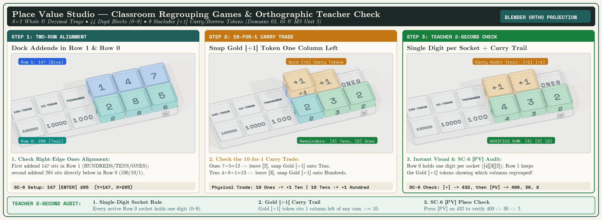
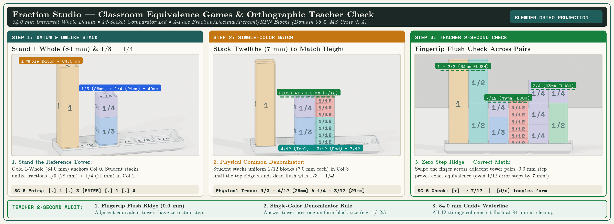
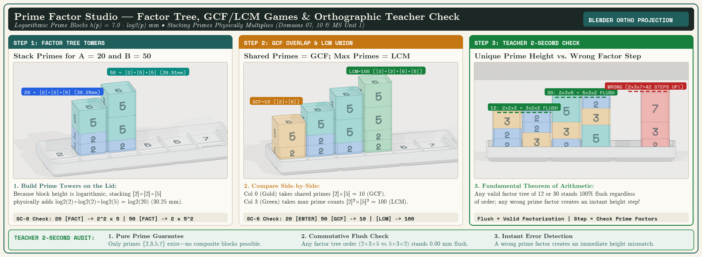

# Teacher Facilitator Guide & Classroom Pacing

<div class="te-viewport-header mb-6">
  <span class="te-viewport-sku">TEACHER CURRICULUM GUIDE // CONCEPT &rarr; BLOCKS &rarr; CALCULATOR</span>
  <span class="te-viewport-status text-amber-400">● 30-SECOND DIAGNOSTICS &bull; FLEXIBLE PACING GUIDES</span>
</div>

<nav class="curriculum-subnav flex flex-wrap gap-2 p-2.5 rounded-xl bg-[#0D1017] border border-white/10 mb-8 font-mono text-xs" aria-label="Curriculum Navigation">
  <a href="../" class="px-3 py-1.5 rounded bg-white/5 hover:bg-white/15 text-slate-300 hover:text-white transition font-bold">📖 Master Guide</a>
  <a href="../answers/" class="px-3 py-1.5 rounded bg-emerald-500/20 hover:bg-emerald-500/30 text-emerald-300 border border-emerald-500/30 transition font-bold">🔑 Online Answer Keys</a>
  <a href="../sc6-elementary-companion-workbook/" class="px-3 py-1.5 rounded bg-emerald-500/20 hover:bg-emerald-500/30 text-emerald-300 border border-emerald-500/30 transition font-bold">📗 Book 2A: Early Elementary</a>
  <a href="../sc6-elementary-companion-workbook/" class="px-3 py-1.5 rounded bg-teal-500/20 hover:bg-teal-500/30 text-teal-300 border border-teal-500/30 transition font-bold">📘 Book 2B: Upper Elementary</a>
  <a href="../big-ideas-middle-school-sc6-workbook/" class="px-3 py-1.5 rounded bg-amber-500/20 hover:bg-amber-500/30 text-amber-300 border border-amber-500/30 transition font-bold">📙 Book 3: Middle School</a>
  <a href="../sc32-scientific-companion-workbook/" class="px-3 py-1.5 rounded bg-sky-500/20 hover:bg-sky-500/30 text-sky-300 border border-sky-500/30 transition font-bold">📕 Book 4: High School & STEM</a>
  <a href="./" class="px-3 py-1.5 rounded bg-white text-slate-950 font-bold transition">🧑‍🏫 Book 1: Teacher Guide</a>
  <a href="../worksheets/" class="px-3 py-1.5 rounded bg-white/5 hover:bg-white/15 text-slate-300 hover:text-white transition font-bold">📝 Worksheets</a>
  <a href="../alignment-matrix/" class="px-3 py-1.5 rounded bg-white/5 hover:bg-white/15 text-slate-300 hover:text-white transition font-bold">🎯 Standards Matrix</a>
  <a href="../uil-competition/" class="px-3 py-1.5 rounded bg-white/5 hover:bg-white/15 text-slate-300 hover:text-white transition font-bold">🏆 UIL Competition</a>
</nav>

Integrating physical manipulatives and calculators into a busy classroom—or a home study table—works best when every tool serves a clear mathematical purpose. Because **no one wakes up searching for an "RPN calculator curriculum"**—ours is the first ever built—every book in the StackCalc Learning Lab has a **separate print cover** and begins in standard book order with a **Title Page (`Page i`)**, **Copyright & Library Colophon Page (`Page ii`)**, **Table of Contents (`Page iii`)**, and **Educator / Student Preface (`Page iv+`)** that introduce our ecosystem from zero assumptions:

1. **The Mathematical Concept (Grounded in the Stack):** When you solve math by hand on paper, you hold your first quantity on a top **Waiting Line (`Y`)**, write your second quantity below it on an active **Workbench (`X`)**, and then apply the operation (`+`, `-`, `×`, `÷`). Every lesson begins with this inside-out mathematical structure—never with mechanical button-pushing.
2. **The Three Published Physical Block Studios:** Where concrete geometry clarifies Place Value, Fractions, or Prime Factors, students build the structure first using one of our three Published Block Studios—**[Place Value Studio (`PLACE-01`)](../products/place-value/index.md)** (`0–9` digit blocks & Gold `[+1]` carry tokens on a 2-row tray mirroring `Y` and `X`), **[Fraction Studio (`FRAC-01`)](../products/fraction-studio/index.md)** (`84.0 mm` proportional towers where common denominators stand dead-flush), or **[Prime Factor Studio (`PRIME-01`)](../products/prime-factor-studio/index.md)** (logarithmic prime blocks `2, 3, 5, 7` scaled to $h(p) = 7.0 \cdot \log_2(p)\text{ mm}$ where equal products stand equal in height)—before solving by hand in their workbook.
3. **The Four-Line Stack Calculators (`SC-6` Elementary & `SC-32` Scientific):** Because there is no `[=]` key and no parentheses keys, the calculator is never a "black box." Students predict the result by hand first, then verify step-by-step across four visible stack registers (`T, Z, Y, X`).
4. **Companion Illustrated Storybooks & State/District Curriculum Integration:** Pairs with our illustrated history-of-math trade books—**[From Blocks to the Stack (Grades K–6 / SC-6)](../manuals/sc6/index.md)** and **[Thinking in the Stack (Grades 7–12 / SC-32)](../manuals/sc32/index.md)**—and plugs directly into state-mandated standards (**Common Core CCSS**, **Texas TEKS**, **Florida B.E.S.T.**, **Virginia SOL**, **AP**) and district basal textbooks (*Eureka Math / EngageNY*, *Illustrative Mathematics*, *enVision Mathematics*, *Big Ideas Math*, *HMH Into Math*, *Bridges in Mathematics*, and *Dimensions Math*) without changing a teacher's pacing calendar.

<div class="p-5 rounded-xl bg-slate-900/90 border border-amber-500/40 my-6 shadow-lg">
  <div class="flex flex-col md:flex-row md:items-center md:justify-between gap-4">
    <div>
      <div class="text-xs font-mono uppercase tracking-wider text-amber-400 font-bold mb-1">THE COMPLETE PRINT CURRICULUM LINEUP (1 MASTER TEACHER GUIDE + 5 GRADE-BAND WORKBOOKS)</div>
      <div class="text-sm text-slate-200 font-semibold">Explore our unified 50-page K–12 Master Teacher's Guide by Concept (Book 1, with complete worked answers on every Domain page) and companion Student Workbooks, published on Amazon and Lulu Press.</div>
    </div>
    <div class="flex flex-wrap gap-2.5">
      <a href="https://link.amazon/B05RFHqeu" target="_blank" rel="noopener noreferrer" class="px-3.5 py-2 rounded-lg bg-[#FF9900] hover:bg-[#e68a00] text-slate-950 font-mono text-xs font-bold transition shadow">📦 Master Teacher Guide on Amazon ($16) ↗</a>
      <a href="https://link.amazon/B07bxzYKq" target="_blank" rel="noopener noreferrer" class="px-3.5 py-2 rounded-lg bg-amber-500 hover:bg-amber-400 text-slate-950 font-mono text-xs font-bold transition shadow">📙 Student Workbooks on Amazon ($16) ↗</a>
      <a href="https://www.lulu.com/spotlight/stackcalc" target="_blank" rel="noopener noreferrer" class="px-3.5 py-2 rounded-lg bg-sky-500/20 hover:bg-sky-500/30 text-sky-300 border border-sky-500/40 font-mono text-xs font-bold transition">📖 Spiral Lay-Flat Editions on Lulu ↗</a>
      <a href="#curriculum-table" class="px-3.5 py-2 rounded-lg bg-white/10 hover:bg-white/20 text-slate-200 border border-white/20 font-mono text-xs font-bold transition">📋 Browse Online Concept Units</a>
    </div>
  </div>
</div>

## 💡 For the Reluctant Teacher: Why There Is No `[=]` Key (And Why You Already Teach Stack Math Every Day) {#for-the-reluctant-teacher}

Almost every educator grew up using a standard algebraic calculator where you type `8 + 5 =`. When teachers first see a calculator with an **`[ENTER]`** key and no **`[=]`** button, their natural reaction is hesitation: *"Why is the plus sign at the end? I have state standards to cover—I don't have time to learn or teach an unfamiliar calculator notation!"*

Here is the reassuring truth: **Reverse Polish Notation (RPN) is not a new way to do math—it is the exact order in which you already teach math with physical blocks and on the whiteboard every day.**

### 1. The "Noun, Noun, Verb" Principle: Physical Blocks & Vertical Paper Math Are Already Stack-Based

| How You Teach with Physical Blocks | How You Teach Vertical Paper Math | How the 4-Line Stack Calculator Works |
| :--- | :--- | :--- |
| 1. *"Place the **`[8]`** block on the tray."*<br>2. *"Now place the **`[5]`** block below it."*<br>3. *"Now **combine them (`+`)**!"*<br><br>**Notice:** You cannot combine two quantities *before* the second quantity is on the desk. | 1. Write **`8`** on the top line (**Line Y**).<br>2. Write **`5`** on the line below (**Line X**).<br>3. Draw the line and **add (`+` $\rightarrow$ `13`)**.<br><br>**Notice:** Both numbers exist on the paper before the operation happens. | 1. Type **`[8] [ENTER]`** $\rightarrow$ `8` sits on **Line Y**.<br>2. Type **`[5]`** $\rightarrow$ `5` sits on **Line X**.<br>3. Press **`[+]`** $\rightarrow$ adds `Y + X = 13`.<br><br>**Line Y** is the *Waiting Shelf*; **Line X** is the *Workbench*. Both operands are visible before you act. |

### 2. How the Stack Solves Order-of-Operations Confusion

Consider what happens when a middle school student evaluates $\frac{8 + 4}{9 - 3}$:

- **On a 1-Line Infix (`[=]`) Calculator:** A student who types `8 + 4 ÷ 9 - 3 =` left-to-right gets **`5.444...`** because the calculator divides `4 ÷ 9` first, or must wrap both parts in nested parentheses `((8 + 4) / (9 - 3))`. Because a 1-line screen erases each number when an operator is pressed, it is difficult to see where an entry error occurred.
- **On the 4-Line Stack Calculator:** Because there are **no parentheses keys**, the student must apply Order of Operations (PEMDAS) and work from the inside out:
  1. **Numerator (`8 + 4`):** Type **`[8] [ENTER] [4] [+]`** $\rightarrow$ **`12`** waits visibly on **Line Y**.
  2. **Denominator (`9 - 3`):** Type **`[9] [ENTER] [3] [-]`** $\rightarrow$ **`6`** sits visibly on **Line X**.
  3. **Divide (`12 ÷ 6`):** Both **`12`** and **`6`** are visible on screen together. Press **`[÷]`** $\rightarrow$ **`2`**.

### 3. Answering the Three Biggest Teacher Questions

- **Question 1: *"Will this confuse my students when they take state tests with a standard calculator?"***  
  **No—it builds stronger order-of-operations habits:** Because the stack has no parentheses keys, students practice identifying which inner sub-expression must be evaluated first. When handed a basic four-function calculator on a state test, they already know to compute the numerator and denominator before dividing rather than typing left-to-right.
- **Question 2: *"What if a student gets stuck mid-problem and asks me for help?"***  
  **A 2-Second Visual Check:** All 4 registers (`T, Z, Y, X`) remain visible on screen—you can immediately see their first quantity sitting on **Line Y** and their second quantity on **Line X**.
- **Question 3: *"How long does it take to feel comfortable teaching with it?"***  
  **About 3 minutes.** Follow the 3 Golden Rules and try the 4 exercises below (also printed on **Pages `iii–iv`** of **Book 1: Master Teacher's Guide**).

### 4. The 3-Minute Teacher Hands-On Primer & Day 1 Classroom Script

- **Golden Rule 1 (`[ENTER]` = "Put It on the Waiting Shelf"):** Press **`[ENTER]`** *only* to separate two numbers you type back-to-back.
- **Golden Rule 2 (Action Keys Work Immediately):** Press **`[+]`**, **`[-]`**, **`[×]`**, or **`[÷]`** *after* both numbers are in place—never press `[ENTER]` after an operator.
- **Golden Rule 3 (Automatic Stack Lift):** When you type a new number after an operation finishes, your previous result *automatically* lifts up to **Line Y** so you can build the next part on **Line X**.

| 45-Second Teacher Try-It Exercise | Exact Keys to Press | What You See on the 4-Line Screen (`Y` and `X`) |
| :--- | :--- | :--- |
| **Try-It 1: Basic Addition (`8 + 5 = 13`)** | `[8] [ENTER] [5] [+]` | `[8] [ENTER]` lifts `8` onto Shelf `Y`. Typing `[5]` puts `5` on Workbench `X`. Pressing `[+]` adds `Y + X -> 13`. |
| **Try-It 2: Two-Group PEMDAS (`(8 + 4) × (9 - 3) = 72`)** | `[8] [ENTER] [4] [+] [9] [ENTER] [3] [-] [×]` | First group gives `12`. When you type `9`, `12` lifts automatically to `Y` while `9 - 3 = 6` forms on `X`. Press `[×]` $\rightarrow$ `72`. |
| **Try-It 3: Two-Dot Fractions (`1/3 + 1/4 = 7/12`)** | `[.] [1] [.] [3] [ENTER] [.] [1] [.] [4] [+]` | Pressing `[.]` twice on the SC-6 enters a fraction (`0.1.3` = `1/3`). Press `[+]` $\rightarrow$ displays **`7/12`** as an exact fraction. |
| **Try-It 4: Fixing Reversed Numbers (`20 ÷ 4 = 5`)** | `[4] [ENTER] [2] [0] [x⇄y] [÷]` | Typed `4` then `20` when you meant `20 ÷ 4`? Press Swap (`[x⇄y]` / `[⇅]`) to flip `Y` and `X`, then press `[÷]` $\rightarrow$ `5`. |

> [!TIP] **Your 60-Second Day 1 Script, Stack Hand-Signals & Partner Protocols**
> *"Class, look at your calculator—notice there is no equals sign and no parentheses. That is because this calculator works just like the blocks on your desk. The bottom line, **Line X**, is your **Workbench** where you type a number. The line right above it, **Line Y**, is your **Waiting Shelf**. When we want to add `8 + 5`, we first type `8` and press **`[ENTER]`** to push `8` up onto the Waiting Shelf. Then we type `5` on our Workbench, and press **`[+]`** to combine them. Put the two numbers on the shelves first, then press the operation key."*
>
> - **4 Physical Stack Hand-Signals:** **Hands flat on desk** = Register `X` (Workbench) • **Hands at chest height** = Register `Y` (Waiting Shelf) • **Hands at shoulder height** = Register `Z` • **Hands overhead** = Top Shelf `T`.
> - **Partner Roles & The Two-Token Rule:** Pair students as **Partner A (*The Architect*, builds the physical block model first for a `+10` token)** and **Partner B (*The Stack Navigator*, verifies on the keypad for a `+10` token)**, swapping roles every 3 problems so no student skips the concrete blocks. End every lab with the **60-Second Gridfinity Socket Count-In** (`84.0 mm` flush waterline check).
> - **SC-6 Pedagogical Superpower Keys & Classroom `[FLAGS]` (`[g] [FLAGS]`):**
>   - **`[SIMP]` (Step-by-Step Fraction Reduction, `Flag 8`):** Shows the true unreduced product first (e.g., `2/3 × 3/4 = 6/12` matching the 12-part area grid) and steps down factor by factor to `LOWEST TERMS` when the student presses **`[SIMP]`**.
>   - **`[LASTX]` (`[g] [LSTx]` — 2-Tap Inverse Detective Check):** Recalls the last number consumed by an operation so students can check division with multiplication or subtraction with addition in two taps.
>   - **Classroom Flags (`[g] [FLAGS]`):** **`Flag 6`** toggles **Classroom Silent Mode**; **`Flag 7`** switches between **2-Shelf Beginner Mode (`2-LVL`, K–2)** and **4-Shelf Full Stack (`4-LVL`)**; **`Flag 8`** toggles **Manual `[SIMP]` vs. Auto-Simplify**.

---

## 🎲 Classroom Games & Orthographic Teacher Checks (The 3 Published Block Studios) {#studio-games-and-ortho-checks}

When thirty students are building with blocks at their desks, you shouldn't have to count tiny pieces to know if a student understands the lesson. Our three published classroom block kits—**[Place Value Studio (`PLACE-01`)](../products/place-value/index.md)**, **[Fraction Studio (`FRAC-01`)](../products/fraction-studio/index.md)**, and **[Prime Factor Studio (`PRIME-01`)](../products/prime-factor-studio/index.md)**—use **self-verifying physical geometry** so you can check any desk in **2 seconds** during a walk-by.

Below are the **step-by-step orthographic checks** and **9 lesson-linked classroom games** (printed on **Pages `vi–viii`** of **Book 1: Master Teacher's Guide**).

### 1. Place Value Studio (`PLACE-01`): Regrouping Games & Orthographic Column Check (Units 01–05, 12 & MS Unit 03)



| Classroom Game (10–12 Min Partner Activity) | How Students Play with the Trays & Blocks | How to Check Students Are Right + SC-6 Keys |
| :--- | :--- | :--- |
| **Game 1: *"Race to 1,000 Carry Relay"***<br>*(Units 03 & 05 • Grades 2–5)* | Partners start at `000` on the `6×2` Whole Number Tray. Take turns rolling two dice (or spinning `0–9`) to form a 2- or 3-digit addend in **Row 0 (`100 / 10 / 1`)** and add it to the running total in **Row 1**. Whenever a column sum reaches `10+`, the student calls *"Regroup!"*, leaves the ones remainder digit in Row 0, and snaps a **Gold `[+1]` Carry Token** one column left. First pair to click `[1]` into `THOUSANDS (1000)` wins. | **Walk-By Check:** Every active Row 0 socket holds **one single digit (`0–9`)**, and Gold `[+1]` tokens sit in Row 1 above the columns that received a carry.<br>**SC-6 Keys (`147 + 285 = 432`):**<br>`[1] [4] [7] [ENTER] [2] [8] [5] [+] [PV]` |
| **Game 2: *"The Decimal Point Shifter (`×10` & `÷10` Slide)"***<br>*(Unit 05 & MS Unit 03 • Grades 4–6)* | Dock the Whole Number Tray (`100,000` to `1`) and Decimal Tray (`0.1` to `0.000001`) side-by-side at the raised tactile decimal point (`•`). Call out a decimal (e.g., `4.75`) and a power-of-10 action (`× 10`, `× 100`, or `÷ 10`). Students physically slide every digit block one or two columns left (for `×10`/`×100`) or right (for `÷10`) across the stationary decimal point—seeing why digits shift columns rather than the decimal point moving. | **Walk-By Check:** The digits `[4] [7] [5]` stay in the same relative order (`4–7–5`) shifted one socket left across the tactile `•` separator.<br>**SC-6 Keys (`4.75 × 10 = 47.5`):**<br>`[4] [.] [7] [5] [ENTER] [1] [0] [×] [PV]` |
| **Game 3: *"The Borrowing Bank Vault (Zero-Placeholder Regrouping)"***<br>*(Unit 05 • Grades 3–6)* | Set a "Vault Target" containing zeros in Row 1 (e.g., `502`) and a subtraction code in Row 0 (e.g., `168`). Because Ones (`2 - 8`) and Tens (`0 - 6`) cannot subtract directly, the "Banker" partner must un-group `1` Hundred (`[5]` $\rightarrow$ `[4]`), trade across the zero Tens (`[0]` $\rightarrow$ `[9]`), and snap the Gold `[+1]` regrouping token onto the Ones column (`12 - 8 = 4`) to unlock `334`. | **Walk-By Check:** Tens socket holds `[9]` (not `[10]`) after passing `+1` to the Ones column.<br>**SC-6 Keys (`502 - 168 = 334`):**<br>`[5] [0] [2] [ENTER] [1] [6] [8] [-] [PV]` |

---

### 2. Fraction Studio (`FRAC-01`): Equivalence Games & Orthographic Flush Ridge Check (Unit 06 & MS Units 02, 04)



| Classroom Game (10–12 Min Partner Activity) | How Students Play with the 84.0 mm Towers & Comparator Lid | How to Check Students Are Right + SC-6 Keys |
| :--- | :--- | :--- |
| **Game 1: *"The 84 mm Flush Tower Challenge (Make 1 Whole)"***<br>*(Unit 06 • Grades 3–5)* | Stand the Gold **`1 Whole` (`84.0 mm`)** reference tower in Col 0 of the 12-Socket Comparator Lid. Call out a challenge—e.g., *"Build 1 Whole in Col 1 using 4 blocks from at least 3 different denominator colors"* (e.g., `1/2 + 1/4 + 1/6 + 1/12 = 42 + 21 + 14 + 7 = 84.0 mm`). Students swipe a finger across the top ridge to verify a `0.0 mm` step, then check on the SC-6. | **Walk-By Check:** Even a `1/12` error creates a `7.0 mm` stair-step. If Col 1 stands flush with the `84.0 mm` Gold `1 Whole` block, it is exact.<br>**SC-6 Keys:**<br>`[.] 1 [.] 2 [ENTER] [.] 1 [.] 4 [+] [.] 1 [.] 6 [+] [.] 1 [.] 12 [+]` |
| **Game 2: *"Two-Dot Common Denominator Duel (`1/3 + 1/4 = 7/12`)"***<br>*(Unit 06 & MS Unit 02 • Grades 4–6)* | Partner A stacks two unlike fractions in Col 2 (e.g., `1/3` [`28 mm`] + `1/4` [`21 mm`] = `49.0 mm`). Partner B must find a **single-color block family** (twelfths, `7.0 mm` each) and stack enough identical blocks in Col 3 (`seven 1/12 blocks = 49.0 mm`) to stand flush with Partner A's tower. Both partners key the sum on the SC-6 and press `[d/c]` to inspect proper/improper forms. | **Walk-By Check:** Col 2 (`1/3 + 1/4`) and Col 3 (`7/12`) stand flush at `49.0 mm`, and Col 3 uses **one uniform block size**.<br>**SC-6 Keys (`1/3 + 1/4 = 7/12`):**<br>`[.] [1] [.] [3] [ENTER] [.] [1] [.] [4] [+] [d/c]` |
| **Game 3: *"Mystery Tower Blind Fingertip Check & 4-Face Spin"***<br>*(Unit 06 & MS Unit 04 • Grades 3–6)* | Student A builds a target fraction tower (e.g., three `1/4` blocks = `3/4` = `63.0 mm`) and challenges Student B to build an equal-height tower using **no fourths** (e.g., `1/2 + 1/4`, or four `1/6` + one `1/12` = `63.0 mm`). Student A closes their eyes and runs one fingertip across both tops to judge if they are flush, then both rotate a block $90^\circ$ at a time to read **Fraction (`1/4`)**, **Decimal (`0.25`)**, **Percent (`25%`)**, and **RPN Key (`.1.4`)**. | **Walk-By Check:** Zero ridge step (`0.0 mm`) between the two towers; all 12 caddy columns sit flush at the `84.0 mm` waterline at cleanup.<br>**SC-6 Keys (`4/6 + 1/12 = 3/4`):**<br>`[.] [4] [.] [6] [ENTER] [.] [1] [.] [1] [2] [+]` |

---

### 3. Prime Factor Studio (`PRIME-01`): Factor Tree, GCF/LCM Games & Logarithmic Flush Check (Units 07, 10 & MS Unit 01)



| Classroom Game (10–12 Min Partner Activity) | How Students Play with the Logarithmic Prime Blocks ($h(p) = 7.0 \cdot \log_2(p)\text{ mm}$) | How to Check Students Are Right + SC-6 Keys |
| :--- | :--- | :--- |
| **Game 1: *"The Commutative Skyscraper Race (`2 × 3 × 5 = 30`)"***<br>*(Units 07 & 10 • Grades 3–6)* | Call out a composite number (e.g., `12`, `30`, or `42`). Partner A factors it using one factor tree (e.g., `30 = 6 × 5` $\rightarrow$ `[2] + [3] + [5]`) and stacks the prime blocks in Col 2. Partner B uses a different factor tree (`30 = 10 × 3` $\rightarrow$ `[5] + [2] + [3]`) in Col 3. Because block height follows $h(p) = 7.0 \cdot \log_2(p)\text{ mm}$ (`[2] = 7.0 mm = 1U`, `[3] = 11.09 mm`, `[5] = 16.25 mm`), both towers stand **flush (`34.35 mm`)**—demonstrating commutativity and unique factorization physically. | **Walk-By Check:** Both factor trees stand flush (`0.000 mm` step) regardless of stacking order (`[2][3][5]` vs `[5][3][2]`).<br>**SC-6 Keys (`30 = 2 × 3 × 5`):**<br>`[3] [0] [ENTER] [FACT]` |
| **Game 2: *"Impossible Impostor (Fundamental Theorem Challenge)"***<br>*(Units 07, 10 & MS Unit 01 • Grades 5–8)* | Student A builds a prime tower (e.g., `12 = [2] + [2] + [3] = 25.10 mm`) and challenges Student B to match its exact height using **different** prime blocks (e.g., trying `[5] + [2] = 10 = 23.25 mm` or `[2] + [7] = 14 = 26.65 mm`). Students see immediately that **no other combination of primes will ever stand flush**—experiencing the Fundamental Theorem of Arithmetic in their hands. | **Walk-By Check:** Any wrong prime factor creates an immediate height step (like the red `2×3×7 = 42` tower stepping above `30` in Step 3 above).<br>**SC-6 Keys:**<br>`[1] [2] [FACT]` vs `[1] [4] [FACT]` |
| **Game 3: *"Side-by-Side GCF Overlap & LCM Union Duel"***<br>*(Units 07, 10 & MS Unit 01 • Grades 5–8)* | Given `A = 20` and `B = 50`, students stack Tower A (`[2]+[2]+[5]`) in Col 1 and Tower B (`[2]+[5]+[5]`) in Col 2. To build **`GCF(20,50) = 10`** in Col 0, they copy only the **shared** prime blocks present in both towers (`[2]+[5]`). To build **`LCM(20,50) = 100`** in Col 3, they stack the **tallest count** of each prime (`[2]+[2]+[5]+[5]`), then verify `[FACT]`, `[GCF]`, and `[LCM]` on the SC-6. | **Walk-By Check:** Col 0 (`GCF`) is the shortest tower, Col 3 (`LCM`) is the tallest tower, and `h(GCF) + h(LCM) = h(A) + h(B)`.<br>**SC-6 Keys:**<br>`[2] [0] [ENTER] [5] [0] [GCF]` (`10`) & `[LCM]` (`100`) |

---

## 📐 Curriculum Architecture: 1 Unified Teacher's Guide by Concept + 5 Grade-Band Student Workbooks

Most public, charter, and private school teachers do not choose their district's textbook—they are bound to state standards (**Common Core CCSS**, **Texas TEKS**, **Florida B.E.S.T.**, **Virginia SOL**) and an adopted basal series (*Eureka Math / EngageNY*, *Illustrative Mathematics*, *enVision Mathematics*, *Big Ideas Math*, *HMH Into Math*, or *Bridges in Mathematics*). Our US Letter (`8.5" × 11"`) curriculum is organized by **universal mathematical concept** so teachers and homeschool parents can plug any lesson into their existing textbook pacing without changing their calendar:

- **Why the Teacher's Guide Is Organized into One Volume by Mathematical Concept (Book 1, 46 Pages):** Teachers, math coaches, interventionists, and homeschool parents need to see **vertical progression** (how counting and place value connect to fractions, prime factorization, algebraic expressions, and the 4-level stack), **concept-first explanations (`1. Concept → 2. Blocks → 3. Paper → 4. Calculator`)**, **misconception diagnostics**, **worked answers printed directly on every Concept Domain spread (`Pages A & B`)**, and **State Standards & District/Homeschool Crosswalks** (*CCSS*, *TEKS*, *Singapore*, *Saxon*, *RightStart*, *AoPS*, *Eureka*, *Illustrative*, *Big Ideas*, *Bridges*) in a single desk manual.
- **Why Students Have Separate 128-Page Grade-Band Workbooks (Books 2A, 2B, 3, 4 & 5):** Students need clean, uncluttered write-in pages organized unit-by-unit without back-of-book answer tables tempting them to peek. Each 11-page unit in **Books 2A, 2B & 4** includes **6 Leveled Practice Worksheets (`Practice A` through `Practice F`)** engineered for a **5-Day Weekly Rhythm** and **3-Tier Classroom Differentiation**:
  - **Tier 1 — Concrete Foundation & Intervention (`Practice A & B`, Day 2):** Hands-on 3D block pairing, visual models, and core 2-step stack fluency.
  - **Tier 2 — Grade-Level Core & Error Analysis (`Practice C & D`, Day 3):** Multi-step word problems, mental math shortcuts, and *"Spot the Mistake"* diagnostics.
  - **Tier 3 — Challenge & Fast Finishers (`Practice E, F & STEM Lab`, Days 4–5):** Multi-step synthesis, championship problems, 100-Point Unit Mastery Quiz, and Applied STEM Case Study.

| Curriculum Volume (US Letter `8.5" × 11"`) | Audience & Structure | Order Edition / Format | Online Answer Key |
| :--- | :--- | :--- | :--- |
| **Book 1: *Teaching with the Stack***<br>*(Unified K–12 Master Teacher's Guide by Concept)* | **Teachers, Coaches & Parents (50 Pages):**<br>• **Front Matter (`pp. i–x`):** Title/Colophon (`pp. i–ii`), Table of Contents (`p. iii`), Educator Prefaces (`pp. iv–v`), **3-Minute Hands-On RPN Primer (`pp. vi–vii`)** & **3 Published Block Studios: Games & 2-Second Walk-By Checks (`pp. viii–x`)**<br>• **Homeschool & State Standards Crosswalks (`pp. 1–3`)**<br>• **Part I (`pp. 4–27`):** Concept Domains 01–12 (**1. Concept & Stack Approach → 2. Blocks / Visual Model & Teacher Talk → 3. Calculator Stack Trace → 4. Story Context & Worked Answers for Warm-Ups A/B & Investigations 1–4**)<br>• **Part II (`pp. 28–32`):** Middle School Units 01–10 Coaching (`Concept → Blocks → Calculator`), Misconception Matrix & Mastery Roster<br>• **Part III (`pp. 33–36`):** Online Answer Key Directory, 3-Studio Manipulative & Keycap Reference, **5-Day Pacing & 3-Tier Differentiation Log (`p. 35`)** & **Family Welcome Guide (`p. 36`)** | **[📦 Order on Amazon ($16) ↗](https://link.amazon/B05RFHqeu)**<br>[Lulu Spiral Edition ↗](https://www.lulu.com/spotlight/stackcalc) | **[🔑 Master Answer Key](answers.md)** |
| **Book 2A: *Early Elementary Math Lab***<br>*(Grades K–2 • SC-6 Elementary)* | **Students Grades K–2 (128 Pages • 840 Verified Problems):**<br>• **Front Matter (`pp. i–iv`) & 4-Page CRA / Stack Bootcamp (`pp. 1–4`)**<br>• **10 Eleven-Page Units (`pp. 5–114`):** Core & Extension Labs, 4 Hands-On Investigations, **6 Leveled Worksheets (`Practice A–F`)**, 100-Point Mastery Quiz & Applied STEM Lab (`80 problems/unit`)<br>• **Appendices A–D (`pp. 115–124`):** Award Certificate, Progress Tracker, **4 Cumulative Benchmark Exams (`40 problems`)** & 3D Manipulative Studio Reference | **[📦 Order on Amazon ($14.99) ↗](https://link.amazon/B07bxzYKq)**<br>[Lulu Spiral Edition ↗](https://www.lulu.com/spotlight/stackcalc) | **[🔑 Book 2A Answers](answers.md#early-elementary)** |
| **Book 2B: *Upper Elementary Math Lab***<br>*(Grades 3–5 • SC-6 Elementary)* | **Students Grades 3–5 (128 Pages • 840 Verified Problems):**<br>• **Front Matter (`pp. i–iv`) & 4-Page CRA / Stack Bootcamp (`pp. 1–4`)**<br>• **10 Eleven-Page Units (`pp. 5–114`):** Core & Extension Labs, 4 Hands-On Investigations, **6 Leveled Worksheets (`Practice A–F`)**, 100-Point Mastery Quiz & Applied STEM Lab (`80 problems/unit`)<br>• **Appendices A–D (`pp. 115–124`):** Award Certificate, Progress Tracker, **4 Cumulative Benchmark Exams (`40 problems`)** & 3D Manipulative Studio Reference | **[📦 Order on Amazon ($14.99) ↗](https://link.amazon/B07bxzYKq)**<br>[Lulu Spiral Edition ↗](https://www.lulu.com/spotlight/stackcalc) | **[🔑 Book 2B Answers](answers.md#upper-elementary)** |
| **Book 3: *Middle School Math Lab***<br>*(Grades 6–8 • SC-6 Elementary)* | **Students Grades 6–8 (128 Pages • 900 Section Problems + 10 Unit Quizzes):**<br>• **Front Matter & Bootcamp + 10 Units (45 Sections):** Story Openers, 90 Two-Method Worksheets (`Practice A & B` = `900 Problems`) & 10 End-of-Unit Mastery Quizzes | **[📦 Order on Amazon ($16) ↗](https://link.amazon/B07bxzYKq)**<br>[Lulu Spiral Edition ↗](https://www.lulu.com/spotlight/stackcalc) | **[🔑 Book 3 Answers](answers.md#middle-school)** |
| **Book 4: *High School & STEM Lab***<br>*(Grades 9–12 & AP • SC-32 Scientific)* | **Students Grades 9–12 (128 Pages • 840 Verified Problems):**<br>• **Front Matter (`pp. i–iv`) & 4-Page CRA / Stack Bootcamp (`pp. 1–4`)**<br>• **10 Eleven-Page Units (`pp. 5–114`):** Core & Extension Labs, 4 Hands-On Investigations, **6 Leveled Worksheets (`Practice A–F`)**, 100-Point Mastery Quiz & Applied STEM Lab (`80 problems/unit`)<br>• **Appendices A–D (`pp. 115–124`):** Award Certificate, Progress Tracker, **4 Cumulative Benchmark Exams (`40 problems`)** & 3D Manipulative Studio Reference | **[📦 Order on Amazon ($16) ↗](https://link.amazon/B07DqTRR5)**<br>[Lulu Spiral Edition ↗](https://www.lulu.com/spotlight/stackcalc) | **[🔑 Book 4 Answers](answers.md#high-school)** |
| **Book 5: *Stack Speed & Fluency***<br>*(Full-Year Edition • Grades 3–12 & UIL)* | **Students Grades 3–12 & Competitors (128 Pages • 3,690 Verified Problems):**<br>• **Front Matter (`pp. i–iv`) & 180-Test Master Trackers (`pp. 1–2`)**<br>• **15 Seven-Page Speed Sections (`pp. 3–107`):** 1-Page Speed Lesson & Playbook + 12 Progressive 20-Problem Timed Tests (`Tests A1–A3, B1–B3, C1–C3, D1–D3` = `180 Tests`)<br>• **Appendices A–E (`pp. 108–124`):** Stack Tactics, Mental Sprints, Progress Graph, Award Certificate & 3D Block Studio Reference | **[📦 Order on Amazon ($16) ↗](https://link.amazon/B07bxzYKq)**<br>[Lulu Spiral Edition ↗](https://www.lulu.com/spotlight/stackcalc) | **[🔑 Book 5 Answers](answers.md#speed-fluency)** |

---

## 📋 Concept Curriculum Units (Units 01–12) {#curriculum-table}

Every curriculum unit below is aligned to the mathematical progressions in **[From Blocks to the Stack (SC-6 Elementary Manual)](../manuals/sc6/index.md)** and **[Thinking in the Stack (SC-32 Scientific Manual)](../manuals/sc32/index.md)**, and can be read online below or ordered as part of the **Lay-Flat Spiral-Bound Curriculum Books on [Lulu Press ↗](https://www.lulu.com/spotlight/stackcalc)** and **[Amazon ↗](https://link.amazon/B05RFHqeu)**.

| Concept Domain / Unit | Grade Band | Published Block Kit (When Applicable) & Calculator | Companion Textbook Chapter | Unit Lesson & Rubric |
| :--- | :--- | :--- | :--- | :--- |
| **[Unit 01: Counting, Cardinality & The One-More Step Counter](#unit-01)** | Pre-K – Kindergarten | [Place Value Studio (`PLACE-01`)](../products/place-value/index.md) — Place Value Studio (Digit Blocks 0–9 & Gold [+1] Step Tokens) + **SC-6 Elementary** | *How Ten Fingers & an Empty Shell Created Place Value & The 1-to-10 Staircase* ([Read Chapter](../manuals/sc6/03-counting-place-value.md)) | **[View Unit 01 Lesson & Rubric](#unit-01)** |
| **[Unit 02: Part-Part-Whole & Number Bonds on the Place Value Tray](#unit-02)** | Grades K–1 | [Place Value Studio (`PLACE-01`)](../products/place-value/index.md) — Place Value Studio (Two-Row Tray & Digit Blocks 0–9) + **SC-6 Elementary** | *Number Partners on the Workbench: Part-Part-Whole Bonds & Friends of Ten* ([Read Chapter](../manuals/sc6/03-counting-place-value.md)) | **[View Unit 02 Lesson & Rubric](#unit-02)** |
| **[Unit 03: Complements to 10 & Make-10 Regrouping with Carry Tokens](#unit-03)** | Grade 1 | [Place Value Studio (`PLACE-01`)](../products/place-value/index.md) — Place Value Studio (Whole-Number Tray, Digit Blocks 0–9 & Gold [+1] Carry Tokens) + **SC-6 Elementary** | *Making a Ten First (8 + 5 = 10 + 3 = 13) & The Gold [+1] Carry Token Trade* ([Read Chapter](../manuals/sc6/03-counting-place-value.md)) | **[View Unit 03 Lesson & Rubric](#unit-03)** |
| **[Unit 04: Doubles, Near-Doubles & Equal Groups on the Place Value Tray](#unit-04)** | Grades 1–2 | [Place Value Studio (`PLACE-01`)](../products/place-value/index.md) — Place Value Studio (Two-Row Tray & Digit Blocks 0–9) + **SC-6 Elementary** | *Twin Rows on the Workbench: How Matching Tray Rows Mirror Instant [ENTER] [+] Doubles* ([Read Chapter](../manuals/sc6/02-rpn-for-young-learners.md)) | **[View Unit 04 Lesson & Rubric](#unit-04)** |
| **[Unit 05: The 4-Register Stack: Four Operations & Automatic Lift](#unit-05)** | Grades 3–4 | [Place Value Studio (`PLACE-01`)](../products/place-value/index.md) — Place Value Blocks & 4-Register Stack + **SC-6 Elementary** | *Inside the 4-Floor Number Elevator (T, Z, Y, X) & Young Gauss's 10-Second Shortcut* ([Read Chapter](../manuals/sc6/02-rpn-for-young-learners.md)) | **[View Unit 05 Lesson & Rubric](#unit-05)** |
| **[Unit 06: Fraction Studio: Height Equivalence & Two-Dot Notation](#unit-06)** | Grades 4–5 | [Fraction Studio (`FRAC-01`)](../products/fraction-studio/index.md) — 84 mm Fraction Towers & Twin Comparator Well + **SC-6 Elementary** | *The Pharaoh's Bakery, Pythagoras's Guitar Strings & Why Your Fraction Towers Stand 84.0 mm Tall* ([Read Chapter](../manuals/sc6/05-fractions-decimals-ratios.md)) | **[View Unit 06 Lesson & Rubric](#unit-06)** |
| **[Unit 07: Postfix Evaluation, Factor Trees & Chained Operations](#unit-07)** | Grades 5–6 | [Prime Factor Studio (`PRIME-01`)](../products/prime-factor-studio/index.md) — Prime Factor Studio (Logarithmic Prime Blocks) & 4-Register Stack + **SC-6 Elementary** | *Why 24 Is the Champion Packing Number, The Typesetter's Bargain & Dijkstra's 1961 Railway Siding* ([Read Chapter](../manuals/sc32/02-rpn-stack-dynamics.md)) | **[View Unit 07 Lesson & Rubric](#unit-07)** |
| **[Unit 08: Algebraic Expressions, Base-x Polynomials & Quadratic Factoring](#unit-08)** | Grades 7–8 | [Prime Factor Studio (`PRIME-01`)](../products/prime-factor-studio/index.md) — Prime Factor Studio (Factor Pairs) & 2×2 Algebraic Area Grid + **SC-6 & SC-32 Bridge** | *From Al-Khwarizmi's Squares to the 1535 Duel in Milan & Kahan's [POLY] Solver* ([Read Chapter](../manuals/sc32/07-polynomials-brent-solver.md)) | **[View Unit 08 Lesson & Rubric](#unit-08)** |
| **[Unit 09: Trigonometry, Vectors & Polar/Rectangular Coordinates](#unit-09)** | Grades 9–11 | Right-Triangle & 2D Vector Diagram + **SC-32 Scientific** | *A Stick in Alexandria: How Eratosthenes Measured the Earth with a Shadow & Crosswind Vectors* ([Read Chapter](../manuals/sc32/04-trig-vectors-polar.md)) | **[View Unit 09 Lesson & Rubric](#unit-09)** |
| **[Unit 10: Exponential Growth, Compound Interest & Logarithms](#unit-10)** | Grades 10–12 | [Prime Factor Studio (`PRIME-01`)](../products/prime-factor-studio/index.md) — Prime Factor Studio (Logarithmic Prime Blocks) & Fraction Studio Towers + **SC-32 Scientific** | *The Scottish Baron Who Doubled the Lifespan of Astronomers (John Napier), Euler's e & The Rule of 72* ([Read Chapter](../manuals/sc32/03-algebra-transcendentals.md)) | **[View Unit 10 Lesson & Rubric](#unit-10)** |
| **[Unit 11: Combinatorics, Probability Ratios & Series Accumulation](#unit-11)** | Grades 11–12 / AP | [Prime Factor Studio (`PRIME-01`)](../products/prime-factor-studio/index.md) — Prime Factor Studio (Factorial Cancellation) & Statistical Data Plot + **SC-32 Scientific** | *Sir Francis Galton's 1873 Bean Machine, The Asteroid Ceres & The Guinness Brewery Chemist* ([Read Chapter](../manuals/sc32/09-statistics-curve-fitting.md)) | **[View Unit 11 Lesson & Rubric](#unit-11)** |
| **[Unit 12: Digital Logic, Base Conversions & Computer Architecture](#unit-12)** | Grades 9–12 / AP CS | [Place Value Studio (`PLACE-01`)](../products/place-value/index.md) — Place Value Studio (Binary [0]/[1] Register Trays & Base-N Columns) + **SC-32 Scientific** | *Leibniz's Binary Medallion, Claude Shannon's 1937 Relay Basement & NASA's 36-Bit IBM 7090 Word* ([Read Chapter](../manuals/sc32/10-computer-science-bases.md)) | **[View Unit 12 Lesson & Rubric](#unit-12)** |

> [!TIP] **Companion Workbooks & Printable Chapter Supplements**
> * **[Big Ideas Math Middle School SC-6 Supplement (Units 1–10 Separate Chapter PDFs)](big-ideas-middle-school-sc6-workbook.md):** 10 individual chapter PDFs (10–12 pages each, with Practice A & B + Chapter Answer Key), the 114-page student workbook (`900 problems`), and the 15-page Teacher Coach Guide.
> * **[SC-6 Elementary Companion Problem Workbook (253 Worked Problems)](sc6-elementary-companion-workbook.md)** & **[SC-32 Scientific Companion Casebook (339 Worked Problems)](sc32-scientific-companion-workbook.md)**.
> * **[120 Pre-Generated Classroom Station Guides (Form A & Form B PDFs)](worksheets.md)** for Singapore Dimensions, Bridges in Mathematics, and Big Ideas Math.

---

## 📚 Complete 12-Unit K–12 Teacher Curriculum (`Concept → Blocks → Calculator`, Units 01–12)

Each unit below follows the **1. Mathematical Concept (Stack Approach) → 2. Physical Blocks (When Applicable) → 3. Calculator Execution** progression so teachers can lead conceptual discussion first, transition to physical blocks where appropriate, and verify on the 4-level stack:

### Unit 01: Counting, Cardinality & The One-More Step Counter {#unit-01}

**Grade Band:** Pre-K – Kindergarten &nbsp;|&nbsp; **Calculator:** SC-6 Elementary (Grades K–6) &nbsp;|&nbsp; **Published Block Kit (When Applicable):** [Place Value Studio (`PLACE-01`)](../products/place-value/index.md) (`Place Value Studio (Digit Blocks 0–9 & Gold [+1] Step Tokens)`)  
**Standards:** `CCSS.MATH.K.CC.A.1`, `CCSS.MATH.K.CC.B.4`, `CCSS.MATH.K.CC.B.5`, `CCSS.MATH.K.OA.A.1` &nbsp;|&nbsp; **Curricular Alignment:** Bridges in Mathematics (Kindergarten Unit 1) &bull; Singapore Math (Earlybird Kindergarten)  
**📘 Teacher Manual Reference:** Complete concept lesson plans, hands-on block activities, student lab sheets, and full worked answer keys are published in the **[Master Teacher's Guide on Amazon ($16) ↗](https://link.amazon/B05RFHqeu)** and [Lulu Press ↗](https://www.lulu.com/spotlight/stackcalc). &nbsp;|&nbsp; **📖 Companion Textbook:** **[From Blocks to the Stack (SC-6 Manual) — Ch. 3: Counting, Subitizing & Place Value + Appendix B: Station F.1](../manuals/sc6/03-counting-place-value.md)**

#### 1. Core Mathematical Rules & Stack Mapping (`How Counting Maps to the Calculator`)
* Every Gold [+1] step token added on the Place Value Tray matches one count on the calculator screen.
* A [0] block in the Ones socket represents zero [0]. Press [C] to start a fresh count.
* To step count by 1: press [1] [ENTER] [1] [+], then press [1] [+] as you step your Ones digit block from [1] to [2], [3], [4]...
* Numbers show quantity (cardinality): the digit block in the Ones socket matches the total count on Line X.
* **Canonical Stack Pattern:** `[1] [ENTER] [1] [+] = 2, then [1] [+] = 3, [1] [+] = 4...`

#### 2. Primary Core Lesson — *1-to-1 Correspondence: The Concrete Step Counter* (Bridges in Mathematics: Kindergarten, Unit 1 • `CCSS.MATH.K.CC.B.4`)
* **Lesson Objective:** Establish one-to-one correspondence between physical digit blocks and step tokens on the Place Value Tray and calculator screen increments.
* **Step 1 — The Mathematical Concept & Stack-Based Approach:** Counting by ones is repeated addition of the unit 1 (n -> n + 1). In a stack-based approach, the current total waits on Shelf Y while the unit step (1) enters Workbench X; pressing [+] combines them into the new total.
* **Step 2 — Modeling with Physical Blocks (When Applicable) & Student Prediction (`PLACE-01`):**
  * *Hands-On Setup:* Place the [1] Digit Block into the Ones socket of the Place Value Tray. Keep Gold [+1] step tokens ready beside the tray.
  * *Student Prediction (Before Pressing Keys):* When we place 1 Gold [+1] step token and step the Ones block up by 1, what digit block replaces [1]? (Prediction: [2])
  * *Teacher Coaching ("Say This, Not That"):* **Say:** *""Place 1 Gold [+1] step token on the tray first, then press [1] [+] to match the count you just touched.""* &nbsp;|&nbsp; **Avoid:** *""Just press 1 + 1 + 1 as fast as you can until the screen says 5.""*
* **Step 3 — Calculator Execution & 4-Level Stack Trace (`T, Z, Y, X`):**

| Key Pressed | Screen (`X`) | Internal 4-Level Stack Effect (`T, Z, Y, X`) |
| :--- | :--- | :--- |
| `1` | **`1`** | First count placed: 1 enters register X |
| `enter` | **`1`** | 1 copied to register Y: holds the current count |
| `1` | **`1`** | Gold [+1] step token added: 1 enters register X |
| `plus` | **`2`** | Press [+]: 1 + 1 = 2! Swap Ones block to [2] |
| `1` | **`1`** | Next Gold [+1] step token added: 1 enters X |
| `plus` | **`3`** | Press [+]: 2 + 1 = 3! Tray [3] and screen match perfectly |

* **Step 4 — Story Context & Guided Classroom Investigation:**
  * *Historical & Real-World Hook ("How Ten Fingers & an Empty Shell Created Place Value & The 1-to-10 Staircase"):* Long before paper or keyboards existed, ancient shepherds counted flocks with clay pebbles ('calculi' in Latin—the root of 'calculator'!) and Maya astronomers drew a shell for zero so an empty socket had its own symbol. Stepping 1 token at a time on the Place Value Tray while pressing [1] [+] builds the exact 1-to-10 Staircase from Chapter 3 of From Blocks to the Stack.
  * *60-Second Bell-Ringer Prompt:* Close your eyes and clap slowly 4 times. Before opening your eyes, which Digit Block belongs in the Ones socket of your Place Value Tray and what number waits on Line X?
  * *Guided Classroom Investigation:* *Place the [4] Digit Block in the Ones column of your Place Value Tray. Add 1 Gold [+1] step token. Write the keystrokes to show 4 + 1 on the calculator.*  
    **Worked Solution & Keystrokes:** **5 ([5] Digit Block). Keystrokes: [4] [ENTER] [1] [+]**

#### 3. Follow-Up Extension Lesson — *More, Less & Zero: Finding Differences* (Singapore Math: Kindergarten, Book A • `CCSS.MATH.K.CC.C.6`)
* **Extension Objective:** Compare two quantities on the two rows of the Place Value Tray and find the difference using subtraction.
* **Step 1 — The Mathematical Concept & Stack-Based Approach:** Comparison subtraction finds the difference ('how many more?') between two quantities. In stack order, the larger reference quantity sits on Waiting Shelf Y while the smaller quantity enters Workbench X before pressing [-].
* **Step 2 — Modeling with Physical Blocks (When Applicable) & Hypothesis (`PLACE-01`):**
  * *Setup:* Place the [5] Digit Block in Row 1 (top row) and the [2] Digit Block in Row 0 (bottom row) of the Ones column on the Place Value Tray.
  * *Student Hypothesis:* Look at the two rows on the tray. Which row has the larger quantity? How many more is 5 than 2?
* **Step 3 — Calculator Execution & 4-Level Stack Trace (`T, Z, Y, X`):**

| Key Pressed | Screen (`X`) | Internal 4-Level Stack Effect (`T, Z, Y, X`) |
| :--- | :--- | :--- |
| `5` | **`5`** | Row 1 quantity (5) enters register X |
| `enter` | **`5`** | 5 lifted to register Y (first set) |
| `2` | **`2`** | Row 0 quantity (2) enters register X |
| `minus` | **`3`** | Minus subtracts X from Y: Row 1 has 3 more! |

* **Extension Investigation:** *Row 1 holds [6] and Row 0 holds [2] on your Place Value Tray. How many more is in Row 1? Write the keystrokes.*  
  **Worked Solution & Keystrokes:** **4 more. Keystrokes: [6] [ENTER] [2] [-]**

#### 4. Target Misconceptions & 30-Second Teacher Remediations
* **Misconception:** *Reciting number names faster than placing physical step tokens (losing 1-to-1 correspondence).*  
  **30-Second Teacher Remediation:** Have the student place 1 Gold [+1] token on the Place Value Tray and step the Ones Digit Block first, say the number aloud, and only then press [1] [+] so the tray and Register X stay locked in step.
* **Misconception:** *Confusing the action of adding 1 more with the total quantity on the tray (cardinality).*  
  **30-Second Teacher Remediation:** Ask the student to point to the Digit Block in the Ones socket of the Place Value Tray and verify that its numeral matches Register X on the screen.

#### 5. Student Lab Worksheet Problems (`P1`–`P4`) & Answer Key

| Problem | Student Lab Investigation Prompt | StackCalc Check Keystrokes | Expected Answer |
| :--- | :--- | :--- | :--- |
| **P1** | Place [3] in Row 1 and [2] in Row 0 of the Ones column. Write the keystrokes to find the total. | `[3] [ENTER] [2] [+]` | **5** |
| **P2** | The Ones column holds [5]. If you subtract [2], what digit block remains? | `[5] [ENTER] [2] [-]` | **3** |
| **P3** | Clear the calculator by pressing [C]. What Digit Block represents an empty Ones count? | `[C]` | **0 (Zero)** |
| **P4** | Step count by ones starting at 1: [1] [ENTER] [1] [+]. Press [1] [+] two more times. What is X? | `[1] [+] [1] [+]` | **4** |

---

### Unit 02: Part-Part-Whole & Number Bonds on the Place Value Tray {#unit-02}

**Grade Band:** Grades K–1 &nbsp;|&nbsp; **Calculator:** SC-6 Elementary (Grades K–6) &nbsp;|&nbsp; **Published Block Kit (When Applicable):** [Place Value Studio (`PLACE-01`)](../products/place-value/index.md) (`Place Value Studio (Two-Row Tray & Digit Blocks 0–9)`)  
**Standards:** `CCSS.MATH.K.OA.A.3`, `CCSS.MATH.1.OA.C.6` &nbsp;|&nbsp; **Curricular Alignment:** Singapore Math (Primary 1 Chapter 2) &bull; Bridges in Math (K-1)  
**📘 Teacher Manual Reference:** Complete concept lesson plans, hands-on block activities, student lab sheets, and full worked answer keys are published in the **[Master Teacher's Guide on Amazon ($16) ↗](https://link.amazon/B05RFHqeu)** and [Lulu Press ↗](https://www.lulu.com/spotlight/stackcalc). &nbsp;|&nbsp; **📖 Companion Textbook:** **[From Blocks to the Stack (SC-6 Manual) — Ch. 3: Number Bonds, Ch. 8: Missing Addend Mysteries & Appendix B: Station F.2](../manuals/sc6/03-counting-place-value.md)**

#### 1. Core Mathematical Rules & Stack Mapping (`How Two-Row Tray Parts Fit the Stack`)
* Row 1 (top row) of the Place Value Tray holds Part 1 in register Y. Row 0 (bottom row) holds Part 2 in register X.
* Pressing [+] combines both parts into the Whole in register X.
* To find a missing part: start with the Whole in Y, enter Part 1 in X, and press [-]!
* **Canonical Stack Pattern:** `[PART 1] [ENTER] [PART 2] [+] = [WHOLE]`

#### 2. Primary Core Lesson — *Composing Numbers: Part + Part = Whole* (Singapore Math: Grade 1, Chapter 2 • `CCSS.MATH.1.OA.C.6`)
* **Lesson Objective:** Physically compose two parts on the two rows of the Place Value Tray into a whole and connect to RPN binary addition.
* **Step 1 — The Mathematical Concept & Stack-Based Approach:** Every addition problem composes two independent parts into a single whole (Part 1 + Part 2 = Whole). The stack makes this structure visible: Part 1 rests on Waiting Shelf Y, Part 2 is built on Workbench X, and [+] joins them.
* **Step 2 — Modeling with Physical Blocks (When Applicable) & Student Prediction (`PLACE-01`):**
  * *Hands-On Setup:* Place the [4] Digit Block in Row 1 (Part 1) and the [3] Digit Block in Row 0 (Part 2) of the Ones column on your Place Value Tray.
  * *Student Prediction (Before Pressing Keys):* Combine both parts in the Ones column: 4 + 3 = 7 (swap to the [7] Digit Block).
  * *Teacher Coaching ("Say This, Not That"):* **Say:** *""Row 1 ([4]) sits on Waiting Shelf Y and Row 0 ([3]) sits on Workbench X—press [+] to combine both parts into the Whole!""* &nbsp;|&nbsp; **Avoid:** *""Move the 4 across the equals sign and change its sign to minus.""*
* **Step 3 — Calculator Execution & 4-Level Stack Trace (`T, Z, Y, X`):**

| Key Pressed | Screen (`X`) | Internal 4-Level Stack Effect (`T, Z, Y, X`) |
| :--- | :--- | :--- |
| `4` | **`4`** | Part 1 (4) enters register X |
| `enter` | **`4`** | 4 copied up to register Y; represents Row 1 (Part 1) |
| `3` | **`3`** | Part 2 (3) enters register X; represents Row 0 (Part 2) |
| `plus` | **`7`** | Plus combines Part 1 (Y) + Part 2 (X) = Whole (7) in X! |

* **Step 4 — Story Context & Guided Classroom Investigation:**
  * *Historical & Real-World Hook ("Number Partners on the Workbench: Part-Part-Whole Bonds & Friends of Ten"):* Your brain loves structure: when you place two parts on the top and bottom rows of the Place Value Tray, you can see how they compose a whole! In From Blocks to the Stack, Row 1 of the Place Value Tray sits on Waiting Shelf Y (Part 1), Row 0 sits on Workbench X (Part 2), and pressing [+] snaps both rows together into the Whole.
  * *60-Second Bell-Ringer Prompt:* Place [7] as the Whole and cover Row 0 on your Place Value Tray so only Row 1 ([4]) shows. How does the stack uncover the hidden part?
  * *Guided Classroom Investigation:* *Place [5] in Row 1 (Part 1) and [4] in Row 0 (Part 2) of your Place Value Tray to find the whole. Write the keystrokes.*  
    **Worked Solution & Keystrokes:** **9 ([9] Digit Block). Keystrokes: [5] [ENTER] [4] [+]**

#### 3. Follow-Up Extension Lesson — *Decomposing the Whole: Finding the Missing Part* (Bridges in Mathematics: Grade 1, Unit 2 • `CCSS.MATH.1.OA.B.4`)
* **Extension Objective:** Determine an unknown addend using inverse operations on the RPN stack.
* **Step 1 — The Mathematical Concept & Stack-Based Approach:** Finding a missing addend (6 + ? = 10) is the inverse of composing a sum. By placing the known Whole (10) on Shelf Y and the known Part (6) on Workbench X, pressing [-] isolates the unknown part.
* **Step 2 — Modeling with Physical Blocks (When Applicable) & Hypothesis (`PLACE-01`):**
  * *Setup:* Place [1][0] in Row 1 of the Place Value Tray (Whole = 10) and [6] in Row 0 (Known Part 1 = 6).
  * *Student Hypothesis:* What missing part combines with 6 to make 10? (10 - 6 = 4).
* **Step 3 — Calculator Execution & 4-Level Stack Trace (`T, Z, Y, X`):**

| Key Pressed | Screen (`X`) | Internal 4-Level Stack Effect (`T, Z, Y, X`) |
| :--- | :--- | :--- |
| `1` | **`1`** | Enter Whole (10) |
| `0` | **`10`** | 10 in register X |
| `enter` | **`10`** | Whole (10) lifted to register Y |
| `6` | **`6`** | Known Part 1 (6) enters register X |
| `minus` | **`4`** | Minus subtracts known Part from Whole: Missing Part is 4! |

* **Extension Investigation:** *The whole is 8. Part 1 is 5. Find the missing Part 2 using the Place Value Tray and calculator.*  
  **Worked Solution & Keystrokes:** **Missing Part is 3. Keystrokes: [8] [ENTER] [5] [-]**

#### 4. Target Misconceptions & 30-Second Teacher Remediations
* **Misconception:** *Pressing [+] immediately after the first number without pressing [ENTER] to separate Part 1 and Part 2.*  
  **30-Second Teacher Remediation:** Point to the two rows of the Place Value Tray: pressing [ENTER] is the physical divider that lifts Row 1 (Part 1) up to Register Y before Row 0 (Part 2) is typed into Register X.
* **Misconception:** *Adding the whole and the known part when solving for a missing addend (e.g., computing 10 + 6 instead of 10 − 6).*  
  **30-Second Teacher Remediation:** Place [1][0] in Row 1 (Whole) and [6] in Row 0 (Known Part) of the Place Value Tray; show that the Whole (10) goes into Register Y, the known part (6) enters X, and [−] reveals the missing part.

#### 5. Student Lab Worksheet Problems (`P1`–`P4`) & Answer Key

| Problem | Student Lab Investigation Prompt | StackCalc Check Keystrokes | Expected Answer |
| :--- | :--- | :--- | :--- |
| **P1** | Make 6: Part 1 is 2. What is Part 2? Write the keystrokes. | `[6] [ENTER] [2] [-]` | **4** |
| **P2** | Part 1 is 7, Part 2 is 2. What is the Whole? | `[7] [ENTER] [2] [+]` | **9** |
| **P3** | Three parts make a whole: 2, 3, and 4. Add them on the stack. | `[2] [ENTER] [3] [+] [4] [+]` | **9** |
| **P4** | The Whole is 10. Part 1 is 7. What is Part 2? | `[1][0] [ENTER] [7] [-]` | **3** |

---

### Unit 03: Complements to 10 & Make-10 Regrouping with Carry Tokens {#unit-03}

**Grade Band:** Grade 1 &nbsp;|&nbsp; **Calculator:** SC-6 Elementary (Grades K–6) &nbsp;|&nbsp; **Published Block Kit (When Applicable):** [Place Value Studio (`PLACE-01`)](../products/place-value/index.md) (`Place Value Studio (Whole-Number Tray, Digit Blocks 0–9 & Gold [+1] Carry Tokens)`)  
**Standards:** `CCSS.MATH.1.OA.B.4`, `CCSS.MATH.1.OA.C.6`, `CCSS.MATH.1.NBT.B.2` &nbsp;|&nbsp; **Curricular Alignment:** Singapore Math (Primary 1 Ch 8) &bull; Bridges in Math (Grade 1) &bull; Big Ideas Math (Grade 1)  
**📘 Teacher Manual Reference:** Complete concept lesson plans, hands-on block activities, student lab sheets, and full worked answer keys are published in the **[Master Teacher's Guide on Amazon ($16) ↗](https://link.amazon/B05RFHqeu)** and [Lulu Press ↗](https://www.lulu.com/spotlight/stackcalc). &nbsp;|&nbsp; **📖 Companion Textbook:** **[From Blocks to the Stack (SC-6 Manual) — Ch. 3: Making a Ten First & Trading 10 Ones + Appendix B: Station F.4](../manuals/sc6/03-counting-place-value.md)**

#### 1. Core Mathematical Rules & Stack Mapping (`Complements to 10 & Gold [+1] Carry Rules`)
* The Ones column holds single Digit Blocks [0] through [9]. The moment a column reaches 10, it regroups!
* 10-for-1 Carry Trade: When the Ones column reaches 10, place a Gold [+1] Carry Token into the Tens column and reset the Ones socket to [0].
* Complements to 10: To find how much more is needed to trigger a Gold [+1] carry, enter 10 [ENTER], then the digit, then [-].
* Bridging Through 10: Decompose the second addend to complete 10 first (e.g., 8 + 5 = 8 + 2 + 3 = 13).
* **Canonical Stack Pattern:** `10 [ENTER] [N] [-] = [COMPLEMENT TO 10]`

#### 2. Primary Core Lesson — *Complements to 10: Making Ten & Carry Trade* (Big Ideas Math: Grade 1, Chapter 3 • `CCSS.MATH.1.OA.C.6`)
* **Lesson Objective:** Determine complements to 10 using Place Value Digit Blocks, Gold [+1] Carry Tokens, and RPN subtraction.
* **Step 1 — The Mathematical Concept & Stack-Based Approach:** Our base-10 system regroups every collection of 10 ones into 1 ten. Finding a number's complement to 10 (10 - 7 = 3) places the target base (10) on Shelf Y and the current ones digit (7) on Workbench X.
* **Step 2 — Modeling with Physical Blocks (When Applicable) & Student Prediction (`PLACE-01`):**
  * *Hands-On Setup:* Place the [7] Digit Block into the Ones socket of the Place Value Tray and hold a Gold [+1] Carry Token beside the Tens socket.
  * *Student Prediction (Before Pressing Keys):* How many more ones must be added to [7] to reach 10 and trigger the Gold [+1] Carry Token? (7 + 3 = 10).
  * *Teacher Coaching ("Say This, Not That"):* **Say:** *""How many more to reach 10? Let's borrow 2 from 5 to complete 10 first and crown the Tens column with a Gold [+1] Carry Token!""* &nbsp;|&nbsp; **Avoid:** *""Memorize 8 + 5 = 13 from your flash cards.""*
* **Step 3 — Calculator Execution & 4-Level Stack Trace (`T, Z, Y, X`):**

| Key Pressed | Screen (`X`) | Internal 4-Level Stack Effect (`T, Z, Y, X`) |
| :--- | :--- | :--- |
| `1` | **`1`** | Enter 1 |
| `0` | **`10`** | Target ten (10) in X |
| `enter` | **`10`** | 10 lifted to Y |
| `7` | **`7`** | Current Ones digit (7) in X |
| `minus` | **`3`** | 10 - 7 = 3: Adding 3 completes 10 and triggers the [+1] Carry! |

* **Step 4 — Story Context & Guided Classroom Investigation:**
  * *Historical & Real-World Hook ("Making a Ten First (8 + 5 = 10 + 3 = 13) & The Gold [+1] Carry Token Trade"):* Why is 10 + 3 so much easier for our brains than 8 + 5? Because base-10 place value groups everything into full tens! In Chapter 3 of From Blocks to the Stack, students bridge across 10 on the Place Value Tray and crown the Tens column with a Gold [+1] Carry Token.
  * *60-Second Bell-Ringer Prompt:* Place [8] in the Ones socket of your Place Value Tray. How many more ones do you need to trigger a Gold [+1] Carry Token in the Tens column?
  * *Guided Classroom Investigation:* *The Ones socket holds [6]. How many more ones are needed to reach 10 and earn a Gold [+1] Carry Token?*  
    **Worked Solution & Keystrokes:** **4 ones. Keystrokes: [1][0] [ENTER] [6] [-]**

#### 3. Follow-Up Extension Lesson — *Bridging Through 10: The Make-Ten & Carry Strategy* (Singapore Math: Grade 1, Chapter 8 • `CCSS.MATH.1.OA.C.6`)
* **Extension Objective:** Decompose an addend to reach 10, place a Gold [+1] Carry Token in the Tens column, and add the remainder.
* **Step 1 — The Mathematical Concept & Stack-Based Approach:** Bridging across 10 decomposes an addend so the first part completes a full ten (8 + 5 = (8 + 2) + 3 = 10 + 3). On the stack, the intermediate sum (10) stays in X and automatically lifts to Y when the remaining part (3) is entered.
* **Step 2 — Modeling with Physical Blocks (When Applicable) & Hypothesis (`PLACE-01`):**
  * *Setup:* Place [8] in Row 1 and [5] in Row 0 of the Ones column on the Place Value Tray.
  * *Student Hypothesis:* Take 2 from the 5 to bring 8 up to 10. Place a Gold [+1] Carry Token in the Tens socket and [3] in the Ones socket: 10 + 3 = 13.
* **Step 3 — Calculator Execution & 4-Level Stack Trace (`T, Z, Y, X`):**

| Key Pressed | Screen (`X`) | Internal 4-Level Stack Effect (`T, Z, Y, X`) |
| :--- | :--- | :--- |
| `8` | **`8`** | 8 in Ones socket |
| `enter` | **`8`** | 8 lifted to Y |
| `2` | **`2`** | 2 borrowed from 5 to make 10 |
| `plus` | **`10`** | 8 + 2 = 10 (Gold [+1] Carry Token placed in Tens column!) |
| `3` | **`3`** | Remaining 3 ones |
| `plus` | **`13`** | 10 + 3 = 13 total ([1] Ten, [3] Ones)! |

* **Extension Investigation:** *Use the Make-Ten strategy to solve 9 + 6 on your Place Value Tray and calculator.*  
  **Worked Solution & Keystrokes:** **15. Keystrokes: [9] [ENTER] [1] [+] [5] [+]**

#### 4. Target Misconceptions & 30-Second Teacher Remediations
* **Misconception:** *Counting on by ones across 10 (e.g., 8 + 5 as 9, 10, 11, 12, 13) instead of decomposing 5 into 2 + 3 to complete 10 first.*  
  **30-Second Teacher Remediation:** Have the student bridge [8] to 10 on the Place Value Tray, place a Gold [+1] Carry Token in the Tens socket with [3] in the Ones socket, and key [8] [ENTER] [2] [+] [3] [+].
* **Misconception:** *Reading teen numbers as two separate single digits (seeing 14 as 1 and 4 rather than 1 Ten plus 4 Ones).*  
  **30-Second Teacher Remediation:** Place [1] in the Tens socket and [4] in the Ones socket of the Place Value Tray and key [10] [ENTER] [4] [+] so students see 14 formed from 10 in Register Y and 4 in Register X.

#### 5. Student Lab Worksheet Problems (`P1`–`P4`) & Answer Key

| Problem | Student Lab Investigation Prompt | StackCalc Check Keystrokes | Expected Answer |
| :--- | :--- | :--- | :--- |
| **P1** | What is the complement to 10 for 4? Write the keystrokes. | `[1][0] [ENTER] [4] [-]` | **6** |
| **P2** | Solve 7 + 5 using Make-Ten: first make 10, then add 2. | `[7] [ENTER] [3] [+] [2] [+]` | **12** |
| **P3** | The Ones socket holds [9]. How many more to trigger a Gold [+1] Carry Token? | `[1][0] [ENTER] [9] [-]` | **1** |
| **P4** | Solve 8 + 6 using Make-Ten on the calculator. | `[8] [ENTER] [2] [+] [4] [+]` | **14** |

---

### Unit 04: Doubles, Near-Doubles & Equal Groups on the Place Value Tray {#unit-04}

**Grade Band:** Grades 1–2 &nbsp;|&nbsp; **Calculator:** SC-6 Elementary (Grades K–6) &nbsp;|&nbsp; **Published Block Kit (When Applicable):** [Place Value Studio (`PLACE-01`)](../products/place-value/index.md) (`Place Value Studio (Two-Row Tray & Digit Blocks 0–9)`)  
**Standards:** `CCSS.MATH.1.OA.C.6`, `CCSS.MATH.2.OA.B.2` &nbsp;|&nbsp; **Curricular Alignment:** Bridges in Math (Grade 1-2) &bull; Singapore Math (Primary 1-2)  
**📘 Teacher Manual Reference:** Complete concept lesson plans, hands-on block activities, student lab sheets, and full worked answer keys are published in the **[Master Teacher's Guide on Amazon ($16) ↗](https://link.amazon/B05RFHqeu)** and [Lulu Press ↗](https://www.lulu.com/spotlight/stackcalc). &nbsp;|&nbsp; **📖 Companion Textbook:** **[From Blocks to the Stack (SC-6 Manual) — Ch. 1: Meet Your Math Workbench & Ch. 2: What Happens When You Press [ENTER]?](../manuals/sc6/02-rpn-for-young-learners.md)**

#### 1. Core Mathematical Rules & Stack Mapping (`Twin-Row Doubles & ENTER Duplicate Rules`)
* Placing matching Digit Blocks in Row 1 (top) and Row 0 (bottom) of the Place Value Tray models a physical Double.
* Doubles shortcut: Enter a number, press [ENTER] to duplicate it from Line X onto Line Y, then press [+]!
* Near-Doubles: Double the base number with [ENTER] [+], then press [1] [+] for one more.
* **Canonical Stack Pattern:** `[N] [ENTER] [+] = [DOUBLES (2 × N)]`

#### 2. Primary Core Lesson — *Doubles Strategy: The ENTER Duplicate Key* (Bridges in Mathematics: Grade 1, Unit 3 • `CCSS.MATH.1.OA.C.6`)
* **Lesson Objective:** Model doubles physically using matching digit blocks in Row 1 and Row 0 of the Place Value Tray and computationally using ENTER duplication.
* **Step 1 — The Mathematical Concept & Stack-Based Approach:** Doubling a quantity means adding two identical copies of the same number (n + n = 2n). On a stack calculator, pressing [ENTER] duplicates the active number in X onto Waiting Shelf Y so pressing [+] immediately doubles it.
* **Step 2 — Modeling with Physical Blocks (When Applicable) & Student Prediction (`PLACE-01`):**
  * *Hands-On Setup:* Place a [6] Digit Block in Row 1 (top) and a matching [6] Digit Block in Row 0 (bottom) of the Ones column on the Place Value Tray.
  * *Student Prediction (Before Pressing Keys):* Observe the matching rows: 6 + 6 = 12 (1 Ten and 2 Ones on the tray).
  * *Teacher Coaching ("Say This, Not That"):* **Say:** *""Press [6] [ENTER]—look how [ENTER] clones your top row of 6 onto Shelf Y so both rows are ready to add!""* &nbsp;|&nbsp; **Avoid:** *""Press 6, then plus, then 6, then equals.""*
* **Step 3 — Calculator Execution & 4-Level Stack Trace (`T, Z, Y, X`):**

| Key Pressed | Screen (`X`) | Internal 4-Level Stack Effect (`T, Z, Y, X`) |
| :--- | :--- | :--- |
| `6` | **`6`** | Top row quantity (6) enters register X |
| `enter` | **`6`** | ENTER duplicates 6 into register Y! Both rows now on stack |
| `plus` | **`12`** | Plus combines top and bottom rows: 6 + 6 = 12! |

* **Step 4 — Story Context & Guided Classroom Investigation:**
  * *Historical & Real-World Hook ("Twin Rows on the Workbench: How Matching Tray Rows Mirror Instant [ENTER] [+] Doubles"):* When you place matching Digit Blocks in the top and bottom rows of your Place Value Tray, your eyes immediately recognize a double! In Chapters 1 & 2 of From Blocks to the Stack, pressing [ENTER] clones Workbench X onto Waiting Shelf Y just like matching Row 1 and Row 0 on the tray for instant [ENTER] [+] doubles.
  * *60-Second Bell-Ringer Prompt:* Place a [6] Digit Block in Row 1 and a matching [6] Digit Block in Row 0 of your Place Value Tray. Which single key clones a number on the calculator?
  * *Guided Classroom Investigation:* *Place [7] in both rows of your Place Value Tray. Use [ENTER] [+] to double it on the calculator.*  
    **Worked Solution & Keystrokes:** **14 ([1][4] on the tray). Keystrokes: [7] [ENTER] [+]**

#### 3. Follow-Up Extension Lesson — *Near-Doubles: Doubles Plus One* (Bridges in Mathematics: Grade 2, Unit 1 • `CCSS.MATH.2.OA.B.2`)
* **Extension Objective:** Use known doubles facts to solve near-doubles on the Place Value Tray and calculator.
* **Step 1 — The Mathematical Concept & Stack-Based Approach:** A near-double (such as 7 + 8) is a double plus or minus 1 ((7 + 7) + 1). Evaluating the known double first leaves 14 on the stack, ready to combine with the +1 adjustment.
* **Step 2 — Modeling with Physical Blocks (When Applicable) & Hypothesis (`PLACE-01`):**
  * *Setup:* Place [7] in Row 1 (top) and [8] in Row 0 (bottom) of the Place Value Tray.
  * *Student Hypothesis:* 7 and 8 is double 7 plus 1 more: 14 + 1 = 15.
* **Step 3 — Calculator Execution & 4-Level Stack Trace (`T, Z, Y, X`):**

| Key Pressed | Screen (`X`) | Internal 4-Level Stack Effect (`T, Z, Y, X`) |
| :--- | :--- | :--- |
| `7` | **`7`** | Enter base number 7 |
| `enter` | **`7`** | Duplicate 7 |
| `plus` | **`14`** | Double: 7 + 7 = 14 |
| `1` | **`1`** | Near-double difference (1) |
| `plus` | **`15`** | 14 + 1 = 15! |

* **Extension Investigation:** *Use the near-doubles strategy to solve 6 + 7 on the calculator.*  
  **Worked Solution & Keystrokes:** **13. Keystrokes: [6] [ENTER] [+] [1] [+]**

#### 4. Target Misconceptions & 30-Second Teacher Remediations
* **Misconception:** *Retyping the number to double it (e.g., [7] [ENTER] [7] [+]) instead of recognizing that [ENTER] duplicates Register X into Register Y.*  
  **30-Second Teacher Remediation:** Place matching [7] Digit Blocks in Row 1 and Row 0 of the Place Value Tray, then press [7] [ENTER] and point to the screen: both Y and X already hold 7, so pressing [+] doubles it immediately.
* **Misconception:** *Confusing '3 groups of 4' with '3 + 4' when transitioning from repeated addition to multiplication.*  
  **30-Second Teacher Remediation:** Model three groups of [4] on the Place Value Tray; have the student key [4] [ENTER] [4] [+] [4] [+] = 12 first, then compare directly with [4] [ENTER] [3] [×] = 12.

#### 5. Student Lab Worksheet Problems (`P1`–`P4`) & Answer Key

| Problem | Student Lab Investigation Prompt | StackCalc Check Keystrokes | Expected Answer |
| :--- | :--- | :--- | :--- |
| **P1** | Calculate double 8 using [ENTER] [+]. | `[8] [ENTER] [+]` | **16** |
| **P2** | Solve near-double 8 + 9: double 8 then add 1. | `[8] [ENTER] [+] [1] [+]` | **17** |
| **P3** | Calculate double 9 using [ENTER] [+]. | `[9] [ENTER] [+]` | **18** |
| **P4** | Solve 5 + 6 using doubles plus one. | `[5] [ENTER] [+] [1] [+]` | **11** |

---

### Unit 05: The 4-Register Stack: Four Operations & Automatic Lift {#unit-05}

**Grade Band:** Grades 3–4 &nbsp;|&nbsp; **Calculator:** SC-6 Elementary (Grades K–6) &nbsp;|&nbsp; **Published Block Kit (When Applicable):** [Place Value Studio (`PLACE-01`)](../products/place-value/index.md) (`Place Value Blocks & 4-Register Stack`)  
**Standards:** `CCSS.MATH.3.OA.A.1`, `CCSS.MATH.3.OA.A.2`, `CCSS.MATH.4.OA.A.3` &nbsp;|&nbsp; **Curricular Alignment:** Singapore Math (Primary 4) &bull; Big Ideas Math (Grade 4)  
**📘 Teacher Manual Reference:** Complete concept lesson plans, hands-on block activities, student lab sheets, and full worked answer keys are published in the **[Master Teacher's Guide on Amazon ($16) ↗](https://link.amazon/B05RFHqeu)** and [Lulu Press ↗](https://www.lulu.com/spotlight/stackcalc). &nbsp;|&nbsp; **📖 Companion Textbook:** **[From Blocks to the Stack (SC-6 Manual) — Ch. 2: The Number Elevator & Ch. 4: Young Gauss's 10-Second Shortcut](../manuals/sc6/02-rpn-for-young-learners.md)**

#### 1. Core Mathematical Rules & Stack Mapping (`4-Register Stack Anatomy`)
* Four registers: T (top), Z (third), Y (second/operand), X (screen/bottom).
* ENTER duplicates X into Y and pushes older values up into Z and T.
* Two-number operators (+, -, ×, ÷) combine Y and X, dropping Z to Y and T to Z.
* Automatic Lift: Entering a new number after an operation automatically pushes the result to Y!
* **Canonical Stack Pattern:** `[Y] [ENTER] [X] [OP] -> Drops stack and displays result in X`

#### 2. Primary Core Lesson — *Multi-Step Word Problems Without Parentheses* (Singapore Math: Primary 4, Chapter 3 • `CCSS.MATH.4.OA.A.3`)
* **Lesson Objective:** Evaluate chained arithmetic expressions without parentheses by managing stack register flow.
* **Step 1 — The Mathematical Concept & Stack-Based Approach:** In a multi-step expression like (3 × 4) + (2 × 5), each product is a self-contained quantity that must be evaluated before the two groups can be added. On the 4-level stack, the first product (12) waits safely on Shelf Y while the second product (10) is formed on X, requiring zero parentheses.
* **Step 2 — Modeling with Physical Blocks (When Applicable) & Student Prediction (`PLACE-01`):**
  * *Hands-On Setup:* Use Place Value unit blocks to represent quantities alongside the 4-line stack display.
  * *Student Prediction (Before Pressing Keys):* Problem: (8 - 3) × 2. Predict: 8 - 3 = 5, then 5 × 2 = 10.
  * *Teacher Coaching ("Say This, Not That"):* **Say:** *""Solve the inner bundle first and let it wait on Shelf Y; when you type the next number, watch Automatic Stack Lift push it up!""* &nbsp;|&nbsp; **Avoid:** *""Type the expression from left to right and hope the calculator knows PEMDAS.""*
* **Step 3 — Calculator Execution & 4-Level Stack Trace (`T, Z, Y, X`):**

| Key Pressed | Screen (`X`) | Internal 4-Level Stack Effect (`T, Z, Y, X`) |
| :--- | :--- | :--- |
| `8` | **`8`** | 8 in X |
| `enter` | **`8`** | 8 copied to Y |
| `3` | **`3`** | 3 entered into X |
| `minus` | **`5`** | 8 - 3 = 5 in X |
| `2` | **`2`** | Automatic lift! 5 lifts to Y; 2 enters X |
| `times` | **`10`** | 5 × 2 = 10 in X! |

* **Step 4 — Story Context & Guided Classroom Investigation:**
  * *Historical & Real-World Hook ("Inside the 4-Floor Number Elevator (T, Z, Y, X) & Young Gauss's 10-Second Shortcut"):* In 1786, 9-year-old Carl Friedrich Gauss stunned his teacher by adding 1 through 100 in seconds—folding the list into 50 pairs of 101! In Chapters 2 & 4 of From Blocks to the Stack, students discover how the 4-Floor Number Elevator (Shelves X, Y, Z, T) automatically lifts finished answers up to Shelf Y when you type the next number, solving multi-step stories with zero parentheses.
  * *60-Second Bell-Ringer Prompt:* Beat the Smartphone Challenge: Ask a volunteer to type 8 + 4 × 5 left-to-right on a basic phone calculator (it says 60!). Why is the true answer 28?
  * *Guided Classroom Investigation:* *A baker has 15 cookies, sells 6, and packs the rest into 3 bags. How many per bag? Keystrokes for (15 - 6) / 3.*  
    **Worked Solution & Keystrokes:** **3 cookies per bag. Keystrokes: [1][5] [ENTER] [6] [-] [3] [÷]**

#### 3. Follow-Up Extension Lesson — *Automatic Stack Lift & Register Retention* (Big Ideas Math: Grade 4, Chapter 2 • `CCSS.MATH.4.OA.A.3`)
* **Extension Objective:** Demonstrate that the result of an operation acts as operand Y for the subsequent number entry.
* **Step 1 — The Mathematical Concept & Stack-Based Approach:** When an operation finishes on the stack, its result remains in Register X and automatically lifts to Waiting Shelf Y as soon as the next digit is typed—allowing chained calculations like (12 ÷ 4) + 7 to flow continuously from the inside out.
* **Step 2 — Modeling with Physical Blocks (When Applicable) & Hypothesis (`PLACE-01`):**
  * *Setup:* Observe the 4-line stack screen as values automatically lift into register Y: (12 / 4) + 7.
  * *Student Hypothesis:* 12 / 4 = 3. Entering 7 will lift 3 to Y. 3 + 7 = 10.
* **Step 3 — Calculator Execution & 4-Level Stack Trace (`T, Z, Y, X`):**

| Key Pressed | Screen (`X`) | Internal 4-Level Stack Effect (`T, Z, Y, X`) |
| :--- | :--- | :--- |
| `1` | **`1`** | First digit of 12 enters X |
| `2` | **`12`** | 12 in register X |
| `enter` | **`12`** | 12 copied to Y |
| `4` | **`4`** | 4 enters X |
| `divide` | **`3`** | 12 / 4 = 3 in X |
| `7` | **`7`** | 7 entered: 3 lifts to Y automatically! |
| `plus` | **`10`** | 3 + 7 = 10! |

* **Extension Investigation:** *Calculate (24 / 6) + 15 on the calculator without pressing ENTER twice.*  
  **Worked Solution & Keystrokes:** **19. Keystrokes: [2][4] [ENTER] [6] [÷] [1][5] [+]**

#### 4. Target Misconceptions & 30-Second Teacher Remediations
* **Misconception:** *Pressing [ENTER] after an operator (+, −, ×, ÷) before typing the next number in a chained calculation, wasting a stack register.*  
  **30-Second Teacher Remediation:** Demonstrate Automatic Stack Lift: after [18] [ENTER] [6] [−] produces 12, typing [3] automatically lifts 12 to Register Y—no [ENTER] needed before [3] [×]!
* **Misconception:** *Reversing operand order in subtraction or division (computing X − Y instead of Y − X).*  
  **30-Second Teacher Remediation:** Remind students that Register Y is always the starting quantity on top (Row 1) and Register X is the operator's action (Row 0); if entered backward, press [x swap y] before [−] or [÷].

#### 5. Student Lab Worksheet Problems (`P1`–`P4`) & Answer Key

| Problem | Student Lab Investigation Prompt | StackCalc Check Keystrokes | Expected Answer |
| :--- | :--- | :--- | :--- |
| **P1** | Calculate (14 - 5) × 3 on the stack. | `[1][4] [ENTER] [5] [-] [3] [×]` | **27** |
| **P2** | Calculate 30 / (2 + 3): add denominator first! | `[2] [ENTER] [3] [+] [3][0] [x⇄y] [÷]` | **6** |
| **P3** | Calculate (9 + 7) / (8 - 4) using 4 registers. | `[9] [ENTER] [7] [+] [8] [ENTER] [4] [-] [÷]` | **4** |
| **P4** | A farmer collects 20 eggs, breaks 2, and divides among 6 cartons. | `[2][0] [ENTER] [2] [-] [6] [÷]` | **3 eggs** |

---

### Unit 06: Fraction Studio: Height Equivalence & Two-Dot Notation {#unit-06}

**Grade Band:** Grades 4–5 &nbsp;|&nbsp; **Calculator:** SC-6 Elementary (Grades K–6) &nbsp;|&nbsp; **Published Block Kit (When Applicable):** [Fraction Studio (`FRAC-01`)](../products/fraction-studio/index.md) (`84 mm Fraction Towers & Twin Comparator Well`)  
**Standards:** `CCSS.MATH.4.NF.A.1`, `CCSS.MATH.4.NF.B.3`, `CCSS.MATH.5.NF.A.1` &nbsp;|&nbsp; **Curricular Alignment:** Singapore Math (Primary 5) &bull; Bridges in Math (Grade 4-5) &bull; Big Ideas Math (Grades 4-6)  
**📘 Teacher Manual Reference:** Complete concept lesson plans, hands-on block activities, student lab sheets, and full worked answer keys are published in the **[Master Teacher's Guide on Amazon ($16) ↗](https://link.amazon/B05RFHqeu)** and [Lulu Press ↗](https://www.lulu.com/spotlight/stackcalc). &nbsp;|&nbsp; **📖 Companion Textbook:** **[From Blocks to the Stack (SC-6 Manual) — Ch. 5: Fractions, Decimals & Ratios (The Pharaoh's Bakery & 84mm Comparator)](../manuals/sc6/05-fractions-decimals-ratios.md)**

#### 1. Core Mathematical Rules & Stack Mapping (`Two-Dot Fraction Entry & Tower Equivalence`)
* One Whole tower stands 84.0 mm tall, dividing cleanly into halves (42 mm), thirds (28 mm), fourths (21 mm), sixths (14 mm), eighths (10.5 mm), and twelfths (7 mm).
* Twin Comparator Well: Stack equivalent fraction towers side-by-side against the 84.0 mm Whole tower to verify equivalence by sight and touch.
* Dividing by a Fraction (Split & Rebuild 1 Full Tower): Just as $A \div 3$ splits tower $A$ into $3$ parts to find $1$ full tower, $A \div \frac{c}{d}$ splits tower $A$ into $c$ equal parts ($\div c$) and stacks $d$ of them ($\times d$) to build $1$ full mystery tower in the Comparator Well (pooling blocks across a 4-kit classroom table pod when a demonstration requires more than one Whole's worth of a denominator).
* Two-dot entry format: [WHOLE] [.] [NUMERATOR] [.] [DENOMINATOR] (or [a ᵇ/c] on SC-6); proper fractions start with [.] (e.g., [.][3][.][4] for 3/4).
* **Canonical Stack Pattern:** `[.] [3] [.] [4] = 3/4   |   [2] [.] [1] [.] [2] = 2 1/2`

#### 2. Primary Core Lesson — *Mixed Numbers & Height Equivalence: 3/4 + 2 1/2* (Singapore Math: Primary 5, Chapter 4 • `CCSS.MATH.5.NF.A.1`)
* **Lesson Objective:** Represent proper and mixed fractions physically with block towers and computationally with two-dot notation.
* **Step 1 — The Mathematical Concept & Stack-Based Approach:** Fractions can only be added or subtracted when they share a common unit (denominator), and mixed numbers combine whole units with fractional parts. On the stack, two-dot notation ([.] n [.] d) treats each fraction or mixed number as a single unified value on Y and X.
* **Step 2 — Modeling with Physical Blocks (When Applicable) & Student Prediction (`FRAC-01`):**
  * *Hands-On Setup:* Place three 1/4 blocks (3 × 21 = 63 mm). Beside them, stack two Whole blocks and one 1/2 block (84 + 84 + 42 = 210 mm).
  * *Student Prediction (Before Pressing Keys):* Combine heights: 63 mm + 210 mm = 273 mm. In wholes: 3 1/4 (273 / 84 = 3.25).
  * *Teacher Coaching ("Say This, Not That"):* **Say:** *""Stand your 1/2 (42 mm) and 1/4 (21 mm) towers in the comparator lid—do they match three 1/4 towers (63 mm) in height?""* &nbsp;|&nbsp; **Avoid:** *""Just cross-multiply the denominators and don't ask why.""*
* **Step 3 — Calculator Execution & 4-Level Stack Trace (`T, Z, Y, X`):**

| Key Pressed | Screen (`X`) | Internal 4-Level Stack Effect (`T, Z, Y, X`) |
| :--- | :--- | :--- |
| `dot` | **`0.`** | Leading dot indicates 0 wholes |
| `3` | **`0.3`** | Numerator = 3 |
| `dot` | **`0.3.`** | Second dot sets fraction entry mode |
| `4` | **`3/4`** | Denominator = 4: displays 3/4 (or 0.75) |
| `enter` | **`3/4`** | 3/4 lifted to register Y |
| `2` | **`2`** | Whole = 2 |
| `dot` | **`2.`** | Dot |
| `1` | **`2.1`** | Numerator = 1 |
| `dot` | **`2.1.`** | Dot |
| `2` | **`2 1/2`** | Denominator = 2: displays 2 1/2 |
| `plus` | **`3 1/4`** | Plus combines: 3 1/4 (decimal 3.25)! |

* **Step 4 — Story Context & Guided Classroom Investigation:**
  * *Historical & Real-World Hook ("The Pharaoh's Bakery, Pythagoras's Guitar Strings & Why Your Fraction Towers Stand 84.0 mm Tall"):* Four thousand years ago, Egyptian scribes had to divide 3 loaves of bread fairly among 4 workers—and instead of cutting every loaf into quarters, they gave each worker 1/2 + 1/4! In Chapter 5 of From Blocks to the Stack, students discover why the Whole block is engineered to 84.0 mm (LCM of 1,2,3,4,6,8,12 -> 84 mm), letting 42 mm (1/2) + 21 mm (1/4) stack flush with three 21 mm (3/4) blocks.
  * *60-Second Bell-Ringer Prompt:* Hold up the 1-Whole tower and a millimeter ruler: Why did engineers make the Whole block exactly 84 mm tall instead of 100 mm?
  * *Guided Classroom Investigation:* *Build 1/2 and 1/4 with blocks. Verify their combined height against three 1/4 blocks, then check on the calculator.*  
    **Worked Solution & Keystrokes:** **3/4 (height 63 mm). Keystrokes: [.][1][.][2] [ENTER] [.][1][.][4] [+]**

#### 3. Follow-Up Extension Lesson — *Fraction Multiplication & Reciprocals* (Bridges in Mathematics: Grade 5, Unit 2 • `CCSS.MATH.5.NF.B.4`)
* **Extension Objective:** Multiply fractions and verify division as multiplication by the reciprocal.
* **Step 1 — The Mathematical Concept & Stack-Based Approach:** Multiplying fractions ($\frac{3}{4} \times \frac{2}{3}$) scales one tower by another. To divide by a fraction with the exact same tower-height meaning as whole-number division—*"If tower $A$ is $\frac{c}{d}$ of a mystery tower, how tall is $1$ full mystery tower?"*—use **Split & Rebuild** across a 4-kit table pod: for $\frac{1}{2} \div \frac{3}{4}$, split the `1/2` block ($42\text{ mm}$) into $3$ equal `1/6` blocks ($14\text{ mm}$ each $= \frac{1}{4}$ of the mystery tower, $\div 3$), then stack $4$ of those `1/6` blocks ($56\text{ mm} = \frac{2}{3}$, $\times 4$) beside two `1/3` blocks to see physically why $\div \frac{3}{4} = \times \frac{4}{3}$! On the stack, placing the dividend in Y and divisor in X lets you either divide directly or invert X (`[1/x]`) and multiply.
* **Step 2 — Modeling with Physical Blocks (When Applicable) & Hypothesis (`FRAC-01`):**
  * *Setup:* Set up 3/4 of a tower (63 mm) and divide into 3 equal parts (21 mm each), taking 2 parts: (3/4) × (2/3). For the reciprocal division check ($\frac{1}{2} \div \frac{3}{4} = \frac{2}{3}$ or $\frac{3}{4} \div \frac{1}{2} = 1\frac{1}{2}$), have students at a 4-kit table pod combine blocks so they can keep the starting dividend tower in Well A while building the full rebuilt mystery tower in Well B.
  * *Student Hypothesis:* 3/4 × 2/3 = 6/12 = 1/2. The resulting block height matches one 1/2 block (42 mm).
* **Step 3 — Calculator Execution & 4-Level Stack Trace (`T, Z, Y, X`):**

| Key Pressed | Screen (`X`) | Internal 4-Level Stack Effect (`T, Z, Y, X`) |
| :--- | :--- | :--- |
| `dot` | **`0.`** | Start proper fraction 3/4 |
| `3` | **`0.3`** | Numerator 3 |
| `dot` | **`0.3.`** | Fraction separator |
| `4` | **`3/4`** | 3/4 in register X |
| `enter` | **`3/4`** | 3/4 lifted to register Y |
| `dot` | **`0.`** | Start proper fraction 2/3 |
| `2` | **`0.2`** | Numerator 2 |
| `dot` | **`0.2.`** | Fraction separator |
| `3` | **`2/3`** | 2/3 in register X |
| `times` | **`1/2`** | Product 6/12 = 1/2 (matches 42 mm block)! |

* **Extension Investigation:** *Calculate 2/3 × 3/8 using fraction blocks and verify on the calculator. What block height matches the product?*  
  **Worked Solution & Keystrokes:** **1/4 (height 21 mm). Keystrokes: [.][2][.][3] [ENTER] [.][3][.][8] [×]**

#### 4. Target Misconceptions & 30-Second Teacher Remediations
* **Misconception:** *Adding numerators and denominators directly (e.g., 1/2 + 1/4 = 2/6) because 6 looks larger, or treating "invert and multiply" for fraction division as an arbitrary trick.*  
  **30-Second Teacher Remediation:** Place the 1/2 tower (42 mm) + 1/4 tower (21 mm) beside two 1/6 towers (28 mm) in the Fraction Studio comparator lid; the physical height difference proves 1/2 + 1/4 = 3/4 (63 mm). For fraction division (e.g., $\frac{1}{2} \div \frac{3}{4} = \frac{2}{3}$ or $\frac{3}{4} \div \frac{1}{2} = 1\frac{1}{2}$), have a 4-kit table pod pool blocks to **Split & Rebuild 1 Full Tower**: in $\frac{1}{2} \div \frac{3}{4}$, `1/2` ($42\text{ mm}$) is $3$ fourths of the mystery tower—split by $3$ into three `1/6` blocks ($14\text{ mm}$ is $1$ fourth), then rebuild all $4$ fourths by stacking four `1/6` blocks ($56\text{ mm}$), which stands flush with two `1/3` blocks ($\frac{2}{3}$).
* **Misconception:** *Entering a proper fraction like 3/4 as [3] [.] [4] (which is decimal 3.4) instead of using Two-Dot fraction notation [.][3][.][4].*  
  **30-Second Teacher Remediation:** Teach the rule: 'First dot = whole number zero, second dot = fraction bar.' Typing [.][3][.][4] displays exact 3/4 on the stack.

#### 5. Student Lab Worksheet Problems (`P1`–`P4`) & Answer Key

| Problem | Student Lab Investigation Prompt | StackCalc Check Keystrokes | Expected Answer |
| :--- | :--- | :--- | :--- |
| **P1** | Add 1/3 + 1/6 using fraction blocks and verify on the calculator. | `[.][1][.][3] [ENTER] [.][1][.][6] [+]` | **1/2 (42 mm)** |
| **P2** | Calculate 1 1/2 - 3/4. What block height corresponds to this? | `[1][.][1][.][2] [ENTER] [.][3][.][4] [-]` | **3/4 (63 mm)** |
| **P3** | Compare 3/8 (31.5 mm) to 1/2 (42 mm). What is the decimal equivalent of 3/8? | `[.][3][.][8] [FDISP]` | **0.375** |
| **P4** | Multiply 2/3 × 3/4. Check against your fraction blocks. | `[.][2][.][3] [ENTER] [.][3][.][4] [×]` | **1/2 (42 mm)** |

---

### Unit 07: Postfix Evaluation, Factor Trees & Chained Operations {#unit-07}

**Grade Band:** Grades 5–6 &nbsp;|&nbsp; **Calculator:** SC-6 Elementary (Grades K–6) &nbsp;|&nbsp; **Published Block Kit (When Applicable):** [Prime Factor Studio (`PRIME-01`)](../products/prime-factor-studio/index.md) (`Prime Factor Studio (Logarithmic Prime Blocks) & 4-Register Stack`)  
**Standards:** `CCSS.MATH.5.OA.A.1`, `CCSS.MATH.6.EE.A.2` &nbsp;|&nbsp; **Curricular Alignment:** Singapore Math (Dimensions 6) &bull; Bridges in Math (Grade 5) &bull; Big Ideas Math (Grade 6)  
**📘 Teacher Manual Reference:** Complete concept lesson plans, hands-on block activities, student lab sheets, and full worked answer keys are published in the **[Master Teacher's Guide on Amazon ($16) ↗](https://link.amazon/B05RFHqeu)** and [Lulu Press ↗](https://www.lulu.com/spotlight/stackcalc). &nbsp;|&nbsp; **📖 Companion Textbook:** **[From Blocks to the Stack (SC-6 Ch. 4: Why 24 Is the Champion Packing Number) & Thinking in the Stack (SC-32 Ch. 2: Dijkstra's Railway Siding)](../manuals/sc32/02-rpn-stack-dynamics.md)**

#### 1. Core Mathematical Rules & Stack Mapping (`Postfix Evaluation & Prime Factor Tree Rules`)
* In postfix evaluation, operands are entered first, followed immediately by operators.
* Evaluation order matches mathematical precedence: evaluate inner sub-expressions and factor branches first.
* RPN keystroke sequence evaluates complex expressions naturally without parenthesis keys.
* Zero parentheses are needed because stack order guarantees unambiguous evaluation.
* Stack registers (X, Y, Z, T) hold intermediate branch results directly as new values are entered.
* **Canonical Stack Pattern:** `Postfix Sequence: [Operand 1] [ENTER] [Operand 2] [Operator]`

#### 2. Primary Core Lesson — *Chained Operations: (a + b) × (c - d) on the Stack* (Big Ideas Math: Grade 6, Chapter 1 & Chapter 5 • `CCSS.MATH.6.EE.A.2`)
* **Lesson Objective:** Map an algebraic expression to a postfix sequence and execute on the 4-register stack without parentheses.
* **Step 1 — The Mathematical Concept & Stack-Based Approach:** Written algebra uses parentheses to show which inner operations must happen first. Postfix (stack) notation evaluates expressions in true mathematical order from the inside out: compute the first branch (6 + 1 = 7), let it wait on Y while computing the second branch (9 - 5 = 4), and multiply.
* **Step 2 — Modeling with Physical Blocks (When Applicable) & Student Prediction (`PRIME-01`):**
  * *Hands-On Setup:* Use Prime Factor Studio blocks in the 12-socket comparator lid to model the two factor branches: (6 + 1) = [7] prime block and (9 - 5) = [2] + [2] = 4 tower, then combine their heights for 7 × 4 = 28.
  * *Student Prediction (Before Pressing Keys):* Left sub-expression: 6 + 1 = 7. Right sub-expression: 9 - 5 = 4. Combined product: 7 × 4 = 28 (prime tower 2 × 2 × 7).
  * *Teacher Coaching ("Say This, Not That"):* **Say:** *""Evaluate the left branch (6 + 1 = 7) onto Shelf Y and the right branch (9 − 5 = 4) on Shelf X, then press [×] to combine!""* &nbsp;|&nbsp; **Avoid:** *""Count open and close parentheses before typing anything.""*
* **Step 3 — Calculator Execution & 4-Level Stack Trace (`T, Z, Y, X`):**

| Key Pressed | Screen (`X`) | Internal 4-Level Stack Effect (`T, Z, Y, X`) |
| :--- | :--- | :--- |
| `6` | **`6`** | Value a (6) placed into Register X |
| `enter` | **`6`** | ENTER lifts 6 into Register Y |
| `1` | **`1`** | Value b (1) placed into Register X |
| `plus` | **`7`** | Left operator (+): Combines Y(6) + X(1) = 7 in X |
| `9` | **`9`** | Value c (9) entered into X; 7 lifted to Y |
| `enter` | **`9`** | ENTER lifts 9 into Z and 7 into T |
| `5` | **`5`** | Value d (5) placed into Register X |
| `minus` | **`4`** | Right operator (-): Combines Z/Y(9) - X(5) = 4 in X; 7 drops to Y |
| `times` | **`28`** | Root operator (×): Combines Y(7) × X(4) = 28 in X! |

* **Step 4 — Story Context & Guided Classroom Investigation:**
  * *Historical & Real-World Hook ("Why 24 Is the Champion Packing Number, The Typesetter's Bargain & Dijkstra's 1961 Railway Siding"):* In the 1500s, typesetters invented parentheses only to squash 2D fraction bars onto flat lines of lead type—then in 1924 Jan Łukasiewicz proved that placing operators after their numbers eliminates every parenthesis, and in 1961 Edsger Dijkstra modeled the 4-register stack as a railway shunting yard! Alongside the Prime Factor Studio (where 24 = 2 × 2 × 2 × 3 decomposes into prime factor towers), students evaluate nested expressions from the inside out.
  * *60-Second Bell-Ringer Prompt:* Why does 24 factor into the Prime Factor tower [2]×[2]×[2]×[3] (giving 8 factor pairs), while 23 is a single prime number?
  * *Guided Classroom Investigation:* *Evaluate (8 + 2) × (14 - 9) by solving the inner quantities first, then checking on the stack.*  
    **Worked Solution & Keystrokes:** **50. Keystrokes: [8] [ENTER] [2] [+] [1][4] [ENTER] [9] [-] [×]**

#### 3. Follow-Up Extension Lesson — *Deep Stack Evaluation & Register Limits* (Singapore Math: Dimensions 6, Chapter 1 • `CCSS.MATH.6.EE.A.2`)
* **Extension Objective:** Evaluate deeply nested expressions while tracking stack depth across registers T, Z, Y, X.
* **Step 1 — The Mathematical Concept & Stack-Based Approach:** Deeply nested fractions such as (12 - 4) ÷ (2 × (1 + 1)) require holding completed sub-expressions aside while inner terms are resolved. The 4-register stack (T, Z, Y, X) holds up to four nested levels visibly without memory variables or parentheses.
* **Step 2 — Modeling with Physical Blocks (When Applicable) & Hypothesis (`PRIME-01`):**
  * *Setup:* Track the 4 stack registers (T, Z, Y, X) alongside Prime Factor towers for (12 - 4) / (2 × (1 + 1)).
  * *Student Hypothesis:* Numerator: 12 - 4 = 8 (three [2] blocks). Denominator: 2 × 2 = 4 (two [2] blocks). Result: 8 / 4 = 2.
* **Step 3 — Calculator Execution & 4-Level Stack Trace (`T, Z, Y, X`):**

| Key Pressed | Screen (`X`) | Internal 4-Level Stack Effect (`T, Z, Y, X`) |
| :--- | :--- | :--- |
| `1` | **`1`** | First digit of 12 |
| `2` | **`12`** | 12 in register X |
| `enter` | **`12`** | 12 lifted to Y |
| `4` | **`4`** | 4 in register X |
| `minus` | **`8`** | Numerator 12 - 4 = 8 held in X |
| `2` | **`2`** | Factor 2 enters X; 8 lifts to Y |
| `enter` | **`2`** | 2 lifted to Y; 8 lifts to Z |
| `1` | **`1`** | Inner 1 enters X |
| `enter` | **`1`** | 1 lifted to Y; 2 in Z; 8 in T |
| `1` | **`1`** | Second 1 enters X |
| `plus` | **`2`** | Innermost sum: 1 + 1 = 2 in X |
| `times` | **`4`** | Denominator combined: 2 × 2 = 4 in X; 8 in Y |
| `divide` | **`2`** | 8 / 4 = 2! |

* **Extension Investigation:** *Evaluate (15 - 5) / (3 + 2) by computing the numerator and denominator, then verifying on the stack.*  
  **Worked Solution & Keystrokes:** **2. Keystrokes: [1][5] [ENTER] [5] [-] [3] [ENTER] [2] [+] [÷]**

#### 4. Target Misconceptions & 30-Second Teacher Remediations
* **Misconception:** *Evaluating expressions strictly left-to-right (computing 10 + 5 × 2 as 15 × 2 = 30) instead of respecting operator structure.*  
  **30-Second Teacher Remediation:** Model the product branch 5 × 2 with Prime Factor [5] and [2] blocks first: push 10 to Register Y ([10] [ENTER]), evaluate 5 × 2 in X ([5] [ENTER] [2] [×] -> 10), then press [+] -> 20.
* **Misconception:** *Losing track of intermediate results when evaluating two parenthesized branches like (8 + 2) × (9 − 4).*  
  **30-Second Teacher Remediation:** Show how Register Y holds the first branch (8 + 2 = 10) automatically while the second branch (9 − 4 = 5) is computed in X, ready for [×] = 50.

#### 5. Student Lab Worksheet Problems (`P1`–`P4`) & Answer Key

| Problem | Student Lab Investigation Prompt | StackCalc Check Keystrokes | Expected Answer |
| :--- | :--- | :--- | :--- |
| **P1** | Evaluate (4 + 3) × (10 - 6) and check on the stack. | `[4] [ENTER] [3] [+] [1][0] [ENTER] [6] [-] [×]` | **28** |
| **P2** | Solve (20 - 4) / (2 × 4) using inner-first evaluation. | `[2][0] [ENTER] [4] [-] [2] [ENTER] [4] [×] [÷]` | **2** |
| **P3** | Evaluate (18 - 6) / (1 + 2) on the 4-level stack. | `[1][8] [ENTER] [6] [-] [1] [ENTER] [2] [+] [÷]` | **4** |
| **P4** | Evaluate 5 + (3 × 4) by computing the inner product first. | `[3] [ENTER] [4] [×] [5] [+]` | **17** |

---

### Unit 08: Algebraic Expressions, Base-x Polynomials & Quadratic Factoring {#unit-08}

**Grade Band:** Grades 7–8 &nbsp;|&nbsp; **Calculator:** SC-6 Elementary & SC-32 Scientific Bridge (Grades 7–8) &nbsp;|&nbsp; **Block & Visual Model:** [Prime Factor Studio (`PRIME-01`)](../products/prime-factor-studio/index.md) (`Prime Factor Studio (Factor Pairs) & 2×2 Algebraic Area Grid`)  
**Standards:** `CCSS.MATH.7.EE.A.1`, `CCSS.MATH.8.EE.C.7`, `CCSS.MATH.HSA.APR.A.1`, `CCSS.MATH.HSA.REI.B.4` &nbsp;|&nbsp; **Curricular Alignment:** Big Ideas Math (Algebra 1 Ch 7) &bull; Singapore Math (Dimensions 8A Ch 5)  
**📘 Teacher Manual Reference:** Complete concept lesson plans, hands-on block activities, student lab sheets, and full worked answer keys are published in the **[Master Teacher's Guide on Amazon ($16) ↗](https://link.amazon/B05RFHqeu)** and [Lulu Press ↗](https://www.lulu.com/spotlight/stackcalc). &nbsp;|&nbsp; **📖 Companion Textbook:** **[From Blocks to the Stack (SC-6 Ch. 4: Difference of Two Squares) & Thinking in the Stack (SC-32 Ch. 7: The Duel in Milan & [POLY])](../manuals/sc32/07-polynomials-brent-solver.md)**

#### 1. Core Mathematical Rules & Stack Mapping (`Base-x Polynomial Columns & Quadratic Factoring Rules`)
* A polynomial ax² + bx + c mirrors base-10 place value with variable powers (x², x¹, x⁰); sketch a 2×2 area grid to separate quadratic (x²), linear (px, qx), and constant (pq) terms.
* To factor x² + bx + c into (x + p)(x + q), use Prime Factor Studio blocks to factor c into pairs (p, q) whose sum equals b.
* Signed coefficients: track negative linear or constant terms when testing factor pairs (p + q = b and p × q = c).
* SC-32 quadratic solver [POLY]: enter coefficients a, b, c to display roots and verify factors on the 4-line LCD!
* **Canonical Stack Pattern:** `[a] [ENTER] [b] [ENTER] [c] [↱] [POLY] -> Roots in Y and X registers`

#### 2. Primary Core Lesson — *Factoring x² + 5x + 6 into (x + 2)(x + 3) with Prime Factor Blocks* (Big Ideas Math: Algebra 1, Chapter 7 • `CCSS.MATH.HSA.APR.A.1`)
* **Lesson Objective:** Sketch a 2×2 algebraic area grid, factor the constant term with Prime Factor blocks, and verify with the SC-32 [POLY] solver.
* **Step 1 — The Mathematical Concept & Stack-Based Approach:** A polynomial ax² + bx + c mirrors base-10 place value with variable powers (x², x¹, x⁰) in place of 10², 10¹, 10⁰. Factoring x² + 5x + 6 into (x + 2)(x + 3) decomposes the constant term into prime factors (2 × 3 = 6) whose sum equals the linear coefficient (2 + 3 = 5), which [POLY] verifies when [a, b, c] are pushed into Z, Y, X.
* **Step 2 — Modeling with Physical Blocks & Paper Area Grid (`PRIME-01`):**
  * *Hands-On Setup:* Sketch a 2×2 area grid for x² + 5x + 6 on paper, and stack Prime Factor blocks [2] and [3] (2 × 3 = 6) in the comparator lid to find the factor pair whose sum is 5.
  * *Student Prediction (Before Pressing Keys):* Prime factors of 6 are 2 and 3, and their sum is 2 + 3 = 5. The factored form is (x + 2)(x + 3) with roots -2 and -3.
  * *Teacher Coaching ("Say This, Not That"):* **Say:** *""Factor the constant 6 with Prime Factor blocks [2] and [3]—their sum 2 + 3 = 5 matches the middle x¹ coefficient, giving factors (x + 2)(x + 3)!""* &nbsp;|&nbsp; **Avoid:** *""Just FOIL the letters and memorize the quadratic formula.""*
* **Step 3 — Calculator Execution & 4-Level Stack Trace (`T, Z, Y, X`):**

| Key Pressed | Screen (`X`) | Internal 4-Level Stack Effect (`T, Z, Y, X`) |
| :--- | :--- | :--- |
| `1` | **`1`** | Coefficient a = 1 entered into X |
| `enter` | **`1`** | 1 lifted to Y |
| `5` | **`5`** | Coefficient b = 5 entered into X |
| `enter` | **`5`** | b in Y, a in Z |
| `6` | **`6`** | Coefficient c = 6 entered into X |
| `POLY` | **`-2`** | Press [↱] [POLY]: Root 1 = -2 in Y (factor: x + 2), Root 2 = -3 in X (factor: x + 3)! |

* **Step 4 — Story Context & Guided Classroom Investigation:**
  * *Historical & Real-World Hook ("From Al-Khwarizmi's Squares to the 1535 Duel in Milan & Kahan's [POLY] Solver"):* In 820 AD in Baghdad, Al-Khwarizmi solved x² + 10x = 39 by completing a geometric square—and in 1535 in Milan, Niccolò Tartaglia defeated Antonio Fiore in a 30-problem public algebra duel overnight! By factoring constant terms with Prime Factor Studio blocks and sketching a 2×2 area grid on paper, students discover how (x + a)(x + b) connects directly to the SC-32 [POLY] solver.
  * *60-Second Bell-Ringer Prompt:* Sketch a 2×2 area grid for (x + 2)(x + 3) and factor 6 with Prime Factor blocks [2] and [3]: why does the middle x term equal the sum 2x + 3x = 5x while the corner constant equals the product 2 × 3 = 6?
  * *Guided Classroom Investigation:* *For x² + 7x + 12, factor 12 with Prime Factor blocks to find the factor pair summing to 7, sketch the 2×2 area grid, then verify with [POLY].*  
    **Worked Solution & Keystrokes:** **(x + 3)(x + 4), roots -3 and -4. Keystrokes: [1] [ENTER] [7] [ENTER] [1][2] [↱][POLY]**

#### 3. Follow-Up Extension Lesson — *Signed Factor Pairs: Factoring Trinomials with Negative Terms* (Singapore Math: Dimensions 8A, Chapter 5 • `CCSS.MATH.HSA.REI.B.4`)
* **Extension Objective:** Use Prime Factor blocks for |c| and a 2×2 signed area grid on paper to factor quadratic expressions containing subtraction.
* **Step 1 — The Mathematical Concept & Stack-Based Approach:** When a quadratic has a negative constant or linear term (such as x² - x - 6), the factor pair must have opposite signs (-3 and +2) so their product is -6 and their sum is -1. Entering signed coefficients with [+/-] onto the stack verifies both real roots.
* **Step 2 — Modeling with Physical Blocks & Paper Area Grid (`PRIME-01`):**
  * *Setup:* Factor |c| = 6 into Prime Factor blocks [2] and [3], then assign signs (+2 and -3) on a paper 2×2 area grid for x² - x - 6.
  * *Student Hypothesis:* Assign signs to the factor pair (2, -3) so their product is -6 and their sum is 2 + (-3) = -1: factors are (x - 3)(x + 2).
* **Step 3 — Calculator Execution & 4-Level Stack Trace (`T, Z, Y, X`):**

| Key Pressed | Screen (`X`) | Internal 4-Level Stack Effect (`T, Z, Y, X`) |
| :--- | :--- | :--- |
| `1` | **`1`** | Coefficient a = 1 |
| `enter` | **`1`** | 1 lifted to Y |
| `1` | **`1`** | Enter magnitude of b |
| `+/-` | **`-1`** | Coefficient b = -1 in X |
| `enter` | **`-1`** | b in Y, a in Z |
| `6` | **`6`** | Enter magnitude of c |
| `+/-` | **`-6`** | Coefficient c = -6 in X |
| `POLY` | **`3`** | Press [↱] [POLY]: Root 1 = 3 in Y (factor: x - 3), Root 2 = -2 in X (factor: x + 2)! |

* **Extension Investigation:** *Factor x² - 5x + 6 using Prime Factor blocks for c = 6 and verify on the calculator.*  
  **Worked Solution & Keystrokes:** **(x - 2)(x - 3), roots 2 and 3. Keystrokes: [1] [ENTER] [5] [+/-] [ENTER] [6] [↱][POLY]**

#### 4. Target Misconceptions & 30-Second Teacher Remediations
* **Misconception:** *Expanding (x + 2)(x + 3) as x² + 6 by forgetting the two linear cross-terms (2x and 3x).*  
  **30-Second Teacher Remediation:** Sketch the 2×2 area grid for (x + 2)(x + 3) and factor 6 into Prime Factor blocks [2] and [3] so students see the four boxes x², 2x, 3x, and 6 (giving b = 2 + 3 = 5 and c = 2 × 3 = 6).
* **Misconception:** *Using the subtraction operator [−] instead of the change-sign key [+/−] when entering negative polynomial coefficients into [POLY].*  
  **30-Second Teacher Remediation:** Point out that [−] immediately subtracts X from Y, whereas [+/−] negates the number currently in Register X without collapsing the stack.

#### 5. Student Lab Worksheet Problems (`P1`–`P4`) & Answer Key

| Problem | Student Lab Investigation Prompt | StackCalc Check Keystrokes | Expected Answer |
| :--- | :--- | :--- | :--- |
| **P1** | Factor x² + 6x + 8 by factoring 8 with Prime Factor blocks, then verify with [POLY]. | `[1] [ENTER] [6] [ENTER] [8] [↱][POLY]` | **(x + 2)(x + 4); roots -2, -4** |
| **P2** | Factor x² - 4 (difference of two squares) where b = 0. | `[1] [ENTER] [0] [ENTER] [4] [+/-] [↱][POLY]` | **(x - 2)(x + 2); roots 2, -2** |
| **P3** | Factor x² + 5x + 4 using Prime Factor blocks and verify. | `[1] [ENTER] [5] [ENTER] [4] [↱][POLY]` | **(x + 1)(x + 4); roots -1, -4** |
| **P4** | Factor x² - 5x + 6 using signed factor pairs. | `[1] [ENTER] [5] [+/-] [ENTER] [6] [↱][POLY]` | **(x - 2)(x - 3); roots 2, 3** |

---

### Unit 09: Trigonometry, Vectors & Polar/Rectangular Coordinates {#unit-09}

**Grade Band:** Grades 9–11 &nbsp;|&nbsp; **Calculator:** SC-32 Scientific (Grades 7–12+) &nbsp;|&nbsp; **Visual Mathematical Model:** `Right-Triangle & 2D Vector Diagram & SC-32 [▸θ,r]`  
**Standards:** `CCSS.MATH.HSG.SRT.C.8`, `CCSS.MATH.HSN.VM.A.1`, `CCSS.MATH.HSN.VM.A.3` &nbsp;|&nbsp; **Curricular Alignment:** Big Ideas Math (Geometry / Precalculus) &bull; Singapore Math (Additional Math)  
**📘 Teacher Manual Reference:** Complete concept lesson plans, hands-on block activities, student lab sheets, and full worked answer keys are published in the **[Master Teacher's Guide on Amazon ($16) ↗](https://link.amazon/B05RFHqeu)** and [Lulu Press ↗](https://www.lulu.com/spotlight/stackcalc). &nbsp;|&nbsp; **📖 Companion Textbook:** **[Thinking in the Stack (SC-32 Manual) — Ch. 4: Trigonometry, Vectors & Polar Coordinates (A Stick in Alexandria)](../manuals/sc32/04-trig-vectors-polar.md)**

#### 1. Core Mathematical Rules & Stack Mapping (`Vector Decomposition & Polar Conversion Rules`)
* Trigonometric functions are ratios of right-triangle sides: sin(θ) = Opposite / Hypotenuse, cos(θ) = Adjacent / Hypotenuse, tan(θ) = Opposite / Adjacent (e.g., sin(30°) = cos(60°) = 0.5).
* A 2D vector v = <x, y> pairs vertical rise y (in Register Y) and horizontal run x (in Register X) across the bottom two stack registers.
* Rectangular to Polar [↰] [▸θ,r]: Converts (Y = y, X = x) into angle θ (in Y) and magnitude r (in X).
* To swap between magnitude and angle after conversion, press [x⇄y]!
* **Canonical Stack Pattern:** `[RISE y] [ENTER] [RUN x] [↰] [▸θ,r] -> Magnitude r in X, Angle θ in Y`

#### 2. Primary Core Lesson — *Vector Magnitude & Direction: Cartesian to Polar* (Big Ideas Math: Geometry / Precalculus • `CCSS.MATH.HSN.VM.A.1`)
* **Lesson Objective:** Sketch 2D vectors as right triangles with horizontal and vertical components (Δx, Δy) and convert to polar coordinates (r, θ) on the stack.
* **Step 1 — The Mathematical Concept & Stack-Based Approach:** Every 2D vector or right triangle relates two perpendicular legs (Δx, Δy) to a hypotenuse r and angle θ via r = √(x² + y²) and tan(θ) = y/x. By placing vertical component y into Register Y and horizontal component x into Register X, the stack keeps both legs paired to compute magnitude r (in X) and angle θ (in Y) simultaneously.
* **Step 2 — Visual Mathematical Model & Student Prediction:**
  * *Visual Setup:* Sketch a right triangle on paper with vertical rise y = 3 and horizontal run x = 4 (forming a 3-4-5 right triangle).
  * *Student Prediction (Before Pressing Keys):* Rise = 3, Run = 4. Predict magnitude: r = sqrt(4² + 3²) = 5. Predict angle: arctan(3/4) ≈ 36.87°.
  * *Teacher Coaching ("Say This, Not That"):* **Say:** *""Sketch the right triangle first, place vertical Rise (y) into Y and horizontal Run (x) into X, and press [▸θ,r] to see hypotenuse r in X and angle θ in Y!""* &nbsp;|&nbsp; **Avoid:** *""Type arctan(y/x) and guess which quadrant you're in.""*
* **Step 3 — Calculator Execution & 4-Level Stack Trace (`T, Z, Y, X`):**

| Key Pressed | Screen (`X`) | Internal 4-Level Stack Effect (`T, Z, Y, X`) |
| :--- | :--- | :--- |
| `3` | **`3`** | Enter vertical component y = 3 |
| `enter` | **`3`** | y = 3 lifted to Waiting Shelf Y |
| `4` | **`4`** | Enter horizontal component x = 4 in Workbench X |
| `▸θ,r` | **`5.00`** | Rectangular to Polar! Screen X displays magnitude r = 5.00 (θ = 36.87° in Y) |
| `x⇄y` | **`36.87`** | Swap registers: X displays direction angle θ = 36.87°! |

* **Step 4 — Story Context & Guided Classroom Investigation:**
  * *Historical & Real-World Hook ("A Stick in Alexandria: How Eratosthenes Measured the Earth with a Shadow & Crosswind Vectors"):* In 240 BC, Eratosthenes measured a 7.2° shadow angle in Alexandria at noon on the summer solstice while a well in Syene 800 km away had zero shadow—calculating Earth's circumference within 1% using pure geometry! Using right-triangle diagrams and [▸θ,r] polar conversion, students resolve survey sightlines and aircraft crosswind vectors in a single keystroke.
  * *60-Second Bell-Ringer Prompt:* Sketch a 30°-60°-90° right triangle (half of an equilateral triangle with hypotenuse 2 and opposite leg 1): why is sin(30°) = 1/2 = 0.5000?
  * *Guided Classroom Investigation:* *A surveyor walks 60 m East (x = 60) and 80 m North (y = 80). Find the straight-line displacement magnitude and heading.*  
    **Worked Solution & Keystrokes:** **Displacement: 100 m, Heading: 53.13°. Keystrokes: [8][0] [ENTER] [6][0] [↰][▸θ,r]**

#### 3. Follow-Up Extension Lesson — *2D Vector Addition: Resultant Forces* (Big Ideas Math: Precalculus, Chapter 6 • `CCSS.MATH.HSN.VM.A.3`)
* **Extension Objective:** Add non-collinear 2D vectors by accumulating orthogonal components on the RPN stack.
* **Step 1 — The Mathematical Concept & Stack-Based Approach:** Non-collinear vectors cannot be added by simply summing their lengths; their vertical (y) and horizontal (x) components must be summed separately first. The 4-level stack accumulates ∑y in Register Y and ∑x in Register X from the inside out before converting the resultant back to polar form.
* **Step 2 — Visual Mathematical Model & Hypothesis:**
  * *Visual Setup:* Sketch tip-to-tail component vectors F1 = <3, 2> and F2 = <1, 5> on a coordinate grid.
  * *Student Hypothesis:* Add components: y_net = 2 + 5 = 7; x_net = 3 + 1 = 4. Magnitude r = sqrt(4² + 7²) = sqrt(65) ≈ 8.06.
* **Step 3 — Calculator Execution & 4-Level Stack Trace (`T, Z, Y, X`):**

| Key Pressed | Screen (`X`) | Internal 4-Level Stack Effect (`T, Z, Y, X`) |
| :--- | :--- | :--- |
| `2` | **`2`** | Vertical component y1 = 2 |
| `enter` | **`2`** | Lifted to Y |
| `5` | **`5`** | Vertical component y2 = 5 |
| `plus` | **`7`** | Net vertical force y_net = 7 in X |
| `3` | **`3`** | Horizontal component x1 = 3 (7 lifts to Y) |
| `enter` | **`3`** | 3 lifted to Y; 7 in Z |
| `1` | **`1`** | Horizontal component x2 = 1 in X |
| `plus` | **`4`** | Net horizontal force x_net = 4 in X; y_net = 7 waits in Y |
| `▸θ,r` | **`8.06`** | Resultant force magnitude r = 8.06 in X (angle θ = 60.26° in Y)! |

* **Extension Investigation:** *Two cables pull on a post: Vector A is <5, 2> and Vector B is <-2, 4>. Find the resultant vector magnitude.*  
  **Worked Solution & Keystrokes:** **Magnitude: 6.71. Resultant: <3, 6>.**

#### 4. Target Misconceptions & 30-Second Teacher Remediations
* **Misconception:** *Evaluating trigonometric functions in Radian mode when angles are given in Degrees (or vice versa).*  
  **30-Second Teacher Remediation:** Have students check the DEG/RAD indicator on the SC-32 status bar and verify with a 30°-60°-90° triangle benchmark that sin(30°) = 0.5000 before starting vector problems.
* **Misconception:** *Swapping x and y components when converting rectangular coordinates to polar via [▸θ,r].*  
  **30-Second Teacher Remediation:** Sketch the right triangle and verify that vertical Rise (Δy) is in Register Y and horizontal Run (Δx) is in Register X before pressing [▸θ,r].

#### 5. Student Lab Worksheet Problems (`P1`–`P4`) & Answer Key

| Problem | Student Lab Investigation Prompt | StackCalc Check Keystrokes | Expected Answer |
| :--- | :--- | :--- | :--- |
| **P1** | Find magnitude and angle for vector <12, 5>. | `[5] [ENTER] [1][2] [↰][▸θ,r]` | **r = 13, θ = 22.62°** |
| **P2** | Find the hypotenuse of a right triangle with legs 7 and 24. | `[2][4] [ENTER] [7] [↰][▸θ,r]` | **25** |
| **P3** | In a 30°-60°-90° right triangle, the opposite leg is half the hypotenuse. Verify sin(30°). | `[3][0] [SIN]` | **0.5** |
| **P4** | A vector has magnitude 10 at angle 45°. What are its x and y components? | `[4][5] [ENTER] [1][0] [↱][▸y,x]` | **x = 7.07, y = 7.07** |

---

### Unit 10: Exponential Growth, Compound Interest & Logarithms {#unit-10}

**Grade Band:** Grades 10–12 &nbsp;|&nbsp; **Calculator:** SC-32 Scientific (Grades 7–12+) &nbsp;|&nbsp; **Published Block Kit (When Applicable):** [Prime Factor Studio (`PRIME-01`)](../products/prime-factor-studio/index.md) (`Prime Factor Studio (Logarithmic Prime Blocks) & Fraction Studio Towers`)  
**Standards:** `CCSS.MATH.HSF.LE.A.1`, `CCSS.MATH.HSF.LE.A.4`, `CCSS.MATH.HSF.BF.B.5` &nbsp;|&nbsp; **Curricular Alignment:** Big Ideas Math (Algebra 2 Ch 6) &bull; High School Financial Mathematics  
**📘 Teacher Manual Reference:** Complete concept lesson plans, hands-on block activities, student lab sheets, and full worked answer keys are published in the **[Master Teacher's Guide on Amazon ($16) ↗](https://link.amazon/B05RFHqeu)** and [Lulu Press ↗](https://www.lulu.com/spotlight/stackcalc). &nbsp;|&nbsp; **📖 Companion Textbook:** **[Thinking in the Stack (SC-32 Manual) — Ch. 3: Transcendentals (John Napier & Euler) & Ch. 11: Time Value of Money](../manuals/sc32/03-algebra-transcendentals.md)**

#### 1. Core Mathematical Rules & Stack Mapping (`Exponentials, Continuous Compounding & Doubling Time`)
* Exponential growth formula: A = P × e^(r·t) for continuous growth, or A = P × (1 + r/n)^(n·t).
* Natural exponential [eˣ] raises Euler's constant e to power X.
* Natural logarithm [LN] inverts exponential growth: ln(eˣ) = x.
* Doubling time formula: t = ln(2) / r. Stack evaluates ln(2) without rounding loss.
* **Canonical Stack Pattern:** `[r] [ENTER] [t] [×] [eˣ] [P] [×] = [ACCUMULATED AMOUNT A]`

#### 2. Primary Core Lesson — *Continuous Compounding & Euler's Constant e* (Big Ideas Math: Algebra 2, Chapter 6 • `CCSS.MATH.HSF.LE.A.4`)
* **Lesson Objective:** Model continuous exponential accumulation and compound interest using the natural exponential function [eˣ].
* **Step 1 — The Mathematical Concept & Stack-Based Approach:** Exponential growth P·e^(rt) compounds continuously by scaling a base quantity according to an inner rate-time product (r × t). Evaluating from the inside out on the stack—computing r × t first, applying [eˣ], and multiplying by P—follows the exact mathematical hierarchy without parentheses.
* **Step 2 — Modeling with Physical Blocks (When Applicable) & Student Prediction (`PRIME-01`):**
  * *Hands-On Setup:* Stack Prime Factor [2] blocks (7.0 mm each) to show linear height addition representing exponential doubling (2¹ = 2, 2² = 4, 2³ = 8).
  * *Student Prediction (Before Pressing Keys):* Invest $1,000 at 7% continuous interest for 10 years: A = 1000 × e^(0.07 × 10) = 1000 × e^0.7. Will it double? (e^0.7 ≈ 2.01).
  * *Teacher Coaching ("Say This, Not That"):* **Say:** *""Compute the inner growth exponent r × t first, press [eˣ] to get the growth factor, and then multiply by principal P!""* &nbsp;|&nbsp; **Avoid:** *""Multiply the base by the exponent or round intermediate decimals to two places.""*
* **Step 3 — Calculator Execution & 4-Level Stack Trace (`T, Z, Y, X`):**

| Key Pressed | Screen (`X`) | Internal 4-Level Stack Effect (`T, Z, Y, X`) |
| :--- | :--- | :--- |
| `0.07` | **`0.07`** | Rate r = 0.07 entered in X |
| `enter` | **`0.07`** | Rate lifted to Y |
| `10` | **`10`** | Time t = 10 entered in X |
| `times` | **`0.7`** | Exponent r × t = 0.70 |
| `eˣ` | **`2.0138`** | e^0.70 = 2.01375 (Growth factor: more than doubled!) |
| `1000` | **`1000`** | Principal P = 1000 (growth factor lifts to Y) |
| `times` | **`2013.75`** | Total accumulated amount A = $2,013.75! |

* **Step 4 — Story Context & Guided Classroom Investigation:**
  * *Historical & Real-World Hook ("The Scottish Baron Who Doubled the Lifespan of Astronomers (John Napier), Euler's e & The Rule of 72"):* In 1614, John Napier at Merchiston Castle realized that logarithms turn tedious multiplication into simple height addition—the exact engineering principle of our Prime Factor blocks (where h = 7.0 × log2(p) mm)! Paired with Jakob Bernoulli's continuous compounding limit e and Fibonacci's Liber Abaci (1202), students model exponential doubling and half-life decay.
  * *60-Second Bell-Ringer Prompt:* Stack three [2] Prime Factor blocks (7.0 mm each) beside the 21.0 mm mark for 8 on the comparator scale. How did adding physical block heights multiply 2 × 2 × 2 = 8?
  * *Guided Classroom Investigation:* *A bacteria culture starts at 500 and triples every hour. Use [yˣ] to calculate population after 4 hours.*  
    **Worked Solution & Keystrokes:** **40,500 bacteria. Keystrokes: [3] [ENTER] [4] [yˣ] [5][0][0] [×]**

#### 3. Follow-Up Extension Lesson — *Solving for Time: Doubling Time & Natural Log [LN]* (Big Ideas Math: Algebra 2 / Precalculus • `CCSS.MATH.HSF.BF.B.5`)
* **Extension Objective:** Solve for time in exponential equations using the natural logarithm [LN] on the RPN stack.
* **Step 1 — The Mathematical Concept & Stack-Based Approach:** A logarithm is the inverse of exponentiation: it converts multiplicative scaling into additive height (ln(a·b) = ln(a) + ln(b)). To solve for time t in P·e^(rt) = A on the stack, divide A by P first, take [LN] to unwrap the exponent, and divide by r.
* **Step 2 — Modeling with Physical Blocks (When Applicable) & Hypothesis (`PRIME-01`):**
  * *Setup:* Observe how Prime Factor block heights scale with ln(p) on the comparator lid while configuring target multiplier in Y and growth rate in X.
  * *Student Hypothesis:* At 5% growth (r = 0.05), doubling time is t = ln(2) / 0.05 ≈ 0.69315 / 0.05 ≈ 13.86 years.
* **Step 3 — Calculator Execution & 4-Level Stack Trace (`T, Z, Y, X`):**

| Key Pressed | Screen (`X`) | Internal 4-Level Stack Effect (`T, Z, Y, X`) |
| :--- | :--- | :--- |
| `2` | **`2`** | Doubling target factor 2 |
| `LN` | **`0.6931`** | Natural log ln(2) = 0.693147... in X |
| `0.05` | **`0.05`** | Rate r = 0.05 (ln(2) lifts to Y) |
| `divide` | **`13.86`** | t = ln(2) / r = 13.86 years! |

* **Extension Investigation:** *A radioactive isotope has decay constant k = 0.035. Find its half-life: t = ln(2) / k.*  
  **Worked Solution & Keystrokes:** **19.80 years. Keystrokes: [2] [LN] [0][.][0][3][5] [÷]**

#### 4. Target Misconceptions & 30-Second Teacher Remediations
* **Misconception:** *Multiplying the base by the exponent (computing 2⁵ as 2 × 5 = 10) or reversing Base and Exponent on [yˣ].*  
  **30-Second Teacher Remediation:** Stack five [2] Prime Factor logarithmic blocks in the comparator lid to show that adding 5 block heights multiplies 2×2×2×2×2 = 32, and verify that Base y goes in Register Y and Exponent x goes in X before [yˣ].
* **Misconception:** *Applying the power [yˣ] after multiplying by principal P in P(1 + r)ᵗ (computing (P·(1+r))ᵗ instead of P·((1+r)ᵗ)).*  
  **30-Second Teacher Remediation:** Use the Inside-Out RPN rule: compute (1 + r)ᵗ first ([1.05] [ENTER] [2] [yˣ]), then multiply by P ([1000] [×]).

#### 5. Student Lab Worksheet Problems (`P1`–`P4`) & Answer Key

| Problem | Student Lab Investigation Prompt | StackCalc Check Keystrokes | Expected Answer |
| :--- | :--- | :--- | :--- |
| **P1** | Calculate e^2 on the calculator to 4 decimal places. | `[2] [eˣ]` | **7.3891** |
| **P2** | Calculate doubling time for an investment growing at 8% continuous interest. | `[2] [LN] [0][.][0][8] [÷]` | **8.66 years** |
| **P3** | Compute 10^3.5 using [↰] [10ˣ]. | `[3][.][5] [↰][10ˣ]` | **3162.28** |
| **P4** | Evaluate log10(500) using [↰] [LOG]. | `[5][0][0] [↰][LOG]` | **2.6990** |

---

### Unit 11: Combinatorics, Probability Ratios & Series Accumulation {#unit-11}

**Grade Band:** Grades 11–12 / AP &nbsp;|&nbsp; **Calculator:** SC-32 Scientific (Grades 7–12+) &nbsp;|&nbsp; **Block & Visual Model:** [Prime Factor Studio (`PRIME-01`)](../products/prime-factor-studio/index.md) (`Prime Factor Studio (Factorial Cancellation) & Statistical Data Plot`)  
**Standards:** `CCSS.MATH.HSS.CP.B.9`, `CCSS.MATH.HSA.SSE.B.4` &nbsp;|&nbsp; **Curricular Alignment:** AP Statistics (Unit 4: Probability) &bull; Discrete Mathematics &bull; Singapore Math (H2)  
**📘 Teacher Manual Reference:** Complete concept lesson plans, hands-on block activities, student lab sheets, and full worked answer keys are published in the **[Master Teacher's Guide on Amazon ($16) ↗](https://link.amazon/B05RFHqeu)** and [Lulu Press ↗](https://www.lulu.com/spotlight/stackcalc). &nbsp;|&nbsp; **📖 Companion Textbook:** **[From Blocks to the Stack (SC-6 Ch. 7: Galton's Bean Machine) & Thinking in the Stack (SC-32 Ch. 9: Ceres, Guinness & [Σ+])](../manuals/sc32/09-statistics-curve-fitting.md)**

#### 1. Core Mathematical Rules & Stack Mapping (`Combinations, Permutations & Stack Factorials`)
* Factorial [↰] [x!] multiplies n × (n-1) × ... × 1; Prime Factor blocks show how common prime factors cancel in n! / r!.
* Permutations (order matters): nPr = n! / (n - r)!.
* Combinations (subsets/groups): nCr = n! / (r! × (n - r)!).
* Stack accumulation: [Σ+] accumulates data points for instant mean and standard deviation.
* **Canonical Stack Pattern:** `[n] [↰] [x!]   [r] [↰] [x!] [÷]   [n - r] [↰] [x!] [÷] = nCr`

#### 2. Primary Core Lesson — *Combinations vs. Permutations: Subsets & Prime Cancellation* (AP Statistics: AP Statistics, Unit 4 • `CCSS.MATH.HSS.CP.B.9`)
* **Lesson Objective:** Calculate permutations and combinations by evaluating factorials across the 4-register stack and canceling prime factors.
* **Step 1 — The Mathematical Concept & Stack-Based Approach:** Combinations nCr = n! / (r!(n-r)!) count unordered selections by dividing ordered permutations by duplicate arrangements. On the stack, you can either evaluate and cancel the factorial branches step-by-step across Y and X or verify directly with [nCr].
* **Step 2 — Modeling with Physical Blocks & Student Prediction (`PRIME-01`):**
  * *Hands-On Setup:* Use Prime Factor blocks to model prime factor cancellation in 8! / (3! × 5!) = (8 × 7 × 6) / 6 = 8 × 7 = 56.
  * *Student Prediction (Before Pressing Keys):* How many ways to choose a committee of 3 from 8 candidates? 8C3 = 8! / (3! × 5!) = 40320 / (6 × 120) = 56.
  * *Teacher Coaching ("Say This, Not That"):* **Say:** *""Press [CLΣ] first, then feed each sample value in with [Σ+]—watch Register X count n while the stack tracks the running mean!""* &nbsp;|&nbsp; **Avoid:** *""Re-type all 12 numbers from scratch if you want both the mean and standard deviation.""*
* **Step 3 — Calculator Execution & 4-Level Stack Trace (`T, Z, Y, X`):**

| Key Pressed | Screen (`X`) | Internal 4-Level Stack Effect (`T, Z, Y, X`) |
| :--- | :--- | :--- |
| `8` | **`8`** | Total candidates n = 8 |
| `x!` | **`40320`** | 8! = 40,320 in register X |
| `3` | **`3`** | Subset r = 3 (40320 lifts to Y) |
| `x!` | **`6`** | 3! = 6 in X |
| `divide` | **`6720`** | 40320 / 6 = 6720 in X |
| `5` | **`5`** | Remaining n - r = 5 (6720 lifts to Y) |
| `x!` | **`120`** | 5! = 120 in X |
| `divide` | **`56`** | 6720 / 120 = 56 combinations! |

* **Step 4 — Story Context & Guided Classroom Investigation:**
  * *Historical & Real-World Hook ("Sir Francis Galton's 1873 Bean Machine, The Asteroid Ceres & The Guinness Brewery Chemist"):* In 1873, Sir Francis Galton built a board studded with pins (the Quincunx) to show how independent random bounces settle into a bell-shaped curve—while in 1908 at the Guinness Brewery in Dublin, chemist William Sealy Gosset ('Student') invented small-sample statistics with n - 1 degrees of freedom! Students cancel factorial prime factors with Prime Factor blocks and accumulate sample trials with [Σ+].
  * *60-Second Bell-Ringer Prompt:* In C(8,3) = (8 × 7 × 6) ÷ (3 × 2 × 1), why do the Prime Factor blocks [3] and [2] in the denominator cancel the 6 in the numerator cleanly?
  * *Guided Classroom Investigation:* *A lottery draws 4 winning numbers from a pool of 10. How many combinations? Calculate 10C4.*  
    **Worked Solution & Keystrokes:** **210 combinations. Keystrokes: [1][0] [↰][x!] [4] [↰][x!] [÷] [6] [↰][x!] [÷]**

#### 3. Follow-Up Extension Lesson — *Statistical Accumulation: Mean & Variance with [Σ+]* (AP Statistics: AP Statistics, Unit 1 • `CCSS.MATH.HSS.ID.A.2`)
* **Extension Objective:** Accumulate discrete data sets into the statistical registers and compute sample statistics.
* **Step 1 — The Mathematical Concept & Stack-Based Approach:** Statistical measures of center (Mean x̄) and spread (Standard Deviation s) summarize an entire distribution of values. Pressing [Σ+] on the stack calculator accumulates n, ∑x, and ∑x² simultaneously in dedicated statistical registers so x̄ and s can be read without re-entering data.
* **Step 2 — Visual Mathematical Model & Hypothesis:**
  * *Visual Setup:* Plot the 5 sample values (4, 6, 7, 8, 10) on a number-line dot plot to find the balance point, then accumulate them with [Σ+].
  * *Student Hypothesis:* Sum = 4 + 6 + 7 + 8 + 10 = 35. Sample size n = 5. Mean x̄ = 35 / 5 = 7.0.
* **Step 3 — Calculator Execution & 4-Level Stack Trace (`T, Z, Y, X`):**

| Key Pressed | Screen (`X`) | Internal 4-Level Stack Effect (`T, Z, Y, X`) |
| :--- | :--- | :--- |
| `4 Σ+` | **`1`** | First score entered: sample size n = 1 |
| `6 Σ+` | **`2`** | Second score: n = 2 |
| `7 Σ+` | **`3`** | Third score: n = 3 |
| `8 Σ+` | **`4`** | Fourth score: n = 4 |
| `10 Σ+` | **`5`** | Fifth score: n = 5 total data points |

* **Extension Investigation:** *Accumulate data points 12, 15, 18, 21 using [Σ+]. What is the sample count n and mean?*  
  **Worked Solution & Keystrokes:** **Count n = 4, Mean x̄ = 16.5.**

#### 4. Target Misconceptions & 30-Second Teacher Remediations
* **Misconception:** *Forgetting to clear the statistical registers ([CLΣ]) before entering a new dataset with [Σ+].*  
  **30-Second Teacher Remediation:** Notice that pressing [Σ+] displays the sample count n in Register X; if the first data point shows n > 1, press [CLΣ] first so prior data does not corrupt the mean.
* **Misconception:** *Dividing by r! and then multiplying by (n − r)! when computing C(n, r) = n! / (r!(n − r)!).*  
  **30-Second Teacher Remediation:** Compute n! into Y, compute r! and (n − r)! and multiply them together in X ([×]), then press [÷] once to divide n! by the combined denominator.

#### 5. Student Lab Worksheet Problems (`P1`–`P4`) & Answer Key

| Problem | Student Lab Investigation Prompt | StackCalc Check Keystrokes | Expected Answer |
| :--- | :--- | :--- | :--- |
| **P1** | Calculate 6! (6 factorial) on the calculator. | `[6] [↰][x!]` | **720** |
| **P2** | How many ways can 5 runners finish 1st, 2nd, and 3rd? (5P3 = 5! / 2!). | `[5] [↰][x!] [2] [↰][x!] [÷]` | **60** |
| **P3** | Calculate 7C2 (combinations of 2 from 7). | `[7] [↰][x!] [2] [↰][x!] [÷] [5] [↰][x!] [÷]` | **21** |
| **P4** | Accumulate 5 and 15 with [Σ+]. What is the mean? | `[5] [Σ+] [1][5] [Σ+] [↱][x̄,ȳ]` | **Mean = 10** |

---

### Unit 12: Digital Logic, Base Conversions & Computer Architecture {#unit-12}

**Grade Band:** Grades 9–12 / AP CS &nbsp;|&nbsp; **Calculator:** SC-32 Scientific (Grades 7–12+) &nbsp;|&nbsp; **Published Block Kit (When Applicable):** [Place Value Studio (`PLACE-01`)](../products/place-value/index.md) (`Place Value Studio (Binary [0]/[1] Register Trays & Base-N Columns)`)  
**Standards:** `CCSS.MATH.PRACTICE.MP5`, `CCSS.MATH.HSA.SSE.A.1` &nbsp;|&nbsp; **Curricular Alignment:** AP Computer Science Principles (Big Idea 2) &bull; AP Computer Science A &bull; Digital Electronics  
**📘 Teacher Manual Reference:** Complete concept lesson plans, hands-on block activities, student lab sheets, and full worked answer keys are published in the **[Master Teacher's Guide on Amazon ($16) ↗](https://link.amazon/B05RFHqeu)** and [Lulu Press ↗](https://www.lulu.com/spotlight/stackcalc). &nbsp;|&nbsp; **📖 Companion Textbook:** **[Thinking in the Stack (SC-32 Manual) — Ch. 10: Computer Science, Base-N & 36-Bit Word Logic](../manuals/sc32/10-computer-science-bases.md)**

#### 1. Core Mathematical Rules & Stack Mapping (`Number Bases & Bitwise Logic Gates`)
* Binary (Base 2): digits [0] and [1] on the Place Value Tray. Hexadecimal (Base 16): digits 0-9 and A-F.
* Press [↰] [BASE] to cycle between DEC (decimal), HEX (hexadecimal), OCT (octal), and BIN (binary).
* Bitwise AND: result bit is 1 only if BOTH Row 1 and Row 0 sockets hold [1] (used for masking and subnets).
* Bitwise OR: result bit is 1 if EITHER socket holds [1]. Bitwise XOR: result bit is 1 if the two sockets DIFFER.
* **Canonical Stack Pattern:** `[DECIMAL VALUE] [↰] [BASE] -> Cycles to HEX, BIN, OCT`

#### 2. Primary Core Lesson — *Number Representation: Decimal to Binary and Hexadecimal* (AP Computer Science Principles: AP CSP, Big Idea 2 • `CCSS.MATH.PRACTICE.MP5`)
* **Lesson Objective:** Represent integers physically as [0] and [1] bit registers on the Place Value Tray and computationally convert between bases with [↰] [BASE].
* **Step 1 — The Mathematical Concept & Stack-Based Approach:** Binary (base-2) and hexadecimal (base-16) follow the exact same positional place-value principle as base-10, using powers of 2 (8, 4, 2, 1) instead of powers of 10. Switching base modes on the stack changes how the active value in Register X is grouped and displayed without changing the underlying number.
* **Step 2 — Modeling with Physical Blocks (When Applicable) & Student Prediction (`PLACE-01`):**
  * *Hands-On Setup:* Use the sockets of the Place Value Tray as binary bit positions (8, 4, 2, 1). Place [1] Digit Blocks for active '1' bits and [0] Digit Blocks for '0' bits.
  * *Student Prediction (Before Pressing Keys):* Place [1], [0], [1], [1] in the 8, 4, 2, 1 sockets: binary 1011_2 = 8 + 0 + 2 + 1 = 11_10. Predict hex value: 0B_16.
  * *Teacher Coaching ("Say This, Not That"):* **Say:** *""Place [1] and [0] Digit Blocks in the 8-4-2-1 sockets of your Place Value Tray, then toggle [BIN] and [HEX] on the SC-32 to see the exact same bit pattern!""* &nbsp;|&nbsp; **Avoid:** *""Convert binary to decimal only by long-division remainders on scratch paper.""*
* **Step 3 — Calculator Execution & 4-Level Stack Trace (`T, Z, Y, X`):**

| Key Pressed | Screen (`X`) | Internal 4-Level Stack Effect (`T, Z, Y, X`) |
| :--- | :--- | :--- |
| `11` | **`11`** | Enter decimal integer 11 in DEC mode |
| `BASE` | **`HEX 0B`** | Press [↰] [BASE]: screen displays Hexadecimal 0B! |
| `BASE` | **`BIN 1011`** | Press [↰] [BASE]: screen displays Binary 1011! |
| `BASE` | **`OCT 13`** | Press [↰] [BASE]: screen displays Octal 13! |
| `BASE` | **`DEC 11`** | Press [↰] [BASE]: returns to Decimal 11 |

* **Step 4 — Story Context & Guided Classroom Investigation:**
  * *Historical & Real-World Hook ("Leibniz's Binary Medallion, Claude Shannon's 1937 Relay Basement & NASA's 36-Bit IBM 7090 Word"):* In 1697, Gottfried Wilhelm Leibniz designed a medallion showing that every number can be built from 1 and 0 alone; in 1937, 21-year-old MIT student Claude Shannon proved electrical switches execute Boolean algebra; and in 1961, NASA's IBM 7090 computed orbital trajectories in 36-bit binary words! Using [0] and [1] Digit Blocks on the Place Value Tray and [BASE], students decode bytes, hex nibbles, and bitwise masks.
  * *60-Second Bell-Ringer Prompt:* How can you represent every number from 0 to 15 using only [0] and [1] Digit Blocks across 4 sockets of your Place Value Tray?
  * *Guided Classroom Investigation:* *Enter decimal 255. Use [↰] [BASE] to convert to HEX and BIN. What is the binary pattern?*  
    **Worked Solution & Keystrokes:** **HEX: FF, BIN: 11111111 (8 ones). Keystrokes: [2][5][5] [↰][BASE]**

#### 3. Follow-Up Extension Lesson — *Bitwise Logic: AND Masking & Network Subnets* (AP Computer Science Principles: AP CSP, Big Idea 2 • `CCSS.MATH.PRACTICE.MP5`)
* **Extension Objective:** Perform bitwise logic operations on integer operands to understand hardware gate logic and masking.
* **Step 1 — The Mathematical Concept & Stack-Based Approach:** Bitwise logic operations (AND, OR, XOR, NOT) compare corresponding binary place-value columns of two integers in parallel. Placing value A on Waiting Shelf Y and mask B on Workbench X lets [AND] filter bit columns in a single stack operation.
* **Step 2 — Modeling with Physical Blocks (When Applicable) & Hypothesis (`PLACE-01`):**
  * *Setup:* Row 1 of the Place Value Tray holds nibble A ([1][1][0][0] = 12). Row 0 holds mask B ([1][0][1][0] = 10).
  * *Student Hypothesis:* Bitwise AND: bit 3 (1 & 1 = 1), bit 2 (1 & 0 = 0), bit 1 (0 & 1 = 0), bit 0 (0 & 0 = 0). Result: 1000_2 = 8_10.
* **Step 3 — Calculator Execution & 4-Level Stack Trace (`T, Z, Y, X`):**

| Key Pressed | Screen (`X`) | Internal 4-Level Stack Effect (`T, Z, Y, X`) |
| :--- | :--- | :--- |
| `12` | **`12`** | Enter operand A = 12 (binary 1100) |
| `enter` | **`12`** | 12 lifted to register Y |
| `10` | **`10`** | Enter operand B = 10 (binary 1010) in X |
| `AND` | **`8`** | Bitwise AND evaluates 1100 & 1010 = 1000 (8 decimal)! |

* **Extension Investigation:** *Calculate bitwise OR for 12 (1100) and 3 (0011). Predict the binary and decimal result.*  
  **Worked Solution & Keystrokes:** **Binary: 1111, Decimal: 15. Keystrokes: [1][2] [ENTER] [3] [OR]**

#### 4. Target Misconceptions & 30-Second Teacher Remediations
* **Misconception:** *Confusing bitwise [AND] / [OR] with decimal addition or multiplication (e.g., thinking 12 AND 10 is 22).*  
  **30-Second Teacher Remediation:** Model 12 ([1][1][0][0]₂) in Row 1 and 10 ([1][0][1][0]₂) in Row 0 of the Place Value Tray using [1] and [0] Digit Blocks; only columns where BOTH rows hold [1] remain 1 in 12 AND 10 = 8 ([1][0][0][0]₂).
* **Misconception:** *Reading hexadecimal [10] as ten instead of decimal 16 (1 × 16¹ + 0 × 16⁰).*  
  **30-Second Teacher Remediation:** Place [1] in the Sixteens column and [0] in the Ones column on the Place Value Tray, then switch from [HEX] [10] to [DEC] on the SC-32 to see 16.

#### 5. Student Lab Worksheet Problems (`P1`–`P4`) & Answer Key

| Problem | Student Lab Investigation Prompt | StackCalc Check Keystrokes | Expected Answer |
| :--- | :--- | :--- | :--- |
| **P1** | Convert decimal 42 to binary using [↰] [BASE]. | `[4][2] [↰][BASE]` | **101010 (32 + 8 + 2)** |
| **P2** | Convert hexadecimal 2A to decimal. | `In HEX mode: [2][A] -> switch to DEC` | **42** |
| **P3** | Evaluate bitwise AND: 15 (1111) AND 7 (0111). | `[1][5] [ENTER] [7] [AND]` | **7 (0111)** |
| **P4** | Evaluate bitwise XOR: 12 (1100) XOR 10 (1010). | `[1][2] [ENTER] [1][0] [XOR]` | **6 (0110)** |

---
## The 30-Second Misconception Diagnostic Flowchart

When a student raises their hand during a StackCalc lab, use this rapid 3-step decision flow to identify and resolve the roadblock:

```
                          [STUDENT CALLS FOR HELP]
                                     |
                                     v
                 +---------------------------------------+
                 | Is the issue Physical or Operational? |
                 +---------------------------------------+
                                /         \
                  PHYSICAL     /           \     OPERATIONAL
                              v             v
                +-------------------+     +---------------------+
                | Misaligned Blocks |     | In-Fix Habit Trap   |
                | or Column Socket  |     | (Looking for '=')   |
                +-------------------+     +---------------------+
                          |                         |
                          v                         v
                Have student run          Remind: On the stack, there
                fingertip across top.     is NO '=' button. The operator
                Are towers flush?         [+] or [×] combines Waiting
                Re-dock in tray socket.   Shelf Y and Workbench X.
```

---

## The Four Most Common Student Traps & Quick Verbal Cues

### Trap 1: The "Where is the Equals Key?" Reflex
* **What Happens:** The student enters `{{res:curr_sc6_trap1_3_5:keys}}` and then sits looking at the keypad, asking why the calculator hasn't calculated the answer yet.
* **The Cause:** Conditioning on standard algebraic keyboards where nothing happens until `=` is pressed.
* **The 5-Second Teacher Cue:**  
  > *"When you combine a `[3]` block and a `[5]` block on your tray, do you have to press an equals button after combining them? No—combining them IS the operation! The `{{keycap:+}}` button combined Waiting Shelf `Y` and Workbench `X`. Look at Line X: `{{res:curr_sc6_trap1_3_5:value}}` is already there."*

### Trap 2: The "Double Enter" Accidental Stack Lift
* **What Happens:** The student wants to calculate $4 + 7$. They type `4 {{key:ENTER}} 7 {{key:ENTER}} {{key:+}}` and get `14` instead of `11`.
* **The Cause:** The student treats `{{keycap:ENTER}}` like a comma after *every* number. The second `{{keycap:ENTER}}` duplicated `7` into Register `Y`, pushing `4` up to Register `Z`. When they pressed `{{keycap:+}}`, the calculator evaluated $7 + 7 = 14$.
* **The 5-Second Teacher Cue:**  
  > *"Look at the 4 stack lines on your screen. `{{keycap:ENTER}}` is the elevator that lifts your first number onto Waiting Shelf `Y` so you have room to type the second number on Workbench `X`. You only press `{{keycap:ENTER}}` between two numbers typed back-to-back: `{{res:curr_sc6_trap2_4_7:keys}}` (`{{res:curr_sc6_trap2_4_7:value}}`)."*

### Trap 3: The "Larger Denominator Means Bigger Fraction" Fallacy
* **What Happens:** When comparing $\frac{1}{8}$ and $\frac{1}{3}$, the student asserts that $\frac{1}{8}$ is larger because $8 > 3$.
* **The Cause:** Treating the denominator as a whole-number count rather than the number of equal partitions of a `1 Whole` (`84.0 mm`) unit.
* **The 5-Second Teacher Cue:**  
  > *"Pick up the $\frac{1}{8}$ block (`10.5 mm`) in your left hand and the $\frac{1}{3}$ block (`28.0 mm`) in your right hand from the Fraction Studio (`FRAC-01`). Stand them side-by-side in the comparator well and run your index finger across the top. Cutting the `84.0 mm` whole into 8 pieces makes each piece smaller than cutting it into 3 pieces."*

### Trap 4: The "Factor Addition vs. Multiplicative Height" Trap
* **What Happens:** When working with Prime Factor Studio (`PRIME-01`), a student stacks a `[2]` block and a `[3]` block and expects the tower height to represent $2 + 3 = 5$ rather than $2 \times 3 = 6$.
* **The Cause:** Confusing additive place-value/fraction heights with logarithmic prime factor blocks (`h = k·log10(p)`), where stacking adds logarithms and therefore multiplies prime factors.
* **The 5-Second Teacher Cue:**  
  > *"In Prime Factor Studio, stacking blocks multiplies their factors: a `[2]` block plus a `[3]` block builds $2 \times 3 = 6$ (the exact same height as `[3]` plus `[2]`). Press `6 {{key:FACT}}` on your SC-6 to verify the prime factorization $2 \times 3$ on the screen."*

---

## Core Stack Teaching Techniques: 5 Classroom Routines on the 4-Level XYZT Display

The **StackCalc SC-6 Elementary Calculator** and **SC-32 Scientific Calculator** display all four operational stack registers (`T, Z, Y, X`) simultaneously. Rather than hiding intermediate quantities behind a single-line display or nested parentheses, the 4-level stack keeps both operands visible on **Waiting Shelf `Y`** and **Workbench `X`**.

> [!TIP] **Focused 2-Stack Mode ($Y, X$) for Early Elementary Learners:**  
> Kindergarten and Grade 1–2 teachers can optionally set the SC-6 into a simplified **2-Stack Mode ($Y, X$)** across all operations so early learners focus solely on the Waiting Shelf (`Y`) and Workbench (`X`): press **`{{key:FLAGS}}` &rarr; `{{key:5}}` (`5:DEP`) &rarr; `{{key:C}}`**.

For additional elementary routines, see the **[RPN Elementary Power Guide &rarr;](rpn-elementary-guide.md)**. Below are five practical classroom routines:

### Routine 1: Constant-Step Skip-Counting & Multiplication Ladders (`{{keycap:REP}}`)
* **The Math Concept:** Multiplication is repeated addition of equal groups ($7 \times 4 = 7 + 7 + 7 + 7$).
* **How It Works on the Stack:**
  1. Enter the step size: `7 {{key:REP}}`. All 4 stack levels ($T, Z, Y, X$) fill with `7`.
  2. Press `{{key:+}}` repeatedly: `14`, `21`, `28`, `35`, `42`...
* **Why It Works:** Because the top register ($T$) replicates downward whenever the stack drops, `7` stays loaded as a constant increment in $Y, Z, T$ while the running multiple accumulates in $X$.
* **Teacher Cue:**  
  > *"With every press of `{{keycap:+}}`, read the multiple aloud: '2 sevens are 14, 3 sevens are 21, 4 sevens are 28...' so students connect skip-counting to multiplication facts."*

### Routine 2: Whole-Number Division with Remainders (`{{keycap:÷R}}`)
* **The Math Concept:** Division in Grades 3–5 is fair-sharing with whole-number leftovers ($23 \div 4 = 5 \text{ R } 3$) before converting remainders into fractions or decimals.
* **How It Works on the Stack:**
  1. Enter dividend and divisor: `23 {{key:ENTER}} 4`.
  2. Press `{{key:÷R}}` (full sequence: `{{res:curr_sc6_intdiv_23_4:keys}}`).
  3. **Read the two bottom lines together:**
     * **Line X:** `{{res:curr_sc6_intdiv_23_4:value}}` (Whole Quotient $Q$)
     * **Line Y:** `3` (Remainder $R$)
* **Teacher Cue:**  
  > *"Look at your two bottom lines: Line X shows how many full groups of 4 we made (`5`), and Line Y shows the leftover units (`3`) waiting to be shared."*

### Routine 3: Inverse-Operation Self-Checking with `{{keycap:LASTX}}` (`{{key:LASTX}}`)
* **The Math Concept:** Verifying calculations using inverse operations ($A + B = C \implies C - B = A$, and $Q \times D + R = \text{Dividend}$).
* **How It Works on the Stack:**
  1. Calculate $48 + 37$: `48 {{key:ENTER}} 37 {{key:+}}` &rarr; `85`.
  2. Press `{{key:LASTX}}`: recalls the last `X` operand (`37`) into Register $X$, automatically lifting `85` to Register $Y$.
  3. Press `{{key:-}}` (full sequence: `{{res:curr_sc6_lastx_48_37:keys}}`): returns to the starting value `{{res:curr_sc6_lastx_48_37:value}}`.
* **Division Proof ($Q \times D + R = \text{Dividend}$):**
  * After $79 \div 8$ with `[÷R]` (`X: 9`, `Y: 7`), press `{{key:LASTX}}` (retrieves Divisor `8`) `{{key:×}} {{key:+}}` &rarr; `{{res:curr_sc6_lastx_div_79_8:value}}`.
* **Teacher Cue:**  
  > *"Before asking if your answer is right, press `{{keycap:LASTX}}` and the inverse operation key. If your starting number comes back on Line X, you have proved your own work."*

### Routine 4: Inside-Out Sub-Expression Evaluation Without Parentheses
* **The Math Concept:** Evaluating multi-step expressions like $(4 \times 8) + (15 \div 3)$ by identifying and solving the inner products/quotients before combining terms.
* **How It Works on the Stack:**
  1. Evaluate the first term: `4 {{key:ENTER}} 8 {{key:×}}` &rarr; `32` in $X$.
  2. Evaluate the second term: `15 {{key:ENTER}} 3 {{key:÷}}` &rarr; `5` in $X$, while `32` automatically lifts to Waiting Shelf $Y$.
  3. Combine both terms (`{{res:curr_sc6_order_of_ops_1:keys}}`): `{{key:+}}` &rarr; `{{res:curr_sc6_order_of_ops_1:value}}` in $X$.
* **Teacher Cue:**  
  > *"Notice how Waiting Shelf Y holds your first result (`32`) while you compute the second part (`5`) on Workbench X. Once both parts are visible on Y and X, press `{{keycap:+}}` to combine them."*

### Routine 5: Two-Method Verification & Tutorial Mode (`[↰] [C]`)
* **The Math Concept:** Encouraging students to connect paper/block reasoning with stack verification rather than relying on a single rote procedure.
* **How It Works in Practice:**
  1. **Method 1 (`+10 pts`):** Solve the problem by hand in the workbook (and build with `PLACE-01`, `FRAC-01`, or `PRIME-01` on Place Value, Fraction, or Prime Factor units), and record the predicted answer.
  2. **Method 2 (`+20 pts`):** Verify the exact same problem on the 4-level stack (or using **[SC-6 Tutorial Mode (`[↰] [C]`)](../manuals/sc6/08-math-quiz-engine.md)**) and check that the stack registers match the intermediate steps of the paper/block solution.

---

## Classroom Storage & Desk Management (3 Published Block Kits)

Our three published manipulative kits—**Place Value Studio (`PLACE-01`)**, **Fraction Studio (`FRAC-01`)**, and **Prime Factor Studio (`PRIME-01`)**—are built on the **42.0 mm Gridfinity modular standard**:
* **The Lid Doubles as the Desk Workbench:** Students do not dump loose pieces across the desk. The indexed comparator or place-value tray keeps digit blocks, fraction towers, and prime factor blocks organized in vertical columns during the lesson.
* **Self-Checking Waterline Pack-Up Routine:** Before the bell rings, announce: *"Towers in their columns, lids flush!"* In **Fraction Studio** and **Prime Factor Studio**, every column packs to a uniform flush height (`84.0 mm` in Fraction Studio), and in **Place Value Studio**, every `0–9` digit slot is indexed so any missing block is visible at a glance.

---

## Turnkey Classroom Pacing Guides

### Pacing Option A: The Hands-On Math Station (1 Period / Week)
Ideal for classrooms rotating a small-group set of Place Value, Fraction, or Prime Factor blocks and calculators through three 20-minute stations:
* **Minutes 0–10:** Whole-group concept introduction (**Concept & Stack Approach**).
* **Minutes 10–35:** Three rotating small-group stations:
  * *Station 1 (Blocks & Stack Verification):* Students work in pairs modeling the concept with `PLACE-01`, `FRAC-01`, or `PRIME-01` and verifying on the SC-6/SC-32 stack.
  * *Station 2 (Representational Sketching):* Independent practice drawing place-value tables, fraction bars, factor trees, or stack register traces.
  * *Station 3 (Teacher Guided Group):* Targeted misconception diagnostics and *"Say This, Not That"* verbal coaching.
* **Minutes 35–45:** Whole-group synthesis and exit ticket check.

### Pacing Option B: The 3-Week Foundational Intervention Sprint
Designed for math recovery and small-group intervention using the three published block kits:
* **Week 1 (Place Value Studio `PLACE-01`):** Units 01–05 (Counting, Number Bonds, Make-10 Regrouping with Gold `[+1]` Carry Tokens, and Multi-Step Stack Evaluation).
* **Week 2 (Fraction Studio `FRAC-01`):** Unit 06 & MS Units 02, 04 (84.0 mm Tower Equivalence, Common Denominators, and Two-Dot Fraction Arithmetic).
* **Week 3 (Prime Factor Studio `PRIME-01`):** Units 07 & 10 & MS Unit 01 (Logarithmic Prime Factor Towers, `[FACT]`, `[GCF]`, `[LCM]`, and Inside-Out Order of Operations).

### Pacing Option C: Full-Year K–12 Vertical Progression
A 36-week vertical progression across the 12 Concept Domains:
* **Q1 (Units 01–04):** Early Number Sense, Place Value Trays, Complements to 10 & Equal Groups (`PLACE-01` + SC-6).
* **Q2 (Units 05–07):** 4-Register Stack Operations, 84 mm Fraction Towers (`FRAC-01`), Prime Factorization (`PRIME-01`) & Postfix Order of Operations.
* **Q3 (Units 08–09):** Base-$x$ Polynomial Structure, Quadratic Roots (`[POLY]`), Right-Triangle Ratio Towers & Polar/Rectangular Vectors (`SC-32`).
* **Q4 (Units 10–12):** Logarithmic Scaling (`PRIME-01`), Exponential Growth (`[eˣ]` / `[LN]`), Combinatorics & Statistical Accumulation (`[Σ+]`), and Base-$N$ Computer Arithmetic (`[BASE]`).

### Pacing Option D: The 45-Section Big Ideas Math Daily Supplement, 10 Printable Chapter Packets & 15-Page Coach Guide
Designed for middle school courses, summer bridge, or daily 15-minute skill reinforcement alongside **Big Ideas Math (Grades 5–7)** and **[From Blocks to the Stack (SC-6 Manual)](../manuals/sc6/index.md)**:
* **2 Differentiated Pages Per Textbook Section (114-Page Student Workbook • 90 Worksheets • 900 Problems):** Every Big Ideas section across **Units 1–10 (Sections 1.1–10.4)** includes a **1-Page Chapter Story Opener**, **Practice A (Foundational Fluency)**, and **Practice B (Application & Verification)**—each with a **Two-Method Worked Example** connecting the concept, published block kit (`PRIME-01`, `FRAC-01`, or `PLACE-01`, when applicable), and SC-6 stack trace, followed by **10 Practice Problems (`Q1`–`Q10`)**.
* **10 Separate Printable Chapter PDFs (`Unit 1`–`Unit 10`):** Download and print any single chapter (`10–12 pages each`) containing that chapter's Concept Opener, Practice A & B worksheets, and 1-page Answer Key.
* **15-Page Teacher Coach Guide:** Section-by-section coaching (**1. Concept → 2. Blocks (When Applicable) → 3. Calculator**) plus all 900 worked answers and SC-6 keystrokes.
* **[Explore the 45-Section Big Ideas Supplement & Print Individual Chapter PDFs &rarr;](big-ideas-middle-school-sc6-workbook.md)**
