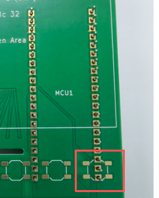
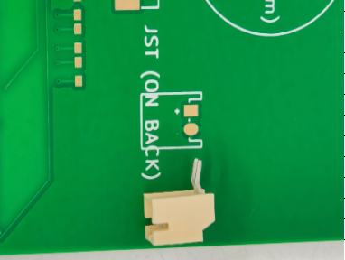
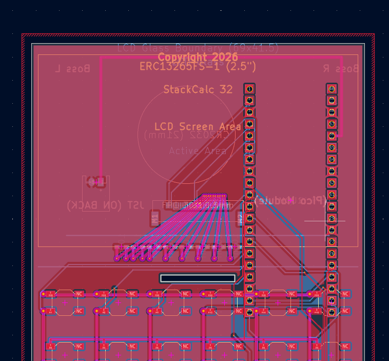

# Log 09: Notes from the PCBWay Assembly Floor: Header Pins, JST Pads & Switch Jumpers

<div class="inline-block px-3 py-1 mb-6 border border-accentCyan text-accentCyan font-mono text-xs tracking-wider">// HACKADAY BUILD LOG 09 · FACTORY DFM & JUMPER ROUTING</div>

**Canonical Article:** [Notes from the PCBWay Assembly Floor: Header Pins, JST Footprints, and Switch Jumper Routing](../../blog/posts/2026-10-20-pcbway-dfm-photos-and-jumper-fixes.md)  
**Topic:** Turnkey PCBA DFM, Castellated Mounting & Switch Matrix Jumper Routing  
**Artifact:** `Hardware/calculator.kicad_pcb`, `fix_mcu_pads.py`, & `fix_silkscreen.py`

---

## 1. The Engineering Lesson
Passing a software DRC in KiCad does not guarantee a smooth run on the SMT assembly line. When our first calculator boards reached the **PCBWay** assembly floor, their engineers paused the line and sent back bench inspection photos highlighting four physical integration issues:

### 1. Rear `MCU1` Through-Hole Header Pins Colliding with Front Switch `SOFT6`
In our initial BOM (`bom.csv`), we specified `SC1632` (Raspberry Pi Pico 2 **with pre-soldered through-hole headers**) alongside a PTH footprint on `B.Cu`. When PCBWay dry-fitted the module from the back, the header pins poked straight through to the front (`F.Cu`) right between the four SMD pads of tactile switch **`SOFT6`**:


*Figure 1: PCBWay bench photo (`headers.png`). The red box shows the rear `MCU1` pins protruding directly into the front `SOFT6` switch footprint.*

**The Fix:** We updated the BOM to **`SC1631`** (bare castellated Pico 2) and ran `fix_mcu_pads.py` to convert all 40 `MCU1` pads to pure bottom-side `PAD_ATTRIB_SMD` (`B.Cu`, `B.Paste`, `B.Mask`) with zero drill holes.

### 2. `JST1` Pad Mismatch & Stranded Front Silkscreen
PCBWay's second photo caught a mismatch on `JST1` (our right-angle CR2032 battery header): the BOM specified the through-hole `S2B-PH-K-S(LF)(SN)` while the board had undrilled SMD pads, and both the `JST (ON BACK)` and `MCU1` silkscreen callouts were stranded on `F.Silkscreen` instead of `B.Silkscreen`:


*Figure 2: PCBWay bench photo (`jst.png`) showing the through-hole JST header alongside the surface-mount pads.*

We updated `JST1` to the surface-mount **`S2B-PH-SM4-TB`** and ran `fix_silkscreen.py` to migrate and mirror all rear component silkscreen primitives onto `B.Silkscreen`.

### 3. Eliminating Implicit Tactile Switch Jumper Connections
Standard 4-pad SMD tactile switch footprints (`SW_TACT_ALPS_SKQGABE010`) often set `(duplicate_pad_numbers_are_jumpers yes)`, using the switch's internal metal bars as pass-through jumpers for matrix rows and columns. During DFM rework around the switch pads, relying on internal switch jumpers created ambiguity over which pads needed active electrical jumpering versus mechanical anchoring:


*Figure 3: Updated KiCad routing (`kicad.png`) with `(duplicate_pad_numbers_are_jumpers no)`, explicit `1`/`2` active pads, `NC` mechanical pads, and continuous copper traces.*

We disabled implicit switch jumpers across all 43 switches (`(duplicate_pad_numbers_are_jumpers no)`), assigned active row/column nets strictly to pads `1` and `2`, marked the opposite anchor pads `NC`, and routed continuous $0.25\text{ mm}$ copper buses across the matrix.

---

## 2. Concrete Artifact
`pcbnew` script (`Hardware/fix_mcu_pads.py`) used to convert `MCU1` from PTH to bottom-side castellated SMD:
```python
import pcbnew
board = pcbnew.LoadBoard("calculator.kicad_pcb")
mcu = board.FindFootprintByReference("MCU1")
for pad in mcu.Pads():
    if pad.GetAttribute() == pcbnew.PAD_ATTRIB_PTH:
        pad.SetAttribute(pcbnew.PAD_ATTRIB_SMD)
        lset = pcbnew.LSET()
        lset.AddLayer(pcbnew.B_Cu)
        lset.AddLayer(pcbnew.B_Paste)
        lset.AddLayer(pcbnew.B_Mask)
        pad.SetLayerSet(lset)
        pad.SetDrillSize(pcbnew.VECTOR2I(0, 0))
pcbnew.SaveBoard("calculator.kicad_pcb", board)
```

---

## 3. Community Discussion Invitation
**To the Hackaday Community:**  
What was the most memorable DFM catch a PCBA house ever sent you from the assembly line? On 4-pad tactile switch matrices, do you ever allow the router to use the switch's internal paired legs as pass-through jumpers, or do you strictly enforce `(duplicate_pad_numbers_are_jumpers no)` with explicit copper routing?
