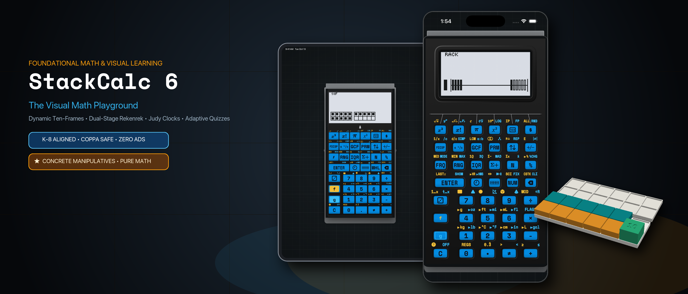

# Log 10: Shipping StackCalc v1.1: A Clean-Room RPN Calculator That Grows With Your Kid (SC-6 to SC-32)

// HACKADAY BUILD LOG 10 · SHARED CORE & V1.1 RELEASE

**Canonical Article:** [Shipping StackCalc v1.1 on the App Store: A Clean-Room RPN Calculator That Grows With Your Kid (SC-6 to SC-32)](../../blog/posts/2026-10-23-shipping-stackcalc-v1-1-sc32-and-sc6.md)  
**Topic:** HP-32SII Ergonomics, Clean-Room `RPNCore` Upgrades & STL-Backed Digital Twin  
**Artifact:** StackCalc Calculator v1.1 (`id6801788040` on iOS, iPadOS, and watchOS)

---

## 1. The Engineering Lesson
After training my kids on a SwissMicros DM41CC (and owning a DM42/C47, DM32, DM15CC, and vintage HP-32SIIs), I realized two things: kids learn RPN effortlessly when freed from infix parentheses, and **sending a kid to school with a \$250 collector's calculator or a \$200 vintage eBay antique is a non-starter**. Our goal with StackCalc is a kid-friendly RPN ecosystem launching at **\$89.99** for small-batch maker units on a manufacturing roadmap toward a **\$29.99** student target.

### 1. Why the HP-32SII Over the HP-15C or HP-42S?
Unlike the HP-42S/C47 (which buries everyday functions inside hierarchical softkey menus) or the HP-15C (landscape form factor with numeric matrix/label codes), the **HP-32SII** puts almost every essential scientific operation directly on the primary and shifted keys without menu diving, using a clean 1-line context bar for `CLEAR`, `STAT`, `SOLVE`, and `INTG`.

### 2. Clean-Room `RPNCore` Upgrades (Not a ROM Emulator)
Written from scratch in Swift (`RPNCore`) and compiled to both Apple silicon and bare-metal RP2350 (Embedded Swift), `StackCalc 32` adds features we always wished the 32SII had:
- **Harmonic Mean (`H.M.`)**, **Time Value of Money (`TVM`)**, and a **Quadratic/Cubic Polynomial Solver (`POLY`)**.
- **Interactive Curve & Scatter-Plot Graphing (`PLOT`)** on the app and $132 \times 65$ dot-matrix LCD.

### 3. `StackCalc 6` (Common Core K–6) & STL Digital Twin Co-Development
Switching to `StackCalc 6` reconfigures the calculator around K–6 Common Core operations—including **Step-by-Step Prime Fraction Simplification (`[SIMP]`)** (which factors out one prime divisor per press from dot-entered fractions like `.12.18` $\rightarrow \div 2 \rightarrow$ `6/9` $\rightarrow \div 3 \rightarrow$ `2/3`), `÷R` integer remainder division, `[PRIME]`, `[GCD]`, and `[LCM]`—paired with live dot-matrix **Ten-Frames (`10F`)**, a **20-Bead Rekenrek (`RACK`)**, **Number Line (`LINE`)**, **Geared Clock (`🕒`)**, and **5-Level Adaptive Quiz (`?`)**. By exporting our OpenSCAD STLs and laser SVG decals into `layout_data.json`, our SwiftUI `HardwareReplicaView` runs an exact 1:1 replica of the RP2350 firmware for simultaneous hardware/software co-development.

*Figure 1: StackCalc v1.1 unifies Scientific Mode (`SC-32`) and Visual Learning Mode (`SC-6`) on a shared dot-matrix engine.*

---

## 2. Concrete Artifact
Clean-room extensions in `RPNCore` beyond classic HP-32SII parity:
- **Statistics:** Arithmetic mean ($\bar{x}, \bar{y}$), weighted mean ($\bar{x}_w$), and **Harmonic Mean (`H.M.`)**.
- **Solvers:** Secant/Brent root finder (`SOLVE`), Simpson integration (`∫`), **Cubic/Quadratic Polynomial Solver (`POLY`)**, and **5-variable `TVM`**.
- **Number Theory (`SC-6` & `SC-32`):** Iterative prime-divisor reduction (`[SIMP]`), prime factorization (`[PRIME]`), `GCD`, `LCM`, and Euclidean quotient/remainder (`÷R`).

---

## 3. Community Discussion Invitation
**To the Hackaday Community:**  
Between the HP-32SII, HP-15C, and HP-42S, which keyboard/menu philosophy do you prefer for fast daily calculations? When co-developing firmware and a companion app, how do you keep your CAD legends and UI keymaps synchronized?
