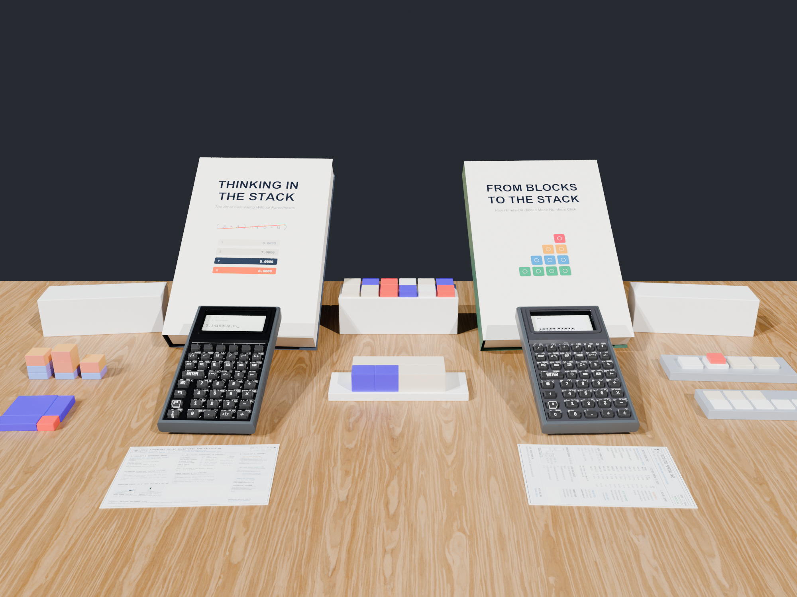

# Log 11: Manufacturing the Math Blocks (In-House & Slant3D) and Compiling the Reference Books

<div class="inline-block px-3 py-1 mb-6 border border-accentCyan text-accentCyan font-mono text-xs tracking-wider">// HACKADAY BUILD LOG 11 · BLOCK MANUFACTURING & DOCS PIPELINE</div>

**Canonical Article:** [From OpenSCAD to the Classroom Desk: Manufacturing the Math Blocks and Compiling the Reference Books](../../blog/posts/2026-10-26-manufacturing-math-blocks-and-reference-books.md)  
**Topic:** Hybrid Additive Manufacturing (In-House + Slant3D) & Test-Verified Book Compilation  
**Artifact:** `Makefile`, `Tools/book_engine.py`, & `TextbookVerificationTests_SC32.swift`

---

## 1. The Engineering Lesson
While our PCBs finish assembly at PCBWay, we moved the other two pillars of the StackCalc ecosystem—our **3D-printed Gridfinity math manipulatives** and our **reference manuals and workbooks**—into full production:

### 1. Hybrid Block Manufacturing: In-House Precision + Slant3D Farm
Every manipulative kit (**Fraction Studio Towers**, **Prime Factor Studio & Slide Rule**, **Place Value Studio**, **Ten-Frames**, and the **SC-6 Quest Scoreboard**) is modeled in parametric OpenSCAD around the $42\text{ mm}$ Gridfinity standard so the storage lid acts as a student desk stage.
- **In-House:** We print the multi-color silk proportional towers, tight-clearance sliding comparators, planetary clock gears, and 4-part calculator enclosures on calibrated PEI plates.
- **Slant3D Print Farm:** We offload the heavy, single-material monolithic Gridfinity boxes, trays, and bulk tiles to Slant3D's automated print farm so our workshop printers stay focused on precision multi-color parts.

### 2. Compiling Textbooks Like Firmware (`book_engine.py`)
We wrote two complete owner's manuals (**SC-32 Scientific Manual** and **SC-6 Elementary Manual**) plus over 590 graded problems across our companion workbooks and 24 UIL speed-calculation exams. To guarantee zero typos between the books and the calculator engine, our `Makefile` compiles the books through a 5-stage verification pipeline:
1. **OpenSCAD $\rightarrow$ STL $\rightarrow$ Orthographic Diagrams (`blocks_registry.json`):** Every manipulative diagram in the books is rendered directly from the production `.stl` meshes.
2. **Executable Keystroke Macros:** `book_engine.py` extracts every worked keystroke sequence from the markdown chapters and runs them as unit tests against `RPNCore` (`TextbookVerificationTests_SC32.swift` / `SC6.swift`). If any register value in the prose disagrees with the engine, the build fails.
3. **Automated Simulator Screenshots:** The test suite captures every LCD dot-matrix state directly from the live engine and compiles the final publication PDFs.


*Figure 1: The physical manipulatives and test-verified reference manuals manufactured alongside the calculator.*

---

## 2. Concrete Artifact
The 5-stage dependency chain in our documentation `Makefile`:
```makefile
# 1. OpenSCAD (.scad) -> STL (.stl) -> Orthographic Block Diagrams & blocks_registry.json
# 2. Swift Layout & SwiftUI Tests (.swift) -> layout_data*.json, sequences_registry.json, & Screenshots
# 3. Manuscript Chapters (.md) + Registries + book_engine.py -> Validated Guides & RPNCore Unit Tests
# 4. Validated Guides + Assets + generate_manual_pdfs.py -> Publication PDFs
# 5. Publication PDFs + mkdocs.yml + Chapters -> Strict MkDocs Site (site/index.html)
```

---

## 3. Community Discussion Invitation
**To the Hackaday Community:**  
How do you keep hardware user manuals and schematic/firmware documentation synchronized as your project evolves? Have you used automated CI pipelines to render CAD diagrams and verify worked examples directly against your firmware engine?

---

## 4. Explore the StackCalc Ecosystem
- **Official Documentation & Web Emulator:** [stackcalc.io](https://stackcalc.io)
- **Free 3D Printables Hub:** [printables.com/@StackCalc_5593834](https://www.printables.com/@StackCalc_5593834)
- **Factory Sourced Refills:** [Slant 3D Portal](https://teleportpod.com/portals/profile/StackCalc)
- **Handcrafted Sets & Manuals:** [Etsy Storefront](https://stackcalcmath.etsy.com)
- **Illustrated Book on Amazon:** [*From Blocks to the Stack*](https://link.amazon/B0f5cP0Ur)

