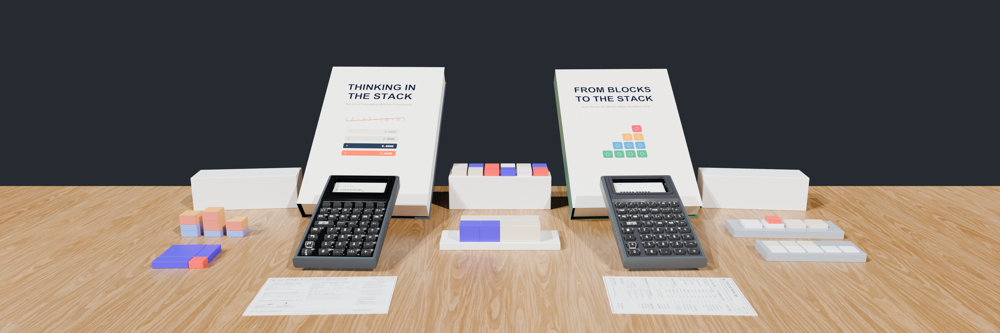

# Log 12: Launch Day: First 5 Calculators on the Bench & Our Kid-Friendly RPN Ecosystem

// HACKADAY BUILD LOG 12 · SYNCHRONIZED ECOSYSTEM LAUNCH

**Canonical Article:** [Launch Day: Why the World Needs a Kid-Friendly RPN Calculator That Grows With Them](../../blog/posts/2026-10-28-launch-day-kid-friendly-rpn-calculator-and-ecosystem.md)  
**Topic:** First Batch Hardware Verification, HP-32SII Ergonomics & Ecosystem Launch  
**Artifact:** First 5 Batch 001 Units, App Store v1.1, Printables STLs & Unit-Tested Manuals

---

## 1. The Engineering Lesson
After training my kids on a SwissMicros DM41CC (and owning a DM42 converted to C47, DM32, DM15CC, and vintage HP-32SIIs), it was obvious that kids love postfix stack math. On a postfix stack calculator, **users learn `operator-precedence parsing` themselves** to decompose and enter expressions onto the stack—appreciating the lessons learned in the past 50 years of computing so they can build the next 50 years. Furthermore, unlike CAS calculators (which are banned on the SAT, ACT, IB, and NCEES FE/PE exams), StackCalc is **purposefully designed to be allowed in testing situations** (no CAS symbolic solver, no QWERTY keyboard, and no wireless radios)—and **no parent wants a child carrying a \$250 boutique calculator or a \$200 fragile eBay antique in a school backpack**.

Today we are launching the complete **StackCalc** ecosystem simultaneously across hardware, software, 3D-printed math blocks, and books—starting at **\$89.99** for our initial maker batch while scaling toward a **\$29.99** classroom target:

### 1. Why the HP-32SII Architecture + Clean-Room Upgrades
We modeled `StackCalc 32` on the **HP-32SII** rather than the HP-42S (which hides functions inside deep softkey menus) or the HP-15C (landscape numeric matrix codes). Built on our clean-room Swift engine (`RPNCore`) rather than a ROM emulator, `StackCalc 32` adds **Harmonic Mean (`H.M.`)**, **Time Value of Money (`TVM`)**, a **Quadratic/Cubic Polynomial Solver (`POLY`)**, and **interactive curve plotting (`PLOT`)**—paired with **`StackCalc 6` (`SC-6`)** covering Common Core math up through 6th grade (including **step-by-step prime fraction simplification `[SIMP]`**, `÷R`, `[PRIME]`, `[GCD]`, and `[LCM]`).

### 2. First 5 Units Verified $\rightarrow$ Next 20 Units (Hardware V2) Triggered
With our first 5 Batch 001 calculators verified across our [7-Stage Board Arrival Protocol](../board-arrival.md) (confirming the 43-key matrix, TPU membrane plunger travel, `132x65` ST7567 LCD contrast, and Embedded Swift firmware), we are releasing the 4 Founder's Batch units and triggering our **20-unit Hardware V2 order** (which replaces the rear Pico 2 carrier board with bare QFN-60 `RP2350A` silicon, `W25Q32` QSPI flash, and a `ME2188` synchronous boost stage).

*Figure 1: The five-pillar StackCalc ecosystem launching together.*

---

## 2. Concrete Artifact
The five synchronized launch surfaces:
- **Universal App v1.1 (`SC-32` + `SC-6`):** Live on iPhone, iPad, and 100% standalone Apple Watch (`id6801788040`).
- **Physical Manipulatives & Hardware:** Live on [Etsy](https://www.etsy.com/shop/StackCalc) and [`stackcalc.io/products`](../../products.md) (84mm Fraction Studio Towers, Logarithmic Prime Slide Rule, Place Value Trays, Ten-Frames).
- **Free Open-Source STLs & 3MFs:** Live in the [Download Center](../../downloads.md) and Printables/MakerWorld.
- **Unit-Tested Reference Manuals & 590+ Problem Workbooks:** Verified against `RPNCore` via `book_engine.py`.

---

## 3. Community Discussion Invitation
**To the Hackaday Community:**  
What was your first calculator in school, and what would it take to get a \$29.99 open-hardware RPN calculator into modern middle and high school STEM classrooms?
