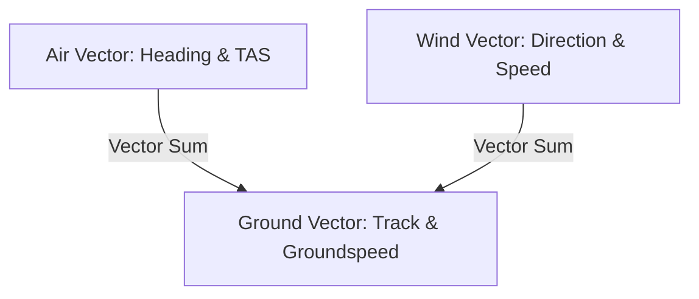

# Unit I: Geomatics, Land Surveying & Flight Navigation

A six-foot brass zenith sector, swung from a wooden tripod over the Delaware woods, has no knowledge of paper maps. When Charles Mason and Jeremiah Dixon landed at Philadelphia in the autumn of 1763, their assignment was to resolve eighty years of bitter border disputes between the Penn and Calvert families. They could not simply stretch an iron chain along an idealized line on parchment. Over eight decades, the boundary between Pennsylvania and Maryland had resisted colonial surveys because paper geometry assumes a flat, uniform plane. In the field, dense timber, steep ridges, and atmospheric refraction force an instrument crew to anchor every bearing to the stars. By sighting transits on zenith stars through micrometer screws, Mason and Dixon transferred the celestial coordinate frame to stone monuments set every five miles through the wilderness. Within a decade, the London instrument maker Jesse Ramsden perfected his geared circular dividing engine (1775), graduating brass circles to fractions of an arcminute and giving compact field theodolites the accuracy of royal observatories.

Because navigation on land and sea grew around the magnetic compass and Polaris, field geometry reverses both classroom conventions. When a surveyor levels a theodolite over a monument or an aviator reads a directional gyro, zero ($0^\circ$) points to **True North**. From that meridian, the graduated azimuth circle increases **clockwise** through $90^\circ$ at East, $180^\circ$ at South, and $270^\circ$ at West. Starting at the vertical axis and rotating clockwise reflects the plane across the $45^\circ$ Northeast diagonal, **swapping sine and cosine**. North-South displacement (**Latitude**, $\Delta N$) projects along the cosine of the azimuth, while East-West displacement (**Departure**, $\Delta E$) projects along the sine. Whenever a coordinate pair must be transposed between $(N, E)$ and $(E, N)$ conventions, {{key:N⇄E}} (or {{key:x⇄y}}) swaps Registers $X$ and $Y$ in one keystroke.

The long lever arm of an outdoor sightline also explains why field crews preserve **sexagesimal notation** (Degrees, Minutes, and Seconds `DDD.MMSS`, where $1^\circ = 60'$ and $1' = 60''$). One arcsecond ($1'' = 1/3600^\circ$) is the tiny angle subtended by a quarter coin viewed from more than three miles ($5\text{ km}$) away. Over a routine boundary sightline of $2{,}000\text{ ft}$, a one-arcminute error ($1'$) shifts the far stake laterally by $2000 \sin(1') \approx 0.582\text{ ft}$—nearly seven inches. A careless rounding error of just $0.05^\circ$ ($3'$) displaces a property corner by almost two feet. In contested real estate or civil corridors, that two-foot discrepancy represents the exact margin between unencumbered property title and a protracted, multimillion-dollar boundary lawsuit.

The life-or-death consequence of neglecting unit discipline and calculation verification was demonstrated with chilling drama on July 23, 1983, when Air Canada Flight 143—a brand-new Boeing 767 flying at forty-one thousand feet from Montreal to Edmonton—starved of all fuel. Its twin turbofan engines flamed out in mid-cruise. The aircraft was one of the first fitted with all-metric digital avionics, but due to an inoperative fuel quantity indication computer, ground handlers and flight crew manually dipped the wing tanks with drip tubes measured in liters. In converting liters to the required fuel mass in kilograms, technicians inadvertently multiplied by $1.77$—the density of Jet-A fuel in pounds per liter—rather than the metric value of $0.803\text{ kg/L}$. Carrying less than half the fuel required to complete the route, the wide-body jet became the world's heaviest glider over Manitoba. Only an extraordinary deadstick landing by Captain Bob Pearson onto an abandoned military strip at Gimli averted tragedy. The "Gimli Glider" serves as an enduring cautionary precedent across geomatics, civil route alignment, and flight navigation: dimensional discipline, unit conversions, and stack verification are matters of human survival.

Geomatics and aeronautical navigation establish human coordinates upon the physical landscape: anchoring legal property boundaries to True North, laying out transportation alignments across complex topography, and navigating flight paths through changing air masses. The **SC-35 Geomatics, Land Surveying & Flight Navigation** calculator brings coordinate geometry, route alignment, and flight-deck navigation to the field. Three field investigations guide our study of the instrument:

In **Chapter 1**, we retrace a disputed 1794 colonial boundary through a dense Pine Barrens ravine, recovering a buried brass cornerstone using sexagesimal reductions, slope corrections, Bowditch compass-rule adjustments, and Gauss's shoelace polygon area.

In **Chapter 2**, we transition to heavy transport corridors, threading a circular highway curve and parabolic vertical crest along a granite river canyon while balancing cut-and-fill prism earthwork volumes with three-wire differential spirit leveling.

In **Chapter 3**, we take to the flight deck of a twin-turboprop, navigating crosswind drift, crab angles, time-speed-distance fuel endurance, center-of-gravity balance, and high-altitude density altitude over the desert.

---

# Chapter 1: The Lost Cornerstone in the Pine Barrens

A boundary dispute does not begin in an attorney's office; it begins where two property owners discover that an iron pipe in the dirt does not agree with the bearings recorded in their deeds. When Party Chief Elena Vance unrolls a 1794 parchment deed across the tailgate of her survey truck, she is confronting two centuries of physical change. The colonial surveyor recorded the tract in Edmund Gunter's 66-foot chains, sexagesimal compass bearings (`DDD.MMSS`), and stone-wall offsets measured in feet and fractional inches. The legal description terminates at an inscribed brass-capped granite cornerstone set beside a cedar creek. Two centuries of wildfire, pine regrowth, and alluvial wash have buried that stone beneath three feet of loam on the far side of a steep, cedar-choked ravine.

Elena cannot stretch a flat steel tape across the brushy gorge. Even if she and her apprentice Marcus hacked a clearance path through the tangled briars with machetes, a steel tape suspended over an open ravine sags under its own catenary weight, stretches elastically with pull tension, and contracts in cold air. Instead, she and Marcus set their electronic total station over Witness Station $A$ on the north rim, leveling the optical tribrach until the tubular spirit bubble splits the etched center rings, and sighting the prism rod across azimuth $47^\circ 22' 30''$ over an inclined slope distance of $412.68\text{ ft}$ at a vertical angle of $6^\circ 15' 00''$. To pinpoint where to dig and certify the parcel's legal boundary, Elena must reduce the inclined ravine shot to horizontal ground distance $D_H = 410.10\text{ ft}$ and vertical rise $\Delta V = 44.92\text{ ft}$, project coordinates to the witness oak on the opposite bluff, solve the inverse bearing and distance to the deed cornerstone, verify leveling benchmarks, and close the four-sided perimeter loop.

---

## The Survival of Sexagesimal Measure and the Two-Foot Lawsuit

To an observer accustomed to decimal floating-point computing, boundary surveying appears stubbornly attached to archaisms: sexagesimal minutes and seconds (`DDD.MMSS`), Gunter's chains, and U.S. Survey feet. But these conventions are not historical holdovers; they reflect the physical mechanics of optical sightlines, the circle-dividing engine, and the legal doctrine of land ownership.

### The Geometry of the Sightline and Optical Dividing Engines

For over three millennia, since Babylonian astronomers first divided the circle into 360 equal parts, the sexagesimal system has survived because $60$ is the smallest integer divisible by $1, 2, 3, 4, 5,$ and $6$. This extraordinary divisibility permitted ancient astronomers and Renaissance navigators to bisect, trisect, and quarter circular arcs without recurring decimal fractions. When the great British instrument maker Jesse Ramsden built his legendary geared dividing engine in 1775, he cut 2,160 individual teeth into the perimeter of a four-foot bell-metal wheel. Each tooth corresponded to exactly ten arcminutes ($10'$). By pairing this gear with a precision micrometer tangent screw, Ramsden allowed an observer to read an optical circle directly down to single arcseconds ($1''$).

In the physical world, an optical circle is an angular lever arm. When a ray of light leaves a total station's objective lens, the lateral displacement across the ground scales directly with the distance of the shot. Consider the fundamental angular relation:

$$\text{Lateral Error} = D \cdot \tan(\theta)$$

For small angles, $\tan(\theta) \approx \theta \text{ (in radians)}$. Because one degree contains $60$ arcminutes, one arcminute corresponds to:

$$1' = \frac{1^\circ}{60} = \frac{\pi}{180 \times 60} \approx 0.0002908882\text{ radians}$$

When a surveyor sights across a typical boundary line of $D = 2{,}000\text{ ft}$, an imperceptible angular error of just **one single arcminute** ($1'$) translates into a physical lateral displacement across the ground of:

$$\text{Lateral Error} = 2{,}000\text{ ft} \times 0.0002908882 \approx 0.5818\text{ ft} \approx 6.98\text{ inches}$$

This corresponds to nearly seven inches. Across a mile-long section line ($5{,}280\text{ ft}$), that same one-arcminute wobble throws the corner stake off by more than eighteen inches ($1.536\text{ ft}$).

Now consider what happens when a careless draftsman or software engineer rounds an angle to two decimal places. Suppose an azimuth of $47^\circ 22' 30''$ ($47.375^\circ$) is casually rounded to $47.38^\circ$—an apparent discrepancy of merely $0.005^\circ$, or if an operator drops $0.05^\circ$ ($3'$). At $0.05^\circ$, the angular error is:

$$\text{Lateral Error} = 2{,}000\text{ ft} \times \tan(0.05^\circ) = 2{,}000 \times 0.000872665 \approx 1.745\text{ ft} \approx 20.94\text{ inches}$$

That error amounts to nearly two full feet. In dense commercial tracts or contested timber boundaries, a two-foot lateral shift encroaches onto adjoining property, halts construction, and entangles title insurance in protracted litigation.

Because physical glass-circle optical transits and digital theodolites are engineered to measure in degrees, minutes, and arcseconds, the surveyor must think and calculate sexagesimally. A calculator that requires an engineer to manually break an angle into separate decimal division steps invites transcriptive blunders. The SC-35 solves this by treating sexagesimal values as first-class numbers through packed notation `DDD.MMSS` and instantaneous stack conversion keys ({{key:▸DEG}}, {{key:▸HR}}, and {{key:▸HMS}}).

### The Geodetic Inversion: Why True North is Zero and Sine Swaps with Cosine

In high school and collegiate mathematics, Cartesian coordinates reign supreme:
1. The horizontal $x$-axis points East.
2. The vertical $y$-axis points North.
3. Angles are measured counterclockwise, with $0^\circ$ anchored at the positive $x$-axis (East).

Under Cartesian conventions, decomposing a vector of length $D$ and direction $\theta$ yields:

$$\Delta x = D \cos(\theta), \quad \Delta y = D \sin(\theta)$$

Every surveyor, navigator, and pilot who steps into the field must unlearn this habit. Out in the elements, there is no floating red coordinate frame painted across the sky. The only reliable, absolute reference available to humankind across centuries has been the Earth's rotational axis: the celestial pole marked by Polaris in the Northern Hemisphere and the astronomical meridian.

Navigation on land, sea, and air anchored its compass rose to **True North ($0^\circ$)**. From the North meridian, directions sweep **clockwise**: East is $90^\circ$, South is $180^\circ$, and West is $270^\circ$.

What happens mathematically when you anchor zero at the vertical axis and rotate clockwise instead of counterclockwise? You reflect the entire Cartesian plane across the $45^\circ$ Northeast diagonal line ($y = x$).

Under this reflection, every coordinate $(x, y)$ transposes to $(y, x)$:
- The horizontal axis becomes **Departure** ($\Delta E$, Easting displacement).
- The vertical axis becomes **Latitude** ($\Delta N$, Northing displacement).
- The fundamental trigonometric roles of sine and cosine **swap places completely**.

Let an azimuth be $\alpha \in [0^\circ, 360^\circ)$ measured clockwise from True North. The angle made with the horizontal Cartesian $x$-axis is $\theta_{\text{cartesian}} = 90^\circ - \alpha$. Substituting this into the standard trigonometric identities:

$$\Delta N = D \sin(\theta_{\text{cartesian}}) = D \sin(90^\circ - \alpha) = D \cos(\alpha)$$
$$\Delta E = D \cos(\theta_{\text{cartesian}}) = D \cos(90^\circ - \alpha) = D \sin(\alpha)$$

In geomatics, **cosine governs the North-South axis**, and **sine governs the East-West axis**. If a software routine or handheld calculator inadvertently uses Cartesian trigonometry, every azimuth entered will rotate the property ninety degrees and reflect it backwards across the meridian.

Furthermore, field surveying indexes coordinate pairs as **$(N, E)$**—Northing first, Easting second—mirroring the ancient navigational tradition of citing Latitude before Longitude. When moving between civil engineering software that displays $(N, E)$ and CAD tools that plot $(X, Y) = (E, N)$, the surveyor needs an instant, zero-penalty axis transposition: the dedicated {{key:N⇄E}} key (or {{key:x⇄y}}) swaps Registers $X$ and $Y$ in a single keystroke.

### The Common Law Hierarchy of Calls: Why Monuments Govern Over Coordinates

Before a field crew sinks a shovel into loam, they must respect the primary legal canon of boundary retracement: **monuments legally supersede computed coordinates, deeds, and mathematical area.** An electronic total station can resolve distance to two millimeters with an infrared EDM, but if excavation uncovers an undisturbed colonial brass pin two inches to the west of the computed coordinate, the physical pin controls the legal boundary. The mathematical coordinate yields to the monument.

This principle, codified across common law jurisdictions and articulated by jurists such as Michigan Supreme Court Justice Thomas M. Cooley in his seminal 1881 address *The Judicial Functions of Surveyors*, is known as the **Hierarchy of Calls**. When surveying evidence is evaluated in a court of law, conflicting calls in a deed are ranked in strict order of descending legal authority:

1. **Lines Actually Run on the Ground & Natural Monuments**: Unperturbed rivers, ridgelines, living witness trees, and rock ledges.
2. **Artificial Monuments Set by the Original Surveyor**: Inscribed granite stones, brass tablets, iron pipes, cedar stakes, and blazed tree trunks.
3. **Calls for Senior Adjoiners**: Boundaries of established older tracts that have prior legal claim.
4. **Courses (Bearings and Azimuths)**: Compass headings recited in the metes-and-bounds deed.
5. **Distances**: Measurements recorded in chains, poles, rods, or feet.
6. **Area and Mathematical Coordinates**: Acreage recitals, State Plane Northing/Easting, and latitude/longitude coordinates.

Why does the law place mathematical coordinates at the bottom of the hierarchy?

Because the original surveyor was commissioned to establish the boundary *on the physical Earth*, not on an abstract mathematical plane. When the 1794 surveyor drove an iron pin into the ground and piled stones around it, that physical act manifested the legal boundary. The buyers and sellers walked the land, saw the stone, and exchanged payment based on that monument.

The numbers written in the deed—the chains, the degrees, and today the satellite coordinates—are merely *human descriptions* of where the surveyor believed the stone was located. Instruments of 1794 had magnetic local attraction and optical parallax; chains stretched and sagged; today's GPS has multipath distortion and atmospheric delay. The physical monument is the boundary itself; the coordinates are merely evidence pointing toward it.

A surveyor who programs robotic total stations or GPS rovers to drive iron rebar into lawns based strictly on CAD coordinates—without searching exhaustively for original, undisturbed monumentation—misunderstands the legal foundation of the profession. The calculator's job is not to dictate where the boundary *must* be, but to guide the field crew's eyes and shovels to where the original monument *was planted*.

### Map Projections, Ellipsoidal Geodesy, and the Combined Grid-to-Ground Scale Factor

When surveying small building lots, surveyors treat the Earth as a flat horizontal plane. But across regional boundary tracts, highways, and infrastructure corridors, the physical reality of the Earth's curved shape can no longer be ignored.

The Earth is not a sphere; it is an oblate ellipsoid flattened at the poles by centrifugal rotation, best modeled by geodetic datums like NAD83 or WGS84 with semi-major radius $a \approx 6{,}378{,}137\text{ m}$ ($20{,}925{,}646\text{ ft}$) and flattening $f \approx 1/298.257$. Furthermore, the true gravity-equipotential surface—the **geoid**, which governs how water drains and how optical spirit bubbles level—undulates above and below the smooth mathematical ellipsoid by a vertical distance known as the **geoid height** or **geoid undulation** $N$. 

To link GPS satellite heights (ellipsoidal height $h$) to physical water-level elevations (orthometric height $H$ above mean sea level), surveyors apply the fundamental geodetic height identity:

$$h = H + N \iff H = h - N$$

To represent this curved, undulating surface on flat paper maps or CAD drawings, state geodetic agencies developed the **State Plane Coordinate System (SPCS)**. SPCS projects the curved ellipsoid onto developable surfaces:
- **Lambert Conformal Conic**: Used for states with long East-West dimensions (e.g., Pennsylvania, Tennessee, Washington).
- **Transverse Mercator**: Used for states with long North-South dimensions (e.g., New Jersey, Illinois, Indiana).

Because a curved surface cannot be flattened without distortion, any straight line measured with a laser on the physical ground ($D_{\text{ground}}$) differs from the corresponding grid line plotted on the State Plane map ($D_{\text{grid}}$). Bridging between the two requires the **Combined Grid-to-Ground Scale Factor** ($k_{\text{comb}}$):

$$D_{\text{grid}} = D_{\text{ground}} \times k_{\text{comb}}$$
$$k_{\text{comb}} = k_{\text{elev}} \times k_{\text{grid}}$$

The **Elevation Scale Factor** ($k_{\text{elev}}$) projects the horizontal ground measurement down to the reference ellipsoid at sea level:

$$k_{\text{elev}} = \frac{R_E}{R_E + H + N}$$

where $R_E \approx 20{,}906{,}000\text{ ft}$ ($6{,}371{,}000\text{ m}$) is the mean radius of curvature of the Earth, $H$ is the station orthometric elevation, and $N$ is the geoid undulation. The **Grid Scale Factor** ($k_{\text{grid}}$) accounts for the geometric scale distortion of the map projection cylinder or cone at that specific latitude or Easting.

Over high-elevation mountain terrain or extended survey baselines, neglecting $k_{\text{comb}}$ introduces severe errors. For instance, at an elevation of $H = 5{,}280\text{ ft}$ (one mile above sea level), the elevation factor alone is:

$$k_{\text{elev}} = \frac{20{,}906{,}000}{20{,}906{,}000 + 5{,}280} \approx 0.9997475$$

Over a baseline of $D_{\text{ground}} = 5{,}000\text{ ft}$, this scale reduction shrinks the grid distance by:

$$\Delta D = 5{,}000 \times (1 - 0.9997475) \approx 1.26\text{ ft}$$

This introduces a discrepancy of more than fifteen inches. If an engineer attempts to tie a highway bridge or industrial facility into State Plane grid coordinates without applying the combined factor, pre-fabricated steel girders will not fit between concrete abutments.

---

## Sexagesimal Sightlines, Slope Reduction, and North-Clockwise Projections

Every boundary retracement begins by translating raw optical circle readings, architectural stone-wall ties, and inclined laser rangefinder shots into consistent decimal degrees and horizontal surveyor's feet on a local tangent plane. Once reduced to the horizontal plane, each sightline projects along the North-clockwise azimuth circle into orthogonal Northing and Easting displacements.

### Sexagesimal Angles, Architectural Lengths, and Ravine Slope Reduction

A sexagesimal angle read from a theodolite glass circle or historic deed plat consists of integer degrees $D^\circ$, integer arcminutes $M' \in [0, 59]$, and arcseconds $S'' \in [0, 60)$. Because one degree contains $60$ arcminutes and $60 \times 60 = 3{,}600$ arcseconds, converting between packed sexagesimal notation `DDD.MMSS` (where the first two digits after the decimal point store arcminutes MM and the next two store arcseconds SS, converted directly via {{key:▸DEG}} / {{key:▸HR}} and {{key:▸HMS}}) and decimal degrees $\theta_{\text{dec}}$ evaluates a base-$60$ polynomial:

**Eq. 1.1 — Sexagesimal Angular Polynomial**
$$\theta_{\text{dec}} = D + \frac{M}{60} + \frac{S}{3600}$$

In this expression, $D$ is the whole-degree component, $M$ is the arcminute count divided by $60\text{ min/deg}$, and $S$ is the arcsecond count divided by $3{,}600\text{ sec/deg}$. For a historic deed azimuth of $47^\circ 22' 30''$ (written in packed field notation as `47.2230`), dividing the $22$ arcminutes by $60$ yields $0.366667^\circ$, dividing the $30$ arcseconds by $3{,}600$ yields $0.008333^\circ$, and summing with $47^\circ$ via {{key:▸DEG}} produces $\theta_{\text{dec}} = \mathbf{47.375^\circ}$. Reversing the conversion via {{key:▸HMS}} on $47.375^\circ$ extracts the integer part $D = 47^\circ$, multiplies the fractional remainder $0.375 \times 60 = 22.5'$ to isolate $M = 22'$, and multiplies the remaining $0.5' \times 60 = 30''$ to recover `47.2230` ($47^\circ 22' 30''$).

Linear tie measurements between colonial stone walls, iron witness pipes, and Gunter's chain calls ($1\text{ chain} = 4\text{ rods} = 66.0\text{ ft}$, converted via {{key:▸ch}} and {{key:▸rod}}) require a companion bridge between trades. Geodetic coordinates express length in **surveyor's decimal feet** ($L_{\text{ft}}$, graduated in tenths and hundredths of a foot), whereas structural foundations and masonry ties specify **whole feet $F$, whole inches $I$, and binary fractional inches $N/D$** with denominator $D \in \{2, 4, 8, 16, 32, 64\}$ (operational shorthand {{key:f-i}}): $L_{\text{ft}} = F + (I + N/D)/12$. Here $F$ represents whole feet, $I$ represents whole inches, and $N/D$ represents the binary fraction of an inch divided by $12\text{ in/ft}$. When the 1794 furnace plat calls for a witness offset of $24\text{ ft } 9\text{-}3/8\text{ in}$ from the millrace foundation wall, combining the fractional inch $3/8 = 0.375\text{ in}$ with $9\text{ in}$ gives $9.375\text{ in}$, dividing by $12\text{ in/ft}$ via {{key:f-i}} yields $0.78125\text{ ft}$, and adding $24\text{ ft}$ produces the surveyor's coordinate length $L_{\text{ft}} = \mathbf{24.78125\text{ ft}}$.

When the total station on the north rim of the Pine Barrens ravine sights a prism across an inclined **slope distance** $S$ at a vertical slope angle $\nu$ (measured above $+$ or below $-$ the horizontal horizon), legal property boundaries and map projections depend on the flat **horizontal ground distance** $D_H$ and the **vertical elevation difference** $\Delta V$ (operational shorthand {{key:SLP}}). In this right triangle, the slant laser range forms the hypotenuse; multiplying by the cosine projects the slope down onto the flat horizon, while multiplying by the sine projects the vertical elevation climb:

**Eq. 1.2 — Ravine Slope Reduction**
$$D_H = S \cos(\nu)$$
$$\Delta V = S \sin(\nu)$$

In this reduction, $S$ is the slant range in Register $Y$, $\nu$ is the vertical inclination angle in Register $X$, $D_H$ is the reduced horizontal distance placed into Register $X$, and $\Delta V$ is the vertical elevation difference placed into Register $Y$. Sighting across the cedar ravine over a slope distance of $S = 412.68\text{ ft}$ at a vertical angle of $\nu = 6^\circ 15' 00''$ (`6.15` in `DDD.MMSS`, or $6.25^\circ$ via {{key:▸DEG}}) projects a horizontal ground distance of $D_H = \mathbf{410.10\text{ ft}}$ in Register $X$ and a vertical elevation difference of $\Delta V = \mathbf{44.92\text{ ft}}$ in Register $Y$. Across regional geodetic surveys, field crews must reduce ground-measured horizontal distances ($D_{\text{ground}}$) to map projection grid distances ($D_{\text{grid}}$) on State Plane or Universal Transverse Mercator (UTM) coordinate systems. This reduction is governed by the **Combined Grid-to-Ground Scale Factor** ($k = k_{\text{elevation}} \times k_{\text{grid}}$), where $D_{\text{grid}} = D_{\text{ground}} \times k$. The elevation factor $k_{\text{elevation}} = R_E / (R_E + H + N)$ accounts for mean Earth radius $R_E \approx 20{,}906{,}000\text{ ft}$ ($6{,}371{,}000\text{ m}$), orthometric station elevation $H$, and geoid undulation $N$, linking GPS ellipsoidal heights ($h$) to gravity-based drainage elevation ($H = h - N$), while the grid factor $k_{\text{grid}}$ compensates for developable map projection surface distortion. Over extended mountain baselines, neglecting the combined scale factor can introduce scale discrepancies exceeding several tenths of a foot per mile.

Over long optical shots across open valleys, Elena points out to Marcus that Earth's curvature and atmospheric refraction drop the horizontal line of sight by $h_{cr} \approx 0.574 \cdot D_{\text{miles}}^2\text{ ft}$ (or roughly $0.0206\text{ ft}$ across a thousand-foot shot). That physical deflection reminds every seasoned surveyor why they keep backsight and foresight distances balanced equally, canceling optical refraction before it can contaminate a differential run.

### The North-Clockwise Meridian Frame and Forward Coordinate Projection

In plane surveying, every boundary station is indexed by an ordered pair of orthogonal coordinates $(N, E)$, where **Northing** ($N$) measures distance north of a reference origin and **Easting** ($E$) measures distance east of the origin, while directions are measured as a full-circle **Azimuth** $\alpha \in [0^\circ, 360^\circ)$ clockwise from True North ($0^\circ$). Projecting a known horizontal ground distance $D_H$ along a known clockwise azimuth $\alpha$ from a starting station $A(N_A, E_A)$ to determine the North change ($\Delta N$, **Latitude**), the East change ($\Delta E$, **Departure**), and the target coordinates $B(N_B, E_B)$ constitutes the **Forward Coordinate Geometry Problem** ({{key:TRV}}). Because azimuth rotates clockwise from the vertical North axis, the trigonometric projections swap roles: cosine governs North-South displacement, while sine governs East-West displacement:

**Eq. 1.3 — Forward Coordinate Traverse Projection**
$$\Delta N = D_H \cos(\alpha)$$
$$\Delta E = D_H \sin(\alpha)$$

The updated station coordinates follow directly by addition: $N_B = N_A + \Delta N$ and $E_B = E_A + \Delta E$. Because $\cos\alpha$ is positive in the northern quadrants ($270^\circ < \alpha < 90^\circ$) and negative in the southern quadrants ($90^\circ < \alpha < 270^\circ$), while $\sin\alpha$ is positive in the eastern quadrants ($0^\circ < \alpha < 180^\circ$) and negative in the western quadrants ($180^\circ < \alpha < 360^\circ$), these North-clockwise projection identities assign the correct algebraic signs in all four compass quadrants without manual lookup tables.

On the `SC-35`, {{key:TRV}} expects the clockwise **Azimuth $\alpha$ in Register $Y$** and the **Horizontal Distance $D_H$ in Register $X$**, pushes the North latitude change $\Delta N = D_H\cos\alpha$ into Register $Y$ and the East departure $\Delta E = D_H\sin\alpha$ into Register $X$, and automatically accumulates the leg into the running traverse registers ($\Sigma_{\Delta N}$ and $\Sigma_{\Delta E}$). When our Pine Barrens crew stages the converted azimuth $\alpha = 47.375^\circ$ in Register $Y$ and the reduced horizontal distance $D_H = 410.10\text{ ft}$ in Register $X$ and presses {{key:TRV}}, the instrument deposits $\Delta N = 410.10\cos(47.375^\circ) = \mathbf{277.75\text{ ft}}$ into Register $Y$ and $\Delta E = 410.10\sin(47.375^\circ) = \mathbf{301.76\text{ ft}}$ into Register $X$.

---

## Inverse Monument Recovery, Traverse Closure, and Shoelace Acreage

Once the crew carries coordinates across the ravine to the witness oak, they must solve the inverse problem—turning known coordinate pairs back into a compass bearing and tape distance to pinpoint the buried brass cornerstone—check their benchmark rod transfer with three-wire stadia leveling, and close the four-sided perimeter loop to certify its legal area.

### Inverse Coordinate Geometry and Legal Quadrant Bearings

Running the Forward projection in reverse—starting from two known monument coordinates $(N_A, E_A)$ and $(N_B, E_B)$ and recovering the straight-line horizontal distance $D$ and clockwise North azimuth $\alpha \in [0^\circ, 360^\circ)$ between them—is the **Inverse Coordinate Geometry Problem** ({{key:INV}}). From the coordinate displacements $\Delta N = N_B - N_A$ and $\Delta E = E_B - E_A$, the Euclidean hypotenuse gives the ground distance $D$. To find the compass heading, the two-argument arctangent—or $\operatorname{atan2}$—asks what direction on the full circle produces that specific ratio of Easting departure to Northing latitude, resolving the quadrant automatically without sign ambiguity:

**Eq. 1.4 — Inverse Coordinate Geometry**
$$D = \sqrt{(\Delta N)^2 + (\Delta E)^2}$$
$$\alpha = \operatorname{atan2}(\Delta E, \Delta N) \pmod{360^\circ}$$

Once the inverse vector is computed, the crew uses the calculated bearing and distance to establish their physical search radius on the opposite bluff.

Whereas geodetic computations use $0^\circ\text{--}360^\circ$ clockwise azimuths, colonial and modern metes-and-bounds property deeds record directions as **Quadrant Bearings** ({{key:BRG}}). A quadrant bearing begins on either the **North (`N`)** or **South (`S`)** meridian and turns an acute angle $\theta \in [0^\circ, 90^\circ]$ toward either the **East (`E`)** or **West (`W`)**:

In Quadrant I (NE, $0^\circ \le \alpha \le 90^\circ$), the acute meridian angle is $\theta = \alpha$ (`N θ E`). In Quadrant II (SE, $90^\circ < \alpha \le 180^\circ$), $\theta = 180^\circ - \alpha$ (`S θ E`). In Quadrant III (SW, $180^\circ < \alpha \le 270^\circ$), $\theta = \alpha - 180^\circ$ (`S θ W`). And in Quadrant IV (NW, $270^\circ < \alpha < 360^\circ$), $\theta = 360^\circ - \alpha$ (`N θ W`). Between the recovered Witness Oak at $(N_1 = 1000.00\text{ ft}, E_1 = 1000.00\text{ ft})$ and the historic deed coordinates of the buried Pine Barrens cornerstone at $(N_2 = 640.00\text{ ft}, E_2 = 520.00\text{ ft})$, the coordinate differences $\Delta N = -360.00\text{ ft}$ and $\Delta E = -480.00\text{ ft}$ yield an inverse horizontal distance of $D = \sqrt{(-360.00)^2 + (-480.00)^2} = \mathbf{600.00\text{ ft}}$ ($9.0909\text{ chains}$ via {{key:▸ch}}). Because both displacements are negative, the sightline lies in Quadrant III (SW) with acute meridian angle $\theta = \arctan(480/360) \approx 53.1301^\circ = 53^\circ 07' 48''$, corresponding to a full-circle azimuth of $\alpha = 180^\circ + 53.1301^\circ = \mathbf{233.1301^\circ}$ and a legal deed bearing of $\mathbf{\text{S } 53^\circ 07' 48'' \text{ W}}$.

### Closed Polygon Traverses, Three-Wire Stadia Leveling, and Shoelace Acreage

With the lost cornerstone uncovered, the survey crew checks the vertical datum from the creek benchmark using three-wire stadia leveling ({{key:LVL}}) and walks the closed perimeter loop around the parcel, accumulating each boundary leg into the `@COGO` ledger via {{key:TRV}} and {{key:PT+}} and closing back onto the Point of Beginning (POB).

In an exact closed polygon of $n$ sides, the vector sum of all North latitudes $\Sigma_{\Delta N} = \sum_{i=1}^n \Delta N_i$ and the vector sum of all East departures $\Sigma_{\Delta E} = \sum_{i=1}^n \Delta E_i$ both equal zero. Because field measurements contain small random optical and atmospheric errors, the accumulated traverse returns to a coordinate slightly displaced from the POB. The hypotenuse of that residual gap is the **Linear Error of Closure** $E_c$ ({{key:CLS}}), and dividing total perimeter $P = \sum_{i=1}^n D_i$ by $E_c$ defines the **Relative Precision Ratio**. Once closure meets statutory standards, Nathaniel Bowditch's 1807 **Compass Rule** distributes the misclosure across each leg in proportion to its length fraction:

**Eq. 1.5 — Bowditch Compass Rule Closure**
$$E_c = \sqrt{\left(\Sigma_{\Delta N}\right)^2 + \left(\Sigma_{\Delta E}\right)^2}$$
$$\text{Precision Ratio} = 1 : \frac{P}{E_c}$$

The additive coordinate corrections for each leg $i$ are $\delta N_i = -\Sigma_{\Delta N}(D_i / P)$ and $\delta E_i = -\Sigma_{\Delta E}(D_i / P)$. From the sequential vertex coordinates $(N_1, E_1), (N_2, E_2), \dots, (N_n, E_n)$ of a closed simple polygon (with $(N_{n+1}, E_{n+1}) = (N_1, E_1)$), **Gauss's Shoelace Formula** crosses adjacent coordinates around the perimeter to evaluate the enclosed planar area $A$ (displayed live as {{key:△}} alongside {{key:CLS}} inside the `@COGO` reference table {{key:▦}}, while {{key:△}} evaluates right-triangle and sub-parcel areas), which converts to statutory acreage via {{key:▸ac}} ($43{,}560\text{ ft}^2/\text{acre}$) and metric hectares via {{key:▸ha}} ($10{,}000\text{ m}^2/\text{ha}$):

**Eq. 1.6 — Gauss Shoelace Parcel Area**
$$A = \frac{1}{2} \left\lvert \sum_{i=1}^{n} \left( E_i N_{i+1} - E_{i+1} N_i \right) \right\rvert$$
$$\text{Acres} = \frac{A_{\text{ft}^2}}{43{,}560}$$

For a four-leg rectangular boundary loop of total perimeter $P = 3{,}200.00\text{ ft}$ (spanning $600.00\text{ ft}$ North-South by $1{,}000.00\text{ ft}$ East-West) whose field measurements return with net latitude misclosure $\Sigma_{\Delta N} = -0.12\text{ ft}$ and net departure misclosure $\Sigma_{\Delta E} = +0.16\text{ ft}$, the linear error of closure is $E_c = \sqrt{(-0.12)^2 + 0.16^2} = \mathbf{0.20\text{ ft}}$ ({{key:CLS}}), yielding a relative precision ratio of $1 : (3200 / 0.20) = \mathbf{1 : 16{,}000}$, and Gauss's shoelace sum across the adjusted corners in {{key:▦}} gives an enclosed area of $A = \mathbf{600{,}000\text{ ft}^2}$, or $600{,}000 / 43{,}560 \approx \mathbf{13.7741\text{ acres}}$ ($5.5742\text{ ha}$).

---

## Retracing the Pine Barrens Boundary on the Stack and Solver Workspace

On the **SC-35**, two-component survey operators ({{key:SLP}}, {{key:TRV}}, {{key:INV}}) and three-wire stadia leveling ({{key:LVL}}) execute immediately on the RPN stack while {{key:N⇄E}} and {{key:x⇄y}} swap $(N, E) \leftrightarrow (E, N)$ axes whenever needed. At the same time, the `@COGO` reference table ({{key:▦}}) provides live polygon {{key:△}} and {{key:CLS}} readouts, and pressing {{key:LVL}} or {{key:△}} when $X = 0, Y = 0$ (or after {{key:SOLVE}}) opens the bidirectional Equation Solver workspaces (`LVL: E = H + B - F` with variable softkeys {{keycap:E}}, {{keycap:H}}, {{keycap:B}}, {{keycap:F}}, and `TRI: A = B × H / 2` with variable softkeys {{keycap:A}}, {{keycap:B}}, {{keycap:H}}):

| Button | Operation | Register Z | Register Y | Register X | Governing Expression |
| :--- | :--- | :---: | :---: | :---: | :--- |
| **`{{key:▸DEG}}`** / **`{{key:▸HMS}}`** / **`{{key:▸HR}}`** | Packed Sexagesimal Conversion | — | — | `DDD.MMSS` or $\theta_{\text{dec}}$ | $\theta_{\text{dec}} = D + M/60 + S/3600$ |
| **`{{key:f-i}}`** | Architectural Foot-Inch Parser | — | Feet $F$ | Inches $I$ (or packed) | $L_{\text{ft}} = F + (I + N/D)/12$ |
| **`{{key:SLP}}`** | Slope Distance Reduction | — | Slope $S$ | Inclination $\nu^\circ$ | $Y' = \Delta V = S\sin\nu,\; X' = D_H = S\cos\nu$ |
| **`{{key:TRV}}`** | Forward North-Clockwise COGO | — | Azimuth $\alpha^\circ$ | Distance $D_H$ | $Y' = \Delta N = D_H\cos\alpha,\; X' = \Delta E = D_H\sin\alpha$ (accumulates leg) |
| **`{{key:INV}}`** | Inverse Coordinate Geometry | — | Latitude $\Delta N$ | Departure $\Delta E$ | $Y' = \alpha,\; X' = D = \sqrt{(\Delta N)^2 + (\Delta E)^2}$ |
| **`{{key:BRG}}`** | Acute Quadrant Bearing | — | — | Azimuth $\alpha^\circ$ | Maps $[0^\circ, 360^\circ) \to \theta \in [0^\circ, 90^\circ]$ |
| **`{{key:LVL}}`** | 3-Wire Stadia & Leveling Solver | Top wire $T$ | Mid wire $M$ | Bot wire $B_w$ | $Y' = (T+B_w)/2,\; X' = 100(T-B_w)$; {{key:LVL}} workspace (`{{keycap:E}}`, `{{keycap:H}}`, `{{keycap:B}}`, `{{keycap:F}}`) |
| **`{{key:PT+}}`** | Polygon Traverse Accumulator | — | Latitude $\Delta N$ | Departure $\Delta E$ | Appends vertex to `@COGO` (`{{key:▦}}`) & shoelace sum |
| **`{{key:CLS}}`** | Linear Error of Closure | — | $\Sigma_{\Delta N}$ | $\Sigma_{\Delta E}$ | $E_c = \sqrt{(\Sigma_{\Delta N})^2 + (\Sigma_{\Delta E})^2}$ |
| **`{{key:▦}}`** / **`{{key:△}}`** / **`{{key:▸ac}}`** / **`{{key:▸ha}}`** | Polygon `@COGO` Area & Land Units | — | Base $B$ | Height $H$ / $A_{\text{ft}^2}$ | `{{key:▦}}` displays shoelace {{key:△}} & {{key:CLS}}; `{{key:△}}` opens {{key:SOLVE}} (`{{keycap:A}}`, `{{keycap:B}}`, `{{keycap:H}}`) |

### Reducing the Ravine Slope Shot, Projecting Coordinates, and Checking Three-Wire Stadia

To reduce the ravine slope shot ($S = 412.68\text{ ft}$, $\nu = +6.25^\circ$), project forward coordinates along bearing $\text{N } 47^\circ 22' 30'' \text{ E}$, and verify the three-wire stadia reading ($7.82$, $5.42$, $3.02\text{ ft}$), the four-register stack evaluates:

| Keystroke | Register T | Register Z | Register Y | Register X | What Happens on the Stack |
| :--- | :---: | :---: | :---: | :---: | :--- |
| `412.68 {{key:ENTER}} 6.25 {{key:SLP}}` | $0$ | $0$ | $44.92$ | $410.10$ | Reduce slope shot to vertical $\Delta V = 44.92\text{ ft}$ ($Y$) and horizontal $D_H = 410.10\text{ ft}$ ($X$) |
| `47.2230 {{key:▸HR}} {{key:x⇄y}} {{key:TRV}} {{key:N⇄E}}` | $0$ | $44.92$ | $277.75$ | $301.76$ | Convert $47^\circ 22' 30'' \to 47.375^\circ$ into $Y$, keep $D_H = 410.10$ in $X$, and project $\Delta N = 277.75$, $\Delta E = 301.76$ |
| `7.82 {{key:ENTER}} 5.42 {{key:ENTER}} 3.02 {{key:LVL}}` | $301.85$ | $301.85$ | $5.42$ | **$480.00$** | 3-wire stadia check: expected mid-wire $5.42\text{ ft}$ in $Y$ and stadia distance $480.00\text{ ft}$ in $X$ |

To recover the buried 1794 brass cornerstone at $(N_2 = 640.00\text{ ft}, E_2 = 520.00\text{ ft})$ from the Witness Oak at $(N_1 = 1000.00\text{ ft}, E_1 = 1000.00\text{ ft})$, the crew keys `640` {{key:ENTER}} `1000` {{key:-}} `520` {{key:ENTER}} `1000` {{key:-}} {{key:INV}}, placing the horizontal stakeout distance $D = \mathbf{600.00\text{ ft}}$ in Register $X$ and the angle in Register $Y$. Swapping the azimuth to Register $X$ via {{key:x⇄y}} and pressing {{key:BRG}} {{key:▸HMS}} converts the direction into the acute Southwest deed bearing `53.0748` ($\mathbf{\text{S } 53^\circ 07' 48'' \text{ W}}$).

### Two-Station Traverse Tie and Bearing-Bearing Resection on the Stack

Deep in the cedar swamp, Elena and Marcus tie a second historical monument to their survey baseline without recording intermediate scratchpad notes. After reaching the recovered Witness Oak at Station 2 $(N_2 = 1{,}000.00\text{ ft}, E_2 = 1{,}000.00\text{ ft})$, Elena and Marcus must locate a second historical witness mark: an old $1\text{-inch}$ iron well-pipe driven into the bank of the bog-iron millrace. 

From Station 2, Marcus backsights Station 1 on the north rim across reverse azimuth $\alpha_{\text{back}} = 227^\circ 22' 30''$ ($227.375^\circ$) and turns a clockwise interior field deflection angle of $\theta_{\text{turn}} = 98^\circ 15' 45''$ (`98.1545`). He measures a slope distance of $S = 285.50\text{ ft}$ at a vertical downward inclination of $\nu = -4^\circ 12' 00''$ (`-4.1200`). Elena must simultaneously:
1. Normalize the forward azimuth $\alpha_{\text{pipe}} = (\alpha_{\text{back}} + \theta_{\text{turn}}) \pmod{360^\circ}$.
2. Reduce the inclined slope shot to horizontal distance $D_H$ and elevation change $\Delta V$.
3. Project the forward coordinates of the iron pipe $(N_{\text{pipe}}, E_{\text{pipe}})$.
4. Inverse the distance and bearing between this newly established iron pipe and the colonial deed call to verify whether the pipe represents the true 1794 boundary line.

The four-register stack maintains all intermediate results in memory without intermediate scratch notes:

| Keystroke Sequence | Reg T | Reg Z | Reg Y | Reg X | Field Scenario Stack Walkthrough |
| :--- | :---: | :---: | :---: | :---: | :--- |
| `227.375 {{key:ENTER}}` | $0$ | $0$ | $0$ | $227.375$ | Stage backsight azimuth $\alpha_{\text{back}} = 227.375^\circ$ into $X$ |
| `98.1545 {{key:▸HR}} {{key:+}}` | $0$ | $0$ | $0$ | $325.6375$ | Convert turned angle $98^\circ 15' 45'' \to 98.2625^\circ$ and sum: $\alpha_{\text{raw}} = 325.6375^\circ$ |
| `285.50 {{key:ENTER}} 4.1200 {{key:▸HR}} {{key:+/-}} {{key:SLP}}` | $325.6375$ | $325.6375$ | $-20.88$ | $284.73$ | Reduce slope shot: $\Delta V = -20.88\text{ ft}$ ($Y$) and $D_H = 284.73\text{ ft}$ ($X$) |
| `{{key:R↓}} {{key:x⇄y}} {{key:TRV}} {{key:N⇄E}}` | $-20.88$ | $-20.88$ | $235.03$ | $-160.72$ | Roll forward azimuth $325.6375^\circ$ to $Y$, run $D_H = 284.73\text{ ft}$ in $X$, project $\Delta N = +235.03\text{ ft}$, $\Delta E = -160.72\text{ ft}$ |
| `1000 {{key:+}} {{key:x⇄y}} 1000 {{key:+}}` | $-20.88$ | $-20.88$ | $839.28$ | $1235.03$ | Add occupied coordinates: $N_{\text{pipe}} = \mathbf{1{,}235.03\text{ ft}}$ ($X$), $E_{\text{pipe}} = \mathbf{839.28\text{ ft}}$ ($Y$) |
| `1235.00 {{key:-}} {{key:x⇄y}} 839.30 {{key:-}} {{key:INV}}` | $-20.88$ | $-20.88$ | $303.69$ | **$0.0361$** | Compare against 1794 deed call $(1235.00, 839.30)$: residual gap is $\mathbf{0.036\text{ ft}}$ ($7/16\text{ in.}$) |

The recovered iron pipe matches the colonial deed call within three-hundredths of a foot ($7/16\text{ inch}$). The stack resolved the entire multi-instrument reduction, angular addition, slope projection, coordinate accumulation, and inverse tolerance check in six lines of clean postfix execution.

### Auditing Traverse Closure in `@COGO` ({{key:▦}}) and Solving Sub-Parcel Geometry ({{key:△}}, {{key:LVL}})

Accumulating boundary vectors around the closed perimeter and evaluating polygon area proceeds through the traverse registers:

| Keystroke | Register T | Register Z | Register Y | Register X | What Happens on the Stack |
| :--- | :---: | :---: | :---: | :---: | :--- |
| `{{key:CLEAR}} {{keycap:CLΣ}}` | $0$ | $0$ | $0$ | $0$ | Clear `@COGO` traverse statistical and shoelace vertex registers |
| `0 {{key:ENTER}} 300 {{key:TRV}} {{key:PT+}}` | $0$ | $0$ | $0$ | $1$ | Project Leg 1 ($\alpha_1 = 0^\circ, D_1 = 300 \to \Delta N_1 = 300, \Delta E_1 = 0$) and store Vertex 1 |
| `90 {{key:ENTER}} 400 {{key:TRV}} {{key:PT+}}` | $0$ | $0$ | $400$ | $2$ | Project Leg 2 ($\alpha_2 = 90^\circ, D_2 = 400 \to \Delta N_2 = 0, \Delta E_2 = 400$) and store Vertex 2 |
| `233.1301 {{key:ENTER}} 500 {{key:TRV}} {{key:PT+}}` | $0$ | $400$ | $-400.00$ | $3$ | Project Leg 3 ($\Delta N_3 = -300, \Delta E_3 = -400$); `{{key:▦}}` reports `CLOS = 0`, `AREA = 60000` |
| `60000 {{key:▸ac}}` | $0$ | $400$ | $-400.00$ | **$1.3774$** | Convert enclosed shoelace area $60{,}000\text{ ft}^2$ from `{{key:▦}}` to $1.3774\text{ acres}$ |

When the full four-leg Pine Barrens traverse of total perimeter $P = 3{,}200.00\text{ ft}$ returns to the Point of Beginning with net latitude misclosure $\Sigma_{\Delta N} = -0.12\text{ ft}$ and net departure misclosure $\Sigma_{\Delta E} = +0.16\text{ ft}$, pressing {{key:CLS}} (or `0.12` {{key:+/-}} {{key:ENTER}} `0.16` {{key:CLS}}) resolves the linear error of closure $E_c = \mathbf{0.20\text{ ft}}$ in Register $X$, and keying `3200` {{key:x⇄y}} {{key:÷}} yields the relative precision denominator $\mathbf{16{,}000}$ ($1 : 16{,}000$). Furthermore:
- **Triangle Sub-Parcel Solver ({{key:△}}):** If the county register requires carving off a triangular creekside easement of exact area $A = 43{,}560\text{ ft}^2$ ($1.0000\text{ acre}$) along a $B = 300.00\text{ ft}$ baseline, pressing {{key:SOLVE}} {{key:△}} opens the **{{key:SOLVE}} Equation Solver Workspace** displaying `A = B × H / 2` with variable softkeys {{keycap:A}}, {{keycap:B}}, and {{keycap:H}}. Storing `43560` {{keycap:A}} and `300` {{keycap:B}} and pressing {{key:SOLVE}} {{keycap:H}} solves the equation backward to return the required perpendicular easement offset $H = \frac{2 \times 43{,}560}{300} = \mathbf{290.40\text{ ft}}$.
- **Differential Leveling Solver ({{key:LVL}}):** Pressing {{key:SOLVE}} {{key:LVL}} opens the **{{key:LVL}} Equation Solver Workspace** displaying `E = H + B - F` with variable softkeys {{keycap:E}}, {{keycap:H}}, {{keycap:B}}, and {{keycap:F}}, allowing the crew to solve forward for new station elevation $E$ or backward for a target foresight rod reading $F$.
- **Bearing-Bearing Intersection Solver ({{key:sc35:ISC}}):** When sighting an inaccessible boundary mark or monument from two known baseline stations along azimuths $\alpha_1$ and $\alpha_2$, pressing {{key:SOLVE}} {{key:sc35:ISC}} opens the **{{key:sc35:ISC}} Equation Solver Workspace** displaying `N = (N1·T2 - N2·T1 + ΔE) / ΔT` with variable softkeys {{keycap:N}} (Northing), {{keycap:D}} (distance), and {{keycap:A}} (azimuth). Alternatively, on the immediate stack, staging forward azimuth $\alpha_1$ in Register $Y$ and azimuth $\alpha_2$ in Register $X$ from occupied baseline stations $(N_1, E_1)$ and $(N_2, E_2)$ evaluates the intersection coordinates directly, displaying `N,E SOLVED` and placing Northing $N$ into Register $X$ and Easting $E$ into Register $Y$.
- **Solver Mechanics & Zero-Value Parameter Binding:** Across all SC-35 Equation Workspaces, entering `0` into a variable softkey explicitly binds $0.0000$ to that variable (indicated by an asterisk `*`), enabling physical boundary conditions such as zero benchmark elevations or baseline offsets. To unbind a variable so that the calculator can solve for it as an unknown target, simply press Yellow Shift followed by the variable softkey ({{key:f}} `<SOFTKEY>`), immediately clearing its binding and displaying `UNSET <VAR>`.

Armed with the calculated inverse bearing $\text{S } 53^\circ 07' 48'' \text{ W}$ and distance $600.00\text{ ft}$ from the witness oak, the crew paced through the cedar thicket. Three feet down through the sandy alluvium, the shovel blade struck cold granite: the 1794 cornerstone lay intact, its cross-scribed brass cap aligning within two hundredths of a foot of the stack's coordinates to certify the parcel boundary.

### Try It on the Stack

Work through these five field problems on your calculator. Step-by-step keystroke solutions and register walkthroughs are provided in [Appendix C](appendix-c-solutions-to-practice-problems.md).

1. **Slope Reduction and Forward Coordinate Projection:** A total station sights an inclined slope distance of $S = 412.68\text{ ft}$ at a vertical angle of $\nu = +6^\circ 15' 00''$ along azimuth $\alpha = 47^\circ 22' 30''$. Calculate the horizontal ground distance $D_H$, the vertical elevation change $\Delta V$, and the resulting Northing ($\Delta N$) and Easting ($\Delta E$) coordinate displacements.
2. **Inverse Bearing Between Witness Monuments:** Two recovered iron boundary pipes have coordinates $A(N = 1200.00\text{ ft}, E = 1500.00\text{ ft})$ and $B(N = 1585.20\text{ ft}, E = 1912.60\text{ ft})$. Determine the exact horizontal boundary length $D$, full-circle azimuth $\alpha$, and legal quadrant bearing from monument $A$ to monument $B$.
3. **Traverse Closure Precision and Acreage Conversion:** A four-leg boundary loop of perimeter $P = 2{,}500.00\text{ ft}$ returns to the Point of Beginning with net misclosures $\Sigma_{\Delta N} = +0.15\text{ ft}$ and $\Sigma_{\Delta E} = -0.20\text{ ft}$ and an enclosed shoelace area of $A = 326{,}700\text{ ft}^2$. Calculate the linear error of closure $E_c$, the relative traverse precision ratio, and the certified parcel area in statutory acres.
4. **Architectural Foot-Inch Reduction and Colonial Chain Conversions:** A historic furnace foundation calls for a witness offset of $38\text{ ft } 7\text{-}5/8\text{ in}$ from the mill raceway wall, and a colonial deed calls for a boundary distance of $14.75\text{ chains}$. Convert the architectural offset to surveyor's decimal feet, and convert the deed distance to decimal feet.
5. **State Plane Combined Grid-to-Ground Scale Reduction:** A survey baseline measured across a mountain plateau at orthometric elevation $H = 5{,}280.00\text{ ft}$ with geoid undulation $N = -30.00\text{ ft}$ has horizontal ground distance $D_{\text{ground}} = 3{,}450.00\text{ ft}$. Using mean Earth radius $R_E = 20{,}906{,}000\text{ ft}$ and local State Plane grid scale factor $k_{\text{grid}} = 0.9999450$, determine the elevation scale factor $k_{\text{elev}}$, the combined scale factor $k_{\text{comb}}$, and the reduced State Plane grid distance $D_{\text{grid}}$.

The recovered cornerstone and staked boundary coordinates at Station 4 provide the certified horizontal and vertical benchmark for the civil road crew. In Chapter 2, Carlos Mendez and his survey team pick up this verified datum to stake the heavy mountain highway switchback descending into Granite Gorge.

---

# Chapter 2: Threading the Switchback Grade Through Granite Gorge

A highway curve is not a drawing on a drafting table; it is an unyielding negotiation between centrifugal force and eighty thousand pounds of rolling freight. Where State Route 49 winds through the American River canyon, a massive quartz-monzonite bluff forces the two straight tangents of the roadbed to intersect inside solid rock at an exterior deflection angle of $\Delta = 28^\circ 30' 00''$ ($28.5^\circ$). If resident highway engineer Carlos Mendez swings the roadbed too tightly, a loaded timber truck descending the pass will roll over when the driver steers into the sudden lateral acceleration. If he swings the arc too wide, the excavation cuts through millions of dollars of solid rock. To curve the corridor cleanly around the rock face without creating a blind hazard, Carlos and junior technician Dave must specify and stake a tangent circular curve of centerline radius $R = 1{,}200.00\text{ ft}$.

The physical stakes are immediate. Heavily loaded commercial vehicles descend this mountain corridor day and night. If the transition into the arc creates sudden lateral steering jerk, or if the crest of the vertical grade hides stopped vehicles from approaching drivers, this stretch of highway becomes an accident blackspot. Before the earthmoving crew can mobilize bulldozers and hydraulic rock drills, Carlos and Dave must calculate the tangent setback distance $T = 304.77\text{ ft}$, centerline arc length $L = 596.90\text{ ft}$, and long chord $LC = 590.80\text{ ft}$. They must compute vertical parabolic crest elevations transitioning from a $+2.50\%$ climbing grade to a $-1.75\%$ downgrade over an $800\text{-foot}$ vertical curve, verify bank cut volume across the rock prism, and transfer a vertical datum up from the canyon floor benchmark using three-wire differential spirit leveling.

---

## Centrifugal Jerk, Transition Spirals, and the Roll-Over Trap

As Carlos drives the first wooden hub into the subbase at the Point of Curvature (PC), Dave studies the highway plans and points toward the rock wall.

*"Carlos,"* Dave asks, *"why can't we just run the straight road directly into the circular arc? The radius is twelve hundred feet—that's a gentle curve. Why do civil design manuals obsess over transition spirals, superelevation runoff lengths, and centrifugal jerk?"*

Carlos sets down his plumb bob and invites Dave to imagine driving an 80,000-pound logging truck into Granite Gorge at sixty miles per hour.

### Kinematics of Circular Curves and the Sudden Inrush of Lateral Acceleration

Consider the pure physics of vehicle motion transitioning from a straight road onto a curve. Along a straight tangent road, the path has an infinite radius of curvature ($R = \infty$). Therefore, its geometric curvature $\kappa$ is zero:

$$\kappa = \frac{1}{R} = \frac{1}{\infty} = 0$$

Because the road is straight, lateral acceleration acting on the truck's chassis is zero ($a_c = 0$).

Now, suppose the vehicle enters a simple circular curve of radius $R$ instantaneously at velocity $v$. At the boundary point (the PC), the radius abruptly drops from infinity to $R = 1{,}200\text{ ft}$. In an infinitesimal fraction of a second, the lateral acceleration acting on the vehicle jumps from zero to its full centrifugal value:

$$a_c = \frac{v^2}{R}$$

At a highway speed of $60\text{ mph}$ ($v = 88.0\text{ ft/s}$), the steady-state lateral acceleration on a $1{,}200\text{-foot}$ radius curve is:

$$a_c = \frac{(88.0)^2}{1{,}200} = \frac{7{,}744}{1{,}200} \approx 6.4533\text{ ft/s}^2 \approx 0.200\text{ g}$$

A fifth of a gravitational force. While a passenger sedan can navigate $0.20\text{ g}$ with modest tire squeal, the danger lies not in the magnitude of $a_c$, but in its **time rate of change**—a physical quantity known to mechanical and civil dynamicists as **centrifugal jerk** ($J$):

$$J = \frac{da_c}{dt}$$

If a vehicle transitions directly from a tangent onto a circular arc without a transition curve, the time $\Delta t$ required for the change in curvature is limited solely by how fast the driver can turn the steering wheel—typically a quarter of a second ($\Delta t \approx 0.25\text{ s}$). If the wheel were turned instantaneously, $\Delta t \to 0$, and the theoretical jerk would approach infinity ($J \to \infty$).

Even over a quarter-second steering snap, the lateral jerk is violent:

$$J \approx \frac{6.4533\text{ ft/s}^2}{0.25\text{ s}} \approx 25.8\text{ ft/s}^3$$

For a high-center-of-gravity logging truck, this sudden lateral inrush of acceleration acts as an impact hammer against the vehicle's roll center. The sudden shock twists the heavy chassis frame, violently compresses the outer leaf springs, breaks the static friction of the rear drive duals, and causes the trailer to roll over onto its side before the driver can even register the turn.

### Euler Clothoid Transition Spirals, AASHTO Superelevation, and Rollover Thresholds

To eliminate this deadly centrifugal shock, civil transportation engineers designed the **Euler clothoid transition spiral** (also known as the Cornu spiral). In a clothoid spiral, the geometric curvature $\kappa(s)$ increases linearly with arc distance $s$ along the roadway:

$$\kappa(s) = \frac{1}{R(s)} = \frac{s}{A^2}$$

where $s$ is the distance measured from the beginning of the spiral (TS, Tangent to Spiral), $R(s)$ is the instantaneous radius of curvature, and $A$ is the fundamental spiral parameter.

Because curvature increases directly with distance traveled ($s = v \cdot t$), lateral acceleration increases smoothly and linearly with time:

$$a_c(t) = \frac{v^2}{R(t)} = \frac{v^2 (v \cdot t)}{A^2} = \frac{v^3 t}{A^2}$$

Differentiating with respect to time yields a **constant, finite, predictable jerk**:

$$J = \frac{da_c}{dt} = \frac{v^3}{A^2} = \frac{v^3}{R L_s}$$

where $L_s$ is the total length of the transition spiral and $R$ is the final radius of the circular curve. The American Association of State Highway and Transportation Officials (AASHTO) mandates sizing spiral lengths $L_s$ so that centrifugal jerk never exceeds safe human and mechanical comfort thresholds ($J \le 1.0\text{ to } 2.0\text{ ft/s}^3$).

Simultaneously, the transition spiral provides the roadway length required to introduce **superelevation** ($e$, the banking of the pavement cross-slope). By banking the roadway inward at slope $e$ (measured in feet of rise per foot of roadway width, $\text{ft/ft}$), gravity assists tire friction in counteracting centrifugal force. The governing equilibrium equation of highway curve banking is:

$$e + f = \frac{v^2}{15 R}$$

where $e$ is the superelevation rate ($\text{ft/ft}$), $f$ is the dimensionless side friction factor between rubber tires and asphalt (typically $0.10$ to $0.14$ for rural highways), $v$ is vehicle design speed in miles per hour, and $R$ is the centerline radius in feet.

Along the transition spiral, the pavement is gradually rotated from its normal crown cross-slope (typically $-2\%$ on both sides for rain drainage) through a flat horizontal profile ($0\%$) to the full design bank ($+e$, often $+6\%$ to $+8\%$ in mountain terrain). Sizing and staking these transition spirals and runoff lengths ensures that heavy logging trucks roll into the bank smoothly, holding their lanes without lateral skid or chassis twist.

### Vertical Parabolic Curves, Constant Curvature, and Sight Distance Safety Margins

When a highway profile climbs out of Granite Gorge and transitions from an uphill grade to a downhill slope, the roadway must negotiate a vertical crest. Why do civil engineers use **second-degree parabolas** rather than circular arcs for vertical highway alignments?

The answer lies in the calculus of vertical curvature. Consider a standard vertical parabola defined by:

$$y(x) = a x^2 + b x + c$$

Taking the first derivative gives the roadway slope (grade $g$) at any point $x$:

$$\frac{dy}{dx} = 2 a x + b$$

Taking the second derivative reveals the fundamental property that makes the parabola supreme in vertical alignment:

$$\frac{d^2 y}{dx^2} = 2 a = \text{constant}$$

The rate of change of grade per unit distance is **perfectly constant across the entire length of the curve**:

$$r = \frac{g_2 - g_1}{L}$$

where $g_1$ is the entry grade in percent, $g_2$ is the exit grade in percent, and $L$ is the horizontal length of the vertical curve in stations ($1\text{ station} = 100\text{ ft}$). Because the second derivative is constant, the third derivative is zero:

$$\frac{d^3 y}{dx^3} = 0$$

A zero third derivative means **zero vertical jerk**. A passenger car or loaded truck traveling across a parabolic vertical curve experiences a constant, imperceptible vertical acceleration, completely eliminating the nauseating "roller-coaster drop" sensation caused by abrupt changes in vertical grade.

However, vertical crest curves present a critical safety dilemma: **Stopping Sight Distance (SSD)**. As a vehicle climbs toward the crest of Granite Gorge, the physical curve of the pavement acts as a visual horizon, blinding the driver to obstacles, rockfalls, or stalled vehicles on the descending side.

AASHTO defines the required Stopping Sight Distance based on driver perception-reaction time ($t_{\text{pr}} \approx 2.5\text{ s}$) and wet-pavement braking friction ($f$):

$$SSD = 1.47 v t_{\text{pr}} + \frac{v^2}{30 (f \pm G)}$$

where $v$ is speed in mph, $f$ is braking friction, and $G$ is road grade in decimal. To ensure that an approaching driver can see a stationary object over the crest in time to brake to a complete stop, civil engineers define the **rate of vertical curvature** $K$:

$$K = \frac{L}{|g_2 - g_1|}$$

For a design speed of $60\text{ mph}$, AASHTO requires a minimum $K$-value of $K = 151$ for crest curves. If an engineer shorts the curve length $L$ to save on excavation costs, $K$ drops below statutory minimums, the crest becomes a blind optical barrier, and high-speed multi-vehicle pileups inevitably result.

### The Prismoidal Earthwork Excess: Preventing Cost Overruns on Tapering Mountain Rock Cuts

To construct the roadbed through Granite Gorge, thousands of tons of solid quartz-monzonite must be drilled, blasted, and hauled away. Excavation in solid rock is exceptionally expensive—frequently exceeding $\$40$ to $\$80$ per cubic yard. The surveyor's volume calculations directly govern contractor payout invoices.

For over a century, civil contracts have relied on the simplified **Average End-Area Method** ({{key:CUT}}):

$$V_{\text{ea}} = \frac{A_1 + A_2}{2} \cdot \frac{L}{27}$$

where $A_1$ and $A_2$ are the cross-sectional cut areas (in square feet) measured at two adjacent highway stations separated by interval $L$ (in feet), with $27\text{ ft}^3/\text{yd}^3$ converting the volume to cubic yards.

Carlos warns Dave that the Average End-Area method contains a well-known mathematical flaw: **it systematically overestimates the true volume of earthwork**.

Mathematically, a highway cut between two stations is not a simple cylinder or prism; it is a **prismoid**—a solid whose ends are parallel polygons and whose sides are planes or warped surfaces. The exact geometric volume of a prismoid is given by the **Prismoidal Formula**:

$$V_{\text{prism}} = \frac{L}{6 \times 27} (A_1 + 4 A_m + A_2)$$

where $A_m$ is the cross-sectional area at the exact midpoint of the cut. Critically, $A_m$ is *not* the arithmetic mean of $A_1$ and $A_2$; it is the area evaluated using the actual cross-sectional dimensions (width and height) at the midpoint.

The discrepancy between the simplified Average End-Area method and the exact Prismoidal Formula is known as the **Prismoidal Correction** ($C_p$):

$$C_p = V_{\text{ea}} - V_{\text{prism}} = \frac{L}{12 \times 27} (c_1 - c_2)(w_1 - w_2)$$

where $c_1, c_2$ are the centerline cut depths at the two stations, and $w_1, w_2$ are the total cross-sectional widths between slope stakes.

In flat, uniform terrain where cuts change slowly, $c_1 \approx c_2$ and $w_1 \approx w_2$, so $C_p \approx 0$. But in mountain rock cuts like Granite Gorge, a highway bench cut often tapers rapidly from a deep cut through a rock bluff ($c_1 = 20\text{ ft}, w_1 = 70\text{ ft}$) down to a shallow shelf ($c_2 = 5\text{ ft}, w_2 = 25\text{ ft}$) over a $100\text{-foot}$ station ($L = 100\text{ ft}$).

In such a cut, the prismoidal excess is:

$$C_p = \frac{100}{324} (20 - 5)(70 - 25) = \frac{100}{324} \times 15 \times 45 = \frac{67{,}500}{324} \approx 208.33\text{ yd}^3$$

This represents over two hundred cubic yards of non-existent rock. At $\$60/\text{yd}^3$ for blasted quartz-monzonite, that single 100-foot station represents an overbilling of $\$12{,}500$. Across a mountain highway project with dozens of tapering rock cuts, failure to apply the prismoidal correction can cost public agencies or developers hundreds of thousands of dollars in overpayments for rock that was never blasted.

### Geodetic Spirit Leveling, Earth Curvature, Refraction, and the Two-Peg Collimation Test

Before any curve or cut can be staked, Carlos and Dave must establish absolute vertical control. They run a differential leveling loop from a permanent US Geological Survey bronze tablet embedded in the canyon bedrock (BM-1, elevation $4{,}812.40\text{ ft}$) up to the highway alignment.

In spirit leveling, a horizontal optical sightline is established by a compensator prism suspended within an automatic level. But as sightlines extend across river valleys or deep canyons, two physical phenomena bend reality away from the horizontal plane: **Earth curvature** and **atmospheric refraction**.

Because the Earth is an oblate spheroid of mean radius $R_E \approx 20{,}906{,}000\text{ ft}$ ($6{,}371{,}000\text{ m}$), a flat horizontal line tangent to the instrument's center diverges from the true curved equipotential surface of the Earth. The vertical drop $h_c$ due to geometric curvature increases with the square of the sight distance $D$:

$$h_c = \frac{D^2}{2 R_E}$$

Converting $D$ to miles ($1\text{ mile} = 5{,}280\text{ ft}$):

$$h_c = \frac{(5{,}280 \cdot D_{\text{miles}})^2}{2 \times 20{,}906{,}000} \approx 0.667 \cdot D_{\text{miles}}^2\text{ ft}$$

At the same time, because air density normally decreases with altitude, optical light rays passing through the atmosphere are refracted downward toward the denser air near the ground. This optical refraction bends the line of sight along a circular arc of radius $R_{\text{refract}} \approx 7 R_E$, refracting the apparent sightline upward by approximately one-seventh of curvature ($r \approx 0.093 \cdot D_{\text{miles}}^2\text{ ft}$).

Combining geometric curvature with atmospheric refraction yields the net vertical drop:

$$h_{cr} = h_c - r \approx (0.667 - 0.093) \cdot D_{\text{miles}}^2 = 0.574 \cdot D_{\text{miles}}^2\text{ ft}$$

In metric units:

$$h_{cr} = 0.0675 \cdot D_{\text{km}}^2\text{ m}$$

When leveling over balanced sightlines where backsight distance equals foresight distance ($D_{\text{BS}} = D_{\text{FS}}$), curvature and refraction cancel completely. But when sighting across wide mountain gorges where the level sits on one rim and sights a rod on the far canyon wall ($D = 1.5\text{ miles}$), the line of sight dips by:

$$h_{cr} = 0.574 \times (1.5)^2 = 0.574 \times 2.25 \approx 1.29\text{ ft}$$

This produces a vertical discrepancy of more than fifteen inches. If a surveyor fails to apply the $h_{cr}$ correction on an unbalanced long sightline, an entire bridge pier seat or culvert invert will be built over a foot off grade.

Finally, Carlos checks their automatic level for optical collimation error using the classic **Two-Peg Test**. If the internal compensator or crosshair reticle is slightly out of adjustment, the line of sight tilts upward or downward by an angle $\alpha_{\text{error}}$. By taking backsight and foresight readings between two pegs from a midpoint setup (where collimation error cancels), and then moving the instrument close to Peg 1 and reading both rods again, the true elevation difference isolates the instrument's angular collimation factor ($C$-factor). If $|C| > 0.005\text{ ft per } 100\text{ ft}$, the instrument's reticle screws must be calibrated before running precision highway levels.

---

## Tangential Circular Curves, Vertical Crest Paraboloids, and Earthwork Volumes

When two straight highway or railway centerlines intersect horizontally at a **Point of Intersection (PI)** with an exterior deflection angle $\Delta$, engineers fit a tangent circular arc of radius $R$ between the **Point of Curvature (PC)** and the **Point of Tangency (PT)**. When two longitudinal grades $g_1\%$ and $g_2\%$ meet vertically at a crest or sag, engineers fit a constant-curvature parabola ({{key:VCV}}) and tally excavation yardage between cross-sectional end areas ({{key:CUT}}).

### Centerline Arc Length, Tangent Distance, and Long Chord Projections

Because the radial lines drawn from the center of curvature $O$ to the tangent points PC and PT meet the entry and exit tangents at exact right angles ($90^\circ$), the quadrilateral formed by $O$, PC, PI, and PT has interior angles $90^\circ$ at PC and PT and $180^\circ - \Delta$ at PI. Consequently, the central angle subtended at $O$ equals the exterior deflection angle $\Delta$.

Bisecting the central angle $\Delta$ with the radial line from $O$ through the mid-arc apex to PI partitions the layout into two congruent right triangles of half-angle $\Delta / 2$. The tangent setback distance $T$ uses the half-angle tangent to measure how far back along the straight approach road the crew must begin curving, while the circular arc length $L$ scales the central deflection angle in radians by the radius to measure the actual curved centerline pavement:

**Eq. 2.1 — Circular Curve Tangent and Arc Length**
$$T = R \tan\!\left(\frac{\Delta}{2}\right)$$
$$L = R \cdot \Delta \cdot \frac{\pi}{180^\circ}$$

In these expressions, $R$ is the centerline radius of curvature in feet, $\Delta$ is the exterior deflection angle in decimal degrees, $T$ is the opposite leg of the right triangle of angle $\Delta / 2$ and adjacent side $R$, $L$ scales the radian measure $\Delta(\pi / 180^\circ)$ by $R$, and the straight-line long chord connecting PC directly to PT doubles the half-chord: $LC = 2 R \sin(\Delta / 2)$. For the Granite Gorge highway curve of radius $R = 1{,}200.00\text{ ft}$ in Register $Y$ and deflection angle $\Delta = 28.5^\circ$ in Register $X$ (half-angle $\Delta / 2 = 14.25^\circ$), pressing {{key:CRV}} yields the tangent setback distance $T = 1200\tan(14.25^\circ) = \mathbf{304.77\text{ ft}}$ in Register $Y$ and the centerline paving arc length $L = 1200 \times 28.5^\circ \times (\pi / 180^\circ) = \mathbf{596.90\text{ ft}}$ in Register $X$, while the straight-line long chord is $LC = 2400\sin(14.25^\circ) = \mathbf{590.80\text{ ft}}$.

### External Clearance, Parabolic Vertical Curves ({{key:VCV}}), and Prism Earthwork ({{key:CUT}})

To determine how far the curved roadbed swings inward from the granite point at PI and outward from the straight baseline chord connecting PC and PT, the engineer inspects the radial line from $O$ to PI. Subtracting $R$ from the secant hypotenuse $R / \cos(\Delta / 2)$ isolates the **External Distance** $E = R(\sec(\Delta/2) - 1)$, and subtracting $R\cos(\Delta / 2)$ from $R$ isolates the **Middle Ordinate** $M = R(1 - \cos(\Delta/2))$.

At the canyon crest, transitioning from an entry grade $g_1$ (in percent grade) at the Point of Vertical Curvature ($\text{PVC}$) to an exit grade $g_2$ over a vertical curve of length $L$ stations ({{key:VCV}}) traces a second-degree vertical parabola. Because a parabola has a constant second derivative, the rate of vertical curvature remains constant across the entire span, eliminating sudden vertical jolts for traveling vehicles. The elevation at any station $x$ combines the starting elevation, the initial slope, and a quadratic sag-or-crest curvature correction driven by the grade difference:

**Eq. 2.2 — Parabolic Vertical Curve Elevation**
$$\text{Elev}(x) = \text{PVC} + g_1 x + \left(\frac{g_2 - g_1}{2 L}\right) x^2$$

To determine the volume of earth and rock that must be blasted out of the granite hillside, highway engineers approximate the cut as a series of trapezoidal prisms. The average end-area method ({{key:CUT}}) averages the cross-sectional cut areas $A_1$ and $A_2$ (in square feet) at the beginning and end of each station, multiplying by the interval length $L_{\text{cut}}$ and dividing by $27\text{ ft}^3/\text{yd}^3$ to yield bank volume in cubic yards:

**Eq. 2.3 — Average End-Area Cut Volume**
$$V_{\text{cut}} = \frac{A_1 + A_2}{2} \cdot \frac{L_{\text{cut}}}{27}$$

For a vertical crest curve starting at elevation $\text{PVC} = 425.00\text{ ft}$ with entry grade $g_1 = +2.50\%$, exit grade $g_2 = -1.75\%$, and curve length $L = 8\text{ stations}$ ($800\text{ ft}$), the midpoint elevation at $x = L / 2 = 4\text{ stations}$ is $\text{Elev}(4) = 425.00 + 2.5(4) + \frac{-1.75 - 2.5}{2(8)}(4)^2 = 425.00 + 10.00 - 4.25 = \mathbf{430.75\text{ ft}}$ (and at the end of the curve $x = 8\text{ stations}$, $\text{PVT} = 425.00 + 2.5(8) - 17.00 = \mathbf{428.00\text{ ft}}$). Across a $L_{\text{cut}} = 150.0\text{ ft}$ granite bench cut between end areas $A_1 = 320.0\text{ ft}^2$ and $A_2 = 400.0\text{ ft}^2$, {{key:CUT}} evaluates $V_{\text{cut}} = \frac{320 + 400}{2} \times \frac{150}{27} = \mathbf{2{,}000.00\text{ yd}^3}$.

---

## Differential Spirit Leveling, Three-Wire Stadia, and Longitudinal Grade

With the horizontal and vertical curves designed around the bluff, the grading crew transfers benchmark elevations up the canyon wall and verifies the vertical climb rate of the pavement.

### Backsight, Height of Instrument, and Foresight Benchmark Transfers

To carry a vertical elevation from a Benchmark (BM) of known elevation $H = E_{\text{BM}}$ to an uphill Turning Point (TP) or construction stake, a surveyor sets up a compensated optical level midway between the two stations ({{key:LVL}}). Sighting backward along the horizontal optical plane to a graduated leveling rod held plumb on the benchmark yields the **Backsight** reading $B$, which adds to $H$ to establish the optical **Height of Instrument** ($\text{HI} = H + B$). Turning the telescope forward to a rod held on the new station yields the **Foresight** reading $F$, which subtracts from $\text{HI}$ to determine the new station **Elevation** $E$:

**Eq. 2.4 — Three-Wire Differential Spirit Leveling**
$$\text{HI} = H + B$$
$$E = \text{HI} - F = H + B - F$$

In this differential leveling chain, $H$ is the starting benchmark elevation above mean sea level, $\text{HI}$ is the elevation of the telescope's horizontal line of sight, and $B - F$ is the net vertical rise ($+$) or fall ($-$) between the two rod positions. Setting up above canyon-floor benchmark BM-1 ($H = 4{,}812.40\text{ ft}$) and reading a backsight of $B = 6.85\text{ ft}$ establishes the optical plane at $\text{HI} = 4812.40 + 6.85 = \mathbf{4{,}819.25\text{ ft}}$. Sighting forward to the curve entry stake at PC (Station `124+50.00` via {{key:STA}}) with a center-wire foresight of $F = 5.42\text{ ft}$ determines the PC pavement elevation as $E = 4819.25 - 5.42 = \mathbf{4{,}813.83\text{ ft}}$.

Before staking final roadbed elevations down the gorge, Carlos explains to Dave why balancing backsight and foresight distances is not merely good field habit—it is a strict requirement of spherical geodesy. When sighting across short distances with balanced setups ($D_{\text{BS}} = D_{\text{FS}}$), systemic curvature and atmospheric refraction cancel completely. But when an alignment crosses an open reservoir lake, wide river canyon, or agricultural valley where balanced setups are physically impossible, the uncorrected horizontal line of sight diverges from the curved level surface of the Earth.

Because the Earth is an oblate spheroid of mean radius $R_E \approx 20{,}906{,}000\text{ ft}$ ($6{,}371{,}000\text{ m}$), the true level surface curves downward away from the instrument's flat tangent plane by $h_c = D^2 / (2 R_E) \approx 0.667 \cdot D_{\text{miles}}^2\text{ ft}$. Simultaneously, terrestrial atmospheric refraction bends the optical sightline downward toward denser air near the ground, refracting the apparent line of sight upward by approximately one-seventh of curvature ($r \approx 0.093 \cdot D_{\text{miles}}^2\text{ ft}$). Combining physical curvature with atmospheric refraction yields the net vertical drop:

**Eq. 2.5 — Earth Curvature and Atmospheric Refraction**
$$h_{cr} = 0.574 \cdot D_{\text{miles}}^2\text{ ft}$$
$$h_{cr} = 0.0675 \cdot D_{\text{km}}^2\text{ m}$$

Carlos points across the canyon reservoir: over an extended 2-mile shot across the lake ($D = 2.0\text{ miles}$), the line of sight dips by:

$$h_{cr} = 0.574 \times (2.0)^2 = 2.296 \approx 2.3\text{ ft}$$

Over that single two-mile sightline, the uncorrected rod reading overstates the true elevation by nearly two and a half feet. If a survey party transfers a benchmark across the lake and stakes highway roadbed grades or bridge pier seats without subtracting $h_{cr}$ ($E = \text{HI} - (F - h_{cr})$), the paved grade will suffer a severe $2.3\text{-foot}$ vertical error—destroying gravity storm drainage, altering culvert inverts, and violating highway construction grade tolerances. Sighting across water bodies where balancing is precluded demands applying this explicit curvature-and-refraction reduction before driving grade stakes into the subbase.

### Three-Wire Stadia Interval Verification and Longitudinal Grade Percentage

To guard against rod reading blunders and balance backsight and foresight distances, precision optical levels engrave two short **stadia crosshairs**—a **Top wire** $T$ and a **Bottom wire** $B_w$—spaced symmetrically above and below the **Middle leveling wire** $M$ at an optical stadia interval factor of $K = 100$. Pushing all three crosshair readings onto the stack ($T$ in $Z$, $M$ in $Y$, $B_w$ in $X$) and pressing {{key:LVL}} verifies that the expected mean matches within $0.005\text{ ft}$ ($|M - (T+B_w)/2| \le 0.005\text{ ft}$) and places the horizontal stadia sight distance $D = 100(T - B_w)$ in Register $X$, while comparing the elevation change $\Delta E_{\text{vert}}$ across a horizontal alignment run $L$ defines the longitudinal **Grade Percentage** ({{key:GR%}}): $\text{GR\%} = (\Delta E_{\text{vert}} / L) \times 100\%$.

On the canyon benchmark shot with Top wire $T = 7.82\text{ ft}$ in Register $Z$, Middle wire $M = 5.42\text{ ft}$ in Register $Y$, and Bottom wire $B_w = 3.02\text{ ft}$ in Register $X$, pressing {{key:LVL}} places the expected mid-wire mean $(7.82 + 3.02)/2 = \mathbf{5.42\text{ ft}}$ in Register $Y$ and the stadia distance $100(7.82 - 3.02) = \mathbf{480.00\text{ ft}}$ in Register $X$. Carrying the level loop up to PT across a $+35.814\text{ ft}$ rise over the $L = 596.90\text{ ft}$ curve arc and pressing {{key:GR%}} confirms a longitudinal climb of $\text{GR\%} = (35.814 / 596.90) \times 100\% = \mathbf{+6.00\%}$.

---

## Staking the Granite Gorge Alignment on the Stack and Solver Workspace

On the **SC-35**, route geometry, earthwork, and leveling operators work in both immediate RPN stack mode and interactive Equation Solver Workspace mode ({{key:CRV}}, {{key:LVL}}, and {{key:FLW}}):

| Button | Operation | Register Z | Register Y | Register X | Governing Expression |
| :--- | :--- | :---: | :---: | :---: | :--- |
| **`{{key:CRV}}`** | Circular Curve Tangent, Arc & Solver | — | Radius $R$ | Deflection $\Delta^\circ$ | $Y' = T = R\tan(\Delta/2),\; X' = L = R\Delta\pi/180^\circ$; {{key:CRV}} (`{{keycap:L}}`, `{{keycap:R}}`, `{{keycap:D}}`) |
| **`{{key:VCV}}`** | Parabolic Vertical Curve Elevation | $g_1\%$ ($\text{PVC}$ in $T$) | $g_2\%$ | Length $L$ (stns) | $\text{Elev}(x) = \text{PVC} + g_1 x + \frac{g_2 - g_1}{2L}x^2$ |
| **`{{key:CUT}}`** | Trapezoidal Prism Earthwork Volume | Area $A_1\ (\text{ft}^2)$ | Area $A_2\ (\text{ft}^2)$ | Length $L\ (\text{ft})$ | $V = \frac{A_1 + A_2}{2} \cdot \frac{L}{27}\ (\text{yd}^3)$ |
| **`{{key:LVL}}`** | 3-Wire Stadia & Leveling Solver | Top wire $T$ | Mid wire $M$ | Bot wire $B_w$ | $Y' = (T+B_w)/2,\; X' = 100(T-B_w)$; {{key:LVL}} (`{{keycap:E}}`, `{{keycap:H}}`, `{{keycap:B}}`, `{{keycap:F}}`) |
| **`{{key:GR%}}`** | Longitudinal Percentage Grade | — | Rise $\Delta E_{\text{vert}}$ | Run $L$ | $\text{GR\%} = (\Delta E_{\text{vert}} / L) \times 100\%$ |
| **`{{key:FLW}}`** | Culvert & Channel Continuity Solver | — | Area $A\ (\text{ft}^2)$ | Velocity $V\ (\text{ft/s})$ | $Q = A \times V\ (\text{ft}^3/\text{s})$; {{key:FLW}} (`{{keycap:Q}}`, `{{keycap:A}}`, `{{keycap:V}}`) |
| **`{{key:STA}}`** | Highway Stationing Formatter | — | — | Distance $L_{\text{ft}}$ | Formats $12{,}450.00\text{ ft}$ as `124+50.00` ($124.50\text{ stns}$) |

### Immediate Stack Execution and Inverse Curve Solving in {{key:CRV}} and {{key:VCV}}

Evaluating the horizontal curve geometry ($R = 1200\text{ ft}$, $\Delta = 28.5^\circ$), parabolic vertical crest curve ($L = 8\text{ stns}$, $g_1 = +2.5\%$, $g_2 = -1.75\%$), and excavation cut prism ($A_1 = 320\text{ ft}^2$, $A_2 = 400\text{ ft}^2$, $L = 150\text{ ft}$) proceeds across the four registers:

| Keystroke | Register T | Register Z | Register Y | Register X | What Happens on the Stack |
| :--- | :---: | :---: | :---: | :---: | :--- |
| `1200 {{key:ENTER}} 28.5 {{key:CRV}}` | $0$ | $0$ | $304.77$ | $596.90$ | Compute tangent $T = 1200\tan(14.25^\circ) = 304.77\text{ ft}$ ($Y$) and arc $L = 596.90\text{ ft}$ ($X$) |
| `425.00 {{key:ENTER}} 2.5 {{key:ENTER}} 1.75 {{key:+/-}} {{key:ENTER}} 8 {{key:VCV}}` | $425$ | $425$ | $425$ | $430.75$ | Compute parabolic crest elevation $\text{Elev}(4) = 430.75\text{ ft}$ ($\text{PVT} = 428.00\text{ ft}$ at $x = 8$) |
| `320 {{key:ENTER}} 400 {{key:ENTER}} 150 {{key:CUT}}` | $430.75$ | $430.75$ | $430.75$ | **$2000.00$** | Compute trapezoidal prism volume $V = \frac{320+400}{2}\cdot\frac{150}{27} = 2{,}000.00\text{ yd}^3$ |

Now suppose a canyon rockfall catchment wall restricts the maximum allowable curved roadbed arc length to $L = 450.00\text{ ft}$. Pressing {{key:SOLVE}} {{key:CRV}} opens the **Bidirectional {{key:CRV}} Equation Solver Workspace**, displaying `HCRV: HORIZ CURV` and `L = R × Δ × π / 180` on Line 1 with variable softkeys {{keycap:L}}, {{keycap:R}}, and {{keycap:D}}:
- **Inverse Solve for Deflection Angle $\Delta$ ({{keycap:D}}):** Keying `450` {{keycap:L}} and `1200` {{keycap:R}} and pressing {{key:SOLVE}} {{keycap:D}} solves backward for the maximum deflection angle $\Delta = \frac{450 \times 180^\circ}{1200 \pi} \approx \mathbf{21.4859^\circ}$ (`21.2909` via {{key:▸HMS}}, or $21^\circ 29' 09''$).
- **Inverse Solve for Curve Radius $R$ ({{keycap:R}}):** If the $28.5^\circ$ deflection angle is fixed by the canyon walls (`28.5` {{keycap:D}}) while $L = 450.00\text{ ft}$ (`450` {{keycap:L}}), pressing {{key:SOLVE}} {{keycap:R}} solves backward for the tightened curve radius $R = \frac{450 \times 180^\circ}{28.5^\circ \times \pi} \approx \mathbf{904.6746\text{ ft}}$.

### Staking Highway Curve Deflections and Prismoidal Cut Volume on the Stack

In the field, once the Point of Curvature (PC) at Station `124+50.00` is pinned to bedrock, the instrument person sets up the total station over the PC, backsights the approach tangent, and stakes intermediate stations along the curve using **deflection angles** and **sub-chords**. 

For any sub-chord arc length $c$ along a circular curve of radius $R$, the deflection angle $\delta$ turned from the initial tangent is half the central angle subtended by that arc ($\delta = \frac{1}{2} \Delta_{\text{sub}}$):

$$\delta = \frac{c}{2 R} \text{ (in radians)} = \frac{180 \times 60}{2 \pi} \cdot \frac{c}{R} \approx 1{,}718.873 \times \frac{c}{R} \text{ (in arcminutes)}$$

At the same time, the grading contractor submits an invoice for a tapering rock cut between Station `128+00` and Station `130+00` ($L = 200.0\text{ ft}$). The cross-sections show:
- Station `128+00`: Centerline cut $c_1 = 18.0\text{ ft}$, slope-stake width $w_1 = 64.0\text{ ft}$, end area $A_1 = 820.0\text{ ft}^2$.
- Station `130+00`: Centerline cut $c_2 = 8.0\text{ ft}$, slope-stake width $w_2 = 34.0\text{ ft}$, end area $A_2 = 240.0\text{ ft}^2$.

Carlos uses the RPN stack to calculate the deflection angle to the first 50-foot station, then calculates the Average End-Area volume, evaluates the Prismoidal Correction $C_p$, and determines the certified pay volume directly on the stack:

| Keystroke Sequence | Reg T | Reg Z | Reg Y | Reg X | Field Scenario Stack Walkthrough |
| :--- | :---: | :---: | :---: | :---: | :---: | :--- |
| `50 {{key:ENTER}} 1200 {{key:÷}} 2 {{key:÷}} {{key:RAD}}` | $0$ | $0$ | $0$ | $0.0208$ | Compute radian deflection for 50-ft arc: $\delta_{\text{rad}} = 50 / (2 \times 1200) \approx 0.020833\text{ rad}$ |
| `180 {{key:×}} {{key:π}} {{key:÷}} {{key:▸HMS}}` | $0$ | $0$ | $0$ | **$1.1137$** | Convert radians to degrees ($1.1937^\circ$) and pack: $\delta = \mathbf{1^\circ 11' 37''}$ to stake Sta 125+00 |
| `820 {{key:ENTER}} 240 {{key:+}} 2 {{key:÷}} 200 {{key:×}} 27 {{key:÷}}` | $0$ | $0$ | $0$ | $3925.93$ | Compute uncorrected Average End-Area volume $V_{\text{ea}} = \mathbf{3{,}925.93\text{ yd}^3}$ |
| `18 {{key:ENTER}} 8 {{key:-}} 64 {{key:ENTER}} 34 {{key:-}} {{key:×}}` | $3925.93$ | $3925.93$ | $10.00$ | $300.00$ | Evaluate prismoidal factor: $(c_1 - c_2)(w_1 - w_2) = 10 \times 30 = 300.00$ |
| `200 {{key:×}} 324 {{key:÷}}` | $3925.93$ | $3925.93$ | $3925.93$ | $185.19$ | Evaluate Prismoidal Correction $C_p = \frac{200 \times 300}{324} = \mathbf{185.19\text{ yd}^3}$ |
| `{{key:-}}` | $3925.93$ | $3925.93$ | $3925.93$ | **$3740.74$** | Subtract $C_p$ from $V_{\text{ea}}$: certified pay rock volume is $\mathbf{3{,}740.74\text{ yd}^3}$ |

In six operations, Carlos proved that the contractor's standard end-area invoice overstated the blasted rock cut by $185.19\text{ yd}^3$. At $\$65/\text{yd}^3$, that single calculation saved the state department of transportation over $\$12{,}000$ on one mountain station.

### Running the Three-Wire Canyon Leveling Loop and {{key:LVL}} Solver ({{key:LVL}})

Executing the differential leveling loop from canyon floor benchmark ($4812.40\text{ ft}$) to tangent stake proceeds on the stack, verifying three-wire balance and slope grade:

| Keystroke | Register T | Register Z | Register Y | Register X | What Happens on the Stack |
| :--- | :---: | :---: | :---: | :---: | :--- |
| `7.82 {{key:ENTER}} 5.42 {{key:ENTER}} 3.02 {{key:LVL}}` | $0$ | $0$ | $5.42$ | $480.00$ | Verify 3-wire symmetry; expected mid-wire $F = 5.42\text{ ft}$ in $Y$, distance $D = 480.00\text{ ft}$ in $X$ |
| `{{key:x⇄y}} 4812.40 {{key:ENTER}} 6.85 {{key:+}}` | $480$ | $480.00$ | $5.42$ | $4819.25$ | Compute Height of Instrument $\text{HI} = 4812.40 + 6.85 = 4{,}819.25\text{ ft}$ |
| `{{key:x⇄y}} {{key:-}}` | $480$ | $480$ | $480.00$ | $4813.83$ | Subtract foresight $F = 5.42\text{ ft}$ to find $E_{\text{PC}} = 4{,}813.83\text{ ft}$ |
| `35.814 {{key:ENTER}} 596.90 {{key:GR%}}` | $480$ | $480.00$ | $4813.83$ | **$6.0000$** | Evaluate longitudinal road grade $\text{GR\%} = (35.814 / 596.90) \times 100\% = +6.00\%$ |

In the {{key:LVL}} Equation Solver Workspace ({{key:SOLVE}} {{key:LVL}}, `E = H + B - F` with variable softkeys {{keycap:E}}, {{keycap:H}}, {{keycap:B}}, {{keycap:F}}), the crew can also solve backward for the target foresight rod reading $F$ needed to set a blue-top grading stake at a specified design elevation $E$: storing benchmark elevation `4812.40` {{keycap:H}}, backsight `6.85` {{keycap:B}}, and design grade elevation `4813.83` {{keycap:E}} and pressing {{key:SOLVE}} {{keycap:F}} returns the exact target rod reading $F = \mathbf{5.4200\text{ ft}}$.

By nightfall, the grade stakes were set. Guided by the calculated tangent deflections and parabolic crest elevations, the earthmovers cut the mountain bench around the granite bluff, achieving balanced rock cut-and-fill with smooth sightlines that eliminated the canyon's deadly blind corner.

### Try It on the Stack

Work through these five field problems on your calculator. Step-by-step keystroke solutions and register walkthroughs are provided in [Appendix C](appendix-c-solutions-to-practice-problems.md).

1. **Highway Curve Layout from Radius and Deflection Angle:** A highway centerline circular alignment has radius $R = 1{,}200.00\text{ ft}$ and total exterior deflection angle $\Delta = 28^\circ 30' 00''$ ($28.5^\circ$). Determine the tangent setback distance $T$, total arc length $L$, and long chord $LC$.
2. **Parabolic Vertical Curve and Earthwork Cut Volume:** A vertical parabolic highway crest curve transitions from climbing grade $g_1 = +2.50\%$ to downgrade $g_2 = -1.75\%$ across $L = 8\text{ stations}$ ($800\text{ ft}$) with elevation at the PVC of $\text{Elev} = 425.00\text{ ft}$. Calculate the elevation at curve midpoint ($x = 4\text{ stations}$), and determine the cubic-yard earthwork cut volume across an excavation prism of length $L = 180.0\text{ ft}$ between end areas $A_1 = 250\text{ ft}^2$ and $A_2 = 380\text{ ft}^2$.
3. **Three-Wire Benchmark Transfer and Grade Check:** A three-wire spirit level sight reads top stadia wire $T = 7.82\text{ ft}$, middle wire $M = 5.42\text{ ft}$, and bottom wire $B_w = 3.02\text{ ft}$. Verify the mid-wire check, determine the sight distance $D$, transfer benchmark elevation $H = 842.15\text{ ft}$ with backsight $B = 5.32\text{ ft}$, and calculate the grade percentage of a $-6.00\text{ ft}$ fall over that stadia distance.
4. **Highway Superelevation Rate and Side Friction Balance:** A mountain highway curve with radius $R = 1{,}500.00\text{ ft}$ is designed for a design speed of $v = 65.0\text{ mph}$. Using total banking equilibrium $e + f = v^2 / (15 R)$, calculate the total required centrifugal balance and determine the design superelevation rate $e$ assuming an AASHTO maximum side friction factor of $f = 0.110$.
5. **Prismoidal Earthwork Correction on Tapering Rock Cut:** A highway rock excavation of length $L = 200.00\text{ ft}$ transitions from Station 1 ($c_1 = 18.0\text{ ft}, w_1 = 64.0\text{ ft}, A_1 = 820.0\text{ ft}^2$) to Station 2 ($c_2 = 8.0\text{ ft}, w_2 = 34.0\text{ ft}, A_2 = 240.0\text{ ft}^2$). Calculate the Average End-Area volume $V_{\text{ea}}$, the prismoidal volume correction $C_p$, and the final certified pay volume $V_{\text{prism}}$.

With the Granite Gorge roadbed carved around the granite bluff and grade stakes locked to the canyon datum, the completed mountain pass corridor now requires emergency aerial access. In Chapter 3, we take to the flight deck of a twin-turboprop medical transport to negotiate high-altitude mountain crosswinds, time-critical fuel endurance, and thin-air density altitudes.

---

# Chapter 3: Night Approach Under a Mountain Crosswind

A runway at six thousand feet above sea level looks identical to a runway on the coast, but to an aircraft's wings and engines, thin mountain air is an invisible trap. Descending into a remote Oregon valley airstrip with a critical cardiac patient aboard a twin-turboprop medical transport, Captain Nora Evans and First Officer Leo Park check the automated weather report: pressure altitude $P = 6{,}200\text{ ft}$, surface temperature an astonishing $T = 28^\circ\text{C}$ ($82.4^\circ\text{F}$)—twenty-five degrees Celsius hotter than standard atmospheric conditions for that elevation.

Hot, low-density air starves propeller blades of bite, starves turbine combustion chambers of mass flow, and forces the aircraft to fly at a significantly higher true airspeed to generate lift. An aircraft that lands comfortably in three thousand feet at sea level can easily float past five thousand feet on a hot mountain plateau. Flanked on both approaches by basalt rimrock canyons and facing a $V_w = 28\text{ knot}$ wind blowing from $005^\circ$ against their $045^\circ$ course ($\theta = 40^\circ$ crosswind angle), Captain Evans and Leo cannot afford guesswork.

Before beginning the descent, they must execute four non-negotiable verifications:
1. Decompose the $28\text{-knot}$ wind vector at $\theta = 40^\circ$ into its longitudinal headwind component ($V_{\text{hw}} = 21.45\text{ kt}$) and lateral crosswind component ($V_{\text{xw}} = 18.00\text{ kt}$).
2. Solve the wind triangle to determine the required crab angle ($\text{WCA} = 7.13^\circ$) and effective groundspeed ($\text{GS} = 122.43\text{ kt}$) to verify fuel endurance across the $128\text{-mile}$ leg.
3. Verify the longitudinal Center of Gravity ($CG$) moment arm following the emergency loading of the heavy medical litter and medical crew in the aft cabin.
4. Calculate the true **Density Altitude** at the mountain airstrip ($P = 6{,}200\text{ ft}, T = 28^\circ\text{C}$) to determine whether the thin desert air will permit a safe landing roll and preserve single-engine climb gradients if an engine fails during go-around over the canyon walls.

---

## Thin Summer Air and the High-Altitude Graveyard

As Leo keys the altimeter setting into the flight computer, Nora looks across the cockpit.

*"Leo,"* she says quietly, *"every mountain aviator knows that hot summer air is a silent killer. When you look out the windscreen on a hot afternoon, the runway looks just as long, the mountains look just as high, and the air looks perfectly clear. But the air is thin, starved of molecules. If you treat a $6{,}200\text{-foot}$ runway at $28^\circ\text{C}$ like a sea-level airport, this turboprop will become a five-ton missile."*

The danger that Nora describes is the grim reality of **Density Altitude**—an invisible aerodynamic trap that has claimed thousands of aircraft across the history of aviation.

### The Physics of Aerodynamic Lift and the Atmospheric Gas Laws

An aircraft does not fly on geometric altitude measured with a tape measure; it flies on **mass flow**. Consider the fundamental aerodynamic lift equation formulated by Ludwig Prandtl and the pioneers of fluid mechanics:

$$L = \frac{1}{2} \rho v^2 S C_L$$

In this equation, $L$ is lift force (which must equal aircraft gross weight $W$ in level flight), $S$ is wing planform area, $C_L$ is the dimensionless coefficient of lift governed by angle of attack and wing airfoil camber, $v$ is True Airspeed through the air mass, and $\mathbf{\rho}$ is the physical mass density of the air (in $\text{kg/m}^3$ or $\text{slugs/ft}^3$).

Air density $\rho$ directly governs lift: lift is **directly proportional to air density**. If air density drops by thirty percent, the wings produce thirty percent less lift at the same velocity.

Now, recall the Ideal Gas Law governing atmospheric air:

$$P = \rho R_d T \iff \rho = \frac{P}{R_d T}$$

where $P$ is absolute barometric pressure, $R_d \approx 287.05\text{ J/(kg}\cdot\text{K)}$ is the specific gas constant for dry air, and $T$ is absolute thermodynamic temperature in Kelvin ($T_{\text{K}} = T_{^\circ\text{C}} + 273.15$).

This thermodynamic equation reveals why high elevations on hot days are so lethal:
1. **Low Barometric Pressure ($P$)**: As elevation increases, the weight of the air column above decreases exponentially. At $6{,}200\text{ ft}$, atmospheric pressure drops from sea-level standard $29.92\text{ inHg}$ down to roughly $23.8\text{ inHg}$.
2. **High Temperature ($T$)**: Heating air causes gas molecules to accelerate, collide with greater force, and expand outward. When temperature rises from standard $2.6^\circ\text{C}$ ($275.75\text{ K}$) to a desert $28^\circ\text{C}$ ($301.15\text{ K}$), the air density in the denominator plummets.

Combining low pressure with high temperature causes air density $\rho$ to collapse. The aircraft's wings, propellers, and turbine engines behave as though the airplane were operating thousands of feet higher than its physical geographic elevation. This virtual altitude is the **Density Altitude** ($\text{DA}$).

### High Density Altitude Takeoff Distance Expansion and Engine Power Starvation

When Density Altitude surges, an aircraft suffers a devastating triple aerodynamic penalty:

First, **Indicated Airspeed vs. True Airspeed**: The airspeed indicator on the instrument panel measures dynamic impact pressure:

$$q = \frac{1}{2} \rho v^2$$

Because the air density $\rho$ is low, the aircraft must travel across the physical ground at a substantially higher **True Airspeed** ($V_{\text{TAS}}$) just to produce the same indicated dynamic pressure required to lift the wings off the runway:

$$V_{\text{TAS}} = \frac{V_{\text{IAS}}}{\sqrt{\sigma}}$$

where $\sigma = \rho / \rho_0$ is the atmospheric density ratio relative to sea-level standard. At a density altitude of $9{,}248\text{ ft}$, $\sigma \approx 0.75$, meaning $\sqrt{\sigma} \approx 0.866$. An indicated stall or liftoff speed of $80\text{ knots}$ requires an actual ground velocity of $80 / 0.866 \approx 92.4\text{ knots}$ in calm air—over twelve knots faster than at sea level.

Second, **Propeller Thrust Starvation**: Propeller blades are spinning airfoils. When the air is thin, each square inch of the propeller blade bites into fewer air molecules, reducing mass flow and cutting total thrust output by $20\%$ to $30\%$.

Third, **Turbine and Piston Power Degradation**: Internal combustion piston engines and turboprop gas generators require mass quantities of oxygen to burn aviation fuel. Naturally aspirated piston engines lose roughly $3\%$ of their rated brake horsepower for every $1{,}000\text{ ft}$ of density altitude. In a turboprop, the engine's turbine blades are limited by maximum Interstage Turbine Temperature (ITT). In hot air, the compressor delivers air that is already heated, forcing the pilot to pull back the fuel condition levers to avoid melting the turbine blades.

How does this affect takeoff ground roll? Recall the kinetic energy required to accelerate to liftoff speed:

$$\text{Work} = F_{\text{net}} \cdot S_{\text{ground}} = \frac{1}{2} m v_{\text{liftoff}}^2 \implies S_{\text{ground}} = \frac{m v_{\text{liftoff}}^2}{2 (T_{\text{thrust}} - F_{\text{drag}})}$$

Because liftoff velocity $v$ increases as $1/\sqrt{\sigma}$ (so $v^2 \propto 1/\sigma$), and thrust $T$ simultaneously decreases proportionally with $\sigma$, the required takeoff ground roll scales roughly with the **inverse square of density ratio**:

$$S_{\text{ground}} \propto \frac{1}{\sigma^2}$$

As a universal rule of thumb, **every $1{,}000\text{-foot}$ increase in density altitude increases takeoff distance by $10\%$ to $15\%$ and slashes rate of climb by up to $20\%$**. 

At our high-desert destination where density altitude is $9{,}248\text{ ft}$, a takeoff roll that measures $1{,}800\text{ ft}$ at sea level stretches past $3{,}600\text{ ft}$—more than doubling the required runway length. If an unsuspecting pilot attempts to take off from a short mountain strip surrounded by $200\text{-foot}$ pine trees, the aircraft consumes the entire runway, mushes into ground effect, fails to climb out of ground effect, stalls, and crashes into the trees.

### The Vector Mechanics of the Aeronautical Wind Triangle and Landing Sideslip

In flight navigation, an airplane moves inside a mass of air that is itself sliding across the face of the Earth. To navigate from Point A to Point B, the pilot must solve the classic **Aeronautical Wind Triangle**—a vector addition problem connecting three distinct velocity vectors:

1. **Air Vector (True Heading $\psi_{\text{TH}}$ and True Airspeed $V_{\text{TAS}}$)**: The direction the aircraft's nose points and the speed at which it moves through the surrounding air mass.
2. **Wind Vector (Wind Direction $\psi_{\text{wind}}$ and Wind Velocity $V_w$)**: The direction from which the wind blows and its speed across the ground.
3. **Ground Vector (True Track $\psi_{\text{TR}}$ and Groundspeed $\text{GS}$)**: The actual geographic path the aircraft traces over the ground and its speed along that track.

Applying the Law of Sines to the wind vector triangle yields the exact angular correction required to prevent crosswinds from drifting the aircraft off course—the **Wind Correction Angle** ($\text{WCA}$):

$$\frac{\sin(\text{WCA})}{V_w} = \frac{\sin(\theta)}{V_{\text{TAS}}} \implies \text{WCA} = \arcsin\!\left(\frac{V_w \sin\theta}{V_{\text{TAS}}}\right)$$

where $\theta = \psi_{\text{wind}} - \psi_{\text{course}}$ is the relative wind angle. The pilot crabs the aircraft's nose directly into the wind by angle $\text{WCA}$. Once crabbed, the effective forward speed along the desired track is the cosine projection of true airspeed minus opposing headwind:

$$\text{GS} = V_{\text{TAS}} \cos(\text{WCA}) - V_w \cos(\theta)$$

However, crabbing presents an acute mechanical dilemma during the landing flare. Tricycle landing gear struts are designed to withstand vertical touchdown impact loads, but they have strictly limited tolerance for **lateral side loads**. If an aircraft touches down while still crabbed seven degrees into a crosswind, the landing gear tires hit the runway at an angle, imparting massive sideways torque that can shear the gear trunnions, collapse the struts, blow the tires, or induce a violent ground loop that sends the aircraft skidding into the runway lights.

To land safely in a crosswind, the pilot must transition during the final roundout from a **crab** to a **sideslip** (the wing-low method):
- **Upwind Aileron**: Dropped into the wind to create a controlled sideways slip that cancels the lateral wind drift.
- **Opposite Rudder**: Applied down the runway centerline to align the longitudinal fuselage axis parallel with the runway paint.

The aircraft touches down on the upwind main gear first, followed by the downwind main gear, and finally the nosewheel—safely absorbing vertical landing loads with zero side-load stress.

### Critical Point (PET), Point of Safe Return (PSR), and Fuel Reserves

In mountain flight operations over remote terrain, fuel management is a life-or-death calculation. If an engine begins sputtering or cabin pressurization fails over the Cascades, the crew cannot pull over to the side of the road. They must immediately execute one of two critical operational decisions:

1. **Point of Equal Time (PET)**, also known as the **Critical Point (CP)**: The geographical point along the route where it takes the exact same amount of flight time to continue to the destination airfield as to turn back to the departure airfield.
   
   Let $D$ be total route distance, $GS_{\text{out}}$ be groundspeed flying outbound toward the destination, and $GS_{\text{ret}}$ be groundspeed returning to the departure base. The time to reach PET ($t_{\text{PET}}$) is:

   $$t_{\text{PET}} = \frac{D \cdot GS_{\text{ret}}}{GS_{\text{out}} + GS_{\text{ret}}}$$

   The ground distance from departure to the PET is:

   $$d_{\text{PET}} = GS_{\text{out}} \times t_{\text{PET}} = \frac{D \cdot GS_{\text{ret}} \cdot GS_{\text{out}}}{GS_{\text{out}} + GS_{\text{ret}}}$$

   In calm air ($GS_{\text{out}} = GS_{\text{ret}}$), the PET lies at the exact geographic midpoint ($D/2$). But if the flight faces a strong headwind outbound, $GS_{\text{out}} < GS_{\text{ret}}$, and the Point of Equal Time **shifts forward toward the destination**. If an in-flight emergency occurs before $t_{\text{PET}}$, the fastest way to a safe runway is to turn back; after $t_{\text{PET}}$, the fastest way is to press forward.

2. **Point of Safe Return (PSR)**, or **Radius of Action**: The maximum time and distance an aircraft can fly toward a destination and still have sufficient fuel onboard to turn around and return to the departure airport with legal reserve margins intact:

   $$t_{\text{PSR}} = \frac{E_{\text{safe}} \cdot GS_{\text{ret}}}{GS_{\text{out}} + GS_{\text{ret}}}$$

   where $E_{\text{safe}}$ is total usable fuel endurance minus statutory Federal Aviation Regulations (FAR) reserves (typically $30\text{ minutes}$ for day VFR, $45\text{ minutes}$ for night VFR and IFR). Once an aircraft passes its $t_{\text{PSR}}$, the departure base is forever closed behind it; it is committed to landing ahead.

### Aircraft Weight & Balance: Center of Gravity vs Neutral Point and Dynamic Pitch Stability

Before taking off or landing, Captain Evans must verify the aircraft's longitudinal **Center of Gravity (CG)**.

In aerodynamics, longitudinal pitch stability depends on the physical distance between two points:
- **Center of Gravity (CG)**: The point where the total weight of the aircraft acts downward ($W = \sum w_i$).
- **Aerodynamic Center / Neutral Point (NP)**: The point along the wing chord where aerodynamic lift acts upward ($L = \sum L_i$).

The distance between the CG and the Neutral Point is known as the **Static Margin**. For an aircraft to be statically and dynamically stable—meaning that if a gust of wind pitches the nose up, the airplane automatically generates an aerodynamic restoring moment that pitches the nose back down—the **Center of Gravity must remain forward of the Neutral Point**.

Every passenger, medical litter, oxygen cylinder, and pound of fuel loaded into the fuselage contributes a mass moment $M = W \times A$, where $A$ is the station arm measured in inches aft of the aircraft's reference datum:

$$A_{\text{CG}} = \frac{\sum M_i}{\sum W_i} = \frac{\sum (W_i \times A_i)}{\sum W_i}$$

What happens if the crew miscalculates and loads the aircraft outside its certified CG limits?

- **Forward CG Limit Violation (Nose-Heavy)**: If too much weight is loaded in the nose, the heavy downward moment requires the horizontal tailplane to generate massive downward aerodynamic force to keep the nose up. This downforce creates enormous **trim drag**, reducing cruise speed and burning excess fuel. Worse, during the landing flare at low airspeed, the elevator may run out of upward travel authority. The pilot pulls the control yoke all the way back into their lap, but the nose drops onto the runway, shearing off the nosewheel.
- **Aft CG Limit Violation (Tail-Heavy)**: This is the most lethal condition in aviation. If the cardiac patient and life-support gear shift the CG aft of the rear limit, the static margin becomes zero or negative. The aircraft becomes dynamically unstable. A pitch-up disturbance generates an even greater pitch-up moment. The aircraft pitches up violently, stalls, and enters an **unrecoverable flat spin**. Even with full forward control yoke, the elevator cannot overcome the rear weight moment. The aircraft crashes.

---

## Aeronautical Wind Triangles, Crab Angles, and Weight-and-Balance Moments

An aircraft in flight moves within an air mass that is itself moving across the ground. Navigating along a fixed geographic track and maintaining longitudinal pitch stability require decomposing wind vectors into orthogonal headwind and crosswind components and balancing mass moments about the aircraft datum.

### Wind Vector Decomposition, Crosswind Limits, and Wind Correction Angles

When an aircraft aligns with a runway or flies a cross-country course of heading $\psi_{\text{course}}$, a wind of speed $V_w$ (in knots, converted via {{key:▸kt}}) blowing from direction $\psi_{\text{wind}}$ forms a relative wind angle $\theta = \psi_{\text{wind}} - \psi_{\text{course}}$ with the flight path. Staging wind speed $V_w$ in Register $Y$ and relative wind angle $\theta$ in Register $X$ and pressing {{key:WND}} decomposes the wind vector into orthogonal components: the cosine projection governs the longitudinal headwind along the fuselage, while the sine projection governs the lateral crosswind pushing the wings sideways:

**Eq. 3.1 — Orthogonal Wind Vector Decomposition**
$$V_{\text{hw}} = V_w \cos(\theta)$$
$$V_{\text{xw}} = V_w \sin(\theta)$$

To prevent the crosswind from drifting the aircraft off course, the pilot points the aircraft's nose slightly into the wind. The required crab angle uses the inverse sine—or $\arcsin$—to ask the fundamental question of the unit circle: what crab angle into the wind produces a sideways velocity component that exactly counteracts the crosswind drift? Because the sine of an angle is the perpendicular projection of a unit vector, taking the arcsin of the crosswind-to-airspeed ratio finds the precise nose heading required to keep the aircraft's track pinned to the centerline:

**Eq. 3.2 — Aeronautical Wind Correction Angle**
$$\text{WCA} = \arcsin\!\left(\frac{V_{\text{xw}}}{V_{\text{TAS}}}\right)$$

Once the aircraft crabs into the wind, its forward progress along the desired geographic track is the cosine projection of its true airspeed minus the opposing headwind component:

**Eq. 3.3 — Effective Flight Groundspeed**
$$\text{GS} = V_{\text{TAS}} \cos(\text{WCA}) - V_{\text{hw}}$$

With a $V_w = 28\text{ kt}$ wind blowing at $\theta = 40^\circ$ off the course (`28` {{key:ENTER}} `40` {{key:WND}}), the instrument places the headwind component $V_{\text{hw}} = 28\cos(40^\circ) = \mathbf{21.45\text{ kt}}$ into Register $Y$ and the crosswind component $V_{\text{xw}} = 28\sin(40^\circ) = \mathbf{18.00\text{ kt}}$ into Register $X$. Crabbing into the wind at $V_{\text{TAS}} = 145\text{ kt}$ by $\text{WCA} = \arcsin(18.00 / 145) \approx \mathbf{7.13^\circ}$ ({{key:ASIN}}) holds the desired track over the ridge at a net ground speed of $\text{GS} = 145\cos(7.13^\circ) - 21.45 \approx 143.88 - 21.45 = \mathbf{122.43\text{ kt}}$.

### Endurance Time-Speed-Distance ({{key:TSD}}) and Aircraft Weight & Balance ({{key:CG}})

Across any navigation leg of distance $D$ (in nautical miles, {{key:▸NM}}, where $1\text{ NM} = 6{,}076.12\text{ ft} = 1{,}852\text{ m}$) flown at ground speed $S = \text{GS}$ (in knots, $\text{NM/hr}$) over elapsed time $T$ (in hours), the **Time–Speed–Distance** relation ({{key:TSD}}, workspace variables {{keycap:D}}, {{keycap:S}}, {{keycap:T}}) is $D = S \times T$. Simultaneously, loading passengers, medical litters, and fuel aboard the aircraft shifts the longitudinal **Center of Gravity (CG)** relative to the manufacturer's reference datum: each item of weight $W$ (in pounds) located at station arm $A$ (in inches aft of datum) generates a pitching **Moment** $M = W \times A$ ({{key:CG}}, workspace variables {{keycap:M}}, {{keycap:W}}, {{keycap:A}}), and dividing the total aircraft moment $\Sigma M$ by total gross weight $\Sigma W$ locates the center-of-gravity station: $A_{\text{CG}} = \sum M_i / \sum W_i$.

When evaluating this moment equilibrium, Captain Evans recognizes a direct mathematical equivalence: the weighted center-of-gravity formula $A_{\text{CG}} = \sum x_i W_i / \sum W_i$ is a universal first-moment balance that transcends aeronautics. Exactly this mathematical structure returns in Chapter 26 as Macaulay Bond Duration—where discounted cash-flow amounts replace physical station weights, and time horizons replace spatial moment arms along the fuselage. In both realms, stability depends on the center of mass: whether trimming an airframe against aerodynamic pitching stall or immunizing an investment portfolio against interest-rate shocks, equilibrium balances the weighted first moment of the distribution.

Over the $D = 128.0\text{ NM}$ mountain leg at ground speed $S = 122.43\text{ kt}$, solving {{key:TSD}} (`D = S × T`) for time $T$ yields $T = 128.0 / 122.43 \approx \mathbf{1.0455\text{ hr}}$ ($62.7\text{ min}$). Meanwhile, a $W = 220\text{ lb}$ medical litter locked into cabin station arm $A = 145.0\text{ in}$ adds a pitching moment of $M = 220 \times 145.0 = \mathbf{31{,}900\text{ lb}\cdot\text{in}}$ via {{key:CG}}.

---

## International Standard Atmosphere, Pressure Altitude, and Density Altitude

Aerodynamic lift, propeller thrust, and turbine mass flow depend on the local mass density $\rho$ of the air column rather than the geometric height above sea level read from a map.

### Barometric Lapse Rates and Standard Temperature at Altitude

Under the **International Standard Atmosphere (ISA)**, standard sea-level barometric pressure is $P_0 = 29.92\text{ inHg}$ ($1013.25\text{ hPa}$) and standard sea-level temperature is $T_0 = 15^\circ\text{C}$ ($59^\circ\text{F}$). Pressure altitude is evaluated from field elevation $E_{\text{field}}$ and local altimeter setting as $P = E_{\text{field}} + 1000 \times (29.92 - \text{AltSet})$, with temperature decreasing through the troposphere at a standard lapse rate of $2^\circ\text{C}$ per $1{,}000\text{ ft}$ of pressure altitude: $T_{\text{ISA}}(P) = 15^\circ\text{C} - 2^\circ\text{C} \times (P / 1000)$.

At our high-desert destination airstrip where the Pressure Altitude is $P = 6{,}200\text{ ft}$, the standard atmospheric temperature for that altitude is $T_{\text{ISA}} = 15 - 2 \times 6.2 = 15 - 12.4 = \mathbf{2.6^\circ\text{C}}$.

### Thermal Expansion and High-Elevation Density Altitude ({{key:ALT}})

By the ideal gas law ($\rho = P / (R_{\text{specific}} T)$), heating an air parcel at constant pressure causes it to expand and become less dense. Each $1^\circ\text{C}$ of warming above the standard altitude temperature $T_{\text{ISA}}(P) = 15 - 0.002 P$ thins the air by the equivalent of $+120\text{ ft}$ of altitude gain, defining the **Density Altitude** ({{key:ALT}}) from Pressure Altitude $P$ (in feet) in Register $Y$ and Outside Air Temperature $T$ (in $^\circ\text{C}$) in Register $X$:

**Eq. 3.4 — Barometric Density Altitude**
$$\text{DA} = P + 120 \times \left(T - T_{\text{ISA}}(P)\right)$$

At the high-desert strip where Pressure Altitude is $P = 6{,}200\text{ ft}$ ($T_{\text{ISA}} = 2.6^\circ\text{C}$) and the afternoon Outside Air Temperature is $T = 28^\circ\text{C}$, the $+25.4^\circ\text{C}$ thermal deviation above standard temperature adds $120 \times 25.4 = +3{,}048\text{ ft}$, raising the true Density Altitude via `6200` {{key:ENTER}} `28` {{key:ALT}} to $\text{DA} = 6200 + 3048 = \mathbf{9{,}248\text{ ft}}$ and warning the crew to use high-altitude landing flare speeds and full reverse thrust. At high density altitude, thinner air starves turboprop engines of mass airflow, propeller blades bite into fewer air molecules, and wings must fly faster across the ground to generate sufficient lift to unstick. As a universal aeronautical rule of thumb, every $1{,}000\text{ ft}$ increase in density altitude increases an aircraft's takeoff ground roll by $10\%$ to $15\%$ and reduces its rate of climb by up to $20\%$. At our destination's $9{,}248\text{-foot}$ density altitude, a ground roll normally measured at $1{,}800\text{ ft}$ at sea level stretches beyond $3{,}600\text{ ft}$—more than doubling the required runway length and leaving narrow margin for single-engine emergency climbouts over the basalt canyon rimrock.

---

## Flying the High-Desert Ridge on the Stack and Solver Workspace

On the **SC-35**, flight-navigation keys operate both as immediate two-register stack shortcuts and as bidirectional Equation Solver workspaces ({{key:WND}} with variables {{keycap:X}}, {{keycap:V}}, {{keycap:A}}; {{key:ALT}} with variables {{keycap:D}}, {{keycap:P}}, {{keycap:T}}; {{key:TSD}} with variables {{keycap:D}}, {{keycap:S}}, {{keycap:T}}; and {{key:CG}} with variables {{keycap:M}}, {{keycap:W}}, {{keycap:A}}):

| Button | Operation | Register Z | Register Y | Register X | Governing Expression |
| :--- | :--- | :---: | :---: | :---: | :--- |
| **`{{key:WND}}`** | Headwind, Crosswind & Solver | — | Wind $V_w\ (\text{kt})$ | Angle $\theta^\circ$ | $Y' = V_w\cos\theta,\; X' = V_w\sin\theta$; {{key:WND}} (`{{keycap:X}}`, `{{keycap:V}}`, `{{keycap:A}}`) |
| **`{{key:XWC}}`** | Crosswind Component | — | Wind $V_w\ (\text{kt})$ | Angle $\theta^\circ$ | $V_{\text{xw}} = V_w\sin(\theta)$ |
| **`{{key:TSD}}`** | Time–Speed–Distance Solver | — | Speed $S\ (\text{kt})$ | Time $T\ (\text{hr})$ | $D = S \times T$; {{key:TSD}} workspace (`{{keycap:D}}`, `{{keycap:S}}`, `{{keycap:T}}`) |
| **`{{key:CG}}`** | Weight & Balance Moment Solver | — | Weight $W\ (\text{lb})$ | Arm $A\ (\text{in})$ | $M = W \times A$; {{key:CG}} workspace (`{{keycap:M}}`, `{{keycap:W}}`, `{{keycap:A}}`) |
| **`{{key:ALT}}`** | Density Altitude & Solver | — | Press Alt $P\ (\text{ft})$ | OAT $T\ (^\circ\text{C})$ | $\text{DA} = P + 120(T - (15 - 0.002 P))$; {{key:ALT}} (`{{keycap:D}}`, `{{keycap:P}}`, `{{keycap:T}}`) |

### Solving the Wind Triangle, Density Altitude, and Weight & Balance on the Stack

Resolving the wind vector ($V_w = 28\text{ kt}, \theta = 40^\circ$), crab angle at $V_{\text{TAS}} = 145\text{ kt}$, density altitude ($6200\text{ ft}, 28^\circ\text{C}$), and longitudinal aircraft moment ($W = 220\text{ lb}, A = 145\text{ in.}$) evaluates on the stack:

| Keystroke | Register T | Register Z | Register Y | Register X | What Happens on the Stack |
| :--- | :---: | :---: | :---: | :---: | :--- |
| `28 {{key:ENTER}} 40 {{key:WND}}` | $0$ | $0$ | $21.45$ | $18.00$ | Resolve headwind $V_{\text{hw}} = 21.45\text{ kt}$ in $Y$ and crosswind $V_{\text{xw}} = 18.00\text{ kt}$ in $X$ |
| `145 {{key:÷}} {{key:ASIN}}` | $0$ | $0$ | $21.45$ | $7.13$ | Compute Wind Correction Angle $\text{WCA} = \arcsin(18.00/145) \approx 7.13^\circ$ |
| `6200 {{key:ENTER}} 28 {{key:ALT}}` | $21.4492$ | $21.45$ | $7.13$ | $9248$ | Compute Density Altitude $\text{DA} = 6200 + 120(28 - 2.6) = 9{,}248\text{ ft}$ |
| `220 {{key:ENTER}} 145 {{key:CG}}` | $7.1302$ | $7.13$ | $9248$ | **$31900$** | Compute cabin litter moment $M = 220\text{ lb} \times 145\text{ in} = 31{,}900\text{ lb}\cdot\text{in}$ |

### High-Altitude Emergency Diversion and Critical Point Determination on the Stack

When a cockpit master caution light flashes in the dark, the four-register stack delivers an immediate diversion decision. Halfway across the mountain sector, the right engine oil temperature begins climbing toward the redline, accompanied by a slight drop in oil pressure. Captain Evans dials back power on the affected engine, leveling off at $12{,}000\text{ ft}$.

The aircraft is on a $D = 360.0\text{ NM}$ cross-country route between Redmond and Boise. Facing an outbound headwind, the aircraft's groundspeed toward Boise is $GS_{\text{out}} = 130.0\text{ kt}$. If they turn back to Redmond with a tailwind, their groundspeed will be $GS_{\text{ret}} = 170.0\text{ kt}$.
The aircraft has been airborne for $75.0\text{ minutes}$ ($1.25\text{ hr}$), having covered $D_{\text{flown}} = 130 \times 1.25 = 162.5\text{ NM}$.

Captain Evans must instantly determine:
1. The **Point of Equal Time (PET)**: Should they continue to Boise or turn back to Redmond?
2. The remaining flight time to the chosen field.
3. The fuel required at single-engine diversion fuel burn ($72.0\text{ gal/hr}$).
4. The high-altitude landing roll increase at the diversion airfield where Density Altitude is $DA = 10{,}720\text{ ft}$.

The four-register stack tracks each stage of the diversion calculation without a scratchpad:

| Keystroke Sequence | Reg T | Reg Z | Reg Y | Reg X | Field Scenario Stack Walkthrough |
| :--- | :---: | :---: | :---: | :---: | :--- |
| `360 {{key:ENTER}} 170 {{key:×}}` | $0$ | $0$ | $0$ | $61200$ | Multiply total distance $360\text{ NM}$ by return groundspeed $170\text{ kt}$ ($61{,}200$) |
| `130 {{key:ENTER}} 170 {{key:+}} {{key:÷}}` | $0$ | $0$ | $0$ | **$204.00$** | Divide by $(GS_{\text{out}} + GS_{\text{ret}} = 300)$: distance to PET is $\mathbf{204.00\text{ NM}}$ from Redmond |
| `162.5 {{key:-}}` | $0$ | $0$ | $0$ | $41.50$ | Distance past flown position to PET: aircraft is $41.5\text{ NM}$ **short of PET** $\to$ **TURN BACK** |
| `162.5 {{key:ENTER}} 170 {{key:÷}}` | $41.50$ | $41.50$ | $41.50$ | **$0.9559$** | Time to return to Redmond: $162.5 / 170 \approx \mathbf{0.9559\text{ hr}}$ ($57.4\text{ min}$) |
| `72 {{key:×}}` | $41.50$ | $41.50$ | $0.9559$ | **$68.82$** | Fuel burn to Redmond at $72\text{ gal/hr}$: $\mathbf{68.82\text{ gallons}}$ (well within 140 gal onboard) |
| `1250 {{key:ENTER}} 10.720 {{key:ENTER}} 0.12 {{key:×}} 1 {{key:+}} {{key:×}}` | $41.50$ | $68.82$ | $1250$ | **$2858.00$** | High-DA landing roll ($10{,}720\text{ ft}$ DA): $1{,}250 \times (1 + 0.12 \times 10.72) = \mathbf{2{,}858\text{ ft}}$ |

The stack answers all four critical questions:
1. Because the aircraft is at $162.5\text{ NM}$—still $41.5\text{ NM}$ before the Critical Point ($204.0\text{ NM}$)—turning back to Redmond gets the patient to a hospital faster than continuing into the headwind.
2. The return flight takes $57.4\text{ minutes}$.
3. Return fuel burn is $68.8\text{ gallons}$, leaving over $71\text{ gallons}$ of emergency reserve.
4. At Redmond's $10{,}720\text{-foot}$ density altitude, the landing roll expands from $1{,}250\text{ ft}$ to $2{,}858\text{ ft}$, easily accommodated on Redmond's $7{,}000\text{-foot}$ main runway.

Captain Evans banks the King Air smoothly into a $180^\circ$ left turn, puts the $28\text{-knot}$ wind at their tail, and radios air traffic control for priority medical handling.

### Inverse Solves in the {{key:TSD}}, {{key:CG}}, {{key:WND}}, and {{key:ALT}} Workspaces

To verify fuel endurance, baggage station limits, crosswind limits, and thermal departure ceilings using the **Bidirectional Equation Solver Workspaces**:
- **Inverse Groundspeed Solve in {{key:TSD}} ({{key:TSD}}, `D = S × T`):** When remaining non-reserve fuel fixes maximum leg endurance time to $T = 0.90\text{ hr}$ ($54.0\text{ min}$) across the $D = 128.0\text{ NM}$ mountain pass leg, opening {{key:SOLVE}} {{key:TSD}} displays `D = S × T` with variable softkeys {{keycap:D}}, {{keycap:S}}, and {{keycap:T}}. Keying `128` {{keycap:D}} and `0.90` {{keycap:T}} and pressing {{key:SOLVE}} {{keycap:S}} solves backward for the minimum required groundspeed $S = 128.0 / 0.90 \approx \mathbf{142.2222\text{ kt}}$.
- **Inverse Cargo Weight Limit in {{key:CG}} ({{key:CG}}, `M = W × A`):** If the aft baggage bay at arm $A = 180.0\text{ in}$ (`180` {{keycap:A}}) is restricted to a maximum moment contribution of $M = 27{,}000\text{ lb}\cdot\text{in}$ (`27000` {{keycap:M}}), pressing {{key:SOLVE}} {{keycap:W}} solves backward for the maximum allowable aft cargo weight $W = 27{,}000 / 180.0 = \mathbf{150.00\text{ lb}}$.
- **Inverse Temperature Ceiling in {{key:ALT}}:** Opening {{key:SOLVE}} {{key:ALT}} binds softkeys {{keycap:D}}, {{keycap:P}}, and {{keycap:T}}, allowing the crew to store the maximum chart density altitude {{keycap:D}} and pressure altitude {{keycap:P}} and press {{key:SOLVE}} {{keycap:T}} for the maximum outside air temperature.

Crabbed seven degrees into the crosswind and maintaining $145\text{ knots}$ airspeed, the turboprop cleared the basalt ridge with fifteen hundred feet to spare. Factoring the $9{,}248\text{-foot}$ density altitude into the approach profile, the captain executed a stabilized descent, touched down on the mountain runway centerline, and taxied to the clinic ramp with forty-eight gallons of reserve fuel intact.

### Try It on the Stack

Work through these five field problems on your calculator. Step-by-step keystroke solutions and register walkthroughs are provided in [Appendix C](appendix-c-solutions-to-practice-problems.md).

1. **Wind Vector Decomposition and Crab Angle:** Flying at true airspeed $V_{\text{TAS}} = 145\text{ kt}$ with a $V_w = 28\text{ kt}$ wind at relative angle $\theta = 40^\circ$, determine the headwind component $V_{\text{hw}}$, crosswind component $V_{\text{xw}}$, and the required wind correction crab angle (WCA).
2. **Inverse Wind Angle Limit and Density Altitude:** An aircraft has a maximum demonstrated crosswind component limit of $15.0\text{ kt}$. If landing in a reported $V = 30.0\text{ kt}$ surface wind, solve backward for the maximum allowable relative wind angle $\theta_{\max}$. Then calculate Density Altitude at a mountain airport with Pressure Altitude $P = 6{,}200\text{ ft}$ and temperature $T = 28^\circ\text{C}$.
3. **Endurance Leg Check and Center of Gravity Moment:** Calculate the required groundspeed $S$ to cover leg distance $D = 165\text{ NM}$ in flight time $T = 1.25\text{ hr}$, and determine the center-of-gravity moment produced by $350\text{ lb}$ of aviation fuel located at station arm $120\text{ in}$.
4. **Point of Equal Time on Headwind Route:** An aircraft flies a $D = 360.0\text{ NM}$ route between two remote strips. Outbound groundspeed into a headwind is $GS_{\text{out}} = 130.0\text{ kt}$ and return groundspeed is $GS_{\text{ret}} = 170.0\text{ kt}$. Calculate the distance to the Point of Equal Time ($d_{\text{PET}}$) and the elapsed flight time to that point.
5. **High-Altitude Summer Takeoff Roll Expansion:** At a mountain airstrip with Pressure Altitude $P = 7{,}000\text{ ft}$ and ambient temperature $T = 32.0^\circ\text{C}$, determine Density Altitude. Then, for an aircraft with a sea-level standard takeoff ground roll of $1{,}250\text{ ft}$ that expands by $12\%$ per $1{,}000\text{ ft}$ of density altitude, calculate the expanded ground roll.

---

## Operational Baton: Handing Off from Geomatics to Heavy Electrical Power

Touching down safely on the mountain airstrip completes our aerial reconnaissance across the raw topography. In Unit I, we have journeyed through the primary physical disciplines of geomatics and navigation:
1. In **Chapter 1**, we retraced colonial metes-and-bounds boundaries through dense ravines, mastering sexagesimal angle polynomials, slope reductions, North-clockwise coordinate geometry, Bowditch compass-rule adjustments, and Gauss's shoelace parcel acreage.
2. In **Chapter 2**, we negotiated the heavy civil alignment of Granite Gorge, balancing the kinematics of circular curves, Euler transition spirals, centrifugal jerk, parabolic vertical crests, prismoidal earthwork corrections, and three-wire spirit leveling.
3. In **Chapter 3**, we took to the skies, navigating the aerothermodynamics of high-density altitude, wind triangle vector decomposition, crosswind landing mechanics, emergency diversion critical points, and longitudinal center-of-gravity moments.

Across all three chapters, the central mathematical motif has been the **2D Euclidean vector**: decomposing distances and directions into orthogonal components ($\Delta N$ and $\Delta E$; headwind and crosswind; lift and weight).

Now, as our aircraft shuts down its turboprop engines at the remote coastal port terminal, our engineering mission shifts from mapping natural geography to powering the heavy physical industrial plant. 

In **Unit II (SC-14 Electrical Trades, Motors, Conduit & High-Voltage Power)**, that vector foundation transfers directly into high-voltage alternating current. The surveyor's Northing and Easting coordinates transform into Steinmetz's rotating AC phasors; the aeronautical wind triangle's headwind and crosswind components become real working power ($P$) and reactive magnetizing power ($Q$); and the geometry of highway transition curves informs the mechanical bending of rigid steel conduit around structural factory headers.

In **Chapter 4**, we step onto the salt-sprayed concrete of Pier 14 to diagnose a burning voltage drop on a 480-volt container crane feeder and balance three-phase reactive power factor.

