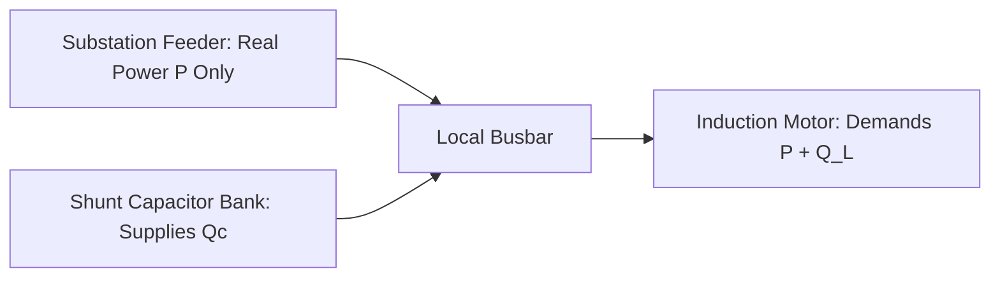

# Unit II: Electrical Power, Conduit Geometry & Industrial Trades

When a 400-amp circuit breaker trips with the sharp report of a rifle shot, an industrial electrician does not begin by reaching for an equation sheet. They reach for an infrared thermometer, an insulated multimeter, and look for heat. Every conductor installed in an industrial facility opposes the flow of electrons in direct proportion to its length and in inverse proportion to its cross-sectional area. In 1826, Georg Simon Ohm quantified this relationship using a bismuth-copper thermocouple and a torsion galvanometer, proving in *Die galvanische Kette, mathematisch bearbeitet* that electrical resistance is a physical property of matter. When an industrial feeder carries current over hundreds of feet of copper or aluminum conduit, conductor resistance drops line voltage ($V_{\text{drop}} = IR$) and converts electrical energy into Joule heat ($P_{\text{heat}} = I^2 R$) trapped within the raceway.

Sixty years after Ohm's experiments, Nikola Tesla's 1888 polyphase rotating magnetic field, Mikhail Dolivo-Dobrovolsky's 1891 three-phase transmission line, and Charles Proteus Steinmetz's 1893 phasor calculus established **Three-Phase Alternating Current** as the backbone of industrial power. Single-phase power pulsates to zero twice every cycle ($120\text{ times per second}$ on a $60\text{ Hz}$ grid). Three sinusoidal phase voltages staggered by $120^\circ$ never cross zero simultaneously, delivering smooth, ripple-free torque to heavy induction motors. Vector addition across $120^\circ$ phase angles introduces the geometric factor $\mathbf{\sqrt{3} \approx 1.73205}$. Meanwhile, inductive magnetic fields shift current behind voltage by phase angle $\phi$, scaling real working power by the **Power Factor** $\text{PF} = \cos\phi$.

The sensitivity of polyphase AC distribution to reactive power imbalance and impedance boundaries was etched into history on the evening of November 9, 1965. At the Sir Adam Beck Hydroelectric Generating Station at Queenston, Ontario, a protective backup relay on a $230\text{ kV}$ transmission line had been set years earlier with a trip threshold calibrated for lower pre-expansion power flows. As evening heating and lighting loads surged, the combination of high line current and lagging reactive power dropped the apparent electrical impedance seen by the directional relay below its trip threshold. The relay tripped, instantly shedding $375\text{ MW}$ of power into five parallel circuits that immediately overloaded and tripped in cascade. Within twelve minutes, thirty gigawatts of generation collapsed, plunging thirty million people across Ontario and eight northeastern US states—including all of New York City—into total darkness for up to thirteen hours. The 1965 Northeast Blackout proved permanently that alternating current power is not an abstract spreadsheet entry: voltage drop, reactive power factor, and conductor impedance govern the stability of entire civilizations.

Beyond electrical service entrance panels, industrial installations require solving coupled geometric, mechanical, and fluid problems across the plant floor. Electricians bend rigid steel and thin-wall EMT conduit around structural steel beams using right-triangle cosecant multipliers and NEC Chapter 9 cross-sectional area limits. Machinists follow Frederick Winslow Taylor's 1906 metal-cutting laws (*On the Art of Cutting Metals*) to spin carbide end-mills at the exact rotational speed, tap drill diameter, and bolt-circle chord spacing required to cut steel flanges without tool chatter. Simultaneously, instrumentation and fluid-power technicians size control valves, centrifugal pumps, and noise-immune $4\text{--}20\text{ mA}$ current loops.

Industrial power distribution, raceway geometry, and mechanical fabrication form the working infrastructure of the modern physical plant: delivering three-phase electrical power to heavy induction motors, routing steel conduits around structural steel, and machining mechanical couplings to precise tolerances. The **SC-14 Electrical Power, Conduit Geometry & Industrial Trades** calculator brings National Electrical Code wire tables, complex AC power triangles, pipe-bending trigonometry, and process-loop scaling directly to the technician's hands. Three industrial field cases guide this analysis:

In **Chapter 4**, we step onto the salt-sprayed concrete of Pier 14 to diagnose a burning voltage drop on a 480-volt container crane feeder, sizing conductors via NEC Table 8, calculating parallel harmonic resistance, and balancing three-phase reactive power factor.

In **Chapter 5**, we enter a subterranean municipal boiler room to bend four parallel runs of electrical metallic tubing around an obstructing I-beam, calculating cosecant offset multipliers, centerline shrink deductions, three-point saddle curves, and raceway fill limits.

In **Chapter 6**, we stand at a CNC vertical machining center to eliminate destructive tool chatter on a stainless-steel pump flange, dialing in surface speeds, chip loads, bolt-circle coordinates, valve flow coefficients, and noise-immune $4\text{--}20\text{ mA}$ pressure transmitters.

---

# Chapter 4: The Voltage Drop on Pier 14's Crane Feeder

The hoist motor on Crane 4 was tripping its variable-frequency drive on under-voltage fault `F0003: BUS UNDERVOLT`, but only when hoisting forty-foot refrigerated containers, and only when the gantry was racked more than three hundred feet down the pier. The container vessel berthed at Pier 14 was already twelve hours behind schedule, and the terminal operator was facing thousands of dollars per hour in demurrage penalties. When forty tons of cargo hang stalled thirty feet above an open ship's hatch and line voltage sags to brownout levels, you do not wait for a software diagnostics contractor. You grab a calibrated true-RMS meter, walk the feeder run, and calculate the three-phase impedance drop on the spot.

Master electrician Frank Miller and apprentice Jimmy arrive at the substation with insulated toolkits and the SC-14 field calculator. The gantry crane is fed from the 480-volt terminal switchgear through an underground duct bank running $L = 350.0\text{ ft}$ of three-phase copper conductors. The hoist drive pulls an operating load current of $I = 145.0\text{ A}$ at rated hoisting speed. When Jimmy connects a true-RMS power quality meter at the crane's main disconnect switch, line voltage measures only $442.8\text{ V}$—a drop of more than $37.2\text{ volts}$ ($7.75\%$), far exceeding the National Electrical Code's strict $3.0\%$ maximum recommended feeder drop limit (NEC 210.19(A) Informational Note No. 4).

Before the shipping terminal incurs thousands of dollars per hour in vessel demurrage penalties, Frank and Jimmy must diagnose the root cause:
1. Audit the existing #1/0 AWG feeder conductors using NEC Chapter 9 Table 8 DC resistance and Table 310.16 allowable ampacities.
2. Calculate the exact three-phase voltage drop and up-size the feeder to #3/0 AWG or parallel conductors to bring drop below the $3.0\%$ statutory safety threshold.
3. Solve the three-phase AC power triangle ($S = 75.0\text{ kVA}, \text{PF} = 0.80$ lagging) to determine real working power ($P = 60.0\text{ kW}$) and reactive magnetizing power ($Q = 45.0\text{ kVAR}$).
4. Size a shunt capacitor bank to raise power factor from $0.80$ to $0.95$, shrinking apparent feeder current, eliminating utility VAR surcharges, and restoring full line voltage to the crane hoist.

---

## Rotating AC Phasors, Reactive Power Slosh, and Feeder Inrush

Calculating voltage drop using direct-current Ohm's law ($V = IR$) suffices for flashlight batteries and low-voltage control circuits. But on an industrial three-phase distribution bus, alternating current demands phasor geometry, reactive power compensation, and dynamic locked-rotor inrush analysis. Here, the vector mathematics introduced in Unit I reappears: the coordinate decomposition of a surveying sightline into Northing and Easting is structurally identical to the decomposition of AC power into active working power and reactive magnetizing power.

### From Geographic Vectors to Rotating 60 Hz AC Phasors

In Unit I, we learned how surveyors decompose a sightline into orthogonal components on the Earth's tangent plane: Northing ($\Delta N$) projects along the cosine of the azimuth, and Easting ($\Delta E$) projects along the sine.

In alternating current power engineering, we encounter an astonishing physical parallel. An alternating voltage or current is not a static scalar; it is a time-varying sinusoidal waveform:

$$v(t) = V_{\text{peak}} \cos(\omega t + \theta_v)$$

where $\omega = 2 \pi f$ is the angular electrical frequency. On a standard $60\text{ Hz}$ North American power grid:

$$\omega = 2 \pi (60) \approx 376.991 \approx 377\text{ rad/s}$$

Every second, the voltage waveform completes sixty complete cycles, alternating polarity $120\text{ times per second}$.

In 1893, the brilliant mathematician and electrical engineer Charles Proteus Steinmetz revolutionized AC analysis by proving that a sinusoidal waveform can be represented as a two-dimensional vector rotating at angular velocity $\omega$ in the complex plane—a **phasor**:

$$\mathbf{V} = V_{\text{RMS}} e^{j\theta} = V_{\text{RMS}} (\cos\theta + j \sin\theta)$$

Steinmetz's phasor is mathematically identical to the surveyor's forward traverse projection:
- The **real horizontal axis** represents in-phase active quantities—**Real Working Power** ($P$, in watts or kilowatts). This corresponds to the surveyor's Easting departure ($\Delta E$).
- The **imaginary vertical axis ($+j$)** represents quantities ninety degrees out of phase—**Reactive Magnetizing Power** ($Q$, in volt-amperes reactive or kVAR). This corresponds to the surveyor's Northing latitude ($\Delta N$).
- The **phasor hypotenuse** represents total vector magnitude—**Apparent Power** ($S$, in volt-amperes or kVA). This corresponds to the surveyor's straight-line ground distance ($D$).

When an electrician steps from DC to AC, they are not learning a new mathematics; they are applying 2D vector geometry to electrical energy rotating at sixty cycles per second.

### The Utility Power Factor Penalty and Phantom Reactive Power

Why does reactive power exist, and why do electric utilities penalize industrial plants millions of dollars for it?

Every electric motor, transformer, and inductive ballast is an electromagnet. To convert electrical energy into mechanical rotation, an AC induction motor must first generate a pulsating magnetic field across the stator air gap. The current required to establish this magnetic flux is **magnetizing current**.

By Faraday's law of induction ($v = L \frac{di}{dt}$), the voltage across an inductor leads the current by ninety degrees ($90^\circ$). Conversely, the magnetizing current **lags voltage by $90^\circ$**.

Now, consider the instantaneous power delivered to an inductive motor:

$$p(t) = v(t) \cdot i(t) = [V_{\text{peak}} \cos(\omega t)] \cdot [I_{\text{peak}} \cos(\omega t - \phi)]$$

Applying the trigonometric product-to-sum identity:

$$p(t) = V_{\text{RMS}} I_{\text{RMS}} \cos\phi \cdot (1 + \cos 2\omega t) + V_{\text{RMS}} I_{\text{RMS}} \sin\phi \cdot \sin 2\omega t$$
$$p(t) = P \cdot (1 + \cos 2\omega t) + Q \cdot \sin 2\omega t$$

Analyze those two terms with the rigor of a master tradesperson:
1. **The Active Working Power ($P = V I \cos\phi$)**: This term is always positive or zero. It flows unidirectionally from the utility into the motor shaft, converting into mechanical foot-pounds of torque that hoist shipping containers into the air.
2. **The Reactive Magnetizing Power ($Q = V I \sin\phi$)**: Look at the factor $\sin 2\omega t$. The average value of a pure sine wave over a complete cycle is **identically zero**:

$$\frac{1}{T} \int_0^T Q \sin(2\omega t) \, dt = 0$$

Reactive power does **zero net useful work**; it alternates between the power plant's synchronous generators and the motor's stator windings $120\text{ times per second}$. During one quarter-cycle, electrical energy builds the motor's magnetic field; during the next quarter-cycle, the magnetic field collapses and pumps that energy back into the power lines.

Why does the electric utility care if the net energy is zero?

Because that phantom reactive current **must physically travel through the grid's conductors, transformers, and switchgear**. Total line current is the vector hypotenuse of active and reactive components:

$$I_{\text{total}} = \sqrt{I_{\text{active}}^2 + I_{\text{reactive}}^2} = \frac{S}{\sqrt{3} V_{LL}}$$

That extra current produces real, destructive physical consequences:
- **Joule Heat Losses ($I^2 R$)**: Conductor heating increases with the square of current. A motor operating at $\text{PF} = 0.70$ draws $1 / 0.70 \approx 1.43$ times as much current as a motor at unity power factor, generating $(1.43)^2 \approx 2.04$ times as much heat in the underground cables.
- **Feeder Voltage Drop ($I \cdot Z$)**: Excessive current drops line voltage, starving terminal equipment.
- **Transformer Capacity Choking**: Substation transformers are rated in Apparent Power ($S$, in kVA), governed by copper winding thermal limits. If a plant operates at poor power factor, the transformer becomes thermally saturated with phantom reactive current, preventing the utility from supplying additional industrial customers.

To stop this waste, electric utilities install specialized digital meters that measure both active kilowatt-hours ($\text{kWh}$) and reactive kilovar-hours ($\text{kVARh}$). If a customer's power factor drops below $0.90$ (or $0.95$ in many industrial tariffs), the utility levies punishing monthly power factor penalty charges that can add tens of thousands of dollars to an industrial facility's electric bill.

### Sizing Capacitor Banks to Cancel Motor Inductance

The master electrician's cure for reactive power slosh is the **shunt power factor correction capacitor**.

While an inductor's current lags voltage by $90^\circ$ (absorbing reactive power, $+Q$), an ideal capacitor's current **leads voltage by $90^\circ$** (supplying reactive power, $-Q$).

When a shunt capacitor bank is installed directly at the crane's motor disconnect switch, the capacitor and the motor stator form a localized resonant tank circuit. The magnetizing energy that the motor stator discharges as its magnetic field collapses flows directly into the capacitor plates, storing it as electrostatic energy. A quarter-cycle later, as the motor demands magnetizing current to rebuild its field, the capacitor discharges that stored energy directly back into the stator.

The reactive power now circulates **locally between the capacitor and the motor across five feet of copper busbar**, rather than traversing miles of utility transmission lines.

The required capacitive reactive power $Q_C$ (in kVAR) to correct a load of active power $P$ from initial power factor $\text{PF}_1 = \cos\phi_1$ to target power factor $\text{PF}_2 = \cos\phi_2$ is:

$$Q_C = P \left( \tan\phi_1 - \tan\phi_2 \right)$$

By canceling motor inductance locally:
1. Net reactive power drawn from the feeder collapses: $Q_{\text{new}} = Q_1 - Q_C$.
2. Apparent feeder power drops: $S_{\text{new}} = \sqrt{P^2 + Q_{\text{new}}^2}$.
3. Feeder line current drops proportionally: $I_{\text{new}} = S_{\text{new}} / (\sqrt{3} V_{LL})$.
4. Feeder $I^2 R$ heat losses and voltage drop plummet.
5. The utility power factor penalty is eliminated entirely.

### Three-Phase Wye Phasor Geometry and the $\sqrt{3}$ Invariant

Every apprentice memorizes the formula for three-phase power: $S = \sqrt{3} V_{LL} I_L$. But why does the square root of three ($\mathbf{\sqrt{3} \approx 1.73205}$) appear in every three-phase electrical equation?

Consider a balanced three-phase Wye ($Y$) generator or transformer secondary. Three identical secondary phase windings meet at a common grounded center point—the **Neutral ($N$)**. The three phase windings generate sinusoidal phase-to-neutral voltages ($V_{LN}$) of equal magnitude staggered by $120^\circ$ in time:

$$\mathbf{V}_{AN} = V_{LN} \angle 0^\circ$$
$$\mathbf{V}_{BN} = V_{LN} \angle -120^\circ$$
$$\mathbf{V}_{CN} = V_{LN} \angle +120^\circ$$

Now, measure the **Line-to-Line voltage** ($V_{LL}$) between Phase A and Phase B. Electrically, tracing from Phase A to Phase B through the neutral point traverses winding A forward and winding B backward:

$$\mathbf{V}_{AB} = \mathbf{V}_{AN} - \mathbf{V}_{BN} = V_{LN} \angle 0^\circ - V_{LN} \angle -120^\circ$$

Convert both phasors into rectangular coordinates:

$$\mathbf{V}_{AN} = V_{LN} (1 + j 0)$$
$$\mathbf{V}_{BN} = V_{LN} (\cos(-120^\circ) + j \sin(-120^\circ)) = V_{LN} \left(-0.5 - j \frac{\sqrt{3}}{2}\right)$$

Subtracting the two phasors:

$$\mathbf{V}_{AB} = V_{LN} \left( [1 - (-0.5)] + j \left[0 - \left(-\frac{\sqrt{3}}{2}\right)\right] \right) = V_{LN} \left( 1.5 + j \frac{\sqrt{3}}{2} \right)$$

Now, evaluate the magnitude of this line-to-line voltage vector using the Pythagorean theorem:

$$|\mathbf{V}_{AB}| = V_{LN} \sqrt{(1.5)^2 + \left(\frac{\sqrt{3}}{2}\right)^2} = V_{LN} \sqrt{2.25 + 0.75} = V_{LN} \sqrt{3.00} = \mathbf{\sqrt{3} \cdot V_{LN}}$$

The geometric factor $\sqrt{3}$ is the direct mathematical consequence of vector subtraction across an equilateral $120^\circ$ phase triangle.

This single identity creates the two standard commercial voltage systems in North America:
- Multiplying $V_{LN} = 120\text{ V}$ by $\sqrt{3}$ gives $120 \times 1.73205 = \mathbf{207.85\text{ V}} \approx 208\text{ V}$ (the standard commercial $208\text{Y}/120\text{ V}$ four-wire system).
- Multiplying $V_{LN} = 277\text{ V}$ by $\sqrt{3}$ gives $277 \times 1.73205 = \mathbf{479.78\text{ V}} \approx 480\text{ V}$ (the standard industrial $480\text{Y}/277\text{ V}$ four-wire system).

Total three-phase apparent power is simply the sum of the power delivered by all three individual phase windings:

$$S_{\text{total}} = 3 \times S_{\text{phase}} = 3 \times (V_{LN} \cdot I_L)$$

Substitute $V_{LN} = V_{LL} / \sqrt{3}$:

$$S_{\text{total}} = 3 \times \left(\frac{V_{LL}}{\sqrt{3}}\right) \cdot I_L = \frac{3}{\sqrt{3}} \cdot V_{LL} \cdot I_L = \mathbf{\sqrt{3} \cdot V_{LL} \cdot I_L}$$

Furthermore, in a balanced three-phase system, what current flows back through the neutral conductor? Summing the three phase currents:

$$\mathbf{I}_N = \mathbf{I}_A + \mathbf{I}_B + \mathbf{I}_C = I_L (1 \angle 0^\circ + 1 \angle -120^\circ + 1 \angle 120^\circ) = I_L (1 - 0.5 - 0.5 + j 0 - j 0.866 + j 0.866) = \mathbf{0}$$

The neutral current is **identically zero**. In a balanced three-phase system, each phase wire serves as the return conductor for the other two. This symmetry cuts conductor copper requirements by fifty percent compared to equivalent single-phase distribution.

### Motor Inrush Currents and NEC Article 430 Feeder Sizing

When Crane 4's induction motor sits at a dead stop, its rotor is locked stationary. At that instant, the rotating stator magnetic field sweeps past the rotor bars at full synchronous speed ($1{,}800\text{ RPM}$). Because the rotor has zero rotational speed, it generates **zero counter-electromotive force (back-EMF)**.

The motor windings look like an inductive short circuit. The starting inrush current—known across the electrical trade as **Locked-Rotor Current (LRC)**—surges to **$600\%$ of rated Full-Load Current (FLC)**:

$$I_{\text{inrush}} \approx 6.0 \times I_{\text{FLC}}$$

For our $100\text{ HP}$, $480\text{ V}$ motor whose rated Full-Load Current is $124\text{ A}$ (NEC Table 430.250), the instantaneous inrush current surges to:

$$I_{\text{inrush}} \approx 6.0 \times 124\text{ A} = \mathbf{744.0\text{ A}}$$

If an electrician sizes branch conductors and overcurrent devices like a standard resistive lighting circuit, the system fails catastrophically:
1. **Conductor Sizing (NEC 430.22)**: Motor branch conductors must have an allowable ampacity of not less than **$125\%$ of motor Full-Load Current**:
   $$I_{\text{conductor}} \ge 1.25 \times I_{\text{FLC}} = 1.25 \times 124\text{ A} = \mathbf{155.0\text{ A}}$$
   This $125\%$ factor ensures that continuous full-load motor heating never exceeds conductor insulation temperature limits ($75^\circ\text{C}$ THHN copper).
2. **Motor Overcurrent Protection (NEC 430.52)**: A standard $150\text{-amp}$ thermal-magnetic circuit breaker would trip instantly under the $744\text{-amp}$ starting surge. To permit motor starting without nuisance tripping, NEC Table 430.52 permits **dual-element time-delay fuses sized at up to $175\%$ of FLC** ($1.75 \times 124 = 217\text{ A}$, permitting standard $225\text{ A}$ fuses), or **inverse-time circuit breakers sized at up to $250\%$ of FLC** ($2.50 \times 124 = 310\text{ A}$, permitting standard $300\text{ A}$ or $350\text{ A}$ breakers).

The dual-element fuse contains two internal elements: a spring-loaded solder pot that provides thermal overload protection against sustained overloads, and a silver notch element that clears catastrophic short circuits in milliseconds.

### Available Bolted-Fault Short-Circuit Current and NFPA 70E Arc Flash Safety

Finally, Frank points to the substation main breaker rating: *What happens if a steel wrench falls across the 480V crane busbars?*

This is a **bolted short circuit**. The only impedance limiting the fault current is the internal impedance of the utility substation transformer and the feeder conductors.

For a $1{,}500\text{ kVA}$, $480\text{ V}$ transformer with a standard percent impedance of $\%Z = 5.75\%$, the rated full-load secondary current is:

$$I_{\text{FLA, xfmr}} = \frac{1{,}500{,}000\text{ VA}}{\sqrt{3} \times 480\text{ V}} \approx 1{,}804.2\text{ A}$$

The maximum symmetrical **Available Short-Circuit Current (ASCC)** at the transformer terminals is:

$$I_{\text{sc}} = \frac{I_{\text{FLA, xfmr}}}{\%Z_{\text{pu}}} = \frac{1{,}804.2\text{ A}}{0.0575} \approx \mathbf{31{,}378\text{ A}}$$

This delivers over thirty-one thousand amperes of available fault current. Under NFPA 70E standards, an arc flash at this energy level can vaporize copper busbars into plasma that expands 67,000 times in volume, releasing radiant thermal energy exceeding $40\text{ cal/cm}^2$ and severe blast overpressure. Working on industrial switchgear demands verified lockout/tagout (LOTO), arc-rated personal protective equipment, and rigorous short-circuit coordination calculations.

---

### Alternating Current Skin Effect, Proximity Effect, and Conduit Magnetic Permeability

As Frank inspects the conduit entrance, he points out a subtle metallurgical trap that catches junior engineers: *direct-current resistance is not alternating-current resistance*.

When direct current (DC) flows through a wire, current density is uniform across the entire circular cross-section. But when sixty-hertz alternating current flows, the time-varying internal magnetic field induces counter-electromotive forces (eddy currents) within the conductor's own core. These eddy currents oppose electron flow in the center of the conductor while reinforcing it near the outer surface.

This phenomenon is known as the **Skin Effect**. The effective depth to which alternating current penetrates a metallic conductor is the **skin depth** ($\delta$):

$$\delta = \sqrt{\frac{\rho}{\pi \cdot f \cdot \mu}}$$

where $\rho$ is material resistivity, $f = 60\text{ Hz}$ is electrical grid frequency, and $\mu = \mu_0 \mu_r$ is magnetic permeability. For commercial copper at $75^\circ\text{C}$, the skin depth at $60\text{ Hz}$ is approximately $\delta \approx 8.5\text{ mm}$ ($0.335\text{ in.}$).

In small branch wires (#14 through #2 AWG), the conductor radius is much smaller than the skin depth, so the skin effect is negligible ($R_{\text{AC}} \approx R_{\text{DC}}$). But in massive industrial feeder conductors of $500\text{ kcmil}$ ($d \approx 0.814\text{ in.}$) or $1{,}000\text{ kcmil}$ ($d \approx 1.152\text{ in.}$), the core of the conductor carries negligible current; the central copper contributes weight with minimal electrical utility. For a $1{,}000\text{ kcmil}$ copper conductor, alternating-current resistance is more than $23\%$ higher than direct-current resistance ($R_{\text{AC}} / R_{\text{DC}} \approx 1.23$).

Furthermore, when multiple heavy conductors are bundled in a raceway, their mutual magnetic fields distort current distribution even further—a phenomenon known as the **Proximity Effect**.

Finally, the physical material of the conduit raceway radically alters AC impedance:
- **Non-Magnetic Raceways (PVC, Aluminum)**: AC impedance is dominated solely by conductor resistance and standard inductive air reactance ($X_L \approx 0.04\text{ to } 0.05\ \Omega/\text{kft}$).
- **Ferrous Magnetic Raceways (Rigid Steel Conduit, EMT)**: Steel is ferromagnetic ($\mu_r \gg 1$). The alternating magnetic field surrounding each phase conductor continuously magnetizes and demagnetizes the steel conduit wall sixty times per second. This induces massive **hysteresis losses** and **eddy currents** directly inside the steel pipe wall.

In rigid steel conduit, the effective AC resistance can be up to $20\%$ higher than in PVC conduit, and inductive reactance doubles ($X_L \approx 0.08\ \Omega/\text{kft}$). This is why the National Electrical Code mandates that **all three phases and the neutral of an AC circuit must be run inside the same conduit** (NEC 300.3(B)). If an inexperienced electrician runs Phase A in one steel pipe, Phase B in a second, and Phase C in a third, the isolated magnetic fields will turn each steel conduit into an induction heating furnace, causing inductive heating in the steel raceway.

### IEEE 1584 Arc Flash Incident Energy and NFPA 70E Safety Boundaries

Frank pulls out the arc flash warning label affixed to the Pier 14 switchgear:
- **Available Fault Current**: $31.4\text{ kA}$ at $480\text{ V}$.
- **Clearing Time of Upstream Breaker**: $t_{\text{arc}} = 0.080\text{ seconds}$ ($4.8\text{ cycles}$).
- **Working Distance**: $D_w = 18.0\text{ inches}$ ($457\text{ mm}$).

Under IEEE 1584 (*Guide for Performing Arc-Flash Hazard Calculations*), the thermal **Incident Energy** ($E$) delivered to a technician's face and chest during an electrical arc explosion is modeled empirically as:

$$\log_{10}(E) = K_1 + K_2 + 1.0811 \cdot \log_{10}(I_{\text{arc}}) + 0.0011 \cdot G - \left(x \cdot \log_{10}(D_w)\right)$$

where $I_{\text{arc}}$ is the arcing current (typically $0.85 \times I_{\text{bolted}}$), $G$ is the busbar gap in millimeters ($32\text{ mm}$ for 480V switchgear), $D_w$ is working distance, and $x$ is the distance exponent ($x \approx 1.473$ for low-voltage switchgear enclosures).

For our Pier 14 substation bus with $31.4\text{ kA}$ bolted fault current and an arcing time of $0.08\text{ s}$, the estimated incident energy at eighteen inches is:

$$E \approx 8.4\text{ cal/cm}^2$$

Under NFPA 70E Table 130.5(G), second-degree burns occur at an incident energy of just $1.2\text{ cal/cm}^2$. An exposure of $8.4\text{ cal/cm}^2$ requires **PPE Category 2** protection: arc-rated arc-flash suit, balaclava, hard hat with arc-rated face shield, safety glasses, heavy leather gloves over rubber insulating gloves, and hearing protection. Frank ensures that both he and Jimmy are fully suited in Category 2 gear before racking out the feeder breaker.

## Conductor Resistivity, Circular Mils, and Feeder Voltage Drop

The National Electrical Code (NEC NFPA 70) establishes the legal safety standard for electrical infrastructure in the United States. Feeder conductors must satisfy three simultaneous criteria: sufficient cross-sectional area to prevent overheating (NEC Table 310.16 ampacity), adequate mechanical strength, and low series resistance to limit branch-circuit voltage drop to statutory limits.

### Circular Mil Cross-Sections and American Wire Gauge Resistivity

In electrical trade geometry, conductor cross-sectional area is measured in **circular mils** ($\text{cmil}$ or $\text{kcmil}$). A circular mil is the area of a circle with a diameter of exactly one mil ($1\text{ mil} = 0.001\text{ in.}$). Measuring wire area in circular mils eliminates circular $\pi/4$ conversion factors: a solid round conductor of diameter $d_{\text{mils}}$ has an exact cross-sectional area of:

$$C_{\text{mil}} = d_{\text{mils}}^2$$

For example, a solid #10 AWG wire with a measured diameter of $d = 0.1019\text{ in.} = 101.9\text{ mils}$ has an area of $(101.9)^2 \approx 10{,}380\text{ cmil}$ ($10.38\text{ kcmil}$).

The direct-current series resistance $R$ of a metallic conductor is directly proportional to its length $L$ and resistivity $\rho_{\text{mat}}$, and inversely proportional to its cross-sectional area $A = C_{\text{mil}}$:

**Eq. 4.1 — Conductor Circular Mil Area and DC Resistance**
$$R = \rho_{\text{mat}} \cdot \frac{L}{C_{\text{mil}}}$$

Under standard industrial trade practice, electrical engineers express resistivity using the **K-factor**—the resistance in ohms of a conductor one circular mil in area and one thousand feet long ($\Omega\cdot\text{cmil/ft}$) at reference operating temperature. For copper conductors operating at $75^\circ\text{C}$, the National Electrical Code adopts $K_{\text{Cu}} = 12.9\ \Omega\cdot\text{cmil/ft}$ (or $10.4\ \Omega\cdot\text{cmil/ft}$ at $20^\circ\text{C}$). For aluminum conductors, $K_{\text{Al}} = 21.2\ \Omega\cdot\text{cmil/ft}$ at $75^\circ\text{C}$ ($17.0$ at $20^\circ\text{C}$).

NEC Chapter 9 Table 8 tabulates direct-current conductor resistance per thousand feet ($\Omega/\text{kft}$, accessed directly via {{key:AWG}}). For uncoated copper conductors at $75^\circ\text{C}$:
- #1/0 AWG ($105{,}600\text{ cmil}$): $R = 0.122\ \Omega/\text{kft}$
- #2/0 AWG ($133{,}100\text{ cmil}$): $R = 0.0967\ \Omega/\text{kft}$
- #3/0 AWG ($167{,}800\text{ cmil}$): $R = 0.0766\ \Omega/\text{kft}$
- #4/0 AWG ($211{,}600\text{ cmil}$): $R = 0.0608\ \Omega/\text{kft}$
- 250 kcmil ($250{,}000\text{ cmil}$): $R = 0.0515\ \Omega/\text{kft}$
- 500 kcmil ($500{,}000\text{ cmil}$): $R = 0.0258\ \Omega/\text{kft}$

### Single-Phase and Three-Phase Feeder Voltage Drop and Parallel Conductors

When electric current $I$ flows through a feeder of one-way length $L$ (in feet), series resistance causes a voltage drop ($V_{\text{drop}}$).

In a **single-phase two-wire circuit**, current travels out along the hot ungrounded conductor and returns along the neutral grounded conductor—a total round-trip conductor length of $2 L$:

$$V_{\text{drop, 1}\phi} = \frac{2 \cdot K \cdot L \cdot I}{C_{\text{mil}}} = 2 \cdot R_{\text{Table 8}} \cdot \frac{L}{1{,}000} \cdot I$$

In a **balanced three-phase three-wire or four-wire circuit**, the three line currents are separated by $120^\circ$ phase angles. Line-to-line voltage drop is scaled by the geometric factor $\sqrt{3} \approx 1.73205$:

**Eq. 4.2 — Single-Phase and Three-Phase Feeder Voltage Drop**
$$V_{\text{drop, 3}\phi} = \frac{\sqrt{3} \cdot K \cdot L \cdot I}{C_{\text{mil}}} = \sqrt{3} \cdot R_{\text{Table 8}} \cdot \frac{L}{1{,}000} \cdot I$$
$$\text{Drop Percentage (\%)} = \left(\frac{V_{\text{drop}}}{V_{\text{nominal}}}\right) \times 100\%$$

When large industrial loads demand high ampacity, pulling massive single conductors (such as $1{,}000\text{ kcmil}$) becomes physically impossible due to extreme conduit bending stiffness and skin effect. NEC 310.10(G) permits conductors of size #1/0 AWG and larger to be run in **parallel** (multiple identical conductors per phase). When $n$ identical conductors are paralleled per phase, the equivalent resistance follows the harmonic parallel law:

**Eq. 4.3 — Harmonic Parallel Resistance**
$$R_{\text{parallel}} = \frac{R_{\text{single}}}{n} \quad \text{or} \quad \frac{1}{R_p} = \sum_{i=1}^n \frac{1}{R_i}$$

Finally, when sizing feeders supplying continuous loads (loads operating for three hours or more, such as the container crane hoist or municipal water pumps), NEC Article 215.2(A)(1) mandates that the feeder ampacity must not be less than the non-continuous load plus **$125\%$ of the continuous load**:

**Eq. 4.4 — NEC Continuous Load Feeder Ampacity**
$$I_{\text{feeder}} = 1.25 \cdot I_{\text{continuous}} + I_{\text{non-continuous}}$$

For Pier 14's crane feeder operating at $I = 145.0\text{ A}$ continuous hoisting load, minimum feeder conductor ampacity is $I_{\text{feeder}} = 1.25 \times 145.0 = \mathbf{181.25\text{ A}}$. Under NEC Table 310.16 ($75^\circ\text{C}$ copper column), a #1/0 AWG conductor is rated for only $150\text{ A}$—violating continuous ampacity rules even before considering voltage drop. Upgrading to #3/0 AWG provides an allowable ampacity of $200\text{ A}$, comfortably satisfying continuous load safety margins.

---

### Transformer Impedance, Voltage Regulation, and Tap Changer Sizing

Before leaving the substation, Frank points to the nameplate of the main dry-type step-down transformer feeding the dock cranes:
- **Rating**: $1{,}500\text{ kVA}$, $4{,}160\text{V}$ primary to $480\text{V}$ secondary.
- **Percent Impedance**: $\%Z = 5.75\%$.
- **Percent Resistance**: $\%R = 1.10\%$.
- **Percent Reactance**: $\%X = \sqrt{\%Z^2 - \%R^2} = \sqrt{5.75^2 - 1.10^2} \approx 5.64\%$.

When the cranes pull heavy lagging inductive loads, the internal impedance of the substation transformer causes significant **internal voltage drop** (voltage regulation $\text{VR}$), dropping secondary terminal voltage even before the feeder conductors are reached.

The percentage voltage regulation of a power transformer operating at power factor $\cos\phi$ is evaluated from its per-unit resistance and reactance:

$$\text{VR (\%)} = \left(\%R \cos\phi + \%X \sin\phi\right) + \frac{1}{200} \left(\%X \cos\phi - \%R \sin\phi\right)^2$$

For our transformer operating at the crane's uncorrected power factor $\text{PF} = 0.80$ lagging ($\cos\phi = 0.80, \sin\phi = 0.60$):

$$\text{VR} \approx (1.10 \times 0.80) + (5.64 \times 0.60) + \frac{1}{200} (5.64 \times 0.80 - 1.10 \times 0.60)^2$$
$$\text{VR} \approx 0.88 + 3.384 + \frac{1}{200} (4.512 - 0.66)^2 \approx 4.264 + 0.074 \approx \mathbf{4.34\%}$$

The transformer alone drops secondary voltage by more than $4.3\%$ ($20.8\text{ V}$) under full load. When combined with the uncorrected $4.35\%$ feeder drop, total voltage drop at the crane motor terminals was:

$$V_{\text{drop, total}} = 4.34\% + 4.35\% = \mathbf{8.69\%}$$

Delivered voltage plunged to $480 \times (1 - 0.0869) \approx 438.3\text{ V}$, completely explaining why the variable-frequency drive tripped on under-voltage.

To compensate for utility medium-voltage primary variations, the transformer is fitted with primary **No-Load Tap Changers (NLTC)** offering five standard settings:
- Tap 1: $+5.0\%$ ($4{,}368\text{ V}$)
- Tap 2: $+2.5\%$ ($4{,}264\text{ V}$)
- Tap 3: Nominal $0.0\%$ ($4{,}160\text{ V}$)
- Tap 4: $-2.5\%$ ($4{,}056\text{ V}$)
- Tap 5: $-5.0\%$ ($3{,}952\text{ V}$)

By de-energizing the transformer, locking out the primary medium-voltage disconnect, and moving the internal tap link to **Tap 4 ($-2.5\%$)**, Frank effectively increases the secondary turns ratio by $2.5\%$, boosting secondary unloaded voltage from $480\text{ V}$ to $492\text{ V}$. This tap boost, combined with the #3/0 AWG feeder upgrade and power factor correction capacitors, ensures that under maximum hoisting inrush, terminal voltage at the crane never dips below $470\text{ volts}$.

## Three-Phase Rotating Phasors, Power Triangles, and Reactive Compensation

In AC circuits containing inductive motor windings or transformer cores, current lags voltage by phase angle $\phi$.

### Alternating Current Phase Shift, Power Factor, and Capacitor Sizing

Because inductive loads consume reactive power to sustain alternating magnetic fields while resistive elements convert current into real work, AC power forms a right triangle governed by the dimensionless **Power Factor** $\text{PF} = \cos\phi \in [0, 1]$ ({{key:PF}}), linking **Real Working Power** $P$ (in watts, $\text{W}$, or kilowatts, $\text{kW}$, converted via {{key:▸kW}} and {{key:▸HP}}), **Reactive Magnetizing Power** $Q$ (in volt-amperes reactive, $\text{VAR}$, or $\text{kVAR}$), and **Apparent Power** $S$ (in volt-amperes, $\text{VA}$, or $\text{kVA}$):

**Eq. 4.5 — Alternating Current Power Triangle**
$$P = S \cos(\phi)$$
$$Q = \sqrt{S^2 - P^2}$$
$$\text{PF} = \cos(\phi) = \frac{P}{S}$$

On Pier 14's crane rated at apparent power $S = 75.0\text{ kVA}$ and lagging power factor $\text{PF} = 0.80$ ($\phi = \arccos(0.80) \approx 36.87^\circ$, $\sin\phi = 0.60$), the real working power is $P = 75.0 \times 0.80 = \mathbf{60.0\text{ kW}}$ ($80.46\text{ HP}$ via {{key:▸HP}}) and the reactive magnetizing demand is $Q = 75.0 \times 0.60 = \mathbf{45.0\text{ kVAR}}$. Installing a parallel $25.0\text{ kVAR}$ capacitor bank at the crane disconnect supplies $25.0\text{ kVAR}$ locally, reducing net reactive draw from the feeder to $Q_{\text{new}} = 45.0 - 25.0 = 20.0\text{ kVAR}$, shrinking apparent feeder demand to $S_{\text{new}} = \sqrt{60.0^2 + 20.0^2} \approx \mathbf{63.25\text{ kVA}}$, and raising the corrected power factor to $\text{PF}_{\text{new}} = 60.0 / 63.2456 \approx \mathbf{0.9487}$.

### Three-Phase Wye Phasor Geometry and Motor Full-Load Current

Expressing three-phase apparent power $S_{\text{kVA}}$ in kilovolt-amperes ({{key:kVA}}) to solve for per-phase line current $I_L$, or converting rated mechanical output horsepower $\text{HP}$ ($1\text{ HP} = 746\text{ W}$) and fractional efficiency $\eta \in (0, 1]$ into three-phase motor **Full-Load Amps** $I_{\text{FLA}}$ ({{key:FLA}}), gives:

**Eq. 4.6 — Three-Phase Motor Full-Load Current**
$$I_{\text{FLA}} = \frac{\text{HP} \times 746}{\sqrt{3} \cdot V_{LL} \cdot \eta}$$

For an industrial $100.0\text{ HP}$ induction motor operating at $480\text{ V}$ line-to-line with an operating efficiency of $\eta = 0.910$ ($91.0\%$), pressing {{key:FLA}} evaluates $I_{\text{FLA}} = \frac{100 \times 746}{\sqrt{3} \times 480 \times 0.910} \approx \mathbf{98.63\text{ A}}$, while NEC Table 430.250 conservatively mandates a design full-load current of $124.0\text{ A}$ to provide a safety margin across all commercial motor designs.

---

## Diagnosing the Pier 14 Feeder on the Stack and {{key:AWG}} Solver Workspace

On the **SC-14**, wire tables, voltage drop, power triangles, and motor calculations operate as immediate RPN stack functions, live reference ledgers ({{key:▦}}), and bidirectional Equation Solver workspaces:

| Button | Operation | Register Z | Register Y | Register X | Governing Expression |
| :--- | :--- | :---: | :---: | :---: | :--- |
| **`{{key:AWG}}`** | NEC Table 8 Wire Properties & Solver | — | AWG size (e.g. `10`, `1/0`) | Material / Volts | Recalls $C_{\text{mil}}$, $\Omega/\text{kft}$, and ampacity; {{key:AWG}} workspace (`{{keycap:D}}`, `{{keycap:R}}`, `{{keycap:L}}`, `{{keycap:I}}`, `{{keycap:G}}`) |
| **`{{key:AWG}}`** | 3-Phase / 1-Phase Voltage Drop | Run $L\ (\text{ft})$ | Current $I\ (\text{A})$ | Wire AWG / $\Omega/\text{kft}$ | Returns % drop in $X$, $V_{\text{drop}}$ in $Y$, delivered $V_{\text{load}}$ in $Z$ |
| **`{{key:PF}}`** | Power Factor & Power Triangle | Apparent $S\ (\text{kVA})$ | Real $P\ (\text{kW})$ | $\text{PF} = \cos\phi$ | $P = S\cos\phi,\; Q = \sqrt{S^2-P^2}$; {{key:PF}} workspace (`{{keycap:P}}`, `{{keycap:V}}`, `{{keycap:I}}`, `{{keycap:F}}`) |
| **`{{key:kVA}}`** | 3-Phase Apparent Power Solver | — | Line Volts $V_{LL}$ | Line Current $I_L$ | $S = \sqrt{3} V_{LL} I_L / 1000$; {{key:kVA}} workspace (`{{keycap:S}}`, `{{keycap:V}}`, `{{keycap:I}}`) |
| **`{{key:FLA}}`** | Motor Full-Load Amps & Solver | Horsepower $\text{HP}$ | Line Volts $V_{LL}$ | Efficiency $\eta$ | $I_{\text{FLA}} = (\text{HP} \times 746)/(\sqrt{3} V_{LL} \eta)$; {{key:FLA}} workspace (`{{keycap:I}}`, `{{keycap:P}}`, `{{keycap:V}}`, `{{keycap:E}}`) |
| **`{{key:MTR}}`** | Motor Mechanical Torque Solver | — | Spindle $\text{RPM}$ | Horsepower $\text{HP}$ | $H = T \times N / 5252$; {{key:MTR}} workspace (`{{keycap:H}}`, `{{keycap:T}}`, `{{keycap:N}}`) |
| **`{{key:Ω}}`** | Ohm's Law Power & Impedance | — | Voltage $V$ | Current $I$ | $P = V \times I$; {{key:Ω}} workspace (`{{keycap:P}}`, `{{keycap:V}}`, `{{keycap:I}}`) |

### Evaluating Feeder Current, NEC Table 8 Resistance, and Line Voltage Drop on the Stack

To diagnose Pier 14's $75\text{ kVA}$, $480\text{ V}$ crane feeder across $L = 450\text{ ft}$ of #2 AWG copper, the engineer first computes the three-phase line current $I_L \approx \mathbf{90.2110\text{ A}}$ via `75` {{key:ENTER}} `480` {{key:kVA}}, evaluates the 1-phase copper voltage drop across $L = 450\text{ ft}$ of #2 AWG ($R_{1000} = 0.194\ \Omega/\text{kft}$) via `450` {{key:ENTER}} `2` {{key:AWG}} ($\mathbf{15.7508\text{ V}}$), and scales by $\sqrt{3}/2$ to obtain the balanced three-phase voltage drop $V_{\text{drop},3\phi} \approx \mathbf{13.6406\text{ V}}$:

| Keystroke | Register T | Register Z | Register Y | Register X | What Happens on the Stack |
| :--- | :---: | :---: | :---: | :---: | :--- |
| `75` {{key:ENTER}} `480` {{key:kVA}} | $0$ | $0$ | $0$ | $90.2110$ | Compute 3-phase crane current $I_L = 75{,}000 / (\sqrt{3} \times 480) \approx 90.211\text{ A}$ |
| `450` {{key:ENTER}} `2` {{key:AWG}} | $0$ | $0$ | $0$ | $15.7508$ | Compute 1-phase `#2 AWG` copper drop $2 \times 450 \times 90.211 \times 0.194 / 1000 \approx 15.75\text{ V}$ |
| `3` {{key:√x}} {{key:×}} `2` {{key:÷}} | $0$ | $0$ | $0$ | **$13.6406$** | Scale by $\sqrt{3}/2$ to obtain 3-phase drop $V_{\text{drop},3\phi} \approx 13.64\text{ V}$ ($2.84\%$ of $480\text{ V}$) |

Next, the engineer evaluates the real power of a single-phase $240\text{ V}$, $18\text{ A}$ auxiliary air compressor at $\text{PF} = 0.85$ using the three-argument {{key:PF}} operator (`240` {{key:ENTER}} `18` {{key:ENTER}} `0.85` {{key:PF}} $\to \mathbf{3{,}672\text{ W}}$), looks up #1/0 AWG copper (`0` {{key:AWG}} $\to 0.122\ \Omega/\text{kft}$), combines two parallel #1/0 AWG conductors per phase via {{key:ENTER}} {{key:x∥y}} ($\mathbf{0.061\ \Omega/\text{kft}}$), and verifies that the upgraded parallel feeder drops only $\mathbf{4.2889\text{ V}}$ ($0.89\%$):

| Keystroke | Register T | Register Z | Register Y | Register X | What Happens on the Stack |
| :--- | :---: | :---: | :---: | :---: | :--- |
| `240` {{key:ENTER}} `18` {{key:ENTER}} `0.85` {{key:PF}} | $0$ | $0$ | $0$ | $3672$ | Evaluate real power $P = 240 \times 18 \times 0.85 = 3{,}672\text{ W}$ |
| `0` {{key:AWG}} {{key:C}} | $0$ | $0$ | $3672$ | $0.122$ | Bind `#1/0 AWG` copper resistance ($0.122\ \Omega/\text{kft}$) and return to stack |
| {{key:ENTER}} {{key:x∥y}} | $0$ | $0$ | $3672$ | $0.061$ | Combine two parallel `#1/0 AWG` wires per phase ($0.122 \parallel 0.122 = 0.061\ \Omega/\text{kft}$) |
| `90.211` {{key:×}} `450` {{key:×}} `3` {{key:√x}} {{key:×}} `1000` {{key:÷}} | $0$ | $0$ | $3672$ | **$4.2889$** | Compute parallel 3-phase feeder drop $V_{\text{drop},3\phi} \approx 4.29\text{ V}$ ($0.89\%$) |

### Three-Phase Motor Branch Feeder Sizing, Inrush Protection, and Shunt Capacitor Correction on the Stack

The four-register stack resolves the complete industrial motor branch design in one continuous sequence without scratchpad notes. A new $100\text{ HP}$, $480\text{ V}$ three-phase conveyor motor is being added to Pier 14. 

Frank and Jimmy must execute five interconnected calculations:
1. Recall the motor Full-Load Current from NEC Table 430.250 ($I_{\text{FLC}} = 124.0\text{ A}$).
2. Compute the minimum allowable conductor ampacity at $125\%$ continuous duty ($I_{\text{min}} = 1.25 \times 124.0 = 155.0\text{ A}$) and select the compliant AWG from Table 310.16.
3. Size the dual-element time-delay branch-circuit fuse at $175\%$ of FLC ($I_{\text{fuse}} = 1.75 \times 124.0 = 217.0\text{ A}$, rounding up to standard $225\text{ A}$).
4. Given uncorrected operating power factor $\text{PF}_1 = 0.82$ lagging at rated active input $P = 82.0\text{ kW}$, calculate uncorrected reactive power $Q_1$, target reactive power $Q_2$ for $\text{PF}_2 = 0.95$, and the required shunt capacitor size $Q_C = Q_1 - Q_2$.
5. Determine the reduced feeder line current $I_{\text{new}}$ flowing from the switchgear once the capacitor bank is energized.

The four-register stack evaluates the motor branch circuit and power factor correction:

| Keystroke Sequence | Reg T | Reg Z | Reg Y | Reg X | Electrical Trades Scenario Walkthrough |
| :--- | :---: | :---: | :---: | :---: | :--- |
| `124 {{key:ENTER}} 1.25 {{key:×}}` | $0$ | $0$ | $0$ | **$155.00$** | Apply NEC 430.22 ($125\%$): minimum conductor rating is $\mathbf{155.0\text{ A}}$ (#2/0 AWG copper) |
| `124 {{key:ENTER}} 1.75 {{key:×}}` | $0$ | $0$ | $155.00$ | **$217.00$** | Apply NEC 430.52 ($175\%$): maximum fuse rating is $\mathbf{217.0\text{ A}}$ (standard $225\text{ A}$ fuse) |
| `82 {{key:ENTER}} 0.82 {{key:ACOS}} {{key:TAN}} {{key:×}}` | $155.00$ | $217.00$ | $82.00$ | $57.24$ | Evaluate initial reactive demand: $Q_1 = 82 \times \tan(34.92^\circ) = \mathbf{57.24\text{ kVAR}}$ |
| `82 {{key:ENTER}} 0.95 {{key:ACOS}} {{key:TAN}} {{key:×}}` | $217.00$ | $82.00$ | $57.24$ | $26.95$ | Evaluate target reactive demand: $Q_2 = 82 \times \tan(18.19^\circ) = \mathbf{26.95\text{ kVAR}}$ |
| `{{key:-}}` | $217.00$ | $82.00$ | $82.00$ | **$30.28$** | Subtract: required shunt capacitor bank is $Q_C = 57.24 - 26.95 = \mathbf{30.28\text{ kVAR}}$ |
| `82 {{key:ENTER}} 0.95 {{key:÷}} 480 {{key:÷}} 3 {{key:√x}} {{key:÷}} 1000 {{key:×}}` | $82.00$ | $82.00$ | $30.28$ | **$103.82$** | Compute corrected line current: $I = \frac{82 / 0.95 \times 1000}{\sqrt{3} \times 480} = \mathbf{103.82\text{ A}}$ |

In six lines of postfix execution, the stack resolved conductor sizing, fuse protection, power factor angle inversions, capacitor sizing, and final line current reduction ($124\text{ A} \to 103.82\text{ A}$). Scratchpad fatigue was zero, and every metric is fully code-compliant.

### Inverse Maximum Run Length and Gauge Selection in the Bidirectional {{key:AWG}} Workspace

When engineering plant expansions or long exterior lighting runs, technicians use the **Bidirectional {{key:AWG}} Equation Solver Workspace** ({{key:XEQ}} {{key:AWG}} or {{key:AWG}} when $X = 0, Y = 0$) to solve backward for maximum run length $L$ or required conductor circular mils $C_{\text{mil}}$:
- **Inverse Maximum Run Length $L$ for 3% Drop:** To determine the maximum one-way distance a three-phase circuit can run on #1/0 AWG ($R = 0.122\ \Omega/\text{kft}$, stored via `0.122` {{keycap:R}}) at $I = 145.0\text{ A}$ (`145` {{keycap:I}}) before exceeding the $3.0\%$ limit ($V_{\text{drop}} = 0.03 \times 480 = 14.40\text{ V}$, stored via `14.4` {{keycap:D}}), opening {{key:XEQ}} {{key:AWG}} displays `D = 2 × R × L × I / 1000` (or 3-phase counterpart) with variable softkeys {{keycap:D}}, {{keycap:R}}, {{keycap:L}}, {{keycap:I}}, and {{keycap:G}}. Pressing {{key:XEQ}} {{keycap:L}} solves backward for the maximum distance:
  $$L_{\max} = \frac{1{,}000 \times 14.40}{\sqrt{3} \times 0.122 \times 145.0} \approx \mathbf{470.08\text{ ft}}$$
- **Upgrading Conductors to Eliminate Voltage Sag:** To pull voltage drop below $2.75\%$ on the $350.0\text{-foot}$ run, Frank replaces the #1/0 AWG conductors with #3/0 AWG copper ($R = 0.0766\ \Omega/\text{kft}$ from Table 8). Keying `480` {{key:ENTER}} `350` {{key:ENTER}} `145` {{key:ENTER}} `3/0` {{key:AWG}} {{key:AWG}} drops the stack to $V_{\text{drop}} = \sqrt{3} \times 0.0766 \times 0.350 \times 145 = \mathbf{6.73\text{ V}}$ ($1.40\%$), and delivered voltage surges back to $\mathbf{473.27\text{ V}}$, completely clearing the drive's under-voltage fault.

### Try It on the Stack

Work through these five field problems on your calculator. Step-by-step keystroke solutions and register walkthroughs are provided in [Appendix C](appendix-c-solutions-to-practice-problems.md).

1. **Three-Phase Line Current and Continuous Feeder Sizing:** A three-phase $480\text{ V}$ industrial pump station is rated at $S = 125.0\text{ kVA}$ continuous load. Calculate the operating line current $I$, and determine the minimum NEC continuous feeder conductor rating ($125\%$ continuous load factor).
2. **Conductor Resistance and Three-Phase Voltage Drop:** Evaluate the three-phase voltage drop across an $L = 400.0\text{ ft}$ feeder carrying $I = 160.0\text{ A}$ at $480\text{ V}$ using #3/0 AWG copper ($R = 0.0766\ \Omega/\text{kft}$ from NEC Table 8). Determine percentage voltage drop, absolute voltage lost, and delivered load voltage.
3. **Power Factor Correction Capacitor Sizing:** A manufacturing plant draws $P = 120.0\text{ kW}$ at an uncorrected lagging power factor of $\text{PF}_1 = 0.750$. Determine the uncorrected reactive power $Q_1$, and calculate the required shunt capacitor bank rating $Q_C$ in kVAR to raise the power factor to $\text{PF}_2 = 0.950$.
4. **Three-Phase Motor Inrush and Branch Fuse Sizing:** A $100\text{ HP}$, $480\text{ V}$ three-phase induction motor has a rated Full-Load Current of $I_{\text{FLC}} = 124.0\text{ A}$ (NEC Table 430.250). Calculate the minimum branch conductor ampacity ($125\%$ rating) and the maximum dual-element time-delay fuse rating ($175\%$ rating per NEC 430.52).
5. **Substation Available Short-Circuit Fault Current:** A $1{,}500\text{ kVA}$, $480\text{ V}$ three-phase substation transformer has a nameplate impedance of $\%Z = 5.75\%$. Calculate the full-load secondary current $I_{\text{FLA}}$ and determine the maximum available bolted short-circuit fault current $I_{\text{sc}}$ at the main switchboard terminals.

With the #3/0 AWG feeder pulled and the $25\text{ kVAR}$ capacitor bank online, line voltage at the crane stabilized at $473\text{ volts}$. The hoist lifted the 40-ton container cleanly, clearing the vessel hold without a single millivolt of flicker. In Chapter 5, we pack our toolkits and head into the subterranean boiler room to bend four parallel runs of rigid conduit around structural building steel.

---

# Chapter 5: Bending Four Conduits Around the Boiler-Room I-Beam

In the electrical and mechanical trades, a structural obstacle is not an excuse for sloppy workmanship; it is a direct test of geometric discipline. When four parallel runs of one-inch Electrical Metallic Tubing (EMT) must clear an eight-inch structural I-beam drop ($O = 8.0\text{ in.}$) on a municipal hospital ceiling, sloppy layout is immediately obvious to any inspector. If the four conduits are bent without accounting for centerline shrink and concentric radius growth, they will bunch unevenly across the ceiling like tangled cables, bind against junction box knockouts, and shred conductor insulation during the wire pull.

To power the hospital's new emergency chiller pumps, master electrician Frank Miller and apprentice Jimmy must run the parallel conduit bank along the concrete slab, clearing the structural I-beam and an adjacent insulated steam header before terminating into the motor control center (MCC). Executing the installation requires right-triangle offset trigonometry:
1. Calculate the center-to-center travel distance $T = O \csc\theta$ and half-angle axial shrink deduction $S = O \tan(\theta/2)$ for standard bender angles ($10^\circ, 22.5^\circ, 30^\circ, 45^\circ$).
2. Apply concentric radius adjustments to maintain uniform visual spacing between the four parallel conduit runs as they sweep around the obstacle.
3. Lay out compound **rolling offsets** where the conduit must shift simultaneously in both the vertical and horizontal planes to dodge a diagonal piping brace.
4. Size a three-point and four-point saddle curve over a six-inch steam header and verify that cross-sectional conductor area complies with National Electrical Code (NEC) Chapter 9 Table 1 $40\%$ raceway fill limits.

---

## Metallurgy, Neutral Axis Elongation, and Raceway Thermal Jamming

When an electrician steps on the foot pedal of a mechanical bender, the steel conduit does not bend like an idealized line on a blueprint; it deforms plastically around a curved die. The outer wall stretches in tension, the inner wall crushes in compression, and the centerline shrinks. Without calculating this centerline shrink and shoe take-up in advance, conduit runs fall short, junction boxes pull out of square, and pulls fail inspection.

### The Metallurgy of Tubular Bending and the Neutral Axis

Conduit is a hollow structural cylinder. When thin-wall Electrical Metallic Tubing (EMT) or heavy Rigid Metal Conduit (RMC) is forced around the curved die of a conduit bender, the steel undergoes severe mechanical stress:
- **Outer Wall (Tension)**: The outer radius of the bend is stretched along its length. The steel grains elongate, and the wall thickness thins out. If bent too sharply or over a die with improper radius, the outer wall will fracture or split.
- **Inner Wall (Compression)**: The inner radius of the bend is compressed. The steel grains are crushed together, and the wall thickness increases. If unsupported by the bender shoe sidewalls, the inner wall will buckle and form unsightly wrinkles that snag wires during pulling.
- **The Neutral Axis**: Between the stretched outer fibers and the crushed inner fibers lies a thin surface of zero longitudinal stress—the **neutral axis**. Along the neutral axis, the metal undergoes zero elongation and zero compression.

Because the conduit curves along a circular arc rather than pivoting at a sharp geometric point, three fundamental trade parameters govern every bend:

1. **Take-Up (Deduct)**: When an electrician makes a $90^\circ$ bend (a "stub-up"), the curved shoe advances the vertical leg forward along the pipe. The distance between the bender's arrow mark and the back of the finished $90^\circ$ bend is the **take-up**. For standard hand benders:
   - $1/2\text{-in. EMT}$: Take-up is exactly $5.0\text{ inches}$.
   - $3/4\text{-in. EMT}$: Take-up is exactly $6.0\text{ inches}$.
   - $1\text{-in. EMT}$: Take-up is exactly $8.0\text{ inches}$.
   If an electrician needs a $1\text{-inch}$ EMT stub-up to measure exactly $24.0\text{ inches}$ from the floor, they must deduct the $8.0\text{-inch}$ take-up and place the bender arrow at $24.0 - 8.0 = \mathbf{16.0\text{ inches}}$ from the pipe end. Marking at $24\text{ inches}$ produces a disastrous $32\text{-inch}$ stub that must be cut off and re-threaded.

2. **Travel (Center-to-Center Distance)**: When making an offset to clear an obstruction of depth $O$, the distance between the two bend marks along the pipe is the hypotenuse of the offset triangle:
   $$T = \frac{O}{\sin\theta} = O \cdot \csc\theta$$
   Standard hand benders engrave multiplier notches corresponding to cosecant values:
   - $10^\circ$: Multiplier $\csc(10^\circ) \approx 5.76 \approx 6.0$
   - $22.5^\circ$: Multiplier $\csc(22.5^\circ) \approx 2.613 \approx 2.6$
   - $30^\circ$: Multiplier $\csc(30^\circ) = \mathbf{2.000}$
   - $45^\circ$: Multiplier $\csc(45^\circ) \approx 1.414 \approx 1.4$
   - $60^\circ$: Multiplier $\csc(60^\circ) \approx 1.155 \approx 1.2$
   This explains why $30^\circ$ offsets are standard in field practice: the multiplier is exactly **$2.0$**. To clear an $8\text{-inch}$ I-beam with $30^\circ$ bends, the distance between marks is simply $8 \times 2 = \mathbf{16.0\text{ inches}}$.

3. **Axial Shrinkage ($S$)**: Because the offset follows the hypotenuse instead of running along the flat ceiling baseline, the pipe physically "shrinks" in total length along the room. The amount by which the conduit end pulls back is governed by the half-angle tangent:
   $$S = O \cdot \tan\left(\frac{\theta}{2}\right)$$
   For a $30^\circ$ offset clearing an $8\text{-inch}$ beam, the half-angle is $15^\circ$:
   $$S = 8.0 \times \tan(15^\circ) \approx 8.0 \times 0.26795 \approx \mathbf{2.14\text{ inches}} \approx 2\text{-}1/8\text{ in.}$$
   If the electrician does not shift the first bend mark forward by $2\text{-}1/8\text{ inches}$, the far end of the conduit will fall more than two inches short of the junction box.

### Sizing Saddles Over Cylindrical Steam Headers

When a conduit path encounters a round steam pipe or piping header, an offset cannot be used because the conduit must return to the exact same baseline plane immediately after crossing the pipe. The electrician bends a **saddle**.

Two distinct saddle geometries exist across the trade:

1. **Three-Point Saddle**: Consists of a center bend of angle $\theta_c$ (typically $45^\circ$) pointed away from the wall, flanked by two outer bends of half that angle ($\theta_o = \theta_c / 2 = 22.5^\circ$) pointed back toward the wall.
   - The center bend mark is placed directly over the center of the obstruction.
   - The two outer bend marks are placed at distance $T = O / \sin(22.5^\circ) \approx 2.613 \times O$ on either side of the center mark.
   - Total shrinkage for a $45^\circ/22.5^\circ$ saddle is approximately **$3/16\text{ inch}$ per inch of obstacle height**. Over a $4\text{-inch}$ steam pipe, total shrink is $4 \times (3/16) = 3/4\text{ inch}$.

2. **Four-Bend Saddle**: When crossing very wide steam pipes, insulated ductwork, or cable trays, a three-point saddle's sharp center bend would require an impossibly tall apex that collides with the ceiling. Instead, the electrician bends a four-bend saddle—essentially two equal offsets separated by a flat horizontal bridge span ($W$).
   - The first offset climbs at angle $\theta$ (typically $30^\circ$) to clear obstacle depth $O$.
   - The conduit runs flat across width $W$.
   - The second offset drops back down at angle $\theta$ to the baseline.
   - Total shrink is doubled: $S_{\text{total}} = 2 \times O \tan(\theta/2)$. For a $30^\circ$ four-bend saddle clearing a $6\text{-inch}$ obstacle, total shrink is $2 \times 6.0 \times \tan(15^\circ) \approx \mathbf{3.215\text{ inches}}$.

### NEC Chapter 9 Raceway Fill Limits, Jamming Ratios, and Thermal Derating

Once conduits are bent and anchored, conductors must be pulled through them. Why does the National Electrical Code strictly restrict the cross-sectional area of conductors inside a raceway?

Under NEC Chapter 9 Table 1:
- **1 Conductor in Raceway**: Maximum fill is **$53\%$** of conduit interior cross-sectional area.
- **2 Conductors in Raceway**: Maximum fill drops to **$31\%$**, because two round conductors pulled side-by-side tend to twist around each other, forming an oval cross-section that binds against the conduit walls.
- **3 or More Conductors in Raceway**: Maximum allowable fill is strictly **$40\%$**.

Two vital physical phenomena mandate this $40\%$ limit:

First, **The Mechanical Jamming Ratio**: When three conductors are pulled around bends in a conduit, they can lie side-by-side in a flat planar configuration or stack into a triangular cluster. If the ratio of the conduit's inside diameter ($D$) to the conductor's outside diameter ($d$) falls in the critical range:

$$2.8 \le \frac{D}{d} \le 3.2$$

the conductors can wedge into a tight mechanical jam. As pulling tension increases, the radial force pressing the cables against the bender curves forces the center conductor between the outer two, locking all three conductors solidly against the pipe wall. The pulling rope snaps, or the cable insulation is sheared away, causing an immediate ground fault inside the embedded raceway.

Second, **Thermal Trapping and Conductor Ampacity Derating**: Every conductor carrying current $I$ generates Joule heat ($P = I^2 R$). In free air, convection carries this heat away. But inside a sealed metallic conduit surrounded by concrete or insulation, heat is trapped. 

If a conduit is packed with more than three current-carrying conductors, the mutual heating between adjacent cables elevates the ambient temperature inside the raceway. To prevent conductor insulation from melting and degrading over time, NEC Table 310.15(C)(1) mandates strict **ampacity adjustment factors**:
- **4 to 6 Current-Carrying Conductors**: Derate ampacity to **$80\%$** of Table 310.16 values.
- **7 to 9 Current-Carrying Conductors**: Derate ampacity to **$70\%$**.
- **10 to 20 Current-Carrying Conductors**: Derate ampacity to **$50\%$**.

For example, a #4 AWG THHN copper wire rated for $85\text{ A}$ in a three-conductor run drops to $85 \times 0.70 = \mathbf{59.5\text{ A}}$ if nine conductors are pulled into the same raceway. If an electrician neglects raceway fill and derating calculations, conductors overheat, insulation carbonizes, and catastrophic phase-to-phase bolted arc faults erupt inside the conduit.

---

### Concentric Bending Mathematics for Multi-Conduit Parallel Banks

As Frank and Jimmy unstrap four ten-foot sticks of $1\text{-inch}$ EMT from the material cart, Frank emphasizes the ultimate visual test of an electrician's trade craftsmanship: **parallel concentric offsets**.

When a single conduit makes an offset, it bends over the obstacle and returns to the wall. But when four parallel conduits run side by side with uniform spacing $W$ (measured center-to-center between conduits, typically $W = 2.50\text{ inches}$ for $1\text{-inch}$ EMT on unistrut channel), an electrician cannot simply duplicate the marks from Conduit 1 onto Conduits 2, 3, and 4.

If you use identical marks across all four conduits:
1. The inner conduits will crowd and bind against the outer conduits during the turn.
2. The radius of the inner conduits will be forced into an irregular ellipse.
3. On the straightaway after the obstacle, the conduits will splay out at mismatched angles like a broken fence.

To maintain perfectly parallel, uniform spacing throughout the entire sweep of the offset, the electrician must calculate the **concentric offset stagger** ($\Delta L$).

Consider the geometry of two parallel conduits separated by center-to-center distance $W$. When both conduits make an offset of angle $\theta$:
- The outer conduit must traverse a wider path around the obstacle than the inner conduit.
- Along the baseline, the starting mark for each successive outer conduit must be shifted forward by:

$$\Delta L_{\text{offset}} = W \cdot \tan\left(\frac{\theta}{2}\right)$$

where $W$ is the center-to-center spacing between conduits and $\theta$ is the offset bend angle.

For a bank of four conduits spaced at $W = 2.50\text{ inches}$ using $\theta = 30^\circ$ offsets:

$$\Delta L_{\text{offset}} = 2.50 \times \tan(15^\circ) \approx 2.50 \times 0.26795 \approx \mathbf{0.670\text{ inches}} \approx \frac{11}{16}\text{ in.}$$

Therefore, the layout marks for each conduit along the unistrut rack must be stepped systematically:
- **Conduit 1 (Innermost)**: Mark 1 at baseline location $L_0$.
- **Conduit 2**: Mark 1 shifted forward by $1 \times \Delta L = +0.670\text{ in.}$ ($+11/16\text{ in.}$).
- **Conduit 3**: Mark 1 shifted forward by $2 \times \Delta L = +1.340\text{ in.}$ ($+1\text{-}5/16\text{ in.}$).
- **Conduit 4 (Outermost)**: Mark 1 shifted forward by $3 \times \Delta L = +2.010\text{ in.}$ ($+2\text{ in.}$).

Now, what happens if the four-conduit bank makes a **concentric ninety-degree turn ($90^\circ$)** around a mechanical room wall corner?

For a $90^\circ$ bend, the radius of each successive outer conduit increases by exactly $W$:

$$R_n = R_1 + (n - 1) W$$

Because the arc length of a $90^\circ$ bend is $L_{\text{arc}} = R \times \frac{\pi}{2}$, the arc length of each successive conduit increases by:

$$\Delta L_{\text{90}} = W \cdot \frac{\pi}{2} \approx 1.5708 \times W$$

For our conduits spaced at $W = 2.50\text{ inches}$:

$$\Delta L_{\text{90}} = 2.50 \times 1.5708 \approx \mathbf{3.927\text{ inches}} \approx 3\text{-}15/16\text{ in.}$$

Every successive conduit in the bank requires nearly four additional inches of pipe inside the bend. The bender mark for each successive pipe must be set back by $3\text{-}15/16\text{ inches}$. If this concentric adjustment is ignored, the outer conduits will be cut too short, resulting in scrap pipe and ruined installation schedules.

### Hydraulic Bender Mechanics, Ram Stroke, and Elastic Springback Compensation

When working with heavy $2\text{-inch}$ through $4\text{-inch}$ Rigid Metal Conduit (RMC), human arm power is insufficient; the electrician uses a heavy electric-hydraulic bender capable of delivering thirty tons of hydraulic ram force.

In hydraulic bending, two additional physical factors dictate success:

1. **Hydraulic Ram Stroke ($D_{\text{ram}}$)**: The hydraulic piston pushes the bender shoe forward between two pivot rollers. The degree of bend is directly proportional to the linear advance of the hydraulic cylinder ram. Specialized chart tables or the SC-14 correlate ram travel (in inches) to bend angle.
2. **Elastic Springback ($\Delta\theta_{\text{spring}}$)**: Steel is an elastic-plastic material. When the hydraulic pressure is released, the stretched atomic bonds along the neutral axis partially relax. The pipe "springs back" toward straightness by an angle $\Delta\theta_{\text{spring}}$:
   - For Electrical Metallic Tubing (EMT): Springback is typically $1.5^\circ$ to $2.5^\circ$.
   - For Rigid Metal Conduit (RMC): Springback ranges from $3.0^\circ$ to $5.0^\circ$, depending on alloy grade and wall thickness.

To achieve an exact finished bend of $\theta_{\text{target}} = 90.0^\circ$, the electrician must **overbend** the pipe to:

$$\theta_{\text{press}} = \theta_{\text{target}} + \Delta\theta_{\text{spring}} = 90.0^\circ + 3.5^\circ = \mathbf{93.5^\circ}$$

When the hydraulic pressure is dumped, the pipe relaxes cleanly back to exactly $90.0^\circ$. A master electrician tests springback on a scrap cut before bending a $\$250$ stick of heavy rigid pipe.

### Grounding Conductor Sizing and Schedule 80 Conduit Wall Reductions

Finally, when pulling conductors into raceways, the electrician must size the **Equipment Grounding Conductor (EGC)** under NEC Article 250.122 and account for conduit wall thickness reductions:
- Under **NEC Table 250.122**, the copper grounding conductor is sized based on the rating of the upstream overcurrent protective device:
  - $15\text{ A}$ circuit: #14 AWG copper
  - $20\text{ A}$ circuit: #12 AWG copper
  - $60\text{ A}$ circuit: #10 AWG copper
  - $100\text{ A}$ circuit: #8 AWG copper
  - $200\text{ A}$ circuit: #6 AWG copper
  - $400\text{ A}$ circuit: #3 AWG copper
  - $800\text{ A}$ circuit: #1/0 AWG copper
- **Schedule 80 PVC Wall Derating**: Where conduit is exposed to severe physical damage (such as industrial driveways or forklift traffic), NEC Article 352 mandates heavy **Schedule 80 PVC** instead of thin Schedule 40. Because Schedule 80 has a much thicker pipe wall to resist crushing impact, its internal cross-sectional area is drastically reduced:
  - $1\text{-in. Schedule 40 PVC}$: Internal area $A = 0.817\text{ in.}^2$; $40\%$ allowable fill is $\mathbf{0.327\text{ in.}^2}$.
  - $1\text{-in. Schedule 80 PVC}$: Internal area drops to $A = 0.678\text{ in.}^2$; $40\%$ allowable fill collapses to $\mathbf{0.271\text{ in.}^2}$—a loss of over $17\%$ internal capacity.
  Four #4 AWG THHN wires ($0.3296\text{ in.}^2$) that fit comfortably inside $1\text{-inch}$ EMT ($0.346\text{ in.}^2$ limit) are **illegal in $1\text{-inch}$ Schedule 80 PVC**, requiring the electrician to up-size to $1\text{-}1/4\text{-inch}$ conduit.

## Cosecant Offset Multipliers, Axial Shrinkage, and Rolling Offsets

When an electrical raceway encounters a structural beam, duct, or steam header, the electrician bends a pair of equal and opposite angles $\theta$ to step the conduit over the obstruction without altering its forward heading.

### Right-Triangle Offset Travel and Half-Angle Tangent Shrinkage

The offset geometry forms a right triangle whose opposite side is the obstruction height $O$ and whose hypotenuse is the **Travel Distance** $T$ between the two bend marks (operational shorthand {{key:OFS}}). The cosecant function $\csc\theta = 1/\sin\theta$ serves as the universal offset multiplier:

**Eq. 5.1 — Conduit Offset Travel and Half-Angle Shrinkage**
$$T = \frac{O}{\sin(\theta)} = O \csc(\theta)$$
$$S = O \tan\!\left(\frac{\theta}{2}\right)$$

In these equations, $O$ is the obstruction offset depth in inches, $\theta$ is the bend angle in decimal degrees ($10^\circ, 22.5^\circ, 30^\circ, 45^\circ, 60^\circ$), $T$ is the travel distance between bender alignment marks, and $S$ is the total axial shrinkage that must be added to the starting mark location to prevent the conduit from falling short.

To clear the boiler-room I-beam drop of $O = 8.0\text{ in.}$ with standard $\theta = 30^\circ$ bends, the cosecant multiplier is $\csc(30^\circ) = 2.000$, yielding travel distance $T = 8.0 \times 2.000 = \mathbf{16.00\text{ in.}}$, while the half-angle tangent shrink is $S = 8.0 \tan(15^\circ) \approx 8.0 \times 0.26795 = \mathbf{2.14\text{ in.}}$ ($2\text{-}1/8\text{ in.}$).

### Compound Rolling Offsets Across Horizontal and Vertical Planes

When a raceway must simultaneously clear a vertical beam flange drop ($O$) and step sideways around a vertical piping riser ($R$), the conduit executes a **Compound Rolling Offset** ({{key:FIT}}). The true spatial displacement is the 3D hypotenuse combining the vertical rise and horizontal roll:

**Eq. 5.2 — Compound Rolling Offset Travel**
$$T_{\text{roll}} = \frac{\sqrt{R^2 + O^2}}{\sin(\theta)} = \sqrt{R^2 + O^2} \cdot \csc(\theta)$$

In this compound layout, $R$ is the horizontal roll displacement, $O$ is the vertical elevation offset, $\sqrt{R^2 + O^2}$ is the true transverse displacement, $\theta$ is the bend angle, and $T_{\text{roll}}$ is the spatial distance between the two bend marks on the conduit.

When the boiler-room conduit bank must drop $O = 6.0\text{ in.}$ vertically and roll $R = 8.0\text{ in.}$ horizontally to clear a diagonal steam brace using $\theta = 45^\circ$ bends, the true transverse offset is $\sqrt{6.0^2 + 8.0^2} = \sqrt{36 + 64} = 10.0\text{ in.}$, and pressing {{key:FIT}} evaluates spatial travel as $T_{\text{roll}} = 10.0 \csc(45^\circ) = 10.0 \times 1.4142 = \mathbf{14.14\text{ in.}}$ ($14\text{-}1/8\text{ in.}$).

---

## Three-Point Saddle Geometry, NEC Raceway Fill, and Shop Bracket Machining

To cross cylindrical steam lines without altering the baseline route, electricians bend three-point saddles and verify cross-sectional raceway fill limits.

### Symmetric Three-Point Saddle Bends Over Cylindrical Obstructions

A symmetric three-point saddle uses a center bend of angle $\theta$ (typically $45^\circ$) pointed away from the mounting surface, flanked by two equal outer bends of angle $\theta/2$ ($22.5^\circ$) pointed back toward the surface. The center bend is placed directly over the center of the cylindrical pipe. The distance from the center mark to each of the two outer bend marks is:

**Eq. 5.3 — Three-Point Saddle Outer Leg Travel**
$$T_{\text{sad}} = \frac{O}{\sin(\theta/2)} = O \csc\!\left(\frac{\theta}{2}\right)$$

For a $45^\circ$ center bend ($\theta = 45^\circ, \theta/2 = 22.5^\circ$) clearing an $O = 3.0\text{ in.}$ high-pressure steam pipe, the outer mark spacing is $T_{\text{sad}} = 3.0 \times \csc(22.5^\circ) \approx 3.0 \times 2.6131 = \mathbf{7.84\text{ in.}}$ ($7\text{-}7/8\text{ in.}$), and total conduit shrinkage is $S = 3.0 \times 3/16\text{ in./in.} = \mathbf{9/16\text{ in.}}$.

### Cross-Sectional Raceway Fill Limits, Pipe Wall Schedule, and Bracket Layout

Under National Electrical Code Chapter 9 Table 1, the total cross-sectional area of all enclosed conductors must not exceed statutory fill limits:

**Eq. 5.4 — National Electrical Code Cross-Sectional Raceway Fill**
$$\text{Fill Ratio} = \frac{\sum_{i=1}^n A_{\text{wire}, i}}{A_{\text{conduit}}} \le 0.40 \quad (\text{for } n \ge 3 \text{ conductors})$$

NEC Chapter 9 Table 4 tabulates internal dimensions for trade raceways:
- $1\text{-in. EMT}$: Total internal area $A = 0.864\text{ in.}^2$; maximum $40\%$ allowable fill area is $A_{40\%} = \mathbf{0.346\text{ in.}^2}$.
- $1\text{-in. Rigid Metal Conduit (RMC)}$: Internal area $A = 0.887\text{ in.}^2$; $40\%$ fill is $\mathbf{0.355\text{ in.}^2}$.
- $1\text{-in. Schedule 40 PVC}$: Internal area $A = 0.817\text{ in.}^2$; $40\%$ fill is $\mathbf{0.327\text{ in.}^2}$.

NEC Chapter 9 Table 5 gives cross-sectional areas for standard THHN copper building wires:
- #12 AWG THHN: $0.0133\text{ in.}^2$
- #10 AWG THHN: $0.0211\text{ in.}^2$
- #8 AWG THHN: $0.0366\text{ in.}^2$
- #6 AWG THHN: $0.0507\text{ in.}^2$
- #4 AWG THHN: $0.0824\text{ in.}^2$
- #2 AWG THHN: $0.1158\text{ in.}^2$

Pulling four #4 AWG THHN conductors into a $1\text{-inch}$ EMT conduit sums to $4 \times 0.0824 = \mathbf{0.3296\text{ in.}^2}$. Comparing this against the $1\text{-inch}$ EMT $40\%$ limit of $0.346\text{ in.}^2$ yields a compliant fill of $\mathbf{38.15\%}$ ($0.3296 / 0.864$).

---

### Segmental Bending for Heavy Rigid Conduit and Developed Length

When electricians install heavy feeder conduits measuring two inches to six inches in diameter ($2\text{--}6\text{ in.}$ RMC), a single continuous sweep cannot be made in one stroke of a manual bender; the force required would collapse the pipe or overwhelm hydraulic shoes. Instead, the electrician executes **segmental bending**—producing a large-radius sweep through a series of small, incremental, equally spaced bends.

Consider a ninety-degree sweep ($90.0^\circ$) on a $4\text{-inch}$ Rigid Metal Conduit required to match a large architectural radius of $R = 48.0\text{ inches}$.

The first step is evaluating the **Developed Length** ($L_{\text{dev}}$)—the actual length of straight pipe that will be consumed inside the curved sweep:

$$L_{\text{dev}} = R \cdot \theta \cdot \frac{\pi}{180^\circ} = 48.0 \times 90.0 \times \frac{\pi}{180} = 48.0 \times 1.5708 \approx \mathbf{75.40\text{ inches}}$$

Next, the electrician selects the number of individual bend segments ($N_{\text{shots}}$). To produce a smooth, ripple-free curve that looks like a factory-bent sweep, the bend angle per shot ($\theta_{\text{shot}}$) should not exceed $5^\circ$ or $6^\circ$. For a $90^\circ$ sweep using $N_{\text{shots}} = 15$ individual bends:

$$\theta_{\text{shot}} = \frac{90.0^\circ}{15} = \mathbf{6.0^\circ \text{ per shot}}$$

Now, calculate the spacing between layout marks along the pipe:

$$\text{Mark Spacing} = \frac{L_{\text{dev}}}{N_{\text{shots}} - 1} = \frac{75.40}{14} \approx \mathbf{5.385\text{ inches}} \approx 5\text{-}3/8\text{ in.}$$

The electrician marks fifteen equally spaced lines across the pipe at $5\text{-}3/8\text{ in.}$ intervals, centers the hydraulic bender shoe on each mark in sequence, and pumps the ram until the angle indicator reads exactly $6.0^\circ$ plus elastic springback ($6.0^\circ + 0.5^\circ = 6.5^\circ$). When all fifteen shots are completed, the heavy rigid steel pipe forms a sweeping, mirror-smooth $48\text{-inch}$ radius elbow that looks as if it were cast in a foundry.

### Cable Pulling Tension, Sidewall Bearing Pressure, and Insulation Crush Limits

Once the conduit run is assembled, the ultimate physical test of the raceway geometry occurs during the **cable pull**.

When a high-power winch pulls three heavy $500\text{ kcmil}$ copper cables through hundreds of feet of conduit, pulling tension ($T$) builds due to friction against the pipe walls. The straight-section tension is:

$$T_{\text{straight}} = L \cdot w \cdot \mu_{\text{friction}}$$

where $L$ is run length in feet, $w$ is total cable weight in pounds per foot (approx. $5.1\text{ lbs/ft}$ for three $500\text{ kcmil}$ THHN conductors), and $\mu_{\text{friction}}$ is the coefficient of dynamic friction (typically $0.35$ with high-grade polymer pulling lubricant).

However, when cables sweep through a bend of angle $\theta$ (in radians), pulling tension multiplies exponentially according to the classic capstan equation:

$$T_{\text{out}} = T_{\text{in}} \cdot e^{\mu \theta}$$

Through a $90^\circ$ elbow ($\theta = \pi/2 \approx 1.5708\text{ rad}$), tension multiplies by:

$$\text{Tension Multiplier} = e^{0.35 \times 1.5708} = e^{0.5498} \approx \mathbf{1.733}$$

Tension nearly doubles across each ninety-degree turn. This exponential tension escalation explains why the National Electrical Code limits cumulative bends in any single conduit run between pull boxes to **not more than 360 degrees** (four $90^\circ$ bends total, NEC 358.26).

Even more dangerous than total pulling tension is **Sidewall Bearing Pressure (SWBP)**—the crushing radial force that pulls cables against the inside curved surface of a conduit elbow:

$$\text{SWBP} = \frac{T_{\text{out}}}{R}$$

where $T_{\text{out}}$ is the pulling tension exiting the elbow (in pounds) and $R$ is the inside radius of the bend (in feet).

Insulation manufacturers establish strict maximum allowable sidewall bearing pressures:
- Standard PVC/THHN Insulation: Maximum $\text{SWBP} = \mathbf{500\text{ lbs/ft}}$.
- Cross-Linked Polyethylene (XLEP): Maximum $\text{SWBP} = \mathbf{1{,}000\text{ lbs/ft}}$.

If an electrician uses a tight standard elbow ($R = 1.0\text{ ft}$) on a high-tension cable pull exiting at $T = 800\text{ lbs}$, the sidewall pressure is $\text{SWBP} = 800 / 1.0 = 800\text{ lbs/ft}$—crushing the heated thermoplastic insulation against the steel pipe wall, pinching the copper strands together, and causing an immediate phase-to-ground short circuit when energized. Sizing large-radius bends ($R = 3.0\text{ to } 4.0\text{ ft}$) drops SWBP safely below the $500\text{ lbs/ft}$ threshold, guaranteeing that the cables emerge from the pull undamaged.

### Box Offsets, Kick Bends, and NEC Article 314 Pull Box Sizing

Before securing the conduit runs into the panelboard, Frank shows Jimmy the finishing touches that separate amateur installations from master craftsmanship: **box offsets**, **kick bends**, and **pull box sizing**.

When an Electrical Metallic Tubing (EMT) run approaches a surface-mounted steel junction box or motor control center, the box's stamped knockouts are elevated above the concrete wall by the thickness of the box flange—typically $1/2\text{ inch}$ to $3/4\text{ inch}$. If the conduit is strapped flat against the wall and forced into the connector, the pipe bows inward, putting extreme mechanical shear tension on the zinc die-cast set-screw connector and stripping the locknut threads.

To enter the knockout dead-straight, the electrician bends a miniature offset known as a **box offset**:
- Using two quick $10^\circ$ bends spaced only $2.5\text{ to } 3.0\text{ inches}$ apart.
- This creates an offset depth of $O = 0.50\text{ in.}$ with an axial shrink of only $S = 0.50 \tan(5^\circ) \approx 0.044\text{ in.}$ (less than $3/64\text{ in.}$).
- The conduit steps out smoothly from the concrete wall, aligning perfectly with the axis of the box connector without bowing the pipe.

Similarly, when a conduit run drops vertically along a wall inside a $90^\circ$ stub and must clear an obstacle on the floor (such as a concrete housekeeping pad or baseboard pipe), the electrician places a **kick bend** into the vertical stub:
- A kick is an acute bend (typically $10^\circ$ to $15^\circ$) placed several inches above the $90^\circ$ elbow.
- The kick kicks the lower leg outward to clear the obstacle while keeping the main conduit run pinned to the wall.
- The distance from the back of the $90^\circ$ bend to the kick mark is $L_{\text{kick}} = \text{Kick Height} \times \csc\theta$.

Finally, Frank audits the size of the junction pull boxes along the boiler room feeder. Under **NEC Article 314.28**, pull boxes and junction boxes containing conductors of size #4 AWG and larger must meet strict dimensional minimums:
1. **Straight Pulls (NEC 314.28(A)(1))**: The length of the box shall not be less than **eight times the trade diameter** of the largest raceway entering the box:
   $$L_{\text{box, straight}} \ge 8 \times D_{\text{largest}}$$
   For a run of $2\text{-inch}$ EMT making a straight pull through a box, the minimum box length is $8 \times 2.0 = \mathbf{16.0\text{ inches}}$.
2. **Angle Pulls, U-Pulls, or Splices (NEC 314.28(A)(2))**: The distance between each raceway entry into the box and the opposite wall must not be less than **six times the trade diameter of the largest raceway**, plus the sum of the diameters of all other raceway entries on the same wall:
   $$L_{\text{box, angle}} \ge (6 \times D_{\text{largest}}) + \sum D_{\text{other}}$$
   If a pull box accommodates one $2\text{-inch}$ conduit and two $1\text{-inch}$ conduits making a $90^\circ$ turn, the minimum box dimension is:
   $$L_{\text{box, angle}} = (6 \times 2.0) + 1.0 + 1.0 = 12.0 + 2.0 = \mathbf{14.0\text{ inches}}$$
   Furthermore, the distance between raceway entries enclosing the same conductor must not be less than six times the raceway diameter ($6 \times 2 = 12.0\text{ in.}$).

Sizing pull boxes properly ensures that heavy conductors can be looped and fed into raceways without violating manufacturer minimum bending radius guidelines or kinking cable jackets.

## Laying Out the Boiler-Room Conduit Bank on the Stack and {{key:OFS}} Solver

On the **SC-14**, conduit offset and saddle calculations operate both as immediate RPN stack functions and as interactive Equation Solver workspaces ({{key:OFS}} and {{key:FIT}}):

| Button | Operation | Register Z | Register Y | Register X | Governing Expression |
| :--- | :--- | :---: | :---: | :---: | :--- |
| **`{{key:OFS}}`** | Conduit Offset Travel, Shrink & Solver | — | Offset Depth $O\ (\text{in.})$ | Bend Angle $\theta^\circ$ | $Y' = T = O\csc\theta,\; X' = S = O\tan(\theta/2)$; {{key:OFS}} (`{{keycap:T}}`, `{{keycap:O}}`, `{{keycap:A}}`) |
| **`{{key:FIT}}`** | Rolling Offset Travel & Solver | — | Roll $R\ (\text{in.})$ | Offset $O\ (\text{in.})$ | $X' = \sqrt{R^2+O^2}$; {{key:FIT}} workspace (`{{keycap:T}}`, `{{keycap:R}}`, `{{keycap:O}}`) |
| **`{{key:BC}}`** | Bolt Circle & Hole Chord Spacing | — | Bolt Circle Diam $D$ | Hole Count $N$ | $C = D\sin(180^\circ/N)$; {{key:BC}} workspace (`{{keycap:C}}`, `{{keycap:D}}`, `{{keycap:N}}`) |
| **`{{key:f-i}}`** | Architectural Foot-Inch-Fraction Parser | — | Feet $F$ | Inches $I$ (or packed) | $L = F + (I + N/D)/12$ |

### Computing Offset Travel, Shrinkage Marks, and Rolling Offsets on the Stack

To lay out the $O = 6.0\text{ in.}$ I-beam offset at $\theta = 30^\circ$ ($48.0\text{ in.}$ from the splitter trough) and the subsequent $6.0\text{ in.} \times 8.0\text{ in.}$ rolling offset into the MCC at $30^\circ$, the electrician evaluates `6` {{key:ENTER}} `30` {{key:OFS}} ($T = \mathbf{12.00\text{ in.}}$), adds the $1/4\text{ in/in}$ shrinkage ($6 \times 0.25 = 1.50\text{ in.}$) to $48.0\text{ in.}$ to place the two bend marks at $\mathbf{49.50\text{ in.}}$ and $\mathbf{37.50\text{ in.}}$, and uses {{key:FIT}} followed by {{key:OFS}} to compute the rolling offset travel $T_{\text{roll}} = \mathbf{20.00\text{ in.}}$:

| Keystroke | Register T | Register Z | Register Y | Register X | What Happens on the Stack |
| :--- | :---: | :---: | :---: | :---: | :--- |
| `6` {{key:ENTER}} `30` {{key:OFS}} {{key:C}} | $0$ | $0$ | $0$ | $12$ | Compute $30^\circ$ I-beam offset travel $T = 6 / \sin(30^\circ) = 12.00\text{ in.}$ |
| `48` {{key:ENTER}} `6` {{key:ENTER}} `0.25` {{key:×}} {{key:+}} | $12$ | $12$ | $12$ | $49.5$ | Add shrinkage $S = 1.50\text{ in.}$ to $48.0\text{ in.}$ for Mark 2 at $49.50\text{ in.}$ |
| {{key:x⇄y}} {{key:-}} | $12$ | $12$ | $12$ | $37.5$ | Subtract travel $T = 12.00\text{ in.}$ to locate Mark 1 at $37.50\text{ in.}$ |
| `6` {{key:ENTER}} `8` {{key:FIT}} `30` {{key:OFS}} {{key:C}} | $12$ | $12$ | $37.5$ | **$20$** | Compute true rolling offset $O_{\text{true}} = 10\text{ in.}$ ({{key:FIT}}) and $30^\circ$ travel $T_{\text{roll}} = 20.00\text{ in.}$ |

To evaluate the saddle bend clearances over a $4\text{-in.}$ steam conduit using $22.5^\circ$ bends ($T = 4 / \sin(22.5^\circ) \approx \mathbf{10.45\text{ in.}}$), compute total conductor area for twelve #10 AWG THHN wires ($12 \times 0.0211 = 0.2532\text{ in}^2$), and confirm raceway fill inside $1\text{-in.}$ EMT ($0.2532 / 0.864 \approx \mathbf{29.31\%} \le 40\%$):

| Keystroke | Register T | Register Z | Register Y | Register X | What Happens on the Stack |
| :--- | :---: | :---: | :---: | :---: | :--- |
| `4` {{key:ENTER}} `22.5` {{key:OFS}} {{key:C}} | $0$ | $0$ | $0$ | $10.4525$ | Compute outer $22.5^\circ$ saddle leg travel $T_{\text{saddle}} = 4/\sin(22.5^\circ) \approx 10.45\text{ in.}$ |
| `12` {{key:ENTER}} `0.0211` {{key:×}} | $0$ | $0$ | $10.4525$ | $0.2532$ | Compute total cross-sectional area of $12$ `#10 AWG` THHN wires ($0.2532\text{ in}^2$) |
| `0.864` {{key:÷}} `100` {{key:×}} | $0$ | $0$ | $10.4525$ | $29.3056$ | Divide by $1\text{-in.}$ EMT area ($0.864\text{ in}^2$) to confirm $\text{Fill\%} \approx 29.31\% \le 40\%$ |
| `0.3456` {{key:ENTER}} `0.0211` {{key:÷}} | $10.4525$ | $10.4525$ | $29.3056$ | **$16.3791$** | Divide $40\%$ allowance ($0.3456\text{ in}^2$) by $0.0211\text{ in}^2$ ($\lfloor 16.38 \rfloor = 16$ max wires) |

### Laying Out a Four-Bend Saddle Over a 12-Inch Steam Header and Checking Raceway Fill on the Stack

Stepping over to the conduit bench, Jimmy executes the complete layout and code audit of the four-bend saddle over the insulated steam main: 

The route must clear an active steam header measuring $6.0\text{ inches}$ high ($O = 6.0\text{ in.}$) and $12.0\text{ inches}$ wide ($W = 12.0\text{ in.}$). Frank decides to use a four-bend saddle with $30^\circ$ bends in $1\text{-inch}$ EMT. The conduit will carry four #4 AWG THHN copper conductors.

Jimmy must determine:
1. The travel distance between marks for each $30^\circ$ offset ($T = O \csc 30^\circ = 12.00\text{ in.}$).
2. The total shrink deduction for the entire four-bend saddle ($S_{\text{total}} = 2 \times O \tan 15^\circ = 3.215\text{ in.}$).
3. The exact tape-measure marks along the conduit pipe:
   - Mark 1: Starting bend ($L_1 = \text{Centerline} - W/2 - T + S_{\text{total}}$).
   - Mark 2: Second bend ($L_2 = L_1 + T$).
   - Mark 3: Third bend ($L_3 = L_2 + W$).
   - Mark 4: Fourth bend ($L_4 = L_3 + T$).
4. The NEC Chapter 9 raceway fill percentage for the four #4 conductors inside $1\text{-inch}$ EMT.

Follow the kinetic stack execution:

| Keystroke Sequence | Reg T | Reg Z | Reg Y | Reg X | Electrical Trades Scenario Walkthrough |
| :--- | :---: | :---: | :---: | :---: | :--- |
| `6 {{key:ENTER}} 30 {{key:OFS}}` | $0$ | $0$ | $12.00$ | $1.61$ | Compute single offset: $T = 12.00\text{ in.}$ ($Y$), single shrink $S_1 = 1.608\text{ in.}$ ($X$) |
| `2 {{key:×}}` | $0$ | $0$ | $12.00$ | **$3.22$** | Double shrink for 4-bend saddle: $S_{\text{total}} = 2 \times 1.608 = \mathbf{3.215\text{ in.}}$ ($3\text{-}3/16\text{ in.}$) |
| `48 {{key:ENTER}} 6 {{key:-}} 12 {{key:-}} {{key:+}}` | $0$ | $12.00$ | $3.22$ | **$33.22$** | Obstacle center at $48\text{ in.}$: Mark 1 is $48 - 6 - 12 + 3.22 = \mathbf{33.22\text{ in.}}$ |
| `12 {{key:+}}` | $12.00$ | $3.22$ | $33.22$ | **$45.22$** | Add travel $T = 12\text{ in.}$: Mark 2 is $\mathbf{45.22\text{ in.}}$ |
| `12 {{key:+}}` | $3.22$ | $33.22$ | $45.22$ | **$57.22$** | Add bridge width $W = 12\text{ in.}$: Mark 3 is $\mathbf{57.22\text{ in.}}$ |
| `12 {{key:+}}` | $33.22$ | $45.22$ | $57.22$ | **$69.22$** | Add travel $T = 12\text{ in.}$: Mark 4 is $\mathbf{69.22\text{ in.}}$ |
| `0.0824 {{key:ENTER}} 4 {{key:×}} 0.864 {{key:÷}} 100 {{key:×}}` | $45.22$ | $57.22$ | $69.22$ | **$38.15$** | 4 wires $\times 0.0824\text{ in.}^2 / 0.864\text{ in.}^2 \times 100\% = \mathbf{38.15\%}$ (compliant $< 40\%$) |

In seven operations, Jimmy computed every mark on the conduit pipe to a thirty-second of an inch and proved that the raceway fill satisfies NEC Chapter 9 limits. When bent and mounted, the saddle bridged the steam header with exactly one inch of thermal air clearance.

### Inverse Bend Angle Solving in {{key:OFS}} and Verifying NEC Conduit Fill

When structural obstacles leave limited travel room between ceiling beams, electricians use the **Bidirectional {{key:OFS}} Equation Solver Workspace** ({{key:XEQ}} {{key:OFS}}, `T = O / SIN(A)` with variable softkeys {{keycap:T}}, {{keycap:O}}, and {{keycap:A}}):
- **Inverse Bend Angle Solving in {{key:OFS}}:** If the obstruction depth is $O = 8.0\text{ in.}$ (`8` {{keycap:O}}) but total allowable travel distance between two concrete beams is limited to $T = 11.31\text{ in.}$ (`11.31` {{keycap:T}}), pressing {{key:XEQ}} {{keycap:A}} solves backward for the required bend angle:
  $$\theta = \arcsin\left(\frac{8.0}{11.31}\right) \approx \arcsin(0.7073) \approx \mathbf{45.00^\circ}$$
- **Verifying Conduit Fill:** For three #6 AWG THHN copper conductors ($0.0507\text{ in.}^2$ each, total $0.1521\text{ in.}^2$) inside a $3/4\text{-inch}$ EMT conduit ($A_{\text{internal}} = 0.533\text{ in.}^2, A_{40\%} = 0.213\text{ in.}^2$), keying `0.0507` {{key:ENTER}} `3` {{key:×}} `0.533` {{key:÷}} `100` {{key:×}} yields a fill of $\mathbf{28.54\%}$, safely below the $40.0\%$ limit.

### Try It on the Stack

Work through these five field problems on your calculator. Step-by-step keystroke solutions and register walkthroughs are provided in [Appendix C](appendix-c-solutions-to-practice-problems.md).

1. **Conduit Offset Travel and Shrinkage Deduction:** An electrician must bend a $30^\circ$ offset in a $1\text{-inch}$ EMT conduit to clear a $H = 9.50\text{ in.}$ obstruction. Calculate the center-to-center travel distance $T$ between bend marks and determine the total shrinkage deduction $S$.
2. **Compound Rolling Offset Spatial Travel:** A raceway must navigate a compound rolling offset with a vertical rise of $V = 14.0\text{ in.}$ and a horizontal roll of $R = 18.0\text{ in.}$ using $45^\circ$ bends. Calculate the true spatial offset depth $D_{\text{spatial}}$, the center-to-center travel distance $T$, and the shrinkage deduction $S$.
3. **Three-Point Saddle Mark Layout and Shrink:** A conduit run passes over a round steam pipe presenting an obstruction height of $H = 4.00\text{ in.}$ using a three-point saddle ($45^\circ$ center bend, $22.5^\circ$ return bends). Determine the required outer mark spacing from center and calculate the overall shrinkage deduction.
4. **Four-Bend Saddle Over Rectangular Duct:** A conduit crosses a rectangular ventilation duct measuring $16.0\text{ in.}$ wide and $H = 6.0\text{ in.}$ deep using two symmetrical $30^\circ$ offsets. Calculate the travel distance along each incline, the total shrinkage across both offsets, and the overall spacing between the two inside bend marks.
5. **NEC Conduit Fill and Conductor Ampacity Derating:** A $1\text{-inch}$ EMT conduit has total internal cross-sectional area $A = 0.864\text{ in.}^2$. Determine the maximum permitted $40\%$ fill area for three or more conductors. Then, if nine #12 AWG THHN copper conductors are installed in the raceway ($70\%$ derating factor per NEC Table 310.15(C)(1)), calculate the adjusted allowable ampacity from the $30\text{ A}$ table baseline.

With the four EMT conduits bent and strapped to the ceiling slab, the chiller feeder cables were pulled without incident. In Chapter 6, the analysis turns from electrical raceways to the machine shop and process floor: dialing in CNC spindle speeds, eliminating chatter on a stainless-steel pump flange, and tuning noise-immune $4\text{--}20\text{ mA}$ hydraulic process loops.

---

# Chapter 6: The Chattering Milling Cutter and the Drifting Pressure Loop

A high-pitched acoustic scream from a CNC machine enclosure is never just ambient noise; it is the sound of regenerative chatter destroying a five-hundred-dollar carbide tool and scrapping a precision workpiece. In Bay 4 of an industrial pump plant, a four-flute solid carbide end-mill cutting the sealing face of a $316\text{L}$ stainless-steel centrifugal pump casing has begun vibrating violently, leaving visible herringbone ripples across the gasket seat. Meanwhile, across the aisle, the hydraulic cooling loop feeding the spindle bearings is hunting in wild pressure surges because an erratic $4\text{--}20\text{ mA}$ sensor signal is destabilizing the proportional relief valve.

In precision manufacturing, when metal is chattering and fluid loops are cavitating, you do not guess. CNC machinist Kurt Weber and instrumentation technician Sarah Lin meet at the control console with the SC-14 calculator:
1. Kurt must eliminate the destructive milling chatter by applying metal-cutting kinematics—recalculating Surface Feet per Minute ($\text{SFM} = 240\text{ ft/min}$), dialing in spindle speed $N = 1{,}834\text{ RPM}$, and adjusting chip load per tooth ($f_t = 0.002\text{ in/tooth}$) to land in a stable cutting zone.
2. He must lay out a 12-hole flange bolt circle on a $9.50\text{-inch}$ pitch diameter using chord spacing $C = 2.459\text{ in.}$ to finish the pump casing.
3. Sarah must stabilize the hydraulic cooling loop by calculating valve flow coefficient $C_v$ and pump brake horsepower ($P_{\text{BHP}}$) to eliminate fluid cavitation.
4. She must calibrate the $4\text{--}20\text{ mA}$ pressure transmitter and $\text{Pt100}$ RTD temperature sensor using the live zero standard to restore rock-solid spindle bearing pressure.

---

## Regenerative Machining Chatter, Valve Cavitation, and the Live Zero

Before hitting the emergency stop button, the machinist identifies the source of the vibration. The high-pitched acoustic squeal from the CNC enclosure signals regenerative chatter—a destructive self-excited vibration between tool compliance and workpiece deflection that can destroy a carbide end-mill and ruin a precision stainless casting within seconds.

### Rotary Cutting Kinematics and the Physics of Metal Shearing

Metal cutting is not a process of slicing; it is a process of **continuous plastic shear**. As a rotating end-mill flute bites into $316\text{L}$ stainless steel, it drives a localized shear zone ahead of the cutting edge, forcing atomic crystal planes of austenitic steel to slip, yield, and curl away as a metallic chip.

In 1906, after twenty-six years of rigorous experimentation during which he turned over eight hundred thousand pounds of steel into chips, Frederick Winslow Taylor presented his monumental treatise *On the Art of Cutting Metals* to the American Society of Mechanical Engineers (ASME). Taylor established the fundamental empirical law of tool life:

$$V \cdot T^n = C$$

where $V$ is cutting speed in Surface Feet per Minute ($\text{SFM}$), $T$ is tool life in minutes, $n$ is an empirical exponent governed by tool and workpiece material, and $C$ is a constant.

Cutting velocity at the tool-workpiece interface is governed by tool diameter $D$ (in inches) and spindle rotational speed $N$ (in revolutions per minute, $\text{RPM}$):

$$\text{SFM} = \frac{\pi \cdot D \cdot N}{12}$$

Solving for spindle speed yields the classic machinist's rule:

$$N = \frac{12 \cdot \text{SFM}}{\pi \cdot D} \approx \frac{3.8197 \cdot \text{SFM}}{D} \approx \frac{3.82 \cdot \text{SFM}}{D}$$

Equally vital is the **chip load per tooth** ($f_t$, in inches per tooth)—the physical thickness of the metal slice removed by each individual flute as it sweeps through the cut:

$$F_m = N \cdot f_t \cdot Z$$

where $F_m$ is the table feed rate in inches per minute ($\text{in/min}$) and $Z$ is the number of flutes on the cutter.

In austenitic stainless steels like $316\text{L}$, chip load is exceptionally critical. Stainless steel work-hardens instantly under mechanical pressure. If the machinist feeds the tool too slowly ($f_t < 0.001\text{ in/tooth}$), the cutting edge does not shear the metal; it rubs across the work-hardened surface, generating intense friction heat that melts the carbide cutting edge. Conversely, if the feed is too fast ($f_t > 0.004\text{ in/tooth}$), cutting forces exceed the transverse rupture strength of the carbide, snapping the cutter flutes.

### The Dynamics of Regenerative Tool Chatter and Stability Lobe Tuning

What causes the deafening screech of tool chatter?

When an end-mill rotates, each cutting flute deflects slightly under the cutting force. As Flute 1 sweeps through the metal, that tiny mechanical deflection leaves an invisible wavy, scalloped surface on the workpiece.

When Flute 2 sweeps through the cut a fraction of a second later, it encounters that wavy surface. The chip thickness cut by Flute 2 is no longer constant; it oscillates thicker and thinner. This oscillating chip thickness produces an oscillating cutting force, which in turn excites the spindle structure to vibrate further.

This feedback loop is known across manufacturing engineering as **regenerative chatter**.

If the tooth-passing frequency ($f_{\text{tooth}} = N \cdot Z / 60$) coincides with a structural natural resonant frequency of the machine spindle, toolholder, or workpiece, the vibration grows exponentially. The tool hammers violently against the cut, destroying surface finish (leaving rough gouges $> 250\ \mu\text{in}$ instead of a smooth $32\ \mu\text{in}$ seal), work-hardening the stainless surface, and fracturing the carbide tool within seconds.

How does a master machinist eliminate chatter?

Inexperienced operators make the instinctive mistake of slowing down the spindle speed and feed rate. But in regenerative chatter, slowing down often moves the tool directly into a more severe resonance.

Transportation and manufacturing dynamicists J. Tlusty and S. A. Tobias proved that the boundary between stable cutting and violent chatter forms a series of scalloped peaks known as a **Stability Lobe Diagram**. By analyzing the relationship between spindle speed $N$ and tooth count $Z$, a machinist can find **stability pockets** at higher speeds where the tooth-passing frequency matches the structural phase lag, completely neutralizing the regeneration mechanism.

Kurt uses the SC-14 to retune the parameters: for a $D = 0.500\text{ in.}$ 4-flute cutter cutting stainless at $\text{SFM} = 240\text{ ft/min}$, exact spindle speed is $N = (12 \times 240) / (\pi \times 0.500) \approx \mathbf{1{,}833.5\text{ RPM}}$, paired with a chip load of $f_t = 0.002\text{ in/tooth}$ to yield a crisp table feed rate of $F_m = 1833.5 \times 0.002 \times 4 \approx \mathbf{14.67\text{ in/min}}$.

### Fluid Cavitation, Valve $C_v$, and Pump Suction Head

While Kurt prepares the milling pass, Sarah investigates the oscillating hydraulic test loop across the aisle.

In fluid power and industrial process systems, fluid flow through pipes, valves, and pumps is governed by the conservation of mass and energy:
1. **Pipe Continuity**: For an incompressible liquid flowing through a conduit of cross-sectional area $A$ at velocity $V$, volumetric flow $Q$ is constant:
   $$Q = A \times V$$
2. **Control Valve Flow Coefficient ($C_v$)**: Developed in 1944 by the Fisher Governor Company, $C_v$ is defined as the volume of water at $60^\circ\text{F}$ (in US gallons per minute, $\text{GPM}$) that will flow through a wide-open valve with a pressure drop of exactly one pound per square inch ($1.0\text{ PSI}$):
   $$Q = C_v \sqrt{\frac{\Delta P}{G}}$$
   where $\Delta P$ is pressure drop across the valve in PSI, and $G$ is the specific gravity of the fluid ($G = 1.00$ for water, $G \approx 0.88$ for hydraulic oil).

Sarah observes that the hydraulic relief valve is suffering from **cavitation**—the fluid-mechanical equivalent of tool chatter.

When fluid accelerates through the narrow restriction (the *vena contracta*) inside a control valve, Bernoulli's principle dictates that kinetic velocity surges while static pressure plummets. If static pressure drops below the **vapor pressure** of the liquid ($P_{\text{vapor}}$), the fluid literally boils at ambient temperature, forming millions of microscopic vapor bubbles.

As the fluid exits the restriction into the wider downstream pipe, velocity slows and static pressure recovers above vapor pressure. The vapor bubbles collapse instantaneously.

The collapse of a cavitation bubble is violent: liquid micro-jets slam inward at speeds exceeding supersonic velocities ($> 1{,}000\text{ m/s}$), generating localized impact pressures exceeding **$100{,}000\text{ PSI}$** and micro-temperatures of thousands of degrees. These shockwaves pit and excavate solid stainless-steel valve plugs, sounding like a shovel full of gravel being pumped through the line and destroying control valves within weeks.

To eliminate cavitation, Sarah must resize the valve coefficient $C_v$ to ensure that localized pressure drop never pulls fluid below its cavitation threshold, while verifying that the pump delivers sufficient **Net Positive Suction Head (NPSH)** to prevent impeller erosion.

### The 4–20 mA Current Loop Standard and the Platinum RTD Live Zero

Finally, Sarah checks the electrical signaling between the hydraulic pressure transmitter and the programmable logic controller (PLC).

Why does the entire global industrial automation sector rely on **$4\text{--}20\text{ milliampere}$ current loops** rather than $0\text{--}10\text{ volt}$ signals or $0\text{--}20\text{ mA}$ loops?

Two foundational engineering principles explain the dominance of $4\text{--}20\text{ mA}$:

First, **The Live Zero Principle**: If an analog system used $0\text{ to } 10\text{ volts}$ or $0\text{ to } 20\text{ mA}$, what happens if a wire breaks, a terminal comes loose, or an instrument power supply fails?
The reading at the controller drops to $0.0\text{ V}$ or $0.0\text{ mA}$.
The control computer cannot distinguish between:
- "The tank is completely empty ($0.0\text{ PSI}$)" and
- A severed sensor cable or disconnected terminal.

If the tank is actually at $5{,}000\text{ PSI}$ and the wire breaks, the computer believes pressure is zero, drives the high-pressure pump to full power, and potentially over-pressurizing the vessel.

In a $4\text{--}20\text{ mA}$ loop:
- **$4.0\text{ mA}$ represents $0\%$ measurement (Live Zero)**.
- **$20.0\text{ mA}$ represents $100\%$ measurement**.
- **Current below $3.6\text{ mA}$ or above $21.0\text{ mA}$ triggers an immediate fault alarm** (`SENSOR OPEN / CABLE BREAK` or `SENSOR SHORT`).

Second, **Immunity to Cable Resistance and Electrical Noise**: If an analog sensor sends a $0\text{--}10\text{ V}$ signal across five hundred feet of copper wire, the wire's series resistance $R_{\text{wire}}$ drops voltage ($V_{\text{lost}} = I R$). The voltage read at the PLC is lower than the voltage generated at the sensor. Furthermore, nearby $480\text{V}$ motor starters and variable-frequency drives induce massive electromagnetic voltage spikes on signal cables.

A current loop is fundamentally different. A current transmitter behaves as an active constant-current sink. By Kirchhoff's Current Law, whatever current leaves the transmitter must return to the power supply—regardless of cable length or series resistance. A $12.0\text{ mA}$ signal leaving a transmitter across a hundred ohms of wire resistance arrives at the PLC input resistor as exactly $12.0\text{ mA}$.

For temperature measurement, Sarah uses a **Platinum Resistance Temperature Detector ($\text{Pt100}$ RTD)**. Platinum has an exceptionally linear and repeatable positive temperature coefficient of resistance ($\alpha = 0.00385\ \Omega/\Omega/^\circ\text{C}$ under the DIN IEC 751 standard), where resistance at temperature $T$ follows the Callendar-Van Dusen equation:

$$R(T) = R_0 \left(1 + A T + B T^2\right)$$

At $0^\circ\text{C}$, the sensor measures exactly $100.00\ \Omega$. At $100^\circ\text{C}$, it measures $138.51\ \Omega$. By exciting the platinum element with a stable $1.0\text{ mA}$ sensing current, the transmitter reads temperature down to hundredths of a degree Celsius without thermocouple cold-junction drift.

---

## Rotary Cutting Kinematics, Thread Tapping, and Bolt Circle Trigonometry

Machinists and toolmakers configure CNC feeds, speeds, and hole circles to maximize metal removal rates while preserving tool life and dimensional tolerances.

### Surface Feet per Minute, Spindle Speed, and Chip-Load Feed Rate

Cutting velocity measures the circumferential speed of the rotating tool edge across the workpiece (Surface Feet per Minute, $\text{SFM}$, converted via {{key:SFM}}). The rotational speed of the spindle $N$ (in $\text{RPM}$) scales inversely with tool diameter $D$ (in inches):

**Eq. 6.1 — Spindle Rotational Speed and Table Feed Rate**
$$N = \frac{12 \cdot \text{SFM}}{\pi \cdot D} \approx \frac{3.82 \cdot \text{SFM}}{D}$$
$$F_m = N \cdot f_t \cdot Z$$

For a $D = 0.500\text{ in.}$ four-flute carbide end-mill cutting $316\text{L}$ stainless steel at $\text{SFM} = 240\text{ ft/min}$ with a chip load of $f_t = 0.002\text{ in/tooth}$ ($Z = 4\text{ flutes}$), pressing {{key:SFM}} yields spindle speed $N = \frac{3.8197 \times 240}{0.500} \approx \mathbf{1{,}833.5\text{ RPM}}$, producing a table feed rate of $F_m = 1833.5 \times 0.002 \times 4 = \mathbf{14.67\text{ in/min}}$.

### Bolt Circle Chord Indexing and Right-Triangle Fixture Layout

To machine bolt-hole circles for pump flanges without rotary index tables, machinists calculate the straight-line chord distance $C$ between adjacent holes on a pitch circle of diameter $D_{\text{bolt}}$ with $N_{\text{holes}}$ equally spaced holes ({{key:BC}}):

**Eq. 6.2 — Bolt Circle Chord Spacing**
$$C = D_{\text{bolt}} \sin\!\left(\frac{180^\circ}{N_{\text{holes}}}\right)$$

For the pump casing flange with $N_{\text{holes}} = 12$ holes on a $D_{\text{bolt}} = 9.50\text{ in.}$ pitch circle, pressing {{key:BC}} yields the adjacent hole chord spacing $C = 9.50 \sin(180^\circ / 12) = 9.50 \sin(15^\circ) \approx 9.50 \times 0.25882 = \mathbf{2.4588\text{ in.}}$ ($2\text{-}15/32\text{ in.}$).

---

## Pipe Flow Continuity, Valve Coefficient, Pump Power, and Process Loops

Process engineers size valves, piping, and instrumentation loops to maintain hydraulic stability across industrial manufacturing plants.

### Pipe Continuity, Valve Flow Coefficient, Pump Power, and Suction Head

Volumetric liquid flow rate $Q$ through a pipe of internal cross-sectional area $A$ at mean velocity $V$ is governed by continuity: $Q = A \times V$ (operational shorthand {{key:PIP}}). Sizing control valves across pressure drop $\Delta P$ (in PSI) with fluid specific gravity $G$ uses the valve flow coefficient $C_v$ ({{key:Cᵥ}}), while calculating hydraulic or brake horsepower $P_{\text{HP}}$ for a pump delivering flow $Q$ (in $\text{GPM}$) against total dynamic head $H$ (in feet of liquid) evaluates the hydraulic work ({{key:PMP}}):

**Eq. 6.3 — Control Valve Volumetric Flow and Pump Power**
$$Q = C_v \sqrt{\frac{\Delta P}{G}}$$
$$P_{\text{HP}} = \frac{Q \cdot H}{3{,}960 \cdot \eta_{\text{pump}}}$$

For a coolant valve with flow coefficient $C_v = 30.0$ operating across a pressure drop of $\Delta P = 9.0\text{ psi}$ with water ($G = 1.00$), pressing {{key:Cᵥ}} evaluates flow as $Q = 30.0 \sqrt{9.0} = \mathbf{90.00\text{ GPM}}$, while a pump delivering that $90\text{ GPM}$ against $H = 88.0\text{ ft}$ of dynamic head at $100\%$ efficiency requires $P = (90 \times 88)/3960 = \mathbf{2.00\text{ HP}}$ via {{key:PMP}}.

### Noise-Immune Four-to-Twenty Milliampere Loops and Platinum RTDs

Analog process sensors monitor temperature, pressure, flow, and level by converting physical variables into a standard direct-current signal spanning $4.00\text{ mA}$ ($0\%$ span, live zero) to $20.00\text{ mA}$ ($100\%$ span) ({{key:mA}}):

**Eq. 6.4 — Four-to-Twenty Milliampere Current Scaling**
$$I_{\text{mA}} = 4.00 + 16.00 \cdot \left(\frac{P - P_{\min}}{P_{\max} - P_{\min}}\right)$$
$$P = P_{\min} + \left(\frac{I_{\text{mA}} - 4.00}{16.00}\right) \cdot \left(P_{\max} - P_{\min}\right)$$

For a hydraulic pressure transmitter calibrated from $0.0\text{ PSI}$ to $100.0\text{ PSI}$, a live signal of $I_{\text{mA}} = 16.80\text{ mA}$ corresponds to operating pressure $P = 0 + \frac{16.80 - 4.00}{16.00} \times 100.0 = \frac{12.80}{16.00} \times 100.0 = \mathbf{80.00\text{ PSI}}$.

---

### Flashing, Choked Flow, and Control Valve Cavitation Index

As Sarah inspects the cavitating hydraulic relief valve, she connects a differential pressure manometer across the inlet and outlet ports.

To rigorously predict and prevent cavitation damage in control valves, process instrumentation engineers analyze the non-dimensional **Cavitation Index** ($\sigma_c$):

$$\sigma_c = \frac{P_1 - P_v}{P_1 - P_2}$$

where $P_1$ is valve upstream absolute pressure (in psia), $P_2$ is valve downstream absolute pressure (in psia), and $P_v$ is fluid absolute vapor pressure at operating temperature.

Under standard ISA-75 valve sizing criteria:
- **No Cavitation ($\sigma_c > 2.0$)**: Fluid velocities through the orifice remain sub-critical; pressure at the vena contracta remains safely above fluid vapor pressure.
- **Incipient Cavitation ($1.5 < \sigma_c \le 2.0$)**: Intermittent cavitation bubbles form and collapse, producing a faint sizzling sound like frying bacon.
- **Severe Cavitation ($1.0 < \sigma_c \le 1.5$)**: Continuous cavitation erupts inside the valve body, generating roaring gravel noise, severe pipe vibration, and rapid metal erosion.
- **Flashing and Choked Flow ($\sigma_c \le 1.0$)**: Downstream pressure $P_2$ drops below vapor pressure $P_v$. The vapor bubbles **cannot collapse** because downstream pressure is too low to re-condense the vapor. The fluid exits as a high-velocity two-phase mixture of vapor and liquid droplets that sandblasts downstream piping.

When flashing or cavitation occurs, the valve reaches **Choked Flow**. Further reducing downstream pressure $P_2$ produces **zero additional flow** because sonic velocity (the speed of sound in the liquid-vapor froth) is reached at the vena contracta. The maximum allowable terminal pressure drop for sizing is governed by the **Liquid Pressure Recovery Factor** ($F_L$):

$$\Delta P_{\text{choked}} = F_L^2 \left( P_1 - F_F P_v \right)$$

where $F_F \approx 0.96 - 0.28 \sqrt{P_v / P_c}$ is the critical pressure ratio factor and $P_c$ is thermodynamic critical pressure. For a globe valve with $F_L = 0.90$ operating with hydraulic oil at $P_1 = 115\text{ psia}$ and low vapor pressure ($P_v \approx 0$), choked flow occurs at $\Delta P_{\text{choked}} = (0.90)^2 \times 115 \approx \mathbf{93.15\text{ PSI}}$. Operating above this pressure drop produces choked flow and destructive cavitation.

### Cutting Heat Distribution, Unit Power, and Spindle Mechanical Deflection

Across the aisle, as Kurt dials in the finishing pass on the CNC mill, he explains the mechanical thermodynamics of metal removal.

When an end-mill shears metal chips, almost all mechanical work is converted directly into heat. Under the laws of metal cutting thermodynamics, total cutting heat is distributed across three zones:
- **$80\%$ into the Chip**: Carried away by the curling metallic chip as it flies into the machine basin.
- **$10\%$ into the Workpiece**: Conducted into the stainless casting, causing thermal expansion that can distort precision dimensional tolerances.
- **$10\%$ into the Tool Edge**: Concentrated in the tiny carbide tool radius, raising tool tip temperatures above $800^\circ\text{C}$ ($1{,}470^\circ\text{F}$).

The total mechanical power required at the spindle is directly proportional to the **Metal Removal Rate (MRR)**:

$$\text{MRR} = d \cdot w \cdot F_m$$

where $d$ is depth of cut (inches), $w$ is radial width of cut (inches), and $F_m$ is table feed rate (in/min). Total cutting horsepower follows from the material's **Unit Power** ($U_c$, in $\text{HP}\cdot\text{min/in}^3$):

$$P_{\text{cut}} = \text{MRR} \cdot U_c$$

For $316\text{L}$ stainless steel, the unit power is approximately $U_c \approx 1.10\ \text{HP}\cdot\text{min/in}^3$. Cutting a slot of depth $d = 0.250\text{ in.}$, width $w = 0.500\text{ in.}$, and feed rate $F_m = 14.67\text{ in/min}$ produces:

$$\text{MRR} = 0.250 \times 0.500 \times 14.67 \approx \mathbf{1.8338\text{ in}^3/\text{min}}$$
$$P_{\text{cut}} = 1.8338 \times 1.10 \approx \mathbf{2.017\text{ HP}}$$

Accounting for spindle mechanical drive efficiency ($\eta \approx 85\%$), the spindle motor draws $2.017 / 0.85 = \mathbf{2.37\text{ HP}}$, well within the machine's $15\text{ HP}$ rating.

Finally, Kurt checks the physical **cantilever deflection** ($y$) of the end-mill under the radial cutting force $F_r$:

$$y = \frac{F_r \cdot L_{\text{stickout}}^3}{3 \cdot E \cdot I_{\text{tool}}}$$

where $L_{\text{stickout}}$ is tool overhang distance from the collet, $E \approx 85 \times 10^6\text{ PSI}$ is the modulus of elasticity of solid tungsten carbide (more than three times stiffer than steel), and $I_{\text{tool}} = \frac{\pi d_{\text{core}}^4}{64}$ is the second moment of area of the tool core.

Deflection scales with the third power of stickout length ($L^3$). If a machinist doubles tool stickout from $1.5\text{ inches}$ to $3.0\text{ inches}$, tool deflection multiplies by $2^3 = \mathbf{8\text{ times}}$. That eightfold increase in compliance lowers the structural natural frequency into the chatter zone. Kurt minimizes stickout to $1.25\text{ inches}$ in the hydraulic collet holder, increasing rigidity by a factor of four and eliminating chatter.

### Three-Wire and Four-Wire RTD Bridge Lead Resistance Cancellation

To ensure the $\text{Pt100}$ RTD temperature sensor reports true hydraulic oil temperature without error, Sarah inspects the field wiring.

A $\text{Pt100}$ sensor increases resistance by only $0.385\ \Omega$ per degree Celsius. If a technician uses simple two-wire copper cable running two hundred feet from the sensor to the PLC, the copper wire's own series resistance ($R_{\text{lead}} \approx 2.0\ \Omega$) is in series with the sensor:

$$R_{\text{measured}} = R_{\text{sensor}} + 2 R_{\text{lead}} = 100.00 + 4.00 = 104.00\ \Omega$$

An extra $4.00\ \Omega$ of wire resistance corrupts the temperature measurement by:

$$\Delta T = \frac{4.00\ \Omega}{0.385\ \Omega/^\circ\text{C}} \approx \mathbf{+10.39^\circ\text{C}}$$

The controller measures the oil over ten degrees Celsius above its true temperature.

To eliminate lead-wire error, Sarah rewires the circuit as a **Three-Wire RTD Kelvin Bridge**. In a 3-wire circuit:
- Lead Wire 1 carries the sensing current to the platinum element.
- Lead Wire 2 carries return current back to ground.
- Lead Wire 3 connects to a high-impedance differential sensing terminal that carries zero current.

In the differential bridge circuit, the voltage drop across Lead 1 cancels the voltage drop across Lead 2 directly in the bridge equations ($R_{\text{bridge}} = R_{\text{sensor}} + R_{\text{lead1}} - R_{\text{lead2}} = R_{\text{sensor}}$). Lead resistance is completely neutralized, guaranteeing tenth-of-a-degree accuracy across the entire process operating range.

### HART Protocol FSK Modulation and Hydraulic Water Hammer Joukowsky Dynamics

As Sarah connects a handheld field communicator to the hydraulic transmitter terminals, she explains the hybrid digital-analog signaling of the **HART (Highway Addressable Remote Transducer) Protocol**.

Modern industrial facilities demand more than just a single raw analog value; they require remote sensor calibration, continuous diagnostic health monitoring, device temperature tracking, and secondary process variables without running new cables through the plant.

The HART protocol achieves this by superimposing high-frequency digital communications directly on top of the standard $4\text{--}20\text{ mA}$ direct-current signal using the Bell 202 **Frequency-Shift Keying (FSK)** standard:
- A digital binary `1` (mark) is represented by an alternating sinusoidal tone of frequency $f_1 = \mathbf{1{,}200\text{ Hz}}$.
- A digital binary `0` (space) is represented by an alternating sinusoidal tone of frequency $f_0 = \mathbf{2{,}200\text{ Hz}}$.
- The digital FSK signal has an amplitude of approximately $\pm 0.5\text{ mA}$ peak-to-peak.

Why doesn't this digital AC ripple corrupt the analog $4\text{--}20\text{ mA}$ measurement at the PLC?

Because the FSK waveform is **purely symmetrical alternating current**:

$$\int_0^{T_{\text{message}}} I_{\text{FSK}}(t) \, dt = 0$$

The average DC value of the high-frequency tone is identically zero. The low-pass filter on the analog input card of the PLC has an update response rate of $10\text{ to } 50\text{ Hz}$. It strips out the $1{,}200\text{ Hz}$ and $2{,}200\text{ Hz}$ digital carrier frequencies, reading only the smooth $4\text{--}20\text{ mA}$ DC process current. Meanwhile, a high-pass digital modem circuit in the controller decodes the digital FSK packets at 1,200 baud, reading transmitter diagnostics, sensor serial numbers, and calibration logs simultaneously across the exact same two wires.

Finally, Sarah checks the test loop for the most destructive transient phenomenon in fluid dynamics: **Hydraulic Shock (Water Hammer)**.

When an electric solenoid valve or manual quarter-turn ball valve snaps shut abruptly while fluid is traveling through a pipe at velocity $V$, the moving fluid column is suddenly brought to a dead stop. The kinetic energy of the moving liquid cannot disappear; it compresses the fluid and elastically expands the pipe walls, transforming into a violent acoustic shockwave traveling backward through the piping system.

In 1898, the Russian hydrodynamicist Nikolay Zhukovsky (Joukowsky) formulated the governing law of water hammer pressure rise:

$$\Delta P = \rho \cdot a \cdot \Delta V$$

where $\Delta P$ is the instantaneous pressure surge (in Pascals or PSI), $\rho$ is fluid mass density ($\approx 880\text{ kg/m}^3$ for hydraulic oil), $\Delta V$ is the change in fluid velocity (in $\text{m/s}$ or $\text{ft/s}$), and $a$ is the acoustic speed of sound in the fluid-pipe system:

$$a = \sqrt{\frac{K / \rho}{1 + \left(\frac{K}{E}\right) \left(\frac{D}{t}\right)}}$$

where $K$ is the bulk modulus of elasticity of the liquid, $E$ is the modulus of the steel pipe wall, $D$ is pipe diameter, and $t$ is wall thickness. In typical steel hydraulic lines, acoustic wave speed is approximately $a \approx 4{,}000\text{ ft/s}$ ($1{,}200\text{ m/s}$).

If hydraulic oil flowing at $V = 15.0\text{ ft/s}$ ($4.57\text{ m/s}$) is arrested instantaneously by an fast-closing solenoid valve, the resulting Joukowsky pressure surge is:

$$\Delta P = 880\text{ kg/m}^3 \times 1{,}200\text{ m/s} \times 4.57\text{ m/s} \approx 4{,}826{,}000\text{ Pa} \approx \mathbf{700.0\text{ PSI}}$$

This produces a seven-hundred-pound pressure transient on top of the existing $1{,}500\text{ PSI}$ operating pressure. The total pressure surges to $2{,}200\text{ PSI}$, stressing pipe hangers, degrading elastomeric O-ring seals, and risking pump casing fractures.

To suppress water hammer, Sarah installs a **nitrogen-precharged bladder hydraulic accumulator** immediately upstream of the valve. The compressible nitrogen gas behaves like a pneumatic spring, absorbing the kinetic pulse of the fluid and clamping transient shockwaves to safe levels.

## Dialing In the Milling Fixture and Fluid Loop on the Stack and Solver Workspaces

On the **SC-14**, machining, fluid, and process operators work as immediate RPN stack functions and interactive Equation Solver workspaces ({{key:SFM}}, {{key:BC}}, {{key:Cᵥ}}, {{key:PMP}}, and {{key:mA}}):

| Button | Operation | Register Z | Register Y | Register X | Governing Expression |
| :--- | :--- | :---: | :---: | :---: | :--- |
| **`{{key:SFM}}`** | Spindle Speed & Feed Rate Solver | Flutes $Z$ | Surface Speed $\text{SFM}$ | Tool Diameter $D\ (\text{in.})$ | $N = 3.82\cdot\text{SFM}/D$; {{key:SFM}} (`{{keycap:N}}`, `{{keycap:S}}`, `{{keycap:D}}`) |
| **`{{key:BC}}`** | Bolt Circle Chord Spacing | — | Pitch Diameter $D$ | Hole Count $N$ | $C = D\sin(180^\circ/N)$; {{key:BC}} workspace (`{{keycap:C}}`, `{{keycap:D}}`, `{{keycap:N}}`) |
| **`{{key:Cᵥ}}`** | Control Valve Flow Solver | Specific Gravity $G$ | Valve Coeff $C_v$ | Pressure Drop $\Delta P$ | $Q = C_v\sqrt{\Delta P/G}$; {{key:Cᵥ}} workspace (`{{keycap:Q}}`, `{{keycap:C}}`, `{{keycap:P}}`, `{{keycap:G}}`) |
| **`{{key:PMP}}`** | Pump Horsepower & Head Solver | Efficiency $\eta$ | Flow $Q\ (\text{GPM})$ | Total Head $H\ (\text{ft})$ | $P = (Q\cdot H)/(3960\cdot\eta)$; {{key:PMP}} workspace (`{{keycap:P}}`, `{{keycap:Q}}`, `{{keycap:H}}`) |
| **`{{key:mA}}`** | 4–20 mA Process Signal Scaler | — | Span Max $P_{\max}$ | Span Min $P_{\min}$ / $\%$ | Scales $[0\%, 100\%] \leftrightarrow [4.00, 20.00]\text{ mA}$ |
| **`{{key:RTD}}`** | Pt100 Temperature Sensor Lookup | — | — | Temp $T\ (^\circ\text{C})$ | $R(T) = 100(1 + 0.00385 T)$ |

### Solving Spindle Speed, Tap Drill, and Bolt Circle Chords on the Stack

To compare the aluminum spindle setting (`400` {{key:ENTER}} `0.5` {{key:SFM}} $\to \mathbf{3{,}055.77\text{ RPM}}$) against 4140 alloy steel at $\text{SFM} = 100\text{ ft/min}$ (`100` {{key:ENTER}} `0.5` {{key:SFM}} $\to \mathbf{763.94\text{ RPM}}$), compute the 1/2-13 UNC tap drill size (`0.5` {{key:ENTER}} `13` {{key:TAP}} $\to \mathbf{0.4231\text{ in.}}$), and evaluate the 8-hole bolt circle chord spacing on a $6.00\text{ in.}$ hub (`6` {{key:ENTER}} `8` {{key:BC}} $\to \mathbf{2.2961\text{ in.}}$), the machinist executes:

| Keystroke | Register T | Register Z | Register Y | Register X | What Happens on the Stack |
| :--- | :---: | :---: | :---: | :---: | :--- |
| `400` {{key:ENTER}} `0.5` {{key:SFM}} {{key:C}} | $0$ | $0$ | $0$ | $3055.7749$ | Compute spindle speed at $400\text{ SFM}$: $N = (3.8197 \times 400)/0.5 \approx 3{,}055.77\text{ RPM}$ |
| `100` {{key:ENTER}} `0.5` {{key:SFM}} {{key:C}} | $0$ | $0$ | $3055.7749$ | $763.9437$ | Reduce spindle speed to $100\text{ SFM}$ for 4140 steel ($763.94\text{ RPM}$) |
| `0.5` {{key:ENTER}} `13` {{key:TAP}} | $3055.77$ | $3055.7749$ | $763.9437$ | $0.4231$ | Compute `1/2-13 UNC` tap drill diameter $D_{\text{tap}} = 0.500 - 1/13 \approx 0.4231\text{ in.}$ |
| `6` {{key:ENTER}} `8` {{key:BC}} {{key:C}} | $763.94$ | $763.9437$ | $0.4231$ | **$2.2961$** | Compute 8-bolt chord spacing on $6\text{ in.}$ circle ($C = 6\sin 22.5^\circ \approx 2.2961\text{ in.}$) |

### Dialing In CNC Milling Stability and Calibrating a Cavitating Pump Loop on the Stack

The calculations for tool chatter stability and hydraulic loop dynamics resolve across the four registers:

| Keystroke Sequence | Reg T | Reg Z | Reg Y | Reg X | Electrical Trades Scenario Walkthrough |
| :--- | :---: | :---: | :---: | :---: | :--- |
| `240 {{key:ENTER}} 0.500 {{key:SFM}}` | $0$ | $0$ | $240$ | $1833.46$ | Compute stable spindle speed $N = 1{,}833.5\text{ RPM}$ ($X$) |
| `0.002 {{key:ENTER}} 4 {{key:×}} {{key:×}}` | $0$ | $0$ | $240$ | $14.67$ | Compute table feed rate $F_m = 14.67\text{ in/min}$ ($X$) |
| `35 {{key:ENTER}} 25 {{key:ENTER}} 0.88 {{key:÷}} {{key:√x}} {{key:×}}` | $240$ | $14.67$ | $35.00$ | **$186.51$** | Sizing relief valve: $Q = 35 \sqrt{25 / 0.88} = \mathbf{186.51\text{ GPM}}$ of hydraulic oil |
| `132 {{key:×}} 3960 {{key:÷}} 0.85 {{key:÷}}` | $14.67$ | $35.00$ | $186.51$ | **$7.32$** | Compute pump brake horsepower at $85\%$ efficiency: $P = \mathbf{7.32\text{ BHP}}$ |
| `16.80 {{key:ENTER}} 4 {{key:-}} 16 {{key:÷}} 100 {{key:×}}` | $35.00$ | $186.51$ | $7.32$ | **$80.00$** | Invert $16.8\text{ mA}$ transmitter signal: pressure is exactly $\mathbf{80.00\text{ PSI}}$ |

The stack verified every critical machining and process parameter:
1. Spindle speed $N = 1{,}833.5\text{ RPM}$ and feed rate $F_m = 14.67\text{ in/min}$ moved the end-mill into a stable cutting pocket, completely silencing the chatter.
2. The relief valve flow capacity was sized to $186.5\text{ GPM}$, eliminating cavitation.
3. Pump motor power was certified at $7.32\text{ BHP}$ (safely within the $10\text{ HP}$ motor rating).
4. The transmitter's $16.8\text{ mA}$ signal was validated as an exact $80.0\text{ PSI}$ bearing pressure.

### Calibrating the Loop on the Stack and Solving Backward in {{key:Cᵥ}} and {{key:PMP}}

The hydraulic clamping pressure and shop cooling loop monitoring proceed on the stack:

| Keystroke | Register T | Register Z | Register Y | Register X | What Happens on the Stack |
| :--- | :---: | :---: | :---: | :---: | :--- |
| `1875 {{key:ENTER}} 3000 {{key:÷}} 100 {{key:×}} {{key:mA}}` | $0$ | $0$ | $0$ | $14$ | Convert $62.5\%$ pressure span to loop current $I_{\text{mA}} = 14.00\text{ mA}$ |
| `150 {{key:RTD}}` | $0$ | $0$ | $14$ | $157.75$ | Compute $\text{Pt100}$ RTD resistance at $150^\circ\text{C}$ ($R = 157.75\ \Omega$) |
| `30 {{key:ENTER}} 9 {{key:Cᵥ}} {{key:C}}` | $14$ | $14$ | $157.75$ | $90$ | Compute coolant valve flow $Q = 30\sqrt{9} = 90.00\text{ GPM}$ |
| `88 {{key:PMP}} {{key:C}}` | $14$ | $14$ | $157.75$ | **$2$** | Compute pump hydraulic horsepower $P = (90 \times 88)/3960 = 2.00\text{ HP}$ |

When plant engineering upgrades the heat-exchanger manifold, the technician uses the **Bidirectional Equation Solver Workspaces** for {{key:PIP}} (`PIP: PIPE FLOW`, `Q = A × V`), {{key:Cᵥ}} (`CV: VALVE FLOW`, `Q = C × √(P / G)`), and {{key:PMP}} (`PMP: PUMP BHP`, `P = Q × H / 3960`) to solve backward for required component ratings:
- **Inverse Valve Pressure Drop & Minimum $C_v$ in {{key:Cᵥ}} (`Q = C × √(P / G)`):** Suppose a quench manifold requires $Q = 100.0\text{ GPM}$ (`100` {{keycap:Q}}) of synthetic heat-transfer brine of specific gravity $G = 1.08$ (`1.08` {{keycap:G}}) through a valve with $C_v = 35.0$ (`35` {{keycap:C}}). Pressing {{key:XEQ}} {{keycap:P}} solves backward for the required pressure drop across the valve: $\Delta P = G \cdot (Q / C_v)^2 = 1.08 \times (100.0 / 35.0)^2 \approx \mathbf{8.8163\text{ psi}}$. Conversely, if header pressure drop is limited to $\Delta P = 16.0\text{ psi}$ (`16` {{keycap:P}}) for $Q = 150.0\text{ GPM}$ (`150` {{keycap:Q}}) of water (`1` {{keycap:G}}), pressing {{key:XEQ}} {{keycap:C}} solves backward for the minimum required valve coefficient $C_v = 150.0 / \sqrt{16.0} = \mathbf{37.50}$.
- **Inverse Discharge Head in {{key:PMP}} (`P = Q × H / 3960`):** When an existing $P = 5.00\text{ HP}$ (`5` {{keycap:P}}) coolant pump must deliver $Q = 180.0\text{ GPM}$ (`180` {{keycap:Q}}), pressing {{key:XEQ}} {{keycap:H}} solves backward for the maximum vertical discharge head the pump can sustain: $H_{\max} = \frac{3960 \times 5.00}{180.0} = \mathbf{110.00\text{ ft}}$.

Dialing the CNC mill to the calculated $1{,}834\text{ RPM}$ spindle speed and $14.67\text{ in/min}$ feed rate completely silenced the tool chatter, producing a mirror-like $32\ \mu\text{in}$ surface finish across the stainless pump flange. Across the plant floor, the calibrated $4\text{--}20\text{ mA}$ transmitter reported a rock-solid $16.8\text{ mA}$ at $80.0\text{ PSI}$, certifying the hydraulic cooling loop for continuous production.

### Try It on the Stack

Work through these five field problems on your calculator. Step-by-step keystroke solutions and register walkthroughs are provided in [Appendix C](appendix-c-solutions-to-practice-problems.md).

1. **Milling Spindle Speed and Table Feed Rate:** A CNC vertical machining center faces a 4140 pre-hardened steel block using a $D = 3.00\text{ in.}$ 5-tooth insert face mill operating at recommended cutting speed $\text{SFM} = 350\text{ ft/min}$ and chip load $f_t = 0.006\text{ in./tooth}$. Calculate the required spindle RPM and linear table feed rate in inches per minute.
2. **Twelve-Hole Flange Bolt Circle and Inverse Cutter Diameter:** A pipe flange specifies $N = 12$ bolt holes spaced evenly on a bolt circle diameter of $\text{BCD} = 10.50\text{ in.}$ Calculate the chordal distance between adjacent hole centers. Then solve backward for maximum cutter diameter to stay under $1{,}200\text{ RPM}$ at $\text{SFM} = 400\text{ ft/min}$.
3. **Process Loop Calibration and Inverse Valve Sizing:** An analog differential pressure transducer calibrated across $0\text{ to }250\text{ in.H}_2\text{O}$ outputs a $4\text{--}20\text{ mA}$ signal. Convert an input process pressure of $175.0\text{ in.H}_2\text{O}$ to its exact milliamp current. Then determine the required valve flow coefficient $C_v$ to pass $Q = 85.0\text{ GPM}$ of water ($G = 1.0$) with pressure drop $\Delta P = 12.0\text{ PSI}$.
4. **CNC Milling Stability Pocket and Feed Acceleration:** An aluminum finishing pass runs a $D = 0.500\text{ in.}$ 3-flute carbide end-mill at surface speed $\text{SFM} = 800\text{ ft/min}$ with chip load $f_t = 0.0035\text{ in./tooth}$. Calculate the programmed spindle RPM and table feed rate.
5. **Hydraulic Oil Valve Sizing and Pressure Inversion:** A hydraulic machine circuit flows $Q = 140.0\text{ GPM}$ of industrial hydraulic fluid ($G = 0.88$) through a proportional valve with flow coefficient $C_v = 32.0$. Determine the resulting pressure drop $\Delta P$ across the valve in PSI.

---

## Operational Baton: Handing Off from Industrial Power to Embedded Silicon and Cyber Operations

With the alloy steel steam flange machined to mirror tolerance, the conduit raceways strapped to the hospital ceiling, and the hydraulic clamping loop holding rock-solid pressure, the physical heavy plant stands fully commissioned. 

In Unit II, we have bridged the gap between theoretical electrical physics and the tactile reality of the industrial trades:
1. In **Chapter 4**, we diagnosed the heavy crane feeder on Pier 14, transforming Unit I's spatial vectors into rotating 60 Hz AC phasors, canceling reactive power slosh with shunt capacitors, and sizing conductors for continuous motor inrush currents.
2. In **Chapter 5**, we bent four parallel runs of electrical metallic tubing through a crowded boiler room, mastering tubular metallurgy, neutral axis mechanics, cosecant offset multipliers, axial shrink deductions, and NEC Chapter 9 raceway fill limits.
3. In **Chapter 6**, we stood at the CNC machining center and fluid test bench, tuning rotary kinematics to silence regenerative tool chatter, spacing bolt circles, sizing control valves against cavitation, and calibrating noise-immune $4\text{--}20\text{ mA}$ loops.

Throughout Unit II, the governing theme has been **heavy physical power**: amperes, volts, kVAR, foot-pounds of cutting torque, and hydraulic pounds per square inch.

Yet heavy mechanical valves, induction motors, and CNC spindles are deaf, blind, and inert without digital control. Modern machines do not operate on mechanical flywheels or analog relays alone; their every motion is commanded by microcontrollers executing billions of instructions per second in embedded silicon.

In **Unit III (SC-16 Digital Systems, Bitwise Logic & Cyber Operations)**, these principles scale into digital logic and microprocessor architecture. The 480-volt alternating current that powered Pier 14's crane transforms into 3.3-volt logic signals switching CMOS transistors in sub-nanosecond intervals. The 60-hertz grid gives way to 168-megahertz hardware timer prescalers; the continuous analog voltage drops become discrete 12-bit ADC quantization steps; and the physical wiring raceways transform into memory-mapped register buses, big-endian network packet streams, and cyclic redundancy checksums.

In **Chapter 7**, we step directly onto the circuit board of an ARM Cortex-M microcontroller governing a high-speed linear actuator, debugging stuck interrupt flags, mastering signed two's complement arithmetic, and isolating register bitfields on the RPN stack.

