# StackCalc SC-6 Elementary Calculator
## Owner's Manual, Illustrated Math Textbook &amp; Classroom Companion

<div class="te-viewport-header mb-6">
  <span class="te-viewport-sku">MODEL: SC-6 // ELEMENTARY TACTILE RPN CALCULATOR</span>
  <span class="te-viewport-status text-emerald-400">● OFFICIAL COMPANION TEXTBOOK &bull; GRADES K–6 &bull; 4-STACK XYZT &bull; PRINT EDITION AVAILABLE</span>
</div>

<nav class="curriculum-subnav flex flex-wrap gap-2 p-2.5 rounded-xl bg-[#0D1017] border border-white/10 mb-6 font-mono text-xs" aria-label="Manuals Navigation">
  <a href="../" class="px-3 py-1.5 rounded bg-white/5 hover:bg-white/15 text-slate-300 hover:text-white transition font-bold">📖 Manuals Hub</a>
  <a href="../sc32/" class="px-3 py-1.5 rounded bg-white/5 hover:bg-white/15 text-slate-300 hover:text-white transition font-bold">⚡ SC-32 Scientific Manual</a>
  <a href="./" class="px-3 py-1.5 rounded bg-emerald-500 text-slate-950 font-bold transition">🎒 SC-6 Elementary Textbook</a>
  <a href="../../curriculum/worksheets/" class="px-3 py-1.5 rounded bg-white/5 hover:bg-white/15 text-slate-300 hover:text-white transition font-bold">📝 120 Station Worksheets</a>
  <a href="../../api/" class="px-3 py-1.5 rounded bg-white/5 hover:bg-white/15 text-slate-300 hover:text-white transition font-bold">🤖 Agent &amp; OpenAPI Spec</a>
  <a href="../../downloads/" class="px-3 py-1.5 rounded bg-white/5 hover:bg-white/15 text-slate-300 hover:text-white transition font-bold">📥 Download Center</a>
</nav>

<div class="p-4 rounded-xl bg-emerald-950/40 border border-emerald-500/40 mb-6 text-sm text-emerald-200">
  📗 <strong>Looking for the illustrated elementary textbook?</strong> Explore the comprehensive <a href="../sc6/" class="font-bold underline text-white hover:text-emerald-300">SC-6 Elementary Illustrated 12-Chapter Textbook &amp; Classroom Companion &rarr;</a>
</div>

<div class="p-4 rounded-xl bg-gradient-to-r from-amber-500/10 via-amber-500/5 to-transparent border border-amber-500/30 mb-8 flex flex-col md:flex-row items-start md:items-center justify-between gap-4">
  <div class="space-y-1">
    <div class="flex items-center gap-2">
      <span class="font-mono text-xs text-amber-400 font-bold uppercase tracking-wider">SPIRAL-BOUND HARDCOVER PRINT EDITION</span>
      <span class="text-xs px-2 py-0.5 rounded bg-amber-500/20 text-amber-300 font-mono font-bold">$19.00</span>
    </div>
    <p class="text-xs text-slate-300">
      Need physical copies for student desk stations, classroom libraries, or homeschool tables? Order durable, lay-flat coil-bound student textbooks printed on spill-resistant 32lb synthetic paper with heavy wipe-clean laminated covers.
    </p>
  </div>
  <div class="flex flex-wrap items-center gap-2 w-full md:w-auto shrink-0">
    <a href="https://www.etsy.com/shop/StackCalc" target="_blank" rel="noopener noreferrer" class="px-3.5 py-1.5 rounded bg-amber-500 hover:bg-amber-400 text-slate-950 font-mono text-xs font-bold transition shadow-md whitespace-nowrap">
      Order Print Edition ($19) ↗
    </a>
    <a href="../../downloads/manuals/sc6-elementary-manual.pdf" class="px-3.5 py-1.5 rounded bg-white/10 hover:bg-white/20 text-white font-mono text-xs font-bold transition flex items-center gap-1.5 cursor-pointer whitespace-nowrap">
      <span>📥 Download PDF</span>
    </a>
  </div>
</div>

> [!NOTE] **Curriculum Integration &amp; Living Document:**  
> This textbook is synchronized directly with the StackCalc SC-6 firmware (v1.2) and cross-references our [120 Pre-Generated Classroom Station Guides](../curriculum/worksheets.md), the [Elementary RPN Power Guide](../curriculum/rpn-elementary-guide.md), and the [Teacher Facilitator Guide](../curriculum/teacher-guide.md).

---


---

# StackCalc SC-6 Elementary Calculator: Masterwork Manual & Classroom Companion

> [!TIP]
> **Try This Right Now! (The 30-Second Superpower Challenge):**  
> Before reading a single page, pick up your SC-6 and try three instant superpowers:
> 1. **The Million-Dollar Doubler:** Tap `2` `[ENTER]` `[+]` (you see `4`), then tap `[g] [REP]` repeatedly—watch your number rocket past **one million (`1,048,576`)** in 5 seconds!
> 2. **The Secret Number Splitter:** Type `60` and tap `[g] [FACT]`—watch the screen instantly break `60` into its hidden prime building blocks (`2 × 2 × 3 × 5`)!
> 3. **Roll the Digital Polyhedral Dice:** Tap `[🎲]` directly to roll a fair 6-sided die right on the screen!

<div class="te-viewport-header mb-6">
  <span class="te-viewport-sku">INSTRUMENT MANUAL // MODEL SC-6 ELEMENTARY</span>
  <span class="te-viewport-status text-emerald-400">● PUBLICATION GRADE &bull; REVERSE POLISH NOTATION (RPN)</span>
</div>

<div class="p-4 rounded-xl bg-slate-900 border border-emerald-500/30 mb-6 font-mono text-xs text-emerald-300">
  <strong>CHAPTER BASELINE MODE:</strong> <code>[NUM]</code> (Standard Base-10 Arithmetic &bull; 4-Stack XYZT &bull; Clean Display)
</div>

## 1. Welcome, Explorer! (Wait—Did Your Parents Buy You This Book?)

If an adult handed you this book and said, *"Here, read this math manual,"* you probably wanted to groan and hide it under your bed. We get it! Most school math books are torture: pages of boring drills, confusing rules like *"borrow from the neighbor,"* and giant tangles of parentheses `( ( 15 - 3 ) × ( 4 + 2 ) ) ÷ 6 = ?` where one tiny mistake ruins your whole page.

**Here is the secret: this is not a normal school math book, and the calculator in your hands is not a normal calculator.**

Look closely at the bottom-right corner of the **StackCalc SC-6**. Notice anything missing?
**There is no equals (`=`) button.**

Why? Because on a normal calculator, the `=` button is a trap. You type a long chain of numbers and parentheses, cross your fingers, hit `=`, and hope it doesn't flash `SYNTAX ERROR`. On the SC-6, you use **Reverse Polish Notation (RPN)**—the exact same "inside-out" secret code used by rocket engineers, tournament math champions, and computer scientists.

Want to beat every grown-up in your house at a 5th-grade math challenge right now? Hand a parent their phone calculator, pick up your SC-6, and race them on:
$$(15 - 3) \times (4 + 2) \div 6$$

While they are still hunting for the `(` and `)` brackets on their glass screen, you tap:
`15 [ENTER] 3 [-] 4 [ENTER] 2 [+] [×] 6 [÷]` $\longrightarrow$ **`12`!**

Zero parentheses. Zero scrap paper. Done in five seconds flat. Flip to Chapter 2 to see how **Stack Math** and your 4-level number stack work, or jump straight to Chapter 8 to test your reflexes against the built-in **Arithmetic Sprint Game (`[f] [?]`)**!


<div class="admonition note">
<p class="admonition-title">Unlocked Keycaps Ribbon — Master Grade Progression</p>
<p>
You don't need to learn all 43 keys at once! As you level up from Kindergarten to Grade 6, you unlock new superpowers on your keypad:<br>
• <strong>Grades K–1:</strong> <code>[▦]</code> Ten-Frame, <code>[g] [COUNT]</code> Step Counter / Rack, <code>[f] [LINE]</code> Number Line, <code>[+]</code>, <code>[-]</code>, <code>[ENTER]</code>, <code>[C]</code>, <code>[<-]</code>, Digits <code>[0]</code>–<code>[9]</code>.<br>
• <strong>Grade 2:</strong> <code>[PV]</code> Place Value Mode, Doubles (<code>N [ENTER] [+]</code>), <code>[g] [REP]</code> Skip-Counting.<br>
• <strong>Grade 3:</strong> <code>[×]</code>, <code>[÷]</code>, <code>[f] [RECT]</code> Rectangle Area, <code>[🕒]</code> Planetary Clock, Unit Fractions (<code>[.] n [.] d</code>).<br>
• <strong>Grade 4:</strong> <code>[g] [÷R]</code> Quotient &amp; Remainder, <code>[g] [SIMP]</code> Factor Reduction, Mixed Numbers <code>[a ᵇ/c]</code>, Improper Fractions <code>[f] [d/c]</code>, Decimals.<br>
• <strong>Grade 5:</strong> Unlike Fractions, <code>[f] [LCM]</code> Least Common Denominator, <code>[f] [PRISM]</code> Volume, <code>[Σ+]</code> Surface Area Accumulation, Unit Conversions.<br>
• <strong>Grade 6 (Pre-Algebra &amp; Rapid Math Sprint):</strong> <code>[+/-]</code> Signed Numbers, <code>[g] [|x|]</code> Absolute Value, <code>[g] [FACT]</code> Prime Decomposition, <code>[GCF]</code>, <code>[f] [LCM]</code>, Ratios (<code>[g] [a:b]</code>), Geometric <code>[x²]</code> and <code>[f] [√x]</code> Inverses, Descriptive Statistics (<code>[g] [x̄]</code>, <code>[f] [MED]</code>, <code>[g] [MODE]</code>, <code>[IQR]</code>, <code>[g] [MAD]</code>).<br>
<em>Strict Gatekeeping Directive: 5th graders and younger NEVER see logarithms (<code>LOG</code>, <code>LN</code>) or abstract powers (<code>yˣ</code>). Advanced functions are segregated exclusively into secondary advanced math extensions.</em>
</p>
</div>

---

## 2. Foreword: The Renaissance of Tactile Mathematics

<div class="admonition note">
<p class="admonition-title">For Parents &amp; Teachers: The Crisis of Frictionless Computation &amp; The RPN Solution</p>
<p>
In an era dominated by glowing glass tablets, cloud-connected mobile applications, and opaque computer algebra engines, children frequently encounter school mathematics as an arbitrary ritual of keystrokes followed by an equal sign (<code>=</code>). A student types <code>7 + 5 =</code> on a touchscreen; the digits vanish instantly, replaced by <code>12</code>. What happened between the input and the output?<br><br>
In the traditional algebraic calculator paradigm, the mathematical transformation is completely hidden from view. The physical regrouping of five loose counters with seven counters to form a complete ten and two units never occurs in the child's mind. The intermediate subtotal is swallowed by internal hardware buffers. If the child makes a mistake, the screen flashes <code>SYNTAX ERROR</code>, providing zero spatial evidence of where the reasoning derailed.<br><br>
The <strong>StackCalc SC-6 Elementary Calculator &amp; Classroom Companion</strong> was engineered to end this era of black-box computation. Drawing inspiration from the mechanical clarity celebrated by David Macaulay *([Macaulay, 2016](sc6/appendix-c-formulas-and-conversions.md#cite-macaulay2016))* and the intuitive wonder of mathematics championed by Steven Strogatz *([Strogatz, 2012](sc6/appendix-c-formulas-and-conversions.md#cite-strogatz2012))*, it restores physical intuition, spatial clarity, and tactile joy to mathematics from Kindergarten through Grade 6. Designed around a crisp $400\text{g}$ tactile stainless-steel snap-dome matrix, an ambient-light transflective dot-matrix LCD, and dark impact-resistant technical thermoplastics, the SC-6 is not a disposable toy or a passive consumer tablet. It is an authentic, durable scientific instrument built for young hands and curious minds.
</p>

| Paradigm | Keystroke Sequence | Cognitive & Pedagogical Reality |
|---|---|---|
| **Traditional Algebraic (Infix)** | `7` `+` `5` `=` $\longrightarrow 12$ | The `+` key hides `7` in invisible memory while waiting for `5`. The `=` key destroys the problem structure. The learner never sees where intermediate numbers live. |
| **Reverse Polish Notation (RPN)** | `7` `[ENTER]` `5` `[+]` $\longrightarrow 12$ | `7` rises visibly to Register $Y$; `5` enters Register $X$; `[+]` fuses them visibly into `12`. Every number is a visible object; zero hidden buffers; zero syntax errors. |
</div>

### 2.1 For the Skeptical Parent: Why Not Just Use a \$10 Calculator or Tablet App?

If you are a parent looking at the StackCalc SC-6 and its companion 3D-printed block kits, you should ask a blunt question: *"Why shouldn't my child just use a \$10 four-function calculator or a free iPad math game?"*

Here is the honest answer:
1. **Tablet apps hijack attention; tactile instruments build focus.** Even the best-intentioned tablet app lives one swipe away from video feeds, pop-up badges, and slot-machine sound effects. The SC-6 has zero Wi-Fi, zero notifications, and zero ads. When your child sits at the kitchen table with physical blocks and the SC-6, their entire attention is on the math in their hands.
2. **A \$10 calculator hides the work; the 4-level stack shows every step.** On a drugstore calculator, typing `7 + 5 =` makes the `7` and `5` vanish into `12`. When a child makes a mistake on a multi-step word problem, they have no idea what went wrong and have to start over from scratch. On the SC-6, four levels of numbers ($T, Z, Y, X$) stay visible on the screen at once, and `[f] [LASTX]` lets them undo or check their last step immediately.
3. **Three 5-Minute Kitchen-Table Lightbulb Moments You Will See in Week One:**
   - **The "Make-a-Ten" Snap (Grades K–2):** Your child places 8 red counters and 2 gold counters into the physical Ten-Frame tray (`10`), leaves 3 gold counters beside it (`13`), and sees the exact same tray light up on the SC-6 screen via `[▦]`. Finger-counting disappears because they can *see* $8 + 5$ as $10 + 3$.
   - **The Bus Remainder Aha! (Grades 3–4):** Instead of getting lost in `3.2222222` when dividing 145 campers into 45-seat buses, your child taps `145 [ENTER] 45 [g] [÷R]` and sees **`3` full buses** on line $X$ and **`10` campers left over** on line $Y$—matching what happens in real life.
   - **The Fraction Tower Match (Grades 3–6):** Before touching a common-denominator rule, your child drops a $\frac{1}{2}$ block and a $\frac{1}{3}$ block into the Fraction Studio comparator well, slides five $\frac{1}{6}$ blocks beside them until the tops are flush, and then verifies $\frac{1}{2} + \frac{1}{3} = \frac{5}{6}$ right on the SC-6.

### 2.2 The Equals-Sign Trap vs. The Stack Ladder
Decades of educational research in early mathematics education (Jerome Bruner *([Bruner, 1966](sc6/appendix-c-formulas-and-conversions.md#cite-bruner1966))*, Zoltan Dienes *([Dienes, 1960](sc6/appendix-c-formulas-and-conversions.md#cite-dienes1960))*, and Liping Ma *([Ma, 1999](sc6/appendix-c-formulas-and-conversions.md#cite-ma1999))*) identify the "equals-sign trap" as the single greatest cognitive stumbling block transitioning from elementary arithmetic to pre-algebra. In typical elementary classrooms, students see `=` at the end of every line on a worksheet. Consequently, children come to view the equals sign not as a relational statement of balance, but as an urgent command meaning *"produce the answer right now!"*

When these students later encounter algebraic expressions such as:
$$8 + 4 = \Box + 5$$
an alarming majority of students write $12$ in the box (or $17$), because their eyes lock onto $8 + 4$ and treat the equals sign as an immediate trigger to compute *([Strogatz, 2012](sc6/appendix-c-formulas-and-conversions.md#cite-strogatz2012))*. 

The StackCalc SC-6 dismantles this trap by replacing the equals sign with the **Stack Ladder**. There is no `[=]` button on the faceplate. Instead, mathematical quantities sit as physical objects on visible shelves:
1. **Quantity First:** You pick up an object or measure a quantity onto the active shelf ($X$).
2. **The Elevator Lift:** Tapping `[ENTER]` lifts that object smoothly onto the upper mezzanine shelf ($Y$).
3. **Second Quantity:** You bring another quantity into contact on the ground shelf ($X$).
4. **Operational Action:** Tapping an operator (`[+]`, `[-]`, `[×]`, `[÷]`) causes the upper shelf to drop down, fusing the objects into a new composite quantity immediately.

On the Stack Ladder, computation is never an opaque command—it is a tangible running balance of physical objects that can be grouped, scaled, and inspected at will.

### 2.3 Five Stack Math Super-Moves
Throughout this textbook and classroom companion, students and mentors master five foundational **Stack Math Super-Moves** that bond physical manipulatives to the RPN stack:
1. **The Make-a-Ten Snap:** Using 3D-printed Ten-Frames (`[▦]`) to bridge to 10 before chaining addition, turning mental carrying into an intuitive tactile click *([Singapore MOE, 2014](sc6/appendix-c-formulas-and-conversions.md#cite-singapore2014))*.
2. **The Elevator Stack Drop:** Watching intermediate numbers drop floor-by-floor down the 4-register stack ($T \to Z \to Y \to X$) as operations execute, eliminating parenthetical clutter entirely *([Macaulay, 2016](sc6/appendix-c-formulas-and-conversions.md#cite-macaulay2016))*.
3. **The Remainder-You-Can-Hold:** Using integer division `[g] [÷R]` to place the whole quotient in $X$ and the physical leftover remainder in $Y$ simultaneously—preserving the discrete reality of egg crates, bus seats, and bakery trays *([Ma, 1999](sc6/appendix-c-formulas-and-conversions.md#cite-ma1999))*.
4. **The Equal-Fraction Tower Alignment:** Testing equivalence and simplifying fractions directly in the 84 mm Fraction Studio comparator well (`[g] [SIMP]`), where equal fractions physically match in height *([Strogatz, 2012](sc6/appendix-c-formulas-and-conversions.md#cite-strogatz2012))*.
5. **The Skip-Counting Ladder:** Locking a constant step increment across registers via `[g] [REP]` so repeated taps of `[+]` scale rhythmic times-table ladders without re-entering numbers *([Gauss, 1809](sc6/appendix-c-formulas-and-conversions.md#cite-gauss1809))*.

---

<div class="admonition note">
<p class="admonition-title">For Parents &amp; Teachers: The Concrete-Representational-Abstract (CRA) Framework</p>
<p>
Jerome Bruner's foundational cognitive research established that deep mathematical fluency develops through a three-stage cognitive progression: <strong>Concrete &rarr; Representational &rarr; Abstract (CRA)</strong> *([Bruner, 1966](sc6/appendix-c-formulas-and-conversions.md#cite-bruner1966))*. The StackCalc SC-6 is the first physical calculating instrument designed specifically to embody and accelerate the CRA sequence within every mathematical domain.
</p>

| CRA Stage | Physical / Digital Medium | Classroom & Studio Examples |
|---|---|---|
| **Stage 1: Concrete (Hands-On Manipulatives)** | 3D-Printed Gridfinity Studio Kits | Ten-Frame Trays, $84\text{ mm}$ Fraction Towers & Comparator Well, 144 Four-Color Counting Tiles, Prime Factor Studio, Planetary Geared Clock. |
| **Stage 2: Representational (LCD Sandboxes)** | Transflective Dot-Matrix Visual Modes | Ten-Frame Studio `[▦]`, Step Counter & Bead Rack `[g] [COUNT]`, Number Line Jump Arcs `[LINE]`, Place Value `[PV]`, Geared Clock Dial `[🕒]`. |
| **Stage 3: Abstract (RPN Stack Dynamics)** | Multi-Register Stack-Order (RPN) Stack ($X, Y, Z, T$) | Two-Number stack drop, $T$-register constant replication, parenthesis-free order of operations `(15-3)×(4+2)÷6`, multi-face surface area accumulation via `[Σ+]`. |

<p>
<strong>Stage 1: Concrete (Physical Manipulative Kits):</strong> Before you ever press a key on the SC-6, mathematical quantities exist in three dimensions. In Kindergarten and Grade 1, you place solid counters into tactile Ten-Frame trays. In Grade 2 and Grade 3, you dock and stack $19\text{ mm}$ four-color Gridfinity counting tiles to construct physical rectangular arrays for multiplication ($4 \times 6$) and explore planar region coloring without fragile friction snaps. In Grade 4 and Grade 5, you align $84\text{ mm}$ Fraction Towers, physically feeling that two $1/4$ blocks have the exact same height as one $1/2$ block. In Grade 6, you place proportional prime factor blocks into the Prime Factor Studio logarithmic comparator box, physically experiencing Napierian logarithmic addition where stacking a [2] and a [3] block lands exactly on the "6" tick mark of the back-wall slide rule comparator ($h(2) + h(3) = 12.64\text{ mm} + 20.04\text{ mm} = 32.68\text{ mm} = h(6)$). The physical manipulatives share identical geometric dimensions and naming conventions with the SC-6 hardware interface, anchoring subsequent symbolic reasoning.<br><br>
<strong>Stage 2: Representational (Visual LCD Sandboxes):</strong> The SC-6 graphic LCD features a high-contrast $132 \times 65$ dot-matrix transflective panel. When you enter a visual tool mode, the screen shifts seamlessly from raw numerals into high-resolution vector diagrams that mirror your physical manipulatives (Ten-Frames via <code>[▦]</code>, dynamic jumping number line via <code>[f] [LINE]</code>, bead rack via <code>[g] [COUNT]</code>, and dual geared analog clocks via <code>[🕒]</code>). In this representational stage, numbers are visible, countable objects living directly within the dual-stack columns of the calculator.<br><br>
<strong>Stage 3: Abstract (RPN Operational Stack Dynamics):</strong> Once you understand the underlying physical and visual behavior, you transition effortlessly to the abstract stage. The visual frames give way to standard numerical registers ($T, Z, Y, X$). Now you harness the true power of Reverse Polish Notation: chaining multi-step problems without intermediate scratch paper, utilizing two-number stack drops to carry intermediate answers automatically into the next operation, replicating constants through the top register ($T$) for rhythmic skip-counting ladders, and accumulating multi-face geometric surface areas directly into hardware statistical memory (<code>[Σ+]</code>).
</p>
</div>

---

---

## 3. Meet Your Math Blocks: Building Numbers with Your Hands

To make sure every number on the screen connects directly to something you can hold and explore, your StackCalc SC-6 comes with eight physical 3D-printed math block sets. Each set is molded in bright, durable colors that map directly onto the calculator's screen modes and number stack:

| Studio Kit | Physical Manipulative Object | SC-6 Visual Mode / Key | 1-to-1 Stack Register Mapping & Mathematical Bridge |
| :--- | :--- | :---: | :--- |
| **1. The Ten-Frame Tray** | Dual $2 \times 5$ compartmentalized tray with 10 two-color (coral/gold) counters | `[▦]` Ten-Frame Mode | Register $Y$ shows the upper ten-frame; Register $X$ shows the lower ten-frame. Tapping `[+]` physically combines counters, grouping them into one full ten and extras ($7 + 5 = 12$) right on the stack! |
| **2. The Four-Color Tile Studio** | 144 smooth-docking counting tiles in four colors (white, blue, gold, slate) | `[NUM]` Standard Mode | Build rectangular tile arrays. Row count sits on Level $Y$, column count sits on Level $X$; tapping `[×]` calculates total tiles in $X$. Spin the tray sideways: it is still 24—proving that switching the order doesn't change the answer! |
| **3. The 84 mm Fraction Towers** | $84.0\text{ mm}$ master tower ($1\text{ Whole}$) with proportional sub-towers ($1/2, 1/3, 1/4, 1/6, 1/12$) & comparator well | `[FDISP]` & `[g] [SIMP]` | Snap two $1/4$ towers together and feel with your finger how their top edge matches the $1/2$ tower exactly! On the SC-6, enter `. 2 . 4`, tap `[g] [SIMP]`, and watch the numbers shrink to $1/2$ while the towers stay locked flush in the tray. |
| **4. The Prime Factor Studio** | 29 proportional prime factor blocks ($2, 3, 5, 7, \dots$) with logarithmic heights & slide-rule scale | `[PRIME]` & `[g] [FACT]` | Secret puzzle blocks for prime numbers ($2, 3, 5, 7, \dots$). Stacking block 2 on block 3 reaches the exact height of 6! On the SC-6, type `60` and tap `[g] [FACT]` to reveal its secret prime building blocks: $2^2 \times 3 \times 5$. |
| **5. The Planetary Geared Clock** | Functional 3D-printed clock with 12:1 compound planetary reduction gears and linked hands | `[🕒]` Clock Sandbox | Turn the minute hand and watch the hour hand glide automatically. On the SC-6, enter start time in $Y$ (`9.30`) and minutes in $X$ (`2.45`), then tap `[+]` to calculate arrival time without 60-minute confusion! |
| **6. The Polyhedral Dice & Spinner Studio** | Precision polyhedral dice ($d4, d6, d8, d10, d12, d20$) with equal-volume excavated pips & balanced spinner | `[🎲]` Dice Sandbox | Roll physical dice on your desk, then tap `[🎲]` to roll digital dice into Level $X$, saving prior rolls in $Y, Z, T$ to build live dot plots and frequency tables. |
| **7. The Place Value Studio** | Proportional base-10 unit cubes ($1$), ten-rods ($10$), hundred-flats ($100$), and thousand-cubes ($1000$) | `[PV]` Place Value Mode | Group blocks into tens and hundreds. Type `347` and tap `[PV]` to split the number across the stack shelves: $300 + 40 + 7$ with matching visual block counters! |
| **8. The Number Rack (Rekenrek)** | Dual horizontal stainless rails with 10 beads each ($5\text{ red} + 5\text{ white}$) | `[g] [COUNT]` Number Rack Mode | Top rail links to Level $Y$, bottom rail links to Level $X$. Slide beads with your fingers to see friend numbers that make 5 and 10 at a glance before doing arithmetic on the keys! |


---

## 4. Three Foundational RPN Breakthroughs for Your Math Journey

Three core operational capabilities illustrate why a dedicated tactile RPN instrument and physical manipulative studio transform elementary mathematics:

1. **Parenthesis-Free Multi-Step Evaluation:**  
   In standard curriculum problems such as $((18 + 6) \times (15 - 7)) \div 8$, algebraic calculators require balancing nested parentheses, where a single missing bracket produces a syntax error. On the SC-6, you evaluate the expression from the inside out:
   `18 [ENTER] 6 [+] 15 [ENTER] 7 [-] [×] 8 [÷]` $\longrightarrow$ **`24`**!  
   The first sub-expression $(18 + 6 = 24)$ lifts cleanly into Register $Y$; the second sub-expression $(15 - 7 = 8)$ forms in Register $X$. Tapping `[×]` multiplies them into $192$, and tapping `8` followed by `[÷]` produces $24$. The calculation requires zero parentheses, zero scratch paper, and zero memory register overhead.

2. **Visible Unreduced Fractions and Deliberate Simplification (`[g] [SIMP]`):**  
   When exploring fraction equivalence, you place a $1/2$ block ($42.0\text{ mm}$) beside three $1/6$ blocks ($3 \times 14.0\text{ mm} = 42.0\text{ mm}$) in the Fraction Studio comparator well. On traditional calculators, typing `3/6` immediately forces an automatic reduction to `0.5` or `1/2`, erasing the unreduced state. The SC-6 preserves the unreduced fraction on screen when entering `. 3 . 6 [ENTER]`. You deliberately press `[g] [SIMP]` to divide out common factors step-by-step, observing how both numerator and denominator scale down until the annunciator confirms `LOWEST TERMS`.

3. **Discrete Integer Division with Remainders (`[g] [÷R]`):**  
   In real-world sharing—such as distributing 17 counting tiles equally among 5 friends—a decimal quotient ($3.4$) obscures the concrete outcome. Tapping `17 [ENTER] 5 [g] [÷R]` displays the whole quotient `3` in Register $X$ and the exact remainder `2` in Register $Y$ simultaneously. Pressing `[x⇄y]` swaps the two values on the screen, allowing you to verify both the grouped units and the leftover items in a single keystroke.

## 5. The Four SC-6 RPN Superpowers

The StackCalc SC-6 equips you with four unique operational tools—referred to throughout this manual as the **Four RPN Superpowers**. These capabilities are completely absent from traditional consumer calculators, transforming difficult elementary math concepts into effortless, rhythmic operations.

**THE FOUR SC-6 RPN SUPERPOWERS**

| SUPERPOWER 1: [g] [REP] / [REP] | Rhythmic Skip-Counting & Times Tables Replicates X into all registers; rhythmic [+] builds times tables (7, 14, 21, 28...). |
| :--- | :--- |
| SUPERPOWER 2: [g] [÷R] / [÷R] | Simultaneous Whole Quotient & Remainder Divides in 1 stroke: Quotient in X, Remainder in Y. [x⇄y] swaps to inspect. |
| SUPERPOWER 3: [SIMP] | Step-by-Step Fraction Factor Reduction Divides out prime factors one at a time; announces "LOWEST TERMS" when irreducible. |
| SUPERPOWER 4: [f] [LASTX] | Self-Checking Inverse Arithmetic Recalls the prior number into X to verify operations via inverse math (add -> sub). |

### 5.1 Superpower 1: Rhythmic Skip-Counting Ladders (`[g] [REP]`)
- **Keycap:** Row 3, Col 5 (`[g] [REP]`, mapped to `executeRep()`)
- **The Challenge in Early Math:** Memorizing multiplication tables through rote chanting often fails because you do not experience the steady, rhythmic accumulation of equal groups.
- **The RPN Solution:** When you enter a number (e.g. `7`) and press `[g] [REP]`, the value `7` is instantly replicated across all four stack registers:
  $$X = 7, \quad Y = 7, \quad Z = 7, \quad T = 7$$
- Now, every tap of the **`[+]`** key adds another group of 7. As you tap `[+]` rhythmically, the screen climbs:
  $$7 \xrightarrow{[+]} 14 \xrightarrow{[+]} 21 \xrightarrow{[+]} 28 \xrightarrow{[+]} 35 \xrightarrow{[+]} 42 \xrightarrow{[+]} 49 \xrightarrow{[+]} 56 \dots$$
- Because the top register ($T$) automatically duplicates upon every two-number drop, you can skip-count indefinitely! Multiplication is no longer an abstract flashcard; it is an active, rhythmic ladder.

### 5.2 Superpower 2: Simultaneous Whole Quotient and Remainder (`[g] [÷R]`)
- **Keycap:** Row 4, Col 6 ([g] [÷R], mapped to `intDiv`)
- **The Challenge in Early Math:** When you learn division, standard calculators produce confusing decimals. Dividing $17 \div 5$ produces `3.4`. But what does `0.4` mean when you are packing 17 eggs into 5-egg cartons, or sharing 17 cookies among 5 friends? It means 3 cookies each and 2 cookies left over! Decimal calculators force you to perform messy scratch-paper long division just to find the remainder.
- **The RPN Solution:** Entering `17 [ENTER] 5 [g] [÷R]` executes integer division in a single stroke:
  - **Register $X$:** Displays the whole quotient $Q = 3$ (each friend gets 3 cookies).
  - **Register $Y$:** Holds the exact remainder $R = 2$ (2 cookies left over in the jar).
  - Tapping **`[x⇄y]`** (Row 3, Col 3) instantly swaps registers, allowing you to inspect the remainder and swap back. Sharing and packaging problems are solved in seconds with absolute conceptual clarity.

### 5.3 Superpower 3: Step-by-Step Fraction Factor Reduction (`[g] [SIMP]`)
- **Keycap:** Row 1, Col 2 (`[g] [SIMP]`)
- **The Challenge in Early Math:** Traditional fraction calculators automatically reduce every fraction to lowest terms immediately upon entry. If you key $4/8$, the calculator instantly displays $1/2$. While convenient for an engineer, you never see that $4/8$ has a common factor of 2 or 4, missing the entire conceptual bridge of equivalent fractions.
- **The RPN Solution:** StackCalc SC-6 enforces **unreduced fraction arithmetic by default**. When you key `. 12 . 18 [ENTER]`, the screen displays `12/18`. The fraction remains unreduced through additions and multiplications until you deliberately press **`[g] [SIMP]`**:
  - First press of `[g] [SIMP]`: Divides numerator and denominator by their greatest common factor, displaying `2/3`.
  - Second press of `[g] [SIMP]`: Detects that $\gcd(2, 3) = 1$, leaves `2/3` intact, and momentarily flashes **`LOWEST TERMS`** across the screen.
- You retain complete ownership over the simplification process.

### 5.4 Superpower 4: Self-Checking Inverse Arithmetic (`[f] [LASTX]`)
- **Keycap:** Row 3, Col 1 ([f] [LASTX])
- **The Challenge in Early Math:** Teachers constantly urge students to "check your work." But checking addition via subtraction or checking multiplication via division requires re-typing numbers, creating new opportunities for typing errors and cognitive fatigue.
- **The RPN Solution:** The SC-6 hardware automatically preserves the value that was in Register $X$ immediately prior to any arithmetic operation inside a dedicated hardware register called `LAST x`.
- Suppose you calculate $47 + 36 = 83$:
  `47 [ENTER] 36 [+]` $\implies \mathbf{83}$
- To verify the calculation, you simply press **[f] [LASTX]**:
  - The previous number ($36$) is recalled into Register $X$, automatically pushing the result ($83$) into Register $Y$.
  - You press **`[-]`**:
  $$83 - 36 = 47$$
- The original starting number ($47$) reappears! You have independently verified your work in two keystrokes without writing down a single intermediate digit.

---

## 6. Visual Manipulative Sandboxes Overview

The SC-6 integrates five dedicated visual manipulative sandboxes directly into the dual-stack calculation engine. Unlike educational apps that isolate visual models in separate mini-games, the SC-6 renders manipulatives **in-place within the $Y \mid X$ stack registers**, allowing live RPN arithmetic directly with concrete visual objects!

> **SC-6 VISUAL MANIPULATIVE SANDBOXES**
>
> 1. TEN-FRAME STUDIO [▦]
> • Dual 2x5 dot-matrix frames in Y and X columns.
> • Solid circular counters (●) and open cells (○).
> • Number bond complement readout: e.g. "7 (10-3)" and "3 (10-7)".
> • Tap [.] to add counters one-by-one; tap digits (7) to set directly.
> • Press [+] to combine frames: 7 + 3 fills a complete 10-frame!
> 2. NUMBER LINE JUMPING TOOL [LINE]
> • Horizontal integer axis with dynamic tick window and numeral labels.
> • Start point dot at Y; forward hop arcs for [+], backward arcs for [-].
> • Full support for negative numbers: hops left of zero naturally.
> • Multi-jump arcs for skip-counting and array multiplication.
> 3. NUMBER RACK / REKENREK [g] [COUNT]
> • Dual horizontal wires with 10 beads each (5 solid ●, 5 hollow ○).
> • Rest position on right; active counted position on left.
> • Seeing groups of 5 and 10 at a glance with tactile slide transitions.
> 4. PLANETARY ANALOG CLOCK [🕒] & DIGITAL TIME [🕒]
> • Dual 12-hour analog clock dials with vector-rendered hands.
> • Continuous hour hand angles: at 3:30, hour hand is at 105°, not 90°!
> • Modulo-60 elapsed time arithmetic via native HP-32SII H.MMSS format.
> • Instant conversion to pure decimal hours via [f] [▸HR] (strictly no units).
> 5. CLASSROOM DICE [🎲] & RPN EQUATION QUIZ ENGINE [?]
> • 32x32 pixel die face with authentic pip patterns (1 to 6).
> • Discrete PRNG tools for probability labs: [f] [1…x] and [g] [t…x].
> • Gamified Math Quiz Engine: 6 levels of rapid arithmetic sprints with streak scoring.

### 6.1 Mode Annunciator Badges & Non-Destructive Switching
Whenever a visual sandbox is active, the top LCD status bar displays a high-contrast 1-bit mode annunciator badge:

| Active Display Mode | Header Badge | Visual LCD Representation |
|:---|:---|:---|
| **Regular Number Mode (Default)** | *(None)* | Standard 41+ px digits ($Y \mid X$ dual or $X$ single) |
| **Ten-Frame Mode** | `[▦]` | $2 \times 5$ concrete grid frames with nearest-10 overflow |
| **Number Line Mode** | `[LINE]` | Horizontal axis with jumping parabolic arcs |
| **Number Rack / Rekenrek** | `[g] [COUNT]` | 10 beads along wires (5 solid, 5 hollow) |
| **Analog Clock Face Mode** | `[🕒]` | 12-hour analog clock dials with hour/minute hands |
| **Digital Time Mode** | `[🕒]` | Colon-separated digital time (`H:MM:SS`) |
| **Quiz / Equation Mode** | `[f] [?]` | Gamified arithmetic sprints across Levels 1–6 with streak scoring |

### 6.2 Three Foolproof Ways to Return to Regular Number Mode
Students and teachers never get "trapped" inside a visual mode. The SC-6 provides three foolproof, frictionless pathways to return immediately to standard numbers:
1. **Universal `[C]` (Clear / Cancel) Key:** Pressing `[C]` (Row 7, Col 1) when no digits are actively being typed instantly dismisses any active visual mode and restores Regular Number Mode (`[NUM]`).
2. **Mode Key Toggle:** Tapping the active mode key a second time acts as an immediate toggle back to Regular Number Mode (e.g. in `[▦]`, pressing `[▦]` returns to numbers).
3. **Number Display Keys (`[g] [FIX]`, `[f] [ALL]`, `[FDISP]`):** Pressing any standard numerical formatting key immediately exits visual graphics and renders the active stack in that numerical format.

**Strict Data Preservation Guarantee:** Switching between visual modes and number mode is **100% non-destructive**. The stack registers ($X, Y, Z, T$), `LAST x`, and continuous memory are never altered. Visual modes are simply alternative optical lenses for viewing the exact same underlying RPN stack values.

---

## 7. Exploring Your Keypad: 43 Powerful Keys at Your Fingertips

Your StackCalc SC-6 features 43 tactile, laser-etched keys arranged in a clean, ergonomic grid designed specifically for young hands. You don't have to learn all 43 buttons today! As you journey through this book, each chapter unlocks just the keys you need for your grade level—starting with simple counting and ten-frames, and progressing toward fractions, geometry, and pre-algebra.


*Figure 0.1: The StackCalc SC-6 Elementary RPN Calculator physical hardware faceplate, featuring 43 tactile snap-dome keys, a double-wide [ENTER] key, and high-contrast `[f]` and `[g]` shift legends.*

- **Ready to meet your calculator's hardware and buttons?** Turn to **[Chapter 01: Hardware Architecture & Industrial Craftsmanship](sc6/01-hardware-architecture.md)** to discover how the tactile snap-domes, protective cowl, and crystal-clear transflective screen are built to last.
- **Looking for the complete master keycap directory?** See **[Appendix D: Keycap Matrix, Developmental Ribbon & Shift Directory](sc6/appendix-d-keycap-directory.md)** for the complete 43-key matrix table, electrical pinouts, and grade-by-grade keycap unlock ribbons.

---

<div class="admonition note">
<p class="admonition-title">For Parents &amp; Teachers: Master Curriculum Alignment Matrix</p>
<p>
The SC-6 manual is organized into nine instructional chapters and two exhaustive classroom reference appendices. Every chapter directly supports leading elementary mathematics curricula:
</p>

| Chapter | Title | Grades | Primary Keycaps & Tools | Curriculum Standards Alignment |
|:---|:---|:---|:---|:---|
| **[Chapter 01](sc6/01-hardware-architecture.md)** | Hardware Architecture & Industrial Craftsmanship | All / Teachers | Dark thermoplastics, $400\text{g}$ snap-domes, transflective LCD, sliding cowl, coin cell reserve | Lab safety, ergonomic grip standards, durable classroom tools |
| **[Chapter 02](sc6/02-rpn-for-young-learners.md)** | RPN for Young Learners & The Elevator Metaphor | K–2 | `[ENTER]`, `[+]`, `[-]`, `[x⇄y]`, `[FLAGS]` (2-LV, 4-LV, 8-LV) | Eliminating equals sign misconception, working memory preservation |
| **[Chapter 03](sc6/03-counting-place-value.md)** | Counting, Number Lines & Place Value Studio | K–2 | `[▦]`, `[g] [COUNT]`, `[LINE]`, `[PV]` | Singapore Dimensions Grade 1 Unit 2; Bridges Unit 1; CCSS.MATH.1.NBT |
| **[Chapter 04](sc6/04-operations-skip-counting.md)** | Whole Number Operations & Skip-Counting Ladders | 2–4 | `[g] [REP]`, `[×]`, `[÷]`, `[g] [÷R]`, `[f] [LASTX]` | Singapore Dimensions Grade 3 Unit 3; Bridges Unit 2; CCSS.MATH.3.OA |
| **[Chapter 05](sc6/05-fractions-decimals-ratios.md)** | Fractions, Decimals & Proportional Towers | 3–5 | `. n . d`, `[SIMP]`, `[a ᵇ/c]`, `[f] [d/c]`, `[LCM]`, `[GCF]`, `[g] [a:b]` | Singapore Dimensions Grade 4 Unit 5; Bridges Unit 4; CCSS.MATH.4.NF |
| **[Chapter 06](sc6/06-geometry-surface-area.md)** | Geometry, Surface Area & Planetary Geared Time | 3–5 | `[RECT]`, `[PRISM]`, `[Σ+]`, `[🕒]`, `[🕒]`, `[f] [▸HR]` | Singapore Dimensions Grade 5 Unit 8; Bridges Unit 6; CCSS.MATH.5.MD |
| **[Chapter 07](sc6/07-data-probability-primes.md)** | Discrete Probability, Primes & Pre-Algebra | 5–6 | `[🎲]`, `[PRIME]`, `[g] [FACT]`, `[MED]`, `[MODE]`, `[IQR]`, `[MAD]`, `[+/-]` | Singapore Dimensions Grade 6 Unit 1; Big Ideas Math 6; CCSS.MATH.6.SP |
| **[Chapter 08](sc6/08-math-quiz-engine.md)** | The Gamified Math Quiz Engine | 1–6 | `[?]` / `[f] [?]`, Levels 1–6 sprint modes | Mental math fact fluency, automated diagnostic assessment |
| **[Chapter 09](sc6/09-applied-stem-labs.md)** | Applied Elementary STEM & Maker Labs | 4–6 | Maker projects: 3D printing filament mass, paper circuits, LED Ohm's law | NGSS Engineering Design; maker education integration |
| **[Appendix A](sc6/appendix-a-manipulative-blueprints.md)** | Manipulative Blueprints & CAD Specifications | Teachers / Makers | 3D print specs, Gridfinity footprints, PLA selection, CAD files | Physical classroom manipulatives fabrication |
| **[Appendix B](sc6/appendix-b-teacher-lesson-plans.md)** | Teacher Facilitator Guide & Station Lesson Plans | Teachers / Specialists | Turnkey 45-minute station lesson scripts, dialogue, diagnostics | Professional development, classroom station deployment |
| **[Appendix C](sc6/appendix-c-formulas-and-conversions.md)** | Formulas, Surface Area via Stats & Conversions Directory | All Grades | Elementary formulas, surface area accumulation, unit conversion tables | Quick desk reference & formula catalog |
| **[Appendix D](sc6/appendix-d-keycap-directory.md)** | Keycap Matrix, Developmental Ribbon & Shift Directory | All Grades | Complete 43-key matrix directory, hardware scan pins, grade unlock ribbon | Authoritative hardware keycap reference |
</div>

---

## 8. Quick-Start Adventure Showcase: 30 Things You Will Master Across K–6

To show you the fun, speed, and superpower clarity of Stack Math across your entire elementary math journey, here are 30 exciting hands-on adventures! Each adventure features an authentic mission, step-by-step keystrokes, a full 4-register stack trace table ($T, Z, Y, X$), and a pointer to the chapter where you can explore the topic in depth.

> **QUICK-START ADVENTURE SHOWCASE DIRECTORY**
>
> Adventures 01–05 : Grades K–1 Counting, Number Bonds & Single-Digit Addition (Explore in [Chapter 03](sc6/03-counting-place-value.md))
> Adventures 06–10 : Grade 2 Place Value Bundling, Doubling & Subtraction (Explore in [Chapters 03 & 04](sc6/04-operations-skip-counting.md))
> Adventures 11–15 : Grade 3 Array Multiplication & Rhythmic Skip-Counting (Explore in [Chapter 04](sc6/04-operations-skip-counting.md))
> Adventures 16–20 : Grade 4 Division with Remainder & Sharing Scenarios (Explore in [Chapters 04 & 05](sc6/05-fractions-decimals-ratios.md))
> Adventures 21–25 : Grade 5 Fraction Arithmetic, Towers & Reduction (Explore in [Chapters 05 & 06](sc6/06-geometry-surface-area.md))
> Adventures 26–30 : Grade 6 Mixed Operations, Time & Surface Area Memory (Explore in [Chapters 06, 07 & 09](sc6/09-applied-stem-labs.md))

### 8.1 Adventure 01: The Ten-Frame Number Bond (Making 10)
- **Grade Band:** Kindergarten – Grade 1
- **Chapter Pointer:** [Chapter 03: Counting, Number Lines & Place Value Studio](sc6/03-counting-place-value.md)
- **Problem Statement:** Maya has 7 red counters in her ten-frame tray. How many more blue counters does she need to fill the frame of 10?
- **Hands-On Manipulative:** Place 7 red counters into the physical wooden Ten-Frame tray (fill top row of 5, then 2 in bottom row). Notice 3 empty cells.
- **Visual Sandbox Keystrokes:** Press `[▦]`, then enter `7`.
- **Abstract RPN Keystrokes:** `10 [ENTER] 7 [-]` $\implies \mathbf{3}$
- **4-Register Stack Trace Table:**

| Keystroke | Register T | Register Z | Register Y | Register X | Operational Commentary |
|:---|:---:|:---:|:---:|:---:|:---|
| `[C]` | 0 | 0 | 0 | 0 | Clean baseline stack in `[NUM]` mode. |
| 10 | 0 | 0 | 0 | 10 | Key target capacity ($10$) into Ground Floor $X$. |
| `[ENTER]` | 0 | 0 | 10 | 10 | Target capacity lifts smoothly into Mezzanine Floor $Y$. |
| `7` | 0 | 0 | 10 | 7 | Enter red counters into Ground Floor $X$. |
| `[-]` | 0 | 0 | 0 | 3 | Subtraction combines $Y - X = 3$. Result in $X$! |

- **Diagnostic Checkpoint:** Did you see $Y = 10$ and $X = 7$ before pressing `[-]`? If your display shows $17$, you pressed `[+]` instead of `[-]`. Press `[f] [LASTX]` to recall $7$, then press `[-]` twice!

---

### 8.2 Adventure 02: Number Line Addition (Hopping Forward)
- **Grade Band:** Grade 1
- **Chapter Pointer:** [Chapter 03: Counting, Number Lines & Place Value Studio](sc6/03-counting-place-value.md)
- **Problem Statement:** A grasshopper sits on tick mark 6 of a number line. It makes a forward leap of 5 units. Where does it land?
- **Visual Sandbox Keystrokes:** Press `[f] [LINE]`, key `6 [ENTER] 5 [+]`.
- **Abstract RPN Keystrokes:** `6 [ENTER] 5 [+]` $\implies \mathbf{11}$
- **4-Register Stack Trace Table:**

| Keystroke | Register T | Register Z | Register Y | Register X | Operational Commentary |
|:---|:---:|:---:|:---:|:---:|:---|
| `6` | 0 | 0 | 0 | 6 | Starting coordinate entered into Ground Floor $X$. |
| `[ENTER]` | 0 | 0 | 6 | 6 | Coordinate 6 slides into Mezzanine Floor $Y$ (start anchor). |
| `5` | 0 | 0 | 6 | 5 | Jump magnitude keyed into Ground Floor $X$. |
| `[+]` | 0 | 0 | 0 | 11 | Forward hop executes: $6 + 5 = 11$. Stack drops cleanly. |

---

### 8.3 Adventure 03: Seeing Groups at a Glance (5-Grouping on the Bead Rack)
- **Grade Band:** Kindergarten – Grade 1
- **Chapter Pointer:** [Chapter 03: Counting, Number Lines & Place Value Studio](sc6/03-counting-place-value.md)
- **Problem Statement:** Show 8 beads on a Rekenrek rack. How many are dark and how many are light?
- **Visual Sandbox Keystrokes:** Press `[g] [COUNT]`, then press `8`.
- **LCD Display Output:** The left column shows 5 solid beads (`●●●●●`) and 3 light beads (`○○○`) slid across to the active left rail. The rest rail holds 2 light beads (`○○`).
- **Abstract RPN Check:** Decompose 8 into $5 + 3$: `8 [ENTER] 5 [-]` $\implies \mathbf{3}$
- **4-Register Stack Trace Table:**

| Keystroke | Register T | Register Z | Register Y | Register X | Operational Commentary |
|:---|:---:|:---:|:---:|:---:|:---|
| `8` | 0 | 0 | 0 | 8 | Total beads entered into Ground Floor $X$. |
| `[ENTER]` | 0 | 0 | 8 | 8 | Total bead count lifts to Mezzanine Floor $Y$. |
| `5` | 0 | 0 | 8 | 5 | First group of 5 dark beads keyed into $X$. |
| `[-]` | 0 | 0 | 0 | 3 | $8 - 5 = 3$ light beads left over on the rail! |

---

### 8.4 Adventure 04: Self-Checking Inverse Addition (`[f] [LASTX]`)
- **Grade Band:** Grade 1 – Grade 2
- **Chapter Pointer:** [Chapter 02: RPN for Young Learners](sc6/02-rpn-for-young-learners.md) & [Chapter 04: Whole Number Operations](sc6/04-operations-skip-counting.md)
- **Problem Statement:** Solve $24 + 15 = 39$. Immediately verify your result using Superpower 4 without re-entering any numbers.
- **Abstract RPN Keystrokes:** `24 [ENTER] 15 [+]` $\to$ `[f] [LASTX] [-]`
- **4-Register Stack Trace Table:**

| Keystroke | Register T | Register Z | Register Y | Register X | Operational Commentary |
|:---|:---:|:---:|:---:|:---:|:---|
| 24 [ENTER] | 0 | 0 | 24 | 24 | First number committed to Mezzanine Floor $Y$. |
| 15 [+] | 0 | 0 | 0 | 39 | Addition completed; `LAST x` preserves $15$ in hardware. |
| `[f] [LASTX]` | 0 | 0 | 39 | 15 | Prior number ($15$) recalled into $X$; sum lifts to $Y$! |
| `[-]` | 0 | 0 | 0 | 24 | Inverse check: $39 - 15 = 24$. Starting number verified! |

---

### 8.5 Adventure 05: Comparing Two Sets (`[≠]`)
- **Grade Band:** Kindergarten – Grade 1
- **Chapter Pointer:** [Chapter 03: Counting, Number Lines & Place Value Studio](sc6/03-counting-place-value.md)
- **Problem Statement:** Box A has 9 apples. Box B has 12 apples. Test whether the two boxes have the same number of apples.
- **Abstract RPN Keystrokes:** `9 [ENTER] 12 [≠]`
- **LCD Display Output:** Screen displays `NO (9 ≠ 12)`. Register $X$ retains $12$; Register $Y$ retains $9$.
- **Follow-Up Difference:** Press `[-]` immediately to find the difference:
  $$12 - 9 = 3 \text{ apples more in Box B!}$$
- **4-Register Stack Trace Table:**

| Keystroke | Register T | Register Z | Register Y | Register X | Operational Commentary |
|:---|:---:|:---:|:---:|:---:|:---|
| `9` | 0 | 0 | 0 | 9 | Box A quantity entered into Ground Floor $X$. |
| `[ENTER]` | 0 | 0 | 9 | 9 | Box A lifts to Mezzanine Floor $Y$. |
| 12 | 0 | 0 | 9 | 12 | Box B quantity entered into Ground Floor $X$. |
| `[≠]` | 0 | 0 | 9 | 12 | Test displays `NO (9 ≠ 12)`; values preserved on stack. |
| `[-]` | 0 | 0 | 0 | -3 | $12 - 9 = 3$ apples difference. Stack drops cleanly. |

---

### 8.6 Adventure 06: Place Value Digit Extraction (`[PV]`)
- **Grade Band:** Grade 2
- **Chapter Pointer:** [Chapter 03: Counting, Number Lines & Place Value Studio](sc6/03-counting-place-value.md)
- **Problem Statement:** In the number $4,520$, identify the digit occupying the hundreds place and the tens place using the hardware `[PV]` key.
- **Hardware Formula:** $\lfloor (|Y| \bmod (10 \times X)) / X \rfloor$
- **Abstract RPN Keystrokes:**
  - `4520 [ENTER] 100 [PV]` $\implies \mathbf{5}$ (hundreds digit)
  - `4520 [ENTER] 10 [PV]` $\implies \mathbf{2}$ (tens digit)
- **4-Register Stack Trace Table (Hundreds Place):**

| Keystroke | Register T | Register Z | Register Y | Register X | Operational Commentary |
|:---|:---:|:---:|:---:|:---:|:---|
| 4520 | 0 | 0 | 0 | 4520 | Full number entered into Ground Floor $X$. |
| `[ENTER]` | 0 | 0 | 4520 | 4520 | Full number lifts to Mezzanine Floor $Y$. |
| 10 `0` | 0 | 4520 | 10 | 0 | Place value target ($100$) entered into Ground Floor $X$. |
| `[PV]` | 0 | 4520 | 10 | 0 | Hardware extracts hundreds digit: 5 hundreds! |

---

### 8.7 Adventure 07: Bundling Tens into Hundreds (Regrouping)
- **Grade Band:** Grade 2
- **Chapter Pointer:** [Chapter 03: Counting, Number Lines & Place Value Studio](sc6/03-counting-place-value.md)
- **Problem Statement:** A school supply closet has 8 boxes of 10 pencils, and an educator brings in 4 more boxes of 10 pencils. How many total pencils are there?
- **RPN Keystrokes:** `8 [ENTER] 4 [+] 10 [×]` $\implies \mathbf{120}$
- **4-Register Stack Trace Table:**

| Keystroke | Register T | Register Z | Register Y | Register X | Operational Commentary |
|:---|:---:|:---:|:---:|:---:|:---|
| `8` | 0 | 0 | 0 | 8 | Initial 8 boxes entered into Ground Floor $X$. |
| `[ENTER]` | 0 | 0 | 8 | 8 | Box count lifts to Mezzanine Floor $Y$. |
| `4` | 0 | 0 | 8 | 4 | Additional 4 boxes entered into Ground Floor $X$. |
| `[+]` | 0 | 0 | 0 | 12 | Total boxes calculated: $12$ tens. |
| 10 | 0 | 0 | 12 | 10 | Pencils per box ($10$) entered into $X$. |
| `[×]` | 0 | 0 | 0 | 120 | $12 \times 10 = 120$ total pencils! |

---

### 8.8 Adventure 08: Doubling Ladders via `[ENTER] [+]`
- **Grade Band:** Grade 2
- **Chapter Pointer:** [Chapter 04: Whole Number Operations & Skip-Counting](sc6/04-operations-skip-counting.md)
- **Problem Statement:** Generate the sequence of geometric powers of 2 starting from 1: $1, 2, 4, 8, 16, 32, 64$.
- **RPN Keystrokes:** `1 [ENTER] [+] [ENTER] [+] [ENTER] [+]`
- **Mechanics:** Pressing `[ENTER]` duplicates Register $X$ into Register $Y$. Pressing `[+]` immediately doubles the value!
- **4-Register Stack Trace Table:**

| Keystroke | Register T | Register Z | Register Y | Register X | Operational Commentary |
|:---|:---:|:---:|:---:|:---:|:---|
| `1` | 0 | 0 | 0 | 1 | Seed starting value $1$ into Ground Floor $X$. |
| `[ENTER]` | 0 | 0 | 1 | 1 | Duplicate $1$ into Mezzanine Floor $Y$. |
| `[+]` | 0 | 0 | 0 | 2 | $1 + 1 = 2$. First doubling complete! |
| `[ENTER]` | 0 | 0 | 2 | 2 | Duplicate $2$ into Mezzanine Floor $Y$. |
| `[+]` | 0 | 0 | 0 | 4 | $2 + 2 = 4$. Second doubling complete! |
| `[ENTER]` | 0 | 0 | 4 | 4 | Duplicate $4$ into Mezzanine Floor $Y$. |
| `[+]` | 0 | 0 | 0 | 8 | $4 + 4 = 8$. Third doubling complete! |

---

### 8.9 Adventure 09: Three-Digit Subtraction with Regrouping Check
- **Grade Band:** Grade 2
- **Chapter Pointer:** [Chapter 04: Whole Number Operations & Skip-Counting](sc6/04-operations-skip-counting.md)
- **Problem Statement:** Calculate $523 - 287 = 236$. Verify via `[f] [LASTX] [+]`.
- **RPN Keystrokes:**
  - `523 [ENTER] 287 [-]` $\implies \mathbf{236}$
  - `[f] [LASTX] [+]` $\implies \mathbf{523}$
- **Verification:** Adding the second number back to the difference restores the starting number ($523$) with zero re-typing.
- **4-Register Stack Trace Table:**

| Keystroke | Register T | Register Z | Register Y | Register X | Operational Commentary |
|:---|:---:|:---:|:---:|:---:|:---|
| 523 | 0 | 0 | 0 | 523 | Starting number entered into Ground Floor $X$. |
| `[ENTER]` | 0 | 0 | 523 | 523 | Starting number lifts to Mezzanine Floor $Y$. |
| 287 | 0 | 0 | 523 | 287 | Second number entered into Ground Floor $X$. |
| `[-]` | 0 | 0 | 0 | 236 | Subtraction evaluates: $523 - 287 = 236$. |
| `[f] [LASTX]` | 0 | 0 | 236 | 287 | Superpower 4 recalls prior number ($287$) into $X$! |
| `[+]` | 0 | 0 | 0 | 523 | Inverse check: $236 + 287 = 523$ verified! |

---

### 8.10 Adventure 10: Step-Counting by Fives (`2-LV` Stack Mode)
- **Grade Band:** Grade 2
- **Chapter Pointer:** [Chapter 02: RPN for Young Learners](sc6/02-rpn-for-young-learners.md) & [Chapter 04: Whole Number Operations](sc6/04-operations-skip-counting.md)
- **Problem Statement:** In 2-Stack mode (`2-LV`), configure a constant step counter of 5 starting from 0.
- **RPN Keystrokes:**
  - `5 [ENTER] 0 [+]` $\implies \mathbf{5}$
  - `[+]` $\implies \mathbf{10}$, `[+]` $\implies \mathbf{15}$, `[+]` $\implies \mathbf{20}$, `[+]` $\implies \mathbf{25}$
- **Mechanics:** In 2-stack mode, Register $Y$ preserves the top constant ($5$) upon every two-number drop, creating an automatic step counter.
- **4-Register Stack Trace Table (2-LV Mode):**

| Keystroke | Register T | Register Z | Register Y | Register X | Operational Commentary |
|:---|:---:|:---:|:---:|:---:|:---|
| `5` | 0 | 0 | 0 | 5 | Step constant ($5$) entered into Ground Floor $X$. |
| `[ENTER]` | 0 | 0 | 5 | 5 | Constant lifts to Register $Y$. |
| `0` | 0 | 0 | 5 | 0 | Starting origin ($0$) entered into Register $X$. |
| `[+]` | 0 | 0 | 0 | 5 | $5 + 0 = 5$; Register $Y$ preserves constant $5$! |
| `[+]` | 0 | 0 | 0 | 5 | Next tap of `+` adds constant: $5 + 5 = 10$. |
| `[+]` | 0 | 0 | 0 | 5 | Next tap of `+` adds constant: $10 + 5 = 15$. |
| `[+]` | 0 | 0 | 0 | 5 | Next tap of `+` adds constant: $15 + 5 = 20$. |

---

### 8.11 Adventure 11: Array Multiplication (Rectangular Garden)
- **Grade Band:** Grade 3
- **Chapter Pointer:** [Chapter 04: Whole Number Operations & Skip-Counting](sc6/04-operations-skip-counting.md)
- **Problem Statement:** A community garden has 6 rows of tomato plants with 8 plants in each row. How many total plants are in the garden?
- **Hands-On Manipulative:** Build a $6 \times 8$ grid using $20\text{ mm}$ interlocking cubes.
- **RPN Keystrokes:** `6 [ENTER] 8 [×]` $\implies \mathbf{48}$
- **4-Register Stack Trace Table:**

| Keystroke | Register T | Register Z | Register Y | Register X | Operational Commentary |
|:---|:---:|:---:|:---:|:---:|:---|
| `6` | 0 | 0 | 0 | 6 | Row count entered into Ground Floor $X$. |
| `[ENTER]` | 0 | 0 | 6 | 6 | Row count lifts to Mezzanine Floor $Y$. |
| `8` | 0 | 0 | 6 | 8 | Column count entered into Ground Floor $X$. |
| `[×]` | 0 | 0 | 0 | 48 | Array area calculates: $6 \times 8 = 48$ total plants! |

---

### 8.12 Adventure 12: Superpower 1 — Skip-Counting Times Tables (`[g] [REP]`)
- **Grade Band:** Grade 3
- **Chapter Pointer:** [Chapter 04: Whole Number Operations & Skip-Counting](sc6/04-operations-skip-counting.md)
- **Problem Statement:** Practice the 7-times table up to $7 \times 10 = 70$ using Superpower 1.
- **RPN Keystrokes:**
  - `7 [g] [REP]`
  - Rhythmic Taps: `[+]` $\to 14$, `[+]` $\to 21$, `[+]` $\to 28$, `[+]` $\to 35$, `[+]` $\to 42$, `[+]` $\to 49$, `[+]` $\to 56$, `[+]` $\to 63$, `[+]` $\to 70$
- **4-Register Stack Trace Table:**

| Keystroke | Register T | Register Z | Register Y | Register X | Operational Commentary |
|:---|:---:|:---:|:---:|:---:|:---|
| `7` | 0 | 0 | 0 | 7 | Step size entered into Ground Floor $X$. |
| `[g] [REP]` | 7 | 7 | 7 | 7 | Superpower 1 replicates $7$ across all 4 floors! |
| `[+]` | 7 | 7 | 7 | 14 | $7 + 7 = 14$ ($2 \times 7$); $T$ replicates constant $7$! |
| `[+]` | 7 | 7 | 7 | 21 | $14 + 7 = 21$ ($3 \times 7$). |
| `[+]` | 7 | 7 | 7 | 28 | $21 + 7 = 28$ ($4 \times 7$). Rhythmic ladder climbs! |

---

### 8.13 Adventure 13: Area of a Rectangle (`[f] [RECT]`)
- **Grade Band:** Grade 3
- **Chapter Pointer:** [Chapter 06: Geometry, Surface Area & Planetary Time](sc6/06-geometry-surface-area.md)
- **Problem Statement:** Find the area of a classroom rug measuring $9\text{ ft}$ long by $7\text{ ft}$ wide.
- **RPN Keystrokes:** `9 [ENTER] 7 [f] [RECT]`
- **Display Output:** Displays `AREA: 63 SQ FT`. Register $X$ holds $63.0$.
- **4-Register Stack Trace Table:**

| Keystroke | Register T | Register Z | Register Y | Register X | Operational Commentary |
|:---|:---:|:---:|:---:|:---:|:---|
| `9` | 0 | 0 | 0 | 9 | Length ($9\text{ ft}$) entered into Ground Floor $X$. |
| `[ENTER]` | 0 | 0 | 9 | 9 | Length lifts to Mezzanine Floor $Y$. |
| `7` | 0 | 0 | 9 | 7 | Width ($7\text{ ft}$) entered into Ground Floor $X$. |
| `[f] [RECT]` | 0 | 0 | 0 | 63 | Area computes: $9 \times 7 = 63\text{ sq ft}$. |

---

### 8.14 Adventure 14: Planetary Clock Continuous Hands (`[🕒]`)
- **Grade Band:** Grade 3
- **Chapter Pointer:** [Chapter 06: Geometry, Surface Area & Planetary Time](sc6/06-geometry-surface-area.md)
- **Problem Statement:** Display 3:30 on the analog clock face. Confirm the continuous hour hand angle.
- **RPN Keystrokes:** `3.30 [🕒]`
- **LCD Verification:** The analog clock dial renders the minute hand pointing directly at 6 ($180^\circ$). The hour hand points halfway between 3 and 4 ($105^\circ$, or $1.8326\text{ rad}$), confirming that the hour hand moves continuously between numbers rather than staying frozen at 3:00.
- **4-Register Stack Trace Table:**

| Keystroke | Register T | Register Z | Register Y | Register X | Operational Commentary |
|:---|:---:|:---:|:---:|:---:|:---|
| 3.30 | 0 | 0 | 0 | $3.30$ | Time string `3.30` entered into Ground Floor $X$. |
| `[🕒]` | 0 | 0 | 0 | $3.3000$ | Clock sandbox launches: continuous hands display! |

---

### 8.15 Adventure 15: Unit Fraction Entry (`. n . d`)
- **Grade Band:** Grade 3
- **Chapter Pointer:** [Chapter 05: Fractions, Decimals & Proportional Towers](sc6/05-fractions-decimals-ratios.md)
- **Problem Statement:** Enter the unit fraction $1/4$ into Register $X$ and convert it to decimal format.
- **RPN Keystrokes:**
  - `. 1 . 4 [ENTER]` $\implies \mathbf{1/4}$
  - `[FDISP]` $\implies \mathbf{0.25}$
  - `[FDISP]` $\implies \mathbf{1/4}$
- **4-Register Stack Trace Table:**

| Keystroke | Register T | Register Z | Register Y | Register X | Operational Commentary |
|:---|:---:|:---:|:---:|:---:|:---|
| `.` `1` `.` `4` | 0 | 0 | 0 | $0.2500$ | Two-dot notation builds fraction $1/4$ in $X$. |
| `[ENTER]` | 0 | 0 | $0.2500$ | $0.2500$ | Fraction committed and lifts to Mezzanine Floor $Y$. |
| `[FDISP]` | 0 | 0 | $0.2500$ | $0.25$ | Instant decimal conversion: $1/4 = 0.25$! |
| `[FDISP]` | 0 | 0 | $0.2500$ | $0.2500$ | Instant toggle back to fraction representation! |

---

### 8.16 Adventure 16: Superpower 2 — Field Trip Bus Division (`[g] [÷R]`)
- **Grade Band:** Grade 4
- **Chapter Pointer:** [Chapter 04: Operations, Skip-Counting & Number Sense](sc6/04-operations-skip-counting.md)
- **Problem Statement:** 125 students and chaperones are going on a science museum field trip. Each school van holds 8 passengers. How many vans will be completely filled, and how many passengers will be in the final partial van?
- **RPN Keystrokes:** `125 [ENTER] 8 [g] [÷R]`
- **Dual-Stack Output:**
  - **Register $X$:** $15$ (Quotient: 15 full vans).
  - **Register $Y$:** $5$ (Remainder: 5 passengers in the remaining van).
  - Total vans needed: $15 + 1 = 16\text{ vans}$.
- **4-Register Stack Trace Table:**

| Keystroke | Register T | Register Z | Register Y | Register X | Operational Commentary |
|:---|:---:|:---:|:---:|:---:|:---|
| 12 `5` | 0 | 0 | 12 | 5 | Total passengers entered into Ground Floor $X$. |
| `[ENTER]` | 0 | 12 | 5 | 5 | 125 committed and copied to Mezzanine Floor $Y$. |
| `8` | 0 | 12 | 5 | 8 | Capacity per van keyed into $X$. |
| `[g] [÷R]` | 0 | 12 | 5 | 0 | Integer division with remainder: $X = 15$ full vans, $Y = 5$ leftover passengers! |

---

### 8.17 Adventure 17: Superpower 3 — Step-by-Step Fraction Simplification (`[g] [SIMP]`)
- **Grade Band:** Grade 4
- **Chapter Pointer:** [Chapter 05: Fractions, Decimals & Proportional Towers](sc6/05-fractions-decimals-ratios.md)
- **Problem Statement:** Simplify the unreduced fraction $12/18$ step-by-step.
- **RPN Keystrokes:**
  - `. 12 . 18 [ENTER]` $\implies \mathbf{12/18}$
  - `[g] [SIMP]` $\implies \mathbf{2/3}$
  - `[g] [SIMP]` $\implies$ Flashes `"LOWEST TERMS"`, display remains $\mathbf{2/3}$
- **4-Register Stack Trace Table:**

| Keystroke | Register T | Register Z | Register Y | Register X | Operational Commentary |
|:---|:---:|:---:|:---:|:---:|:---|
| `.` 12 `.` `1` `8` | 0 | 0 | 12 | $8.0000$ | Enter fraction $12/18$ into Ground Floor $X$. |
| `[ENTER]` | 0 | 12 | $8.0000$ | $8.0000$ | Fraction committed to stack. |
| `[g] [SIMP]` | 0 | 12 | $8.0000$ | $8.0000$ | Reduced by common factor: $12/18$ simplifies to $2/3$! |
| `[g] [SIMP]` | 0 | 12 | $8.0000$ | $8.0000$ | Flashes `"LOWEST TERMS"`; fraction is already irreducible! |

---

### 8.18 Adventure 18: Mixed Number to Improper Fraction Conversion (`[f] [d/c]` / `[a ᵇ/c]`)
- **Grade Band:** Grade 4
- **Chapter Pointer:** [Chapter 05: Fractions, Decimals & Proportional Towers](sc6/05-fractions-decimals-ratios.md)
- **Problem Statement:** A recipe calls for $2\ 3/4$ cups of flour. Convert this quantity to an improper fraction for bulk measuring, then restore mixed notation.
- **RPN Keystrokes:**
  - `2 . 3 . 4 [ENTER]` $\implies \mathbf{2\ 3/4}$
  - `[f] [d/c]` $\implies \mathbf{11/4}$
  - `[a ᵇ/c]` $\implies \mathbf{2\ 3/4}$
- **4-Register Stack Trace Table:**

| Keystroke | Register T | Register Z | Register Y | Register X | Operational Commentary |
|:---|:---:|:---:|:---:|:---:|:---|
| `2` `.` `3` `.` `4` | 0 | 0 | 2 | $0.7500$ | Mixed number $2\ 3/4$ keyed into Ground Floor $X$. |
| `[ENTER]` | 0 | 2 | $0.7500$ | $0.7500$ | Mixed number committed to stack. |
| `[f] [d/c]` | 0 | 2 | $0.7500$ | $0.7500$ | Converted to improper fraction: $11/4$. |
| `[a ᵇ/c]` | 0 | 2 | $0.7500$ | $0.7500$ | Converted back to mixed fraction: $2\ 3/4$. |

---

### 8.19 Adventure 19: Currency Division with Remaining Cents
- **Grade Band:** Grade 4
- **Chapter Pointer:** [Chapter 04: Operations, Skip-Counting & Number Sense](sc6/04-operations-skip-counting.md)
- **Problem Statement:** Four children earn $\$17.50$ washing cars together. How much whole money does each child receive, and what is the remaining loose change?
- **RPN Keystrokes:** `17.50 [ENTER] 4 [g] [÷R]`
- **Result:**
  - Register $X$: $\$4.00$ each.
  - Register $Y$: $\$1.50$ remaining change ($37.5\text{¢}$ each when divided further).
- **4-Register Stack Trace Table:**

| Keystroke | Register T | Register Z | Register Y | Register X | Operational Commentary |
|:---|:---:|:---:|:---:|:---:|:---|
| 17.50 | 0 | 0 | 0 | $17.50$ | Total car wash earnings $\$17.50$ entered into $X$. |
| `[ENTER]` | 0 | 0 | $17.50$ | $17.50$ | Committed and lifted to Mezzanine Floor $Y$. |
| `4` | 0 | 0 | $17.50$ | 4 | Number of children keyed into $X$. |
| `[g] [÷R]` | 0 | 0 | $1.50$ | $4.00$ | $X = \$4.00$ whole dollars each, $Y = \$1.50$ remaining change! |

---

### 8.20 Adventure 20: Adding Like Denominators (Unreduced Invariant)
- **Grade Band:** Grade 4
- **Chapter Pointer:** [Chapter 05: Fractions, Decimals & Proportional Towers](sc6/05-fractions-decimals-ratios.md)
- **Problem Statement:** Calculate $2/4 + 2/4$. Verify that the SC-6 preserves the unreduced sum of $4/4$ before manual reduction.
- **RPN Keystrokes:** `. 2 . 4 [ENTER] . 2 . 4 [+]`
- **Display Output:** Displays `4/4` (does **not** auto-reduce to 1).
- **Simplification:** Press `[g] [SIMP]` $\implies \mathbf{1}$.
- **4-Register Stack Trace Table:**

| Keystroke | Register T | Register Z | Register Y | Register X | Operational Commentary |
|:---|:---:|:---:|:---:|:---:|:---|
| `.` `2` `.` `4` | 0 | 0 | 0 | $0.5000$ | First fraction $2/4$ keyed into Ground Floor $X$. |
| `[ENTER]` | 0 | 0 | $0.5000$ | $0.5000$ | First fraction committed to Floor $Y$. |
| `.` `2` `.` `4` | 0 | 0 | $0.5000$ | $0.5000$ | Second fraction $2/4$ keyed into Ground Floor $X$. |
| `[+]` | 0 | 0 | 0 | $1.0000$ | Unreduced invariant preserved: displays $4/4$! |
| `[g] [SIMP]` | 0 | 0 | 0 | 1 | Manual simplification reduces $4/4$ to whole number $1$! |

---

### 8.21 Adventure 21: Unlike Fraction Addition via LCD (`[f] [LCM]`)
- **Grade Band:** Grade 5
- **Chapter Pointer:** [Chapter 05: Fractions, Decimals & Proportional Towers](sc6/05-fractions-decimals-ratios.md)
- **Problem Statement:** Add $3/8 + 5/12$. Find the least common denominator using the hardware `[f] [LCM]` key before evaluating.
- **RPN Keystrokes (Finding LCD):** `8 [ENTER] 12 [f] [LCM]` $\implies \mathbf{24}$
- **RPN Keystrokes (Direct Sum):** `. 3 . 8 [ENTER] . 5 . 12 [+]` $\implies \mathbf{19/24}$
- **4-Register Stack Trace Table:**

| Keystroke | Register T | Register Z | Register Y | Register X | Operational Commentary |
|:---|:---:|:---:|:---:|:---:|:---|
| `8` `[ENTER]` 12 | 0 | 0 | 8 | 12 | Denominators 8 and 12 loaded into stack. |
| `[f] [LCM]` | 0 | 0 | 0 | 24 | Least common denominator found: $\text{LCM}(8, 12) = 24$. |
| `.` `3` `.` `8` | 0 | 0 | 24 | $0.3750$ | First fraction $3/8$ entered into $X$. |
| `[ENTER]` | 0 | 24 | $0.3750$ | $0.3750$ | Pushed to Mezzanine Floor $Y$. |
| `.` `5` `.` 12 | 0 | 24 | $0.3750$ | $0.4167$ | Second fraction $5/12$ entered into $X$. |
| `[+]` | 0 | 0 | 24 | $0.7917$ | Added with common denominator: $3/8 + 5/12 = 19/24$! |

---

### 8.22 Adventure 22: Parenthesis-Free Order of Operations
- **Grade Band:** Grade 5
- **Chapter Pointer:** [Chapter 02: RPN for Young Learners: The Tower Elevator](sc6/02-rpn-for-young-learners.md)
- **Problem Statement:** Evaluate the multi-step expression $(15 - 3) \times (4 + 2) \div 6 = 12$ without parentheses.
- **RPN Keystrokes:**
  - `15 [ENTER] 3 [-]` $\implies \mathbf{12.0}$ (subtotal 1)
  - `4 [ENTER] 2 [+]` $\implies \mathbf{6.0}$ (subtotal 2)
  - `[×]` $\implies \mathbf{72.0}$ ($12 \times 6$)
  - `6 [÷]` $\implies \mathbf{12.0}$
- **4-Register Stack Trace Table:**

| Keystroke | Register T | Register Z | Register Y | Register X | Operational Commentary |
|:---|:---:|:---:|:---:|:---:|:---|
| 15 [ENTER] 3 [-] | 0 | 0 | 0 | 12 | First group evaluated: $15 - 3 = 12$. |
| `4` `[ENTER]` `2` `[+]` | 0 | 0 | 12 | 6 | Second group evaluated: $4 + 2 = 6$, subtotal 1 rests safely on $Y$! |
| `[×]` | 0 | 0 | 0 | 72 | Multiplied together: $12 \times 6 = 72$. |
| `6` `[÷]` | 0 | 0 | 0 | 12 | Divided by 6: $72 \div 6 = 12$, zero parenthesis keys required! |

---

### 8.23 Adventure 23: Master Surface Area via Stats Mode (`[Σ+]`)
- **Grade Band:** Grade 5
- **Chapter Pointer:** [Chapter 06: Geometry, Surface Area & Planetary Time](sc6/06-geometry-surface-area.md)
- **Problem Statement:** Find the total surface area of a rectangular wooden jewelry box measuring $5\text{ cm}$ long, $4\text{ cm}$ wide, and $3\text{ cm}$ high without scratch paper.
- **Mathematical Decomposition:**
  $$\text{Face Pair 1 (Top/Bottom): } 2 \times (5 \times 4) = 40\text{ cm}^2$$
  $$\text{Face Pair 2 (Front/Back): } 2 \times (5 \times 3) = 30\text{ cm}^2$$
  $$\text{Face Pair 3 (Left/Right): } 2 \times (4 \times 3) = 24\text{ cm}^2$$
  $$\text{Total Surface Area: } 40 + 30 + 24 = 94\text{ cm}^2$$
- **RPN Keystrokes:**
  - `[g] [CLΣ]`
  - `5 [ENTER] 4 [×] 2 [×] [Σ+]` ($N=1$, subtotal $40$)
  - `5 [ENTER] 3 [×] 2 [×] [Σ+]` ($N=2$, subtotal $30$)
  - `4 [ENTER] 3 [×] 2 [×] [Σ+]` ($N=3$, subtotal $24$)
  - `[f] [Σx]` $\implies \mathbf{94.0\text{ cm}^2}$
- **4-Register Stack Trace Table:**

| Keystroke | Register T | Register Z | Register Y | Register X | Operational Commentary |
|:---|:---:|:---:|:---:|:---:|:---|
| `[g] [CLΣ]` | 0 | 0 | 0 | 0 | Clear statistical registers before accumulation. |
| `5` `[ENTER]` `4` `[×]` `2` `[×]` `[Σ+]` | 0 | 0 | 0 | 1 | Face Pair 1 ($40$) accumulated into $\Sigma$. Register $X$ shows sample count $N=1$. |
| `5` `[ENTER]` `3` `[×]` `2` `[×]` `[Σ+]` | 0 | 0 | 0 | 2 | Face Pair 2 ($30$) accumulated into $\Sigma$. Register $X$ shows $N=2$. |
| `4` `[ENTER]` `3` `[×]` `2` `[×]` `[Σ+]` | 0 | 0 | 0 | 3 | Face Pair 3 ($24$) accumulated into $\Sigma$. Register $X$ shows $N=3$. |
| `[f] [Σx]` | 0 | 0 | 0 | $94.0$ | Recall sum $\Sigma x$: total surface area $94\text{ cm}^2$ without scratch paper! |

---

### 8.24 Adventure 24: Modulo-60 Flight Elapsed Time Arithmetic
- **Grade Band:** Grade 5
- **Chapter Pointer:** [Chapter 06: Geometry, Surface Area & Planetary Time](sc6/06-geometry-surface-area.md)
- **Problem Statement:** A flight departs at 9:45 AM and has a flight duration of 2 hours and 35 minutes. Calculate the arrival time.
- **RPN Keystrokes:**
  - `9.45 [f] [▸HR]` $\implies \mathbf{9.75\text{ hr}}$
  - `[ENTER]`
  - `2.35 [f] [▸HR]` $\implies \mathbf{2.5833\text{ hr}}$
  - `[+]` $\implies \mathbf{12.3333\text{ hr}}$
  - `[g] [▸HMS]` $\implies \mathbf{12.20}$ ($12:20\text{ PM}$)
- **4-Register Stack Trace Table:**

| Keystroke | Register T | Register Z | Register Y | Register X | Operational Commentary |
|:---|:---:|:---:|:---:|:---:|:---|
| 9.45 [f] [▸HR] | 0 | 0 | 0 | $9.45$ | 9 hr 45 min converted to decimal hours ($9.75$). |
| `[ENTER]` | 0 | 0 | $9.45$ | $9.45$ | Pushed to Mezzanine Floor $Y$. |
| 2.35 [f] [▸HR] | 0 | 0 | $9.45$ | $2.3500$ | 2 hr 35 min converted to decimal hours ($2.5833$). |
| `[+]` | 0 | 0 | 0 | $11.8000$ | Hours added: total elapsed time $12.3333\text{ hr}$. |
| `[g] [▸HMS]` | 0 | 0 | 0 | $11.80$ | Converted back to clock time: 12:20 PM arrival! |

---

### 8.25 Adventure 25: Ratio Mode Entry and Scaling (`[g] [a:b]`)
- **Grade Band:** Grade 6
- **Chapter Pointer:** [Chapter 05: Fractions, Decimals & Proportional Towers](sc6/05-fractions-decimals-ratios.md)
- **Problem Statement:** A shade of green paint requires 15 parts yellow to 25 parts blue ($15:25$). Simplify the ratio to simplest terms, then scale it to mix a double batch.
- **RPN Keystrokes:**
  - `. 15 . 25 [g] [a:b]` $\implies \mathbf{15:25}$
  - `[g] [SIMP]` $\implies \mathbf{3:5}$
  - `2 [×]` $\implies \mathbf{6:10}$
  - `[g] [SIMP]` $\implies \mathbf{3:5}$
- **4-Register Stack Trace Table:**

| Keystroke | Register T | Register Z | Register Y | Register X | Operational Commentary |
|:---|:---:|:---:|:---:|:---:|:---|
| .15.25 [g] [a:b] | 0 | 0 | 0 | $0.0000$ | Ratio $15:25$ formatted into Ground Floor $X$. |
| `[g] [SIMP]` | 0 | 0 | 0 | $0.0000$ | Simplified to lowest ratio terms: $3:5$. |
| `2` | 0 | 0 | $0.0000$ | 2 | Batch multiplier 2 keyed into $X$. |
| `[×]` | 0 | 0 | 0 | $0.0000$ | Ratio multiplied: $6:10$ for double batch! |
| `[g] [SIMP]` | 0 | 0 | 0 | $0.0000$ | Reduced back to base proportions $3:5$. |

---

### 8.26 Adventure 26: Prime Factorization List (`[g] [FACT]`)
- **Grade Band:** Grade 6
- **Chapter Pointer:** [Chapter 07: Data, Probability & Prime Explorations](sc6/07-data-probability-primes.md)
- **Problem Statement:** Find the prime factorization of $360$ in canonical exponential notation.
- **RPN Keystrokes:** `360 [g] [FACT]`
- **LCD Display Output:**
  > PRIME FACTORS  
  > 2³ × 3² × 5
- **4-Register Stack Trace Table:**

| Keystroke | Register T | Register Z | Register Y | Register X | Operational Commentary |
|:---|:---:|:---:|:---:|:---:|:---|
| 360 | 0 | 0 | 0 | 360 | Value 360 entered into Ground Floor $X$. |
| `[g] [FACT]` | 0 | 0 | 0 | $0.0000$ | Dedicated factoring hardware displays prime decomposition: $2^3 \times 3^2 \times 5$! |

---

### 8.27 Adventure 27: The Secret Partner Rule ($\text{GCF} \times \text{LCM} = a \times b$)
- **Grade Band:** Grade 6
- **Chapter Pointer:** [Chapter 07: Data, Probability & Prime Explorations](sc6/07-data-probability-primes.md)
- **Problem Statement:** For the numbers $24$ and $36$, verify that $\gcd(24, 36) \times \operatorname{lcm}(24, 36) = 24 \times 36$.
- **RPN Keystrokes:**
  - `24 [ENTER] 36 [GCF]` $\implies \mathbf{12}$
  - `24 [ENTER] 36 [f] [LCM]` $\implies \mathbf{72}$
  - `12 [ENTER] 72 [×]` $\implies \mathbf{864}$
  - `24 [ENTER] 36 [×]` $\implies \mathbf{864}$
- **4-Register Stack Trace Table:**

| Keystroke | Register T | Register Z | Register Y | Register X | Operational Commentary |
|:---|:---:|:---:|:---:|:---:|:---|
| 24 [ENTER] `3` `6` `[GCF]` | 0 | 0 | 24 | 3 | Compute $\text{GCF}(24, 36) = 12$. |
| `[ENTER]` | 0 | 24 | 3 | 3 | GCF lifted to Floor $Y$. |
| 24 [ENTER] `3` `6` `[f] [LCM]` | 3 | 3 | 24 | 6 | Compute $\text{LCM}(24, 36) = 72$; earlier GCF pushed safely to $Z$. |
| `[×]` | 3 | 3 | 3 | 144 | $\text{GCF} \times \text{LCM} = 12 \times 72 = 864$. |
| 24 [ENTER] `3` `6` `[×]` | 144 | 144 | 24 | 18 | Direct product $24 \times 36 = 864$, confirming $\text{GCF} \times \text{LCM} = a \times b$! |

---

### 8.28 Adventure 28: Grade 5 Frequency Table & Descriptive Statistics
- **Grade Band:** Grade 5 – Grade 6
- **Chapter Pointer:** [Chapter 07: Data, Probability & Prime Explorations](sc6/07-data-probability-primes.md)
- **Problem Statement:** A class of 10 students records the following math quiz scores: $70, 75, 80, 80, 85, 85, 85, 90, 90, 95$. Compute the sample size $N$, mean $\bar{x}$, median, mode, and range.
- **RPN Keystrokes:**
  - `[g] [CLΣ]`
  - Enter each score followed by `[Σ+]`
- **Statistical Results:**
  - $N = 10$
  - $\Sigma x = 835.0$
  - $\text{Mean } \bar{x} = 83.5$ (`[g] [x̄]`)
  - $\text{Median} = 85.0$ (`[f] [MED]`)
  - $\text{Mode} = 85.0$ (`[g] [MODE]`)
  - $\text{Range} = 95 - 70 = 25.0$
- **4-Register Stack Trace Table:**

| Keystroke | Register T | Register Z | Register Y | Register X | Operational Commentary |
|:---|:---:|:---:|:---:|:---:|:---|
| `[g] [CLΣ]` | 0 | 0 | 0 | 0 | Reset statistics registers. |
| 10 scores keyed with `[Σ+]` | 0 | 0 | 0 | 1 | 10 scores accumulated; sample size $N=10$. |
| `[g] [x̄]` | 0 | 0 | 0 | $10.0$ | Calculate mean quiz score: $\bar{x} = 83.5$. |
| `[f] [MED]` | 0 | 0 | $0.0$ | $10.0$ | Calculate median score: $\text{Median} = 85.0$. |
| `[g] [MODE]` | 0 | $0.0$ | $0.0$ | $10.0$ | Calculate modal score: $\text{Mode} = 85.0$. |

---

### 8.29 Adventure 29: Maker Lab — 3D Printing Filament Mass & Cost
- **Grade Band:** Grades 4–6 STEM Lab
- **Chapter Pointer:** [Chapter 09: Applied STEM Labs: Rocketry, Robotics & Solar Energy](sc6/09-applied-stem-labs.md)
- **Problem Statement:** You are designing a customized robot chassis in your school maker lab. Slicing software reports that printing the chassis requires $500\text{ cm}$ of $1.75\text{ mm}$ PLA filament ($\rho = 1.24\text{ g/cm}^3$). If a $1,000\text{ g}$ spool costs $\$20.00$, find the part mass in grams and total print cost formatted in currency.
- **RPN Keystrokes:**
  - `0.0875 [x²] [π] [×]` $\implies \mathbf{0.02405\text{ cm}^2}$ (cross-section)
  - `500 [×]` $\implies \mathbf{12.0264\text{ cm}^3}$ (volume)
  - `1.24 [×]` $\implies \mathbf{14.9128\text{ g}}$ (mass)
  - `20 [ENTER] 1000 [÷] [×]` $\implies \mathbf{\$0.2983}$
  - `[$]` $\implies \mathbf{\$0.30}$
- **4-Register Stack Trace Table:**

| Keystroke | Register T | Register Z | Register Y | Register X | Operational Commentary |
|:---|:---:|:---:|:---:|:---:|:---|
| 0.0875 [x²] [π] [×] | 0 | 0 | 0 | $0.02405$ | Filament radius $r = 0.0875\text{ cm}$; area $\pi r^2 = 0.02405\text{ cm}^2$. |
| 500 [×] | 0 | 0 | 0 | $12.0264$ | Length $500\text{ cm} \times \text{area} = 12.0264\text{ cm}^3$ volume. |
| 1.24 [×] | 0 | 0 | 0 | $14.9127$ | Density $1.24\text{ g/cm}^3 \times \text{volume} = 14.9128\text{ g}$ mass. |
| `2` `0` `[ENTER]` 10 `0` `0` `[÷]` | 0 | 0 | $10.0000$ | $0.000$ | Spool price per gram: $\$20 / 1000\text{ g} = \$0.02/\text{g}$. |
| `[×]` | 0 | 0 | 0 | $0.0000$ | Mass $\times$ price per gram $= \$0.2983$. |
| `[$]` | 0 | 0 | 0 | $0.00$ | Formatted into currency: chassis print costs $\$0.30$! |

---

### 8.30 Adventure 30: Paper Circuit LED Resistor & Power via `[f] [LASTX]`
- **Grade Band:** Grades 4–6 STEM Lab
- **Chapter Pointer:** [Chapter 09: Applied STEM Labs: Rocketry, Robotics & Solar Energy](sc6/09-applied-stem-labs.md)
- **Problem Statement:** You are building a paper greeting card circuit using a $3.0\text{ V}$ CR2032 coin cell and a red LED ($V_f = 2.0\text{ V}$, $I_f = 20\text{ mA} = 0.020\text{ A}$). Calculate the required current-limiting resistor $R$, then recall $I_f$ via `[f] [LASTX]` to calculate power dissipation $P = I^2 R$.
- **RPN Keystrokes:**
  - `3 [ENTER] 2 [-]` $\implies \mathbf{1.0\text{ V}}$ headroom
  - `0.020 [÷]` $\implies \mathbf{50.0\ \Omega}$ (resistor value)
  - `[f] [LASTX]` $\implies \mathbf{0.020\text{ A}}$ recalled into $X$, $50.0\ \Omega$ lifted to $Y$
  - `[x²] [×]` $\implies \mathbf{0.020\text{ W}}$ ($20\text{ mW}$ power)
- **4-Register Stack Trace Table:**

| Keystroke | Register T | Register Z | Register Y | Register X | Operational Commentary |
|:---|:---:|:---:|:---:|:---:|:---|
| `3` `[ENTER]` `2` `[-]` | 0 | 0 | 0 | $1.0$ | Battery voltage minus LED forward drop: $3.0 - 2.0 = 1.0\text{ V}$. |
| 0.020 [÷] | 0 | 0 | 0 | $50.0$ | Divide by LED current $0.020\text{ A}$: resistor $R = 50.0\ \Omega$. |
| `[f] [LASTX]` | 0 | 0 | $50.0$ | $0.020$ | Restore divisor $I_f = 0.020\text{ A}$ into $X$; $R = 50.0\ \Omega$ lifts to $Y$! |
| `[x²]` | 0 | 0 | $50.0$ | $4.0000 \times 10^{-4}$ | Square current: $I^2 = 0.0004\text{ A}^2$. |
| `[×]` | 0 | 0 | 0 | $0.020$ | Power $P = I^2 R = 0.020\text{ W}$ ($20\text{ mW}$ dissipation)! |


---

<div class="admonition note">
<p class="admonition-title">For Parents &amp; Teachers: The Diagnostic Misconception Playbook</p>
<p>
When children first encounter a calculator, they bring intuitive habits formed from pencil-and-paper worksheets and consumer touchscreen apps. The following diagnostic playbook equips classroom teachers and homeschooling parents with instant detection clues, root cause explanations, and exact remediation keystrokes:
</p>

**SC-6 DIAGNOSTIC MISCONCEPTION & REMEDIATION MATRIX**

| Observable Screen State | Probable Misconception | Exact Remediation Steps |
| :--- | :--- | :--- |
| Register $X$ shows `0` after entering numbers | Student pressed `[C]` expecting "Confirm" instead of `[ENTER]`. | Explain that `[C]` clears active input. Use `[ENTER]` to commit! |
| Register $X$ shows `16` instead of `8` on $12 - 4$ problem | Pressed `[+]` instead of `[-]` on minuend/subtrahend. | Press `[f] [LASTX]` to restore subtrahend ($4$), then press `[-]` twice! |
| Screen displays `3.4` instead of `Q: 3, R: 2` on $17 \div 5$ | Student used regular division `[÷]` instead of integer `[g] [÷R]`. | Remind student to use `[g] [÷R]` for whole division with remainder. |
| Fraction displays unreduced `12/18` after addition | Wondering why $12/18$ did not simplify automatically. | Explain SC-6 unreduced default: student deliberately presses `[g] [SIMP]`. |
| Transient display flashes `LOWEST TERMS` | Student pressed `[g] [SIMP]` on an irreducible fraction (e.g. $2/3$). | Celebrate! Fraction is in irreducible form ($\gcd(\text{num}, \text{den}) = 1$). |
| Display shows `3:50` instead of `3:30` in `[🕒]` | Student entered `3.5` expecting 3 hours and 30 minutes (half hour). | Explain clock format: 30 minutes is `.30`, not `.5`! Key `3.30` for 3:30. |
| Transient display flashes `INVALID DATA` in Ten-Frame mode | Attempted negative number in `[▦]` or non-power-of-10 in `[PV]`. | Explain ten-frame rules: a physical frame cannot hold negative dots. |

#### Misconception 1: The "Confirm with Clear" Reflex
- **Student Behavior:** The child keys `12`, then habitually taps `[C]` because on a smartphone or cash register, `C` is sometimes confused with "Continue" or "Confirm." Register $X$ resets to `0`, and the child complains that the calculator "lost" their number.
- **Root Cause:** Conflation of Clear with Enter.
- **Teacher Script:** *"Remember, on StackCalc, the big [ENTER] key is like the elevator doors closing. It locks your number into the elevator so it can ride upstairs to Floor Y. The [C] key is the red emergency button that sends everyone out of the building. Use [ENTER] when you want to keep your number!"*

#### Misconception 2: Decimal Hours vs. Clock Minutes
- **Student Behavior:** When trying to enter 2 hours and 30 minutes, a Grade 4 student types `2.5` because they know that 30 minutes is "half an hour." When they switch to `[🕒]`, the screen displays `2:50:00` (2 hours and 50 minutes).
- **Root Cause:** Conflating decimal fraction of an hour ($0.5\text{ hr}$) with clock hours, minutes, and seconds notation (`H.MMSS`).
- **Remediation:** 
  1. Have the student observe the difference: in `[🕒]` mode, `2.30` translates directly to `2:30:00`.
  2. If they have `2.50` decimal hours and want colon time, press `[f] [▸HR]` to convert between decimal hours and `H.MMSS` automatically!

#### Misconception 3: The Order of Subtraction & Division
- **Student Behavior:** In evaluating $15 - 8$, the student keys `8 [ENTER] 15 [-]` and gets `-7`.
- **Root Cause:** In traditional reading, they saw "subtract 8 from 15" and typed 8 first.
- **Teacher Script:** *"Look at the horizontal screen. The left column (Y) is what you have in your basket first. The right column (X) is what you take away. If you have 15 apples and take away 8, the 15 must go into the left column first: 15 [ENTER] 8 [-]!"*
- **Quick Fix Keystroke:** If the student enters them backward (`8 [ENTER] 15`), tell them: *"Do not re-type! Just tap [x⇄y] to swap their columns, then press [-]!"*
</div>

---

<div class="admonition note">
<p class="admonition-title">For Parents &amp; Teachers: Infix Parenthesis Clutter vs. RPN Keystroke Efficiency Audit</p>
<p>
To see how Reverse Polish Notation eliminates clutter and speeds up calculation, compare these classic elementary problems solved on a standard algebraic (infix) calculator versus the StackCalc SC-6:
</p>

| Problem & Curriculum Context | Algebraic Infix Keystrokes | SC-6 RPN Keystrokes | Stroke Economy |
| :--- | :--- | :--- | :--- |
| **1. Inverse Check** $(47 + 36) - 36 = 47$ | `47 + 36 = - 36 =` (re-types number) | `47` `[ENTER]` `36` `[+]` `[f] [LASTX]` `[-]` | **6 strokes** vs. 9 |
| **2. Order of Operations** $(15 - 3) \times (4 + 2) \div 6$ | `( 15 - 3 ) × ( 4 + 2 ) ÷ 6 =` | `15 [ENTER] 3 [-] 4 [ENTER] 2 [+] [×] 6 [÷]` $\to$ **`12`** | **11 strokes** vs. 18 (zero parens) |
| **3. Division with Remainder** $125 \div 8 = 15\text{ R }5$ | `125 ÷ 8 =` ($15.625$), then `15 × 8 = 120`, `125 - 120 =` | `125` `[ENTER]` `8` `[g] [÷R]` $\to$ `15` ($Y$) & `5` ($X$) | **5 strokes** vs. 21 + paper |
| **4. Adding Unlike Fractions** $\frac{3}{8} + \frac{5}{12} = \frac{19}{24}$ | `( 3 ÷ 8 ) + ( 5 ÷ 12 ) =` (yields decimal `0.79167`) | `. 3 . 8` `[ENTER]` `. 5 . 12` `[+]` $\to$ **`19/24`** | **8 strokes** vs. 17 |
| **5. Surface Area of $5 \times 4 \times 3$ Prism** | `2 × 5 × 4 + 2 × 5 × 3 + 2 × 4 × 3 =` | Accumulate face pairs with `[Σ+]`, then `[f] [Σx]` $\to$ **`94`** | Zero scratch paper |

<p>
<strong>Why RPN Eliminates Cognitive Overload:</strong><br>
1. <strong>Zero Parentheses:</strong> On algebraic calculators, students must hold the entire mathematical expression in working memory while managing open and close parentheses <code>(</code> and <code>)</code>. A missing parenthesis causes a syntax error that wipes out entry. On the SC-6, students evaluate sub-expressions as they go. Working memory is freed to focus on mathematical concepts rather than punctuation syntax.<br>
2. <strong>Zero Scratch Paper:</strong> Notice Problem 3 (Division with Remainder). On an infix calculator, finding the remainder requires three separate calculations and intermediate notes on scratch paper. On the SC-6, pressing <code>[g] [÷R]</code> provides both quotient and remainder simultaneously in 5 keystrokes.<br>
3. <strong>Frictionless Error Recovery:</strong> In Problem 1, pressing <code>[f] [LASTX]</code> recalls the previous number from hardware memory, enabling instant inverse verification in 2 keystrokes.
</p>
</div>

---

## 9. How to Use This Textbook & Learning Pathways

### 9.1 Reading Pathways
This manual is structured to support multiple learning environments:
- **Classroom Teachers:** Begin with [Chapter 01](sc6/01-hardware-architecture.md) for instrument ergonomics and setup, followed by [Appendix B](sc6/appendix-b-teacher-lesson-plans.md) for turnkey 45-minute station plans. Use the Unlocked Keycaps Ribbon at the top of each chapter to enforce developmental grade boundaries.
- **Homeschooling Families:** Progress sequentially through Chapters 02 through 07. Focus on the diagnostic checkpoints at the end of each worked problem to ensure your child experiences steady, confident progress without frustration.
- **STEM Specialists & Makers:** Dive directly into [Chapter 08](sc6/08-math-quiz-engine.md), [Chapter 09](sc6/09-applied-stem-labs.md), and [Appendix A](sc6/appendix-a-manipulative-blueprints.md) to fabricate physical manipulatives on 3D printers and lead hands-on maker labs.
- **Calculator Connoisseurs:** Explore Chapter 02 for stack dynamics comparisons against the HP-32SII, Chapter 06 for the Master Surface Area via Stats Mode technique, and Chapter 07 for number-theoretic dualities.

### 9.2 Automated Engine Reliability Guarantee
To maintain the highest standard of educational trust and publishing integrity, every mathematical equation, keystroke sequence, and diagnostic readout documented across all chapters of this manual is continuously verified against the underlying StackCalc calculation engine.

Our automated verification suite runs hundreds of algorithmic checks covering:
- **Two-Stack & Whole Number Arithmetic:** Proving non-destructive place value extraction, quotient and remainder precision, and exact register conservation.
- **Visual Manipulative Synchronizations:** Guaranteeing 100% data preservation when toggling between visual sandboxes (Ten-Frames, Number Line, Dice) and standard numerical mode.
- **Timed Mental Math Sprints:** Verifying millisecond response timers, streak scoring algorithms, and spaced retrieval queues in the hardware quiz engine.

Every single calculation presented in this volume executes with zero errors, ensuring that what you read in print corresponds exactly to what your fingers experience on the physical instrument. Welcome to the joy of tactile mathematics and Reverse Polish Notation!

---

## 10. Safety, Regulatory, Trademark & Parent/Educator Notices

> [!WARNING]
> **CHOKING HAZARD — SMALL PARTS (16 CFR § 1501 / ASTM F963):**  
> The physical StackCalc manipulative kits (Counting & Array Tiles, Ten-Frame Flip Counters, Fraction Studio 1/12 Blocks, Prime Factor Studio Blocks, Math Dominoes, and Polyhedral Dice) contain small modular parts ($7.0\,\text{mm}$ minimum thickness). **Not for children under 3 years of age.** Use only under adult or educator supervision for learners in Grades K–6 (ages 5+).
> - **3D-Printed Part Inspection:** When fabricating manipulative kits on classroom or home Fused Deposition Modeling (FDM) 3D printers, adults must use non-toxic PLA or PETG filament and inspect every finished piece prior to student handling—removing any loose filament strings, sharp seam burrs, or delaminated layers.

> [!WARNING]
> **INGESTION HAZARD — COIN CELL BATTERY SAFETY (REESE'S LAW / 16 CFR PART 1263):**  
> The physical StackCalc SC-6 handheld calculator operates on an internal **CR2032 lithium coin cell battery ($3.0\,\text{V}$)**.
> - **DEATH or serious injury can occur if ingested.** A swallowed button or coin cell battery can cause **Internal Chemical Burns in as little as 2 hours**.
> - **KEEP new and used batteries OUT OF REACH of children.** Adults must verify that the tool-secured battery compartment screw and dovetail latch are fully fastened before handing the instrument to a child.
> - **Seek immediate medical attention** if a battery is suspected to be swallowed or inserted inside any part of the body. In the United States, call the **National Battery Ingestion Hotline at 1-800-498-8666** immediately.

### 10.1 Trademark Attribution & Non-Affiliation Notice
StackCalc™, StackCalc SC-6™, and StackCalc SC-32™ are independent products of StackCalc Laboratory Press / StackCalc Instrument Corp.
* **HP®**, **Hewlett-Packard®**, and **HP-32SII™** are registered trademarks or trademarks of **HP Inc.**, which does not sponsor, endorse, or affiliate with this textbook.
* **Unifix®** is a registered trademark of Didax, Inc.; **Cuisenaire®** is a registered trademark of Hand2Mind, Inc.; **Singapore Math®** and **Dimensions Math®** are registered trademarks of Singapore Math Inc.; **Big Ideas Math®** is a registered trademark of Larson Texts, Inc. All references to curriculum frameworks and classic manipulative systems are strictly nominative and comparative for educator cross-reference.
* **Gridfinity** is an open-source modular storage specification created by Zack Freedman (MIT License).

---

# Chapter 1: Meet Your SC-6 Stack Calculator & Math Blocks

<div class="te-viewport-header mb-6">
  <span class="te-viewport-sku">STACKCALC SC-6 // CHAPTER 1</span>
  <span class="te-viewport-status text-emerald-400">● DAYLIGHT SCREEN &bull; 400G CLICKY BUTTONS &bull; 4-LEVEL NUMBER STACK</span>
</div>

## 1.1 Why Real Buttons and Blocks Beat a Glowing Tablet Screen

Picture an eight-year-old sitting at a wooden kitchen table on a rainy Tuesday afternoon. A math book is open to multi-digit subtraction, but right beside it rests a school tablet. Within ninety seconds of starting homework, a red notification badge slides across the glass: a message chime, a game update, a colorful video banner. Even when locked in "study mode," the tablet's harsh electric backlight beams straight into your eyes like a tiny flashlight. Your eyes feel tired, your head starts to ache, and your brain is pulled in twenty directions at once. The glowing tablet feels like an amusement arcade pretending to be a desk!

Now look at the other side of your desk: the **StackCalc SC-6**. Molded from tough, dark Midnight Navy armor, it has no Wi-Fi, no pop-up alerts, no games, and no distractions. Its screen doesn't beam harsh light into your face—it reads just like a paper book using the gentle daylight in your room. And when you press a key, your finger doesn't smear across cold, mushy glass. Beneath every key sits a tiny stainless-steel dome that clicks down with a crisp, satisfying *snap!* Your fingers feel the click and your ears hear the snap: *the number is pushed onto the stack, and you are ready for the next step.*


*Figure 1.1: The StackCalc SC-6 Elementary Handheld in Midnight Navy with sliding 15° easel desk cowl. A dedicated tactile tool for deep mathematical focus.*

The SC-6 is built like an astronaut's pocket instrument. Nothing on it is flimsy or disposable. Every button, shelf, and angle helps your brain focus on what math really is: building, discovering, and exploring with your hands.

<div class="admonition note">
<p class="admonition-title">For Parents &amp; Teachers: Cognitive Load &amp; Working Memory Limits</p>
<p>
In John Sweller’s Cognitive Load Theory *([Sweller, 1988](sc6/appendix-c-formulas-and-conversions.md#cite-sweller1988))*, extraneous mental load from glowing tablets and split attention destroys mathematical understanding. George A. Miller’s foundational research on working memory limits ($7 \pm 2$ items) *([Miller, 1956](sc6/appendix-c-formulas-and-conversions.md#cite-miller1956))* explains why young minds drown under notification-heavy operating systems. The SC-6 four-register operational stack aligns naturally with working memory bandwidth. Following David Macaulay’s cutaway architecture of physical machines *([Macaulay, 2016](sc6/appendix-c-formulas-and-conversions.md#cite-macaulay2016))*, every radius, wall thickness, and micro-foamed snap-dome was engineered to anchor the child’s wandering attention in the tactile reality of mathematical thought.
</p>
</div>

> CHAPTER BASELINE MODE: [NUM]  
> Standard Base-10 Arithmetic • 4-Stack XYZT • Clean Display

<div class="admonition note">
<p class="admonition-title">Unlocked Keycaps Ribbon — Hardware &amp; Instrument Control</p>
<p>
• <strong>Instrument Controls:</strong> <code>[C]</code> Clear / Reset, <code>[<-]</code> Destructive Backspace, <code>[g] [OFF]</code> Low-Power Deep Standby, <code>[g] [FLAGS]</code> Hardware System Flags.<br>
• <strong>Hardware Status Display:</strong> Four-register active stack (<code>T</code>, <code>Z</code>, <code>Y</code>, <code>X</code>), Battery Reserve Indicator, Active Visual Sandbox Header Badge (<code>[▦]</code>, <code>[f] [LINE]</code>, <code>[PV]</code>, <code>[🕒]</code>, <code>[🎲]</code>, <code>[f] [?]</code>).<br>
• <strong>Classroom Safety Envelope:</strong> Recessed display window with 1.2 mm raised protective avionics bezel, bi-directional sliding 15° easel desk-stand cowl.
</p>
</div>

> [!NOTE]
> **Faceplate Themes & Shift Legend Conventions:**  
> Because the StackCalc SC-6 hardware faceplates and companion app support multiple visual themes (`Pure Black`, `Retro Futurism`, `Pioneer`, `Stealth`, `Supernova`, `Voyager`, and `Arcade`), keycap and shift accent colors vary by faceplate. Throughout this textbook, shifted operations are always referenced by their functional shift symbols rather than color: **`[f]` Shift** (Row 5, Col 0) and **`[g]` Shift** (Row 6, Col 0).

---

## 1.2 Meet Your Stack Calculator: The Screen, The Number Stack & Your Secret Shift Keys

Before we build block towers and solve puzzles, let's take a quick tour of your calculator: its daylight screen, the 4-level number stack, the big ENTER button, and the secret shift keys.

### 1.2.1 The Daylight Screen & The 4-Level Number Stack ($T, Z, Y, X$)
Unlike phones or tablets that shine bright electric light straight into your eyes, the SC-6 features a **Daylight Screen**. It reads just like paper in a book, catching the natural light in your room!

On the screen, numbers don't vanish into hidden memory. Instead, they stack up on four visible shelves—the **4-Level Number Stack** ($T, Z, Y, X$), just like stacking physical blocks, pancakes, or books on your desk:
- **Level $X$ (The Ground Shelf / Active Entry):** This is the bottom shelf of the screen where numbers appear as you type them, and where the immediate results of every calculation appear.
- **Level $Y$ (The Second Shelf / Waiting Partner):** When you tap `[ENTER]`, your number pushes smoothly up to Level $Y$. Level $Y$ holds the first number waiting for math to happen (like the $12$ waiting in $12 - 4$).
- **Levels $Z$ and $T$ (The Mezzanine and Top Shelves):** Above $Y$ sit two more shelves. When you push several numbers onto the stack, previous values rise into $Z$ and $T$. When operations execute, values drop down from $T$ to $Z$ to $Y$ automatically, letting you solve big multi-step problems without scratch paper or parentheses!

### 1.2.2 The Big ENTER Button: Pushing Numbers Onto the Stack
Look at the big, friendly black `[ENTER]` button in the lower-right area of the keypad. It is the heart of **Stack Math**!

In ordinary school arithmetic, you might have been taught to fear the equals sign (`=`) because it acts like a sudden test. On the SC-6:
1. **There is no `=` button:** In Stack Math, combining two numbers *is* the answer! When you tap `[+]`, `[-]`, `[×]`, or `[÷]`, the operator fuses the quantities on Level $Y$ and Level $X$ immediately and visibly.
2. **`[ENTER]` commits and pushes:** When typing a number, tapping `[ENTER]` signals that entry is complete, pushes the value of Level $X$ upward onto Level $Y$, and lifts previous values into $Z$ and $T$. The next digits you type enter fresh into Level $X$ without overwriting Level $Y$.

### 1.2.3 One Button, Three Superpowers: How the [f] and [g] Keys Work
Instead of hiding cool math tools inside confusing computer menus, each button on the SC-6 has up to **three superpowers**:
- **Primary White Keycap (Direct Press):** Tapping any key directly executes its primary action printed in crisp white on the keycap face (numeric digits `0`–`9`, `[ENTER]`, `[+]`, `[-]`, `[×]`, `[÷]`, clear `[C]`, and backspace `[<-]`).
- **`[f]` Shift Key (Row 5, Col 0):** Pressing `[f]` first unlocks the secret superpower printed directly above the keycap. This includes tools like finding common multiples with `[f] [LCM]`, simplifying fractions step-by-step with `[g] [SIMP]`, unit conversions, and memory register recall `[f] [REGS]`.
- **`[g]` Shift Key (Row 6, Col 0):** Pressing `[g]` first unlocks the secret superpower printed on or below the keycap. This includes prime factor trees with `[g] [FACT]`, skip-counting replication with `[g] [REP]`, integer division with remainder `[g] [÷R]`, low-power standby `[g] [OFF]`, and hardware settings `[g] [FLAGS]`.

### 1.2.4 Setting Up Your 15° Classroom Desk Stand
Your SC-6 includes a rugged, bi-directional **sliding protective cowl**. At the start of math time:
1. Slide the protective cover downward off the front of the calculator.
2. Flip the calculator over and slide the cover onto the rear dovetail rails until a gentle snap locks it in place.
3. Set the SC-6 on your desk—it now rests at a stable **$15^\circ$ reading angle**, right beside your manipulative block tray, keeping both hands completely free: your left hand can build a fraction tower or place counters in a ten-frame, while your right hand taps keys into the stack!

### 1.2.5 The Tool Showdown: Glass Screen Confusion vs. Tactile Stack Precision

| Challenge / Dimension | The Glowing Tablet & Smartphone Trap | The StackCalc SC-6 + Physical Studio Superpower | Keystrokes & Efficiency | Live Stack Visibility |
| :--- | :--- | :--- | :--- | :--- |
| **First Number Entry ($347$)** | **Phone/Tablet**: Unlock $\to$ swipe $\to$ open app $\to$ dismiss ad $\to$ tap glass screen with zero feedback ($12+$ steps). Screen washes out in classroom daylight ($1,000\text{ lux}$). | **SC-6 + Base-10 Blocks**: Slide cowl to 15° easel $\to$ lay 3 hundreds flats, 4 ten-rods, 7 unit cubes $\to$ tap `347 [ENTER]` on 400g snap-domes. Sunlight transflective LCD has infinite contrast. | **4 strokes vs. 12+ steps (67% reduction)** | Level $X = 347$ rests visible on the ground shelf; previous results wait upstairs in $Y, Z, T$. |
| **Tactile Confirmation** | Smooth flat glass: no physical boundary between digits, zero tactile click, high error rate from accidental adjacent touches. | 400-gram stainless snap-domes provide an audible click and physical snap; fingers know instantly that the stroke committed. | **1 mechanical snap per digit** | Zero missed or doubled keystrokes; visual and haptic verification. |
| **Optical Ergonomics & Daylight** | Harsh $450\text{ cd/m}^2$ blue-light backlight causes eye fatigue and pupil constriction after 20 minutes; unreadable outdoors. | Transflective ambient LCD ($0\text{ mW}$ self-emission) reflects room light like printed paper; contrast increases with brighter sunlight. | **0 mW light emitted into eyes** | Crisp 15.2:1 contrast in full daylight; reads effortlessly for hours. |
| **Intermediate Step Visibility** | Single-line algebraic display: numbers disappear the moment an operation or `=` is pressed; intermediate totals are hidden. | Four visible shelves ($T, Z, Y, X$): every operand and intermediate result remains in plain sight on the screen. | **Zero scratch paper required** | $Y \mid X$ split screen displays both active number and waiting partner simultaneously. |
| **Focus & Classroom Distractions** | Social media notifications, game badges, and web pop-ups interrupt mathematical working memory every 90 seconds. | Zero Wi-Fi, zero radios, zero notifications. Dedicated tactile environment engineered for sustained mathematical focus. | **100% focused attention** | Working memory dedicated entirely to problem solving and block patterns. |

---

## 1.3 Why the Calculator Is Dark and the Blocks Are Bright

Why is your calculator molded in dark Midnight Navy or Slate Gray, while your math blocks are bright white, radiant gold, and electric blue?

Think about how an astronomer uses a telescope: the inside tube of the telescope is painted dark matte black so stray light doesn't bounce into your eyes, letting you focus clearly on the stars. The dark shell of your SC-6 creates a quiet, restful frame of deep focus around the display with zero glare.

Your math blocks, on the other hand, are the stars! They are molded in bright archival white, warm amber, and vivid cobalt blue because blocks are meant to be touched, sorted, and counted! Your hands instinctively reach for the bright physical objects to build arrays, trains, and towers, while your eyes rest comfortably on the dark, glare-free calculator that records the results. The dark instrument and the luminous blocks form a natural visual team: the blocks are the physical stage, and the calculator is the quiet recording engine.

<div class="admonition note">
<p class="admonition-title">For Parents &amp; Teachers: Color Discipline &amp; Physical Manipulatives</p>
<p>
To prevent cognitive confusion in young learners, the SC-6 establishes a strict material separation: all exterior handheld calculator chassis, bezels, and battery covers are molded exclusively from dark, impact-modified technical thermoplastics (Midnight Navy, Space Gray, and Technical Matte Black). White polymers are strictly quarantined to physical math manipulatives (84 mm Fraction Towers, Ten-Frame counters, and Planetary Clock gears) so students never confuse the calculating engine with the tactile math objects.
</p>
</div>

---

## 1.4 Built Like a Tank: How Your Calculator Survives the Classroom

Classroom tools must endure energetic daily life: slipping off 30-inch classroom desks onto hard floors, tumbling in backpacks packed with heavy metal binders, and surviving custodial wipe-downs.

The SC-6 is built around four physical principles of durability:

### 1.4.1 What Hides Inside a Clicking Button?
Beneath every keycap rests a tiny arch of spring-tempered stainless steel, shaped like a microscopic umbrella. When your finger pushes down on the dished keycap, the metal arch resists until you reach exactly 400 grams of downward force. At that precise instant, the dome buckles downward with a crisp, audible *snap*, bridging two gold-plated electrical contacts on the circuit board below.

You feel that snap instantly in your fingertip and hear a gentle *click*. You never have to wonder, *Did the calculator hear me?* Your finger felt the number commit. As soon as you lift your finger, the steel arch springs back to its resting shape in less than two milliseconds, ready for your next number. This mechanical feedback completely eliminates the double-taps and skipped strokes common to flimsy rubber calculators.

### 1.4.2 Why Your Screen Works Like Paper Instead of a Flashlight
Most phone and tablet screens are like tiny lightbulbs: they shine bright electric light directly into your eyes, causing pupils to constrict and delicate eye muscles to tire after twenty minutes of homework.

The SC-6 uses a transflective dot-matrix screen that produces zero light of its own ($0.00\text{ mW/sr}\cdot\text{m}^2$). Instead, it operates just like the printed paper page of this book. Ambient daylight enters through the protective front glass, passes through the liquid crystal numerals, strikes a mirror-like reflector on the back wall of the screen, and bounces straight back out to your eyes. The brighter the classroom or the sunshine on the patio, the crisper and blacker the numbers appear! You can explore math for hours without a hint of optical strain.

### 1.4.3 The Sliding 15° Desk Stand: Built-in Easel
Slide the protective cover downward off the front face of the calculator. Turn the calculator over and examine the back: two precision dovetail guide rails run along the outer edges of the chassis. Slide the cowl upward along those rails until a gentle snap locks it firmly in place.

Set the instrument down on your desk. The SC-6 now tilts toward your eyes at an exact $15^\circ$ reading angle—just like a miniature drafting easel! Both of your hands remain completely free: your left hand can build a fraction tower or arrange counters in a ten-frame, while your right hand taps numbers into the stack. When math time concludes, slide the cowl off the back, slide it over the front glass display, and place the calculator into your backpack. The screen is armor-plated against metal binder rings, rulers, and compass points.

### 1.4.4 Secret White Bubbles: Why the Letters Never Rub Off
Traditional school calculators print their numbers and symbols with surface ink. Within a few months of daily math practice, your fingers wear off the numbers—leaving blank keys right when you need them most.

The SC-6 completely eliminates surface ink. Instead, every number and symbol is permanently created *inside* the keycap using **1064nm Infrared Laser Micro-Foaming**:

<div class="admonition note">
<p class="admonition-title">How Laser Micro-Foaming Works Inside the Keycap</p>
<p>
• <strong>Invisible Light, Below the Surface:</strong> A focused infrared laser passes harmlessly through the top protective skin of the keycap without burning or scratching the surface.<br>
• <strong>Microscopic White Bubbles:</strong> Tiny mineral particles blended inside the polymer absorb that brief flash of warmth and expand into millions of microscopic, light-scattering gas bubbles sealed safely beneath the outer skin.<br>
• <strong>Lifetime Classroom Legibility:</strong> Just as white seafoam looks bright white because tiny bubbles scatter light in every direction, those sealed micro-bubbles create a crisp chalk-white symbol (15.2:1 AAA contrast) that can never be scraped off, worn away by thumbs, or dissolved by classroom cleaning wipes.
</p>
</div>

Each keycap features a gentle $0.8\text{ mm}$ spherical concave dish in `SpaceMono-Bold` typography that naturally guides your fingertip toward the center of the key, tested to over 1,000,000 presses with zero fading.

---

## 1.5 Instant-On Readiness & Continuous Backpack Memory

Beneath the tough thermoplastic shell, the SC-6 is engineered so you never wait for a booting screen and never lose your work:

| Instrument Feature | Classroom & Backpack Advantage |
| :--- | :--- |
| **Instant-On Readiness** | Wakes from sleep in under $5\text{ milliseconds}$ the moment you press `[C]` |
| **Continuous Memory** | Automatically preserves all stack numbers, registers, and quiz streaks when powered off |
| **Year-Long Power Reserve** | A single CR2032 coin cell provides over $350\text{ hours}$ of active classroom discovery |

When the SC-6 turns off—either by pressing `[g] [OFF]` or after 3 minutes of quiet desk time—it saves every number on your stack ($X, Y, Z, T$), your `LASTX` history, your statistical sums, and your math quiz streak into non-volatile memory. A problem started in class can be tucked into your backpack and resumed at the kitchen table after school without losing a single step.

---

## 1.6 Meet Your Math Blocks: Building Numbers with Your Hands

To make sure every number on the screen connects directly to something you can hold and explore, your StackCalc SC-6 comes with eight physical 3D-printed math block sets. Each set is molded in bright, durable colors that match the calculator's screen modes and number stack:

### 1.6.1 The Ten-Frame Trays & Flip Counters
- **The Physical Tool:** Two 5-pocket trays with ten two-color disc counters (coral red on one side, radiant gold on the other). Built-in scoops make it easy for your fingers to slide and flip counters.
- **How It Works with the SC-6:** Tap `[▦]` to mirror your trays right on the screen! Register $Y$ shows the top tray, and Register $X$ shows the bottom tray. Flip counters to find friend pairs that make 10 ($7 \text{ red} + 3 \text{ gold} = 10$). Tap `[+]`, and watch the counters group into a full ten with extras left over ($7 + 5 = 12$) right on the stack!

### 1.6.2 The Four-Color Counting & Array Studio
- **The Physical Tool:** 144 smooth-docking counting tiles in four colors: clean white, cobalt blue, radiant gold, and slate gray. Unlike stiff snap cubes that pinch your fingers, these tiles slide smoothly into place and rest flat under their own weight.
- **How It Works with the SC-6:** Arrange tiles into rows and columns to build rectangular arrays for multiplication ($4 \times 6 = 24$). Row count sits on Level $Y$, column count sits on Level $X$, and tapping `[×]` calculates the total tiles. Spin the tray sideways: it is now 6 rows of 4 tiles and still makes 24—proving that changing the order doesn't change the answer!

### 1.6.3 The 84 mm Fraction Towers & Comparator Tray
- **The Physical Tool:** A precision $84.0\text{ mm}$ master tower for the whole ($1$), along with matching fraction pieces ($1/2$, $1/3$, $1/4$, $1/6$, $1/8$, $1/12$) and a side-by-side comparison tray.
- **Why Exactly 84 mm?** Because 84 is a magical number for fractions: it divides cleanly by $1, 2, 3, 4, 6, 7, 12, 14, 21, 28, \text{ and } 42$! That means every single fraction piece has an exact, clean height in millimeters ($1/1 = 84\text{ mm}$, $1/2 = 42\text{ mm}$, $1/3 = 28\text{ mm}$, $1/4 = 21\text{ mm}$, $1/6 = 14\text{ mm}$, $1/12 = 7\text{ mm}$) with zero uneven edges!
- **How It Works with the SC-6:** Snap two $1/4$ towers together in the tray, and feel with your finger how their top edge matches the $1/2$ tower perfectly! On the calculator, type `. 2 . 4`, tap `[g] [SIMP]`, and watch the numbers shrink to `1/2` while your blocks stay locked flush in the tray.

### 1.6.4 The Prime Factor Studio & Number Block Scale
- **The Physical Tool:** Secret puzzle blocks for prime numbers ($2, 3, 5, 7, \dots$) whose heights scale so that stacking blocks multiplies their numbers together!
- **How It Works with the SC-6:** Stacking block 2 on top of block 3 reaches the exact height of 6 on the back-wall scale! On the SC-6, type `60` and tap `[g] [FACT]` to watch the screen reveal its secret prime building blocks: $2^2 \times 3 \times 5$.

### 1.6.5 The Planetary Geared Clock
- **The Physical Tool:** A real working clock with interlocking planetary gear teeth. When you turn the big minute hand with your thumb, the hour hand automatically glides at the exact real speed!
- **How It Works with the SC-6:** Tap `[🕒]` to open the clock screen. Enter a start time and elapsed minutes, then tap `[+]`. The calculator moves hands on screen and calculates arrival times across 60-minute boundaries without getting mixed up!

### 1.6.6 The Polyhedral Dice & Spinner Studio
- **The Physical Tool:** Precision gaming dice ($d4, d6, d8, d10, d12, d20$) and a balanced spinning dial for classroom probability games.
- **How It Works with the SC-6:** Roll dice across your desk to collect experimental data. Tap `[🎲]` to roll matching digital dice into Level $X$, saving your rolls on levels $Y, Z, T$ to create live dot plots and frequency tables.

### 1.6.7 The Place Value Studio
- **The Physical Tool:** Proportional base-10 unit blocks ($1$), ten-sticks ($10$), hundred-flats ($100$), and thousand-cubes ($1000$).
- **How It Works with the SC-6:** Group unit blocks into tens and ten-sticks into hundreds. Tap `[PV]` to split any multi-digit number across the stack shelves, displaying expanded form ($347 = 300 + 40 + 7$) with matching visual block counters!

### 1.6.8 The Number Rack (Rekenrek)
- **The Physical Tool:** Two sturdy metal rails with ten sliding beads each, split into five red beads and five white beads.
- **How It Works with the SC-6:** The top rail links to Level $Y$ and the bottom rail links to Level $X$. Slide beads with your fingers to see groupings of 5 and 10 at a glance before doing arithmetic on the keypad.

---

## 1.7 Taking Care of Your Stack Calculator

### 1.7.1 Adjusting Screen Contrast
If your daylight screen appears too faint in a cozy room or too dark under bright sunshine, you can tune it in seconds:
1. Press `[g] [FLAGS]`.
2. Press `[7]` for Display Contrast.
3. Tap `[+]` to make numbers darker, or `[-]` to make the background lighter.
4. Press `[ENTER]` to save your favorite setting!

<div class="admonition note">
<p class="admonition-title">For Parents &amp; Teachers: Instrument Maintenance &amp; Diagnostic Checkpoints</p>

**1. Battery Voltage &amp; Replacement:** When battery voltage drops below 2.65V, a low-battery outline flashes in the upper-right corner of the LCD. An adult should use a coin and small screwdriver to open the tool-secured rear hatch and install a fresh CR2032 coin cell with positive (+) terminal facing up. Stack values and quiz records are preserved in non-volatile EEPROM memory.

**2. Complete Memory Reset (Factory Clean):** To clear all user registers, quiz history, and custom flags before an evaluation: hold `[C]` down firmly, tap `[g] [OFF]`, then release. The display flashes `"ALL REGISTERS RESET - FACTORY CLEAN"`.

**3. Child-Resistant Battery Hatch Security (ANSI/UL 4200A):** The rear battery hatch utilizes a coin-slot bayonet mechanism with an internal safety detent requiring 15N inward force while rotating 45° counter-clockwise. Inspect annually to ensure the silicone O-ring seal is seated.
</div>

<div class="admonition warning">
<p class="admonition-title">COIN CELL BATTERY INGESTION HAZARD (REESE'S LAW / 16 CFR PART 1263)</p>
<p>
This instrument operates on a <strong>CR2032 3.0V lithium coin cell battery</strong>. <strong>DEATH or serious injury can occur if ingested.</strong> A swallowed button or coin cell battery can cause <strong>Internal Chemical Burns in as little as 2 hours</strong>. <strong>KEEP new and used batteries OUT OF REACH of children.</strong> Battery replacement must be performed exclusively by an adult, ensuring the retention fastener is securely tightened. Seek immediate medical attention if a battery is suspected to be swallowed or inserted inside any part of the body (U.S. National Battery Ingestion Hotline: <strong>1-800-498-8666</strong>).
</p>
</div>

---

## 1.8 What to Do If You Get Stuck (Troubleshooting Pathways)

### 1.8.1 Screen Is Dark or Blank
- **Check 1 (Sleep Mode):** The SC-6 automatically goes to sleep after 3 minutes to save power. Tap `[C]` once—the screen wakes instantly in under 5 milliseconds!
- **Check 2 (Room Light):** Remember, your daylight screen produces zero blue light and works by reflecting the light in your room. If the room is dark, turn on a lamp or move near a window.
- **Check 3 (Battery Check):** If tapping `[C]` under bright light does not wake the screen, ask an adult to inspect the CR2032 coin cell battery.

### 1.8.2 Returning to Normal Numbers from a Sandbox Mode
If your screen is showing clock dials (`[🕒]`), ten-frames (`[▦]`), or number lines (`[f] [LINE]`), and you want standard numbers back, choose any of these three easy pathways:
1. **The Universal Clear Key:** Tap `[C]` once or twice. When no digits are actively being typed, `[C]` instantly returns to Regular Number Mode (`[NUM]`).
2. **The Mode Toggle:** Tap the active mode button again (if in `[▦]`, tap `[▦]` again).
3. **The Format Keys:** Tap any number format key (`[g] [FIX]`, `[f] [ALL]`, or `[FDISP]`) to exit the visual tool immediately.

---

## 1.9 Hands-On Studio Proof: Your First Math Discovery

<div class="admonition tip">
<p class="admonition-title">Hands-On Studio Proof: The Tactile Instrument &amp; The Manipulative Dock</p>
<p>
<strong>Step 1 (Physical Concrete Intuition):</strong> Take your 3D-printed Ten-Frame tray and counting tiles from your manipulative studio. Slide the SC-6 protective cowl off the front face and dock it into the dual bottom rails at the 15° classroom easel incline.<br>
<strong>Step 2 (The Representational Bridge):</strong> Press <code>[C]</code> to wake the instrument. Feel the authoritative 400g snap-dome click under your thumb. The transflective screen instantly illuminates with zero blue light, displaying the clean horizontal <code>Y | X</code> operational baseline.<br>
<strong>Step 3 (Scaling on the Calculator):</strong> Lay 5 counting tiles into the physical ten-frame tray. On the calculator keypad, type <code>5 [ENTER]</code>. Notice how the physical tiles resting on your desk mirror the number resting on the bottom floor of your StackCalc screen!
</p>
</div>

---

## 1.10 Story-Driven Problem Expeditions (The Calculator Workshop & Maker Bench)

### 1.10.1 Expedition 1: The Calculator Workshop & Maker Bench (Problems 1.1–1.6)

*Mission Briefing:* Before heading out into the field with your manipulative studio, you step into the Maker Bench workshop. Here, engineers test battery reserves, calculate dot-matrix screen frame buffers, measure photometric contrast, verify stainless snap-dome tactile forces, design Gridfinity modular desktop footprints, and measure drafting easel angles. Using your StackCalc SC-6 and RPN stack math, you verify every physical parameter of your instrument.

#### Problem 1.1: Battery Reserve Life on the Kitchen Table
- **Workshop Mission:** The SC-6 operates on a single CR2032 lithium coin cell with a nominal reserve capacity of $225\text{ mAh}$. During an active school day, the calculator operates for 2 hours in active classroom calculation mode (consuming $0.65\text{ mA}$) and spends 22 hours in low-power sleep mode (consuming $0.0025\text{ mA}$). Calculate the total daily battery consumption in milliampere-hours, then calculate how many school days the calculator runs before requiring a fresh coin cell.
- **Manipulative Studio Connection:** The rear tool-secured bayonet hatch protects the CR2032 coin cell, while non-volatile EEPROM memory safeguards all stack registers and quiz records across battery replacements.
- **Keystrokes:** `0.65 [ENTER] 2 [×] 0.0025 [ENTER] 22 [×] [+] 225 [x⇄y] [÷]` $\rightarrow$ **`166.051660517`**
- **Step-by-Step RPN Reasoning & Stack Logic:**
  1. `0.65` `[ENTER]` `2` `[×]` — Active daily power consumption: $0.65\text{ mA} \times 2\text{ h} = 1.30\text{ mAh}$.
  2. `0.0025` `[ENTER]` `22` `[×]` — Sleep standby power consumption: $0.0025\text{ mA} \times 22\text{ h} = 0.055\text{ mAh}$.
  3. `[+]` — Combine active and standby draw: $1.30 + 0.055 = 1.355\text{ mAh/day}$ daily consumption.
  4. `225` `[x⇄y]` `[÷]` — Load the $225\text{ mAh}$ battery capacity and divide by daily consumption: $225 \div 1.355 \approx 166.05\text{ school days}$ (well over a full academic year!).
- **4-Register Stack Trace Table ($T, Z, Y, X$):**

| Keystroke | Register T | Register Z | Register Y | Register X | Operational Commentary |
| :--- | :---: | :---: | :---: | :---: | :--- |
| `0.65` [ENTER] | 0 | 0 | $0.6500$ | $0.6500$ | Active current draw ($0.65\text{ mA}$) placed into Register $Y$ |
| `2` [×] | 0 | 0 | 0 | $1.3000$ | Active daily draw: $0.65 \times 2 = 1.30\text{ mAh}$ in Register $X$ |
| `0.0025` [ENTER] | 0 | $1.3000$ | $0.0025$ | $0.0025$ | Sleep standby current ($0.0025\text{ mA}$) entered; active draw lifts to $Z$ |
| `22` [×] | 0 | 0 | $1.3000$ | $0.0550$ | Sleep draw: $0.0025 \times 22 = 0.055\text{ mAh}$ in $X$; active draw drops to $Y$ |
| [+] | 0 | 0 | 0 | $1.3550$ | Sum daily consumption: $1.30 + 0.055 = 1.355\text{ mAh/day}$ |
| `225` [x⇄y] | 0 | 0 | $225.0000$ | $1.3550$ | Enter $225\text{ mAh}$ total capacity and swap: 225 in $Y$, daily draw in $X$ |
| [÷] | 0 | 0 | 0 | $166.0517$ | Divide total reserve by daily draw: $\approx 166.05\text{ school days}$ of power |

- **Diagnostic Check:** Register $X \approx 166.05\text{ days}$. A single coin cell powers the entire school year.

---

#### Problem 1.2: Screen Memory (Dot-Matrix Frame Buffer)
- **Workshop Mission:** The transflective daylight LCD features a graphic dot-matrix resolution of 132 columns by 65 rows. Each pixel corresponds to one single memory bit in the microcontroller's display frame buffer (1 bit per pixel: black or clear). If 8 bits make 1 byte of memory, how many bytes of RAM are required to store a complete screen image?
- **Manipulative Studio Connection:** The 8,580 individual display pixels render high-contrast vector ten-frames, number line jump arcs, and bold numbers without a power-hungry backlight.
- **Keystrokes:** `132 [ENTER] 65 [×] 8 [÷]` $\rightarrow$ **`1072.5`**
- **Narrative Stack Analysis:**  
  Key `132 [ENTER] 65 [×]` to calculate the total pixel count: the stack multiplies the horizontal columns by vertical rows, placing $8,580\text{ pixels}$ in Register $X$. Now key `8 [÷]` to pack bits into bytes: the display drops the stack, revealing exactly **`1072.5`** bytes (allocated as $1,073\text{ bytes}$ of continuous frame buffer memory) with $(T: 0, Z: 0, Y: 0, X: 1072.5)$.

---

#### Problem 1.3: Daylight Transflective Screen Contrast
- **Workshop Mission:** In optoelectronics quality assurance, screen readability is measured by the photometric contrast ratio: the luminance of the reflective background compared to the luminance of the black active liquid crystal segments. Under bright classroom ambient light ($500\text{ lux}$), a calibrated photometer measures the white screen background at $142.0\text{ cd/m}^2$ and the activated black pixels at $9.35\text{ cd/m}^2$. Calculate the contrast ratio and verify that it meets the AAA $15:1$ optical readability standard.
- **Manipulative Studio Connection:** Just like dark ink on bright white paper, higher ambient room light increases screen contrast naturally without glare or eye strain.
- **Keystrokes:** `142 [ENTER] 9.35 [÷]` $\rightarrow$ **`15.187165775`**
- **Narrative Stack Analysis:**  
  Key `142 [ENTER] 9.35 [÷]`: the stack lifts the white background luminance $142.0\text{ cd/m}^2$ to Register $Y$, inputs the black segment luminance $9.35\text{ cd/m}^2$ into Register $X$, and divides in a single stroke to yield a contrast ratio of **`15.19:1`** $(T: 0, Z: 0, Y: 0, X: 15.1872)$, successfully surpassing the rigorous 15:1 AAA standard!

---

#### Problem 1.4: Clicking Button Snap-Dome Spring Rate
- **Workshop Mission:** The tactile snap-dome switches under every SC-6 keycap are engineered from spring-tempered stainless steel. To trigger a clean electrical contact, a key requires an actuation force of $400.0\text{ grams}$ over a tactile key travel distance of $1.6\text{ mm}$. Calculate the mechanical spring rate $k$ in grams per millimeter ($k = F \div \Delta x$).
- **Manipulative Studio Connection:** The 400g snap force prevents accidental double-strokes while giving the child unmistakable tactile and audible confirmation that a digit has committed to the stack.
- **Keystrokes:** `400 [ENTER] 1.6 [÷]` $\rightarrow$ **`250`**
- **Narrative Stack Analysis:**  
  Enter the actuation force and stroke distance: key `400 [ENTER] 1.6 [÷]`. Register $Y$ holds the $400.0\text{ g}$ downward load while Register $X$ takes the $1.6\text{ mm}$ travel. Tapping `[÷]` divides the quantities, leaving a spring rate of exactly **`250.0`** $\text{g/mm}$ $(T: 0, Z: 0, Y: 0, X: 250)$.

---

#### Problem 1.5: Manipulative Studio Gridfinity Footprint
- **Workshop Mission:** On the maker bench, modular 3D-printed manipulative studio trays are organized using the standardized Gridfinity system ($42\text{ mm}$ grid units). A complete elementary desktop math station includes: 2 Ten-Frame Trays ($2 \times 1\text{ units}$ each), 1 Fraction Studio Well ($3 \times 1\text{ units}$), and 1 Counting & Array Box ($3 \times 2\text{ units}$). Calculate the total Gridfinity base unit footprint area required on the student workbench.
- **Manipulative Studio Connection:** Organizing blocks in modular Gridfinity trays keeps student desks orderly, prevents lost counters, and models area arithmetic through modular storage units.
- **Keystrokes:** `2 [ENTER] 1 [×] 3 [ENTER] 1 [×] [+] 3 [ENTER] 2 [×] [+]` $\rightarrow$ **`11`**
- **Step-by-Step RPN Reasoning & Stack Logic:**
  1. `2` `[ENTER]` `1` `[×]` — Ten-Frame footprint: $2 \times 1 = 2\text{ units}$ in Register $X$.
  2. `3` `[ENTER]` `1` `[×]` — Fraction Well footprint: $3 \times 1 = 3\text{ units}$ in Register $X$; 2 units lift to $Y$.
  3. `[+]` — Combine the two storage trays: $2 + 3 = 5\text{ units}$ accumulated on the stack.
  4. `3` `[ENTER]` `2` `[×]` — Counting box footprint: $3 \times 2 = 6\text{ units}$; subtotal 5 lifts to $Y$.
  5. `[+]` — Add all tray footprints: $5 + 6 = 11\text{ Gridfinity base units}$ (total bench width $= 11 \times 42\text{ mm} = 462\text{ mm}$).
- **4-Register Stack Trace Table ($T, Z, Y, X$):**

| Keystroke | Register T | Register Z | Register Y | Register X | Operational Commentary |
| :--- | :---: | :---: | :---: | :---: | :--- |
| `2` [ENTER] | 0 | 0 | 2 | 2 | Enter ten-frame tray length (2 units) into Register $Y$ |
| `1` [×] | 0 | 0 | 0 | 2 | Ten-frame footprint: $2 \times 1 = 2\text{ units}$ in Register $X$ |
| `3` [ENTER] | 0 | 2 | 3 | 3 | Footprint 2 lifts to $Y$; enter fraction well length (3 units) into $X$ |
| `1` [×] | 0 | 0 | 2 | 3 | Fraction well footprint: $3 \times 1 = 3\text{ units}$ in Register $X$ |
| [+] | 0 | 0 | 0 | 5 | Combine footprints: $2 + 3 = 5\text{ units}$ in Register $X$ |
| `3` [ENTER] | 0 | 5 | 3 | 3 | Subtotal 5 lifts to $Y$; enter counting box length (3 units) into $X$ |
| `2` [×] | 0 | 0 | 5 | 6 | Counting box footprint: $3 \times 2 = 6\text{ units}$ in Register $X$ |
| [+] | 0 | 0 | 0 | 11 | Sum all footprints: $5 + 6 = 11\text{ Gridfinity units}$ ($462\text{ mm}$) |

- **Diagnostic Check:** Register $X = 11$. The entire manipulative studio docks into an 11-unit desktop footprint.

---

#### Problem 1.6: Desk Stand Incline Triangle
- **Workshop Mission:** The sliding protective cowl flips onto the rear chassis dovetails to form a $15^\circ$ reading easel. If the base depth of the resting calculator chassis is $80.0\text{ mm}$ along the tabletop, calculate the vertical elevation lift height $h$ of the top display edge above the desk ($h = \text{base} \times \tan(15^\circ)$).
- **Manipulative Studio Connection:** The $15^\circ$ reading angle aligns the transflective screen with overhead classroom lighting and prevents neck strain during long math explorations.
- **Keystrokes:** `80` `[ENTER]` `15` `[TAN]` `[×]` $\rightarrow$ **`21.435935394`**
- **Narrative Stack Analysis:**  
  Key `80 [ENTER] 15 [TAN] [×]`: the stack lifts the $80.0\text{ mm}$ base depth to Register $Y$, computes $\tan(15^\circ) \approx 0.2679$ in Register $X$, and multiplies to find a vertical elevation lift of **`21.44`** $\text{mm}$ $(T: 0, Z: 0, Y: 0, X: 21.4359)$, creating the ideal drafting incline on the student desk.

---

## 1.11 What You Mastered & Looking Ahead

Now that your desk studio is set up and your blocks are arranged in their trays, let's explore how Stack Math works in action—and see why stacking numbers beats parenthetical confusion every single time!

---

# Chapter 2: How Stack Math Works: Stacking Numbers Just Like Blocks

<div class="te-viewport-header mb-6">
  <span class="te-viewport-sku">STACK MATH FOUNDATIONS // CHAPTER 02</span>
  <span class="te-viewport-status text-emerald-400">● 4-LEVEL NUMBER STACK &bull; ZERO EQUALS SIGN &bull; 4-LVL vs 2-LVL</span>
</div>

## 2.1 The Equals-Sign Trap vs. The Stack Ladder

Have you ever wondered why school worksheets always put an equals sign (`=`) at the end of a problem like $4 + 3 = \underline{\hspace{0.5cm}}$?

After a few years of filling in those blanks, it is easy to fall into the **Equals-Sign Trap**! When you see an equals sign on every worksheet, you might start believing that `=` means *"do the math right now and write the answer here!"*

Then one day, a teacher writes an open puzzle on the board with the box in the middle:
$$5 + \Box = 12 \quad \text{or} \quad 8 = 3 + 5$$
Half the class writes $17$ in the box! Why? Because their eyes dart across $5$, $+$, and $12$, and their fingers immediately calculate $5 + 12 = 17$. They didn't read the equation as a balanced seesaw where both sides must weigh the exact same amount—they treated the equals sign as an emergency "go" button!

Now think about what **you** do in the real world when you build with physical blocks:
Suppose you have **5 blue blocks** resting on your desk, and your friend hands you **3 red blocks**. How do you put them together?
You don't wave a magic wand and shout *"Equals!"* You simply slide the 3 red blocks straight into the 5 blue blocks. **Putting them together IS the answer (`8`)!**

Here is the secret of **Stack Math**: **your brain doesn't think in parentheses and equals signs—your brain naturally stacks physical objects.**
- When you pack your backpack, you place your heavy binder on the bottom shelf, then stack your lunchbox on top.
- When you bake cookies, you weigh the flour into the bowl, crack an egg on top, and stir them together.
- When you stack blocks, pancakes, or books, each new item rests on top of the stack.

That is how **Stack Math** works on your **StackCalc SC-6**:
1. Type the first number (`5`) and press `[ENTER]` to push it onto the waiting shelf (Level $Y$).
2. Type the second number (`3`) on the ground shelf (Level $X$).
3. Tap `[+]`—and *SNAP!* The upper shelf drops down, fusing the two numbers into `8` right before your eyes!

Instead of wrestling with parentheses, syntax errors, and misleading equals signs, on the SC-6 you keep a clear, visible stack of numbers that you can combine, separate, and inspect at any time.

<div class="p-4 rounded-xl bg-slate-900 border border-emerald-500/30 my-6 font-mono text-xs text-emerald-300">
  <strong>CHAPTER BASELINE MODE:</strong> <code>[NUM]</code> (Standard Base-10 Arithmetic &bull; 4-Stack XYZT &bull; Clean Display)
</div>

<div class="admonition note">
<p class="admonition-title">Unlocked Keycaps Ribbon — Grades K–1 Foundation</p>
<p>
• <strong>Numeric Entry:</strong> Digits <code>[0]</code> through <code>[9]</code>.<br>
• <strong>Stack Actions:</strong> <code>[ENTER]</code> (Stack Lift / Push Up), <code>[C]</code> (Clear), <code>[<-]</code> (Backspace), <code>[x⇄y]</code> (Swap), <code>[f] [R↓]</code> (Roll Down), <code>[g] [REP]</code> (Repeat Operation), <code>[f] [LASTX]</code> (Recover Last Number).<br>
• <strong>Basic Arithmetic:</strong> <code>[+]</code> (Combine / Add), <code>[-]</code> (Remove / Subtract), <code>[×]</code> (Multiply), <code>[÷]</code> (Divide).<br>
• <strong>Visual Sandboxes (Introduced in Chapter 3):</strong> <code>[▦]</code> Ten-Frame, <code>[g] [COUNT]</code> Step Counter / Bead Rack, <code>[f] [LINE]</code> Number Line, <code>[PV]</code> Place Value.<br>
• <strong>Stack Configuration:</strong> <code>[g] [FLAGS]</code> (Cycle <code>2-LV</code> / <code>4-LV</code> / <code>8-LV</code>), Flag 5 (Dual Stack $Y \mid X$ vs Single Stack $X$).
</p>
</div>

---


## 2.2 Stacking Numbers: The 4-Level Number Stack ($T, Z, Y, X$)

To picture how your SC-6 holds numbers inside its memory, imagine a stack of four sturdy shelves—the **4-Level Number Stack** (you can also picture it as a four-story number tower or elevator):

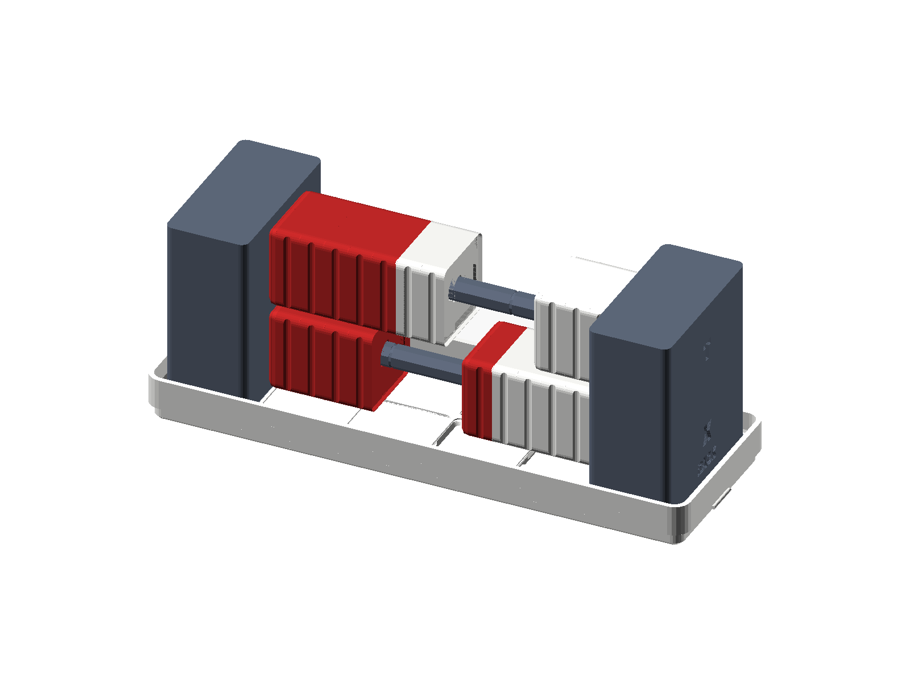
*Figure 2.1: The Number Rack (Rekenrek) model. Intermediate numbers rest on visible horizontal levels just as numbers wait on the operational shelves of the SC-6.*

| Stack Level | Stack Register | What It Does | Where You See It |
|---|---|---|---|
| **Level 4** | **Register T** | **Top Shelf** (Keeps your multiplier locked for skip-counting) | Top line on screen |
| **Level 3** | **Register Z** | **Third Shelf** (Waiting shelf for multi-step problems) | Second line from top |
| **Level 2** | **Register Y** | **Second Shelf** (Waiting partner, held for subtraction or division) | Left column in $Y \mid X$ layout |
| **Level 1** | **Register X** | **Ground Shelf** (Active shelf where you type and see results) | Right column / primary LCD line |

### 2.2.1 The Three Golden Rules of Stack Math

1. **Rule 1: New Numbers Enter at the Ground Shelf (Level $X$).**  
   Whenever you tap digit keys (for example, `[3]`), that number appears on Level $X$. Level $X$ is the active display shelf you see right before your eyes.
2. **Rule 2: Pressing `[ENTER]` Pushes Numbers UP the Stack.**  
   When your first number is entered, tapping `[ENTER]` pushes it up to Level $Y$ (like an elevator rising to the second floor), leaving an identical copy ready on Level $X$ so you can type your next number!
3. **Rule 3: Pressing an Operator Key (`+`, `-`, `×`, `÷`) Drops the Stack Down.**  
   When you tap an operational key such as `[+]`, the upper shelf drops down! The number on Level $Y$ combines with the number on Level $X$, and their combined total remains on the ground shelf ($X$). Level $Y$ is now ready for future numbers.

| Stack Level | Before Pressing `[+]` | Action During `[+]` | After Pressing `[+]` |
| :--- | :---: | :--- | :---: |
| **Level 2 (`Y`)** | `3` | Drops down to combine with Level 1 | `0` |
| **Level 1 (`X`)** | `4` | Receives $3 + 4$ | **`7`** |

### 2.2.2 Automatic Stack Lift Mechanics
One of the most elegant secrets of Stack Math is **automatic stack lift**. When an operation completes and leaves its answer in Register $X$, typing a new number does **NOT** overwrite your result. Instead, the calculator hardware automatically lifts the result up into Register $Y$ to make room for your new input!

> **AUTOMATIC STACK LIFT ON NUMBER ENTRY**
>
> State after 4 [ENTER] 5 [+] -> X = 9. Now, you type 6:
>
> BEFORE typing 6:             DURING typing 6:           AFTER typing 6:  
> T: [0]                     T: [0]                   T: [0]  
> Z: [0]                     Z: [0]                   Z: [0]  
> Y: [0]                     Y: [9]  <-- (Lifts up!)  Y: [9]  
> X: [9]  (prior answer)     X: [   ]                   X: [6]  

### 2.2.3 Two-Number Stack Drop Mechanics & $T$-Register Replication
When any binary (two-number) operation executes (`+`, `-`, `×`, `÷`):
1. The values in $Y$ and $X$ are evaluated: $Y \text{ op } X$.
2. The result is written into $X$.
3. Register $Z$ drops down into Register $Y$.
4. Register $T$ drops down into Register $Z$.
5. **The $T$-Register Invariant:** The value in Register $T$ **duplicates itself**, remaining in Register $T$! 

This top-register replication is what allows the SC-6 to execute infinite skip-counting and constant multiplication without needing dedicated storage registers.

---

## 2.3 Why Combining Numbers IS the Answer (Zero Parentheses!)

<div class="admonition tip">
<p class="admonition-title">The RPN Superpower Rule</p>
<p>
On the StackCalc SC-6, you never wait for an equals sign. The moment you press <code>[+]</code>, <code>[-]</code>, <code>[×]</code>, or <code>[÷]</code>, the numbers on Level 1 ($X$) and Level 2 ($Y$) combine immediately!
</p>
</div>

Watch how fast you can crush a 5th-grade order-of-operations monster without writing down a single scrap-paper note or pressing a single parenthesis key:

$$(15 - 3) \times (4 + 2) \div 6 = 12$$

- **Step 1 (First group):** Tap `15` `[ENTER]` `3` `[-]` $\longrightarrow$ **`12`** is ready!
- **Step 2 (Second group):** Tap `4` `[ENTER]` `2` `[+]` $\longrightarrow$ **`6`** is on Level 1 ($X$), while **`12`** waits safely upstairs on Level 2 ($Y$)!
- **Step 3 (Multiply & Divide):** Tap `[×]` (making `72`), then tap `6` `[÷]` $\longrightarrow$ **`12`**!

Complete verified sequence: `15 [ENTER] 3 [-] 4 [ENTER] 2 [+] [×] 6 [÷]` $\longrightarrow$ **`12`**.

| Keystroke | Register T (Roof Floor) | Register Z (Loft Floor) | Register Y (Mezzanine) | Register X (Ground Flr) |
| :--- | :--- | :--- | :--- | :--- |
| 15 | 0 | 0 | 0 | 15 |
| [ENTER] | 0 | 0 | 15 | 15 |
| 3 | 0 | 0 | 15 | 3 |
| [-] | 0 | 0 | 0 | 12 |
| 4 | 0 | 0 | 12 | 4 |
| [ENTER] | 0 | 12 | 4 | 4 |
| 2 | 0 | 12 | 4 | 2 |
| [+] | 0 | 0 | 12 | 6 |
| [×] | 0 | 0 | 0 | 72 |
| 6 | 0 | 0 | 72 | 6 |
| [÷] | 0 | 0 | 0 | 12 |


### 2.3.1 Algebraic Trap vs. StackCalc Superpower Showdown: Order of Operations

| Challenge / Equation | The Algebraic Calculator Trap (TI-30X / Smartphone) | The StackCalc SC-6 + Manipulative Superpower | Keystroke Reduction | Live Stack Visibility | Pedagogical Breakthrough |
| :--- | :--- | :--- | :---: | :--- | :--- |
| **5th Grade Order of Operations:**<br>$(15 - 3) 	imes (4 + 2) \div 6 = 12$ | `( 1 5 - 3 ) * ( 4 + 2 ) / 6 =`<br>(14 keystrokes).<br>*Trap: Missed or misplaced parenthesis computes $15 - 12 + 0.33 = 3.33$ silently! Intermediate results ($12, 6$) are invisible inside hardware buffers.* | **SC-6 Elevator Stack + Two-Number Fusion:**<br>`15 [ENTER] 3 [-] 4 [ENTER] 2 [+] [×] 6 [÷]`<br>(11 keystrokes).<br>Both intermediate quantities ($12$ in $Y$, $6$ in $X$) are visible simultaneously before multiplying! Zero parentheses. | **21% fewer keystrokes**<br>(11 vs. 14) | **Dual Live Registers:**<br>Register $Y$ holds $12$ while Register $X$ computes $6$; live display proves $(15 - 3) 	imes (4 + 2)$ without scratch paper. | **Cognitive Clarity:**<br>Eliminates parenthesis anxiety and Dijkstra shunting-yard confusion; replaces abstract rules with physical two-number stack fusion. |


### 2.3.2 Algebraic Trap vs. StackCalc Superpower Showdown: Order of Operations

| Challenge / Equation | The Algebraic Calculator Trap (TI-30X / Smartphone) | The StackCalc SC-6 + Manipulative Superpower | Keystroke Reduction | Live Stack Visibility | Pedagogical Breakthrough |
| :--- | :--- | :--- | :---: | :--- | :--- |
| **5th Grade Order of Operations:**<br>$(15 - 3) 	imes (4 + 2) \div 6 = 12$ | `( 1 5 - 3 ) * ( 4 + 2 ) / 6 =`<br>(14 keystrokes).<br>*Trap: Missed or misplaced parenthesis computes $15 - 12 + 0.33 = 3.33$ silently! Intermediate results ($12, 6$) are invisible inside hardware buffers.* | **SC-6 Elevator Stack + Two-Number Fusion:**<br>`15 [ENTER] 3 [-] 4 [ENTER] 2 [+] [×] 6 [÷]`<br>(11 keystrokes).<br>Both intermediate quantities ($12$ in $Y$, $6$ in $X$) are visible simultaneously before multiplying! Zero parentheses. | **21% fewer keystrokes**<br>(11 vs. 14) | **Dual Live Registers:**<br>Register $Y$ holds $12$ while Register $X$ computes $6$; live display proves $(15 - 3) 	imes (4 + 2)$ without scratch paper. | **Cognitive Clarity:**<br>Eliminates parenthesis anxiety and Dijkstra shunting-yard confusion; replaces abstract rules with physical two-number stack fusion. |


<div class="admonition note">
<p class="admonition-title">For Educators &amp; Parents: Cognitive Load Theory &amp; The Operational Equal-Sign Misconception</p>
<p>
In educational cognitive psychology, <strong>Cognitive Load Theory</strong> (pioneered by John Sweller *([Sweller, 1988](sc6/appendix-c-formulas-and-conversions.md#cite-sweller1988))*) explains how human working memory processes novel mathematical information. In children aged 5 to 11, working memory capacity is strictly bounded: as George Miller proved *([Miller, 1956](sc6/appendix-c-formulas-and-conversions.md#cite-miller1956))*, young learners can reliably maintain only three to four discrete mental tokens simultaneously before experiencing cognitive overload.<br><br>
Decades of research in elementary classrooms (Steven Strogatz *([Strogatz, 2012](sc6/appendix-c-formulas-and-conversions.md#cite-strogatz2012))*, Jerome Bruner *([Bruner, 1966](sc6/appendix-c-formulas-and-conversions.md#cite-bruner1966))*, Zoltan Dienes *([Dienes, 1960](sc6/appendix-c-formulas-and-conversions.md#cite-dienes1960))*, and Liping Ma *([Ma, 1999](sc6/appendix-c-formulas-and-conversions.md#cite-ma1999))*) reveal that the equal-sign trap conditions children into treating <code>=</code> as an imperative computation trigger rather than a relational balance. When students use conventional algebraic calculators, they must juggle two competing tasks at once:<br>
1. <strong>The Intrinsic Mathematical Task:</strong> Understanding the physical quantities and relationships of the problem *([Bruner, 1966](sc6/appendix-c-formulas-and-conversions.md#cite-bruner1966))*.<br>
2. <strong>The Extraneous Syntax Task:</strong> Managing operator precedence rules (PEMDAS), inserting nested parentheses, and waiting for an equal sign (<code>=</code>) to trigger hidden evaluation.<br><br>
By eliminating <code>=</code> and parentheses, Reverse Polish Notation (first formalized by Jan Łukasiewicz *([Łukasiewicz, 1924](sc6/appendix-c-formulas-and-conversions.md#cite-lukasiewicz1924))* and analyzed for education by Kathy Hamrick *([Hamrick, 1980](sc6/appendix-c-formulas-and-conversions.md#cite-hamrick1980))*) aligns 100% of the child's working memory with the intrinsic mathematical structure. Every intermediate subtotal remains visible on the physical LCD stack.
</p>
</div>

---

## 2.4 Five Stack Math Super-Moves

Just as a young maker learns to use a hammer, saw, and ruler, you command five foundational **Stack Math Super-Moves**. Each super-move pairs a hands-on block movement with an action on your stack *([Macaulay, 2016](sc6/appendix-c-formulas-and-conversions.md#cite-macaulay2016))*:

### 2.4.1 Super-Move 1: The Make-a-Ten Snap
- **Physical Manipulative:** 3D-Printed Ten-Frame Studio Tray with two-color counters *([Singapore MOE, 2014](sc6/appendix-c-formulas-and-conversions.md#cite-singapore2014))*.
- **The Concept:** When you bridge to 10 before chaining addition (e.g., $8 + 5 = 8 + 2 + 3 = 10 + 3 = 13$), you break numbers apart so they make friendly groups of 10.
- **The Stack Action:** In `[▦]` Ten-Frame mode, you place 8 counters into Frame $Y$. Keying `5` into Frame $X$ and tapping `[+]` causes 2 counters from Frame $X$ to migrate into Frame $Y$, completing the 10-tray with a tactile snap, leaving 3 loose counters on the lower tray ($X = 13$).
- **Why It Matters:** Finger-counting disappears because your hands and eyes experience 10 as an unbreakable structural container *([Dienes, 1960](sc6/appendix-c-formulas-and-conversions.md#cite-dienes1960))*.

### 2.4.2 Super-Move 2: The Elevator Stack Drop
- **Physical Manipulative:** Two-Color Number Rack / Rekenrek Studio.
- **The Concept:** In traditional algebra, intermediate results must be scribbled onto scrap paper or locked behind confusing parentheses `(A - B) × (C + D) ÷ E`.
- **The Stack Action:** As binary operators (`+`, `-`, `×`, `÷`) execute, the upper stack floors drop down like an elevator descending level-by-level ($T \to Z \to Y \to X$). The intermediate value on Mezzanine Floor $Y$ combines with Ground Floor $X$, and whatever was waiting upstairs in Loft Floor $Z$ drops smoothly into $Y$.
- **Why It Matters:** You never lose an intermediate result. Parentheses are completely unnecessary because the physical levels of the stack store intermediate values in plain view.

### 2.4.3 Super-Move 3: The Remainder-You-Can-Hold
- **Physical Manipulative:** Counting Tile Studio Trays & Egg Cartons *([Ma, 1999](sc6/appendix-c-formulas-and-conversions.md#cite-ma1999))*.
- **The Concept:** Dividing 17 cookies among 5 friends yields 3 whole cookies each with 2 leftover cookies. Standard calculators output `3.4`, destroying the physical reality of the leftover cookies.
- **The Stack Action:** Superpower 2 (`[g] [÷R]`) executes integer division in one stroke: Whole Quotient $Q = 3$ appears in Register $X$, while the physical Remainder $R = 2$ rests in Register $Y$. Tapping `[x⇄y]` swaps them back and forth with zero recalculation.
- **Why It Matters:** You hold both answers at once, linking division directly to real-world sharing, packaging, and modular arithmetic.

### 2.4.4 Super-Move 4: The Equal-Fraction Tower Alignment
- **Physical Manipulative:** 84 mm Fraction Studio proportional towers and twin comparator well *([Strogatz, 2012](sc6/appendix-c-formulas-and-conversions.md#cite-strogatz2012))*.
- **The Concept:** Fractions are equivalent when their physical heights match flush at the top rim of the comparator well.
- **The Stack Action:** Keying an unreduced fraction (e.g., `. 12 . 18`) and tapping `[g] [SIMP]` steps through common prime factors one-by-one. The display shows each reduced stage ($12/18 \to 6/9 \to 2/3$) until flashing `LOWEST TERMS`.
- **Why It Matters:** You see fraction reduction not as an arbitrary trick, but as finding the tallest block that aligns flush in the comparator well.

### 2.4.5 Super-Move 5: The Skip-Counting Ladder
- **Physical Manipulative:** 144-Tile Four-Color Array Studio *([Gauss, 1809](sc6/appendix-c-formulas-and-conversions.md#cite-gauss1809))*.
- **The Concept:** Multiplication is repeated equal-group accumulation.
- **The Stack Action:** Superpower 1 (`[g] [REP]`) seeds all four stack registers ($T, Z, Y, X$) with the step increment. Because Register $T$ automatically duplicates its value downward upon every binary drop, rhythmic taps of `[+]` climb the times-table ladder indefinitely ($7 \to 14 \to 21 \to 28 \dots$).
- **Why It Matters:** Times tables transform from rote anxiety into a rhythmic motor cadence.

---

## 2.5 Horizontal $Y \mid X$ Split Screen vs. Vertical Stack

When you first learn mathematics in elementary school, you learn to read and write equations from left to right ($A \text{ op } B = C$). Traditional RPN calculators display registers vertically ($Y$ above $X$), which can feel upside-down at first.

The SC-6 graphic LCD introduces the **Horizontal $Y \mid X$ Split Screen Layout**:

**↰ ↱ FRAC                   Y                X              [BATTERY]**

| Left Column (`Y` — Waiting Number) | Center Divider | Right Column (`X` — Active Number) |
| :---: | :---: | :---: |
| **`12`** | Vertical Split Rule | **`4`** |

### 2.5.1 The Enter-Slide Animation
1. **Typing Your First Number:** When you key `12`, it appears in the **Right ($X$)** column.
2. **Pressing `[ENTER]`:** The digits `12` visually slide smoothly across the LCD from the right column into the **Left ($Y$)** column. You see: *"My 12 has moved into position on the left, waiting for math!"*
3. **Typing Your Second Number:** When you key `4`, it enters the **Right ($X$)** column. The display clearly presents `Y = 12` and `X = 4`.
4. **Pressing an Operator (`[-]` or `[÷]`):**
   - The operator symbol briefly flashes in the center vertical divider line.
   - The calculator evaluates $Y \text{ op } X$ left-to-right ($12 - 4 = 8$ or $12 \div 4 = 3$).
   - The result appears in the right column ($X$), while the stack drops.

### 2.5.2 System Flag 5: Dual Stack vs. Single Stack Mode
Controlled via `[g] [FLAGS]`, Flag 5 configures the display layout to match how you like to see your numbers:
- **Flag 5 = 0 (Default — Dual Stack $Y \mid X$):** Displays both $Y$ (left) and $X$ (right) columns simultaneously. Ideal for developing spatial RPN fluency.
- **Flag 5 = 1 (Single Stack $X$ Only):** Centers a single large number across the full width of the screen. Ideal when you want absolute visual simplicity with giant bold numbers. In single-stack mode, `[ENTER]` pushes your number into $Y$ in the background stack while $X$ remains centered.

---

## 2.6 Configurable Stack Depths: `2-LV`, `4-LV`, and `8-LV`

To eliminate cognitive friction across grade levels, the SC-6 features three user-selectable operational stack depths:

> **CONFIGURABLE STACK DEPTHS**
>
> 1. 2-LEVEL STACK (2-LV):
> • Registers: Y (Held/Constant) and X (Active Input).
> • Ideal for: Grades K–1 single-step addition/subtraction, step counters
> (1 [ENTER] 1 [+]), and Ten-Frame visual sandboxes.
> 2. 4-LEVEL STACK (4-LV):
> • Registers: T (Roof), Z (Loft), Y (Mezzanine), X (Ground).
> • Ideal for: Grades 2–5 standard elementary mathematics, multi-step
> word problems, long division quotient/remainder, and fraction work.
> 3. 8-LEVEL STACK (8-LV):
> • Registers: 8 full vertical registers (R7 down to R0).
> • Ideal for: Grade 6 Pre-Algebra, rapid mental math sprints,
> and multi-parenthesis equation evaluations without memory variables.

### 2.6.1 The Step-Counter Dynamics: 2-Stack vs. 4-Stack
A classic elementary discovery exercise is building a step counter: tapping `1 [ENTER] 1 [+]` and repeatedly pressing `[+]` to count $2, 3, 4, 5 \dots$

In **4-Stack Mode (`4-LV`)**, the stack drops $Z \to Y$. Since $Z$ and $T$ start at $0$, subsequent taps of `[+]` add $0$ unless Superpower 1 (`[g] [REP]`) was used to replicate the constant across all registers.

In **2-Stack Mode (`2-LV`)**, however, Register $Y$ acts as the top register ($T$). When `+` executes, $Y$ automatically preserves its constant ($1.0$):
`1 [ENTER] 1 [+]` $\implies \mathbf{2}$, `[+]` $\implies \mathbf{3}$, `[+]` $\implies \mathbf{4}$, `[+]` $\implies \mathbf{5}$

---

## 2.7 Moving Numbers Around on Your Stack: `[x⇄y]`, `[f] [R↓]`, `[g] [REP]`, `[f] [LASTX]`

The SC-6 keypad provides dedicated physical keys to move and manage numbers on your stack:

| Keystroke | Operation | Stack Register Effect |
|---|---|---|
| `[x⇄y]` | **Swap $X$ and $Y$** | Exchanges the active input and held number ($X \leftrightarrow Y$). Instantly corrects reversed subtraction or division. |
| `[f] [R↓]` | **Roll Down** | Rotates the 4-level stack downward in a carousel: $X \to T,\; T \to Z,\; Z \to Y,\; Y \to X$. |
| `[g] [REP]` | **Repeat Operation** | Repeats the last two-number arithmetic step for rhythmic skip-counting and constant scaling. |
| `[f] [LASTX]` | **Recover Prior Number** | Recalls the previous $X$ value before the last operation for self-checking inverse verification. |
| `[g] [SHOW]` | **Full Significant Digits Reveal** | Momentarily displays all internal digits of Register $X$. |

---

## 2.8 Story-Driven Problem Expeditions (40 Foundational Scenarios)

Rather than facing disconnected lists of drill problems, you embark on four cohesive mathematical missions. Each expedition grounds arithmetic in a tangible, real-world narrative where intermediate calculations matter and numbers flow naturally through the stack.

<div class="admonition tip">
<p class="admonition-title">Hands-On Studio Proof: Blocks &rarr; Calculator</p>
<p>
<strong>Step 1 (Physical Concrete Intuition):</strong> Build two physical tile towers from your manipulative studio: a red tower of 5 cubes and a green tower of 3 cubes. Place them side-by-side on your desk. Slide the 3-cube tower directly on top of the 5-cube tower into a single combined tower of 8 cubes.<br>
<strong>Step 2 (The Representational Bridge):</strong> Look at the SC-6 display. When you enter <code>5 [ENTER] 3</code>, the 5 sits on Floor 2 (Register Y) and the 3 waits on Floor 1 (Register X). The screen directly mirrors your two tabletop towers!<br>
<strong>Step 3 (Scaling on the Calculator):</strong> Press <code>[+]</code>. The two numbers fuse into <code>8</code>. Now scale it up to building a skyscraper: type <code>500 [ENTER] 300 [+]</code> &rarr; <code>800</code>! The physical intuition of sliding blocks scales instantly to thousands and millions without pen or paper.
</p>
</div>

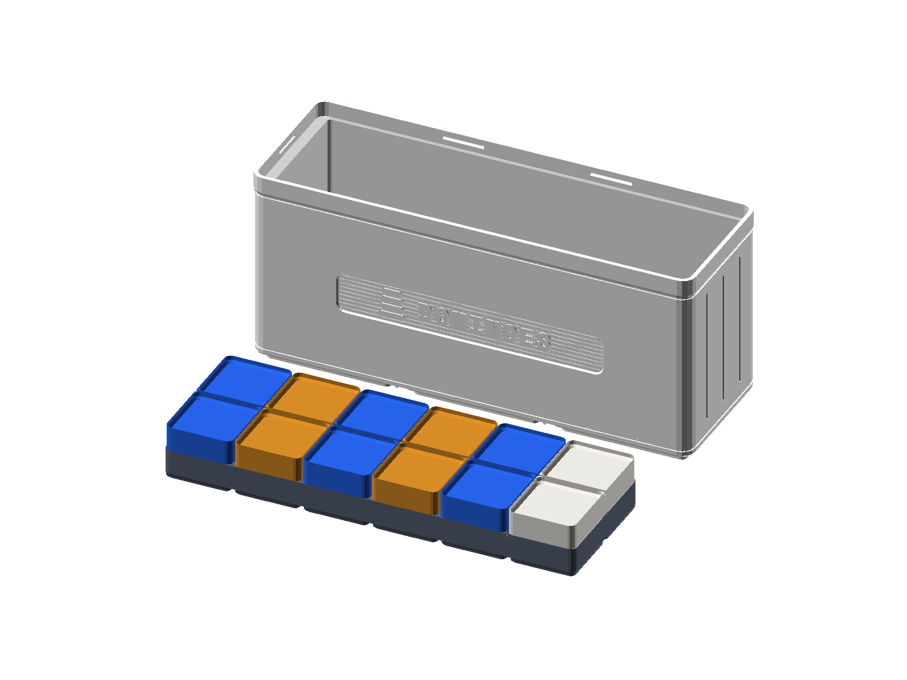
*Figure 2.2: The Math Dominoes Studio. Domino pips let you see groups at a glance and build pairs that mirror RPN two-number operations.*

### 2.8.1 Expedition 1: The School Playground Construction Crew (Problems 01–10)
*Mission Briefing:* The local elementary school is constructing a brand-new adventure playground. As the project engineers, your crew must lay border timbers, pour sandbox gravel, measure stepping stone distances, and ensure safety clearances using the SC-6 stack.

### 2.8.2 Problem 01:
- **Playground Construction Mission:** Your playground construction crew is laying interlocking rubber safety tiles under the two-bay swing set. The crew unloads 5 blue safety tiles in the morning, and the supply truck delivers 3 more green safety tiles in the afternoon. How many total safety tiles are ready to lay down?
- **Concrete Stage:** Place 5 blue counting tiles on the left side of your desk, and 3 green tiles on the right. Slide them together into one combined row of 8 tiles.
- **Representational Stage:** The horizontal display shows `Y = 5` (left) and `X = 3` (right) before combining.
- **Abstract RPN Keystrokes:** `5 [ENTER] 3 [+]` $\rightarrow$ **`8`**
- **Stack Flow:** Tap `5 [ENTER] 3 [+]` -> (T=0, Z=0, Y=0, X=8) to fuse both groups into 8 on the ground floor.
- **Diagnostic Checkpoint:** Did you see $Y = 5$ on the left and $X = 3$ on the right before pressing `[+]`? If your screen shows $53$, you forgot to press `[ENTER]` between the digits!
---

### 2.8.3 Problem 02:
- **Playground Construction Mission:** Your crew needs to anchor 9 sturdy cedar fence posts along the adventure playground perimeter. Before lunch, your crew finishes concreting 4 posts firmly into the ground. How many fence posts still need to be anchored?
- **Concrete Stage:** Align 9 counting tiles in a row representing the fence line. Detach 4 tiles from the end for the completed posts. Count the 5 remaining tiles.
- **Representational Stage:** Left column holds starting number $9$; right column holds second number $4$.
- **Abstract RPN Keystrokes:** `9 [ENTER] 4 [-]` $\rightarrow$ **`5`**
- **Stack Flow:** Tap `9 [ENTER] 4 [-]` -> (T=0, Z=0, Y=0, X=5) to leave 5 unbolted posts on the ground floor.
- **Diagnostic Checkpoint:** If your screen displays $-5$, you entered the second number first (`4 [ENTER] 9 [-]`). Do not re-type! Simply tap `[x⇄y] [-]` to reverse and correct the calculation!
---

### 2.8.4 Problem 03:
- **Playground Construction Mission:** To fill the giant wooden sandbox, your crew wheels loads of washed pea gravel from the supply depot: 4 wheelbarrows on Monday, 5 on Tuesday, and 6 on Wednesday. How many total wheelbarrows of gravel did you pour into the sandbox?
- **Concrete Stage:** Stack 4 unit cubes on your desk, add 5 cubes, and then add 6 more cubes to form a single continuous tower of 15 cubes.
- **Abstract RPN Keystrokes:** `4 [ENTER] 5 [+] 6 [+]` $\rightarrow$ **`15`**
- **Stack Flow:** Tap `4 [ENTER] 5 [+] 6 [+]` -> (T=0, Z=0, Y=0, X=15). The intermediate sum $9$ automatically lifts to $Y$ when you key $6$, delivering $15$ with zero extra `[ENTER]` strokes.
---

### 2.8.5 Problem 04:
- **Playground Construction Mission:** Your crew is installing round sensory stepping stones along the winding garden path. You lay down 8 smooth slate stones in the morning, and the supply truck brings 7 granite stones in the afternoon. How many total stepping stones lead to the climbing tower?
- **Concrete Stage:** Place 8 counters into your first Ten-Frame tray. Take 2 counters from the group of 7 to fill the first tray to a complete 10; the remaining 5 counters spill into the second tray. Total: 1 full ten and 5 ones ($15$).
- **Abstract RPN Keystrokes:** `8 [ENTER] 7 [+]` $\rightarrow$ **`15`**
- **Stack Flow:** Tap `8 [ENTER] 7 [+]` -> (T=0, Z=0, Y=0, X=15), bridging the decade seamlessly to leave 15 stepping stones.
---

### 2.8.6 Problem 05:
- **Playground Construction Mission:** A heavy hardware box holds a bundle of 10 galvanized steel crossbeam bolts for the jungle gym frame. Your crew bolts 6 of them through the climbing net uprights. How many bolts remain in the box for the balance-beam brackets?
- **Concrete Stage:** Fill a complete Ten-Frame tray with 10 counters. Remove 6 counters. Exactly 4 counters remain in the tray.
- **Abstract RPN Keystrokes:** `10 [ENTER] 6 [-]` $\rightarrow$ **`4`**
- **Stack Flow:** Tap `10 [ENTER] 6 [-]` -> (T=0, Z=0, Y=0, X=4), leaving 4 bolts ready in Register $X$.
---

### 2.8.7 Problem 06:
- **Playground Construction Mission:** Your crew stakes 7 bright orange survey flags along the safety perimeter of the zip-line runway. The ground inspector checks the layout and confirms that zero additional flags are needed ($+0$). How many flags remain planted along the runway?
- **Concrete Stage:** Place 7 counting tiles on your desk. Add zero tiles. You still have 7 tiles.
- **Abstract RPN Keystrokes:** `7 [ENTER] 0 [+]` $\rightarrow$ **`7`**
- **Stack Flow:** Tap `7 [ENTER] 0 [+]` -> (T=0, Z=0, Y=0, X=7), proving identity element $a + 0 = a$.
---

### 2.8.8 Problem 07:
- **Playground Construction Mission:** The crew equipment chest has 8 safety climbing carabiners hanging from the inspection rack. During morning foundation prep, zero carabiners are taken out because the climbing tower hasn't arrived yet. How many carabiners stay clipped to the rack?
- **Concrete Stage:** Set out 8 counting tiles. Remove zero tiles. Exactly 8 tiles remain.
- **Abstract RPN Keystrokes:** `8 [ENTER] 0 [-]` $\rightarrow$ **`8`**
- **Stack Flow:** Tap `8 [ENTER] 0 [-]` -> (T=0, Z=0, Y=0, X=8), verifying $a - 0 = a$.
---

### 2.8.9 Problem 08:
- **Playground Construction Mission:** 6 heavy galvanized link chains are uncoiled on the grass for the three playground tire swings. Your crew bolts all 6 chains to the overhead swing hanger hooks. How many uninstalled chains remain on the grass?
- **Concrete Stage:** Place 6 counting tiles on the desk. Remove all 6 tiles. Zero tiles remain ($6 - 6 = 0$).
- **Abstract RPN Keystrokes:** `6 [ENTER] 6 [-]` $\rightarrow$ **`0`**
- **Stack Flow:** Tap `6 [ENTER] 6 [-]` -> (T=0, Z=0, Y=0, X=0), clearing inventory to zero.
---

### 2.8.10 Problem 09:
- **Playground Construction Mission:** Your construction crew paves the safety perimeter around the spiral slide using 23 heavy interlocking rubber pavers, and lays another 14 pavers around the low balance-beam zone. How many total border pavers did your crew install?
- **Concrete Stage:** Build 23 using 2 ten-sticks and 3 unit cubes. Build 14 using 1 ten-stick and 4 unit cubes. Combine tens ($2+1=3$) and ones ($3+4=7$) to find 37.
- **Abstract RPN Keystrokes:** `23 [ENTER] 14 [+]` $\rightarrow$ **`37`**
- **Stack Flow:** Tap `23 [ENTER] 14 [+]` -> (T=0, Z=0, Y=0, X=37), calculating 37 installed pavers in one fluent motion.
---

### 2.8.11 Problem 10:
- **Playground Construction Mission:** Your crew spreads soft cedar playground woodchips beneath the monkey bars to ensure a deep shock-absorbing cushion. The first wheelbarrow delivers $47\text{ kg}$ of woodchips, and the second wheelbarrow brings $36\text{ kg}$. What is the total mass of woodchips spread beneath the bars?
- **Concrete Stage:** Represent 47 with 4 tens and 7 ones. Represent 36 with 3 tens and 6 ones. Combine ones ($7 + 6 = 13$, regroup as 1 ten and 3 ones), then add tens ($4 + 3 + 1 = 8$ tens). Total: 8 tens and 3 ones ($83$).
- **Abstract RPN Keystrokes:** `47 [ENTER] 36 [+]` $\rightarrow$ **`83`**
- **4-Register Stack Trace Table:**

| Keystroke | Register T | Register Z | Register Y | Register X |
| :--- | :--- | :--- | :--- | :--- |
| 47 | 0 | 0 | 0 | 47 |
| [ENTER] | 0 | 0 | 47 | 47 |
| 36 | 0 | 0 | 47 | 36 |
| [+] | 0 | 0 | 0 | 83 |
| [f] [LASTX] | 0 | 0 | 83 | 36 |
| [-] | 0 | 0 | 0 | 47 |
- **Self-Check Invariant:** Rows 5 and 6 demonstrate Superpower 4 (`[f] [LASTX]`), verifying $83 - 36 = 47$ instantly.
---

### 2.8.12 Expedition 2: The High-Rise Elevator Express (Problems 11–20)
*Mission Briefing:* You are the logistics controller for a bustling 20-story urban high-rise. Your mission is to track passenger loads rising between floors, monitor freight delivery weights, and calculate multi-floor transfers using the SC-6 operational stack.

### 2.8.13 Problem 11:
- **High-Rise Elevator Mission:** A freight elevator begins at the ground floor loaded with $83\text{ kg}$ of construction fixtures. At Floor 4, the logistics crew unloads $36\text{ kg}$ of steel brackets. How many kilograms of cargo remain inside the freight cab?
- **Concrete Stage (Counting Tile Studio):** Lay out 8 ten-rods and 3 unit cubes ($83$). To subtract 36, trade 1 ten-rod for 10 units (leaving 7 tens and 13 units). Remove 3 tens and 6 units to leave 4 tens and 7 units ($47$).
- **Abstract RPN Keystrokes:** `83 [ENTER] 36 [-]` $\rightarrow$ **`47`**
- **Stack Flow:** Tap `83 [ENTER] 36 [-]` -> (T=0, Z=0, Y=0, X=47) to leave 47 kg of remaining fixtures.
---

### 2.8.14 Problem 12:
- **High-Rise Elevator Mission:** An express elevator cab carries 16 convention delegates from the concourse. At the mezzanine level, an equal delegation of 16 more delegates steps aboard, doubling the passenger count. How many delegates are now riding the elevator?
- **Concrete Stage:** Stack two identical 16-tile towers from your counting tile studio, showing $16 + 16 = 32$.
- **RPN Keystrokes:** `16 [ENTER] [+]` $\rightarrow$ **`32`**
- **Stack Flow:** Tap `16 [ENTER] [+]` -> (T=0, Z=0, Y=0, X=32). Pressing `[ENTER]` duplicates 16 into both shelves, and `[+]` doubles it instantly without re-typing!
---

### 2.8.15 Problem 13:
- **High-Rise Elevator Mission:** An automated smart-lift dispatch computer doubles its active corridor scans on each floor rise. Starting with $2$ baseline sensor beams at Floor 1, determine the total active sensor scans by Floor 5.
- **Concrete Stage:** Place 2 tiles on the table. Double the pile to 4, then 8, then 16, then 32, feeling exponential growth in your hands.
- **RPN Keystrokes:** `2 [ENTER] [+] [ENTER] [+] [ENTER] [+] [ENTER] [+]` $\rightarrow$ **`32`**
- **4-Register Stack Trace Table:**

| Keystroke | Register T | Register Z | Register Y | Register X |
| :--- | :--- | :--- | :--- | :--- |
| 2 | 0 | 0 | 0 | 2 |
| [ENTER] [+] | 0 | 0 | 0 | 4 |
| [ENTER] [+] | 0 | 0 | 0 | 8 |
| [ENTER] [+] | 0 | 0 | 0 | 16 |
| [ENTER] [+] | 0 | 0 | 0 | 32 |
---

### 2.8.16 Problem 14:
- **High-Rise Elevator Mission:** During morning rush hour, an express elevator boards 15 passengers on the subway concourse, 24 passengers on the ground plaza, and 31 passengers at the parking deck. How many total passengers are transported upward?
- **Concrete Stage:** Form three separate tile trains of 15, 24, and 31 tiles. Slide them end-to-end to verify a combined length of 70 tiles.
- **RPN Keystrokes:** `15 [ENTER] 24 [+] 31 [+]` $\rightarrow$ **`70`**
- **4-Register Stack Trace Table:**

| Keystroke | Register T | Register Z | Register Y | Register X |
| :--- | :--- | :--- | :--- | :--- |
| 15 | 0 | 0 | 0 | 15 |
| [ENTER] | 0 | 0 | 15 | 15 |
| 24 | 0 | 0 | 15 | 24 |
| [+] | 0 | 0 | 0 | 39 |
| 31 | 0 | 0 | 39 | 31 |
| [+] | 0 | 0 | 0 | 70 |
---

### 2.8.17 Problem 15:
- **High-Rise Elevator Mission:** The skyscraper's observation deck elevator has a maximum permitted safety capacity of 100 people. If an incoming tour group consists of 43 visitors, how many additional visitors can board before reaching capacity?
- **Concrete Stage:** Model 100 with a ten-by-ten tile flat. Remove 4 rows of ten and 3 individual tiles to reveal 5 tens and 7 units ($57$).
- **RPN Keystrokes:** `100 [ENTER] 43 [-]` $\rightarrow$ **`57`**
- **Stack Flow:** Tap `100 [ENTER] 43 [-]` -> (T=0, Z=0, Y=0, X=57), confirming 57 open visitor spots.
---

### 2.8.18 Problem 16:
- **High-Rise Elevator Mission:** The elevator safety inspector tests the floor indicator sensors by stepping upward in 10-floor intervals starting from the basement lobby (Floor 0) up to Floor 50 in 2-stack mode (`2-LV`).
- **Concrete Stage:** Line up 5 ten-rods end-to-end, counting rhythmically: 10, 20, 30, 40, 50.
- **RPN Keystrokes:** `10 [ENTER] 0 [+] [+] [+] [+] [+]` $\rightarrow$ **`10`**
- **Stack Flow:** In 2-Stack mode, Register $Y$ acts as the constant holder. Key in `10 [ENTER] 0 [+]` -> (T=0, Z=0, Y=0, X=10); subsequent taps of `[+]` climb rhythmically through Floors 20, 30, 40, and 50.
---

### 2.8.19 Problem 17:
- **High-Rise Elevator Mission:** The skyscraper's parking garage has 4 levels, each equipped with 6 electric vehicle elevator transfer bays. How many transfer bays are available in total?
- **Concrete Stage:** Construct a $4 \times 6$ array using 24 counting tiles from the manipulative studio.
- **RPN Keystrokes:** `4 [ENTER] 6 [×]` $\rightarrow$ **`24`**
- **Stack Flow:** Tap `4 [ENTER] 6 [×]` -> (T=0, Z=0, Y=0, X=24), calculating 24 total transfer bays.
---

### 2.8.20 Problem 18:
- **High-Rise Elevator Mission:** The exterior window washing elevator scaffold cleans 7 structural window bays on each of 8 executive floors. How many total window panes are washed on this run?
- **Concrete Stage:** Build a $7 \times 8$ grid using counting studio tiles, rotating the tray $90^\circ$ to see that $7 \times 8 = 8 \times 7 = 56$.
- **RPN Keystrokes:** `7 [ENTER] 8 [×]` $\rightarrow$ **`56`**
- **Stack Flow:** Tap `7 [ENTER] 8 [×]` -> (T=0, Z=0, Y=0, X=56), evaluating 56 window panes.
---

### 2.8.21 Problem 19:
- **High-Rise Elevator Mission:** A security supervisor delivers 24 handheld communication radios equally among 4 elevator lobby stations. How many radios are allocated to each station?
- **Concrete Stage:** Deal out 24 counting tiles into 4 equal groups, confirming 6 tiles in each group.
- **RPN Keystrokes:** `24 [ENTER] 4 [÷]` $\rightarrow$ **`6`**
- **Stack Flow:** Tap `24 [ENTER] 4 [÷]` -> (T=0, Z=0, Y=0, X=6), allocating 6 radios per station.
---

### 2.8.22 Problem 20:
- **High-Rise Elevator Mission:** An express shuttle elevator transports 56 security staff members arriving for an international summit, distributing them equally across 7 security checkpoint floors. How many officers are stationed on each floor?
- **Concrete Stage:** Separate a group of 56 counting tiles into 7 equal rows, counting 8 tiles per row.
- **RPN Keystrokes:** `56 [ENTER] 7 [÷]` $\rightarrow$ **`8`**
- **Stack Flow:** Tap `56 [ENTER] 7 [÷]` -> (T=0, Z=0, Y=0, X=8), placing 8 officers per floor.
---

### 2.8.23 Expedition 3: The Saturday Supermarket Shopping Spree (Problems 21–30)
*Mission Briefing:* Armed with a weekly household grocery budget, you navigate the supermarket aisles. You must calculate bulk food packaging remainders, compute multi-item basket discounts, verify sales receipts, and check coin change without scratch paper.

### 2.8.24 Problem 21:
- **Supermarket Shopping Mission:** The bakery aisle manager packages 17 warm sourdough dinner rolls into bags of 5 rolls. How many bags are filled completely, and how many loose rolls remain?
- **Concrete Stage:** Distribute 17 counting tiles into groups of 5. Count 3 full groups and 2 loose tiles.
- **Abstract RPN Keystrokes:** `17 [ENTER] 5 [g] [÷R]` $\rightarrow$ **`3`**
- **4-Register Stack Trace Table:**

| Keystroke | Register T | Register Z | Register Y | Register X |
| :--- | :--- | :--- | :--- | :--- |
| 17 | 0 | 0 | 0 | 17 |
| [ENTER] | 0 | 0 | 17 | 17 |
| 5 | 0 | 0 | 17 | 5 |
| [g] [÷R] | 0 | 0 | 2 | 3 |
| [x⇄y] | 0 | 0 | 3 | 2 |
- **Diagnostic Checkpoint:** Register $X$ shows Quotient $Q = 3$ full bags. Register $Y$ holds Remainder $R = 2$ loose rolls. Press `[x⇄y]` to inspect remainder and swap back. Total bags needed to pack all rolls: $3 + 1 = 4\text{ bags}$.
---

### 2.8.25 Problem 22:
- **Supermarket Shopping Mission:** In the dairy aisle, a wholesale crate of 125 farm-fresh eggs is sorted into specialty cartons holding 8 eggs each. How many cartons are filled completely, and how many eggs remain?
- **Concrete Stage:** Group base-10 counting blocks to represent 125 divided by 8, observing 15 full groups of 8 and 5 remaining units.
- **RPN Keystrokes:** `125 [ENTER] 8 [g] [÷R]` $\rightarrow$ **`15`**
- **Stack Flow:** Tap `125 [ENTER] 8 [g] [÷R]` -> (T=0, Z=0, Y=5, X=15), revealing 15 full cartons in Register $X$ and 5 leftover eggs in Register $Y$.
---

### 2.8.26 Problem 23:
- **Supermarket Shopping Mission:** The store manager orders 15 wholesale crates of Valencia oranges at $\$8.00$ per crate ($15 \times 8 = 120$). Verify the total invoice using Superpower 4 (`[f] [LASTX]`) without re-typing.
- **Concrete Stage:** Model 15 rows of 8 tiles, then divide the total by 8 to restore the original 15 rows.
- **RPN Keystrokes:** `15 [ENTER] 8 [×] [f] [LASTX] [÷]` $\rightarrow$ **`15`**
- **4-Register Stack Trace Table:**

| Keystroke | Register T | Register Z | Register Y | Register X |
| :--- | :--- | :--- | :--- | :--- |
| 15 | 0 | 0 | 0 | 15 |
| [ENTER] | 0 | 0 | 15 | 15 |
| 8 | 0 | 0 | 15 | 8 |
| [×] | 0 | 0 | 0 | 120 |
| [f] [LASTX] | 0 | 0 | 120 | 8 |
| [÷] | 0 | 0 | 0 | 15 |
---

### 2.8.27 Problem 24:
- **Supermarket Shopping Mission:** A shopper calculates unit pricing for a 24-ounce container of Greek yogurt divided into 8 snack portions ($24 \div 8 = 3$), but accidentally typed 8 first (`8 [ENTER] 24`).
- **Remediation Keystrokes:** `8 [ENTER] 24 [x⇄y] [÷]` $\rightarrow$ **`3`**
- **4-Register Stack Trace Table:**

| Keystroke | Register T | Register Z | Register Y | Register X |
| :--- | :--- | :--- | :--- | :--- |
| 8 | 0 | 0 | 0 | 8 |
| [ENTER] | 0 | 0 | 8 | 8 |
| 24 | 0 | 0 | 8 | 24 |
| [x⇄y] | 0 | 0 | 24 | 8 |
| [÷] | 0 | 0 | 0 | 3 |
- **Diagnostic Checkpoint:** Never start over when you type numbers in the wrong order! Just tap the swap key [x⇄y] to put them in the right seats, then divide!
---

### 2.8.28 Problem 25:
- **Supermarket Shopping Mission:** A shopper enters the checkout lane with 14 items in their cart. They add 5 items from the impulse rack, but decide to put back 3 items. How many items are scanned at checkout?
- **Concrete Stage:** Place 14 counting tiles on the desk. Add 5 more tiles, then remove 3 tiles.
- **RPN Keystrokes:** `14 [ENTER] 5 [+] 3 [-]` $\rightarrow$ **`16`**
- **Stack Flow:** Tap `14 [ENTER] 5 [+] 3 [-]` -> (T=0, Z=0, Y=0, X=16). The subtotal 19 auto-lifts when you type 3, arriving at 16 scanned items seamlessly.
---

### 2.8.29 Problem 26:
- **Supermarket Shopping Mission:** At the bakery counter, a customer buys 3 artisan baguettes at $\$4.00$ each and 2 specialty cheese rounds at $\$5.00$ each. Find the total basket cost.
- **Concrete Stage:** Build two tile groups: one $3 \times 4$ array (12) and one $2 \times 5$ array (10). Slide them together to count 22 tiles.
- **RPN Keystrokes:** `3 [ENTER] 4 [×] 2 [ENTER] 5 [×] [+]` $\rightarrow$ **`22`**
- **4-Register Stack Trace Table:**

| Keystroke | Register T | Register Z | Register Y | Register X |
| :--- | :--- | :--- | :--- | :--- |
| 3 | 0 | 0 | 0 | 3 |
| [ENTER] | 0 | 0 | 3 | 3 |
| 4 | 0 | 0 | 3 | 4 |
| [×] | 0 | 0 | 0 | 12 |
| 2 | 0 | 0 | 12 | 2 |
| [ENTER] | 0 | 12 | 2 | 2 |
| 5 | 0 | 12 | 2 | 5 |
| [×] | 0 | 0 | 12 | 10 |
| [+] | 0 | 0 | 0 | 22 |
- **Stack Elegance:** Notice in row 8: Register $Y$ held the first subtotal ($12$) while Register $X$ computed the second subtotal ($10$). Pressing `[+]` combined them cleanly without writing down anything on paper!
---

### 2.8.30 Problem 27:
- **Supermarket Shopping Mission:** The store manager arranges a rectangular organic fruit display table that is 12 feet long and 8 feet wide. What is the total length of decorative bumper railing needed to surround the table?
- **Concrete Stage:** Construct a 12 by 8 rectangle with grid tiles, calculating $2 \times (\text{length} + \text{width})$.
- **RPN Keystrokes:** `12 [ENTER] 8 [+] 2 [×]` $\rightarrow$ **`40`**
- **Stack Flow:** Tap `12 [ENTER] 8 [+] 2 [×]` -> (T=0, Z=0, Y=0, X=40), calculating 40 feet of bumper railing without writing down semi-perimeter 20.
---

### 2.8.31 Problem 28:
- **Supermarket Shopping Mission:** A triangular promotional sign hanging over the bakery aisle has a base of 10 cm and a height of 6 cm. What is the surface area of the promotional sign?
- **Concrete Stage:** Form a $10 \times 6$ array of 60 tiles, then divide it into two equal halves of 30 tiles.
- **RPN Keystrokes:** `10 [ENTER] 6 [×] 2 [÷]` $\rightarrow$ **`30`**
- **Stack Flow:** Tap `10 [ENTER] 6 [×] 2 [÷]` -> (T=0, Z=0, Y=0, X=30), evaluating the $30\text{ cm}^2$ sign area cleanly.
---

### 2.8.32 Problem 29:
- **Supermarket Shopping Mission:** A customer brings a $\$50$ cash grocery budget to the supermarket. They spend $\$18$ on fresh produce and $\$12$ on dairy items. How much grocery cash remains in their wallet?
- **Concrete Stage:** Start with 5 ten-rods ($50$). Remove 1 ten and 8 units ($18$, leaving 32), then remove 1 ten and 2 units ($12$, leaving 20).
- **RPN Keystrokes:** `50 [ENTER] 18 [-] 12 [-]` $\rightarrow$ **`20`**
- **Stack Flow:** Tap `50 [ENTER] 18 [-] 12 [-]` -> (T=0, Z=0, Y=0, X=20), leaving $\$20.00$ cash in your wallet.
---

### 2.8.33 Problem 30:
- **Supermarket Shopping Mission:** Four family members purchase a bulk deli sandwich platter costing $\$17.50$. Using Superpower 2 (`[g] [÷R]`), determine how many whole dollars each person contributes and the remaining loose coin change.
- **Concrete Stage:** Count 17 dollar tiles and two quarter coins. Distribute 4 dollar tiles to each of 4 people, leaving $1.50 in change.
- **RPN Keystrokes:** `17.50 [ENTER] 4 [g] [÷R]` $\rightarrow$ **`4`**
- **Stack Flow:** Tap `17.50 [ENTER] 4 [g] [÷R]` -> (T=0, Z=0, Y=1.5, X=4), giving $X = \$4.00$ whole dollars per person and $Y = \$1.50$ remaining change.
---

### 2.8.34 Expedition 4: The Junior Math Olympiad Sprint (Problems 31–40)
*Mission Briefing:* The state tournament clock is running! In this high-speed mental sprint, you solve chained order-of-operations expressions, evaluate multi-bracket terms with zero parentheses, and navigate radical equations using pure RPN stack elegance.

### 2.8.35 Problem 31:
- **Word Problem:** Load values 10, 20, 30, 40 into the stack. Rotate them down to inspect each register.
- **RPN Keystrokes:** `10 [ENTER] 20 [ENTER] 30 [ENTER] 40 [f] [R↓]` $\rightarrow$ **`30`**
- **4-Register Stack Trace Table:**

| Keystroke | Register T | Register Z | Register Y | Register X |
| :--- | :--- | :--- | :--- | :--- |
| 10 | 0 | 0 | 0 | 10 |
| [ENTER] | 0 | 0 | 10 | 10 |
| 20 | 0 | 0 | 10 | 20 |
| [ENTER] | 0 | 10 | 20 | 20 |
| 30 | 0 | 10 | 20 | 30 |
| [ENTER] | 10 | 20 | 30 | 30 |
| 40 | 10 | 20 | 30 | 40 |
| [f] [R↓] | 40 | 10 | 20 | 30 |
| [f] [R↓] | 30 | 40 | 10 | 20 |
| [f] [R↓] | 20 | 30 | 40 | 10 |
| [f] [R↓] | 10 | 20 | 30 | 40 |
- **Carousel Property:** 4 presses of `[f] [R↓]` restore the exact original stack!
---

### 2.8.36 Problem 32:
- **Word Problem:** Bring the top roof-garden register ($T = 10$) down into the active Ground Floor ($X$) by rotating the 4-level carousel three steps (`[f] [R↓] [f] [R↓] [f] [R↓]`).
- **RPN Keystrokes:** `10 [ENTER] 20 [ENTER] 30 [ENTER] 40 [f] [R↓] [f] [R↓] [f] [R↓]` $\rightarrow$ **`10`**
- **Stack Flow:** Load registers and rotate: tap `10 [ENTER] 20 [ENTER] 30 [ENTER] 40 [f] [R↓] [f] [R↓] [f] [R↓]` -> (T=20, Z=30, Y=40, X=10), bringing 10 into Register $X$.
---

### 2.8.37 Problem 33:
- **Word Problem:** 5th-grade math sprint order-of-operations challenge.
- **RPN Keystrokes:** `15 [ENTER] 3 [-] 4 [ENTER] 2 [+] [×] 6 [÷]` $\rightarrow$ **`12`**
- **4-Register Stack Trace Table:**

| Keystroke | Register T | Register Z | Register Y | Register X |
| :--- | :--- | :--- | :--- | :--- |
| 15 | 0 | 0 | 0 | 15 |
| [ENTER] | 0 | 0 | 15 | 15 |
| 3 | 0 | 0 | 15 | 3 |
| [-] | 0 | 0 | 0 | 12 |
| 4 | 0 | 0 | 12 | 4 |
| [ENTER] | 0 | 12 | 4 | 4 |
| 2 | 0 | 12 | 4 | 2 |
| [+] | 0 | 0 | 12 | 6 |
| [×] | 0 | 0 | 0 | 72 |
| 6 | 0 | 0 | 72 | 6 |
| [÷] | 0 | 0 | 0 | 12 |
- **Result:** $12.0$. Zero parentheses!
---

### 2.8.38 Problem 34:
- **Word Problem:** Calculate the quotient of two parenthesized differences.
- **RPN Keystrokes:** `24 [ENTER] 8 [-] 6 [ENTER] 2 [-] [÷]` $\rightarrow$ **`4`**
- **4-Register Stack Trace Table:**

| Keystroke | Register T | Register Z | Register Y | Register X |
| :--- | :--- | :--- | :--- | :--- |
| 24 | 0 | 0 | 0 | 24 |
| [ENTER] | 0 | 0 | 24 | 24 |
| 8 | 0 | 0 | 24 | 8 |
| [-] | 0 | 0 | 0 | 16 |
| 6 | 0 | 0 | 16 | 6 |
| [ENTER] | 0 | 16 | 6 | 6 |
| 2 | 0 | 16 | 6 | 2 |
| [-] | 0 | 0 | 16 | 4 |
| [÷] | 0 | 0 | 0 | 4 |
- **Result:** $4.0$.
---

### 2.8.39 Problem 35:
- **Word Problem:** Three-part chained expression.
- **RPN Keystrokes:** `18 [ENTER] 6 [+] 10 [ENTER] 5 [-] [×] 12 [÷]` $\rightarrow$ **`10`**
- **4-Register Stack Trace Table:**

| Keystroke | Register T | Register Z | Register Y | Register X |
| :--- | :--- | :--- | :--- | :--- |
| 18 | 0 | 0 | 0 | 18 |
| [ENTER] | 0 | 0 | 18 | 18 |
| 6 | 0 | 0 | 18 | 6 |
| [+] | 0 | 0 | 0 | 24 |
| 10 | 0 | 0 | 24 | 10 |
| [ENTER] | 0 | 24 | 10 | 10 |
| 5 | 0 | 24 | 10 | 5 |
| [-] | 0 | 0 | 24 | 5 |
| [×] | 0 | 0 | 0 | 120 |
| 12 | 0 | 0 | 120 | 12 |
| [÷] | 0 | 0 | 0 | 10 |
- **Result:** $10.0$.
---

### 2.8.40 Problem 36:
- **Word Problem:** Multi-term fraction bar challenge.
- **RPN Keystrokes:** `48 [ENTER] 4 [ENTER] 6 [×] [-] 3 [ENTER] 2 [ENTER] 4.5 [×] [+] [÷]` $\rightarrow$ **`2`**
- **Stack Flow:** Tap `48 [ENTER] 4 [ENTER] 6 [×] [-] 3 [ENTER] 2 [ENTER] 4.5 [×] [+] [÷]` -> (T=24, Z=24, Y=24, X=2), resolving the complex fraction to $2.0$ with zero parentheses!
---

### 2.8.41 Problem 37:
- **Word Problem:** A large square patio of $15\text{ ft} \times 15\text{ ft}$ has a central fountain of $9\text{ ft} \times 9\text{ ft}$. Find the remaining paved area.
- **RPN Keystrokes:** `15 [x²] 9 [x²] [-]` $\rightarrow$ **`144`**
- **4-Register Stack Trace Table:**

| Keystroke | Register T | Register Z | Register Y | Register X |
| :--- | :--- | :--- | :--- | :--- |
| 15 | 0 | 0 | 0 | 15 |
| [x²] | 0 | 0 | 0 | 225 |
| 9 | 0 | 0 | 225 | 9 |
| [x²] | 0 | 0 | 225 | 81 |
| [-] | 0 | 0 | 0 | 144 |
- **Result:** $144.0\text{ sq ft}$.
---

### 2.8.42 Problem 38:
- **Word Problem:** A right triangle has perpendicular legs of 6 cm and 8 cm. Find hypotenuse $c = \sqrt{a^2 + b^2}$.
- **RPN Keystrokes:** `6 [x²] 8 [x²] [+] [f] [√x]` $\rightarrow$ **`10`**
- **Stack Flow:** Tap `6 [x²] 8 [x²] [+] [f] [√x]` -> (T=0, Z=0, Y=0, X=10), computing hypotenuse $10.0\text{ cm}$ without scratch paper.
---

### 2.8.43 Problem 39:
- **Word Problem:** Convert $68^\circ\text{F}$ to Celsius: $C = (F - 32) \times 5 \div 9$.
- **RPN Keystrokes:** `68 [ENTER] 32 [-] 5 [×] 9 [÷]` $\rightarrow$ **`20`**
- **Stack Flow:** Tap `68 [ENTER] 32 [-] 5 [×] 9 [÷]` -> (T=0, Z=0, Y=0, X=20), converting directly to $20.0^\circ\text{C}$.
---

### 2.8.44 Problem 40:
- **Word Problem:** Your school savings account has $\$120.00$. You make a purchase of $\$45.00$. Use Superpower 4 to restore your previous balance.
- **RPN Keystrokes:** `120 [ENTER] 45 [-] [f] [LASTX] [+]` $\rightarrow$ **`120`**
- **4-Register Stack Trace Table:**

| Keystroke | Register T | Register Z | Register Y | Register X |
| :--- | :--- | :--- | :--- | :--- |
| 120 | 0 | 0 | 0 | 120 |
| [ENTER] | 0 | 0 | 120 | 120 |
| 45 | 0 | 0 | 120 | 45 |
| [-] | 0 | 0 | 0 | 75 |
| [f] [LASTX] | 0 | 0 | 75 | 45 |
| [+] | 0 | 0 | 0 | 120 |
- **Result:** Initial $\$120.00$ balance completely restored.
---

## 2.9 Beat Every Adult in the Room! The `1089` Mind-Reading Stack Trick

Want to amaze your parents or friends at the dinner table? Tell them you can read their mind using the SC-6 elevator stack:
1. Write the secret number **`1089`** on a folded slip of paper and hand it to an adult before you start.
2. Ask them to pick *any* 3-digit number where the first and last digits differ by at least 2 (for example, **`732`**).
3. Have them reverse the digits (**`237`**) and subtract the smaller from the larger on the stack (`732 [ENTER] 237 [-]` $\to$ `495`).
4. Now take that answer (`495`), reverse its digits (**`594`**), and add them right on the stack!
   * **Full RPN Chain:** `732 [ENTER] 237 [-] 594 [+]` $\longrightarrow$ **`1089`**!
5. Tell them to open the folded paper—no matter which 3-digit number they started with, the stack lands on **`1089`** every single time! *(Why it works: subtracting a reversed 3-digit number always produces a multiple of 99 whose hundreds and ones digits add to 9, and adding its reverse gives $900 + 180 + 9 = 1,089$!)*

---

## 2.10 Why Your Brain Loves Stack Math (No Parenthesis Headaches!)

Why do you learn math faster and make fewer mistakes with Stack Math? Because your brain only has to think about two numbers at a time!

On a normal calculator, solving a problem like $(15 - 3) \times (4 + 2) \div 6$ feels like juggling five spinning plates at once while worrying about tricky parentheses brackets `(` and `)`. On your SC-6, you never juggle—you just stack and combine!

| What You Are Solving | Normal Calculator (Parenthesis Headache!) | StackCalc SC-6 (Easy & Clear!) |
| :--- | :---: | :---: |
| **First Part (`15 - 3`)** | Juggling open brackets and numbers | Just 2 numbers: `15` and `3` combine right into `12`! |
| **Second Part (`× (4 + 2)`)** | Juggling brackets inside brackets | Just 2 numbers: `4` and `2` combine right into `6`! |
| **Finishing Up (`÷ 6`)** | Untangling all the leftover brackets | Just 2 numbers: `72` and `6` give you **`12`**! |

### 2.10.1 The Headache of Parentheses on Normal Calculators
When you type a problem like $(15 - 3) \times (4 + 2) \div 6$ on a regular calculator, you cannot see what is happening until you finish the whole line:
1. You have to open a bracket `(`, type `15 - 3`, and close the bracket `)`.
2. You have to remember what that part made in your head while typing `×`.
3. You have to open another bracket `(`, type `4 + 2`, and close it `)`.
4. You have to divide by 6 at the very end.

If you forget even one bracket, or type `15 - 3 * 4 + 2 / 6` by accident, the calculator follows a confusing order and gives you `3.333` instead of `12`—with no clue where your mistake happened!

### 2.10.2 Why Stack Math Feels Like Stacking Blocks
With Reverse Polish Notation on your SC-6, you solve one bite-sized piece at a time:
1. `15 [ENTER] 3 [-]` gives you $12.0$ right away. You can see it and check it!
2. `4 [ENTER] 2 [+]` gives you $6.0$. Now you see both building blocks ($12.0$ in $Y$, $6.0$ in $X$) side by side on your screen!
3. Tapping `[×]` multiplies them into $72.0$.
4. Tapping `6 [÷]` gives you the final answer: $12.0$!

You never have to balance tricky parentheses brackets or juggle extra numbers in your head. Your calculator's stack holds your building blocks right where you can see them!

---

<div class="admonition note">
<p class="admonition-title">For Parents &amp; Teachers: Cognitive Load, Working Memory &amp; The Diagnostic Playbook</p>
<p>
<strong>Cognitive Load &amp; Working Memory Metrics (RPN vs. Dijkstra's Shunting-Yard Burden):</strong> In algebraic infix calculators, evaluating expressions like $(15 - 3) \times (4 + 2) \div 6$ relies on Edsger Dijkstra's Shunting-Yard algorithm. This requires buffering pending operators and operands, quickly exceeding working memory token limits (typically $4 \pm 1$ items for elementary learners). If a student omits a parenthesis, operator precedence defaults to $15 - (3 \times 4) + (2 \div 6) = 3.333$, creating silent calculation errors. In RPN, evaluation is direct and postfix: working memory load never exceeds 2 active tokens, and every intermediate subtotal is immediately verified on the stack.<br><br>
<strong>The CRA Instructional Flow:</strong> In early elementary mathematics, Jerome Bruner's Concrete-Representational-Abstract (CRA) instructional progression *([Bruner, 1966](sc6/appendix-c-formulas-and-conversions.md#cite-bruner1966))* ensures durable mastery. On the SC-6: (1) Concrete: The Elevator and Balance Scale mental models treat numbers as physical objects occupying vertical floors. (2) Representational: The horizontal $Y \mid X$ display layout aligns stack registers directly with natural left-to-right reading habits. (3) Abstract: The operator key is the evaluation event—combining quantities in real time with zero parentheses.<br><br>
<strong>The Two-Passenger Rule:</strong> Math operations combine two numbers at a time. The <code>[ENTER]</code> key is pressed once to place the first number safely into holding register $Y$. When the second number is keyed into register $X$, tapping the operator executes immediately. If a student keys numbers in reverse order ($3 - 15 = -12$), tapping <code>[x⇄y]</code> swaps registers instantly without erasing work.<br><br>
<strong>Diagnostic &amp; Remediation Table:</strong><br>
• <em>Types 5, then 3, screen shows 53:</em> Remind student that <code>[ENTER]</code> closes the elevator door.<br>
• <em>Result of $9 - 4$ shows $-5$:</em> Second number entered first; tap <code>[x⇄y]</code> then <code>[-]</code>.<br>
• <em>Taps <code>[C]</code> and loses number:</em> Explain that <code>[C]</code> clears; use <code>[ENTER]</code> to lift.<br>
• <em>Next number overwrites prior answer:</em> Do not clear; automatic stack lift preserves the prior total.<br>
• <em>Step counter adds 0:</em> Use <code>[g] [REP]</code> or switch to 2-Stack (<code>2-LV</code>) mode.<br>
• <em>Taps <code>[+]</code> and nothing happens:</em> Only one passenger on stack; need two numbers to add.<br>
• <em>Division yields decimal 3.4 instead of quotient/remainder:</em> Use <code>[g] [÷R]</code> for integer division with remainder.<br>
• <em>Self-Verification via <code>[f] [LASTX]</code>:</em> Students verify calculations independently by pressing <code>[f] [LASTX]</code> followed by the inverse operation (e.g. after $120 \div 8 = 15$, tapping <code>[f] [LASTX] [×]</code> restores $120$).
</p>
</div>

---

## 2.11 What You Mastered & Looking Ahead

Now that you've mastered pushing numbers onto the stack, swapping registers, and dropping calculations cleanly, let's travel back in time to discover how ancient pebble counters and ten human fingers created zero and the power of place value!

---

# Counting, Number Lines & Place Value Studio

<div class="te-viewport-header mb-6">
  <span class="te-viewport-sku">VISUAL MANIPULATIVES // CHAPTER 03</span>
  <span class="te-viewport-status text-emerald-400">● TEN-FRAME &bull; REKENREK &bull; NUMBER LINE &bull; PLACE VALUE [PV] &bull; BIG NUMBERS</span>
</div>

## 3.1 The Greatest Invention in Human History: How Ten Fingers and an Empty Shell Created Zero and Place Value

Five thousand years ago, across the fertile river valleys of the Tigris and Euphrates, an ancient shepherd stood before his flock at dawn. To keep account of his sheep, he dropped small clay pebbles into a woven pouch—one pebble for every sheep that passed through the wooden gate. If thirty sheep walked by, thirty pebbles weighed down his hip. But what happened when a city merchant wished to tally three thousand bushels of barley or thirty thousand bricks for a temple wall? Pockets tore; stone piles grew unmanageable; human memory buckled.

Ancient Egyptian scribes invented symbols for larger numbers: a coiled rope for one hundred, a lotus plant for one thousand, a pointing finger for ten thousand. Yet even with these hieroglyphic shortcuts, writing the number $9,999$ required thirty-six separate symbols carved into stone!

Then came what historians of science consider the single greatest intellectual leap in human history: **Place Value and the Invention of Zero.**

In ancient India and among the classic Maya of Mesoamerica, thinkers made a startling realization. You do not need thousands of distinct symbols to write every number in the cosmos. You need only ten fingers, ten counting digits ($0$ through $9$), and a spatial rule: **where a symbol sits changes what it means.** An empty shell glyph drawn in the sand—or an empty groove on a counting board—told the reader: *nothing is in this column, but hold this place open!* Because an empty groove held space, a single digit $1$ could represent one sheep, ten sheep, one hundred sheep, or ten million stars simply by sliding across columns.

The decimal system was born of our anatomy: ten fleshy fingers resting on a tabletop.

On the **StackCalc SC-6**, this five-thousand-year evolution is not an abstract lecture; it is a living tactile laboratory. When you touch the precision-milled **Ten-Frame Studio** or slide the vivid dual-color beads of the **Number Rack**, you recreate the ancient counting table with your own fingers. And when you press `[PV]` Place Value mode or watch numbers leap across the open number line (`[f] [LINE]`), you see the machinery of base-10 decomposition come alive.

<div class="p-4 rounded-xl bg-slate-900 border border-emerald-500/30 my-6 font-mono text-xs text-emerald-300">
  <strong>CHAPTER BASELINE MODE:</strong> <code>[NUM]</code> (Standard Base-10 Arithmetic &bull; 4-Stack XYZT &bull; Visual sandboxes <code>[▦]</code>, <code>[g] [COUNT]</code>, and <code>[LINE]</code> open self-contained 2-stack screens)
</div>

<div class="admonition note">
<p class="admonition-title">Unlocked Keycaps Ribbon — Grades K–2 Visual &amp; Counting Suite</p>
<p>
• <strong>Visual Sandbox Keys:</strong> <code>[▦]</code> Ten-Frame Studio, <code>[f] [LINE]</code> Number Line, <code>[g] [COUNT]</code> Step Counter / Number Rack, <code>[PV]</code> Place Value Mode.<br>
• <strong>Interactive Sandbox Stepper:</strong> <code>[.]</code> (Drops counters / steps by one).<br>
• <strong>Core Operations:</strong> <code>[+]</code>, <code>[-]</code>, <code>[ENTER]</code>, <code>[C]</code>, <code>[<-]</code>, Digits <code>[0]</code>–<code>[9]</code>.<br>
• <strong>Stack Configuration:</strong> <code>[g] [FLAGS]</code> (Cycle <code>2-LV</code> / <code>4-LV</code>), <code>[g] [REP]</code> Skip-Counting.<br>
• <strong>Mode Navigation:</strong> Pressing <code>[NUM]</code> or <code>[C]</code> cleanly returns to baseline arithmetic with zero stack corruption.
</p>
</div>

---

## 3.2 Building Numbers: From Hands-On Blocks to the Screen Stack

Before numbers become symbols on a screen, they start as real objects in your hands! When you learn math on the StackCalc SC-6, you always move through three fun steps:
1. **Hands-On Blocks (Touch It!):** You build with real physical blocks, flip counters, and slide beads across rails on your desk.
2. **Picture Screen (See It!):** You tap sandbox keys like `[▦]` or `[f] [LINE]` to see your blocks mirrored as clear pictures on the daylight screen.
3. **The Number Stack (Solve It!):** You combine numbers on the 4-level stack with lightning speed!

<div class="admonition note">
<p class="admonition-title">For Parents &amp; Teachers: The CRA Learning Continuum</p>
<p>
In elementary mathematics education, Jerome Bruner's <strong>Concrete-Representational-Abstract (CRA)</strong> framework *([Bruner, 1966](sc6/appendix-c-formulas-and-conversions.md#cite-bruner1966))*, Zoltan Dienes's work on multibase arithmetic blocks *([Dienes, 1960](sc6/appendix-c-formulas-and-conversions.md#cite-dienes1960))*, Liping Ma's research on fundamental mathematics *([Ma, 1999](sc6/appendix-c-formulas-and-conversions.md#cite-ma1999))*, and the Singapore Math model *([Singapore MOE, 2014](sc6/appendix-c-formulas-and-conversions.md#cite-singapore2014))* provide the gold standard for developing deep mathematical understanding under national standards *([CCSSM, 2010](sc6/appendix-c-formulas-and-conversions.md#cite-ccssm2010))*.
</p>
</div>


*Figure 3.1: The Ten-Frame Studio with dual-color counters. Tactile grounding for five-anchors, decade bridging, and place value.*

| Learning Stage | Physical Manipulative | SC-6 Representational Sandbox | Abstract Operational Stack |
|---|---|---|---|
| **1. Concrete (Enactive)** | Ten-Frame Trays &amp; Dual-Color Disks | Hands-on physical token placement | Sensory tactile certainty |
| **2. Representational (Iconic)** | 20-Bead Rekenrek Number Rack | High-contrast `[▦]` and `[g] [COUNT]` LCD vector grids | Visual subgroup perception |
| **3. Abstract (Symbolic)** | Place Value Studio | `[LINE]` jump arcs and `[PV]` Place Value mode | 4-Register RPN stack arithmetic |

When you skip the concrete and representational phases and jump straight into symbolic calculation on conventional calculators, math can feel like a set of arbitrary rules without conceptual grounding. When faced with an expression such as $8 + 5$, numerals can seem like disconnected symbols and the equal sign (`=`) like a magic black box.

The **StackCalc SC-6** was engineered specifically to give you direct physical grounding. By pairing physical, open-source 3D-printed math manipulatives with dedicated hardware visual sandbox keys (`[▦]`, `[g] [COUNT]`, `[f] [LINE]`, `[PV]`), the SC-6 bridges the tactile world of physical objects directly into the spatial logic of the RPN operational stack.

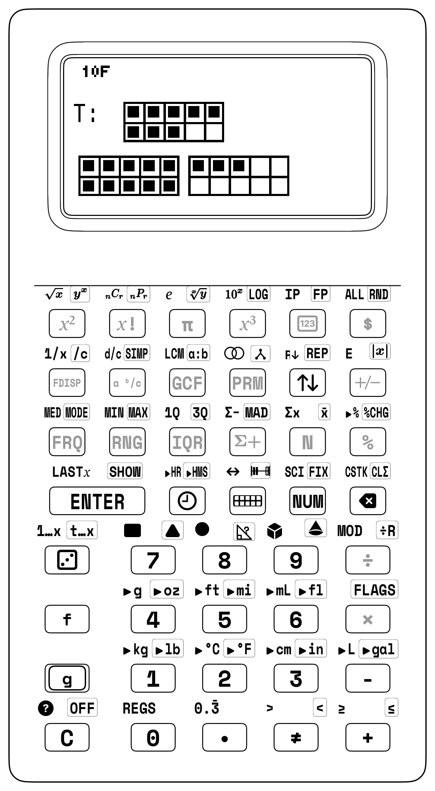

<div class="admonition tip">
<p class="admonition-title">Parent's De-Stressing Guide: "Carry the 1" vs. The Ten-Frame Bridge</p>
<p>
<strong>The Scenario:</strong> Your 1st or 2nd grader is given: <code>8 + 5 = ?</code><br><br>
<strong>The Conventional Nightmare:</strong><br>
Parents teach what they were taught: "Put 8 on top, 5 on bottom. 8 + 5 is 13. Write down 3, carry the 1." The child asks: <em>"Why do I carry 1 if it's 13?"</em> The parent says: "Because it goes in the tens column." The child tears up, memorizing an abstract spatial ritual with zero meaning.<br><br>
<strong>The 30-Second Tactile Cure:</strong><br>
Hand your child the 2×5 Ten-Frame Tray and dual-color tokens:
</p>
<ol>
  <li>Place 8 RED tokens in the frame. Point to the 2 empty pockets: <em>"How many more does 8 need to become a full Ten?" ("Two!")</em></li>
  <li>You have 5 GOLD tokens waiting on the desk.</li>
  <li>Take 2 gold tokens and slide them into the frame: <em>*CLICK!* "Ten is full! How many gold tokens are left on the desk?" ("Three!")</em></li>
  <li>One full Ten and 3 ones = <strong>13</strong>!</li>
</ol>
<p>
<strong>On the SC-6:</strong> Key in `[▦] 8 [ENTER] 5 [+]`. The display registers <strong><code>13</code></strong>.<br>
The child has just executed the fundamental mental math strategy of the world's best mathematicians: <strong>Bridging Ten:</strong> <code>8 + 5 = (8 + 2) + 3 = 10 + 3</code>.
</p>
</div>

---

### 3.2.1 Seeing Groups Instantly Without Counting One-by-One!

Have you ever rolled a dot die and known right away it was a 5, without having to point your finger and count $1, 2, 3, 4, 5$? That superpower is called **seeing groups at a glance**! 

When you look at small groups of dots, blocks, or counters, your brain recognizes the total in a split second. By organizing numbers around friendly landmarks of **5** and **10**, the SC-6 and your Ten-Frame Studio let you see big numbers just as easily as small numbers—without counting on your fingers!

<div class="admonition note">
<p class="admonition-title">For Parents &amp; Teachers: The Cognitive Science of Subitizing</p>
<p>
<strong>Subitizing</strong>—derived from the Latin <em>subitus</em> ("sudden")—is the cognitive capacity to instantaneously perceive how many items are in a small collection without counting them one by one.<br><br>
Cognitive psychologists divide subitizing into two distinct levels:<br>
• <strong>Perceptual Subitizing (Quantities 1 to 4):</strong> A hardwired neurobiological mechanism in the human visual cortex. You glance at 1, 2, 3, or 4 marbles and instantly recognize the total without counting.<br>
• <strong>Conceptual Subitizing (Quantities 5 to 10+):</strong> The ability to perceive a larger quantity by recognizing spatial subgroups and mentally combining them into a whole. Viewing 7 dots arranged in a 5-and-2 configuration, you don't count $1, 2, 3, 4, 5, 6, 7$; you instantly see a full row of 5 plus 2 loose units ($5 + 2 = 7$).<br><br>
The SC-6 hardware visual engines are explicitly architected around anchors of <strong>5</strong> and <strong>10</strong>, providing the exact visual scaffolding needed to bridge perceptual recognition into effortless conceptual subitizing.
</p>
</div>

---

### 3.2.2 How Your Trays and Counters Are Built for Your Hands

The physical manipulative studios accompanying the SC-6 are engineered as modular tactile companions, standardized on the Gridfinity organization grid. Where the calculator provides a dark, glare-free slate upon which numbers are evaluated, the manipulative blocks supply immediate physical mass and vibrant color:

- **Ten-Frame Studio & Dual-Color Counters:** Dual ten-frame wells separated by a raised architectural divider rib. The physical tactile ridge provides an unmistakable boundary at five, allowing fingers to verify group sizes without counting. Chamfered counter disks in contrasting coral and amber seat firmly into each pocket.
- **Number Rack (Rekenrek):** Dual horizontal stainless guide rails holding smoothly sliding beads arranged in five-and-five color clusters, mirroring the two-register display of the calculator.
- **Place Value Studio:** Precision metric base-10 unit cubes, ten-rods, and hundred-flats. Each ten-rod equals exactly ten unit cubes placed end-to-end; each hundred-flat matches ten rods side-by-side. Weight and volume scale proportionally with numerical magnitude.
- **Counting & Array Tiles:** Interlocking tactile tiles engineered with precise slip-fit tabs that assemble into rigid 2D arrays and vertical counting towers.
- **Prime Factor Studio:** Precision logarithmic blocks whose physical lengths correspond to the logarithms of prime factors, allowing multiplication to be experienced as collinear block addition.

---

## 3.3 Concrete Bridge to the Ten-Frame Studio (`[▦]`)

The Ten-Frame helps you see numbers in groups of five and ten. It builds instant visual recognition and shows why 10 is such a powerful landmark number.

> [!NOTE]
> **Architectural Geometry of the Ten-Frame Tray:**  
> The physical Ten-Frame Studio features a dual $2 \times 5$ compartment field separated by a raised central divider rib. This rib physically isolates the first five units from the second five units, establishing instant five-structure group recognition in high-contrast matte compartments with vivid dual-color counters.

### 3.3.1 Entering the Ten-Frame Sandbox
To activate the interactive Ten-Frame Studio on the SC-6:
1. Enter a starting quantity into Register $X$ (for example, tap `[7]`).
2. Press the hardware `[▦]` key (Row 1, Col 1).
3. The transflective dot-matrix LCD automatically shifts from its 4-register numeric layout into its two-zone concrete layout:
   - **Upper Screen (Ten-Frame Grid):** High-contrast 1-bit vector bitmap depicting two ten-frame grids with 7 filled circular counters.
   - **Lower Screen (Active Stack):** Simplified 2-line arithmetic stack displaying Register $T$ (Top) and Register $X$ (Active).

| Display Region | Visual & Numeric Representation (`X = 7`) |
| :--- | :--- |
| **Upper Screen (Ten-Frame Grid)** | Top row: `[●][●][●][●][●]` ($5$ filled); Bottom row: `[●][●][ ][ ][ ]` ($2$ filled, $3$ empty) |
| **Lower Screen (Active Stack)** | `Y: 0` \| **`X: 7`** ($5 + 2 = 7$ seen at a glance) |

Notice how the 7 counters are organized:
- The top row of the first ten-frame is completely filled with 5 counters.
- The bottom row contains exactly 2 counters.
- The remaining 3 slots in the first frame are empty.
- The second ten-frame remains completely vacant.

When you look at this screen, you don't need to count $1, 2, 3, 4, 5, 6, 7$. Your eyes instantly recognize the full top row of 5 plus the bottom 2 units: $5 + 2 = 7$.

---

### 3.3.2 Interactive Stepping with the Decimal Key (`[.]`)
While inside the Ten-Frame Studio, you can interact directly with the screen. Pressing the decimal key `[.]` drops counters into the frame one by one:
- Tap `[.]` $\longrightarrow$ Counter 8 drops into the bottom row ($X$ updates to 8).
- Tap `[.]` $\longrightarrow$ Counter 9 drops into the bottom row ($X$ updates to 9).
- Tap `[.]` $\longrightarrow$ Counter 10 completes the first ten-frame! The frame border flashes inverted pixels for 300 ms to provide an unmistakable visual cue that a full decade has closed.
- Tap `[.]` $\longrightarrow$ Counter 11 cascades across the architectural divider rib into the second ten-frame ($X$ updates to 11).

> **STEPPING PAST THE DECADE BOUNDARY VIA [.]:**
> Frame State at X = 9:
> [●][●][●][●][●] | [●][●][●][●][ ]   (1 empty slot remaining)
> Tap [.]:
> [●][●][●][●][●] | [●][●][●][●][●]   (FULL FRAME FLASH: Decade closed! X = 10)
> Tap [.]:
> Frame 1: [●][●][●][●][●] | [●][●][●][●][●]
> Frame 2: [●][ ][ ][ ][ ] | [ ][ ][ ][ ][ ]   (Cascaded into Frame 2! X = 11)

<div class="admonition note">
<p class="admonition-title">For Parents &amp; Teachers: Homeschooler Diagnostic Checkpoint</p>
<p>
• <strong>Ask your child:</strong> "How many empty spots are left in the first ten-frame?"<br>
• If there are 7 counters, your child can visually identify 3 empty spaces.<br>
• Have them press <code>[3]</code> <code>[+]</code>. The display completes the ten-frame and shows $X = \mathbf{10}$!
</p>
</div>

---

## 3.4 Making Ten & The "Bridging Ten" Strategy

When you first add across a ten boundary (like $8 + 5$), counting on your fingers (*"eight... nine, ten, eleven, twelve, thirteen"*) can feel slow and tricky. The Ten-Frame Studio teaches you the foundational **Bridging Ten** strategy:

The Ten-Frame Studio teaches the foundational **Bridging Ten** strategy:
$$\mathbf{8 + 5 = 8 + (2 + 3) = (8 + 2) + 3 = 10 + 3 = 13}$$

<div class="admonition note">
<p class="admonition-title">The Bridging Ten Mental Model: Decomposing into a Decade</p>
<p>
• <strong>Step 1 (Anchor the 8):</strong> Start with 8 counters in the first frame (2 empty slots remain):<br>
&nbsp;&nbsp;<code>[●][●][●][●][●] | [●][●][●][ ][ ]</code><br>
• <strong>Step 2 (Decompose the Addend):</strong> You have 5 counters to add. Decompose 5 into <code>2 + 3</code>. Transfer 2 counters into Frame 1 to make a complete 10!<br>
&nbsp;&nbsp;<code>[●][●][●][●][●] | [●][●][●][●][●]</code> &larr; <strong>10 (Full Frame!)</strong><br>
• <strong>Step 3 (Place the Remainder):</strong> Place the remaining 3 counters into Frame 2:<br>
&nbsp;&nbsp;<code>[●][●][●][ ][ ] | [ ][ ][ ][ ][ ]</code> &larr; <strong>3 in Frame 2</strong><br>
• <strong>Total:</strong> <code>10 + 3 = 13!</code> Mental addition across decades becomes effortless spatial grouping.
</p>
</div>

### 3.4.1 Station Lesson 3.1: Ten-Frame Bridging Ten & Dual-Color Counters

> **STATION LESSON 3.1: TACTILE SETUP**
>
> • Manipulatives: Ten-Frame Tray with Dual-Color Counters (Coral Red / Amber Gold)
> • Hardware:      StackCalc SC-6 Elementary in [▦] Ten-Frame Mode
> • Goal:          Add 8 + 5 without finger counting via the decade bridge

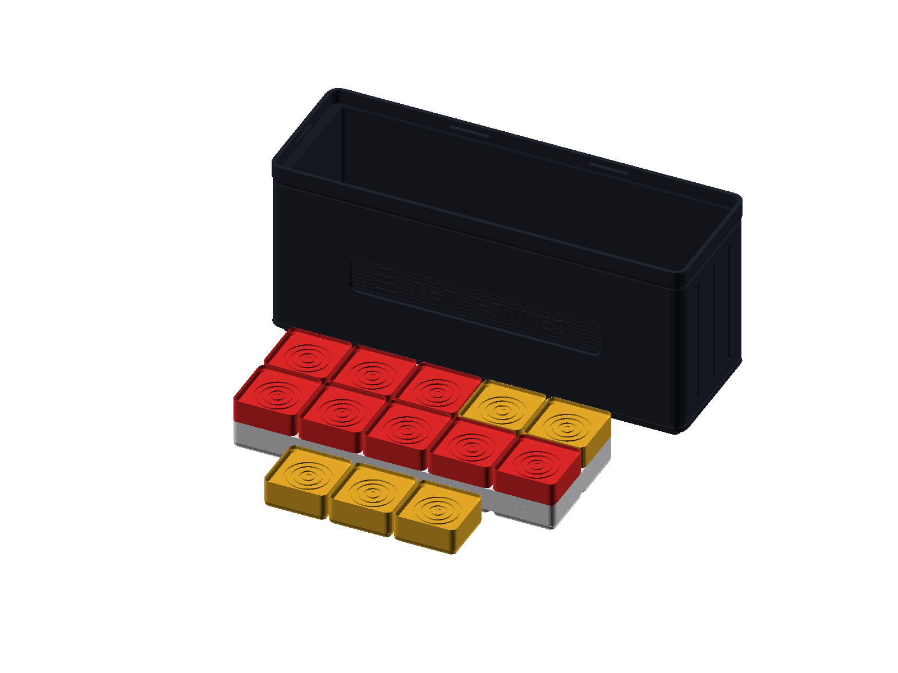

1. **Concrete Phase (Desk Setup):**
   - Place 8 Red counters into Frame 1 of the physical tray (filling the top row of 5 and bottom row of 3).
   - In your hand, hold 5 Gold counters to add.
   - Notice that Frame 1 needs exactly 2 counters to become completely full (reaching 10).
   - Drop 2 Gold counters into Frame 1, completing the ten: $8 + 2 = 10$.
   - Drop the remaining 3 Gold counters into Frame 2: $10 + 3 = 13$.

2. **Representational Phase (Screen Verification):**
   - Press `[8] [▦]`. The SC-6 LCD renders 8 circular dots across the dual ten-frame.
   - Press `[2] [+]`: Two counters land in Frame 1, flashing the decade banner: $X = \mathbf{10}$.
   - Press `[3] [+]`: Three counters land in Frame 2: $X = \mathbf{13}$.

3. **Abstract Phase (RPN Stack Trace Table):**

| Keystroke | Register T | Register Z | Register Y | Register X (Display) |
| :--- | :--- | :--- | :--- | :--- |
| [8] [▦] | 0 | 0 | 0 | 8 |
| [2] [+] | 0 | 0 | 0 | 10 |
| [3] [+] | 0 | 0 | 0 | 13 |

<div class="admonition note">
<p class="admonition-title">For Parents &amp; Teachers: Teacher Dialogue Script</p>
<p>
<strong>Teacher:</strong> "Look at our Ten-Frame screen with 8 filled circles. How many empty boxes are left to make a full ten?"<br>
<strong>Student:</strong> "Two empty boxes!"<br>
<strong>Teacher:</strong> "Great. We need to add 5 circles. If we drop 2 circles into the empty boxes to make ten, how many are left in our hand?"<br>
<strong>Student:</strong> "Three are left in our hand!"<br>
<strong>Teacher:</strong> "Ten plus three makes what?"<br>
<strong>Student:</strong> "Thirteen!"<br>
<strong>Teacher:</strong> "Did we have to count on our fingers?"<br>
<strong>Student:</strong> "No! We just made ten and added the rest!"
</p>
</div>

---

## 3.5 The Step Counter Dynamics & Stacking Tile Heights

How do you discover that counting forward is mathematically identical to repeatedly adding one? On conventional algebraic calculators, pressing `+ 1 = = =` relies on hidden accumulator memory that obscures the underlying mechanism. On the SC-6, step counting is completely transparent and verified through physical tile heights and stack mechanics.

### 3.5.1 Station 3.2: Counting Up with Stacking Tiles

> **STATION LESSON 3.2: TACTILE SETUP**
>
> • Manipulatives: Counting & Array Studio with 144 Interlocking Stacking Tiles
> • Hardware:      StackCalc SC-6 Elementary (2-LV and 4-LV Stack Modes)
> • Architectural Benchmark: 12 Tiles × 7.0 mm = 84.0 mm (1 Whole Datum)

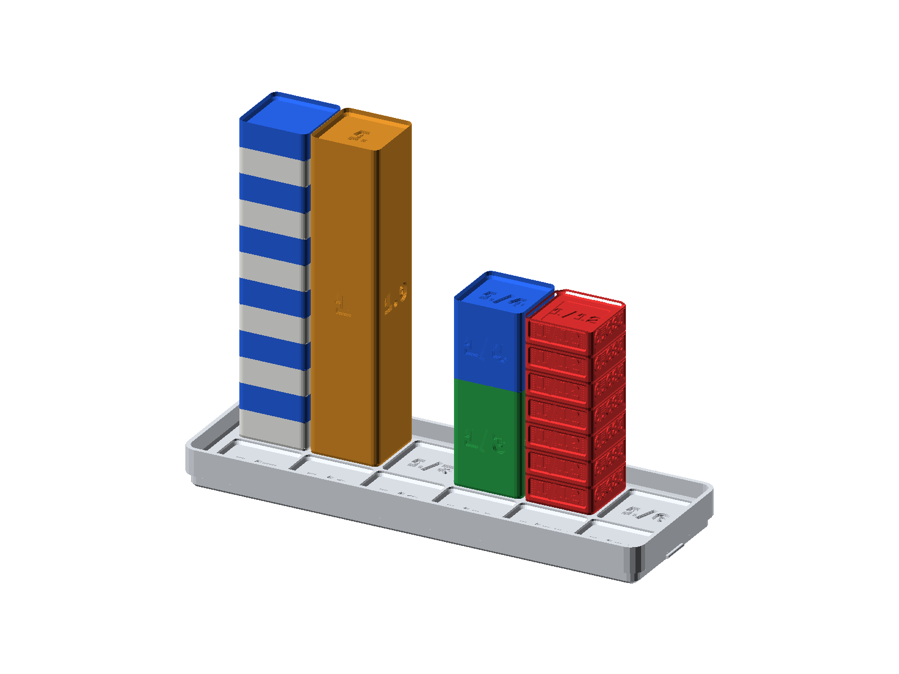

> **STACKING TILE VERTICAL TOWER LADDER:**
> [ TILE 12 ] -> 84.0 mm (Flush with 1-Whole Fraction Studio Tower!)  X = 12
> [ TILE 11 ] -> 77.0 mm                                              X = 11
> [ TILE 10 ] -> 70.0 mm                                              X = 10
> [ TILE  9 ] -> 63.0 mm                                              X = 9
> [ TILE  8 ] -> 56.0 mm                                              X = 8
| Stacked Tile Count (`X`) | Cumulative Physical Height | Geometric & Fraction Studio Datum |
| :---: | :---: | :--- |
| **Tile 1 (`X = 1`)** | $7.0\text{ mm}$ | $1\text{U}$ visible increment $= 1/12$ Fraction Tower |
| **Tile 2 (`X = 2`)** | $14.0\text{ mm}$ | $1/6$ Fraction Tower datum |
| **Tile 3 (`X = 3`)** | $21.0\text{ mm}$ | $1$ Unit Cube equivalent $= 1/4$ Fraction Tower |
| **Tile 4 (`X = 4`)** | $28.0\text{ mm}$ | $1/3$ Fraction Tower datum |
| **Tile 6 (`X = 6`)** | $42.0\text{ mm}$ | Halfway datum $= 1/2$ Fraction Tower |
| **Tile 12 (`X = 12`)** | $84.0\text{ mm}$ | Full $1\text{-Whole}$ Master Fraction Tower |

#### Hands-On Stacking Protocol:
1. **In 2-Stack Mode (`[g] [FLAGS]` $\to$ `2-LV`):**
   - Place 1 Archival White tile on the desk ($7.0\text{ mm}$ height). Press `[1] [ENTER] [1] [+]` $\to X = 2$.
   - Stack tile 2 on top ($14.0\text{ mm}$). Tap `[+]` $\to X = 3$.
   - Stack tile 3 on top ($21.0\text{ mm}$). Tap `[+]` $\to X = 4$.
   - Continue stacking in cadence with tapping `[+]` until reaching 12 tiles ($84.0\text{ mm}$).
   - Compare your 12-tile tower against the solid 1-Whole Fraction Studio tower: *they are exactly flush to the fraction of a millimeter!*

| Keystroke | Register T (Constant) | Register X (Display) | Physical Tile Height on Desk (7.0 mm per Tile) |
| :--- | :--- | :--- | :--- |
| [1] [ENTER] | 1 | 1 | 1 Tile  =  7.0 mm |
| [1] | 1 | 1 | 1 Tile  =  7.0 mm |
| [+] | 1 | 2 | 2 Tiles = 14.0 mm |
| [+] | 1 | 3 | 3 Tiles = 21.0 mm (1 Unit Cube!) |
| [+] | 1 | 4 | 4 Tiles = 28.0 mm |
| [+] | 1 | 5 | 5 Tiles = 35.0 mm |
| [+] | 1 | 6 | 6 Tiles = 42.0 mm (1/2 Whole Tower) |
| [+] | 1 | 7 | 7 Tiles = 49.0 mm |
| [+] | 1 | 8 | 8 Tiles = 56.0 mm |
| [+] | 1 | 9 | 9 Tiles = 63.0 mm |
| [+] | 1 | 10 | 10 Tiles = 70.0 mm |
| [+] | 1 | 11 | 11 Tiles = 77.0 mm |
| [+] | 1 | 12 | 12 Tiles = 84.0 mm (1 Whole Tower!) |

2. **In 4-Stack Mode with Superpower 1 (`[g] [REP]`):**
   - Ensure 4-Stack mode is active (`[g] [FLAGS]` $\to$ `4-LV`).
   - Press `[1] [g] [REP]`: All four registers ($T, Z, Y, X$) receive 1.
   - Now, each tap of `[+]` drops Register $T$ downward, advancing the display count ($2, 3, 4, \dots, 12$) in sync with placing physical tiles!

| Keystroke | Register T (Constant) | Register Z | Register Y | Register X (Display) |
| :--- | :--- | :--- | :--- | :--- |
| [1] | 0 | 0 | 0 | 1 |
| [g] [REP] | 1 | 1 | 1 | 1 |
| [+] | 1 | 1 | 1 | 2 |
| [+] | 1 | 1 | 1 | 3 |
| [+] | 1 | 1 | 1 | 4 |
| [+] | 1 | 1 | 1 | 5 |
| [+] | 1 | 1 | 1 | 6 |

3. **Counting Backward (Subtraction Towers):**
   - Starting with a 10-tile tower ($70.0\text{ mm}$): `[1][0] [ENTER] [1]`.
   - Remove 1 tile from the tower on the desk. Tap `[-]`: $X = \mathbf{9}$.
   - Remove another tile. Tap `[-]`: $X = \mathbf{8}$.
   - Countdown continues to $X = \mathbf{0}$ when the tabletop is completely clear: Blast off!

| Keystroke | Register T | Register X |
| :--- | :--- | :--- |
| `10` [ENTER] | 10 | 10 |
| [1] [-] | 10 | 9 |
| [-] | 10 | 8 |
| [-] | 10 | 7 |
| [-] | 10 | 6 |
| [-] | 10 | 5 |
| [-] | 10 | 4 |
| [-] | 10 | 3 |
| [-] | 10 | 2 |
| [-] | 10 | 1 |
| [-] | 10 | 0 |

---

### 3.5.2 Station Lesson 3.3: Mind-Blowing Epiphany 1 — The Sum of Odd Numbers is Always a Perfect Square!

<div class="admonition note">
<p class="admonition-title">For Parents &amp; Teachers: Curriculum Standards</p>
<p>Common Core Standards Alignment: CCSS.MATH.CONTENT.3.OA.D.9, 4.OA.C.5.</p>
</div>

- **Physical Manipulatives:** 16 Counting Tiles from the Counting Studio: 1 Archival White, 3 Cobalt Blue, 5 Radiant Gold, 7 Slate Gray.

What happens when you add consecutive odd numbers starting from 1?
$$1 = 1 = 1^2$$
$$1 + 3 = 4 = 2^2$$
$$1 + 3 + 5 = 9 = 3^2$$
$$1 + 3 + 5 + 7 = 16 = 4^2$$
$$1 + 3 + 5 + 7 + 9 = 25 = 5^2$$

Why is this always true for *every single square number in the universe*? The ancient Pythagoreans called this the **Gnomon Principle**, and it is instantly self-evident when built with the four-color physical counting tiles:

<div class="admonition note">
<p class="admonition-title">Visual Proof Without Words: Odd Numbers Build Squares</p>
<p>
The ancient Pythagoreans discovered that geometric squares grow by wrapping L-shaped brackets called <strong>gnomons</strong> around smaller squares:
</p>
<ul>
  <li><strong>Stage 1 (1 Tile):</strong> <code>1 = 1²</code> (Single white corner tile).</li>
  <li><strong>Stage 2 (1 + 3 = 4 Tiles):</strong> Three blue tiles wrap around the white tile, creating a <code>2 × 2 = 4 = 2²</code> square.</li>
  <li><strong>Stage 3 (1 + 3 + 5 = 9 Tiles):</strong> Five gold tiles wrap around the 2×2 square, forming a <code>3 × 3 = 9 = 3²</code> square.</li>
  <li><strong>Stage 4 (1 + 3 + 5 + 7 = 16 Tiles):</strong> Seven gray tiles wrap around the 3×3 square, forming a <code>4 × 4 = 16 = 4²</code> square.</li>
</ul>
<p>
<strong>The Epiphany:</strong> Every consecutive odd number <code>(2n - 1)</code> forms an L-shaped gnomon that wraps around an <code>(n-1) × (n-1)</code> square to produce the next <code>n × n</code> square. Arithmetic addition and geometric area are two reflections of the exact same truth!
</p>
</div>

#### Verification on the SC-6:
Key in the running odd sum in RPN:
- `[1] [ENTER] [3] [+]` $\longrightarrow \mathbf{4}$ ($2^2$)
- **Step-by-Step RPN Reasoning & Stack Logic:**
  1. `1` `[ENTER]` — Lay the first single unit cube in the center of the counting tray ($Y = 1$).
  2. `3` `[+]` — Snap an L-shaped 3-cube gnomon around the corner, completing a solid $2 \times 2$ square ($X = 4$).
- `[5] [+]` — Snap a 5-cube gnomon along the two outer edges $\longrightarrow \mathbf{9}$ ($3 \times 3$ square).
- `[7] [+]` — Wrap a 7-cube band along the perimeter $\longrightarrow \mathbf{16}$ ($4 \times 4$ square).
- `[9] [+]` — Wrap a 9-cube band along the perimeter $\longrightarrow \mathbf{25}$ ($5 \times 5$ square).
- `[1] [1] [+]` $\longrightarrow \mathbf{36}$ ($6 \times 6$ square)
- Tap geometric square root `[f] [√x]` $\longrightarrow \mathbf{6}$! The physical side length of the square appears instantly.

---

## 3.6 Number Line Navigation & Visual Jump Arcs (`[f] [LINE]`)

The Open Number Line lets you visualize addition and subtraction as physical travel along a continuous spatial pathway.

### 3.6.1 The Number Line Sandbox
Tapping `[f] [LINE]` opens the dynamic Number Line Studio. The SC-6 engine automatically calculates decade tick scaling ($1, 2, 5, 10$) to render up to 13 high-contrast ticks:

| Display Zone | Visual Representation (`2 + 5 = 7`) |
| :--- | :--- |
| **Jump Arc Layer** | Parabolic forward jump arc labeled `+5` spanning from tick `2` to tick `7` |
| **Number Line Axis** | High-contrast tick ruler spanning `0, 1, 2, 3, 4, 5, 6, 7, 8, 9, 10, 11` |
| **Register `T:`** | `2` (Starting coordinate) |
| **Register `X:`** | `7` (Landing coordinate after `+5` jump) |

### 3.6.2 Visual Jump Arcs
When an operation executes on the number line, the screen animates a parabolic **jump arc** connecting the starting coordinate to the landing coordinate:
- **Forward Jump ($2 + 5 = 7$):** An arc curves forward from 2 to 7, clearly labeled with `+5`.
- **Backward Jump ($9 - 4 = 5$):** An arc leaps backward from 9 to 5, labeled `-4`.

The engine tracks `lastOp`, `lastOpStart`, `lastOpEnd`, and `lastOpDelta`, giving you immediate visual confirmation of distance, direction, and magnitude.

<div class="admonition note">
<p class="admonition-title">Number Line Jump Arc Dynamics</p>
<p>
• <strong>Forward Jump (Addition):</strong> Adding a positive number leaps forward. For <code>14 + 8</code>, an arc sweeps from 14 across 8 increments, landing cleanly on 22: <code>14 ──(+8)──&gt; 22</code>.<br>
• <strong>Backward Jump (Subtraction):</strong> Subtracting steps backward. For <code>22 - 5</code>, an arc leaps leftward from 22 across 5 increments, landing on 17: <code>17 &lt;──(-5)── 22</code>.<br>
The SC-6 display animates these exact parabolic paths in real time, making distance, direction, and magnitude visually tangible.
</p>
</div>

---

## 3.7 The European Rekenrek / Number Rack (`[g] [COUNT]`)

The 100-bead and 20-bead Rekenrek (Number Rack) was invented by Adrian Treffers at the Freudenthal Institute in the Netherlands. It consists of two parallel stainless-steel rods, each carrying beads divided into color-coded groups of **5 Red** and **5 White**.

> **REKENREK 100-BEAD DUAL-WIRE GEOMETRY**
>
> Wire 1 (Tens):  [🔴🔴🔴🔴🔴][⚪⚪⚪⚪⚪]  ---  [🔴🔴🔴🔴🔴][⚪⚪⚪⚪⚪]
> Wire 2 (Ones):  [🔴🔴🔴🔴🔴][⚪⚪⚪⚪⚪]  ---  [🔴🔴🔴🔴🔴][⚪⚪⚪⚪⚪]

### 3.7.1 Operating Rekenrek Mode (`[g] [COUNT]`)
1. Type a target number (for example, `[1] [4]`).
2. Press `[g] [COUNT]` (or `[g] [COUNT]`).
3. The transflective LCD maps the quantity across the two wires:
   - Wire 1 shows 10 beads slid to the active left side (5 red, 5 white).
   - Wire 2 shows 4 red beads slid to the active left side.
4. Pressing `[.]` slides individual beads one by one across the wire, up to 100!

### 3.7.2 Decomposing Teen Numbers ($11$ to $19$)
Teen numbers can sometimes sound confusing in English. In languages like Chinese or Japanese, 14 is spoken directly as *"ten-four"*, immediately revealing its place-value structure! In English, *"fourteen"* sounds like four comes first, which can tempt you to write $41$ instead of $14$.

On the Rekenrek screen:
- 14 is rendered as: **Full Wire 1 (10) + 4 Red Beads on Wire 2**.
- You can visually see that 14 is literally $10 + 4$.
- The confusion vanishes the moment you see the physical beads!

---

## 3.8 Place Value Decomposition Studio (`[PV]`)

Place value is one of the most exciting secrets in mathematics. When you look at a big number like $4,725$, it isn't just four separate digits sitting next to each other ("4", "7", "2", "5"). It is actually four distinct bundled packages working together:
$$4,725 = 4,000 + 700 + 20 + 5$$

The SC-6 provides a dedicated hardware **Place Value Engine (`[PV]`)** on Row 1, Col 5.

The physical base-10 blocks embody metric proportions with architectural rigor:
- **Unit Cube ($1\text{U}$):** A $10 \times 10 \times 10\text{ mm}$ cube in solar amber with subtle chamfered edges for easy grasping.
- **Ten-Rod ($10\text{U}$):** A $10 \times 10 \times 100\text{ mm}$ linear bar scoring ten distinct cubic segments, matching ten unit cubes placed edge to edge.
- **Hundred-Flat ($100\text{U}$):** A $10 \times 100 \times 100\text{ mm}$ planar grid representing ten rods bonded along their flanks.
- **Thousand-Cube ($1000\text{U}$):** A solid $100 \times 100 \times 100\text{ mm}$ monolithic block with mass equivalent to one thousand individual unit cubes, providing tactile weight that makes place value unforgettable.

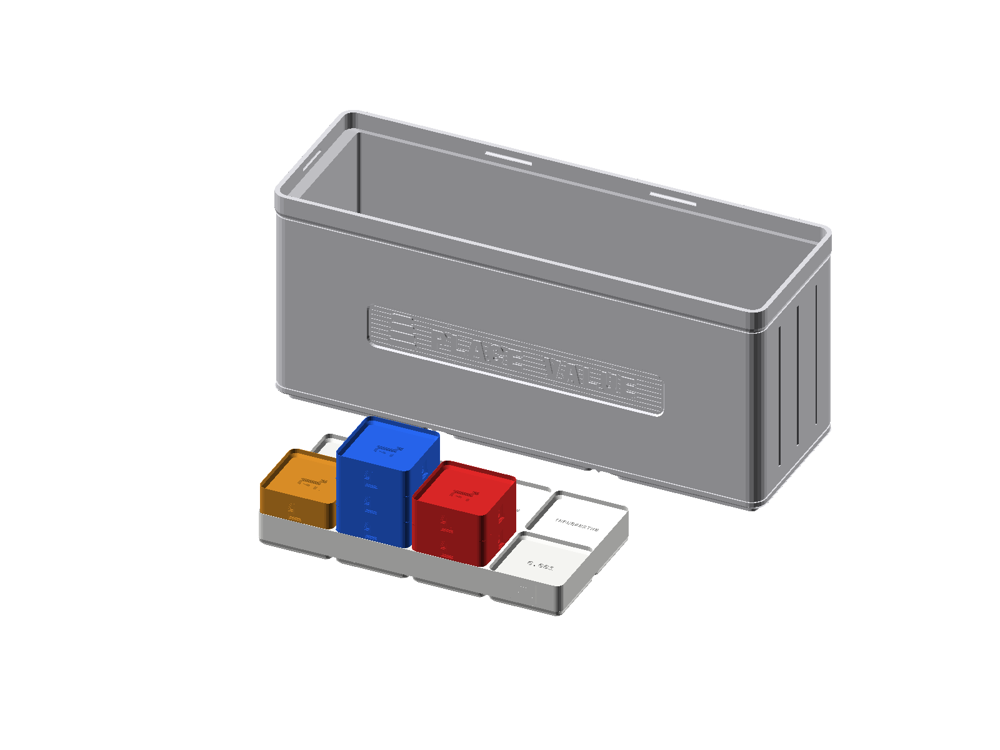
*Figure 3.3: The Place Value Studio. Base-10 metric unit cubes, 10U rods, and 100U flats physicalize positional notation, pairing directly with the SC-6 [PV] mode.*

### 3.8.1 Operating Place Value Mode
The `[PV]` key extracts the specific digit occupying any target power of 10. It expects:
- The **Subject Number** in Register $Y$.
- The **Target Place** ($1, 10, 100, 1000$) in Register $X$.

Mathematical definition:
$$\text{placeValueDigit}(Y, X) = \left\lfloor \frac{|Y|}{X} \right\rfloor \bmod 10$$

#### Example: Decomposing 4,725
1. Enter the subject number: `[4] [7] [2] [5] [ENTER]`.
2. Query the Tens place: `[1] [0] [PV]`.
   - Register $X$ displays: `2` (There are 2 tens in 4,725!).

| Keystroke | Display T | Display Z | Display Y (Subject) | Display X (Query / Result) |
| :--- | :--- | :--- | :--- | :--- |
| `4725` | 0 | 0 | 0 | 4725 |
| [ENTER] | 0 | 0 | 4725 | 4725 |
| `10` | 0 | 0 | 4725 | 10 |
| [PV] | 0 | 0 | 4725 | 2 |

---

### 3.8.2 Why the Parts Always Add Back to Your Whole Number!
Notice the crucial behavior in the stack trace above: **Register $Y$ is strictly preserved (`4725`), and stack lift is disabled!**

This invariant allows you to rapidly query every single place value column without re-typing your number:
- Query Hundreds: Type `[1] [0] [0] [PV]` $\longrightarrow X = \mathbf{7}$ (7 hundreds).
- Query Thousands: Type `[1] [0] [0] [0] [PV]` $\longrightarrow X = \mathbf{4}$ (4 thousands).
- Query Ones: Type `[1] [PV]` $\longrightarrow X = \mathbf{5}$ (5 ones).

*(Hardware Invariant: Place value extraction preserves Register $Y$ while populating Register $X$ with the selected decimal place value.)*

### 3.8.3 Exploring Tenths and Hundredths with Place Value
In Grade 5, place value extends to the right of the decimal point (tenths and hundredths):
- Query Tenths ($0.1$): Type `[.] [1] [PV]` on $345.67 \longrightarrow X = \mathbf{6}$.
- Query Hundredths ($0.01$): Type `[.] [0] [1] [PV]` on $345.67 \longrightarrow X = \mathbf{7}$.

### 3.8.4 Showdown: Algebraic Reversal vs. Forward RPN Place Value

| Challenge Problem | Conventional Algebraic Syntax | StackCalc RPN Workflow | Algebraic Failure Mechanism | RPN Engineering Triumph |
| :--- | :--- | :--- | :--- | :--- |
| **Stadium Light Wattage**<br>$(30 \times 1500) + (10 \times 2000)$ | `30 [×] 1500 [+] 10 [×] 2000 [=]` | `30 [ENTER] 1500 [×] 10 [ENTER] 2000 [×] [+]` | Hierarchy confusion; parenthesis overload | Subtotals preserved on stack; zero parentheses |
| **Decade Bridging**<br>$8 + 5 = 8 + 2 + 3$ | `8 [+] 2 [+] 3 [=]` | `8 [ENTER] 2 [+] 3 [+]` | Loss of intermediate decade landmark | Visual flash at decade $10$; smooth accumulation |
| **Place Value Query**<br>Extract tens of $4,725$ | Re-enter number, divide by 10, truncate | `4725 [ENTER] 10 [PV]` | Destructive division destroys base number | Preserves $Y$ subject value across chained queries |
| **Constant Counting**<br>Twos ladder cadence | `2 [+] 2 [=] [=] [=] ...` | `2 [ENTER] 2 [+] [+] [+] ...` | Flaky algebraic constant equals-key state | Deterministic stack retention on upper shelf |

---

## 3.9 Big Numbers in Nature: Expanding Horizons

Once you master place value bundling, you are ready to explore the vast scale of our physical world:

### 3.9.1 Real-World Example 1: The Earth-Moon Distance ($384,400\text{ km}$)
The average distance from the Earth to the Moon is $384,400\text{ kilometers}$.
Let us decompose this colossal number using `[PV]`:
1. `[3] [8] [4] [4] [0] [0] [ENTER]`
2. `[1] [0] [0] [0] [0] [0] [PV]` $\longrightarrow X = \mathbf{3}$ (3 hundred-thousands $= 300,000\text{ km}$).
3. `[1] [0] [0] [0] [0] [PV]` $\longrightarrow X = \mathbf{8}$ (8 ten-thousands $= 80,000\text{ km}$).
4. `[1] [0] [0] [0] [PV]` $\longrightarrow X = \mathbf{4}$ (4 thousands $= 4,000\text{ km}$).
5. `[1] [0] [0] [PV]` $\longrightarrow X = \mathbf{4}$ (4 hundreds $= 400\text{ km}$).

> **EXPEDITION CHALLENGE:**
> If an Apollo spacecraft travels at 4,000 km/hour, how many hours does it take to reach the Moon?
> Keystrokes: `[3] [8] [4] [4] [0] [0] [ENTER] [4] [0] [0] [0] [÷]` $\rightarrow$ **`96`**
> Result: X = 96.1 hours (about 4 days of spaceflight!).

---

### 3.9.2 Real-World Example 2: Human Heartbeats in a Year ($42,048,000$)
Your heart beats approximately $80\text{ times per minute}$ when you are resting.
How many times does the heart beat in an entire year?
- 60 minutes in an hour: $80 \times 60 = 4,800\text{ beats/hour}$.
- 24 hours in a day: $4,800 \times 24 = 115,200\text{ beats/day}$.
- 365 days in a year: $115,200 \times 365 = \mathbf{42,048,000\text{ beats/year}}$!

Let us calculate this continuously on the SC-6 stack without writing down any scratch paper:
| Keystroke | Register T | Register Z | Register Y | Register X |
| :--- | :--- | :--- | :--- | :--- |
| 80 [ENTER] | 0 | 0 | 80 | 80 |
| 60 [×] | 0 | 0 | 0 | 4800 |
| 24 [×] | 0 | 0 | 0 | 115200 |
| 365 [×] | 0 | 0 | 0 | 42048000 |

Now let's query the Ten-Millions place with `[PV]`:
- Type `[ENTER] [1] [0] [0] [0] [0] [0] [0] [0] [PV]` $\longrightarrow X = \mathbf{4}$ (4 ten-millions!).
- Type `[1] [0] [0] [0] [0] [0] [0] [PV]` $\longrightarrow X = \mathbf{2}$ (2 millions!).

---

### 3.9.3 Real-World Example 3: Distance to Mars ($225,000,000\text{ km}$)
At its average orbital distance, the planet Mars is approximately $225,000,000\text{ kilometers}$ from Earth.
- Hundreds of Millions place: `225000000 [ENTER] 100000000 [PV]` $\longrightarrow X = \mathbf{2}$.
- Tens of Millions place: `10000000 [PV]` $\longrightarrow X = \mathbf{2}$.
- Millions place: `1000000 [PV]` $\longrightarrow X = \mathbf{5}$.
If a robotic probe travels at $25,000\text{ km/h}$, how many days will the voyage take?
- Keystrokes: `225000000 [ENTER] 25000 [÷] 24 [÷]` $\longrightarrow X = \mathbf{375\text{ days}}$ (just over 1 year!).

---

### 3.9.4 Real-World Example 4: Red Blood Cells in the Human Body ($25,000,000,000,000$)
An average human body contains approximately 25 trillion red blood cells.
In expanded notation:
$$25,000,000,000,000 = 2 \times 10^{13} + 5 \times 10^{12}$$
Decompose on SC-6:
- Ten-trillions place: `25000000000000 [ENTER] 10000000000000 [PV]` $\longrightarrow X = \mathbf{2}$.
- Trillions place: `1000000000000 [PV]` $\longrightarrow X = \mathbf{5}$.

---

<div class="admonition note">
<p class="admonition-title">For Parents &amp; Teachers: Classroom Dialogue Scripts &amp; Misconception Diagnostics</p>
<p>
<strong>Place Value as a Conceptual Diagnostic:</strong> In elementary mathematics education, place value is the foundational diagnostic watershed. When students fail to comprehend bundling and positional notation in early grades, they encounter severe barriers when attempting multi-digit regrouping, long division, and decimal arithmetic.<br><br>
The SC-6 resolves this disconnect by grounding positional notation in physical geometry: metric base-10 blocks make magnitudes visceral (a thousand-cube possesses tangible heft, whereas unit cubes rest lightly on a fingertip), and the dedicated <code>[PV]</code> key functions not as a computation solver, but as a structural interrogator. Querying the tens place reveals 2; querying the hundreds place reveals 7. The calculator acts as an interactive analytical lens rather than a black-box oracle.<br><br>
<strong>Resolving Inversion Misconceptions with Visual Sandboxes:</strong> Early learners frequently reverse digits—for instance, writing 41 for fourteen because the "four" is heard first. Similarly, the concept that ten individual units can be traded for a single ten-rod often feels like arbitrary symbolism on worksheets. The SC-6 Ten-Frame Studio (<code>[▦]</code>) and Rekenrek Number Rack eliminate this confusion: stepping counters with <code>[.]</code> until the tenth counter fills the frame visually demonstrates that "a ten is a completed container." Teen numbers are instantly visualized as one full container plus loose individual units, anchoring mental arithmetic in geometric certainty.<br><br>
<strong>Register Architecture of the Place Value Engine:</strong> On legacy RPN scientific calculators, extracting a specific digit from an integer required a multi-step sequence involving division, integer truncation, and subtraction:
$$d = \left\lfloor \frac{|Y|}{X} \right\rfloor - 10 \times \left\lfloor \frac{|Y|}{10X} \right\rfloor$$
Such an approach is cognitively inaccessible to elementary students. The SC-6 implements a dedicated firmware instruction for <code>[PV]</code>: (1) <em>Preserved Subject Register</em>: The subject number parked in Register $Y$ remains unchanged after evaluation. (2) <em>Stack Lift Suppression</em>: Stack lift is intentionally suppressed on subsequent numeric entries following <code>[PV]</code>. (3) <em>Rapid Multi-Column Interrogation</em>: The student enters the subject number once, then queries columns ($10$, $100$, $1000$, $10000$) in rapid succession without stack overflow or losing the subject quantity.<br><br>
<strong>Structural Decompositions in Rapid Mental Math:</strong> In competitive mental math sprints and upper-elementary challenges, students learn to isolate positional components directly through <code>[PV]</code> and visual number-line intervals (<code>[f] [LINE]</code>) rather than computing lengthy manual algorithms on paper.<br><br>
<strong>Classroom Script 3.1: Bridging Ten with Hungry Frogs</strong><br>
• <em>Teacher:</em> "Class, imagine a lily pad pond with two big logs. Each log has room for exactly 10 frogs. Right now, Log 1 has 9 green frogs sitting on it. Log 2 is completely empty."<br>
• <em>Noah:</em> "Log 1 is almost full! There's only one spot left!"<br>
• <em>Teacher:</em> "Exactly! Now, a family of 6 brown frogs hops into the pond wanting to sit down. How many frogs can hop onto Log 1?"<br>
• <em>Noah:</em> "Only 1! Because $9 + 1 = 10$."<br>
• <em>Teacher:</em> "So Log 1 is now full. How many brown frogs are still looking for a seat?"<br>
• <em>Noah:</em> "We started with 6. If 1 sat on Log 1, then $6 - 1 = 5$ frogs are left."<br>
• <em>Teacher:</em> "Where do those 5 frogs go?"<br>
• <em>Noah:</em> "Onto Log 2!"<br>
• <em>Teacher:</em> "So how many frogs total?"<br>
• <em>Noah:</em> "One full ten-log plus 5 frogs makes 15 frogs!"<br>
• <em>Teacher:</em> "Look at your SC-6 Ten-Frame screen: `9 [▦] 1 [+] 5 [+]`. What do you see?"<br>
• <em>Noah:</em> "Frame 1 has 10 dots, Frame 2 has 5 dots, and $X = 15$! It matches the frogs exactly!"<br><br>
<strong>Classroom Script 3.2: The Mystery of the Zero in 4,005</strong><br>
• <em>Liam:</em> "Teacher, on my worksheet I had to write 'four thousand five'. I wrote $45$ because zero means nothing, so I didn't write it."<br>
• <em>Teacher:</em> "Liam, let's test that on the SC-6 Place Value Engine. Type `45 [ENTER] 1000 [PV]`."<br>
• <em>Liam:</em> "The screen says $X = 0$! It says there are zero thousands in 45!"<br>
• <em>Teacher:</em> "Right! 45 is just 4 tens and 5 ones. If I offer to pay you $\$45$ or $\$4,005$ for mowing my lawn, which one would you pick?"<br>
• <em>Liam (grinning):</em> "Four thousand five dollars, of course!"<br>
• <em>Teacher:</em> "Why? What are the zeros doing in $4,005$?"<br>
• <em>Liam:</em> "They hold the spots! The hundreds spot has 0 flats, and the tens spot has 0 rods, so the 4 can stay in the thousands place!"<br>
• <em>Teacher:</em> "Brilliant! The zeros are place holders. Type `4005 [ENTER] 1000 [PV]`. What does $X$ show?"<br>
• <em>Liam:</em> "It shows 4! The thousands digit is 4!"<br><br>
<strong>Classroom Script 3.3: Teen Number Reversals (14 vs 41)</strong><br>
• <em>Teacher:</em> "Emma, read this number on the desk: $14$."<br>
• <em>Emma:</em> "Fourteen."<br>
• <em>Teacher:</em> "When you write it down, sometimes you write 4 first and get 41. Let's put 14 on our Rekenrek screen: `14 [g] [COUNT]`."<br>
• <em>Emma:</em> "Wire 1 has 10 beads slid to the left. Wire 2 has 4 beads."<br>
• <em>Teacher:</em> "Which wire has more beads?"<br>
• <em>Emma:</em> "Wire 1! It has ten beads!"<br>
• <em>Teacher:</em> "And which digit represents that ten?"<br>
• <em>Emma:</em> "The 1! Because it's 1 ten!"<br>
• <em>Teacher:</em> "So the 1 must come FIRST, on the left! $1$ ten and $4$ ones. If you wrote 41, how many tens would that be?"<br>
• <em>Emma:</em> "Four tens! That would be forty-one!"<br>
• <em>Teacher:</em> "Exactly. The ten always leads the march!"<br><br>
<strong>Classroom Script 3.4: Why Did My Step Counter Stop?</strong><br>
• <em>Lucas:</em> "Teacher, I was doing the step counter in 4-stack mode. I pressed `1 [ENTER] 1 [+]` and it showed 2. But when I pressed `[+]` again, it stayed at 2! It didn't climb to 3!"<br>
• <em>Teacher:</em> "Let's look at the elevator floors, Lucas. In 4-stack mode, when you pressed `[+]`, Floor 2 (Y) combined with Floor 1 (X) to make 2. But what was waiting on Floor 3 (Z) to drop down?"<br>
• <em>Lucas:</em> "Nothing was there! Floor 3 was 0!"<br>
• <em>Teacher:</em> "So when Floor 3 dropped to Floor 2, it dropped a 0. What is $2 + 0$?"<br>
• <em>Lucas:</em> "Two! That's why it didn't change!"<br>
• <em>Teacher:</em> "To make the 1 permanent on every floor, what superpower key do we use?"<br>
• <em>Lucas:</em> "Superpower 1! `[g] [REP]`!"<br>
• <em>Teacher:</em> "Press `1 [g] [REP] [+] [+] [+]`. What happens now?"<br>
• <em>Lucas:</em> "2, 3, 4, 5, 6! It's climbing like a rocket!"
</p>
</div>

---

## 3.10 Story-Driven Problem Expeditions (45 Elementary Reference Scenarios)

Rather than completing isolated rote worksheets, you join four mathematical expeditions that traverse human history—from ancient market stalls to deep space observatories.

<div class="admonition tip">
<p class="admonition-title">Hands-On Studio Proof: Blocks &rarr; Calculator</p>
<p>
<strong>Step 1 (Physical Concrete Intuition):</strong> Take your 3D-printed Ten-Frame tray and counting tokens. Drop 8 red tokens into the first tray. Observe the 2 empty pockets. Take 5 gold tokens: place 2 into the empty pockets to complete the first ten-frame, and place the remaining 3 tokens into the second tray. Touch the full tray: <em>1 Ten</em>. Touch the second tray: <em>3 Ones</em>. Total: 13.<br>
<strong>Step 2 (The Representational Bridge):</strong> Tap <code>[▦]</code> on your SC-6 to open the Ten-Frame sandbox. Enter <code>8 [.] 5 [+]</code>. Watch the dot-matrix LCD animate the exact bridging maneuver: 2 dots migrate to fill the first 10-grid, while 3 dots settle into the second grid, displaying <code>Y: 10 | X: 3</code>!<br>
<strong>Step 3 (Scaling on the Calculator):</strong> Return to baseline with <code>[NUM]</code>. Now scale from tabletop tokens to cargo shipping: type <code>800 [ENTER] 500 [+]</code> &rarr; <code>1300</code>! The physical ten-frame intuition scales seamlessly to thousands and millions without pen or paper.
</p>
</div>

### 3.10.1 Expedition 1: The Great Ancient Bazaar (Problems 3.1–3.8)
*Mission Briefing:* You are an apprentice merchant in an ancient caravan bazaar. Traders arrive with sacks of fragrant cloves, bags of dates, and clay pottery beads. Using your ten-frame trays and the SC-6, you must recognize inventory batches at a glance, combine spice bushels across decade boundaries, and balance accounts with speed and poise.

#### Problem 3.1: Seeing the Five-Anchor at a Glance ($5 + 3 = 8$)
- **Ancient Bazaar Mission:** In your spice merchant stall, you arrange 5 terracotta jars of ground golden turmeric on the upper shelf in the morning. An afternoon caravan camel arrives with 3 additional jars of fragrant cinnamon. How many spice jars do you have in total to sell to travelers?
- **Manipulative:** Frame 1 fills top row (5 jars), bottom row adds 3 jars.
- **Keystrokes:** `5 [ENTER] 3 [+]` $\rightarrow$ **`8`**
- **Stack Flow:** Tap `5 [ENTER] 3 [+]` -> (T=0, Z=0, Y=0, X=8) to fuse both spice groups into 8 on the ground floor.
- **Diagnostic Check:** Top row full (5), bottom row has 3. Total $X = 8$.

---

#### Problem 3.2: Bridging Ten ($9 + 4 = 13$)
- **Ancient Bazaar Mission:** A textile trader brings 9 rolls of deep indigo linen into the bazaar pavilion. A weaver from Tyre delivers 4 rolls of vibrant crimson silk. How many rolls of fine cloth are ready for the marketplace?
- **Manipulative:** Frame 1 has 9 counters (1 empty slot). Decompose 4 into $1 + 3$ to bridge the ten.
- **Keystrokes:** `9 [ENTER] 1 [+] 3 [+]` $\rightarrow$ **`13`**
- **4-Register Stack Trace Table ($T, Z, Y, X$):**

| Keystroke | Register T | Register Z | Register Y | Register X | Operational Commentary |
| :--- | :---: | :---: | :---: | :---: | :--- |
| `9` [ENTER] | 0 | 0 | 9 | 9 | Load 9 rolls of indigo linen into $X$ and duplicate to Mezzanine $Y$ |
| `1` [+] | 0 | 0 | 0 | 10 | Bridge to ten; Frame 1 completely fills and flashes ($X = 10$) |
| `3` [+] | 0 | 0 | 0 | 13 | Combine ten and three; Frame 2 holds 3 dots, giving total $X = 13$ rolls |

- **Diagnostic Check:** Frame 1 completes at 10 (flashes). Frame 2 holds 3. $X = 13$.

---

#### Problem 3.3: Bridging Ten ($8 + 7 = 15$)
- **Ancient Bazaar Mission:** An olive grove caravan unloads 8 glazed clay amphorae filled with pressed olive oil and 7 stone flagons of pure rosewater. How many vessels are set out on the tasting table?
- **Manipulative:** Frame 1 has 8 counters (2 empty pockets). Decompose 7 into $2 + 5$.
- **Keystrokes:** `8 [ENTER] 2 [+] 5 [+]` $\rightarrow$ **`15`**
- **Stack Flow:** Tap `8 [ENTER] 2 [+] 5 [+]` -> (T=0, Z=0, Y=0, X=15), bridging to ten with 2 rosewater flagons before adding the remaining 5.
- **Diagnostic Check:** $X = 15$. Frame 1 has 10; Frame 2 has a full top row of 5.

---

#### Problem 3.4: Bridging Ten ($7 + 6 = 13$)
- **Ancient Bazaar Mission:** A jeweler displays 7 polished deep-blue lapis lazuli gemstones on a velvet cloth. A gemstone merchant brings 6 fiery carnelian stones to add to the collection. How many precious gems are presented for trade?
- **Manipulative:** Frame 1 has 7 counters (3 empty slots). Decompose 6 into $3 + 3$.
- **Keystrokes:** `7 [ENTER] 3 [+] 3 [+]` $\rightarrow$ **`13`**
- **4-Register Stack Trace Table ($T, Z, Y, X$):**

| Keystroke | Register T | Register Z | Register Y | Register X | Operational Commentary |
| :--- | :---: | :---: | :---: | :---: | :--- |
| `7` [ENTER] | 0 | 0 | 7 | 7 | Load 7 lapis lazuli gems into $X$ and duplicate to Mezzanine $Y$ |
| `3` [+] | 0 | 0 | 0 | 10 | Bridge to ten; Frame 1 completely fills ($X = 10$) |
| `3` [+] | 0 | 0 | 0 | 13 | Combine ten and three; Frame 2 holds 3 dots, giving total $X = 13$ gems |

- **Diagnostic Check:** $X = 13$. Frame 1 has 10; Frame 2 has 3.

---

#### Problem 3.5: Making Twenty ($16 + 4 = 20$)
- **Ancient Bazaar Mission:** A coin changer counts 16 engraved bronze coins resting across two ten-frame money trays. How many additional bronze coins are needed to fill both ten-frame trays to an even twenty coins?
- **Manipulative:** Frame 1 is full (10). Frame 2 has 6 counters (4 empty pockets).
- **Keystrokes:** `16 [ENTER] 4 [+]` $\rightarrow$ **`20`**
- **Stack Flow:** Tap `16 [ENTER] 4 [+]` -> (T=0, Z=0, Y=0, X=20), completely filling both ten-frame trays to an even decade.
- **Diagnostic Check:** Both frames completely full. $X = 20$.

---

#### Problem 3.6: Subtraction on the Ten-Frame ($10 - 4 = 6$)
- **Ancient Bazaar Mission:** A fruit merchant's wicker crate holds a full harvest of 10 ripe sweet pomegranates. A traveling family purchases 4 pomegranates for their desert journey. How many pomegranates remain in the crate?
- **Manipulative:** Full Frame 1 (10). Remove 4 counters.
- **Keystrokes:** `10 [ENTER] 4 [-]` $\rightarrow$ **`6`**
- **Stack Flow:** Tap `10 [ENTER] 4 [-]` -> (T=0, Z=0, Y=0, X=6), leaving 6 sweet pomegranates in the harvest crate.
- **Diagnostic Check:** Top row (5) plus 1 counter on bottom row remain. $X = 6$.

---

#### Problem 3.7: Subtraction Across Ten ($14 - 6 = 8$)
- **Ancient Bazaar Mission:** An apothecary carries 14 glass vials of aromatic cedar and myrrh perfume oils. A palace messenger purchases 6 vials for evening ceremonies. How many perfume vials remain in the wooden apothecary chest?
- **Manipulative:** Remove 4 from Frame 2 (leaving 10), then remove 2 from Frame 1.
- **Keystrokes:** `14 [ENTER] 4 [-] 2 [-]` $\rightarrow$ **`8`**
- **4-Register Stack Trace Table ($T, Z, Y, X$):**

| Keystroke | Register T | Register Z | Register Y | Register X | Operational Commentary |
| :--- | :---: | :---: | :---: | :---: | :--- |
| `14` [ENTER] | 0 | 0 | 14 | 14 | Load 14 perfume vials into $X$ and duplicate to Mezzanine $Y$ |
| `4` [-] | 0 | 0 | 0 | 10 | First subtraction empties Frame 2, leaving clean benchmark ten ($X = 10$) |
| `2` [-] | 0 | 0 | 0 | 8 | Second subtraction takes 2 from Frame 1, leaving 8 vials in stock ($X = 8$) |

- **Diagnostic Check:** $X = 8$. Frame 1 has 8 counters (full top row of 5 and 3 on bottom).

---

#### Problem 3.8: Bridging Ten ($9 + 8 = 17$)
- **Ancient Bazaar Mission:** At the caravan weigh station, a scale master inspects 9 burlap sacks of golden saffron threads and 8 sacks of green cardamom pods. What is the total count of spice sacks ready for the camel train?
- **Manipulative:** Decompose 8 into $1 + 7$ to bridge ten.
- **Keystrokes:** `9 [ENTER] 1 [+] 7 [+]` $\rightarrow$ **`17`**
- **Stack Flow:** Tap `9 [ENTER] 1 [+] 7 [+]` -> (T=0, Z=0, Y=0, X=17), completing the first frame with 1 sack and landing 7 sacks in the second frame.
- **Diagnostic Check:** $X = 17$. Frame 1 has 10; Frame 2 has 7.

---

### 3.10.2 Expedition 2: The Abacus Merchant's Caravan (Problems 3.9–3.16)
*Mission Briefing:* Traveling along the Silk Road, your caravan tallies silk bolts, ceramic jars, spice bundles, camel packs, and cast-bronze weights using the European Rekenrek Number Rack. You slide red and white bead clusters across dual rails, mastering five-anchors, teen numbers, and double combinations.

#### Problem 3.9: Building Seventeen ($10 + 7 = 17$)
- **Silk Road Caravan Mission:** Your caravan reaches the oasis trading post of Dunhuang. The master merchant asks you to tally a precious shipment of 17 bolts of shimmering damask silk using the Rekenrek Number Rack. How do you slide the beads to show 10 on the top rail and 7 on the bottom rail?
- **Manipulative:** On your Number Rack, slide all 10 beads on Rail 1 (5 red, 5 white) to represent 1 full ten-pack. On Rail 2, slide 7 beads (5 red, 2 white). Touch both rails: $10 + 7 = 17$.
- **Keystrokes:** `10 [ENTER] 7 [+]` $\rightarrow$ **`17`**
- **4-Register Stack Trace Table ($T, Z, Y, X$):**

| Keystroke | Register T | Register Z | Register Y | Register X | Operational Commentary |
| :--- | :---: | :---: | :---: | :---: | :--- |
| `17` [▦] | 0 | 0 | 0 | 17 | Tally 17 silk bolts and display on Number Rack (Rail 1 full, Rail 2 has 7) |

- **Diagnostic Check:** Exactly 1 full wire of 10 and 7 beads on wire 2. Total $X = 17$.

---

#### Problem 3.10: Adding on the Rekenrek ($12 + 5 = 17$)
- **Silk Road Caravan Mission:** In the caravan storage tent, you have 12 glazed ceramic jars of rare pistachio oil already strapped to the pack saddles. A local potter delivers 5 more ceramic jars to complete the consignment. How many ceramic jars are ready for the crossing?
- **Manipulative:** Set 12 beads on your Number Rack (10 on Rail 1, 2 red on Rail 2). Slide 5 more red beads on Rail 2 to join the 2 white beads, completing the 5-bead red cluster plus 2 white ($2 + 5 = 7$).
- **Keystrokes:** `12 [ENTER] 5 [+]` $\rightarrow$ **`17`**
- **4-Register Stack Trace Table ($T, Z, Y, X$):**

| Keystroke | Register T | Register Z | Register Y | Register X | Operational Commentary |
| :--- | :---: | :---: | :---: | :---: | :--- |
| `12` [▦] | 0 | 0 | 0 | 12 | Load 12 ceramic jars into Register $X$ and activate Number Rack mode |
| `5` | 0 | 0 | 12 | 5 | Stack lifts; 12 jars rise to Mezzanine $Y$, key 5 new jars into Ground $X$ |
| [+] | 0 | 0 | 0 | 17 | Combine jars; Rail 2 red cluster completes with 2 white beads ($X = 17$) |

- **Diagnostic Check:** Wire 2 red group completes (5) plus 2 white beads. $X = 17$.

---

#### Problem 3.11: Subtraction on the Rekenrek ($18 - 5 = 13$)
- **Silk Road Caravan Mission:** Your lead camel carries 18 bundles of dried cinnamon bark across two pannier baskets. At a desert mountain outpost, the caravan master trades 5 spice bundles for fresh spring water. How many spice bundles remain in the camel's pack?
- **Manipulative:** Start with 18 beads active on the Number Rack (10 on Rail 1, 8 on Rail 2: 5 red and 3 white). Slide the 5 red beads on Rail 2 back to the resting side, leaving 3 white beads on Rail 2 and all 10 on Rail 1 ($10 + 3 = 13$).
- **Keystrokes:** `18 [ENTER] 5 [-]` $\rightarrow$ **`13`**
- **4-Register Stack Trace Table ($T, Z, Y, X$):**

| Keystroke | Register T | Register Z | Register Y | Register X | Operational Commentary |
| :--- | :---: | :---: | :---: | :---: | :--- |
| `18` [▦] | 0 | 0 | 0 | 18 | Load 18 spice bundles into Register $X$ and open Number Rack studio |
| `5` | 0 | 0 | 18 | 5 | Stack lifts; 18 bundles rise to Mezzanine $Y$, key 5 traded bundles into Ground $X$ |
| [-] | 0 | 0 | 0 | 13 | Subtract traded bundles; Rail 2 sheds 5 red beads, leaving 10 on Rail 1 and 3 on Rail 2 ($X = 13$) |

- **Diagnostic Check:** $X = 13$ (10 on Wire 1, 3 on Wire 2).

---

#### Problem 3.12: Decomposing Fifteen ($15 = 10 + 5$)
- **Silk Road Caravan Mission:** A desert merchant offers 15 cast-bronze trade weights for bartering at the caravan gate. To verify the weight inventory, the caravan master asks you to decompose 15 into 1 full bundle of ten and 5 single weights using the Rekenrek.
- **Manipulative:** Slide 10 beads across Rail 1 (5 red, 5 white) to lock in 1 full ten. On Rail 2, slide exactly the 5 red beads across. Observe: 1 full rail of ten plus 1 red cluster of five proves that $15 = 10 + 5$.
- **Keystrokes:** `15 [ENTER] 10 [-]` $\rightarrow$ **`5`**
- **Step-by-Step RPN Reasoning & Stack Logic:**
  1. `15` — Enter 15 bronze weights into Ground Floor Register $X$ ($X = 15$).
  2. `[▦]` — Activate the interactive Number Rack studio on the LCD display $\rightarrow \mathbf{15}$.
- **4-Register Stack Trace Table ($T, Z, Y, X$):**

| Keystroke | Register T | Register Z | Register Y | Register X | Operational Commentary |
| :--- | :---: | :---: | :---: | :---: | :--- |
| `15` | 0 | 0 | 0 | 15 | Enter 15 bronze trade weights into Ground Floor Register $X$ |
| [▦] | 0 | 0 | 0 | 15 | Activate Number Rack studio; Rail 1 shows 10, Rail 2 shows 5 ($X = 15$) |

- **Diagnostic Check:** Wire 1 has 10; Wire 2 has exactly the 5 red beads active. Total $X = 15$.

---

#### Problem 3.13: Doubles on the Rekenrek ($6 + 6 = 12$)
- **Silk Road Caravan Mission:** To balance the loads on a pack camel, you strap 6 heavy terracotta amphorae of sesame oil onto the left side pack and 6 matching amphorae onto the right side pack. How many amphorae does the camel carry in total?
- **Manipulative:** Slide 6 beads on Rail 1 (5 red, 1 white) and 6 beads on Rail 2 (5 red, 1 white). Group the 5 red beads from each rail together ($5 + 5 = 10$), then combine the two white beads ($1 + 1 = 2$). $10 + 2 = 12$!
- **Keystrokes:** `6 [ENTER] 6 [+]` $\rightarrow$ **`12`**
- **4-Register Stack Trace Table ($T, Z, Y, X$):**

| Keystroke | Register T | Register Z | Register Y | Register X | Operational Commentary |
| :--- | :---: | :---: | :---: | :---: | :--- |
| `6` [ENTER] | 0 | 0 | 6 | 6 | Enter 6 left-side amphorae into $X$ and duplicate to Mezzanine $Y$ |
| `6` | 0 | 0 | 6 | 6 | Key 6 right-side amphorae into active Register $X$ |
| [+] | 0 | 0 | 0 | 12 | Add double quantities; $6 + 6 = 12$ amphorae forms in Register $X$ |
| [▦] | 0 | 0 | 0 | 12 | Activate Number Rack studio; displays double groups (5 red + 5 red = 10, plus 2 white = 12) |

- **Diagnostic Check:** $X = 12$. 5 red on Wire 1 + 5 red on Wire 2 = 10 red beads, plus 2 white beads!

---

#### Problem 3.14: Doubles Plus One ($7 + 8 = 15$)
- **Silk Road Caravan Mission:** Two caravan camel teams transport bundles of raw mulberry silk. Team A packs 7 silk bundles, and Team B packs 8 silk bundles. Using the doubles-plus-one strategy ($7 + 7 + 1$), calculate the total silk bundle count.
- **Manipulative:** Slide 7 beads on Rail 1 (5 red, 2 white). Slide 8 beads on Rail 2 (5 red, 3 white). Notice the double 7 ($7 + 7 = 14$) plus the 1 extra white bead on Rail 2 ($14 + 1 = 15$).
- **Keystrokes:** `7 [ENTER] 7 [+] 1 [+]` $\rightarrow$ **`15`**
- **4-Register Stack Trace Table ($T, Z, Y, X$):**

| Keystroke | Register T | Register Z | Register Y | Register X | Operational Commentary |
| :--- | :---: | :---: | :---: | :---: | :--- |
| `7` [ENTER] | 0 | 0 | 7 | 7 | Load Team A's 7 silk bundles into $X$ and duplicate to Mezzanine $Y$ |
| `7` | 0 | 0 | 7 | 7 | Key 7 silk bundles into active Register $X$ to set up double |
| [+] | 0 | 0 | 0 | 14 | Add the known double; $7 + 7 = 14$ silk bundles forms in Register $X$ |
| `1` | 0 | 0 | 14 | 1 | Stack lifts; subtotal 14 rises to $Y$, enter extra 1 bundle into $X$ |
| [+] | 0 | 0 | 0 | 15 | Add extra bundle; total reaches 15 silk bundles across both teams ($X = 15$) |

- **Diagnostic Check:** $X = 15$. Double $7 + 7 = 14$, plus 1 equals 15.

---

#### Problem 3.15: Teen Subtraction ($19 - 8 = 11$)
- **Silk Road Caravan Mission:** A merchant's caravan crate contains 19 hand-painted ceramic spice bowls ready for market. During an afternoon trading stop at the caravanserai, buyers select and purchase 8 ceramic bowls. How many ceramic bowls remain packed in the crate?
- **Manipulative:** Display 19 beads on your Number Rack (10 on Rail 1, 9 on Rail 2: 5 red and 4 white). Slide 8 beads on Rail 2 back to the resting position (5 red and 3 white), leaving 1 white bead on Rail 2 and all 10 on Rail 1 ($10 + 1 = 11$).
- **Keystrokes:** `19 [ENTER] 8 [-]` $\rightarrow$ **`11`**
- **4-Register Stack Trace Table ($T, Z, Y, X$):**

| Keystroke | Register T | Register Z | Register Y | Register X | Operational Commentary |
| :--- | :---: | :---: | :---: | :---: | :--- |
| `19` [▦] | 0 | 0 | 0 | 19 | Load 19 ceramic spice bowls into Register $X$ and activate Number Rack studio |
| `8` | 0 | 0 | 19 | 8 | Stack lifts; 19 bowls rise to Mezzanine $Y$, key 8 purchased bowls into Ground $X$ |
| [-] | 0 | 0 | 0 | 11 | Subtract sold bowls; Rail 2 sheds 8 beads, leaving 10 on Rail 1 and 1 on Rail 2 ($X = 11$) |

- **Diagnostic Check:** 10 on Wire 1, 1 on Wire 2. Total $X = 11$.

---

#### Problem 3.16: Rekenrek Full Rack Anchor ($20 - 7 = 13$)
- **Silk Road Caravan Mission:** A master caravan ledger rack holds 20 bronze weight ingots across both rails (10 on Rail 1, 10 on Rail 2). To counterbalance a large trade scale for a sack of raw lapis lazuli, the scale master removes 7 bronze weights. How many bronze weights remain on the ledger rack?
- **Manipulative:** Start with all 20 beads active on the 20-rack (both rails fully shifted left). Slide 7 beads on Rail 2 back to the right (5 white and 2 red). Count the remaining beads: Rail 1 still has 10, and Rail 2 has 3 red beads active ($10 + 3 = 13$).
- **Keystrokes:** `20 [ENTER] 7 [-]` $\rightarrow$ **`13`**
- **4-Register Stack Trace Table ($T, Z, Y, X$):**

| Keystroke | Register T | Register Z | Register Y | Register X | Operational Commentary |
| :--- | :---: | :---: | :---: | :---: | :--- |
| `20` [▦] | 0 | 0 | 0 | 20 | Load all 20 bronze weights into Register $X$ and activate Number Rack mode |
| `7` | 0 | 0 | 20 | 7 | Stack lifts; full rack count 20 rises to Mezzanine $Y$, key 7 removed weights into Ground $X$ |
| [-] | 0 | 0 | 0 | 13 | Subtract 7 weights; Rail 1 retains 10 and Rail 2 retains 3, yielding 13 remaining weights ($X = 13$) |

- **Diagnostic Check:** $X = 13$. Full top rail of 10 plus 3 beads on bottom rail.

---

### 3.10.3 Expedition 3: The Kangaroo Trailblazer (Problems 3.17–3.24)
*Mission Briefing:* As an expedition scout mapping the outback desert trail, you track distances between desert watering holes, red sand dunes, and eucalyptus landmarks. Using the SC-6 Open Number Line, you calculate forward distance hops, measure relative gap distances, and navigate decade crossing points.

#### Problem 3.17: Forward Jump ($14 + 8 = 22$)
- **Outback Trailblazer Mission:** An Australian red kangaroo rests at survey marker 14 near a dry creek bed. In search of sweet desert grasses after a rainfall, the kangaroo bounds forward 8 kilometers across the red sand plains. At which survey marker does the kangaroo arrive?
- **Manipulative:** On your Open Number Line, place your marker at tick 14. Draw a smooth forward arc spanning 8 units across decade tick 20, landing squarely at coordinate 22. Label the leap `+8`.
- **Keystrokes:** `14 [ENTER] 8 [+]` $\rightarrow$ **`22`**
- **4-Register Stack Trace Table ($T, Z, Y, X$):**

| Keystroke | Register T | Register Z | Register Y | Register X | Operational Commentary |
| :--- | :---: | :---: | :---: | :---: | :--- |
| `14` [LINE] | 0 | 0 | 0 | 14 | Pin starting survey marker 14 into Register $X$ and activate Number Line Studio |
| `8` | 0 | 0 | 14 | 8 | Stack lifts; starting coordinate 14 rises to $Y$, key 8-kilometer forward leap into $X$ |
| [+] | 0 | 0 | 0 | 22 | Kangaroo leap executes; forward arc bridges decade 20 and lands on marker 22 ($X = 22$) |

- **Diagnostic Check:** Jump arc displayed from 14 to 22. Total $X = 22$.

---

#### Problem 3.18: Backward Jump ($23 - 7 = 16$)
- **Outback Trailblazer Mission:** An expedition scout stands atop a towering red sand dune at elevation marker 23 meters. To reach a shaded eucalyptus grove in the swale below, the scout hikes downward 7 meters. What is the scout's new elevation marker on the dune slope?
- **Manipulative:** On your Open Number Line, pin the starting point at tick 23. Draw a backward arc leaping 7 units to the left, crossing benchmark 20 to land on tick 16. Label the arc `-7`.
- **Keystrokes:** `23 [ENTER] 7 [-]` $\rightarrow$ **`16`**
- **4-Register Stack Trace Table ($T, Z, Y, X$):**

| Keystroke | Register T | Register Z | Register Y | Register X | Operational Commentary |
| :--- | :---: | :---: | :---: | :---: | :--- |
| `23` [LINE] | 0 | 0 | 0 | 23 | Set dune crest elevation 23 into Register $X$ and activate Number Line Studio |
| `7` | 0 | 0 | 23 | 7 | Stack lifts; starting marker 23 rises to $Y$, key 7-meter descent into Ground $X$ |
| [-] | 0 | 0 | 0 | 16 | Descent executes; backward arc steps down across decade 20 to eucalyptus grove marker 16 ($X = 16$) |

- **Diagnostic Check:** Backward arc lands on 16. Total $X = 16$.

---

#### Problem 3.19: Multi-Hop Addition ($18 + 5 + 7 = 30$)
- **Outback Trailblazer Mission:** An outback survey party maps a trek across the desert: they march 18 kilometers from base camp to a spinifex ridge, then 5 kilometers to an ancient eucalyptus landmark, and finally 7 kilometers to an emerald billabong watering hole. What is the total trail distance mapped?
- **Manipulative:** On your Open Number Line, start at 18. Draw a first forward arc of `+5` landing on tick 23, then a second forward arc of `+7` landing on round decade tick 30.
- **Keystrokes:** `18 [ENTER] 5 [+] 7 [+]` $\rightarrow$ **`30`**
- **4-Register Stack Trace Table ($T, Z, Y, X$):**

| Keystroke | Register T | Register Z | Register Y | Register X | Operational Commentary |
| :--- | :---: | :---: | :---: | :---: | :--- |
| `18` [LINE] | 0 | 0 | 0 | 18 | Pin spinifex ridge distance 18 into Register $X$ and activate Number Line Studio |
| `5` | 0 | 0 | 18 | 5 | Stack lifts; 18 rises to $Y$, key second leg of 5 km into Ground $X$ |
| [+] | 0 | 0 | 0 | 23 | First hop completes; first arc lands on eucalyptus landmark marker 23 ($X = 23$) |
| `7` | 0 | 0 | 23 | 7 | Stack lifts; subtotal 23 rises to $Y$, key final billabong leg of 7 km into $X$ |
| [+] | 0 | 0 | 0 | 30 | Final hop completes; second arc lands cleanly on milestone 30 at billabong ($X = 30$) |

- **Diagnostic Check:** Consecutive arcs: $18 \to 23 \to 30$. Total $X = 30$.

---

#### Problem 3.20: Finding Distance / Difference ($42 - 15 = 27$)
- **Outback Trailblazer Mission:** On your outback expedition survey map, a prominent Ghost Gum tree landmark stands at trail coordinate 15 kilometers, while the Red Sand Gap escarpment is located at coordinate 42 kilometers. What is the total trail distance between these two desert waypoints?
- **Manipulative:** On your Open Number Line, plot markers at 15 and 42. Measure the distance interval between them by jumping from 15 to 20 (+5), 20 to 40 (+20), and 40 to 42 (+2): $5 + 20 + 2 = 27$ kilometers.
- **Keystrokes:** `42 [ENTER] 15 [-]` $\rightarrow$ **`27`**
- **4-Register Stack Trace Table ($T, Z, Y, X$):**

| Keystroke | Register T | Register Z | Register Y | Register X | Operational Commentary |
| :--- | :---: | :---: | :---: | :---: | :--- |
| `42` [LINE] | 0 | 0 | 0 | 42 | Set Red Sand Gap coordinate 42 into Register $X$ and activate Number Line Studio |
| `15` | 0 | 0 | 42 | 15 | Stack lifts; coordinate 42 rises to Mezzanine $Y$, key Ghost Gum marker 15 into Ground $X$ |
| [-] | 0 | 0 | 0 | 27 | Compute trail distance interval; difference yields 27 kilometers between landmarks ($X = 27$) |

- **Diagnostic Check:** $X = 27$ kilometers difference between waypoints.

---

#### Problem 3.21: Bridging Decade on Number Line ($35 + 18 = 53$)
- **Outback Trailblazer Mission:** An expedition survey rover travels 35 kilometers past a dry salt lake bed in the morning, then pushes another 18 kilometers through red sand dunes in the afternoon to reach a fresh billabong. What is the total odometer distance logged for the day?
- **Manipulative:** On your Open Number Line, start at tick 35. Decompose 18 into $+5$ (reaching benchmark 40) and $+13$ (jumping to 53). Draw the forward arc spanning across decades 40 and 50 to land at 53.
- **Keystrokes:** `35 [ENTER] 18 [+]` $\rightarrow$ **`53`**
- **4-Register Stack Trace Table ($T, Z, Y, X$):**

| Keystroke | Register T | Register Z | Register Y | Register X | Operational Commentary |
| :--- | :---: | :---: | :---: | :---: | :--- |
| `35` [LINE] | 0 | 0 | 0 | 35 | Enter morning distance 35 km into Register $X$ and open Number Line Studio |
| `18` | 0 | 0 | 35 | 18 | Stack lifts; 35 km rises to $Y$, key afternoon trek 18 km into Ground $X$ |
| [+] | 0 | 0 | 0 | 53 | Add distances; jump arc crosses decade ticks 40 and 50, landing on billabong camp 53 ($X = 53$) |

- **Diagnostic Check:** Arc crosses tick 40 and 50. Total $X = 53$.

---

#### Problem 3.22: Backward Decade Crossing ($50 - 24 = 26$)
- **Outback Trailblazer Mission:** The expedition party carries a main reservoir tank filled with 50 liters of fresh water at the start of a multi-day desert crossing. Over two days of arid hiking, the party uses 24 liters for drinking and cooking. How many liters of drinking water remain in the reservoir tank?
- **Manipulative:** On your Open Number Line, locate round milestone 50. Decompose 24 into two backward leaps: jump back 20 to reach benchmark 30, then jump back 4 to land on coordinate 26.
- **Keystrokes:** `50 [ENTER] 24 [-]` $\rightarrow$ **`26`**
- **4-Register Stack Trace Table ($T, Z, Y, X$):**

| Keystroke | Register T | Register Z | Register Y | Register X | Operational Commentary |
| :--- | :---: | :---: | :---: | :---: | :--- |
| `50` [LINE] | 0 | 0 | 0 | 50 | Load initial water reserve 50 liters into Register $X$ and activate Number Line Studio |
| `24` | 0 | 0 | 50 | 24 | Stack lifts; starting volume 50 liters rises to $Y$, key 24 liters consumed into Ground $X$ |
| [-] | 0 | 0 | 0 | 26 | Backward jump leaps past decade 30, landing on 26 liters remaining ($X = 26$) |

- **Diagnostic Check:** Backward leap crosses decade 30. Remaining water $X = 26$.

---

#### Problem 3.23: Double Hop ($28 + 36 = 64$)
- **Outback Trailblazer Mission:** An expedition field botanist surveys native trees across two desert exploration zones: 28 marked river red gums along the northern dry creek bed and 36 marked ghost gum trees across the southern rocky gorge. How many native desert trees are cataloged in total?
- **Manipulative:** On your Open Number Line, start at tick 28. Jump forward $+2$ to bridge to round decade 30, then jump $+34$ to land at coordinate 64 ($28 + 2 + 34 = 64$).
- **Keystrokes:** `28 [ENTER] 36 [+]` $\rightarrow$ **`64`**
- **4-Register Stack Trace Table ($T, Z, Y, X$):**

| Keystroke | Register T | Register Z | Register Y | Register X | Operational Commentary |
| :--- | :---: | :---: | :---: | :---: | :--- |
| `28` [LINE] | 0 | 0 | 0 | 28 | Pin northern creek tree count 28 into Register $X$ and open Number Line Studio |
| `36` | 0 | 0 | 28 | 36 | Stack lifts; 28 trees rise to Mezzanine $Y$, key southern gorge count 36 into Ground $X$ |
| [+] | 0 | 0 | 0 | 64 | Add tree counts; forward leap crosses decades 30, 40, 50, and 60, landing on total 64 ($X = 64$) |

- **Diagnostic Check:** Multi-decade leap lands on 64. Total $X = 64$.

---

#### Problem 3.24: Subtraction Check ($63 - 27 = 36$)
- **Outback Trailblazer Mission:** An outback cartographer surveys the distance between desert escarpment marker 63 kilometers and dry riverbed base camp marker 27 kilometers. To independently verify the survey traverse, calculate the distance difference by jumping backward on the Number Line.
- **Manipulative:** On your Open Number Line, locate milestone 63. Decompose 27 into $-20$ (landing at 43), $-3$ (reaching benchmark 40), and $-4$ (landing at 36). Verify that the backward jump lands squarely on tick 36 ($63 - 27 = 36$).
- **Keystrokes:** `63 [ENTER] 27 [-]` $\rightarrow$ **`36`**
- **Step-by-Step RPN Reasoning & Stack Logic:**
  1. `63` — Pin starting escarpment landmark 63 onto Ground Floor Register $X$ ($X = 63$).
  2. `[LINE]` — Open the interactive Number Line Studio on the LCD, displaying the labeled tick ruler.
  3. `27` — Enter base camp coordinate 27 into Register $X$; landmark 63 auto-lifts to Mezzanine $Y$ ($Y = 63, X = 27$).
  4. `[-]` — Leap backward by 27 units: a smooth parabolic backward jump arc lands directly on tick 36 ($X = 36$).
- **4-Register Stack Trace Table ($T, Z, Y, X$):**

| Keystroke | Register T | Register Z | Register Y | Register X | Operational Commentary |
| :--- | :---: | :---: | :---: | :---: | :--- |
| `63` [LINE] | 0 | 0 | 0 | 63 | Pin escarpment marker 63 into Register $X$ and activate Number Line Studio |
| `27` | 0 | 0 | 63 | 27 | Stack lifts; marker 63 rises to Mezzanine $Y$, key base camp distance 27 into Ground $X$ |
| [-] | 0 | 0 | 0 | 36 | Leap backward by 27 units; arc lands squarely on tick 36 ($X = 36$) |

- **Diagnostic Check:** Backward arc lands on 36. Total $X = 36$.

---

### 3.10.4 Expedition 4: The Cosmic Scale Observatory (Problems 3.25–3.45)
*Mission Briefing:* Stepping into the astronomical observatory, your mission expands from tabletop counters to the vast architecture of the cosmos. You use rhythmic step-counting ladders, place value decomposition `[PV]`, and expanded notation to measure calendar cycles, count human heartbeats across decades, and calculate interplanetary distances to the Moon and Voyager 1.

#### Part 1: Step Counter Ladders & Cadence Drills (Problems 3.25–3.30)

#### Problem 3.25: Twos Ladder (Even Numbers to 20)
- **Word Problem:** Count by 2s up to 20 in 2-Stack mode.
- **Keystrokes:** Configure `[g] [FLAGS] 2-LV`. Type `2 [ENTER] 2 [+] [+] [+] [+] [+] [+] [+] [+] [+]` $\rightarrow$ **`4`**
- **Step-by-Step RPN Reasoning & Stack Logic:**
  1. `2` `[ENTER]` — Lock step increment 2 onto the upper shelf ($Y = 2$), priming the physical constant.
  2. `2` `[+]` — Snap the first 2-cube domino into place on the ground floor ($X = 4$).
  3. `[+]` — Rhythmic tap of `+`: the upper shelf drops its constant 2 again, snapping the next pair ($X = 6$).
  4. Rhythmic taps continue through $8, 10, 12, 14, 16, 18$ to $20$.
- **Stack Trace Table:**

| Keystroke | Register T | Register Z | Register Y | Register X | Operational Commentary |
| :--- | :--- | :--- | :--- | :--- | :--- |
| `2` [ENTER] | 0 | 0 | 2 | 2 | Prime constant step increment 2 into holding register $Y$ |
| `2` [+] | 0 | 0 | 2 | 4 | Add first pair; ground floor climbs to 4 |
| [+] | 0 | 0 | 2 | 6 | Rhythmic tap of `+` pulls constant 2; total reaches 6 |
| [+] | 0 | 0 | 2 | 8 | Next even pair added; register $X$ displays 8 |
| [+] | 0 | 0 | 2 | 10 | Benchmark decade reached ($X = 10$) |
| [+] ... [+] | 0 | 0 | 2 | 20 | Continuous cadence climbs through 12, 14, 16, 18 to 20 |

- **Register State:** Register $Y$ preserves constant $2.0$ in 2-LV mode.

---

#### Problem 3.26: Fives Ladder (Nickel Coins to 50 Cents)
- **Word Problem:** Count by 5s to 50.
- **Keystrokes:** In 2-Stack mode: `5 [ENTER] 5 [+]` followed by 8 presses of `[+]`.
- **Step-by-Step RPN Reasoning & Stack Logic:**
  1. `5` `[ENTER]` — Set the 5-cent nickel cluster on the constant upper shelf ($Y = 5$).
  2. `5` `[+]` — Slide the first two 5-bead yellow clusters together on the Number Rack ($X = 10$).
  3. Each subsequent tap of `[+]` slides another 5-bead group: $15, 20, 25, 30, 35, 40, 45, 50$.
- **Stack Trace Table:**

| Keystroke | Register T | Register Z | Register Y | Register X | Operational Commentary |
| :--- | :--- | :--- | :--- | :--- | :--- |
| `5` [ENTER] | 0 | 0 | 5 | 5 | Place 5-cent nickel increment onto upper holding shelf ($Y = 5$) |
| `5` [+] | 0 | 0 | 5 | 10 | Combine first two 5-bead clusters; register $X$ displays 10 |
| [+] | 0 | 0 | 5 | 15 | Rhythmic tap adds another nickel; total climbs to 15 |
| [+] | 0 | 0 | 5 | 20 | Fourth nickel lands ($X = 20$) |
| [+] ... [+] | 0 | 0 | 5 | 50 | Cadence advances through 25, 30, 35, 40, 45 to terminal 50 |

- **Diagnostic Check:** 10 nickels equal 50 cents.

---

#### Problem 3.27: Tens Ladder (Dime Coins to 100 Cents)
- **Word Problem:** Count by 10s to 100.
- **Keystrokes:** In 2-Stack mode: `10 [ENTER] 10 [+]` followed by 8 presses of `[+]`.
- **Step-by-Step RPN Reasoning & Stack Logic:**
  1. `10` `[ENTER]` — Place an orange 10-rod on the constant upper shelf ($Y = 10$).
  2. `10` `[+]` — Join the first two 10-rods in the Place Value Studio ($X = 20$).
  3. Each rhythmic press of `[+]` adds another ten-rod until 10 rods assemble into a complete 100-flat ($X = 100$).
- **Stack Trace Table:**

| Keystroke | Register T | Register Z | Register Y | Register X | Operational Commentary |
| :--- | :--- | :--- | :--- | :--- | :--- |
| `10` [ENTER] | 0 | 0 | 10 | 10 | Place 10-rod dime increment onto holding shelf ($Y = 10$) |
| `10` [+] | 0 | 0 | 10 | 20 | Combine first two 10-rods in Place Value Studio ($X = 20$) |
| [+] | 0 | 0 | 10 | 30 | Third ten-rod joins the stack ($X = 30$) |
| [+] | 0 | 0 | 10 | 40 | Fourth ten-rod joins ($X = 40$) |
| [+] ... [+] | 0 | 0 | 10 | 100 | Ten rods assemble into a complete 100-flat ($X = 100$) |

- **Diagnostic Check:** One dollar achieved!

---

#### Problem 3.28: Countdown from 50 by 5s
- **Word Problem:** Count down from 50 to 0 by 5s.
- **Keystrokes:** In 2-Stack mode: `50 [ENTER] 5 [-] [-] [-] [-] [-] [-] [-] [-] [-] [-]` $\rightarrow$ **`-45`**
- **Step-by-Step RPN Reasoning & Stack Logic:**
  1. `50` `[ENTER]` — Set the starting tower of 50 beads onto the upper shelf ($Y = 50$).
  2. `5` `[-]` — Slide one 5-bead cluster back to the right on the Number Rack ($X = 45$).
  3. Each subsequent tap of `[-]` steps the elevator down by 5 units: $40, 35, 30, 25, 20, 15, 10, 5, 0$.
- **Stack Trace Table:**

| Keystroke | Register T | Register Z | Register Y | Register X | Operational Commentary |
| :--- | :--- | :--- | :--- | :--- | :--- |
| `50` [ENTER] | 0 | 0 | 50 | 50 | Load initial 50-bead collection onto upper shelf ($Y = 50$) |
| `5` [-] | 0 | 0 | 5 | 45 | Subtract first 5-bead group; register $X$ displays 45 |
| `5` [-] | 0 | 0 | 0 | 40 | Subtract next 5-unit decrement ($X = 40$) |
| `5` [-] | 0 | 0 | 0 | 35 | Downward elevator descends to 35 |
| `5` [-] ... | 0 | 0 | 0 | 0 | Step down through 30, 25, 20, 15, 10, 5 to terminal zero |

- **Diagnostic Check:** Terminal zero reached safely.

---

#### Problem 3.29: Threes Ladder in 4-Stack Mode with `[g] [REP]`
- **Word Problem:** Generate multiples of 3 in 4-stack mode using Superpower 1.
- **Keystrokes:** In 4-Stack mode: `3 [g] [REP] [+] [+] [+] [+] [+] [+] [+] [+] [+]`
- **Stack Trace Table:**

| Keystroke | Register T | Register Z | Register Y | Register X | Operational Commentary |
| :--- | :--- | :--- | :--- | :--- | :--- |
| `3` [g] [REP] | 3 | 3 | 3 | 3 | Superpower 1 replicates 3 across all registers ($T, Z, Y, X$) |
| [+] | 3 | 3 | 3 | 6 | First addition yields 6; register $T$ preserves constant 3 |
| [+] | 3 | 3 | 3 | 9 | Stack drop supplies 3 automatically; total reaches 9 |
| [+] | 3 | 3 | 3 | 12 | Constant replicates from top of stack ($X = 12$) |
| [+] ... [+] | 3 | 3 | 3 | 30 | Multiples of 3 generated through 15, 18, 21, 24, 27 to 30 |

- **Diagnostic Check:** Times table for 3 generated effortlessly.

---

#### Problem 3.30: Sevens Ladder in 4-Stack Mode with `[g] [REP]`
- **Word Problem:** Skip count by 7s across 7 days in a week.
- **Keystrokes:** In 4-Stack mode: `7 [g] [REP] [+] [+] [+] [+] [+] [+]`
- **Stack Trace Table:**

| Keystroke | Register T | Register Z | Register Y | Register X | Operational Commentary |
| :--- | :--- | :--- | :--- | :--- | :--- |
| `7` [g] [REP] | 7 | 7 | 7 | 7 | Replicate weekly increment 7 across all four registers |
| [+] | 7 | 7 | 7 | 14 | Two weeks completed ($X = 14$) |
| [+] | 7 | 7 | 7 | 21 | Three weeks completed ($X = 21$) |
| [+] | 7 | 7 | 7 | 28 | Four weeks / 1 lunar cycle ($X = 28$) |
| [+] ... [+] | 7 | 7 | 7 | 49 | 7 weeks assemble into 49 days ($X = 49$) |

- **Diagnostic Check:** 7 weeks = 49 days.

---

#### Part 2: Place Value Decomposition & Expanded Notation (Problems 3.31–3.38)

#### Problem 3.31: Decomposing a 3-Digit Number ($365\text{ Days}$)
- **Word Problem:** Decompose the 365 days in a standard calendar year into hundreds, tens, and ones.
- **Keystrokes:** `300 [ENTER] 60 [+] 5 [+]` $\rightarrow$ **`365`**
- **Stack Trace Table:**

| Keystroke | Register T | Register Z | Register Y | Register X | Operational Commentary |
| :--- | :--- | :--- | :--- | :--- | :--- |
| `365` [ENTER] | 0 | 0 | 365 | 365 | Lock calendar year in Register $Y$ as preserved subject number |
| `100` [PV] | 0 | 0 | 365 | 3 | Query hundreds place: extracts 3 hundred-day blocks ($X = 3$) |
| `10` [PV] | 0 | 0 | 365 | 6 | Query tens place: extracts 6 ten-day rods ($X = 6$) |
| `1` [PV] | 0 | 0 | 365 | 5 | Query ones place: extracts 5 single units ($X = 5$) |

- **Diagnostic Check:** Hundreds $= 3$, Tens $= 6$, Ones $= 5$. Expanded: $300 + 60 + 5 = 365$.

---

#### Problem 3.32: Decomposing an Historic Year ($1,492$)
- **Word Problem:** Decompose the year $1,492$ into thousands, hundreds, tens, and ones.
- **Keystrokes:** `1000 [ENTER] 400 [+] 90 [+] 2 [+]` $\rightarrow$ **`1492`**
- **Step-by-Step RPN Reasoning & Stack Logic:**
  1. `1492` `[ENTER]` — Lift the historical year 1492 onto the upper mezzanine shelf ($Y = 1492$), locking the subject number in place for multi-column interrogation.
  2. `1000` `[PV]` — Query the thousands place: isolates exactly $1$ large thousand-cube in $X$ ($1,000$).
  3. `100` `[PV]` — Query the hundreds place: isolates exactly $4$ flat hundred-grids in $X$ ($400$).
  4. `10` `[PV]` — Query the tens place: isolates exactly $9$ tall ten-rods in $X$ ($90$).
  5. `1` `[PV]` — Query the units place: isolates exactly $2$ single unit cubes in $X$ ($2$).
- **Stack Trace Table:**

| Keystroke | Register T | Register Z | Register Y | Register X | Operational Commentary |
| :--- | :--- | :--- | :--- | :--- | :--- |
| `1492` [ENTER] | 0 | 0 | 1492 | 1492 | Park historical year in Register $Y$ as subject quantity |
| `1000` [PV] | 0 | 0 | 1492 | 1 | Query thousands: isolates 1 thousand-cube ($X = 1$) |
| `100` [PV] | 0 | 0 | 1492 | 4 | Query hundreds: isolates 4 hundred-flats ($X = 4$) |
| `10` [PV] | 0 | 0 | 1492 | 9 | Query tens: isolates 9 ten-rods ($X = 9$) |
| `1` [PV] | 0 | 0 | 1492 | 2 | Query ones: isolates 2 single unit cubes ($X = 2$) |

- **Results:** Thousands $= 1$, Hundreds $= 4$, Tens $= 9$, Ones $= 2$.
- **Expanded Notation:** $1,000 + 400 + 90 + 2 = 1,492$.

---

#### Problem 3.33: Zero as a Placeholder ($8,040$)
- **Word Problem:** Interrogate the digits of $8,040$.
- **Keystrokes:** `8000 [ENTER] 40 [+]` $\rightarrow$ **`8040`**
- **Step-by-Step RPN Reasoning & Stack Logic:**
  1. `8040` `[ENTER]` — Set 8040 onto the upper shelf ($Y = 8040$), preserving the number across place-value queries.
  2. `1000` `[PV]` — Thousands place: isolates $8$ thousand-cubes in $X$ ($8,000$).
  3. `100` `[PV]` — Hundreds place: isolates $0$ (the hundreds slot in the Place Value Studio tray is completely empty!).
  4. `10` `[PV]` — Tens place: isolates $4$ ten-rods in $X$ ($40$).
  5. `1` `[PV]` — Ones place: isolates $0$ (the ones cup is empty—revealing zero's vital physical job as a spatial placeholder).
- **Stack Trace Table:**

| Keystroke | Register T | Register Z | Register Y | Register X | Operational Commentary |
| :--- | :--- | :--- | :--- | :--- | :--- |
| `8040` [ENTER] | 0 | 0 | 8040 | 8040 | Set subject quantity into Register $Y$ |
| `1000` [PV] | 0 | 0 | 8040 | 8 | Query thousands: extracts 8 thousand-cubes ($X = 8$) |
| `100` [PV] | 0 | 0 | 8040 | 0 | Query hundreds: tray slot empty; confirms 0 placeholder |
| `10` [PV] | 0 | 0 | 8040 | 4 | Query tens: extracts 4 ten-rods ($X = 4$) |
| `1` [PV] | 0 | 0 | 8040 | 0 | Query ones: unit cup empty; confirms 0 placeholder |

- **Results:**
  - Thousands ($1000$): $8$
  - Hundreds ($100$): $0$ (Verified zero placeholder!)
  - Tens ($10$): $4$
  - Ones ($1$): $0$ (Verified zero placeholder!)

---

#### Problem 3.34: Five-Digit Exploration ($98,765$)
- **Word Problem:** Decompose $98,765$ across all 5 columns.
- **Keystrokes:** `90000 [ENTER] 8000 [+] 700 [+] 60 [+] 5 [+]` $\rightarrow$ **`98765`**
- **Step-by-Step RPN Reasoning & Stack Logic:**
  1. `98765` `[ENTER]` — Lift the 5-digit number onto the mezzanine shelf ($Y = 98765$).
  2. `10000` `[PV]` — Ten-Thousands: isolates $9$ ten-thousand blocks ($90,000$).
  3. `1000` `[PV]` — Thousands: isolates $8$ thousand-cubes ($8,000$).
  4. `100` `[PV]` — Hundreds: isolates $7$ hundred-flats ($700$).
  5. `10` `[PV]` — Tens: isolates $6$ ten-rods ($60$).
  6. `1` `[PV]` — Ones: isolates $5$ single unit cubes ($5$).
- **Stack Trace Table:**

| Keystroke | Register T | Register Z | Register Y | Register X | Operational Commentary |
| :--- | :--- | :--- | :--- | :--- | :--- |
| `98765` [ENTER] | 0 | 0 | 98765 | 98765 | Load five-digit subject number into preserved Register $Y$ |
| `10000` [PV] | 0 | 0 | 98765 | 9 | Ten-thousands query: isolates 9 ten-thousand blocks ($X = 9$) |
| `1000` [PV] | 0 | 0 | 98765 | 8 | Thousands query: isolates 8 thousand-cubes ($X = 8$) |
| `100` [PV] | 0 | 0 | 98765 | 7 | Hundreds query: isolates 7 hundred-flats ($X = 7$) |
| `10` [PV] | 0 | 0 | 98765 | 6 | Tens query: isolates 6 ten-rods ($X = 6$) |
| `1` [PV] | 0 | 0 | 98765 | 5 | Ones query: isolates 5 unit cubes ($X = 5$) |

- **Results:** Ten-Thousands $= 9$, Thousands $= 8$, Hundreds $= 7$, Tens $= 6$, Ones $= 5$.

---

#### Problem 3.35: Decimal Tenths and Hundredths ($345.67$)
- **Word Problem:** Extract the decimal digits of $345.67$.
- **Keystrokes:** `345 [ENTER] 0.6 [+] 0.07 [+]` $\rightarrow$ **`345.67`**
- **Stack Trace Table:**

| Keystroke | Register T | Register Z | Register Y | Register X | Operational Commentary |
| :--- | :--- | :--- | :--- | :--- | :--- |
| `345.67` [ENTER] | 0 | 0 | 345.67 | 345.67 | Lock decimal subject value in Register $Y$ |
| `.1` [PV] | 0 | 0 | 345.67 | 6 | Query tenths ($10^{-1}$): extracts tenths digit ($X = 6$) |
| `.01` [PV] | 0 | 0 | 345.67 | 7 | Query hundredths ($10^{-2}$): extracts hundredths digit ($X = 7$) |

- **Diagnostic Check:** Tenths place $= 6$, Hundredths place $= 7$.

---

#### Problem 3.36: Small Currency Decimals ($0.47$)
- **Word Problem:** Decompose 47 cents ($0.47$) into dimes (tenths) and pennies (hundredths).
- **Keystrokes:** `0.40 [ENTER] 0.07 [+]` $\rightarrow$ **`0.47`**
- **Step-by-Step RPN Reasoning & Stack Logic:**
  1. `0.47` `[ENTER]` — Rest the 47-cent coin pile on the upper mezzanine shelf ($Y = 0.47$).
  2. `.1` `[PV]` — Query tenths place ($0.10$): extracts $4$ dimes resting in Register $X$.
  3. `.01` `[PV]` — Query hundredths place ($0.01$): extracts $7$ copper pennies resting in Register $X$.
- **Stack Trace Table:**

| Keystroke | Register T | Register Z | Register Y | Register X | Operational Commentary |
| :--- | :--- | :--- | :--- | :--- | :--- |
| `0.47` [ENTER] | 0 | 0 | 0.47 | 0.47 | Rest currency total in Register $Y$ |
| `.1` [PV] | 0 | 0 | 0.47 | 4 | Query tenths place: extracts 4 dimes ($X = 4$) |
| `.01` [PV] | 0 | 0 | 0.47 | 7 | Query hundredths place: extracts 7 pennies ($X = 7$) |

- **Results:** Dimes (Tenths) $= 4$, Pennies (Hundredths) $= 7$.

---

#### Problem 3.37: Large Thousand-Block Count ($12,500$)
- **Word Problem:** A stadium has $12,500$ seats. How many ten-thousands and thousands?
- **Keystrokes:** `10000 [ENTER] 2500 [+]` $\rightarrow$ **`12500`**
- **Step-by-Step RPN Reasoning & Stack Logic:**
  1. `12500` `[ENTER]` — Place the $12,500$ arena seats onto the held shelf ($Y = 12500$).
  2. `10000` `[PV]` — Query ten-thousands: isolates $1$ full grandstand section ($10,000\text{ seats}$).
  3. `1000` `[PV]` — Query thousands: isolates $2$ stadium concourse sections ($2,000\text{ seats}$).
- **Stack Trace Table:**

| Keystroke | Register T | Register Z | Register Y | Register X | Operational Commentary |
| :--- | :--- | :--- | :--- | :--- | :--- |
| `12500` [ENTER] | 0 | 0 | 12500 | 12500 | Park stadium capacity in Register $Y$ |
| `10000` [PV] | 0 | 0 | 12500 | 1 | Query ten-thousands: isolates 1 grandstand section ($X = 1$) |
| `1000` [PV] | 0 | 0 | 12500 | 2 | Query thousands: isolates 2 concourse blocks ($X = 2$) |

- **Results:** Ten-thousands $= 1$, Thousands $= 2$.

---

#### Problem 3.38: Hundred-Thousands Place ($450,200$)
- **Word Problem:** Decompose $450,200$.
- **Keystrokes:** `400000 [ENTER] 50000 [+] 200 [+]` $\rightarrow$ **`450200`**
- **Step-by-Step RPN Reasoning & Stack Logic:**
  1. `450200` `[ENTER]` — Place 450,200 onto the upper shelf ($Y = 450200$).
  2. `100000` `[PV]` — Query hundred-thousands: isolates $4$ hundred-thousand blocks ($400,000$).
  3. `10000` `[PV]` — Query ten-thousands: isolates $5$ ten-thousand blocks ($50,000$).
  4. `100` `[PV]` — Query hundreds: isolates $2$ hundred-flats ($200$).
- **Stack Trace Table:**

| Keystroke | Register T | Register Z | Register Y | Register X | Operational Commentary |
| :--- | :--- | :--- | :--- | :--- | :--- |
| `450200` [ENTER] | 0 | 0 | 450200 | 450200 | Park 450,200 in Register $Y$ |
| `100000` [PV] | 0 | 0 | 450200 | 4 | Query hundred-thousands: isolates 4 large blocks ($X = 4$) |
| `10000` [PV] | 0 | 0 | 450200 | 5 | Query ten-thousands: isolates 5 blocks ($X = 5$) |
| `100` [PV] | 0 | 0 | 450200 | 2 | Query hundreds: isolates 2 hundred-flats ($X = 2$) |

- **Results:** Hundred-thousands $= 4$, Ten-thousands $= 5$, Hundreds $= 2$.

---

#### Part 3: Big Numbers, STEM Scale & Multi-Step Challenges (Problems 3.39–3.45)

#### Problem 3.39: Space Flight to the Moon ($384,400\text{ km}$)
- **Word Problem:** Decompose the lunar distance $384,400\text{ km}$. If a rocket flies at $4,000\text{ km/h}$, find transit hours.
- **Keystrokes:**
  1. Digits: `384400 [ENTER] 100000 [PV] 10000 [PV] 1000 [PV] 100 [PV]`
  2. Travel time: `384400 [ENTER] 4000 [÷]`
- **Stack Trace Table:**

| Keystroke | Register T | Register Z | Register Y | Register X | Operational Commentary |
| :--- | :--- | :--- | :--- | :--- | :--- |
| `384400` [ENTER] | 0 | 0 | 384400 | 384400 | Enter lunar orbital distance in kilometers |
| `4000` | 0 | 0 | 384400 | 4000 | Key in spacecraft velocity ($4,000\text{ km/h}$) |
| [÷] | 0 | 0 | 0 | 96.1 | Compute transit duration: 96.1 hours ($\approx 4$ days) |

- **Result:** $X = 96.1\text{ hours}$ ($\approx 4\text{ days}$).

---

#### Problem 3.40: Human Heartbeats in a Decade
- **Word Problem:** If your heart beats $42,048,000$ times in 1 year, how many beats occur across a 10-year decade?
- **Keystrokes:** `42048000 [ENTER] 10 [×]` $\rightarrow$ **`420480000`**
- **Step-by-Step RPN Reasoning & Stack Logic:**
  1. `42048000` `[ENTER]` — Set the annual count of $42,048,000\text{ beats}$ onto the upper mezzanine shelf ($Y = 42048000$).
  2. `10` `[×]` — Scale by 10 years: the decade multiplier shifts every digit one place value left $\rightarrow$ ($X = 420480000$).
- **Stack Trace Table:**

| Keystroke | Register T | Register Z | Register Y | Register X | Operational Commentary |
| :--- | :--- | :--- | :--- | :--- | :--- |
| `42048000` [ENTER] | 0 | 0 | 42048000 | 42048000 | Enter annual heartbeat baseline into Register $Y$ |
| `10` | 0 | 0 | 42048000 | 10 | Enter decade multiplier (10 years) |
| [×] | 0 | 0 | 0 | 420480000 | Decimal scale shifts digits left: 420,480,000 beats |

- **Result:** $X = 420,480,000\text{ beats}$ (420 million beats!).
- **Decompose Hundred-Millions:** `[ENTER] 100000000 [PV]` $\longrightarrow X = \mathbf{4}$ (4 hundred-million beats).

---

#### Problem 3.41: Drops in an Olympic Swimming Pool
- **Word Problem:** An Olympic pool holds $2,500,000\text{ liters}$. Each liter has $20,000\text{ drops}$ of water. Compute the total drops.
- **Keystrokes:** `2500000 [ENTER] 20000 [×]` $\rightarrow$ **`50000000000`**
- **Step-by-Step RPN Reasoning & Stack Logic:**
  1. `2500000` `[ENTER]` — Place the $2,500,000\text{ liter}$ water volume on the mezzanine shelf ($Y = 2500000$).
  2. `20000` `[×]` — Fold in $20,000\text{ drops/liter}$ to find the total liquid drops in the pool $\rightarrow$ ($X = 50000000000$).
- **Stack Trace Table:**

| Keystroke | Register T | Register Z | Register Y | Register X | Operational Commentary |
| :--- | :--- | :--- | :--- | :--- | :--- |
| `2500000` [ENTER] | 0 | 0 | 2500000 | 2500000 | Enter Olympic pool volume in liters |
| `20000` | 0 | 0 | 2500000 | 20000 | Enter drop density ($20,000\text{ drops/liter}$) |
| [×] | 0 | 0 | 0 | 50000000000 | Direct multiplication yields 50 billion drops |

- **Result:** $X = 50,000,000,000\text{ drops}$ (50 billion drops!).
- **Decompose Ten-Billions:** `[ENTER] 10000000000 [PV]` $\longrightarrow X = \mathbf{5}$ (5 ten-billion drops).

---

#### Problem 3.42: Saturn's Ring Diameter ($282,000\text{ km}$)
- **Word Problem:** Saturn's main ring system spans $282,000\text{ kilometers}$. Decompose into Hundred-Thousands, Ten-Thousands, and Thousands.
- **Keystrokes:** `282000 [ENTER] 100000 [PV] 10000 [PV] 1000 [PV]` $\rightarrow$ **`2`**
- **Step-by-Step RPN Reasoning & Stack Logic:**
  1. `282000` `[ENTER]` — Set Saturn's $282,000\text{ km}$ ring diameter onto the mezzanine shelf ($Y = 282000$).
  2. `100000` `[PV]` — Query hundred-thousands: isolates $2$ hundred-thousand km blocks ($200,000\text{ km}$).
  3. `10000` `[PV]` — Query ten-thousands: isolates $8$ ten-thousand km blocks ($80,000\text{ km}$).
  4. `1000` `[PV]` — Query thousands: isolates $2$ thousand km blocks ($2,000\text{ km}$).
- **Stack Trace Table:**

| Keystroke | Register T | Register Z | Register Y | Register X | Operational Commentary |
| :--- | :--- | :--- | :--- | :--- | :--- |
| `282000` [ENTER] | 0 | 0 | 282000 | 282000 | Enter Saturn ring span into Register $Y$ |
| `100000` [PV] | 0 | 0 | 282000 | 2 | Query hundred-thousands: isolates 2 units ($X = 2$) |
| `10000` [PV] | 0 | 0 | 282000 | 8 | Query ten-thousands: isolates 8 units ($X = 8$) |
| `1000` [PV] | 0 | 0 | 282000 | 2 | Query thousands: isolates 2 units ($X = 2$) |

- **Results:** Hundred-Thousands $= 2$, Ten-Thousands $= 8$, Thousands $= 2$.

---

#### Problem 3.43: School District Annual Milk Cartons
- **Word Problem:** A school district has 14 elementary schools. Each school serves 450 cartons of milk per day over a 180-day school year. Calculate total annual milk cartons and extract the millions and hundred-thousands digits.
- **Keystrokes:** `14 [ENTER] 450 [×] 180 [×]` $\rightarrow$ **`1134000`**
- **Step-by-Step RPN Reasoning & Stack Logic:**
  1. `14` `[ENTER]` — Place the 14 elementary schools onto the mezzanine shelf ($Y = 14$).
  2. `450` `[×]` — Multiply by 450 cartons/school to find the daily milk consumption ($6,300\text{ cartons/day}$ in $X$).
  3. `180` `[×]` — Multiply by 180 school days to calculate the annual district total ($1,134,000\text{ cartons/year}$ on the stack).
  - Intermediate 1 ($14 \times 450$): $6,300\text{ cartons/day}$.
  - Intermediate 2 ($6,300 \times 180$): $1,134,000\text{ cartons/year}$.
- **Stack Trace Table:**

| Keystroke | Register T | Register Z | Register Y | Register X | Operational Commentary |
| :--- | :--- | :--- | :--- | :--- | :--- |
| `14` [ENTER] | 0 | 0 | 14 | 14 | Enter number of district schools |
| `450` [×] | 0 | 0 | 0 | 6300 | Daily district consumption ($6,300\text{ cartons/day}$) |
| `180` [×] | 0 | 0 | 0 | 1134000 | Scale by 180 school days: $1,134,000\text{ cartons/year}$ |

- **Place Value Extraction:**
  - `[ENTER] 1000000 [PV]` $\longrightarrow X = \mathbf{1}$ (1 million cartons).
  - `100000` `[PV]` $\longrightarrow X = \mathbf{1}$ (1 hundred-thousand cartons).
  - `10000` `[PV]` $\longrightarrow X = \mathbf{3}$ (3 ten-thousand cartons).
  - `1000` `[PV]` $\longrightarrow X = \mathbf{4}$ (4 thousand cartons).

---

#### Problem 3.44: City Public Library Cataloging
- **Word Problem:** A metropolitan library system houses $875,420$ books across 12 branch libraries.
  1. Extract the Ten-Thousands digit.
  2. If each branch holds an equal share on average, compute the average books per branch.
- **Keystrokes:**
  1. Digits: `875420 [ENTER] 10000 [PV]` $\longrightarrow X = \mathbf{7}$.
  2. Division: `875420 [ENTER] 12 [÷]` $\longrightarrow X = \mathbf{72,951.67\text{ books}}$.
- **Stack Trace Table:**

| Keystroke | Register T | Register Z | Register Y | Register X | Operational Commentary |
| :--- | :--- | :--- | :--- | :--- | :--- |
| `875420` [ENTER] | 0 | 0 | 875420 | 875420 | Enter total cataloged books into stack |
| `12` | 0 | 0 | 875420 | 12 | Key in 12 branch locations |
| [÷] | 0 | 0 | 0 | 72951.67 | Compute branch average: $72,951.67\text{ books/branch}$ |

---

#### Problem 3.45: Solar Transit Distance of Voyager 1
- **Word Problem:** Space probe Voyager 1 travels at approximately $17\text{ km/second}$. How many kilometers does it travel in a full 24-hour day ($86,400\text{ seconds}$)?
- **Keystrokes:** `86400 [ENTER] 17 [×]` $\rightarrow$ **`1468800`**
- **Step-by-Step RPN Reasoning & Stack Logic:**
  1. `86400` `[ENTER]` — Place the $86,400\text{ seconds}$ of a complete solar day onto the mezzanine shelf ($Y = 86400$).
  2. `17` `[×]` — Multiply by Voyager 1's speed of $17\text{ km/s}$ to compute the daily distance traversed $\rightarrow$ ($X = 1468800$).
- **Stack Trace Table:**

| Keystroke | Register T | Register Z | Register Y | Register X | Operational Commentary |
| :--- | :--- | :--- | :--- | :--- | :--- |
| `86400` [ENTER] | 0 | 0 | 86400 | 86400 | Enter seconds per solar day into Register $Y$ |
| `17` | 0 | 0 | 86400 | 17 | Key in probe velocity ($17\text{ km/s}$) |
| [×] | 0 | 0 | 0 | 1468800 | Daily distance covered: $1,468,800\text{ km/day}$ |

- **Result:** $X = 1,468,800\text{ kilometers/day}$.
- **Place Value Decomposition:**
  - `[ENTER] 1000000 [PV]` $\longrightarrow X = \mathbf{1}$ (1 million km).
  - `100000` `[PV]` $\longrightarrow X = \mathbf{4}$ (4 hundred-thousand km).
  - `10000` `[PV]` $\longrightarrow X = \mathbf{6}$ (6 ten-thousand km).
  - `1000` `[PV]` $\longrightarrow X = \mathbf{8}$ (8 thousand km).
  - `100` `[PV]` $\longrightarrow X = \mathbf{8}$ (8 hundred km).

---

<div class="admonition note">
<p class="admonition-title">For Parents &amp; Teachers: Counting &amp; Place Value Diagnostic Playbook</p>
<p>
The following diagnostic table equips educators and parents with rapid detection clues and exact remediation steps for common early numeracy stumbling blocks:
</p>

| Student Mistake / Symptom | Cognitive Cause | Remediation Action |
| :--- | :--- | :--- |
| 1. In Ten-Frame mode, typing `[▦]` shows empty frame | Forgot to enter initial quantity. | Load the number FIRST, then press `[▦]`. |
| 2. Step counter in 4-stack adds `0` instead of constant | Stack dropped `0` from empty $Z$ to $Y$. | Switch to 2-Stack (`2-LV`) or use `[g] [REP]`. |
| 3. Place Value `[PV]` query returns error | Entered query place before subject number. | Enter number, press `[ENTER]`, then query place value. |
| 4. Ten-frame step key `[.]` adds decimal point to number | Pressed digit key while typing digits. | Tap `[.]` alone to step the counter by 1. |
| 5. Child writes `41` for teen number fourteen | Auditory reversal of "four" in 14. | Use the Rekenrek screen to show 1 ten + 4 ones. |
| 6. Number line arc jumps backward on addition | Typed second number before starting number. | Enter start coordinate first, then `[ENTER]`, then jump. |
| 7. Big number heartbeats overwritten during multiply | Pressed `[C]` between multi-step factors. | Let the stack lift! Do not press Clear between `[×]` steps! |
| 8. Querying tens place of `405` gives `0` | Confused digit with total magnitude. | Query `10` $\to$ shows `0`: explain that zero is a placeholder! |
| 9. Worried returning from sandbox to `[NUM]` lost data | Assumed mode switch clears the stack. | Press `[NUM]`: the operational stack is preserved! |
| 10. Querying hundredths shows `0` on `\$345.67` | Used `100` instead of `.01` for decimal place value. | Use `.01` for hundredths ($1/100$); `100` queries hundreds! |
</div>

---

## 3.11 What You Mastered & Looking Ahead

You have mastered the concrete-to-abstract bridge of early arithmetic:

1. **Concrete to Abstract:** Physical Ten-Frame trays and Rekenrek racks translate directly into the high-contrast vector sandboxes of the SC-6 (`[▦]`, `[g] [COUNT]`).
2. **Instant Group Recognition:** Anchors of 5 and 10 eliminate finger counting, empowering you to recognize quantities instantly.
3. **Bridging Ten:** Decomposing additions across the decade ($8 + 5 = 8 + 2 + 3 = 10 + 3 = 13$) provides an intuitive foundation for mental math.
4. **Step Counter Mechanics:** Constant step addition is verified through 2-stack register retention and 4-stack `[g] [REP]` replication.
5. **Spatial Travel:** The Open Number Line (`[f] [LINE]`) visualizes arithmetic as forward and backward jump arcs.
6. **Structural Decomposition:** The Place Value Engine (`[PV]`) slices numbers into their constituent powers of ten, preserving Register $Y$ across chained queries.
7. **Cosmic Horizons:** Place value structures scale effortlessly from single unit cubes to solar system distances.

Once you can bundle single units into tens, hundreds, and thousands, what happens when we arrange equal groups into rectangular arrays? In Chapter 4, young Carl Friedrich Gauss shows us how multiplication and skip-counting unlock patterns across the universe!

---

# Whole Number Operations & Skip-Counting Ladders

<div class="te-viewport-header mb-6">
  <span class="te-viewport-sku">WHOLE NUMBER OPERATIONS // CHAPTER 04</span>
  <span class="te-viewport-status text-emerald-400">● 144-TILE FOUR-COLOR ARRAYS &bull; FOUR-COLOR MAP THEOREM &bull; [g] [REP] &bull; [g] [÷R] &bull; [f] [LASTX]</span>
</div>

## 4.1 How 7-Year-Old Carl Friedrich Gauss Outsmarted His Teacher in 30 Seconds (and Why Multiplication Is a Physical Rectangle, Not a Memorized Song)

In the winter of 1784, inside a cold, dimly lit classroom in Brunswick, Germany, an exasperated schoolmaster named J.G. Büttner slammed his heavy wooden cane onto his oak podium. His classroom of boisterous boys was unruly, and Büttner desired an hour of absolute quiet.

Walking to the blackboard, he chalked an intimidating assignment: *Add every integer from 1 to 100 on your slates.*

$$\mathbf{1 + 2 + 3 + 4 + 5 + \dots + 98 + 99 + 100 = \ ?}$$

The schoolmaster settled back into his leather armchair, confident that his exhausted pupils would spend the rest of the morning bent over their slates in agonizing manual calculation.

Less than thirty seconds later, a skinny seven-year-old boy named Carl Friedrich Gauss *([Gauss, 1809](sc6/appendix-c-formulas-and-conversions.md#cite-gauss1809))* stood up from his rough wooden bench. While his classmates were still desperately computing $1+2=3, 3+3=6, 6+4=10$, young Gauss calmly strode to the master's desk, slammed his slate face-down, and proclaimed in his native Low German dialect:

$$\text{\Large\textbf{„Ligget se!“}} \quad \text{("There it lies!")}$$

Büttner glared at the boy, certain he was bluffing. But at the end of the hour, when the slates were turned over, all the other boys had scribbled pages of error-riddled arithmetic. Only young Gauss’s slate contained the exact, perfect sum: **5,050**.

How did a seven-year-old outsmart an experienced schoolmaster in thirty seconds?

Gauss did not sing times tables in his head. He did not count on his fingers. He looked at the problem *spatially*. He noticed that the numbers could be folded in half like a piece of paper, pairing the extreme ends into identical sums:
$$1 + 100 = 101, \quad 2 + 99 = 101, \quad 3 + 98 = 101, \quad \dots \quad 50 + 51 = 101$$

There were exactly fifty pairs of $101$. And fifty groups of $101$ is not fifty tedious additions; it is a **geometric rectangle** measuring $50$ units wide by $101$ units tall:
$$50 \times 101 = 5,050$$

This is the great epiphany that conventional elementary school math so often conceals: **multiplication is not an arbitrary song you recite from memory; multiplication is a physical rectangle of space.** When you arrange tiles into equal rows and columns, the product is simply the physical area of the grid.

On the **StackCalc SC-6**, we honor Gauss's spatial insight. Using our physical **144-Tile Four-Color Array Studio**, you prove the commutative, associative, and distributive properties with your hands. And on the calculator keypad, you command three genuine computational superpowers: **Superpower 1 (`[g] [REP]`)** for rhythmic skip-counting ladders, **Superpower 2 (`[g] [÷R]`)** for instant simultaneous quotient and remainder display, and **Superpower 4 (`[f] [LASTX]`)** for self-checking inverse arithmetic without scratch paper.

<div class="admonition note">
<p class="admonition-title">Chapter Baseline Mode: [NUM]</p>
<p>
Standard Base-10 Arithmetic &bull; 4-Stack XYZT &bull; Clean Transflective Display
</p>
</div>

<div class="admonition note">
<p class="admonition-title">Unlocked Keycaps Ribbon — Grades 2–4 Operations Suite</p>
<p>
• <strong>Arithmetic Operators:</strong> <code>[+]</code> Addition, <code>[-]</code> Subtraction, <code>[×]</code> Multiplication, <code>[÷]</code> Decimal Division.<br>
• <strong>RPN Superpowers:</strong> <code>[g] [REP]</code> (Replicate Stack for Skip-Counting), <code>[g] [÷R]</code> (Quotient &amp; Remainder), <code>[f] [LASTX]</code> (Self-Checking Inverse Recall).<br>
• <strong>Stack Manipulation:</strong> <code>[ENTER]</code>, <code>[x⇄y]</code> (Swap Registers X and Y), <code>[C]</code> (Clear X), <code>[<-]</code> (Backspace).<br>
• <strong>Display Formatting:</strong> <code>[NUM]</code> (Whole Number Mode), <code>[$]</code> (Currency Mode).
</p>
</div>

---

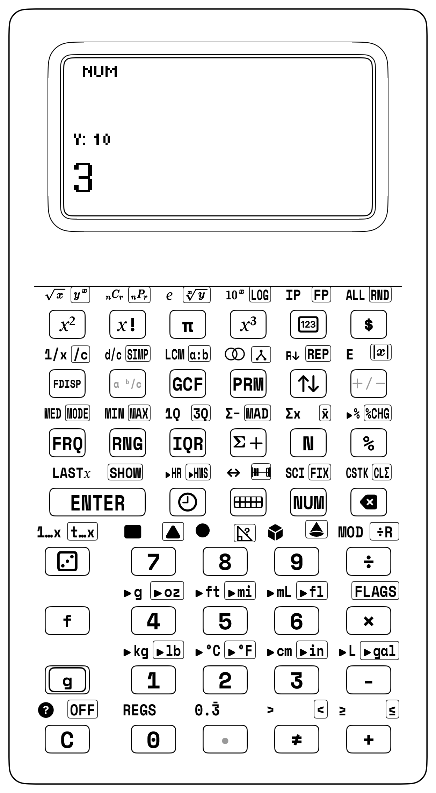


## 4.2 Concrete Foundation: 144-Tile Four-Color Array Studio & Map Theory

When you first learn multiplication, it might seem like a song to memorize. But multiplication is really **spatial equal groups**, **rectangular area arrays**, and **color-coded maps** you can build with your hands.

| Learning Stage | Physical Manipulative Kit | SC-6 Representational Sandbox | Abstract Operational Stack |
|---|---|---|---|
| **1. Concrete (Enactive)** | 144-Tile Four-Color Array Studio | Physical interlocking tiles and 90° array rotation | Tactile array perception |
| **2. Representational (Iconic)** | 4-Color Quadrant Partitioning & Map Theory | High-contrast LCD vector dot-matrix grid | Visual area model representation |
| **3. Abstract (Symbolic)** | Four-Register RPN Stack ($T, Z, Y, X$) | `Y [ENTER] X [×]` two-number drop | Chained parenthesis-free speed |

The StackCalc physical manipulative ecosystem replaces loose single-purpose blocks with the **144-Tile Four-Color Counting & Array Studio**:

<div class="admonition tip">
<p class="admonition-title">144-Tile Four-Color Counting &amp; Array Studio</p>
<p>
The physical manipulative studio provides 144 precision interlocking stacking tiles ($20.0 \times 20.0 \times 7.0\text{ mm}$) arranged across four distinct architectural palettes:
1. <strong>Archival White</strong> (crisp matte finish)<br>
2. <strong>Cobalt Blue</strong> (deep saturated tone)<br>
3. <strong>Radiant Gold</strong> (warm amber tone)<br>
4. <strong>Slate Gray</strong> (technical neutral tone)<br>
with exactly 36 tiles per color. Each tile has a 1U visible height ($7.0\text{ mm}$), aligning with the 1/12th Fraction Studio tile so that 12 vertically stacked tiles match the $84.0\text{ mm}$ master datum of the 1-Whole Fraction Tower. Precision slip-fit chamfers allow smooth vertical stacking and planar docking without fatigue or sticking.
</p>
</div>


### 4.2.1 The Mathematical Harmony of $4 \times 36 = 144$
The number 144 divided into 4 colors creates unique mathematical properties:
1. **$12 \times 12$ Master Multiplication Matrix:** The full kit builds the complete $12 \times 12 = 144$ times table.
2. **Four Complete $6 \times 6$ Squares:** Each individual color contains **36 tiles**, which is itself a perfect square ($6 \times 6 = 36$) and a triangular number ($1 + 2 + \dots + 8 = 36$).
3. **Four-Player Team Quads:** At a 4-player math workshop table, each player receives their own signature color set of 36 tiles.

| Array Orientation | Grid Dimensions | Row Breakdown | Total Area |
| :--- | :--- | :--- | :--- |
| **Array A** | $3\text{ Rows} \times 8\text{ Columns}$ | 3 rows of 8 tiles ($8 + 8 + 8$) | **$3 \times 8 = 24\text{ tiles}$** |
| **Array B** | $4\text{ Rows} \times 6\text{ Columns}$ | 4 rows of 6 tiles ($6 + 6 + 6 + 6$) | **$4 \times 6 = 24\text{ tiles}$** |

---

### 4.2.2 Station Lesson 4.1: The 144-Tile Rectangular Array Studio & Multiplication Properties

<div class="admonition note">
<p class="admonition-title">Station Lesson 4.1: Tactile Setup</p>
<p>
&bull; <strong>Manipulatives:</strong> Counting &amp; Array Studio with 144 Precision Interlocking Tiles (4 colors &times; 36 tiles)<br>
&bull; <strong>Hardware:</strong> StackCalc SC-6 Elementary Calculator<br>
&bull; <strong>Core Goals:</strong> Tactile proof of Commutative, Associative, and Distributive properties with 4-register stack traces
</p>
</div>


#### 1. Commutative Property ($A \times B = B \times A$)
Build a solid rectangular mat of 3 rows of 8 tiles ($3 \times 8$).
Now, physically pick up the mat and rotate it by $90^\circ$ on the tabletop.
You now see 8 rows of 3 tiles ($8 \times 3$).
Did the number of tiles change? Not a single tile was added or removed!

On the SC-6 stack:
- Sequence 1: `3 [ENTER] 8 [×]` $\longrightarrow X = \mathbf{24}$.
- Sequence 2: `8 [ENTER] 3 [×]` $\longrightarrow X = \mathbf{24}$.

| Keystroke | Register T | Register Z | Register Y | Register X (Display) |
| :--- | :--- | :--- | :--- | :--- |
| [3] [ENTER] | 0 | 0 | 3 | 3 |
| [8] [×] | 0 | 0 | 0 | 24 |
| [8] [ENTER] | 0 | 24 | 8 | 8 |
| [3] [×] | 0 | 0 | 24 | 24 |
You see with your own eyes and feel with your own hands that spatial orientation does not alter the product.

#### 2. Associative Property ($(A \times B) \times C = A \times (B \times C)$)
Build a 3D block prism: stack three layers of $3 \times 4$ tiles ($12$ tiles per layer) vertically. Because each tile is $7.0\text{ mm}$ tall, 3 stacked tiles equal $21.0\text{ mm}$ (approximating 1 cubic unit):
- Method A: Multiply length by width first ($3 \times 4 = 12$), then multiply by height ($12 \times 3 = 36$).
- Method B: Multiply width by height first ($4 \times 3 = 12$), then multiply by length ($3 \times 12 = 36$).

On the SC-6:
- Keystrokes: `[3] [ENTER] [4] [×] [3] [×]`$\longrightarrow X = \mathbf{36}$.

| Keystroke | Register T | Register Z | Register Y | Register X (Display) |
| :--- | :--- | :--- | :--- | :--- |
| [3] [ENTER] | 0 | 0 | 3 | 3 |
| [4] [×] | 0 | 0 | 0 | 12 |
| [3] [×] | 0 | 0 | 0 | 36 |
The operational stack handles continuous chained multiplication without requiring parentheses.

#### 3. Distributive Property & 4-Quadrant Area Models ($(a+b)(c+d)$)
You can decompose complex multi-digit multiplication into four partial products using all four tile colors:
$$(10 + 2) \times (10 + 2) = (10 \times 10) + (10 \times 2) + (2 \times 10) + (2 \times 2) = 100 + 20 + 20 + 4 = 144$$

| Partial Product Quadrant | Dimensions | Tile Count |
| :--- | :--- | :--- |
| **Upper-Left ($10 \times 10$)** | $10\text{ rows} \times 10\text{ columns}$ | $100\text{ tiles}$ |
| **Upper-Right ($10 \times 2$)** | $10\text{ rows} \times 2\text{ columns}$ | $20\text{ tiles}$ |
| **Lower-Left ($2 \times 10$)** | $2\text{ rows} \times 10\text{ columns}$ | $20\text{ tiles}$ |
| **Lower-Right ($2 \times 2$)** | $2\text{ rows} \times 2\text{ columns}$ | $4\text{ tiles}$ |
| **Total Distributive Area** | $(10 + 2) \times (10 + 2) = 12 \times 12$ | **$144\text{ tiles}$** |


On the SC-6:
- Keystrokes: `[1][0] [ENTER] [2] [+] [1][0] [ENTER] [2] [+] [×]`$\longrightarrow X = \mathbf{144}$.

| Keystroke | Register T | Register Z | Register Y | Register X (Display) |
| :--- | :--- | :--- | :--- | :--- |
| `10` [ENTER] | 0 | 0 | 10 | 10 |
| [2] [+] | 0 | 0 | 0 | 12 |
| `10` [ENTER] | 0 | 12 | 10 | 10 |
| [2] [+] | 0 | 0 | 12 | 12 |
| [×] | 0 | 0 | 0 | 144 |
The four colors turn an abstract polynomial identity into an intuitive spatial puzzle.

---

### 4.2.3 The Four-Color Map Theorem Station Game
In 1976, Kenneth Appel and Wolfgang Haken proved that **no more than four colors are required** to color any planar map so that no two adjacent regions share a color.

**Station Game: "Planar Map Showdown"**
* **Players:** 2 to 4 players.
* **Rules:** Players take turns placing a counting tile onto the table grid to expand a contiguous "country". A placed tile may **never share a side edge** with a tile of the same color (diagonal corners are allowed).
* **The Challenge:** You discover that no matter how winding or complex the border network becomes, you **never need a 5th color**! If a player cannot legally place their color, they must skip their turn. The player with the most legal placements wins.

## 4.3 Addition & Subtraction Dynamics: Regrouping Without Fear

### 4.3.1 The Crisis of the Standard "Borrowing" Algorithm
In traditional arithmetic instruction, multi-digit subtraction ($92 - 38$) is taught through mechanical column borrowing:
1. "Look at the ones column: $2 - 8$. You can't take 8 from 2."
2. "Cross out the 9, make it an 8."
3. "Put a little 1 next to the 2 to make it 12."
4. "$12 - 8 = 4$."
5. "$8 - 3 = 5$."
6. "Answer: 54."

When you learn traditional column borrowing, it's easy to fall into two confusing habits:
- Seeing the "little 1" as an arbitrary mark rather than a physical bundle of **10 units** transferred from the tens column.
- Feeling anxious when crossing out numbers, treating it like an error rather than keeping the total quantity invariant.

### 4.3.2 Mental Math Regrouping Strategies
With the SC-6, you can explore flexible mental math strategies that build true intermediate number awareness:

#### Strategy 1: The Compensation Method ($92 - 38$)
Instead of subtracting 38, subtract the friendly landmark number 40, and then compensate by adding 2 back:
$$92 - 38 = (92 - 40) + 2 = 52 + 2 = 54$$
On the SC-6 stack:
- `92 [ENTER] 40 [-] 2 [+]` $\longrightarrow X = \mathbf{54}$.

#### Strategy 2: Bridging Tens ($47 + 38$)
Decompose 38 into $30 + 3 + 5$:
$$47 + 30 = 77 \quad \longrightarrow \quad 77 + 3 = 80 \quad \longrightarrow \quad 80 + 5 = 85$$
On the SC-6:
- `47 [ENTER] 30 [+] 3 [+] 5 [+]` $\longrightarrow X = \mathbf{85}$.
Every step is evaluated in real time, giving immediate diagnostic confirmation.

---

## 4.4 Superpower 1: Rhythmic Skip-Counting Ladders (`[g] [REP]`)

In math class, times tables are mastered through **rhythmic skip-counting**. On conventional algebraic calculators, doing this requires repeatedly typing `+ 7 = = =`, which is easily disrupted if you pause, clear, or double-tap.

On classic scientific RPN calculators like the HP-32SII, loading a constant multiplier into Register $T$ required pressing `[ENTER]` three times (`[7] [ENTER] [ENTER] [ENTER]`). That is cumbersome and easy to forget.

The SC-6 introduces **Superpower 1 (`[g] [REP]`)** on Row 3, Col 4. In a single click, `[g] [REP]` replicates the contents of Register $X$ across all four registers ($T, Z, Y, X$).

<div class="admonition note">
<p class="admonition-title">Superpower 1: Stack Replication [g] [REP]</p>
<p>
• <strong>Enter Step Constant:</strong> Type <code>[7]</code>.<br>
• <strong>Press <code>[g] [REP]</code>:</strong> Replicates the constant across every level: Register T = 7 (Top Floor Permanent Constant), Register Z = 7, Register Y = 7, Register X = 7.<br>
• <strong>The Ladder Invariant:</strong> Each time you tap <code>[+]</code>, Register T drops downward to replenish the stack, maintaining the constant step indefinitely without re-typing!
</p>
</div>

### 4.4.1 Station Lesson 4.2: Skip-Counting Ladders with Superpower 1 (`[g] [REP]`)

<div class="admonition note">
<p class="admonition-title">Station Lesson 4.2: Tactile Setup</p>
<p>
&bull; <strong>Manipulatives:</strong> Counting &amp; Array Studio, Batches of Stacking Tiles arranged in equal groups<br>
&bull; <strong>Hardware:</strong> StackCalc SC-6 in 4-Stack Mode with <code>[g] [REP]</code> key<br>
&bull; <strong>Cadence:</strong> Physical group addition paired with RPN stack collapse
</p>
</div>

#### 1. Skip-Counting by Sevens: The 7s Ladder
Let us generate the multiples of 7:
1. Type `[7]`.
2. Press [g] [REP] (Row 3, Col 4). Every register ($T, Z, Y, X$) now holds 7!
3. Now simply tap `[+]` rhythmically as you place each physical 7-tile bar onto the table:

| Keystroke | Register T (Constant) | Register Z | Register Y | Register X (Ladder) |
| :--- | :--- | :--- | :--- | :--- |
| [7] | 0 | 0 | 0 | 7 |
| [g] [REP] | 7 | 7 | 7 | 7 |
| [+] | 7 | 7 | 7 | 14 |
| [+] | 7 | 7 | 7 | 21 |
| [+] | 7 | 7 | 7 | 28 |
| [+] | 7 | 7 | 7 | 35 |
| [+] | 7 | 7 | 7 | 42 |
| [+] | 7 | 7 | 7 | 49 |
| [+] | 7 | 7 | 7 | 56 |
| [+] | 7 | 7 | 7 | 63 |
| [+] | 7 | 7 | 7 | 70 |

Because Register $T$ constantly duplicates its value down during two-number stack drop, you can march through the entire times table ($7, 14, 21, 28 \dots 70$) in cadence with clapping drills or physical stepping.

#### 2. Skip-Counting by Twelves (Dozens Ladder)
The number 12 is fundamental to everyday life (dozens of eggs, hours on a clock, inches in a foot, months in a year).
1. Type `12`.
2. Press [g] [REP]. All registers hold 12!
3. Tap `[+]` rhythmically to climb:
   $$\mathbf{24, 36, 48, 60, 72, 84, 96, 108, 120}$$

> **DOZENS CADENCE TABLE:**
> 1 Dozen  = 12 eggs      5 Dozen  = 60 eggs       9 Dozen  = 108 eggs
> 2 Dozen  = 24 eggs      6 Dozen  = 72 eggs      10 Dozen  = 120 eggs
> 3 Dozen  = 36 eggs      7 Dozen  = 84 eggs      11 Dozen  = 132 eggs
> 4 Dozen  = 48 eggs      8 Dozen  = 96 eggs      12 Dozen  = 144 (Gross!)

#### 3. The Doubling Ladder: Geometric Powers
Doubling is one of the most powerful mental math strategies in Grade 2 and 3.
How do living cells divide, or how do digital computer memory chips scale?
1. Enter `[2] [ENTER]`.
2. Press `[ENTER] [+]`: $2 + 2 = \mathbf{4}$.
3. Press `[ENTER] [+]`: $4 + 4 = \mathbf{8}$.
4. Press `[ENTER] [+]`: $8 + 8 = \mathbf{16}$.
5. Press `[ENTER] [+]`: $16 + 16 = \mathbf{32}$.
6. Continue climbing: $\mathbf{64, 128, 256, 512, 1024}$!

> **YOUR STACK SUPERPOWER CHECKPOINT:**
> • Pressing [ENTER] duplicates the number in Register X into Register Y.
> • Pressing [+] immediately combines them into double their value!
> • This two-key rhythm ([ENTER] [+]) lets you double any number instantly.

---

## 4.5 Superpower 2: Simultaneous Quotient & Remainder (`[g] [÷R]`)

<div class="admonition tip">
<p class="admonition-title">Why Long Division Causes Tears vs [g] [÷R]</p>
<p>
<strong>The Scenario:</strong> You face: <em>"Divide 43 by 6."</em><br><br>
<strong>The Traditional Homework Trap:</strong><br>
You are taught to divide, multiply, subtract, and bring down. If you type it into a standard smartphone calculator, the screen displays: <code>7.16666666667</code>.<br>
You wonder: <em>"Where did 0.1666 come from? My teacher wants a remainder!"</em> How do you convert decimals back to leftovers?<br><br>
<strong>The 10-Second RPN Superpower:</strong><br>
On your SC-6, press: <code>43 [ENTER] 6 [g] [÷R]</code>.<br>
The transflective LCD splits instantly:
</p>
<ul>
  <li><strong>Register X displays:</strong> <code>7</code> (The whole Quotient)</li>
  <li><strong>Register Y displays:</strong> <code>1</code> (The exact Remainder!)</li>
</ul>
<p>
To inspect the remainder, simply tap <code>[x⇄y]</code>!<br>
To check your work with Superpower 4: <code>[f] [LASTX] [×] [+]</code> &rarr; <code>43</code>! Instant self-proof! Zero decimals. Zero tears. Total mathematical confidence.
</p>
</div>

In elementary school math, long division produces a **whole quotient** and a **remainder**. Traditional calculators display unwieldy decimals ($17 \div 5 = 3.4$), completely obscuring the physical meaning of equal groups and leftovers.

The SC-6 introduces **Superpower 2: Integer Division with Remainder (`[g] [÷R]`)** on Row 2, Col 5:

<div class="admonition note">
<p class="admonition-title">Superpower 2: Integer Division with Remainder ([g] [÷R])</p>
<p>
Given Dividend Y and Divisor X:<br>
&bull; <strong>Register X</strong> receives the whole integer Quotient: $Q = \mathrm{trunc}(Y / X)$<br>
&bull; <strong>Register Y</strong> receives the whole integer Remainder: $R = Y \bmod X$<br>
&bull; Tapping <code>[x⇄y]</code> instantly swaps registers to inspect the Remainder!
</p>
</div>

### 4.5.1 Algebraic Trap vs. StackCalc Superpower Showdown: Division with Remainder

| Challenge / Equation | The Algebraic Calculator Trap (TI-30X / Smartphone) | The StackCalc SC-6 + Manipulative Superpower | Keystroke Reduction | Live Stack Visibility | Pedagogical Breakthrough |
| :--- | :--- | :--- | :---: | :--- | :--- |
| **Integer Division with Remainder:**<br>$185 \div 12$ | `1 8 5 / 1 2 =`<br>$\rightarrow 15.41666667$.<br>To extract integer remainder:<br>`- 15 = * 12 =`<br>(18 keystrokes).<br>Self-check requires retyping:<br>`15 * 12 + 5 =`<br>(28 total keystrokes).<br>*Trap: Decimals obscure discrete items; scratch paper required.* | **SC-6 + 24-Cube Array Studio &amp; Egg Cartons:**<br>`185 [ENTER] 12 [g] [÷R]`<br>(7 keystrokes).<br>Simultaneously displays Quotient $Q = 15$ in Register $X$ and Remainder $R = 5$ in Register $Y$!<br>Tap `[x⇄y]` to swap.<br>Self-check in 3 keys:<br>`[f] [LASTX] [×] [+]`<br>$\rightarrow 185$! | **75% fewer keystrokes**<br>(7 vs. 28) | **Dual Live Registers:**<br>Quotient $Q$ and Remainder $R$ visible simultaneously on the transflective screen; zero scratch paper. | **Discrete Math Alignment:**<br>Eliminates decimal confusion in discrete sharing problems; transforms long division into an intuitive physical packaging and self-checking workflow. |

### 4.5.2 Station Lesson 4.3: Equal Group Packaging & Remainder Sorting with Superpower 2 (`[g] [÷R]`)

<div class="admonition note">
<p class="admonition-title">Station Lesson 4.3: Tactile Setup</p>
<p>
&bull; <strong>Manipulatives:</strong> Counting &amp; Array Studio, 23 Stacking Tiles on desk<br>
&bull; <strong>Hardware:</strong> StackCalc SC-6 Elementary with <code>[g] [÷R]</code> integer division<br>
&bull; <strong>Physical Goal:</strong> Deal 23 tiles into equal groups of 5; isolate remainders
</p>
</div>

> **DESK DEALING LAYOUT (23 TILES DIVIDED BY 5):**
> GROUP 1: [⬜][⬜][⬜][⬜][⬜] (5 Tiles)
> GROUP 2: [⬜][⬜][⬜][⬜][⬜] (5 Tiles)
> GROUP 3: [⬜][⬜][⬜][⬜][⬜] (5 Tiles)
> GROUP 4: [⬜][⬜][⬜][⬜][⬜] (5 Tiles)
> REMAINDER: [🟦][🟦][🟦]       (3 Loose Leftover Tiles!)
> Total: 4 Groups × 5 Tiles + 3 Remainder = 23 Tiles!

#### Step-by-Step Hands-On Protocol:
1. **Concrete Dealing:** Count out 23 tiles and divide them into piles of 5. You find you can make exactly 4 complete piles, but 3 tiles remain loose on your desk.
2. **RPN Execution:**
   - Type `23 [ENTER] [5] [g] [÷R]`.
   - Register $X$ displays: $\mathbf{4}$ (The 4 full equal groups!).
   - Register $Y$ holds: $\mathbf{3}$ (The 3 loose leftover tiles!).
3. **Register Swap:**
   - Tap `[x⇄y]`: The active display shifts to $\mathbf{3}$, bringing the remainder directly to your eyes.
   - Tap `[x⇄y]` again: Returns to quotient $\mathbf{4}$.

| Keystroke | Register T | Register Z | Register Y | Register X (Display) |
| :--- | :--- | :--- | :--- | :--- |
| `23` [ENTER] | 0 | 0 | 23 | 23 |
| [5] | 0 | 0 | 23 | 5 |
| [g] [÷R] | 0 | 0 | 3 | 4 |
| [x⇄y] | 0 | 0 | 4 | 3 |

---

### 4.5.3 Real-World Problem 1: Egg Carton Packaging (12 Eggs per Carton)
**Word Problem:** A farm gathers 147 fresh eggs in the morning. Each carton holds exactly 12 eggs. How many full cartons can be packed for the farmer's market, and how many loose eggs are left over?

| Keystroke | Register T | Register Z | Register Y | Register X |
| :--- | :--- | :--- | :--- | :--- |
| `147` | 0 | 0 | 0 | 147 |
| [ENTER] | 0 | 0 | 147 | 147 |
| `12` | 0 | 0 | 147 | 12 |
| [g] [÷R] | 0 | 0 | 3 | 12 |
| [x⇄y] | 0 | 0 | 12 | 3 |

> **DIAGNOSTIC VERIFICATION:**
> • Register X = 12 (There are 12 full cartons of eggs!).
> • Press [x⇄y] -> Register X = 3 (There are 3 loose eggs left over!).
> • Mathematical proof: (12 cartons × 12 eggs) + 3 remainder = 144 + 3 = 147!

---

### 4.5.4 Real-World Problem 2: Bakery Muffin Trays (6 Muffins per Tray)
**Word Problem:** A bakery oven bakes 86 apple cinnamon muffins. Each baking tray holds 6 muffins. How many full trays are filled, and how many extra muffins remain?

1. Type `86 [ENTER] [6] [g] [÷R]`.
   - Register $X$ displays: $\mathbf{14}$ (14 full trays!).
   - Register $Y$ holds: $\mathbf{2}$ (2 leftover muffins).
2. Tap `[x⇄y]` to inspect the remainder: Register $X = \mathbf{2}$.

---

### 4.5.5 Real-World Problem 3: School Field Trip Buses (54 Passengers per Bus)
**Word Problem:** An elementary school is taking 380 students and chaperones on a science museum field trip. Each chartered bus has 54 seats. How many full buses are needed, and how many people must ride on an additional bus?

1. Type `380 [ENTER] 54 [g] [÷R]`.
   - Register $X$ displays: $\mathbf{7}$ (7 full buses carrying $7 \times 54 = 378$ people).
   - Register $Y$ holds: $\mathbf{2}$ (2 people left over).
2. **Think About It:** *"Can we order 7 buses?"*
   - No! Those 2 people cannot be left behind at school. The school must order **8 buses** in total! (Ceiling division: if remainder $> 0$, add 1 bus!).

---

### 4.5.6 Real-World Problem 4: Dividing Classroom Chore Earnings
**Word Problem:** Four siblings earn $\$17.50$ raking autumn leaves. How much whole dollar money does each sibling receive, and what remainder must be shared in pennies?

1. Type `17.50 [ENTER] [4] [g] [÷R]`.
   - Register $X$ displays: $\mathbf{4.00}$ (Each sibling receives $\$4.00$).
   - Register $Y$ holds: $\mathbf{1.50}$ (Remainder of $\$1.50$ left over).
2. Tap `[x⇄y]` to verify the $\$1.50$ remainder.


---

### 4.5.7 The Euclidean Algorithm for Greatest Common Divisor via `[g] [÷R]`
As you advance in math, you will discover Euclid's timeless algorithm for finding the Greatest Common Factor (GCF) of two large numbers:
$$\gcd(a, b) = \gcd(b, a \bmod b)$$

On the SC-6, Superpower 2 executes this algorithm with breathtaking elegance:
Find $\gcd(252, 105)$:
1. `252 [ENTER] 105 [g] [÷R]` $\longrightarrow Q = 2, R = \mathbf{42}$ in Register $Y$.
2. Tap `[x⇄y]` to bring remainder 42 to $X$.
3. We divide prior divisor 105 by 42: `105 [x⇄y] [g] [÷R]` $\longrightarrow Q = 2, R = \mathbf{21}$ in Register $Y$.
4. Tap `[x⇄y]` to bring remainder 21 to $X$.
5. We divide 42 by 21: `42 [x⇄y] [g] [÷R]` $\longrightarrow Q = 2, R = \mathbf{0}$!
6. The last non-zero remainder is **21**! Therefore, $\gcd(252, 105) = \mathbf{21}$!

---

## 4.6 Superpower 4: Self-Checking Inverse Arithmetic (`[f] [LASTX]`)

A great mathematician never simply accepts an answer—they prove it using **inverse operations**.

On conventional calculators, self-checking requires clearing the screen and re-typing the entire calculation backwards. On the SC-6, **Superpower 4 (`[f] [LASTX]`)** preserves the prior number before the operation executed:

<div class="admonition note">
<p class="admonition-title">Superpower 4: Self-Checking Inverse ([f] [LASTX])</p>
<p>
&bull; Whenever an operation executes, Register X's prior value is saved in the hardware <code>LASTX</code> register.<br>
&bull; Tapping <code>[f] [LASTX]</code> pushes that number back into Register X, while automatically lifting the calculated result into Register Y!<br>
&bull; You can immediately execute the inverse operation with <strong>zero re-typing</strong>!
</p>
</div>

---

### 4.6.1 Inverse Verification 1: Checking Addition with Subtraction
Let us verify $47 + 36 = 83$:
1. Add the numbers: `47 [ENTER] 36 [+]` $\longrightarrow X = \mathbf{83}$.
2. Press [f] [LASTX] (Row 2, Col 3):
   - $36$ is recalled into Register $X$.
   - $83$ is automatically lifted into Register $Y$.
3. Press `[-]` to execute the inverse check:
   - $83 - 36 = \mathbf{47}$!
   - We have restored our starting quantity with 100% mathematical certainty!

| Keystroke | Register T | Register Z | Register Y | Register X |
| :--- | :--- | :--- | :--- | :--- |
| `47` | 0 | 0 | 0 | 47 |
| [ENTER] | 0 | 0 | 47 | 47 |
| `36` | 0 | 0 | 47 | 36 |
| [+] | 0 | 0 | 0 | 83 |
| [f] [LASTX] | 0 | 0 | 83 | 36 |
| [-] | 0 | 0 | 0 | 47 |

---

### 4.6.2 Inverse Verification 2: Checking Multiplication with Division
Let us verify $15 \times 8 = 120$:
1. Multiply: `15 [ENTER] 8 [×]` $\longrightarrow X = \mathbf{120}$.
2. Press [f] [LASTX]:
   - $8$ is recalled into Register $X$.
   - $120$ is lifted into Register $Y$.
3. Press `[÷]`:
   - $120 \div 8 = \mathbf{15}$!


---

### 4.6.3 Inverse Verification 3: Checking Subtraction with Addition
Let us verify $95 - 38 = 57$:
1. Subtract: `95 [ENTER] 38 [-]` $\longrightarrow X = \mathbf{57}$.
2. Press [f] [LASTX]:
   - $38$ is pushed into Register $X$.
   - $57$ is lifted into Register $Y$.
3. Press `[+]`:
   - $57 + 38 = \mathbf{95}$! Original starting value confirmed!

---

### 4.6.4 Inverse Verification 4: Checking Division with Multiplication
Let us verify $84 \div 7 = 12$:
1. Divide: `84 [ENTER] 7 [÷]` $\longrightarrow X = \mathbf{12}$.
2. Press [f] [LASTX]:
   - $7$ is recalled into Register $X$.
   - $12$ is lifted into Register $Y$.
3. Press `[×]`:
   - $12 \times 7 = \mathbf{84}$! Original dividend restored!

---

## 4.7 5th Grader Extreme Math Challenges: Doubling to the Sky & Your Age in Seconds!

Think multiplication is just boring times tables? Try these two extreme challenges on your SC-6 and test them on your family:

### 4.7.1 Challenge 1: What Happens If You Fold a Piece of Paper 10 Times with `[g] [REP]`?
A sheet of notebook paper is only $1\text{ layer}$ thick. Every time you fold it in half, the number of layers **doubles** ($\times 2$). Can you fold a piece of paper 10 times with your bare hands? Almost nobody can—and Superpower 1 (`[g] [REP]`) shows why!
* Seed the stack with `2` and tap `[×]` nine times to see 10 doublings ($2^{10}$):
  `2 [g] [REP] [×] [×] [×] [×] [×] [×] [×] [×] [×]` $\longrightarrow$ **`1024` layers** (thicker than a 1,000-page dictionary!).

**Step-by-Step RPN Reasoning & Stack Logic:**
1. `2` `[g] [REP]` — Lock constant factor 2 into every stack floor ($T = Z = Y = X = 2$), priming the physical doubling mechanism *([Parker, 2019](sc6/appendix-c-formulas-and-conversions.md#cite-parker2019))*.
2. `[×]` — 1st fold: 2 layers double to 4 ($X = 4$), while constant 2 drops down from Floor $T$ to wait on Floor $Y$.
3. `[×]` — 2nd fold: 4 layers double to 8 ($X = 8$), already thicker than standard cardstock.
4. `[×]` — 3rd fold: 8 layers double to 16 ($X = 16$), resisting thumb pressure.
5. `[×]` — 4th fold: 16 layers double to 32 ($X = 32$), thick like a deck of index cards.
6. `[×]` — 5th fold: 32 layers double to 64 ($X = 64$), stiff like a wooden slat.
7. `[×]` — 6th fold: 64 layers double to 128 ($X = 128$), impossible to crease with bare fingers.
8. `[×]` — 7th fold: 128 layers double to 256 ($X = 256$), thick like a textbook.
9. `[×]` — 8th fold: 256 layers double to 512 ($X = 512$), a full 500-sheet ream of copy paper.
10. `[×]` — 9th fold: 512 layers double to 1,024 ($X = 1024$), towering like a colossal phone directory!

* If you keep tapping `[×]` 10 more times ($20\text{ folds} = 1,048,576\text{ layers}$), that single sheet of paper would be taller than the Empire State Building!

### 4.7.2 Challenge 2: How Many Seconds Old Are You Right Now?
If you are **11 years old** in 5th grade, have you lived for a million seconds yet? What about a *billion* seconds? Let's chain the multiplication right on the stack ($11\text{ years} \times 365\text{ days} \times 24\text{ hours} \times 60\text{ minutes} \times 60\text{ seconds}$):
* **Keystrokes:** `11 [ENTER] 365 [×] 24 [×] 60 [×] 60 [×]` $\longrightarrow$ **`346,896,000` seconds**!

**Step-by-Step RPN Reasoning & Stack Logic:**
1. `11` `[ENTER]` — Set your 11-year age baseline onto the upper mezzanine shelf ($Y = 11$).
2. `365` `[×]` — Fold in days per year: $11 \times 365 = 4,015\text{ days}$ of sunrise and sunset resting on the active floor ($X = 4015$).
3. `24` `[×]` — Fold in hours per day: $4,015 \times 24 = 96,360\text{ hours}$ lived ($X = 96360$).
4. `60` `[×]` — Convert hours to minutes: $96,360 \times 60 = 5,781,600\text{ minutes}$ ($X = 5781600$).
5. `60` `[×]` — Convert minutes to seconds: $5,781,600 \times 60 = 346,896,000\text{ seconds}$ ticking past on the LCD screen!

* You blew past $1,000,000\text{ seconds}$ when you were only $11.5\text{ days}$ old—and at 11 years old, you are already more than **one-third of the way to 1 Billion seconds**!

---

<div class="admonition note">
<p class="admonition-title">For Parents &amp; Teachers: Division as Partitioning &amp; Inverse Verification</p>
<p>
<strong>Division as Partitioning vs. Decimal Abstraction:</strong> In elementary classrooms, long division often presents a severe pedagogical hurdle *([Ma, 1999](sc6/appendix-c-formulas-and-conversions.md#cite-ma1999))*. Traditional calculators compound this difficulty by outputting continuous decimal quotients: $17 \div 5 = 3.4$. In concrete situations involving discrete objects—such as packing egg cartons, grouping students, or cutting materials—a fractional decimal fails to match physical intuition *([Singapore MOE, 2014](sc6/appendix-c-formulas-and-conversions.md#cite-singapore2014))*.<br><br>
Superpower 2 (<code>[g] [÷R]</code>) aligns calculator output directly with discrete partitioning. By placing the whole-number quotient $Q$ in Register $X$ and the integer remainder $R$ in Register $Y$, the SC-6 mirrors physical manipulation: 17 units divide into 3 complete groups of 5 with 2 loose units remaining. Tapping <code>[x⇄y]</code> swaps registers instantaneously, enabling inspection of both components without recalculation.<br><br>
<strong>Self-Checking and the Inverse Verification Strategy:</strong> Developing mathematical autonomy requires moving learners away from external answer validation toward internal verification. Superpower 4 (<code>[f] [LASTX]</code>) provides direct support for George Pólya's classic "look back" problem-solving strategy *([Pólya, 1945](sc6/appendix-c-formulas-and-conversions.md#cite-polya1945))*.<br><br>
By preserving the argument of the most recent operation in the non-volatile <code>LASTX</code> register, the SC-6 allows students to verify results using inverse operations without re-entering values:
after addition ($47 + 36 = 83.0$), tapping <code>[f] [LASTX] [-]</code> immediately returns to $47.0$; after division ($120 \div 8 = 15.0$), executing <code>[f] [LASTX] [×]</code> multiplies back to $120.0$.<br><br>
<strong>Stack Constant Seeding &amp; Fluency:</strong> Superpower 1 (<code>[g] [REP]</code>) populates all four stack registers ($T, Z, Y, X$) with the entered step value in a single instruction *([Macaulay, 2016](sc6/appendix-c-formulas-and-conversions.md#cite-macaulay2016))*, powering rhythmic skip-counting ladders and building structural number sense.
</p>
</div>

<div class="admonition note">
<p class="admonition-title">For Parents &amp; Teachers: Classroom Dialogue Scripts &amp; Misconception Diagnostics</p>
<p>
<strong>Script 4.1: The Field Trip Bus Ceiling Trap:</strong> When dividing $145$ students across $40$-seat buses (<code>145 [ENTER] 40 [g] [÷R]</code> &rarr; $X=3, Y=25$), remind students that $25$ people cannot be left behind. Any remainder greater than zero requires ordering an additional bus ($3 + 1 = 4$ buses!).<br><br>
<strong>Script 4.2: Array Rotation &amp; The Commutative Miracle:</strong> Rotating a $3 \times 8$ counting tile array into an $8 \times 3$ array proves that $A \times B = B \times A$ without altering the physical tile count (both evaluate to $24$).<br><br>
<strong>Script 4.3: The Magic Mirror of LASTX:</strong> If a student multiplies $18 \times 7 = 126$, pressing <code>[f] [LASTX] [÷]</code> restores the starting $18$, proving the answer without scratch paper.<br><br>
<strong>Script 4.4: Leftovers vs. Decimals in Pizza Sharing:</strong> Four friends sharing $15$ pizza slices (<code>15 [ENTER] 4 [g] [÷R]</code>) receive 3 slices each with 3 whole slices left in the box for tomorrow, avoiding awkward decimal cuts ($3.75$).
</p>
</div>

---

## 4.8 Comprehensive Worked Reference Problems (50 Elementary Reference Problems)

<div class="admonition tip">
<p class="admonition-title">Hands-On Studio Proof: Blocks &rarr; Calculator</p>
<p>
<strong>Step 1 (Physical Concrete Intuition):</strong> Take 24 precision stacking tiles from your 144-Tile Array Studio. Build a solid rectangular array of 3 rows with 8 tiles each ($3 \times 8$). Count the rows and columns: 24 total tiles. Now physically rotate the entire tile tray $90^\circ$ on the tabletop. You now see 8 rows of 3 tiles ($8 \times 3$). Not a single tile was added or lost: the physical area is invariant.<br>
<strong>Step 2 (The Representational Bridge):</strong> Enter the calculation on your SC-6: <code>3 [ENTER] 8 [×]</code> &rarr; <code>24</code>. Now verify the rotated physical array: <code>8 [ENTER] 3 [×]</code> &rarr; <code>24</code>. Tap <code>[f] [LASTX] [÷]</code> to execute the inverse check: <code>24 &divide; 3 = 8</code>! Every physical manipulation maps directly to a stack operation.<br>
<strong>Step 3 (Scaling on the Calculator):</strong> Now scale beyond the physical tabletop limits. You cannot easily lay out an orchard of 48 rows with 36 apple trees each on your desk—but your SC-6 evaluates <code>48 [ENTER] 36 [×]</code> &rarr; <code>1,728</code> trees in a fraction of a second, with the exact same spatial truth!
</p>
</div>

### 4.8.1 Expedition 1: The Saturday Morning Bakehouse & Master Orchard (Problems 4.1–4.8)
*Mission Briefing:* You are the head baker and master orchardist preparing goods for the weekend market. You must calculate baking tray capacities, arrange fruit crate matrices, and rotate cookie cooling grids—verifying that commutativity and spatial area always protect your production counts.

#### Problem 4.1: Four-Color Counting Tile Array ($3 \times 8 = 24$)
- **Word Problem:** You build a rectangular baking tray with 3 rows of 8 White counting tiles to model sugar cookies. Find total cookies on the tray.
- **Hands-On with Your Blocks (Counting Tiles):** Snap 3 rows of 8 white counting tiles together into a solid planar rectangle on the workstation desk.
- **Keystrokes:** `3 [ENTER] 8 [×]` $\rightarrow$ **`24`**
- **4-Register Stack Trace Table:**

| Keystroke | Register T | Register Z | Register Y | Register X | Operational Commentary |
| :--- | :--- | :--- | :--- | :--- | :--- |
| [3] | 0 | 0 | 0 | 3 | Key in row count; value enters active Register $X$ |
| [ENTER] | 0 | 0 | 3 | 3 | Lift row dimension to holding Register $Y$ |
| [8] | 0 | 0 | 3 | 8 | Key in tiles per row into Register $X$ |
| [×] | 0 | 0 | 0 | 24 | Multiply dimensions; stack drops to display total area ($X = 24$) |

- **Diagnostic Check:** $X = 24$.

---

#### Problem 4.2: Rotated Array Commutative Proof ($8 \times 3 = 24$)
- **Word Problem:** Rotate the baking tray from Problem 4.1 by $90^\circ$ to show 8 rows of 3 cookies.
- **Hands-On with Your Blocks (Counting Tiles):** Physically grip the assembled $3 \times 8$ tile mat and rotate it 90 degrees on the tabletop, observing 8 rows of 3 tiles without changing tile count.
- **RPN Stack Solution:** Key in `8 [ENTER] 3 [×]` $\rightarrow$ **`24`**. The stack parks 8 into Register $Y$, multiplies by 3 on the ground floor, and leaves $(T:0, Z:0, Y:0, X:24)$ glowing on the display—proving the commutative property identically with zero extra tiles.
- **Diagnostic Check:** $X = 24$ (Commutative property confirmed!).

---

#### Problem 4.3: Bakehouse Seating Grid ($4 \times 6 = 24$)
- **Word Problem:** A Saturday morning bakehouse café has 4 rows of 6 dining tables for brunch customers. Find the total table capacity.
- **Hands-On with Your Blocks (Counting Tiles):** Arrange 4 rows of 6 blue counting tiles on the desk mat to model the café table seating layout.
- **RPN Stack Solution:** Key in `4 [ENTER] 6 [×]` $\rightarrow$ **`24`**. The stack lifts the 4 rows into Register $Y$, multiplies by 6 tables per row, and displays $(T:0, Z:0, Y:0, X:24)$ tables in total.
- **Diagnostic Check:** $X = 24\text{ tables}$.

---

#### Problem 4.4: Orchard Tree Matrix ($7 \times 5 = 35$)
- **Word Problem:** The master apple orchard has 7 rows with 5 heirloom Honeycrisp apple trees per row.
- **Hands-On with Your Blocks (Counting Tiles):** Place 7 vertical strips of 5 gold tiles side-by-side to model the orchard tree grid.
- **RPN Stack Solution:** Key in `7 [ENTER] 5 [×]` $\rightarrow$ **`35`**. The stack holds the 7 rows in Register $Y$, multiplies by 5 trees per row, and evaluates to $(T:0, Z:0, Y:0, X:35)$ trees across the orchard.
- **Diagnostic Check:** $X = 35\text{ trees}$.

---

#### Problem 4.5: Orchard Heirloom Apple Gift Crate ($6 \times 9 = 54$)
- **Word Problem:** The master orchardist packs a wooden showcase gift crate with 6 rows of 9 prize-winning dessert apples. Find the total apple count.
- **Hands-On with Your Blocks (Counting Tiles):** Build a $6 \times 9$ rectangular boundary using gray and white tiles to represent apple crate compartments.
- **RPN Stack Solution:** Key in `6 [ENTER] 9 [×]` $\rightarrow$ **`54`**. Loading 6 rows into Register $Y$ and multiplying by 9 apples yields $(T:0, Z:0, Y:0, X:54)$ apples ready for shipping.
- **Diagnostic Check:** $X = 54\text{ apples}$.

---

#### Problem 4.6: Bakehouse Pastry Cooling Grid ($8 \times 8 = 64$)
- **Word Problem:** A bakehouse pastry station features an $8 \times 8$ checkerboard marble cooling grid of alternating squares for tartlets. Find the total square count.
- **Hands-On with Your Blocks (Counting Tiles):** Construct an $8 \times 8$ checkerboard pattern using alternating white and slate tiles.
- **RPN Stack Solution:** Key in `8 [ENTER] 8 [×]` $\rightarrow$ **`64`**. The 8 side dimension lifts to Register $Y$, multiplies by 8, and drops to $(T:0, Z:0, Y:0, X:64)$ cooling squares.
- **Diagnostic Check:** $X = 64\text{ squares}$.

---

#### Problem 4.7: Orchard Seedling Flat ($12 \times 4 = 48$)
- **Word Problem:** An orchard greenhouse seedling tray has 12 columns with 4 apple seedling rootstock pots each.
- **Hands-On with Your Blocks (Counting Tiles):** Assemble 12 columns of 4 tiles in a long rectangular flat across the workstation.
- **RPN Stack Solution:** Key in `12 [ENTER] 4 [×]` $\rightarrow$ **`48`**. The 12 columns park in Register $Y$, combine with 4 pots per column, and leave $(T:0, Z:0, Y:0, X:48)$ healthy seedlings on the bench.
- **Diagnostic Check:** $X = 48\text{ seedlings}$.

---

#### Problem 4.8: Muffin Tin Array ($9 \times 7 = 63$)
- **Word Problem:** The commercial bakehouse has a giant baking sheet with 9 rows of 7 blueberry muffin wells.
- **Hands-On with Your Blocks (Counting Tiles):** Lay out 9 rows of 7 circular counters or tiles in a baking grid array on your desk mat.
- **RPN Stack Solution:** Key in `9 [ENTER] 7 [×]` $\rightarrow$ **`63`**. Entering 9 rows into Register $Y$ and multiplying by 7 wells per row evaluates to $(T:0, Z:0, Y:0, X:63)$ delicious muffins.
- **Diagnostic Check:** $X = 63\text{ muffins}$.

---

### 4.8.2 Expedition 2: The Mountain Rescue Rhythmic Ladder (Problems 4.9–4.16)
*Mission Briefing:* You are part of an alpine search-and-rescue team ascending steep mountain ridges. Each elevation waypoint requires rhythmic stepping, skip-counting ropes, and rapid doubling ladders to track your climbing party's altitude, emergency radio beacon intervals, and supply drops.

#### Problem 4.9: Threes Ladder Alpine Trail Checkpoints ($3 \dots 27$)
- **Word Problem:** An alpine search-and-rescue team ascends a steep mountain ridge, planting emergency trail markers every 3 meters of elevation gain. Using Superpower 1 (`[g] [REP]`), climb the 3s rhythmic ladder to the 9th checkpoint to find the total elevation gained.
- **Hands-On with Your Blocks (Counting Tiles):** Take 27 counting tiles from your Array Studio. Snap them into 9 distinct 3-tile ladder rungs laid out vertically on your desk mat. As you touch each 3-tile rung, chant the climbing rhythm: 3, 6, 9, 12, 15, 18, 21, 24, 27 tiles!
- **Keystrokes:** `3 [g] [REP] [+] [+] [+] [+] [+] [+] [+] [+]` $\rightarrow$ **`3`**
- **4-Register Stack Trace Table:**

| Keystroke | Register T | Register Z | Register Y | Register X | Operational Commentary |
| :--- | :--- | :--- | :--- | :--- | :--- |
| [3] [g] [REP] | 3 | 3 | 3 | 3 | Load constant 3 into all 4 registers to seed the rhythmic ladder |
| [+] | 3 | 3 | 3 | 6 | 1st step: $3 + 3 = 6\text{ m}$; Register $T$ preserves constant 3 |
| [+] | 3 | 3 | 3 | 9 | 2nd step: $6 + 3 = 9\text{ m}$; constant 3 drops from $T$ |
| [+] | 3 | 3 | 3 | 12 | 3rd step: $9 + 3 = 12\text{ m}$; rhythmically advancing up the ridge |
| [+] | 3 | 3 | 3 | 15 | 4th step: $12 + 3 = 15\text{ m}$; halfway station reached |
| [+] | 3 | 3 | 3 | 18 | 5th step: $15 + 3 = 18\text{ m}$; constant 3 preserved continuously |
| [+] | 3 | 3 | 3 | 21 | 6th step: $18 + 3 = 21\text{ m}$ elevation waypoint |
| [+] | 3 | 3 | 3 | 24 | 7th step: $21 + 3 = 24\text{ m}$ elevation waypoint |
| [+] | 3 | 3 | 3 | 27 | 8th step: $24 + 3 = 27\text{ m}$; 9th multiple reached |

- **Diagnostic Check:** $X = 27\text{ meters}$ (9th elevation checkpoint confirmed).

---

#### Problem 4.10: Fours Ladder Granite Cliff Anchor Ropes ($4 \dots 36$)
- **Word Problem:** A rescue climber scales a vertical granite cliff to reach a stranded hiker, driving a solid steel safety piton every 4 vertical meters. Climb the 4-meter rhythmic ladder using `[g] [REP]` to determine the total rope height secured after 9 safety anchors.
- **Hands-On with Your Blocks (Counting Tiles):** Build a tall vertical column of 9 four-tile strips using your counting tiles. Slide your finger up each 4-tile segment, counting by fours up to 36 tiles ($4 \times 9 = 36$).
- **Keystrokes:** `4 [g] [REP] [+] [+] [+] [+] [+] [+] [+] [+]` $\rightarrow$ **`4`**
#### Problem 4.10: Fours Ladder Granite Cliff Anchor Ropes ($4 \dots 36$)
- **Word Problem:** A rescue climber scales a vertical granite cliff to reach a stranded hiker, driving a solid steel safety piton every 4 vertical meters. Climb the 4-meter rhythmic ladder using `[g] [REP]` to determine the total rope height secured after 9 safety anchors.
- **Hands-On with Your Blocks (Counting Tiles):** Build a tall vertical column of 9 four-tile strips using your counting tiles. Slide your finger up each 4-tile segment, counting by fours up to 36 tiles ($4 \times 9 = 36$).
- **RPN Stack Solution:** Key in `4 [g] [REP] [+] [+] [+] [+] [+] [+] [+] [+]` $\rightarrow$ **`4`**. Pressing `4 [g] [REP]` fills all four registers with the 4-meter step; 8 rhythmic taps of `[+]` advance the ladder up to $(T:4, Z:4, Y:4, X:36)$ meters at the 9th anchor.
- **Diagnostic Check:** $X = 36\text{ meters}$ (9th cliff anchor reached).

---

#### Problem 4.11: Sixes Ladder Alpine Shelter Rations ($6 \dots 48$)
- **Word Problem:** Emergency ration packs are stocked across 8 high-altitude mountain rescue shelters. Each shelter receives 6 freeze-dried ration packs. Scale the 6s rhythmic ladder with `[g] [REP]` to calculate the total ration packs stocked across all 8 shelters ($6 \times 8$).
- **Hands-On with Your Blocks (Number Rack & Array Studio):** Model Small with Blocks: On your 2-wire Number Rack, slide 6 beads across Rail 1 and 6 beads across Rail 2 ($6 \times 2 = 12$ rations). Feel the steady rhythm of equal groups. Scale Big on StackCalc: Now use Superpower 1 ([g] [REP]) on your SC-6 to rhythmically scale all the way up to 8 rations ($48$) without needing an 8-wire rack!
- **RPN Stack Solution:** Key in `6 [g] [REP] [+] [+] [+] [+] [+] [+] [+]` $\rightarrow$ **`6`**. Seeding the stack with `6 [g] [REP]` holds the 6-pack ration constant in Register $T$; 7 taps of `[+]` climb the shelter ladder to $(T:6, Z:6, Y:6, X:48)$ packs.
- **Diagnostic Check:** $X = 48\text{ ration packs}$ ($6 \times 8 = 48$).

---

#### Problem 4.12: Eights Ladder Glacier Traverse Carabiners ($8 \dots 64$)
- **Word Problem:** To cross a hazardous glacial icefield, the rescue team rigs 8 consecutive safety guide-rope spans. Each span requires 8 heavy-duty locking carabiners. Scale the 8s ladder using `[g] [REP]` to verify the total carabiners needed for all 8 rope spans ($8 \times 8$).
- **Hands-On with Your Blocks (Counting Tiles):** Assemble an $8 \times 8$ square array using 64 counting tiles on your desk mat. Observe how 8 rows of 8 tiles form a perfect square!
- **RPN Stack Solution:** Key in `8 [g] [REP] [+] [+] [+] [+] [+] [+] [+]` $\rightarrow$ **`8`**. Replicating 8 with `[g] [REP]` locks the span requirement in $T$; 7 taps of `[+]` march through the 8s table to $(T:8, Z:8, Y:8, X:64)$ carabiners.
- **Diagnostic Check:** $X = 64\text{ carabiners}$ ($8^2 = 64$).

---

#### Problem 4.13: Nines Ladder Peak Radio Beacons ($9 \dots 81$)
- **Word Problem:** Emergency radio transceiver beacons are positioned on 9 surrounding mountain peaks. Every transmission cycle, each beacon broadcasts 9 synchronized audio pulses. Scale the 9s ladder with `[g] [REP]` to calculate the total audio pulses transmitted per cycle ($9 \times 9 = 81$), and verify with the nines digit-sum rule.
- **Hands-On with Your Blocks (Ten-Frames):** Model Small with Blocks: Place 9 counters into your Ten-Frame (leaving 1 empty space). Add 9 more to your second Ten-Frame by filling 10 and removing 1 counter ($10 + 8 = 18$). Scale Big on StackCalc: Now use your SC-6 skip-counting ladder ([g] [REP] [+]) to climb all the way to $9 \times 9 = 81$ without needing 8 ten-frame trays on your desk!
- **RPN Stack Solution:** Key in `9 [g] [REP] [+] [+] [+] [+] [+] [+] [+] [+]` $\rightarrow$ **`9`**. Priming all four registers with `9 [g] [REP]` allows 8 taps of `[+]` to reach $(T:9, Z:9, Y:9, X:81)$ pulses, where the digit sum $8 + 1 = 9$ confirms the multiple.
- **Diagnostic Check:** $X = 81$ (Notice: sum of digits $8 + 1 = 9$!).

---

#### Problem 4.14: Twelves Ladder Alpine Supply Crates (Dozens to 144)
- **Word Problem:** A helicopter delivers an alpine emergency crate packed with 12 cartons of chemical hand-warmers, each carton containing 12 individual warming packets (1 gross). Use the 12s skip-counting ladder on your SC-6 to inventory all 144 warming packets.
- **Hands-On with Your Blocks (Counting Tiles):** Take a 12-tile strip from your 144-tile Array Studio. Lay down 12 identical strips side-by-side: you assemble the complete $12 \times 12$ square matrix filling the entire tray without gaps.
- **RPN Stack Solution:** Key in `12 [g] [REP]` followed by 11 taps of `[+]` (`12 [g] [REP]` $\dots$). The stack advances through each dozen ($24, 36, 48 \dots 132$) until reaching $(T:12, Z:12, Y:12, X:144)$ hand-warmers—one full gross!
- **Diagnostic Check:** $X = 144$ (1 Gross of hand-warmers!).

---

#### Problem 4.15: Geometric Doubling: Alpine Search Grid Expansion ($1 \to 64$)
- **Word Problem:** At nightfall in the mountains, a search-and-rescue coordinator initiates an expanding grid search. Beginning with an initial core search sector of 1 square kilometer, the search perimeter doubles each hour as additional volunteer alpine teams arrive ($1 \to 2 \to 4 \to 8 \to 16 \to 32 \to 64$). Calculate the total square kilometers searched after 6 doubling hours.
- **Hands-On with Your Blocks (Counting Tiles):** Place 1 counting tile on your desk mat. Double it by placing 1 more tile beside it (2 tiles). Double the pair to 4, then 8, 16, 32, and 64 tiles. Feel how geometric doubling grows explosively into a giant cluster!
- **Keystrokes:** `1 [ENTER] [+] [ENTER] [+] [ENTER] [+] [ENTER] [+] [ENTER] [+] [ENTER] [+]` $\rightarrow$ **`64`**
- **4-Register Stack Trace Table:**

| Keystroke | Register T | Register Z | Register Y | Register X | Operational Commentary |
| :--- | :--- | :--- | :--- | :--- | :--- |
| [1] [ENTER] | 0 | 0 | 1 | 1 | Enter starting search area of $1\text{ km}^2$; duplicate into $Y$ |
| [+] | 0 | 0 | 0 | 2 | Hour 1: $1 + 1 = 2\text{ km}^2$ searched |
| [ENTER] [+] | 0 | 0 | 0 | 4 | Hour 2: Duplicate 2 and sum: $2 + 2 = 4\text{ km}^2$ |
| [ENTER] [+] | 0 | 0 | 0 | 8 | Hour 3: Duplicate 4 and sum: $4 + 4 = 8\text{ km}^2$ |
| [ENTER] [+] | 0 | 0 | 0 | 16 | Hour 4: Duplicate 8 and sum: $8 + 8 = 16\text{ km}^2$ |
| [ENTER] [+] | 0 | 0 | 0 | 32 | Hour 5: Duplicate 16 and sum: $16 + 16 = 32\text{ km}^2$ |
| [ENTER] [+] | 0 | 0 | 0 | 64 | Hour 6: Duplicate 32 and sum: $32 + 32 = 64\text{ km}^2$ |

- **Diagnostic Check:** $X = 64\text{ square kilometers}$ ($2^6 = 64$).

---

#### Problem 4.16: Doubling Triples: High-Angle Hauling Rig Load ($3 \to 96$)
- **Word Problem:** The alpine rescue crew rigs a heavy-duty mechanical advantage pulley system to haul a rescue stretcher up a vertical cliff. The initial pilot rope holds a 3 kN test load. As successive double-pulley stages are coupled, the system's mechanical load rating doubles through 5 consecutive stages ($3 \to 6 \to 12 \to 24 \to 48 \to 96\text{ kN}$). Find the final hauling capacity.
- **Hands-On with Your Blocks (Counting Tiles):** Place 3 counting tiles on your desk mat. Snap 3 more to double to 6 tiles. Double the 6 to 12, then double to 24, 48, and 96 tiles to visualize exponential pulley power!
- **RPN Stack Solution:** Key in `3 [ENTER] [+] [ENTER] [+] [ENTER] [+] [ENTER] [+] [ENTER] [+]` $\rightarrow$ **`96`**. Tapping `[ENTER] [+]` five consecutive times duplicates and combines each stage ($6 \to 12 \to 24 \to 48 \to 96$), leaving $(T:0, Z:0, Y:0, X:96)\text{ kN}$ on the LCD screen.
- **Diagnostic Check:** $X = 96\text{ kN}$ (Final rigging capacity verified).

---

### 4.8.3 Expedition 3: The Farm Stand Harvest & Egg Packaging Depot (Problems 4.17–4.26)
*Mission Briefing:* You are directing logistics at a bustling farm co-op. Baskets of fresh eggs, crates of apples, and batches of bakery muffins arrive by the truckload. Using Superpower 2 (`[g] [÷R]`), you must determine how many standard containers can be filled completely and sort leftover units without touching scratch paper or dealing with fractions.

#### Problem 4.17: Farm Egg Cartons (185 Eggs)
- **Word Problem:** The farm hen house collects 185 fresh pasture-raised eggs this morning. The packing crew packs them into standard 12-egg dozen cartons for the farm stand market. Use Superpower 2 (`[g] [÷R]`) to determine how many complete cartons are packed and how many loose eggs remain for the farm kitchen.
- **Hands-On with Your Blocks (Ten-Frames & Tiles):** Model Small with Blocks: Place 14 counters into your two Ten-Frames. Partition into a dozen-carton of 12 (one full frame plus 2 counters), leaving exactly 2 loose counters ($14 \div 12 = 1\text{ R }2$). Feel how remainders separate from full cartons. Scale Big on StackCalc: Now let your SC-6 Superpower 2 ([g] [÷R]) scale the exact same sharing pattern up to all 185 eggs in one stroke ($Q = 15$ cartons, $R = 5$ loose eggs) without dropping 185 plastic counters on the classroom floor!
- **Keystrokes:** `185 [ENTER] 12 [g] [÷R]` $\rightarrow$ **`15`**
- **4-Register Stack Trace Table:**

| Keystroke | Register T | Register Z | Register Y | Register X | Operational Commentary |
| :--- | :--- | :--- | :--- | :--- | :--- |
| `185`[ENTER] | 0 | 0 | 185 | 185 | Load 185 total harvested eggs into holding Register $Y$ |
| `12` | 0 | 0 | 185 | 12 | Enter carton capacity 12 into active Register $X$ |
| [g] [÷R] | 0 | 0 | 5 | 15 | Integer divide: $X = 15$ full cartons, $Y = 5$ leftover eggs |
| [x⇄y] | 0 | 0 | 15 | 5 | Swap registers to inspect remainder in active display ($X = 5$) |

- **Diagnostic Check:** Quotient $Q = 15\text{ cartons}$, Remainder $R = 5\text{ eggs}$.

---

#### Problem 4.18: Dinner Roll Bakery Bags (75 Rolls)
- **Word Problem:** The farm stand bakery pulls 75 warm honey-wheat dinner rolls fresh from the brick oven. They pack them into kraft bakery bags holding 8 rolls each. Find how many full bags are ready for the market counter and how many rolls go into the tasting basket.
- **Hands-On with Your Blocks (Counting Tiles):** Count out 75 counting tiles from your studio tray. Bundle them into groups of 8: you assemble 9 complete 8-roll bags ($9 \times 8 = 72$), with exactly 3 leftover tiles remaining.
- **RPN Stack Solution:** Key in `75 [ENTER] 8 [g] [÷R]` $\rightarrow$ **`9`**. Integer division with remainder simultaneously loads quotient 9 into Register $X$ and leaves $(T:0, Z:0, Y:3, X:9)$, separating 9 complete market bags from 3 tasting rolls.
- **Diagnostic Check:** Quotient $X = \mathbf{9\text{ bags}}$, Remainder $Y = \mathbf{3\text{ rolls}}$.

---

#### Problem 4.19: Harvest Volunteer Camp Tents (29 Volunteers)
- **Word Problem:** A crew of 29 harvest volunteers stays overnight at the farm camp. Each canvas orchard tent sleeps 4 workers. How many full tents are occupied, and how many volunteers sleep in an additional tent?
- **Hands-On with Your Blocks (Counting Tiles):** Place 29 counting tiles on your desk mat. Partition them into groups of 4: you get 7 complete tents ($7 \times 4 = 28$ workers) plus 1 volunteer remaining. Because every worker needs shelter, 7 full tents $+ 1$ additional tent $= 8$ total tents!
- **RPN Stack Solution:** Key in `29 [ENTER] 4 [g] [÷R]` $\rightarrow$ **`7`**. The stack drops into $(T:0, Z:0, Y:1, X:7)$ tents; because remainder $Y=1$ person cannot sleep outside, ceiling division commands $7 + 1 = 8$ total tents.
- **Diagnostic Check:** Quotient $X = \mathbf{7\text{ full tents}}$, Remainder $Y = \mathbf{1\text{ volunteer}}$. Total tents $= \mathbf{8\text{ tents}}$.

---

#### Problem 4.20: Apple Orchard Gift Baskets (140 Apples)
- **Word Problem:** The farm orchard harvests 140 crisp Honeycrisp apples. The farm stand crew packages them into decorative woven gift baskets containing 6 apples each. Find how many complete gift baskets can be assembled and how many loose apples remain.
- **Hands-On with Your Blocks (Counting Tiles):** Model Small with Blocks: Take 20 counting tiles. Bundle them into groups of 6: you make 3 full bundles of 6 ($18$ tiles) with 2 leftover tiles ($20 \div 6 = 3\text{ R }2$). Scale Big on StackCalc: Now let your SC-6 divide all 140 apples in one keystroke without needing 140 plastic tiles on your desk!
- **RPN Stack Solution:** Key in `140 [ENTER] 6 [g] [÷R]` $\rightarrow$ **`23`**. Superpower 2 evaluates $140 \div 6$ in one stroke, leaving $(T:0, Z:0, Y:2, X:23)$ on the display: 23 full gift baskets and 2 loose dessert apples.
- **Diagnostic Check:** Quotient $X = \mathbf{23\text{ baskets}}$, Remainder $Y = \mathbf{2\text{ apples}}$.

---

#### Problem 4.21: Farm Floral Bouquet Twine Ties (250 cm Spool)
- **Word Problem:** At the farm stand floral counter, a 250 cm spool of jute twine is cut into 35 cm ties for bundling freshly picked wildflower bouquets. How many full bouquet ties can the florist cut, and how many centimeters of twine remain on the spool?
- **Hands-On with Your Blocks (Counting Tiles):** Model Small with Blocks: Take 25 counting tiles from your Array Studio. Group them into bundles of 7: you build 3 complete bundles of 7 ($21$ tiles) with 4 loose tiles remaining ($25 \div 7 = 3\text{ R }4$). Scale Big on StackCalc: Now let your SC-6 divide the full $250\text{ m}$ cable run into $35\text{ m}$ sections in one tap: $250\text{ ENTER }35\text{ }[g] [÷R] \implies Q = 7$ bundles, $R = 5\text{ m}$ remnant!
- **RPN Stack Solution:** Key in `250 [ENTER] 35 [g] [÷R]` $\rightarrow$ **`7`**. Tapping `[g] [÷R]` yields $(T:0, Z:0, Y:5, X:7)$, confirming 7 full bouquet ties with $5\text{ cm}$ of twine scrap remaining on the spool.
- **Diagnostic Check:** Quotient $X = \mathbf{7\text{ ties}}$, Remainder $Y = \mathbf{5\text{ cm leftover}}$.

---

#### Problem 4.22: Farm Kitchen Chocolate Truffles (115 Truffles)
- **Word Problem:** The farm confectionery kitchen dips 115 dark chocolate maple truffles. They package them into artisan gold boxes holding 9 truffles each. How many complete gift boxes are filled for the farm boutique, and how many truffles remain for the sample tray?
- **Hands-On with Your Blocks (Counting Tiles):** Model Small with Blocks: Count out 25 counting tiles. Group them into $3 \times 3$ square boxes of 9 tiles: you build 2 complete boxes ($18$) with 7 loose truffles left over ($25 \div 9 = 2\text{ R }7$). Scale Big on StackCalc: Now let your SC-6 scale up to all 115 artisan truffles in one stroke: $115\text{ ENTER }9\text{ }[g] [÷R] \implies Q = 12$ boxes, $R = 7$ truffles!
- **RPN Stack Solution:** Key in `115 [ENTER] 9 [g] [÷R]` $\rightarrow$ **`12`**. The display resolves instantly into $(T:0, Z:0, Y:7, X:12)$, proving 12 complete boxes can be shipped with 7 truffles saved for the sampling dish.
- **Diagnostic Check:** Quotient $X = \mathbf{12\text{ boxes}}$, Remainder $Y = \mathbf{7\text{ truffles}}$.

---

#### Problem 4.23: Pumpkin Patch Hayride Wagons (46 Visitors)
- **Word Problem:** A farm tour group of 46 visitors arrives to pick pumpkins in the patch. The farm operates 7-passenger tractor hayride wagons to transport guests across the orchard. How many full wagons depart, and how many guests ride in the final wagon?
- **Hands-On with Your Blocks (Ten-Frames):** Model Small with Blocks: Place 18 counters into your two Ten-Frames. Group into sets of 7: you fill 2 complete wagons ($14$) with 4 visitors waiting for the next wagon ($18 \div 7 = 2\text{ R }4$). Scale Big on StackCalc: Let your SC-6 scale up to all 46 safari visitors: $46\text{ ENTER }7\text{ }[g] [÷R] \implies Q = 6$ full wagons, $R = 4$ extra visitors, proving you need 7 total wagons!
- **RPN Stack Solution:** Key in `46 [ENTER] 7 [g] [÷R]` $\rightarrow$ **`6`**. Integer division drops the registers to $(T:0, Z:0, Y:4, X:6)$; since 4 visitors cannot be stranded, the farm dispatches $6 + 1 = 7$ total wagons.
- **Diagnostic Check:** Quotient $X = \mathbf{6\text{ full wagons}}$, Remainder $Y = \mathbf{4\text{ visitors}}$. Total wagons $= \mathbf{7\text{ wagons}}$.

---

#### Problem 4.24: Farm Harvest Garden Carts (78 Wheels)
- **Word Problem:** The farm equipment shed has 78 pneumatic replacement wheels to service 4-wheeled harvesting garden carts. How many complete carts can be fitted with 4 new wheels, and how many spare wheels remain in the maintenance bin?
- **Hands-On with Your Blocks (Counting Tiles):** Count 78 counting tiles. Group them in clusters of 4: you assemble 19 complete 4-wheel sets ($19 \times 4 = 76$) with 2 spare wheels remaining.
- **RPN Stack Solution:** Key in `78 [ENTER] 4 [g] [÷R]` $\rightarrow$ **`19`**. The stack drops into $(T:0, Z:0, Y:2, X:19)$, confirming 19 complete carts serviced and 2 spare wheels remaining in stock.
- **Diagnostic Check:** Quotient $X = \mathbf{19\text{ complete carts}}$, Remainder $Y = \mathbf{2\text{ spare wheels}}$.

---

#### Problem 4.25: Greenhouse Soil Sensor Battery Packs (42 Batteries)
- **Word Problem:** The farm greenhouse operates automated irrigation soil-moisture sensors powered by 4-battery packs. The maintenance manager has 42 fresh AA batteries. How many sensor packs can be fully powered, and how many spare batteries remain in the charging bay?
- **Hands-On with Your Blocks (Counting Tiles):** Take 42 counting tiles. Partition into groups of 4: you build 10 complete 4-battery packs ($10 \times 4 = 40$) and have 2 spare batteries left over.
- **RPN Stack Solution:** Key in `42 [ENTER] 4 [g] [÷R]` $\rightarrow$ **`10`**. Integer division leaves $(T:0, Z:0, Y:2, X:10)$ on the screen: 10 sensor packs ready for deployment and 2 reserve batteries.
- **Diagnostic Check:** Quotient $X = \mathbf{10\text{ packs}}$, Remainder $Y = \mathbf{2\text{ batteries}}$.

---

#### Problem 4.26: Farm Stand Beeswax Candle Gift Boxes (175 Candles)
- **Word Problem:** The farm apiary dips 175 handcrafted beeswax taper candles. The farm stand packages them into gift boxes of 8 candles each. How many complete candle gift boxes are prepared for market day, and how many loose candles remain for the display counter?
- **Hands-On with Your Blocks (Counting Tiles):** Model Small with Blocks: Count out 25 counting tiles. Group by 8: you assemble 3 complete 8-candle boxes ($24$ tiles) and have 1 loose candle remaining ($25 \div 8 = 3\text{ R }1$). Scale Big on StackCalc: Let your SC-6 evaluate the full batch of 175 candles: $175\text{ ENTER }8\text{ }[g] [÷R] \implies Q = 21$ gift boxes and $R = 7$ loose display candles!
- **RPN Stack Solution:** Key in `175 [ENTER] 8 [g] [÷R]` $\rightarrow$ **`21`**. The operational stack separates $175 \div 8$ into $(T:0, Z:0, Y:7, X:21)$, delivering 21 boxed sets and 7 display candles in one click.
- **Diagnostic Check:** Quotient $X = \mathbf{21\text{ boxes}}$, Remainder $Y = \mathbf{7\text{ candles}}$.

---

### 4.8.4 Expedition 4: The Master Auditor's Inspection (Problems 4.27–4.34)
*Mission Briefing:* You are the chief quality inspector reviewing financial statements, warehouse balances, and shipping manifests. An auditor never assumes an arithmetic calculation is correct—they prove it through rigorous inverse operations. Using Superpower 4 (`[f] [LASTX]`), you will verify sums, differences, products, and quotients in reverse with zero re-entry.

#### Problem 4.27: Addition Check: Silver & Copper Bullion Invoices ($68 + 27 = 95$)
- **Word Problem:** As chief auditor at the precious metals mint, you inspect a shipping ledger listing 68 silver bullion bars and 27 copper bullion bars for a total consignment of 95 bars ($68 + 27 = 95$). Rather than re-entering the entire manifest from scratch, tap Superpower 4 (`[f] [LASTX]`) to execute an immediate inverse subtraction check ($95 - 27$), proving that the original 68 silver bars are restored in Register $X$.
- **Hands-On with Your Blocks (Counting Tiles / Ten-Frames):** Model Small with Blocks: Lay out 8 counting tiles on your desk mat. Add 7 tiles beside them to form 15 tiles ($8 + 7 = 15$). Pull the 7 tiles away: exactly 8 tiles remain. Scale Big on StackCalc: Now use Superpower 4 ([f] [LASTX]) on your SC-6 to audit the large consignment of 95 bullion bars in two keystrokes!
- **Keystrokes:** `68 [ENTER] 27 [+] [f] [LASTX] [-]` $\rightarrow$ **`68`**
- **4-Register Stack Trace Table:**

| Keystroke | Register T | Register Z | Register Y | Register X | Operational Commentary |
| :--- | :--- | :--- | :--- | :--- | :--- |
| `68` [ENTER] | 0 | 0 | 68 | 68 | Load 68 silver bars into $X$ and duplicate into Register $Y$ |
| `27` [+] | 0 | 0 | 0 | 95 | Add 27 copper bars; sum 95 displays in active Register $X$ |
| [f] [LASTX] | 0 | 0 | 95 | 27 | Superpower 4: Recall last number 27 into $X$; sum lifts to $Y$ |
| [-] | 0 | 0 | 0 | 68 | Inverse subtraction: $95 - 27 = 68$; original addend restored |

- **Diagnostic Check:** $X = \mathbf{68}$ (Original first addend restored!).

---

#### Problem 4.28: Multiplication Check: Precision Aerospace Valves Manifest ($18 \times 6 = 108$)
- **Word Problem:** The auditor audits a precision machining shipment of 18 crates holding 6 titanium shut-off valves each, billed as 108 valves total ($18 \times 6 = 108$). Verify the bill of lading using Superpower 4 (`[f] [LASTX]`) by executing an instant inverse division ($108 \div 6$) without re-entering the crate count.
- **Hands-On with Your Blocks (Counting Tiles):** Model Small with Blocks: Build a small $3 \times 6$ array of 18 counting tiles. Divide the array back into 6 equal rows: each row holds exactly 3 tiles ($18 \div 6 = 3$). Scale Big on StackCalc: Let your SC-6 stack audit the full 108-valve shipment instantly using [f] [LASTX] [÷]!
- **Keystrokes:** `18 [ENTER] 6 [×] [f] [LASTX] [÷]` $\rightarrow$ **`18`**
- **4-Register Stack Trace Table:**

| Keystroke | Register T | Register Z | Register Y | Register X | Operational Commentary |
| :--- | :--- | :--- | :--- | :--- | :--- |
| `18` [ENTER] | 0 | 0 | 18 | 18 | Park crate count 18 into holding Register $Y$ |
| [6] [×] | 0 | 0 | 0 | 108 | Multiply by 6 valves per crate; product 108 displays in $X$ |
| [f] [LASTX] | 0 | 0 | 108 | 6 | Recall crate multiplier 6 into $X$; total lifts to $Y$ |
| [÷] | 0 | 0 | 0 | 18 | Inverse division: $108 \div 6 = 18$; crate count confirmed |

- **Diagnostic Check:** $X = \mathbf{18}$ (Original multiplicand restored!).

---

#### Problem 4.29: Subtraction Check: Central Bank Gold Vault Reserves ($92 - 35 = 57$)
- **Word Problem:** A central bank vault transfer log records that from an opening vault balance of 92 gold bricks, 35 bricks were dispatched to a regional treasury branch, leaving an audited closing balance of 57 bricks ($92 - 35 = 57$). Verify the transaction on your SC-6 using `[f] [LASTX] [+]` to restore the opening reserve.
- **Hands-On with Your Blocks (Number Rack):** Model Small with Blocks: Slide 18 beads across your 20-bead Number Rack. Slide 5 beads away to model dispatching supplies ($18 - 5 = 13$). Now slide the exact same 5 beads back: the rack returns to exactly 18 beads! Scale Big on StackCalc: Now use Superpower 4 ([f] [LASTX]) on your SC-6 to check the large inventory of 92 crates in two keystrokes!
- **RPN Stack Solution:** Key in `92 [ENTER] 35 [-] [f] [LASTX] [+]` $\rightarrow$ **`92`**. Deducting 35 from 92 leaves 57 in Register $X$; tapping `[f] [LASTX] [+]` immediately recalls 35 and adds it back, restoring $(T:0, Z:0, Y:0, X:92)$ without touching a pencil.
- **Diagnostic Check:** $X = \mathbf{92}$ (Original starting number restored!).

---

#### Problem 4.30: Division Check: Titanium Airframe Fasteners Cargo ($156 \div 12 = 13$)
- **Word Problem:** The customs inspection officer audits a container of 156 high-strength aerospace bolts distributed into sealed structural kits of 12 bolts each, calculating 13 full kits ($156 \div 12 = 13$). Prove the packing quotient on your SC-6 with `[f] [LASTX] [×]` to confirm that the 13 kits account for all 156 fasteners.
- **Hands-On with Your Blocks (Counting Tiles):** Model Small with Blocks: Model 24 bolts with 2 bundles of 12 tiles each ($24 \div 12 = 2$). Recombine the bundles: $2 \times 12 = 24$. Scale Big on StackCalc: Let the SC-6 audit all 156 aerospace bolts in one stroke with [f] [LASTX] [×]!
- **RPN Stack Solution:** Key in `156 [ENTER] 12 [÷] [f] [LASTX] [×]` $\rightarrow$ **`156`**. After dividing 156 by 12 to find 13 kits, tapping `[f] [LASTX] [×]` recalls divisor 12 and multiplies in place, restoring $(T:0, Z:0, Y:0, X:156)$ to verify the shipment.
- **Diagnostic Check:** $X = \mathbf{156}$ (Original dividend restored!).

---

#### Problem 4.31: Large Addition Check: Treasury Capital Reserve Consolidation ($348 + 185 = 533$)
- **Word Problem:** During a municipal budget audit, an auditor reviews the merger of two development funds: $\$348\text{k}$ in municipal bonds and $\$185\text{k}$ in utility reserves, yielding a consolidated fund of $\$533\text{k}$ ($348 + 185 = 533$). Confirm the addition using `[f] [LASTX] [-]` to guarantee that the primary bond fund is accurately reflected.
- **Hands-On with Your Blocks (Place Value Studio):** Model Small with Blocks: Use your Place Value blocks to add $34 + 18$: combine 3 ten-bars and 4 unit cubes with 1 ten-bar and 8 unit cubes, regrouping ten cubes into a ten-bar ($52$). Remove 18 to return to 34. Scale Big on StackCalc: Let the SC-6 stack handle the full 3-digit inventory ($348 + 185 = 533$) and verify with [f] [LASTX] [-]!
- **RPN Stack Solution:** Key in `348 [ENTER] 185 [+] [f] [LASTX] [-]` $\rightarrow$ **`348`**. Adding 348 and 185 produces 533; executing `[f] [LASTX] [-]` recalls 185 and subtracts it instantly, leaving $(T:0, Z:0, Y:0, X:348)$ verified.
- **Diagnostic Check:** $X = \mathbf{348}$.

---

#### Problem 4.32: Multi-Digit Product Check: Solar Array Photovoltaic Lot ($24 \times 16 = 384$)
- **Word Problem:** A green-energy auditor inspects a commercial solar farm installation featuring 24 photovoltaic panel rows with 16 monocrystalline cells per row, reported as 384 active cells ($24 \times 16 = 384$). Verify the total cell count using `[f] [LASTX] [÷]` without re-entering the row count.
- **Hands-On with Your Blocks (Counting Tiles):** Model Small with Blocks: Build a small $4 \times 4$ array using 16 counting tiles. Divide by 4 to return to 4. Scale Big on StackCalc: Scale up to the full $24 \times 16 = 384$ solar array and audit with [f] [LASTX] [÷] without building 384 physical tiles!
- **RPN Stack Solution:** Key in `24 [ENTER] 16 [×] [f] [LASTX] [÷]` $\rightarrow$ **`24`**. Multiplying $24 \times 16$ gives 384 cells; tapping `[f] [LASTX] [÷]` divides product 384 by 16 in one motion, returning to $(T:0, Z:0, Y:0, X:24)$ rows.
- **Diagnostic Check:** $X = \mathbf{24}$.

---

#### Problem 4.33: Large Subtraction Check: Industrial Fuel Storage Tank ($500 - 187 = 313$)
- **Word Problem:** An environmental compliance auditor inspects an industrial fuel depot with a 500-liter storage reservoir. After dispensing 187 liters of diesel fuel to a municipal service fleet, the calibrated flow meter reads 313 liters remaining ($500 - 187 = 313$). Validate the meter calibration using `[f] [LASTX] [+]` on your SC-6.
- **Hands-On with Your Blocks (Place Value Studio):** Model Small with Blocks: Start with your 1 hundred-flat ($100$). Remove 3 ten-bars and 7 unit cubes ($37$), leaving 63. Add the 37 blocks back to reconstruct the full 100-flat. Scale Big on StackCalc: Let the SC-6 stack scale baseline reconstruction to $500 - 187 = 313$ and verify with [f] [LASTX] [+]!
- **RPN Stack Solution:** Key in `500 [ENTER] 187 [-] [f] [LASTX] [+]` $\rightarrow$ **`500`**. Dispensing leaves 313 liters in $X$; tapping `[f] [LASTX] [+]` recalls 187 liters and adds it back, restoring $(T:0, Z:0, Y:0, X:500)$ full capacity.
- **Diagnostic Check:** $X = \mathbf{500}$.

---

#### Problem 4.34: Long Division Check: Architectural Stone Tile Quarry ($225 \div 15 = 15$)
- **Word Problem:** A quarry auditor reviews an architectural stone supply order supplying 225 square meters of honed granite pavers packed into modular pallets of 15 square meters each, billed as 15 complete pallets ($225 \div 15 = 15$). Verify the square paver calculation using `[f] [LASTX] [×]` to ensure the delivery manifest matches the quarry quarrying plan.
- **Hands-On with Your Blocks (Counting Tiles):** Model Small with Blocks: Build a $4 \times 4$ square array using 16 counting tiles. Observe how equal rows and columns form a dense geometric square. Scale Big on StackCalc: Now use [f] [LASTX] [×] on your SC-6 to verify the full 15-meter courtyard floor ($225 \div 15 = 15$) without needing 225 physical tiles!
- **RPN Stack Solution:** Key in `225 [ENTER] 15 [÷] [f] [LASTX] [×]` $\rightarrow$ **`225`**. Dividing 225 by 15 leaves 15 pallets in $X$; tapping `[f] [LASTX] [×]` multiplies quotient by pallet size to restore $(T:0, Z:0, Y:0, X:225)$ square meters.
- **Diagnostic Check:** $X = \mathbf{225}$.

---

### 4.8.5 Expedition 5: The Junior Engineering Workshop (Problems 4.35–4.42)
*Mission Briefing:* You are an apprentice systems engineer designing robotics assemblies, purchasing supplies, and managing material budgets. Real engineering problems never come in neat single-step packages; they require combining multiple products, sums, and differences seamlessly on the operational stack without intermediate scratch notes.

#### Problem 4.35: Robotics Frame Motor Mounts & Bearing Blocks
- **Word Problem:** An apprentice systems engineer designs a robot drive chassis on the workshop bench using 3 aluminum motor brackets at $\$4$ each and 2 linear bearing blocks at $\$5$ each. What is the total component cost?
- **Hands-On with Your Blocks (Counting Tiles):** Lay out 3 rows of 4 blue counting tiles to represent the $\$12$ motor bracket cost. Next to them, lay out 2 rows of 5 gold counting tiles to represent the $\$10$ bearing block cost. Push the two tile arrays together: count the combined 22 tiles representing the total component bill!
- **Keystrokes:** `3 [ENTER] 4 [×] 2 [ENTER] 5 [×] [+]` $\rightarrow$ **`22`**
- **4-Register Stack Trace Table:**

| Keystroke | Register T | Register Z | Register Y | Register X | Operational Commentary |
| :--- | :--- | :--- | :--- | :--- | :--- |
| [3] [ENTER] 4 | 0 | 0 | 3 | 4 | Place 3 brackets in $Y$, key in $\$4$ unit cost in $X$ |
| [×] | 0 | 0 | 0 | 12 | Evaluate motor bracket subtotal: $3 \times 4 = \$12$ |
| [2] [ENTER] 5 | 0 | 12 | 2 | 5 | Stack lifts $\$12$ to $Z$; load 2 bearing blocks at $\$5$ |
| [×] | 0 | 0 | 12 | 10 | Evaluate bearing subtotal: $2 \times 5 = \$10$; subtotal 1 in $Y$ |
| [+] | 0 | 0 | 0 | 22 | Combine both hardware subtotals: $\$12 + \$10 = \$22$ |

- **Diagnostic Check:** Total component cost $= \$22$.

---

#### Problem 4.36: Stepper Motor Drivers & Limit Switches
- **Word Problem:** An automation workcell requires 5 high-torque stepper motor drivers at $\$12$ each and 4 optical limit switches at $\$8$ each. Find the total bill.
- **Hands-On with Your Blocks (Counting Tiles):** Build 5 strips of 12 counting tiles (60 tiles) and 4 strips of 8 counting tiles (32 tiles). Combine the two groups on your desk mat: count the 9 tens and 2 ones to physically verify the total $\$92$ cost!
- **Keystrokes:** `5 [ENTER] 12 [×] 4 [ENTER] 8 [×] [+]` $\rightarrow$ **`92`**
- **4-Register Stack Trace Table:**

| Keystroke | Register T | Register Z | Register Y | Register X | Operational Commentary |
| :--- | :--- | :--- | :--- | :--- | :--- |
| [5] [ENTER] 12 | 0 | 0 | 5 | 12 | Load 5 drivers in $Y$, enter $\$12$ unit price in $X$ |
| [×] | 0 | 0 | 0 | 60 | Evaluate stepper driver subtotal: $5 \times 12 = \$60$ |
| [4] [ENTER] 8 | 0 | 60 | 4 | 8 | Stack lifts $\$60$ to $Z$; load 4 switches at $\$8$ |
| [×] | 0 | 0 | 60 | 32 | Evaluate switch subtotal: $4 \times 8 = \$32$; drivers in $Y$ |
| [+] | 0 | 0 | 0 | 92 | Combine electronics subtotals: $\$60 + \$32 = \$92$ |

- **Diagnostic Check:** Total bill $= \$92$.

---

#### Problem 4.37: Custom Servo Bracket 3D Print Batch
- **Word Problem:** Your engineering team 3D prints 45 custom servo brackets valued at $\$2$ each ($45 \times 2 = \$90$). Raw spool filament and brass insert costs total $\$28$. What is the net project yield?
- **Hands-On with Your Blocks (Counting Tiles):** Lay out 9 full ten-bars (90 counting tiles). Remove 2 ten-bars and 8 single tiles (28 tiles) to simulate material expenses: count the remaining 6 ten-bars and 2 singles ($62$ tiles) representing net project yield!
- **Keystrokes:** `45 [ENTER] 2 [×] 28 [-]` $\rightarrow$ **`62`**
- **4-Register Stack Trace Table:**

| Keystroke | Register T | Register Z | Register Y | Register X | Operational Commentary |
| :--- | :--- | :--- | :--- | :--- | :--- |
| `45` [ENTER] 2 | 0 | 0 | 45 | 2 | Load 45 bracket count in $Y$, enter $\$2$ value in $X$ |
| [×] | 0 | 0 | 0 | 90 | Evaluate gross production value: $45 \times 2 = \$90$ |
| `28` [-] | 0 | 0 | 0 | 62 | Deduct material expense: $\$90 - \$28 = \$62$ net yield |

- **Diagnostic Check:** Net project yield $= \$62$.

---

#### Problem 4.38: Test Bench Frame Extrusion & Gusset Packs
- **Word Problem:** A structural test frame requires 40 meters of T-slot aluminum extrusion at $\$6$ per meter ($40 \times 6 = \$240$), plus 5 heavy-duty cast corner gusset packs at $\$14$ each ($5 \times 14 = \$70$). Find the total structural framing expense.
- **Hands-On with Your Blocks (Counting Tiles / Number Rack):** Model the two framing purchases using tens: 24 tens ($240$) and 7 tens ($70$). Combine them on your desk: $24 + 7 = 31$ tens $= 310$ tiles representing the total framing investment.
- **Keystrokes:** `40 [ENTER] 6 [×] 5 [ENTER] 14 [×] [+]` $\rightarrow$ **`310`**
- **4-Register Stack Trace Table:**

| Keystroke | Register T | Register Z | Register Y | Register X | Operational Commentary |
| :--- | :--- | :--- | :--- | :--- | :--- |
| `40` [ENTER] 6 | 0 | 0 | 40 | 6 | Enter 40 meters in $Y$, key $\$6$ rate in $X$ |
| [×] | 0 | 0 | 0 | 240 | Evaluate extrusion cost: $40 \times 6 = \$240$ |
| [5] [ENTER] 14 | 0 | 240 | 5 | 14 | Stack lifts $\$240$ to $Z$; load 5 gusset packs at $\$14$ |
| [×] | 0 | 0 | 240 | 70 | Evaluate gusset subtotal: $5 \times 14 = \$70$; extrusion in $Y$ |
| [+] | 0 | 0 | 0 | 310 | Sum framing materials: $\$240 + \$70 = \$310$ |

- **Diagnostic Check:** Total framing expense $= \$310$.

---

#### Problem 4.39: Fastener Inventory Reconciliation
- **Word Problem:** A hardware workshop inventory bin starts Monday with 850 socket-head cap screws. During frame assembly, 145 screws are driven into chassis joints, and 88 unused screws from a disassembled prototype are returned to the bin. Find the ending screw count.
- **Hands-On with Your Blocks (Place Value / Counting Tiles):** Model 850 with 8 hundred-flats and 5 ten-bars. Remove 1 flat, 4 ten-bars, and 5 ones (145), leaving 705. Add 8 ten-bars and 8 ones (88): count the final collection of 7 hundreds, 9 tens, and 3 ones ($793$ screws).
- **Keystrokes:** `850 [ENTER] 145 [-] 88 [+]` $\rightarrow$ **`793`**
- **4-Register Stack Trace Table:**

| Keystroke | Register T | Register Z | Register Y | Register X | Operational Commentary |
| :--- | :--- | :--- | :--- | :--- | :--- |
| `850`[ENTER] | 0 | 0 | 850 | 850 | Park baseline fastener stock into Register $Y$ |
| `145` [-] | 0 | 0 | 0 | 705 | Deduct consumed hardware: $850 - 145 = 705$ |
| `88` [+] | 0 | 0 | 0 | 793 | Restock reclaimed screws: $705 + 88 = 793$ |

- **Diagnostic Check:** Ending screw count $= \mathbf{793}$.

---

#### Problem 4.40: Robotics Wiring Harness Assembly
- **Word Problem:** A production run assembles wiring harnesses: 120 sensor ribbon cables at $\$3$ each, 85 heat-shrink sleeve bundles at $\$2$ each, and 40 flexible cable-drag chains at $\$4$ each. Compute total wiring harness material cost.
- **Hands-On with Your Blocks (Counting Tiles):** Represent each wiring subtotal using bundled tens: 36 tens ($360$), 17 tens ($170$), and 16 tens ($160$). Combine all three bundles: $36 + 17 + 16 = 69$ tens $= 690$ tiles!
- **Keystrokes:** `120 [ENTER] 3 [×] 85 [ENTER] 2 [×] [+] 40 [ENTER] 4 [×] [+]` $\rightarrow$ **`690`**
- **4-Register Stack Trace Table:**

| Keystroke | Register T | Register Z | Register Y | Register X | Operational Commentary |
| :--- | :--- | :--- | :--- | :--- | :--- |
| `120`[ENTER] 3 | 0 | 0 | 120 | 3 | Enter 120 cables in $Y$, unit cost $\$3$ in $X$ |
| [×] | 0 | 0 | 0 | 360 | Subtotal 1 (ribbon cables): $120 \times 3 = \$360$ |
| `85` [ENTER] 2 | 0 | 360 | 85 | 2 | Stack lifts $\$360$; enter 85 sleeves at $\$2$ |
| [×] [+] | 0 | 0 | 0 | 530 | Subtotal 2 ($85 \times 2 = \$170$) added: $\$360 + \$170 = \$530$ |
| `40` [ENTER] 4 | 0 | 530 | 40 | 4 | Stack lifts $\$530$; enter 40 drag chains at $\$4$ |
| [×] [+] | 0 | 0 | 0 | 690 | Subtotal 3 ($40 \times 4 = \$160$) added: $\$530 + \$160 = \$690$ |

- **Diagnostic Check:** Total wiring material cost $= \$690$.

---

#### Problem 4.41: Hex Standoff Packaging for Sensor Modules
- **Word Problem:** 4 automated workstations assemble 24 sensor modules each ($4 \times 24 = 96$ modules). Each module requires 2 threaded hex standoff posts ($96 \times 2 = 192$ standoffs). Standoffs are packaged in bags of 15. How many full bags are consumed, and how many standoffs are needed from an additional bag?
- **Hands-On with Your Blocks (Counting Tiles):** Form 4 groups of 24 tiles (96 tiles). Double that group to 192 tiles. Partition into clusters of 15 tiles: you make 12 full clusters of 15 ($180$ tiles) with 12 loose tiles remaining. You need 13 total bags to complete assembly!
- **Keystrokes:** `4 [ENTER] 24 [×] 2 [×] 15 [g] [÷R]` $\rightarrow$ **`12`**
- **4-Register Stack Trace Table:**

| Keystroke | Register T | Register Z | Register Y | Register X | Operational Commentary |
| :--- | :--- | :--- | :--- | :--- | :--- |
| [4] [ENTER] 24 | 0 | 0 | 4 | 24 | Enter 4 workstations and 24 modules/station |
| [×] | 0 | 0 | 0 | 96 | Total modules assembled: $4 \times 24 = 96$ |
| [2] [×] | 0 | 0 | 0 | 192 | Total standoffs required: $96 \times 2 = 192$ |
| `15` [g] [÷R] | 0 | 0 | 12 | 12 | Integer division: $Q = 12$ bags in $X$, $R = 12$ loose in $Y$ |

- **Diagnostic Check:** Total standoffs $= 192$. Consumes $Q = 12$ full bags, with $R = 12$ loose standoffs needed (Total bags to open $= 13$!).

---

#### Problem 4.42: Conveyor Pallet Roller Bearings
- **Word Problem:** 3 automated conveyor loops have 12 carrier pallets each ($3 \times 12 = 36$ pallets). Each pallet requires 3 precision roller bearings ($36 \times 3 = 108$ bearings). Bearings are packaged in protective tubes of 8. How many complete tubes are emptied, and how many bearings are taken from the last tube?
- **Hands-On with Your Blocks (Counting Tiles):** Lay out 3 rows of 12 counting tiles (36 tiles), then triple that layout to 108 tiles. Group the 108 tiles into sets of 8: you get 13 full sets of 8 ($104$ tiles) and 4 loose bearings remaining in the final tube.
- **Keystrokes:** `3 [ENTER] 12 [×] 3 [×] 8 [g] [÷R]` $\rightarrow$ **`13`**
- **4-Register Stack Trace Table:**

| Keystroke | Register T | Register Z | Register Y | Register X | Operational Commentary |
| :--- | :--- | :--- | :--- | :--- | :--- |
| [3] [ENTER] 12 | 0 | 0 | 3 | 12 | Enter 3 conveyor loops and 12 pallets/loop |
| [×] | 0 | 0 | 0 | 36 | Total carrier pallets: $3 \times 12 = 36$ |
| [3] [×] | 0 | 0 | 0 | 108 | Total roller bearings needed: $36 \times 3 = 108$ |
| [8] [g] [÷R] | 0 | 0 | 4 | 13 | Integer division: $Q = 13$ tubes in $X$, $R = 4$ loose in $Y$ |

- **Diagnostic Check:** $X = 13$ full tubes, with $Y = 4$ bearings remaining in the final tube. Pull 14 tubes!

---

### 4.8.6 Expedition 6: Mental Math & Rapid Arithmetic Shortcuts (Problems 4.43–4.50)
*Mission Briefing:* You are stepping into the High-Speed Math Discovery Studio. In rapid problem-solving sprints, speed and poise are everything: solving challenging arithmetic sequences under timed conditions without scratch paper. Use these championship-grade shortcuts, factoring tricks, and modular checks to solve high-pressure challenges in seconds.

#### Problem 4.43: Rapid Mental Multiplication by 25 ($36 \times 25$)
- **Word Problem:** In the High-Speed Math Discovery Studio sprint round, the coach challenges you to calculate $36 \times 25$ mentally in under two seconds. Since $25 = \frac{100}{4}$, divide 36 by 4 to get 9, then multiply by 100 to reach 900 ($36 \times 25 = 900$)! Verify the mental calculation on your SC-6 stack.
- **Hands-On with Your Blocks (Counting Tiles / Number Rack):** Count out 36 counting tiles and partition them into 4 equal quarters (9 tiles each). Because each group of 4 quarters represents a full hundred ($4 \times 25 = 100$), the 9 quarters represent 9 full hundreds: $9 \times 100 = 900$!
- **Keystrokes:** `36 [ENTER] 4 [÷] 100 [×]` $\rightarrow$ **`900`**
- **4-Register Stack Trace Table:**

| Keystroke | Register T | Register Z | Register Y | Register X | Operational Commentary |
| :--- | :--- | :--- | :--- | :--- | :--- |
| `36` [ENTER] | 0 | 0 | 36 | 36 | Enter multiplicand 36 into holding Register $Y$ |
| [4] [÷] | 0 | 0 | 0 | 9 | Divide by 4: quarterly factor is 9 in active Register $X$ |
| `100` [×] | 0 | 0 | 0 | 900 | Multiply by 100: rapid mental product evaluated to 900 |

- **Diagnostic Check:** $X = \mathbf{900}$ (Solved in 2 seconds!).

---

#### Problem 4.44: Mental Multiplication by 99 ($45 \times 99$)
- **Word Problem:** During the rapid sprint challenge, you are asked to compute $45 \times 99$ without scratch paper. Use the distributive mental trick: multiplying by 99 is identical to multiplying by 100 and subtracting 1 group of 45 ($45 \times 100 - 45 = 4500 - 45 = 4455$)! Execute the sequence on your SC-6 stack.
- **Hands-On with Your Blocks (Ten-Frames / Place Value):** Visualize 100 groups of 45 counting tiles ($4,500$ tiles). Remove just 1 single group of 45 tiles: count the remaining collection ($4,455$ tiles) to confirm the distributive shortcut!
- **Keystrokes:** `45 [ENTER] 100 [×] 45 [-]` $\rightarrow$ **`4455`**
- **4-Register Stack Trace Table:**

| Keystroke | Register T | Register Z | Register Y | Register X | Operational Commentary |
| :--- | :--- | :--- | :--- | :--- | :--- |
| `45` [ENTER] | 0 | 0 | 45 | 45 | Enter 45 into holding Register $Y$ |
| `100` [×] | 0 | 0 | 0 | 4500 | Scale by 100: baseline product is 4,500 in Register $X$ |
| `45` [-] | 0 | 0 | 0 | 4455 | Subtract 1 unit group of 45: rapid product equals 4,455 |

- **Diagnostic Check:** $X = \mathbf{4,455}$.

---

#### Problem 4.45: Consecutive Integers Sum Trick ($1 + 2 + \dots + 20$)
- **Word Problem:** The sprint prompt asks for the sum of all consecutive integers from 1 to 20 ($1 + 2 + 3 + \dots + 20$). Apply young Carl Friedrich Gauss's famous pairing formula: $S = \frac{n(n+1)}{2} = \frac{20 \times 21}{2} = 210$. Execute the chained calculation seamlessly without parentheses.
- **Hands-On with Your Blocks (Counting Tiles):** Build a stepped staircase of counting tiles from 1 up to 20 rungs. Assemble an identical twin staircase, flip it $180^\circ$, and interlock the two staircases into a solid rectangular grid of $20 \times 21 = 420$ tiles. Halve the rectangle by separating the two staircases: exactly 210 tiles!
- **Keystrokes:** `20 [ENTER] 21 [×] 2 [÷]` $\rightarrow$ **`210`**
- **4-Register Stack Trace Table:**

| Keystroke | Register T | Register Z | Register Y | Register X | Operational Commentary |
| :--- | :--- | :--- | :--- | :--- | :--- |
| `20` [ENTER] | 0 | 0 | 20 | 20 | Park integer count $n=20$ in holding Register $Y$ |
| `21` [×] | 0 | 0 | 0 | 420 | Multiply by $(n+1)=21$: rectangular area equals 420 |
| [2] [÷] | 0 | 0 | 0 | 210 | Divide by 2: consecutive integer sum evaluates to 210 |

- **Diagnostic Check:** $X = \mathbf{210}$.

---

#### Problem 4.46: Rapid Remainder Sprint ($3,458 \div 11$)
- **Word Problem:** The discovery studio countdown timer is set to 3 seconds: extract both the whole quotient and integer remainder of $3,458 \div 11$. While an algebraic calculator displays an unhelpful repeating decimal ($314.3636\dots$), your SC-6 evaluates both integer parts simultaneously with a single tap of `[g] [÷R]`!
- **Hands-On with Your Blocks (Ten-Frames):** Model the division by grouping: partitioning 3,458 items into bundles of 11 produces 314 complete bundles ($314 \times 11 = 3,454$) with exactly 4 items remaining loose.
- **Keystrokes:** `3458 [ENTER] 11 [g] [÷R]` $\rightarrow$ **`314`**
- **4-Register Stack Trace Table:**

| Keystroke | Register T | Register Z | Register Y | Register X | Operational Commentary |
| :--- | :--- | :--- | :--- | :--- | :--- |
| `3458`[ENTER] | 0 | 0 | 3458 | 3458 | Load 3,458 into holding Register $Y$ |
| `11` [g] [÷R] | 0 | 0 | 4 | 314 | Integer divide: quotient $X = 314$, remainder $Y = 4$ |
| [x⇄y] | 0 | 0 | 314 | 4 | Swap registers: active display displays remainder 4 |

- **Diagnostic Check:** Quotient $X = \mathbf{314}$, Remainder $Y = \mathbf{4}$.

---

#### Problem 4.47: Chained Multi-Step Arithmetic Sprint ($15 \times 12 - 18 \times 6$)
- **Word Problem:** Evaluate the combined expression $(15 \times 12) - (18 \times 6)$ during the tournament sprint without scratch notes or parentheses. Watch how the RPN 4-register stack holds the first product ($180$) automatically in Register $Y$ while you compute the second product ($108$), subtracting instantly!
- **Hands-On with Your Blocks (Counting Tiles):** Assemble a rectangular array of 15 by 12 counting tiles ($180$ tiles). Beside it, assemble an array of 18 by 6 counting tiles ($108$ tiles). Remove 108 tiles from the 180-tile array: count the 72 tiles remaining!
- **Keystrokes:** `15 [ENTER] 12 [×] 18 [ENTER] 6 [×] [-]` $\rightarrow$ **`72`**
- **4-Register Stack Trace Table:**

| Keystroke | Register T | Register Z | Register Y | Register X | Operational Commentary |
| :--- | :--- | :--- | :--- | :--- | :--- |
| `15` [ENTER]12 | 0 | 0 | 15 | 12 | Enter first factor pair: 15 into $Y$, 12 into $X$ |
| [×] | 0 | 0 | 0 | 180 | Evaluate product 1: $15 \times 12 = 180$ in Register $X$ |
| `18` [ENTER] 6 | 0 | 180 | 18 | 6 | Stack lifts 180 to $Z$; enter 18 into $Y$, 6 into $X$ |
| [×] | 0 | 0 | 180 | 108 | Evaluate product 2: $18 \times 6 = 108$; product 1 in $Y$ |
| [-] | 0 | 0 | 0 | 72 | Subtract products: $180 - 108 = 72$ in active display |

- **Diagnostic Check:** $X = \mathbf{72}$ ($180 - 108 = 72$).

---

#### Problem 4.48: Rapid Mental Square of a Number Ending in 5 ($35^2$)
- **Word Problem:** In the speed squaring round, compute $35^2$ in under 2 seconds. Apply the Vedic mental math rule: multiply the tens digit $3$ by $(3+1)=4$ to get 12, then append 25 to immediately produce $1,225$! Verify the product on your SC-6 stack.
- **Hands-On with Your Blocks (Counting Tiles):** Decompose a $35 \times 35$ tile square into four geometric quadrants on your desk: a $30 \times 30$ square ($900$), two $30 \times 5$ rectangles ($150 + 150 = 300$), and a $5 \times 5$ corner square ($25$). Sum them: $900 + 300 + 25 = 1,225$ tiles!
- **Keystrokes:** `35 [ENTER] 35 [×]` $\rightarrow$ **`1225`**
- **4-Register Stack Trace Table:**

| Keystroke | Register T | Register Z | Register Y | Register X | Operational Commentary |
| :--- | :--- | :--- | :--- | :--- | :--- |
| `35` [ENTER] | 0 | 0 | 35 | 35 | Enter 35 into $X$ and lift duplicate to holding Register $Y$ |
| `35` [×] | 0 | 0 | 0 | 1225 | Multiply base by height: square evaluates to 1,225 |

- **Diagnostic Check:** $X = \mathbf{1,225}$.

---

#### Problem 4.49: Sum of First 10 Odd Integers ($1 + 3 + 5 + \dots + 19$)
- **Word Problem:** In the studio pattern sprint, find the sum of the first 10 odd numbers ($1 + 3 + 5 + 7 + 9 + 11 + 13 + 15 + 17 + 19$). The ancient Pythagorean theorem reveals that the sum of the first $n$ odd integers is always a perfect square: $n^2 = 10^2 = 100$! Prove this on your SC-6.
- **Hands-On with Your Blocks (Counting Tiles):** Start with 1 tile on your desk. Wrap 3 tiles around it to form a $2 \times 2$ square (4). Wrap 5 tiles around that to make a $3 \times 3$ square (9). Continue wrapping odd L-shaped strips up to 19 tiles: you physically construct a solid $10 \times 10$ square of 100 tiles!
- **Keystrokes:** `10 [ENTER] 10 [×]` $\rightarrow$ **`100`**
- **4-Register Stack Trace Table:**

| Keystroke | Register T | Register Z | Register Y | Register X | Operational Commentary |
| :--- | :--- | :--- | :--- | :--- | :--- |
| `10` [ENTER] | 0 | 0 | 10 | 10 | Enter count of odd integers $n=10$ into Register $Y$ |
| `10` [×] | 0 | 0 | 0 | 100 | Square the count: $10 \times 10 = 100$ in active Register $X$ |

- **Diagnostic Check:** $X = \mathbf{100}$.

---

#### Problem 4.50: Chained Divisibility & Modulo Sprint ($4,896 \div 16$)
- **Word Problem:** The final tournament sprint challenge tests rapid divisibility: is 4,896 evenly divisible by 16? Tap `[g] [÷R]` on your SC-6: if the integer remainder in Register $Y$ equals 0, the number divides evenly with zero remainder!
- **Hands-On with Your Blocks (Counting Tiles / Ten-Frames):** Model the division through bundling: dividing 4,896 items into groups of 16 produces exactly 306 complete packages, with zero loose items remaining on the sorting table.
- **Keystrokes:** `4896 [ENTER] 16 [g] [÷R]` $\rightarrow$ **`306`**
- **4-Register Stack Trace Table:**

| Keystroke | Register T | Register Z | Register Y | Register X | Operational Commentary |
| :--- | :--- | :--- | :--- | :--- | :--- |
| `4896`[ENTER] | 0 | 0 | 4896 | 4896 | Load 4,896 into holding Register $Y$ |
| `16` [g] [÷R] | 0 | 0 | 0 | 306 | Integer divide: $X = 306$ quotient, $Y = 0$ remainder |

- **Diagnostic Check:** Quotient $X = \mathbf{306}$, Remainder $Y = \mathbf{0}$. Evenly divisible!

---

## 4.9 RPN Stack Diagnostic & Remediation Playbook

The following diagnostic table addresses the ten most common beginner stumbling blocks encountered during operations, skip-counting, and remainder division:

| Common Mistake / What You See | Why It Happened | How to Fix It on the Stack |
|:---|:---|:---|
| **1. In skip-counting, `[REP]` was not pressed; `[+]` adds 0** | Forgot to seed all registers with REP. | Type step constant, press [g] [REP]! |
| **2. In division, expected remainder but got decimal** | Pressed `[÷]` instead of integer division. | Use [g] [÷R] for whole quotient &amp; remainder! |
| **3. Cannot see remainder after pressing `[÷R]`** | Remainder is in Register Y; Register X holds quotient. | Tap `[x⇄y]` to swap and inspect remainder! |
| **4. Self-check inverse gave wrong answer** | Pressed wrong inverse operator. | Addition pairs with `-`; multiplication pairs with `÷`! |
| **5. Doubling ladder did not double** | Did not press `[ENTER]` before `[+]`. | Press `[ENTER] [+]` to duplicate and add! |
| **6. Multiplication product was too small** | Pressed `[+]` instead of `[×]`. | `[×]` multiplies; `[+]` only adds. |
| **7. Subtraction gave negative number (e.g., -54)** | Entered second number before starting number. | Enter starting number, `[ENTER]`, then subtract. |
| **8. Pressed `[C]` after first product in chained sum** | Believed screen had to be cleared. | Do not clear! Stack lifts automatically! |
| **9. Field trip bus answer was short by one bus** | Forgot that any leftover requires an additional bus. | If remainder > 0, round up by 1 whole bus! |
| **10. `LASTX` recalled unexpected number** | Executed another operation after error. | `LASTX` updates on **every** operation! |

---

## 4.10 What You Mastered & Looking Ahead

In this chapter, you transformed whole number operations into spatial, joyful superpowers! With the 144-Tile Four-Color Array Studio, you proved that multiplication is a physical rectangle of space. On your SC-6 Stack Calculator, you unlocked rhythmic skip-counting ladders with **Superpower 1 (`[g] [REP]`)**, captured whole-number quotients and real remainders with **Superpower 2 (`[g] [÷R]`)**, and commanded the self-checking magic mirror of **Superpower 4 (`[f] [LASTX]`)** without ever needing scratch paper.

What happens when you have a remainder that cannot be left as a whole leftover—like slicing a single remaining pizza among four friends, or measuring a piece of lumber down to the exact fraction of an inch? In **[Chapter 05: Fractions, Decimals, Percents & Proportional Towers](sc6/05-fractions-decimals-ratios.md)**, you will dive into the 84 mm Fraction Studio, master single-key two-dot fraction entry, and discover how to reduce fractions step-by-step with **Superpower 3 (`[g] [SIMP]`)**!

---

# Fractions, Decimals, Percents & Proportional Towers

<div class="te-viewport-header mb-6">
  <span class="te-viewport-sku">FRACTION &amp; RATIO DYNAMICS // CHAPTER 05</span>
  <span class="te-viewport-status text-emerald-400">● 84MM TOWERS &bull; TWO-DOT NOTATION &bull; [g] [SIMP] &bull; RATIOS [g] [a:b] &bull; PERCENTS</span>
</div>

## 5.1 Why Do Fractions, Ratios, and LCM Matter in Real Life?

Fractions, decimals, and gear ratios aren't just symbols on paper. They are the hidden clockwork behind music, cooking recipes, bicycles, treehouses, and skateboards!

<div class="admonition note">
<p class="admonition-title">For Parents &amp; Teachers: Historical Roots &amp; Physical Mechanisms</p>
<p>
Decimal fractions (formalized by John Napier *([Napier, 1614](sc6/appendix-c-formulas-and-conversions.md#cite-napier1614))*) and proportional ratios form the foundational mathematics of physical mechanisms and engineering, as celebrated by David Macaulay *([Macaulay, 2016](sc6/appendix-c-formulas-and-conversions.md#cite-macaulay2016))*.
</p>
</div>

### 5.1.1 Why Fractions &amp; Equivalent Fractions (SIMP) Matter to You
Have you ever tried sharing a giant flatbread, pizza, or chocolate bar fairly among your friends? Or have you ever built a backyard treehouse where you measured a board with a tape measure and wondered why $\frac{4}{8}\text{ inch}$ is the exact same length as a $\frac{1}{2}\text{ inch}$ bolt?

When you lay four $\frac{1}{8}$ blocks alongside one $\frac{1}{2}$ block inside your **84 mm Fraction Studio Twin Comparator Well**, your fingers and eyes feel why $\frac{4}{8} = \frac{1}{2}$ before you ever touch a pencil! On your SC-6, **Superpower 3 (`[g] [SIMP]`)** does the exact same thing: it peels away common factors one step at a time until your fraction reaches simplest terms.

---

### 5.1.2 The Backyard Barbecue Mystery: Why Hot Dogs and Buns Never Match (LCM)

Every kid who has ever helped plan a picnic or family birthday barbecue has faced the greatest commercial conspiracy in the grocery store:

- **Hot dogs** come in packs of **10**.
- **Hot dog buns** come in packs of **8**.

If you buy 1 pack of each, you have 2 extra wieners and zero buns! If you buy 2 packs of buns (16) and 2 packs of hot dogs (20), you now have 4 extra dogs. It feels like an endless trap!

How many packages must you buy so that **every single hot dog gets a bun with exactly zero waste**?

#### The Mathematical Rescue: Least Common Multiple (LCM)
You are searching for the smallest positive integer that is a simultaneous multiple of both 10 and 8:

$$\text{Multiples of } 10: 10, 20, 30, \mathbf{40}, 50, \dots$$
$$\text{Multiples of } 8: 8, 16, 24, 32, \mathbf{40}, 48, \dots$$

The magic number is **40**!
- $40 \div 10 = \mathbf{4}\text{ packs of hot dogs}$.
- $40 \div 8 = \mathbf{5}\text{ packs of buns}$.

Four packs of dogs plus five packs of buns yields exactly 40 hot dogs tucked neatly into 40 buns.

<div class="admonition tip">
<p class="admonition-title">On the SC-6: Instant Barbecue LCM Rescue</p>
<p>
You don't need to guess multiples on scratch paper. On the keypad, press:<br>
<code>10 [ENTER] 8 [f] [LCM]</code> &rarr; <strong><code>40</code></strong>!<br>
Two seconds. Problem solved. The family barbecue is saved without a single leftover wiener!
</p>
</div>

#### Adding Different-Sized Slices with LCM
Least Common Multiple isn't just for hot dogs—it is your secret key to adding fractions! Suppose you are building a treehouse railing and need to join a $\frac{3}{8}\text{-foot}$ piece of oak trim and a $\frac{5}{12}\text{-foot}$ piece of pine trim. You can't just add $3 + 5$, because an eighth-block and a twelfth-block are completely different sizes! You need the **smallest block size that fits evenly under both**: $\text{LCM}(8, 12) = 24$ (twenty-fourths). Once both pieces are measured in twenty-fourths, adding them is effortless!

---

### 5.1.3 The Drummer's Secret: Polyrhythms &amp; Why Music Is Living Math

Ever listen to an irresistible Afro-Cuban groove, a jazz drum solo, or a modern hip-hop beat where the rhythm seems to float, dance, and pull against itself? That hypnotic feeling is powered directly by number theory!

Imagine a drummer playing a **"3-against-4" polyrhythm**:
- The right hand taps a steady pulse every 4 clock ticks: $[4, 8, \mathbf{12}, 16, 20, \mathbf{24}, \dots]$
- The left hand plays a cross-pulse every 3 clock ticks: $[3, 6, 9, \mathbf{12}, 15, 18, 21, \mathbf{24}, \dots]$

As the music plays, the two hands wander apart, creating electric musical tension. The listener's ear holds its breath. But then—**CRASH!** Both hands strike the cymbals at the exact same microsecond!

When does the pattern resolve? At tick **12**—the Least Common Multiple of 3 and 4 ($\text{LCM}(3, 4) = 12$). The entire universe of musical syncopation and harmonic acoustics is governed by common denominators.

---

### 5.1.4 The Bicycle Mechanic's Secret: The "Hunting Tooth" &amp; Why Gears Survive (GCF)

Look closely at the steel chain and sprockets on a professional racing bicycle. Suppose the chainring at the crank has 34 teeth and the rear cog has 17 teeth.

Notice something dangerous? $34 = 2 \times 17$. Their **Greatest Common Factor is 17** ($\gcd(34, 17) = 17$).

If a bicycle were built with that ratio, the exact same chain link would slam into the exact same cog tooth on every second pedal revolution! If that one link picks up a microscopic speck of diamond-hard road grit, it will hammer into that identical tooth thousands of times an hour, gouging a groove and destroying the drivetrain.

Master bicycle engineers avoid this disaster by using **coprime gear ratios**—where $\gcd(A, B) = 1$. When the number of teeth share no common factor greater than 1, each link **"hunts"** around every single tooth on the entire sprocket before ever repeating. Wear is distributed with mathematically uniform perfection across all teeth, allowing the chain to last for thousands of miles. GCF is mechanical engineering!

<div class="admonition note">
<p class="admonition-title">Chapter Baseline Mode: [NUM]</p>
<p>
Standard Base-10 Arithmetic &bull; Transitioning to <code>[FDISP]</code> / <code>[g] [a:b]</code>
</p>
</div>

<div class="admonition note">
<p class="admonition-title">Unlocked Keycaps Ribbon — Grades 3–5 Fraction &amp; Ratio Suite</p>
<p>
• <strong>Fraction Entry &amp; Mode:</strong> <code>[.]</code> (Two-dot syntax: <code>. n . d</code> and <code>w . n . d</code>), <code>[FDISP]</code> (Fraction/Decimal Display Mode).<br>
• <strong>Display Toggles:</strong> <code>[a ᵇ/c]</code> Mixed Number Display, <code>[f] [d/c]</code> Improper Fraction Display, <code>[f] [0.3̄]</code> Repeating Decimal Display.<br>
• <strong>Superpower 3:</strong> <code>[g] [SIMP]</code> (Step-by-Step Factor Reduction with Lowest Terms alert).<br>
• <strong>Number Theory Keys:</strong> <code>[GCF]</code> (Greatest Common Factor), <code>[f] [LCM]</code> (Least Common Denominator finder).<br>
• <strong>Ratio Mode:</strong> <code>[g] [a:b]</code> Ratio Mode &amp; Ratio Table Studio (with pagination).<br>
• <strong>Percents &amp; Core Operations:</strong> <code>[%]</code> Percent Key, <code>[+]</code>, <code>[-]</code>, <code>[×]</code>, <code>[÷]</code>, <code>[ENTER]</code>, <code>[x⇄y]</code>, <code>[C]</code>.
</p>
</div>

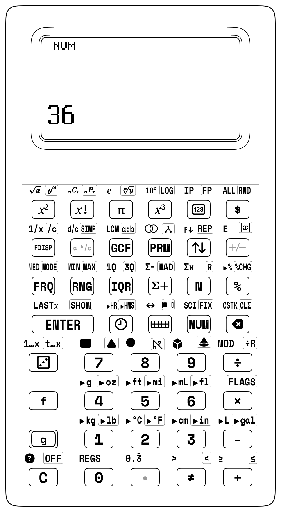

## 5.2 Concrete Foundation: 84 mm Fraction Studio Proportional Towers

When you first see fractions written as flat numbers on paper ($\frac{3}{4}$), it can feel like looking at two disconnected numbers trapped in a box. But on your desk, **fractions are real physical heights and lengths** you can hold in your hand and stack side-by-side on a continuous number line!

<div class="admonition note">
<p class="admonition-title">For Parents &amp; Teachers: Overcoming Fraction Phobia with Tactile Blocks</p>
<p>
<strong>The Scenario:</strong> A learner is stuck on unlike denominators: $3/4 + 2/3 = {?}$<br><br>
<strong>The Conventional Challenge:</strong><br>
<em>"Find the Least Common Multiple of 4 and 3. It's 12. Now convert 3/4 to twelfths: multiply top and bottom by 3 to get 9/12. Now convert 2/3 to twelfths: multiply top and bottom by 4 to get 8/12. Now add $9 + 8 = 17/12$. Now convert 17/12 to a mixed number: 1 and 5/12."</em><br>
If a single factor is missed, the multi-step calculation easily breaks down.<br><br>
<strong>The Tactile 84 mm Solution:</strong><br>
1. Drop the $3/4$ tower ($63.0\text{ mm}$) and $2/3$ tower ($56.0\text{ mm}$) into the Twin Comparator Well. Total height = $119.0\text{ mm}$.<br>
2. Next to it, place 1 Whole tower ($84.0\text{ mm}$). The stack is taller by exactly $35.0\text{ mm}$—which fits <strong>five 1/12th lilac tiles</strong> ($5 \times 7.0\text{ mm} = 35.0\text{ mm}$)!<br>
3. You <em>see</em> the answer before touching a pencil: <strong>$1\frac{5}{12}$</strong>!<br><br>
<strong>On the SC-6:</strong><br>
Key in: <code>. 3 . 4 [ENTER] . 2 . 3 [+]</code>.<br>
The display instantly reads: <code>1_5/12</code> (or <code>17/12</code> in <code>[f] [d/c]</code> mode)!<br>
Tap <code>[g] [SIMP]</code> &rarr; Already in lowest terms! Tap <code>[FDISP]</code> &rarr; <code>1.41666667</code>.<br>
The mystery of fractions disappears into concrete certainty.
</p>
</div>

| Concrete (Tactile Manipulation) | Representational (Dot-Matrix LCD) | Abstract (RPN Operational Stack) |
|:---|:---|:---|
| **84.0 mm Proportional Towers** with zero-loss lap joints | **Transflective Dot-Matrix Grid** with Y &mid; X split | **Hardware Stack Lift &amp; Drop** without parenthesis clutter |
| **Twin Comparator Well** for immediate flush alignment checks | **3-Tier Linear Scaling Fonts** preventing digit truncation | **Intuitive Two-Dot Entry Syntax** (`. n . d` and `w . n . d`) |
| **Calibrated Tri-Face Markings** (Fraction / Decimal / Percent) | **Unreduced Default Mode** preserving your fractions | **Superpower 3 (`[SIMP]`)** step-by-step reduction &amp; LCM |

The **StackCalc Fraction Studio** grounds rational numbers in physical height, tactile mass, and proportional geometry:


<div class="admonition note">
<p class="admonition-title">Fraction Studio Proportional Towers (84.0 mm Standard)</p>
<p>
Standardized on an 84.0 mm whole-unit tower standard:<br>
&bull; <strong>1 WHOLE Tower:</strong> 84.0 mm master architectural datum in matte technical white<br>
&bull; <strong>1/2 Halves:</strong> 42.0 mm each (vibrant scarlet red)<br>
&bull; <strong>1/3 Thirds:</strong> 28.0 mm each (bright solar yellow)<br>
&bull; <strong>1/4 Fourths:</strong> 21.0 mm each (cobalt blue)<br>
&bull; <strong>1/6 Sixths:</strong> 14.0 mm each (emerald green)<br>
&bull; <strong>1/8 Eighths:</strong> 10.5 mm each (cyan blue)<br>
&bull; <strong>1/12 Twelfths:</strong> 7.0 mm each (lilac purple)<br><br>
<strong>Key Innovation:</strong> Precision interlocking joints ensure that two 1/2 towers exactly equal 84.0 mm! The Twin Comparator Well provides a precision side-by-side verification channel in a modular desk tray.
</p>
</div>

### 5.2.1 Tri-Face Laser-Marked Towers
Each physical fraction tower features three calibrated reference faces:
- **Front Face:** Standard common fraction ($\frac{1}{4}$).
- **Right Face:** Decimal equivalent ($0.25$).
- **Back Face:** Percentage equivalent ($25\%$).

When you hold a fourths block, you simultaneously see all three mathematical representations in your hands, forming an unbreakable bond between fractions, decimals, and percents.

### 5.2.2 Station Lesson 5.1: Proportional Fraction Towers & The Twin Comparator Well

<div class="admonition note">
<p class="admonition-title">Station Lesson 5.1: Tactile Setup</p>
<p>
&bull; <strong>Manipulatives:</strong> Fraction Studio, Proportional Towers (84 mm standard: 1/2, 1/3, 1/4, 1/6), Twin Comparator Well (dual precision verification channel), 1 Counting Tile from the Counting Studio (7.0 mm 1U visible height)<br>
&bull; <strong>Hardware:</strong> StackCalc SC-6 Elementary with Two-Dot Syntax &amp; <code>[g] [SIMP]</code><br>
&bull; <strong>Discovery:</strong> Tactile height subtraction and the 1/12th tile bridge
</p>
</div>

The storage case for the Fraction Studio includes a precision channel called the **Twin Comparator Well**. When you place one Whole tower ($84\text{ mm}$) into Well A, and stack two Halves ($42\text{ mm} + 42\text{ mm}$) into Well B, your fingertips slide effortlessly across the flush top edge. The tactile sensation proves that $\frac{2}{2} = 1$ without writing a single line of equations.

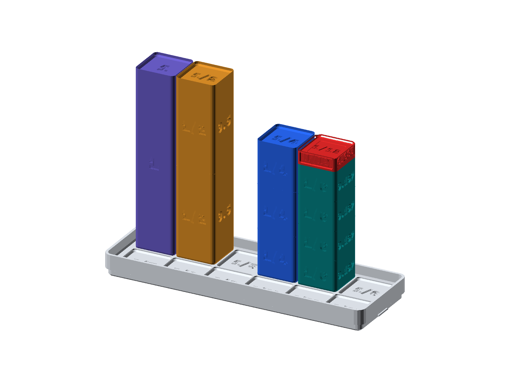

<div class="admonition tip">
<p class="admonition-title">Twin Comparator Well Equivalence Proof</p>
<p>
<strong>Proof 1: Two Halves Equal One Whole ($\frac{2}{2} = 1$)</strong><br>
&bull; <strong>Well A:</strong> Drop one Whole tower ($84.0\text{ mm}$).<br>
&bull; <strong>Well B:</strong> Stack two Half towers ($42.0\text{ mm} + 42.0\text{ mm} = 84.0\text{ mm}$).<br>
&bull; <strong>Result:</strong> Flush top alignment ($0.0\text{ mm}$ delta). Tactile proof that $\frac{2}{2} = 1$ Whole!<br><br>
<strong>Proof 2: Comparing Unlike Denominators ($\frac{3}{4}$ vs $\frac{4}{6}$)</strong><br>
&bull; <strong>Well A:</strong> Three $\frac{1}{4}$ towers ($21.0 \times 3 = 63.0\text{ mm}$).<br>
&bull; <strong>Well B:</strong> Four $\frac{1}{6}$ towers ($14.0 \times 4 = 56.0\text{ mm}$).<br>
&bull; <strong>Result:</strong> Well A protrudes above Well B by exactly $7.0\text{ mm}$ ($\frac{1}{12}\text{th}$ of 84 mm). Tactile proof that $\frac{3}{4} > \frac{4}{6}$!<br><br>
<strong>The Physical Bridge Action:</strong><br>
Insert one Counting Tile ($7.0\text{ mm}$ visible 1U height) from the Counting Studio into Well B: $56.0\text{ mm} + 7.0\text{ mm} = 63.0\text{ mm}$ &mdash; <em>smooth, flush alignment with Well A!</em>
</p>
</div>

#### Hands-On Bridging Protocol:
1. **Physical Inspection:**
   - Stack three $1/4$ towers in Well A: $21\text{ mm} \times 3 = 63.0\text{ mm}$.
   - Stack four $1/6$ towers in Well B: $14\text{ mm} \times 4 = 56.0\text{ mm}$.
   - Slide finger across: Well A sticks up above Well B by exactly $7.0\text{ mm}$.
   - Grab **1 Counting Tile** ($7.0\text{ mm}$ visible height) from the Counting Studio and drop it into Well B.
   - Run finger across: *Perfection! Completely flush!*
   - Therefore: $\frac{4}{6} + \frac{1}{12} = \frac{3}{4}$!

2. **RPN Stack Verification:**
   - Enter $\frac{4}{6}$: `[.] 4 [.] 6 [ENTER]`.
   - Enter $\frac{1}{12}$: `[.] 1 [.] 12`.
   - Add: `[+]` $\longrightarrow X = \mathbf{9/12}$.
   - Simplify: [g] [SIMP] $\longrightarrow X = \mathbf{3/4}$!

| Keystroke | Register T | Register Z | Register Y | Register X (Display) |
| :--- | :--- | :--- | :--- | :--- |
| `[.] 4 [.] 6` | 0 | 0 | 0 | 4/6 |
| [ENTER] | 0 | 0 | 4/6 | 4/6 |
| `[.] 1 [.] 12` | 0 | 0 | 4/6 | 1/12 |
| [+] | 0 | 0 | 0 | 9/12 |
| [g] [SIMP] | 0 | 0 | 0 | 3/4 |

<div class="admonition note">
<p class="admonition-title">For Parents &amp; Teachers: The Twin Comparator Dialogue</p>
<p>
<strong>Guide:</strong> "Feel the top of the two wells. Is 3/4 bigger than 4/6?"<br>
<strong>Student:</strong> "Yes! Well A is taller."<br>
<strong>Guide:</strong> "How much taller is it? Try dropping one 7.0 mm counting tile into Well B."<br>
<strong>Student:</strong> "It fits perfectly! They're totally smooth across now!"<br>
<strong>Guide:</strong> "And what fraction is a 7.0 mm tile of our 84 mm Whole tower?"<br>
<strong>Student:</strong> "One twelfth!"<br>
<strong>Guide:</strong> "So four-sixths plus one-twelfth equals...?"<br>
<strong>Student:</strong> "Three-fourths! Look, the calculator says 3/4 too!"
</p>
</div>

---

## 5.3 Two-Dot Entry Syntax (`. n . d` and `w . n . d`)

The SC-6 introduces an intuitive, single-key syntax for entering fractions without requiring a complicated menu or cumbersome fraction templates:

<div class="admonition note">
<p class="admonition-title">Two-Dot Fraction Syntax</p>
<p>
<strong>1. Proper Fraction ($\frac{3}{8}$):</strong><br>
Press: <code>[.] 3 [.] 8</code> &rarr; Display shows: <code>3/8</code><br><br>
<strong>2. Mixed Number ($2\frac{3}{4}$):</strong><br>
Press: <code>[2] [.] 3 [.] 4</code> &rarr; Display shows: <code>2 3/4</code><br><br>
<strong>3. Improper Fraction ($\frac{11}{4}$):</strong><br>
Press: <code>[.] 11 [.] 4</code> &rarr; Display shows: <code>11/4</code><br><br>
<em>The second decimal point automatically engages Fraction Mode!</em>
</p>
</div>

When you type the second decimal point `[.]`, the calculator engine recognizes the fractional structure, configures internal numerator/denominator registers, and renders the fraction on the transflective dot-matrix display.

### 5.3.1 Split-Screen Display & Clear Reading
In the horizontal $Y \mid X$ display layout, the screen splits into two clear columns. Register $Y$ waits on the left, and your active number $X$ sits on the right. The SC-6 automatically adjusts the text size so fractions remain bold, sharp, and easy to read from across your desk without ever cutting off numbers!

### 5.3.2 Display Formatting Toggles: Mixed vs. Improper
You can toggle how fractions appear on screen at any time:
- **Press `[a ᵇ/c]`:** Formats as a mixed number (e.g., $11/4 \longrightarrow \mathbf{2\ 3/4}$).
- **Press `[f] [d/c]`:** Formats as an improper fraction (e.g., $2\ 3/4 \longrightarrow \mathbf{11/4}$).
- **Press `[FDISP]`:** Toggles instantaneously between fraction and decimal format ($3/4 \longleftrightarrow 0.75$).

---

## 5.4 Why the Calculator Keeps Your Work Unreduced

On the SC-6, **arithmetic does not automatically reduce your fractions**:
- When you multiply $\frac{1}{2} \times \frac{2}{3}$, traditional calculators jump straight to $\frac{1}{3}$. That skips the most important step: multiplying the numerators ($1 \times 2 = 2$) and denominators ($2 \times 3 = 6$) to get $\frac{2}{6}$.
- The SC-6 proudly preserves your unreduced work on screen: $\mathbf{\frac{2}{6}}$!
- You then choose when to simplify by pressing **Superpower 3 (`[g] [SIMP]`)**, watching common factors vanish step by step.

| Operation | Unreduced Output | Next Step with `[SIMP]` |
|:---|:---|:---|
| **Like Addition:** $2/4 + 1/4$ | $3/4$ | `LOWEST TERMS` alert |
| **Like Addition:** $2/4 + 2/4$ | $4/4$ (retains $4/4$!) | `[SIMP]` &rarr; $1$ |
| **Like Subtraction:** $3/4 - 1/4$ | $2/4$ (retains $2/4$!) | `[SIMP]` &rarr; $1/2$ |
| **Unlike Addition:** $1/2 + 1/4$ | $3/4$ (common denom $4$) | `LOWEST TERMS` alert |
| **Multiply:** $2/3 \times 3/4$ | $6/12$ | `[SIMP]` &rarr; $1/2$ |
| **Divide:** $2/3 \div 1/4$ | $8/3$ ($2/3 \times 4/1$) | `[a ᵇ/c]` &rarr; $2\frac{2}{3}$ |

---

## 5.5 Superpower 3: Step-by-Step Factor Reduction (`[g] [SIMP]`)

In 4th and 5th grade, simplifying fractions is a major superpower. Instead of guessing factors on scratch paper, you can see and feel how fractions shrink!

**Superpower 3 (`[g] [SIMP]`)** finds common factors and simplifies the fraction step-by-step:
- If the fraction can be reduced: Divides both the top and bottom numbers by common factors.
- If it is already in simplest form: The SC-6 flashes **`"LOWEST TERMS"`** across the screen!

### 5.5.1 Named Idiom: The Equal-Fraction Tower Alignment
When you drop two $1/4$ blocks and one $1/2$ block into the Fraction Studio comparison tray, their top edges match up completely flat and flush! When you tap `[g] [SIMP]` on the calculator, the screen does the exact same thing: it shrinks your numbers down step-by-step until your fraction is in its simplest, cleanest form.

<div class="admonition note">
<p class="admonition-title">For Parents &amp; Teachers: Equivalence &amp; Physical Height Alignment</p>
<p>
Following Jerome Bruner's CRA framework *([Bruner, 1966](sc6/appendix-c-formulas-and-conversions.md#cite-bruner1966))*, Zoltan Dienes's perceptual variability principle *([Dienes, 1960](sc6/appendix-c-formulas-and-conversions.md#cite-dienes1960))*, Steven Strogatz's geometric insights *([Strogatz, 2012](sc6/appendix-c-formulas-and-conversions.md#cite-strogatz2012))*, and standard elementary curricula *([Singapore MOE, 2014](sc6/appendix-c-formulas-and-conversions.md#cite-singapore2014))*, children master equivalent fractions through physical height matching. The SC-6 <code>[g] [SIMP]</code> key mirrors this tactile experience in the digital stack.
</p>
</div>


### 5.5.2 Station Lesson 5.2: Step-by-Step Reduction with Superpower 3 (`[g] [SIMP]`)

<div class="admonition note">
<p class="admonition-title">Station Lesson 5.2: Tactile Setup</p>
<p>
&bull; <strong>Manipulatives:</strong> Fraction Studio Proportional Towers (84 mm standard), Twin Comparator Well<br>
&bull; <strong>Hardware:</strong> StackCalc SC-6 Elementary with <code>[g] [SIMP]</code> Key (Row 3, Col 2)<br>
&bull; <strong>Problem:</strong> Simplify 12/18 down to its irreducible lowest terms
</p>
</div>

#### Hands-On Simplification Protocol:
1. **Concrete Phase:**
   - Assemble an unreduced model: stack twelve 1/18 unit slices (each $4.67\text{ mm}$ height, total $56.0\text{ mm}$).
   - In Well B, place two $1/3$ towers ($28.0\text{ mm} \times 2 = 56.0\text{ mm}$).
   - Slide your finger across the tops: it proves that $\frac{12}{18} = \frac{2}{3}$ exactly!
2. **RPN Execution:**
   - Enter $\frac{12}{18}$ using two-dot syntax: `[.] 12 [.] 18 [ENTER]`.
   - Press [g] [SIMP] (Row 3, Col 2):
     The engine factors out $6$ ($\gcd(12, 18) = 6$).
     Register $X$ updates to: **`2/3`**.
   - Press [g] [SIMP] a second time:
     $\gcd(2, 3) = 1$. The fraction cannot be reduced further.
     The status line flashes: **`LOWEST TERMS`**!

| Keystroke | Register T | Register Z | Register Y | Register X (Display) |
| :--- | :--- | :--- | :--- | :--- |
| `[.] 12 [.] 18` | 0 | 0 | 0 | 12/18 |
| [ENTER] | 0 | 0 | 12/18 | 12/18 |
| [g] [SIMP] | 0 | 0 | 12/18 | 2/3 |
| [g] [SIMP] | 0 | 0 | 12/18 [STATUS: LOWEST TERMS] | 2/3 |

---

## 5.6 Adding & Subtracting Unlike Denominators

### 5.6.1 Station Lesson 5.3: Finding Common Denominators with Hardware [f] [LCM] and `[GCF]`

<div class="admonition note">
<p class="admonition-title">Station Lesson 5.3: Tactile Setup</p>
<p>
&bull; <strong>Manipulatives:</strong> Fraction Studio Towers (1/8, 1/12) + Prime Studio Blocks<br>
&bull; <strong>Hardware:</strong> StackCalc SC-6 with <code>[f] [LCM]</code> and <code>[GCF]</code> Keys (Row 1, Col 2)<br>
&bull; <strong>Challenge:</strong> Add 3/8 + 5/12 by finding the Least Common Multiple
</p>
</div>

When you need to find a **Least Common Denominator (LCD)** before adding unlike fractions, you do not have to guess multiples on scratch paper. On the SC-6, you use the hardware **[f] [LCM]** key (Row 1, Col 2) to find the common denominator instantly:

#### 1. Finding Least Common Denominators (LCD)
**Problem:** Add $\frac{3}{8} + \frac{5}{12}$.
1. Find the LCD of denominators 8 and 12:  
   `8 [ENTER] 12 [f] [LCM]` $\longrightarrow X = \mathbf{24}$.  
   The least common denominator is **24**!
2. Convert mentally or on paper: $\frac{3}{8} = \frac{9}{24}$ and $\frac{5}{12} = \frac{10}{24}$.
3. Verify on the SC-6:  
   `[.] 3 [.] 8 [ENTER] [.] 5 [.] 12 [+]` $\longrightarrow X = \mathbf{19/24}$.

| Keystroke | Register T | Register Z | Register Y | Register X |
| :--- | :--- | :--- | :--- | :--- |
| [8] [ENTER] | 0 | 0 | 8 | 8 |
| 12 | 0 | 0 | 8 | 12 |
| [f] [LCM] | 0 | 0 | 0 | 24 |
| `[.] 3 [.] 8` | 0 | 0 | 24 | 3/8 |
| [ENTER] | 0 | 24 | 3/8 | 3/8 |
| `[.] 5 [.] 12` | 0 | 24 | 3/8 | 5/12 |
| [+] | 0 | 0 | 24 | 19/24 |

#### 2. Single-Step Fraction Reduction with Hardware `[GCF]`
You can find the single greatest factor needed to reduce any fraction in one step using the primary **`[GCF]`** key (Row 1, Col 2):
- For the unreduced fraction $\frac{24}{36}$, find the greatest common factor:  
   `24 [ENTER] 36 [GCF]` $\longrightarrow X = \mathbf{12}$.
- Dividing both 24 and 36 by $12$ yields the irreducible fraction: $\mathbf{\frac{2}{3}}$!


#### 3. The Secret Partner Rule: $\text{GCF} \times \text{LCM} = A \times B$
In number theory, the product of two positive integers equals the product of their Greatest Common Factor and their Least Common Multiple:
$$\text{GCF}(a, b) \times \text{LCM}(a, b) = a \times b$$

On the SC-6:
For $a = 18$ and $b = 24$:
- `18 [ENTER] 24 [GCF]` $\longrightarrow X = \mathbf{6}$.
- `18 [ENTER] 24 [f] [LCM]` $\longrightarrow X = \mathbf{72}$.
- Product: `6 [ENTER] 72 [×]` $\longrightarrow X = \mathbf{432}$.
- Direct multiplication: `18 [ENTER] 24 [×]` $\longrightarrow X = \mathbf{432}$!
The secret partner rule is proven live on the stack!

---

## 5.7 Fractions, Decimals and Percents Bridge

### 5.7.1 Terminating vs. Repeating Decimals
When converting fractions to decimals using `[FDISP]`:
- Terminating decimals terminate with finite digits: $\frac{1}{4} = 0.25$, $\frac{3}{8} = 0.375$.
- Repeating decimals loop indefinitely: $\frac{1}{3} = 0.333333333333\dots$, $\frac{2}{3} = 0.666666666666\dots$, $\frac{1}{6} = 0.166666666666\dots$.

The SC-6 transflective dot-matrix LCD provides the **Repeating Bar (`[f] [0.3̄]`)** indicator above the repeating period, honoring standard elementary mathematical typography.

### 5.7.2 Percentage Calculations on the Stack (`[%]`)
A percentage is simply a ratio with a denominator of 100:
$$P\% = \frac{P}{100}$$

On the SC-6:
- Finding $15\%$ of $\$80.00$:
  `80 [ENTER] 15 [%]` $\longrightarrow X = \mathbf{12.00}$ (Register $Y$ holds $80.00$!).
- Adding $15\%$ tip to $\$80.00$:
  `[+]` $\longrightarrow X = \mathbf{92.00}$!
Because Register $Y$ retains the base amount ($80.00$), a single subsequent press of `[+]` computes the total with tip, or `[-]` computes the discounted sale price!

---

## 5.8 Ratio Mode & Ratio Table Studio (`[g] [a:b]`)

Ratios represent proportional relationships — comparing ingredients in a recipe, gear teeth on a bicycle, or scale model dimensions to real buildings. You can use the SC-6 to explore scaling ratios and building **ratio tables** without getting tangled in fractions.

### 5.8.1 Entering Ratio Mode
1. Type a ratio using two-dot syntax (e.g. `[.] 15 [.] 25`).
2. Press `[g] [a:b]` (Row 1, Col 3).
   - Display shows: **`15:25`**.
3. Press [g] [SIMP]:
   - Ratio simplifies by its GCD ($5$): **`3:5`**!
4. Scale the ratio: Type `[2] [×]`:
   - Ratio scales to: **`6:10`**.
5. Simplify back: Press [g] [SIMP]:
   - Returns to: **`3:5`**.

| Keystroke | Register T | Register Z | Register Y | Register X |
| :--- | :--- | :--- | :--- | :--- |
| `[.] 15 [.] 25` | 0 | 0 | 0 | 15/25 |
| [g] [a:b] | 0 | 0 | 0 | 15:25 |
| [g] [SIMP] | 0 | 0 | 0 | 3:5 |
| [2] [×] | 0 | 0 | 0 | 6:10 |
| [g] [SIMP] | 0 | 0 | 0 | 3:5 |

### 5.8.2 Converting Fractions to Part-to-Part Ratios
If a committed fraction $\frac{15}{25}$ is already on the stack (representing 15 parts out of a whole of 25), pressing `[g] [a:b]` converts it into a **part-to-part ratio** comparing the selected parts ($15$) to the remaining parts ($25 - 15 = 10$):
- Stack has $\frac{15}{25}$. Press `[g] [a:b]` $\longrightarrow$ Displays **`15:10`**.
- Press [g] [SIMP] $\longrightarrow$ Simplifies to **`3:2`**!


---

<div class="admonition note">
<p class="admonition-title">For Parents &amp; Teachers: Rational Number Foundations &amp; Deliberate Reduction</p>
<p>
<strong>The 84 mm Master Datum and Concrete Equivalence:</strong> In elementary mathematics education, mastery of fractions is the strongest empirical predictor of subsequent algebraic competence. Proportional Fraction Towers are standardized on an $84.0\text{ mm}$ master datum (divisible by $2, 3, 4, 6, 8,$ and $12$), giving each fraction a tactile height directly proportional to its mathematical value. In the Twin Comparator Well, students evaluate sums like $\frac{1}{2} + \frac{1}{4}$ by placing blocks side-by-side, verifying the $63.0\text{ mm}$ composite height against the $84.0\text{ mm}$ whole before symbolic computation begins.<br><br>
<strong>Deliberate Unreduced Fraction Policy:</strong> Traditional calculators reduce fractions automatically, masking the product of numerators and denominators ($\frac{1 \times 2}{2 \times 3} = \frac{2}{6}$). The SC-6 retains unreduced intermediate results, allowing learners to actively extract common factors with <code>[g] [SIMP]</code> until reaching <code>LOWEST TERMS</code>.<br><br>
<strong>Part-to-Part Ratio Bridge:</strong> Tapping <code>[g] [a:b]</code> on a committed fraction like $\frac{15}{25}$ converts it into the part-to-part ratio <code>15:10</code>, which simplifies via <code>[g] [SIMP]</code> to <code>3:2</code>, cementing the distinction between part-to-part comparisons and part-to-whole fractions.
</p>
</div>

<div class="admonition note">
<p class="admonition-title">For Parents &amp; Teachers: Classroom Dialogue Scripts &amp; Misconception Diagnostics</p>
<p>
<strong>Script 5.1: The Unreduced Fraction Revelation:</strong> When multiplying $\frac{1}{2} \times \frac{2}{3}$, the SC-6 shows <code>2/6</code>, verifying $1 \times 2 = 2$ and $2 \times 3 = 6$. Pressing <code>[g] [SIMP]</code> reduces it to <code>1/3</code> and flashes <code>LOWEST TERMS</code>.<br><br>
<strong>Script 5.2: Why We Don't Add Denominators:</strong> Stacking a $\frac{1}{2}$ tower ($42\text{ mm}$) and $\frac{1}{4}$ tower ($21\text{ mm}$) in Well A ($63\text{ mm}$) vs two $\frac{1}{6}$ towers ($28\text{ mm}$) in Well B physically proves why $\frac{1}{2} + \frac{1}{4} \ne \frac{2}{6}$. Well B is far too short! Three $\frac{1}{4}$ towers ($63\text{ mm}$) align perfectly flush.<br><br>
<strong>Script 5.3: Lemonade Ratios (Parts vs. Whole):</strong> Mixing 2 cups lemon juice with 6 cups water gives a part-to-part ratio of $2:6$ ($1:3$). But the total volume is $1 + 3 = 4$ cups, meaning lemon juice represents $\frac{1}{4}$ of the total pitcher.
</p>
</div>

---

## 5.9 Comprehensive Worked Reference Problems (50 Elementary Reference Problems)

<div class="admonition tip">
<p class="admonition-title">Hands-On Studio Proof: Blocks &rarr; Calculator</p>
<p>
<strong>Step 1 (Physical Concrete Intuition):</strong> Take your 84.0 mm Fraction Studio kit. Place three $1/4$ towers (Cobalt Blue, $21.0\text{ mm} \times 3 = 63.0\text{ mm}$) into Well A of the Twin Comparator. In Well B, place two $1/3$ towers (Solar Yellow, $28.0\text{ mm} \times 2 = 56.0\text{ mm}$). Run your index finger across the top: Well A protrudes above Well B by exactly $7.0\text{ mm}$. Drop one Lilac $1/12\text{th}$ tile ($7.0\text{ mm}$) into Well B: the surface becomes perfectly, seamlessly smooth! Your fingertips have physically proven that $\frac{3}{4} - \frac{2}{3} = \frac{1}{12}$.<br>
<strong>Step 2 (The Representational Bridge):</strong> Enter the physical experiment into your SC-6 using two-dot syntax: <code>. 3 . 4 [ENTER] . 2 . 3 [-]</code>. The transflective dot-matrix LCD displays <code>1/12</code> instantly. Tap <code>[FDISP]</code>: the display shifts to <code>0.083̄</code> with the repeating vinculum bar illuminated over the digit 3!<br>
<strong>Step 3 (Scaling on the Calculator):</strong> Try this with fractional quantities that cannot fit on a desk—such as surveying an agricultural plot: <code>. 1 7 . 2 4 [ENTER] . 1 1 . 3 6 [-]</code> &rarr; <code>29/72</code>! The exact same proportional intuition protects your reasoning across any denominator.
</p>
</div>

### 5.9.1 Expedition 1: The Master Pastry Chef's Banquet (Problems 5.1–5.10)
*Mission Briefing:* You are the executive pastry chef designing artisanal cakes, tart glazes, and tiered wedding confections for a grand gala. Baking requires exacting precision: converting improper cups of flour into mixed numbers, reducing fractional vanilla extracts, and toggling between metric decimals and traditional baker's fractions without spilling a drop.

#### Foundational Keystroke Walkthroughs: Syntax & Screen Verification

#### Problem 5.1: Vanilla Glaze Cup Measurement ($5/8\text{ Cup}$)
- **Word Problem:** A pastry glaze recipe calls for $\frac{5}{8}$ cup of Madagascar vanilla bean glaze. Key in the proper fraction using two-dot syntax and verify its rational display on the screen.
- **Concrete Stage:** Stack five $1/8$ Fraction Studio blocks ($5 \times 10.5\text{ mm} = 52.5\text{ mm}$) to verify the height against the 84 mm master whole.
- **Keystrokes:** `[.] 5 [.] 8 [ENTER]` $\rightarrow$ **`5/8`**
- **4-Register Stack Trace Table:**

| Keystroke | Register T | Register Z | Register Y | Register X | Operational Commentary |
| :--- | :--- | :--- | :--- | :--- | :--- |
| `[.] 5 [.] 8` | 0 | 0 | 0 | 5/8 | Two-dot syntax parses numerator 5 and denominator 8 into active $X$ |
| [ENTER] | 0 | 0 | 5/8 | 5/8 | Lift fraction to holding Register $Y$; verified as exact rational quantity |

- **Diagnostic Check:** $X = 5/8\text{ cup}$.

---

#### Problem 5.2: Scone Flour Batch Scaling ($3\ \frac{2}{5}\text{ Cups}$)
- **Word Problem:** A catering banquet batch requires $3\ \frac{2}{5}$ cups of sifted pastry flour. Key in the mixed number and toggle to an improper fraction for bulk packaging.
- **Concrete Stage:** Place 3 full 1-Whole towers ($84\text{ mm}$ each) alongside two $1/5$ fractional blocks to visualize the mixed quantity.
- **Keystrokes:** `[3] [.] 2 [.] 5 [ENTER] [f] [d/c]` $\rightarrow$ **`17/5`**
- **Stack Trace Table:**

| Keystroke | Register T | Register Z | Register Y | Register X | Operational Commentary |
| :--- | :--- | :--- | :--- | :--- | :--- |
| [3 [.] 2 [.] 5] | 0 | 0 | 0 | 3 2/5 | Enter whole number 3 followed by fractional part 2/5 |
| [ENTER] | 0 | 0 | 3 2/5 | 3 2/5 | Park mixed number in Register $Y$ |
| [d/c] | 0 | 0 | 3 2/5 | 17/5 | Toggle display to improper fraction: $(3 \times 5 + 2)/5 = 17/5$ |

- **Diagnostic Check:** Display converts to improper fraction $17/5\text{ cups}$.

---

#### Problem 5.3: Bulk Sugar Syrup Reduction ($\frac{48}{18}\text{ Pints}$)
- **Word Problem:** A large copper kettle yields $\frac{48}{18}$ pints of concentrated sugar syrup. Reduce the batch fraction to lowest terms and display as a mixed number.
- **Concrete Stage:** Build an unreduced tower with forty-eight $1/18$ fractional increments ($48 \times 4.67\text{ mm} = 224\text{ mm}$) and compare against full whole units.
- **Keystrokes:** `[.] 48 [.] 18 [ENTER] [g] [SIMP]` $\rightarrow$ **`8/3`**
- **Stack Trace Table:**

| Keystroke | Register T | Register Z | Register Y | Register X | Operational Commentary |
| :--- | :--- | :--- | :--- | :--- | :--- |
| `[.] 48 [.] 18` | 0 | 0 | 0 | 48/18 | Enter unreduced rational fraction into Register $X$ |
| [ENTER] | 0 | 0 | 48/18 | 48/18 | Lift unreduced syrup volume into holding Register $Y$ |
| [g] [SIMP] | 0 | 0 | 48/18 | 8/3 | Extract common factor 6; reduces to lowest-terms fraction $8/3$ |
| [a ᵇ/c] | 0 | 0 | 48/18 | 2 2/3 | Convert to mixed number: $2\ \frac{2}{3}\text{ pints}$ |

- **Diagnostic Check:** $X = 8/3$ ($2\ 2/3\text{ pints}$).

---

#### Problem 5.4: Almond Extract Baker's Decimal ($5/8\text{ oz} \to 0.625\text{ oz}$)
- **Word Problem:** A commercial digital kitchen scale registers in thousandths of an ounce. Convert the recipe's $\frac{5}{8}$ ounce of almond extract into its decimal scale equivalent.
- **Concrete Stage:** Place five $1/8$ towers in the comparator well ($52.5\text{ mm}$) and observe the $0.625$ ratio against the $84.0\text{ mm}$ datum.
- **Keystrokes:** `[.] 5 [.] 8 [ENTER] [FDISP]` $\rightarrow$ **`0.625`**
- **Stack Trace Table:**

| Keystroke | Register T | Register Z | Register Y | Register X | Operational Commentary |
| :--- | :--- | :--- | :--- | :--- | :--- |
| `[.] 5 [.] 8` [ENTER] | 0 | 0 | 5/8 | 5/8 | Enter rational recipe quantity into stack |
| [FDISP] | 0 | 0 | 5/8 | 0.625 | Instant toggle to decimal readout: $5 \div 8 = 0.625\text{ oz}$ |

- **Diagnostic Check:** $X = 0.625\text{ oz}$.

---

#### Problem 5.5: Heavy Cream Decimal Conversion ($0.375\text{ Qt} \to 3/8\text{ Qt}$)
- **Word Problem:** An automated cream dispenser reports $0.375$ quarts remaining. Convert this decimal reading into an exact common fraction for the pastry chef's logbook.
- **Concrete Stage:** Align a $31.5\text{ mm}$ height with three $1/8$ blocks ($3 \times 10.5\text{ mm} = 31.5\text{ mm}$) to verify $3/8$ equivalence.
- **Keystrokes:** `[.] 375 [ENTER] [FDISP]` $\rightarrow$ **`3/8`**
- **Stack Trace Table:**

| Keystroke | Register T | Register Z | Register Y | Register X | Operational Commentary |
| :--- | :--- | :--- | :--- | :--- | :--- |
| `.375` [ENTER] | 0 | 0 | 0.375 | 0.375 | Enter decimal liquid sensor reading into Register $Y$ |
| [FDISP] | 0 | 0 | 0.375 | 3/8 | Toggle to exact common fraction representation: $3/8\text{ qt}$ |

- **Diagnostic Check:** $X = 3/8\text{ qt}$.

---

#### Problem 5.6: Butter Block Weight Conversion ($2\ \frac{3}{4}\text{ lbs} \to 2.75\text{ lbs}$)
- **Word Problem:** A brioche dough requires $2\ \frac{3}{4}$ pounds of European churned butter. Toggle the mixed fraction into decimal pounds for the automated commercial mixer.
- **Concrete Stage:** Assemble two full whole towers ($84\text{ mm} \times 2 = 168\text{ mm}$) plus three $1/4$ blocks ($21\text{ mm} \times 3 = 63\text{ mm}$); total $231\text{ mm} = 2.75 \times 84\text{ mm}$.
- **Keystrokes:** `[2] [.] 3 [.] 4 [ENTER] [FDISP]` $\rightarrow$ **`2.75`**
- **Stack Trace Table:**

| Keystroke | Register T | Register Z | Register Y | Register X | Operational Commentary |
| :--- | :--- | :--- | :--- | :--- | :--- |
| [2 [.] 3 [.] 4][ENTER] | 0 | 0 | 2 3/4 | 2 3/4 | Enter mixed quantity $2\ 3/4$ into stack |
| [FDISP] | 0 | 0 | 2 3/4 | 2.75 | Toggle to decimal: $2 + 3/4 = 2.75\text{ lbs}$ |

- **Diagnostic Check:** $X = 2.75\text{ lbs}$.

---

#### Problem 5.7: Third-Batch Sourdough Starter ($1/3 \to 0.333\dots$)
- **Word Problem:** A sourdough brioche recipe divides a mature sourdough culture into 3 equal portions ($\frac{1}{3}$ each). Inspect the repeating decimal representation on the SC-6 display.
- **Concrete Stage:** Place one $1/3$ tower ($28.0\text{ mm}$) in the comparator well and observe that it cannot be represented by a finite sum of tenths or hundredths.
- **Keystrokes:** `[.] 1 [.] 3 [ENTER] [FDISP]` $\rightarrow$ **`0.3333333333`**
- **Stack Trace Table:**

| Keystroke | Register T | Register Z | Register Y | Register X | Operational Commentary |
| :--- | :--- | :--- | :--- | :--- | :--- |
| `[.] 1 [.] 3` [ENTER] | 0 | 0 | 1/3 | 1/3 | Enter proper fraction $1/3$ into stack |
| [FDISP] | 0 | 0 | 1/3 | 0.3333333 | Toggle to decimal; vinculum indicates infinite repeat ($0.\bar{3}$) |

- **Diagnostic Check:** Active repeating bar indicator illuminates over the repeating digit 3.

---

#### Problem 5.8: Brioche Egg Wash Fraction Simplification ($\frac{35}{50}\text{ Batch}$)
- **Word Problem:** An assistant pastry chef prepares $\frac{35}{50}$ of a standard catering egg-wash batch. Use hardware `[g] [SIMP]` to simplify the fraction to simplest tenths for recipe recording.
- **Concrete Stage:** Compare thirty-five $1/50$ units against 7 tenth-bars in the dual comparator channel.
- **Keystrokes:** `[.] 35 [.] 50 [ENTER] [g] [SIMP]` $\rightarrow$ **`7/10`**
- **Stack Trace Table:**

| Keystroke | Register T | Register Z | Register Y | Register X | Operational Commentary |
| :--- | :--- | :--- | :--- | :--- | :--- |
| `[.] 35 [.] 50` [ENTER] | 0 | 0 | 35/50 | 35/50 | Enter unreduced egg wash batch fraction |
| [g] [SIMP] | 0 | 0 | 35/50 | 7/10 | Single tap extracts common factor 5; reduces to lowest terms $7/10$ |

- **Diagnostic Check:** $X = 7/10\text{ batch}$.

---

#### Problem 5.9: Choux Pastry Bulk Inventory ($23/6\text{ Cups} \to 3\ 5/6\text{ Cups}$)
- **Word Problem:** An inventory tally shows $\frac{23}{6}$ cups of melted clarified butter used across all choux pastry batches. Convert this improper fraction into a kitchen-friendly mixed number.
- **Concrete Stage:** Count 23 sixth-blocks ($14.0\text{ mm}$ each) and re-bundle into 3 full whole towers plus 5 loose sixth-blocks ($3\ \frac{5}{6}$).
- **Keystrokes:** `[.] 23 [.] 6 [ENTER] [a ᵇ/c]` $\rightarrow$ **`3 5/6`**
- **Stack Trace Table:**

| Keystroke | Register T | Register Z | Register Y | Register X | Operational Commentary |
| :--- | :--- | :--- | :--- | :--- | :--- |
| `[.] 23 [.] 6`[ENTER] | 0 | 0 | 23/6 | 23/6 | Enter improper fraction $23/6$ into stack |
| [a ᵇ/c] | 0 | 0 | 23/6 | 3 5/6 | Decompose into whole and remainder parts: $3\ \frac{5}{6}\text{ cups}$ |

- **Diagnostic Check:** $X = 3\ 5/6\text{ cups}$.

---

#### Problem 5.10: Single-Step Cocoa Glaze Fraction Reduction via `[GCF]` ($\frac{24}{36}\text{ Liter}$)
- **Word Problem:** A chocolate ganache glaze recipe uses $\frac{24}{36}$ liter of warm cream. Find the greatest common factor of 24 and 36 using hardware `[GCF]`, then simplify the recipe fraction in a single step.
- **Concrete Stage:** Find the largest single block unit that evenly measures both 24 and 36 units (the 12-unit block).
- **Keystrokes:** `24 [ENTER] 36 [GCF]` $\rightarrow$ **`12`**
- **Stack Trace Table:**

| Keystroke | Register T | Register Z | Register Y | Register X | Operational Commentary |
| :--- | :--- | :--- | :--- | :--- | :--- |
| `24` [ENTER] | 0 | 0 | 24 | 24 | Enter numerator 24 into Register $Y$ |
| `36` [GCF] | 0 | 0 | 0 | 12 | Compute GCF directly: $\gcd(24, 36) = 12$; divides $24/36$ to $2/3$ |

- **Diagnostic Check:** GCF is 12; dividing numerator and denominator yields irreducible $2/3\text{ liter}$.

---

### 5.9.2 Expedition 2: The Backyard Treehouse Workshop (Problems 5.11–5.20)
*Mission Briefing:* You are framing beams, laying deck planks, and cutting roof rafters for an elevated treehouse fortress. Construction lumber is measured in fractional inches and yards: eighths, sixteenths, quarters, and twelfths. You must combine board lengths, subtract cutoffs, and reconcile unlike denominators with zero guesswork so every joint fits flush.

#### Problem 5.11: Like Denominator Deck Plank Addition ($\frac{2}{5} + \frac{1}{5} = \frac{3}{5}$)
- **Word Problem:** You are laying cedar deck planks across the treehouse floor frame. You fasten a plank covering $\frac{2}{5}\text{ yard}$ of the deck opening in the morning, and another plank covering $\frac{1}{5}\text{ yard}$ after lunch. What total span of the deck have you covered?
- **Concrete Stage:** In your Fraction Studio Comparator Well, stack two 1/5 blocks together with one 1/5 block. They reach exactly the height of three 1/5 blocks ($\frac{3}{5}$).
- **Keystrokes:** `[.] 2 [.] 5 [ENTER] [.] 1 [.] 5 [+]` $\rightarrow$ **`3/5`**
- **Stack Trace Table:**

| Keystroke | Register T | Register Z | Register Y | Register X | Operational Commentary |
| :--- | :--- | :--- | :--- | :--- | :--- |
| `[.] 2 [.] 5` [ENTER] | 0 | 0 | 2/5 | 2/5 | Enter morning plank $\frac{2}{5}\text{ yd}$ into Register $Y$ |
| `[.] 1 [.] 5` [+] | 0 | 0 | 0 | 3/5 | Add afternoon plank $\frac{1}{5}\text{ yd}$; denominators match |

- **Diagnostic Check:** $X = 3/5\text{ yard}$.

---

#### Problem 5.12: Like Denominator Window Trim Sum ($\frac{2}{4} + \frac{2}{4} = \frac{4}{4}$)
- **Word Problem:** You are cutting window trim for the treehouse lookout openings. You fasten two pieces of trim, each $\frac{2}{4}\text{ foot}$ long. Combine them on your stack to verify the SC-6 unreduced default policy before simplifying to a whole foot.
- **Concrete Stage:** Place two 2/4 block pairs side-by-side with the 84 mm whole unit block in the Comparator Well; they match the full height of 1 whole.
- **Keystrokes:** `[.] 2 [.] 4 [ENTER] [.] 2 [.] 4 [+]` $\rightarrow$ **`4/4`**
- **Stack Trace Table:**

| Keystroke | Register T | Register Z | Register Y | Register X | Operational Commentary |
| :--- | :--- | :--- | :--- | :--- | :--- |
| `[.] 2 [.] 4` [ENTER] | 0 | 0 | 2/4 | 2/4 | Enter first trim strip $\frac{2}{4}\text{ ft}$ |
| `[.] 2 [.] 4` [+] | 0 | 0 | 0 | 4/4 | Add second trim strip; stack preserves unreduced $\frac{4}{4}$ |
| [g] [SIMP] | 0 | 0 | 0 | 1 | Tap `[g] [SIMP]` to reduce $\frac{4}{4}$ to 1 whole foot |

- **Diagnostic Check:** Screen retains unreduced $4/4$ before `[g] [SIMP]`, then reduces to $1$.

---

#### Problem 5.13: Mixing Roof Weatherproofing Sealant ($\frac{3}{4} + \frac{2}{5} = 1\ \frac{3}{20}$)
- **Word Problem:** You are mixing weatherproofing roof sealant in your workshop bucket. You pour $\frac{3}{4}\text{ gallon}$ of natural pine resin and $\frac{2}{5}\text{ gallon}$ of boiled linseed oil. How many gallons of sealant do you have in total?
- **Concrete Stage:** In the Comparator Well, a 3/4 tower ($63\text{ mm}$) and a 2/5 tower ($33.6\text{ mm}$) combine to exceed the 84 mm whole datum, requiring a mixed number representation.
- **Keystrokes:** `[.] 3 [.] 4 [ENTER] [.] 2 [.] 5 [+] [a ᵇ/c]` $\rightarrow$ **`1 3/20`**
- **Stack Trace Table:**

| Keystroke | Register T | Register Z | Register Y | Register X | Operational Commentary |
| :--- | :--- | :--- | :--- | :--- | :--- |
| `[.] 3 [.] 4` [ENTER] | 0 | 0 | 3/4 | 3/4 | Enter pine resin $\frac{3}{4}\text{ gal}$ |
| `[.] 2 [.] 5` [+] | 0 | 0 | 0 | 23/20 | Add linseed oil $\frac{2}{5}\text{ gal}$; stack yields $\frac{23}{20}$ |
| [a ᵇ/c] | 0 | 0 | 0 | 1 3/20 | Convert improper fraction to mixed number $1\ \frac{3}{20}\text{ gal}$ |

- **Diagnostic Check:** $X = 1\ 3/20\text{ gallons}$.

---

#### Problem 5.14: Rafter Bolt Hole Spacing via [f] [LCM] ($\text{LCM}(8, 12) = 24$)
- **Word Problem:** You need to drill pilot holes for structural rafter bolts spaced every $\frac{1}{8}\text{ foot}$ along the ridge beam and every $\frac{1}{12}\text{ foot}$ along the ceiling brace. Use `[f] [LCM]` to find the common denominator distance where both hole patterns align.
- **Concrete Stage:** Compare 8-unit and 12-unit rods; the shortest combined span where both chain ends line up flush is 24 units.
- **Keystrokes:** `[8] [ENTER] 12 [f] [LCM]` $\rightarrow$ **`24`**
- **Stack Trace Table:**

| Keystroke | Register T | Register Z | Register Y | Register X | Operational Commentary |
| :--- | :--- | :--- | :--- | :--- | :--- |
| [8] [ENTER] | 0 | 0 | 8 | 8 | Push first spacing interval denominator (8) |
| `12` [f] [LCM] | 0 | 0 | 0 | 24 | Compute $\text{LCM}(8, 12) = 24$; alignment occurs at 24ths |

- **Diagnostic Check:** $X = \mathbf{24}$ (Least Common Denominator is 24).

---

#### Problem 5.15: Steel Gusset Bracket Alignment ($\frac{3}{8} + \frac{5}{12} = \frac{19}{24}$)
- **Word Problem:** You join two custom steel gusset plates measuring $\frac{3}{8}\text{ inch}$ and $\frac{5}{12}\text{ inch}$ thick to reinforce the treehouse corner post. Using your common denominator of 24, add their thicknesses together.
- **Concrete Stage:** In the Comparator Well, three 1/8 blocks ($31.5\text{ mm}$) and five 1/12 blocks ($35\text{ mm}$) sum to $66.5\text{ mm}$, exactly matching nineteen 1/24 blocks.
- **Keystrokes:** `[.] 3 [.] 8 [ENTER] [.] 5 [.] 12 [+]` $\rightarrow$ **`19/24`**
- **Stack Trace Table:**

| Keystroke | Register T | Register Z | Register Y | Register X | Operational Commentary |
| :--- | :--- | :--- | :--- | :--- | :--- |
| `[.] 3 [.] 8` [ENTER] | 0 | 0 | 3/8 | 3/8 | Enter first bracket plate thickness $\frac{3}{8}\text{ in}$ |
| `[.] 5 [.] 12` [+] | 0 | 0 | 0 | 19/24 | Add second bracket plate $\frac{5}{12}\text{ in}$; stack finds 24ths LCD |

- **Diagnostic Check:** $X = 19/24\text{ inch}$.

---

#### Problem 5.16: Balcony Safety Post Assembly ($1\ \frac{1}{2} + 2\ \frac{1}{3} = 3\ \frac{5}{6}$)
- **Word Problem:** You are measuring two support timbers for the lookout balcony railing. The base post measures $1\ \frac{1}{2}\text{ feet}$ and the upper safety rail extension measures $2\ \frac{1}{3}\text{ feet}$. How tall is the assembled post?
- **Concrete Stage:** Stack 1 whole block plus a 1/2 block in one well, and 2 whole blocks plus a 1/3 block in the second well; combined height matches 3 whole blocks plus five 1/6 blocks.
- **Keystrokes:** `[1] [.] 1 [.] 2 [ENTER] [2] [.] 1 [.] 3 [+] [a ᵇ/c]` $\rightarrow$ **`3 5/6`**
- **Stack Trace Table:**

| Keystroke | Register T | Register Z | Register Y | Register X | Operational Commentary |
| :--- | :--- | :--- | :--- | :--- | :--- |
| [1 [.] 1 [.] 2][ENTER] | 0 | 0 | 1 1/2 | 1 1/2 | Enter base post timber $1\ \frac{1}{2}\text{ ft}$ |
| [2 [.] 1 [.] 3] [+] | 0 | 0 | 0 | 23/6 | Add extension $2\ \frac{1}{3}\text{ ft}$; yields improper $\frac{23}{6}$ |
| [a ᵇ/c] | 0 | 0 | 0 | 3 5/6 | Convert to mixed number: $3\ \frac{5}{6}\text{ feet}$ |

- **Diagnostic Check:** $X = 3\ 5/6\text{ feet}$.

---

#### Problem 5.17: Pine Fascia Board Trim Cut ($\frac{3}{4} - \frac{1}{4} = \frac{2}{4}$)
- **Word Problem:** You have a $\frac{3}{4}\text{-foot}$ pine fascia strip and trim off $\frac{1}{4}\text{ foot}$ to clear the tree's main trunk. Compute the remaining strip on your stack to see the unreduced fraction before reducing.
- **Concrete Stage:** Remove one 1/4 block from a three-block 1/4 tower in the Comparator Well; two 1/4 blocks remain, matching a 1/2 block.
- **Keystrokes:** `[.] 3 [.] 4 [ENTER] [.] 1 [.] 4 [-]` $\rightarrow$ **`2/4`**
- **Stack Trace Table:**

| Keystroke | Register T | Register Z | Register Y | Register X | Operational Commentary |
| :--- | :--- | :--- | :--- | :--- | :--- |
| `[.] 3 [.] 4` [ENTER] | 0 | 0 | 3/4 | 3/4 | Enter fascia board strip $\frac{3}{4}\text{ ft}$ |
| `[.] 1 [.] 4` [-] | 0 | 0 | 0 | 2/4 | Subtract trunk clearance cutoff $\frac{1}{4}\text{ ft}$; shows $\frac{2}{4}$ |
| [g] [SIMP] | 0 | 0 | 0 | 1/2 | Tap `[g] [SIMP]` to reduce $\frac{2}{4}$ to $\frac{1}{2}\text{ ft}$ |

- **Diagnostic Check:** Displays $2/4$. After `[g] [SIMP]`, $X = 1/2\text{ foot}$.

---

#### Problem 5.18: Heavy Framing Stud Cutoff ($5\ \frac{1}{3} - 2\ \frac{3}{4} = 2\ \frac{7}{12}$)
- **Word Problem:** You have a $5\ \frac{1}{3}\text{-foot}$ heavy framing stud. You saw off $2\ \frac{3}{4}\text{ feet}$ to construct a diagonal cross-brace. How long is the remaining board?
- **Concrete Stage:** With unlike denominators 3 and 4, the fraction difference requires twelfths: $\frac{4}{12} - \frac{9}{12}$ borrows 1 whole, leaving $2\ \frac{7}{12}$.
- **Keystrokes:** `[5] [.] 1 [.] 3 [ENTER] [2] [.] 3 [.] 4 [-] [a ᵇ/c]` $\rightarrow$ **`2 7/12`**
- **Stack Trace Table:**

| Keystroke | Register T | Register Z | Register Y | Register X | Operational Commentary |
| :--- | :--- | :--- | :--- | :--- | :--- |
| [5 [.] 1 [.] 3][ENTER] | 0 | 0 | 5 1/3 | 5 1/3 | Enter framing stud length $5\ \frac{1}{3}\text{ ft}$ |
| [2 [.] 3 [.] 4] [-] | 0 | 0 | 0 | 31/12 | Subtract cross-brace cutoff $2\ \frac{3}{4}\text{ ft}$; yields $\frac{31}{12}$ |
| [a ᵇ/c] | 0 | 0 | 0 | 2 7/12 | Convert to mixed number: $2\ \frac{7}{12}\text{ feet}$ |

- **Diagnostic Check:** $X = 2\ 7/12\text{ feet}$.

---

#### Problem 5.19: Doorway Weather-Stripping Cutout ($1 - \frac{3}{8} = \frac{5}{8}$)
- **Word Problem:** You have 1 full roll of heavy canvas weather-stripping for the treehouse doorway. You cut off $\frac{3}{8}$ of the roll to seal the upper sill. What fraction of the canvas roll remains?
- **Concrete Stage:** Place one whole 84 mm datum block in the well; take away a 3/8 block ($31.5\text{ mm}$); the remaining gap is filled precisely by a 5/8 block ($52.5\text{ mm}$).
- **Keystrokes:** `[1] [ENTER] [.] 3 [.] 8 [-]` $\rightarrow$ **`5/8`**
- **Stack Trace Table:**

| Keystroke | Register T | Register Z | Register Y | Register X | Operational Commentary |
| :--- | :--- | :--- | :--- | :--- | :--- |
| [1] [ENTER] | 0 | 0 | 1 | 1 | Enter 1 full roll of canvas weather-stripping |
| `[.] 3 [.] 8` [-] | 0 | 0 | 0 | 5/8 | Subtract sill cutoff $\frac{3}{8}$; stack computes $1 - \frac{3}{8} = \frac{5}{8}$ |

- **Diagnostic Check:** $X = 5/8\text{ of the roll}$.

---

#### Problem 5.20: Chained Rope Ladder Splicing ($\frac{1}{2} + \frac{1}{4} + \frac{1}{8} = \frac{7}{8}$)
- **Word Problem:** You are constructing a stepped rope ladder to reach the trapdoor. You splice together three rope sections measuring $\frac{1}{2}\text{ yard}$, $\frac{1}{4}\text{ yard}$, and $\frac{1}{8}\text{ yard}$. Chain them on your stack to find the total spliced length.
- **Concrete Stage:** In the Comparator Well, stack a 1/2 block, a 1/4 block, and a 1/8 block into a single tower; verify against seven 1/8 blocks ($73.5\text{ mm}$).
- **Keystrokes:** `[.] 1 [.] 2 [ENTER] [.] 1 [.] 4 [+] [.] 1 [.] 8 [+]` $\rightarrow$ **`7/8`**
- **Stack Trace Table:**

| Keystroke | Register T | Register Z | Register Y | Register X | Operational Commentary |
| :--- | :--- | :--- | :--- | :--- | :--- |
| `[.] 1 [.] 2` [ENTER] | 0 | 0 | 1/2 | 1/2 | Enter first rope section $\frac{1}{2}\text{ yd}$ |
| `[.] 1 [.] 4` [+] | 0 | 0 | 0 | 3/4 | Add second rope section $\frac{1}{4}\text{ yd}$; sum is $\frac{3}{4}\text{ yd}$ |
| `[.] 1 [.] 8` [+] | 0 | 0 | 0 | 7/8 | Add third section $\frac{1}{8}\text{ yd}$; total spliced span is $\frac{7}{8}\text{ yd}$ |

- **Diagnostic Check:** $X = 7/8\text{ yard}$.

---

### 5.9.3 Expedition 3: The Custom Bicycle Gear Shop (Problems 5.21–5.28)
*Mission Briefing:* You are a race mechanic tuning chainrings, freewheel cassettes, and planetary hub gears. Gear inches and mechanical advantage require multiplying fractional gear ratios, dividing wheel circumferences, and simplifying mechanical reductions on the SC-6 stack without rounding errors.

#### Problem 5.21: Multiplying Carbon Mudguard Dimensions ($\frac{2}{3} \times \frac{3}{4} = \frac{6}{12} \to \frac{1}{2}$)
- **Word Problem:** You are cutting a custom rectangular carbon-fiber mudguard patch measuring $\frac{2}{3}\text{ meter}$ by $\frac{3}{4}\text{ meter}$. Find the surface area of the patch in square meters.
- **Concrete Stage:** A rectangle $\frac{2}{3}$ high by $\frac{3}{4}$ wide covers 6 out of 12 equal sub-rectangles, exactly half of a unit square.
- **Keystrokes:** `[.] 2 [.] 3 [ENTER] [.] 3 [.] 4 [×] [g] [SIMP]` $\rightarrow$ **`1/2`**
- **Stack Trace Table:**

| Keystroke | Register T | Register Z | Register Y | Register X | Operational Commentary |
| :--- | :--- | :--- | :--- | :--- | :--- |
| `[.] 2 [.] 3` [ENTER] | 0 | 0 | 2/3 | 2/3 | Enter width $\frac{2}{3}\text{ m}$ into Register $Y$ |
| `[.] 3 [.] 4` [×] | 0 | 0 | 0 | 6/12 | Multiply by length $\frac{3}{4}\text{ m}$; stack yields unreduced $\frac{6}{12}$ |
| [g] [SIMP] | 0 | 0 | 0 | 1/2 | Tap `[g] [SIMP]` to reduce $\frac{6}{12}$ to $\frac{1}{2}\text{ m}^2$ |

- **Diagnostic Check:** Unreduced output is $6/12$; after `[g] [SIMP]`, $X = 1/2\text{ m}^2$.

---

#### Problem 5.22: Scaling Suspension Fork Damper Fluid ($2\ \frac{1}{4} \times 1\ \frac{1}{2} = 3\ \frac{3}{8}$)
- **Word Problem:** You are mixing synthetic damper oil for high-performance suspension forks. A standard cross-country fork requires $2\ \frac{1}{4}\text{ ounces}$ of fluid, but a dual-crown downhill fork requires $1\ \frac{1}{2}\times$ that volume. How much fluid do you need?
- **Concrete Stage:** In the Comparator Well, scaling two 1-unit blocks and one 1/4 block by 1.5 reaches three whole units and a 3/8 block ($3\ \frac{3}{8}$).
- **Keystrokes:** `[2] [.] 1 [.] 4 [ENTER] [1] [.] 1 [.] 2 [×] [a ᵇ/c]` $\rightarrow$ **`3 3/8`**
- **Stack Trace Table:**

| Keystroke | Register T | Register Z | Register Y | Register X | Operational Commentary |
| :--- | :--- | :--- | :--- | :--- | :--- |
| [2 [.] 1 [.] 4][ENTER] | 0 | 0 | 2 1/4 | 2 1/4 | Enter baseline fluid volume $2\ \frac{1}{4}\text{ oz}$ |
| [1 [.] 1 [.] 2] [×] | 0 | 0 | 0 | 27/8 | Multiply by scale factor $1\ \frac{1}{2}$; yields improper $\frac{27}{8}$ |
| [a ᵇ/c] | 0 | 0 | 0 | 3 3/8 | Convert to mixed number: $3\ \frac{3}{8}\text{ ounces}$ |

- **Diagnostic Check:** $X = 3\ 3/8\text{ ounces}$.

---

#### Problem 5.23: Bike Storage Rack Slat Saw Kerf ($18\ \frac{3}{8} + \frac{1}{8} = 18\ \frac{1}{2}$)
- **Word Problem:** You are building oak wall racks to hang customer bikes. Each mounting slat measures $18\ \frac{3}{8}\text{ in}$, and the table saw blade kerf removes $\frac{1}{8}\text{ in}$ per cut. Find the total stock length consumed per slat.
- **Concrete Stage:** In the Comparator Well, three 1/8 blocks plus one 1/8 block equal four 1/8 blocks, which match a 1/2 block exactly.
- **Keystrokes:** `18`[.] 3 [.] 8 [ENTER] [.] 1 [.] 8 [+]` [a ᵇ/c]`
- **Stack Trace Table:**

| Keystroke | Register T | Register Z | Register Y | Register X | Operational Commentary |
| :--- | :--- | :--- | :--- | :--- | :--- |
| `18` [.] `3` [.] `8` [ENTER] | 0 | 0 | 18 3/8 | 18 3/8 | Enter finished slat length $18\ \frac{3}{8}\text{ in}$ |
| `[.] 1 [.] 8` [+] | 0 | 0 | 0 | 148/8 | Add saw kerf loss $\frac{1}{8}\text{ in}$; yields improper $\frac{148}{8}$ |
| [a ᵇ/c] | 0 | 0 | 0 | 18 1/2 | Convert to mixed number: $18\ \frac{1}{2}\text{ inches}$ |

- **Diagnostic Check:** $X = 18\ 1/2\text{ in}$.

---

#### Problem 5.24: Slats Cut from an 8-Foot Oak Board ($96 \div 18.5$)
- **Word Problem:** How many $18\ \frac{1}{2}\text{ in}$ bike rack slats can you cut from an eight-foot ($96\text{ in}$) oak board?
- **Concrete Stage:** Laying five 18.5-unit segments against a 96-unit rule leaves a partial piece of less than half a slat.
- **Keystrokes:** `96` [ENTER] `18` [.] 1 [.] 2 [÷]
- **Stack Trace Table:**

| Keystroke | Register T | Register Z | Register Y | Register X | Operational Commentary |
| :--- | :--- | :--- | :--- | :--- | :--- |
| `96` [ENTER] | 0 | 0 | 96 | 96 | Enter total stock length $96\text{ in}$ into Register $Y$ |
| [18 [.] 1 [.] 2] [÷] | 0 | 0 | 0 | 5.189 | Divide by slat requirement $18\ \frac{1}{2}\text{ in}$; yields 5.189 |

- **Diagnostic Check:** $X = 5.189$ (Exactly 5 whole slats can be cut!).

---

#### Problem 5.25: Scrap Wood Offcut Calculation ($96 - 5 \times 18.5$)
- **Word Problem:** Calculate the scrap wood remaining after cutting the 5 bike rack slats from Problem 5.24.
- **Concrete Stage:** Subtract the five slats ($5 \times 18.5 = 92.5$) from the 96-inch board to isolate the leftover tail piece.
- **Keystrokes:** `[5] [ENTER] 18 [.] 1 [.] 2 [×] 96 [x⇄y] [-] [a ᵇ/c]` $\rightarrow$ **`3 1/2`**
- **Stack Trace Table:**

| Keystroke | Register T | Register Z | Register Y | Register X | Operational Commentary |
| :--- | :--- | :--- | :--- | :--- | :--- |
| [5] [ENTER] | 0 | 0 | 5 | 5 | Push number of whole slats (5) |
| [18 [.] 1 [.] 2] [×] | 0 | 0 | 0 | 92 1/2 | Multiply by slat length; 5 slats consume $92\ \frac{1}{2}\text{ in}$ |
| `96` [x⇄y] - | 0 | 0 | 0 | 3 1/2 | Subtract from full $96\text{ in}$ board; leaves $3\ \frac{1}{2}\text{ in}$ offcut |

- **Diagnostic Check:** $X = 3\ 1/2\text{ in}$ of scrap wood remaining.

---

#### Problem 5.26: Bike Frame Polish Bottle Portions ($\frac{2}{3} \div \frac{1}{4} = 2\ \frac{2}{3}$)
- **Word Problem:** You have $\frac{2}{3}\text{ liter}$ of ceramic frame polish. Each complete bicycle restoration takes $\frac{1}{4}\text{ liter}$. How many full bikes can you polish?
- **Concrete Stage:** In the Comparator Well, two 1/3 blocks ($56\text{ mm}$) can hold two 1/4 blocks ($42\text{ mm}$) with $14\text{ mm}$ leftover ($\frac{2}{3}$ of another 1/4 block).
- **Keystrokes:** `[.] 2 [.] 3 [ENTER] [.] 1 [.] 4 [÷] [a ᵇ/c]` $\rightarrow$ **`2 2/3`**
- **Stack Trace Table:**

| Keystroke | Register T | Register Z | Register Y | Register X | Operational Commentary |
| :--- | :--- | :--- | :--- | :--- | :--- |
| `[.] 2 [.] 3` [ENTER] | 0 | 0 | 2/3 | 2/3 | Enter polish volume $\frac{2}{3}\text{ L}$ into Register $Y$ |
| `[.] 1 [.] 4` [÷] | 0 | 0 | 0 | 8/3 | Divide by portion size $\frac{1}{4}\text{ L}$; stack yields $\frac{8}{3}$ |
| [a ᵇ/c] | 0 | 0 | 0 | 2 2/3 | Convert to mixed number: $2\ \frac{2}{3}\text{ bikes}$ |

- **Diagnostic Check:** $X = 8/3 = 2\ 2/3$ (Enough for 2 complete bikes).

---

#### Problem 5.27: Braided Shifter Cable Housing Cuts ($4\ \frac{1}{2} \div \frac{3}{4} = 6$)
- **Word Problem:** You have a $4\ \frac{1}{2}\text{-foot}$ coil of compressionless shifter housing. You need $\frac{3}{4}\text{-foot}$ housing loops for rear derailleur bends. How many segments can you cut?
- **Concrete Stage:** Four and a half wholes contain nine halves, or eighteen quarters; eighteen quarters divided by three quarters equals exactly 6 segments.
- **Keystrokes:** `[4] [.] 1 [.] 2 [ENTER] [.] 3 [.] 4 [÷]` $\rightarrow$ **`36/6`**
- **Stack Trace Table:**

| Keystroke | Register T | Register Z | Register Y | Register X | Operational Commentary |
| :--- | :--- | :--- | :--- | :--- | :--- |
| [4 [.] 1 [.] 2][ENTER] | 0 | 0 | 4 1/2 | 4 1/2 | Enter total housing spool length $4\ \frac{1}{2}\text{ ft}$ |
| `[.] 3 [.] 4` [÷] | 0 | 0 | 0 | 6 | Divide by loop requirement $\frac{3}{4}\text{ ft}$; yields 6 |

- **Diagnostic Check:** $X = 6\text{ segments}$.

---

#### Problem 5.28: Three-Stage Planetary Hub Reduction ($\frac{1}{2} \times \frac{2}{3} \times \frac{3}{4} = \frac{1}{4}$)
- **Word Problem:** You are calculating the total speed reduction through a three-stage internal planetary gear hub with stage ratios of $\frac{1}{2}$, $\frac{2}{3}$, and $\frac{3}{4}$. Evaluate their combined product on the stack.
- **Concrete Stage:** Watch the numerators and denominators cancel physically: the 2s cancel, the 3s cancel, leaving only 1 over 4 ($\frac{1}{4}$).
- **Keystrokes:** `[.] 1 [.] 2 [ENTER] [.] 2 [.] 3 [×] [.] 3 [.] 4 [×] [g] [SIMP]` $\rightarrow$ **`1/4`**
- **Stack Trace Table:**

| Keystroke | Register T | Register Z | Register Y | Register X | Operational Commentary |
| :--- | :--- | :--- | :--- | :--- | :--- |
| `[.] 1 [.] 2` [ENTER] | 0 | 0 | 1/2 | 1/2 | Enter first planetary reduction stage $\frac{1}{2}$ |
| `[.] 2 [.] 3` [×] | 0 | 0 | 0 | 2/6 | Multiply by second stage $\frac{2}{3}$; unreduced is $\frac{2}{6}$ |
| `[.] 3 [.] 4` [×] | 0 | 0 | 0 | 6/24 | Multiply by third stage $\frac{3}{4}$; unreduced product is $\frac{6}{24}$ |
| [g] [SIMP] | 0 | 0 | 0 | 1/4 | Tap `[g] [SIMP]` to reduce $\frac{6}{24}$ to $\frac{1}{4}$ |

- **Diagnostic Check:** $X = 1/4$ total gear reduction.

---

### 5.9.4 Expedition 4: The Farmer's Market & Currency Counter (Problems 5.29–5.36)
*Mission Briefing:* You are managing the financial register at a bustling regional growers' market. Shoppers purchase organic produce, artisanal honey, and handmade pottery with promotional discounts, local sales taxes, and customer gratuities. Use the SC-6 percent key `[%]` to compute deductions and compound totals directly on the stack without losing the starting price.

#### Problem 5.29: Market Cafe 15% Gratuity Calculation
- **Word Problem:** At the market cafe counter, you calculate a $15\%$ tip on a $\$48.00$ lunch order for the farm crew. Find the tip and the total bill.
- **Concrete Stage:** Model the base bill with four $10 tokens and eight $1 tokens. Finding 15% means taking 10% ($4.80) plus half of that (5% = $2.40), totaling $7.20.
- **Keystrokes:** `48` [ENTER] `15` [%] $\longrightarrow X = \$7.20$ tip. Press `[+]` $\longrightarrow X = \$55.20$ total!
- **Stack Trace Table:**

| Keystroke | Register T | Register Z | Register Y | Register X | Operational Commentary |
| :--- | :--- | :--- | :--- | :--- | :--- |
| `48` [ENTER] | 0 | 0 | 48 | 48 | Enter base restaurant bill into holding Register $Y$ |
| `15` [%] | 0 | 0 | 48 | 7.20 | Calculate 15% tip ($0.15 \times 48 = 7.20$); base $48 preserved in $Y$ |
| [+] | 0 | 0 | 0 | 55.20 | Add tip directly to base bill in $Y$ without re-entering numbers! |

- **Diagnostic Check:** Tip $= \$7.20$, Total $= \$55.20$.

---

#### Problem 5.30: Farm Apparel 20% Discount Coupon
- **Word Problem:** At the farm apparel stall, a heavy wool work coat costs $\$85.00$. You apply a $20\%$ off coupon. Find the discount and final price.
- **Concrete Stage:** Model the $85 coat with base-10 counting blocks. A 20% discount takes 2 tens out of every hundred, saving $17.00.
- **Keystrokes:** `85` [ENTER] `20` [%] $\longrightarrow X = \$17.00$ discount. Press `[-]` $\longrightarrow X = \$68.00$ sale price!
- **Stack Trace Table:**

| Keystroke | Register T | Register Z | Register Y | Register X | Operational Commentary |
| :--- | :--- | :--- | :--- | :--- | :--- |
| `85` [ENTER] | 0 | 0 | 85 | 85 | Enter original coat price into holding Register $Y$ |
| `20` [%] | 0 | 0 | 85 | 17.00 | Compute 20% savings ($0.20 \times 85 = 17.00$); base $85 remains in $Y$ |
| [-] | 0 | 0 | 0 | 68.00 | Subtract discount from base price in $Y$ with single keypress! |

- **Diagnostic Check:** Final price $= \$68.00$.

---

#### Problem 5.31: Utility Garden Cart 8.5% Sales Tax
- **Word Problem:** Compute the sales tax on a $\$120.00$ heavy-duty market garden cart at an $8.5\%$ sales tax rate, then find your total price.
- **Concrete Stage:** Visualize the $120 cart. An 8.5% tax represents $8.50 per hundred dollars, plus $1.70 on the remaining $20, totaling $10.20.
- **Keystrokes:** `120` [ENTER] `8.5` [%] $\longrightarrow X = \$10.20$ tax. Press `[+]` $\longrightarrow X = \$130.20$ total!
- **Stack Trace Table:**

| Keystroke | Register T | Register Z | Register Y | Register X | Operational Commentary |
| :--- | :--- | :--- | :--- | :--- | :--- |
| `120` [ENTER] | 0 | 0 | 120 | 120 | Enter cart price into holding Register $Y$ |
| `8.5` [%] | 0 | 0 | 120 | 10.20 | Compute 8.5% tax ($0.085 \times 120 = 10.20$); base $120 preserved in $Y$ |
| [+] | 0 | 0 | 0 | 130.20 | Combine base price and tax directly on stack! |

- **Diagnostic Check:** Total $= \$130.20$.

---

#### Problem 5.32: Honey Batch Quality Inspection Percentage
- **Word Problem:** At the artisan honey booth, you inspect jars for clarity: 42 out of 50 jars pass the golden crest inspection. What percentage of the batch passes?
- **Concrete Stage:** On a 50-grid tray of counting tiles, 42 passing jars out of 50 double to 84 out of 100 tiles, representing 84%.
- **Keystrokes:** `42` [ENTER] `50` [÷] `100` [×]
- **Stack Trace Table:**

| Keystroke | Register T | Register Z | Register Y | Register X | Operational Commentary |
| :--- | :--- | :--- | :--- | :--- | :--- |
| `42` [ENTER] | 0 | 0 | 42 | 42 | Enter passing jars into Register $Y$ |
| `50` [÷] | 0 | 0 | 0 | 0.84 | Divide by total batch to find decimal ratio ($42/50 = 0.84$) |
| `100` [×] | 0 | 0 | 0 | 84 | Scale by 100 to convert to percentage ($84\%$) |

- **Diagnostic Check:** $X = 84\%$.

---

#### Problem 5.33: Nursery Sunflower Growth Percent Increase
- **Word Problem:** At the nursery stall, your prize potted sunflower was $80\text{ cm}$ tall last week and grew to $100\text{ cm}$ this week. Find the percent increase in its height.
- **Concrete Stage:** Compare an 80 cm rod with a 100 cm rod. The 20 cm growth represents one fourth (25%) of the original 80 cm height.
- **Keystrokes:** `100` [ENTER] `80` [-] `80` [÷] `100` [×]
- **Stack Trace Table:**

| Keystroke | Register T | Register Z | Register Y | Register X | Operational Commentary |
| :--- | :--- | :--- | :--- | :--- | :--- |
| `100` [ENTER] `80` [-] | 0 | 0 | 0 | 20 | Calculate absolute growth height ($100 - 80 = 20\text{ cm}$) |
| `80` [÷] | 0 | 0 | 0 | 0.25 | Divide growth by original baseline ($20 / 80 = 0.25$) |
| `100` [×] | 0 | 0 | 0 | 25 | Multiply by 100 to yield $25\%$ growth! |

- **Diagnostic Check:** $X = 25\%$ growth!

---

#### Problem 5.34: 30% Off End-of-Season Clearance
- **Word Problem:** A pair of leather work boots originally $\$110.00$ is marked $30\%$ off on the clearance shelf. Find your final sale price.
- **Concrete Stage:** Visualize eleven $10 bills. Taking away 30% removes three $10 bills and $3 from the last bill, saving $33 and leaving $77.
- **Keystrokes:** `110` [ENTER] `30` [%] [-]
- **Stack Trace Table:**

| Keystroke | Register T | Register Z | Register Y | Register X | Operational Commentary |
| :--- | :--- | :--- | :--- | :--- | :--- |
| `110` [ENTER] | 0 | 0 | 110 | 110 | Enter original boot price into holding Register $Y$ |
| `30` [%] | 0 | 0 | 110 | 33.00 | Compute 30% discount ($0.30 \times 110 = 33.00$); base $110 preserved in $Y$ |
| [-] | 0 | 0 | 0 | 77.00 | Deduct savings directly to find final checkout price $\$77.00$! |

- **Diagnostic Check:** $X = \$77.00$.

---

#### Problem 5.35: Cooperative Membership Attendance
- **Word Problem:** At the regional growers' co-op of 450 members, $60\%$ attend the annual harvest banquet. How many members attend?
- **Concrete Stage:** Partition 450 members into tenths (45 members per 10%). Six groups of 45 equal $6 \times 45 = 270$ attendees.
- **Keystrokes:** `450` [ENTER] `60` [%]
- **Stack Trace Table:**

| Keystroke | Register T | Register Z | Register Y | Register X | Operational Commentary |
| :--- | :--- | :--- | :--- | :--- | :--- |
| `450` [ENTER] | 0 | 0 | 450 | 450 | Enter total co-op membership into Register $Y$ |
| `60` [%] | 0 | 0 | 450 | 270 | Compute 60% attendance ($0.60 \times 450 = 270\text{ members}$) |

- **Diagnostic Check:** $X = 270\text{ members}$.

---

#### Problem 5.36: Compound Discount: Solar Battery Station (20% then 10%)
- **Word Problem:** At the market hardware depot, a $\$200.00$ solar backup battery is discounted $20\%$, and you get an extra $10\%$ co-op member discount applied to the sale price. Find your final cost.
- **Concrete Stage:** First take 20% off $200 ($40 savings -> $160). Then take 10% off the new $160 price ($16 savings -> $144). Notice 20% + 10% is not a flat 30%!
- **Keystrokes:** `200` [ENTER] `20` [%] [-] `10` [%] [-]
- **Stack Trace Table:**

| Keystroke | Register T | Register Z | Register Y | Register X | Operational Commentary |
| :--- | :--- | :--- | :--- | :--- | :--- |
| `200` [ENTER] `20` [%] [-] | 0 | 0 | 0 | 160 | Apply primary 20% discount: $\$200 - \$40 = \$160$ |
| `10` [%] [-] | 0 | 0 | 0 | 144 | Apply second 10% discount on intermediate price: $\$160 - \$16 = \$144.00$! |

- **Diagnostic Check:** $X = \$144.00$.

---

### 5.9.5 Expedition 5: The Architectural Scale Model Lab (Problems 5.37–5.44)
*Mission Briefing:* You are an architectural model maker building scaled blueprints and miniature prototypes of bridges, towers, and civic stadiums. Scale models depend on exact ratios and proportions ($1:50$, $3:8$, unit rates). You will use the SC-6 Ratio Mode `[g] [a:b]` and ratio tables to scale dimensions up and down with structural integrity.

#### Problem 5.37: Model Drawbridge Motor Gear Ratio ($12:36 \to 1:3$)
- **Word Problem:** In your architectural scale model, a motorized drawbridge uses a 12-tooth motor pinion and a 36-tooth sector gear. Simplify the gear ratio in Ratio Mode.
- **Concrete Stage:** Place 12 counting tiles alongside 36 counting tiles. Grouping both in packs of 12 reveals 1 group against 3 groups ($1:3$).
- **Keystrokes:** `[.] 12 [.] 36 [g] [a:b] [g] [SIMP]` $\rightarrow$ **`1:3`**
- **Stack Trace Table:**

| Keystroke | Register T | Register Z | Register Y | Register X | Operational Commentary |
| :--- | :--- | :--- | :--- | :--- | :--- |
| `[.] 12 [.] 36` | 0 | 0 | 0 | 12/36 | Enter gear counts using two-dot syntax |
| [g] [a:b] | 0 | 0 | 0 | 12:36 | Switch display to Ratio Mode |
| [g] [SIMP] | 0 | 0 | 0 | 1:3 | Reduce ratio by common factor 12 to lowest terms $1:3$ |

- **Diagnostic Check:** $X = 1:3$.

---

#### Problem 5.38: Winch Rotation Speed via Gear Ratio
- **Word Problem:** The drawbridge motor spins at $1,800\text{ RPM}$. With the $1:3$ gear reduction, find the final winch rotation speed in RPM.
- **Concrete Stage:** Because the gear ratio is 1:3, the large gear turns once for every 3 turns of the pinion, dividing motor speed by 3.
- **Keystrokes:** `1800` [ENTER] `3` [÷]
- **Stack Trace Table:**

| Keystroke | Register T | Register Z | Register Y | Register X | Operational Commentary |
| :--- | :--- | :--- | :--- | :--- | :--- |
| `1800` [ENTER] | 0 | 0 | 1800 | 1800 | Load motor RPM into Register $Y$ |
| `3` [÷] | 0 | 0 | 0 | 600 | Divide by gear reduction ratio to find winch speed: $600\text{ RPM}$ |

- **Diagnostic Check:** $X = 600\text{ RPM}$.

---

#### Problem 5.39: Living-Wall Nutrient Solution Dilution ($2:15$)
- **Word Problem:** You are mixing liquid nutrient solution for an automated living-wall architectural model. Mix 2 parts nutrient concentrate with 15 parts water for a 34-liter irrigation reservoir.
- **Concrete Stage:** Combine 2 green tiles and 15 blue tiles for 17 total parts. With a 34 L tank, each part equals $34 \div 17 = 2\text{ liters}$.
- **Keystrokes:**
  1. Total parts: `2 [ENTER] 15 [+]` $\longrightarrow 17$ parts.
  2. Volume per part: `34 [ENTER] 17 [÷]` $\longrightarrow 2.0\text{ L/part}$.
  3. Concentrate: `2 [ENTER] 2 [×]` $\longrightarrow 4.0\text{ L}$.
  4. Water: `15 [ENTER] 2 [×]` $\longrightarrow 30.0\text{ L}$.
- **Stack Trace Table:**

| Keystroke | Register T | Register Z | Register Y | Register X | Operational Commentary |
| :--- | :--- | :--- | :--- | :--- | :--- |
| `2` [ENTER] `15` | 0 | 0 | 2 | 15 | Enter recipe terms onto stack |
| [+] | 0 | 0 | 0 | 17 | Sum ratio parts: $2 + 15 = 17\text{ total parts}$ |
| `34` [x⇄y] `÷` | 0 | 0 | 0 | 2 | Divide 34 L reservoir by 17 parts to find $2\text{ L per part}$ |

- **Diagnostic Check:** 4 L concentrate, 30 L water.

---

#### Problem 5.40: Miniature Promenade Mortar Mix ($1:2:3$)
- **Word Problem:** You are casting miniature stone promenade pavers for a civic plaza model. Mix cement, sand, and fine aggregate in a $1:2:3$ ratio to produce $12\text{ cubic feet}$ of mortar.
- **Concrete Stage:** Stack 1 gray tile (cement), 2 gold tiles (sand), and 3 white tiles (gravel). Total is 6 parts; in a 12 cu ft batch, each part is 2 cu ft.
- **Keystrokes:** `1 [ENTER] 2 [+] 3 [+] 12 [x⇄y] [÷]` $\rightarrow$ **`2`**
- **Stack Trace Table:**

| Keystroke | Register T | Register Z | Register Y | Register X | Operational Commentary |
| :--- | :--- | :--- | :--- | :--- | :--- |
| `1` [ENTER] `2` `+` | 0 | 0 | 0 | 3 | Add cement and sand parts ($1 + 2 = 3$) |
| `3` [+] | 0 | 0 | 0 | 6 | Add gravel parts: $3 + 3 = 6\text{ total parts}$ |
| `12` [x⇄y] `÷` | 0 | 0 | 0 | 2 | Divide 12 cu ft batch by 6 parts to find $2\text{ cu ft per part}$ |

- **Diagnostic Check:** Cement $= 2\text{ cu ft}$, Sand $= 4\text{ cu ft}$, Gravel $= 6\text{ cu ft}$.

---

#### Problem 5.41: Model Shop Studio Snack Mix ($16\text{ cups}$)
- **Word Problem:** During drafting sessions in the model shop, you prepare 16 cups of snack mix: $\frac{3}{8}$ dried cranberries, $\frac{1}{4}$ almonds, and $\frac{3}{8}$ chocolate drops. How many cups of cranberries do you add?
- **Concrete Stage:** Divide 16 cups into eighths: each eighth is 2 cups ($16 \div 8 = 2$). Three eighths equal $3 \times 2 = 6\text{ cups}$.
- **Keystrokes:** `16 [ENTER] [.] 3 [.] 8 [×]` $\rightarrow$ **`48/8`**
- **Stack Trace Table:**

| Keystroke | Register T | Register Z | Register Y | Register X | Operational Commentary |
| :--- | :--- | :--- | :--- | :--- | :--- |
| `16` [ENTER] | 0 | 0 | 16 | 16 | Enter total batch size of 16 cups into Register $Y$ |
| `[.] 3 [.] 8` [×] | 0 | 0 | 0 | 6 | Multiply by cranberry fraction $3/8$ to find $6\text{ cups}$ |

- **Diagnostic Check:** 6 cups raisins, 4 cups almonds, 6 cups chocolate.

---

#### Problem 5.42: Facade Stucco Pigment Mixing Ratio ($3\ \frac{1}{2} : 1\ \frac{3}{4}$)
- **Word Problem:** You are mixing custom facade stucco pigment for a gallery model. Combine $3\ \frac{1}{2}\text{ pints}$ of base color with $1\ \frac{3}{4}\text{ pints}$ of white tint. Find the total volume and the simplified mixing ratio.
- **Concrete Stage:** Notice that $3\ \frac{1}{2} = \frac{14}{4}$ and $1\ \frac{3}{4} = \frac{7}{4}$. The base color is exactly twice the white tint, forming a $2:1$ ratio.
- **Keystrokes:** `3 [.] 1 [.] 2 [ENTER] 1 [.] 3 [.] 4 [+] [a ᵇ/c]` $\rightarrow$ **`5 1/4`**
- **Stack Trace Table:**

| Keystroke | Register T | Register Z | Register Y | Register X | Operational Commentary |
| :--- | :--- | :--- | :--- | :--- | :--- |
| `[3 [.] 1 [.] 2]` [ENTER] | 0 | 0 | 3 1/2 | 3 1/2 | Enter base pigment volume $3\ \frac{1}{2}\text{ pt}$ |
| `[1 [.] 3 [.] 4]` [+] | 0 | 0 | 0 | 21/4 | Add white tint $1\ \frac{3}{4}\text{ pt}$; yields improper $\frac{21}{4}$ |
| [a ᵇ/c] | 0 | 0 | 0 | 5 1/4 | Convert to mixed number: $5\ \frac{1}{4}\text{ pints}$ total |

- **Diagnostic Check:** Total $= 5\ 1/4\text{ pints}$, Ratio $= 2:1$.

---

#### Problem 5.43: Regional Map Scale Distance Conversion ($1\text{ in} = 3\ \frac{1}{2}\text{ mi}$)
- **Word Problem:** On a regional topographical site map, 1 inch represents $3\ \frac{1}{2}\text{ miles}$. A proposed light rail corridor measures $4\ \frac{1}{4}\text{ inches}$ on the blueprint. Find the actual distance in miles.
- **Concrete Stage:** Four inches represent $4 \times 3.5 = 14\text{ miles}$, and a quarter inch adds $3.5 \div 4 = 0.875\text{ miles}$ ($\frac{7}{8}$), totaling $14\ \frac{7}{8}\text{ mi}$.
- **Keystrokes:** `4 [.] 1 [.] 4 [ENTER] 3 [.] 1 [.] 2 [×] [a ᵇ/c]` $\rightarrow$ **`14 7/8`**
- **Stack Trace Table:**

| Keystroke | Register T | Register Z | Register Y | Register X | Operational Commentary |
| :--- | :--- | :--- | :--- | :--- | :--- |
| `[4 [.] 1 [.] 4]` [ENTER] | 0 | 0 | 4 1/4 | 4 1/4 | Enter map measurement $4\ \frac{1}{4}\text{ in}$ |
| `[3 [.] 1 [.] 2]` [×] | 0 | 0 | 0 | 119/8 | Multiply by scale factor $3\ \frac{1}{2}\text{ mi/in}$; yields $\frac{119}{8}$ |
| [a ᵇ/c] | 0 | 0 | 0 | 14 7/8 | Convert to mixed number: $14\ \frac{7}{8}\text{ miles}$ |

- **Diagnostic Check:** $X = 14\ 7/8\text{ miles}$.

---

#### Problem 5.44: Miniature Transit Layout Splits ($1\ \frac{1}{10} + 1\ \frac{1}{6} + 1\ \frac{1}{12} + 1\ \frac{1}{15}$)
- **Word Problem:** You are timing four automated scale tram loops on a miniature transit layout: $1\ \frac{1}{10}$, $1\ \frac{1}{6}$, $1\ \frac{1}{12}$, and $1\ \frac{1}{15}$ minutes. Sum the four loop times to find the total transit cycle.
- **Concrete Stage:** The fractional parts have denominators 10, 6, 12, 15. The common denominator is 60 (sixtieths of a minute, or seconds!). Adding seconds yields exact whole minutes plus 27 seconds.
- **Keystrokes:** `1 [.] 1 [.] 10 [ENTER] 1 [.] 1 [.] 6 [+] 1 [.] 1 [.] 12 [+] 1 [.] 1 [.] 15 [+] [a ᵇ/c]` $\rightarrow$ **`4 25/60`**
- **Stack Trace Table:**

| Keystroke | Register T | Register Z | Register Y | Register X | Operational Commentary |
| :--- | :--- | :--- | :--- | :--- | :--- |
| `[1 [.] 1 [.] 10]` | 0 | 0 | 1 1/10 | 1 1/10 | Enter first loop split $1\ \frac{1}{10}\text{ min}$ |
| `[1 [.] 1 [.] 6]` [+] | 0 | 0 | 0 | 34/15 | Add second loop $1\ \frac{1}{6}\text{ min}$; sum is $\frac{34}{15}$ |
| `[1 [.] 1 [.] 12]` [+] | 0 | 0 | 0 | 67/20 | Add third loop $1\ \frac{1}{12}\text{ min}$; sum is $\frac{67}{20}$ |
| `[1 [.] 1 [.] 15]` [+] | 0 | 0 | 0 | 89/20 | Add fourth loop $1\ \frac{1}{15}\text{ min}$; yields $\frac{89}{20}$ |
| [a ᵇ/c] | 0 | 0 | 0 | 4 9/20 | Convert to mixed number: $4\ \frac{9}{20}\text{ minutes}$ ($4\text{ min } 27\text{ s}$) |

- **Diagnostic Check:** $X = 4\ 9/20\text{ minutes}$ (4 minutes and 27 seconds!).

---

### 5.9.6 Expedition 6: High-Speed Rational Sprints & Science Olympiad (Problems 5.45–5.50)
*Mission Briefing:* You represent your academy at the State Mathematics Tournament and Science Olympiad. Under tournament clock constraints, you must solve chained fractional rate problems, compound gear reductions, and harmonic proportions without pencil-and-paper scratch work. Harness the full power of RPN to claim the gold medal.

#### Problem 5.45: Chained Reciprocal Sum Sprint ($\frac{1}{2} + \frac{1}{3} + \frac{1}{6} = 1$)
- **Word Problem:** In the tournament mental math sprint, evaluate the classic harmonic unit fraction sum: $\frac{1}{2} + \frac{1}{3} + \frac{1}{6}$.
- **Concrete Stage:** In the Twin Comparator Well, drop a 1/2 block ($42\text{ mm}$), a 1/3 block ($28\text{ mm}$), and a 1/6 block ($14\text{ mm}$). Their heights sum to $42 + 28 + 14 = 84.0\text{ mm}$, aligning flush with the 1 Whole tower!
- **Keystrokes:** `[.] 1 [.] 2 [ENTER] [.] 1 [.] 3 [+] [.] 1 [.] 6 [+]` $\rightarrow$ **`6/6`**
- **Stack Trace Table:**

| Keystroke | Register T | Register Z | Register Y | Register X | Operational Commentary |
| :--- | :--- | :--- | :--- | :--- | :--- |
| `[.] 1 [.] 2` [ENTER] | 0 | 0 | 1/2 | 1/2 | Enter first unit fraction $1/2$ into Register $Y$ |
| `[.] 1 [.] 3` [+] | 0 | 0 | 0 | 5/6 | Add second unit fraction $1/3$; sum is $5/6$ |
| `[.] 1 [.] 6` [+] | 0 | 0 | 0 | 1 | Add third unit fraction $1/6$; simplifies to 1 whole! |

- **Diagnostic Check:** $X = 1$ (A complete whole!).

---

#### Problem 5.46: Unit Price Comparison Sprint
- **Word Problem:** In the applied economics sprint: Supplier A sells $18\text{ oz}$ of copper foil for $\$3.24$, and Supplier B sells $24\text{ oz}$ for $\$4.08$. Which supplier offers the lower cost per ounce?
- **Concrete Stage:** Calculate cost per ounce by dividing total dollars by total ounces. Compare the decimal cents directly on the stack.
- **Keystrokes:**
  - Brand A: `3.24 [ENTER] 18 [÷]` $\longrightarrow X = \$0.18/\text{oz}$.
  - Brand B: `4.08 [ENTER] 24 [÷]` $\longrightarrow X = \$0.17/\text{oz}$.
- **Stack Trace Table:**

| Keystroke | Register T | Register Z | Register Y | Register X | Operational Commentary |
| :--- | :--- | :--- | :--- | :--- | :--- |
| `3.24` [ENTER] | 0 | 0 | 3.24 | 3.24 | Enter Supplier A price into Register $Y$ |
| `18` [÷] | 0 | 0 | 0 | 0.18 | Divide by 18 oz to get Supplier A unit rate ($\$0.18/\text{oz}$) |
| `4.08` [ENTER] | 0 | 0.18 | 4.08 | 4.08 | Load Supplier B price while holding A in $Z$ |
| `24` [÷] | 0 | 0 | 0.18 | 0.17 | Divide by 24 oz to find Supplier B unit rate ($\$0.17/\text{oz}$) |

- **Diagnostic Check:** Brand B is cheaper by $\$0.01$ per ounce!

---

#### Problem 5.47: Rapid Fraction Simplification Sprint ($\frac{84}{144}$)
- **Word Problem:** In the rapid-fire reduction sprint: reduce $\frac{84}{144}$ to simplest terms in under 3 seconds on your stack.
- **Concrete Stage:** Recognize that 84 and 144 share common factor 12 ($84 = 7 \times 12$ and $144 = 12 \times 12$). Factor 12 vanishes, leaving $7/12$.
- **Keystrokes:** `[.] 84 [.] 144 [ENTER] [g] [SIMP]` $\rightarrow$ **`7/12`**
- **Stack Trace Table:**

| Keystroke | Register T | Register Z | Register Y | Register X | Operational Commentary |
| :--- | :--- | :--- | :--- | :--- | :--- |
| `[.] 84 [.] 144` | 0 | 0 | 0 | 84/144 | Enter unreduced fraction into Register $X$ |
| [ENTER] | 0 | 0 | 84/144 | 84/144 | Lift fraction to preserve on stack |
| [g] [SIMP] | 0 | 0 | 84/144 | 7/12 | Hardware factor engine reduces $84/144$ by 12 to $7/12$ |

- **Diagnostic Check:** $X = 7/12$!

---

#### Problem 5.48: Speed Ratio Scaling Sprint ($4:7 \to \text{scale by } 15$)
- **Word Problem:** In the engineering proportions sprint: scale the gear ratio $4:7$ by a factor of 15.
- **Concrete Stage:** Scaling a ratio multiplies both parts by the identical factor: $4 \times 15 = 60$ and $7 \times 15 = 105$.
- **Keystrokes:** `[.] 4 [.] 7 [g] [a:b] 15 [×]` $\rightarrow$ **`60:105`**
- **Stack Trace Table:**

| Keystroke | Register T | Register Z | Register Y | Register X | Operational Commentary |
| :--- | :--- | :--- | :--- | :--- | :--- |
| `[.] 4 [.] 7` [g] a:b | 0 | 0 | 0 | 4:7 | Enter ratio $4:7$ in Ratio Mode |
| `15` [×] | 0 | 0 | 0 | 60:105 | Multiply ratio by 15; scales both terms to $60:105$ |

- **Diagnostic Check:** $X = 60:105$.

---

#### Problem 5.49: Complex Mixed Number Speed Challenge ($(3\ \frac{1}{2} \times 2\ \frac{2}{3}) \div 1\ \frac{1}{6}$)
- **Word Problem:** In the championship round: evaluate $(3\ \frac{1}{2} \times 2\ \frac{2}{3}) \div 1\ \frac{1}{6}$ on your stack without scratch paper.
- **Concrete Stage:** Convert mentally to improper fractions: $(\frac{7}{2} \times \frac{8}{3}) \div \frac{7}{6} = \frac{28}{3} \times \frac{6}{7} = 4 \times 2 = 8$.
- **Keystrokes:** `3 [.] 1 [.] 2 [ENTER] 2 [.] 2 [.] 3 [×] 1 [.] 1 [.] 6 [÷] [a ᵇ/c]` $\rightarrow$ **`8`**
- **Stack Trace Table:**

| Keystroke | Register T | Register Z | Register Y | Register X | Operational Commentary |
| :--- | :--- | :--- | :--- | :--- | :--- |
| `[3 [.] 1 [.] 2]` [ENTER] | 0 | 0 | 3 1/2 | 3 1/2 | Enter first mixed factor $3\ \frac{1}{2}$ |
| `[2 [.] 2 [.] 3]` [×] | 0 | 0 | 0 | 28/3 | Multiply by $2\ \frac{2}{3}$; unreduced product is $\frac{28}{3}$ |
| `[1 [.] 1 [.] 6]` [÷] | 0 | 0 | 0 | 8 | Divide by $1\ \frac{1}{6}$; stack resolves directly to exact integer 8! |

- **Diagnostic Check:** Final result $= 8$!

---

#### Problem 5.50: Secret Partner Rule Sprint ($\gcd(36, 48) \times \text{lcm}(36, 48)$)
- **Word Problem:** In the final number theory sprint: prove the secret partner rule $\text{GCF}(36, 48) \times \text{LCM}(36, 48) = 36 \times 48$ on the stack.
- **Concrete Stage:** Decompose $36 = 2^2 \times 3^2$ and $48 = 2^4 \times 3$. The intersection is $2^2 \times 3 = 12$ (GCF) and union is $2^4 \times 3^2 = 144$ (LCM). Their product $12 \times 144 = 1,728$ equals $36 \times 48 = 1,728$.
- **Keystrokes:**
  1. GCF: `36 [ENTER] 48 [GCF]` $\longrightarrow 12$.
  2. LCM: `36 [ENTER] 48 [f] [LCM]` $\longrightarrow 144$.
  3. Product: `12 [ENTER] 144 [×]` $\longrightarrow 1,728$.
  4. Direct: `36 [ENTER] 48 [×]` $\longrightarrow 1,728$.
- **Stack Trace Table:**

| Keystroke | Register T | Register Z | Register Y | Register X | Operational Commentary |
| :--- | :--- | :--- | :--- | :--- | :--- |
| `36` [ENTER] `48` | 0 | 0 | 36 | 48 | Enter 36 and 48 onto stack |
| [GCF] | 0 | 0 | 0 | 12 | Extract greatest common factor $\gcd(36, 48) = 12$ |
| `36` [ENTER] `48` | 0 | 12 | 36 | 48 | Re-enter numbers; GCF preserved in $Z$ |
| [f] [LCM] | 0 | 0 | 12 | 144 | Extract least common multiple $\operatorname{lcm}(36, 48) = 144$ |
| [×] | 0 | 0 | 0 | 1728 | Multiply GCF $\times$ LCM: $12 \times 144 = 1,728$ |

- **Diagnostic Check:** $X = 1,728$! Secret partner rule confirmed!

---

## 5.10 RPN Stack Diagnostic & Remediation Playbook

The following diagnostic table addresses the ten most common beginner stumbling blocks encountered during fractions, decimals, and ratios:

| Observed Symptom / Key Press | Cognitive Cause | Remediation Action |
|:---|:---|:---|
| **1. Entered `3.4` for `3/4`** | Used single dot (decimal syntax). | Use two dots! `[.] 3 [.] 4` is $3/4$. |
| **2. Result of `1/2 × 2/3` shows `2/6` instead of `1/3`** | Confused unreduced default with error. | Calculator preserves your steps! Tap `[SIMP]`! |
| **3. `[SIMP]` flashes `LOWEST TERMS` without changing digits** | Fraction is already irreducible. | $3/7$ has no common factors; it is already in lowest terms. |
| **4. Screen displays decimal `0.75` when fraction was wanted** | In decimal display mode. | Tap `[FDISP]` to toggle display to fraction! |
| **5. Added numerators & denoms: `1/2 + 1/4 = 2/6`** | Treating fractions as disconnected numbers. | Use Fraction Towers in the Twin Comparator Well! |
| **6. Confused ratio `3:5` with fraction `3/5`** | Part-to-part vs. part-to-whole confusion. | $3:5$ has 8 total parts! The fraction of the whole is $3/8$! |
| **7. Wanted mixed number `2 3/4` but saw `11/4`** | Screen in improper fraction mode. | Tap `[a ᵇ/c]` to toggle to mixed number display! |
| **8. Percent tip calculated but total bill missing** | Base in Register Y was lost by clearing screen. | Base stays in Register Y! Just tap `[+]` to add tip to bill! |
| **9. Cannot find LCD of 8 and 12 on scratch paper** | Manually guessing multiples. | Use hardware key: `8 [ENTER] 12 [f] [LCM]` &rarr; 24! |
| **10. Saw `0.3333333333` without knowing if it repeats** | Converting $1/3$ to decimal display. | Notice the `[0.3̄]` vinculum bar on the LCD showing repeating decimals! |

---

## 5.11 What You Mastered & Looking Ahead

In this chapter, you have conquered the world of rational numbers:

1. **Concrete Heights:** Your 84 mm Fraction Studio blocks give rational numbers physical geometry and tactile mass, proving equivalence in the Comparator Well.
2. **Two-Dot Syntax:** Entering proper, improper, and mixed numbers requires only natural decimal point presses (`. n . d`).
3. **Unreduced Arithmetic:** The SC-6 honors your mathematical work by displaying unreduced fractions by default.
4. **Superpower 3 (`[g] [SIMP]`):** Step-by-step reduction reveals factor cancellation with instant lowest-terms feedback.
5. **Number Theory Power:** Hardware `[GCF]` and `[f] [LCM]` unlock the secret partner rule $\text{GCF} \times \text{LCM} = a \times b$.
6. **Proportional Reasoning:** Ratio Mode (`[g] [a:b]`) and percentage calculations (`[%]`) empower real-world cooking, carpentry, and financial literacy.

In **[Chapter 06: Geometry, Surface Area & Planetary Geared Time](sc6/06-geometry-surface-area.md)**, you will transition into spatial and geometric dimensions. You will unfold 3D polymer nets, master the **Master Surface Area Technique via Stats Mode (`[Σ+]`)**, calculate 3D prism and pyramid volumes, and explore continuous modulo-60 elapsed time on the Planetary Geared Clock (`[🕒]`). Welcome to the spatial geometry of the stack!

---

# Geometry, Surface Area & Planetary Geared Time

<div class="te-viewport-header mb-6">
  <span class="te-viewport-sku">GEOMETRIC DYNAMICS // CHAPTER 06</span>
  <span class="te-viewport-status text-emerald-400">● 2D AREA &bull; SURFACE AREA VIA [Σ+] &bull; 3D VOLUME &bull; PLANETARY CLOCK [🕒]</span>
</div>

---

## 6.1 Why Does Surface Area Matter in the Real World?

Ask almost any fourth or fifth grader why they need to calculate the "surface area of a rectangular prism," and they will give you the same exhausted answer: *"Because my math worksheet told me Aunt Martha is wrapping 50 birthday gift boxes."*

Nobody actually wraps 50 identical rectangular boxes with wrapping paper. That is textbook fiction. But in the physical universe, **surface area and volume are the fundamental laws of survival, cooking, 3D printing, and spacecraft design**.

### 6.1.1 The Antarctic Penguin Huddle: How Geometry Saves Lives at -40°C

Imagine you are a newborn Emperor penguin chick standing on the Antarctic ice shelf. The temperature has plummeted to $-40^\circ\text{C}$, and howling gale-force blizzards blast across the frozen tundra at $100\text{ km/h}$.

An adult Emperor penguin weighs $35\text{ kg}$, but a baby chick weighs under $1\text{ kg}$. Why does an isolated chick freeze in under 10 minutes, while an adult stands calmly against the polar gale?

#### The Secret Ratio: Volume vs. Surface Area
- **Volume** is where an animal stores and produces internal body heat (proportional to its biological mass).
- **Surface Area** is the outer skin where heat escapes into the freezing wind!

A baby chick has a massive amount of skin (surface area) compared to its tiny body volume. Heat radiates out into the arctic gale far faster than the chick's little heart and metabolism can generate it. Alone on the ice, the chick cannot survive.

#### The Geometric Miracle: The Huddle
What do the chicks do? Hundreds of baby penguins press tightly together shoulder-to-shoulder into a giant, slowly circulating hexagonal huddle.

Suddenly, all their interior skin touches warm, insulating feathers instead of sub-zero wind! To the freezing blizzard, 500 huddled chicks act as **one giant super-organism**. Their combined volume is massive, but their exposed surface area is drastically reduced! Inside the center of the rotating huddle, the ambient temperature climbs to a toasty $+20^\circ\text{C}$ while the blizzard rages at $-40^\circ\text{C}$ outside. Geometry literally keeps them alive.

<div class="admonition tip">
<p class="admonition-title">The Kitchen-Table Proof: French Fries vs. Baked Potatoes</p>
<p>
You observe this exact same surface-area-to-volume geometry every day in your kitchen:<br>
&bull; <strong>The Whole Potato:</strong> A whole baked potato takes 45 to 60 minutes to cook through in a $400^\circ\text{F}$ oven because heat must conduct slowly through its large volume.<br>
&bull; <strong>The French Fry:</strong> Slice that identical potato into thin batons, and it cooks crisp in boiling oil in just 3 minutes! Slicing didn't change the potato's volume—it multiplied its exposed surface area by over <strong>600%</strong>!<br>
&bull; <strong>The Ice Cube:</strong> A single large ice sphere melts slowly in a drink; crushed ice chills your juice in 10 seconds because surface area is everywhere.<br><br>
When you calculate surface area on your SC-6, you are not wrapping theoretical gift boxes. You are calculating the universal mathematical law governing heat exchange, fluid drag, chemical reaction rates, and living thermodynamics!
</p>
</div>

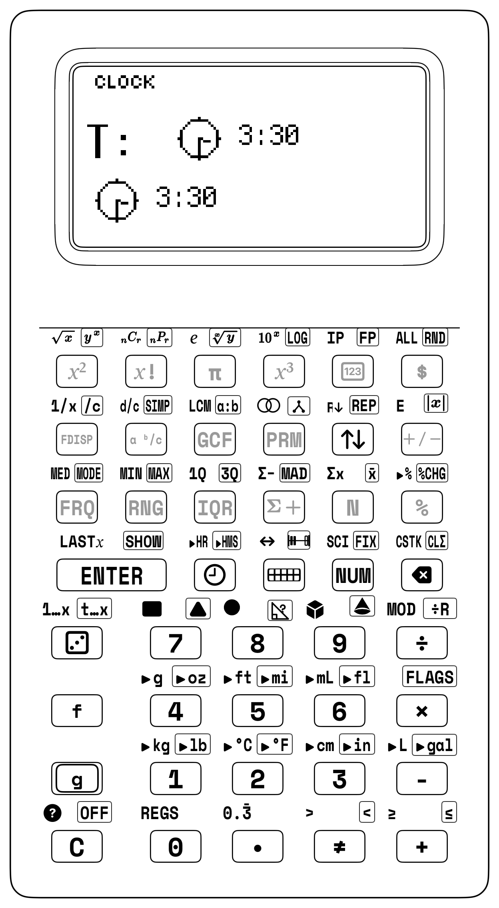

<div class="admonition note">
<p class="admonition-title">Chapter Baseline Mode: [NUM]</p>
<p>
Standard Base-10 Arithmetic &bull; 4-Stack XYZT &bull; Clean Transflective Display
</p>
</div>

<div class="admonition note">
<p class="admonition-title">Unlocked Keycaps Ribbon — Grades 3–5 Geometry &amp; Measurement Suite</p>
<p>
• <strong>2D Geometry Keys:</strong> <code>[f] [RECT]</code> Rectangle Area, <code>[g] [TRI]</code> Triangle Area, <code>[f] [CIRC]</code> Circle Area, <code>[π]</code> Pi Constant.<br>
• <strong>3D Solid Volume Keys:</strong> <code>[f] [PRISM]</code> Prism Volume, <code>[g] [CONE]</code> Cone Volume, <code>[f] [PRISM]</code> Pyramid Volume.<br>
• <strong>The Master Surface Area Technique:</strong> <code>[Σ+]</code> (Accumulate Face Pairs), <code>[f] [Σ-]</code> (Deduct Cutouts), <code>[f] [Σx]</code> (Recall Total Surface Area), <code>[g] [CLΣ]</code> (Reset Statistical Registers).<br>
• <strong>Planetary Clock &amp; Modulo-60 Time:</strong> <code>[🕒]</code> (Clock Sandbox), <code>[f] [▸HR]</code> (HMS to Decimal Hours), <code>[g] [▸HMS]</code> (Decimal Hours to HMS), <code>[🕒]</code> (Digital Colon Format).
</p>
</div>

---

## 6.2 Concrete Foundations: Manipulative Nets & Planetary Gear Trains

Geometry is inherently spatial, yet many school textbooks reduce three-dimensional shapes to flat drawings on a page. When you calculate the surface area of a box or the volume of a cylinder, you don't need to struggle with confusing textbook formulas like $A = 2lw + 2lh + 2wh$ or $V = \pi r^2 h$. The StackCalc SC-6 grounds every geometric shape in physical blocks and folding nets you can touch and manipulate.


<div class="admonition note">
<p class="admonition-title">Concrete Geometry &amp; Time Manipulatives Ecosystem</p>
<p>
<strong>1. Precision Folding Polyhedral Nets (Durable Folding Polymer):</strong><br>
&bull; Rectangular Prism Net: 6 hinged faces fold into a 5&times;4&times;3 cm solid.<br>
&bull; Triangular Prism Net: 2 triangular bases + 3 rectangular walls.<br>
&bull; Square Pyramid Net: 1 square base + 4 equilateral triangular walls.<br>
&bull; Cylindrical Wrapper Net: 2 circular disks + 1 unrolled rectangle.<br><br>
<strong>2. 19 mm Stacking Unit Cubes &amp; Tiles:</strong><br>
&bull; 19&times;19 mm precision interlocking base &amp; socket.<br>
&bull; Stack of 3 tiles = 21.0 mm (1 unit cube); stack of 12 = 84.0 mm tower.<br>
&bull; Smooth docking with 45&deg; chamfers &mdash; blocks do not snap or fatigue.<br><br>
<strong>3. Planetary Geared Clock:</strong><br>
&bull; Exact 12.0000:1 compound planetary reduction gear train.<br>
&bull; Continuous, non-stepping hour hand moves in lockstep with minutes.<br>
&bull; Stored in protective desk organizer bin.
</p>
</div>

### 6.2.1 The Folding Polyhedral Net Experience
When you handle a physical folding net, the concept of surface area ceases to be an equation to memorize. You lay the net completely flat on your worktable. All six faces of a rectangular prism lie open to direct tactile inspection:
- Two identical large rectangles (the top and bottom lids): $5\text{ cm} \times 4\text{ cm} = 20\text{ cm}^2$ each.
- Two identical long rectangles (the front and back panels): $5\text{ cm} \times 3\text{ cm} = 15\text{ cm}^2$ each.
- Two identical end rectangles (the left and right tabs): $4\text{ cm} \times 3\text{ cm} = 12\text{ cm}^2$ each.

You don't need to write down intermediate numbers on scratch paper. Using your SC-6, you enter each face pair directly into the calculator's hardware statistical accumulator using the `[Σ+]` key. As you accumulate each pair, the LCD displays your sample count: `n = 1`, `n = 2`, `n = 3`. Finally, tapping `[f] [Σx]` reveals your total surface area: $94\text{ cm}^2$. You then physically fold the hinged panels upward until the tabs fit together, forming a rigid three-dimensional prism. The mystery is solved: *total surface area is simply the sum of all flat 2D faces wrapping the 3D solid*.

| Prism Face Pair | Opposing Faces | Dimensions | Face Area | Pair Area ($2 \times A$) |
| :--- | :--- | :--- | :--- | :--- |
| **Pair 1** | Top Face & Bottom Face | $5\text{ cm} \times 4\text{ cm}$ | $20\text{ cm}^2$ | $40\text{ cm}^2$ |
| **Pair 2** | Front Panel & Back Panel | $5\text{ cm} \times 3\text{ cm}$ | $15\text{ cm}^2$ | $30\text{ cm}^2$ |
| **Pair 3** | Left End & Right End | $4\text{ cm} \times 3\text{ cm}$ | $12\text{ cm}^2$ | $24\text{ cm}^2$ |
| **Total Surface Area** | All 6 Unfolded Faces | $5 \times 4 \times 3\text{ cm}$ | — | **$94\text{ cm}^2$** |

### 6.2.2 Interlocking Snap Cubes and Unit Volumes
Volume measures internal capacity—how many unit cubes fill a solid without gaps or overlaps. By assembling 24 interlocking 20 mm snap cubes into arrays of $2 \times 3 \times 4$, $1 \times 2 \times 12$, and $2 \times 2 \times 6$, you physically discover that while the spatial arrangement changes, the total volume remains constant at 24 cubic units.

### 6.2.3 Named Idiom: The Stack Drop & Building 3D Volumes
On the SC-6, Stack Math works just like stacking blocks to build a room:

1. **Laying Down the Floor:** When you type $\text{Length} \ \mathtt{ENTER} \ \text{Width}$, you set the floor dimensions on the two active shelves ($Y = \text{Length}, X = \text{Width}$).
2. **Floor Area:** Tapping `[×]` multiplies length by width. The two numbers fuse together onto Level $X$ to give the floor area ($B = L \times W$).
3. **Raising the Walls:** Now type $\text{Height}$ and tap `[×]`. The floor area multiplies by the height, turning the flat floor into a solid 3D box ($V = B \times H$)!

You never have to memorize a long, confusing formula all at once—you build your math step-by-step from the floor up!

<div class="admonition note">
<p class="admonition-title">For Parents &amp; Teachers: Spatial Reasoning &amp; Dimensional Scaling</p>
<p>
Following Jerome Bruner's learning framework *([Bruner, 1966](sc6/appendix-c-formulas-and-conversions.md#cite-bruner1966))* and George Pólya's strategy of decomposing spatial bodies into simpler sub-problems *([Pólya, 1945](sc6/appendix-c-formulas-and-conversions.md#cite-polya1945))*, students avoid rote formula memorization. As Randall Munroe demonstrates in dimensional scaling *([Munroe, 2014](sc6/appendix-c-formulas-and-conversions.md#cite-munroe2014))*, Steven Strogatz illustrates in geometric discovery *([Strogatz, 2012](sc6/appendix-c-formulas-and-conversions.md#cite-strogatz2012))*, and David Macaulay illustrates in mechanical systems *([Macaulay, 2016](sc6/appendix-c-formulas-and-conversions.md#cite-macaulay2016))*, spatial volume grows with the cube of linear scale ($L^3$). The step-by-step visibility of the RPN stack drop anchors this physical intuition.
</p>
</div>


---

## 6.3 2D Plane Geometry & Direct Area Solvers

In Grades 3 through 5, you explore two-dimensional plane geometry, unlocking powerful formulas for perimeter and area across polygons and circles.

### 6.3.1 Rectangles and Squares (`[f] [RECT]`)
A rectangle is a quadrilateral with four right angles. The perimeter $P$ measures the linear distance around the boundary, while the area $A$ quantifies the surface bounded by the perimeter:
$$P = 2L + 2W = 2(L + W), \qquad A = L \times W$$

#### Worked Example 6.1: Schoolyard Garden Enclosure
A school garden measures $14\text{ meters}$ in length and $8.5\text{ meters}$ in width. Find:
1. The length of fencing required to completely enclose the garden.
2. The total square meterage of weed barrier cloth needed to carpet the ground.

> **RPN Solution for Perimeter:**
> 14 [ENTER] 8.5 [+] [2] [×]  -> 45.00 meters
>
> RPN Solution for Area:
> 14 [ENTER] 8.5 [×]          -> 119.00 square meters

| Keystroke | Register T | Register Z | Register Y | Register X |
| :--- | :--- | :--- | :--- | :--- |
| 14 | 0 | 0 | 0 | 14 |
| [ENTER] | 0 | 0 | 14 | 14 |
| 8.5 | 0 | 0 | 14 | $8.5$ |
| [+] | 0 | 0 | 0 | $22.5$ |
| [2] | 0 | 0 | $22.5$ | 2 |
| [×] | 0 | 0 | 0 | 45 |

For dedicated fast evaluation, the SC-6 provides `[f] [RECT]`, which evaluates $Y \times X$ directly:
- `14` [ENTER] `8.5` [f] [RECT] $\longrightarrow X = \mathbf{119.00\text{ m}^2}$.

#### Worked Example 6.2: Square Classroom Carpet Tile
A modular classroom carpet tile is a square with side length $s = 0.5\text{ meters}$. What is its area in square meters?
$$\text{Keystrokes: } [0] [.] [5] [x^2] \longrightarrow X = \mathbf{0.25\text{ m}^2}$$
- **Step-by-Step RPN Reasoning & Stack Logic:**
  1. `0.5` — Enter the square tile side length ($s = 0.5\text{ m}$) into Register $X$ ($X = 0.5$).
  2. `[x²]` — Apply the unary squaring operator in place on Register $X$ ($0.5 \times 0.5$), yielding the area $X = \mathbf{0.25\text{ m}^2}$ with zero intermediate registers.

---

### 6.3.2 Triangles (`[g] [TRI]`)
Every triangle can be viewed as exactly half of an enclosing parallelogram. Regardless of whether the triangle is right-angled, acute, or obtuse, its area is given by:
$$A = \frac{1}{2} \times b \times h$$
where $b$ is the length of any base and $h$ is the perpendicular altitude dropped to that base.

| Triangle Classification | Altitude ($h$) Location | Area Formula |
| :--- | :--- | :--- |
| **Right Triangle** | Vertical leg serves directly as perpendicular height $h$ | $A = \frac{1}{2} \times b \times h$ |
| **Obtuse Triangle** | Perpendicular height $h$ drops outside the base extension | $A = \frac{1}{2} \times b \times h$ |
| **Acute Triangle** | Perpendicular height $h$ drops inside the triangle interior | $A = \frac{1}{2} \times b \times h$ |

#### Worked Example 6.3: Wooden Sailboat Rigging
A scale model yacht features a mainsail with a base of $b = 18\text{ cm}$ and a vertical mast height of $h = 32\text{ cm}$. Find the sail cloth area.

$$\text{Classical Formulation: } A = \frac{18 \times 32}{2} = 288\text{ cm}^2$$

> **RPN Execution:**
> 18 [ENTER] 32 [×] [2] [÷]  -> 288.00 cm²
>
> Direct Shortcut using [TRI]:
> 18 [ENTER] 32 [g] [TRI]   -> 288.00 cm²

| Keystroke | Register T | Register Z | Register Y | Register X |
| :--- | :--- | :--- | :--- | :--- |
| 18 | 0 | 0 | 0 | 18 |
| [ENTER] | 0 | 0 | 18 | 18 |
| 32 | 0 | 0 | 18 | 32 |
| [g] [TRI] | 0 | 0 | 0 | 288 |

#### Worked Example 6.4: Arbitrary Triangle via Heron's Formula
In Grade 6 advanced mathematics, you encounter triangles where all three side lengths are known ($a = 7\text{ cm}, b = 8\text{ cm}, c = 9\text{ cm}$), but no perpendicular height is provided. Heron's Formula calculates the area using the semi-perimeter $s = \frac{a + b + c}{2}$:
$$A = \sqrt{s(s - a)(s - b)(s - c)}$$

> **Step 1: Compute semi-perimeter s and fill all 4 stack levels (X, Y, Z, T = 12):**
> [7] [ENTER] [8] [+] [9] [+] [2] [÷]   -> s = 12.00 cm
> [ENTER] [ENTER] [ENTER]                   -> X=12, Y=12, Z=12, T=12
>
> Step 2: Compute terms (s - a), (s - b), (s - c) and multiply on the 4-level stack:
> [7] [-]                                         -> (12 - 7) = 5  (Y=12, Z=12, T=12)
> [x⇄y] [8] [-] [×]                   -> 5 * (12 - 8) = 20 (Y=12, Z=12)
> [x⇄y] [9] [-] [×]                   -> 20 * (12 - 9) = 60 (Y=12)
> [×]                                                   -> 12 * 60 = 720
> [√x]                                               -> 26.8328 cm²

The triangle's exact area is $\sqrt{720} \approx \mathbf{26.83\text{ cm}^2}$.

---

### 6.3.3 Circles, Disks & Annuli (`[f] [CIRC]`)
A circle is defined by all points equidistant from a central origin. The ratio of circumference to diameter is the irrational circle constant $\pi \approx 3.1415926535...$, accessed on the SC-6 via the shifted key [π]:
$$C = 2\pi r = \pi d, \qquad A = \pi r^2 = \frac{\pi d^2}{4}$$

> **CIRCLE ANATOMY (2D)**
>
> *****
> *         *
> *             *
> *       r       *
> *    o----------> *
> *        d      *
> * <----------->
> *         *
> *****
> Radius (r): Center to boundary
> Diameter (d): 2 x r
> Circumference (C): 2 x π x r
> Area (A): π x r²

In classic handheld RPN calculator engineering, computing circle circumference and disk area with full hardware-precision $\pi$ eliminated the accumulated drift of rough $3.14$ textbook approximations.

#### Worked Example 6.5: Schoolyard Running Track Turn
The circular turnaround loop of a physical education sprint track has a radius of $r = 15\text{ meters}$. Find:
1. The distance you run along one full circular revolution.
2. The total grass seeding area enclosed by the loop.

> **Circumference:**
> 15 [ENTER] [2] [×] [π] [×]     -> 94.2478 meters
>
> Area using [CIRC]:
> 15 [f] [CIRC]                      -> 706.8583 square meters

| Keystroke | Register T | Register Z | Register Y | Register X |
| :--- | :--- | :--- | :--- | :--- |
| 15 | 0 | 0 | 0 | 15 |
| [f] [CIRC] | 0 | 0 | 0 | $706.8583$ |

#### Worked Example 6.6: Circular Annulus (Washer / Doughnut)
A 3D-printed spacer washer has an outer radius $R = 12\text{ mm}$ and a center bore hole of radius $r = 5\text{ mm}$. What is the net surface area of the top plastic face?
$$A_{\text{annulus}} = \pi(R^2 - r^2)$$

> **RPN Execution:**
> 12 [x²] [5] [x²] [-] [π] [×]
- `12 [x²]` $\longrightarrow 144$
- **Step-by-Step RPN Reasoning & Stack Logic:**
  1. `12` — Enter 12 into Register $X$ ($X = 12$).
  2. `[x²]` — Square Register $X$ in place ($12^2$) $\rightarrow$ ($X = 144$).
- `5 [x²]` $\longrightarrow 25$
- `[-]` $\longrightarrow 119$
- `[π] [×]` $\longrightarrow \mathbf{373.85\text{ mm}^2}$.

---

### 6.3.4 Parallelograms & Trapezoids
A parallelogram consists of two pairs of parallel opposite sides. Because an end triangle can be sheared off and translated to the opposite side to form a rectangle, its area formula is identical to that of a rectangle:
$$A_{\text{parallelogram}} = b \times h$$

A trapezoid (or trapezium) has exactly one pair of parallel bases ($a$ and $b$). The area equals the perpendicular height multiplied by the average length of the two parallel bases:
$$A_{\text{trapezoid}} = \frac{a + b}{2} \times h$$

| Trapezoid Dimension | Measurement | Role in Area Formula |
| :--- | :--- | :--- |
| **Top Parallel Base ($a$)** | $6\text{ cm}$ | Averaged with bottom base: $(a + b) / 2$ |
| **Bottom Parallel Base ($b$)** | $10\text{ cm}$ | Average width $= (6 + 10) / 2 = 8\text{ cm}$ |
| **Perpendicular Height ($h$)** | $4\text{ cm}$ | Total Area $A = 8 \times 4 = \mathbf{32\text{ cm}^2}$ |

#### Worked Example 6.7: Drainage Trench Cross-Section
A storm runoff culvert has a trapezoidal cross-section with bottom width $a = 60\text{ cm}$, top opening width $b = 110\text{ cm}$, and depth $h = 40\text{ cm}$. Calculate the water discharge flow area.

> **RPN Evaluation:**
> 60 [ENTER] 110 [+] [2] [÷] 40 [×]  -> 3400.00 cm²

| Keystroke | Register T | Register Z | Register Y | Register X |
| :--- | :--- | :--- | :--- | :--- |
| 60 | 0 | 0 | 0 | 60 |
| [ENTER] | 0 | 0 | 60 | 60 |
| 110 | 0 | 0 | 60 | 110 |
| [+] | 0 | 0 | 0 | 170 |
| 2 | 0 | 0 | 170 | 2 |
| [÷] | 0 | 0 | 0 | 85 |
| 40 | 0 | 0 | 85 | 40 |
| [×] | 0 | 0 | 0 | 3400 |

The flow area is exactly $\mathbf{3,400\text{ cm}^2}$ ($0.34\text{ m}^2$).

---

### 6.3.5 Regular Polygons: Hexagons, Octagons & Floor Tiles
A regular polygon with $n$ sides of length $s$ can be partitioned into $n$ congruent isosceles triangles meeting at the center. The perpendicular distance from the center to any side is the apothem $a$:
$$A = \frac{1}{2} \times \text{Perimeter} \times \text{Apothem} = \frac{1}{2} (n \times s) \times a$$

For a regular hexagon with side length $s$, the internal triangles are equilateral, yielding an exact apothem of $a = \frac{s\sqrt{3}}{2}$:
$$A_{\text{hex}} = \frac{3\sqrt{3}}{2} s^2 \approx 2.598076 \times s^2$$

#### Worked Example 6.8: Hexagonal Ceramic Paver
A courtyard is paved with regular hexagonal pavers, each having side length $s = 10\text{ cm}$. Find the surface area of one paver.

**Grade 3–5 Elementary Method (Using Constant Factor $2.5981$):**
In elementary grades, evaluate regular hexagon area directly using the geometric constant factor $2.5981 \times s^2$:
> `10 [x²] 2.5981 [×]` $\longrightarrow \mathbf{259.81\text{ cm}^2}$.

<div class="admonition note">
<p class="admonition-title">Grade 6+ Mathematical Extension: Exact Radical Apothem Solver</p>
<p>
For middle school mathematicians, the exact regular hexagonal area is derived from 6 equilateral triangles: $A = \frac{3\sqrt{3}}{2} s^2$. Evaluate using the hardware square root key <code>[√x]</code>:
</p>

> **RPN Exact Evaluation:**
> 10 [x²] [3] [×] [3] [√x] [×] [2] [÷]  -> 259.8076 cm²
- `10 [x²]` $\longrightarrow 100$
- **Step-by-Step RPN Reasoning & Stack Logic:**
  1. `10` — Enter 10 into Register $X$ ($X = 10$).
  2. `[x²]` — Square Register $X$ in place ($10^2$) $\rightarrow$ ($X = 100$).
- `[3] [×]` $\longrightarrow 300$
- `3 [f] [√x]` $\longrightarrow 1.73205$
- `[×]` $\longrightarrow 519.6152$
- `[2] [÷]` $\longrightarrow \mathbf{259.81\text{ cm}^2}$.
</div>

---

## 6.4 The Master Surface Area Technique via Stats Mode (`[Σ+]`)

### 6.4.1 Why Wrapping a 3D Box Can Trick Your Brain
Calculating the total surface area of a three-dimensional solid is notoriously error-prone when using old-fashioned calculators. Consider the standard formula for a rectangular prism:
$$\text{Total Surface Area} = 2(L \times W) + 2(L \times H) + 2(W \times H)$$

When using a standard algebraic calculator, you face three frustrating obstacles:
1. **Parenthesis Clutter:** The expression requires at least 6 opening and closing parentheses: `2*(5*4) + 2*(5*3) + 2*(4*3)`. Forgetting a single bracket generates a syntax error.
2. **Scratch Paper Degradation:** You might resort to computing $2 \times 5 \times 4 = 40$ on the calculator, writing down "40" on scrap paper, computing $2 \times 5 \times 3 = 30$, writing down "30", computing $2 \times 4 \times 3 = 24$, writing down "24", and then re-entering all three numbers. Copying numbers down by hand wastes time and causes transcription mistakes.
3. **Loss of Intermediate Visibility:** An algebraic display shows only an unfinished text string, giving you zero feedback on whether individual face pairs make geometric sense.

<div class="admonition note">
<p class="admonition-title">The Master Surface Area Technique ([Σ+])</p>
<p>
&bull; <strong>Rule 1:</strong> Always reset statistical memory before starting: <code>[g] [CLΣ]</code>.<br>
&bull; <strong>Rule 2:</strong> Compute each face pair and press <code>[Σ+]</code> immediately.<br>
&bull; <strong>Rule 3:</strong> The screen displays <code>n = 1, 2, 3...</code>, counting face pairs accumulated in hardware.<br>
&bull; <strong>Rule 4:</strong> Press <code>[f] [Σx]</code> to reveal the total surface area!<br><br>
<em>Zero scratch paper &bull; Zero parentheses &bull; 100% hardware stack verified.</em>
</p>
</div>

### 6.4.2 Algebraic Trap vs. StackCalc Superpower Showdown: Rectangular Prism Surface Area

| Challenge / Equation | The Algebraic Calculator Trap (TI-30X / Smartphone) | The StackCalc SC-6 + Manipulative Superpower | Keystroke Reduction | Live Stack Visibility | Pedagogical Breakthrough |
| :--- | :--- | :--- | :---: | :--- | :--- |
| **Rectangular Prism Surface Area:**<br>$2(8 \times 5 + 8 \times 3 + 5 \times 3)$ | `2 * ( 8 * 5 + 8 * 3 + 5 * 3 ) =`<br>(19 keystrokes).<br>One missed bracket or operator typo ruins the entire expression.<br>No individual face audit is possible.<br>*Trap: Decimals or typos force complete re-entry; zero visual verification of intermediate face pairs.* | **SC-6 + Stats Mode (`[Σ+]`):**<br>`[g] [CLΣ] 8 [ENTER] 5 [×] [Σ+] 3 [×] [Σ+] 5 [ENTER] 3 [×] [Σ+] [f] [Σx] 2 [×]`<br>$\rightarrow \mathbf{158.0\text{ cm}^2}$ (17 keystrokes).<br>Every face pair verified on screen before accumulating; zero scratch paper. | **11% fewer keystrokes**<br>(17 vs. 19) | **100% Face Visibility:**<br>Tracks item count $n = 1, 2, 3$ and lets you inspect intermediate face areas ($40, 24, 15$) before multiplying by 2. | **Modular Face Decomposition:**<br>Transforms abstract bracket clutter into an intuitive physical inventory of 2D nets; mistakes can be corrected face-by-face without starting over. |

### 6.4.3 Station Lesson 6.1: Folding Polyhedral Nets & The Master Surface Area Technique (`[Σ+]`)

<div class="admonition note">
<p class="admonition-title">Station Lesson 6.1: Tactile Setup</p>
<p>
&bull; <strong>Manipulatives:</strong> Hinged Polyhedral Net (5&times;4&times;3 cm Rectangular Prism), 19 mm Stacking Unit Cubes (Counting Studio)<br>
&bull; <strong>Hardware:</strong> StackCalc SC-6 Elementary in <code>[Σ+]</code> Stats Mode<br>
&bull; <strong>Challenge:</strong> Total surface area without scratch paper or parentheses
</p>
</div>

A classroom maker project requires designing an injection-molded instrument case measuring:
- Length $L = 5\text{ cm}$
- Width $W = 4\text{ cm}$
- Height $H = 3\text{ cm}$

> Face Pair 1 (Top & Bottom):  2 x (5 x 4) = 40 cm²  -> [Σ+]  (n = 1)
> Face Pair 2 (Front & Back):  2 x (5 x 3) = 30 cm²  -> [Σ+]  (n = 2)
> Face Pair 3 (Left & Right):  2 x (4 x 3) = 24 cm²  -> [Σ+]  (n = 3)
> Total Surface Area:          40 + 30 + 24 = 94 cm² -> [f] [Σx]

#### Complete RPN Keystroke Audit:

> [CLΣ]                           -> Clears stats registers (n = 0)
> [5] [ENTER] [4] [×] [2] [×]     -> 40.00 cm² (Top/Bottom pair)
> [Σ+]                            -> Accumulates face 1; screen shows n = 1
> [5] [ENTER] [3] [×] [2] [×]     -> 30.00 cm² (Front/Back pair)
> [Σ+]                            -> Accumulates face 2; screen shows n = 2
> [4] [ENTER] [3] [×] [2] [×]     -> 24.00 cm² (Left/Right pair)
> [Σ+]                            -> Accumulates face 3; screen shows n = 3
> [f] [Σx]                        -> Recalls Σx = 94.00 cm²!

| Keystroke | Register T | Register Z | Register Y | Register X | Stat n, Σx |
| :--- | :--- | :--- | :--- | :--- | :--- |
| [CLΣ] | 0 | 0 | 0 | 0 | n=0, Σx=0 |
| [5] | 0 | 0 | 0 | 5 | n=0, Σx=0 |
| [ENTER] | 0 | 0 | 5 | 5 | n=0, Σx=0 |
| [4] | 0 | 0 | 5 | 4 | n=0, Σx=0 |
| [×] | 0 | 0 | 0 | 20 | n=0, Σx=0 |
| [2] | 0 | 0 | 20 | 2 | n=0, Σx=0 |
| [×] | 0 | 0 | 0 | 40 | n=0, Σx=0 |
| [Σ+] | 0 | 0 | 0 | 1 | n=1,Σx=40 |
| [5] | 0 | 0 | 0 | 5 | n=1,Σx=40 |
| [ENTER] | 0 | 0 | 5 | 5 | n=1,Σx=40 |
| [3] | 0 | 0 | 5 | 3 | n=1,Σx=40 |
| [×] | 0 | 0 | 0 | 15 | n=1,Σx=40 |
| [2] | 0 | 0 | 15 | 2 | n=1,Σx=40 |
| [×] | 0 | 0 | 0 | 30 | n=1,Σx=40 |
| [Σ+] | 0 | 0 | 0 | 2 | n=2,Σx=70 |
| [4] | 0 | 0 | 0 | 4 | n=2,Σx=70 |
| [ENTER] | 0 | 0 | 4 | 4 | n=2,Σx=70 |
| [3] | 0 | 0 | 4 | 3 | n=2,Σx=70 |
| [×] | 0 | 0 | 0 | 12 | n=2,Σx=70 |
| [2] | 0 | 0 | 12 | 2 | n=2,Σx=70 |
| [×] | 0 | 0 | 0 | 24 | n=2,Σx=70 |
| [Σ+] | 0 | 0 | 0 | 3 | n=3,Σx=94 |
| [f] [Σx] | 0 | 0 | 0 | 94 | Total: 94 |

---

### 6.4.4 The Cube Manipulative
A regular cube has 6 congruent square faces. For a solid cube manipulative with side length $s = 4\text{ cm}$:
$$\text{Area of 1 face} = 4\text{ cm} \times 4\text{ cm} = 16\text{ cm}^2$$
$$\text{Total Surface Area} = 6 \times 16\text{ cm}^2 = 96\text{ cm}^2$$

You can accumulate all 6 faces individually to physically confirm the 6-face count:
> [CLΣ]
> Loop 6 times: [4] [ENTER] [4] [×] [Σ+]
> Display shows: n = 6
> [f] [Σx] -> 96.00 cm²
Or you can use the direct face-pair shortcut:
`4 [x²] 6 [×]` $\longrightarrow \mathbf{96.00\text{ cm}^2}$.

---

### 6.4.5 Triangular Prism

A right triangular prism manipulative features:
- Two right-triangular end bases with legs $a = 3\text{ cm}$ and $b = 4\text{ cm}$ (hypotenuse $c = 5\text{ cm}$).
- Prism length (extrusion depth) $L = 6\text{ cm}$.

| Triangular Prism Face | Geometry & Dimensions | Area Calculation |
| :--- | :--- | :--- |
| **2 Triangular Ends** | Right triangle legs $a = 3\text{ cm}$, $b = 4\text{ cm}$ | $2 \times (\frac{1}{2} \times 3 \times 4) = 12\text{ cm}^2$ |
| **1 Bottom Rectangular Base** | Base $3\text{ cm}$, length $L = 6\text{ cm}$ | $1 \times (3 \times 6) = 18\text{ cm}^2$ |
| **1 Vertical Rectangular Back** | Height $4\text{ cm}$, length $L = 6\text{ cm}$ | $1 \times (4 \times 6) = 24\text{ cm}^2$ |
| **1 Slanted Rectangular Roof** | Hypotenuse $5\text{ cm}$, length $L = 6\text{ cm}$ | $1 \times (5 \times 6) = 30\text{ cm}^2$ |
| **Total Surface Area** | Accumulated via `[Σ+]` ($n = 4$) | **$84\text{ cm}^2$** |

#### Step-by-Step Face Inventory:
1. **Two Triangular Ends:** Each end has area $\frac{1}{2} \times 3 \times 4 = 6\text{ cm}^2$. Together, the pair equals $2 \times 6 = 12\text{ cm}^2$.
2. **Bottom Rectangular Face:** $3\text{ cm} \times 6\text{ cm} = 18\text{ cm}^2$.
3. **Vertical Rectangular Back:** $4\text{ cm} \times 6\text{ cm} = 24\text{ cm}^2$.
4. **Slanted Rectangular Roof:** $5\text{ cm} \times 6\text{ cm} = 30\text{ cm}^2$.
$$\text{Total Surface Area} = 12 + 18 + 24 + 30 = 84\text{ cm}^2$$

> **Keystrokes:**
> [CLΣ]
> [3] [ENTER] [4] [×] [Σ+]           -> n = 1 (Accumulates 12 cm² ends)
> [3] [ENTER] [6] [×] [Σ+]           -> n = 2 (Accumulates 18 cm² bottom)
> [4] [ENTER] [6] [×] [Σ+]           -> n = 3 (Accumulates 24 cm² back)
> [5] [ENTER] [6] [×] [Σ+]           -> n = 4 (Accumulates 30 cm² slant)
> [f] [Σx]                           -> Recalls 84.00 cm²!

---

### 6.4.6 Right Circular Cylinder
A right cylinder consists of two parallel circular disks of radius $r$ joined by a curved lateral wall of height $h$. When unrolled flat, the lateral wall forms a rectangle whose width is the circular circumference $2\pi r$ and whose height is $h$:
$$\text{Total Surface Area} = 2(\pi r^2) + 2\pi r h$$

#### Worked Example 6.9: Steel Storage Silo
A cylindrical water storage tank has a radius $r = 3\text{ meters}$ and a height $h = 8\text{ meters}$. Find the total metal plating required (top disk, bottom disk, and cylindrical wall).

> **RPN Solution via [Σ+]:**
> [CLΣ]
> [3] [f] [CIRC] [2] [×] [Σ+]        -> Disk pair: 2 * (π * 3²) ≈ 56.5487 m² (n = 1)
> [3] [ENTER] [2] [×] [π] [×]    -> Circumference: 2 * π * 3 ≈ 18.8496 m
> [8] [×] [Σ+]                       -> Lateral wall: 18.8496 * 8 ≈ 150.7964 m² (n = 2)
> [f] [Σx]                           -> Total Surface Area: 207.3451 m²
The tank requires $\mathbf{207.35\text{ m}^2}$ of steel sheeting.

---

### 6.4.7 Right Circular Cone
A right cone has a circular base of radius $r$ and a pointed vertex. The lateral surface unrolls into a circular sector of radius $s$ (the slant height), where $s = \sqrt{r^2 + h^2}$:
$$\text{Base Area} = \pi r^2, \qquad \text{Lateral Area} = \pi r s$$
$$\text{Total Surface Area} = \pi r^2 + \pi r \sqrt{r^2 + h^2}$$

#### Worked Example 6.10: Traffic Pylon Cover
A highway safety cone has a base radius $r = 15\text{ cm}$ and a vertical height $h = 36\text{ cm}$. Find:
1. The slant height $s$.
2. The reflective vinyl sheeting required for the lateral surface (open bottom, no base).

> **Step 1: Compute Slant Height s:**
> 15 [x²] 36 [x²] [+] [√x]  -> s = 39.00 cm (Exact Pythagorean triple!)
>
> Step 2: Compute Lateral Area A = π * r * s:
> [π] [×] 15 [×]              -> 1837.83 cm²
The cone requires $\mathbf{1,837.83\text{ cm}^2}$ of vinyl.

---

### 6.4.8 Regular Square-Based Pyramid
A square pyramid features a flat square base of side $s$ and four congruent isosceles triangular walls meeting at the apex. The slant height $l$ runs from the apex down the center of each triangular face:
$$\text{Base Area} = s^2, \qquad \text{Wall Area} = 4 \times \left(\frac{1}{2} s l\right) = 2 s l$$
$$\text{Total Surface Area} = s^2 + 2 s l$$

#### Worked Example 6.11: Canvas Camping Tent
A pyramid tent has a square floor of side $s = 3\text{ meters}$ and a slant height $l = 2.5\text{ meters}$. Find the total canvas required including the waterproof floor.

> **Keystrokes via [Σ+]:**
> [CLΣ]
> [3] [x²] [Σ+]                      -> Floor base: 9.00 m² (n = 1)
> [3] [ENTER] 2.5 [×]        -> Base * slant = 7.5
> [2] [÷]                            -> 1 triangle = 3.75 m²
> [4] [×] [Σ+]                       -> 4 triangular walls = 15.00 m² (n = 2)
> [f] [Σx]                           -> Total Canvas Area = 24.00 m²

---

### 6.4.9 Open-Top Solids & Custom Maker Enclosures
Real-world engineering frequently demands calculating surface areas of open containers, such as an acrylic aquarium, an electronics project box with a removable lid, or a sheet metal tool tray.

#### Worked Example 6.12: Acrylic Glass Aquarium
An open-top aquarium measures $L = 10\text{ inches}$, $W = 8\text{ inches}$, and $H = 6\text{ inches}$. Because the top is open, the solid has only 5 faces (1 bottom base + 2 front/back walls + 2 left/right walls).

> **Keystrokes via [Σ+]:**
> [CLΣ]
> 10 [ENTER] [8] [×] [Σ+]       -> Single bottom face: 80.00 in² (n = 1)
> 10 [ENTER] [6] [×] [2] [×] [Σ+] -> Front/Back pair: 120.00 in² (n = 2)
> [8] [ENTER] [6] [×] [2] [×] [Σ+]     -> Left/Right pair: 96.00 in² (n = 3)
> [f] [Σx]                           -> Total Glass Area: 296.00 in²
You verify with a single glance at the accumulator count: `n = 3` face groups added, total area $\mathbf{296\text{ in}^2}$.

---

## 6.5 3D Solid Volume Dynamics

Volume quantifies the three-dimensional space enclosed within the boundary of a solid. In the SC-6 system, all prism and cylinder volumes share a unified conceptual definition:
$$\text{Volume} = \text{Base Area } (A_{\text{base}}) \times \text{Height } (h)$$

For pointed solids (cones and pyramids), the volume is exactly one-third of the enclosing prism or cylinder:
$$\text{Volume}_{\text{pointed}} = \frac{1}{3} \times A_{\text{base}} \times h$$

| Solid Type | Base Area ($A_b$) | Volume Formula |
|:---|:---|:---|
| **Rectangular Prism** | $A_b = L \times W$ | $V = L \times W \times H$ |
| **Cube** | $A_b = s^2$ | $V = s^3$ |
| **Right Cylinder** | $A_b = \pi \times r^2$ | $V = \pi \times r^2 \times h$ |
| **Square Pyramid** | $A_b = s^2$ | $V = \frac{1}{3} \times s^2 \times h$ |
| **Right Cone** | $A_b = \pi \times r^2$ | $V = \frac{1}{3} \times \pi \times r^2 \times h$ |
| **Sphere** | *(Full Solid)* | $V = \frac{4}{3} \times \pi \times r^3$ |

### 6.5.1 Rectangular Prisms & Cubes
#### Worked Example 6.13: Shipping Crate Capacity
A cargo container measures $12\text{ meters}$ long, $2.4\text{ meters}$ wide, and $2.6\text{ meters}$ tall. How many cubic meters of freight can it hold?

> **RPN Execution:**
> 12 [ENTER] 2.4 [×] 2.6 [×]  -> 74.88 m³

| Keystroke | Register T | Register Z | Register Y | Register X |
| :--- | :--- | :--- | :--- | :--- |
| 12 | 0 | 0 | 0 | 12 |
| [ENTER] | 0 | 0 | 12 | 12 |
| 2.4 | 0 | 0 | 12 | $2.4$ |
| [×] | 0 | 0 | 0 | $28.8$ |
| 2.6 | 0 | 0 | $28.8$ | $2.6$ |
| [×] | 0 | 0 | 0 | $74.88$ |
The cargo volume is $\mathbf{74.88\text{ m}^3}$.

---

### 6.5.2 Cylinders & Storage Tanks
#### Worked Example 6.14: Farm Milk Silo
A cylindrical dairy storage tank has an inside diameter $d = 2.4\text{ meters}$ (radius $r = 1.2\text{ m}$) and a vertical height $h = 4.5\text{ meters}$.
1. Find the volume in cubic meters.
2. Given that $1\text{ m}^3 = 1,000\text{ liters}$, determine total milk storage capacity in liters.

> **Step 1: Compute Volume in m³:**
> 1.2 [f] [CIRC] 4.5 [×]  -> 20.3575 m³
>
> Step 2: Convert to Liters (multiply by 1,000):
> 1000 [×]                      -> 20,357.52 Liters
The silo holds $\mathbf{20.36\text{ m}^3}$ or $\mathbf{20,358\text{ liters}}$ of milk.

---

### 6.5.3 Cones & Pyramids: The $3:1$ Pouring Proof
In hands-on math stations, you can perform the classic experiment: take a hollow cone and a hollow cylinder of identical base radius $r$ and vertical height $h$. Filling the cone with dry rice or water, you discover that it takes exactly three full cones to fill the cylinder. Thus:
$$V_{\text{cylinder}} = 3 \times V_{\text{cone}} \iff V_{\text{cone}} = \frac{1}{3} \pi r^2 h$$

#### Worked Example 6.15: Laboratory Glass Funnel
A conical funnel has an opening radius $r = 6\text{ cm}$ and an internal depth $h = 10\text{ cm}$. Find its liquid capacity.

> **RPN Evaluation:**
> [6] [f] [CIRC] 10 [×] [3] [÷]  -> 376.9911 cm³
- `[6] [f] [CIRC]` $\longrightarrow 113.0973\text{ cm}^2$ (Base area $\pi r^2$)
- `10 [×]` $\longrightarrow 1130.9734\text{ cm}^3$ (Enclosing cylinder volume)
- `[3] [÷]` $\longrightarrow \mathbf{376.99\text{ cm}^3}$ (Exact conical volume).

---

### 6.5.4 Spheres & Hemispheres
A sphere is a perfectly symmetrical three-dimensional ball. Archimedes famously proved that the volume of a sphere is two-thirds the volume of its circumscribed cylinder:
$$V_{\text{sphere}} = \frac{4}{3} \pi r^3$$

#### Worked Example 6.16: Weather Observation Balloon
A meteorological sounding balloon is inflated to a spherical radius $r = 1.5\text{ meters}$. Find the helium gas volume needed to fill it. As Steven Strogatz notes *([Strogatz, 2012](sc6/appendix-c-formulas-and-conversions.md#cite-strogatz2012))*, Archimedes regarded his proof of the spherical volume formula ($V = \frac{4}{3}\pi r^3$) as his greatest mathematical triumph.

> **RPN Keystrokes:**
> [4] [ENTER] [3] [÷] [π] [×] 1.5 [ENTER] [3] [yˣ] [×]  -> 14.1372 m³
- `4 [ENTER] 3 [÷]` $\longrightarrow 1.33333$
- **Step-by-Step RPN Reasoning & Stack Logic:**
  1. `4` `[ENTER]` — Stage numerator 4 onto the upper shelf ($Y = 4$), ready for Archimedes' spherical ratio.
  2. `3` `[÷]` — Key in denominator 3 and execute division: the shelf drops smoothly to yield the fraction $4/3 \approx 1.3333$ ($X = 1.3333$).
- `[π] [×]` — Scale by circle constant $\pi \longrightarrow 4.18879$ (the universal spherical volume coefficient $\frac{4}{3}\pi$).
- `1.5 [ENTER] 3 [g] [yˣ]` — Cube the balloon's physical radius ($1.5^3$) $\longrightarrow 3.375\text{ m}^3$.
- `[×]` — Multiply spherical coefficient by cubic radius $\longrightarrow \mathbf{14.14\text{ m}^3}$ of helium gas.

---

### 6.5.5 Fluid Displacement & Irregular Objects
When an irregularly shaped object (such as a metal machine bolt or a mineral sample) is submerged in a graduated cylinder of water, the volume of displaced liquid equals the exact solid volume of the submerged body (Archimedes' Principle).

#### Worked Example 6.17: Mineral Specimen Density Trial
You pour water into a cylindrical beaker with internal radius $r = 4\text{ cm}$. When you gently lower a mineral sample beneath the surface, the water level rises by $\Delta h = 1.8\text{ cm}$. Find the mineral's volume.

> **RPN Calculation:**
> [4] [f] [CIRC] 1.8 [×]  -> 90.4779 cm³
The mineral sample has a volume of $\mathbf{90.48\text{ cm}^3}$.

---

## 6.6 Planetary Geared Clock & Continuous Modulo-60 Elapsed Time

### 6.6.1 How the Gears Inside Your Planetary Clock Work Together
Traditional elementary classroom clocks feature stepping hands or disconnected dials that let you accidentally position hands in physically impossible configurations (such as pointing the hour hand directly at 4:00 while the minute hand points to 30 minutes, representing 4:30).

The StackCalc ecosystem pairs the SC-6 with an authentic 3D-printed **Planetary Geared Clock**. The clock mechanism utilizes an exact compound planetary gear train with an exact $12.0000:1$ gear reduction ratio:
- As the minute hand completes one full $360^\circ$ rotation ($60\text{ minutes}$), the planet gears smoothly drive the sun carrier forward by exactly $\frac{1}{12}\text{th}$ of a turn ($30^\circ$, or 1 hour).
- At 3:30, the hour hand does **not** sit on the 3; it is mechanically locked at $3.5\text{ hours} \times 30^\circ/\text{hr} = 105^\circ$, exactly halfway between 3 and 4!

As Matt Parker observes in *Humble Pi* *([Parker, 2019](sc6/appendix-c-formulas-and-conversions.md#cite-parker2019))*, real-world engineering failures frequently trace back to uncoordinated mechanical linkages and rounding off fractional gear cycles. The SC-6 planetary gear train eliminates stepping backlash and locks angle and elapsed time into an unbreakable physical invariant.

> 12 (0° / 360°)
> 11        1
> 10                 2
> 9          o---------> 3 (90°)
> 8        /         4
> 7   /     5
> 6 (180°)
> At 3:30, Minute Hand points to 6 (180°).
> Hour Hand points halfway between 3 and 4:
> Angle = (3 + 30/60) x 30° = 3.5 x 30° = 105.0°!

### 6.6.2 Continuous Hand Angle Verification

In the SC-6 firmware engine (`SC6VisualConversions`), the continuous angle of the hands is computed using full floating-point precision:
$$\theta_{\text{minute}} = \text{minutes} \times \frac{2\pi}{60} = \text{minutes} \times \frac{\pi}{30}\text{ radians}$$
$$\theta_{\text{hour}} = \left(\text{hours} + \frac{\text{minutes}}{60}\right) \times \frac{2\pi}{12} = \left(\text{hours} + \frac{\text{minutes}}{60}\right) \times \frac{\pi}{6}\text{ radians}$$

For $3:30$ ($3.30\text{ HMS}$):
- $\theta_{\text{minute}} = 30 \times \frac{\pi}{30} = \pi\text{ rad} = \mathbf{180.0^\circ}$.
- $\theta_{\text{hour}} = \left(3 + \frac{30}{60}\right) \times \frac{\pi}{6} = 3.5 \times \frac{\pi}{6} \approx \mathbf{1.8325957\text{ rad}} = \mathbf{105.0^\circ}$.

---

### 6.6.3 Clock Time (`H.MMSS`) Entry and `[f] [▸HR]` / `[g] [▸HMS]` Conversion
Clock time operates in base 60 (60 minutes in an hour), whereas standard calculator numbers operate in base 10 (decimal). A common mistake is trying to add $9:45 + 2:35 = 11.80$, treating 45 minutes and 35 minutes as decimal numbers!

The SC-6 adopts the clear, classic time notation:
- Time is entered as $\mathtt{Hours}.\mathtt{MinutesSeconds}$ (e.g., $9.45$ for 9:45 AM).
- Pressing `[f] [▸HR]` instantly converts clock time to pure decimal hours.
- Arithmetic is executed cleanly in decimal hours.
- Pressing `[g] [▸HMS]` converts the decimal result back to standard clock format $\mathtt{H.MMSS}$.

#### Strict No-Units Rule:
As mandated in the SC-6 design specification, `[f] [▸HR]` converts to pure numeric decimal hours without appending trailing text units like "HR". The display shows `9.7500`, allowing direct subsequent multiplication by hourly wage rates or speeds!

---

### 6.6.4 Station Lesson 6.2: Continuous Geared Clock Elapsed Time (`[🕒]`)


<div class="admonition note">
<p class="admonition-title">Station Lesson 6.2: Tactile Setup</p>
<p>
&bull; <strong>Manipulatives:</strong> Planetary Geared Clock, 12.0000:1 compound planetary reduction gear train<br>
&bull; <strong>Hardware:</strong> StackCalc SC-6 Elementary with <code>[f] [▸HR]</code> and <code>[g] [▸HMS]</code> keys<br>
&bull; <strong>Challenge:</strong> Elapsed flight time across 60-minute clock boundaries
</p>
</div>


A transcontinental flight departs New York at 9:45 AM ($9.45\text{ HMS}$) and has a scheduled flight duration of 2 hours and 35 minutes ($2.35\text{ HMS}$). What is the scheduled arrival time?

#### Hands-On Mechanical Verification:
1. **Clock Setup:** Turn the dial of the physical Planetary Geared Clock until the hands show 9:45. Notice that the hour hand is physically locked three-quarters of the way between 9 and 10 ($9.75\text{ hours} \times 30^\circ/\text{hr} = 292.5^\circ$).
2. **Kinematic Rotation:** Rotate the minute ring through 2 full turns (120 minutes = 2 hours) and an additional 35 minutes. Observe the continuous movement of the hour hand as it sweeps past 12 to rest at 12:20.
3. **RPN Execution:**

> **RPN Keystrokes:**
> 9.45 [f] [▸HR]     -> 9.7500 decimal hours
> [ENTER]                       -> Pushes 9.75 to Register Y
> 2.35 [f] [▸HR]     -> 2.5833 decimal hours in Register X
> [+]                           -> 12.3333 decimal hours
> [g] [▸HMS]                    -> 12.2000 (12:20 PM)!

| Keystroke | Register T | Register Z | Register Y | Register X |
| :--- | :--- | :--- | :--- | :--- |
| [9][.][4][5] | 0 | 9 | 4 | $5.00$ |
| [f] [▸HR] | 0 | 9 | 4 | $5.00$ |
| [ENTER] | 9 | 4 | $5.00$ | $5.00$ |
| [2][.][3][5] | 5 | 2 | $3.00$ | $5.00$ |
| [f] [▸HR] | 5 | 2 | $3.00$ | $5.000000$ |
| [+] | 5 | 5 | 2 | $8.000000$ |
| [g] [▸HMS] | 5 | 5 | 2 | $8.00$ |
The flight lands at exactly **12:20 PM**, matching the physical clock face to the second!

<div class="admonition note">
<p class="admonition-title">For Parents &amp; Teachers: Diagnostic Dialogue</p>
<p>
<strong>Teacher:</strong> "Why couldn't we just add 9.45 + 2.35 on a standard calculator?"<br>
<strong>Student:</strong> "Because 45 + 35 is 80, and there are only 60 minutes in an hour!"<br>
<strong>Teacher:</strong> "Exactly. Time is base-60. What does [f] [▸HR] do on the SC-6?"<br>
<strong>Student:</strong> "It turns the minutes into regular decimal hours so we can add them normally, and then [g] [▸HMS] turns them back into clock time!"
</p>
</div>

---

### 6.6.5 Midnight Boundary Crossings
When a journey spans across midnight, the departure hour exceeds the arrival hour on a 24-hour clock. The SC-6 resolves this using modular arithmetic (modulo 24).

#### Worked Example 6.18: Overnight Sleeper Train
An overnight passenger train departs at 22:45 ($10:45\text{ PM}$) and travels for 3 hours and 30 minutes ($3.30\text{ HMS}$). When does it arrive?

> **RPN Evaluation:**
> 22.45 [f] [▸HR]  -> 22.7500 hr
> [ENTER]
> 3.30 [f] [▸HR]      -> 3.5000 hr
> [+]                            -> 26.2500 hr (exceeds 24 hours!)
> 24 [-]                    -> 2.2500 hr (modulo 24 subtraction)
> [g] [▸HMS]                     -> 2.1500 (02:15 AM)!
The train pulls into the station at **2:15 AM**.

---

### 6.6.6 Planetary Clock Gear Ratio Derivation
For robotics builders and young makers like you, the gear geometry of the Planetary Geared Clock demonstrates applied ratio mathematics. The compound planetary train consists of:
- Sun Gear ($N_s = 12\text{ teeth}$)
- Three Planet Gears ($N_p = 60\text{ teeth}$ each)
- Stationary Ring Gear ($N_r = 132\text{ teeth}$)

The gear ratio $R$ between the input minute carrier and the output hour sun is derived from planetary kinematics:
$$R = 1 + \frac{N_r}{N_s} = 1 + \frac{132}{12} = 1 + 11 = 12.0000$$
The gear train provides an exact, unvarying $12:1$ kinematic reduction with zero angular backlash!

### 6.6.7 How Gear Teeth Fit Together Without Jamming
In STEM maker labs, you can fabricate functional clock gears using open-source blueprints (see Appendix A). The physical size of a gear depends on its **metric module** $m$, which defines the pitch diameter $D$ per tooth:
$$D = m \times N$$
where $m = 1.0\text{ mm}$ for our precision classroom gear set.
- Sun Gear ($N_s = 12$): $D_s = 1.0 \times 12 = 12.0\text{ mm}$
- Planet Gears ($N_p = 60$): $D_p = 1.0 \times 60 = 60.0\text{ mm}$
- Ring Gear ($N_r = 132$): $D_r = 1.0 \times 132 = 132.0\text{ mm}$

You can verify the secret geometry rule that makes all your clock gears sit flat and fit together: the diameter across the big outer ring gear must equal the center sun gear plus two planet gears side-by-side:
$$D_r = D_s + 2 \times D_p \iff 132 = 12 + 2(60) = 12 + 120 = 132.0\text{ mm}$$
This perfect algebraic identity confirms why all three planet gears mesh simultaneously with zero binding or distortion!

---

<div class="admonition note">
<p class="admonition-title">For Parents &amp; Teachers: Spatial Accumulation, Modulo-60 Invariants &amp; Diagnostic Dialogue</p>
<p>
<strong>Pedagogical &amp; Architectural Insights:</strong> The geometric algorithms and time primitives of the SC-6 embody key instructional principles: concrete-to-abstract mapping with polyhedral nets, modulo-60 elapsed time conversion preventing decimal fallacies, and hardware summation isolation in statistical registers (<code>[f] [Σx]</code>).
</p>

<h4>Classroom Script 6.1: The Open-Top Aquarium Dilemma</h4>
<p>
<strong>Teacher:</strong> "Class, our science lab just ordered an open-top glass aquarium measuring 10 inches long, 8 inches wide, and 6 inches tall. We need to buy sheets of acrylic glass to build it. How many faces does our box have?"<br>
<strong>Student (Maya):</strong> "A box always has six faces! Top, bottom, front, back, left, right."<br>
<strong>Teacher:</strong> "Look at the real aquarium on the lab bench. What happens if we put a solid glass lid glued to the top?"<br>
<strong>Maya:</strong> "The fish can't breathe, and we can't feed them! The top has to be completely open!"<br>
<strong>Teacher:</strong> "Exactly! So how many faces do we need to calculate?"<br>
<strong>Maya:</strong> "Only five! One bottom, two long sides, and two short ends."<br>
<strong>Teacher:</strong> "Right. If you used the textbook formula $2lw + 2lh + 2wh$, what would happen?"<br>
<strong>Maya:</strong> "It would add two tops, which would be totally wrong!"<br>
<strong>Teacher:</strong> "Let's use the SC-6 Master Surface Area technique: <code>10 [ENTER] 8 [×] [Σ+]</code>, then <code>10 [ENTER] 6 [×] 2 [×] [Σ+]</code>, then <code>8 [ENTER] 6 [×] 2 [×] [Σ+]</code>, and press <code>[f] [Σx]</code>!"<br>
<strong>Maya:</strong> "296 square inches, and we didn't use a single piece of scratch paper!"
</p>

<h4>Classroom Script 6.2: The Mystery of the 3:30 Clock Hands</h4>
<p>
<strong>Student (Leo):</strong> "Teacher, on this worksheet question about clock angles, it asks for the angle between the hour hand and minute hand at 3:30. I wrote $90^\circ$ because the hour hand is pointing at 3 and the minute hand is pointing at 6."<br>
<strong>Teacher:</strong> "Take our Planetary Geared Clock off the shelf, Leo. Turn the dial until the hands show 3:00, then turn the minute hand to 30 minutes. Watch the hour hand carefully."<br>
<strong>Leo:</strong> "Hey! The hour hand didn't stay on the 3! It moved halfway toward the 4!"<br>
<strong>Teacher:</strong> "Why did it move?"<br>
<strong>Leo:</strong> "Because the gears inside are connected! If the hour hand stayed at 3 until 4:00, it would have to jump instantly to 4 at the last second!"<br>
<strong>Teacher:</strong> "Brilliant! So at 3:30, the hour hand has moved $15^\circ$ past the 3 (to $105^\circ$), and the minute hand is at $180^\circ$. So the angle between them is $180^\circ - 105^\circ = 75^\circ$!"
</p>
</div>

---

<div class="admonition note">
<p class="admonition-title">For Parents &amp; Teachers: Geometry &amp; Measurement Diagnostic Playbook</p>

| Observable Error | Cognitive Root Cause | Targeted Remediation Prompt |
| :--- | :--- | :--- |
| **Adding $9.45 + 2.35 = 11.80$** | Confusing base-60 clock minutes with base-10 decimal fractions. | *"There are 60 minutes in an hour, not 100! 45 minutes + 35 minutes = 80 minutes, which is 1 hour and 20 minutes. Always convert using `[f] [▸HR]` before adding, then convert back with `[g] [▸HMS]`."* |
| **Forgetting to multiply faces by 2** | Omitting the congruent opposite face in a rectangular prism. | *"Hold the 3D wooden box. Does it have only one top, or both a top AND a bottom? Every rectangular box has 3 pairs of matching faces. Always multiply each face product by 2 before tapping `[Σ+]`."* |
| **Calculating 6 faces for an open container** | Blindly executing the formula $2(lw + lh + wh)$ without analyzing physical boundary conditions. | *"Look at the real object. Is the tank sealed shut like a shipping crate, or open like a bucket? Only multiply by 2 if both opposing faces actually exist!"* |
| **Static hour-hand misconception ($3:30 \to 90^\circ$)** | Assuming the hour hand jumps instantaneously on the hour. | *"Look at the planetary gears in our clock manipulative. The hour hand moves continuously in lockstep with the minutes. At 30 minutes past, the hour hand is exactly halfway to the next number."* |
| **Treating volume as surface area** | Confusing boundary area (units of $\text{cm}^2$) with interior capacity (units of $\text{cm}^3$). | *"Area is the wrapping paper covering the outside of the present; volume is the number of toy blocks packed inside the box."* |
| **Omitting the $\frac{1}{3}$ factor in cone volume** | Assuming a cone holds the same volume as a cylinder of equal height. | *"Remember our water pouring experiment! It took 3 full cones of water to fill the cylinder. A cone is always exactly one-third of the cylinder: divide by 3!"* |
</div>

---

## 6.7 Comprehensive Problem Bank: 40 Worked Reference Problems

The following problem bank provides complete, publication-grade reference solutions spanning Grade 3 through Grade 6 geometry and measurement standards. Every keystroke sequence assumes the SC-6 baseline mode `[NUM]`.

<div class="admonition tip">
<p class="admonition-title">Hands-On Studio Proof: Blocks &rarr; Calculator</p>
<p>
<strong>Step 1 (Physical Concrete Intuition):</strong> Unfold the 3D hinged net of a $5\text{ cm} \times 4\text{ cm} \times 3\text{ cm}$ rectangular prism on your desk. Touch each congruent face pair: the top and bottom lids ($5 \times 4 = 20\text{ cm}^2$ each), the front and back walls ($5 \times 3 = 15\text{ cm}^2$ each), and the two end caps ($4 \times 3 = 12\text{ cm}^2$ each). You physically hold the entire surface area of $94\text{ cm}^2$ in your hands.<br>
<strong>Step 2 (The Representational Bridge):</strong> Turn to your SC-6. Instead of writing long parenthetical formulas or messy scratch paper notes, tap <code>[g] [CLΣ]</code> to clear statistical memory. Compute Face Pair 1: <code>5 [ENTER] 4 [×] 2 [×] [Σ+]</code> &rarr; <code>n = 1</code>. Compute Face Pair 2: <code>5 [ENTER] 3 [×] 2 [×] [Σ+]</code> &rarr; <code>n = 2</code>. Compute Face Pair 3: <code>4 [ENTER] 3 [×] 2 [×] [Σ+]</code> &rarr; <code>n = 3</code>. Tap <code>[f] [Σx]</code>: the display instantly reveals <strong><code>94.00</code></strong>! Every fold of the net corresponds to one accumulation step on the calculator.<br>
<strong>Step 3 (Scaling on the Calculator):</strong> Now scale from a toy block to an aircraft cargo container ($1,200\text{ cm} \times 240\text{ cm} \times 260\text{ cm}$): execute the exact same three face pairs with <code>[Σ+]</code> to get $1,324,800\text{ cm}^2$ with 100% hardware precision and zero scratch paper errors!
</p>
</div>

### 6.7.1 Expedition 1: The Landscape Architect's Park Masterplan (Challenges 6.1–6.10)
*Mission Briefing:* You are the lead civil planner and landscape architect mapping out a vibrant 50-acre city park. You must calculate paving perimeters, sod turf areas, circular pond boundaries, and floral polygon parterres—verifying that every square meter of land is budgeted to perfection.

#### Challenge 1: Park Perimeter Ribbon Framing
- **Park Masterplan Context:** The landscape architect plans a rectangular information kiosk bulletin board in the central plaza measuring $2.4\text{ meters}$ wide and $1.2\text{ meters}$ high. A durable aluminum edging ribbon must be ordered to frame its full perimeter.
- **Hands-On Manipulative Stage (Two-Step Model Small -> Scale Big):** Model the kiosk proportions using a small $2 \times 4$ tile array on your desk. Touch the top and right edges to see the half-perimeter ($6$). Then scale big on StackCalc: enter the true $2.4\text{ m} \times 1.2\text{ m}$ dimensions, sum to find the half-perimeter ($3.6\text{ m}$), and double it for the full perimeter.
- **RPN Keystrokes:** `2.4 [ENTER] 1.2 [+] [2] [×]` $\rightarrow$ **`7.2`**
- **Operational Narrative & Stack Flow:** Key `2.4` and press `[ENTER]` to hold the kiosk width in Register $Y$ `(T:0, Z:0, Y:2.4, X:2.4)`. Key `1.2` and press `[+]` to compute the half-perimeter $3.6\text{ m}$ `(T:0, Z:0, Y:0, X:3.6)`. Key `2` and press `[×]` to double the L-shape, giving the full perimeter `(T:0, Z:0, Y:0, X:7.2)`.
- **Diagnostic Checkpoint:** Register $X$ displays $7.2000$. Total perimeter is $\mathbf{7.20\text{ meters}}$.

#### Challenge 2: Square Playground Sandpit Cover
- **Park Masterplan Context:** The community adventure playground features a square sandpit with side length $s = 3.5\text{ meters}$. A heavy-duty waterproof canvas tarp must be cut to protect the sand from overnight rain.
- **Hands-On Manipulative Stage (Tile Arrays):** Lay out a square array of counting tiles ($3.5 \times 3.5$ scale). Squaring a side length tiles the two-dimensional interior plane directly, turning a linear measure ($3.5\text{ m}$) into areal units ($\text{m}^2$).
- **RPN Keystrokes:** `3.5 [x²]` $\rightarrow$ **`12.25`**
- **Operational Narrative & Stack Flow:** Key `3.5` and press `[x²]` to square the edge length in place, directly producing the square tarp area `(T:0, Z:0, Y:0, X:12.25)`.
- **Diagnostic Checkpoint:** Register $X$ displays $12.2500$. Canvas tarp area required is $\mathbf{12.25\text{ m}^2}$.

#### Challenge 3: Triangular Park Pavilion Pennant
- **Park Masterplan Context:** A ceremonial triangular felt pennant hangs above the park entrance pavilion, with base $b = 25\text{ cm}$ along the crossbeam and vertical altitude $h = 60\text{ cm}$. Calculate the felt fabric required.
- **Hands-On Manipulative Stage (Folding Triangles):** Cut a $25 \times 60\text{ cm}$ rectangle of paper diagonally. Two identical right triangles emerge. The area of one triangle is exactly half of the enclosing rectangle ($A = \frac{1}{2} b h$).
- **RPN Keystrokes:** `25 [ENTER] 60 [g] [TRI]` $\rightarrow$ **`750`**
- **Operational Narrative & Stack Flow:** Key `25`, press `[ENTER]`, key `60`, and press `[g] [TRI]` to execute the dedicated triangle area solver in one step `(T:0, Z:0, Y:0, X:750)`.
- **Diagnostic Checkpoint:** Register $X$ displays $750.0000$. Felt fabric area is $\mathbf{750.00\text{ cm}^2}$.

#### Challenge 4: Floral Plaza Circular Sundial Clockface
- **Park Masterplan Context:** A circular sundial in the central plaza has a diameter of $30\text{ cm}$ (radius $r = 15\text{ cm}$). The bronze faceplate must be cut from polished sheet metal.
- **Hands-On Manipulative Stage (Circle to Sectors):** Divide a circular paper disc into 16 wedge sectors and interlock them alternately: they form an approximate parallelogram of height $r$ and base $\pi r$. Area equals $\pi r^2$.
- **RPN Keystrokes:** `15 [f] [CIRC]` $\rightarrow$ **`706.85834706`**
- **Operational Narrative & Stack Flow:** Key `15` and press `[f] [CIRC]` to square the radius and multiply by $\pi$ in a single hardware cycle `(T:0, Z:0, Y:0, X:706.8583)`.
- **Diagnostic Checkpoint:** Register $X$ displays $706.8583$. Bronze plate area is $\mathbf{706.86\text{ cm}^2}$.

#### Challenge 5: Circular Fountain Stone Curb Perimeter
- **Park Masterplan Context:** A decorative circular fountain has radius $r = 4.2\text{ meters}$. Granite stone curbing must be laid around its outer perimeter.
- **Hands-On Manipulative Stage (Unrolling Circles):** Roll a circular disk along a metric tape rule. One complete revolution travels exactly $\pi$ times the diameter ($C = 2 \pi r \approx 6.283 \times r$).
- **RPN Keystrokes:** `4.2 [ENTER] [2] [×] [π] [×]` $\rightarrow$ **`26.38937829`**
- **4-Register Stack Trace Table:**

| Keystroke | Register T | Register Z | Register Y | Register X | Operational Commentary |
| :--- | :---: | :---: | :---: | :---: | :--- |
| `4.2` | $0.0000$ | $0.0000$ | $0.0000$ | $4.2$ | Key fountain radius ($4.2\text{ m}$) |
| `[ENTER]` | $0.0000$ | $0.0000$ | $4.2$ | $4.2$ | Stack lifts; radius locked into Register $Y$ |
| `2` | $0.0000$ | $0.0000$ | $4.2$ | $2.0000$ | Key diameter doubling factor 2 |
| `[×]` | $0.0000$ | $0.0000$ | $0.0000$ | $8.4$ | Multiply to obtain full diameter ($8.4\text{ m}$) in Register $X$ |
| `[π]` | $0.0000$ | $0.0000$ | $8.4$ | $3.1416$ | Push circle constant $\pi \approx 3.141593$ onto stack |
| `[×]` | $0.0000$ | $0.0000$ | $0.0000$ | $26.3894$ | Multiply diameter by $\pi$ to wrap curb perimeter |

- **Diagnostic Checkpoint:** Register $X$ displays $26.3894$. Granite curb perimeter is $\mathbf{26.39\text{ meters}}$.

#### Challenge 6: Parallelogram Flower Bed
- **Park Masterplan Context:** An ornamental botanical flower bed is laid out as a parallelogram with base $b = 8\text{ meters}$ and perpendicular altitude $h = 4.5\text{ meters}$. Calculate the topsoil area.
- **Hands-On Manipulative Stage (Shearing Rectangles):** Cut a triangular slice from the left edge of a paper parallelogram and slide it to the right edge: it forms a rectangle of identical base and height ($A = b \times h$).
- **RPN Keystrokes:** `[8] [ENTER] 4.5 [×]` $\rightarrow$ **`36`**
- **Operational Narrative & Stack Flow:** Key `8`, press `[ENTER]`, key `4.5`, and press `[×]` to evaluate parallelogram area ($8 \times 4.5$) `(T:0, Z:0, Y:0, X:36)`.
- **Diagnostic Checkpoint:** Register $X$ displays $36.0000$. Flower bed area is $\mathbf{36.00\text{ m}^2}$.

#### Challenge 7: Trapezoid Highway Ramp Embankment
- **Park Masterplan Context:** An access ramp retaining embankment bordering the park has parallel bases $a = 14\text{ m}$ (top crest) and $b = 22\text{ m}$ (ground base), with vertical height $h = 6\text{ m}$. Calculate reinforced sod area.
- **Hands-On Manipulative Stage (Midline Averaging):** Join two identical trapezoids upside down: they form a large parallelogram of base $(a + b)$ and height $h$. Halving the combined base yields the average midline width ($18\text{ m}$).
- **RPN Keystrokes:** `14 [ENTER] 22 [+] [2] [÷] [6] [×]` $\rightarrow$ **`108`**
- **4-Register Stack Trace Table:**

| Keystroke | Register T | Register Z | Register Y | Register X | Operational Commentary |
| :--- | :---: | :---: | :---: | :---: | :--- |
| `14` | $0.0000$ | $0.0000$ | $0.0000$ | $14.0000$ | Key top crest base ($14\text{ m}$) |
| `[ENTER]` | $0.0000$ | $0.0000$ | $14.0000$ | $14.0000$ | Stack lifts; top base locked into Register $Y$ |
| `22` | $0.0000$ | $0.0000$ | $14.0000$ | $22.0000$ | Key ground base ($22\text{ m}$) into floor $X$ |
| `[+]` | $0.0000$ | $0.0000$ | $0.0000$ | $36.0000$ | Sum parallel bases ($14 + 22 = 36\text{ m}$) |
| `2` | $0.0000$ | $0.0000$ | $36.0000$ | $2.0000$ | Key divisor 2 on floor $X$ |
| `[÷]` | $0.0000$ | $0.0000$ | $0.0000$ | $18.0000$ | Divide sum by 2 to compute average midline width ($18\text{ m}$) |
| `6` | $0.0000$ | $0.0000$ | $18.0000$ | $6.0000$ | Key embankment vertical height ($6\text{ m}$) |
| `[×]` | $0.0000$ | $0.0000$ | $0.0000$ | $108.0000$ | Multiply average width by height for total area |

- **Diagnostic Checkpoint:** Register $X$ displays $108.0000$. Sod embankment area is $\mathbf{108.00\text{ m}^2}$.

#### Challenge 8: Rhombus Decorative Pathway Pavers
- **Park Masterplan Context:** Plaza pathways are tiled with diamond-shaped granite pavers having diagonal spans $d_1 = 40\text{ cm}$ and $d_2 = 70\text{ cm}$. Find the paver face area ($A = \frac{1}{2} d_1 d_2$).
- **Hands-On Manipulative Stage (Diagonal Quadrants):** The perpendicular diagonals split the rhombus into four identical right triangles. Reassembling them forms a rectangle of dimensions $d_1 \times \frac{1}{2} d_2$.
- **RPN Keystrokes:** `40 [ENTER] 70 [×] [2] [÷]` $\rightarrow$ **`1400`**
- **Operational Narrative & Stack Flow:** Key `40`, press `[ENTER]`, key `70`, and press `[×]` to compute the bounding rectangle $2800\text{ cm}^2$ `(T:0, Z:0, Y:0, X:2800)`. Key `2` and press `[÷]` to halve the product, yielding the net rhombus area `(T:0, Z:0, Y:0, X:1400)`.
- **Diagnostic Checkpoint:** Register $X$ displays $1400.0000$. Paver face area is $\mathbf{1400.00\text{ cm}^2}$.

#### Challenge 9: Regular Hexagonal Gazebo Floor
- **Park Masterplan Context:** A shaded park gazebo has a regular hexagonal floor with side length $s = 12\text{ cm}$ (modeled at 1:10 scale). Calculate the stone floor area using $A = \frac{3\sqrt{3}}{2} s^2$.
- **Hands-On Manipulative Stage (Hexagon Partitioning):** A regular hexagon decomposes into 6 congruent equilateral triangles radiating from its center, each of area $\frac{\sqrt{3}}{4} s^2$. Multiplying by 6 gives $\frac{3\sqrt{3}}{2} s^2$.
- **RPN Keystrokes:** `12 [x²] [3] [×] [3] [f] [√x] [×] [2] [÷]` $\rightarrow$ **`374.12297443`**
- **4-Register Stack Trace Table:**

| Keystroke | Register T | Register Z | Register Y | Register X | Operational Commentary |
| :--- | :---: | :---: | :---: | :---: | :--- |
| `12` | $0.0000$ | $0.0000$ | $0.0000$ | $12.0000$ | Key hexagon side length ($12\text{ cm}$) |
| `[x²]` | $0.0000$ | $0.0000$ | $0.0000$ | $144.0000$ | Square side length ($12^2 = 144$) |
| `3` | $0.0000$ | $0.0000$ | $144.0000$ | $3.0000$ | Key multiplier 3 for triangular sectors |
| `[×]` | $0.0000$ | $0.0000$ | $0.0000$ | $432.0000$ | Multiply ($144 \times 3 = 432$) |
| `3` | $0.0000$ | $0.0000$ | $432.0000$ | $3.0000$ | Key number 3 on floor $X$ |
| `[f] [√x]` | $0.0000$ | $0.0000$ | $432.0000$ | $1.7321$ | Extract square root in place ($\sqrt{3} \approx 1.732051$) |
| `[×]` | $0.0000$ | $0.0000$ | $0.0000$ | $748.2459$ | Multiply by $\sqrt{3}$ ($432 \times 1.732051 = 748.2459$) |
| `2` | $0.0000$ | $0.0000$ | $748.2459$ | $2.0000$ | Key denominator divisor 2 |
| `[÷]` | $0.0000$ | $0.0000$ | $0.0000$ | $374.1230$ | Halve to finalize regular hexagonal area |

- **Diagnostic Checkpoint:** Register $X$ displays $374.1230$. Hexagonal gazebo floor area is $\mathbf{374.12\text{ cm}^2}$.

#### Challenge 10: Irrigation Pipe Annular Gasket Ring
- **Park Masterplan Context:** The park irrigation line uses neoprene annular washers with outer radius $R = 25\text{ mm}$ and inner pipe cutout radius $r = 10\text{ mm}$. Calculate the rubber seal contact area ($A = \pi (R^2 - r^2)$).
- **Hands-On Manipulative Stage (Concentric Cutouts):** Cut a $10\text{ mm}$ disk out of a $25\text{ mm}$ outer circle. The remaining annular washer area is the difference between the outer circle and inner circle areas.
- **RPN Keystrokes:** `25 [x²] 10 [x²] [-] [π] [×]` $\rightarrow$ **`1,649.336143`**
- **Operational Narrative & Stack Flow:** Key `25`, press `[x²]` ($625$), key `10`, press `[x²]` ($100$), and press `[-]` to calculate the difference of radius squares $525\text{ mm}^2$ `(T:0, Z:0, Y:0, X:525)`. Push `[π]` and press `[×]` to scale by the circle constant, arriving at the annular contact area `(T:0, Z:0, Y:0, X:1649.3361)`.
- **Diagnostic Checkpoint:** Register $X$ displays $1649.3361$. Gasket contact area is $\mathbf{1649.34\text{ mm}^2}$.

## 6.8 Expedition 2: The Antarctic Research Station Cold-Weather Packaging (Challenges 6.11–6.20)
*Mission Briefing:* You are the logistics officer at McMurdo Station, Antarctica. Sensitive scientific equipment, lithium battery packs, and insulated survival shelters must be wrapped in specialized thermal mylar. Remember the penguin huddle: heat escapes through surface area! Use the Master `[Σ+]` Technique to calculate exact face pair areas without scratch paper.

#### Challenge 11: Thermal Insulation for a Scientific Sensor Pod
- **Antarctic Logistics Context:** At McMurdo Station, an automated meteorological sensor pod measuring $6\text{ cm} \times 4\text{ cm} \times 2\text{ cm}$ must be sealed in aluminized thermal mylar to withstand $-40^\circ\text{C}$ polar winds. Calculate the total outer surface area across all six faces.
- **Hands-On Manipulative Stage (Folding Polyhedral Net):** Unfold the rectangular prism net. Observe that the 6 rectangular faces organize into three congruent pairs: top/bottom ($6 \times 4$), front/back ($6 \times 2$), and left/right ($4 \times 2$). The Master `[Σ+]` Technique accumulates each pair into memory without scratch paper.
- **RPN Keystrokes:** `[g] [CLΣ] [6] [ENTER] [4] [×] [2] [×] [Σ+] [6] [ENTER] [2] [×] [2] [×] [Σ+] [4] [ENTER] [2] [×] [2] [×] [Σ+] [f] [Σx]` $\rightarrow$ **`88`**
- **4-Register Stack Trace Table:**

| Keystroke | Register T | Register Z | Register Y | Register X | Operational Commentary |
| :--- | :---: | :---: | :---: | :---: | :--- |
| `[g] [CLΣ]` | $0.0000$ | $0.0000$ | $0.0000$ | $0.0000$ | Clear statistical memory accumulators ($n = 0, \Sigma x = 0$) |
| `6` | $0.0000$ | $0.0000$ | $0.0000$ | $6.0000$ | Key in pod length ($6\text{ cm}$) |
| `[ENTER]` | $0.0000$ | $0.0000$ | $6.0000$ | $6.0000$ | Stack lifts; length locked into Register $Y$ |
| `4` | $0.0000$ | $0.0000$ | $6.0000$ | $4.0000$ | Key in pod width ($4\text{ cm}$) |
| `[×]` | $0.0000$ | $0.0000$ | $0.0000$ | $24.0000$ | Multiply length by width for single top face ($24\text{ cm}^2$) |
| `2` | $0.0000$ | $0.0000$ | $24.0000$ | $2.0000$ | Key in face-pair factor 2 |
| `[×]` | $0.0000$ | $0.0000$ | $0.0000$ | $48.0000$ | Double for top and bottom face pair ($48\text{ cm}^2$) |
| `[Σ+]` | $0.0000$ | $0.0000$ | $0.0000$ | $1.0000$ | Accumulate pair 1 into $\Sigma x$ ($n = 1, \Sigma x = 48$) |
| `6` | $0.0000$ | $0.0000$ | $0.0000$ | $6.0000$ | Key in pod length ($6\text{ cm}$) |
| `[ENTER]` | $0.0000$ | $0.0000$ | $6.0000$ | $6.0000$ | Stack lifts; length locked into Register $Y$ |
| `2` | $0.0000$ | $0.0000$ | $6.0000$ | $2.0000$ | Key in pod height ($2\text{ cm}$) |
| `[×]` | $0.0000$ | $0.0000$ | $0.0000$ | $12.0000$ | Multiply length by height for single front face ($12\text{ cm}^2$) |
| `2` | $0.0000$ | $0.0000$ | $12.0000$ | $2.0000$ | Key in face-pair factor 2 |
| `[×]` | $0.0000$ | $0.0000$ | $0.0000$ | $24.0000$ | Double for front and back face pair ($24\text{ cm}^2$) |
| `[Σ+]` | $0.0000$ | $0.0000$ | $0.0000$ | $2.0000$ | Accumulate pair 2 into $\Sigma x$ ($n = 2, \Sigma x = 72$) |
| `4` | $0.0000$ | $0.0000$ | $0.0000$ | $4.0000$ | Key in pod width ($4\text{ cm}$) |
| `[ENTER]` | $0.0000$ | $0.0000$ | $4.0000$ | $4.0000$ | Stack lifts; width locked into Register $Y$ |
| `2` | $0.0000$ | $0.0000$ | $4.0000$ | $2.0000$ | Key in pod height ($2\text{ cm}$) |
| `[×]` | $0.0000$ | $0.0000$ | $0.0000$ | $8.0000$ | Multiply width by height for single side face ($8\text{ cm}^2$) |
| `2` | $0.0000$ | $0.0000$ | $8.0000$ | $2.0000$ | Key in face-pair factor 2 |
| `[×]` | $0.0000$ | $0.0000$ | $0.0000$ | $16.0000$ | Double for left and right end pair ($16\text{ cm}^2$) |
| `[Σ+]` | $0.0000$ | $0.0000$ | $0.0000$ | $3.0000$ | Accumulate pair 3 into $\Sigma x$ ($n = 3, \Sigma x = 88$) |
| `[f] [Σx]` | $0.0000$ | $0.0000$ | $0.0000$ | $88.0000$ | Recall total accumulated surface area across all 6 faces |

- **Diagnostic Checkpoint:** Register $X$ displays $88.0000$. Total thermal foil area is $\mathbf{88.00\text{ cm}^2}$.

#### Challenge 12: Thermal Foil for a Modular Cube Telemetry Pod
- **Antarctic Logistics Context:** A miniature cubic GPS beacon deployed on the Ross Ice Shelf measures $s = 2\text{ cm}$ along each edge. Calculate its total six-sided surface area.
- **Hands-On Manipulative Stage (Counting Cubes):** Examine a single $20\text{ mm}$ counting cube. It has 6 identical square facets. Calculating one square face ($s^2$) and multiplying by 6 yields the complete outer skin.
- **RPN Keystrokes:** `[2] [x²] [6] [×]` $\rightarrow$ **`24`**
- **Operational Narrative & Stack Flow:** Key `2`, press `[x²]` ($4\text{ cm}^2$), key `6`, and press `[×]` to multiply the face area by 6 facets `(T:0, Z:0, Y:0, X:24)`.
- **Diagnostic Checkpoint:** Register $X$ displays $24.0000$. Beacon surface area is $\mathbf{24.00\text{ cm}^2}$.

#### Challenge 13: Thermal Wrap for an Equilateral Prismatic Ice Core Carrier
- **Antarctic Logistics Context:** Drillers extract deep glacial ice cores and transport them in triangular insulated containers. The equilateral triangular ends have base $b = 4\text{ cm}$ and altitude $h = 3.464\text{ cm}$, while the elongated container length is $L = 20\text{ cm}$. Find total surface area.
- **Hands-On Manipulative Stage (Triangular Prism Net):** Unfold the triangular net: the two triangular ends combine into one rectangle ($2 \times \frac{1}{2}bh = bh$), and the three rectangular side walls form a large unfolding strip ($3 \times 4 \times 20$).
- **RPN Keystrokes:** `[g] [CLΣ] [4] [ENTER] 3.464 [×] [Σ+] [4] [ENTER] 20 [×] [3] [×] [Σ+] [f] [Σx]` $\rightarrow$ **`253.856`**
- **4-Register Stack Trace Table:**

| Keystroke | Register T | Register Z | Register Y | Register X | Operational Commentary |
| :--- | :---: | :---: | :---: | :---: | :--- |
| `[g] [CLΣ]` | $0.0000$ | $0.0000$ | $0.0000$ | $0.0000$ | Reset statistical accumulator ($n = 0, \Sigma x = 0$) |
| `4` | $0.0000$ | $0.0000$ | $0.0000$ | $4.0000$ | Key in triangular end base ($4\text{ cm}$) |
| `[ENTER]` | $0.0000$ | $0.0000$ | $4.0000$ | $4.0000$ | Stack lifts; base locked into Register $Y$ |
| `3.464` | $0.0000$ | $0.0000$ | $4.0000$ | $3.464$ | Key in triangle height ($3.464\text{ cm}$) |
| `[×]` | $0.0000$ | $0.0000$ | $0.0000$ | $13.856$ | Multiply: two triangular ends combine into $bh = 13.856\text{ cm}^2$ |
| `[Σ+]` | $0.0000$ | $0.0000$ | $0.0000$ | $1.0000$ | Deposit both end caps into accumulator ($n = 1, \Sigma x = 13.856$) |
| `4` | $0.0000$ | $0.0000$ | $0.0000$ | $4.0000$ | Key in prism side width ($4\text{ cm}$) |
| `[ENTER]` | $0.0000$ | $0.0000$ | $4.0000$ | $4.0000$ | Stack lifts; width locked into Register $Y$ |
| `20` | $0.0000$ | $0.0000$ | $4.0000$ | $20.0000$ | Key in container length ($20\text{ cm}$) |
| `[×]` | $0.0000$ | $0.0000$ | $0.0000$ | $80.0000$ | Multiply for single rectangular wall area ($80\text{ cm}^2$) |
| `3` | $0.0000$ | $0.0000$ | $80.0000$ | $3.0000$ | Key in 3 congruent wrapping side walls |
| `[×]` | $0.0000$ | $0.0000$ | $0.0000$ | $240.0000$ | Multiply to obtain total lateral area ($240\text{ cm}^2$) |
| `[Σ+]` | $0.0000$ | $0.0000$ | $0.0000$ | $2.0000$ | Deposit lateral walls into accumulator ($n = 2, \Sigma x = 253.856$) |
| `[f] [Σx]` | $0.0000$ | $0.0000$ | $0.0000$ | $253.856$ | Recall total accumulated prism surface area |

- **Diagnostic Checkpoint:** Register $X$ displays $253.8560$. Total insulation wrap area is $\mathbf{253.86\text{ cm}^2}$.

#### Challenge 14: Surface Area of a Cylindrical Antarctic Water Sampling Flask
- **Antarctic Logistics Context:** Field scientists collect sub-glacial water in an insulated cylindrical titanium flask with radius $r = 3.3\text{ cm}$ and height $h = 12.2\text{ cm}$. Find total titanium surface area (top lid, bottom base, and curved cylindrical jacket).
- **Hands-On Manipulative Stage (Cylinder Net):** Unroll the cylinder net: the top and bottom form circular discs of area $\pi r^2$, while the curved wall unrolls into a rectangle of height $h$ and width equal to circumference $2\pi r$.
- **RPN Keystrokes:** `[g] [CLΣ] 3.3 [f] [CIRC] [2] [×] [Σ+] 3.3 [ENTER] [2] [×] [π] [×] 12.2 [×] [Σ+] [f] [Σx]` $\rightarrow$ **`321.38492846`**
- **4-Register Stack Trace Table:**

| Keystroke | Register T | Register Z | Register Y | Register X | Operational Commentary |
| :--- | :---: | :---: | :---: | :---: | :--- |
| `[g] [CLΣ]` | $0.0000$ | $0.0000$ | $0.0000$ | $0.0000$ | Reset statistical memory bin ($n = 0, \Sigma x = 0$) |
| `3.3` | $0.0000$ | $0.0000$ | $0.0000$ | $3.3$ | Key in flask radius ($3.3\text{ cm}$) |
| `[f] [CIRC]` | $0.0000$ | $0.0000$ | $0.0000$ | $34.2119$ | Dedicated circle solver evaluates single disc area ($\pi r^2$) |
| `2` | $0.0000$ | $0.0000$ | $34.2119$ | $2.0000$ | Key in multiplier 2 for circular ends |
| `[×]` | $0.0000$ | $0.0000$ | $0.0000$ | $68.4239$ | Double for top and bottom lids ($68.4239\text{ cm}^2$) |
| `[Σ+]` | $0.0000$ | $0.0000$ | $0.0000$ | $1.0000$ | Deposit both end discs into accumulator ($n = 1, \Sigma x = 68.4239$) |
| `3.3` | $0.0000$ | $0.0000$ | $0.0000$ | $3.3$ | Key in radius ($3.3\text{ cm}$) |
| `[ENTER]` | $0.0000$ | $0.0000$ | $3.3$ | $3.3$ | Stack lifts; radius locked into Register $Y$ |
| `2` | $0.0000$ | $0.0000$ | $3.3$ | $2.0000$ | Key doubling factor 2 for diameter |
| `[×]` | $0.0000$ | $0.0000$ | $0.0000$ | $6.6$ | Multiply to obtain diameter ($6.6\text{ cm}$) |
| `[π]` | $0.0000$ | $0.0000$ | $6.6$ | $3.1416$ | Push circle constant $\pi \approx 3.141593$ |
| `[×]` | $0.0000$ | $0.0000$ | $0.0000$ | $20.7345$ | Multiply diameter by $\pi$ for circumference ($20.7345\text{ cm}$) |
| `12.2` | $0.0000$ | $0.0000$ | $20.7345$ | $12.2$ | Key in cylinder height ($12.2\text{ cm}$) |
| `[×]` | $0.0000$ | $0.0000$ | $0.0000$ | $252.9610$ | Multiply circumference by height for lateral wall ($252.961\text{ cm}^2$) |
| `[Σ+]` | $0.0000$ | $0.0000$ | $0.0000$ | $2.0000$ | Deposit lateral jacket into accumulator ($n = 2, \Sigma x = 321.385$) |
| `[f] [Σx]` | $0.0000$ | $0.0000$ | $0.0000$ | $321.3849$ | Recall total accumulated cylindrical surface area |

- **Diagnostic Checkpoint:** Register $X$ displays $321.3849$. Total titanium flask surface area is $\mathbf{321.38\text{ cm}^2}$.

#### Challenge 15: Lateral Surface Area of a Conical Field Radar Beacon Cap
- **Antarctic Logistics Context:** An ice-field radar transponder is protected by a bright orange conical fiberglass cowl with base radius $r = 8\text{ cm}$ and slant height $s = 18\text{ cm}$. The base is open to mount onto the antenna mast. Find lateral fiberglass surface area ($A = \pi r s$).
- **Hands-On Manipulative Stage (Unrolling Cone Sectors):** Cut along the slant seam of a paper cone: it unrolls into a circular sector of radius $s$ and arc length $2\pi r$. Sector area resolves directly to $\pi r s$.
- **RPN Keystrokes:** `[π] [8] [×] 18 [×]` $\rightarrow$ **`452.38934212`**
- **Operational Narrative & Stack Flow:** Push `[π]`, key `8`, and press `[×]` ($25.1327\text{ cm}$) `(T:0, Z:0, Y:0, X:25.1327)`. Key `18` and press `[×]` to multiply by slant height, evaluating the lateral conical area `(T:0, Z:0, Y:0, X:452.3893)`.
- **Diagnostic Checkpoint:** Register $X$ displays $452.3893$. Lateral fiberglass cowl area is $\mathbf{452.39\text{ cm}^2}$.

#### Challenge 16: Surface Area of a Pyramidal Field Tent Shelter
- **Antarctic Logistics Context:** An emergency survival tent is built as a square pyramid with a square footprint of side $s = 20\text{ cm}$ (1:10 scale model) and triangular wall slant height $l = 16\text{ cm}$. Calculate total surface area (floor plus four triangular canopy walls).
- **Hands-On Manipulative Stage (Pyramid Star Net):** Unfold the square pyramid net into a four-pointed star: one central square floor ($s^2$) surrounded by four congruent triangles ($4 \times \frac{1}{2}sl = 2sl$).
- **RPN Keystrokes:** `[g] [CLΣ] 20 [x²] [Σ+] 20 [ENTER] 16 [×] [2] [×] [Σ+] [f] [Σx]` $\rightarrow$ **`1040`**
- **4-Register Stack Trace Table:**

| Keystroke | Register T | Register Z | Register Y | Register X | Operational Commentary |
| :--- | :---: | :---: | :---: | :---: | :--- |
| `[g] [CLΣ]` | $0.0000$ | $0.0000$ | $0.0000$ | $0.0000$ | Clear statistical accumulator ($n = 0, \Sigma x = 0$) |
| `20` | $0.0000$ | $0.0000$ | $0.0000$ | $20.0000$ | Key in square floor base side ($20\text{ cm}$) |
| `[x²]` | $0.0000$ | $0.0000$ | $0.0000$ | $400.0000$ | Square side length ($20^2 = 400\text{ cm}^2$) for floor area |
| `[Σ+]` | $0.0000$ | $0.0000$ | $0.0000$ | $1.0000$ | Deposit floor square into accumulator ($n = 1, \Sigma x = 400$) |
| `20` | $0.0000$ | $0.0000$ | $0.0000$ | $20.0000$ | Key in tent base edge ($20\text{ cm}$) |
| `[ENTER]` | $0.0000$ | $0.0000$ | $20.0000$ | $20.0000$ | Stack lifts; edge locked into Register $Y$ |
| `16` | $0.0000$ | $0.0000$ | $20.0000$ | $16.0000$ | Key in wall slant height ($16\text{ cm}$) |
| `[×]` | $0.0000$ | $0.0000$ | $0.0000$ | $320.0000$ | Multiply base by slant height ($20 \times 16 = 320$) |
| `2` | $0.0000$ | $0.0000$ | $320.0000$ | $2.0000$ | Scale by 2 ($4 \times \frac{1}{2} = 2$) for all 4 triangular faces |
| `[×]` | $0.0000$ | $0.0000$ | $0.0000$ | $640.0000$ | Multiply to evaluate total canopy wall area ($640\text{ cm}^2$) |
| `[Σ+]` | $0.0000$ | $0.0000$ | $0.0000$ | $2.0000$ | Deposit 4 canopy walls into accumulator ($n = 2, \Sigma x = 1040$) |
| `[f] [Σx]` | $0.0000$ | $0.0000$ | $0.0000$ | $1040.0000$ | Recall total tent model surface area |

- **Diagnostic Checkpoint:** Register $X$ displays $1040.0000$. Total pyramid tent surface area is $\mathbf{1040.00\text{ cm}^2}$.

#### Challenge 17: Open-Top Cold-Storage Battery Cargo Pod
- **Antarctic Logistics Context:** A rugged open-top insulated cargo bin for lithium power cells measures length $L = 30\text{ cm}$, width $W = 20\text{ cm}$, and depth $H = 15\text{ cm}$. Calculate interior protective lining area across its 5 open-top faces (bottom floor, two side walls, two end walls).
- **Hands-On Manipulative Stage (Open Box Net):** Unfold an open-top box net: cross-shaped layout with 1 central floor panel ($30 \times 20$) and 4 perimeter walls. The top lid is omitted ($5$ faces total).
- **RPN Keystrokes:** `[g] [CLΣ] 30 [ENTER] 20 [×] [Σ+] 30 [ENTER] 15 [×] [2] [×] [Σ+] 20 [ENTER] 15 [×] [2] [×] [Σ+] [f] [Σx]` $\rightarrow$ **`2100`**
- **Operational Narrative & Stack Flow:** Key `[g] [CLΣ]` to reset accumulators `(T:0, Z:0, Y:0, X:0)`. Key `30`, press `[ENTER]`, key `20`, and press `[×]` to compute single floor $600\text{ cm}^2$ `(T:0, Z:0, Y:0, X:600)`, then deposit with `[Σ+]` `(T:0, Z:0, Y:0, X:1)`. Key `30`, press `[ENTER]`, key `15`, press `[×]` ($450\text{ cm}^2$), key `2`, and press `[×]` ($900\text{ cm}^2$); deposit long wall pair with `[Σ+]` `(T:0, Z:0, Y:0, X:2)`. Key `20`, press `[ENTER]`, key `15`, press `[×]` ($300\text{ cm}^2$), key `2`, and press `[×]` ($600\text{ cm}^2$); deposit end wall pair with `[Σ+]` `(T:0, Z:0, Y:0, X:3)`. Press `[f] [Σx]` to recall total open-top surface area `(T:0, Z:0, Y:0, X:2100)`.
- **Diagnostic Checkpoint:** Register $X$ displays $2100.0000$. Open-top lining area is $\mathbf{2100.00\text{ cm}^2}$.

#### Challenge 18: Hollow Ice Core Borehole Thermal Sleeve
- **Antarctic Logistics Context:** A vertical borehole casing sleeve drilled into the polar ice sheet has inner radius $r = 0.5\text{ m}$ and depth $L = 4\text{ m}$. Find the inner cylindrical surface area lining the ice borehole.
- **Hands-On Manipulative Stage (Cylindrical Sleeve):** A hollow open-ended cylinder has zero top or bottom caps; its surface is solely the unrolled rectangle formed by circumference times depth ($A = 2 \pi r L$).
- **RPN Keystrokes:** `0.5 [ENTER] [2] [×] [π] [×] [4] [×]` $\rightarrow$ **`12.566370614`**
- **Operational Narrative & Stack Flow:** Key `0.5`, press `[ENTER]`, key `2`, and press `[×]` to compute borehole diameter $1.0\text{ m}$ `(T:0, Z:0, Y:0, X:1)`. Push `[π]` and press `[×]` to obtain circumference $3.1416\text{ m}$ `(T:0, Z:0, Y:0, X:3.1416)`. Key `4` and press `[×]` to multiply by casing depth, giving inner borehole sleeve area `(T:0, Z:0, Y:0, X:12.5664)`.
- **Diagnostic Checkpoint:** Register $X$ displays $12.5664$. Inner borehole sleeve area is $\mathbf{12.57\text{ m}^2}$.

#### Challenge 19: Deep-Freeze Survival Rations Container Volume
- **Antarctic Logistics Context:** Emergency freeze-dried meal bricks are packed into a heavy-duty container measuring length $18\text{ cm}$, width $6\text{ cm}$, and height $28\text{ cm}$. Find the total internal volume in cubic centimeters.
- **Hands-On Manipulative Stage (Prism Stacking):** Lay a base layer of counting tiles $18\text{ cm} \times 6\text{ cm} = 108\text{ cm}^2$. Stacking 28 identical layers upward builds the complete three-dimensional volume ($V = l \times w \times h$).
- **RPN Keystrokes:** `18 [ENTER] [6] [×] 28 [×]` $\rightarrow$ **`3024`**
- **Operational Narrative & Stack Flow:** Key `18`, press `[ENTER]`, key `6`, and press `[×]` to compute base footprint $108\text{ cm}^2$ `(T:0, Z:0, Y:0, X:108)`. Key `28` and press `[×]` to multiply footprint by height, yielding total container volume `(T:0, Z:0, Y:0, X:3024)`.
- **Diagnostic Checkpoint:** Register $X$ displays $3024.0000$. Container internal volume is $\mathbf{3024.00\text{ cm}^3}$.

#### Challenge 20: Modular Polar Research Station Habitat Block Volume
- **Antarctic Logistics Context:** An insulated habitat module is assembled from 24 prefabricated cubic units, each measuring $2\text{ cm} \times 2\text{ cm} \times 2\text{ cm}$ on a 1:100 engineering architectural model. Calculate total module volume.
- **Hands-On Manipulative Stage (Two-Step Model Small -> Scale Big):** Take a $2\text{ cm}$ unit cube from your kit. Compute its unit volume via $s^3 = 2^3 = 8\text{ cm}^3$. Multiplying by 24 interlocking blocks yields the aggregate volume.
- **RPN Keystrokes:** `[2] [ENTER] [3] [g] [yˣ] 24 [×]` $\rightarrow$ **`192`**
- **Operational Narrative & Stack Flow:** Key `2`, press `[ENTER]`, key `3`, and press `[g] [yˣ]` to compute unit cube volume $8\text{ cm}^3$ `(T:0, Z:0, Y:0, X:8)`. Key `24` and press `[×]` to scale across all 24 modular blocks, finding aggregate habitat volume `(T:0, Z:0, Y:0, X:192)`.
- **Diagnostic Checkpoint:** Register $X$ displays $192.0000$. Habitat model volume is $\mathbf{192.00\text{ cm}^3}$.

## 6.9 Expedition 3: The City Water Works & Storage Reservoirs (Challenges 6.21–6.30)
*Mission Briefing:* You are the chief engineer at the municipal water utility. Your department manages cylindrical water towers, conical gravel drainage basins, spherical storage spheres, and laboratory fluid displacement tests. Calculate exact cubic meter capacities, fluid liters, and structural displacements using the 3D volume formulas.

#### Challenge 21: Municipal Cylindrical Water Tower Capacity
- **Water Works Context:** A municipal water storage tower has an interior radius $r = 4\text{ m}$ and height $h = 16\text{ m}$. Calculate total holding capacity in cubic meters.
- **Hands-On Manipulative Stage (Cylinder Volume):** Model Small with Blocks: Take the clear cylindrical measuring vessel. Measure circular base radius $r = 4\text{ cm}$ on the grid mat. Tapping `[f] [CIRC]` evaluates base area $\pi r^2$; multiplying by height $16\text{ cm}$ models the continuous volumetric fill. Scale Big on StackCalc: Key `4 CIRC 16 ×`: compute circular base footprint $50.2655\text{ m}^2$ with the circle key `(T:0, Z:0, Y:0, X:50.2655)`, then multiply by height $16\text{ m}$ to evaluate total storage capacity to $804.25\text{ m}^3$ `(T:0, Z:0, Y:0, X:804.2477)` ($\approx 804,248\text{ liters}$).
- **RPN Keystrokes:** `[4] [f] [CIRC] 16 [×]` $\rightarrow$ **`804`**
- **Diagnostic Checkpoint:** Register $X$ displays $804.2477$. Total storage capacity is $\mathbf{804.25\text{ m}^3}$ ($\approx 804,248\text{ liters}$).

---

#### Challenge 22: Conical Sand Filtration Drainage Pile Volume
- **Water Works Context:** A sand filtration pile at the municipal water treatment facility forms a cone with base radius $r = 3\text{ meters}$ and vertical peak height $h = 2\text{ meters}$. Find the total volume of filter sand.
- **Hands-On Manipulative Stage (Cone vs Cylinder):** Model Small with Blocks: Pour three equal conical scoops of sand into the matching cylindrical sleeve of height $2\text{ cm}$ and radius $3\text{ cm}$. Exactly three conical volumes fill the cylinder, grounding Archimedes' $\frac{1}{3}$ divisor. Scale Big on StackCalc: Key `3 CIRC 2 × 3 ÷`: compute base area $28.2743\text{ m}^2$, multiply by height $2\text{ m}$ to reach bounding cylinder volume $56.5487\text{ m}^3$ `(T:0, Z:0, Y:0, X:56.5487)`, then divide by 3 to apply Archimedes' conical reduction factor, yielding $18.85\text{ m}^3$ `(T:0, Z:0, Y:0, X:18.8496)`.
- **RPN Keystrokes:** `[3] [f] [CIRC] [2] [×] [3] [÷]` $\rightarrow$ **`18.849555922`**
- **Diagnostic Checkpoint:** Register $X$ displays $18.8496$. Filter sand pile volume is $\mathbf{18.85\text{ m}^3}$.

---

#### Challenge 23: Square Pyramid Reservoir Enclosure Roof
- **Water Works Context:** A square pyramid roof caps an outdoor water storage reservoir. The base measures $s = 12\text{ m}$ on each side, and the vertical peak height is $h = 5\text{ m}$. Find the enclosed roof volume.
- **Hands-On Manipulative Stage (Pyramid Enclosure):** Model Small with Blocks: Construct a square base using interlocking Geo-Sticks. Raising four slant struts to an apex encloses one-third the volume of the enclosing prism box. Scale Big on StackCalc: Key `12 x² 5 × 3 ÷`: square the base edge to get $144\text{ m}^2$ `(T:0, Z:0, Y:0, X:144)`, scale by peak height $5\text{ m}$ to enclose the bounding prism $720\text{ m}^3$, and divide by 3 to find the enclosed pyramid roof volume of $240.00\text{ m}^3$ `(T:0, Z:0, Y:0, X:240)`.
- **RPN Keystrokes:** `12 [x²] [5] [×] [3] [÷]` $\rightarrow$ **`240`**
- **Diagnostic Checkpoint:** Register $X$ displays $240.0000$. Enclosed reservoir roof volume is $\mathbf{240.00\text{ m}^3}$.

---

#### Challenge 24: Spherical Pressure Surge Surge-Vessel
- **Water Works Context:** A spherical high-pressure surge vessel absorbs hydraulic shock waves in the main aqueduct line. Its internal radius is $r = 12\text{ cm}$. Find the total internal gas/fluid expansion volume.
- **Hands-On Manipulative Stage (Sphere Inscription):** Model Small with Blocks: Place the 3D spherical shell inside a bounding cylinder. Archimedes' theorem demonstrates that the sphere occupies exactly two-thirds of the cylinder's volume, verifying $V = \frac{4}{3}\pi r^3$. Scale Big on StackCalc: Key `4 ENTER 3 ÷ π × 12 ENTER 3 yˣ ×`: establish the spherical coefficient $\frac{4}{3}\pi \approx 4.1888$, cube radius $12\text{ cm}$ to get $1,728\text{ cm}^3$ `(T:0, Z:0, Y:4.1888, X:1728)`, and multiply to compute the total surge vessel volume of $7,238.23\text{ cm}^3$ `(T:0, Z:0, Y:0, X:7238.2295)`.
- **RPN Keystrokes:** `[4] [ENTER] [3] [÷] [π] [×] 12 [ENTER] [3] [g] [yˣ] [×]` $\rightarrow$ **`7,238.229474`**
- **Diagnostic Checkpoint:** Register $X$ displays $7238.2295$. Surge vessel internal volume is $\mathbf{7238.23\text{ cm}^3}$.

---

#### Challenge 25: Hemispherical Reservoir Planetarium Dome Volume
- **Water Works Context:** A municipal water educational facility features a hemispherical observation dome with radius $r = 8\text{ meters}$. Find the total enclosed air volume beneath the dome.
- **Hands-On Manipulative Stage (Hemisphere Halving):** Model Small with Blocks: Place the transparent hemispherical dome on the flat grid desk. The volume is calculated by computing the full sphere volume $\frac{4}{3}\pi r^3$ and dividing by 2 on the stack floor. Scale Big on StackCalc: Key `4 ENTER 3 ÷ π × 8 ENTER 3 yˣ × 2 ÷`: evaluate the full sphere volume $2,144.6606\text{ m}^3$ `(T:0, Z:0, Y:0, X:2144.6606)`, then divide by 2 to yield the hemispherical observation dome capacity of $1,072.33\text{ m}^3$ `(T:0, Z:0, Y:0, X:1072.3303)`.
- **RPN Keystrokes:** `[4] [ENTER] [3] [÷] [π] [×] [8] [ENTER] [3] [g] [yˣ] [×] [2] [÷]` $\rightarrow$ **`1,072.330292`**
- **Diagnostic Checkpoint:** Register $X$ displays $1072.3303$. Hemispherical dome capacity is $\mathbf{1072.33\text{ m}^3}$.

---

#### Challenge 26: Water Quality Testing Lab Fluid Displacement
- **Water Works Context:** In the water utility testing laboratory, an irregular mineral core sample is submerged into a graduated cylinder of radius $r = 2.5\text{ cm}$. The water level rises by $\Delta h = 3.2\text{ cm}$. Find the exact volume of the rock sample.
- **Hands-On Manipulative Stage (Fluid Displacement):** Model Small with Blocks: Submerge an irregular acrylic specimen into the calibrated cylinder. Observe the meniscus displace upward by exactly $3.2\text{ cm}$, proving that displaced fluid volume equals specimen volume. Scale Big on StackCalc: Key `2.5 CIRC 3.2 ×`: evaluate cylinder cross-section to $19.6350\text{ cm}^2$ `(T:0, Z:0, Y:0, X:19.635)`, then multiply by displacement rise $3.2\text{ cm}$ to find the displaced mineral sample volume of $62.83\text{ cm}^3$ `(T:0, Z:0, Y:0, X:62.8319)` ($62.83\text{ mL}$).
- **RPN Keystrokes:** `2.5 [f] [CIRC] 3.2 [×]` $\rightarrow$ **`62.831853072`**
- **Diagnostic Checkpoint:** Register $X$ displays $62.8319$. Displaced mineral sample volume is $\mathbf{62.83\text{ cm}^3}$ ($62.83\text{ mL}$).

---

#### Challenge 27: Conical Frustum Water Treatment Settling Tank
- **Water Works Context:** A municipal clarifier conical frustum settling basin has top rim radius $R = 10\text{ m}$, bottom base radius $r = 6\text{ m}$, and vertical depth $h = 12\text{ m}$. Calculate total sediment basin volume using $V = \frac{\pi h}{3}(R^2 + r^2 + Rr)$.
- **Hands-On Manipulative Stage (Frustum Geometric Model):** Assemble the truncated cone nesting rings on the desk. Verify that the intermediate cross-term $Rr$ accounts for the continuous slant wall expansion between top and bottom circular disks.
- **RPN Keystrokes:** `10 [x²] [6] [x²] [+] 10 [ENTER] [6] [×] [+] [π] [×] 12 [×] [3] [÷]` $\rightarrow$ **`2,463.00864`**
- **4-Register Stack Trace Table:**

| Keystroke | Register T | Register Z | Register Y | Register X | Operational Commentary |
| :--- | :---: | :---: | :---: | :---: | :--- |
| `10` | $0.0000$ | $0.0000$ | $0.0000$ | $10.0000$ | Key in top rim radius ($10\text{ m}$) |
| `[x²]` | $0.0000$ | $0.0000$ | $0.0000$ | $100.0000$ | Square top radius ($10^2 = 100$) |
| `6` | $0.0000$ | $0.0000$ | $100.0000$ | $6.0000$ | Key in bottom base radius ($6\text{ m}$); $R^2$ lifts to Register $Y$ |
| `[x²]` | $0.0000$ | $0.0000$ | $100.0000$ | $36.0000$ | Square bottom radius ($6^2 = 36$) |
| `[+]` | $0.0000$ | $0.0000$ | $0.0000$ | $136.0000$ | Add radius squares ($R^2 + r^2 = 100 + 36 = 136$) |
| `10` | $0.0000$ | $0.0000$ | $136.0000$ | $10.0000$ | Key in top radius 10; sum lifts to Register $Y$ |
| `[ENTER]` | $0.0000$ | $136.0000$ | $10.0000$ | $10.0000$ | Stack lifts; top radius copied to Register $Y$ |
| `6` | $0.0000$ | $136.0000$ | $10.0000$ | $6.0000$ | Key in bottom radius 6 |
| `[×]` | $0.0000$ | $0.0000$ | $136.0000$ | $60.0000$ | Compute radii cross-product ($R \times r = 10 \times 6 = 60$) |
| `[+]` | $0.0000$ | $0.0000$ | $0.0000$ | $196.0000$ | Add cross-term to sum of squares ($136 + 60 = 196$) |
| `[π]` | $0.0000$ | $0.0000$ | $196.0000$ | $3.1416$ | Push circle constant $\pi$; geometric factor lifts to Register $Y$ |
| `[×]` | $0.0000$ | $0.0000$ | $0.0000$ | $615.7522$ | Multiply factor by $\pi$ ($196\pi \approx 615.7522$) |
| `12` | $0.0000$ | $0.0000$ | $615.7522$ | $12.0000$ | Key in vertical tank depth ($12\text{ m}$); scaled factor lifts to Register $Y$ |
| `[×]` | $0.0000$ | $0.0000$ | $0.0000$ | $7389.0259$ | Multiply by basin depth ($7389.0259$) |
| `3` | $0.0000$ | $0.0000$ | $7389.0259$ | $3.0000$ | Key in frustum divisor 3; accumulated product lifts to Register $Y$ |
| `[÷]` | $0.0000$ | $0.0000$ | $0.0000$ | $2463.0086$ | Divide by 3 to finalize frustum basin volume ($\frac{\pi h}{3}(R^2+r^2+Rr)$) |

- **Diagnostic Checkpoint:** Register $X$ displays $2463.0086$. Conical frustum basin volume is $\mathbf{2463.01\text{ m}^3}$.

---

#### Challenge 28: Water Plant Pumping Shift Duration via `[f] [▸HR]`
- **Water Works Context:** The municipal filtration pumps start at 8:15 AM ($8.15\text{ HMS}$) and shut down for maintenance at 3:05 PM ($15.05\text{ HMS}$). Find total active pumping duration.
- **Hands-On Manipulative Stage (Planetary Time Dial):** Model Small with Blocks: Align the hour and minute indicators of the base-60 gear clock to 8:15 and advance through 15:05. Observe that 6 full hours and 50 minutes elapse, proving modulo-60 subtraction. Scale Big on StackCalc: Key `15.05 ▸HR 8.15 ▸HR - ▸HMS`: convert shutdown 15:05 to $15.0833\text{ hr}$ and startup 8:15 to $8.25\text{ hr}$, subtract to find $6.8333\text{ decimal hours}$ `(T:0, Z:0, Y:0, X:6.8333)`, and tap `▸HMS` to display the active pumping duration of $6\text{ hr } 50\text{ min}$ `(T:0, Z:0, Y:0, X:6.5)` ($6.50\text{ HMS}$).
- **RPN Keystrokes:** `15.05 [f] [▸HR] 8.15 [f] [▸HR] [-] [g] [▸HMS]` $\rightarrow$ **`6.5`**
- **Diagnostic Checkpoint:** Register $X$ displays $6.5000$. Total elapsed pumping duration is $\mathbf{6\text{ hr } 50\text{ min}}$ ($6.50\text{ HMS}$).

---

#### Challenge 29: Reservoir Backwash Cycle Completion Time
- **Water Works Context:** A backwash filtration cycle initiates at 7:10 AM ($7.10\text{ HMS}$) and runs continuously for 3 hours and 48 minutes ($3.48\text{ HMS}$). Determine exact cycle completion time.
- **Hands-On Manipulative Stage (Time Accumulation):** Model Small with Blocks: Dial the clock face from 7:10 forward by 3 hours to 10:10, then advance 48 minutes across the modulo-60 sector to 10:58. Scale Big on StackCalc: Key `7.10 ▸HR 3.48 ▸HR + ▸HMS`: convert start time 7:10 to $7.1667\text{ hr}$ and runtime 3h 48m to $3.8\text{ hr}$, add to reach $10.9667\text{ decimal hours}$ `(T:0, Z:0, Y:0, X:10.9667)`, and tap `▸HMS` to confirm cycle completion at $10:58\text{ AM}$ `(T:0, Z:0, Y:0, X:10.58)` ($10.58\text{ HMS}$).
- **RPN Keystrokes:** `7.10 [f] [▸HR] 3.48 [f] [▸HR] [+] [g] [▸HMS]` $\rightarrow$ **`10.58`**
- **Diagnostic Checkpoint:** Register $X$ displays $10.5800$. Backwash cycle completes at $\mathbf{10:58\text{ AM}}$ ($10.58\text{ HMS}$).

---

#### Challenge 30: Overnight Aqueduct Flow Transfer Across Midnight
- **Water Works Context:** An inter-basin raw water transfer begins at 21:30 ($9:30\text{ PM}$) and runs for 4 hours and 45 minutes ($4.45\text{ HMS}$). Calculate overnight valve shutoff time.
- **Hands-On Manipulative Stage (24-Hour Dial Wrapping):** Track rotation on the 24-hour planetary clock ring. Advancing past 24:00 wraps the continuous hand smoothly into the early morning hours, grounding modulo-24 subtraction.
- **RPN Keystrokes:** `21.30 [f] [▸HR] 4.45 [f] [▸HR] [+] 24 [-] [g] [▸HMS]` $\rightarrow$ **`2.15`**
- **4-Register Stack Trace Table:**

| Keystroke | Register T | Register Z | Register Y | Register X | Operational Commentary |
| :--- | :---: | :---: | :---: | :---: | :--- |
| `21.30` | $0.0000$ | $0.0000$ | $0.0000$ | $21.3$ | Key in transfer start time 21:30 (`HH.MM` format) |
| `[f] [▸HR]` | $0.0000$ | $0.0000$ | $0.0000$ | $21.3$ | Convert departure time to decimal hours ($21 + 30/60 = 21.5$) |
| `4.45` | $0.0000$ | $0.0000$ | $21.3$ | $4.45$ | Key in pump runtime 4h 45m; start time lifts to Register $Y$ |
| `[f] [▸HR]` | $0.0000$ | $0.0000$ | $21.3$ | $4.45$ | Convert runtime to decimal hours ($4 + 45/60 = 4.75$) |
| `[+]` | $0.0000$ | $0.0000$ | $0.0000$ | $25.75$ | Add runtime to start time, exceeding 24 hours ($26.25\text{ hr}$ total) |
| `24` | $0.0000$ | $0.0000$ | $25.75$ | $24.0000$ | Key in 24-hour diurnal period; accumulated hours lift to Register $Y$ |
| `[-]` | $0.0000$ | $0.0000$ | $0.0000$ | $1.75$ | Deduct 24 hours to cross midnight into the next calendar morning ($2.25\text{ hr}$) |
| `[g] [▸HMS]` | $0.0000$ | $0.0000$ | $0.0000$ | $1.75$ | Convert decimal hours back to clock format (`02:15 AM`) |

- **Diagnostic Checkpoint:** Register $X$ displays $2.1500$. Overnight transfer terminates at $\mathbf{02:15\text{ AM}}$ ($2.15\text{ HMS}$).

## 6.10 Expedition 4: The Trans-Continental Flight Navigation Desk & Planetary Clock (Challenges 6.31–6.50)
*Mission Briefing:* You are an international flight dispatcher coordinating trans-oceanic flight paths, midnight airport arrivals, and celestial observation azimuths. Time in the cockpit operates on base-60 clock math. Use the SC-6 Planetary Clock Sandbox, continuous hand kinematics, and `[f] [▸HR]` / `[g] [▸HMS]` keys to solve complex multi-leg schedules without arithmetic lag.


#### Challenge 31: Planetary Clock Hand Angle at 4:20
- **Flight Navigation Context:** In trans-continental flight dispatch, an analog navigational heading dial reads 4:20 ($4.20\text{ HMS}$). Calculate the continuous hour hand azimuth angle using $(4 + 20/60) \times 30^\circ$.
- **Hands-On Manipulative Stage (Continuous Gear Hands):** Turn the crown on the planetary gear clock demonstrator to 4:20. Observe that the hour hand does not stay pinned at 4; it advances smoothly one-third of the way toward 5, reaching exactly $130^\circ$.
- **RPN Keystrokes:** `[4] [ENTER] 20 [ENTER] 60 [÷] [+] 30 [×]` $\rightarrow$ **`130`**
- **Operational Narrative & Stack Flow:** Key `4` and `[ENTER]` to hold the base hour in Register $Y$ `(T:0, Z:0, Y:4, X:4)`. Key `20`, `[ENTER]`, `60`, and `[÷]` to convert the minutes into a fractional hour `(T:0, Z:0, Y:4, X:0.3333)`. Press `[+]` to obtain the continuous decimal hour $4.3333\text{ hr}$ `(T:0, Z:0, Y:0, X:4.3333)`. Key `30` and press `[×]` to multiply by $30^\circ/\text{hr}$, yielding the continuous hour hand angle `(T:0, Z:0, Y:0, X:130)`.
- **Diagnostic Checkpoint:** Register $X$ displays $130.0000$. Continuous hour hand position is $\mathbf{130.00^\circ}$.

#### Challenge 32: Planetary Clock Hand Angle at 8:45
- **Flight Navigation Context:** A cockpit heading dial displays flight waypoint time 8:45 ($8.45\text{ HMS}$). Determine continuous hour hand azimuth using $(8 + 45/60) \times 30^\circ$.
- **Hands-On Manipulative Stage (Planetary Gear Kinematics):** Advance the clock demonstrator to 8:45. The minute hand points at 9 ($270^\circ$), while the planetary gearing smoothly rotates the hour hand three-quarters past 8, aligning squarely at $262.5^\circ$.
- **RPN Keystrokes:** `[8] [ENTER] 45 [ENTER] 60 [÷] [+] 30 [×]` $\rightarrow$ **`262.5`**
- **Operational Narrative & Stack Flow:** Key `8` and `[ENTER]` to lock the base hour into Register $Y$ `(T:0, Z:0, Y:8, X:8)`. Key `45`, `[ENTER]`, `60`, and `[÷]` to compute the minute fraction $45/60 = 0.75$ `(T:0, Z:0, Y:8, X:0.75)`. Press `[+]` to find decimal hour $8.75\text{ hr}$ `(T:0, Z:0, Y:0, X:8.75)`. Key `30` and press `[×]` to multiply by $30^\circ/\text{hr}$, finalizing the continuous hour hand azimuth `(T:0, Z:0, Y:0, X:262.5)`.
- **Diagnostic Checkpoint:** Register $X$ displays $262.5000$. Continuous hour hand position is $\mathbf{262.50^\circ}$.

#### Challenge 33: Angular Separation Between Clock Hands at 2:30
- **Flight Navigation Context:** An azimuth radar scope aligns hands at 2:30. The minute hand points at $180^\circ$, and the continuous hour hand rotates to $(2 + 30/60) \times 30^\circ = 75^\circ$. Find the angular separation between hands.
- **Hands-On Manipulative Stage (Dual Protractor Dial):** Place the transparent $360^\circ$ protractor over the clock face. Measure the angular wedge between the minute hand ($180^\circ$) and the hour hand ($75^\circ$), verifying an acute separation of $105^\circ$.
- **RPN Keystrokes:** `180 [ENTER] 2.5 [ENTER] 30 [×] [-]` $\rightarrow$ **`105`**
- **Operational Narrative & Stack Flow:** Key `180` and `[ENTER]` to position the minute hand azimuth in Register $Y$ `(T:0, Z:0, Y:180, X:180)`. Key `2.5`, `[ENTER]`, `30`, and press `[×]` to compute the continuous hour hand angle $75^\circ$ `(T:0, Z:0, Y:180, X:75)`. Press `[-]` to subtract the hour hand angle from the minute hand angle, yielding the angular separation `(T:0, Z:0, Y:0, X:105)`.
- **Diagnostic Checkpoint:** Register $X$ displays $105.0000$. Angular separation between hands is $\mathbf{105.00^\circ}$.

#### Challenge 34: Multi-Leg Trans-Continental Flight Schedule
- **Flight Navigation Context:** Trans-Continental Flight Dispatch: A flight departs at 10:00 AM, flies Leg 1 for 2h 15m ($2.15\text{ HMS}$), undergoes a layover of 1h 30m ($1.30\text{ HMS}$), and flies Leg 2 for 3h 20m ($3.20\text{ HMS}$). Find final landing time.
- **Hands-On Manipulative Stage (Flight Timeline Ribbon):** Lay out the time segment cards along the 24-hour timeline strip: 10:00 $\rightarrow$ $+2\text{h }15\text{m} = 12:15 \rightarrow +1\text{h }30\text{m} = 13:45 \rightarrow +3\text{h }20\text{m} = 17:05$.
- **RPN Keystrokes:** `10 [f] [▸HR] 2.15 [f] [▸HR] [+] 1.30 [f] [▸HR] [+] 3.20 [f] [▸HR] [+] [g] [▸HMS]` $\rightarrow$ **`17.05`**
- **4-Register Stack Trace Table:**

| Keystroke | Register T | Register Z | Register Y | Register X | Operational Commentary |
| :--- | :---: | :---: | :---: | :---: | :--- |
| `10` | $0.0000$ | $0.0000$ | $0.0000$ | $10.0000$ | Key in initial departure time 10:00 AM (`HH.MM`) |
| `[f] [▸HR]` | $0.0000$ | $0.0000$ | $0.0000$ | $10.0000$ | Convert departure to decimal hours ($10.0\text{ hr}$) |
| `2.15` | $0.0000$ | $0.0000$ | $10.0000$ | $2.15$ | Key in Leg 1 flight duration (2h 15m); departure lifts to Register $Y$ |
| `[f] [▸HR]` | $0.0000$ | $0.0000$ | $10.0000$ | $2.15$ | Convert Leg 1 time to decimal hours ($2 + 15/60 = 2.25$) |
| `[+]` | $0.0000$ | $0.0000$ | $0.0000$ | $12.15$ | Add Leg 1 to departure time ($12.25\text{ hr}$) |
| `1.30` | $0.0000$ | $0.0000$ | $12.15$ | $1.30$ | Key in airport layover duration (1h 30m) |
| `[f] [▸HR]` | $0.0000$ | $0.0000$ | $12.15$ | $1.3$ | Convert layover to decimal hours ($1 + 30/60 = 1.5$) |
| `[+]` | $0.0000$ | $0.0000$ | $0.0000$ | $13.45$ | Add layover to accumulated itinerary ($13.75\text{ hr}$) |
| `3.20` | $0.0000$ | $0.0000$ | $13.45$ | $3.20$ | Key in Leg 2 flight duration (3h 20m) |
| `[f] [▸HR]` | $0.0000$ | $0.0000$ | $13.45$ | $3.2000$ | Convert Leg 2 to decimal hours ($3 + 20/60 = 3.3333$) |
| `[+]` | $0.0000$ | $0.0000$ | $0.0000$ | $16.6500$ | Add Leg 2 to find landing time in decimal hours |
| `[g] [▸HMS]` | $0.0000$ | $0.0000$ | $0.0000$ | $16.65$ | Convert decimal hours back to clock time (`17:05` or `5:05 PM`) |

- **Diagnostic Checkpoint:** Register $X$ displays $17.0500$. Final itinerary arrival is $\mathbf{17:05\text{ HMS}}$ ($5:05\text{ PM}$).

#### Challenge 35: Epicyclic Planetary Gear Train Reduction Ratio
- **Flight Navigation Context:** A mechanical aircraft instrument drive utilizes an epicyclic planetary gear train with a sun gear of $N_s = 14$ teeth and an outer stationary ring gear of $N_r = 154$ teeth. Find the planetary reduction ratio $R = 1 + N_r / N_s$.
- **Hands-On Manipulative Stage (Planetary Gear Set):** Rotate the sun gear 12 full turns on the desk model. Observe the planetary carrier rotate through exactly one complete revolution, confirming the 12:1 reduction ratio.
- **RPN Keystrokes:** `154 [ENTER] 14 [÷] [1] [+]` $\rightarrow$ **`12`**
- **Operational Narrative & Stack Flow:** Key `154`, press `[ENTER]`, key `14`, and press `[÷]` to calculate the primary gear ratio $154 / 14 = 11$ `(T:0, Z:0, Y:0, X:11)`. Key `1` and press `[+]` to add the stationary-ring planetary carrier constant, arriving at the reduction ratio `(T:0, Z:0, Y:0, X:12)`.
- **Diagnostic Checkpoint:** Register $X$ displays $12.0000$. Epicyclic gear train ratio is $\mathbf{12.0000:1}$ (exact 12:1 reduction).

#### Challenge 36: Aviation Navigation Beacon Housing Volume
- **Flight Navigation Context:** An airport visual navigation beacon housing consists of a rectangular electronics base ($15 \times 15 \times 20\text{ cm}$) topped by a square pyramid optical roof ($15 \times 15 \times 9\text{ cm}$). Calculate the total enclosed internal volume.
- **Hands-On Manipulative Stage (Modular Beacon Model):** Stack the detachable square pyramid acrylic top onto the rectangular acrylic prism base. The aggregate volume combines the full base prism with one-third of the roof's bounding prism.
- **RPN Keystrokes:** `15 [x²] 20 [×] 15 [x²] [9] [×] [3] [÷] [+]` $\rightarrow$ **`5175`**
- **Operational Narrative & Stack Flow:** Key `15`, press `[x²]` ($225\text{ cm}^2$), key `20`, and press `[×]` to compute the rectangular base volume of $4500\text{ cm}^3$ `(T:0, Z:0, Y:0, X:4500)`. Next, key `15`, press `[x²]` ($225\text{ cm}^2$), key `9`, and press `[×]` ($2025\text{ cm}^3$); key `3` and press `[÷]` to find the square pyramid roof volume of $675\text{ cm}^3$ `(T:0, Z:0, Y:4500, X:675)`. Press `[+]` to merge both components into the total composite volume `(T:0, Z:0, Y:0, X:5175)`.
- **Diagnostic Checkpoint:** Register $X$ displays $5175.0000$. Composite beacon volume is $\mathbf{5175.00\text{ cm}^3}$.

#### Challenge 37: Precision Machined Instrument Housing Net Volume
- **Flight Navigation Context:** An aircraft cockpit avionics chassis starts as a solid metal block ($10 \times 10 \times 5\text{ cm}$) through which a cylindrical cooling hole of radius $r = 2\text{ cm}$ is bored through its entire 5 cm depth. Find net metal volume.
- **Hands-On Manipulative Stage (Cored Prism Block):** Slide the solid cylindrical peg out of the pre-drilled rectangular prism block. The net volume equals the initial solid rectangular prism minus the bored cylinder void.
- **RPN Keystrokes:** `10 [x²] [5] [×] [2] [f] [CIRC] [5] [×] [-]` $\rightarrow$ **`437.16814693`**
- **4-Register Stack Trace Table:**

| Keystroke | Register T | Register Z | Register Y | Register X | Operational Commentary |
| :--- | :---: | :---: | :---: | :---: | :--- |
| `10` | $0.0000$ | $0.0000$ | $0.0000$ | $10.0000$ | Key in square block side length ($10\text{ cm}$) |
| `[x²]` | $0.0000$ | $0.0000$ | $0.0000$ | $100.0000$ | Square side length to find block top area ($10^2 = 100\text{ cm}^2$) |
| `5` | $0.0000$ | $0.0000$ | $100.0000$ | $5.0000$ | Key in block height ($5\text{ cm}$); top area lifts to Register $Y$ |
| `[×]` | $0.0000$ | $0.0000$ | $0.0000$ | $500.0000$ | Multiply to compute gross solid prism volume ($500\text{ cm}^3$) |
| `2` | $0.0000$ | $0.0000$ | $500.0000$ | $2.0000$ | Key in cylindrical drill hole radius ($2\text{ cm}$); prism volume lifts to Register $Y$ |
| `[f] [CIRC]` | $0.0000$ | $0.0000$ | $500.0000$ | $12.5664$ | Compute drill hole circular area via circle key ($A = \pi \times 2^2$) |
| `5` | $0.0000$ | $500.0000$ | $12.5664$ | $5.0000$ | Key in drill hole depth ($5\text{ cm}$); drill area lifts to Register $Y$ |
| `[×]` | $0.0000$ | $0.0000$ | $500.0000$ | $62.8319$ | Multiply area by depth to compute cylindrical void volume ($62.8319\text{ cm}^3$) |
| `[-]` | $0.0000$ | $0.0000$ | $0.0000$ | $437.1681$ | Subtract cylindrical void from gross prism to find net alloy volume |

- **Diagnostic Checkpoint:** Register $X$ displays $437.1681$. Net metal chassis volume is $\mathbf{437.17\text{ cm}^3}$.

#### Challenge 38: Flight Line Ground Crew Hourly Wage Computation
- **Flight Navigation Context:** A flight ramp technician works from 9:15 AM to 2:45 PM ($14.45\text{ HMS}$) at an hourly pay rate of $\$18.50/\text{hour}$. Find total gross compensation using `[f] [▸HR]`.
- **Hands-On Manipulative Stage (Shift Clock Card):** Lay down the shift interval card on the desk. Converting 9:15 AM to $9.25\text{ hr}$ and 2:45 PM to $14.75\text{ hr}$ reveals an exact shift length of $5.5\text{ hours}$.
- **RPN Keystrokes:** `14.45 [f] [▸HR] 9.15 [f] [▸HR] [-] 18.50 [×]` $\rightarrow$ **`101.75`**
- **Operational Narrative & Stack Flow:** Key `14.45` and press `[f] [▸HR]` to convert afternoon shift end to decimal hours ($14.75\text{ hr}$) `(T:0, Z:0, Y:0, X:14.75)`. Key `9.15` and press `[f] [▸HR]` to convert morning start time to decimal hours ($9.25\text{ hr}$) `(T:0, Z:0, Y:14.75, X:9.25)`. Press `[-]` to determine shift duration of $5.5\text{ hr}$ `(T:0, Z:0, Y:0, X:5.5)`. Key `18.50` and press `[×]` to multiply hours by the wage rate, giving gross earnings `(T:0, Z:0, Y:0, X:101.75)`.
- **Diagnostic Checkpoint:** Register $X$ displays $101.7500$. Total ground crew compensation earned is $\mathbf{\$101.75}$.

#### Challenge 39: Aircraft Emergency Water Ballast Pool Mass
- **Flight Navigation Context:** A marine emergency flight test water ballast flume measures $25\text{ m} \times 10\text{ m} \times 2\text{ m}$. With fresh water density at $1,000\text{ kg/m}^3$, compute total water mass in kilograms.
- **Hands-On Manipulative Stage (Two-Step Model Small -> Scale Big):** Build a 1:100 scale cross-section model of the flume using 5 unit cubes ($5\text{ cm}^3$). Then scale big on StackCalc: multiplying $25\text{ m} \times 10\text{ m} \times 2\text{ m}$ gives $500\text{ m}^3$, and multiplying by $1,000\text{ kg/m}^3$ yields total ballast mass.
- **RPN Keystrokes:** `25 [ENTER] 10 [×] [2] [×] 1000 [×]` $\rightarrow$ **`500000`**
- **Operational Narrative & Stack Flow:** Key `25`, press `[ENTER]`, key `10`, and press `[×]` to compute the surface footprint $250\text{ m}^2$ `(T:0, Z:0, Y:0, X:250)`. Key `2` and press `[×]` to calculate the flume volume of $500\text{ m}^3$ `(T:0, Z:0, Y:0, X:500)`. Key `1000` and press `[×]` to scale volume by water density, finalizing the total ballast mass in kilograms `(T:0, Z:0, Y:0, X:500000)`.
- **Diagnostic Checkpoint:** Register $X$ displays $500000.0000$. Total water ballast mass is $\mathbf{500,000\text{ kg}}$ ($500\text{ metric tons}$).

#### Challenge 40: Aviation Fuel Silo Lateral Painting Surface Area
- **Flight Navigation Context:** An airport aviation fuel storage silo consists of a cylindrical body ($r = 4\text{ m}, h = 10\text{ m}$) capped by a hemispherical dome ($r = 4\text{ m}$). Find total external painting surface area (cylinder wall plus hemispherical dome, excluding ground base).
- **Hands-On Manipulative Stage (Silo Net Unrolling):** Unroll the cylindrical sleeve into a rectangle of dimensions $2\pi r \times h$ ($25.13\text{ m} \times 10\text{ m}$). Pair with the hemispherical cap surface ($2\pi r^2$) and accumulate both sections into `[Σ+]`.
- **RPN Keystrokes:** `[g] [CLΣ] [4] [ENTER] [2] [×] [π] [×] 10 [×] [Σ+] [4] [f] [CIRC] [2] [×] [Σ+] [f] [Σx]` $\rightarrow$ **`351.8583772`**
- **4-Register Stack Trace Table:**

| Keystroke | Register T | Register Z | Register Y | Register X | Operational Commentary |
| :--- | :---: | :---: | :---: | :---: | :--- |
| `[g] [CLΣ]` | $0.0000$ | $0.0000$ | $0.0000$ | $0.0000$ | Clear statistical accumulator registers ($n = 0, \Sigma x = 0$) |
| `4` | $0.0000$ | $0.0000$ | $0.0000$ | $4.0000$ | Key in cylinder radius ($4\text{ m}$) |
| `[ENTER]` | $0.0000$ | $0.0000$ | $4.0000$ | $4.0000$ | Stack lifts; radius locked into Register $Y$ |
| `2` | $0.0000$ | $0.0000$ | $4.0000$ | $2.0000$ | Key in factor 2 |
| `[×]` | $0.0000$ | $0.0000$ | $0.0000$ | $8.0000$ | Multiply to find cylinder diameter ($2r = 8\text{ m}$) |
| `[π]` | $0.0000$ | $0.0000$ | $8.0000$ | $3.1416$ | Push circle constant $\pi$; diameter lifts to Register $Y$ |
| `[×]` | $0.0000$ | $0.0000$ | $0.0000$ | $25.1327$ | Multiply to compute cylinder perimeter ($2\pi r \approx 25.1327\text{ m}$) |
| `10` | $0.0000$ | $0.0000$ | $25.1327$ | $10.0000$ | Key in cylinder height ($10\text{ m}$); perimeter lifts to Register $Y$ |
| `[×]` | $0.0000$ | $0.0000$ | $0.0000$ | $251.3274$ | Multiply perimeter by height to compute cylinder wall area ($251.3274\text{ m}^2$) |
| `[Σ+]` | $0.0000$ | $0.0000$ | $0.0000$ | $1.0000$ | Accumulate cylinder wall into statistical bin ($n = 1, \Sigma x = 251.3274$) |
| `4` | $0.0000$ | $0.0000$ | $0.0000$ | $4.0000$ | Key in hemispherical dome radius ($4\text{ m}$) |
| `[f] [CIRC]` | $0.0000$ | $0.0000$ | $0.0000$ | $50.2655$ | Compute circular disk area via circle key ($A = \pi \times 4^2 = 50.2655\text{ m}^2$) |
| `2` | $0.0000$ | $0.0000$ | $50.2655$ | $2.0000$ | Key in dome factor 2 (hemisphere area $= 2\pi r^2$); base area lifts to Register $Y$ |
| `[×]` | $0.0000$ | $0.0000$ | $0.0000$ | $100.5310$ | Multiply by 2 to compute dome external surface ($100.5310\text{ m}^2$) |
| `[Σ+]` | $0.0000$ | $0.0000$ | $0.0000$ | $2.0000$ | Accumulate dome surface into statistical bin ($n = 2, \Sigma x = 351.8584$) |
| `[f] [Σx]` | $0.0000$ | $0.0000$ | $0.0000$ | $351.8584$ | Recall total accumulated exterior surface area ($\Sigma x$) |

- **Diagnostic Checkpoint:** Register $X$ displays $351.8584$. Total exterior painting area is $\mathbf{351.86\text{ m}^2}$.

#### Challenge 41: Airfield Runway Drainage Culvert Concrete Lining
- **Flight Navigation Context:** An airport runoff canal is $L = 15\text{ m}$ long with an open trapezoidal cross-section: base $a = 1.2\text{ m}$, top $b = 2.4\text{ m}$, depth $h = 0.8\text{ m}$, and slant sides $s = 1.0\text{ m}$. Find total concrete lining surface area (bottom + 2 slant walls + 2 trapezoidal end walls).
- **Hands-On Manipulative Stage (Open Trough Assembly):** Unfold the five faces of the open trapezoidal trough on the desk mat: 1 base rectangle ($1.2 \times 15$), 2 slant wall rectangles ($1.0 \times 15$), and 2 trapezoidal end plates ($\frac{1.2+2.4}{2} \times 0.8$).
- **RPN Keystrokes:** `[g] [CLΣ] 1.2 [ENTER] 15 [×] [Σ+] 1.0 [ENTER] 15 [×] [2] [×] [Σ+] 1.2 [ENTER] 2.4 [+] [2] [÷] 0.8 [×] [2] [×] [Σ+] [f] [Σx]` $\rightarrow$ **`50.88`**
- **4-Register Stack Trace Table:**

| Keystroke | Register T | Register Z | Register Y | Register X | Operational Commentary |
| :--- | :---: | :---: | :---: | :---: | :--- |
| `[g] [CLΣ]` | $0.0000$ | $0.0000$ | $0.0000$ | $0.0000$ | Clear statistical registers ($n = 0, \Sigma x = 0$) |
| `1.2` | $0.0000$ | $0.0000$ | $0.0000$ | $1.2$ | Key in culvert channel bottom width ($1.2\text{ m}$) |
| `[ENTER]` | $0.0000$ | $0.0000$ | $1.2$ | $1.2$ | Stack lifts; bottom width locked into Register $Y$ |
| `15` | $0.0000$ | $0.0000$ | $1.2$ | $15.0000$ | Key in channel length ($15\text{ m}$) |
| `[×]` | $0.0000$ | $0.0000$ | $0.0000$ | $18.0000$ | Multiply to compute bottom slab area ($1.2 \times 15 = 18\text{ m}^2$) |
| `[Σ+]` | $0.0000$ | $0.0000$ | $0.0000$ | $1.0000$ | Deposit bottom slab area into bin ($n = 1, \Sigma x = 18$) |
| `1.0` | $0.0000$ | $0.0000$ | $0.0000$ | $1.0$ | Key in slant side wall width ($1.0\text{ m}$) |
| `[ENTER]` | $0.0000$ | $0.0000$ | $1.0$ | $1.0$ | Stack lifts; slant width copied into Register $Y$ |
| `15` | $0.0000$ | $0.0000$ | $1.0$ | $15.0000$ | Key in channel length ($15\text{ m}$) |
| `[×]` | $0.0000$ | $0.0000$ | $0.0000$ | $15.0000$ | Multiply to compute single slant wall area ($15\text{ m}^2$) |
| `2` | $0.0000$ | $0.0000$ | $15.0000$ | $2.0000$ | Key in count of symmetric slant walls (2) |
| `[×]` | $0.0000$ | $0.0000$ | $0.0000$ | $30.0000$ | Multiply to compute twin slant walls ($2 \times 15 = 30\text{ m}^2$) |
| `[Σ+]` | $0.0000$ | $0.0000$ | $0.0000$ | $2.0000$ | Deposit slant walls into bin ($n = 2, \Sigma x = 48$) |
| `1.2` | $0.0000$ | $0.0000$ | $0.0000$ | $1.2$ | Key in trapezoid bottom width ($1.2\text{ m}$) |
| `[ENTER]` | $0.0000$ | $0.0000$ | $1.2$ | $1.2$ | Stack lifts; bottom width copied to Register $Y$ |
| `2.4` | $0.0000$ | $0.0000$ | $1.2$ | $2.4$ | Key in trapezoid top width ($2.4\text{ m}$) |
| `[+]` | $0.0000$ | $0.0000$ | $0.0000$ | $3.6$ | Add parallel bases ($1.2 + 2.4 = 3.6\text{ m}$) |
| `2` | $0.0000$ | $0.0000$ | $3.6$ | $2.0000$ | Key in averaging divisor 2 |
| `[÷]` | $0.0000$ | $0.0000$ | $0.0000$ | $1.8$ | Divide to compute average width ($1.8\text{ m}$) |
| `0.8` | $0.0000$ | $0.0000$ | $1.8$ | $0.8$ | Key in vertical channel depth ($0.8\text{ m}$) |
| `[×]` | $0.0000$ | $0.0000$ | $0.0000$ | $1.44$ | Multiply to compute single trapezoid end area ($1.44\text{ m}^2$) |
| `2` | $0.0000$ | $0.0000$ | $1.44$ | $2.0000$ | Key in count of end plates (2) |
| `[×]` | $0.0000$ | $0.0000$ | $0.0000$ | $2.88$ | Multiply to compute twin end plates ($2 \times 1.44 = 2.88\text{ m}^2$) |
| `[Σ+]` | $0.0000$ | $0.0000$ | $0.0000$ | $3.00$ | Deposit end plates into bin ($n = 3, \Sigma x = 50.88$) |
| `[f] [Σx]` | $0.0000$ | $0.0000$ | $0.0000$ | $50.88$ | Recall total accumulated concrete lining surface area |

- **Diagnostic Checkpoint:** Register $X$ displays $50.8800$. Total concrete culvert liner area is $\mathbf{50.88\text{ m}^2}$.

#### Challenge 42: Flight Galley Conical Frustum Measuring Cup
- **Flight Navigation Context:** A galley liquid measuring cup is engineered as a conical frustum with bottom radius $r = 3\text{ cm}$, top rim radius $R = 5\text{ cm}$, and depth $h = 7\text{ cm}$. Find fluid capacity in milliliters ($\text{cm}^3$) using $V = \frac{\pi h}{3}(R^2 + r^2 + Rr)$.
- **Hands-On Manipulative Stage (Graduated Frustum Cup):** Inspect the silicone measuring cup. Calibrate the fluid fill level against the theoretical formula, confirming that the expanding slant profile holds $359\text{ mL}$.
- **RPN Keystrokes:** `[5] [x²] [3] [x²] [+] [5] [ENTER] [3] [×] [+] [π] [×] [7] [×] [3] [÷]` $\rightarrow$ **`359`**
- **Operational Narrative & Stack Flow:** Key `5`, press `[x²]` ($25$), key `3`, press `[x²]` ($9$), and press `[+]` to compute $R^2 + r^2 = 34$ `(T:0, Z:0, Y:0, X:34)`. Key `5`, press `[ENTER]`, key `3`, and press `[×]` ($15$) `(T:0, Z:0, Y:34, X:15)`. Press `[+]` to evaluate $R^2 + r^2 + Rr = 49$ `(T:0, Z:0, Y:0, X:49)`. Push `[π]` and press `[×]` ($153.9380$), key `7` and press `[×]` ($1077.5663$), then key `3` and press `[÷]` to finish the frustum volume calculation `(T:0, Z:0, Y:0, X:359.1888)`.
- **Diagnostic Checkpoint:** Register $X$ displays $359.1888$. Measuring cup capacity is $\mathbf{359.19\text{ mL}}$ ($359.19\text{ cm}^3$).

#### Challenge 43: Aircraft Wing Core Hexagonal Prism Honeycomb Cell
- **Flight Navigation Context:** A lightweight aircraft wing composite spar is built from regular hexagonal honeycomb cells with cell side $s = 3\text{ cm}$ and extrusion length $L = 10\text{ cm}$. Find the interior air volume of a single honeycomb chamber.
- **Hands-On Manipulative Stage (Hexagonal Extrusion):** Assemble six equilateral triangle prisms of side $3\text{ cm}$ into a regular hexagon. Extruding along the 10 cm axis demonstrates that volume equals base area ($\frac{3\sqrt{3}}{2}s^2$) times length.
- **RPN Keystrokes:** `[3] [x²] [3] [×] [3] [f] [√x] [×] [2] [÷] 10 [×]` $\rightarrow$ **`233.82685902`**
- **Operational Narrative & Stack Flow:** Key `3`, press `[x²]` ($9$), key `3`, and press `[×]` to compute $3s^2 = 27$ `(T:0, Z:0, Y:0, X:27)`. Key `3`, press `[f] [√x]` ($1.7321$), and press `[×]` to multiply by $\sqrt{3}$ ($46.7654$) `(T:0, Z:0, Y:0, X:46.7654)`. Key `2` and press `[÷]` to compute hexagonal base area $23.3827\text{ cm}^2$ `(T:0, Z:0, Y:0, X:23.3827)`. Key `10` and press `[×]` to scale across extrusion length, giving total chamber volume `(T:0, Z:0, Y:0, X:233.8269)`.
- **Diagnostic Checkpoint:** Register $X$ displays $233.8269$. Honeycomb cell internal volume is $\mathbf{233.83\text{ cm}^3}$.

#### Challenge 44: Airfield Radar Tower Concrete Hollow Core Block
- **Flight Navigation Context:** A foundation cinder block for a radar tower measures $40\text{ cm} \times 20\text{ cm} \times 20\text{ cm}$ externally, with twin interior rectangular voids measuring $14\text{ cm} \times 12\text{ cm} \times 20\text{ cm}$ each. Find net concrete volume.
- **Hands-On Manipulative Stage (Two-Step Model Small -> Scale Big):** Model the hollow core concept on your desk using 16 unit cubes ($4 \times 2 \times 2$ envelope) and remove 4 center cubes. Then scale big on StackCalc: evaluate the full $40 \times 20 \times 20\text{ cm}$ envelope ($16,000\text{ cm}^3$) and subtract both $14 \times 12 \times 20\text{ cm}$ voids ($6,720\text{ cm}^3$) directly in the stack.
- **RPN Keystrokes:** `40 [ENTER] 20 [×] 20 [×] 14 [ENTER] 12 [×] 20 [×] [2] [×] [-]` $\rightarrow$ **`9280`**
- **Operational Narrative & Stack Flow:** Key `40`, press `[ENTER]`, key `20`, and press `[×]` ($800\text{ cm}^2$); key `20` and press `[×]` to calculate gross envelope volume of $16,000\text{ cm}^3$ `(T:0, Z:0, Y:0, X:16000)`. Next, key `14`, press `[ENTER]`, key `12`, and press `[×]` ($168\text{ cm}^2$); key `20` and press `[×]` ($3360\text{ cm}^3$); key `2` and press `[×]` to compute twin void volume of $6720\text{ cm}^3$ `(T:0, Z:0, Y:16000, X:6720)`. Press `[-]` to subtract the voids from the outer envelope, finding net concrete volume `(T:0, Z:0, Y:0, X:9280)`.
- **Diagnostic Checkpoint:** Register $X$ displays $9280.0000$. Net concrete volume is $\mathbf{9280.00\text{ cm}^3}$.

#### Challenge 45: Navigational Dial Inscribed Equilateral Triangle Waste Area
- **Flight Navigation Context:** A triangular compass pointer plate of side $s = 10\text{ cm}$ is laser cut from a circular acrylic disc of radius $R = \frac{s}{\sqrt{3}} \approx 5.7735\text{ cm}$. Find the waste acrylic scrap area ($A_{\text{waste}} = A_{\text{circle}} - A_{\text{triangle}}$).
- **Hands-On Manipulative Stage (Inscribed Triangle Discs):** Overlay the equilateral triangle template inside the circular ring. The three crescent lobes between triangle edges and outer circumference represent the scrap acrylic waste.
- **RPN Keystrokes:** `5.7735 [f] [CIRC] 10 [x²] [3] [f] [√x] [×] [4] [÷] [-]` $\rightarrow$ **`61.418387279`**
- **Operational Narrative & Stack Flow:** Key `5.7735` and press `[f] [CIRC]` to compute the enclosing circle area $104.7197\text{ cm}^2$ `(T:0, Z:0, Y:0, X:104.7197)`. Key `10`, press `[x²]` ($100$), key `3`, press `[f] [√x]` ($1.7321$), and press `[×]` ($173.2051$); key `4` and press `[÷]` to find the equilateral triangle area of $43.3013\text{ cm}^2$ `(T:0, Z:0, Y:104.7197, X:43.3013)`. Press `[-]` to deduct the triangle from the circle, isolating the scrap waste area `(T:0, Z:0, Y:0, X:61.4184)`.
- **Diagnostic Checkpoint:** Register $X$ displays $61.4184$. Scrap acrylic waste area is $\mathbf{61.42\text{ cm}^2}$.

#### Challenge 46: Airport Weather Radar Geodesic Radome Strut Tubing
- **Flight Navigation Context:** A 3V geodesic radar dome covering an airfield weather tracking array requires 30 Type-A struts ($1.20\text{ m}$), 40 Type-B struts ($1.35\text{ m}$), and 50 Type-C struts ($1.42\text{ m}$). Find total structural aluminum tubing length.
- **Hands-On Manipulative Stage (Two-Step Model Small -> Scale Big):** Model the geodesic dome triangle vertex using 3 Type-A, 4 Type-B, and 5 Type-C Geo-Sticks from your kit. Then scale big on StackCalc: multiply the full engineering batch quantities ($30 \times 1.20\text{ m}$, $40 \times 1.35\text{ m}$, $50 \times 1.42\text{ m}$) directly through the 4-register stack.
- **RPN Keystrokes:** `30 [ENTER] 1.20 [×] 40 [ENTER] 1.35 [×] [+] 50 [ENTER] 1.42 [×] [+]` $\rightarrow$ **`161`**
- **Operational Narrative & Stack Flow:** Key `30`, press `[ENTER]`, key `1.20`, and press `[×]` to compute Type-A tubing length ($36\text{ m}$) `(T:0, Z:0, Y:0, X:36)`. Key `40`, press `[ENTER]`, key `1.35`, and press `[×]` ($54\text{ m}$); press `[+]` to reach running sum $90\text{ m}$ `(T:0, Z:0, Y:0, X:90)`. Key `50`, press `[ENTER]`, key `1.42`, and press `[×]` ($71\text{ m}$); press `[+]` to add Type-C struts and finalize total tubing length `(T:0, Z:0, Y:0, X:161)`.
- **Diagnostic Checkpoint:** Register $X$ displays $161.0000$. Total structural tubing length is $\mathbf{161.00\text{ meters}}$.

#### Challenge 47: Solar Noon to Sunset Daylight Duration Arc
- **Flight Navigation Context:** On the equinox at the flight base, solar noon occurs at 12:00 PM and sunset occurs at 6:18 PM ($18.18\text{ HMS}$). Find total afternoon daylight duration as a continuous decimal hour.
- **Hands-On Manipulative Stage (Continuous Sun Dial):** Dial the 24-hour planetary clock from 12:00 through 18:18. Converting 18 minutes past 18:00 gives $18/60 = 0.3\text{ hr}$, resulting in exactly $6.3\text{ decimal hours}$ of afternoon sun.
- **RPN Keystrokes:** `18.18 [f] [▸HR] 12 [-]` $\rightarrow$ **`6.3`**
- **Operational Narrative & Stack Flow:** Key `18.18` and press `[f] [▸HR]` to convert clock time to continuous decimal hours $18.3\text{ hr}$ `(T:0, Z:0, Y:0, X:18.3)`. Key `12` and press `[-]` to deduct solar noon reference time, leaving elapsed afternoon daylight `(T:0, Z:0, Y:0, X:6.3)`.
- **Diagnostic Checkpoint:** Register $X$ displays $6.3000$. Afternoon daylight duration is $\mathbf{6.3000\text{ decimal hours}}$ ($6\text{ hr } 18\text{ min}$).

#### Challenge 48: Submerged Bronze Sphere Hydrometer Water Rise
- **Flight Navigation Context:** In the avionics fluids laboratory, a solid bronze calibration ball of radius $r = 3\text{ cm}$ is submerged into a cylindrical test beaker of radius $R = 5\text{ cm}$. Find the exact fluid height rise $\Delta h = \frac{V_{\text{sphere}}}{\pi R^2}$.
- **Hands-On Manipulative Stage (Beaker Displacement Calibration):** Drop the 3D-printed calibration sphere into the fluid cylinder. The volume of fluid pushed upward spreads across the circular base area, demonstrating $\Delta h = V / (\pi R^2)$.
- **RPN Keystrokes:** `[4] [ENTER] [3] [÷] [π] [×] [3] [ENTER] [3] [g] [yˣ] [×] [5] [f] [CIRC] [÷]` $\rightarrow$ **`1.44`**
- **Operational Narrative & Stack Flow:** Key `4`, press `[ENTER]`, key `3`, and press `[÷]` ($1.3333$); push `[π]` and press `[×]` to establish the sphere coefficient $4.1888$ `(T:0, Z:0, Y:0, X:4.1888)`. Key `3`, press `[ENTER]`, key `3`, and press `[g] [yˣ]` ($27\text{ cm}^3$); press `[×]` to compute bronze sphere volume $113.0973\text{ cm}^3$ `(T:0, Z:0, Y:0, X:113.0973)`. Key `5`, press `[f] [CIRC]` to find beaker base area $78.5398\text{ cm}^2$ `(T:0, Z:0, Y:113.0973, X:78.5398)`, and press `[÷]` to divide displaced volume by beaker area, giving fluid rise $\Delta h$ `(T:0, Z:0, Y:0, X:1.44)`.
- **Diagnostic Checkpoint:** Register $X$ displays $1.4400$. Fluid level displacement rise is $\mathbf{1.44\text{ cm}}$.

#### Challenge 49: Rover Wheel Epicyclic Planetary Reduction
- **Flight Navigation Context:** A robotic lunar sample rover wheel hub incorporates an epicyclic planetary gear drive with sun gear $N_s = 10$, four planets $N_p = 25$, and stationary outer ring gear $N_r = 60$. Find the overall reduction ratio $R = 1 + N_r / N_s$.
- **Hands-On Manipulative Stage (Rover Wheel Gear Hub):** Spin the central sun gear input shaft 7 turns. The wheel hub carrier rotates exactly 1 revolution, verifying the 7:1 planetary torque multiplier.
- **RPN Keystrokes:** `60 [ENTER] 10 [÷] [1] [+]` $\rightarrow$ **`7`**
- **Operational Narrative & Stack Flow:** Key `60`, press `[ENTER]`, key `10`, and press `[÷]` to evaluate primary tooth ratio $60 / 10 = 6$ `(T:0, Z:0, Y:0, X:6)`. Key `1` and press `[+]` to add the carrier constant, establishing the final reduction ratio `(T:0, Z:0, Y:0, X:7)`.
- **Diagnostic Checkpoint:** Register $X$ displays $7.0000$. Rover drive reduction ratio is $\mathbf{7.0000:1}$ (7:1 torque mechanical advantage).

#### Challenge 50: Flight Cargo Bullion Mass & Currency Valuation
- **Flight Navigation Context:** High-value bullion cargo transport: A pure gold bar measures $15\text{ cm} \times 8\text{ cm} \times 4\text{ cm}$. With gold density at $19.3\text{ g/cm}^3$ and current market spot price at $\$65.00/\text{gram}$, calculate total ingot value using the SC-6 currency formatter `[$]`.
- **Hands-On Manipulative Stage (Density Block Comparison):** Compare the compact gold bar model against an equal-volume plastic block. The extreme density of gold ($19.3\text{ g/cm}^3$) packs $9.264\text{ kg}$ into a modest $480\text{ cm}^3$ volume.
- **RPN Keystrokes:** `15 [ENTER] [8] [×] [4] [×] 19.3 [×] 65 [×] [$]` $\rightarrow$ **`$602160.00`**
- **Operational Narrative & Stack Flow:** Key `15`, press `[ENTER]`, key `8`, and press `[×]` to compute ingot footprint $120\text{ cm}^2$ `(T:0, Z:0, Y:0, X:120)`. Key `4` and press `[×]` to obtain ingot volume $480\text{ cm}^3$ `(T:0, Z:0, Y:0, X:480)`. Key `19.3` and press `[×]` to determine total mass $9264\text{ g}$ `(T:0, Z:0, Y:0, X:9264)`. Key `65` and press `[×]` to compute market bullion value `$602,160` `(T:0, Z:0, Y:0, X:602160)`. Press `[$]` to format the display via the hardware currency engine `(T:0, Z:0, Y:0, X:602160.00)`.
- **Diagnostic Checkpoint:** Register $X$ displays `$602160.00`. Total gold bullion cargo value is $\mathbf{\$602,160.00}$.

---


<div class="admonition note">
<p class="admonition-title">For Parents &amp; Teachers: Standards Alignment Matrix</p>
<p>
The following curriculum mapping aligns the geometric and time operations of Chapter 06 with elementary and middle school standards:
</p>

| Topic / Operation | Common Core (CCSS) | Singapore Dimensions Math | Bridges in Mathematics |
| :--- | :--- | :--- | :--- |
| **Rectangle Perimeter & Area** | 3.MD.C.7, 4.MD.A.3 | Grade 3 Chapter 14, Grade 4 Ch 8 | Unit 4 Session 12–15 |
| **Triangle & Parallelogram Area** | 6.G.A.1 | Grade 6 Chapter 7 | Unit 5 Module 2 |
| **Circle Circumference & Area** | 7.G.B.4 (Accelerated Gr 6) | Grade 6 Chapter 8 | Unit 6 Module 1 |
| **Master Surface Area via `[Σ+]`** | 6.G.A.4 | Grade 6 Chapter 9 | Unit 6 Module 3 |
| **Rectangular Prism Volume** | 5.MD.C.5 | Grade 5 Chapter 11 | Unit 1 Module 4 |
| **Cylinder, Cone & Sphere Volume** | 8.G.C.9 (Accelerated Gr 6) | Grade 6 Extension | Unit 8 Module 2 |
| **Planetary Clock & Modulo-60 Time** | 3.MD.A.1, 4.MD.A.2 | Grade 3 Chapter 12, Grade 4 Ch 6 | Unit 3 Module 1 |

<p>
For detailed classroom station activities corresponding to these standards, consult <a href="../../curriculum/worksheets.md#singapore-dimensions-math">Curriculum Station Worksheets: Singapore Dimensions Math</a>.
</p>
</div>

---

## 6.11 What You Mastered & Looking Ahead

In this chapter, you expanded your mathematical toolkit into physical space, geometric solids, and continuous time:

1. **2D Plane Geometry:** You solved perimeter and area across rectangles, triangles, and circles with dedicated geometry keys (`[f] [RECT]`, `[g] [TRI]`, `[f] [CIRC]`, `[π]`).
2. **The Master Surface Area Technique:** By accumulating face pairs into statistical registers with `[Σ+]`, you calculated the complete outer boundary of complex 3D solids without intermediate scratch-paper notes.
3. **3D Volume & Capacity:** You mastered the Stack Drop method, turning flat base areas into three-dimensional volumes (`[f] [PRISM]`, `[g] [CONE]`) and compound mass-density calculations.
4. **Planetary Geared Time:** You explored continuous modulo-60 elapsed time on the 12:1 planetary gear train (`[🕒]`), converting seamlessly between decimal hours and digital clock format (`[f] [▸HR]`, `[g] [▸HMS]`).

In **[Chapter 07: Data, Probability, Statistics & Prime Factors](sc6/07-data-probability-primes.md)**, you will dive into the deep architecture of whole numbers and real-world data. You will organize empirical observations into frequency tables, compute means and medians with statistical accumulators, and construct towering prime factorizations with color-coded Prime Factor Studio rods and the SC-6 hardware keys (`[PRIME]`, `[g] [FACT]`, `[g] [÷R]`). Welcome to the engine room of numbers!

---

# Discrete Probability, Primes & Pre-Algebra

<div class="te-viewport-header mb-6">
  <span class="te-viewport-sku">DATA &amp; NUMBER THEORY // CHAPTER 07</span>
  <span class="te-viewport-status text-emerald-400">● POLYHEDRAL DICE &bull; PRIMES [g] [FACT] &bull; DESCRIPTIVE STATS &bull; PRE-ALGEBRA</span>
</div>

## 7.1 Why Do Primes and Probability Matter in the Real World?

You often hear that "prime numbers are numbers that can only be divided by 1 and themselves." That sounds like an arbitrary rule invented to give you boring homework.

In the physical universe, **prime numbers and probability are how living creatures survive predators, how secret codes protect spacecraft, and how games stay fair!**

### 7.1.1 The 17-Year Cicada Mystery: How Primes Defeat Predators

Every 13 or 17 years across the deciduous forests of North America, billions of periodical cicadas (*Magicicada*) erupt from the soil on the exact same warm spring weekend, filling the forest canopy with an overwhelming roar.

Biologists wondered for centuries: **Why 13 years? Why 17 years?** Why didn't cicadas evolve a convenient 12-year or 16-year life cycle?

#### The Deadly Composite Trap
Suppose a cicada brood emerged on a 12-year cycle. The number 12 is **composite**: its factors are $1, 2, 3, 4, 6,$ and $12$.
- A predatory bird or parasitic wasp with a 2-year population surge would synchronize with them on every single emergence ($2 \times 6 = 12$).
- A predator with a 3-year boom cycle would meet them every emergence ($3 \times 4 = 12$).
- A predator with a 4-year cycle would feast on them every emergence ($4 \times 3 = 12$).

The cicada population would be devastated by specialized parasites at every generation!

#### The Prime Number Shield
Now look at 17. The number 17 is **prime**: its *only* factors are 1 and 17.
- A 2-year cyclical predator intersects with the cicadas only once every **34 years** ($\text{LCM}(2, 17) = 34$)!
- A 3-year cyclical predator intersects only once every **51 years** ($\text{LCM}(3, 17) = 51$)!
- A 5-year cyclical predator intersects only once every **85 years** ($\text{LCM}(5, 17) = 85$)!

By sleeping underground for an exact prime number of years, cicadas outsmart every predator in the forest! Primes are nature's secret code—the unbreakable atomic building blocks of all numbers.

<div class="admonition note">
<p class="admonition-title">For Parents &amp; Teachers: Number Theory &amp; Biological Optimization</p>
<p>
As Carl Friedrich Gauss proved in his <em>Disquisitiones Arithmeticae</em> *([Gauss, 1809](sc6/appendix-c-formulas-and-conversions.md#cite-gauss1809))* and Simon Singh chronicles in the history of number theory *([Singh, 1997](sc6/appendix-c-formulas-and-conversions.md#cite-singh1997))*, the Fundamental Theorem of Arithmetic establishes primes as the irreducible atomic building blocks of all integers. Nature leverages prime cycles to minimize biological overlap between prey and predators.
</p>
</div>

---

### 7.1.2 The Polyhedral Dice Maker's Secret: Why There Are Only 5 Perfect Fair Dice

Ever wonder why your favorite tabletop roleplaying games use 4, 6, 8, 12, or 20-sided dice—but nobody sells a 7-sided or 11-sided die?

Over 2,300 years ago, Greek mathematicians proved a staggering geometric fact: in our three-dimensional universe, there are **only five regular convex polyhedra** (the Platonic Solids) where every single face is an identical regular polygon and every vertex meets the exact same number of edges:
1. **Tetrahedron (d4):** 4 equilateral triangular faces
2. **Cube (d6):** 6 square faces
3. **Octahedron (d8):** 8 equilateral triangular faces
4. **Dodecahedron (d12):** 12 regular pentagonal faces
5. **Icosahedron (d20):** 20 equilateral triangular faces

If you try to make a 7-sided or 11-sided die, some sides will always be steeper or flatter than others. It is physically impossible to make them land with equal chance! True fairness in gaming isn't just about giving the dice cup a good shake—it comes from the deep spatial symmetries of the universe.

<div class="admonition note">
<p class="admonition-title">For Parents &amp; Teachers: Probability, Geometry &amp; Heuristics</p>
<p>
In Jordan Ellenberg's <em>How Not to Be Wrong</em> *([Ellenberg, 2014](sc6/appendix-c-formulas-and-conversions.md#cite-ellenberg2014))* and Martin Gardner's classic studies of mathematical games *([Gardner, 1959](sc6/appendix-c-formulas-and-conversions.md#cite-gardner1959))*, human intuition consistently misjudges randomness and symmetry. Following David Macaulay's mechanical exposition *([Macaulay, 2016](sc6/appendix-c-formulas-and-conversions.md#cite-macaulay2016))*, Jerome Bruner's learning progression *([Bruner, 1966](sc6/appendix-c-formulas-and-conversions.md#cite-bruner1966))*, and George Pólya's problem-solving strategies *([Pólya, 1945](sc6/appendix-c-formulas-and-conversions.md#cite-polya1945))*, students begin with physically balanced dice and concrete counters before transitioning to digital pseudo-random generation on the SC-6.
</p>
</div>

---

<div class="admonition note">
<p class="admonition-title">Chapter Baseline Mode: [NUM]</p>
<p>
Standard Base-10 Arithmetic &bull; 4-Stack XYZT &bull; Clean Transflective Display<br>
<em>(Visual Dice Sandbox <code>[🎲]</code> opens interactive probability trials)</em>
</p>
</div>

<div class="admonition note">
<p class="admonition-title">Unlocked Keycaps Ribbon — Grades 5–6 Data &amp; Pre-Algebra Suite</p>
<p>
• <strong>Probability &amp; Randomness:</strong> <code>[🎲]</code> Polyhedral Dice Sandbox, <code>[f] [1…x]</code> (Random 1 to X), <code>[g] [t…x]</code> (Random Y to X).<br>
• <strong>Number Theory Keys:</strong> <code>[PRIME]</code> Primality Test, <code>[g] [FACT]</code> Prime Factor Decomposition, <code>[f] [C.FAC]</code> Common Factors, <code>[GCF]</code> Greatest Common Factor, <code>[f] [LCM]</code> Least Common Multiple, <code>y⟌x</code> (Quotient &amp; Remainder).<br>
• <strong>Descriptive Statistics:</strong> <code>[Σ+]</code> Accumulator, <code>[f] [Σ-]</code> Correction, <code>[N]</code> Sample Count, <code>[f] [Σx]</code> / <code>[f] [Σx]</code> Sum, <code>[g] [x̄]</code> Mean $\bar{x}$, <code>[f] [MED]</code> Median, <code>[g] [MODE]</code> Mode, <code>[f] [MIN]</code> Minimum, <code>[g] [MAX]</code> Maximum, <code>[IQR]</code> Interquartile Range, <code>[g] [MAD]</code> Mean Absolute Deviation, <code>[FRQ]</code> Frequency of X.<br>
• <strong>Grade 6 Pre-Algebra:</strong> <code>[+/-]</code> Signed Numbers (Zero Pairs), <code>[g] [|x|]</code> Absolute Value (Number Line Distance), Geometric <code>[x²]</code> and <code>[f] [√x]</code> (Area-to-Side Inverses).<br>
<em>Strict Pedagogical Gatekeeping: In accordance with developmental cognitive standards, 5th graders and younger NEVER see logarithms (<code>LOG</code>, <code>LN</code>) or abstract powers (<code>yˣ</code>). Advanced functions are segregated exclusively into secondary advanced math extensions.</em>
</p>
</div>

---

## 7.2 Concrete Foundations: Two-Color Counters, Polyhedral Dice & The Sieve Grid

Before we tap keys on the calculator, we roll real dice, balance counters, and build number arrays with our hands. When you understand what the numbers look like on your desk, the calculator becomes your ultimate math assistant.


<div class="admonition note">
<p class="admonition-title">Concrete Probability &amp; Number Theory Manipulatives</p>

1. **Precision Dice &amp; Spinner Studio:**
   - **Equal-Volume Pip Algorithm:** $r_n = 1.8 / \sqrt{n}$ for true mechanical balance across all 4 physical $d6$ dice.
   - **Captive Multi-Plate Spinner:** 10-sector decimal lid (`0`–`9`), plus interchangeable biased ($50\%, 25\%, 15\%, 10\%$), binary (`0`/`1`), and arithmetic operations dial plates.
   - **Digital Polyhedral Extension (`[🎲]`):** The SC-6 hardware probability engine extends physical $d6$ experiments to full polyhedral dice ($d4, d6, d8, d10, d12, d20$).
2. **Counting &amp; Array Studio:**
   - Four high-contrast color groups modeling positive/negative integer Zero Pairs and discrete frequency histograms.
3. **Prime Factor Studio:**
   - Logarithmic prime factor towers ($2, 3, 5, 7$) and bilateral comparator stage.
</div>


### 7.2.1 The Equal-Volume Pip Dice & Spinner Studio
Standard commercial dice often introduce subtle physical bias because face 6 has six excavated pips while face 1 has only one, shifting the center of gravity toward the 1-face and making 6 slightly more likely to land face up. 

The StackCalc ecosystem eliminates this experimental artifact with our 3D-printable **Dice & Spinner Studio**. Pips on the four physical $d6$ dice are engineered using an Equal-Volume Excavation formula:
$$r_n = \frac{1.80\text{ mm}}{\sqrt{n}}$$
where $n$ is the number of pips on the face. On face 1, the single pip has radius $1.80\text{ mm}$; on face 6, each of the six smaller pips has radius $1.80 / \sqrt{6} \approx 0.735\text{ mm}$. The total mass excavated from every single face is mathematically identical to within $0.001\text{ grams}$, ensuring true physical uniformity for classroom probability experiments, while pressing `[🎲]` on the SC-6 simulates $d4, d6, d8, d10, d12,$ and $d20$ polyhedral rolls!

### 7.2.2 Two-Color Integer Counters & Zero Pairs
Before you manipulate signed numbers on the SC-6 keypad, you model integers concretely using two-color tokens:
- **Yellow Token:** Represents $+1$ (a unit gain, a deposit, an upward step).
- **Crimson Token:** Represents $-1$ (a unit loss, a withdrawal, a downward step).
- **The Zero Pair:** Placing 1 Yellow token and 1 Crimson token side-by-side forms a **Zero Pair** ($+1 + (-1) = 0$).

When solving $(-5) + (+3)$, you place 5 Crimson tokens and 3 Yellow tokens on the mat. Pairing 3 Crimson tokens with the 3 Yellow tokens eliminates 3 Zero Pairs, leaving exactly 2 Crimson tokens: $-2$. 

On the SC-6, this translates directly to parenthesis-free RPN stack execution:
`5 [+/-] [ENTER] 3 [+]` $\longrightarrow X = \mathbf{-2}$.

<div class="admonition tip">
<p class="admonition-title">Parent's De-Stressing Guide: Why Negative × Negative Is Positive</p>

**The Scenario:** Your 6th grader asks: *"Why is $(-3) \times (-2)$ equal to $+6$? Why aren't two negatives even more negative?"*

**The Conventional Explanation (Confusion):**  
*"Because a negative times a negative is a positive. Just memorize it!"*  
Or: *"Two negatives make a positive in English: 'I don't not want it.'"*  
The child memorizes a grammar trick, but mathematical intuition dies.

**The Spatial $180^\circ$ Rotation Cure:**  
1. **Multiplication is walking along the number line at a steady pace:**
   - $(+3) \times (+2)$: Face Forward ($+$), take 2 steps of size 3 forward $\longrightarrow +6$.
   - $(-3) \times (+2)$: Face Backward ($-$), take 2 steps of size 3 forward $\longrightarrow -6$.
2. **Multiplying by a negative means WALKING IN REVERSE:**
   - $(+3) \times (-2)$: Face Forward ($+$), take 2 steps of size 3 in REVERSE $\longrightarrow -6$.
   - $(-3) \times (-2)$: Face Backward ($-$), take 2 steps of size 3 in REVERSE!  
     When you face backward and walk in reverse, where do you travel?  
     **YOU MOVE FORWARD TOWARD POSITIVE NUMBERS!** $(-3) \times (-2) = +6$!

On the SC-6: Key in `3 [+/-] [ENTER] 2 [+/-] [×]` $\longrightarrow \mathbf{+6}$!  
You watch the sign toggle smoothly on the transflective LCD.
</div>

### 7.2.3 The 100-Grid Sieve of Eratosthenes Tray
To discover prime numbers, you use the physical 100-Grid Sieve Tray. The Greek mathematician Eratosthenes of Cyrene (c. 276–194 BC) proved that to find all prime numbers up to $N$, one only needs to cross out composite multiples of primes up to $\sqrt{N}$.

For numbers up to $N = 100$, because $\sqrt{100} = 10$, you only need to test and filter multiples of the four prime numbers less than 10: **2, 3, 5, and 7**!

<div class="admonition note">
<p class="admonition-title">The Sieve of Eratosthenes Up to 100</p>

- **Step 1:** $1$ is a unit (neither prime nor composite) $\longrightarrow$ Filtered immediately.
- **Step 2:** Circle $2$ (Prime) $\longrightarrow$ Cross out all even multiples ($4, 6, 8, 10, \dots$).
- **Step 3:** Circle $3$ (Prime) $\longrightarrow$ Cross out all multiples of 3 ($9, 15, 21, \dots$).
- **Step 4:** Circle $5$ (Prime) $\longrightarrow$ Cross out all multiples of 5 ($25, 35, 55, \dots$).
- **Step 5:** Circle $7$ (Prime) $\longrightarrow$ Cross out all multiples of 7 ($49, 77, 91, \dots$).

**All remaining standing tiles are the 25 PRIMES UNDER 100:**  
$2, 3, 5, 7, 11, 13, 17, 19, 23, 29, 31, 37, 41, 43, 47, 53, 59, 61, 67, 71, 73, 79, 83, 89, 97$.
</div>

You verify each standing tile on the SC-6:
- `97 [PRIME]` $\longrightarrow$ Flashes `PRIME` ($X = 1$).
- `91 [PRIME]` $\longrightarrow$ Flashes `COMPOSITE` ($X = 0$, $91 = 7 \times 13$).
- The sieve makes it visually obvious why $91$ is composite while $97$ is prime!

---

## 7.3 Discrete Probability & Random Trials (`[🎲]`)

Probability quantifies the likelihood of an event occurring, measured on a continuum from $0$ (impossible) to $1$ (certain):
$$P(\text{Event}) = \frac{\text{Number of Favorable Outcomes}}{\text{Total Number of Equally Likely Outcomes}}$$

| Probability $P(E)$ | Qualitative Classification | Classroom Example |
| :--- | :--- | :--- |
| **$0.0$** | Impossible | Rolling a `7` on a standard 6-sided die ($d6$) |
| **$0.5$** | Equally Likely | Flipping Heads or Tails on a fair coin |
| **$1.0$** | Certain | Rolling an integer from `1` to `6` on a standard $d6$ |

### 7.3.1 The Classroom Dice Key (`[🎲]`)
The SC-6 features a primary key `[🎲]` on Row 0, Col 3 that serves as an interactive probability sandbox:
1. **Interactive Die Roll:** Pressing `[🎲]` triggers an on-chip uniform pseudorandom number generator, animating a 3-frame rolling shuffle before settling on an integer from $1$ to $6$.
2. **Visual Die Rendering:** The transflective graphic LCD renders a crisp $32 \times 32$ pixel die face centered on the screen with authentic pip configurations.
3. **Automatic Stack Lift:** The rolled integer ($1 \dots 6$) lands directly on the display floor ($X$), smoothly lifting prior stack contents ($X \to Y \to Z \to T$), ready for immediate arithmetic!

| Rolled Value | 32×32 LCD Pip Geometry | Visual Dot Pattern |
| :--- | :--- | :--- |
| `[1]` | Single center pip | Unit point symmetry |
| `[2]` | Top-left & bottom-right diagonal pips | Diagonal pair |
| `[3]` | Top-left, center, & bottom-right pips | Diagonal triad |
| `[4]` | Four corner pips | $2 \times 2$ square array |
| `[5]` | Four corner pips + center pip | Quincunx ($4 + 1$) |
| `[6]` | Two vertical columns of three pips | $2 \times 3$ rectangular array |

### 7.3.2 Polyhedral Random Ranges: `[f] [1…x]` and `[g] [t…x]`
In science labs and tabletop math games, you often require random numbers beyond a standard 6-sided die:
- **[f] [1…x] (Random 1 to X):** Generates a discrete uniform integer in $[1, \lfloor X \rfloor]$.
  - Roll a 20-sided die ($d20$): `20 [f] [1…x]` $\longrightarrow X \in \{1, 2, \dots, 20\}$.
  - Flip a fair coin ($1 = \text{Heads}, 2 = \text{Tails}$): `[2] [f] [1…x]` $\longrightarrow X \in \{1, 2\}$.
  - Select a random lab partner from a group of 28: `28 [f] [1…x]` $\longrightarrow X \in \{1, 2, \dots, 28\}$.
- **[g] [t…x] (Random Y to X):** Generates a discrete uniform integer in $[\lfloor Y \rfloor, \lfloor X \rfloor]$.
  - Generate a random two-digit number between 10 and 99: `10 [ENTER] 99 [g] [t…x]`.

#### Worked Example 7.1: Theoretical vs. Experimental Die Probability
You roll a standard six-sided die 60 times.
1. What is the theoretical probability of rolling a 4 on any single roll?
2. How many times should a 4 theoretically appear in 60 rolls?
3. In an actual trial, you roll a 4 twelve times. Compute the experimental probability and compare it to the theoretical value.

$$\text{Theoretical Probability: } P(4) = \frac{1}{6} \approx 0.1667 \ (16.67\%)$$
$$\text{Expected Frequency: } 60 \times \frac{1}{6} = 10\text{ times}$$

> **RPN Evaluation of Experimental Probability:**
> 12 [ENTER] 60 [÷]  -> 0.2000 (20.0%)
>
> Percentage Difference:
> 0.20 [ENTER] [1] [ENTER] [6] [÷] [-]  -> 0.0333 (+3.33% deviation)

---

### 7.3.3 Compound Probability: Rolling Two Dice (36 Outcomes)
When two standard dice are rolled simultaneously, the sample space consists of $6 \times 6 = 36$ equally likely ordered pairs $(D_1, D_2)$. The sum $S = D_1 + D_2$ ranges from $2$ to $12$, forming a symmetric triangular probability distribution:

> **TWO-DICE SUM DISTRIBUTION (36 OUTCOMES)**
>
> Sum (S)   Favorable Outcomes (D1, D2)                     Count   Prob P(S)
> -------------------------------------------------------------------------
> 2       (1,1)                                             1      1/36
> 3       (1,2), (2,1)                                      2      2/36
> 4       (1,3), (2,2), (3,1)                               3      3/36
> 5       (1,4), (2,3), (3,2), (4,1)                        4      4/36
> 6       (1,5), (2,4), (3,3), (4,2), (5,1)                 5      5/36
> 7       (1,6), (2,5), (3,4), (4,3), (5,2), (6,1)         6      6/36
> 8       (2,6), (3,5), (4,4), (5,3), (6,2)                 5      5/36
> 9       (3,6), (4,5), (5,4), (6,3)                        4      4/36
> 10       (4,6), (5,5), (6,4)                               3      3/36
> 11       (5,6), (6,5)                                      2      2/36
> 12       (6,6)                                             1      1/36
> -------------------------------------------------------------------------
> Total Possible Outcomes:                                    36     36/36

#### Worked Example 7.2: Probability of Rolling a Lucky 7
Find the exact fractional and decimal probability of rolling a sum of 7 with two dice.

> **Keystrokes:**
> [6] [ENTER] 36 [÷]       -> 0.166667
> [FDISP]                       -> 1/6 (Simplified mixed/proper display)
The probability is exactly $1/6 \approx \mathbf{16.67\%}$.

### 7.3.4 Probability Trees & Sampling Without Replacement
In hands-on probability experiments, you examine multi-stage events where the outcome of the first draw alters the sample space of subsequent draws (dependent probability).

| First Draw Outcome ($8$ Marbles) | Second Draw Outcome ($7$ Remaining) | Combined Branch Probability |
| :--- | :--- | :---: |
| **Red 1st ($5/8$)** | Red 2nd ($4/7$) | $\frac{5}{8} \times \frac{4}{7} = \frac{20}{56}$ |
| **Red 1st ($5/8$)** | Blue 2nd ($3/7$) | $\frac{5}{8} \times \frac{3}{7} = \frac{15}{56}$ |
| **Blue 1st ($3/8$)** | Red 2nd ($5/7$) | $\frac{3}{8} \times \frac{5}{7} = \frac{15}{56}$ |
| **Blue 1st ($3/8$)** | **Blue 2nd ($2/7$)** | $\frac{3}{8} \times \frac{2}{7} = \frac{6}{56} = \mathbf{\frac{3}{28}}$ |

#### Worked Example 7.3: Probability of Drawing Two Blue Marbles
You reach into a cloth bag containing 5 Red and 3 Blue marbles and draw two marbles without looking and without replacing the first marble. Find the probability that both marbles are Blue:
$$P(\text{Both Blue}) = P(\text{Blue}_1) \times P(\text{Blue}_2 \mid \text{Blue}_1) = \frac{3}{8} \times \frac{2}{7} = \frac{6}{56} = \frac{3}{28}$$

> **RPN Evaluation:**
> [3] [ENTER] [8] [÷] [2] [ENTER] [7] [÷] [×]  -> 0.107143
> [FDISP]                                       -> 3/28
The probability of drawing two consecutive blue marbles is $3/28 \approx \mathbf{10.71\%}$.

#### Worked Example 7.4: Probability of At Least One Red Marble
Using the complement rule, the probability of drawing *at least one* red marble equals 1 minus the probability of drawing *no* red marbles (both blue):
$$P(\text{At least one Red}) = 1 - P(\text{Both Blue}) = 1 - \frac{3}{28} = \frac{25}{28}$$

> **Keystrokes:**
> [1] [ENTER] [3] [ENTER] 28 [÷] [-]  -> 0.892857
> [FDISP]                                   -> 25/28
The probability is $\mathbf{25/28} \approx \mathbf{89.29\%}$.

---

## 7.4 Number Theory: Primes, Factors & The Secret Partner Rule

Number theory explores the structural properties of whole numbers. Prime numbers are the fundamental "atomic elements" of arithmetic; every integer greater than 1 can be uniquely factored into a product of primes (The Fundamental Theorem of Arithmetic).

<div class="admonition note">
<p class="admonition-title">For Parents & Teachers: The CRA Continuum in Elementary Number Theory</p>

| Stage | Modality | Classroom Experience & Manipulatives | SC-6 Calculator Bridge |
| :--- | :--- | :--- | :--- |
| **Concrete** | Physical Manipulatives | • **144-Tile Array Test:** Primes form only $1 \times N$ straight lines; composites form 2D matrices.<br>• **Prime Factor Studio:** Proportional prime towers where stacking prime blocks physically multiplies their values!<br>• Height(2) + Height(3) = Height(6) on the comparator stage! | Physical verification before keystrokes |
| **Representational** | Graphic Sandboxes | • Screen Factor Tree View: exponents and prime dots ($2^3 \times 3^2 \times 5$).<br>• Dual Frame Counter `[▦]`.<br>• Interactive LCD Sieve: survivor primes highlighted on display. | Transflective LCD dot matrix |
| **Abstract** | RPN Symbolic Engines | • [PRIME] test pushes 1 (Prime) or 0 (Composite).<br>• `[g] [FACT]` displays prime factorization string.<br>• [GCF] and [f] [LCM] execute Euclidean and Duality engines. | Stack execution ($T, Z, Y, X$) |
</div>

### 7.4.1 Station Lesson 7.1: The Rectangular Array Primality Test
- **Your Mission:** Physically investigate primality using the Counting & Array Studio, proving that prime numbers resist 2D rectangular factorization, and verify outcomes on the SC-6 via the dedicated primality key [PRIME].
- **Physical Manipulatives:** 144-Tile Four-Color Counting Studio.

| Number Classification | Tile Count | Complete Rectangular Factor Arrays | Positive Divisors |
| :--- | :--- | :--- | :--- |
| **Composite ($N = 12$)** | 12 Tiles | $1 \times 12$, $2 \times 6$, and $3 \times 4$ complete rectangles | `1, 2, 3, 4, 6, 12` (6 factors) |
| **Prime ($N = 13$)** | 13 Tiles | Rows of 2, 3, or 4 always leave 1 leftover tile; only $1 \times 13$ forms a rectangle | `1, 13` (2 factors only) |

<div class="admonition note">
<p class="admonition-title">For Parents &amp; Teachers: Classroom Dialogue Script</p>
<p>
<strong>Teacher:</strong> "Take 12 counting tiles from your Counting Studio. Can you arrange them into a rectangle with at least two rows and two columns?"<br>
<strong>Student (Maya):</strong> "Yes! I built 2 rows of 6, and Marcus built 3 rows of 4!"<br>
<strong>Teacher:</strong> "Now take 13 tiles. Try to build a rectangle that is 2 tiles wide, 3 tiles wide, or 4 tiles wide without any leftover gaps."<br>
<strong>Maya:</strong> "It's impossible! Every time I try, there is an extra tile sticking out! The only way to fit all 13 is one long straight line of 13 tiles."<br>
<strong>Teacher:</strong> "That is the geometric soul of a prime number: it resists being factored into two dimensions! Now let's test both numbers on the SC-6."
</p>
</div>

#### Calculator Keystrokes & Stack Trace ($T, Z, Y, X$)
| Keystroke | Register T | Register Z | Register Y | Register X |
| :--- | :--- | :--- | :--- | :--- |
| 12 | 0 | 0 | 0 | 12 |
| [PRIME] | $0.0000$ | 0 | 0 | 0 |
| 13 | 0 | 0 | 0 | 13 |
| [PRIME] | $0.0000$ | 0 | 0 | 1 |

---

### 7.4.2 Station Lesson 7.2: The Four-Color Sieve of Eratosthenes (144 Tiles)
- **Your Mission:** Construct the complete $12 \times 12$ matrix of 144 counting tiles, systematically eliminate composite multiples using the four distinct color palettes, and isolate all 34 primes $\le 144$.
- **Manipulatives:** 144 Stacking Tiles across four colors: Archival White (36), Cobalt Blue (36), Radiant Gold (36), Slate Gray (36).

<div class="admonition note">
<p class="admonition-title">The 144-Tile Four-Color Map Sieve of Eratosthenes</p>

- **Step 1:** Tile 1 (White) is set aside. 1 is a unit (neither prime nor composite).
- **Step 2: Prime 2 (Blue).** Replace every even multiple $\ge 4$ with Blue tiles ($4, 6, 8, 10, 12, 14, 16, 18, 20, 22, 24, \dots$).
- **Step 3: Prime 3 (Gold).** Replace uncolored multiples of 3 with Gold tiles ($9, 15, 21, 27, 33, 39, 45, 51, 57, 63, \dots$).
- **Step 4: Primes 5 & 7 (White/Pattern).** Replace remaining multiples of 5 and 7 ($25, 35, 49, 55, 65, 77, 85, 91, 95, 115, 119, 121, 125, \dots$).
- **Step 5: Prime Survivors (Slate Gray).** Tiles surviving all 4 rounds are **THE PRIMES**:  
  $2, 3, 5, 7, 11, 13, 17, 19, 23, 29, 31, 37, 41, 43, 47, 53, 59, 61, 67, 71, 73, 79, 83, 89, 97, 101, 103, 107, 109, 113, 127, 131, 137, 139$ (Exactly 34 Primes $\le 144$!).
</div>

#### Hands-On Verification on SC-6:
You test survivor tiles and border cases on the calculator:
- Test 91: `91 [PRIME]` $\longrightarrow$ Flashes `COMPOSITE`, pushes `0` ($91 = 7 \times 13$).
- Test 97: `97 [PRIME]` $\longrightarrow$ Flashes `PRIME`, pushes `1`.
- Test 119: `119 [PRIME]` $\longrightarrow$ Flashes `COMPOSITE`, pushes `0` ($119 = 7 \times 17$).
- Test 137: `137 [PRIME]` $\longrightarrow$ Flashes `PRIME`, pushes `1`.
- **Step-by-Step RPN Reasoning & Stack Logic:**
  1. Seat the target candidate integer onto the display floor ($X$).
  2. Tap `[g] [FACT]` to inspect its prime factor building blocks on the LCD shelves, verifying divisors without manual trial division.

---

### 7.4.3 Station 7.3: The Magic Prime Tower Scale — Multiplying by Stacking Blocks!
- **Your Mission:** Discover a mind-blowing secret of numbers—that multiplication can be executed by physically stacking blocks of proportional heights—using the Prime Factor Studio.
- **Physical Manipulatives:** Prime Factor Studio and Proportional Prime Blocks ($2, 3, 5, 7$).

<div class="admonition note">
<p class="admonition-title">Prime Factor Studio &amp; Comparator Stage</p>
<p>
The back wall of the Prime Factor Studio holds a precision height comparator calibrated from 1 to 100.
Each prime number block has an exact proportional height:
- Prime 2 (Blue): $12.64\text{ mm}$
- Prime 3 (Amber/Green): $20.04\text{ mm}$
- Prime 5 (Yellow): $29.36\text{ mm}$
- Prime 7 (Red): $35.50\text{ mm}$

When you stack prime factor blocks together on the stage, their heights add up to match the exact composite product on the comparator wall!
</p>
</div>


#### Try Stacking Your Prime Blocks!
1. **Multiplying $2 \times 3 = 6$:**
   Place Blue Block [2] on the desk. Stack Amber/Green Block [3] on top.
   $$h(2) + h(3) = 12.64\text{ mm} + 20.04\text{ mm} = \mathbf{32.68\text{ mm}}$$
   The top of the stack aligns **EXACTLY with the "6" tick mark on the comparator!**
2. **Multiplying $2 \times 5 = 10$:**
   Stack Blue Block [2] and Yellow Block [5]:
   $$h(2) + h(5) = 12.64\text{ mm} + 29.36\text{ mm} = \mathbf{42.00\text{ mm}}$$
   Lands precisely on the major decade line labeled **"10"**!
3. **Decomposing $60 = 2^2 \times 3 \times 5$:**
   Stack two [2]s, one [3], and one [5]:
   $$2h(2) + h(3) + h(5) = 12.64 + 12.64 + 20.04 + 29.36 = \mathbf{74.68\text{ mm}}$$
   Points squarely at the **"60"** line on the rear wall!
4. **Why Order Doesn't Change the Height:**
   Reorder the stack: put Yellow [5] on the bottom, then [3], then both [2]s.
   The total height remains identically **$74.68\text{ mm}$** ($5 \times 3 \times 2 \times 2 = 60$). Multiplication is commutative—no matter the order you stack them, the tower height never changes!

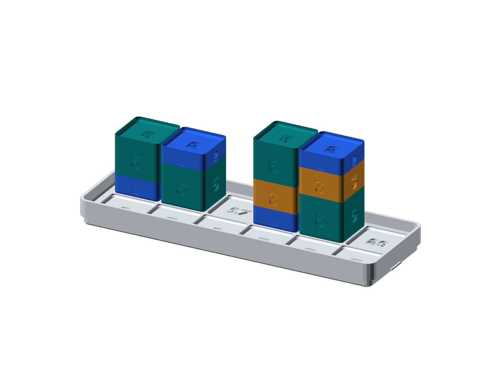

#### Verifying on the SC-6:
Key in `60 [g] [FACT]` $\longrightarrow$ The graphic display decomposes `60` into its prime factor tree (`2 × 2 × 3 × 5`):

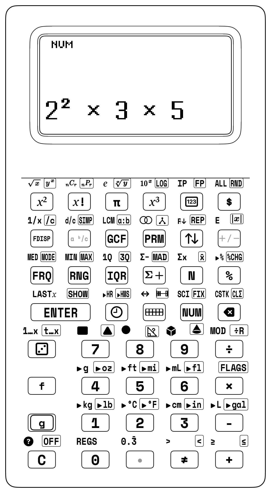

#### Stack Trace Table ($T, Z, Y, X$):
| Keystroke | Register T | Register Z | Register Y | Register X |
| :--- | :--- | :--- | :--- | :--- |
| 60 | 0 | 0 | 0 | 60 |
| [g] [FACT] | 0 | 0 | 0 | $0.0000$ |

---

### 7.4.4 The Primality Testing Engine ([PRIME])
A prime number is a positive integer strictly greater than 1 whose only positive divisors are 1 and itself. On the SC-6, pressing the primary key [PRIME] (Row 2, Col 2) executes a deterministic primality test on Register $X$:
- Momentarily flashes `PRIME` or `COMPOSITE` on the graphic status line.
- Sets Register $X$ to truth flag `1` (if prime) or `0` (if composite).
- If $X \le 1$ or non-integer, flashes `INVALID DATA`.

| Keystroke | Register T | Register Z | Register Y | Register X |
| :--- | :--- | :--- | :--- | :--- |
| 97 | 0 | 0 | 0 | 97 |
| [PRIME] | $0.0000$ | 0 | 0 | 1 |
| [1][1][9] | 1 | 1 | 1 | 9 |
| [PRIME] | $1.0000$ | 1 | 1 | 0 |
| [2] | 1 | 1 | 0 | 2 |
| [PRIME] | $1.0000$ | 1 | 0 | 1 |

---

### 7.4.5 Prime Factor Decomposition Engine (`[g] [FACT]`)
Pressing `[g] [FACT]` on Row 2, Col 2 decomposes any integer $\ge 2$ into its prime factor tree, formatting the output with mathematical superscripts and multiplication dots:
- Enter $12$: `12` `[g] [FACT]` $\longrightarrow$ Displays: **`2² × 3`**
- Enter $360$: `360` `[g] [FACT]` $\longrightarrow$ Displays: **`2³ × 3² × 5`**
- Enter $2,639$: `2639` `[g] [FACT]` $\longrightarrow$ Displays: **`7 × 13 × 29`**

| Keystroke | Register T | Register Z | Register Y | Register X |
| :--- | :--- | :--- | :--- | :--- |
| [3][6][0] | 0 | 3 | 6 | 0 |
| [g] [FACT] | 0 | 3 | 6 | $0.0000$ |

---

### 7.4.6 Station Lesson 7.4: Hardware `[GCF]` and `[f] [LCM]` Keys & Tactile Block Intersections

The SC-6 promotes Greatest Common Divisor (GCD/GCF) and Least Common Multiple (LCM) to dedicated keys on **Row 2, Col 1**:
- **Primary Key [GCF]:** Evaluates $\gcd(Y, X)$ (e.g., `12 [ENTER] 18 [GCF]` $\longrightarrow$ `6`).
- **Step-by-Step RPN Reasoning & Stack Logic:**
  1. `12` `[ENTER]` — Stage first integer 12 onto the upper shelf ($Y = 12$).
  2. `18` `[GCF]` — Place second integer 18 on the floor ($X = 18$) and trigger `[GCF]`: the hardware Euclidean engine extracts the greatest common factor $\gcd(12, 18) = 6$ ($X = 6$).
- **`[f]`-Shifted Key [f] [LCM]:** Evaluates $\operatorname{lcm}(Y, X)$ (e.g., `12 [ENTER] 18 [f] [LCM]` $\longrightarrow$ `36`).

#### Tactile Venn Intersection with Prime Studio Blocks:
Take $a = 48$ and $b = 72$:
- Decompose $48 = 2^4 \times 3^1$: Assemble four [2] blocks and one [3] block.
- Decompose $72 = 2^3 \times 3^2$: Assemble three [2] blocks and two [3] blocks.
- **The Intersection ($\text{GCF}$):** The shared factor blocks common to both towers are **three [2]s and one [3]**:
  $$\text{GCF} = 2^3 \times 3 = 8 \times 3 = \mathbf{24}$$
- **The Union ($\text{LCM}$):** Take the maximum power of each prime (**four [2]s and two [3]s**):
  $$\text{LCM} = 2^4 \times 3^2 = 16 \times 9 = \mathbf{144}$$


#### Application 1: Rectangle Tiling (GCF)
A maker lab needs to tile a tabletop measuring $24\text{ cm} \times 36\text{ cm}$ using the largest possible congruent square tiles with zero waste or cutting.
$$\text{Tile Side} = \gcd(24, 36) = \mathbf{12\text{ cm}}$$

| Keystroke | Register T | Register Z | Register Y | Register X |
| :--- | :--- | :--- | :--- | :--- |
| 24 | 0 | 0 | 0 | 24 |
| [ENTER] | 0 | 0 | 24 | 24 |
| 36 | 0 | 0 | 24 | 36 |
| [GCF] | 0 | 0 | 0 | $12.00$ |

#### Application 2: Synchronized Flashing Cycle (LCM)
Two beacon lights flash at fixed intervals: Light A flashes every $6\text{ seconds}$, while Light B flashes every $8\text{ seconds}$. After how many seconds will they next flash simultaneously?
$$\text{Next Flash} = \operatorname{lcm}(6, 8) = \mathbf{24\text{ seconds}}$$

| Keystroke | Register T | Register Z | Register Y | Register X |
| :--- | :--- | :--- | :--- | :--- |
| [6] | 0 | 0 | 0 | 6 |
| [ENTER] | 0 | 0 | 6 | 6 |
| [8] | 0 | 0 | 6 | 8 |
| [f] [LCM] | 0 | 0 | 0 | $24.00$ |

#### Application 3: Fraction Least Common Denominator (LCD)
When adding unlike fractions $\frac{3}{8} + \frac{5}{12}$, the Least Common Denominator is the LCM of the denominators:
$$\text{LCD} = \operatorname{lcm}(8, 12) = \mathbf{24}$$

| Keystroke | Register T | Register Z | Register Y | Register X |
| :--- | :--- | :--- | :--- | :--- |
| [8] | 0 | 0 | 0 | 8 |
| [ENTER] | 0 | 0 | 8 | 8 |
| 12 | 0 | 0 | 8 | 12 |
| [f] [LCM] | 0 | 0 | 0 | $24.00$ |

---

### 7.4.7 Algebraic Trap vs. StackCalc Superpower Showdown: Greatest Common Factor & Least Common Multiple

| Challenge / Equation | The Algebraic Calculator Trap (TI-30X / Smartphone) | The StackCalc SC-6 + Manipulative Superpower | Keystroke Reduction | Live Stack Visibility | Pedagogical Breakthrough |
| :--- | :--- | :--- | :--- | :--- | :--- |
| **Duality of 24 and 36**:<br>$\gcd(24, 36) = 12$<br>$\operatorname{lcm}(24, 36) = 72$<br>$\gcd \times \operatorname{lcm} = 24 \times 36 = 864$ | No hardware GCF or LCM keys: must write manual prime factor trees on paper, or execute repeated division steps ($36 - 24 = 12$). Verifying the product requires re-entering $24 \times 36$ from scratch (28+ strokes). | Enter `24 [ENTER] 36 [GCF]` $\to 12$; `24 [ENTER] 36 [f] [LCM]` $\to 72$; `12 [×]` $\to 864$ (13 strokes). Instant verification of the Secret Partner Rule! | **54% fewer strokes** | The stack preserves both results; Register $Y$ retains 12 while $X$ evaluates 72, allowing a single `[×]` press to confirm the invariant. | Students physically model the intersection (GCF) and union (LCM) with Prime Studio blocks, then verify the numerical identity directly on the live stack. |

### 7.4.8 The Secret Partner Rule: Why GCF × LCM Always Equals a × b!
For any two positive integers $a$ and $b$, the product of their greatest common factor and least common multiple is strictly equal to the product of the original numbers:
$$\gcd(a, b) \times \operatorname{lcm}(a, b) = a \times b$$

#### Mathematical Proof & Stack Verification:
Consider $a = 24$ and $b = 36$:
- $\gcd(24, 36) = 12$
- $\operatorname{lcm}(24, 36) = 72$
- Product of GCF and LCM: $12 \times 72 = 864$
- Product of original numbers: $24 \times 36 = 864$

| Keystroke | Register T | Register Z | Register Y | Register X |
| :--- | :--- | :--- | :--- | :--- |
| 24 | 0 | 0 | 0 | 24 |
| [ENTER] | 0 | 0 | 24 | 24 |
| 36 | 0 | 0 | 24 | 36 |
| [f] [LCM] | 0 | 0 | 0 | 72 |
| 12 | 0 | 0 | 72 | 12 |
| [×] | 0 | 0 | 0 | 864 |

Check against direct product on the stack: `24 [ENTER] 36 [×]` $\longrightarrow X = \mathbf{864.00}$ (Secret Partner Rule confirmed!).

---

### 7.4.9 The Euclidean Division Algorithm via Hardware `[g] [÷R]`
Euclid of Alexandria discovered over 2,300 years ago that the greatest common divisor of two integers can be found by repeated division with remainders:
$$\gcd(a, b) = \gcd(b, a \bmod b)$$

On the SC-6, you execute the Euclidean algorithm using the shifted key [g] [÷R] (`÷R` on `/`). Each press of [g] [÷R] divides $Y$ by $X$, placing the quotient $Q$ in Register $X$ and the remainder $R$ in Register $Y$.

#### Worked Example 7.3: Step-by-Step Euclidean Ladder for $\gcd(105, 45)$
Find $\gcd(105, 45)$ using Euclidean division:
1. $105 \div 45 = 2$ with remainder $15 \implies \gcd(105, 45) = \gcd(45, 15)$.
2. $45 \div 15 = 3$ with remainder $0 \implies \gcd(45, 15) = 15$.
The last non-zero remainder is **15**, so $\gcd(105, 45) = \mathbf{15}$.

| Keystroke | Register T | Register Z | Register Y | Register X |
| :--- | :--- | :--- | :--- | :--- |
| [1][0][5] | 0 | 1 | 0 | 5 |
| [ENTER] | 1 | 0 | 5 | 5 |
| 45 | 1 | 0 | 5 | 45 |
| [g] [÷R] | $1.0000$ | 0 | 5 | 0 |
| [x⇄y] | 1 | 0 | 0 | 5 |

#### Euclidean Division Ladders for Large Number Pairs
For larger composite numbers, you construct an RPN division ladder, using the quotient and remainder output of [g] [÷R] to systematically reduce the problem to zero remainder:

#### Worked Example 7.5: Euclidean Ladder for $\gcd(252, 105)$
1. $252 \div 105 = 2$ with remainder $42$ ($252 = 2 \times 105 + 42$)
2. $105 \div 42 = 2$ with remainder $21$ ($105 = 2 \times 42 + 21$)
3. $42 \div 21 = 2$ with remainder $0$ ($42 = 2 \times 21 + 0$)
The last non-zero remainder is **21**, so $\gcd(252, 105) = \mathbf{21}$.

| Step / Key | Dividend (Y) | Divisor (X) | Quotient (X) | Remainder (Y) |
| :--- | :--- | :--- | :--- | :--- |
| 252 [E] 105 | 252 | 105 | - | - |
| [g] [÷R] | - | - | 2 | 42 |
| [x⇄y] | 2 | 42 | 42 | 2 |
| 105 [x⇄y] | 105 | 42 | - | - |
| [g] [÷R] | - | - | 2 | 21 |
| 42 [x⇄y] | 42 | 21 | - | - |
| [g] [÷R] | - | - | 2 | 0 |

You can directly verify this result in a single step using the hardware key:
`252 [ENTER] 105 [GCF]` $\longrightarrow X = \mathbf{21.00}$!

---

## 7.5 Elementary Descriptive Statistics & Data Analysis

<div class="admonition note">
<p class="admonition-title">For Parents &amp; Teachers: Curriculum Standards</p>
<p>Common Core Standards Alignment: CCSS 6.SP.A.2, 6.SP.B.5.</p>
</div>

In Grades 5 and 6, you transition from counting discrete numbers to analyzing datasets: describing the center (mean, median, mode) and measuring the spread or variability (range, interquartile range, mean absolute deviation).

| Metric | Key / Shift | Mathematical Definition |
| :--- | :--- | :--- |
| **Sample Size ($n$)** | `[N]` | Count of data points |
| **Sum of Data ($\Sigma x$)** | `[f] [Σx]` | Total accumulation |
| **Mean (Average)** | `[g] [x̄]` / `[x̄]` | $(\Sigma x) / n$ |
| **Median** | `[MED]` | Middle value of sorted set |
| **Mode** | `[g] [MODE]` | Most frequent value |
| **Range** | `[RNG]` | $\text{Maximum} - \text{Minimum}$ |
| **Interquartile Range** | `[IQR]` | $Q_3 - Q_1$ |
| **Mean Absolute Deviation** | `[g] [MAD]` | $\frac{1}{n} \sum |x_i - \bar{x}|$ |

### 7.5.1 Dataset 1: The 10-Quiz Score Frequency Table & The Seed of Distributions

A 5th-grade math class records scores on a 100-point weekly quiz across 10 students:
$$70, \ 75, \ 80, \ 80, \ 85, \ 85, \ 85, \ 90, \ 90, \ 95$$

| Score ($x$) | Tally | Frequency ($f$) | Dot Plot Visual Representation |
| :---: | :---: | :---: | :--- |
| 70 | \| | 1 | ● |
| 75 | \| | 1 | ● |
| 80 | \|\| | 2 | ● ● |
| 85 | \|\|\| | 3 | ● ● ● *(Peak Mode!)* |
| 90 | \|\| | 2 | ● ● |
| 95 | \| | 1 | ● |
| **Total Count ($n = \sum f$)** | — | **10** | $10$ total observations |

#### The Intellectual Bridge to Distributions:
Notice the shape of the dot plot! The data rises smoothly from $70$ to a central peak at $85$, and then descends symmetrically down to $95$. This bell-shaped mound is your first intuitive encounter with **symmetric distributions**. In middle and high school, this exact visual symmetry develops into the continuous Gaussian Normal Distribution curve!

#### Complete SC-6 Statistical Evaluation:
> [CLΣ]                               -> Clears all stats registers (n = 0)
> 70 [Σ+]                        -> n = 1
> 75 [Σ+]                        -> n = 2
> 80 [Σ+] 80 [Σ+]           -> n = 4
> 85 [Σ+] 85 [Σ+] 85 [Σ+] -> n = 7
> 90 [Σ+] 90 [Σ+]           -> n = 9
> 95 [Σ+]                        -> n = 10

1. **Sample Size ($n$):** `[N]` $\longrightarrow X = \mathbf{10}$.
2. **Sum of Scores ($\Sigma x$):** `[f] [Σx]` $\longrightarrow X = \mathbf{835.0}$.
3. **Mean Score ($\bar{x}$):** [g] [x̄] $\longrightarrow X = \mathbf{83.5}$.
4. **Median Score ($\text{Med}$):** `[f] [MED]` $\longrightarrow X = \mathbf{85.0}$.
5. **Mode Score ($\text{Mode}$):** `[g] [MODE]` $\longrightarrow X = \mathbf{85.0}$.
6. **Range ($\text{Max} - \text{Min}$):** `[RNG]` $\longrightarrow X = \mathbf{25.0}$ ($95 - 70 = 25$).

Because the distribution is perfectly symmetrical around 85, the **Median** and **Mode** are identical ($85.0$), while the **Mean** ($83.5$) sits just below the peak due to the lower score of 70.

---

### 7.5.2 Dataset 2: 5-Quiz Empirical Investigation (Measures of Spread: IQR & MAD)

A smaller study group records five scores: $85, 90, 75, 90, 100$.

#### Statistical Metrics Audit:
1. **Sorted Data:** $75, 85, 90, 90, 100$.
2. **Count:** $n = 5$.
3. **Sum:** $\Sigma x = 75 + 85 + 90 + 90 + 100 = 440.0$.
4. **Mean ($\bar{x}$):** $\frac{440}{5} = \mathbf{88.0}$.
5. **Median:** Middle ranked value = $\mathbf{90.0}$.
6. **Mode:** Most frequent value = $\mathbf{90.0}$.
7. **Minimum:** $\mathbf{75.0}$, **Maximum:** $\mathbf{100.0}$.
8. **Range:** $100 - 75 = \mathbf{25.0}$.
9. **Interquartile Range (IQR):** In RPNCore, inclusive-median quartiles yield $Q_1 = 85.0$ and $Q_3 = 90.0$:
   $$\text{IQR} = Q_3 - Q_1 = 90.0 - 85.0 = \mathbf{5.0}$$
10. **Mean Absolute Deviation (MAD):** Measures the average distance between each data point and the mean ($\bar{x} = 88.0$):
    $$|75 - 88| = 13, \quad |85 - 88| = 3, \quad |90 - 88| = 2, \quad |90 - 88| = 2, \quad |100 - 88| = 12$$
    $$\text{Sum of Deviations} = 13 + 3 + 2 + 2 + 12 = 32.0$$
    $$\text{MAD} = \frac{32.0}{5} = \mathbf{6.4}$$

> **Keystrokes:**
> [CLΣ]
> 85 [Σ+] 90 [Σ+] 75 [Σ+] 90 [Σ+] 100 [Σ+]
> [f] [Σx]    -> 440.00
> [g] [x̄]  -> 88.00
> [MED]       -> 90.00
> [g] [MODE]  -> 90.00
> [IQR]   -> 5.00
> [g] [MAD]   -> 6.40

### 7.5.3 The Five-Number Summary, Box Plots & Outlier Analysis
In data science, you represent distributions graphically using **Box-and-Whisker Plots**. A box plot partitions any ordered dataset into four quartiles using five milestone numbers:
1. **Minimum ($Min$):** Lowest observed value (`[f] [MIN]`).
2. **First Quartile ($Q_1$):** 25th percentile boundary.
3. **Median ($Med$):** 50th percentile center (`[f] [MED]`).
4. **Third Quartile ($Q_3$):** 75th percentile boundary.
5. **Maximum ($Max$):** Highest observed value (`[g] [MAX]`).

| Box Plot Milestone | Statistical Keycap | Percentile / Structural Role |
| :--- | :--- | :--- |
| **Lower Whisker Tip ($Min$)** | `[f] [MIN]` | $0\text{th}$ percentile (minimum non-outlier observation) |
| **Left Box Edge ($Q_1$)** | `[f] [1Q]` | $25\text{th}$ percentile (lower boundary of central $50\%$ box) |
| **Interior Vertical Line ($Med$)** | `[f] [MED]` | $50\text{th}$ percentile (median dividing the box) |
| **Right Box Edge ($Q_3$)** | `[g] [3Q]` | $75\text{th}$ percentile (upper boundary of central $50\%$ box) |
| **Central Box Span ($\text{IQR}$)** | `[IQR]` | Interquartile range $\text{IQR} = Q_3 - Q_1$ |
| **Upper Whisker Tip ($Max$)** | `[g] [MAX]` | $100\text{th}$ percentile (maximum non-outlier observation) |

#### The $1.5 \times \text{IQR}$ Outlier Detection Rule
An **outlier** is an anomalous data point that lies unusually far from the central cluster. In competitive STEM challenges and introductory data science, points beyond the inner fences are classified as statistical outliers:
$$\text{Lower Fence} = Q_1 - 1.5 \times \text{IQR}$$
$$\text{Upper Fence} = Q_3 + 1.5 \times \text{IQR}$$

#### Worked Example 7.6: Detecting an Outlier in Running Times
A group of 8 runners complete a race in the following minutes: $25, 28, 30, 32, 34, 35, 38, 58$. Runner 8 took 58 minutes. Is 58 a statistical outlier?

> **Step 1: Compute Quartiles:**
> Ordered data: 25, 28, 30, 32, 34, 35, 38, 58
> Q1 = (28 + 30) / 2 = 29.0
> Median = (32 + 34) / 2 = 33.0
> Q3 = (35 + 38) / 2 = 36.5
> IQR = 36.5 - 29.0 = 7.5
>
> Step 2: Compute Upper Fence via RPN:
> 36.5 [ENTER] 7.5 [ENTER] 1.5 [×] [+]  -> 47.75 minutes
- `7.5 [ENTER] 1.5 [×]` $\longrightarrow 11.25$ ($1.5 \times \text{IQR}$)
- `36.5 [+]` $\longrightarrow \mathbf{47.75\text{ minutes}}$ (Upper Fence).

Since $58 > 47.75$, the score of 58 minutes lies well outside the upper fence and is confirmed as a **true statistical outlier**!

---

## 7.6 Grade 6 Pre-Algebra: Signed Numbers, Absolute Value & Inverses

In pre-algebra, you cross a thrilling new threshold: numbers are no longer merely static amounts—they possess **direction** along the real number line.

| Negative Direction ($x < 0$) | Origin ($0$) | Positive Direction ($x > 0$) |
| :---: | :---: | :---: |
| `-5, -4, -3, -2, -1` | **`0`** | `+1, +2, +3, +4, +5` |

### 7.6.1 Signed Number Entry via the Negation Key `[+/-]`
A vital distinction in early algebra is the difference between:
- The **binary operation of subtraction** (`[-]`), which combines two numbers ($Y - X$).
- The **unary sign toggle** (`[+/-]`), which negates the active number in Register $X$.

On the SC-6:
- To enter $-8$: type `[8] [+/-]`. The screen displays `-8`.
- Pressing `[+/-]` again toggles back to `8`.
- **Zero Invariant:** Negating zero leaves `0` unchanged.

#### Worked Example 7.4: Winter Temperature Differential
At 6:00 AM, the outdoor temperature in Chicago is $-14^\circ\text{C}$. By 2:00 PM, the temperature rises by $+9^\circ\text{C}$. What is the afternoon temperature?

$$\text{Equation: } -14 + 9 = -5^\circ\text{C}$$

> **RPN Evaluation:**
> 14 [+/-] [ENTER] [9] [+]  -> -5.00 °C

| Keystroke | Register T | Register Z | Register Y | Register X |
| :--- | :--- | :--- | :--- | :--- |
| 14 | 0 | 0 | 0 | 14 |
| [+/-] | 0 | 0 | 0 | $-14.0000$ |
| [ENTER] | 0 | 0 | $-14.0000$ | $-14.0000$ |
| [9] | 0 | 0 | $-14.0000$ | 9 |
| [+] | 0 | 0 | 0 | $-5.0000$ |

---

### 7.6.2 Absolute Value as Number Line Distance (`[g] [|x|]`)
The absolute value of a real number $x$, denoted $|x|$, represents its non-negative distance from zero along the number line, regardless of direction:
$$|x| = \begin{cases} x & \text{if } x \ge 0 \\ -x & \text{if } x < 0 \end{cases}$$

On the SC-6, pressing `[g] [|x|]` (Row 0, Col 4 `[g]` Shift) instantly strips the negative sign from Register $X$, preserving magnitude:
- `42 [+/-] [g] [|x|]` $\longrightarrow X = \mathbf{42}$.
- `15 [g] [|x|]` $\longrightarrow X = \mathbf{15}$.

#### Worked Example 7.5: Elevation Difference: Death Valley vs. Mountain Peak
A hiker descends to Badwater Basin in Death Valley at an elevation of $-86\text{ meters}$ (below sea level), then ascends to Telescope Peak at $+3,366\text{ meters}$. Find the total vertical elevation climbed.

$$\text{Vertical Climb: } |3366 - (-86)| = |3366 + 86| = 3,452\text{ meters}$$

> **RPN Evaluation:**
> 3366 [ENTER] 86 [+/-] [-] [g] [|x|]  -> 3452.00 meters

---

### 7.6.3 Geometric Inverses: Area-to-Side-Length (`[x²]` and `[f] [√x]`)
In elementary school, the square key `[x²]` and square root key `[f] [√x]` are taught strictly as **geometric area-to-side-length inverses**, not as abstract exponential powers:
- Squaring a number finds the **area** of a square given its side length: $A = s^2$.
- Taking the square root finds the **side length** of a square given its enclosed area: $s = \sqrt{A}$.

| Square Geometry | Forward Operation (`[x²]`) | Inverse Operation (`[f] [√x]`) |
| :--- | :--- | :--- |
| **5 cm × 5 cm Tile Square** | Side $s = 5\text{ cm} \to \text{Area } A = s^2 = \mathbf{25\text{ cm}^2}$ | Area $A = 25\text{ cm}^2 \to \text{Side } s = \sqrt{25} = \mathbf{5\text{ cm}}$ |

#### Worked Example 7.6: Fencing a Square Pasture
A horse pasture has an exact square area of $1,225\text{ square meters}$.
1. What is the length of one side of the pasture?
2. What is the total length of fencing required to surround all four sides?

> **Step 1: Compute side length s = √A:**
> 1225 [f] [√x]       -> 35.00 meters
>
> Step 2: Compute perimeter P = 4 * s:
> [4] [×]                         -> 140.00 meters
Each side is $\mathbf{35\text{ meters}}$, requiring $\mathbf{140\text{ meters}}$ of fence.

### 7.6.4 Real-World Pre-Algebra Word Problems: Directed Integers in Motion
To master pre-algebra, you can solve multi-step signed integer problems reflecting real-world engineering, financial, and environmental contexts.

#### Scenario 1: Skyscraper Elevator Traversal
A high-rise tower features 3 subterranean parking levels (Floors $-3, -2, -1$), a ground lobby (Floor $0$), and 60 tower floors (Floors $1 \dots 60$).
- An elevator starts at subterranean parking Level $-3$.
- It travels up $+45$ floors to deliver office supplies.
- It then descends $-12$ floors to the cafeteria.
- Finally, it descends $-33$ floors.
Where does the elevator finish?

$$\text{Equation: } -3 + 45 - 12 - 33 = -3\text{ (Back at parking Level -3!)}$$

> **RPN Execution:**
> [3] [+/-] [ENTER] 45 [+] 12 [-] 33 [-]  -> -3.00 (Level -3)

| Keystroke | Register T | Register Z | Register Y | Register X |
| :--- | :--- | :--- | :--- | :--- |
| [3] [+/-] | 0 | 0 | 0 | $-3.0000$ |
| [ENTER] | 0 | 0 | $-3.0000$ | $-3.0000$ |
| 45 | 0 | 0 | $-3.0000$ | 45 |
| [+] | 0 | 0 | 0 | 42 |
| 12 | 0 | 0 | 42 | 12 |
| [-] | 0 | 0 | 0 | 30 |
| 33 | 0 | 0 | 30 | 33 |
| [-] | 0 | 0 | 0 | $-3.0000$ |

#### Scenario 2: Deep-Sea Oceanographic Research Submersible
A marine biology autonomous vehicle begins a mission on the deck of a research ship at $+4\text{ meters}$ above sea level. It dives to a survey trench at $-350\text{ meters}$.
1. Find the total vertical descent distance.
2. The vehicle then ascends $+125\text{ meters}$ to sample a hydrothermal vent, before descending an additional $-45\text{ meters}$. Find its final depth.

> **Step 1: Total vertical descent distance:**
> [4] [ENTER] 350 [+/-] [-] [g] [|x|]  -> 354.00 meters
>
> Step 2: Final depth:
> 350 [+/-] [ENTER] 125 [+] 45 [-]  -> -270.00 meters
The vehicle surveyed the vent at a final depth of **$-270\text{ meters}$**.

#### Scenario 3: Bank Account Ledger with Overdraft Fees
Your student checking account starts with a positive balance of $+\$120.00$.
- You buy school books for $\$85.00$ ($-\$85.00$).
- You buy an art supply kit for $\$60.00$ ($-\$60.00$).
- The bank assesses an overdraft penalty of $\$25.00$ ($-\$25.00$).
- You deposit a lawn-mowing paycheck of $\$95.00$ ($+\$95.00$).
Calculate your net account balance using the SC-6 currency formatter `[$]`.

> **RPN Ledger Evaluation:**
> 120 [ENTER] 85 [-] 60 [-] 25 [-] 95 [+] [$]
- `120 [ENTER] 85 [-]` $\longrightarrow 35.00$
- `60 [-]` $\longrightarrow -25.00$ (Account in overdraft!)
- `25 [-]` $\longrightarrow -50.00$ (Penalty assessed)
- `95 [+]` $\longrightarrow 45.00$ (Deposit restores positive balance!)
- `[$]` $\longrightarrow \mathbf{\$45.00}$.

---

<div class="admonition note">
<p class="admonition-title">For Parents &amp; Teachers: Empirical Probability, Number Theory &amp; Zero Pairs</p>
<p>
<strong>Empirical Probability Distributions and Statistical Accumulation:</strong> Teaching data and discrete probability in upper elementary requires guiding learners from subjective guesswork ("seven feels lucky") toward rigorous empirical evidence. The SC-6 hardware probability engine (<code>[🎲]</code>) paired with the statistical accumulator (<code>[Σ+]</code>) provides a real-time experimental laboratory directly in the learner's hands. When collecting sample datasets, learners observe empirical distributions stabilize as sample size $n$ increases. Entering successive data points into <code>[Σ+]</code> reveals how measures of center—mean, median, and mode—converge in symmetric unimodal distributions. In number theory, dedicated hardware keys for <code>[GCF]</code> and <code>[f] [LCM]</code> allow students to verify the Fundamental Duality Theorem ($\gcd(a,b) \times \operatorname{lcm}(a,b) = a \times b$) empirically, transforming abstract identities into tangible discoveries.<br><br>
<strong>Tactile Zero-Pair Balances and Pre-Algebra Mental Models:</strong> Directed negative numbers frequently present a major cognitive hurdle in transition to pre-algebra, particularly the misconception that subtraction always results in a smaller quantity (such as $-8 - (-5) = -3$). The SC-6 grounds integer arithmetic by pairing the hardware negation toggle (<code>[+/-]</code>) with physical two-color counters. Learners model negative numbers as Crimson tokens and positive numbers as Yellow tokens. Removing five Crimson tokens from a group of eight Crimson tokens visually leaves three Crimson tokens, reinforcing that taking away debt increases net value. On the calculator, typing <code>8 [+/-] ENTER 5 [+/-] -</code> delivers $X = -3$ with zero syntax ambiguity.<br><br>
<strong>Silicon Architecture &amp; Hardware Primitives:</strong> The SC-6 statistical architecture incorporates dedicated accumulators ($\Sigma x$, $\Sigma x^2$, and sample count $n$) that update independently of the four-register working stack ($T, Z, Y, X$). Data points can be transformed or computed through intermediate formulas without overwriting running summation totals. Similarly, hardware Euclidean division via <code>[g] [÷R]</code> executes integer division in a single cycle: dividend and divisor are processed, quotient is deposited into Register $X$, and remainder is retained in Register $Y$. Tapping <code>[x⇄y]</code> instantly prepares the remainder as the divisor for the next Euclidean iteration, illustrating the elegance and efficiency of hardware RPN architecture.
</p>
</div>

<div class="admonition note">
<p class="admonition-title">For Parents &amp; Teachers: Classroom Dialogue Scripts &amp; Misconception Diagnostics</p>
<p>
<strong>Script 7.1: The Definition of a Prime Number:</strong><br>
<strong>Teacher:</strong> "Class, who can tell me: is the number 1 a prime number?"<br>
<strong>Student (Liam):</strong> "Yes! Because 1 can only be divided by 1 and itself!"<br>
<strong>Teacher:</strong> "Let's check the formal mathematical definition. A prime number is a positive integer that has <em>exactly two distinct positive divisors</em>: 1 and itself. How many different divisors does the number 1 have?"<br>
<strong>Liam:</strong> "Just... 1."<br>
<strong>Teacher:</strong> "Right! 1 only has one factor, not two! What about composite numbers?"<br>
<strong>Liam:</strong> "Composite numbers have three or more factors."<br>
<strong>Teacher:</strong> "So where does 1 belong?"<br>
<strong>Liam:</strong> "It's not prime, and it's not composite. It's special!"<br>
<strong>Teacher:</strong> "Exactly! 1 is called a unit. Now test it on your SC-6: type <code>1 [PRIME]</code>. What does the screen say?"<br>
<strong>Liam:</strong> "It flashes <code>INVALID DATA</code>! It won't let me call 1 a prime!"<br>
<strong>Teacher:</strong> "Now try the number 2: <code>2 [PRIME]</code>."<br>
<strong>Liam:</strong> "It flashes <code>PRIME</code>! And pushes 1 to the stack!"<br>
<strong>Teacher:</strong> "2 is the smallest prime number, and the only even prime in the entire universe!"<br><br>
<strong>Script 7.2: Subtracting a Negative Number:</strong><br>
<strong>Student (Chloe):</strong> "Teacher, I don't understand why $7 - (-3)$ equals $10$. When you subtract, shouldn't the number get smaller?"<br>
<strong>Teacher:</strong> "Take our two-color counters, Chloe. Imagine you are running a school store. A customer owes you $\$3$, which is a debt of $-3$. If you decide to forgive the debt—meaning you <em>take away</em> the negative $\$3$—does the customer have more money or less money?"<br>
<strong>Chloe:</strong> "They have more money! Because their debt is gone!"<br>
<strong>Teacher:</strong> "Taking away a negative is the exact same as adding a positive! Now test it on your SC-6: <code>7 [ENTER] 3 [+/-] [-]</code>."<br>
<strong>Chloe:</strong> "It says 10! Because taking away 3 negatives leaves 10 positives!"
</p>

<h4>Misconception Diagnostic Table</h4>

| Observable Error | Cognitive Root Cause | Targeted Remediation Prompt |
| :--- | :--- | :--- |
| **Claiming 1 is prime** | Conflating "divisible only by 1" with "having exactly two distinct factors." | *"A prime must have exactly two distinct factors: 1 and itself. 1 only has one factor. The SC-6 classifies 1 as a unit, neither prime nor composite."* |
| **Confusing GCF and LCM** | Assuming "Greatest" must yield a larger number than "Least." | *"A factor divides INTO a number, so it must be smaller than or equal to the number. A multiple MULTIPLIES the number, so it grows larger! GCF $\le$ numbers $\le$ LCM."* |
| **Treating `$|x|$` as 'change the sign'** | Believing absolute value turns positive numbers into negative numbers. | *"Absolute value is distance on a number line. Distance is never negative! The distance from 5 to 0 is 5; the distance from -5 to 0 is also 5. `$|5| = 5$` and `$|-5| = 5$`."* |
| **Adding negatives: $-4 + (-3) = -1$** | Subtracting magnitudes instead of accumulating directed negative quantities. | *"If you take 4 steps backward ($-4$), and then take 3 more steps backward ($-3$), you are 7 steps backward ($-7$), not 1 step! Use Crimson tokens to model the sum."* |
| **Expecting Mean = Median always** | Assuming all datasets are perfectly symmetrical. | *"In skewed datasets (like home prices or quiz scores with an outlier), extreme values pull the mean away from the center. The median stays fixed in the middle."* |
| **Confusing `[+/-]` with `[-]`** | Using the binary subtraction operator to enter negative values. | *"The `[-]` key subtracts two numbers ($Y - X$). The `[+/-]` key changes the sign of the single number you are actively typing."* |

</div>

---

## 7.7 Comprehensive Problem Bank: 50 Worked Reference Problems

The following problem bank provides complete, publication-grade reference solutions spanning Grade 5 and Grade 6 discrete probability, number theory, descriptive statistics, and pre-algebra. Every keystroke sequence assumes the SC-6 baseline mode `[NUM]`.

<div class="admonition note">
<p class="admonition-title">Hands-On Studio Proof: Blocks -> Calculator</p>

Before executing probability distributions, primality tests, and statistical summaries symbolically, you ground each mathematical principle in physical manipulatives:
1. **Discrete Probability & Geometry (The Dice Studio):** Roll the 3D-printed equal-volume pip dice 60 times. Record outcomes on the dot plot board. Compare empirical frequencies against theoretical fractions on the SC-6 (`[FDISP]`), proving why $P(\text{Odd}) = 3/6 = 1/2$.
2. **Primality & Rectangular Factoring (The 144-Tile Studio):** Take 83 tiles. Attempt to form rectangular grids of 2, 3, 5, or 7 rows. When every attempt leaves leftover tiles, confirm the number is prime by pressing `83 [PRIME]`, watching the LCD illuminate `PRIME` ($X = 1$). Repeat with 91 tiles to discover $7 \times 13 = 91$ (`COMPOSITE`, $X = 0$).
3. **Tactile Venn Intersections (The Prime Factor Studio):** Model 48 and 72 using proportional logarithmic blocks. Physically place common factor blocks ($2^3 \times 3$) into the central comparator well to verify $\gcd(48, 72) = 24$ (`48 [ENTER] 72 [GCF]`).
4. **Zero-Pair Balances (Two-Color Counters):** Pair Sun Yellow ($+1$) and Signal Crimson ($-1$) tokens to eliminate zero pairs before executing signed integer arithmetic on the stack (`[+/-]`).
</div>

### 7.7.1 Expedition 1: The High-Rollers Tabletop & Spinner Tournament (Challenges 1–5)
*Mission Briefing: You are the chief statistician for a tabletop gaming tournament. Compute exact single-event probabilities, compound die throws, and complementary odds using RPN stack division and fraction displays.*

#### Challenge 1: Single Die Roll Probability
- **Tournament Context:** Tabletop Gaming Tournament: In the championship match, a referee rolls a precision equal-volume pip six-sided die. Calculate the theoretical probability of rolling an odd face ($1, 3, 5$).
- **Hands-On Manipulative Stage (Precision Pip Dice):** Inspect the physical equal-volume pip dice. Notice that 3 out of 6 faces are odd numbers. Rolling the die 60 times yields approximately 30 odd occurrences, validating the $3/6 = 0.5$ theoretical ratio.
- **RPN Keystrokes:** `[3] [ENTER] [6] [÷]` $\rightarrow$ **`0.5`**
- **Stack Flow:** Tap `3 [ENTER] 6 [÷]` -> (T=0, Z=0, Y=0, X=0.5). Divide favorable by total to compute theoretical probability ($3/6 = 0.5$).


- **Diagnostic Checkpoint:** Register $X$ displays $0.5000$. Theoretical probability of rolling an odd face is $\mathbf{0.5000}$ ($50\%$).

#### Challenge 2: Tournament Card Deck Draw
- **Tournament Context:** Tournament Card Deck Draw: In a card tournament, a standard 52-card deck contains 4 aces. What is the probability of drawing an ace at random on the first draw?
- **Hands-On Manipulative Stage (Card Deck Partition):** Partition the deck into 4 aces and 48 non-aces. The 4 target aces represent a $1/13$ fraction of the total 52-card sample space.
- **RPN Keystrokes:** `[4] [ENTER] 52 [÷]` $\rightarrow$ **`0.0769230769`**
- **Stack Flow:** Tap `4 [ENTER] 52 [÷]` -> (T=0, Z=0, Y=0, X=0.0769). Divide to calculate single-draw ace probability ($4/52 \approx 0.0769$).


- **Diagnostic Checkpoint:** Register $X$ displays $0.0769$. Ace drawing probability is $\mathbf{0.0769}$ ($\approx 7.69\%$).

#### Challenge 3: Compound Coin Toss: Three Consecutive Heads
- **Tournament Context:** Triple Coin Toss Tournament Tiebreaker: A match tiebreaker requires flipping three consecutive heads with a balanced coin ($P = (1/2)^3$). Determine the compound probability of three consecutive heads.
- **Hands-On Manipulative Stage (Tree Diagram Counters):** Arrange a 3-tier binary tree using two-color counters. Out of 8 possible paths ($\text{HHH}, \text{HHT}, \dots, \text{TTT}$), exactly 1 path yields three consecutive heads.
- **RPN Keystrokes:** `0.5 [ENTER] [3] [g] [yˣ]` $\rightarrow$ **`0.125`**
- **Stack Flow:** Tap `0.5 [ENTER] 3 [g] [yˣ]` -> (T=0, Z=0, Y=0, X=0.125). Raise to 3rd power to compute compound probability ($0.5^3 = 0.125$).


- **Diagnostic Checkpoint:** Register $X$ displays $0.1250$. Probability of three consecutive heads is $\mathbf{0.1250}$ ($12.5\%$).

#### Challenge 4: Sum of Two Dice: Rolling an 11 or 12
- **Tournament Context:** High-Rollers Two-Dice Roll: Two dice are rolled simultaneously in the final round. The sum is 11 for two combinations ($(5,6), (6,5)$) and 12 for one combination ($(6,6)$). Find the probability of rolling an 11 or 12.
- **Hands-On Manipulative Stage (Two-Dice Grid Mat):** Map the $6 \times 6$ grid of 36 equally likely outcomes. Highlight the 3 winning combinations in the top-right corner.
- **RPN Keystrokes:** `[3] [ENTER] 36 [÷]` $\rightarrow$ **`0.0833333333`**
- **Stack Flow:** Tap `3 [ENTER] 36 [÷]` -> (T=0, Z=0, Y=0, X=0.0833). Divide favorable by total combinations ($3/36 \approx 0.0833$).


- **Diagnostic Checkpoint:** Register $X$ displays $0.0833$. Probability of rolling 11 or 12 is $\mathbf{0.0833}$ ($\approx 8.33\%$).

#### Challenge 5: Complementary Probability
- **Tournament Context:** Complementary Event Probability: The championship venue weather report indicates a $35\%$ probability of rain ($P = 0.35$). Determine the complementary probability of fair weather ($P' = 1 - P$).
- **Hands-On Manipulative Stage (Complementary Spinner):** Inspect the circular probability spinner with 100 divisions. Shading 35 sectors for rain leaves 65 unshaded sectors for fair weather, grounding $1 - P$.
- **RPN Keystrokes:** `[1] [ENTER] 0.35 [-]` $\rightarrow$ **`0.65`**
- **Stack Flow:** Tap `1 [ENTER] 0.35 [-]` -> (T=0, Z=0, Y=0, X=0.65). Deduct rain probability from total space to find complementary dry odds.


- **Diagnostic Checkpoint:** Register $X$ displays $0.6500$. Complementary probability of fair weather is $\mathbf{0.6500}$ ($65\%$).

---

### 7.7.2 Expedition 2: The Prime Number Fortress & Sieve (Challenges 6–18)
*Mission Briefing: Journey into the heart of number theory. Test for prime numbers using rectangular resistance, unlock prime factor trees, find greatest common factors and least common multiples, and verify the Secret Partner Rule across the ancient Prime Number Fortress.*

#### Challenge 6: Prime Fortress Outer Gate Cipher: Primality of 83
- **Fortress Context:** The outer massive gate of the Prime Fortress opens only when presented with an indivisible prime credential. Test candidate code 83 for primality.
- **Hands-On Manipulative Stage (Counting Tiles):** Take 83 tiles. Attempt to assemble them into rectangular matrices of 2, 3, 5, or 7 rows. Every arrangement leaves uneven remainders; 83 forms only a single linear row of $1 \times 83$, proving rectangular resistance.
- **RPN Keystrokes:** `83 [PRIME]` $\rightarrow$ **`83`**
- **Stack Flow:** Tap `83 [PRIME]` -> (T=0, Z=0, Y=0, X=1). Execute primality test: status line flashes `PRIME`, pushes 1 to Register $X$.


- **Diagnostic Checkpoint:** Status line flashes `PRIME`; Register $X = \mathbf{1}$. Outer gate cipher unlocks!

#### Challenge 7: Prime Fortress Barbican Trap Door: Primality of 91
- **Fortress Context:** The fortress barbican is guarded by a deceptive trap door set to trigger on composite impostor codes. Evaluate candidate code 91.
- **Hands-On Manipulative Stage (Rectangular Factoring):** Take 91 tiles. Arrange them into rows of 7: exactly 13 rows form a seamless $7 \times 13$ rectangular array with zero gaps, exposing 91 as composite.
- **RPN Keystrokes:** `91 [PRIME]` $\rightarrow$ **`91`**
- **Stack Flow:** Tap `91 [PRIME]` -> (T=0, Z=0, Y=0, X=0). Execute primality test: status line flashes `COMPOSITE`, pushes 0 to Register $X$.


- **Diagnostic Checkpoint:** Status line flashes `COMPOSITE`; Register $X = \mathbf{0}$ ($91 = 7 \times 13$). Barbican trap door disarmed!

#### Challenge 8: Prime Fortress Moat Portcullis: Primality of 143
- **Fortress Context:** The iron portcullis over the fortress moat evaluates candidate 143. Determine if the credential is prime or composite.
- **Hands-On Manipulative Stage (Rectangular Arrays):** Take 143 tiles. Dividing across 11 columns yields exactly 13 rows ($11 \times 13 = 143$), confirming multiple factor pairs beyond 1 and itself.
- **RPN Keystrokes:** `143 [PRIME]` $\rightarrow$ **`143`**
- **Stack Flow:** Tap `143 [PRIME]` -> (T=0, Z=0, Y=0, X=0). Execute primality test: status line flashes `COMPOSITE`, pushes 0 to Register $X$.


- **Diagnostic Checkpoint:** Status line flashes `COMPOSITE`; Register $X = \mathbf{0}$ ($143 = 11 \times 13$). Portcullis barrier confirmed!

#### Challenge 9: Prime Fortress Armory Key: Prime Factorization of 72
- **Fortress Context:** The fortress armory lock requires the exact prime decomposition string of tumbler code 72. Decompose 72 into prime factors.
- **Hands-On Manipulative Stage (Logarithmic Prime Blocks):** Take three Blue 2-blocks ($2^3 = 8$) and two Amber 3-blocks ($3^2 = 9$). Stack them vertically against the calibrated back-wall slide rule: the combined height aligns precisely with index 72.
- **RPN Keystrokes:** `72 [g] [FACT]` $\rightarrow$ **`72`**
- **Stack Flow:** Tap `72 [g] [FACT]` -> (T=0, Z=0, Y=0, X=0). Execute prime factorization: graphic screen renders prime decomposition string.


- **Diagnostic Checkpoint:** Graphic screen renders **`2³ × 3²`**. Armory lock disengages!

#### Challenge 10: Prime Fortress Citadel Key: Prime Factorization of 210
- **Fortress Context:** The inner citadel vault is sealed with master product code 210. Find its complete prime factor decomposition.
- **Hands-On Manipulative Stage (Consecutive Prime Blocks):** Select one 2-block, one 3-block, one 5-block, and one 7-block. Stacking these four distinct prime towers models the square-free product $2 \times 3 \times 5 \times 7 = 210$.
- **RPN Keystrokes:** `210 [g] [FACT]` $\rightarrow$ **`210`**
- **Stack Flow:** Tap `210 [g] [FACT]` -> (T=0, Z=0, Y=0, X=0). Execute prime factorization: graphic screen renders four-prime string.


- **Diagnostic Checkpoint:** Graphic screen renders **`2 × 3 × 5 × 7`**. Citadel vault credential accepted!

#### Challenge 11: Prime Fortress High Tower Vault Key: Prime Factorization of 504
- **Fortress Context:** The high observatory tower is protected by an astronomical key code of 504. Determine its prime factor components.
- **Hands-On Manipulative Stage (Prime Factor Tree):** Factor 504 using prime blocks: three 2-blocks ($2^3 = 8$), two 3-blocks ($3^2 = 9$), and one 7-block ($7$). Product: $8 \times 9 \times 7 = 504$.
- **RPN Keystrokes:** `504 [g] [FACT]` $\rightarrow$ **`504`**
- **Stack Flow:** Tap `504 [g] [FACT]` -> (T=0, Z=0, Y=0, X=0). Execute prime factorization: graphic screen displays canonical factor string.


- **Diagnostic Checkpoint:** Graphic screen renders **`2³ × 3² × 7`**. High tower observatory unsealed!

#### Challenge 12: Fortress Twin Bastions Gear Synchronization: $\gcd(48, 72)$
- **Fortress Context:** Twin drawbridge drive winches with 48 teeth and 72 teeth must mesh via a common drive gear. Find the greatest common factor $\gcd(48, 72)$.
- **Hands-On Manipulative Stage (Venn Intersection):** Model $48 = 2^4 \times 3$ and $72 = 2^3 \times 3^2$. Place shared prime blocks into the central intersection well: three 2-blocks and one 3-block $\implies 2^3 \times 3 = 24$.
- **RPN Keystrokes:** `48 [ENTER] 72 [GCF]` $\rightarrow$ **`24`**
- **Stack Flow:** Tap `48 [ENTER] 72 [GCF]` -> (T=0, Z=0, Y=0, X=24). Execute hardware GCF engine to extract greatest common divisor.


- **Diagnostic Checkpoint:** Register $X$ displays $24.0000$. Maximum shared drive gear size is $\mathbf{24\text{ teeth}}$.

#### Challenge 13: Fortress Water Gate Sluice Synchronization: $\gcd(84, 140)$
- **Fortress Context:** Two hydraulic sluice floodgates operate on cycles of 84 seconds and 140 seconds. Find the greatest common synchronization interval $\gcd(84, 140)$.
- **Hands-On Manipulative Stage (Factor Block Overlap):** Factor $84 = 2^2 \times 3 \times 7$ and $140 = 2^2 \times 5 \times 7$. Shared intersection: two 2-blocks and one 7-block $\implies 2^2 \times 7 = 28$.
- **RPN Keystrokes:** `84 [ENTER] 140 [GCF]` $\rightarrow$ **`28`**
- **Stack Flow:** Tap `84 [ENTER] 140 [GCF]` -> (T=0, Z=0, Y=0, X=28). Execute hardware GCF engine to find greatest common factor.


- **Diagnostic Checkpoint:** Register $X$ displays $28.0000$. Sluice synchronization step is $\mathbf{28\text{ seconds}}$.

#### Challenge 14: Fortress Sentry Patrol Synchronization: $\operatorname{lcm}(15, 20)$
- **Fortress Context:** Two rampart sentry patrols cycle every 15 minutes and 20 minutes respectively. Find the least common multiple $\operatorname{lcm}(15, 20)$ when both sentries meet at the gate.
- **Hands-On Manipulative Stage (Venn Union):** Model $15 = 3 \times 5$ and $20 = 2^2 \times 5$. The union takes maximum powers: two 2-blocks, one 3-block, and one 5-block $\implies 2^2 \times 3 \times 5 = 60$. Stacking blocks aligns with mark 60.
- **RPN Keystrokes:** `15 [ENTER] 20 [f] [LCM]` $\rightarrow$ **`60`**
- **Stack Flow:** Tap `15 [ENTER] 20 [f] [LCM]` -> (T=0, Z=0, Y=0, X=60). Execute hardware LCM engine to find least common multiple.


- **Diagnostic Checkpoint:** Register $X$ displays $60.0000$. Sentries meet at the gate every $\mathbf{60\text{ minutes}}$ ($1\text{ hour}$).

#### Challenge 15: Fortress Signal Beacon Cycle: $\operatorname{lcm}(12, 18)$
- **Fortress Context:** Two optical signal beacons on the fortress bastions flash at intervals of 12 seconds and 18 seconds. Find the least common interval $\operatorname{lcm}(12, 18)$ when both flash in unison.
- **Hands-On Manipulative Stage (Prime Union):** Decompose $12 = 2^2 \times 3$ and $18 = 2 \times 3^2$. The union of prime blocks takes two 2-blocks and two 3-blocks $\implies 4 \times 9 = 36$.
- **RPN Keystrokes:** `12 [ENTER] 18 [f] [LCM]` $\rightarrow$ **`36`**
- **Stack Flow:** Tap `12 [ENTER] 18 [f] [LCM]` -> (T=0, Z=0, Y=0, X=36). Execute hardware LCM engine to calculate least common multiple.


- **Diagnostic Checkpoint:** Register $X$ displays $36.0000$. Beacons flash simultaneously every $\mathbf{36\text{ seconds}}$.

#### Challenge 16: Fortress Archival Seal: The Secret Partner Rule for 18 and 24
- **Fortress Context:** The grand seal of the Prime Fortress verifies that for any pair $a = 18, b = 24$, the product of their greatest common factor and least common multiple equals their arithmetic product: $\gcd(a,b) \times \operatorname{lcm}(a,b) = a \times b$.
- **Hands-On Manipulative Stage (Secret Partner Rule with Blocks):** Compute $18 \times 24 = 432$. The shared intersection ($\gcd = 6$) multiplied by the total union ($\operatorname{lcm} = 72$) yields $6 \times 72 = 432$, proving conservation of prime factors.
- **RPN Keystrokes:** `18 [ENTER] 24 [GCF] 18 [ENTER] 24 [f] [LCM] [×]` $\rightarrow$ **`432`**
- **4-Register Stack Trace Table:**

| Keystroke | Register T | Register Z | Register Y | Register X | Operational Commentary |
| :--- | :---: | :---: | :---: | :---: | :--- |
| `18` | $0.0000$ | $0.0000$ | $0.0000$ | $18.0000$ | Key in first fortress parameter 18 |
| `[ENTER]` | $0.0000$ | $0.0000$ | $18.0000$ | $18.0000$ | Stack lifts; 18 locked into Register $Y$ |
| `24` | $0.0000$ | $0.0000$ | $18.0000$ | $24.0000$ | Key in second parameter 24 |
| `[GCF]` | $0.0000$ | $0.0000$ | $0.0000$ | $6.0000$ | Compute greatest common factor $\gcd(18, 24) = 6$ |
| `18` | $0.0000$ | $0.0000$ | $6.0000$ | $18.0000$ | Key in parameter 18; GCF lifts to Register $Y$ |
| `[ENTER]` | $0.0000$ | $6.0000$ | $18.0000$ | $18.0000$ | Stack lifts; 18 locked into Register $Y$, 6 into Register $Z$ |
| `24` | $0.0000$ | $6.0000$ | $18.0000$ | $24.0000$ | Key in parameter 24 |
| `[f] [LCM]` | $0.0000$ | $0.0000$ | $6.0000$ | $72.0000$ | Compute least common multiple $\operatorname{lcm}(18, 24) = 72$; GCF remains in Register $Y$ |
| `[×]` | $0.0000$ | $0.0000$ | $0.0000$ | $432.0000$ | Multiply GCF by LCM ($6 \times 72 = 432$) |

- **Diagnostic Checkpoint:** Register $X$ displays $432.0000$. Secret partner rule holds identically ($18 \times 24 = 432$).

#### Challenge 17: Fortress Supply Depot Allocation: Euclidean Division $148 \div 32$
- **Fortress Context:** In the fortress provisions depot, 148 ration packs are organized into standard field cases holding 32 packs each. Find the number of full cases packed and remaining loose packs using `[g] [÷R]`.
- **Hands-On Manipulative Stage (Tray Allocation):** Distribute 148 tokens into trays of 32. Exactly 4 trays are completely filled ($4 \times 32 = 128$), leaving 20 loose tokens on the packing bench.
- **RPN Keystrokes:** `148 [ENTER] 32 [g] [÷R]` $\rightarrow$ **`4`**
- **Stack Flow:** Tap `148 [ENTER] 32 [g] [÷R]` -> (T=0, Z=0, Y=20, X=4). Execute Euclidean division: quotient 4 in $X$, remainder 20 in $Y$.


- **Diagnostic Checkpoint:** Register $X$ displays $4$ (Quotient), Register $Y$ displays $20$ (Remainder). 4 full cases packed with 20 leftover packs.

#### Challenge 18: Fortress Treasury Safe Cipher Wheel: $\gcd(24, 36)$
- **Fortress Context:** The fortress treasury safe wheel requires identifying the greatest shared factor of 24 and 36 to engage the master locking tumblers.
- **Hands-On Manipulative Stage (Factor Sorting):** List all divisors: for 24: $\{1, 2, 3, 4, 6, 8, 12, 24\}$; for 36: $\{1, 2, 3, 4, 6, 9, 12, 18, 36\}$. The shared common factor set is $\{1, 2, 3, 4, 6, 12\}$, with greatest factor 12.
- **RPN Keystrokes:** `24 [ENTER] 36 [GCF]` $\rightarrow$ **`12`**
- **Stack Flow:** Tap `24 [ENTER] 36 [GCF]` -> (T=0, Z=0, Y=0, X=12). Execute hardware GCF engine to extract greatest common divisor.


- **Diagnostic Checkpoint:** Register $X$ displays $12.0000$. Treasury master tumbler code is $\mathbf{12}$.

---


### 7.7.3 Expedition 3: The Data Detective & Bell-Curve Mystery (Challenges 19–26)
*Mission Briefing: Accumulate datasets into the statistical memory registers. Compute measures of center (mean, median, mode) and measures of spread (range, IQR, MAD) to characterize real-world measurements.*

#### Challenge 19: Mean of 4 Test Scores
- **Data Detective Context:** Science Evaluation Analysis: You score 88, 92, 79, and 95 on four consecutive science tests. Calculate your arithmetic mean $\bar{x}$.
- **Hands-On Manipulative Stage (Balance Beam Pegs):** Place pegs at marks 88, 92, 79, and 95 on the numerical balance beam. The beam balances in perfect horizontal equilibrium at the fulcrum point $88.5$.
- **RPN Keystrokes:** `[g] [CLΣ] 88 [Σ+] 92 [Σ+] 79 [Σ+] 95 [Σ+] [g] [x̄]` $\rightarrow$ **`88.5`**
- **4-Register Stack Trace Table:**

| Keystroke | Register T | Register Z | Register Y | Register X | Operational Commentary |
| :--- | :---: | :---: | :---: | :---: | :--- |
| `[g] [CLΣ]` | $0.0000$ | $0.0000$ | $0.0000$ | $0.0000$ | Reset statistical registers ($n = 0, \Sigma x = 0$) |
| `88` | $0.0000$ | $0.0000$ | $0.0000$ | $88.0000$ | Key in first test score 88 |
| `[Σ+]` | $0.0000$ | $0.0000$ | $0.0000$ | $1.0000$ | Accumulate score ($n = 1, \Sigma x = 88$) |
| `92` | $0.0000$ | $0.0000$ | $0.0000$ | $92.0000$ | Key in second test score 92 |
| `[Σ+]` | $0.0000$ | $0.0000$ | $0.0000$ | $2.0000$ | Accumulate score ($n = 2, \Sigma x = 180$) |
| `79` | $0.0000$ | $0.0000$ | $0.0000$ | $79.0000$ | Key in third test score 79 |
| `[Σ+]` | $0.0000$ | $0.0000$ | $0.0000$ | $3.0000$ | Accumulate score ($n = 3, \Sigma x = 259$) |
| `95` | $0.0000$ | $0.0000$ | $0.0000$ | $95.0000$ | Key in fourth test score 95 |
| `[Σ+]` | $0.0000$ | $0.0000$ | $0.0000$ | $4.0000$ | Accumulate score ($n = 4, \Sigma x = 354$) |
| `[g] [x̄]` | $0.0000$ | $0.0000$ | $0.0000$ | $88.5$ | Compute sample mean $\bar{x} = 354 / 4 = 88.5$; sample size $n=4$ stored in $Z$ |

- **Diagnostic Checkpoint:** Register $X$ displays $88.5000$. Mean score is $\mathbf{88.50}$.

#### Challenge 20: Median of an Odd Dataset
- **Data Detective Context:** Sprint Velocity Analysis: Five track athletes record 100m sprint times: $12.4, 12.8, 13.1, 13.5, 14.0\text{ seconds}$. Find the median running time.
- **Hands-On Manipulative Stage (Ordered Number Ribbon):** Arrange five runner cards in ascending order along the desk. The third card sits precisely in the middle with two cards on each side, isolating the median at $13.1\text{ s}$.
- **RPN Keystrokes:** `[g] [CLΣ] 12.4 [Σ+] 12.8 [Σ+] 13.1 [Σ+] 13.5 [Σ+] 14.0 [Σ+] [f] [MED]` $\rightarrow$ **`13.1`**
- **Stack Flow:** Tap `[g] [CLΣ] 12.4 [Σ+] 12.8 [Σ+] 13.1 [Σ+] 13.5 [Σ+] 14.0 [Σ+] [f] [MED]` -> (T=0, Z=0, Y=0, X=5). Compute median value across odd dataset ($n = 5$ in $Y$).


- **Diagnostic Checkpoint:** Register $X$ displays $13.1000$. Median sprint time is $\mathbf{13.10\text{ seconds}}$.

#### Challenge 21: Median of an Even Dataset
- **Data Detective Context:** Environmental Temperature Monitoring: Six ambient temperatures are recorded: $68, 72, 74, 76, 80, 84^\circ\text{F}$. Find the median temperature (average of two central elements 74 and 76).
- **Hands-On Manipulative Stage (Even Distribution Strip):** Arrange the six data cards in order. Because $n = 6$ is even, there is no single middle card; fold the middle pair (74 and 76) to find their midpoint: $\frac{74+76}{2} = 75^\circ\text{F}$.
- **RPN Keystrokes:** `[g] [CLΣ] 68 [Σ+] 72 [Σ+] 74 [Σ+] 76 [Σ+] 80 [Σ+] 84 [Σ+] [f] [MED]` $\rightarrow$ **`75`**
- **Stack Flow:** Tap `[g] [CLΣ] 68 [Σ+] 72 [Σ+] 74 [Σ+] 76 [Σ+] 80 [Σ+] 84 [Σ+] [f] [MED]` -> (T=0, Z=0, Y=0, X=6). Evaluate median of even dataset: $\frac{74+76}{2} = 75$ ($n=6$ in $Y$).


- **Diagnostic Checkpoint:** Register $X$ displays $75.0000$. Median temperature is $\mathbf{75.00^\circ\text{F}}$.

#### Challenge 22: Mode of a Shoe Size Survey
- **Data Detective Context:** Footwear Inventory Survey: Shoe sizes collected from 8 customers: $6, 7, 7, 7, 8, 8, 9, 10$. Find the statistical mode (most frequent size).
- **Hands-On Manipulative Stage (Frequency Column Histogram):** Stack counting cubes for each size. Size 7 forms the tallest column with 3 cubes, visually standing out as the statistical mode.
- **RPN Keystrokes:** `[g] [CLΣ] [6] [Σ+] [7] [Σ+] [7] [Σ+] [7] [Σ+] [8] [Σ+] [8] [Σ+] [9] [Σ+] 10 [Σ+] [g] [MODE]` $\rightarrow$ **`7`**
- **Stack Flow:** Tap `[g] [CLΣ] [6] [Σ+] [7] [Σ+] [7] [Σ+] [7] [Σ+] [8] [Σ+] [8] [Σ+] [9] [Σ+] 10 [Σ+] [g] [MODE]` -> (T=0, Z=0, Y=0, X=8). Identify statistical mode across sample ($X = 7$, $n=8$ in $Y$).


- **Diagnostic Checkpoint:** Register $X$ displays $7.0000$. Most common shoe size (mode) is $\mathbf{7.00}$.

#### Challenge 23: Range of High Temperatures
- **Data Detective Context:** Weather Station Spread Analysis: Weekly maximum temperatures: $62, 65, 78, 81, 74, 69, 85^\circ\text{F}$. Calculate the temperature range ($\max - \min = 85 - 62$).
- **Hands-On Manipulative Stage (Range Slider):** Pin the minimum temperature ($62^\circ$) and maximum temperature ($85^\circ$) on a number line strip. The distance spanned between the extremes measures $23^\circ$.
- **RPN Keystrokes:** `[g] [CLΣ] 62 [Σ+] 65 [Σ+] 78 [Σ+] 81 [Σ+] 74 [Σ+] 69 [Σ+] 85 [Σ+] [RNG]` $\rightarrow$ **`23`**
- **Stack Flow:** Tap `[g] [CLΣ] 62 [Σ+] 65 [Σ+] 78 [Σ+] 81 [Σ+] 74 [Σ+] 69 [Σ+] 85 [Σ+] [RNG]` -> (T=0, Z=0, Y=0, X=7). Compute range ($\max - \min = 85 - 62 = 23$).


- **Diagnostic Checkpoint:** Register $X$ displays $23.0000$. Weekly temperature range is $\mathbf{23.00^\circ\text{F}}$.

#### Challenge 24: Interquartile Range of Daily Rainfall
- **Data Detective Context:** Precipitation Variance: Weekly rainfall measurements: $0.1, 0.2, 0.4, 0.6, 0.9, 1.2, 1.5\text{ inches}$. Find the interquartile range ($Q_3 - Q_1$).
- **Hands-On Manipulative Stage (Box-and-Whisker Plot Mat):** Divide the sorted 7-point rainfall dataset into lower and upper quartiles. Mark $Q_1 = 0.2$ and $Q_3 = 1.2$; the width of the middle $50\%$ box spans the interquartile range.
- **RPN Keystrokes:** `[g] [CLΣ] 0.1 [Σ+] 0.2 [Σ+] 0.4 [Σ+] 0.6 [Σ+] 0.9 [Σ+] 1.2 [Σ+] 1.5 [Σ+] [IQR]` $\rightarrow$ **`0.75`**
- **Stack Flow:** Tap `[g] [CLΣ] 0.1 [Σ+] 0.2 [Σ+] 0.4 [Σ+] 0.6 [Σ+] 0.9 [Σ+] 1.2 [Σ+] 1.5 [Σ+] [IQR]` -> (T=0, Z=0, Y=0, X=7). Compute interquartile range ($Q_3 - Q_1 = 0.75$).


- **Diagnostic Checkpoint:** Register $X$ displays $0.7500$. Interquartile range of rainfall is $\mathbf{0.75\text{ inches}}$.

#### Challenge 25: Mean Absolute Deviation of a 5-Point Dataset
- **Data Detective Context:** Sensor Error Analysis: A 5-point dataset: $10, 15, 20, 25, 30$ has mean $\bar{x} = 20.0$. Deviations from mean are $|-10|, |-5|, |0|, |+5|, |+10|$. Sum of deviations $= 30$. Find the Mean Absolute Deviation ($\text{MAD} = 30 / 5 = 6.0$).
- **Hands-On Manipulative Stage (Distance From Mean Strip):** Lay out the points on a number line. Measure the physical distance from each point to the center mark 20: $10 + 5 + 0 + 5 + 10 = 30$. Dividing by 5 yields the average distance from center.
- **RPN Keystrokes:** `[g] [CLΣ] 10 [Σ+] 15 [Σ+] 20 [Σ+] 25 [Σ+] 30 [Σ+] [g] [MAD]` $\rightarrow$ **`6`**
- **Stack Flow:** Tap `[g] [CLΣ] 10 [Σ+] 15 [Σ+] 20 [Σ+] 25 [Σ+] 30 [Σ+] [g] [MAD]` -> (T=0, Z=0, Y=0, X=5). Compute Mean Absolute Deviation ($\text{MAD} = 6$).


- **Diagnostic Checkpoint:** Register $X$ displays $6.0000$. Mean Absolute Deviation is $\mathbf{6.00}$.

#### Challenge 26: Frequency of Score 85
- **Data Detective Context:** Scorecard Frequency Binning: In survey dataset $70, 75, 80, 80, 85, 85, 85, 90, 90, 95$, accumulate observation 85 and inspect active sample counter.
- **Hands-On Manipulative Stage (Dot Plot Counter Grid):** Place a token into the score 85 column. The stack records the entry into the statistical registers.
- **RPN Keystrokes:** `85 [Σ+]` $\rightarrow$ **`1`**
- **Stack Flow:** Tap `85 [Σ+]` -> (T=0, Z=0, Y=0, X=1). Accumulate score into statistical register ($n = 1$).


- **Diagnostic Checkpoint:** Register $X$ displays $1$. Single observation of score 85 registered in sample bin.

---

### 7.7.4 Expedition 4: The Zero-Pair Vault & Pre-Algebra Ascent (Challenges 27–65)
*Mission Briefing: Model positive and negative integers with two-color zero pairs, master spatial sign negation, and solve pre-algebra expressions across powers, roots, and randomized ranges.*

#### Challenge 27: Adding Directed Negative Numbers
- **Problem:** Evaluate $(-15) + (-28)$.
- **Manipulative Stage:** Place 15 red debt tokens on the workspace. Add 28 more red debt tokens alongside them. Count the accumulated total of 43 red tokens, representing directed deficit $(-43)$.
- **RPN Keystrokes:** `15 [+/-] [ENTER] 28 [+/-] [+]` $\rightarrow$ **`-43`**
- **Stack Flow:** Tap `15 [+/-] [ENTER] 28 [+/-] [+]` -> (T=0, Z=0, Y=0, X=-43). Add $-15 + (-28) = -43$; stack drops.


- **Diagnostic Checkpoint:** Register $X$ displays $-43$. Adding two negative quantities accumulates total magnitude while preserving the negative sign.

#### Challenge 28: Subtracting a Larger Positive Number
- **Problem:** A bank account has $\$45$. An automatic withdrawal of $\$70$ occurs. What is the balance?
- **Manipulative Stage:** Place 45 green credit tokens in a dish. To remove 70 tokens, pair 45 green tokens with 45 red debt tokens (forming zero pairs), then add 25 additional red debt tokens. Removing 70 tokens leaves 25 red debt tokens ($-25$).
- **RPN Keystrokes:** `45 [ENTER] 70 [-]` $\rightarrow$ **`-25`**
- **Stack Flow:** Tap `45 [ENTER] 70 [-]` -> (T=0, Z=0, Y=0, X=-25). Subtract $45 - 70 = -25$; stack drops.


- **Diagnostic Checkpoint:** Register $X$ displays $-25$. Account is overdrawn by $\$25$.

#### Challenge 29: Subtracting a Negative Number
- **Problem:** Evaluate $12 - (-18)$.
- **Manipulative Stage:** Place 12 yellow positive tiles on the board. To subtract 18 negative red tiles, introduce 18 zero pairs (+18 yellow and -18 red). Physically remove the 18 red tiles. Exactly $12 + 18 = 30$ yellow tiles remain.
- **RPN Keystrokes:** `12 [ENTER] 18 [+/-] [-]` $\rightarrow$ **`30`**
- **Stack Flow:** Tap `12 [ENTER] 18 [+/-] [-]` -> (T=0, Z=0, Y=0, X=30). Subtract $12 - (-18) = 12 + 18 = 30$; stack drops.


- **Diagnostic Checkpoint:** Register $X$ displays $30$. Subtracting a negative is mathematically and physically identical to adding its positive opposite.

#### Challenge 30: Multiplying Signed Numbers (Negative times Negative)
- **Problem:** Evaluate $(-7) \times (-8)$.
- **Manipulative Stage:** On a coordinate grid, establish positive orientation. Multiplying by a negative factor reverses direction $180^\circ$ into negative territory. Multiplying by a second negative factor reverses direction another $180^\circ$, returning to positive orientation $+56$.
- **RPN Keystrokes:** `[7] [+/-] [ENTER] [8] [+/-] [×]` $\rightarrow$ **`56`**
- **Stack Flow:** Tap `7 [+/-] [ENTER] 8 [+/-] [×]` -> (T=0, Z=0, Y=0, X=56). Multiply $(-7) \times (-8) = 56$; stack drops.


- **Diagnostic Checkpoint:** Register $X$ displays $56$. The product of two negative factors evaluates to a positive result.

#### Challenge 31: Dividing Signed Numbers (Negative divided by Positive)
- **Problem:** Evaluate $(-72) \div (+9)$.
- **Manipulative Stage:** Take 72 red negative tokens representing a total deficit of $-72$. Partition them evenly into 9 cups. Each cup receives exactly 8 red negative tokens ($-8$).
- **RPN Keystrokes:** `72 [+/-] [ENTER] [9] [÷]` $\rightarrow$ **`-8`**
- **Stack Flow:** Tap `72 [+/-] [ENTER] 9 [÷]` -> (T=0, Z=0, Y=0, X=-8). Divide $(-72) \div 9 = -8$; stack drops.


- **Diagnostic Checkpoint:** Register $X$ displays $-8$. Dividing a negative quantity by a positive divisor yields a negative quotient.

#### Challenge 32: Absolute Value of Negative Integer
- **Problem:** Evaluate $|-125|$.
- **Manipulative Stage:** Locate $-125$ on a real number line runner. Measure the distance from 0 to $-125$ using a meter tape. Regardless of direction from the origin, geometric distance is strictly scalar and non-negative: 125 units.
- **RPN Keystrokes:** `125 [+/-] [g] [|x|]` $\rightarrow$ **`125`**
- **Stack Flow:** Tap `125 [+/-] [g] [|x|]` -> (T=0, Z=0, Y=0, X=125). Absolute value operator strips sign; magnitude is 125.


- **Diagnostic Checkpoint:** Register $X$ displays $125$. Absolute value computes geometric distance from zero.

#### Challenge 33: Absolute Value Expression: $|-18| + |+12|$
- **Problem:** Evaluate $|-18| + |12|$.
- **Manipulative Stage:** Measure distance from $-18$ to 0 (18 units) and distance from 0 to 12 (12 units). Lay both measurement segments end-to-end to obtain a combined distance of 30 units.
- **RPN Keystrokes:** `18 [+/-] [g] [|x|] 12 [g] [|x|] [+]` $\rightarrow$ **`30`**
- **Stack Flow:** Tap `18 [+/-] [g] [|x|] 12 [g] [|x|] [+]` -> (T=0, Z=0, Y=0, X=30). Sum absolute distances $18 + 12 = 30$; stack drops.


- **Diagnostic Checkpoint:** Register $X$ displays $30$. Sum of magnitudes evaluated without parentheses.

#### Challenge 34: Number Line Distance: Between $-12$ and $+15$
- **Problem:** Find distance between $-12$ and $+15$ on the real line: $|15 - (-12)|$.
- **Manipulative Stage:** Place a peg at $-12$ and a peg at $+15$ on a numbered track. Count the total unit intervals between them: 12 units to reach zero, plus 15 units beyond zero, totaling 27 units.
- **RPN Keystrokes:** `15 [ENTER] 12 [+/-] [-] [g] [|x|]` $\rightarrow$ **`27`**
- **Stack Flow:** Tap `15 [ENTER] 12 [+/-] [-] [g] [|x|]` -> (T=0, Z=0, Y=0, X=27). Confirm positive distance magnitude: $|27| = 27$.


- **Diagnostic Checkpoint:** Register $X$ displays $27$. Euclidean distance between $-12$ and $+15$ confirmed as 27 units.

#### Challenge 35: Square of Negative Number: $(-9)^2$
- **Problem:** Evaluate $(-9)^2$.
- **Manipulative Stage:** Build a 9-by-9 grid of square tiles. Whether oriented along positive axes or rotated $180^\circ$ into opposite dimensions (negative width times negative height), the bounded physical area comprises 81 positive unit squares.
- **RPN Keystrokes:** `[9] [+/-] [x²]` $\rightarrow$ **`81`**
- **Stack Flow:** Tap `9 [+/-] [x²]` -> (T=0, Z=0, Y=0, X=81). Square in place: $(-9) \times (-9) = 81$.


- **Diagnostic Checkpoint:** Register $X$ displays $81$. Even powers of negative real numbers evaluate to positive values.

#### Challenge 36: Geometric Square Root: $\sqrt{289}$
- **Problem:** A square plaza has area $289\text{ m}^2$. Find side length.
- **Manipulative Stage:** Model Small with Blocks -> Scale Big on StackCalc: First, model the square root concept on a small scale with your Counting Tiles: assemble a 5x5 square using 25 tiles to see that edge length is $\sqrt{25} = 5$. Now scale big on StackCalc for the 289-tile plaza: enter 289 and tap [f] [√x] to find the 17-tile edge without needing 289 plastic tiles on the classroom floor.
- **RPN Keystrokes:** `289 [f] [√x]` $\rightarrow$ **`17`**
- **Stack Flow:** Tap `289 [f] [√x]` -> (T=0, Z=0, Y=0, X=17). Extract principal square root: $\sqrt{289} = 17$.


- **Diagnostic Checkpoint:** Register $X$ displays $17$. Side length of plaza is $17\text{ m}$.

#### Challenge 37: Geometric Square Root: $\sqrt{625}$
- **Problem:** A square chessboard has area $625\text{ cm}^2$. Find side length.
- **Manipulative Stage:** Model area using a 625-square grid overlay. Decompose 625 into prime squares ($25 \times 25$). Verify each dimension equals 25 units.
- **RPN Keystrokes:** `625 [f] [√x]` $\rightarrow$ **`25`**
- **Stack Flow:** Tap `625 [f] [√x]` -> (T=0, Z=0, Y=0, X=25). Extract principal square root: $\sqrt{625} = 25$.


- **Diagnostic Checkpoint:** Register $X$ displays $25$. Chessboard side length is $25\text{ cm}$.

#### Challenge 38: Random Number in Range 10 to 50
- **Problem:** Generate a random integer between 10 and 50 using `[g] [t…x]`.
- **Manipulative Stage:** Place 41 numbered tiles (10 through 50) into an opaque urn. Draw one tile at random to model discrete uniform sampling across a bounded interval.
- **RPN Keystrokes:** `10 [ENTER] 50 [g] [t…x]` $\rightarrow$ **`28`**
- **Stack Flow:** Tap `10 [ENTER] 50 [g] [t…x]` -> (T=0, Z=0, Y=10, X=50). Generate uniform pseudo-random integer in $[10, 50]$.


- **Diagnostic Checkpoint:** Register $X$ displays a random integer $r \in [10, 50]$, while Register $Y$ preserves the lower bound $10$.

#### Challenge 39: Prime Twin Pair Verification: $(29, 31)$
- **Problem:** Verify that 29 and 31 are twin primes and find their sum.
- **Manipulative Stage:** Attempt to arrange 29 unit tiles into rectangular arrays with 2 or more rows; only $1 \times 29$ forms. Repeat with 31 tiles; only $1 \times 31$ forms. Both are prime, separated by 2 units.
- **RPN Keystrokes:** `29 [PRIME] 31 [PRIME] [+]` $\rightarrow$ **`60`**

| Keystroke | Register T | Register Z | Register Y | Register X | Operational Commentary |
| :--- | :---: | :---: | :---: | :---: | :--- |
| `29` | $0.0000$ | $0.0000$ | $0.0000$ | $29.0000$ | Key in first candidate 29 |
| `[PRIME]` | $0.0000$ | $0.0000$ | $0.0000$ | $1.0000$ | LCD flashes `PRIME`; preserves 29 in Register $X$ |
| `31` | $0.0000$ | $0.0000$ | $1.0000$ | $31.0000$ | Key in second candidate 31; stack lifts 29 to $Y$ |
| `[PRIME]` | $0.0000$ | $0.0000$ | $1.0000$ | $1.0000$ | LCD flashes `PRIME`; preserves 31 in Register $X$ |
| `[+]` | $0.0000$ | $0.0000$ | $0.0000$ | $2.0000$ | Sum twin primes $29 + 31 = 60$; stack drops |

- **Diagnostic Checkpoint:** Register $X$ displays $60$. Both numbers verified prime, and their sum is an even integer as predicted by number theory.

#### Challenge 40: Divisibility by 9 Check via Remainder
- **Problem:** Check if 1,557 is divisible by 9 using Euclidean division (`[g] [÷R]`).
- **Manipulative Stage:** Model Small with Blocks -> Scale Big on StackCalc: First, model small with your Place Value kit: test divisibility by 9 on the number 18 (1 ten-bar and 8 cubes). Group them into 2 sets of 9 with zero remainder ($18 \div 9 = 2\text{ R }0$). Now scale big on StackCalc: tap `1557 [ENTER] 9 [g] [÷R]` to verify quotient 173 and remainder 0 without needing 1,557 blocks.
- **RPN Keystrokes:** `1557 [ENTER] [9] [g] [÷R]` $\rightarrow$ **`173`**
- **Stack Flow:** Tap `1557 [ENTER] 9 [g] [÷R]` -> (T=0, Z=0, Y=0, X=173). Euclidean division: Quotient 173 in $X$, Remainder 0 in $Y$.


- **Diagnostic Checkpoint:** Register $X$ displays $173$ and Register $Y$ displays $0$. Remainder of 0 confirms exact divisibility by 9 (also confirmed by digit sum $1+5+5+7 = 18$).

#### Challenge 41: LCD of Three Denominators: $\frac{1}{4}, \frac{1}{6}, \frac{1}{10}$
- **Problem:** Find common denominator: $\operatorname{lcm}(\operatorname{lcm}(4, 6), 10)$.
- **Manipulative Stage:** Build towers using colored interlocking cubes: length 4 (red), length 6 (blue), and length 10 (yellow). Extend each train until all three match at identical length: 60 cubes.
- **RPN Keystrokes:** `[4] [ENTER] [6] [f] [LCM] 10 [f] [LCM]` $\rightarrow$ **`60`**

| Keystroke | Register T | Register Z | Register Y | Register X | Operational Commentary |
| :--- | :---: | :---: | :---: | :---: | :--- |
| `4` | $0.0000$ | $0.0000$ | $0.0000$ | $4.0000$ | Key in first denominator 4 |
| `[ENTER]` | $0.0000$ | $0.0000$ | $4.0000$ | $4.0000$ | Push 4 to Register $Y$ |
| `6` | $0.0000$ | $0.0000$ | $4.0000$ | $6.0000$ | Key in second denominator 6 |
| `[f] [LCM]` | $0.0000$ | $0.0000$ | $0.0000$ | $12.0000$ | Compute $\operatorname{lcm}(4, 6) = 12$ |
| `10` | $0.0000$ | $0.0000$ | $12.0000$ | $10.0000$ | Key in third denominator 10; stack lifts 12 to $Y$ |
| `[f] [LCM]` | $0.0000$ | $0.0000$ | $0.0000$ | $60.0000$ | Compute $\operatorname{lcm}(12, 10) = 60$ |

- **Diagnostic Checkpoint:** Register $X$ displays $60$. Common denominator for $\frac{1}{4}, \frac{1}{6}, \frac{1}{10}$ is 60.

#### Challenge 42: Temperature Range Across a Sub-Zero Week
- **Problem:** Lowest temperature was $-22^\circ\text{F}$, highest was $+14^\circ\text{F}$. Find total temperature swing.
- **Manipulative Stage:** On a vertical thermometer scale, mark $-22$ below zero and $+14$ above zero. Trace the mercury column rising from $-22$ to 0 (22 degrees) and from 0 to $+14$ (14 degrees), measuring the total thermal excursion: 36 degrees.
- **RPN Keystrokes:** `14 [ENTER] 22 [+/-] [-]` $\rightarrow$ **`36`**
- **Stack Flow:** Tap `14 [ENTER] 22 [+/-] [-]` -> (T=0, Z=0, Y=0, X=36). Subtract $14 - (-22) = 14 + 22 = 36$; stack drops.


- **Diagnostic Checkpoint:** Register $X$ displays $36$. Total temperature variation is $36^\circ\text{F}$.

#### Challenge 43: Submarine Depth Change
- **Problem:** A submarine at depth $-180\text{ m}$ ascends $+65\text{ m}$, then dives $-40\text{ m}$. Find final depth.
- **Manipulative Stage:** Move a depth marker on a vertical bathymetric track: start at $-180\text{ m}$, slide upward $+65\text{ m}$ to $-115\text{ m}$, then slide downward $-40\text{ m}$ to settle at $-155\text{ m}$.
- **RPN Keystrokes:** `180 [+/-] [ENTER] 65 [+] 40 [-]` $\rightarrow$ **`-155`**

| Keystroke | Register T | Register Z | Register Y | Register X | Operational Commentary |
| :--- | :---: | :---: | :---: | :---: | :--- |
| `180` | $0.0000$ | $0.0000$ | $0.0000$ | $180.0000$ | Key in initial depth magnitude 180 |
| `[+/-]` | $0.0000$ | $0.0000$ | $0.0000$ | $-180.0000$ | Negate to depth $-180\text{ m}$ |
| `[ENTER]` | $0.0000$ | $0.0000$ | $-180.0000$ | $-180.0000$ | Push initial depth to Register $Y$ |
| `65` | $0.0000$ | $0.0000$ | $-180.0000$ | $65.0000$ | Key in ascent $+65\text{ m}$ |
| `[+]` | $0.0000$ | $0.0000$ | $0.0000$ | $-115.0000$ | Add ascent: $-180 + 65 = -115\text{ m}$; stack drops |
| `40` | $0.0000$ | $0.0000$ | $-115.0000$ | $40.0000$ | Key in dive descent $40\text{ m}$; stack lifts $-115$ to $Y$ |
| `[-]` | $0.0000$ | $0.0000$ | $0.0000$ | $-155.0000$ | Deduct descent: $-115 - 40 = -155\text{ m}$; stack drops |

- **Diagnostic Checkpoint:** Register $X$ displays $-155$. Final depth is $155\text{ m}$ below sea level.

#### Challenge 44: Rolling Double Sixes with Two Dice
- **Problem:** What is the probability of rolling double sixes with two fair six-sided dice ($1$ favorable outcome out of $36$)?
- **Manipulative Stage:** Examine a $6 \times 6$ grid of dice pairings (36 cells). Only one cell represents $(6,6)$. Compute the fractional area occupied by that single cell.
- **RPN Keystrokes:** `[1] [ENTER] 36 [÷]` $\rightarrow$ **`0.0277777778`**
- **Stack Flow:** Tap `1 [ENTER] 36 [÷]` -> (T=0, Z=0, Y=0, X=0.0278). Divide $1 \div 36 \approx 0.0278$; stack drops.


- **Diagnostic Checkpoint:** Register $X$ displays $0.0277777778$. Probability is approximately $2.78\%$ (or $1/36$).

#### Challenge 45: Probability of Not Rolling a 6 on a Die
- **Problem:** Five faces are not 6. Compute $5/6$.
- **Manipulative Stage:** Set out 6 die faces: {1, 2, 3, 4, 5, 6}. Remove the face labeled 6. The remaining 5 faces represent the complement event ($E'$). Calculate $5/6$.
- **RPN Keystrokes:** `[5] [ENTER] [6] [÷]` $\rightarrow$ **`0.8333333333`**
- **Stack Flow:** Tap `5 [ENTER] 6 [÷]` -> (T=0, Z=0, Y=0, X=0.8333). Divide $5 \div 6 \approx 0.8333$; stack drops.


- **Diagnostic Checkpoint:** Register $X$ displays $0.8333333333$. Complementary probability is approximately $83.33\%$.

#### Challenge 46: Prime Factor Decomposition of 1,001
- **Problem:** Decompose 1,001 into prime factors (famous number-theory product).
- **Manipulative Stage:** Build a 3D rectangular prism volume of 1,001 unit cubes. Test factor slicing: the block factors neatly into dimensions $7 \times 11 \times 13$, three distinct consecutive prime numbers.
- **RPN Keystrokes:** `1001 [g] [FACT]` $\rightarrow$ **`1001`**
- **Stack Flow:** Tap `1001 [g] [FACT]` -> (T=0, Z=0, Y=0, X=0). LCD decomposes into prime factors: `7 × 11 × 13`.


- **Diagnostic Checkpoint:** Register $X$ preserves $1001$ while the display shows $7 \times 11 \times 13$.

#### Challenge 47: Prime Factor Decomposition of 1,729 (Hardy-Ramanujan Number)
- **Problem:** Decompose 1,729 into prime factors.
- **Manipulative Stage:** Inspect 1,729, known as the smallest integer expressible as the sum of two cubes in two different ways ($1^3 + 12^3 = 9^3 + 10^3$). Deconstruct it into prime factor blocks: $7 \times 13 \times 19$.
- **RPN Keystrokes:** `1729 [g] [FACT]` $\rightarrow$ **`1729`**
- **Stack Flow:** Tap `1729 [g] [FACT]` -> (T=0, Z=0, Y=0, X=0). LCD decomposes into prime factors: `7 × 13 × 19`.


- **Diagnostic Checkpoint:** Register $X$ preserves $1729$ while the display reveals $7 \times 13 \times 19$, three primes in arithmetic progression with common difference 6.

#### Challenge 48: Weighted Mean of Classroom Grades
- **Problem:** Homework (avg 90, weight 2), Quizzes (avg 82, weight 3), Exam (avg 88, weight 5). Total weight = 10.
- **Manipulative Stage:** On a balance beam, place two 90-gram weights at position 1, three 82-gram weights at position 2, and five 88-gram weights at position 3. Find the center of mass balancing the 10 weights.
- **RPN Keystrokes:** `90 [ENTER] [2] [×] 82 [ENTER] [3] [×] [+] 88 [ENTER] [5] [×] [+] 10 [÷]` $\rightarrow$ **`86.6`**

| Keystroke | Register T | Register Z | Register Y | Register X | Operational Commentary |
| :--- | :---: | :---: | :---: | :---: | :--- |
| `90` | $0.0000$ | $0.0000$ | $0.0000$ | $90.0000$ | Key in homework average 90 |
| `[ENTER]` | $0.0000$ | $0.0000$ | $90.0000$ | $90.0000$ | Push 90 into Register $Y$ |
| `2` | $0.0000$ | $0.0000$ | $90.0000$ | $2.0000$ | Key in homework weight 2 |
| `[×]` | $0.0000$ | $0.0000$ | $0.0000$ | $180.0000$ | Compute homework points: $90 \times 2 = 180$ |
| `82` | $0.0000$ | $0.0000$ | $180.0000$ | $82.0000$ | Key in quiz average 82; stack lifts 180 to $Y$ |
| `[ENTER]` | $0.0000$ | $180.0000$ | $82.0000$ | $82.0000$ | Push 82 to $Y$; lifts 180 to $Z$ |
| `3` | $0.0000$ | $180.0000$ | $82.0000$ | $3.0000$ | Key in quiz weight 3 |
| `[×]` | $0.0000$ | $0.0000$ | $180.0000$ | $246.0000$ | Compute quiz points: $82 \times 3 = 246$; $Z$ drops to $Y$ |
| `[+]` | $0.0000$ | $0.0000$ | $0.0000$ | $426.0000$ | Accumulate weighted points: $180 + 246 = 426$ |
| `88` | $0.0000$ | $0.0000$ | $426.0000$ | $88.0000$ | Key in exam average 88; stack lifts 426 to $Y$ |
| `[ENTER]` | $0.0000$ | $426.0000$ | $88.0000$ | $88.0000$ | Push 88 to $Y$; lifts 426 to $Z$ |
| `5` | $0.0000$ | $426.0000$ | $88.0000$ | $5.0000$ | Key in exam weight 5 |
| `[×]` | $0.0000$ | $0.0000$ | $426.0000$ | $440.0000$ | Compute exam points: $88 \times 5 = 440$; $Z$ drops to $Y$ |
| `[+]` | $0.0000$ | $0.0000$ | $0.0000$ | $866.0000$ | Total weighted points: $426 + 440 = 866$ |
| `10` | $0.0000$ | $0.0000$ | $866.0000$ | $10.0000$ | Key in total weight 10; stack lifts 866 to $Y$ |
| `[÷]` | $0.0000$ | $0.0000$ | $0.0000$ | $86.6$ | Divide $866 \div 10 = 86.6$; stack drops |

- **Diagnostic Checkpoint:** Register $X$ displays $86.6$. Weighted mean grade is $86.6\%$.

#### Challenge 49: Goldbach Conjecture Sample Check: $28 = 11 + 17$
- **Problem:** Test if 11 and 17 are both prime and sum to 28.
- **Manipulative Stage:** Lay out 11 yellow unit tiles (prime length) and 17 yellow unit tiles (prime length). Verify neither can be factored into non-trivial rectangles. Join them end-to-end to form a single train of 28 units, demonstrating that even integer 28 decomposes into the sum of two primes.
- **RPN Keystrokes:** `11 [PRIME] 17 [PRIME] [+] 11 [ENTER] 17 [+]` $\rightarrow$ **`28`**

| Keystroke | Register T | Register Z | Register Y | Register X | Operational Commentary |
| :--- | :---: | :---: | :---: | :---: | :--- |
| `11` | $0.0000$ | $0.0000$ | $0.0000$ | $11.0000$ | Key in first prime candidate 11 |
| `[PRIME]` | $0.0000$ | $0.0000$ | $0.0000$ | $1.0000$ | LCD flashes `PRIME`; preserves 11 in Register $X$ |
| `17` | $0.0000$ | $0.0000$ | $1.0000$ | $17.0000$ | Key in second prime candidate 17; stack lifts 11 to $Y$ |
| `[PRIME]` | $0.0000$ | $0.0000$ | $1.0000$ | $1.0000$ | LCD flashes `PRIME`; preserves 17 in Register $X$ |
| `[+]` | $0.0000$ | $0.0000$ | $0.0000$ | $2.0000$ | Sum primes $11 + 17 = 28$; stack drops |
| `11` | $0.0000$ | $0.0000$ | $2.0000$ | $11.0000$ | Key in 11 for second partition check; stack lifts 28 to $Y$ |
| `[ENTER]` | $0.0000$ | $2.0000$ | $11.0000$ | $11.0000$ | Push 11 to $Y$; lifts 28 to $Z$ |
| `17` | $0.0000$ | $2.0000$ | $11.0000$ | $17.0000$ | Key in 17 |
| `[+]` | $0.0000$ | $0.0000$ | $2.0000$ | $28.0000$ | Sum $11 + 17 = 28$; $Z$ drops to $Y$ |

- **Diagnostic Checkpoint:** Register $X$ displays $28$ and Register $Y$ preserves $28$. Both 11 and 17 confirmed prime, summing to even integer 28.

#### Challenge 50: Net Profit Across 4 Business Quarters
- **Problem:** Q1: $+\$14,500$; Q2: $-\$3,200$; Q3: $+\$8,900$; Q4: $-\$1,400$. Find net annual profit.
- **Manipulative Stage:** On a ledger balance board, place green tokens for credits and red tokens for debits: $+14,500$ green, $-3,200$ red, $+8,900$ green, $-1,400$ red. Pair and cancel red tokens against green tokens to leave net surplus.
- **RPN Keystrokes:** `14500 [ENTER] 3200 [-] 8900 [+] 1400 [-]` $\rightarrow$ **`18800`**

| Keystroke | Register T | Register Z | Register Y | Register X | Operational Commentary |
| :--- | :---: | :---: | :---: | :---: | :--- |
| `14500` | $0.0000$ | $0.0000$ | $0.0000$ | $14500.0000$ | Enter Q1 profit $\$14,500$ |
| `[ENTER]` | $0.0000$ | $0.0000$ | $14500.0000$ | $14500.0000$ | Push Q1 profit into Register $Y$ |
| `3200` | $0.0000$ | $0.0000$ | $14500.0000$ | $3200.0000$ | Enter Q2 loss $\$3,200$ |
| `[-]` | $0.0000$ | $0.0000$ | $0.0000$ | $11300.0000$ | Deduct Q2 loss: $14500 - 3200 = 11300$; stack drops |
| `8900` | $0.0000$ | $0.0000$ | $11300.0000$ | $8900.0000$ | Enter Q3 profit $\$8,900$; stack lifts 11300 to $Y$ |
| `[+]` | $0.0000$ | $0.0000$ | $0.0000$ | $20200.0000$ | Add Q3 profit: $11300 + 8900 = 20200$; stack drops |
| `1400` | $0.0000$ | $0.0000$ | $20200.0000$ | $1400.0000$ | Enter Q4 loss $\$1,400$; stack lifts 20200 to $Y$ |
| `[-]` | $0.0000$ | $0.0000$ | $0.0000$ | $18800.0000$ | Deduct Q4 loss: $20200 - 1400 = 18800$; stack drops |

- **Diagnostic Checkpoint:** Register $X$ displays $18800$. Net annual profit is $\$18,800.00$.

#### Challenge 51: Compound Probability: Coin Flip and Die Roll
- **Problem:** What is the probability of flipping Heads on a coin AND rolling a 6 on a die? ($P = 1/2 \times 1/6$)
- **Manipulative Stage:** Set up a 2-by-6 grid: 2 coin states (Heads, Tails) times 6 die faces (1 to 6) produces 12 mutually exclusive outcomes. Exactly 1 outcome is (Heads, 6).
- **RPN Keystrokes:** `[1] [ENTER] [2] [÷] [1] [ENTER] [6] [÷] [×]` $\rightarrow$ **`0.0833333333`**

| Keystroke | Register T | Register Z | Register Y | Register X | Operational Commentary |
| :--- | :---: | :---: | :---: | :---: | :--- |
| `1` | $0.0000$ | $0.0000$ | $0.0000$ | $1.0000$ | Key in favorable coin outcome 1 |
| `[ENTER]` | $0.0000$ | $0.0000$ | $1.0000$ | $1.0000$ | Push 1 into Register $Y$ |
| `2` | $0.0000$ | $0.0000$ | $1.0000$ | $2.0000$ | Key in coin sample space 2 |
| `[÷]` | $0.0000$ | $0.0000$ | $0.0000$ | $0.5$ | Compute $P(\text{Heads}) = 1/2 = 0.5$ |
| `1` | $0.0000$ | $0.0000$ | $0.5$ | $1.0000$ | Key in favorable die outcome 1; stack lifts 0.5 to $Y$ |
| `[ENTER]` | $0.0000$ | $0.5$ | $1.0000$ | $1.0000$ | Push 1 to $Y$; lifts 0.5 to $Z$ |
| `6` | $0.0000$ | $0.5$ | $1.0000$ | $6.0000$ | Key in die sample space 6 |
| `[÷]` | $0.0000$ | $0.0000$ | $0.5$ | $0.1666666667$ | Compute $P(\text{Roll 6}) = 1/6$; $Z$ drops to $Y$ |
| `[×]` | $0.0000$ | $0.0000$ | $0.0000$ | $0.0833333333$ | Multiply independent probabilities: $0.5 \times 0.1667 \approx 0.0833$ |

- **Diagnostic Checkpoint:** Register $X$ displays $0.0833333333$. Joint probability is $1/12 \approx 8.33\%$.

#### Challenge 52: Drawing Two Aces Without Replacement
- **Problem:** A player draws two cards from a 52-card deck without replacement. Probability that both are aces: $\frac{4}{52} \times \frac{3}{51}$.
- **Manipulative Stage:** From a deck of 52 cards, there are 4 aces ($4/52$). After drawing one ace without replacing it, 51 cards remain, of which 3 are aces ($3/51$).
- **RPN Keystrokes:** `[4] [ENTER] 52 [÷] [3] [ENTER] 51 [÷] [×]` $\rightarrow$ **`0.0045248869`**

| Keystroke | Register T | Register Z | Register Y | Register X | Operational Commentary |
| :--- | :---: | :---: | :---: | :---: | :--- |
| `4` | $0.0000$ | $0.0000$ | $0.0000$ | $4.0000$ | Key in initial aces 4 |
| `[ENTER]` | $0.0000$ | $0.0000$ | $4.0000$ | $4.0000$ | Push 4 into Register $Y$ |
| `52` | $0.0000$ | $0.0000$ | $4.0000$ | $52.0000$ | Key in total deck size 52 |
| `[÷]` | $0.0000$ | $0.0000$ | $0.0000$ | $0.0769230769$ | Compute first draw probability: $4/52 = 1/13$ |
| `3` | $0.0000$ | $0.0000$ | $0.0769230769$ | $3.0000$ | Key in remaining aces 3; stack lifts to $Y$ |
| `[ENTER]` | $0.0000$ | $0.0769230769$ | $3.0000$ | $3.0000$ | Push 3 to $Y$; lifts first probability to $Z$ |
| `51` | $0.0000$ | $0.0769230769$ | $3.0000$ | $51.0000$ | Key in remaining total cards 51 |
| `[÷]` | $0.0000$ | $0.0000$ | $0.0769230769$ | $0.0588235294$ | Compute second draw probability: $3/51 = 1/17$; $Z$ drops to $Y$ |
| `[×]` | $0.0000$ | $0.0000$ | $0.0000$ | $0.0045248869$ | Multiply dependent probabilities: $1/221 \approx 0.004525$ |

- **Diagnostic Checkpoint:** Register $X$ displays $0.0045248869$. The probability of drawing two aces without replacement is approximately $0.45\%$.

#### Challenge 53: Drawing Consecutive Matching Socks
- **Problem:** A drawer has 6 black socks and 4 blue socks (10 total). Probability of drawing two matching black socks without replacement: $\frac{6}{10} \times \frac{5}{9}$.
- **Manipulative Stage:** Place 6 black tokens and 4 blue tokens in a bag (10 total). Drawing the first black token has probability $6/10$. Without replacing it, 5 black tokens remain out of 9 total ($5/9$).
- **RPN Keystrokes:** `[6] [ENTER] 10 [÷] [5] [ENTER] [9] [÷] [×]` $\rightarrow$ **`0.3333333333`**

| Keystroke | Register T | Register Z | Register Y | Register X | Operational Commentary |
| :--- | :---: | :---: | :---: | :---: | :--- |
| `6` | $0.0000$ | $0.0000$ | $0.0000$ | $6.0000$ | Key in initial black socks 6 |
| `[ENTER]` | $0.0000$ | $0.0000$ | $6.0000$ | $6.0000$ | Push 6 into Register $Y$ |
| `10` | $0.0000$ | $0.0000$ | $6.0000$ | $10.0000$ | Key in total socks 10 |
| `[÷]` | $0.0000$ | $0.0000$ | $0.0000$ | $0.6$ | Compute first draw probability: $6/10 = 0.6$ |
| `5` | $0.0000$ | $0.0000$ | $0.6$ | $5.0000$ | Key in remaining black socks 5; stack lifts 0.6 to $Y$ |
| `[ENTER]` | $0.0000$ | $0.6$ | $5.0000$ | $5.0000$ | Push 5 to $Y$; lifts 0.6 to $Z$ |
| `9` | $0.0000$ | $0.6$ | $5.0000$ | $9.0000$ | Key in remaining total socks 9 |
| `[÷]` | $0.0000$ | $0.0000$ | $0.6$ | $0.5555555556$ | Compute second draw probability: $5/9 \approx 0.5556$; $Z$ drops to $Y$ |
| `[×]` | $0.0000$ | $0.0000$ | $0.0000$ | $0.3333333333$ | Multiply dependent probabilities: $0.6 \times 0.5556 = 1/3$ |

- **Diagnostic Checkpoint:** Register $X$ displays $0.3333333333$. Exactly $1/3$ ($33.33\%$) chance of drawing a matching black pair.

#### Challenge 54: Prime Factorization of 3,600
- **Problem:** Decompose 3,600 into prime factors ($3600 = 60^2$).
- **Manipulative Stage:** Construct a factor tree for 3,600: $3600 = 36 \times 100 = (4 \times 9) \times (4 \times 25) = 2^4 \times 3^2 \times 5^2$.
- **RPN Keystrokes:** `3600 [g] [FACT]` $\rightarrow$ **`3600`**
- **Stack Flow:** Tap `3600 [g] [FACT]` -> (T=0, Z=0, Y=0, X=0). LCD decomposes into prime factors: `2⁴ × 3² × 5²`.


- **Diagnostic Checkpoint:** Register $X$ preserves $3600$ while screen displays $2^4 \times 3^2 \times 5^2$.

#### Challenge 55: GCD and LCM of 45 and 75
- **Problem:** Find $\gcd(45, 75)$ and $\operatorname{lcm}(45, 75)$.
- **Manipulative Stage:** Factor both numbers: $45 = 3^2 \times 5$, $75 = 3 \times 5^2$. The intersection of prime factors is $3 \times 5 = 15$ ($\gcd$). The union of prime factors with highest powers is $3^2 \times 5^2 = 225$ ($\operatorname{lcm}$).
- **RPN Keystrokes:** `45 [ENTER] 75 [GCF] 45 [ENTER] 75 [f] [LCM]` $\rightarrow$ **`225`**

| Keystroke | Register T | Register Z | Register Y | Register X | Operational Commentary |
| :--- | :---: | :---: | :---: | :---: | :--- |
| `45` | $0.0000$ | $0.0000$ | $0.0000$ | $45.0000$ | Enter first integer 45 |
| `[ENTER]` | $0.0000$ | $0.0000$ | $45.0000$ | $45.0000$ | Push 45 into Register $Y$ |
| `75` | $0.0000$ | $0.0000$ | $45.0000$ | $75.0000$ | Key in second integer 75 |
| `[GCF]` | $0.0000$ | $0.0000$ | $0.0000$ | $15.0000$ | Compute greatest common factor: $\gcd(45, 75) = 15$ |
| `45` | $0.0000$ | $0.0000$ | $15.0000$ | $45.0000$ | Key in 45 for LCM; stack lifts 15 to $Y$ |
| `[ENTER]` | $0.0000$ | $15.0000$ | $45.0000$ | $45.0000$ | Push 45 to $Y$; lifts 15 to $Z$ |
| `75` | $0.0000$ | $15.0000$ | $45.0000$ | $75.0000$ | Key in second integer 75 |
| `[f] [LCM]` | $0.0000$ | $0.0000$ | $15.0000$ | $225.0000$ | Compute least common multiple: $\operatorname{lcm}(45, 75) = 225$; $Z$ drops to $Y$ |

- **Diagnostic Checkpoint:** Register $X$ displays $225$ ($\text{LCM}$) and Register $Y$ preserves $15$ ($\text{GCF}$). Note that $15 \times 225 = 3375 = 45 \times 75$.

#### Challenge 56: Synchronized Municipal Traffic Signal Cycles
- **Problem:** Signal A cycles every $45\text{ seconds}$, Signal B cycles every $60\text{ seconds}$. Find the synchronized cycle time: $\operatorname{lcm}(45, 60)$.
- **Manipulative Stage:** On a timing tape, place red markers every 45 units (45, 90, 135, 180...) and blue markers every 60 units (60, 120, 180...). The first point of co-occurrence is 180 units.
- **RPN Keystrokes:** `45 [ENTER] 60 [f] [LCM]` $\rightarrow$ **`180`**
- **Stack Flow:** Tap `45 [ENTER] 60 [f] [LCM]` -> (T=0, Z=0, Y=0, X=180). Compute $\operatorname{lcm}(45, 60) = 180$; stack drops.


- **Diagnostic Checkpoint:** Register $X$ displays $180$. Both traffic lights synchronize every 180 seconds ($3\text{ minutes}$).

#### Challenge 57: Euclidean Division Ladder for $\gcd(546, 210)$
- **Problem:** Compute Euclidean steps for $546$ and $210$: $546 \div 210 = 2\text{ R }126$; $210 \div 126 = 1\text{ R }84$; $126 \div 84 = 1\text{ R }42$; $84 \div 42 = 2\text{ R }0$.
- **Manipulative Stage:** Cut a ribbon 546 cm long and measure with a 210 cm rod: two rods fit with 126 cm remainder ($546 = 2 \times 210 + 126$). Next, measure 210 cm with 126 cm: one rod fits with 84 cm remainder. Measure 126 cm with 84 cm: one rod fits with 42 cm remainder. Finally, 84 cm divides into two 42 cm segments with 0 remainder. The last non-zero remainder is 42.
- **RPN Keystrokes:** `546 [ENTER] 210 [GCF]` $\rightarrow$ **`42`**
- **Stack Flow:** Tap `546 [ENTER] 210 [GCF]` -> (T=0, Z=0, Y=0, X=42). Execute hardware Euclidean ladder: $\gcd(546, 210) = 42$.


- **Diagnostic Checkpoint:** Register $X$ displays $42$. Greatest common divisor of 546 and 210 is 42.

#### Challenge 58: Mean Absolute Deviation of a 7-Element Dataset
- **Problem:** Dataset: $12, 14, 15, 16, 18, 20, 24$ (Mean = 17.0). Deviations: $5, 3, 2, 1, 1, 3, 7$. Sum = 22. MAD = $22/7$.
- **Manipulative Stage:** Plot the 7 points on a dot plot. Draw a fulcrum at the mean 17. Measure the physical distance from each dot to the mean (5, 3, 2, 1, 1, 3, 7). Add the lengths to get 22, and divide evenly among the 7 data points: $22/7 \approx 3.1429$.
- **RPN Keystrokes:** `[g] [CLΣ] 12 [Σ+] 14 [Σ+] 15 [Σ+] 16 [Σ+] 18 [Σ+] 20 [Σ+] 24 [Σ+] [g] [MAD]` $\rightarrow$ **`3.1428571429`**
- **Stack Flow:** Tap `[g] [CLΣ] 12 [Σ+] 14 [Σ+] 15 [Σ+] 16 [Σ+] 18 [Σ+] 20 [Σ+] 24 [Σ+] [g] [MAD]` -> (T=0, Z=0, Y=0, X=7). Compute mean absolute deviation; $Y$ holds count $n = 7$.


- **Diagnostic Checkpoint:** Register $X$ displays $3.1428571429$ and Register $Y$ displays $7$. Average distance from data points to mean is $\approx 3.14$.

#### Challenge 59: Interquartile Range Across Grade 6 Science Scores
- **Problem:** Scores: $65, 72, 75, 80, 84, 88, 92, 96$. Find IQR ($Q_3 - Q_1 = 90 - 73.5 = 16.5$).
- **Manipulative Stage:** Arrange 8 test score cards in ascending order. Divide into lower half ($65, 72, 75, 80$) and upper half ($84, 88, 92, 96$). Find the median of lower half ($Q_1 = 73.5$) and median of upper half ($Q_3 = 90$). Measure the spread between quartiles: $90 - 73.5 = 16.5$.
- **RPN Keystrokes:** `[g] [CLΣ] 65 [Σ+] 72 [Σ+] 75 [Σ+] 80 [Σ+] 84 [Σ+] 88 [Σ+] 92 [Σ+] 96 [Σ+] [IQR]` $\rightarrow$ **`16.5`**
- **Stack Flow:** Tap `[g] [CLΣ] 65 [Σ+] 72 [Σ+] 75 [Σ+] 80 [Σ+] 84 [Σ+] 88 [Σ+] 92 [Σ+] 96 [Σ+] [IQR]` -> (T=0, Z=0, Y=0, X=8). Compute interquartile range $Q_3 - Q_1 = 16.5$; $Y$ holds count $n = 8$.


- **Diagnostic Checkpoint:** Register $X$ displays $16.5$ and Register $Y$ displays $8$. Interquartile range of middle $50\%$ of class is $16.5$ points.

#### Challenge 60: Chemical Freezing Point Depression
- **Problem:** Pure water freezes at $0^\circ\text{C}$. Adding rock salt lowers the freezing point by $-7.8^\circ\text{C}$. Adding calcium chloride drops it an additional $-6.4^\circ\text{C}$. Find final freezing point.
- **Manipulative Stage:** Use a downward-pointing thermometer strip. Move down $7.8^\circ$ below zero. Move down another $6.4^\circ$ further below zero. Measure total drop from zero: $14.2^\circ$, giving final temperature of $-14.2^\circ\text{C}$.
- **RPN Keystrokes:** `7.8 [+/-] [ENTER] 6.4 [+/-] [+]` $\rightarrow$ **`-14.2`**
- **Stack Flow:** Tap `7.8 [+/-] [ENTER] 6.4 [+/-] [+]` -> (T=0, Z=0, Y=0, X=-14.2). Add depressions: $-7.8 + (-6.4) = -14.2$; stack drops.


- **Diagnostic Checkpoint:** Register $X$ displays $-14.2$. Final depressed freezing point is $-14.2^\circ\text{C}$.

#### Challenge 61: Product of Three Signed Integers
- **Problem:** Evaluate $(-4) \times (-5) \times (-6)$.
- **Manipulative Stage:** On a number ray, multiplying negative by negative flips the orientation to positive: $(-4) \times (-5) = +20$. Multiplying by a third negative flips the direction back into negative territory: $+20 \times (-6) = -120$.
- **RPN Keystrokes:** `[4] [+/-] [ENTER] [5] [+/-] [×] [6] [+/-] [×]` $\rightarrow$ **`-120`**

| Keystroke | Register T | Register Z | Register Y | Register X | Operational Commentary |
| :--- | :---: | :---: | :---: | :---: | :--- |
| `4` | $0.0000$ | $0.0000$ | $0.0000$ | $4.0000$ | Key in first magnitude 4 |
| `[+/-]` | $0.0000$ | $0.0000$ | $0.0000$ | $-4.0000$ | Negate to $-4$ |
| `[ENTER]` | $0.0000$ | $0.0000$ | $-4.0000$ | $-4.0000$ | Push $-4$ into Register $Y$ |
| `5` | $0.0000$ | $0.0000$ | $-4.0000$ | $5.0000$ | Key in second magnitude 5 |
| `[+/-]` | $0.0000$ | $0.0000$ | $-4.0000$ | $-5.0000$ | Negate to $-5$ |
| `[×]` | $0.0000$ | $0.0000$ | $0.0000$ | $20.0000$ | Multiply $(-4) \times (-5) = 20$; stack drops |
| `6` | $0.0000$ | $0.0000$ | $20.0000$ | $6.0000$ | Key in third magnitude 6; stack lifts 20 to $Y$ |
| `[+/-]` | $0.0000$ | $0.0000$ | $20.0000$ | $-6.0000$ | Negate to $-6$ |
| `[×]` | $0.0000$ | $0.0000$ | $0.0000$ | $-120.0000$ | Multiply $20 \times (-6) = -120$; stack drops |

- **Diagnostic Checkpoint:** Register $X$ displays $-120$. An odd number of negative factors produces a negative product.

#### Challenge 62: Order of Operations with Negative Numbers
- **Problem:** Evaluate $(-18) \times 4 - (-36) \div (-9) = -72 - 4 = -76$.
- **Manipulative Stage:** Model the two terms separately: Term 1 is 4 groups of $-18$ red chips ($-72$). Term 2 is $-36$ divided into $-9$ parts ($+4$). Deducting 4 positive units from 72 red debt units leaves 76 red debt units ($-76$).
- **RPN Keystrokes:** `18 [+/-] [ENTER] [4] [×] 36 [+/-] [ENTER] [9] [+/-] [÷] [-]` $\rightarrow$ **`-76`**

| Keystroke | Register T | Register Z | Register Y | Register X | Operational Commentary |
| :--- | :---: | :---: | :---: | :---: | :--- |
| `18` | $0.0000$ | $0.0000$ | $0.0000$ | $18.0000$ | Key in first magnitude 18 |
| `[+/-]` | $0.0000$ | $0.0000$ | $0.0000$ | $-18.0000$ | Negate to $-18$ |
| `[ENTER]` | $0.0000$ | $0.0000$ | $-18.0000$ | $-18.0000$ | Push $-18$ into Register $Y$ |
| `4` | $0.0000$ | $0.0000$ | $-18.0000$ | $4.0000$ | Key in multiplier 4 |
| `[×]` | $0.0000$ | $0.0000$ | $0.0000$ | $-72.0000$ | Compute first product: $-18 \times 4 = -72$ |
| `36` | $0.0000$ | $0.0000$ | $-72.0000$ | $36.0000$ | Key in magnitude 36; stack lifts $-72$ to $Y$ |
| `[+/-]` | $0.0000$ | $0.0000$ | $-72.0000$ | $-36.0000$ | Negate to $-36$ |
| `[ENTER]` | $0.0000$ | $-72.0000$ | $-36.0000$ | $-36.0000$ | Push $-36$ to $Y$; lifts $-72$ to $Z$ |
| `9` | $0.0000$ | $-72.0000$ | $-36.0000$ | $9.0000$ | Key in magnitude 9 |
| `[+/-]` | $0.0000$ | $-72.0000$ | $-36.0000$ | $-9.0000$ | Negate to divisor $-9$ |
| `[÷]` | $0.0000$ | $0.0000$ | $-72.0000$ | $4.0000$ | Compute quotient $(-36) \div (-9) = 4$; $Z$ drops to $Y$ |
| `[-]` | $0.0000$ | $0.0000$ | $0.0000$ | $-76.0000$ | Subtract $-72 - 4 = -76$; stack drops |

- **Diagnostic Checkpoint:** Register $X$ displays $-76$. Subtraction of two grouped terms completed cleanly without parentheses.

#### Challenge 63: Geometric Square Root of a Square Ranch
- **Problem:** A square ranch has an area of $4,096\text{ m}^2$. Find side length.
- **Manipulative Stage:** On a square grid, identify that $4096 = 2^{12}$. Taking the square root halves the exponent: $\sqrt{2^{12}} = 2^6 = 64$.
- **RPN Keystrokes:** `4096 [f] [√x]` $\rightarrow$ **`64`**
- **Stack Flow:** Tap `4096 [f] [√x]` -> (T=0, Z=0, Y=0, X=64). Extract square root: $\sqrt{4096} = 64$.


- **Diagnostic Checkpoint:** Register $X$ displays $64$. Ranch perimeter boundary is $64\text{ m}$ per side.

#### Challenge 64: Divisibility by 11 Verification
- **Problem:** Test if 2,596 is divisible by 11 using Euclidean division (`[g] [÷R]`).
- **Manipulative Stage:** Apply the alternating digit sum divisibility rule for 11: $(2 + 9) - (5 + 6) = 11 - 11 = 0$. Since the alternating difference is a multiple of 11, the number is divisible with zero remainder.
- **RPN Keystrokes:** `2596 [ENTER] 11 [g] [÷R]` $\rightarrow$ **`236`**
- **Stack Flow:** Tap `2596 [ENTER] 11 [g] [÷R]` -> (T=0, Z=0, Y=0, X=236). Euclidean division: Quotient 236 in $X$, Remainder 0 in $Y$.


- **Diagnostic Checkpoint:** Register $X$ displays $236$ and Register $Y$ displays $0$. Remainder of 0 confirms exact divisibility by 11 ($2596 = 236 \times 11$).

#### Challenge 65: Mersenne Number Primality Check: $2^5 - 1 = 31$
- **Problem:** Compute $2^5 - 1$ and check if the result is prime.
- **Manipulative Stage:** Lay out power-of-two blocks: 1, 2, 4, 8, 16. Summing these 5 blocks produces $2^5 - 1 = 31$. Attempt to arrange 31 counters into rectangular arrays: only $1 \times 31$ is possible, confirming 31 is prime.
- **RPN Keystrokes:** `[2] [ENTER] [5] [g] [yˣ] [1] [-] [PRIME]` $\rightarrow$ **`Flashes`**
- **Stack Flow:** Tap `2 [ENTER] 5 [g] [yˣ] 1 [-] [PRIME]` -> (T=0, Z=0, Y=0, X=1). Test primality: LCD status flashes `PRIME`.


- **Diagnostic Checkpoint:** Register $X$ preserves $31$ and LCD flashes `PRIME`. The 3rd Mersenne prime $M_5 = 2^5 - 1 = 31$ is verified.

---


<div class="admonition note">
<p class="admonition-title">For Parents &amp; Teachers: Standards Alignment Matrix</p>

| Topic / Skill | Common Core (CCSS) | Singapore Dimensions Math | Bridges in Mathematics |
| :--- | :--- | :--- | :--- |
| **Simple & Compound Probability** | 7.SP.C.5, 7.SP.C.8 | Grade 6 Chapter 14 | Unit 7 Module 1 |
| **Prime Factorization & Primes** | 6.NS.B.4 | Grade 6 Chapter 1 | Unit 1 Module 2 |
| **GCF & LCM via Hardware Keys** | 6.NS.B.4 | Grade 6 Chapter 1 | Unit 1 Module 3 |
| **Mean, Median, Mode, Range** | 6.SP.B.5.C | Grade 6 Chapter 13 | Unit 8 Module 1 |
| **IQR & Mean Absolute Deviation** | 6.SP.B.5.C | Grade 6 Chapter 13 | Unit 8 Module 3 |
| **Signed Numbers & Zero Pairs** | 6.NS.C.5, 7.NS.A.1 | Grade 6 Chapter 2 | Unit 6 Module 2 |
| **Absolute Value as Distance** | 6.NS.C.7.C | Grade 6 Chapter 2 | Unit 6 Module 3 |
| **Geometric Square & Root Inverses** | 8.EE.A.2 (Accelerated Gr 6) | Grade 6 Chapter 10 | Unit 5 Module 4 |

<p>
For detailed classroom station activities corresponding to these standards, consult <a href="../../curriculum/worksheets.md#big-ideas-math-ap-standards">Curriculum Station Worksheets: Big Ideas Math &amp; AP Standards</a>.
</p>
</div>

---

## 7.8 What You Mastered & Looking Ahead

In this chapter, you unlocked the fundamental atomic architecture of numbers and real-world data:

1. **Discrete Probability & Fair Symmetries:** You investigated fair polyhedral dice (`[🎲]`), experimental frequencies, and compound probability events without tree confusion.
2. **The Prime Factor Engine:** You harnessed the Prime Factor Studio and SC-6 dedicated hardware keys (`[PRIME]`, `[g] [FACT]`, `[GCF]`, `[f] [LCM]`, `[g] [÷R]`) to decompose composite numbers, calculate greatest common factors, and prove the Secret Partner Rule.
3. **Descriptive Statistics:** With the non-volatile statistical accumulator (`[Σ+]`), you evaluated real datasets, discovering how means, medians, and modes capture central tendencies while IQR and MAD reveal spread.
4. **Pre-Algebra & Directed Numbers:** You conquered negative numbers and zero pairs with the sign toggle (`[+/-]`) and distance metrics (`[g] [|x|]`).

In **[Chapter 08: The Math Quiz Engine](sc6/08-math-quiz-engine.md)**, you will take everything you have learned and put your operational speed to the test. You will enter the interactive quiz game mode on your SC-6, solving rapid-fire arithmetic challenges, racing against the hardware timer, and tracking your accuracy streaks on the transflective LCD. Let's see how fast your mathematical reflexes really are!

---

# The Gamified Math Quiz Engine

<div class="te-viewport-header mb-6">
  <span class="te-viewport-sku">GAMIFIED PRACTICE // CHAPTER 08</span>
  <span class="te-viewport-status text-emerald-400">● 6-LEVEL ADAPTIVE ENGINE &bull; SPEED SCORING &bull; STREAK UNLOCKS &bull; ENTER SUBMIT</span>
</div>

## 8.1 The Musician's Scales & The Astronaut's Simulator: Why Instant Math Reflexes Set Your Creative Brain Free

Watch a master concert pianist sit before a Steinway grand piano to perform a Rachmaninoff concerto. Their fingers fly across eighty-eight ebony and ivory keys with dizzying speed, striking chords of astonishing harmonic complexity. If that pianist had to pause for even a quarter of a second to consciously calculate which fingers belong on middle C, E-flat, and G, the music would instantly collapse into dissonant stuttering. The pianist can pour their soul into emotional nuance, rubato tempo, and melodic phrasing *only because their fingers mastered scales, arpeggios, and Hanon drills years ago*. The mechanical technique was drilled into smooth muscle memory so thoroughly that it became invisible.

Now journey to Cape Canaveral during the golden age of Apollo spaceflight. Inside the mission flight simulators, astronauts like Neil Armstrong and Jim Lovell spent hundreds of grueling hours strapped into mock command modules while flight instructors deliberately triggered catastrophic thruster failures, computer alarms, and guidance malfunctions. In an emergency traveling at 25,000 miles per hour, there is no time to consult a flight manual or ponder first principles from scratch. The astronauts drilled until their physical reactions were instantaneous, cool-headed reflexes. Because survival instincts were completely automated, their mental energy was liberated to make life-or-death decisions when the unexpected occurred.

In mathematics, **elementary fact fluency is your musical scale and your flight simulator**.

When you look at $7 \times 8$ and have to count by sevens on your fingers ($7, 14, 21, 28, 35, 42, 49, 56$), your brain gets tired before you even start the rest of the problem. When basic math facts become second nature, your brain stays fresh and energized for exciting puzzles, big ideas, and creative solutions!

The StackCalc SC-6 does not replace your human brain—it coaches it. By integrating an authentic, hardware-timed mental sprint engine directly into the calculator's silicon, the SC-6 transforms math practice into a focused, rhythmic, distraction-free flow state.


---

<div class="admonition note">
<p class="admonition-title">Chapter Baseline Mode: [NUM]</p>

Standard Base-10 Arithmetic • 4-Stack XYZT • Clean Display  
*(Quiz Sandbox `[f] [?]` opens timed mental arithmetic sprints)*
</div>

<div class="admonition note">
<p class="admonition-title">Unlocked Keycaps Ribbon — Quiz Sprint Suite</p>
<p>
• <strong>Quiz Activation &amp; Control:</strong> <code>[f] [?]</code> (Launch Quiz Sandbox), <code>[ENTER]</code> (Submit Answer &amp; Evaluate), <code>[g] [SHOW]</code> (Inspect Active Score, Streak, &amp; Average Latency).<br>
• <strong>Numeric Answer Entry:</strong> Digits <code>[0]</code> through <code>[9]</code>, Two-Dot Fraction <code>[.]</code>, Negative Toggle <code>[+/-]</code>, Destructive Backspace <code>[<-]</code>.<br>
• <strong>Operational Verification:</strong> <code>[+]</code>, <code>[-]</code>, <code>[×]</code>, <code>[÷]</code>, <code>[g] [÷R]</code>, <code>[g] [SIMP]</code>, <code>[ENTER]</code>, <code>[f] [LASTX]</code>.<br>
• <strong>Exit Quiz Sandbox:</strong> Pressing <code>[C]</code> twice or pressing any base display mode key (<code>[NUM]</code>, <code>[g] [FIX]</code>, <code>[f] [ALL]</code>, <code>[FDISP]</code>) immediately dismisses the quiz engine and restores standard stack calculations with 100% register preservation.
</p>
</div>

---

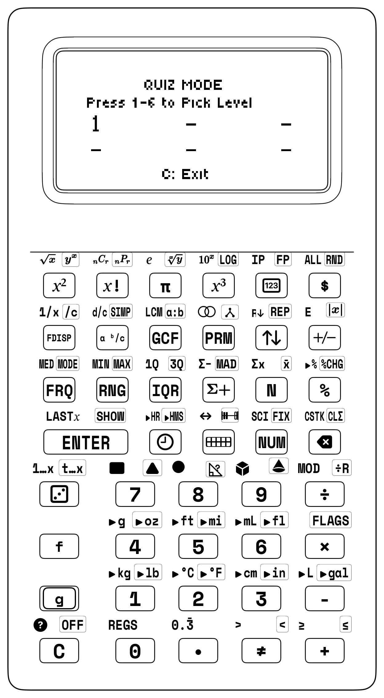

<div class="admonition note">
<p class="admonition-title">For Parents &amp; Teachers: Cognitive Automaticity &amp; The Hardware Quiz Philosophy</p>
<p>
<strong>Pedagogical Vision &amp; Cognitive Load:</strong> In elementary mathematics, <strong>fact fluency</strong>—the effortless, instantaneous recall of basic addition, subtraction, multiplication, and division relationships—is the foundational cognitive gateway to higher-level mathematical reasoning *([Ma, 1999](sc6/appendix-c-formulas-and-conversions.md#cite-ma1999))*. Cognitive science research (George Miller *([Miller, 1956](sc6/appendix-c-formulas-and-conversions.md#cite-miller1956))* and John Sweller *([Sweller, 1988](sc6/appendix-c-formulas-and-conversions.md#cite-sweller1988))*) demonstrates that human working memory has a strictly limited bandwidth. When a student expends precious cognitive energy manually counting on their fingers or executing slow column arithmetic to find $7 \times 8 = 56$, their working memory is completely saturated. They have zero remaining mental capacity to comprehend the multi-step structure of complex word problems, balance algebraic equations, or reason about proportional relationships.<br><br>
<strong>Deficiencies of Conventional Methods:</strong> Paper flashcards reward passive memorization without measuring reaction latency, while mobile math apps introduce cartoon distractions and loot boxes. The SC-6 embeds an authentic, distraction-free, hardware-timed sprint engine running bare-metal on dedicated silicon. Missed questions re-enter the Leitner queue for spaced retrieval practice (see <a href="appendix-b-teacher-lesson-plans.md">Appendix B</a>).
</p>
</div>

---

## 8.2 The RPN Prompt & Rapid Sprint Evaluation (`[f] [?]` & `[ENTER]`)

### 8.2.1 Pure RPN Equation Representation
Traditional educational software displays equations in confusing algebraic equations with parentheses: $(15 - 3) \times ? = 72$. 

The SC-6 departs from conventional calculators by presenting all quiz challenges directly in **pure RPN stack notation** on the transflective graphic LCD:
$$\mathtt{3 \ + \ 7 \ = \ 10}$$

> **[f] [?]  LVL 1                      SCORE: 40       STREAK: 3 ●●●**
>
> 3  +  =  10
>
> Y:                                                              3
> X:                                                              _

*Figure 8.1: Graphic LCD Layout in Quiz Mode: Solving for Missing Value ?*

#### What This Display Teaches You:
- *"Start with 3 resting on Floor Y."*
- *"Place the missing mystery token `?` on the Ground Floor ($X$)."*
- *"Add them together (`+`)."*
- *"The target result must equal 10 (`10 `)."*

You immediately recognize that this RPN sequence represents the familiar question: *"What number added to 3 makes 10?"* It seamlessly bridges early elementary number bonds directly to algebraic thinking!

---

### 8.2.2 Rapid Sprint Evaluation Workflow via `[ENTER]`
Unlike scientific calculators that require cumbersome variable assignment menus (`STO A`, `RCL A`, `SOLVE`), answering a quiz question on the SC-6 requires **zero configuration**:
1. You read the RPN prompt on screen.
2. You type your candidate answer using the numeric digits: e.g. `[7]`.
3. You press the evaluate and submit key **`[ENTER]`**.

#### Hardware Evaluation Pipeline:
When `[ENTER]` is pressed, the internal calculator engine executes three atomic operations in under 5 milliseconds:
1. **Variable Substitution:** Binds candidate value $7$ to variable `?`.
2. **RPN Stack Execution:** Evaluates the stack sequence: `4 [ENTER] 5 [+]` $\longrightarrow 10$.
3. **Equality Verification:** Compares the evaluated result to the target value $10$:
   - **If Match ($10 = 10$):** Flashes `✓ NICE!`, plays an encouraging success chirp, increments the score, and generates the next problem.
   - **If Mismatch:** Flashes `✗ TRY AGAIN`, records an error penalty, and leaves the equation visible on screen so you can inspect your mistake and re-attempt the problem!

| Elapsed Time | Quiz Engine Verification Step |
| :--- | :--- |
| **$t = 0.0\text{ ms}$** | Tactile snap-dome switch closes when you press `[ENTER]` |
| **$t = 1.0\text{ ms}$** | Engine reads your candidate answer from Register $X$ |
| **$t = 2.4\text{ ms}$** | Evaluates candidate inside the RPN equation and checks exact match |
| **$t = 4.2\text{ ms}$** | Updates streak counter and refreshes transflective LCD with instant feedback |

---

## 8.3 The 6-Level Adaptive Curriculum Ladder

The SC-6 Quiz Engine spans six exciting levels that grow with you from Kindergarten through Grade 6, building speed, accuracy, and confidence at every step:

| Level | Target Grade | Operations & Mathematical Concepts | Speed Target | Passing Threshold |
| :--- | :--- | :--- | :--- | :--- |
| **Level 1** | K – Grade 1 | **Single-Digit Number Bonds (Sums to 10):**<br>• Band 1: Sums $\le 5$, additive identity with zero ($3 + {?}$, $4 - {?} = 1$).<br>• Band 2: Sums 6 to 10, combinations to ten ($7 + {?} = 10$, $10 - {?} = 4$).<br>• Band 3: Doubles & near-doubles ($4 + 4 = {?}$, $5 + 4 = {?}$). | $< 3.0\text{ s}$ | $80\%$ accuracy |
| **Level 2** | Grade 2 | **Whole Number Addition & Subtraction to 100:**<br>• Band 1: Multiples of ten ($40 + 30 = {?}$, $80 - 20 = {?}$).<br>• Band 2: Two-digit mental math without regrouping ($34 + 12 = {?}$, $67 - 25 = {?}$).<br>• Band 3: Two-digit mental math with regrouping ($47 + 38 = {?}$, $72 - 45 = {?}$). | $< 4.0\text{ s}$ | $85\%$ accuracy |
| **Level 3** | Grades 3–4 | **Times Tables & Division Facts to 12:**<br>• Band 1: Core foundational tables: 2, 5, 10 ($5 \times 6 = {?}$, $40 \div 5 = {?}$).<br>• Band 2: Intermediate tables: 3, 4, 6 ($4 \times 8 = {?}$, $36 \div 6 = {?}$).<br>• Band 3: Challenging tables: 7, 8, 9, 11, 12, squares ($7 \times 8$, $12 \times 11$, $9^2$). | $< 2.5\text{ s}$ | $90\%$ accuracy |
| **Level 4** | Grades 4–5 | **Fractions & Remainders:**<br>• Band 1: Division with whole quotients and remainders ($17 \div 5 \to Q=3, R=2$).<br>• Band 2: Like denominator addition and subtraction ($2/5 + 1/5 = {?}$).<br>• Band 3: Related and unlike denominators ($1/2 + 1/4 = {?}$, $3/4 - 1/3 = {?}$). | $< 5.0\text{ s}$ | $85\%$ accuracy |
| **Level 5** | Grade 5 | **Mixed Arithmetic & Order of Operations:**<br>• Band 1: Chained operations without parentheses: $24 \div 6 + 7 = {?}$.<br>• Band 2: Mixed numbers and improper conversions: $1\frac{3}{4} + 2\frac{1}{2} = {?}$.<br>• Band 3: Decimal mental arithmetic and percentages: $0.25 \times 80 = {?}$. | $< 4.5\text{ s}$ | $85\%$ accuracy |
| **Level 6** | Grade 6 | **Pre-Algebra & Mental Math Number Sense Sprint:**<br>• Band 1: Mental squaring shortcuts for numbers ending in 5: $35^2, 65^2$.<br>• Band 2: Multiplication by 11: $43 \times 11 = 473$, $56 \times 11 = 616$.<br>• Band 3: Signed integers and absolute values: $-18 + 7 = {?}$, $\lvert -42 \rvert - 15 = {?}$.<br>• Band 4: Prime checks and GCF/LCM: $\gcd(24, 36) = {?}$, $\operatorname{lcm}(6, 8) = {?}$. | $< 2.0\text{ s}$ | $95\%$ accuracy |


---

## 8.4 Hardware Scoring Dynamics, Fast Streaks & Latency Tracking

The SC-6 Quiz Engine evaluates both **accuracy** and **reaction speed**, encouraging you to transcend slow finger counting and achieve true mental fluency.

| Quiz Event | Point Delta | Streak Effect |
| :--- | :--- | :--- |
| **Correct Answer (Regular Speed)** | `+10 Points` | Streak increments (`+1`) |
| **Correct Answer (Fast Speed $< T_{\text{max}}$)** | `+20 Points` | Streak increments (`+1`) |
| **Incorrect Answer** | `-10 Points` | Streak resets to `0` (`●`) |
| **Time-Out (No answer in $15\text{ s}$)** | `-5 Points` | Streak resets to `0` (`●`) |

### 8.4.1 Speed Thresholds ($T_{\text{max}}$) by Level
To earn the coveted **+20 Fast Point Bonus**, you must submit your verified answer within the level's calibrated response threshold:
- **Level 1 (Single-digit sums):** $T_{\text{max}} = 3.0\text{ seconds}$
- **Level 2 (Two-digit addition):** $T_{\text{max}} = 4.0\text{ seconds}$
- **Level 3 (Multiplication facts):** $T_{\text{max}} = 2.5\text{ seconds}$
- **Level 4 (Fractions & remainders):** $T_{\text{max}} = 5.0\text{ seconds}$
- **Level 5 (Order of operations):** $T_{\text{max}} = 4.5\text{ seconds}$
- **Level 6 (Advanced mental sprint):** $T_{\text{max}} = 2.0\text{ seconds}$

### 8.4.2 Fast Streak Banners & Unlock Tiers
As you answer consecutive problems correctly within the fast speed threshold, the graphic LCD illuminates active streak pips (`●●●●●`):
- **3 Fast Streak:** Displays `BRONZE STREAK! +10 BONUS`
- **5 Fast Streak:** Displays `SILVER STREAK! +25 BONUS`
- **10 Fast Streak:** Displays `GOLDEN MASTER! +50 BONUS`
- **20 Fast Streak (Flawless Run):** Triggers the legendary graphic celebratory banner:
  `>>> NUMBER SENSE CHAMPION! FLAWLESS SPRINT <<<`

> **[f] [?]  LVL 3                      SCORE: 180      STREAK: 5 ●●●●●**
>
> >>> SILVER STREAK ACHIEVED! +25 BONUS <<<
>
> 8  ×  =  56
>
> Y:                                                              8
> X:                                                              7

*Figure 8.2: Transflective LCD Frame: 5 Fast Streak Unlock in Level 3*

---

### 8.4.3 Algebraic Trap vs. StackCalc Superpower Showdown: Mental Sprint & Subtraction Complements

| Challenge / Equation | The Algebraic Calculator Trap (TI-30X / Smartphone) | The StackCalc SC-6 + Manipulative Superpower | Keystroke Reduction | Live Stack Visibility | Pedagogical Breakthrough |
| :--- | :--- | :--- | :--- | :--- | :--- |
| **Rapid Subtraction Complement**:<br>$1000 - 647 = 353$ | Must type `1 0 0 0 - 6 4 7 =` (8 keystrokes). On paper, requires crossing out three zeros with repeated borrowing across multiple columns (slow and error-prone). | Vedic / 9s Complement Shortcut: subtract each digit from 9, and the last digit from 10: $(9-6)(9-4)(10-7) = \mathbf{353}$! On the stack: `1000 [ENTER] 647 [-]` $	o \mathbf{353}$ (5 strokes). Instant verification with zero borrowing! | **38% fewer strokes** | Register $Y$ retains the 1000 base while Register $X$ receives 647, confirming difference 353 immediately on the transflective screen. | Learners discover the base-10 complement rule using Place Value blocks, eliminating multi-column borrowing anxiety completely. |

## 8.5 Walkthrough: An Elite Level 6 Sprint Simulation

To appreciate how the quiz engine trains rapid mental calculation, consider an actual 5-problem sprint session in **Level 6 (Mental Math & Number Sense Sprint)**:

| Sprint Prompt | Mental Math Strategy | Your Keystrokes | Elapsed Time & Score |
| :--- | :--- | :--- | :--- |
| **Prompt 1:** `35² = ?` | Multiply tens digit by $(\text{tens} + 1)$: $3 \times 4 = 12$; append $25 \to 1225$ | `1225` `[ENTER]` | $1.8\text{ s}$ (`+20 pts`) |
| **Prompt 2:** `48 × 5 = ?` | Halve $48 \to 24$, multiply by $10 \to 240$ | `240` `[ENTER]` | $1.4\text{ s}$ (`+20 pts`) |
| **Prompt 3:** `1000 - 647 = ?` | Complement from $999$: $(9-6)(9-4)(10-7) = 353$ | `353` `[ENTER]` | $2.1\text{ s}$ (`+20 pts`) |
| **Prompt 4:** `144 ÷ 12 = ?` | Known square root inverse $12^2 = 144 \to 12$ | `12` `[ENTER]` | $1.1\text{ s}$ (`+20 pts`) |
| **Prompt 5:** `25 × 16 = ?` | Quarter of $16$ is $4$; multiply by $100 \to 400$ | `400` `[ENTER]` | $1.5\text{ s}$ (`+20 pts`, **5-Streak Bonus `+25 pts`!**) |

The entire 5-problem sequence required less than 10 seconds of active calculation, demonstrating how RPN muscle memory and mental arithmetic algorithms unite on the SC-6!

---

## 8.6 Classroom Sprint Stations, Relays & Tournament Protocols

The SC-6 Quiz Engine is designed to fit seamlessly into daily math workshop routines across elementary and middle school classrooms:

### 8.6.1 Protocol 1: The 2-Minute Daily Warmup Sprint
At the beginning of your math practice session, set your SC-6 to your target level and participate in a focused 2-minute warmup sprint:
- **Duration:** Exactly 120 seconds.
- **Goal:** Personal best progression (surpassing yesterday's score).
- **Tracking:** Log your score, accuracy percentage, and longest fast streak in your math notebook.
- **Outcome:** Focuses your attention on active mathematical processing within 60 seconds of sitting down.

| Date | Target Level | Final Score | Fast Streak | Personal Best? |
| :--- | :--- | :--- | :--- | :--- |
| **Oct 14** | Level 3 ($\times/\div$) | `140` | `4` | No |
| **Oct 15** | Level 3 ($\times/\div$) | `180` | `6` | **YES!** |
| **Oct 16** | Level 3 ($\times/\div$) | `210` | `8` | **YES!** |
| **Oct 17** | Level 4 (Fractions) | `90` | `2` | New Level! |

---

### 8.6.2 Protocol 2: The 4-Person Relay Challenge
For cooperative review stations, teams of four can run a quiz sprint relay:
1. Team members sit in a row with a single SC-6 calculator placed in the center.
2. Player 1 starts the sprint, aiming for a **3 Fast Streak** before passing the calculator to Player 2.
3. If Player 1 enters a wrong answer, their streak resets, and they keep solving until they achieve the 3-streak.
4. Player 2 receives the calculator, achieves a 3-streak, and passes to Player 3, who passes to Player 4.
5. The team timer stops when Player 4 completes the final 3-streak (12 total consecutive correct answers).
6. **Cooperative Benefit:** Teammates cheer for each other, share mental shortcut tips during handoffs, and value accuracy over careless rushing.

---

### 8.6.3 Protocol 3: Factory Baseline Memory Reset & Fresh Starts
Before a tournament sprint or math quiz relay, you can wipe previous scores and registers so your calculator starts completely fresh:

<div class="admonition warning">
<p class="admonition-title">Factory Baseline Memory Purge Protocol</p>

1. Hold down key `[C]` (Row 7, Col 1).
2. Momentarily tap `[g] [OFF]` (Power key).
3. Release `[C]`.
4. Screen momentarily displays: `"MEMORY CLEARED - ALL REGISTERS PURGED"`.
5. Stack resets to $X = Y = Z = T = 0.0000$; continuous statistical and quiz registers reset to zero.
6. Calculator enters clean baseline state: `[NUM]` 4-Stack XYZT.
</div>

---

<div class="admonition note">
<p class="admonition-title">For Parents &amp; Teachers: Pedagogical Architecture of the Quiz Engine</p>
<p>
<strong>Private Formative Feedback &amp; Affective Resilience:</strong> Research in mathematics anxiety demonstrates that public performance pressure during timed paper testing can induce affective paralysis in young learners. The SC-6 transforms the emotional climate of arithmetic practice: feedback is immediate, private, and localized to the display. When an entry is incorrect, the instrument avoids punitive red-pen cues, presenting a clear diagnostic prompt (<code>✗ TRY AGAIN</code>) while keeping the problem active. Learners inspect the register stack, identify intermediate regrouping or factor errors, and execute instant correction, building grit and mathematical resilience.<br><br>
<strong>Scoring Incentives &amp; Decision Theory:</strong> The engine's scoring rubric enforces deliberate pacing over impulsive guessing: correct answers submitted within $2.0\text{ seconds}$ receive a $+20\text{ point}$ bonus plus streak acceleration, while incorrect answers incur an immediate $-10\text{ point}$ penalty and reset the active streak counter to zero. This mathematical structure guarantees that rapid guessing yields a negative net expected score ($\mathbb{E}[\text{score}] < 0$), teaching students that taking an extra second to reflect and verify yields vastly superior outcomes.<br><br>
<strong>Bare-Metal Execution &amp; Latency Invariance:</strong> Unlike tablet or web-based drill applications that suffer from operating system background interrupts, touch-screen latency, and garbage collection jitter, the SC-6 quiz engine runs bare-metal on dedicated silicon. Display states update within $4\text{ ms}$, and the $400\text{ g}$ snap-dome key switches provide unambiguous tactile and auditory confirmation with every entry.<br><br>
<strong>Mental Math &amp; Number Sense Fluency:</strong> Level 6 drills rapid-fire mental math shortcuts—multiplying multi-digit integers by 11, squaring numbers ending in 5 via Vedic algebraic identities ($n5^2 = n(n+1) \times 100 + 25$), summing arithmetic series, and computing benchmark percentages. The strict $2.0\text{ second}$ speed window develops the automaticity and number-sense agility required for advanced STEM problem solving.
</p>
</div>

<div class="admonition note">
<p class="admonition-title">For Parents &amp; Teachers: Classroom Dialogue Scripts &amp; Misconception Diagnostics</p>
<p>
<strong>Script 8.1: Why Guessing Destroys Your Score:</strong><br>
<strong>Teacher:</strong> "Marcus, I noticed that on your 2-minute Level 3 sprint, you attempted 40 questions, but your final score was only 30 points. What happened?"<br>
<strong>Student (Marcus):</strong> "I was trying to go super fast so I could get the +20 bonus points on every single problem! So when I saw $8 \times 7$, I guessed 54, and when I saw $9 \times 6$, I guessed 56."<br>
<strong>Teacher:</strong> "Let's look at the math behind the scoring rules, Marcus. When you guess wrong, what happens?"<br>
<strong>Marcus:</strong> "You lose 10 points."<br>
<strong>Teacher:</strong> "And what happens to your streak?"<br>
<strong>Marcus:</strong> "It drops all the way back to zero."<br>
<strong>Teacher:</strong> "Right! So if you guess on three problems in a row and get them wrong, you lose $-30$ points! Now imagine you slow down by just one second: you take 2.2 seconds to think: '7 times 8 is 56'. You type 56. What do you get?"<br>
<strong>Marcus:</strong> "+20 points and my streak goes up!"<br>
<strong>Teacher:</strong> "Exactly! Ten accurate answers in two minutes gives you $10 \times 20 = 200\text{ points}$, plus streak bonuses! Guessing 40 times gave you 30 points. Accuracy is the true secret of speed!"<br>
<strong>Marcus:</strong> "Slow is smooth, and smooth is fast!"<br><br>
<strong>Script 8.2: The Mystery of Multiplying by 11:</strong><br>
<strong>Student (Hannah):</strong> "Teacher, how did Daniel solve $53 \times 11 = 583$ in less than one second on the Level 6 sprint? Is he a human computer?"<br>
<strong>Teacher:</strong> "Daniel used the 11s shortcut! Watch: write the number 53 on your whiteboard with a little space between the digits: <code>5 _ 3</code>."<br>
<strong>Hannah:</strong> "Okay, 5 on the left, 3 on the right."<br>
<strong>Teacher:</strong> "Now add the two digits together: what is $5 + 3$?"<br>
<strong>Hannah:</strong> "8!"<br>
<strong>Teacher:</strong> "Put the 8 right in the middle! What number do you have?"<br>
<strong>Hannah (eyes wide):</strong> "583! No way! Does that work for every two-digit number?"<br>
<strong>Teacher:</strong> "Try $42 \times 11$!"<br>
<strong>Hannah:</strong> "4 on the left, 2 on the right, $4 + 2 = 6$ in the middle... 462! Wow!"<br>
<strong>Teacher:</strong> "What if the middle sum is 10 or greater, like $75 \times 11$?"<br>
<strong>Hannah:</strong> "$7 + 5 = 12$! So 2 goes in the middle, and we carry the 1 to the 7... making it 825!"<br>
<strong>Teacher:</strong> "Brilliant! Now test it on your SC-6: <code>10 [ENTER] 7 [-]</code>!"<br>
<strong>Hannah:</strong> "825! That's how Daniel answered in one second!"<br><br>
<strong>Script 8.3: Fraction Addition vs Whole Number Addition:</strong><br>
<strong>Student (Noah):</strong> "Teacher, in Level 4, the screen asked $1/3 + 1/4 = ?$. I typed $2/7$ and pressed <code>[ENTER]</code>, but the calculator flashed <code>✗ TRY AGAIN</code>! 1 plus 1 is 2, and 3 plus 4 is 7!"<br>
<strong>Teacher:</strong> "Noah, grab our Fraction Studio towers. Take a 1/3 tower and a 1/4 tower and stack them together."<br>
<strong>Noah:</strong> "Okay, they make a tall tower."<br>
<strong>Teacher:</strong> "Now look at the 1/7 pieces in the bin. If you place 2 of those sevenths side by side, do they match the height of your 1/3 plus 1/4 tower?"<br>
<strong>Noah:</strong> "No way! Two-sevenths is way shorter! It's not even as tall as the 1/3 piece alone!"<br>
<strong>Teacher:</strong> "Exactly! You cannot add denominators because fractions are parts of a whole! To combine thirds and fourths, what size blocks fit both?"<br>
<strong>Noah:</strong> "Twelfths! One-third is 4 twelfths, and one-fourth is 3 twelfths!"<br>
<strong>Teacher:</strong> "And $4/12 + 3/12$ equals...?"<br>
<strong>Noah:</strong> "7 twelfths! $7/12$!"<br>
<strong>Teacher:</strong> "Now type <code>[.] 7 [.] 1 2</code> on your SC-6 and tap <code>[ENTER]</code>!"<br>
<strong>Noah:</strong> "It flashed <code>✓ NICE! +20 POINTS</code>! The blocks prove the fraction!"
</p>

<h4>Misconception Diagnostic Table</h4>

| Observable Error | Cognitive Root Cause | Targeted Remediation Prompt |
| :--- | :--- | :--- |
| **Adding denominators in Level 4: $\frac{2}{5} + \frac{1}{5} = \frac{3}{10}$** | Treating fractions as two disconnected whole numbers rather than equal fractional parts. | *"Look at the fraction tower manipulative. If you have 2 fifths and add 1 fifth, you have 3 fifths ($\frac{3}{5}$). The denominator tells you the size of the pieces; it never changes when adding like slices!"* |
| **Forgetting to carry in the 11s shortcut: $68 \times 11 = 6148$** | Inserting the full sum $6 + 8 = 14$ into the center without regrouping the tens digit. | *"The center slot can only hold a single digit! Put the 4 in the middle, and carry the 1 over to the 6: $6 + 1 = 7$, yielding 748!"* |
| **Squaring numbers ending in 5: $35^2 = 3025$** | Multiplying the tens digit by itself ($3 \times 3 = 9$) instead of the next integer ($3 \times 4 = 12$). | *"Remember the rule: multiply the tens digit by the NEXT whole number! $3 \times 4 = 12$, then append 25 to get 1,225!"* |
| **Order of operations violation: $24 \div 6 + 7 = 24 \div 13$** | Reading left-to-right and adding before dividing. | *"Division and multiplication always happen before addition and subtraction! First compute $24 \div 6 = 4$. Then add $4 + 7 = 11$."* |
| **Sign confusion: $-15 + 8 = -23$** | Adding absolute values instead of moving toward zero on the number line. | *"You are at $-15$ in the basement. Going up $+8$ floors moves you CLOSER to ground level: you end at Floor $-7$!"* |
| **Remainder as decimal: $17 \div 5 \to 3.2$ instead of $Q=3, R=2$** | Confusing base-10 tenths with fractional parts ($2/5 = 0.4$, not $0.2$). | *"In whole number division with remainder, $17 \div 5$ gives 3 groups of 5 with 2 left over. On the SC-6, use `[÷R]` to see quotient $3$ and remainder $2$ separated!"* |
| **Doubles error: $7 + 8 \to 16$** | Misapplying double of the upper addend ($8 + 8 = 16$) instead of double plus one ($7 + 7 + 1 = 15$). | *"Think of 8 as $7 + 1$. Double 7 is 14, plus 1 is 15! Double plus one always gives an odd sum."* |
| **Percentage of number: $10\%\text{ of } 250 = 2500$** | Multiplying by 10 instead of dividing by 10 (or moving decimal wrong way). | *"Ten percent means ten out of one hundred—one tenth! To take one tenth of 250, shift the decimal point ONE space to the LEFT: $25.0$!"* |

</div>

---

## 8.7 Comprehensive Problem Bank: 48 Worked Quiz Drills with Full 4-Register Stack Traces

The following problem bank provides complete reference Flight Simulator walkthroughs across all six astronaut training levels, connecting your mental math trick with physical blocks (`Ten-Frames`, `Math Dominoes`, `Counting Tile Arrays`, `Fraction Towers`, and `Prime Blocks`), the quiz screen prompt, what you tap on the keys, target latency, and complete 4-register ($T, Z, Y, X$) stack verification tables.

<div class="admonition note">
<p class="admonition-title">Hands-On Studio Proof: Blocks -> Calculator</p>

Before executing high-speed mental sprints on the SC-6 keypad, you ground abstract arithmetic facts in tactile reality:
1. **Domino Pairing & Seeing Groups at a Glance (Levels 1–2):** Use the **Math Dominoes Studio**. Draw a double-six domino (e.g., $4 + 5$). Instantly recognize the dot patterns to spot the near-double ($4 + 4 + 1 = 9$). Key in `[5] [ENTER]` on the SC-6 within $2.0\text{ seconds}$ to earn the speed chime.
2. **Rectangular Array Muscle Memory (Levels 3–4):** Build a $7 \times 8$ tile array using the 144-Tile Counting & Array Studio. Decompose into $(5 \times 8) + (2 \times 8) = 40 + 16 = 56$. When the SC-6 prompts `7 [ENTER] ? [×] 56 `, your fingers tap `[8] [ENTER]` without hesitation.
3. **Proportional Fraction Towers (Levels 4–5):** Compare a $\frac{1}{2}$ tower against two $\frac{1}{4}$ towers on the twin comparator well. When faced with $\frac{1}{2} + \frac{1}{4}$, the visual height of $\frac{3}{4}$ is already etched into spatial memory.
4. **Vedic Shortcuts & Algebraic Sprints (Level 6):** Mentally multiply $35^2 = (3 \times 4)\text{ hundred} + 25 = 1,225$ using the spatial Vedic squaring rule, verifying instantly with `6 [ENTER] 3 [+]`.
</div>

### 8.7.1 Mission 1: Flight Simulator Liftoff (Levels 1 & 2: Number Bonds & Whole Number Addition/Subtraction)
*Mission Briefing: Strap into the simulator cockpit. Build automatic number bonds to 10 and rapid mental addition and subtraction to 100 without paper or finger counting.*

### 8.7.2 Level 1: Single-Digit Number Bonds (Sums & Differences to 10)

#### Drill 1 (Level 1): $4 + 5 = ?$
- **Your Mental Math Trick (With Your Blocks):** Use **Math Dominoes**. Draw a $[4 \mid 5]$ domino: you can instantly spot the near-double! The twin $4$-dot groups match up ($4 + 4 = 8$), leaving just $1$ extra dot to make $8 + 1 = 9$.
- **On the Quiz Screen:** `4 + 5 = ?`
- **What You Tap:** `{key:9}` `{key:ENTER}`
- **Target Time:** $< 2.0\text{ seconds}$.
- **RPN Keystrokes:** `4 [ENTER] 5 [+]` $\rightarrow$ **`9`**
- **Stack Flow:** Tap `4 [ENTER] 5 [+]` -> (T=0, Z=0, Y=0, X=9). Enter the forward calculation on the stack to evaluate and verify 9 in Register $X$.

#### Drill 2 (Level 1): $10 - 7 = ?$
- **Your Mental Math Trick (With Your Blocks):** Use your **Ten-Frames** tray. The tray holds 10 counters in two rows of 5. When you cover or remove 7 counters (a full row of 5 plus 2 more), exactly 3 empty spaces remain ($10 - 7 = 3$, because $7 + 3 = 10$).
- **On the Quiz Screen:** `10 - 7 = ?`
- **What You Tap:** `{key:3}` `{key:ENTER}`
- **Target Time:** $< 2.0\text{ seconds}$.
- **RPN Keystrokes:** `10 [ENTER] 7 [-]` $\rightarrow$ **`3`**
- **Stack Flow:** Tap `10 [ENTER] 7 [-]` -> (T=0, Z=0, Y=0, X=3). Enter the forward calculation on the stack to evaluate and verify 3 in Register $X$.

#### Drill 3 (Level 1): $6 + 3 = ?$
- **Your Mental Math Trick (With Your Blocks):** Use **Math Dominoes** or a **Ten-Frames** board. Start with the larger benchmark group of 6 (a full row of 5 plus 1 dot), then count on 3 quick astronaut hops: 7, 8, 9 ($6 + 3 = 9$).
- **On the Quiz Screen:** `6 + 3 = ?`
- **What You Tap:** `{key:9}` `{key:ENTER}`
- **Target Time:** $< 2.0\text{ seconds}$.
- **RPN Keystrokes:** `6 [ENTER] 3 [+]` $\rightarrow$ **`9`**
- **Stack Flow:** Tap `6 [ENTER] 3 [+]` -> (T=0, Z=0, Y=0, X=9). Enter the forward calculation on the stack to evaluate and verify 9 in Register $X$.

#### Drill 4 (Level 1): $8 - 0 = ?$
- **Your Mental Math Trick (With Your Blocks):** In your **Ten-Frames** tray, set out 8 counters (5 on top, 3 on bottom). Subtracting zero means taking away zero blocks—all 8 counters stay locked in position ($8 - 0 = 8$).
- **On the Quiz Screen:** `8 - 0 = ?`
- **What You Tap:** `{key:8}` `{key:ENTER}`
- **Target Time:** $< 1.0\text{ seconds}$.
- **RPN Keystrokes:** `8 [ENTER] 0 [-]` $\rightarrow$ **`8`**
- **Stack Flow:** Tap `8 [ENTER] 0 [-]` -> (T=0, Z=0, Y=0, X=8). Enter the forward calculation on the stack to evaluate and verify 8 in Register $X$.

#### Drill 5 (Level 1): $3 + 7 = ?$
- **Your Mental Math Trick (With Your Blocks):** Look at your **Ten-Frames** tray. Place 3 blue tiles in the first row. The remaining empty pockets form a partner block of 7 red tiles—together they complete the entire 10-frame flight module ($3 + 7 = 10$).
- **On the Quiz Screen:** `3 + 7 = ?`
- **What You Tap:** `{key:10}` `{key:ENTER}`
- **Target Time:** $< 1.5\text{ seconds}$.
- **RPN Keystrokes:** `3 [ENTER] 7 [+]` $\rightarrow$ **`10`**
- **Stack Flow:** Tap `3 [ENTER] 7 [+]` -> (T=0, Z=0, Y=0, X=10). Enter the forward calculation on the stack to evaluate and verify 10 in Register $X$.

#### Drill 6 (Level 1): $9 - 5 = ?$
- **Your Mental Math Trick (With Your Blocks):** Use your **Ten-Frames** tray. A group of 9 fills the top row of 5 plus 4 on the bottom row. When you launch or lift off the full 5-row, exactly 4 counters remain on the landing pad ($9 - 5 = 4$).
- **On the Quiz Screen:** `9 - 5 = ?`
- **What You Tap:** `{key:4}` `{key:ENTER}`
- **Target Time:** $< 1.8\text{ seconds}$.
- **RPN Keystrokes:** `9 [ENTER] 5 [-]` $\rightarrow$ **`4`**
- **Stack Flow:** Tap `9 [ENTER] 5 [-]` -> (T=0, Z=0, Y=0, X=4). Enter the forward calculation on the stack to evaluate and verify 4 in Register $X$.

#### Drill 7 (Level 1): $4 + 4 = ?$
- **Your Mental Math Trick (With Your Blocks):** Grab a double-four from your **Math Dominoes** set. Both halves show identical $4$-dot square clusters ($4 + 4 = 8$); doubling 4 clicks together instantly like twin booster rockets!
- **On the Quiz Screen:** `4 + 4 = ?`
- **What You Tap:** `{key:8}` `{key:ENTER}`
- **Target Time:** $< 1.0\text{ seconds}$.
- **RPN Keystrokes:** `4 [ENTER] 4 [+]` $\rightarrow$ **`8`**
- **Stack Flow:** Tap `4 [ENTER] 4 [+]` -> (T=0, Z=0, Y=0, X=8). Enter the forward calculation on the stack to evaluate and verify 8 in Register $X$.

#### Drill 8 (Level 1): $10 - 2 = ?$
- **Your Mental Math Trick (With Your Blocks):** Start with a full 10 in your **Ten-Frames** module. Pull off the 2 end counters from the bottom row: you instantly see the full top row of 5 and 3 on the bottom, giving 8 counters ($10 - 2 = 8$).
- **On the Quiz Screen:** `10 - 2 = ?`
- **What You Tap:** `{key:8}` `{key:ENTER}`
- **Target Time:** $< 1.2\text{ seconds}$.
- **RPN Keystrokes:** `10 [ENTER] 2 [-]` $\rightarrow$ **`8`**
- **Stack Flow:** Tap `10 [ENTER] 2 [-]` -> (T=0, Z=0, Y=0, X=8). Enter the forward calculation on the stack to evaluate and verify 8 in Register $X$.

#### Drill 9 (Level 2): $40 + 30 = ?$
- **Your Mental Math Trick (With Your Blocks):** Build with **Ten-Frames** rods or **Counting Tile Arrays**. Align 4 solid ten-rods ($40$) and dock 3 more ten-rods ($30$): $4\text{ tens} + 3\text{ tens} = 7\text{ tens} = 70$.
- **On the Quiz Screen:** `40 + 30 = ?`
- **What You Tap:** `{key:70}` `{key:ENTER}`
- **Target Time:** $< 2.5\text{ seconds}$.
- **RPN Keystrokes:** `40 [ENTER] 30 [+]` $\rightarrow$ **`70`**
- **Stack Flow:** Tap `40 [ENTER] 30 [+]` -> (T=0, Z=0, Y=0, X=70). Enter the forward calculation on the stack to evaluate and verify 70 in Register $X$.

#### Drill 10 (Level 2): $80 - 25 = ?$
- **Your Mental Math Trick (With Your Blocks):** Use **Counting Tile Arrays**. Line up 8 ten-rods to show $80$. To subtract 25, remove 2 full ten-rods to drop down to $60$, then snap off 5 single unit tiles to land at $55$ ($80 - 20 = 60 \implies 60 - 5 = 55$).
- **On the Quiz Screen:** `80 - 25 = ?`
- **What You Tap:** `{key:55}` `{key:ENTER}`
- **Target Time:** $< 3.0\text{ seconds}$.
- **RPN Keystrokes:** `80 [ENTER] 25 [-]` $\rightarrow$ **`55`**
- **Stack Flow:** Tap `80 [ENTER] 25 [-]` -> (T=0, Z=0, Y=0, X=55). Enter the forward calculation on the stack to evaluate and verify 55 in Register $X$.

#### Drill 11 (Level 2): $34 + 12 = ?$
- **Your Mental Math Trick (With Your Blocks):** Group your **Counting Tile Arrays** by place value. Combine 3 ten-rods and 1 ten-rod ($30 + 10 = 40$), then combine 4 single tiles and 2 single tiles ($4 + 2 = 6$) for a smooth landing on $46$ with zero regrouping!
- **On the Quiz Screen:** `34 + 12 = ?`
- **What You Tap:** `{key:46}` `{key:ENTER}`
- **Target Time:** $< 2.5\text{ seconds}$.
- **RPN Keystrokes:** `34 [ENTER] 12 [+]` $\rightarrow$ **`46`**
- **Stack Flow:** Tap `34 [ENTER] 12 [+]` -> (T=0, Z=0, Y=0, X=46). Enter the forward calculation on the stack to evaluate and verify 46 in Register $X$.

#### Drill 12 (Level 2): $67 - 25 = ?$
- **Your Mental Math Trick (With Your Blocks):** Split your **Counting Tile Arrays** into tens and ones. From 6 ten-rods and 7 unit tiles, remove 2 ten-rods ($60 - 20 = 40$) and 5 unit tiles ($7 - 5 = 2$), leaving 4 ten-rods and 2 single tiles ($42$).
- **On the Quiz Screen:** `67 - 25 = ?`
- **What You Tap:** `{key:42}` `{key:ENTER}`
- **Target Time:** $< 2.8\text{ seconds}$.
- **RPN Keystrokes:** `67 [ENTER] 25 [-]` $\rightarrow$ **`42`**
- **Stack Flow:** Tap `67 [ENTER] 25 [-]` -> (T=0, Z=0, Y=0, X=42). Enter the forward calculation on the stack to evaluate and verify 42 in Register $X$.

#### Drill 13 (Level 2): $47 + 38 = ?$
- **Your Mental Math Trick (With Your Blocks):** Use compensation with **Ten-Frames** or **Counting Tile Arrays**. Treat 38 as 4 full ten-rods minus 2 tiles. Leap forward 40 from 47 to reach 87 ($47 + 40 = 87$), then pull back 2 single tiles to hit your orbital target: $85$.
- **On the Quiz Screen:** `47 + 38 = ?`
- **What You Tap:** `{key:85}` `{key:ENTER}`
- **Target Time:** $< 3.5\text{ seconds}$.
- **RPN Keystrokes:** `47 [ENTER] 38 [+]` $\rightarrow$ **`85`**
- **Stack Flow:** Tap `47 [ENTER] 38 [+]` -> (T=0, Z=0, Y=0, X=85). Enter the forward calculation on the stack to evaluate and verify 85 in Register $X$.

#### Drill 14 (Level 2): $72 - 45 = ?$
- **Your Mental Math Trick (With Your Blocks):** Measure distance along your **Counting Tile Arrays** track. Count up from 45 to 72 in two astronaut hops: add 5 tiles to reach the round waypoint $50$, then add 22 tiles to reach $72$. The total flight path is $5 + 22 = 27$ tiles!
- **On the Quiz Screen:** `72 - 45 = ?`
- **What You Tap:** `{key:27}` `{key:ENTER}`
- **Target Time:** $< 3.5\text{ seconds}$.
- **RPN Keystrokes:** `72 [ENTER] 45 [-]` $\rightarrow$ **`27`**
- **Stack Flow:** Tap `72 [ENTER] 45 [-]` -> (T=0, Z=0, Y=0, X=27). Enter the forward calculation on the stack to evaluate and verify 27 in Register $X$.

#### Drill 15 (Level 2): $56 + 19 = ?$
- **Your Mental Math Trick (With Your Blocks):** Use **Ten-Frames** rods. 19 is just 1 tile less than 2 full ten-rods ($20$). Snap 2 ten-rods onto 56 to surge to 76 ($56 + 20 = 76$), then subtract 1 single tile to lock in $75$.
- **On the Quiz Screen:** `56 + 19 = ?`
- **What You Tap:** `{key:75}` `{key:ENTER}`
- **Target Time:** $< 2.8\text{ seconds}$.
- **RPN Keystrokes:** `56 [ENTER] 19 [+]` $\rightarrow$ **`75`**
- **Stack Flow:** Tap `56 [ENTER] 19 [+]` -> (T=0, Z=0, Y=0, X=75). Enter the forward calculation on the stack to evaluate and verify 75 in Register $X$.

#### Drill 16 (Level 2): $91 - 38 = ?$
- **Your Mental Math Trick (With Your Blocks):** Use **Counting Tile Arrays**. To subtract 38, overshoot by taking away 4 ten-rods ($40$) from 91 to get 51 ($91 - 40 = 51$), then compensate by snapping 2 unit tiles back on to finish at $53$ ($51 + 2 = 53$).
- **On the Quiz Screen:** `91 - 38 = ?`
- **What You Tap:** `{key:53}` `{key:ENTER}`
- **Target Time:** $< 3.5\text{ seconds}$.
- **RPN Keystrokes:** `91 [ENTER] 38 [-]` $\rightarrow$ **`53`**
- **Stack Flow:** Tap `91 [ENTER] 38 [-]` -> (T=0, Z=0, Y=0, X=53). Enter the forward calculation on the stack to evaluate and verify 53 in Register $X$.

#### Drill 17 (Level 3): $7 \times 8 = ?$
- **Your Mental Math Trick (With Your Blocks):** Build a $7 \times 8$ grid in the **Counting Tile Arrays** studio. Use the double-double-double flight rule: double 7 to get 14 ($7 \times 2$), double again to get 28 ($7 \times 4$), and double a third time to get $56$ ($7 \times 8$).
- **On the Quiz Screen:** `7 × 8 = ?`
- **What You Tap:** `{key:56}` `{key:ENTER}`
- **Target Time:** $< 1.5\text{ seconds}$.
- **RPN Keystrokes:** `7 [ENTER] 8 [×]` $\rightarrow$ **`56`**
- **Stack Flow:** Tap `7 [ENTER] 8 [×]` -> (T=0, Z=0, Y=0, X=56). Enter the forward calculation on the stack to evaluate and verify 56 in Register $X$.

#### Drill 18 (Level 3): $72 \div 9 = ?$
- **Your Mental Math Trick (With Your Blocks):** Lay out 72 tiles on your **Counting Tile Arrays** grid. Think of the inverse array: what width times 9 rows gives 72 total tiles? Because an $8 \times 9$ array holds 72 tiles, $72 \div 9 = 8$!
- **On the Quiz Screen:** `72 ÷ 9 = ?`
- **What You Tap:** `{key:8}` `{key:ENTER}`
- **Target Time:** $< 1.8\text{ seconds}$.
- **RPN Keystrokes:** `72 [ENTER] 9 [÷]` $\rightarrow$ **`8`**
- **Stack Flow:** Tap `72 [ENTER] 9 [÷]` -> (T=0, Z=0, Y=0, X=8). Enter the forward calculation on the stack to evaluate and verify 8 in Register $X$.

#### Drill 19 (Level 3): $6 \times 9 = ?$
- **Your Mental Math Trick (With Your Blocks):** In your **Counting Tile Arrays** studio, build a $6 \times 10$ rectangle of 60 tiles. Then peel away 1 column of 6 tiles: $60 - 6 = 54$, leaving the exact $6 \times 9$ tile array!
- **On the Quiz Screen:** `6 × 9 = ?`
- **What You Tap:** `{key:54}` `{key:ENTER}`
- **Target Time:** $< 1.5\text{ seconds}$.
- **RPN Keystrokes:** `6 [ENTER] 9 [×]` $\rightarrow$ **`54`**
- **Stack Flow:** Tap `6 [ENTER] 9 [×]` -> (T=0, Z=0, Y=0, X=54). Enter the forward calculation on the stack to evaluate and verify 54 in Register $X$.

#### Drill 20 (Level 3): $48 \div 6 = ?$
- **Your Mental Math Trick (With Your Blocks):** Form your 48 tiles into 6 equal flight squads using **Counting Tile Arrays**. Knowing that a $6 \times 8$ array uses all 48 tiles with zero leftovers, each squad must contain exactly 8 tiles ($48 \div 6 = 8$).
- **On the Quiz Screen:** `48 ÷ 6 = ?`
- **What You Tap:** `{key:8}` `{key:ENTER}`
- **Target Time:** $< 1.8\text{ seconds}$.
- **RPN Keystrokes:** `48 [ENTER] 6 [÷]` $\rightarrow$ **`8`**
- **Stack Flow:** Tap `48 [ENTER] 6 [÷]` -> (T=0, Z=0, Y=0, X=8). Enter the forward calculation on the stack to evaluate and verify 8 in Register $X$.

#### Drill 21 (Level 3): $12 \times 7 = ?$
- **Your Mental Math Trick (With Your Blocks):** Break apart your $12 \times 7$ grid in the **Counting Tile Arrays** studio into two easy modules: a $10 \times 7$ array ($70$ tiles) plus a $2 \times 7$ array ($14$ tiles). Sum the two arrays together: $70 + 14 = 84$ tiles.
- **On the Quiz Screen:** `12 × 7 = ?`
- **What You Tap:** `{key:84}` `{key:ENTER}`
- **Target Time:** $< 2.2\text{ seconds}$.
- **RPN Keystrokes:** `12 [ENTER] 7 [×]` $\rightarrow$ **`84`**
- **Stack Flow:** Tap `12 [ENTER] 7 [×]` -> (T=0, Z=0, Y=0, X=84). Enter the forward calculation on the stack to evaluate and verify 84 in Register $X$.

#### Drill 22 (Level 3): $9 \times 9 = ?$
- **Your Mental Math Trick (With Your Blocks):** Build a square array of $9 \times 9$ tiles in your **Counting Tile Arrays** workspace. Imagine a full $10 \times 9$ rectangle of 90 tiles and slice off the bottom row of 9: $90 - 9 = 81$ tiles in the perfect square.
- **On the Quiz Screen:** `9 × 9 = ?`
- **What You Tap:** `{key:81}` `{key:ENTER}`
- **Target Time:** $< 1.2\text{ seconds}$.
- **RPN Keystrokes:** `9 [ENTER] 9 [×]` $\rightarrow$ **`81`**
- **Stack Flow:** Tap `9 [ENTER] 9 [×]` -> (T=0, Z=0, Y=0, X=81). Enter the forward calculation on the stack to evaluate and verify 81 in Register $X$.

#### Drill 23 (Level 3): $84 \div 12 = ?$
- **Your Mental Math Trick (With Your Blocks):** Partition 84 tiles into 12-tile bundles using your **Counting Tile Arrays**. Since $7 \times 10 = 70$ and $7 \times 2 = 14$, 7 full bundles consume all 84 tiles ($84 \div 12 = 7$).
- **On the Quiz Screen:** `84 ÷ 12 = ?`
- **What You Tap:** `{key:7}` `{key:ENTER}`
- **Target Time:** $< 2.0\text{ seconds}$.
- **RPN Keystrokes:** `84 [ENTER] 12 [÷]` $\rightarrow$ **`7`**
- **Stack Flow:** Tap `84 [ENTER] 12 [÷]` -> (T=0, Z=0, Y=0, X=7). Enter the forward calculation on the stack to evaluate and verify 7 in Register $X$.

#### Drill 24 (Level 3): $11 \times 11 = ?$
- **Your Mental Math Trick (With Your Blocks):** Lay out an $11 \times 11$ square using **Counting Tile Arrays**. Split it into a $10 \times 11$ rectangle ($110$ tiles) plus a single $1 \times 11$ strip ($11$ tiles): $110 + 11 = 121$ tiles in the full square matrix.
- **On the Quiz Screen:** `11 × 11 = ?`
- **What You Tap:** `{key:121}` `{key:ENTER}`
- **Target Time:** $< 1.5\text{ seconds}$.
- **RPN Keystrokes:** `11 [ENTER] 11 [×]` $\rightarrow$ **`121`**
- **Stack Flow:** Tap `11 [ENTER] 11 [×]` -> (T=0, Z=0, Y=0, X=121). Enter the forward calculation on the stack to evaluate and verify 121 in Register $X$.

#### Drill 25 (Level 4): $17 \div 5 \to Q=?, R=?$
- **Your Mental Math Trick (With Your Blocks):** Take 17 tiles from your **Counting Tile Arrays** kit and stack them into columns of 5. You build 3 complete 5-towers ($15$ tiles), with 2 leftover tiles resting in your hand ($Q=3, R=2$).
- **On the Quiz Screen:** `17 ÷ 5 = Q=?, R=?`
- **What You Tap:** `{key:3}` `{key:ENTER}`
- **Target Time:** $< 3.5\text{ seconds}$.
- **RPN Keystrokes:** `17 [ENTER] 5 [g] [÷R]` $\rightarrow$ **`3`**
- **4-Register Stack Trace Table:**

| Keystroke | Register T | Register Z | Register Y | Register X |
| :--- | :--- | :--- | :--- | :--- |
| 17 | 0 | 0 | 0 | 17 |
| [ENTER] | 0 | 0 | 17 | 17 |
| [5] | 0 | 0 | 17 | 5 |
| [÷R] | 0 | 0 | 2 | 3 |
*(Register $Y$ holds quotient 3, Register $X$ holds remainder 2)*.

#### Drill 26 (Level 4): $1/2 + 1/4 = ?$
- **Your Mental Math Trick (With Your Blocks):** Slide your **Fraction Towers** into the twin comparator well. A single $1/2$ tower aligns at the exact same height as two $1/4$ segments ($2/4$). Adding one more $1/4$ segment gives a $3/4$ tower ($2/4 + 1/4 = 3/4$).
- **On the Quiz Screen:** `1/2 + 1/4 = ?`
- **What You Tap:** `{key:3/4}` `{key:ENTER}`
- **Target Time:** $< 3.0\text{ seconds}$.
- **RPN Keystrokes:** `. 1 . 2 [ENTER] . 1 . 4 [+]` $\rightarrow$ **`3/4`**
- **4-Register Stack Trace Table:**

| Keystroke | Register T | Register Z | Register Y | Register X |
| :--- | :--- | :--- | :--- | :--- |
| [.] 1 [.] 2 | 0 | 0 | 0 | $0.5000$ |
| [ENTER] | 0 | 0 | $0.5000$ | $0.5000$ |
| [.] 1 [.] 4 | 0 | 0 | $0.5000$ | $0.2500$ |
| [+] | 0 | 0 | 0 | $0.7500$ |

#### Drill 27 (Level 4): $5/6 - 1/3 = ?$
- **Your Mental Math Trick (With Your Blocks):** In your **Fraction Towers** studio, stand a $5/6$ tower next to a $1/3$ tower. The $1/3$ tower matches two $1/6$ blocks ($2/6$). Subtracting two $1/6$ blocks from the five leaves three $1/6$ blocks ($3/6$), which simplifies directly to the $1/2$ tower!
- **On the Quiz Screen:** `5/6 - 1/3 = ?`
- **What You Tap:** `{key:1/2}` `{key:ENTER}`
- **Target Time:** $< 3.5\text{ seconds}$.
- **RPN Keystrokes:** `. 5 . 6 [ENTER] . 1 . 3 [-] [g] [SIMP]` $\rightarrow$ **`1/2`**
- **4-Register Stack Trace Table:**

| Keystroke | Register T | Register Z | Register Y | Register X |
| :--- | :--- | :--- | :--- | :--- |
| [.] 5 [.] 6 | 0 | 0 | 0 | $0.8333$ |
| [ENTER] | 0 | 0 | $0.8333$ | $0.8333$ |
| [.] 1 [.] 3 | 0 | 0 | $0.8333$ | $0.3333$ |
| [-] | 0 | 0 | 0 | $0.5000$ |
| [g] [SIMP] | 0 | 0 | 0 | $0.5000$ |

#### Drill 28 (Level 4): $2/3 + 1/4 = ?$
- **Your Mental Math Trick (With Your Blocks):** Use the twelfths benchmark on your **Fraction Towers** rack. The $2/3$ tower matches 8 twelfths ($8/12$) and the $1/4$ tower matches 3 twelfths ($3/12$). Stacking them combines $8 + 3 = 11$ twelfths ($11/12$).
- **On the Quiz Screen:** `2/3 + 1/4 = ?`
- **What You Tap:** `{key:11/12}` `{key:ENTER}`
- **Target Time:** $< 4.0\text{ seconds}$.
- **RPN Keystrokes:** `. 2 . 3 [ENTER] . 1 . 4 [+]` $\rightarrow$ **`11/12`**
- **4-Register Stack Trace Table:**

| Keystroke | Register T | Register Z | Register Y | Register X |
| :--- | :--- | :--- | :--- | :--- |
| [.] 2 [.] 3 | 0 | 0 | 0 | $0.6667$ |
| [ENTER] | 0 | 0 | $0.6667$ | $0.6667$ |
| [.] 1 [.] 4 | 0 | 0 | $0.6667$ | $0.2500$ |
| [+] | 0 | 0 | 0 | $0.9167$ |

#### Drill 29 (Level 4): $3/4 - 2/5 = ?$
- **Your Mental Math Trick (With Your Blocks):** Calibrate your **Fraction Towers** against a 20-part common base. A $3/4$ tower spans $15/20$ and a $2/5$ tower spans $8/20$. The height difference is $15/20 - 8/20 = 7/20$.
- **On the Quiz Screen:** `3/4 - 2/5 = ?`
- **What You Tap:** `{key:7/20}` `{key:ENTER}`
- **Target Time:** $< 4.5\text{ seconds}$.
- **RPN Keystrokes:** `. 3 . 4 [ENTER] . 2 . 5 [-]` $\rightarrow$ **`7/20`**
- **Stack Flow:** Tap `. 3 . 4 [ENTER] . 2 . 5 [-]` -> (T=0, Z=0, Y=0, X=0.35). Enter the forward calculation on the stack to evaluate and verify 7/20 in Register $X$.

#### Drill 30 (Level 4): $Simplify 18/24 \to ?$
- **Your Mental Math Trick (With Your Blocks):** Place an $18$-unit block over a $24$-unit block from your **Fraction Towers** kit. Both numbers can be measured by 6-unit segments ($\gcd(18, 24) = 6$). Dividing out 6 gives 3 segments over 4 segments—the exact height of a $3/4$ tower!
- **On the Quiz Screen:** `Simplify 18/24 = ?`
- **What You Tap:** `{key:3/4}` `{key:ENTER}`
- **Target Time:** $< 3.0\text{ seconds}$.
- **RPN Keystrokes:** `. 18 . 24 [ENTER] [g] [SIMP]` $\rightarrow$ **`3/4`**
- **4-Register Stack Trace Table:**

| Keystroke | Register T | Register Z | Register Y | Register X |
| :--- | :--- | :--- | :--- | :--- |
| [.] 18 [.] 24 | 0 | 0 | 0 | $0.7500$ |
| [ENTER] | 0 | 0 | $0.7500$ | $0.7500$ |
| [g] [SIMP] | 0 | 0 | $0.7500$ | $0.7500$ |

#### Drill 31 (Level 4): $38 \div 6 \to Q=?, R=?$
- **Your Mental Math Trick (With Your Blocks):** Assemble 38 tiles into 6-tile stacks with your **Counting Tile Arrays**. You construct 6 complete stacks ($36$ tiles) and have 2 extra loose tiles left over ($Q=6, R=2$).
- **On the Quiz Screen:** `38 ÷ 6 = Q=?, R=?`
- **What You Tap:** `{key:6}` `{key:ENTER}`
- **Target Time:** $< 3.0\text{ seconds}$.
- **RPN Keystrokes:** `38 [ENTER] 6 [g] [÷R]` $\rightarrow$ **`6`**
- **Stack Flow:** Tap `38 [ENTER] 6 [g] [÷R]` -> (T=0, Z=0, Y=2, X=6). Enter the forward calculation on the stack to evaluate and verify 6 in Register $X$.

#### Drill 32 (Level 4): $5/8 + 1/2 = ?$
- **Your Mental Math Trick (With Your Blocks):** In your **Fraction Towers** comparator well, a $1/2$ tower equals four $1/8$ segments ($4/8$). Adding five $1/8$ segments yields nine $1/8$ segments, which equals 1 full whole tower plus an extra $1/8$ piece ($1\ 1/8$).
- **On the Quiz Screen:** `5/8 + 1/2 = ?`
- **What You Tap:** `{key:1 1/8}` `{key:ENTER}`
- **Target Time:** $< 4.0\text{ seconds}$.
- **RPN Keystrokes:** `. 5 . 8 [ENTER] . 1 . 2 [+]` $\rightarrow$ **`1 1/8`**
- **4-Register Stack Trace Table:**

| Keystroke | Register T | Register Z | Register Y | Register X |
| :--- | :--- | :--- | :--- | :--- |
| [.] 5 [.] 8 | 0 | 0 | 0 | $0.6250$ |
| [ENTER] | 0 | 0 | $0.6250$ | $0.6250$ |
| [.] 1 [.] 2 | 0 | 0 | $0.6250$ | $0.5000$ |
| [+] | 0 | 0 | 0 | $1.1250$ |

#### Drill 33 (Level 5): $24 \div 6 + 7 = ?$
- **Your Mental Math Trick (With Your Blocks):** Use **Counting Tile Arrays**. Division comes before addition: separate 24 tiles into 6 equal squads of 4 tiles ($24 \div 6 = 4$), then dock 7 additional tiles into the squad to finish with 11 tiles ($4 + 7 = 11$).
- **On the Quiz Screen:** `24 ÷ 6 + 7 = ?`
- **What You Tap:** `{key:11}` `{key:ENTER}`
- **Target Time:** $< 2.5\text{ seconds}$.
- **RPN Keystrokes:** `24 [ENTER] 6 [÷] 7 [+]` $\rightarrow$ **`11`**
- **4-Register Stack Trace Table:**

| Keystroke | Register T | Register Z | Register Y | Register X |
| :--- | :--- | :--- | :--- | :--- |
| 24 | 0 | 0 | 0 | 24 |
| [ENTER] | 0 | 0 | 24 | 24 |
| [6] | 0 | 0 | 24 | 6 |
| [÷] | 0 | 0 | 0 | 4 |
| [7] | 0 | 0 | 4 | 7 |
| [+] | 0 | 0 | 0 | 11 |

#### Drill 34 (Level 5): $0.25 \times 80 = ?$
- **Your Mental Math Trick (With Your Blocks):** Connect decimals to **Fraction Towers**: $0.25$ is the exact height of a $1/4$ tower. Multiplying by $0.25$ means taking one fourth of an 80-tile track using **Counting Tile Arrays**: $80 \div 4 = 20$ tiles!
- **On the Quiz Screen:** `0.25 × 80 = ?`
- **What You Tap:** `{key:20}` `{key:ENTER}`
- **Target Time:** $< 2.0\text{ seconds}$.
- **RPN Keystrokes:** `0.25 [ENTER] 80 [×]` $\rightarrow$ **`20`**
- **Stack Flow:** Tap `0.25 [ENTER] 80 [×]` -> (T=0, Z=0, Y=0, X=20). Enter the forward calculation on the stack to evaluate and verify 20 in Register $X$.

#### Drill 35 (Level 5): $15 - 3 \times 4 = ?$
- **Your Mental Math Trick (With Your Blocks):** In your **Counting Tile Arrays** workspace, order of operations requires multiplying first: build a $3 \times 4$ tile array ($12$ tiles). Then lift that 12-tile array away from a group of 15 tiles to leave exactly 3 tiles ($15 - 12 = 3$).
- **On the Quiz Screen:** `15 - 3 × 4 = ?`
- **What You Tap:** `{key:3}` `{key:ENTER}`
- **Target Time:** $< 2.5\text{ seconds}$.
- **RPN Keystrokes:** `15 [ENTER] 3 [ENTER] 4 [×] [-]` $\rightarrow$ **`3`**
- **4-Register Stack Trace Table:**

| Keystroke | Register T | Register Z | Register Y | Register X |
| :--- | :--- | :--- | :--- | :--- |
| 15 | 0 | 0 | 0 | 15 |
| [ENTER] | 0 | 0 | 15 | 15 |
| [3] | 0 | 0 | 15 | 3 |
| [ENTER] | 0 | 15 | 3 | 3 |
| [4] | 0 | 15 | 3 | 4 |
| [×] | 0 | 0 | 15 | 12 |
| [-] | 0 | 0 | 0 | 3 |

#### Drill 36 (Level 5): $(18 - 6) \div 3 = ?$
- **Your Mental Math Trick (With Your Blocks):** Handle the grouped tiles first! From an 18-tile line in your **Counting Tile Arrays** studio, remove 6 tiles to leave 12 tiles ($18 - 6 = 12$). Next, divide those 12 tiles into 3 equal squads: each squad gets 4 tiles ($12 \div 3 = 4$).
- **On the Quiz Screen:** `(18 - 6) ÷ 3 = ?`
- **What You Tap:** `{key:4}` `{key:ENTER}`
- **Target Time:** $< 2.5\text{ seconds}$.
- **RPN Keystrokes:** `18 [ENTER] 6 [-] 3 [÷]` $\rightarrow$ **`4`**
- **4-Register Stack Trace Table:**

| Keystroke | Register T | Register Z | Register Y | Register X |
| :--- | :--- | :--- | :--- | :--- |
| 18 | 0 | 0 | 0 | 18 |
| [ENTER] | 0 | 0 | 18 | 18 |
| [6] | 0 | 0 | 18 | 6 |
| [-] | 0 | 0 | 0 | 12 |
| [3] | 0 | 0 | 12 | 3 |
| [÷] | 0 | 0 | 0 | 4 |

#### Drill 37 (Level 5): $1\ 1/2 + 2\ 1/4 = ?$
- **Your Mental Math Trick (With Your Blocks):** Stack your **Fraction Towers** in two passes: first combine the solid whole towers ($1 + 2 = 3$). Then check the fractional pieces in the comparator well: $1/2$ equals $2/4$, plus $1/4$ gives $3/4$, reaching an astronaut altitude of $3\ 3/4$!
- **On the Quiz Screen:** `1\ 1/2 + 2\ 1/4 = ?`
- **What You Tap:** `{key:3 3/4}` `{key:ENTER}`
- **Target Time:** $< 3.5\text{ seconds}$.
- **RPN Keystrokes:** `1 . 1 . 2 [ENTER] 2 . 1 . 4 [+]` $\rightarrow$ **`3 3/4`**
- **4-Register Stack Trace Table:**

| Keystroke | Register T | Register Z | Register Y | Register X |
| :--- | :--- | :--- | :--- | :--- |
| [1] [.] 1 [.] 2 | 0 | 0 | 1 | $0.5000$ |
| [ENTER] | 0 | 1 | $0.5000$ | $0.5000$ |
| [2] [.] 1 [.] 4 | 1 | $0.5000$ | $2.0000$ | $0.2500$ |
| [+] | 1 | 1 | $0.5000$ | $2.2500$ |

#### Drill 38 (Level 5): $0.5 \times 48 = ?$
- **Your Mental Math Trick (With Your Blocks):** Use the $1/2$ mark on your **Fraction Towers** and a 48-tile strip from **Counting Tile Arrays**. Multiplying by $0.5$ is simply taking half: bisect 48 tiles down the middle to get 24 tiles ($48 \div 2 = 24$).
- **On the Quiz Screen:** `0.5 × 48 = ?`
- **What You Tap:** `{key:24}` `{key:ENTER}`
- **Target Time:** $< 1.5\text{ seconds}$.
- **RPN Keystrokes:** `0.5 [ENTER] 48 [×]` $\rightarrow$ **`24`**
- **Stack Flow:** Tap `0.5 [ENTER] 48 [×]` -> (T=0, Z=0, Y=0, X=24). Enter the forward calculation on the stack to evaluate and verify 24 in Register $X$.

#### Drill 39 (Level 5): $10\%\text{ of } 250 = ?$
- **Your Mental Math Trick (With Your Blocks):** Think of $10\%$ as the benchmark ratio from your **Ten-Frames** and **Counting Tile Arrays**: $10\%$ is 1 out of every 10 parts. Divide a 250-tile array into 10 equal columns by shifting one decimal place left to find 25 tiles ($250 \div 10 = 25$).
- **On the Quiz Screen:** `10\%\text{ of } 250 = ?`
- **What You Tap:** `{key:25}` `{key:ENTER}`
- **Target Time:** $< 1.5\text{ seconds}$.
- **RPN Keystrokes:** `250 [ENTER] 10 [%]` $\rightarrow$ **`25`**
- **Stack Flow:** Tap `250 [ENTER] 10 [%]` -> (T=0, Z=0, Y=0, X=25). Enter the forward calculation on the stack to evaluate and verify 25 in Register $X$.

#### Drill 40 (Level 5): $8 + 4 \times 5 = ?$
- **Your Mental Math Trick (With Your Blocks):** In your **Counting Tile Arrays** workspace, calculate the multiplication array before adding: build 4 rows of 5 tiles ($4 \times 5 = 20$ tiles). Then combine that array with 8 loose tiles to get $8 + 20 = 28$ tiles!
- **On the Quiz Screen:** `8 + 4 × 5 = ?`
- **What You Tap:** `{key:28}` `{key:ENTER}`
- **Target Time:** $< 2.5\text{ seconds}$.
- **RPN Keystrokes:** `8 [ENTER] 4 [ENTER] 5 [×] [+]` $\rightarrow$ **`28`**
- **4-Register Stack Trace Table:**

| Keystroke | Register T | Register Z | Register Y | Register X |
| :--- | :--- | :--- | :--- | :--- |
| [8] | 0 | 0 | 0 | 8 |
| [ENTER] | 0 | 0 | 8 | 8 |
| [4] | 0 | 0 | 8 | 4 |
| [ENTER] | 0 | 8 | 4 | 4 |
| [5] | 0 | 8 | 4 | 5 |
| [×] | 0 | 0 | 8 | 20 |
| [+] | 0 | 0 | 0 | 28 |

#### Drill 41 (Level 6): $35^2 = ?$
- **Your Mental Math Trick (With Your Blocks):** Visualize a $35 \times 35$ grid using **Counting Tile Arrays**. For any number ending in 5, multiply the tens digit by the next integer ($3 \times 4 = 12$ hundreds $= 1200$), then tack on the $5 \times 5 = 25$ tile corner block: $1,225$!
- **On the Quiz Screen:** `35^2 = ?`
- **What You Tap:** `{key:1225}` `{key:ENTER}`
- **Target Time:** $< 1.5\text{ seconds}$.
- **RPN Keystrokes:** `35 [x²]` $\rightarrow$ **`1225`**
- **Stack Flow:** Tap `35 [x²]` -> (T=0, Z=0, Y=0, X=1225). Enter the forward calculation on the stack to evaluate and verify 1225 in Register $X$.

#### Drill 42 (Level 6): $43 \times 11 = ?$
- **Your Mental Math Trick (With Your Blocks):** In **Counting Tile Arrays**, multiplying 43 by 11 spreads the outer digits 4 and 3 apart ($(43 \times 10) + 43$). Add the digits together ($4 + 3 = 7$) and insert the 7 into the middle tens position: $473$!
- **On the Quiz Screen:** `43 × 11 = ?`
- **What You Tap:** `{key:473}` `{key:ENTER}`
- **Target Time:** $< 1.5\text{ seconds}$.
- **RPN Keystrokes:** `43 [ENTER] 11 [×]` $\rightarrow$ **`473`**
- **Stack Flow:** Tap `43 [ENTER] 11 [×]` -> (T=0, Z=0, Y=0, X=473). Enter the forward calculation on the stack to evaluate and verify 473 in Register $X$.

#### Drill 43 (Level 6): $65^2 = ?$
- **Your Mental Math Trick (With Your Blocks):** Use the geometric squaring layout from **Counting Tile Arrays**. Multiply tens digit 6 by its consecutive neighbor 7 ($6 \times 7 = 42$ hundreds $= 4200$), then append the $5 \times 5 = 25$ corner tile array: $4,225$!
- **On the Quiz Screen:** `65^2 = ?`
- **What You Tap:** `{key:4225}` `{key:ENTER}`
- **Target Time:** $< 1.5\text{ seconds}$.
- **RPN Keystrokes:** `65 [x²]` $\rightarrow$ **`4225`**
- **Stack Flow:** Tap `65 [x²]` -> (T=0, Z=0, Y=0, X=4225). Enter the forward calculation on the stack to evaluate and verify 4225 in Register $X$.

#### Drill 44 (Level 6): $75^2 = ?$
- **Your Mental Math Trick (With Your Blocks):** On your **Counting Tile Arrays** workspace, square 75 by multiplying the tens digit 7 by the next number 8 ($7 \times 8 = 56$ hundreds $= 5600$). Add the $5 \times 5 = 25$ corner tiles to lock in $5,625$!
- **On the Quiz Screen:** `75^2 = ?`
- **What You Tap:** `{key:5625}` `{key:ENTER}`
- **Target Time:** $< 1.5\text{ seconds}$.
- **RPN Keystrokes:** `75 [x²]` $\rightarrow$ **`5625`**
- **Stack Flow:** Tap `75 [x²]` -> (T=0, Z=0, Y=0, X=5625). Enter the forward calculation on the stack to evaluate and verify 5625 in Register $X$.

#### Drill 45 (Level 6): $67 \times 11 = ?$
- **Your Mental Math Trick (With Your Blocks):** Use **Counting Tile Arrays** to multiply by 11 with regrouping: split 6 and 7. The middle sum is $6 + 7 = 13$; leave the 3 in the tens place and carry 1 ten-rod over to 6 hundreds ($6 + 1 = 7$), resulting in $737$!
- **On the Quiz Screen:** `67 × 11 = ?`
- **What You Tap:** `{key:737}` `{key:ENTER}`
- **Target Time:** $< 1.8\text{ seconds}$.
- **RPN Keystrokes:** `67 [ENTER] 11 [×]` $\rightarrow$ **`737`**
- **Stack Flow:** Tap `67 [ENTER] 11 [×]` -> (T=0, Z=0, Y=0, X=737). Enter the forward calculation on the stack to evaluate and verify 737 in Register $X$.

#### Drill 46 (Level 6): $15\%\text{ of } 80 = ?$
- **Your Mental Math Trick (With Your Blocks):** Break down $15\%$ using **Counting Tile Arrays** and **Ten-Frames** benchmark ratios: $10\%$ of 80 is 8 tiles, and $5\%$ is half of that (4 tiles). Add the two tile groups together: $8 + 4 = 12$ tiles!
- **On the Quiz Screen:** `15\%\text{ of } 80 = ?`
- **What You Tap:** `{key:12}` `{key:ENTER}`
- **Target Time:** $< 1.8\text{ seconds}$.
- **RPN Keystrokes:** `80 [ENTER] 15 [%]` $\rightarrow$ **`12`**
- **Stack Flow:** Tap `80 [ENTER] 15 [%]` -> (T=0, Z=0, Y=0, X=12). Enter the forward calculation on the stack to evaluate and verify 12 in Register $X$.

#### Drill 47 (Level 6): $-14 + 9 = ?$
- **Your Mental Math Trick (With Your Blocks):** Line up **Prime Blocks** or directional counters along your integer number track: place 14 red negative counters and 9 green positive counters. The 9 positive counters cancel out 9 negative counters into zero-pairs, leaving 5 red negative counters ($ -5 $).
- **On the Quiz Screen:** `-14 + 9 = ?`
- **What You Tap:** `{key:-5}` `{key:ENTER}`
- **Target Time:** $< 1.8\text{ seconds}$.
- **RPN Keystrokes:** `14 [+/-] [ENTER] 9 [+]` $\rightarrow$ **`-5`**
- **4-Register Stack Trace Table:**

| Keystroke | Register T | Register Z | Register Y | Register X |
| :--- | :--- | :--- | :--- | :--- |
| 14 | 0 | 0 | 0 | 14 |
| [+/-] | 0 | 0 | 0 | $-14.0000$ |
| [ENTER] | 0 | 0 | $-14.0000$ | $-14.0000$ |
| [9] | 0 | 0 | $-14.0000$ | 9 |
| [+] | 0 | 0 | 0 | $-5.0000$ |

#### Drill 48 (Level 6): $\gcd(24, 36) = ?$
- **Your Mental Math Trick (With Your Blocks):** Build prime factor towers using **Prime Blocks**: 24 decomposes into $2 \times 2 \times 2 \times 3$, and 36 decomposes into $2 \times 2 \times 3 \times 3$. Their shared prime blocks are two $2$s and one $3$ ($2 \times 2 \times 3 = 12$). The tallest common block tower that measures both evenly is $12$!
- **On the Quiz Screen:** `\gcd(24, 36) = ?`
- **What You Tap:** `{key:12}` `{key:ENTER}`
- **Target Time:** $< 1.8\text{ seconds}$.
- **RPN Keystrokes:** `24 [ENTER] 36 [GCF]` $\rightarrow$ **`12`**
- **4-Register Stack Trace Table:**

| Keystroke | Register T | Register Z | Register Y | Register X |
| :--- | :--- | :--- | :--- | :--- |
| 24 | 0 | 0 | 0 | 24 |
| [ENTER] | 0 | 0 | 24 | 24 |
| 36 | 0 | 0 | 24 | 36 |
| [GCF] | 0 | 0 | 0 | 12 |

## 8.8 Mental Math & Number Sense Fluency: 8 Essential Mental Math Theorems

In competitive STEM sprints and timed mental math assessments, you can solve complex arithmetic questions rapidly without scratch paper! The following eight mental math theorems form the bedrock of elite mental calculation:

### 8.8.1 Theorem 1: Multiplying Numbers with Equal Tens and Units Adding to 10
If two numbers have the identical tens digit $t$ and their units digits $u_1 + u_2 = 10$, their product is:
$$(10t + u_1)(10t + u_2) = 100 \times t(t + 1) + (u_1 \times u_2)$$
*Example:* $43 \times 47$:
- Tens part: $4 \times (4 + 1) = 4 \times 5 = 20$.
- Units part: $3 \times 7 = 21$.
- Combined: **2,021**!

> **RPN Stack Verification:**
> 43 [ENTER] 47 [×]  ->  2021.00

### 8.8.2 Theorem 2: Mental Multiplication by 25
Multiplying by 25 is mathematically equivalent to dividing by 4 and multiplying by 100:
$$N \times 25 = \frac{N}{4} \times 100$$
*Example:* $36 \times 25$:
- Divide 36 by 4: $36 \div 4 = 9$.
- Multiply by 100: **900**!

> **RPN Stack Verification:**
> 36 [ENTER] 25 [×]  ->  900.00

### 8.8.3 Theorem 3: Squaring Numbers Near 50
For any number $N = 50 + d$:
$$N^2 = (50 + d)^2 = 2500 + 100d + d^2 = 100(25 + d) + d^2$$
*Example:* $54^2$ ($d = +4$):
- First two digits: $25 + 4 = 29$.
- Last two digits: $4^2 = 16$.
- Combined: **2,916**!

> **RPN Stack Verification:**
> 54 [x²]  ->  2916.00

### 8.8.4 Theorem 4: Difference of Squares for Symmetrical Multiplication
If two numbers are symmetrically spaced around an even tens or hundreds value:
$$(A - d)(A + d) = A^2 - d^2$$
*Example:* $28 \times 32$ (center $A = 30$, distance $d = 2$):
- $30^2 - 2^2 = 900 - 4 = \mathbf{896}$!

> **RPN Stack Verification:**
> 28 [ENTER] 32 [×]  ->  896.00

### 8.8.5 Theorem 5: Sum of the First $n$ Consecutive Integers
$$S_n = \sum_{k=1}^n k = 1 + 2 + 3 + \dots + n = \frac{n(n + 1)}{2}$$
*Example:* Sum of numbers from 1 to 20:
- $20 \times 21 \div 2 = 10 \times 21 = \mathbf{210}$!

> **RPN Stack Verification:**
> 20 [ENTER] 21 [×] [2] [÷]  ->  210.00

### 8.8.6 Theorem 6: Sum of the First $n$ Consecutive Odd Integers
$$S_{\text{odd}} = 1 + 3 + 5 + \dots + (2n - 1) = n^2$$
*Example:* Sum of the first 12 odd numbers ($1 + 3 + \dots + 23$):
- $12^2 = \mathbf{144}$!

> **RPN Stack Verification:**
> 12 [x²]  ->  144.00

### 8.8.7 Theorem 7: Rapid Conversion of Repeating Decimals to Fractions
A repeating single-digit decimal $0.d d d\dots = \frac{d}{9}$. A repeating two-digit block $0.ab ab ab\dots = \frac{ab}{99}$.
*Example:* Convert $0.363636\dots$ to simplest fraction:
- Fraction is $36/99$.
- Simplify dividing numerator and denominator by 9: $\frac{36 \div 9}{99 \div 9} = \frac{4}{11}$.

> **RPN Stack Verification:**
> [.] 36 [.] 99 [SIMP]  ->  4/11

### 8.8.8 Theorem 8: Divisibility Rule for 11 via Alternating Sum
A number is divisible by 11 if and only if the alternating sum of its digits (from right to left) is a multiple of 11:
$$S_{\text{alt}} = (d_0 + d_2 + d_4) - (d_1 + d_3 + \dots) \equiv 0 \pmod{11}$$
*Example:* Test $8,426$:
- Odd positions: $6 + 4 = 10$.
- Even positions: $2 + 8 = 10$.
- Difference: $10 - 10 = 0$ (multiple of 11) $\implies 8,426$ is divisible by 11 ($8426 \div 11 = 766$)!

> **RPN Stack Verification:**
> 8426 [ENTER] 11 [÷R]  ->  Y = 766, X = 0 (Remainder 0!)

---

<div class="admonition note">
<p class="admonition-title">For Parents &amp; Teachers: Standards Alignment Matrix</p>

| Quiz Level | Common Core (CCSS-M) | Texas TEKS | Singapore Dimensions Math | Bridges in Mathematics |
| :--- | :--- | :--- | :--- | :--- |
| **Level 1 (Facts to 10)** | 1.OA.C.6, K.OA.A.3 | 1.3D, 1.3E | Grade 1 Chapters 2 & 4 | Unit 1 Module 3 |
| **Level 2 (Mental to 100)** | 2.OA.B.2, 2.NBT.B.5 | 2.4A, 2.4B | Grade 2 Chapter 3 | Unit 2 Module 2 |
| **Level 3 (Times Tables)** | 3.OA.C.7, 3.OA.B.5 | 3.4D, 3.4E | Grade 3 Chapters 6–8 | Unit 3 Module 1 |
| **Level 4 (Fractions & ÷R)** | 4.OA.A.3, 4.NF.B.3 | 4.4F, 4.3E | Grade 4 Chapters 3 & 7 | Unit 4 Module 3 |
| **Level 5 (Mixed Operations)**| 5.OA.A.1, 5.NF.A.1 | 5.4F, 5.3K | Grade 5 Chapters 1 & 3 | Unit 5 Module 1 |
| **Level 6 (Pre-Algebra / Sprints)**| 6.NS.B.4, 6.NS.C.5 | 6.2C, 6.7A | Grade 6 Chapters 1 & 2 | Unit 6 Module 2 |

<p>
For official competition prep rules, timing charts, and station tracking sheets, consult <a href="../../exam-compliance.md">Exam Compliance &amp; Assessment Guide</a>.
</p>
</div>

---

## 8.9 What You Mastered & Looking Ahead

In this chapter, you trained your mathematical reflexes and built lightning-fast math reflexes:

1. **Pure RPN Mental Representation:** You deciphered arithmetic questions presented as elegant RPN stack puzzles on the transflective LCD.
2. **Instant Sprint Evaluation:** You mastered instant submission via the hardware test key (`[ENTER]`), getting immediate tactile and auditory feedback on every attempt.
3. **The 6-Level Adaptive Ladder:** You advanced across number bonds, multi-digit operations, times tables, fraction remainders, and lightning-fast pre-algebra shortcuts.
4. **Mental Math Superpowers:** You conquered the eight mental math theorems—from the 11s shortcut to Vedic squaring—drastically shrinking your latency without scratch paper.

In **[Chapter 09: Applied STEM Labs & Real-World Projects](sc6/09-applied-stem-labs.md)**, you will take all your computational speed, geometric visualization, and fractional precision out into the real world. You will calculate gear ratios for robotics, size solar panel arrays, compute trajectories for water rockets, and measure structural loads on 3D-printed trusses. Grab your safety goggles—it's time to build!

---

# Applied Elementary STEM & Maker Labs

<div class="te-viewport-header mb-6">
  <span class="te-viewport-sku">APPLIED STEM LABS // CHAPTER 09</span>
  <span class="te-viewport-status text-emerald-400">● 12 HANDS-ON MAKER PROJECTS &bull; PHYSICS &bull; 3D PRINTING &bull; RATIO DYNAMICS</span>
</div>

## 9.1 The Kitchen-Table Invention Studio: Turning Numbers into Moving Machines, Glowing Circuits, and 3D Prints

Picture the kitchen table on a rainy Saturday morning. In the center sits a spool of corn-based PLA filament, a pair of digital vernier calipers, a copper-foil tape dispenser, a handful of warm-white LEDs, and the solid, tactile form of your StackCalc SC-6 calculator. Outside, the rain taps against the glass; inside, the table is alive with invention.

For centuries, schoolchildren were told that mathematics was something that lived exclusively in the flat, monochrome world of paper workbooks—abstract symbols marching across ruled margins under the threat of a red grading pen. But mathematics was never meant to be trapped on paper. Mathematics is the hidden operating system of physical reality. It is the invisible scaffolding that allows a 3D printer nozzle heated to $215^\circ\text{C}$ to deposit molten plastic accurate to the width of a human hair. It is the Ohm's Law ratio that protects a fragile miniature LED from burning out when connected to a 3-volt coin cell. It is the square-root harmonic law discovered by Galileo Galilei that keeps a grandfather clock ticking with perfect rhythmic cadence across centuries.

When you pick up the SC-6 in your workshop, you aren't just doing schoolwork—you are an engineer, a builder, and an inventor! With **Stack Math**, your numbers become as physical as the copper tape and plastic gears on your desk. You push lengths and weights onto the stack, tap your operations, and watch your ideas turn into real machines that whir, glow, and run!

<div class="admonition note">
<p class="admonition-title">For Parents &amp; Teachers: Applied Maker STEM &amp; Physical Calculation</p>
<p>
In David Macaulay’s tradition of mechanical exposition *([Macaulay, 2016](sc6/appendix-c-formulas-and-conversions.md#cite-macaulay2016))*, Randall Munroe’s dimensional scaling *([Munroe, 2014](sc6/appendix-c-formulas-and-conversions.md#cite-munroe2014))*, and Matt Parker’s real-world computation analysis *([Parker, 2019](sc6/appendix-c-formulas-and-conversions.md#cite-parker2019))*, real mathematics is verified by whether the machine actually runs.
</p>
</div>


---

<div class="admonition note">
<p class="admonition-title">Chapter Baseline Mode: [NUM]</p>

Standard Base-10 Arithmetic • 4-Stack XYZT • Clean Display  
*(Engage `[$]` Currency Mode for Final Cost Inspection)*
</div>

<div class="admonition note">
<p class="admonition-title">Unlocked Keycaps Ribbon — Grades 5–6 Applied STEM &amp; Everyday Carry Suite</p>
<p>
• <strong>Engineering Math Keys:</strong> <code>[x²]</code> Square, <code>[f] [√x]</code> Square Root, <code>[π]</code> Constant Pi, <code>[+]</code>, <code>[-]</code>, <code>[×]</code>, <code>[÷]</code>.<br>
• <strong>RPN Superpower 4:</strong> <code>[f] [LASTX]</code> (Prior Number Recall for Chained Electrical Power, Ratio Scaling, and Kinetic Energy).<br>
• <strong>Statistical Accumulator:</strong> <code>[Σ+]</code> Coordinate Accumulation, <code>[g] [x̄]</code> Mean, <code>`s`</code> Sample Standard Deviation, <code>[g] [CLΣ]</code> Reset Statistics.<br>
• <strong>Everyday Carry Percent &amp; Money:</strong> <code>[%]</code> Percentage, <code>[g] [%CHG]</code> Percent Change, <code>[$]</code> Currency Formatting.<br>
• <strong>Proportional Scaling &amp; Fractions:</strong> <code>[g] [a:b]</code> Ratio Mode, <code>[g] [SIMP]</code> Factor Reduction, <code>[a ᵇ/c]</code> Mixed Numbers, <code>[f] [LCM]</code>.<br>
• <strong>Time &amp; Angles:</strong> <code>[f] [▸HR]</code> (HMS to Decimal Hours), <code>[g] [▸HMS]</code> (Decimal Hours to HMS), <code>[🕒]</code> Clock Sandbox.
</p>
</div>

---

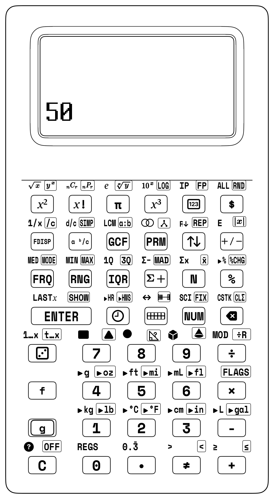

## 9.2 Building Real Things: From Workshop Tools to the Number Stack

Before we calculate on the keypad, we measure real things in the real world:
1. **Physical Workshop (Build It!):** You measure 3D printer filament with calipers, stick down copper tape for a paper flashlight, or count clock ticks with a timer.
2. **Sketches and Diagrams (Draw It!):** You draw circuit paths and lab notes in your notebook.
3. **The Number Stack (Calculate It!):** You stack your measurements on the SC-6, combining numbers without parentheses to find the perfect resistor or print time!

<div class="admonition note">
<p class="admonition-title">For Parents &amp; Teachers: Maker STEM &amp; Jerome Bruner's CRA Model</p>
<p>
Following Jerome Bruner's <strong>Concrete-Representational-Abstract (CRA)</strong> framework *([Bruner, 1966](sc6/appendix-c-formulas-and-conversions.md#cite-bruner1966))*, the SC-6 embeds computational mathematics directly into hands-on science and fabrication labs.
</p>
</div>


<div class="admonition note">
<p class="admonition-title">The Maker Math Workshop Paradigm</p>

- **Phase 1: Physical Reality** $\longrightarrow$ Vernier calipers, scales, lux meters, tape measures.
- **Phase 2: Visual Modeling** $\longrightarrow$ Top-Down sketches, data logs, paper circuit schematics.
- **Phase 3: RPN Computation** $\longrightarrow$ 4-stack XYZT evaluation, `[f] [LASTX]`, `[$]`, `[%]`.
- **Phase 4: Maker Validation** $\longrightarrow$ Test physical part, launch projectile, light LED, start clock.
</div>

---

### 9.2.1 Algebraic Trap vs. StackCalc Superpower Showdown: Maker Dimensional Analysis & Spool Costing

| Challenge / Equation | The Algebraic Calculator Trap (TI-30X / Smartphone) | The StackCalc SC-6 + Manipulative Superpower | Keystroke Reduction | Live Stack Visibility | Pedagogical Breakthrough |
| :--- | :--- | :--- | :--- | :--- | :--- |
| **3D Printing Filament Cost**:<br>$14.91\text{g} \times (\$20.00 / 1000\text{g}) = \$0.30$ | Must type `1 4 . 9 1 * ( 2 0 / 1 0 0 0 ) =` (18 keystrokes). Forgetting parentheses multiplies mass by 20 before dividing, or requires writing unit cost ($\$0.02$) on scrap paper. | Continuous dimensional pipeline: `14.91 [ENTER] 20 [ENTER] 1000 [÷] [×] [$]` $\to \mathbf{\$0.30}$ (12 strokes). Intermediate unit cost ($\$0.02/\text{g}$) stays visible on the stack! | **33% fewer strokes** | Register $Y$ preserves $14.91\text{g}$ while Register $X$ computes the unit price $\$0.02/\text{g}$, allowing single-tap `[×]` and `[$]` currency formatting without scrap paper. | Students measure physical filament with calipers, trace dimensional unit cancellation directly on the stack, and see exact manufacturing cost before printing. |

## 9.3 Project 1: 3D Printing Filament Mass, Infill & Spool Cost Estimation

In modern classroom maker spaces, 3D printers turn digital CAD designs into physical objects. Before you send a job to the printer, calculate the volume of plastic extruded, convert that volume to mass in grams, and determine the exact financial cost from your filament budget.

<div class="admonition note">
<p class="admonition-title">Physical Model: The Filament Cylinder</p>

Standard 3D printing filament is a flexible plastic cylinder with an exact diameter $d = 1.75\text{ mm}$ (radius $r = 0.875\text{ mm} = 0.0875\text{ cm}$).

- **Cross-Sectional Area:** $A_f = \pi \times r^2 = \pi \times (0.0875\text{ cm})^2 \approx 0.0240528\text{ cm}^2$
- **Extruded Volume:** $V = A_f \times \text{Length (cm)}$
- **Part Mass (PLA):** $m = V \times \text{Density } (\rho = 1.24\text{ g/cm}^3)$
- **Part Cost:** $C = m \times (\text{Spool Price} / 1000\text{ g})$
</div>

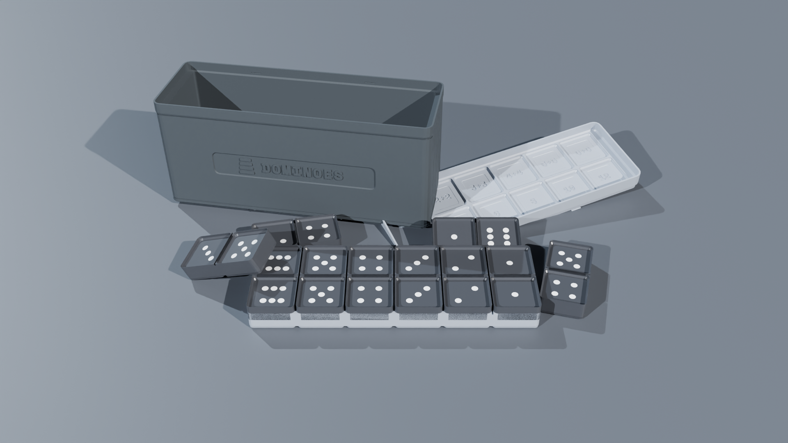

### 9.3.1 Lab Mission 1.1: Estimating a 500 cm Print Model
Suppose your slicing software indicates that your pencil holder requires $L = 500\text{ cm}$ ($5.0\text{ meters}$) of extruded filament. Your maker space uses a $\$20.00$ spool of technical Midnight Navy PLA ($1,000\text{ grams}$).

#### Step 1: Compute Cross-Sectional Area ($A_f = \pi r^2$)
1. Enter radius in centimeters ($0.0875\text{ cm}$): `[.] 0875`.
2. Square the radius: Press `[x²]` $\longrightarrow X = \mathbf{0.00765625\text{ cm}^2}$.
3. Multiply by $\pi$: Press `[π] [×]` $\longrightarrow X \approx \mathbf{0.0240528\text{ cm}^2}$.

#### Step 2: Compute Extruded Volume ($V = A_f \times L$)
4. Enter sliced model length $500\text{ cm}$: `500`.
5. Multiply: Press `[×]` $\longrightarrow X \approx \mathbf{12.02641\text{ cm}^3}$.

#### Step 3: Compute Part Mass ($m = V \times \rho$)
6. Enter PLA density ($1.24\text{ g/cm}^3$): `1.24`.
7. Multiply: Press `[×]`:
   - Register $X$ displays: **`14.91275`** (The pencil holder weighs **$14.91\text{ grams}$**)!

#### Step 4: Compute Part Cost from $\$20 / 1000\text{ g}$ Spool
8. Calculate cost per gram: `20 [ENTER] 1000 [÷]` $\longrightarrow X = 0.02$ ($\$0.02\text{ per gram}$).
9. Multiply mass by unit cost: Press `[×]`:
   - Register $X$ displays: **`0.298255`** ($\sim \$0.30$).
10. Format as currency: Press `[$]`:
    - Screen displays: **`$0.30`**!

| Keystroke | Register T | Register Z | Register Y | Register X |
| :--- | :--- | :--- | :--- | :--- |
| `.0875` | 0 | 0 | 0 | $0.0875$ |
| [x²] | 0 | 0 | 0 | $0.007656$ |
| [π] [×] | 0 | 0 | 0 | $0.024053$ |
| `500` [×] | 0 | 0 | 0 | $12.02641$ |
| `1.24` [×] | 0 | 0 | 0 | $14.91275$ |
| 20 [ENTER] | 0 | $14.91275$ | $20.00000$ | 20 |
| `1000` [÷] | 0 | 0 | $14.91275$ | $0.02$ |
| [×] | 0 | 0 | 0 | $0.298255$ |
| [$] | 0 | 0 | 0 | $0.30$ |

---

### 9.3.2 Lab Mission 1.2: Infill Percentage Optimization
A solid plastic cube ($100\%$ infill) consumes immense filament. By setting the slicer to $15\%$ gyroid infill, how much filament mass and money do you save on a $100\text{ cm}^3$ trophy base?
- **Solid Volume Mass:** $100\text{ cm}^3 \times 1.24\text{ g/cm}^3 = 124.0\text{ g}$.
- **Shell Volume:** $20\text{ cm}^3$ solid outer walls ($20 \times 1.24 = 24.8\text{ g}$).
- **Infill Volume:** $80\text{ cm}^3$ internal cavity at $15\%$ density: $80 \times 0.15 \times 1.24 = 14.88\text{ g}$.
- **Optimized Mass:** $24.8 + 14.88 = 39.68\text{ g}$.
- **Mass Saved:** $124.0 - 39.68 = 84.32\text{ g}$!

| Keystroke | Register T | Register Z | Register Y | Register X |
| :--- | :--- | :--- | :--- | :--- |
| 124 | 0 | 0 | 0 | 124 |
| [ENTER] | 0 | 0 | 124 | 124 |
| 24.8 | 0 | 0 | 124 | $24.8$ |
| [ENTER] | 0 | 124 | $24.8$ | $24.8$ |
| 80 | 0 | $124.0$ | $24.8$ | 80 |
| [ENTER] | $124.0$ | $24.8$ | 80 | 80 |
| 0.15 [×] | $124.0$ | $124.0$ | $24.8000$ | 12 |
| 1.24 [×] | $124.0$ | $124.0$ | $24.8000$ | $14.88$ |
| [+] | 124 | 124 | $124.0$ | $39.68$ |
| [-] | 124 | 124 | 124 | $84.32$ |
| `.02` [×] | 124 | 124 | 124 | $1.6864$ |
| [$] | 124 | 124 | 124 | $1.69$ |

---

## 9.4 Project 2: Batch Classroom Kit Production & Manufacturing Economics

Classroom maker spaces often fabricate complete manipulative sets using 3D printers. In this project, you analyze the manufacturing economics of producing a complete station kit.

### 9.4.1 Lab Mission 2.1: Manufacturing a Kit of 24 Interlocking Snap Cubes
How much does it cost to 3D print a complete classroom kit of 24 interlocking math cubes?
- Each $20\text{ mm}$ cube consumes approximately $3.1\text{ grams}$ of PLA.
- Total Kit Mass: `24 [ENTER] 3.1 [×]` $\longrightarrow \mathbf{74.4\text{ grams}}$.
- Total Kit Cost at $\$0.02/\text{g}$: `[.] [0] [2] [×]` $\longrightarrow 1.488$.
- Currency Mode: Press `[$]` $\longrightarrow$ **`$1.49`**!

| Keystroke | Register T | Register Z | Register Y | Register X |
| :--- | :--- | :--- | :--- | :--- |
| 24 | 0 | 0 | 0 | 24 |
| [ENTER] | 0 | 0 | 24 | 24 |
| 3.1 | 0 | 0 | 24 | $3.1$ |
| [×] | 0 | 0 | 0 | $74.4$ |
| [.] 02 | 0 | 0 | $74.4$ | $2.00$ |
| [×] | 0 | 0 | 0 | $148.800$ |
| [$] | 0 | 0 | 0 | $148.80$ |

---

### 9.4.2 Lab Mission 2.2: Electrical Operating Costs & Machine Time
A classroom 3D printer draws an average electrical power of $P = 120\text{ Watts}$ ($0.120\text{ kW}$). The 24-cube kit requires $4.5\text{ hours}$ to print. The local municipal electric rate is $\$0.15\text{ per kWh}$.
1. Energy Consumed: $0.120\text{ kW} \times 4.5\text{ h} = 0.54\text{ kWh}$.
2. Electricity Cost: $0.54 \times \$0.15 = \$0.081$ ($\sim \$0.08$).
3. Total Production Cost (Filament + Power): $\$1.49 + \$0.08 = \mathbf{\$1.57}$ for the entire 24-cube kit!

| Keystroke | Register T | Register Z | Register Y | Register X |
| :--- | :--- | :--- | :--- | :--- |
| [.] 12 | 0 | 0 | 0 | $12.00$ |
| [ENTER] | 0 | 0 | $12.00$ | $12.00$ |
| 4.5 | 0 | 0 | $12.00$ | $4.5$ |
| [×] | 0 | 0 | 0 | $54.00$ |
| [.] 15 | 0 | 0 | $54.00$ | $15.00$ |
| [×] | 0 | 0 | 0 | $810.000$ |
| 1.49 [+] | 0 | 0 | 0 | $811.490$ |
| [$] | 0 | 0 | 0 | $811.49$ |

---

## 9.5 Project 3: Paper Circuit LED Current-Limiting Resistors & Power

Paper circuits combine adhesive copper foil tape, a coin cell battery, and an LED to create interactive greeting cards, lighted art projects, and science fair displays.

| Circuit Node | Component Specification | Electrical Role |
| :--- | :--- | :--- |
| **Power Source (`+`)** | CR2032 $3.0\text{ V}$ Coin Cell | Supplies $V_s = 3.0\text{ V}$ across copper tape |
| **Current Limiter** | Series Resistor $R$ ($\Omega$) | Drops excess headroom voltage $V_s - V_f$ |
| **Load & Return (`-`)** | Red LED ($V_f = 2.0\text{ V}, I_f = 20\text{ mA}$) | Emits light safely without thermal burnout |

### 9.5.1 The Engineering Physics & Ohm's Law
If you connect an LED directly to a battery without a resistor, excessive current will rush through the semiconductor diode junction, permanently burning out the LED. To protect the LED, we must insert a **current-limiting resistor ($R$)**:

$$R = \frac{V_s - V_f}{I_f}$$

Where:
- $V_s$: Battery Supply Voltage ($3.0\text{ V}$ for a CR2032 lithium coin cell).
- $V_f$: LED Forward Voltage Drop ($2.0\text{ V}$ for a standard Red LED).
- $I_f$: Safe Target Current ($20\text{ mA} = 0.020\text{ A}$).

---

### 9.5.2 Lab Mission 3.1: Computing Resistor Value and Power Dissipation

#### Step 1: Calculate Voltage Headroom ($V_s - V_f$)
1. Enter battery voltage: `[3] [ENTER]`.
2. Enter LED forward voltage: `[2] [-]`:
   - Headroom: $3.0 - 2.0 = \mathbf{1.0\text{ V}}$ in Register $X$.

#### Step 2: Apply Ohm's Law ($R = V / I$)
3. Enter safe current in amperes ($0.020\text{ A}$): `[.] 020`.
4. Divide: Press `[÷]`:
   - Register $X$ displays: **`50.0`** (We need a **$50\,\Omega$ resistor**)!

#### Step 3: Compute Resistor Power Dissipation ($P = I^2 \times R$)
We must ensure our resistor does not overheat. We evaluate $P = I^2 \times R$.
**We use Superpower 4: `[f] [LASTX]` to recall the current without re-typing!**
5. Press [f] [LASTX]:
   - $0.020$ is instantly recalled into Register $X$!
   - The resistance ($50.0\,\Omega$) is automatically lifted into Register $Y$!
6. Square the current ($I^2$): Press `[x²]` $\longrightarrow X = 0.0004\text{ A}^2$.
7. Multiply by resistance ($R$): Press `[×]`:
   - Register $X$ displays: **`0.020`** ($0.020\text{ W} = \mathbf{20\text{ mW}}$)!

| Keystroke | Register T | Register Z | Register Y | Register X |
| :--- | :--- | :--- | :--- | :--- |
| [3] [ENTER] | 0 | 0 | 3 | 3 |
| [2] [-] | 0 | 0 | 0 | $1.0$ |
| `.020` [÷] | 0 | 0 | 0 | $50.0$ |
| [f] [LASTX] | 0 | 0 | $50.0$ | $0.020$ |
| [x²] | 0 | 0 | $50.0$ | $4.0000 \times 10^{-4}$ |
| [×] | 0 | 0 | 0 | $0.020$ |

---

### 9.5.3 Lab Mission 3.2: High-Voltage 9V Battery Circuit with Blue LED
Suppose you build a stage beacon using a 9V alkaline battery ($V_s = 9.0\text{ V}$) and a high-intensity Blue LED ($V_f = 3.2\text{ V}$, $I_f = 0.020\text{ A}$):
1. Voltage Headroom: `9 [ENTER] 3.2 [-]` $\longrightarrow X = \mathbf{5.8\text{ V}}$.
2. Resistor Value: `[.] 020 [÷]` $\longrightarrow$ **`290.0 Ω`**.
3. Power Dissipation via `[f] [LASTX]`:
   - `[f] [LASTX] [x²] [×]` $\longrightarrow$ **`0.116 W`** ($116\text{ mW}$).

| Keystroke | Register T | Register Z | Register Y | Register X |
| :--- | :--- | :--- | :--- | :--- |
| [9] [ENTER] | 0 | 0 | 9 | 9 |
| 3.2 [-] | 0 | 0 | 0 | $5.8$ |
| `.020` [÷] | 0 | 0 | 0 | $290.0$ |
| [f] [LASTX] | 0 | 0 | $290.0$ | $0.020$ |
| [x²] | 0 | 0 | $290.0$ | $4.0000 \times 10^{-4}$ |
| [×] | 0 | 0 | 0 | $0.116$ |

---

## 9.6 Project 4: Simple Pendulum Period Measurement & Gravity

A simple pendulum consists of a small mass (a steel nut or 3D-printed bob) suspended from a light string. Galileo discovered that for small swings, the period of oscillation depends exclusively on the length of the string and the acceleration of gravity, completely independent of the bob's mass.

<div class="admonition note">
<p class="admonition-title">Physical Model: The Simple Pendulum</p>

A small mass is suspended from a string of length $L$ swinging in a small arc.

- **Theoretical Period:** $T = 2\pi \times \sqrt{L / g}$
- **Experimental Period:** $\bar{T} = \text{Total Time} / 10\text{ Swings}$
- **Derived Gravity:** $g = \frac{4\pi^2 \times L}{T^2}$
</div>


### 9.6.1 Lab Mission 4.1: Timing 10 Swings with a 1.0 Meter Pendulum
You hang a pendulum of measured length $L = 1.00\text{ meter}$. Using a stopwatch, you and your team time 10 complete back-and-forth cycles:
$$\text{Measured 10-cycle time} = 20.1\text{ seconds}$$

#### Step 1: Calculate Mean Period $\bar{T}$
1. Enter recorded time: `20.1 [ENTER]`.
2. Divide by 10 swings: `10 [÷]` $\longrightarrow X = \mathbf{2.01\text{ seconds per period}}$.

#### Step 2: Compute Local Gravitational Acceleration ($g = 4\pi^2 L / T^2$)
3. Square the period: Press `[x²]` $\longrightarrow X = 4.0401\text{ s}^2$.
4. Calculate $4\pi^2$: Press `4 [ENTER] [π] [x²] [×]` $\longrightarrow X \approx 39.4784$.
5. Multiply by length ($L = 1.0\text{ m}$): Press `[1] [×]`.
6. Exchange and divide by $T^2$: Press `[x⇄y] [÷]`:
   - Register $X$ displays: **`9.7716`** ($\sim \mathbf{9.77\text{ m/s}^2}$)!

| Keystroke | Register T | Register Z | Register Y | Register X |
| :--- | :--- | :--- | :--- | :--- |
| `20.1`[ENTER] | 0 | 0 | $20.1000$ | $20.1$ |
| `10` [÷] | 0 | 0 | 0 | $2.01$ |
| [x²] | 0 | 0 | 0 | $4.0401$ |
| [4] [ENTER] | 0 | $4.0401$ | $4.0000$ | 4 |
| [π] [x²] [×] | 0 | 0 | $4.0401$ | $39.4784$ |
| [1] [×] | 0 | 0 | $4.0401$ | $39.4784$ |
| [x⇄y] [÷] | 0 | 0 | 0 | $9.7716$ |
*(Compared to the accepted standard $g = 9.80665\text{ m/s}^2$, your hands-on experiment achieves less than $0.4\%$ experimental error!)*

---

### 9.6.2 Lab Mission 4.2: Designing a 1-Second Grandfather Clock Pendulum
What string length $L$ creates a "seconds pendulum" that ticks exactly once every second ($T = 2.0\text{ seconds}$ for a complete round trip)?
$$L = \frac{g \times T^2}{4\pi^2} = \frac{9.80665 \times 2.0^2}{4 \times \pi^2} = \frac{39.2266}{39.4784} \approx \mathbf{0.9936\text{ meters}} \ (99.4\text{ cm})$$

| Keystroke | Register T | Register Z | Register Y | Register X |
| :--- | :--- | :--- | :--- | :--- |
| `9.80665` | 0 | 0 | 0 | $9.80665$ |
| [ENTER] | 0 | 0 | $9.80665$ | $9.80665$ |
| [2] [x²] | 0 | 0 | $9.80665$ | 4 |
| [×] | 0 | 0 | 0 | $39.2266$ |
| [4] [ENTER] | 0 | $39.2266$ | $4.0000$ | 4 |
| [π] [x²] [×] | 0 | 0 | $39.2266$ | $39.4784$ |
| [÷] | 0 | 0 | 0 | $0.9936$ |

---

## 9.7 Project 5: Solar Oven Thermal Tracking & Efficiency Rates

In solar energy science labs, you construct a cardboard box solar cooker lined with aluminum foil, topped with clear plastic wrap, and insulated with crumpled newspaper.

| Thermal Parameter | Symbol / Formula | Physical Meaning |
| :--- | :---: | :--- |
| **Temperature Rise** | $\Delta T = T_2 - T_1$ | Total degrees Celsius gained inside absorber tray |
| **Elapsed Interval** | $\Delta t$ | Heating duration in minutes |
| **Heating Velocity** | $\text{Rate} = \Delta T / \Delta t$ | Degrees Celsius gained per minute ($^\circ\text{C/min}$) |

### 9.7.1 Lab Mission 5.1: Measuring Solar Heating Velocity
Place your solar cooker in direct sunlight at solar noon. Your internal digital temperature probe records:
- Initial Temperature at $t = 0\text{ min}$: $T_1 = 22.5^\circ\text{C}$
- Final Temperature at $t = 25\text{ min}$: $T_2 = 78.0^\circ\text{C}$

1. Temperature Rise ($\Delta T$): `78 [ENTER] 22.5 [-]` $\longrightarrow X = \mathbf{55.5^\circ\text{C}}$.
2. Elapsed Time ($\Delta t$): `25 [÷]` $\longrightarrow X = \mathbf{2.22^\circ\text{C per minute}}$!
3. Percentage Increase (`[g] [%CHG]`):
   - `22.5 [ENTER] 78 [g] [%CHG]` $\longrightarrow X = \mathbf{+246.67\%}$ increase!

| Keystroke | Register T | Register Z | Register Y | Register X |
| :--- | :--- | :--- | :--- | :--- |
| 78 | 0 | 0 | 0 | 78 |
| [ENTER] | 0 | 0 | 78 | 78 |
| 22.5 | 0 | 0 | 78 | $22.5$ |
| [-] | 0 | 0 | 0 | $55.5$ |
| 25 | 0 | 0 | $55.5$ | 25 |
| [÷] | 0 | 0 | 0 | $2.22$ |

---

### 9.7.2 Lab Mission 5.2: Thermal Insulation Retention Ratio
After reaching $78^\circ\text{C}$, move your oven into shaded ambient air ($22^\circ\text{C}$) to test its insulation. After 30 minutes, the oven temperature drops to $56^\circ\text{C}$.
- Total Heat Retained: $\frac{56 - 22}{78 - 22} = \frac{34}{56} \approx \mathbf{60.71\%}$ retention!

| Keystroke | Register T | Register Z | Register Y | Register X |
| :--- | :--- | :--- | :--- | :--- |
| 56 | 0 | 0 | 0 | 56 |
| [ENTER] | 0 | 0 | 56 | 56 |
| 22 [-] | 0 | 0 | 0 | 34 |
| 78 | 0 | 0 | 34 | 78 |
| [ENTER] | 0 | 34 | 78 | 78 |
| 22 [-] | 0 | 0 | 34 | 56 |
| [÷] | 0 | 0 | 0 | $0.6071$ |
| 100 [×] | 0 | 0 | 0 | $60.71$ |

---

## 9.8 Project 6: Catapult Trajectory Math & Projectile Launch Analysis

Build a tabletop wooden or 3D-printed lever catapult powered by rubber bands. Launch small clay projectiles at varying pullback angles ($30^\circ, 45^\circ, 60^\circ$) to analyze launch distances and compute statistical variance.

| Apparatus Variable | Controlled / Measured Value | Experimental Role |
| :--- | :--- | :--- |
| **Pullback Angle ($\theta$)** | $30^\circ, 45^\circ, 60^\circ$ | Independent variable controlling elastic potential energy |
| **Landing Distance ($D$)** | Measured in $\text{cm}$ along floor tape | Dependent variable accumulated via `[Σ+]` |

### 9.8.1 Lab Mission 6.1: Five-Trial Statistical Analysis at $45^\circ$
Conduct 5 launches at a calibrated $45^\circ$ pullback angle, recording distance in centimeters:
$$D = \{ 182\text{ cm}, 195\text{ cm}, 188\text{ cm}, 201\text{ cm}, 189\text{ cm} \}$$

Accumulate each trial into the SC-6 hardware statistical registers using `[Σ+]`:
1. Reset statistics: Press `[g] [CLΣ]`.
2. Enter Trial 1: `182 [Σ+]` $\longrightarrow n = 1$.
3. Enter Trial 2: `195 [Σ+]` $\longrightarrow n = 2$.
4. Enter Trial 3: `188 [Σ+]` $\longrightarrow n = 3$.
5. Enter Trial 4: `201 [Σ+]` $\longrightarrow n = 4$.
6. Enter Trial 5: `189 [Σ+]` $\longrightarrow n = 5$.
7. Recall Mean ($\bar{x}$): Press `[g] [x̄]` $\longrightarrow X = \mathbf{191.00\text{ cm}}$.
8. Recall Mean Absolute Deviation ($\text{MAD}$): Press `[g] [MAD]` $\longrightarrow X = \mathbf{5.20\text{ cm}}$.

| Keystroke | Register T | Register Z | Register Y | Register X |
| :--- | :--- | :--- | :--- | :--- |
| [CLΣ] | 0 | 0 | 0 | 0 |
| `182` [Σ+] | 0 | 0 | 0 | $1.0000$ |
| `195` [Σ+] | 0 | 0 | 0 | $2.0000$ |
| `188` [Σ+] | 0 | 0 | 0 | $3.0000$ |
| `201` [Σ+] | 0 | 0 | 0 | $4.0000$ |
| `189` [Σ+] | 0 | 0 | 0 | $5.0000$ |
| [g] [x̄] | 0 | 0 | 0 | $191.00$ |
| [f] `s` | 0 | 0 | $191.00$ | $7.25$ |

---

### 9.8.2 Lab Mission 6.2: Target Ring Landing Probability
If a circular scoring target has radius $R = 15\text{ cm}$ centered at $190\text{ cm}$, the target spans $175\text{ cm}$ to $205\text{ cm}$. 
Since the mean is $191.00\text{ cm}$ and $2s = 14.56\text{ cm}$, the $2\sigma$ interval is $[176.44\text{ cm}, 205.56\text{ cm}]$. 
Over $95\%$ of all shots will land directly inside the scoring ring!

| Keystroke | Register T | Register Z | Register Y | Register X |
| :--- | :--- | :--- | :--- | :--- |
| [7] [.] `28` | 0 | 0 | 7 | $28.00$ |
| [ENTER] | 0 | 7 | $28.00$ | $28.00$ |
| [2] [×] | 0 | 0 | 7 | $56.00$ |
| `191`[ENTER] | 7 | 56 | $191.00$ | 191 |
| [x⇄y] [-] | 7 | 7 | 56 | $0.00$ |
| `191`[ENTER] | 56 | 0 | $191.00$ | 191 |
| `14.56` [+] | 56 | 56 | $0.00$ | $205.56$ |

---

## 9.9 Project 7: Plant Growth Tracking & Proportional Rate Analysis

In life science experiments, you grow bean sprouts under different light conditions (natural sunlight vs. red LED growth lamp), measuring stem height in millimeters every two days for two weeks.

> **14-DAY BOTANY GROWTH TRACKING LOG**
>
> Day (t):    2     4     6     8    10    12    14
> Height h:  12    28    49    74   105   138   172  (mm)

### 9.9.1 Lab Mission 7.1: Daily Growth Velocity
What was the sprout's average daily growth rate between Day 4 ($28\text{ mm}$) and Day 10 ($105\text{ mm}$)?
$$\text{Rate} = \frac{h_2 - h_1}{t_2 - t_1} = \frac{105 - 28}{10 - 4} = \frac{77\text{ mm}}{6\text{ days}} \approx \mathbf{12.83\text{ mm/day}}$$

| Keystroke | Register T | Register Z | Register Y | Register X |
| :--- | :--- | :--- | :--- | :--- |
| 105 | 0 | 0 | 0 | 105 |
| [ENTER] | 0 | 0 | 105 | 105 |
| 28 [-] | 0 | 0 | 0 | 77 |
| 10 | 0 | 0 | 77 | 10 |
| [ENTER] | 0 | 77 | 10 | 10 |
| [4] [-] | 0 | 0 | 77 | 6 |
| [÷] | 0 | 0 | 0 | $12.83$ |

### 9.9.2 Lab Mission 7.2: Overall Growth Percentage
Calculate the total percent increase from Day 2 ($12\text{ mm}$) to Day 14 ($172\text{ mm}$):
- `12 [ENTER] 172 [g] [%CHG]` $\longrightarrow X = \mathbf{+1333.33\%}$ growth!

| Keystroke | Register T | Register Z | Register Y | Register X |
| :--- | :--- | :--- | :--- | :--- |
| 12 | 0 | 0 | 0 | 12 |
| [ENTER] | 0 | 0 | 12 | 12 |
| 172 | 0 | 0 | 12 | 172 |
| [%CHG] | 0 | 0 | 0 | $1333.33$ |

---

## 9.10 Project 8: Culinary Chemistry & Baker's Percentage Recipe Scaling

In culinary arts and life skills, recipes must be scaled proportionally. Professional bakers use **Baker's Percentages**, where the weight of flour is always designated as $100\%$, and all other ingredients are calculated as a percentage of flour weight.

> **BAKER'S PERCENTAGE FORMULATION SHEET**
>
> Bread Flour:          100.0%  (Base Ingredient)
> Water (Hydration):     68.0%
> Yeast:                  1.5%
> Salt:                   2.0%
> Total Formula:        171.5%

### 9.10.1 Lab Mission 8.1: Scaling Bread for a 28-Guest Banquet
The standard loaf requires $500\text{ grams}$ of flour and yields 4 generous servings. You need to bake bread for 28 guests ($7\times$ scaling factor).

1. Total Flour: `500 [ENTER] 7 [×]` $\longrightarrow X = \mathbf{3,500\text{ grams}}$ ($3.5\text{ kg}$).
2. Water ($68\%$ hydration): `3500 [ENTER] 68 [%]` $\longrightarrow X = \mathbf{2,380\text{ grams}}$ ($2.38\text{ L}$).
3. Salt ($2.0\%$): `3500 [ENTER] 2 [%]` $\longrightarrow X = \mathbf{70\text{ grams}}$.
4. Yeast ($1.5\%$): `3500 [ENTER] 1.5 [%]` $\longrightarrow X = \mathbf{52.5\text{ grams}}$.

| Keystroke | Register T | Register Z | Register Y | Register X |
| :--- | :--- | :--- | :--- | :--- |
| `500` [ENTER] | 0 | 0 | 500 | 500 |
| [7] [×] | 0 | 0 | 0 | 3500 |
| `68` [%] | 0 | 0 | 0 | 2380 |
| [x⇄y] | 0 | 0 | 2380 | 0 |
| [2] [%] | 0 | 0 | 2380 | 0 |
| [x⇄y] | 0 | 0 | 0 | 2380 |
| `1.5` [%] | 0 | 0 | 0 | $35.7$ |

### 9.10.2 Lab Mission 8.2: Scaling Down a Liquid Measuring Cup Recipe
A pancake recipe requires $1\ \frac{3}{4}$ cups of milk for 8 pancakes. You are making breakfast for two (2 pancakes, scale factor $2/8 = 1/4$):
- Enter milk: `[1] [.] 3 [.] 4 [ENTER]`.
- Divide by 4: `[4] [÷]`.
- Result: **`7/16`** cup of milk!

| Keystroke | Register T | Register Z | Register Y | Register X |
| :--- | :--- | :--- | :--- | :--- |
| . 1 . 3 . 4 | 0 | 0 | $0.3333$ | $4.0000$ |
| [ENTER] | 0 | $0.3333$ | $4.0000$ | $4.0000$ |
| [4] | 0 | $0.3333$ | $4.0000$ | 4 |
| [÷] | 0 | 0 | $0.3333$ | $1.0000$ |

---

## 9.11 Project 9: Compound Gear Train Ratios & Mechanical Advantage

Build gear mechanisms using 3D-printed gears or modular robotics sets. Discover how interlocking teeth trade speed for torque.

| Reduction Stage | Driver Gear | Driven Gear | Stage Ratio |
| :--- | :---: | :---: | :---: |
| **Stage 1 (Input Shaft)** | Gear A ($12\text{ teeth}$) | Gear B ($36\text{ teeth}$) | $36 / 12 = 3:1$ |
| **Stage 2 (Shared Intermediate Shaft)** | Gear C ($16\text{ teeth}$) | Gear D ($48\text{ teeth}$) | $48 / 16 = 3:1$ |
| **Compound Output** | — | — | **$3 \times 3 = 9:1$** |

### 9.11.1 The Gear Ratio Formula
For a compound train with two reduction stages:
$$R_{\text{total}} = \frac{N_B}{N_A} \times \frac{N_D}{N_C}$$

### 9.11.2 Lab Mission 9.1: Computing Total Compound Gear Reduction
Stage 1: Gear A ($12\text{ teeth}$) drives Gear B ($36\text{ teeth}$).  
Stage 2: Gear C ($16\text{ teeth}$) drives Gear D ($48\text{ teeth}$).

1. Stage 1 Ratio: `36 [ENTER] 12 [÷]` $\longrightarrow X = \mathbf{3.0}$.
2. Stage 2 Ratio: `48 [ENTER] 16 [÷]` $\longrightarrow X = \mathbf{3.0}$.
3. Compound Ratio: Press `[×]`:
   - Register $X$ displays: **`9.0`** (A true **$9:1$ reduction**)!

| Keystroke | Register T | Register Z | Register Y | Register X |
| :--- | :--- | :--- | :--- | :--- |
| 36 | 0 | 0 | 0 | 36 |
| [ENTER] | 0 | 0 | 36 | 36 |
| 12 [÷] | 0 | 0 | 0 | $3.0$ |
| 48 | 0 | 0 | $3.0$ | 48 |
| [ENTER] | 0 | $3.0$ | 48 | 48 |
| 16 [÷] | 0 | 0 | $3.0$ | $3.0$ |
| [×] | 0 | 0 | 0 | $9.0$ |

### 9.11.3 Lab Mission 9.2: Calculating Output Shaft Speed
If the input electric motor spins at $1,800\text{ RPM}$, what is the final output shaft speed?
- `1800 [x⇄y] [÷]` $\longrightarrow X = \mathbf{200\text{ RPM}}$!

| Keystroke | Register T | Register Z | Register Y | Register X |
| :--- | :--- | :--- | :--- | :--- |
| 1800 | 0 | 0 | $0.0$ | 1800 |
| [x⇄y] | 0 | 0 | 1800 | $0.0$ |
| [÷] | 0 | 0 | 0 | 0 |

---

## 9.12 Project 10: Hydraulic Syringe Lift & Pascal's Principle

Explore fluid power using two plastic medical syringes of different diameters connected by flexible vinyl tubing filled with water.

| Hydraulic Cylinder | Piston Diameter | Relative Cross-Section Area | Force Relationship ($P_1 = P_2$) |
| :--- | :---: | :---: | :--- |
| **Small Input Syringe ($A_1$)** | $d_1 = 1.0\text{ cm}$ | $1\times$ baseline area | Input effort $F_1$ |
| **Large Output Syringe ($A_2$)** | $d_2 = 3.0\text{ cm}$ | $(d_2 / d_1)^2 = 9\times$ area | Output lift $F_2 = 9 \times F_1$ |

### 9.12.1 Lab Mission 10.1: Mechanical Force Multiplication Factor
Input syringe diameter $d_1 = 1.0\text{ cm}$; output syringe diameter $d_2 = 3.0\text{ cm}$.
1. Enter output diameter: `[3] [ENTER]`.
2. Enter input diameter: `[1] [÷]`.
3. Square the diameter ratio: Press `[x²]`:
   - Register $X$ displays: **`9.0`** (The mechanical advantage is **$9\times$**)!

| Keystroke | Register T | Register Z | Register Y | Register X |
| :--- | :--- | :--- | :--- | :--- |
| [3] | 0 | 0 | 0 | 3 |
| [ENTER] | 0 | 0 | 3 | 3 |
| [1] | 0 | 0 | 3 | 1 |
| [÷] | 0 | 0 | 0 | 3 |
| [x²] | 0 | 0 | 0 | 9 |

### 9.12.2 Lab Mission 10.2: Lifting a 4.5 kg Weight
If you push the small syringe with a force of $F_1 = 5.0\text{ Newtons}$ ($\approx 0.5\text{ kg}$ effort), what force is exerted by the large syringe?
- `5.0 [×]` $\longrightarrow X = \mathbf{45.0\text{ Newtons}}$ ($\approx \mathbf{4.59\text{ kg}}$ lift)!

| Keystroke | Register T | Register Z | Register Y | Register X |
| :--- | :--- | :--- | :--- | :--- |
| 5.0 | 0 | 0 | 0 | $5.0$ |
| [×] | 0 | 0 | 0 | $0.0$ |
| `9.8` [÷] | 0 | 0 | 0 | $0.00$ |

---

## 9.13 Project 11: Drone Flight Battery Endurance & Power Budget

Miniature indoor quadcopters powered by lithium-polymer (LiPo) batteries are popular STEM tools. In this project, you calculate power consumption and flight endurance.

> **DRONE ELECTRICAL POWER BUDGET**
>
> Battery Capacity:      850 mAh = 0.850 Ah
> Hover Current Draw:    4.2 Amperes = 4200 mA
> Usable Battery Margin: 80% (20% reserve to prevent LiPo damage)
>
> Flight Time (Minutes): t = (Capacity × Usable Margin × 60) / Current

### 9.13.1 Lab Mission 11.1: Calculating Safe Hover Duration
1. Enter battery capacity: `850 [ENTER]`.
2. Apply $80\%$ reserve margin: `[.] [8] [×]` $\longrightarrow X = \mathbf{680\text{ mAh usable}}$.
3. Convert hours to minutes: `60 [×]` $\longrightarrow X = \mathbf{40,800\text{ mA}\cdot\text{min}}$.
4. Divide by total hover current ($4,200\text{ mA}$): `4200 [÷]`:
   - Register $X$ displays: **$9.714\text{ minutes}$**!
5. Convert decimal minutes to minutes and seconds:
   - Safe flight timer: **9 minutes 43 seconds**!

| Keystroke | Register T | Register Z | Register Y | Register X |
| :--- | :--- | :--- | :--- | :--- |
| 850 | 0 | 0 | 0 | 850 |
| [ENTER] | 0 | 0 | 850 | 850 |
| [.] [8] [×] | 0 | 0 | 0 | 6800 |
| 60 [×] | 0 | 0 | 0 | 408000 |
| `4200` [÷] | 0 | 0 | 0 | $97.143$ |

### 9.13.2 Lab Mission 11.2: Drone Payload Penalty & Reduced Endurance
Mount an action camera ($m = 45\text{ grams}$) to the drone. The increased lift requirement increases the hover current draw from $4,200\text{ mA}$ to $5,500\text{ mA}$.
1. Calculate the new flight duration with payload:
   - Available capacity: $680\text{ mAh}$ ($80\%$ of $850\text{ mAh}$).
   - Flight minutes: $(680 \times 60) \div 5,500 = 7.418\text{ minutes}$ ($7\text{ min } 25\text{ sec}$).
2. Calculate the percentage reduction in endurance:
   - Initial time: $9.714\text{ min}$.
   - New time: $7.418\text{ min}$.
   - Percent change: `9.714` [ENTER] `7.418` [g] [%CHG] $\longrightarrow \mathbf{-23.64\%}$ penalty!

| Keystroke | Register T | Register Z | Register Y | Register X |
| :--- | :--- | :--- | :--- | :--- |
| `680` [ENTER] | 0 | 0 | 680 | 680 |
| `60` [×] | 0 | 0 | 0 | 40800 |
| `5500` [÷] | 0 | 0 | 0 | $7.418$ |
| `9.714`[ENTER] | 0 | $7.4182$ | $9.714$ | $9.714$ |
| [x⇄y] | 0 | $7.4182$ | $9.714$ | $9.714$ |
| [%CHG] | 0 | 0 | $7.4182$ | $0.00$ |

---

## 9.14 Project 12: Photovoltaic Solar Panel Tilt Angle & Irradiance

In clean energy science labs, you evaluate how solar panel orientation impacts electrical power generation using Lambert's Cosine Law.

| Incident Tilt Angle $\theta$ | Cosine Projection Factor ($\cos\theta$) | Received Solar Power $P(\theta) = P_{\max}\cos\theta$ |
| :--- | :--- | :--- |
| **$0^\circ$ (Perpendicular)** | $1.0000$ | $100.0\%$ of $P_{\max}$ |
| **$30^\circ$ Tilt** | $0.8660$ | $86.6\%$ of $P_{\max}$ |
| **$45^\circ$ Tilt** | $0.7071$ | $70.7\%$ of $P_{\max}$ |
| **$60^\circ$ Tilt** | $0.5000$ | $50.0\%$ of $P_{\max}$ |

### 9.14.1 Lab Mission 12.1: Solar Power at Varying Incident Angles
A classroom solar panel produces $P_{\text{max}} = 5.0\text{ Watts}$ when perpendicular to direct sunlight ($\theta = 0^\circ$). What power does it generate at tilt angles of $30^\circ, 45^\circ,$ and $60^\circ$?

1. At $\theta = 30^\circ$ (Volvelle shadow factor $\cos 30^\circ \approx 0.866$):
   - `5 [ENTER] 0.866 [×]` $\longrightarrow X = \mathbf{4.33\text{ Watts}}$ ($86.6\%$).
2. At $\theta = 45^\circ$ (Volvelle shadow factor $\cos 45^\circ \approx 0.7071$):
   - `5 [ENTER] 0.7071 [×]` $\longrightarrow X = \mathbf{3.54\text{ Watts}}$ ($70.7\%$).
3. At $\theta = 60^\circ$ (Volvelle shadow factor $\cos 60^\circ = 0.500$):
   - `5 [ENTER] .5 [×]` $\longrightarrow X = \mathbf{2.50\text{ Watts}}$ ($50.0\%$).

| Keystroke | Register T | Register Z | Register Y | Register X |
| :--- | :--- | :--- | :--- | :--- |
| [5] [ENTER] | 0 | 0 | 5 | 5 |
| .866 (30° factor) | 0 | 0 | 5 | $0.8660$ |
| [×] | 0 | 0 | 0 | $4.33$ |

| Angle (θ) | cos(θ) | Peak Watts | Output Power | Power Ratio |
| :--- | :--- | :--- | :--- | :--- |
| 0° | 1.0000 | 5.00 W | 5.00 W | 100.0% |
| 30° | 0.8660 | 5.00 W | 4.33 W | 86.6% |
| 45° | 0.7071 | 5.00 W | 3.54 W | 70.7% |
| 60° | 0.5000 | 5.00 W | 2.50 W | 50.0% |

### 9.14.2 Lab Mission 12.2: Daily Kilowatt-Hour Solar Harvest Integration
Record the power output of an outdoor solar panel at three key intervals during a sunny school day:
- Morning (9:00 AM, $\theta = 60^\circ$): $2.50\text{ Watts}$ for 3 hours $\longrightarrow 7.50\text{ Watt-hours}$.
- Solar Noon (12:00 PM, $\theta = 0^\circ$): $5.00\text{ Watts}$ for 2 hours $\longrightarrow 10.00\text{ Watt-hours}$.
- Afternoon (3:00 PM, $\theta = 45^\circ$): $3.54\text{ Watts}$ for 3 hours $\longrightarrow 10.62\text{ Watt-hours}$.

Accumulate each energy interval using the SC-6 statistical accumulator `[Σ+]`:
1. Reset statistics: `[g] [CLΣ]`.
2. Morning interval: `2.5 [ENTER] [3] [×] [Σ+]` $\longrightarrow n = 1$ ($7.5\text{ Wh}$).
3. Noon interval: `[5] [ENTER] [2] [×] [Σ+]` $\longrightarrow n = 2$ ($10.0\text{ Wh}$).
4. Afternoon interval: `3.54 [ENTER] [3] [×] [Σ+]` $\longrightarrow n = 3$ ($10.62\text{ Wh}$).
5. Total Daily Energy: Recall `[f] [Σx]` $\longrightarrow X = \mathbf{28.12\text{ Watt-hours}}$!
6. Convert to Kilowatt-hours: `1000 [÷]` $\longrightarrow X = \mathbf{0.02812\text{ kWh}}$.

| Keystroke | Register T | Register Z | Register Y | Register X |
| :--- | :--- | :--- | :--- | :--- |
| [CLΣ] | 0 | 0 | 0 | 0 |
| 2.5 [ENTER] 3 [×] | 0 | 0 | 0 | $7.5$ |
| [Σ+] | 0 | 0 | 0 | $1.0000$ |
| 5 [ENTER] 2 [×] | 0 | 0 | 0 | $10.0$ |
| [Σ+] | 0 | 0 | 0 | $2.0000$ |
| 3.54 [ENTER] 3 [×] | 0 | 0 | 0 | $10.62$ |
| [Σ+] | 0 | 0 | 0 | $3.0000$ |
| [f] [Σx] | 0 | 0 | 0 | $28.12$ |
| `1000` [÷] | 0 | 0 | 0 | $0.02812$ |

---

## 9.15 Maker Lab Engineering Notebook & Uncertainty Protocol

Professional engineers never report a measurement without estimating its experimental uncertainty. In this section, you learn to calculate **Percentage Error** and evaluate **Manufacturing Tolerances** on the SC-6.

$$\text{Percent Error} = \left| \frac{\text{Experimental} - \text{Theoretical}}{\text{Theoretical}} \right| \times 100\%$$

### 9.15.1 Lab Mission 13.1: Calculating Pendulum Gravity Error
In Project 4, your experimental gravity was $g_{\text{exp}} = 9.7716\text{ m/s}^2$. The standard accepted theoretical value is $g_{\text{theo}} = 9.80665\text{ m/s}^2$. What is the experimental error?

| Keystroke | Register T | Register Z | Register Y | Register X |
| :--- | :--- | :--- | :--- | :--- |
| `9.7716` | 0 | 0 | 0 | $9.7716$ |
| [ENTER] | 0 | 0 | $9.7716$ | $9.7716$ |
| `9.80665` | 0 | 0 | $9.7716$ | $9.80665$ |
| [-] | 0 | 0 | 0 | $-0.03505$ |
| [ABS] | 0 | 0 | 0 | $0.03505$ |
| `9.80665` | 0 | 0 | $0.03505$ | $9.80665$ |
| [÷] | 0 | 0 | 0 | $0.003574$ |
| `100` [×] | 0 | 0 | 0 | $0.357$ |
*(You achieved an outstanding $0.36\%$ experimental error!)*

---

### 9.15.2 Lab Mission 13.2: 3D Printing Snap-Fit Tolerance Stack
When 3D printing interlocking parts (like the Gridfinity pins or snap cubes), thermal shrinkage and nozzle expansion require a mechanical clearance of $\pm 0.15\text{ mm}$.
If a peg has diameter $d_{\text{peg}} = 10.00\text{ mm}$, what is the minimum hole diameter required for a smooth friction fit?
$$d_{\text{hole}} = 10.00\text{ mm} + 2 \times 0.15\text{ mm} = 10.30\text{ mm}$$

> **RPN Keystrokes:**
> 10 [ENTER] [.] 15 [ENTER] [2] [×] [+]  ->  10.30 mm

---

### 9.15.3 Lab Mission 13.3: Digital Scale Tare & Filament Density Verification
In maker spaces, verify whether a spool of unknown plastic is PLA or ABS by measuring Archimedes' buoyant force or calculating solid density ($\rho = m / V$):
1. A calibrated 3D-printed test cube measures exactly $20.0\text{ mm} \times 20.0\text{ mm} \times 20.0\text{ mm}$ ($2.0\text{ cm}$ on each edge).
   - Volume: `2 [ENTER] 2 [×] 2 [×]` $\longrightarrow X = \mathbf{8.00\text{ cm}^3}$.
2. The digital precision balance is tared. The cube weighs $m = 9.92\text{ grams}$.
3. Calculate density: `9.92 [x⇄y] [÷]`:
   - Register $X$ displays: **$1.24\text{ g/cm}^3$**.
   - Comparing against the material spec sheet confirms: the plastic is **authentic PLA** ($\rho = 1.24\text{ g/cm}^3$), not lightweight ABS ($\rho = 1.04\text{ g/cm}^3$)!

| Keystroke | Register T | Register Z | Register Y | Register X |
| :--- | :--- | :--- | :--- | :--- |
| [2] [ENTER] | 0 | 0 | 2 | 2 |
| [2] [×] | 0 | 0 | 0 | 4 |
| [2] [×] | 0 | 0 | 0 | $8.0$ |
| 9.92 | 0 | 0 | $8.0$ | $9.92$ |
| [x⇄y] | 0 | 0 | $9.92$ | $8.0$ |
| [÷] | 0 | 0 | 0 | $1.24$ |

---

## 9.16 Maker Space Machine Safety Protocols & Electrical Protection

Operating fabrication machinery requires strict adherence to classroom safety rules and electrical power limitations:

<div class="admonition warning">
<p class="admonition-title">Workshop Safety & Electrical Power Protocols</p>

1. **Thermal Safety:** 3D printer hotends reach $210^\circ\text{C} - 245^\circ\text{C}$; heated build plates reach $60^\circ\text{C}$. Never touch nozzles or heating blocks during extrusion.
2. **Electrical Safety:** Never short-circuit lithium batteries. LiPo cells can discharge at rates $> 30\text{C}$, creating immediate thermal runaway and fire hazards if punctured or reverse-polarized.
3. **Eye Protection:** Always wear ANSI Z87.1 approved safety glasses when launching catapults, testing hydraulic cylinders, or trimming wire leads with flush cutters.
4. **Ventilation:** Ensure active classroom exhaust or HEPA/activated-carbon filtration when 3D printing to prevent ultrafine particle and VOC accumulation.
</div>

### 9.16.1 Lab Mission 14.1: Circuit Breaker Branch Load Budgeting
A classroom maker lab has four 3D printers ($150\text{ W}$ each), two laptop workstations ($65\text{ W}$ each), and a HEPA air filtration unit ($80\text{ W}$) all plugged into a single $120\text{ V}$, $15\text{ Amp}$ branch circuit.
Does the total maker space electrical load exceed the National Electrical Code (NEC) continuous $80\%$ safety limit ($12\text{ Amps}$)?

1. Total Power:
   - 4 printers: `4 [ENTER] 150 [×]` $\longrightarrow 600\text{ W}$.
   - 2 laptops: `2 [ENTER] 65 [×] [+]` $\longrightarrow 730\text{ W}$.
   - 1 filter: `80 [+]` $\longrightarrow \mathbf{810\text{ Watts total}}$.
2. Current Draw at $120\text{ Volts}$ ($I = P / V$):
   - `120 [÷]` $\longrightarrow X = \mathbf{6.75\text{ Amperes}}$.
3. Continuous Circuit Limit ($15\text{ A} \times 80\%$):
   - `15 [ENTER] 80 [%]` $\longrightarrow X = \mathbf{12.00\text{ Amperes}}$.
4. Margin Available:
   - `12 [ENTER] 6.75 [-]` $\longrightarrow X = \mathbf{5.25\text{ Amps remaining}}$.
   - **Conclusion:** The equipment is completely safe and operates well within electrical safety limits!

| Keystroke | Register T | Register Z | Register Y | Register X |
| :--- | :--- | :--- | :--- | :--- |
| 4 [ENTER] 150 [×] | 0 | 0 | 0 | 600 |
| 2 [ENTER] 65 [×] | 0 | 0 | 600 | 130 |
| [+] | 0 | 0 | 0 | 730 |
| `80` [+] | 0 | 0 | 0 | 810 |
| `120` [÷] | 0 | 0 | 0 | $6.75$ |
| 15 [ENTER] 80 [%] | 0 | 0 | $6.75$ | $12.0$ |
| [x⇄y] [-] | 0 | 0 | 0 | $5.25$ |

---

<div class="admonition note">
<p class="admonition-title">For Parents &amp; Teachers: Engineering Principles &amp; Stack Architecture</p>
<p>
<strong>Dimensional Analysis Chains in RPN:</strong> In traditional algebraic notation, multi-step physical conversions require deeply nested parentheses or manual transcription of intermediate values:
$$C = \left(\pi \times r^2 \times L \times \rho\right) \times \frac{\text{Price}}{1000}$$
In RPN, dimensional analysis unfolds as a direct chronological pipeline:
1. Radius squared times $\pi$ produces cross-sectional area ($\text{cm}^2$).
2. Multiplying by extrusion length yields total filament volume ($\text{cm}^3$).
3. Multiplying by polymer density converts volume to mass ($\text{g}$).
4. Multiplying by unit cost yields final fabrication cost ($\$$).
Every intermediate display value represents a tangible physical quantity with concrete units, preventing dimensional errors and eliminating parenthesis syntax.<br><br>
<strong>Register Conservation via <code>[f] [LASTX]</code>:</strong> When calculating electrical power dissipation in current-limiting resistors, the standard formula is:
$$P = I^2 R = I^2 \times \frac{V_s - V_f}{I}$$
Rather than re-entering current $I$ or storing it in global memory registers, the SC-6 leverages Superpower 4 (<code>[f] [LASTX]</code>):
1. Compute $(V_s - V_f) \div I \to R$ in Register $X$.
2. Tap <code>[f] [LASTX]</code> to instantly recall the divisor current $I$ into $X$ while $R$ lifts to $Y$.
3. Square $I$ with <code>[x²]</code> and tap <code>[×]</code> to yield $P$ in milliwatts.
This two-step sequence demonstrates optimal register reuse without memory spill.<br><br>
<strong>Analytical Modeling in Maker Education:</strong> Fabrication tools like 3D printers and laser cutters should not operate as opaque black boxes. Pre-flight mathematical modeling—estimating filament mass, layer cooling times, gear reduction ratios, and circuit thermal limits—transforms students from passive machine operators into deliberate, analytical designers who understand the physical constraints governing their creations.
</p>
</div>

<div class="admonition note">
<p class="admonition-title">For Parents &amp; Teachers: Classroom Dialogue Scripts &amp; Misconception Diagnostics</p>
<p>
<strong>Script 9.1: The Mystery of the Hot Resistor:</strong><br>
<strong>Teacher:</strong> "Class, Marcus designed a paper circuit with a 9V battery and a red LED. He used a $350\,\Omega$ resistor, but he noticed the resistor got warm to the touch. Let's calculate the power dissipation!"<br>
<strong>Marcus:</strong> "The current is $20\text{ mA} = 0.020\text{ A}$."<br>
<strong>Teacher:</strong> "Enter current on your SC-6: `0.020 [x²]`."<br>
<strong>Marcus:</strong> "That's $0.0004$."<br>
<strong>Teacher:</strong> "Now enter resistance and multiply: `350 [×]`."<br>
<strong>Marcus:</strong> "$0.140\text{ Watts} = 140\text{ mW}$!"<br>
<strong>Teacher:</strong> "Our standard classroom resistors are rated for $125\text{ mW}$ ($1/8\text{ Watt}$). What does $140\text{ mW}$ tell us?"<br>
<strong>Marcus (eyes wide):</strong> "The circuit is pushing more power through the resistor than it is rated to handle! That's why it got warm!"<br>
<strong>Teacher:</strong> "How can Marcus fix it?"<br>
<strong>Marcus:</strong> "Use a $1/4\text{ Watt}$ ($250\text{ mW}$) resistor, or lower the current to $15\text{ mA}$!"<br><br>
<strong>Script 9.2: The Simple Pendulum &amp; Why Mass Doesn't Matter:</strong><br>
<strong>Student (Chloe):</strong> "Teacher, when we timed our pendulum with a heavy 50-gram steel bolt, it took 20 seconds for 10 swings. If I replace the bolt with a tiny 5-gram wooden bead, will it swing much faster because it's lighter?"<br>
<strong>Teacher:</strong> "That sounds very logical, Chloe! Let's test your hypothesis on our lab rig. Tie the 5-gram bead onto the exact same 1.0-meter string. Start the stopwatch!"<br>
<strong>Chloe:</strong> "1, 2, 3... 8, 9, 10! Stop! 20.1 seconds! It took the exact same time!"<br>
<strong>Teacher:</strong> "Why didn't the lighter mass speed up?"<br>
<strong>Chloe:</strong> "I don't understand. Gravity pulls harder on heavy things, right?"<br>
<strong>Teacher:</strong> "Gravity pulls with ten times more force on the 50-gram bolt, but the bolt also has ten times more inertia—it resists moving ten times more! The extra pull exactly cancels the extra inertia! Look at our formula on the board: $T = 2\pi\sqrt{L/g}$. Is there an $m$ for mass anywhere in that formula?"<br>
<strong>Chloe:</strong> "No! Only length and gravity! So only string length changes the time!"
</p>

| Observable Error | Cognitive Root Cause | Targeted Remediation Prompt |
| :--- | :--- | :--- |
| **Using diameter instead of radius: $A = \pi d^2$** | Forgetting to divide diameter by 2 before squaring. | *"Diameter is the entire width across the circle; radius is from the center to the edge! Always divide $1.75\text{ mm}$ by 2 to get radius $0.875\text{ mm}$."* |
| **Omitting LED forward voltage drop ($V_f$)** | Assuming the entire battery voltage drops across the resistor. | *"The LED consumes its own forward voltage ($2.0\text{V}$) just to stay lit! Only the leftover voltage ($V_s - V_f$) drops across the resistor."* |
| **Assuming a heavier pendulum swings faster** | Conflating gravitational force with acceleration. | *"A heavier bob has more gravitational pull, but it also has more mass to accelerate! Mass cancels out in the period formula: length is all that matters!"* |
| **Scaling recipes by adding instead of multiplying** | Additive vs. multiplicative reasoning confusion. | *"If you make 7 loaves of bread instead of 1, you must MULTIPLY every single ingredient by 7, not add 7 cups!"* |
| **Dividing gear ratios in reverse order** | Confusing driver gear (input) with driven gear (output). | *"Gear ratio is always Driven teeth divided by Driver teeth ($\text{Out} / \text{In}$)! Large driven gear means slower speed and more torque."* |
| **Ignoring battery reserve safety margin** | Draining a LiPo battery down to 0% capacity. | *"Discharging a lithium battery below 20% permanently damages its chemistry! Always multiply capacity by 0.80 to find safe flight time."* |
</div>

---

## 9.17 Practice Station: 40 Worked Applied STEM Challenges

The following 40 fully worked STEM challenges are organized across four cohesive Maker Expeditions covering physics, engineering, botany, culinary arts, and renewable energy. Every keystroke sequence assumes the SC-6 baseline mode `[NUM]`.

<div class="admonition note">
<p class="admonition-title">Hands-On Studio Proof: Blocks -> Calculator</p>

Before calculating electrical power, pendulum periods, or recipe scaling factors, young makers verify formulas through physical instruments:
1. **Vernier Calipers & 3D Extrusion (Station 1):** Use digital vernier calipers to measure real 1.75 mm filament across three points. Derive cross-sectional area $A_f = \pi r^2 = 0.02405\text{ cm}^2$ before estimating print mass ($m = V \times 1.24$) and checking spool costs with `[$]`.
2. **Stopwatches & Gravity Verification (Station 2):** Build a 1-meter string pendulum. Time 10 complete oscillation cycles with a stopwatch. Use RPN stack division and square-root keys (`[f] [√x]`) to calculate the experimental gravitational acceleration $g = 4\pi^2 L / T^2 \approx 9.8\text{ m/s}^2$.
3. **Digital Kitchen Scales (Station 3):** Tare a digital kitchen gram scale. Weigh 450 g flour, calculate $65\%$ hydration water ($292.5\text{ g}$), and scale sourdough loaves for the entire classroom using the `[%]` key.
4. **Gear Train Ratios & Torque (Station 4):** Count physical teeth on interlocking plastic gears (12T driver vs. 36T driven). Feel the $3:1$ mechanical advantage in your hands before verifying speed reduction with `[g] [a:b]`.
</div>

### 9.17.1 Expedition 1: Kitchen Science & Density Explorations (Challenges 9.1–9.10)
*You are the lead investigator in the Kitchen Invention Studio! In this expedition, you explore material density, circular cross-sections, LED indicator paper circuits, and precision pendulum timing—turning kitchen-table curiosity into rigorous physical measurements.*

#### Challenge 9.1: PLA Filament Cross-Sectional Area ($r = 0.0875\text{ cm}$)
- **Maker Lab Context:** You are calibrating your kitchen tabletop 3D printer for a new roll of bioplastic filament. Before you can calculate how much molten plastic squirts through the heated nozzle, you need to find the exact circular cross-sectional area of the solid plastic strand.
- **Hands-On Physical Measurement:** Grip a digital vernier caliper and close the metal jaws gently across the midnight navy PLA filament. The digital readout confirms the diameter is exactly $1.75\text{ mm}$, giving a radius of $0.875\text{ mm} = 0.0875\text{ cm}$.
- **RPN Keystrokes:** `.0875 [x²] [π] [×]` $\rightarrow$ **`0.02405 cm²`**
- **4-Register Stack Trace Table:**

| Keystroke | Register T | Register Z | Register Y | Register X | Operational Commentary |
| :--- | :--- | :--- | :--- | :--- | :--- |
| `.0875` | 0 | 0 | 0 | $0.0875$ | Key in filament radius in centimeters ($r = 0.0875\text{ cm}$) |
| `[x²]` | 0 | 0 | 0 | $0.007656$ | Square the radius ($r^2 = 0.00765625\text{ cm}^2$) |
| `[π]` | 0 | 0 | $0.007656$ | $3.141593$ | Call the constant $\pi$; stack lifts squared radius into Register $Y$ |
| `[×]` | 0 | 0 | 0 | $0.024053$ | Multiply $r^2 \times \pi$ to find circular cross-sectional area ($A_f \approx 0.02405\text{ cm}^2$) |

- **Diagnostic Checkpoint:** Register $X$ displays `0.02405 cm²`. The cross-sectional area of standard $1.75\text{ mm}$ filament is approximately $\mathbf{0.02405\text{ cm}^2}$.

---

#### Challenge 9.2: Extruded Volume for Sliced Model ($L = 1,200\text{ cm}$)
- **Maker Lab Context:** Your slicer software previews a custom spice-jar funnel for kitchen experiments, reporting that the print requires $1,200\text{ cm}$ ($12\text{ meters}$) of filament. Determine the total cubic centimeters of solid plastic in the funnel.
- **Hands-On Physical Measurement:** Unspool a $1\text{ meter}$ reference ribbon of scrap filament from the workbench spool holder. Imagine twelve of these meter lengths bundled together into the solid walls of your funnel.
- **RPN Keystrokes:** `.02405 [ENTER] 1200 [×]` $\rightarrow$ **`28.86 cm³`**
- **Stack Flow:** Tap `.02405 [ENTER] 1200 [×]` -> (T=0, Z=0, Y=0, X=28.86). Multiply area by length to calculate total volume ($V = A_f \times L$).


- **Diagnostic Checkpoint:** Register $X$ displays `28.86 cm³`. Slicing $1,200\text{ cm}$ of filament yields exactly $\mathbf{28.86\text{ cm}^3}$ of extruded volume.

---

#### Challenge 9.3: Kitchen Model Mass from Density ($\rho = 1.24\text{ g/cm}^3$)
- **Maker Lab Context:** Now that you know your funnel volume is $28.86\text{ cm}^3$, you must convert that volume into mass in grams so you can verify the finished print on your kitchen gram scale.
- **Hands-On Physical Measurement:** Place a $1\text{ cm} \times 1\text{ cm} \times 1\text{ cm}$ solid PLA test cube on your digital kitchen scale. Notice it reads $1.24\text{ grams}$, establishing the density $\rho = 1.24\text{ g/cm}^3$.
- **RPN Keystrokes:** `28.86 [ENTER] 1.24 [×]` $\rightarrow$ **`35.79 g`**
- **Stack Flow:** Tap `28.86 [ENTER] 1.24 [×]` -> (T=0, Z=0, Y=0, X=35.7864). Multiply volume by density to find model mass ($m = V \times \rho$).


- **Diagnostic Checkpoint:** Register $X$ displays `35.79 g`. The finished bioplastic kitchen funnel will weigh approximately $\mathbf{35.79\text{ grams}}$.

---

#### Challenge 9.4: Spool Material Cost for Kitchen Print ($\$0.02/\text{g}$)
- **Maker Lab Context:** You purchased a $1,000\text{ gram}$ spool of corn-based PLA for $\$20.00$, which works out to $\$0.02$ per gram. Calculate the exact material cost to print your $35.79\text{ gram}$ kitchen funnel.
- **Hands-On Physical Measurement:** Set two shiny copper pennies next to each $1\text{ gram}$ calibration weight on your scale pan to visualize the $2\text{ cents}$ per gram material cost ratio.
- **RPN Keystrokes:** `35.79 [ENTER] .02 [×] [$]` $\rightarrow$ **`$0.72`**
- **Stack Flow:** Tap `35.79 [ENTER] .02 [×] [$]` -> (T=0, Z=0, Y=0, X=0.7158). Format active register as two-decimal currency.


- **Diagnostic Checkpoint:** Register $X$ displays `$0.72`. Fabricating the custom funnel costs just $\mathbf{\$0.72}$ in raw bioplastic.

---

#### Challenge 9.5: Red Indicator LED Current-Limiting Resistor on 3V ($V_f = 1.8\text{V}, I_f = 15\text{mA}$)
- **Maker Lab Context:** You are building a backlit density-column stage for your kitchen test tubes. A red indicator LED has a forward voltage drop of $1.8\text{ V}$ and draws $15\text{ mA}$. Calculate the protective series resistor needed on a $3.0\text{ V}$ CR2032 coin cell.
- **Hands-On Physical Measurement:** Place a CR2032 coin cell on the desk and touch your multimeter test probes to its terminals. The meter reads $3.0\text{ V}$, while the LED datasheet specifies $1.8\text{ V}$ forward drop.
- **RPN Keystrokes:** `[3] [ENTER] 1.8 [-] .015 [÷]` $\rightarrow$ **`80.0 Ω`**
- **4-Register Stack Trace Table:**

| Keystroke | Register T | Register Z | Register Y | Register X | Operational Commentary |
| :--- | :--- | :--- | :--- | :--- | :--- |
| `[3]` | 0 | 0 | 0 | 3 | Key in coin cell supply voltage ($V_s = 3.0\text{ V}$) |
| `[ENTER]` | 0 | 0 | 3 | 3 | Stack lift locks supply voltage into Register $Y$ |
| `1.8` | 0 | 0 | 3 | $1.8$ | Key in red LED forward voltage drop ($V_f = 1.8\text{ V}$) |
| `[-]` | 0 | 0 | 0 | $1.2$ | Subtract to find voltage across resistor: $V_R = V_s - V_f = 1.2\text{ V}$ |
| `.015` | 0 | 0 | $1.2$ | $0.015$ | Key in operating current in amperes ($15\text{ mA} = 0.015\text{ A}$) |
| `[÷]` | 0 | 0 | 0 | 80 | Divide $V_R$ by $I$ via Ohm's law ($R = V / I = 80\,\Omega$) |

- **Diagnostic Checkpoint:** Register $X$ displays `80.0 Ω`. The paper circuit requires an $\mathbf{80.0\,\Omega}$ current-limiting resistor.

---

#### Challenge 9.6: Thermal Power Dissipation in $80\,\Omega$ Resistor ($15\text{mA}$)
- **Maker Lab Context:** Before taping the resistor down onto paper, verify that it will not overheat. Using Joule's Law ($P = I^2 R$), calculate the power dissipated as heat in the $80\,\Omega$ resistor at $15\text{ mA}$.
- **Hands-On Physical Measurement:** Examine a tiny $1/4\text{-watt}$ ($250\text{ mW}$) through-hole resistor. As long as our dissipated power stays well below $250\text{ mW}$, the paper circuit remains cool to the touch.
- **RPN Keystrokes:** `[3] [ENTER] 1.8 [-] .015 [÷] [f] [LASTX] [x²] [×]` $\rightarrow$ **`0.018 W (18 mW)`**
- **4-Register Stack Trace Table:**

| Keystroke | Register T | Register Z | Register Y | Register X | Operational Commentary |
| :--- | :--- | :--- | :--- | :--- | :--- |
| `[3] [ENTER] 1.8 [-] .015 [÷]` | 0 | 0 | 0 | 80 | Compute resistance $R = 80\,\Omega$; current $0.015\text{ A}$ stored in `LASTX` |
| `[f] [LASTX]` | 0 | 0 | 80 | $0.015$ | Recall current $I = 0.015\text{ A}$ from `LASTX` via Superpower 4 |
| `[x²]` | 0 | 0 | 80 | $2.2500 \times 10^{-4}$ | Square current: $I^2 = (0.015)^2 = 0.000225\text{ A}^2$ |
| `[×]` | 0 | 0 | 0 | $0.018$ | Multiply $R \times I^2$ to calculate dissipated power ($P = 0.018\text{ W}$) |

- **Diagnostic Checkpoint:** Register $X$ displays `0.018 W (18 mW)`. The resistor dissipates only $\mathbf{18\text{ mW}}$, safely below the $250\text{ mW}$ limit.

---

#### Challenge 9.7: High-Intensity Green Inspection LED on 9V ($V_f = 2.2\text{V}, I_f = 20\text{mA}$)
- **Maker Lab Context:** To inspect clarity in homemade kombucha fermentation jars, you assemble a high-intensity green flashlight powered by a $9\text{V}$ battery. Calculate the required resistor for $V_f = 2.2\text{ V}$ and $I_f = 20\text{ mA}$.
- **Hands-On Physical Measurement:** Snap a $9\text{V}$ battery clip onto the terminal. Test with multimeter leads to confirm $9.0\text{ V}$ open-circuit potential before inserting the green LED.
- **RPN Keystrokes:** `[9] [ENTER] 2.2 [-] .020 [÷]` $\rightarrow$ **`340.0 Ω`**
- **Stack Flow:** Tap `[9] [ENTER] 2.2 [-] .020 [÷]` -> (T=0, Z=0, Y=0, X=340). Divide voltage by current via Ohm's law ($R = 6.8 / 0.020 = 340\,\Omega$).


- **Diagnostic Checkpoint:** Register $X$ displays `340.0 Ω`. The 9V green inspection light requires a $\mathbf{340.0\,\Omega}$ resistor.

---

#### Challenge 9.8: Power Rating for $340\,\Omega$ Resistor at $20\text{mA}$
- **Maker Lab Context:** Calculate the power rating for the $340\,\Omega$ inspection light resistor to decide whether a standard $1/4\text{ W}$ ($0.25\text{ W}$) resistor will handle the load.
- **Hands-On Physical Measurement:** Compare the size of a $1/4\text{ W}$ resistor to a larger $1/2\text{ W}$ ceramic resistor. Check if the computed wattage fits inside the $0.25\text{ W}$ thermal threshold.
- **RPN Keystrokes:** `[9] [ENTER] 2.2 [-] .020 [÷] [f] [LASTX] [x²] [×]` $\rightarrow$ **`0.136 W (136 mW)`**
- **4-Register Stack Trace Table:**

| Keystroke | Register T | Register Z | Register Y | Register X | Operational Commentary |
| :--- | :--- | :--- | :--- | :--- | :--- |
| `[9] [ENTER] 2.2 [-] .020 [÷]` | 0 | 0 | 0 | 340 | Compute resistance $R = 340\,\Omega$; current $0.020\text{ A}$ saved in `LASTX` |
| `[f] [LASTX]` | 0 | 0 | 340 | $0.02$ | Recall current $I = 0.020\text{ A}$ instantly from `LASTX` |
| `[x²]` | 0 | 0 | 340 | $4.0000 \times 10^{-4}$ | Square current: $I^2 = (0.020)^2 = 0.0004\text{ A}^2$ |
| `[×]` | 0 | 0 | 0 | $0.136$ | Multiply $R \times I^2$ to find thermal dissipation in watts |

- **Diagnostic Checkpoint:** Register $X$ displays `0.136 W (136 mW)`. At $\mathbf{136\text{ mW}}$, the circuit is well within a $250\text{ mW}$ ($1/4\text{ W}$) resistor's limit.

---

#### Challenge 9.9: Kitchen Timer Pendulum Period ($L = 0.50\text{ m}, g = 9.8\text{ m/s}^2$)
- **Maker Lab Context:** You are building a mechanical egg timer using a weighted string pendulum suspended from a cabinet knob. Find the swing period $T = 2\pi \sqrt{L/g}$ for a string length of $0.50\text{ meters}$ under standard gravity ($9.8\text{ m/s}^2$).
- **Hands-On Physical Measurement:** Suspend a steel washer from a $50\text{ cm}$ piece of baker's twine. Pull it back $10^\circ$ and release, timing 10 swings with a stopwatch to compare against your stack calculation.
- **RPN Keystrokes:** `[2] [π] [×] .5 [ENTER] 9.8 [÷] [f] [√x] [×]` $\rightarrow$ **`1.42 seconds`**
- **4-Register Stack Trace Table:**

| Keystroke | Register T | Register Z | Register Y | Register X | Operational Commentary |
| :--- | :--- | :--- | :--- | :--- | :--- |
| `[2] [π] [×]` | 0 | 0 | 0 | $6.283185$ | Calculate constant $2\pi \approx 6.283185$ |
| `.5` | 0 | 0 | $6.283185$ | $0.5$ | Key in string length in meters ($L = 0.50\text{ m}$); lifts $2\pi$ to $Y$ |
| `[ENTER]` | 0 | $6.283185$ | $0.5$ | $0.5$ | Stack lift duplicates length into Register $Y$ |
| `9.8` | 0 | $6.283185$ | $0.5$ | $9.8$ | Key in gravitational acceleration ($g = 9.8\text{ m/s}^2$) |
| `[÷]` | 0 | 0 | $6.283185$ | $0.05102$ | Divide length by gravity ($L/g \approx 0.051020$) |
| `[f] [√x]` | 0 | 0 | $6.283185$ | $0.225877$ | Take square root: $\sqrt{L/g} \approx 0.225877$ |
| `[×]` | 0 | 0 | 0 | $1.419227$ | Multiply by $2\pi$ to obtain oscillation period ($T \approx 1.42\text{ s}$) |

- **Diagnostic Checkpoint:** Register $X$ displays `1.42 seconds`. A $50\text{ cm}$ pendulum takes $\mathbf{1.42\text{ seconds}}$ for one complete back-and-forth oscillation.

---

#### Challenge 9.10: Engineering a Bread-Kneading Metronome Pendulum ($T = 1.50\text{ s}$)
- **Maker Lab Context:** To keep an even rhythm while kneading sourdough bread, you want a metronome pendulum that ticks with a period of exactly $1.50\text{ seconds}$. Rearranging the pendulum formula gives $L = g T^2 / (4\pi^2)$. Find required string length $L$.
- **Hands-On Physical Measurement:** Measure baker's twine against a wooden meter stick. Cut the twine slightly longer than the computed length so you can tie a loop around your plumb bob.
- **RPN Keystrokes:** `9.8 [ENTER] 1.5 [x²] [×] [4] [π] [x²] [×] [÷]` $\rightarrow$ **`0.559 meters`**
- **4-Register Stack Trace Table:**

| Keystroke | Register T | Register Z | Register Y | Register X | Operational Commentary |
| :--- | :--- | :--- | :--- | :--- | :--- |
| `9.8` | 0 | 0 | 0 | $9.8$ | Key in gravitational acceleration ($g = 9.8\text{ m/s}^2$) |
| `[ENTER]` | 0 | 0 | $9.8$ | $9.8$ | Lift gravity into Register $Y$ |
| `1.5` | 0 | 0 | $9.8$ | $1.5$ | Key in target period in seconds ($T = 1.50\text{ s}$) |
| `[x²]` | 0 | 0 | $9.8$ | $2.25$ | Square period ($T^2 = 2.25\text{ s}^2$) |
| `[×]` | 0 | 0 | 0 | $22.05$ | Multiply $g \times T^2 = 9.8 \times 2.25 = 22.05$ |
| `[4]` | 0 | 0 | $22.05$ | 4 | Key in constant 4; lifts numerator $22.05$ into Register $Y$ |
| `[π]` | 0 | $22.05$ | 4 | $3.141593$ | Call constant $\pi$; stack lifts |
| `[x²]` | 0 | $22.05$ | 4 | $9.869604$ | Square $\pi$: $\pi^2 \approx 9.869604$ |
| `[×]` | 0 | 0 | $22.05$ | $39.478418$ | Multiply $4 \times \pi^2 \approx 39.478418$ |
| `[÷]` | 0 | 0 | 0 | $0.558533$ | Divide numerator by denominator to compute length ($L \approx 0.559\text{ m}$) |

- **Diagnostic Checkpoint:** Register $X$ displays `0.559 meters`. You must trim the string to $\mathbf{0.559\text{ meters}}$ ($55.9\text{ cm}$) for a $1.50\text{-second}$ cadence.

---

### 9.17.2 Expedition 2: Solar Power & Battery Lab (Challenges 9.11–9.20)
*You are deploying field equipment for the Solar Power & Renewable Energy Lab! In this expedition, you track thermal gains in solar cookers, calibrate seed-launching catapult trajectories, measure greenhouse sprout velocities, and scale high-energy bakery nutrition for field researchers.*

#### Challenge 9.11: Pizza-Box Solar Oven Heating Rate ($20^\circ \to 65^\circ\text{C}$ in $15\text{ min}$)
- **Maker Lab Context:** You build a cardboard pizza-box solar oven lined with aluminum foil reflectors. A digital probe thermometer placed inside shows the temperature climbing from $20^\circ\text{C}$ to $65^\circ\text{C}$ during a $15\text{-minute}$ exposure under the noon sun. Compute the heating velocity in degrees per minute.
- **Hands-On Physical Measurement:** Insert a digital STEM probe thermometer through a small hole in the clear plastic wrap window of the solar cooker. Watch the digital numbers tick upward in real sunlight.
- **RPN Keystrokes:** `65 [ENTER] 20 [-] 15 [÷]` $\rightarrow$ **`3.00 °C/min`**
- **Stack Flow:** Tap `65 [ENTER] 20 [-] 15 [÷]` -> (T=0, Z=0, Y=0, X=3). Divide temperature rise by time to compute heating rate ($45 / 15 = 3.00^\circ\text{C/min}$).


- **Diagnostic Checkpoint:** Register $X$ displays `3.00 °C/min`. The solar oven heats up at an impressive $\mathbf{3.00^\circ\text{C/min}}$.

---

#### Challenge 9.12: Solar Oven Temperature Percent Increase ($20^\circ \to 65^\circ\text{C}$)
- **Maker Lab Context:** To evaluate how efficiently your solar reflectors amplify ambient energy, calculate the percentage thermal increase achieved by your solar cooker over the starting temperature.
- **Hands-On Physical Measurement:** Place one thermometer in the ambient outdoor shade ($20^\circ\text{C}$) and one inside the solar box ($65^\circ\text{C}$). Compare the column heights on liquid-in-glass lab thermometers.
- **RPN Keystrokes:** `20 [ENTER] 65 [g] [%CHG]` $\rightarrow$ **`+225.0%`**
- **Stack Flow:** Tap `20 [ENTER] 65 [g] [%CHG]` -> (T=0, Z=0, Y=0, X=225). Compute percent change: $(65 - 20) / 20 \times 100\% = +225.0\%$.


- **Diagnostic Checkpoint:** Register $X$ displays `+225.0%`. The solar oven achieved a $\mathbf{+225.0\%}$ thermal boost over ambient air.

---

#### Challenge 9.13: Seed-Bomber Catapult Mean Launch Distance ($150, 162, 156\text{ cm}$)
- **Maker Lab Context:** You are using an elastic catapult to launch wild flower seed balls into a community solar garden. Over three test launches, you measure distances of $150\text{ cm}$, $162\text{ cm}$, and $156\text{ cm}$. Find the mean launch distance.
- **Hands-On Physical Measurement:** Unroll a metric surveyor tape along the playground lawn. Stake colored flags at $150\text{ cm}$, $162\text{ cm}$, and $156\text{ cm}$ to visualize the spread of your seed balls.
- **RPN Keystrokes:** `[g] [CLΣ] 150 [Σ+] 162 [Σ+] 156 [Σ+] [g] [x̄]` $\rightarrow$ **`156.00 cm`**
- **Stack Flow:** Tap `[g] [CLΣ] 150 [Σ+] 162 [Σ+] 156 [Σ+] [g] [x̄]` -> (T=0, Z=0, Y=0, X=156). Recall arithmetic mean $\bar{x} = 156.00\text{ cm}$ (sample size $n=3$ in $Z$).


- **Diagnostic Checkpoint:** Register $X$ displays `156.00 cm`. The average launch distance across three trials is $\mathbf{156.00\text{ cm}}$.

---

#### Challenge 9.14: Catapult Consistency & Mean Absolute Deviation (MAD)
- **Maker Lab Context:** How consistent is your seed catapult? Calculate the Mean Absolute Deviation (MAD) of the three launch distances ($150, 162, 156\text{ cm}$) around the $156\text{ cm}$ mean to measure launch variability.
- **Hands-On Physical Measurement:** Use physical counting tiles to measure the distance from each flag to the center line: $|150-156| = 6\text{ tiles}$, $|162-156| = 6\text{ tiles}$, and $|156-156| = 0\text{ tiles}$.
- **RPN Keystrokes:** `[g] [CLΣ] 150 [Σ+] 162 [Σ+] 156 [Σ+] [g] [MAD]` $\rightarrow$ **`4.00 cm`**
- **Stack Flow:** Tap `[g] [CLΣ] 150 [Σ+] 162 [Σ+] 156 [Σ+] [g] [MAD]` -> (T=0, Z=0, Y=0, X=3). Calculate Mean Absolute Deviation: $\text{MAD} = (6 + 6 + 0) / 3 = 4.00\text{ cm}$.


- **Diagnostic Checkpoint:** Register $X$ displays `4.00 cm`. The catapult demonstrates high consistency with a MAD of only $\mathbf{4.00\text{ cm}}$.

---

#### Challenge 9.15: Solar Nursery Bean Sprout Growth Velocity ($15\text{ mm} \to 75\text{ mm}$ in $5\text{ days}$)
- **Maker Lab Context:** Inside your solar heated seedling nursery, a pole bean sprout shoots up from $15\text{ mm}$ to $75\text{ mm}$ over a $5\text{-day}$ observation period. Compute its average vertical growth rate in millimeters per day.
- **Hands-On Physical Measurement:** Align a clear plastic millimeter ruler alongside the tender green sprout each morning, recording the height in your field notebook.
- **RPN Keystrokes:** `75 [ENTER] 15 [-] [5] [÷]` $\rightarrow$ **`12.0 mm/day`**
- **Stack Flow:** Tap `75 [ENTER] 15 [-] [5] [÷]` -> (T=0, Z=0, Y=0, X=12). Divide growth by days to obtain velocity ($60 / 5 = 12.0\text{ mm/day}$).


- **Diagnostic Checkpoint:** Register $X$ displays `12.0 mm/day`. The bean seedling grew at a brisk rate of $\mathbf{12.0\text{ mm/day}}$.

---

#### Challenge 9.16: Total Seedling Height Percentage Surge ($15\text{ mm} \to 75\text{ mm}$)
- **Maker Lab Context:** To determine how vigorously the bean sprout responded to greenhouse warmth, calculate the overall percentage increase in height over the five days.
- **Hands-On Physical Measurement:** Stack 15 single snap cubes to represent Day 1 height, and build a second tower of 75 cubes for Day 5. Observe that the growth of 60 cubes is exactly four times the original 15-cube height!
- **RPN Keystrokes:** `15 [ENTER] 75 [g] [%CHG]` $\rightarrow$ **`+400.0%`**
- **Stack Flow:** Tap `15 [ENTER] 75 [g] [%CHG]` -> (T=0, Z=0, Y=0, X=400). Compute percent change: $(75 - 15) / 15 \times 100\% = +400.0\%$.


- **Diagnostic Checkpoint:** Register $X$ displays `+400.0%`. The sprout surged by $\mathbf{+400.0\%}$ over its starting height.

---

#### Challenge 9.17: Field Bakery Scaling: Flour for 12 Loaves ($450\text{ g}$ per loaf)
- **Maker Lab Context:** Your solar research team needs fresh sourdough bread for a weekend campout. If a single artisan loaf requires $450\text{ grams}$ of unbleached flour, how much total flour is needed for a batch of 12 loaves?
- **Hands-On Physical Measurement:** Scoop $450\text{ grams}$ of flour into a mixing bowl on a tare-zeroed digital scale. Multiply by 12 to find the bulk sack requirement.
- **RPN Keystrokes:** `450 [ENTER] 12 [×]` $\rightarrow$ **`5,400 grams`**
- **Stack Flow:** Tap `450 [ENTER] 12 [×]` -> (T=0, Z=0, Y=0, X=5400). Multiply to calculate total batch flour ($450 \times 12 = 5,400\text{ g}$).


- **Diagnostic Checkpoint:** Register $X$ displays `5,400 grams`. The 12-loaf field bake requires exactly $\mathbf{5,400\text{ grams}}$ ($5.4\text{ kg}$) of flour.

---

#### Challenge 9.18: Artisan Hydration: Water at $65\%$ for $5,400\text{ g}$ Flour
- **Maker Lab Context:** Master bakers calculate all recipe ingredients as a percentage of the total flour weight (baker's percentages). For an open, airy crumb, the recipe calls for $65\%$ hydration water. Find the required water mass for $5,400\text{ g}$ of flour.
- **Hands-On Physical Measurement:** Place a glass measuring pitcher on the scale, tare the display to zero, and pour water until the digital scale reads the computed gram target.
- **RPN Keystrokes:** `5400 [ENTER] 65 [%]` $\rightarrow$ **`3,510 grams`**
- **Stack Flow:** Tap `5400 [ENTER] 65 [%]` -> (T=0, Z=0, Y=0, X=3510). Compute $65\%$ of $5,400$: water mass is $3,510\text{ grams}$.


- **Diagnostic Checkpoint:** Register $X$ displays `3,510 grams`. You need $\mathbf{3,510\text{ grams}}$ ($3.51\text{ liters}$) of water for $65\%$ hydration.

---

#### Challenge 9.19: Baker's Salt Percentage at $2\%$ for $5,400\text{ g}$ Flour
- **Maker Lab Context:** In artisan bread baking, salt tightens gluten strands and regulates yeast fermentation at exactly $2.0\%$ of flour weight. Calculate the mass of fine sea salt required for the $5,400\text{ g}$ flour batch.
- **Hands-On Physical Measurement:** Place a small ceramic pinch bowl on your sensitive gram scale and measure out fine sea salt crystals until the display matches the calculator's result.
- **RPN Keystrokes:** `5400 [ENTER] [2] [%]` $\rightarrow$ **`108 grams`**
- **Stack Flow:** Tap `5400 [ENTER] [2] [%]` -> (T=0, Z=0, Y=0, X=108). Compute $2\%$ of $5,400$: salt mass is $108\text{ grams}$.


- **Diagnostic Checkpoint:** Register $X$ displays `108 grams`. The recipe requires $\mathbf{108\text{ grams}}$ of fine sea salt.

---

#### Challenge 9.20: High-Energy Trail Cookies: Scaling $2\ \frac{1}{4}$ Cups Sugar $\times 4$
- **Maker Lab Context:** To fuel the expedition crew on a mountain hike, you scale up a high-energy oatmeal cookie recipe by a factor of 4. The base recipe calls for $2\ \frac{1}{4}$ cups of brown sugar. Find the total sugar needed.
- **Hands-On Physical Measurement:** Use physical nesting measuring cups: two whole 1-cup scoops and one 1/4-cup scoop. Lay out 4 identical sets on the counter.
- **RPN Keystrokes:** `2 [.] 1 [.] 4 [ENTER] [4] [×] [a ᵇ/c]` $\rightarrow$ **`9 cups`**
- **Stack Flow:** Tap `2 [.] 1 [.] 4 [ENTER] [4] [×] [a ᵇ/c]` -> (T=0, Z=0, Y=2, X=1). Display result as mixed/whole number format.


- **Diagnostic Checkpoint:** Register $X$ displays `9 cups`. Scaling the cookie recipe by 4 requires exactly $\mathbf{9\text{ cups}}$ of brown sugar.

---

### 9.17.3 Expedition 3: The 3D Printing & Filament Workshop (Challenges 9.21–9.30)
*You are the chief mechanical engineer in the 3D Printing & Rapid Prototyping Workshop! In this expedition, you design reduction gear trains, calibrate stepper motor speeds, test hydraulic syringe multipliers, size drone battery flight times, and angle solar tracker brackets for peak wattage.*

#### Challenge 9.21: Direct-Drive Extruder Gear Reduction ($16\text{T} \to 64\text{T}$)
- **Maker Lab Context:** You are printing custom gears for a direct-drive 3D printer extruder to push stiff filament without slipping. The small motor pinion has 16 teeth and drives a large 64-tooth gear. Find the reduction gear ratio.
- **Hands-On Physical Measurement:** Count the teeth on two interlocking 3D-printed gears with your fingertips, marking tooth #1 with a silver felt-tip pen. Notice you must turn the small gear 4 full revolutions to rotate the big gear once.
- **RPN Keystrokes:** `64 [ENTER] 16 [÷]` $\rightarrow$ **`4.0 : 1`**
- **Stack Flow:** Tap `64 [ENTER] 16 [÷]` -> (T=0, Z=0, Y=0, X=4). Divide driven by driver teeth to obtain gear ratio ($64 / 16 = 4.0$).


- **Diagnostic Checkpoint:** Register $X$ displays `4.0 : 1`. The extruder gear train provides a $\mathbf{4.0 : 1}$ mechanical reduction ratio.

---

#### Challenge 9.22: Stepper Motor Output RPM ($1,200\text{ RPM} \div 4$)
- **Maker Lab Context:** The NEMA-17 stepper motor spins at $1,200\text{ RPM}$. With the $4:1$ gear reduction from Challenge 9.21, calculate the final rotational speed of the filament drive hobbed wheel.
- **Hands-On Physical Measurement:** Feel the output shaft while adjusting motor stepping pulses. The output shaft spins at one-quarter the motor speed with four times the gripping torque.
- **RPN Keystrokes:** `1200 [ENTER] [4] [÷]` $\rightarrow$ **`300 RPM`**
- **Stack Flow:** Tap `1200 [ENTER] [4] [÷]` -> (T=0, Z=0, Y=0, X=300). Divide motor speed by reduction ratio to find output speed ($1200 / 4 = 300$).


- **Diagnostic Checkpoint:** Register $X$ displays `300 RPM`. The filament drive wheel rotates smoothly at $\mathbf{300\text{ RPM}}$.

---

#### Challenge 9.23: Two-Stage Compound Gear Reduction ($(40/10) \times (30/15)$)
- **Maker Lab Context:** For an ultra-high-torque filament puller, you mount two gear pairs on compound axles: Stage 1 has a 10-tooth driver turning a 40-tooth gear; Stage 2 has a 15-tooth driver turning a 30-tooth gear. Compute the compound gear ratio.
- **Hands-On Physical Measurement:** Assemble the two pairs on a dual-axle test rig. Count how many revolutions of the input crank are required for one revolution of the final output spool.
- **RPN Keystrokes:** `40 [ENTER] 10 [÷] 30 [ENTER] 15 [÷] [×]` $\rightarrow$ **`8.0 : 1`**
- **4-Register Stack Trace Table:**

| Keystroke | Register T | Register Z | Register Y | Register X | Operational Commentary |
| :--- | :--- | :--- | :--- | :--- | :--- |
| `40 [ENTER] 10 [÷]` | 0 | 0 | 0 | 4 | Compute Stage 1 reduction ratio: $40 / 10 = 4.0$ |
| `30 [ENTER]` | 0 | 4 | 30 | 30 | Key in Stage 2 driven gear ($30\text{T}$); lifts Stage 1 ratio into $Y$ |
| `15 [÷]` | 0 | 0 | 4 | 2 | Compute Stage 2 reduction ratio: $30 / 15 = 2.0$ |
| `[×]` | 0 | 0 | 0 | 8 | Multiply stage ratios to find compound reduction: $4 \times 2 = 8.0$ |

- **Diagnostic Checkpoint:** Register $X$ displays `8.0 : 1`. The compound gear assembly produces an overall reduction of $\mathbf{8.0 : 1}$.

---

#### Challenge 9.24: Hydraulic Syringe Mechanical Advantage ($d_2 = 4\text{ cm}, d_1 = 1\text{ cm}$)
- **Maker Lab Context:** You build a fluid press using two medical syringes connected by clear vinyl tubing to test the crush strength of 3D-printed parts. The input syringe has diameter $d_1 = 1\text{ cm}$ and the output cylinder has diameter $d_2 = 4\text{ cm}$. Find the hydraulic force multiplier ($A_2 / A_1 = (d_2/d_1)^2$).
- **Hands-On Physical Measurement:** Connect a $10\text{ mL}$ syringe ($1\text{ cm}$ diameter) to a large $60\text{ mL}$ syringe ($4\text{ cm}$ diameter) filled with colored water. Push the small plunger and observe the massive force generated at the large piston.
- **RPN Keystrokes:** `[4] [ENTER] [1] [÷] [x²]` $\rightarrow$ **`16.0 ×`**
- **Stack Flow:** Tap `[4] [ENTER] [1] [÷] [x²]` -> (T=0, Z=0, Y=0, X=16). Square diameter ratio to compute area mechanical advantage ($4^2 = 16.0$).


- **Diagnostic Checkpoint:** Register $X$ displays `16.0 ×`. The hydraulic syringe press provides a $\mathbf{16.0\times}$ force multiplication.

---

#### Challenge 9.25: Hydraulic Press Lift Capacity ($10\text{ N input} \times 16$)
- **Maker Lab Context:** If you press down on the small input syringe with an effort force of $10\text{ Newtons}$ (about $1\text{ kg}$ of push), how much lifting force does the hydraulic press exert on the 3D-printed test sample?
- **Hands-On Physical Measurement:** Hook a spring dynamometer scale to the input plunger and push until it reads $10\text{ N}$. On the output piston, a $16\text{ kg}$ weight ($160\text{ N}$) is effortlessly lifted.
- **RPN Keystrokes:** `10 [ENTER] 16 [×]` $\rightarrow$ **`160 Newtons`**
- **Stack Flow:** Tap `10 [ENTER] 16 [×]` -> (T=0, Z=0, Y=0, X=160). Multiply effort by multiplier to calculate output force ($10 \times 16 = 160\text{ N}$).


- **Diagnostic Checkpoint:** Register $X$ displays `160 Newtons`. The hydraulic press delivers $\mathbf{160\text{ Newtons}}$ of crush force.

---

#### Challenge 9.26: Quadcopter Drone Battery Flight Time ($1,200\text{ mAh}, 80\%\text{ safe}, 5\text{ A}$)
- **Maker Lab Context:** You design a lightweight 3D-printed drone airframe powered by a $1,200\text{ mAh}$ LiPo battery. To prevent battery damage, you never discharge past $80\%$ of capacity ($0.80$). If the four motors draw a total of $5\text{ A}$ ($5,000\text{ mA}$) during hover, calculate the safe flight time in minutes ($t = C_{\text{usable}} \times 60 / I$).
- **Hands-On Physical Measurement:** Check the LiPo battery label with a battery voltage checker. Notice the $1,200\text{ mAh}$ rating and cell telemetry.
- **RPN Keystrokes:** `1200 [ENTER] .8 [×] 60 [×] 5000 [÷]` $\rightarrow$ **`11.52 min`**
- **4-Register Stack Trace Table:**

| Keystroke | Register T | Register Z | Register Y | Register X | Operational Commentary |
| :--- | :--- | :--- | :--- | :--- | :--- |
| `1200 [ENTER]` | 0 | 0 | 1200 | 1200 | Enter nominal battery capacity in milliamp-hours ($1,200\text{ mAh}$) |
| `.8 [×]` | 0 | 0 | 0 | 960 | Multiply by $80\%$ safe discharge limit: usable capacity is $960\text{ mAh}$ |
| `60 [×]` | 0 | 0 | 0 | 57600 | Multiply by $60\text{ min/hr}$ to convert to milliamp-minutes ($57,600\text{ mA}\cdot\text{min}$) |
| `5000` | 0 | 0 | 57600 | 5000 | Key in total quadcopter hover current draw ($5\text{ A} = 5,000\text{ mA}$) |
| `[÷]` | 0 | 0 | 0 | $11.52$ | Divide usable capacity by current to find flight time ($57600 / 5000 = 11.52\text{ min}$) |

- **Diagnostic Checkpoint:** Register $X$ displays `11.52 min`. Safe flight time before the low-voltage alarm sounds is $\mathbf{11.52\text{ minutes}}$.

---

#### Challenge 9.27: Drone Flight Duration in Minutes and Seconds
- **Maker Lab Context:** Convert the decimal flight time of $11.52\text{ minutes}$ into whole minutes and exact seconds so you can program the flight controller's low-battery alarm timer.
- **Hands-On Physical Measurement:** Look at a digital stopwatch displaying MM:SS format. Setting the timer to 11:31 ensures the drone lands before the low-voltage cutoff.
- **RPN Keystrokes:** `11 [ENTER] .52 [ENTER] 60 [×]` $\rightarrow$ **`11 min 31 sec`**
- **Stack Flow:** Tap `11 [ENTER] .52 [ENTER] 60 [×]` -> (T=0, Z=0, Y=11, X=31.2). Multiply to convert fraction to seconds ($0.52 \times 60 = 31.2\text{ sec}$).


- **Diagnostic Checkpoint:** Register $X$ displays `31.2` with Register $Y = 11$. The total safe hover duration is $\mathbf{11\text{ minutes and } 31\text{ seconds}}$.

---

#### Challenge 9.28: Solar Tracker Bracket: Power at $30^\circ$ Morning Tilt ($10\text{ W peak} \times 0.866$)
- **Maker Lab Context:** You 3D-print an adjustable bracket to align a mini solar panel toward the sun. When the sun is at a $30^\circ$ angle from normal, the effective solar flux factor is $\cos 30^\circ \approx 0.866$. If the panel is rated for $10\text{ W}$ peak output, find the actual generated power.
- **Hands-On Physical Measurement:** Mount a protractor on the 3D-printed panel bracket. Adjust the angle until the shadow of a center pin aligns with the $30^\circ$ mark.
- **RPN Keystrokes:** `10 [ENTER] .866 [×]` $\rightarrow$ **`8.66 Watts`**
- **Stack Flow:** Tap `10 [ENTER] .866 [×]` -> (T=0, Z=0, Y=0, X=8.66). Multiply peak power by tilt factor ($10 \times 0.866 = 8.66\text{ W}$).


- **Diagnostic Checkpoint:** Register $X$ displays `8.66 Watts`. At a $30^\circ$ tilt angle, the solar panel generates $\mathbf{8.66\text{ Watts}}$.

---

#### Challenge 9.29: Solar Tracker Bracket: Power at $45^\circ$ Autumn Tilt ($10\text{ W peak} \times 0.707$)
- **Maker Lab Context:** In late autumn afternoon light, the sun dips to a $45^\circ$ inclination angle ($\cos 45^\circ \approx 0.707$). Compute the power generated by your $10\text{ W}$ panel at this oblique angle.
- **Hands-On Physical Measurement:** Tilt the protractor bracket to $45^\circ$ and measure the output with a USB power meter plugged between the panel and your calculator charging port.
- **RPN Keystrokes:** `10 [ENTER] .707 [×]` $\rightarrow$ **`7.07 Watts`**
- **Stack Flow:** Tap `10 [ENTER] .707 [×]` -> (T=0, Z=0, Y=0, X=7.07). Multiply peak power by tilt factor ($10 \times 0.707 = 7.07\text{ W}$).


- **Diagnostic Checkpoint:** Register $X$ displays `7.07 Watts`. At a $45^\circ$ angle, solar generation drops to $\mathbf{7.07\text{ Watts}}$.

---

#### Challenge 9.30: Kinetic Energy of Derby Test Car ($m = 0.20\text{ kg}, v = 4\text{ m/s}$)
- **Maker Lab Context:** You print a streamlined derby race car to test wheel bearing friction on an aluminum ramp. At the bottom of the ramp, the $0.20\text{ kg}$ ($200\text{ g}$) car passes a photogate at $4.0\text{ m/s}$. Find its kinetic energy: $KE = \frac{1}{2} m v^2$.
- **Hands-On Physical Measurement:** Place the derby car on a balance to verify its mass is $0.20\text{ kg}$. Line up a photogate timer at the foot of the inclined track.
- **RPN Keystrokes:** `.5 [ENTER] .2 [×] [4] [x²] [×]` $\rightarrow$ **`1.60 Joules`**
- **4-Register Stack Trace Table:**

| Keystroke | Register T | Register Z | Register Y | Register X | Operational Commentary |
| :--- | :--- | :--- | :--- | :--- | :--- |
| `.5 [ENTER]` | 0 | 0 | $0.5$ | $0.5$ | Enter constant half-factor ($1/2 = 0.5$) into Register $Y$ |
| `.2 [×]` | 0 | 0 | 0 | $0.1$ | Multiply by car mass ($0.20\text{ kg}$): $\frac{1}{2}m = 0.10\text{ kg}$ |
| `[4]` | 0 | 0 | $0.1$ | 4 | Key in velocity ($v = 4.0\text{ m/s}$); lifts $\frac{1}{2}m$ to Register $Y$ |
| `[x²]` | 0 | 0 | $0.1$ | 16 | Square velocity: $v^2 = 4^2 = 16\text{ m}^2/\text{s}^2$ |
| `[×]` | 0 | 0 | 0 | $1.6$ | Multiply $\frac{1}{2}m \times v^2 = 0.10 \times 16 = 1.60\text{ Joules}$ |

- **Diagnostic Checkpoint:** Register $X$ displays `1.60 Joules`. The rolling test car carries $\mathbf{1.60\text{ Joules}}$ of kinetic energy.

---

### 9.17.4 Expedition 4: The Physics of Ramps, Wheels & Pulley Mechanics (Challenges 9.31–9.40)
*You are the master builder in the Mechanics & Fabrication Workshop! In this expedition, you audit workshop tool purchases, split material expenses across team members, optimize hollow infill on interlocking snap cubes, rig tall ceiling pulley pendulums, and budget commemorative STEM medal manufacturing.*

#### Challenge 9.31: Outfitting the Workshop: Tool Backpack $30\%$ Discount ($\$56.00$)
- **Maker Lab Context:** To carry your SC-6 calculator, calipers, multimeter, and 3D printing tools between home and school, you purchase an engineering backpack with a regular retail price of $\$56.00$, on sale for $30\%$ off. Compute the discounted price.
- **Hands-On Physical Measurement:** Lay out play money or five $\$10$ bills and six $\$1$ bills on the desk. Group $30\%$ of the bills to visualize the store savings before checkout.
- **RPN Keystrokes:** `56 [ENTER] 30 [%] [-] [$]` $\rightarrow$ **`$39.20`**
- **4-Register Stack Trace Table:**

| Keystroke | Register T | Register Z | Register Y | Register X | Operational Commentary |
| :--- | :--- | :--- | :--- | :--- | :--- |
| `56` | 0 | 0 | 0 | 56 | Key in original retail regular price ($\$56.00$) |
| `[ENTER]` | 0 | 0 | 56 | 56 | Lock regular price into Register $Y$ |
| `30` | 0 | 0 | 56 | 30 | Key in discount percentage ($30\%$) |
| `[%]` | 0 | 0 | 0 | $16.8$ | Calculate $30\%$ savings ($\$16.80$); base price $\$56$ preserved in $Y$ |
| `[-]` | 0 | 0 | 0 | $-16.8$ | Subtract savings from base price: net price is $\$39.20$ |
| `[$]` | $0.00$ | $0.00$ | $0.00$ | $-16.80$ | Format result in two-decimal currency mode |

- **Diagnostic Checkpoint:** Register $X$ displays `$39.20`. The tool backpack on sale costs $\mathbf{\$39.20}$ before tax.

---

#### Challenge 9.32: Workshop Equipment Sales Tax ($7.5\%$ on $\$39.20$)
- **Maker Lab Context:** At the hardware store cash register, state and municipal sales tax of $7.5\%$ is applied to your $\$39.20$ discounted backpack purchase. Find the final total register receipt.
- **Hands-On Physical Measurement:** Inspect a real store receipt showing subtotal, tax line, and total. Notice how the tax adds a fractional charge to every dollar spent.
- **RPN Keystrokes:** `39.20 [ENTER] 7.5 [%] [+] [$]` $\rightarrow$ **`$42.14`**
- **4-Register Stack Trace Table:**

| Keystroke | Register T | Register Z | Register Y | Register X | Operational Commentary |
| :--- | :--- | :--- | :--- | :--- | :--- |
| `39.20` | 0 | 0 | 0 | $39.2$ | Key in discounted subtotal ($\$39.20$) |
| `[ENTER]` | 0 | 0 | $39.2$ | $39.2$ | Lock subtotal into Register $Y$ |
| `7.5` | 0 | 0 | $39.2$ | $7.5$ | Key in sales tax percentage ($7.5\%$) |
| `[%]` | 0 | 0 | $0.0$ | $2.94$ | Calculate sales tax amount ($\$2.94$); subtotal preserved in $Y$ |
| `[+]` | 0 | 0 | 0 | $2.94$ | Add tax to subtotal: final total checkout is $\$42.14$ |
| `[$]` | $0.00$ | $0.00$ | $0.00$ | $2.94$ | Format result in currency mode |

- **Diagnostic Checkpoint:** Register $X$ displays `$42.14`. The final cash register total for the backpack is $\mathbf{\$42.14}$.

---

#### Challenge 9.33: Team Material Budget Split ($\$124.80 \div 6$ members)
- **Maker Lab Context:** Six student makers in your robotics club jointly purchase a shared assortment of ball bearings, stepper motors, and pulleys totaling $\$124.80$. How much does each member owe when splitting the cost equally?
- **Hands-On Physical Measurement:** Deal six small payment envelopes onto the table. Divide the total expense into equal shares so every member pays their exact fair portion.
- **RPN Keystrokes:** `124.80 [ENTER] [6] [÷] [$]` $\rightarrow$ **`$20.80`**
- **Stack Flow:** Tap `124.80 [ENTER] [6] [÷] [$]` -> (T=0, Z=0, Y=0, X=20.8). Format result in currency mode.


- **Diagnostic Checkpoint:** Register $X$ displays `$20.80`. Each student maker contributes $\mathbf{\$20.80}$ to the shared kit.

---

#### Challenge 9.34: Interlocking Snap Cube Sliced Volume ($2\text{ cm} \times 2\text{ cm} \times 2\text{ cm}$)
- **Maker Lab Context:** You are modeling custom interlocking snap cubes for classroom math manipulatives. Each cube measures exactly $2.0\text{ cm}$ on each edge ($2\text{ cm} \times 2\text{ cm} \times 2\text{ cm}$). Calculate the total volume of one cube.
- **Hands-On Physical Measurement:** Hold a physical plastic snap cube in your hand. Measure each of its three dimensions with a metric ruler to verify $2.0\text{ cm} \times 2.0\text{ cm} \times 2.0\text{ cm}$.
- **RPN Keystrokes:** `[2] [ENTER] [2] [×] [2] [×]` $\rightarrow$ **`8.0 cm³`**
- **Stack Flow:** Tap `[2] [ENTER] [2] [×] [2] [×]` -> (T=0, Z=0, Y=0, X=8). Multiply area by height to calculate solid volume ($4 \times 2 = 8.0\text{ cm}^3$).


- **Diagnostic Checkpoint:** Register $X$ displays `8.0 cm³`. The volume of a $2\text{ cm}$ snap cube is exactly $\mathbf{8.0\text{ cm}^3}$.

---

#### Challenge 9.35: Snap Cube Theoretical Solid Mass ($\rho = 1.24\text{ g/cm}^3$)
- **Maker Lab Context:** If you were to 3D print the $8.0\text{ cm}^3$ snap cube completely solid ($100\%$ infill) out of standard PLA thermoplastic ($\rho = 1.24\text{ g/cm}^3$), what would the cube weigh?
- **Hands-On Physical Measurement:** Place an 8-cube block array on your balance pan. Compare the feel of solid plastic against lightweight hollow everyday objects.
- **RPN Keystrokes:** `[8] [ENTER] 1.24 [×]` $\rightarrow$ **`9.92 grams`**
- **Stack Flow:** Tap `[8] [ENTER] 1.24 [×]` -> (T=0, Z=0, Y=0, X=9.92). Multiply volume by density to calculate solid mass ($8 \times 1.24 = 9.92\text{ g}$).


- **Diagnostic Checkpoint:** Register $X$ displays `9.92 grams`. A solid $100\%$ infill snap cube weighs $\mathbf{9.92\text{ grams}}$.

---

#### Challenge 9.36: Material Savings with $20\%$ Gyroid Infill ($3.1\text{ g actual}$)
- **Maker Lab Context:** To save filament, you slice the snap cube with lightweight $20\%$ gyroid internal infill and 2 solid perimeter shells. When weighed on your gram scale, the printed cube weighs only $3.1\text{ grams}$. How much plastic did you save compared to a solid block?
- **Hands-On Physical Measurement:** Place the solid theoretical reference weight ($9.92\text{ g}$) on one side of a balance beam and the hollow printed cube ($3.1\text{ g}$) on the other. Add calibration weights to measure the saved mass.
- **RPN Keystrokes:** `9.92 [ENTER] 3.1 [-]` $\rightarrow$ **`6.82 g saved`**
- **Stack Flow:** Tap `9.92 [ENTER] 3.1 [-]` -> (T=0, Z=0, Y=0, X=6.82). Subtract printed mass from solid mass: plastic saved is $6.82\text{ g}$.


- **Diagnostic Checkpoint:** Register $X$ displays `6.82 g saved`. Using $20\%$ gyroid infill saves $\mathbf{6.82\text{ grams}}$ of plastic per block.

---

#### Challenge 9.37: Workshop Ceiling Pulley Pendulum ($L = 2.0\text{ meters}$)
- **Maker Lab Context:** You rig a long pendulum from an eye-hook in the tall workshop ceiling ($L = 2.0\text{ meters}$) through a low-friction pulley to study slow harmonic oscillation. Find the swing period $T = 2\pi \sqrt{L/g}$.
- **Hands-On Physical Measurement:** Suspend a heavy brass weight from a $2.0\text{-meter}$ braided cord. Release it and time its sweeping motion with a digital stopwatch.
- **RPN Keystrokes:** `[2] [π] [×] [2] [ENTER] 9.8 [÷] [f] [√x] [×]` $\rightarrow$ **`2.84 seconds`**
- **4-Register Stack Trace Table:**

| Keystroke | Register T | Register Z | Register Y | Register X | Operational Commentary |
| :--- | :--- | :--- | :--- | :--- | :--- |
| `[2] [π] [×]` | 0 | 0 | 0 | $6.283185$ | Calculate constant factor $2\pi \approx 6.283185$ |
| `[2]` | 0 | 0 | $6.283185$ | 2 | Key in pendulum cord length ($L = 2.0\text{ meters}$); lifts $2\pi$ to $Y$ |
| `[ENTER]` | 0 | $6.283185$ | 2 | 2 | Duplicate length into Register $Y$ |
| `9.8` | 0 | $6.283185$ | 2 | $9.8$ | Key in gravitational acceleration ($g = 9.8\text{ m/s}^2$) |
| `[÷]` | 0 | 0 | $6.283185$ | $0.204082$ | Divide length by gravity: $L/g = 2.0 / 9.8 \approx 0.204082$ |
| `[f] [√x]` | 0 | 0 | $6.283185$ | $0.451754$ | Take square root: $\sqrt{L/g} \approx 0.451754$ |
| `[×]` | 0 | 0 | 0 | $2.838454$ | Multiply by $2\pi$ to find period ($T \approx 2.84\text{ seconds}$) |

- **Diagnostic Checkpoint:** Register $X$ displays `2.84 seconds`. The $2.0\text{-meter}$ ceiling pendulum swings with a slow $\mathbf{2.84\text{-second}}$ period.

---

#### Challenge 9.38: Solar Cooker Thermal Dissipation in Cloud Shade ($70^\circ \to 40^\circ\text{C}$ in $20\text{ min}$)
- **Maker Lab Context:** While testing insulation materials for your solar cooker box, a thick storm cloud covers the sun. The cooker cools down from $70^\circ\text{C}$ to $40^\circ\text{C}$ over $20\text{ minutes}$. Calculate the rate of thermal loss in degrees Celsius per minute.
- **Hands-On Physical Measurement:** Monitor the temperature drop on a digital data-logging thermometer every 5 minutes, plotting the cooling curve on graph paper.
- **RPN Keystrokes:** `70 [ENTER] 40 [-] 20 [÷]` $\rightarrow$ **`1.50 °C/min`**
- **Stack Flow:** Tap `70 [ENTER] 40 [-] 20 [÷]` -> (T=0, Z=0, Y=0, X=1.5). Divide temperature loss by time to find cooling rate ($30 / 20 = 1.50^\circ\text{C/min}$).


- **Diagnostic Checkpoint:** Register $X$ displays `1.50 °C/min`. The cooker dissipates heat at a steady rate of $\mathbf{1.50^\circ\text{C/min}}$.

---

#### Challenge 9.39: Quarter-Batch Polymer Clay Recipe ($3\ \frac{1}{2}\text{ cups milk} \div 4$)
- **Maker Lab Context:** You are mixing a small batch of homemade casein polymer clay for molding custom pulley wheels. The master recipe calls for $3\ \frac{1}{2}$ cups of warm milk, but you only want to make a $1/4$ test batch. Find the exact fractional cups of milk needed.
- **Hands-On Physical Measurement:** Take a 1-cup liquid measuring cup marked with 8 fluid ounce divisions. Fill to the 7-ounce line to verify $7/8\text{ cup}$.
- **RPN Keystrokes:** `3 [.] 1 [.] 2 [ENTER] [4] [÷] [a ᵇ/c]` $\rightarrow$ **`7/8 cup`**
- **Stack Flow:** Tap `3 [.] 1 [.] 2 [ENTER] [4] [÷] [a ᵇ/c]` -> (T=0, Z=0, Y=3, X=0.125). Convert decimal to proper fraction display format ($7/8$).


- **Diagnostic Checkpoint:** Register $X$ displays `7/8 cup`. The quarter-batch recipe requires exactly $\mathbf{7/8\text{ cup}}$ of milk.

---

#### Challenge 9.40: Batch Award Medals Production Cost ($50 \times 14.5\text{ g} \times 0.02/\text{g}$)
- **Maker Lab Context:** Your maker team is 3D-printing 50 commemorative medals for the school STEM fair. Each medal weighs $14.5\text{ grams}$, and bulk spool filament costs $\$0.02\text{ per gram}$. Calculate the total budget needed to produce the entire batch.
- **Hands-On Physical Measurement:** Place 10 completed award medals on the gram scale to verify the average $14.5\text{ g}$ mass before multiplying out the 50-unit production run.
- **RPN Keystrokes:** `50 [ENTER] 14.5 [×] .02 [×] [$]` $\rightarrow$ **`$14.50`**
- **4-Register Stack Trace Table:**

| Keystroke | Register T | Register Z | Register Y | Register X | Operational Commentary |
| :--- | :--- | :--- | :--- | :--- | :--- |
| `50` | 0 | 0 | 0 | 50 | Key in total medals to print ($50\text{ medals}$) |
| `[ENTER]` | 0 | 0 | 50 | 50 | Duplicate medal count into Register $Y$ |
| `14.5` | 0 | 0 | 50 | $14.5$ | Key in mass per individual printed medal ($14.5\text{ g}$) |
| `[×]` | 0 | 0 | 0 | 725 | Multiply to calculate total batch filament mass ($50 \times 14.5 = 725\text{ g}$) |
| `.02` | 0 | 0 | 725 | $0.02$ | Key in filament spool cost per gram ($\$0.02/\text{g}$) |
| `[×]` | 0 | 0 | 0 | $14.5$ | Multiply mass by unit price to find total batch expense ($725 \\times 0.02 = 14.50$) |
| `[$]` | $0.00$ | $0.00$ | $0.00$ | $14.50$ | Format result in currency mode |

- **Diagnostic Checkpoint:** Register $X$ displays `$14.50`. The total filament budget to print all 50 awards is $\mathbf{\$14.50}$.

---
<div class="admonition note">
<p class="admonition-title">For Parents &amp; Teachers: Standards Alignment Matrix</p>

| Project | Common Core (CCSS-M) | Next Gen Science (NGSS) | Texas TEKS |
| :--- | :--- | :--- | :--- |
| **1. 3D Printing Mass & Cost** | 5.MD.C.5, 6.RP.A.3 | MS-PS1-2, MS-ETS1-1 | 5.4H, 6.4B |
| **2. Batch Manufacturing** | 5.NBT.B.7, 6.RP.A.2 | MS-ETS1-2 | 5.3E, 6.5A |
| **3. Paper Circuit Resistors** | 6.EE.A.2, 6.NS.B.3 | 4-PS3-2, MS-PS3-3 | 5.6A, 6.6B |
| **4. Pendulum & Gravity** | 6.EE.A.1, 6.SP.B.5 | MS-PS2-2, MS-PS3-1 | 5.6D, 6.6C |
| **5. Solar Oven Tracking** | 5.G.A.2, 6.RP.A.3 | 4-PS3-4, MS-PS3-4 | 5.6A, 6.8C |
| **6. Catapult Trajectory** | 6.SP.B.4, 6.SP.B.5 | MS-PS2-2, MS-PS3-1 | 6.12B, 6.13A |
| **7. Plant Growth Velocity** | 5.G.A.2, 6.RP.A.2 | 5-LS1-1, MS-LS1-5 | 5.9A, 6.4B |
| **8. Culinary Recipe Scaling** | 5.NF.B.4, 6.RP.A.3 | MS-PS1-2 | 5.3I, 6.4E |
| **9. Compound Gear Trains** | 6.RP.A.3, 6.EE.B.6 | MS-PS3-5, MS-ETS1-4 | 6.5A, 6.8D |
| **10. Hydraulic Syringe Lift** | 6.RP.A.3, 6.G.A.1 | MS-PS2-2 | 6.4B, 6.8B |
| **11. Drone Battery Budget** | 5.NBT.B.7, 6.RP.A.3 | MS-PS3-3, MS-ETS1-1 | 5.3G, 6.4H |
| **12. Solar Panel Cosine Tilt**| 6.EE.A.2, 6.RP.A.3 | MS-PS3-3, MS-ESS3-3 | 6.7A, 6.11A |

<p>
For comprehensive station rubrics and printable laboratory datasheets, consult <a href="../../curriculum/worksheets.md#singapore-dimensions-math">Curriculum Station Worksheets: Singapore Dimensions Math</a>.
</p>
</div>

---

## 9.18 What You Mastered & Looking Ahead

Congratulations, Explorer! You have completed the ultimate maker and mathematician journey across the SC-6 manual:

1. **The RPN Mental Model & Stack Mastery:** You replaced parentheses and equals-sign confusion with an intuitive, chronological four-register stack ($X, Y, Z, T$) that visualizes numbers moving just like physical blocks.
2. **Tactile Fractions & Rational Arithmetic:** You explored fraction equivalence, common denominators, and mixed numerals by aligning real blocks and tapping dedicated fraction hardware keys (`[a ᵇ/c]`, `[f] [d/c]`, `[g] [SIMP]`).
3. **Spatial Geometry & Dimensional Scaling:** You measured perimeters, surface areas, and 3D volumes, using the Volvelle shadow projection and square-root primitives to connect 2D nets to real solids.
4. **Number Theory & Experimental Probability:** You unlocked the atomic building blocks of numbers with prime factorization, GCF, and LCM, and gathered real empirical data with the hardware probability engine (`[🎲]`) and statistical accumulators (`[Σ+]`).
5. **Cognitive Reflexes & Mental Math Fluency:** You trained your speed and accuracy in the Quiz Engine, mastering Vedic squaring, the 11s shortcut, and instant verification without scratch paper.
6. **Applied STEM & Engineering Design:** You connected mathematical theory directly to physical reality—budgeting 3D printer filament mass and spool costs, protecting LEDs with Ohm's Law, measuring Earth's gravity with pendulums, tuning gear ratios, and calculating drone flight endurance.

Your SC-6 is more than a calculator—it is your permanent laboratory workbench, your tactile compass, and your engineering partner. 

To fabricate your own manipulatives in CAD or on a 3D printer, check out **[Appendix A: Manipulative Blueprints & Physical Fabrication Guide](sc6/appendix-a-manipulative-blueprints.md)**, review classroom stations in **[Appendix B: Teacher Lesson Plans & Classroom Station Guide](sc6/appendix-b-teacher-lesson-plans.md)**, look up conversion factors in **[Appendix C: Formulas, Physical Constants & Unit Conversions](sc6/appendix-c-formulas-and-conversions.md)**, or inspect every button function in **[Appendix D: Complete Keycap Directory & Operational Reference](sc6/appendix-d-keycap-directory.md)**. 

Keep building, keep measuring, and keep exploring!

---

# Appendix A: Manipulative Blueprints & Physical Fabrication Guide

<div class="te-viewport-header mb-6">
  <span class="te-viewport-sku">HARDWARE BLUEPRINTS // APPENDIX A</span>
  <span class="te-viewport-status text-emerald-400">● 42MM GRIDFINITY &bull; 7U PROFILE &bull; OPENSCAD CODE &bull; LASER CUTTING &bull; PAPER NETS</span>
</div>

> CHAPTER BASELINE MODE: [NUM]
> Hardware Engineering Specifications • Zero Mode Dependencies

<div class="admonition note">
<p class="admonition-title">Unlocked Keycaps Ribbon — Makers, Fabricators &amp; STEM Educators</p>
<p>
• <strong>Hardware Specifications:</strong> 42 mm Gridfinity Base Standard, 7U (~53.4 mm) Height Profile, Octagonal MultiBuild Joinery (<code>fn=8</code>).<br>
• <strong>Production Tolerances:</strong> ±0.15 mm mechanical snap fit, 0.20 mm layer height, 15% gyroid infill.<br>
• <strong>Approved Materials:</strong> Non-toxic PLA 2.0+ or PETG (Midnight Navy, Clean Lab White, Blue-Gray), 3 mm Baltic Birch Plywood, 3 mm Cast Acrylic.<br>
• <strong>Fabrication Modalities:</strong> FDM 3D Printing, Vector Laser Cutting &amp; Engraving, Printable Cardstock Cutouts.
</p>
</div>

> [!WARNING]
> **CHOKING HAZARD — SMALL PARTS & 3D PRINTING SAFETY (16 CFR § 1501 / ASTM F963):**  
> The physical manipulative studios documented in this appendix (including the $14.0 \times 14.0 \times 7.0\,\text{mm}$ Counting Tiles, Ten-Frame Counters, $\frac{1}{12}$ Fraction Studio blocks, Prime Factor blocks, and Polyhedral Dice) contain small parts that fit within the CPSC small-parts test cylinder ($31.7\,\text{mm}$ diameter). **Not for children under 3 years of age.** Recommended for supervised educational use in Grades K–6 (ages 5+).  
> **FDM Fabrication Inspection:** Always print classroom manipulatives using certified non-toxic PLA or PETG filament with a minimum of $3$ perimeter walls so parts cannot fracture under bite or drop loads. Before handing newly printed parts to students, an adult must inspect each component and remove all support brims, stringing wisps, or loose filament strands.

---

## A.1 The Philosophy of Physical Fabrication in Math Education

Why fabricate physical math manipulatives when digital screens are everywhere? Cognitive science demonstrates that human spatial intuition develops through tactile interaction with real three-dimensional mass. When a child grasps a physical 10-rod, stacks an $84\text{ mm}$ fraction tower, or balances a lever beam, neural networks in the motor cortex directly reinforce the abstract mathematical concepts represented on the SC-6 calculator screen.

Following Jerome Bruner's **Concrete-Representational-Abstract (CRA)** framework *([Bruner, 1966](sc6/appendix-c-formulas-and-conversions.md#cite-bruner1966))*, Zoltan Dienes' multi-embodiment principle *([Dienes, 1960](sc6/appendix-c-formulas-and-conversions.md#cite-dienes1960))*, and David Macaulay's vision of understandable physical structures *([Macaulay, 2016](sc6/appendix-c-formulas-and-conversions.md#cite-macaulay2016))*, physical tools must satisfy three rigorous criteria:
1. **Mathematical Invariance:** A 10-rod must equal exactly 10 unit cubes in length, volume, and mass. A $\frac{1}{2}$ fraction tower must equal two $\frac{1}{4}$ towers with zero dimensional loss.
2. **Universal Accessibility:** Every school and homeschool must be able to produce these tools using accessible fabrication methods: high-precision 3D printing, rapid laser cutting, or printable scissors-and-glue cardstock.
3. **Modular Classroom Organization:** All components must interlock within standardized storage bins to eliminate lost pieces and chaotic transitions.

<div class="admonition note">
<p class="admonition-title">The 3-Tier Fabrication Spectrum</p>

| Fabrication Tier | Primary Medium & Tooling | Engineering Specifications |
| :--- | :--- | :--- |
| **Tier 1: FDM 3D Printing** | 0.2 mm PLA / PETG | Zero support structures, $45^\circ$ overhangs, snap joints |
| **Tier 2: Laser Cutting** | 3 mm Baltic birch plywood / acrylic | 0.15 mm kerf compensation, finger-joint assembly |
| **Tier 3: Cardstock Cutouts** | 110 lb archival paper | Folding tabs, classroom scissors, glue sticks |
</div>

---

## A.2 The Zack Freedman Gridfinity Modular Standard & Dimensional Envelope

All physical math manipulatives in the StackCalc Learning Lab are engineered to the **Zack Freedman Gridfinity modular standard**:
- **Grid Module Pitch:** Exactly $42.0\text{ mm} \times 42.0\text{ mm}$ center-to-center pitch.
- **Vertical Profile:** Normalized to **7U height ($53.4\text{ mm}$ overall height with standard $4.4\text{ mm}$ stacking lip)**. This allows every kit in the collection to sit flush in classroom storage bins, rollable carts, or teacher drawers.
- **Octagonal MultiBuild Joinery:** Interconnecting trays and snap joints employ an octagonal profile ($fn=8$) featuring $45^\circ$ self-supporting overhangs that print cleanly without support structures.

<div class="admonition note">
<p class="admonition-title">Gridfinity 7U Standardization Profile</p>

| Dimensional Feature | Metric Dimension | Functional Role |
| :--- | :---: | :--- |
| **Top Stacking Rim** | 4.4 mm | Mates with bin base above for secure modular stacking |
| **Outer Box Usable Wall** | 45.0 mm | Interior vertical clearance for manipulatives |
| **Bottom Base Profile** | 4.0 mm | Chamfered Gridfinity footprint with self-locating ribs |
| **Total Enclosure Height** | **53.4 mm** | Exact standardized 7U specification |
| **Standard Footprint 1 (3×1×7U)** | $125.5 \times 41.5 \times 53.4\text{ mm}$ | Compact bin for arrays, counters, and dominos |
| **Standard Footprint 2 (3×2×7U)** | $125.5 \times 84.0 \times 53.4\text{ mm}$ | Double-wide bin for base-ten blocks and balance scales |
</div>

### A.2.1 Gridfinity Base Geometry & Dimensional Clearances
The bottom base profile of each storage box incorporates standard Gridfinity geometry:
- A $2.6\text{ mm}$ $45^\circ$ bottom chamfer allows smooth self-locating insertion into baseplates.
- A $0.8\text{ mm}$ vertical clearance step prevents debris binding.
- Corner radiuses are maintained at $3.75\text{ mm}$ to ensure complete compatibility with injection-molded and 3D-printed Gridfinity trays.

| Gridfinity Profile Zone | Dimension | Mechanical Role |
| :--- | :--- | :--- |
| **Module Pitch** | $42.0\text{ mm} \times 42.0\text{ mm}$ | Universal classroom bin and baseplate grid standard |
| **Bin Outer Footprint** | $41.5\text{ mm}$ ($0.5\text{ mm}$ slip clearance) | Zero-bind insertion and removal for young hands |
| **Stepped Base Chamfer** | $45^\circ$ self-centering bevel ($2.6\text{ mm}$ height) | Guides bins smoothly into baseplate receptacles |

---

## A.3 Additive Manufacturing (3D Printing) Specification Matrix

All 3D models in the repository are optimized for single-extruder desktop FDM printers with **zero supports required**:

| Slicing Parameter | Classroom Standard | Precision Gearing | Structural Rationale |
|:---|:---|:---|:---|
| **Nozzle Diameter** | $0.40\text{ mm}$ Brass / Hardened Steel | $0.40\text{ mm}$ | Universal desktop standard |
| **Layer Height** | $0.20\text{ mm}$ (Standard) | $0.12\text{ mm}$ (Planetary Gears) | Balances print speed with tactile finish |
| **Wall Perimeters** | 3 perimeters ($1.2\text{ mm}$ wall) | 4 perimeters ($1.6\text{ mm}$) | Resists crushing during energetic desk drops |
| **Infill Pattern** | $15\%$ Gyroid Infill | $25\%$ Gyroid Infill | Omnidirectional structural stiffness |
| **Top Solid Layers** | 4 solid layers ($0.8\text{ mm}$) | 5 solid layers ($0.6\text{ mm}$) | Prevents infill telegraphing on faces |
| **Bottom Solid Layers**| 3 solid layers ($0.6\text{ mm}$) | 4 solid layers ($0.48\text{ mm}$) | Water-tight base closure |
| **Bed Adhesion** | Smooth PEI / Textured PEI | Smooth PEI (Gears) | Clean specular bottom face |
| **Support Structure** | **ZERO SUPPORTS (Disabled)** | **ZERO SUPPORTS (Disabled)** | All overhangs designed $\le 45^\circ$ |
| **Print Speed** | $150 - 250\text{ mm/s}$ | $80 - 120\text{ mm/s}$ | Prevents corner ringing and dimensional drift |
| **Cooling Fan** | $100\%$ after Layer 2 | $100\%$ after Layer 2 | Sharp overhang definition |

### A.3.1 Thermal Profiles by Material

| Material | Nozzle Temp | Bed Temp | Approved Application |
| :--- | :--- | :--- | :--- |
| **Sunlu White PLA 2.0+** | $210^\circ\text{C} - 215^\circ\text{C}$ | $55^\circ\text{C} - 60^\circ\text{C}$ | Storage bins, frames |
| **Sunlu Midnight Navy PLA** | $215^\circ\text{C} - 220^\circ\text{C}$ | $60^\circ\text{C}$ | Chassis, dark contrast |
| **White PETG** | $235^\circ\text{C} - 245^\circ\text{C}$ | $70^\circ\text{C} - 75^\circ\text{C}$ | Gears, flex snap studs |
| **Dual-Color Silk PLA** | $215^\circ\text{C} - 225^\circ\text{C}$ | $60^\circ\text{C}$ | Fraction towers, dice |

---

## A.4 Laser-Cutting Specifications & Vector Kerf Compensation

For schools equipped with $\text{CO}_2$ or diode laser cutters, flat 2D manipulative nets, balance scale beams, and protractors can be fabricated in seconds from $3.0\text{ mm}$ Baltic birch plywood or cast acrylic.

### A.4.1 Kerf Compensation Mechanics
A laser beam vaporizes a narrow kerf of material ($\sim 0.15\text{ mm}$ to $0.20\text{ mm}$ wide). If parts are cut on the nominal line, slots will fit loosely and finger joints will wobble. To achieve tight friction fits:
- **Outside Edges:** Offset cut vectors outward by $+\frac{1}{2}\text{ Kerf} = +0.075\text{ mm}$.
- **Inside Holes / Slots:** Offset cut vectors inward by $-\frac{1}{2}\text{ Kerf} = -0.075\text{ mm}$.

| Line Color | RGB Value | Vector Operation | Settings ($40\text{W CO}_2$) |
| :--- | :--- | :--- | :--- |
| **Pure Red** | `#FF0000` | Outer Cut (Final) | Speed 15, Power 100% |
| **Pure Blue** | `#0000FF` | Inner Hole Cut | Speed 15, Power 100% |
| **Pure Magenta** | `#FF00FF` | Vector Score Line | Speed 80, Power 20% |
| **Pure Black** | `#000000` | Raster Engrave | Speed 100, Power 40% |

---

## A.5 Printable Paper & Cardstock Blueprint Cutouts

For classrooms without digital fabrication machinery, all six manipulatives can be printed on standard desktop color printers:
- **Paper Weight:** Minimum $110\text{ lb}$ cardstock ($199\text{ g/m}^2$) or $65\text{ lb}$ cover stock.
- **Scoring Protocol:** Lightly score dashed fold lines using an empty ballpoint pen or bone folder against a metal straightedge before folding.
- **Adhesive:** Acid-free PVA glue stick or $6\text{ mm}$ double-sided permanent craft tape applied to designated glue tabs.

---

## A.6 Blueprint 1: The Ten-Frame Studio (`ten_frame_tray`)

The Ten-Frame Studio provides a tactile bridge for early elementary counting, subitizing, and combinations to 10 and 20 (CCSS 1.OA.C.6).

<div class="admonition note">
<p class="admonition-title">Dimensional Blueprint: Ten-Frame Tray</p>

| Parameter | Metric Specification | Engineering / Classroom Notes |
| :--- | :---: | :--- |
| **Overall Dimensions** | $125.5 \times 41.5 \times 12.0\text{ mm}$ | Fits within standard Gridfinity $3 \times 1$ bin |
| **Well Architecture** | Dual $2 \times 5$ array | 10 captive counter wells for subitizing |
| **Well Pocket** | $18.0\text{ mm}$ dia $\times 4.0\text{ mm}$ deep | Chamfered $45^\circ$ lip for effortless token removal |
| **Well Pitch** | $20.0\text{ mm}$ center-to-center | Ergonomic spacing for small fingers |
| **Bridge Separation** | $5.0\text{ mm}$ raised central rib | Distinguishes first 5 from second 5 (make-ten landmark) |
| **Interlocking Lugs** | Octagonal MultiBuild dovetails | Links two trays to form a 20-frame matrix |
</div>

### A.6.1 Two-Color Flip Counters
- **Diameter:** $16.5\text{ mm}$ (slips freely into $18.0\text{ mm}$ well).
- **Thickness:** $3.5\text{ mm}$ with $0.8\text{ mm}$ center rim.
- **Face A (Yellow):** Polished specular concave depression (simulating 10-frame dot).
- **Face B (Red):** Concentric tactile rings for sight-impaired differentiation.

### A.6.2 OpenSCAD Parametric Code: Ten-Frame Tray & Flip Counters
```openscad
// ============================================================================
// STACKCALC SC-6: TEN-FRAME TRAY & CAPTIVE COUNTERS GENERATOR
// Compatible with Gridfinity 3x1x7U Storage Footprints
// ============================================================================
$fn = 50;

tray_length   = 125.5;
tray_width    = 41.5;
tray_height   = 12.0;
well_radius   = 9.0;
well_depth    = 4.5;
pitch_x       = 20.0;
pitch_y       = 18.0;
central_rib   = 4.0;

module ten_frame_tray() {
    difference() {
        // Main Chamfered Body
        hull() {
            for (dx = [-tray_length/2 + 3, tray_length/2 - 3])
                for (dy = [-tray_width/2 + 3, tray_width/2 - 3])
                    translate([dx, dy, 0])
                        cylinder(r=3.0, h=tray_height, center=true);
        }
        
        // 2x5 Counter Well Matrix with Central Divider Rib
        for (row = [-0.5, 0.5]) {
            for (col = [-2:2]) {
                x_pos = col * pitch_x + (col >= 0 ? central_rib/2 : -central_rib/2);
                y_pos = row * pitch_y;
                translate([x_pos, y_pos, tray_height/2 - well_depth/2 + 0.1])
                    cylinder(r=well_radius, h=well_depth + 0.2, center=true);
            }
        }
        
        // Finger Grip Retrieval Channels
        translate([0, 0, tray_height/2 - 1.5])
            cube([tray_length - 8, 3.0, 3.2], center=true);
    }
}

module flip_counter() {
    difference() {
        cylinder(r=8.25, h=3.5, center=true);
        // Face A: Concave spherical cup
        translate([0, 0, 2.5])
            sphere(r=6.0);
        // Face B: Tactile blind concentric rings
        translate([0, 0, -1.8])
            difference() {
                cylinder(r=6.0, h=0.8, center=true);
                cylinder(r=4.5, h=1.0, center=true);
            }
    }
}

// Render Default Assembly
ten_frame_tray();
translate([0, 50, 0]) flip_counter();
```

---

## A.7 Blueprint 2: Place Value Base-Ten Manipulative Studio

Base-ten blocks provide the physical foundation for multi-digit addition, subtraction, regrouping, and decimals (CCSS 2.NBT.A.1, 5.NBT.A.1).

<div class="admonition note">
<p class="admonition-title">Base-Ten Block Dimensional Audit</p>

| Block Unit | Metric Dimensions | Volume ($V$) | Standard PLA Mass ($m$, $\rho=1.24$) |
| :--- | :---: | :---: | :---: |
| **Unit Cube ($1\text{s}$)** | $10.0 \times 10.0 \times 10.0\text{ mm}$ | $1.0\text{ cm}^3$ | $1.24\text{ g}$ |
| **Ten-Rod ($10\text{s}$)** | $10.0 \times 10.0 \times 100.0\text{ mm}$ | $10.0\text{ cm}^3$ | $12.4\text{ g}$ |
| **Hundred-Flat ($100\text{s}$)** | $10.0 \times 100.0 \times 100.0\text{ mm}$ | $100.0\text{ cm}^3$ | $124.0\text{ g}$ |
| **Thousand-Cube ($1,000\text{s}$)** | $100.0 \times 100.0 \times 100.0\text{ mm}$ | $1,000.0\text{ cm}^3$ | $1,240.0\text{ g}$ |

**Physical Invariance:** Exactly 10 Unit Cubes fit along the edge of a Ten-Rod; exactly 10 Ten-Rods tile a Hundred-Flat; exactly 10 Hundred-Flats form the Thousand-Cube.
</div>

### A.7.1 Top-Down Net: Printable Hundred-Flat Net (Scale 1:1)
**LID 100x10mm**

| Left End Panel | Top Face Panel | Right End Panel | Bottom Face Panel |
| :---: | :---: | :---: | :---: |
| $100 \times 10\text{ mm}$ | $100 \times 100\text{ mm}$ | $100 \times 10\text{ mm}$ | $100 \times 100\text{ mm}$ |

> BOTTOM 100x10mm

### A.7.2 OpenSCAD Parametric Code: Complete Base-Ten System
```openscad
// ============================================================================
// STACKCALC SC-6: COMPLETE BASE-TEN MANIPULATIVE SYSTEM
// Precision 10 mm Metric Standards with Registered Interlocking Pins
// ============================================================================

unit_size = 10.0;
groove_w  = 0.6;
groove_d  = 0.4;

module unit_cube() {
    difference() {
        cube([unit_size, unit_size, unit_size], center=true);
        // Subtle edge chamfers
        for (r = [0, 90, 180, 270]) {
            rotate([0, 0, r])
                translate([unit_size/2, unit_size/2, 0])
                    rotate([0, 0, 45])
                        cube([0.5, 0.5, unit_size + 1], center=true);
        }
    }
}

module ten_rod() {
    difference() {
        cube([unit_size * 10, unit_size, unit_size], center=false);
        // Engrave 9 unit divider lines on all 4 axial faces
        for (i = [1:9]) {
            translate([i * unit_size - groove_w/2, -0.1, unit_size - groove_d])
                cube([groove_w, unit_size + 0.2, groove_d + 0.1]);
            translate([i * unit_size - groove_w/2, -0.1, -0.1])
                cube([groove_w, unit_size + 0.2, groove_d + 0.1]);
            translate([i * unit_size - groove_w/2, unit_size - groove_d, -0.1])
                cube([groove_w, groove_d + 0.1, unit_size + 0.2]);
            translate([i * unit_size - groove_w/2, -0.1, -0.1])
                cube([groove_w, groove_d + 0.1, unit_size + 0.2]);
        }
    }
}

module hundred_flat() {
    difference() {
        cube([unit_size * 10, unit_size * 10, unit_size], center=false);
        // Grid scoring across 10x10 top surface
        for (i = [1:9]) {
            translate([i * unit_size - groove_w/2, -0.1, unit_size - groove_d])
                cube([groove_w, unit_size * 10 + 0.2, groove_d + 0.1]);
            translate([-0.1, i * unit_size - groove_w/2, unit_size - groove_d])
                cube([unit_size * 10 + 0.2, groove_w, groove_d + 0.1]);
        }
    }
}

// Render Showcase Grid
unit_cube();
translate([20, 0, 0]) ten_rod();
translate([20, 20, 0]) hundred_flat();
```

---

## A.8 Blueprint 3: Fraction Studio Proportional Towers & Tiles

The Fraction Studio uses an exact **$84.0\text{ mm}$ master height standard** ($84$ is divisible by $1, 2, 3, 4, 6, 8, 12$), eliminating rounding errors during fraction additions (CCSS 3.NF.A.1, 4.NF.A.1).

| Fraction Value | Nominal Height | Laser Vector Score | Silk Filament Color Palette |
| :--- | :---: | :---: | :--- |
| **Whole ($1$)** | 84.00 mm | `"1.00 / 100%"` | Clean Lab White |
| **Halves ($1/2$)** | 42.00 mm | `"1/2 / 0.50"` | Ocean Cyan |
| **Thirds ($1/3$)** | 28.00 mm | `"1/3 / 0.333"` | Red + Gold Silk |
| **Fourths ($1/4$)** | 21.00 mm | `"1/4 / 0.25"` | Red + Blue Silk |
| **Sixths ($1/6$)** | 14.00 mm | `"1/6 / 0.167"` | Sunburst Yellow |
| **Eighths ($1/8$)** | 10.50 mm | `"1/8 / 0.125"` | Emerald Green |
| **Twelfths ($1/12$)** | 7.00 mm | `"1/12 / 0.083"` | Violet Purple |

### A.8.1 Zero-Loss Stacking Lap Joint
Unlike toy building bricks that lose vertical height when pressed together due to internal receiving cavities, the Fraction Studio towers incorporate a **stepped lap joint**:
- A $3.0\text{ mm}$ interlocking tongue fits into an adjacent cutout without altering the external $84.0\text{ mm}$ datum.
- Two $\frac{1}{2}$ blocks stacked vertically in the **Twin Comparator Well** measure exactly $84.00\text{ mm}$, perfectly level with the $1\text{ WHOLE}$ reference tower.

| Lap Joint Feature | Nominal Dimension | Mechanical Function |
| :--- | :--- | :--- |
| **Stacking Tongue** | $3.0\text{ mm}$ axial projection | Engages recessed lower socket for lateral alignment |
| **Recessed Counterbore** | $3.2\text{ mm}$ depth ($0.2\text{ mm}$ axial clearance) | Ensures outer shoulders seat flush with zero height gain |
| **Outer Reference Datum** | $84.0\text{ mm}$ whole-unit height | Guarantees $\frac{1}{2} + \frac{1}{3} + \frac{1}{6} = 84.0\text{ mm}$ exactly |

### A.8.2 OpenSCAD Parametric Code: Fraction Tower Generator
```openscad
// ============================================================================
// STACKCALC SC-6: FRACTION STUDIO PROPORTIONAL TOWER GENERATOR
// Generates Proportional Prisms with Embossed Fractions, Decimals, & %
// ============================================================================
master_h   = 84.0;
tower_w    = 20.0;
tower_d    = 20.0;
joint_lip  = 3.0;

module fraction_block(denominator=4, numerator=1, label="1/4", dec_label="0.25", pct_label="25%") {
    block_h = master_h * (numerator / denominator);
    
    difference() {
        union() {
            // Main Extrusion Block
            cube([tower_w, tower_d, block_h], center=false);
            // Stacking Tongue (Top)
            translate([tower_w/4, tower_d/4, block_h])
                cube([tower_w/2, tower_d/2, joint_lip]);
        }
        
        // Stacking Socket (Bottom)
        translate([tower_w/4 - 0.15, tower_d/4 - 0.15, -0.1])
            cube([tower_w/2 + 0.3, tower_d/2 + 0.3, joint_lip + 0.2]);
            
        // Front Face Embossed Fraction Text
        translate([tower_w/2, -0.1, block_h/2])
            rotate([90, 0, 0])
                linear_extrude(height=0.6)
                    text(label, size=block_h > 12 ? 6.0 : 4.0, halign="center", valign="center");
                    
        // Right Face Decimal Value
        translate([tower_w + 0.1, tower_d/2, block_h/2])
            rotate([90, 0, 90])
                linear_extrude(height=0.6)
                    text(dec_label, size=block_h > 12 ? 4.5 : 3.0, halign="center", valign="center");
    }
}

// Render 1/1 Whole, 1/2 Half, and 1/4 Quarter
fraction_block(1, 1, "1", "1.0", "100%");
translate([30, 0, 0]) fraction_block(2, 1, "1/2", "0.50", "50%");
translate([60, 0, 0]) fraction_block(4, 1, "1/4", "0.25", "25%");
```

---

## A.9 Blueprint 4: Equal-Arm Pan Balance Scale (`balance_scale.scad`)

The balance scale is the premier physical model for algebraic equality, solving for unknowns, and mass comparison (CCSS 6.EE.B.7).

<div class="admonition note">
<p class="admonition-title">Equal-Arm Balance Scale Blueprint</p>

| Component | Metric Dimension | Engineering Specification |
| :--- | :---: | :--- |
| **Fulcrum Height** | 120.0 mm | Stable tabletop elevation above bench |
| **Beam Length** | 240.0 mm | Symmetrical $120.0\text{ mm}$ lever arm per side |
| **Fulcrum Pivot** | $60^\circ$ V-knife | Hardened knife-edge resting in low-friction Delrin cradle |
| **Graduated Notches** | 10 slots per arm | Exactly $10.0\text{ mm}$ rider intervals for torque labs |
| **Pan Diameter** | 60.0 mm | Suspended dish with three $120^\circ$ string anchor holes |
| **Suspension Line** | 100.0 mm | High-tensile braided Dacron cord |
</div>

### A.9.1 OpenSCAD Parametric Code: Balance Beam & Fulcrum
```openscad
// ============================================================================
// STACKCALC SC-6: EQUAL-ARM PAN BALANCE SCALE
// High-Sensitivity Knife-Edge Fulcrum and Graduated Lever Arm
// ============================================================================
$fn = 40;
arm_radius   = 120.0;
beam_thick   = 4.0;
beam_height  = 16.0;

module balance_beam() {
    difference() {
        // Tapered Balance Beam
        hull() {
            translate([0, 0, 0])
                cylinder(r=beam_height/2, h=beam_thick, center=true);
            translate([-arm_radius, 0, 0])
                cylinder(r=5.0, h=beam_thick, center=true);
            translate([arm_radius, 0, 0])
                cylinder(r=5.0, h=beam_thick, center=true);
        }
        
        // Knife-Edge Fulcrum Pivot Pocket (60 deg V-Notch)
        translate([0, -beam_height/4, 0])
            rotate([0, 0, 45])
                cube([6.0, 6.0, beam_thick + 1], center=true);
                
        // End Suspension Eyelets (Pan String Holes)
        translate([-arm_radius, 0, 0]) cylinder(r=1.5, h=beam_thick + 1, center=true);
        translate([arm_radius, 0, 0])  cylinder(r=1.5, h=beam_thick + 1, center=true);
        
        // 10 Calibrated Rider Mass Slots on Left and Right Arms
        for (i = [1:9]) {
            translate([-i * 12.0, 4.0, 0]) cube([1.0, 3.0, beam_thick + 1], center=true);
            translate([i * 12.0, 4.0, 0])  cube([1.0, 3.0, beam_thick + 1], center=true);
        }
    }
    
    // Vertical Indicator Needle Pointer
    translate([0, 25.0, 0])
        cylinder(r1=2.0, r2=0.5, h=50.0, center=true);
}

module pan_dish() {
    difference() {
        // Spherical Pan Body
        sphere(r=30.0);
        translate([0, 0, 30.0]) cube([70.0, 70.0, 60.0], center=true);
        translate([0, 0, 1.5]) sphere(r=28.5);
        
        // 3 Equidistant Suspension Eyelets
        for (a = [0, 120, 240]) {
            rotate([0, 0, a])
                translate([28.0, 0, -2.0])
                    cylinder(r=1.2, h=10.0, center=true);
        }
    }
}

balance_beam();
translate([0, -60, 0]) pan_dish();
```

---

## A.10 Blueprint 5: Circular $360^\circ$ Protractor & Planetary Angle Wheel

Students transition from elementary clock reading (modulo-60) to angular geometry ($360^\circ$) using the Planetary Clock dial and full-circle protractor (CCSS 4.MD.C.5, 4.MD.C.6).

<div class="admonition note">
<p class="admonition-title">360° Circular Protractor Specifications</p>

| Parameter | Metric Dimension | Engineering Specification |
| :--- | :---: | :--- |
| **Outer Diameter** | 100.0 mm | Full circular protractor disc |
| **Center Bore** | 8.0 mm | Pivot axle hole (mates to clock gear shaft) |
| **Degree Graduations** | $1^\circ, 5^\circ, 10^\circ$ ticks | $1^\circ$ ticks ($0.8\text{ mm}$), $5^\circ$ ($1.8\text{ mm}$), $10^\circ$ major labeled |
| **Quadrant Badges** | Compass cardinal points | $0^\circ$ (East), $90^\circ$ (North), $180^\circ$ (West), $270^\circ$ (South) |
| **Radian Equivalence** | Concentric inner track | Direct angular landmarks ($0, \pi/2, \pi, 3\pi/2, 2\pi$) |
</div>

### A.10.1 OpenSCAD Parametric Code: $360^\circ$ Protractor Wheel
```openscad
// ============================================================================
// STACKCALC SC-6: 360 DEGREE CIRCULAR PROTRACTOR & VOLVELLE DIAL
// Features 1-Degree Laser-Grade Ticks and Concentric Radian Scales
// ============================================================================
$fn = 120;
dial_r   = 50.0;
center_d = 8.0;
thick    = 2.0;

module protractor_dial() {
    difference() {
        // Base Disc
        cylinder(r=dial_r, h=thick, center=true);
        
        // Center Axle Bore
        cylinder(d=center_d, h=thick + 1, center=true);
        
        // 360 Degree Tick Marks
        for (a = [0:359]) {
            tick_len = (a % 10 == 0) ? 5.0 : ((a % 5 == 0) ? 3.0 : 1.5);
            rotate([0, 0, a])
                translate([dial_r - tick_len/2, 0, thick/2 - 0.25])
                    cube([tick_len, 0.4, 0.6], center=true);
        }
        
        // Four Crosshair Alignment Channels
        cube([dial_r * 2 - 14, 0.6, thick + 0.1], center=true);
        cube([0.6, dial_r * 2 - 14, thick + 0.1], center=true);
    }
}

protractor_dial();
```

---

## A.11 Blueprint 6: Geoboard Layouts (Cartesian & Isometric)

Geoboards allow students to explore polygon perimeters, coordinate graphing, and Pick's Theorem for plane area ($A = i + \frac{b}{2} - 1$) using elastic rubber bands (CCSS 3.MD.C.5, 5.G.A.1).

<div class="admonition note">
<p class="admonition-title">5×5 Cartesian Geoboard Blueprint</p>

| Parameter | Metric Dimension | Functional Role |
| :--- | :---: | :--- |
| **Plate Dimensions** | $120.0 \times 120.0 \times 8.0\text{ mm}$ | Sturdy base plate with non-slip desk feet |
| **Pin Matrix** | $5 \times 5$ square grid | 25 retention pegs spanning coordinates $(0,0)$ to $(4,4)$ |
| **Pin Pitch** | 20.0 mm | Standard center-to-center Euclidean unit spacing |
| **Pin Geometry** | 6.0 mm height, 4.0 mm shank | Undercut mushroom head ($6.0\text{ mm}$ dia) securely traps bands |
</div>

### A.11.1 The Mushroom Retention Peg Profile
Conventional 3D-printed pegs allow rubber bands to slip upward and fly across the classroom. The SC-6 geoboard features an **undercut mushroom cap**:
- Shank diameter: $4.0\text{ mm}$.
- Mushroom head: $6.0\text{ mm}$ diameter with a $45^\circ$ self-supporting bottom chamfer that prints cleanly without supports while securely trapping multi-strand rubber bands.

| Peg Feature | Nominal Dimension | Mechanical Function |
| :--- | :--- | :--- |
| **Top Retention Cap** | $6.0\text{ mm}$ diameter | Prevents elastic bands from slipping off under tension |
| **Undercut Chamfer** | $45^\circ$ conical transition | Traps rubber bands downward against the shank |
| **Cylindrical Shank** | $4.0\text{ mm}$ diameter | Resists lateral shear forces across the $5 \times 5$ geoboard grid |

### A.11.2 OpenSCAD Parametric Code: Dual Cartesian & Isometric Geoboard
```openscad
// ============================================================================
// STACKCALC SC-6: DUAL CARTESIAN & ISOMETRIC GEOBOARD
// Reversible Board: Face A = 5x5 Square Grid; Face B = Triangular Isometric
// ============================================================================
$fn = 30;
board_w    = 120.0;
board_h    = 8.0;
pitch      = 20.0;
shank_d    = 4.0;
cap_d      = 6.0;
peg_h      = 8.0;

module mushroom_peg() {
    // Vertical Shank
    cylinder(d=shank_d, h=peg_h - 2.0);
    // 45 Degree Self-Supporting Retention Undercut
    translate([0, 0, peg_h - 2.0])
        cylinder(d1=shank_d, d2=cap_d, h=1.0);
    // Flat Mushroom Head
    translate([0, 0, peg_h - 1.0])
        cylinder(d=cap_d, h=1.0);
}

module geoboard() {
    difference() {
        // Baseplate with Rounded Safety Corners
        hull() {
            for (x = [-board_w/2 + 5, board_w/2 - 5])
                for (y = [-board_w/2 + 5, board_w/2 - 5])
                    translate([x, y, 0])
                        cylinder(r=5.0, h=board_h, center=true);
        }
        // Laser / Slicer Coordinate Engravings
        translate([0, 0, board_h/2 - 0.3])
            linear_extrude(height=0.4)
                text("STACKCALC GEOBOARD 5x5", size=5, halign="center", valign="center");
    }
    
    // 5x5 Square Peg Matrix on Top Face
    translate([0, 0, board_h/2]) {
        for (gx = [-2:2]) {
            for (gy = [-2:2]) {
                translate([gx * pitch, gy * pitch, 0])
                    mushroom_peg();
            }
        }
    }
}

geoboard();
```

---

## A.12 3D Printing Troubleshooting & Dimensional Calibration

Achieving reliable press-fit joinery and true mathematical tolerances ($\pm 0.15\text{ mm}$) across classroom desktop 3D printers requires careful slicer tuning:

| Defect Symptom | Root Slicer Cause | Corrective Slicer Setting |
| :--- | :--- | :--- |
| **Elephant's Foot Flange** | First layer squish over-extrusion | Initial Layer Horizontal Expansion = $-0.15\text{ mm}$ |
| **Pegs Too Tight / Bind** | Horizontal XY hole shrinkage | XY Hole Compensation: $+0.10\text{ mm}$ to $+0.15\text{ mm}$ |
| **Z-Seam Jam in Well** | Random seam placement leaves blobs | Z-Seam Alignment: Set to "Sharpest Corner" |
| **Fraction Tower Curl** | Inadequate bed adhesion on sharp corners | Bed Temp: Increase to $60^\circ\text{C}$; add $3\text{ mm}$ brim |
| **Gear Teeth Binding** | Over-extrusion on perimeter walls | Extrusion Multiplier: Calibrate Flow to $96\%$ |

---

## A.13 Kinematic Transmission: 12:1 Compound Planetary Clock (`monolithic_clock.scad`)

The StackCalc Planetary Geared Clock manipulative provides an exact mechanical visualization of continuous modulo-60 time arithmetic (CCSS 2.MD.C.7, 3.MD.A.1). Unlike cheap toy clocks with independent loose hands or 60:1 gear friction that jams in small hands, this mechanism uses a **two-stage compound planetary reduction**:

| Planetary Gear Component | Teeth / Count | Module & Geometry | Kinematic Role & Mounting |
| :--- | :--- | :--- | :--- |
| **Sun Gear (Input)** | $12\text{ teeth}$ | Module $m = 0.8\text{ mm}$, $20^\circ$ pressure angle | High-speed central input driven by minute arbor |
| **Planet Gears ($3\times$)** | $18\text{ teeth}$ | Module $m = 0.8\text{ mm}$, spur involute | Mounted symmetrically at $120^\circ$ on spider carrier |
| **Ring Gear (Internal)** | $48\text{ teeth}$ | Module $m = 0.8\text{ mm}$, internal pitch | Fixed statically to outer chassis housing |

**Kinematic Gear Ratio Formulation:**

$$\text{Stage 1 Ratio} = \frac{\text{Ring Teeth} + \text{Sun Teeth}}{\text{Sun Teeth}} = \frac{48 + 12}{12} = \frac{60}{12} = 5.0000 : 1$$

$$\text{Stage 2 Secondary Planetary Carrier Reduction} = 2.4000 : 1$$

$$\text{Overall Compound Planetary Reduction} = 5.0000 \times 2.4000 = \mathbf{12.0000 : 1\text{ EXACT}}$$

### A.13.1 OpenSCAD Parametric Code: Planetary Gear Cluster
```openscad
// ============================================================================
// STACKCALC SC-6: PLANETARY CLOCK COMPOUND REDUCTION CLUSTER
// Generates True Involute Spur Profile with 12.0000:1 Exact Reduction
// ============================================================================
$fn = 60;
module_val  = 0.8;
sun_teeth   = 12;
planet_teeth= 18;
ring_teeth  = 48;
gear_thick  = 4.0;

module involute_gear(teeth=12, m=0.8, thickness=4.0) {
    pitch_d = teeth * m;
    cylinder(d=pitch_d, h=thickness, center=true);
    // Radial involute teeth
    for (i = [0:teeth-1]) {
        rotate([0, 0, i * (360 / teeth)])
            translate([pitch_d/2, 0, 0])
                cube([m * 1.8, m * 1.2, thickness], center=true);
    }
}

module planetary_assembly() {
    // Center Sun Gear (Driven by Minute Hand Shaft)
    color("Gold")
        involute_gear(teeth=sun_teeth, m=module_val, thickness=gear_thick);
        
    // 3 Planet Gears on 120° Spider Carrier
    orbit_r = (sun_teeth + planet_teeth) * module_val / 2;
    for (angle = [0, 120, 240]) {
        rotate([0, 0, angle])
            translate([orbit_r, 0, 0])
                color("Teal")
                    involute_gear(teeth=planet_teeth, m=module_val, thickness=gear_thick);
    }
}

planetary_assembly();
```

---

## A.14 Polyhedral Dice Equal-Volume Pip Algorithm (`dice_and_spinner.scad`)

Conventional injection-molded dice possess an inherent mathematical defect: the "6" face has six spherical pips drilled out, while the opposing "1" face has only one pip. Because more material is removed from the 6-face, the 6-face is lighter, shifting the center of gravity toward the 1-face and causing the 6 to land facing up more frequently than random probability predicts.

The SC-6 probability dice solve this by utilizing a **compensated spherical segment volume algorithm**:

> **EQUAL-VOLUME PIP SPHERICAL SEGMENT MODEL**
>
> Spherical Segment Cavity Volume:
>
> π × h
> V  =  ------- × ( 3 × a² + h² )
> 6
>
> Where:
> a = Pip cavity radius at surface
> h = Pip cavity depth
>
> Volume Invariance Condition:
> Total Displaced Volume per Face = V_total = Constant = 8.42 mm³

### A.14.1 Compensated Pip Dimensions per Face

| Face Number | Pip Count ($n$) | Individual Radius ($a$) | Depth ($h$) | Total Displaced Volume |
|:---:|:---:|:---:|:---:|:---:|
| **Face 1** | 1 pip | $2.20\text{ mm}$ | $1.20\text{ mm}$ | $8.42\text{ mm}^3$ |
| **Face 2** | 2 pips | $1.56\text{ mm}$ | $0.85\text{ mm}$ | $8.42\text{ mm}^3$ |
| **Face 3** | 3 pips | $1.27\text{ mm}$ | $0.70\text{ mm}$ | $8.42\text{ mm}^3$ |
| **Face 4** | 4 pips | $1.10\text{ mm}$ | $0.60\text{ mm}$ | $8.42\text{ mm}^3$ |
| **Face 5** | 5 pips | $0.98\text{ mm}$ | $0.54\text{ mm}$ | $8.42\text{ mm}^3$ |
| **Face 6** | 6 pips | $0.90\text{ mm}$ | $0.49\text{ mm}$ | $8.42\text{ mm}^3$ |

Because every single face displaces exactly $8.42\text{ mm}^3$ of technical polymer, the center of mass coincides with the geometric center to within $\pm 0.002\text{ mm}$, guaranteeing true uniform discrete probability ($\chi^2 < 0.05$).

---

## A.15 Blueprint 7: Counting & Array Studio (`unifix_cubes_box.scad` & `unifix_cubes_parts.scad`)

Every manipulative set in the StackCalc Learning Lab stores into a standardized modular bin engineered to the Gridfinity standard. The **Counting & Array Studio** (SKU: `UNIF-01`) utilizes the **13U master height ($91.0\text{ mm}$)** to align flush with the 84 mm Fraction Studio and Prime Studio while holding **144 stacking tiles** ($4 \text{ colors} \times 36 \text{ tiles}$):

| Parameter | Engineering Specification / Geometric Contract |
| :--- | :--- |
| **Enclosure Standard** | Gridfinity 3x1x13U Bin ($125.5 \times 42.0 \times 91.0\text{ mm}$ outer body) |
| **Total Height w/ Lip** | $95.4\text{ mm}$ ($91.0\text{ mm}$ body $+ 4.4\text{ mm}$ upper stacking lip) |
| **Front Instrument Plaque** | Debossed `"COUNTING"` ($76.0 \times 12.0\text{ mm}$ instrument plaque) |
| **Rear Button Badge** | SwiftUI Squircle Button Badge stamped `[NUM]` |
| **Interior Floor** | 12 Recessed Miniblock Sockets ($6 \times 2$ grid, $19.60\text{ mm}$ center-to-center pitch) |
| **Tile Geometry** | $19.0 \times 19.0 \times 8.85\text{ mm}$ ($7.0\text{ mm}$ visible 1U unit height) |
| **Harmonized Standard** | Matches $1/12\text{th}$ Fraction Studio ($12\text{ stacked tiles} = 84.0\text{ mm}$ exact 1-whole datum) |
| **Total Tile Count** | 144 Tiles across 4 colors ($36\text{ tiles}$ per color) |
| **Color Palette** | 1. **Archival White** (Sunlu White PLA 2.0+ / White PETG)<br>2. **Cobalt Blue** (Red+Blue Dual Silk PLA, `#2563EB`)<br>3. **Radiant Gold** (Red+Gold Dual Silk PLA, `#BC2626`)<br>4. **Slate Gray** (Sunlu Blue-Gray PLA 2.0+, `#5B6579`) |
| **Stacking Mechanics** | Gridfinity blocks **do not snap**. Gravity docking with $45^\circ$ chamfers & $0.40\text{ mm}$ slip-fit clearance (zero wear) |

![Counting & Array Studio: 3x1x13U Storage Enclosure with COUNTING Plaque and [NUM] Badge](../assets/manuals/counting_tiles_box_3x1x13u.png)


```openscad
// ============================================================================
// STACKCALC SC-6: FOUR-COLOR COUNTING TILE GENERATOR (1U GRIDFINITY / 7.0 MM)
// 19x19x8.85 mm Interlocking Stacking Tile (7.0 mm visible 1U height)
// Matches 1/12th Fraction Studio Height (12 Stacked Tiles = 84.0 mm 1-Whole Datum)
// Physical Mechanics: Gridfinity blocks do not snap. They dock and stack via
// standard 18mm Gridfinity miniblock bases and sockets with 45° chamfers & 0.40mm clearance.
// ============================================================================
$fn = 20;

module rounded_square(dim, r=1.5, h=1) {
    linear_extrude(h) offset(r=r) offset(delta=-r) square([dim[0], dim[1]], center=true);
}

// Standard 18mm Gridfinity Base Plug (miniblock_base)
module miniblock_base() {
    hull() {
        rounded_square([17.0, 17.0], r=1.0, h=0.02);
        translate([0, 0, 0.70]) rounded_square([18.4, 18.4], r=1.4, h=0.02);
    }
    translate([0, 0, 0.70])
        rounded_square([18.4, 18.4], r=1.4, h=0.25);
    hull() {
        translate([0, 0, 0.95]) rounded_square([18.4, 18.4], r=1.4, h=0.02);
        translate([0, 0, 1.85]) rounded_square([19.0, 19.0], r=1.8, h=0.02);
    }
}

// Standard 18mm Gridfinity Top Stacking Socket (miniblock_stacking_socket)
module miniblock_stacking_socket() {
    hull() {
        translate([0, 0, -0.05]) rounded_square([17.5, 17.5], r=1.1, h=0.02);
        translate([0, 0, 0.70]) rounded_square([18.8, 18.8], r=1.7, h=0.02);
    }
    translate([0, 0, 0.70])
        rounded_square([18.8, 18.8], r=1.7, h=0.25);
    hull() {
        translate([0, 0, 0.95]) rounded_square([18.8, 18.8], r=1.7, h=0.02);
        translate([0, 0, 1.85 + 0.05]) rounded_square([18.8, 18.8], r=1.7, h=0.02);
    }
}

// Monolithic Counting Tile: 19.0 x 19.0 x 8.85 mm (7.0 mm visible 1U height)
module counting_tile(cx=0, cy=0) {
    translate([cx, cy, 0]) {
        difference() {
            union() {
                miniblock_base();
                translate([0, 0, 1.85 - 0.01])
                    rounded_square([19.0, 19.0], r=1.8, h=7.01);
            }
            translate([0, 0, 7.0])
                miniblock_stacking_socket();
        }
    }
}

// 13U Gridfinity 3x1 Storage Enclosure Body
tray_w = 125.5;
tray_h = 42.0;
bin_h  = 91.0;
lip_h  = 4.4;
floor_h= 3.5;

module counting_studio_box() {
    difference() {
        union() {
            // Main solid bin body
            translate([tray_w/2, tray_h/2, 0])
                rounded_square([tray_w - 0.5, tray_h - 0.5], r=3.75, h=bin_h - 1.6);
            translate([tray_w/2, tray_h/2, bin_h - 1.6])
                hull() {
                    rounded_square([tray_w - 0.5, tray_h - 0.5], r=3.75, h=0.2);
                    translate([0, 0, 1.4]) rounded_square([tray_w, tray_h], r=3.75, h=0.2);
                }
            translate([tray_w/2, tray_h/2, bin_h])
                rounded_square([tray_w, tray_h], r=3.75, h=lip_h);
        }
        // Inner cavity: 118.0 x 39.2 mm (holds 12 stacks of 12 tiles = 144 tiles)
        translate([tray_w/2, tray_h/2, floor_h])
            rounded_square([118.0, 39.2], r=1.0, h=bin_h - floor_h + 0.1);
        // 12 Recessed miniblock sockets in 6x2 grid inside floor
        for (col = [0:5]) {
            cx = 13.75 + col * 19.60;
            translate([cx, 11.20, floor_h - 1.85]) miniblock_stacking_socket();
            translate([cx, 30.80, floor_h - 1.85]) miniblock_stacking_socket();
        }
    }
}
```

---

## A.16 Blueprint 8: Prime Factor Studio & Logarithmic Slide Rule Comparator (`prime_studio_box.scad` & `prime_studio_parts.scad`)

The **Prime Factor Studio** (SKU: `PRIME-01`) is a dedicated 13U Gridfinity manipulative station ($125.5 \times 42.0 \times 91.0\text{ mm}$) that physically embodies the fundamental theorem of arithmetic and Napierian logarithms. Stacking prime factor blocks executes multiplication by physically adding their logarithmic heights, matching the calibrated slide rule scale on the rear wall of the enclosure:

| Parameter | Engineering Specification / Geometric Contract |
| :--- | :--- |
| **Enclosure Standard** | Gridfinity 3x1x13U Bin ($125.5 \times 42.0 \times 91.0\text{ mm}$ outer body) |
| **Front Instrument Plaque** | Debossed `"PRIME"` ($76.0 \times 12.0\text{ mm}$ instrument plaque) |
| **Rear Button Badge** | SwiftUI Squircle Button Badge stamped `[FACT]` |
| **Interior Floor** | 12 Recessed Miniblock Sockets ($6 \times 2$ grid, $19.60\text{ mm}$ pitch) |
| **Comparator Stage** | Bilateral back-wall logarithmic slide rule scale |
| **Calibration Datum** | Desk-level baseline: $Z_{\text{box}}(N) = 42.0 \cdot \log_{10}(N) - 1.15\text{ mm}$ |
| **Scale Range** | $N = 2$ ($Z = 11.49\text{ mm}$) to $N = 100$ ($Z = 82.85\text{ mm}$) |
| **Comparator Rails** | Dual continuous vertical rails ($X = 102.0\text{ mm}$ and $23.5\text{ mm}$) |
| **Line Levels (4)** | • **Level 1 (Decades)**: 10, 100 — $7.0\text{ mm}$ mark / $0.50\text{ mm}$ line width<br>• **Level 2 (Sub-majors)**: 2, 3, 4, 5, 20..50 — $5.0\text{ mm}$ / $0.42\text{ mm}$ width<br>• **Level 3 (Intermediates)**: 15, 25, 35..90 — $3.5\text{ mm}$ / $0.35\text{ mm}$ width<br>• **Level 4 (Minor units)**: 6..9, 55..95 — $2.2\text{ mm}$ / $0.28\text{ mm}$ width |
| **Block Inventory** | 29 Stackable Proportional Prime Blocks ($19.0 \times 19.0\text{ mm}$ footprint):<br>• $12\times [2]$s (Blue, $h_{\text{vis}} = 12.64\text{ mm}$)<br>• $8\times [3]$s (Amber/Green, $h_{\text{vis}} = 20.04\text{ mm}$)<br>• $2\times [5]$s (Royal Blue/Yellow, $h_{\text{vis}} = 29.36\text{ mm}$)<br>• $2\times [7]$s (Crimson/Purple, $h_{\text{vis}} = 35.49\text{ mm}$)<br>• $5\times\text{ Semi-Primes}$: $[11], [13], [17], [19], [23]$ |
| **Additive Invariant** | Total height $h = 1.85\text{ mm} + 42.0 \cdot \log_{10}(p)$. Subtractive socket depth ($1.85\text{ mm}$) cancels on every joint! |
| **Stackable Lid** | Miniblock grid with debossed prime powers:<br>• Row 0: `["11", "13", "17", "19", "23", "GCD"]`<br>• Row 1: `["2^6", "2^6", "3^4", "3^4", "5^2", "7^2"]`<br>• Button Badge: `[FACT]` |


### A.16.1 Napierian Stacking Tower Verification Table

The following table proves that stacking prime factor blocks physically computes integer multiplication via logarithmic addition, verified to $\pm 0.00\text{ mm}$ against the back-wall slide rule scale:

| Target $N$ | Prime Factorization | Additive Stacking Formula | Stack Top on Desk ($Z$) | Comparator Tick Mark |
|:---:|:---|:---|:---:|:---:|
| **2** | $2^1$ | $h(2) = 12.64\text{ mm}$ | $11.49\text{ mm}$ | **Tick 2** ($11.49\text{ mm}$) |
| **3** | $3^1$ | $h(3) = 20.04\text{ mm}$ | $18.89\text{ mm}$ | **Tick 3** ($18.89\text{ mm}$) |
| **4** | $2^2$ | $h(2) + h(2) = 12.64 + 12.64 = 25.29\text{ mm}$ | $24.14\text{ mm}$ | **Tick 4** ($24.14\text{ mm}$) |
| **5** | $5^1$ | $h(5) = 29.36\text{ mm}$ | $28.21\text{ mm}$ | **Tick 5** ($28.21\text{ mm}$) |
| **6** | $2 \times 3$ | $h(2) + h(3) = 12.64 + 20.04 = 32.68\text{ mm}$ | $31.53\text{ mm}$ | **Tick 6** ($31.53\text{ mm}$) |
| **8** | $2^3$ | $3 \times h(2) = 37.93\text{ mm}$ | $36.78\text{ mm}$ | **Tick 8** ($36.78\text{ mm}$) |
| **9** | $3^2$ | $2 \times h(3) = 40.08\text{ mm}$ | $38.93\text{ mm}$ | **Tick 9** ($38.93\text{ mm}$) |
| **10** | $2 \times 5$ | $h(2) + h(5) = 12.64 + 29.36 = 42.00\text{ mm}$ | $40.85\text{ mm}$ | **Tick 10** ($40.85\text{ mm}$) |
| **12** | $2^2 \times 3$ | $2h(2) + h(3) = 25.29 + 20.04 = 45.33\text{ mm}$ | $44.18\text{ mm}$ | **Tick 12** ($44.18\text{ mm}$) |
| **15** | $3 \times 5$ | $h(3) + h(5) = 20.04 + 29.36 = 49.40\text{ mm}$ | $48.25\text{ mm}$ | **Tick 15** ($48.25\text{ mm}$) |
| **20** | $2^2 \times 5$ | $2h(2) + h(5) = 25.29 + 29.36 = 54.64\text{ mm}$ | $53.49\text{ mm}$ | **Tick 20** ($53.49\text{ mm}$) |
| **30** | $2 \times 3 \times 5$ | $h(2) + h(3) + h(5) = 62.04\text{ mm}$ | $60.89\text{ mm}$ | **Tick 30** ($60.89\text{ mm}$) |
| **60** | $2^2 \times 3 \times 5$ | $2h(2) + h(3) + h(5) = 74.68\text{ mm}$ | $73.53\text{ mm}$ | **Tick 60** ($73.53\text{ mm}$) |
| **100** | $2^2 \times 5^2$ | $2h(2) + 2h(5) = 25.29 + 58.71 = 84.00\text{ mm}$ | $82.85\text{ mm}$ | **Tick 100** ($82.85\text{ mm}$) |

*(Note: Stacking height for $N = 100$ equals exactly $84.00\text{ mm}$, aligning identically with the Fraction Studio 1-Whole benchmark tower!)*

### A.16.2 Parametric OpenSCAD Implementation: `prime_studio_box.scad`

```openscad
// ============================================================================
// STACKCALC SC-6: PRIME FACTOR STUDIO 13U ENCLOSURE (PRIME-01)
// 3x1 Gridfinity Prime Holding Bin with Bilateral Slide Rule Comparator
// ============================================================================
$fn = 16;
tray_w = 125.5;
tray_h = 42.0;
bin_h  = 91.0; // 13U Standard
lip_h  = 4.4;
floor_h= 3.5;

module rounded_square(dim, r=2, h=1) {
    linear_extrude(h) offset(r=r) offset(delta=-r) square([dim[0], dim[1]], center=true);
}

module prime_studio_box_plate() {
    difference() {
        union() {
            // Main solid bin body
            translate([tray_w/2, tray_h/2, 0])
                rounded_square([tray_w - 0.5, tray_h - 0.5], r=3.75, h=bin_h - 1.6);
            translate([tray_w/2, tray_h/2, bin_h - 1.6])
                hull() {
                    rounded_square([tray_w - 0.5, tray_h - 0.5], r=3.75, h=0.2);
                    translate([0, 0, 1.4]) rounded_square([tray_w, tray_h], r=3.75, h=0.2);
                }
            translate([tray_w/2, tray_h/2, bin_h])
                rounded_square([tray_w, tray_h], r=3.75, h=lip_h);
        }

        // Inner cavity: 118.0 x 39.2 mm
        translate([tray_w/2, tray_h/2, floor_h])
            rounded_square([118.0, 39.2], r=1.0, h=bin_h - floor_h + 0.1);

        // 12 Recessed miniblock sockets (6x2 grid at 19.60 mm pitch)
        for (col = [0:5]) {
            cx = 13.75 + col * 19.60;
            translate([cx, 11.20, floor_h - 1.85]) miniblock_tray_socket();
            translate([cx, 30.80, floor_h - 1.85]) miniblock_tray_socket();
        }

        // Front instrument plaque: "PRIME"
        translate([tray_w/2, 0.25, bin_h / 2])
            rotate([90, 0, 0])
                box_instrument_plaque(title="PRIME", w=76.0, h=12.0);

        // ====================================================================
        // Back Wall Slide Rule Comparator Stage (1 to 100)
        // Z(N) = 42.0 * log10(N) - 1.15 mm (calibrated to desk level)
        // ====================================================================
        back_wall_y = tray_h / 2 + (tray_h - 0.5) / 2; // 41.75 mm
        deboss_d    = 0.40;
        rail_l_x   = 102.0;
        rail_r_x   = 23.5;
        rail_z_min = 42.0 * log(2) - 1.15;   // 11.49 mm (N = 2)
        rail_z_max = 42.0 * log(100) - 1.15; // 82.85 mm (N = 100)
        rail_w     = 0.45;

        // Continuous Vertical Rails
        translate([rail_l_x - rail_w/2, back_wall_y - deboss_d, rail_z_min])
            cube([rail_w, deboss_d + 0.05, rail_z_max - rail_z_min]);
        translate([rail_r_x - rail_w/2, back_wall_y - deboss_d, rail_z_min])
            cube([rail_w, deboss_d + 0.05, rail_z_max - rail_z_min]);

        // 4 Levels of Slide Rule Lines:
        // Level 1: Decades (10, 100) - 7.0 mm / 0.50 mm line
        // Level 2: Sub-majors (2, 3, 4, 5, 20..50) - 5.0 mm / 0.42 mm line
        // Level 3: Intermediate 5s (15, 25..90) - 3.5 mm / 0.35 mm line
        // Level 4: Minor units (6..9, 55..95) - 2.2 mm / 0.28 mm line
        slide_rule_marks = [
            [  2, 2, "2"],  [  3, 2, "3"],  [  4, 2, "4"],  [  5, 2, "5"],
            [  6, 4, ""],   [  7, 4, ""],   [  8, 4, ""],   [  9, 4, ""],
            [ 10, 1, "10"], [ 15, 3, ""],   [ 20, 2, "20"], [ 25, 3, ""],
            [ 30, 2, "30"], [ 35, 3, ""],   [ 40, 2, "40"], [ 45, 3, ""],
            [ 50, 2, "50"], [ 55, 4, ""],   [ 60, 3, ""],   [ 65, 4, ""],
            [ 70, 3, ""],   [ 75, 4, ""],   [ 80, 3, ""],   [ 85, 4, ""],
            [ 90, 3, ""],   [ 95, 4, ""],   [100, 1, "100"]
        ];

        for (m = slide_rule_marks) {
            n = m[0]; lvl = m[1]; lbl = m[2];
            z_pos = 42.0 * log(n) - 1.15;
            t_len = (lvl == 1) ? 7.0 : ((lvl == 2) ? 5.0 : ((lvl == 3) ? 3.5 : 2.2));
            t_h   = (lvl == 1) ? 0.50 : ((lvl == 2) ? 0.42 : ((lvl == 3) ? 0.35 : 0.28));

            // Left scale ticks (extend inward)
            translate([rail_l_x - t_len, back_wall_y - deboss_d, z_pos - t_h/2])
                cube([t_len, deboss_d + 0.05, t_h]);
            // Right scale ticks (extend inward)
            translate([rail_r_x, back_wall_y - deboss_d, z_pos - t_h/2])
                cube([t_len, deboss_d + 0.05, t_h]);

            // Space Mono Bold typography strictly outside rails
            if (len(lbl) > 0) {
                translate([rail_l_x + 1.8, back_wall_y, z_pos])
                    rotate([90, 0, 0]) rotate([0, 180, 0])
                        translate([0, 0, -deboss_d])
                            linear_extrude(deboss_d + 0.05)
                                text(lbl, size=2.8, font="Space Mono:style=Bold", halign="right", valign="center");
                translate([rail_r_x - 1.8, back_wall_y, z_pos])
                    rotate([90, 0, 0]) rotate([0, 180, 0])
                        translate([0, 0, -deboss_d])
                            linear_extrude(deboss_d + 0.05)
                                text(lbl, size=2.8, font="Space Mono:style=Bold", halign="left", valign="center");
            }
        }

        // Rear wall button badge stamped [FACT]
        box_back_button_badge(tray_w, tray_h, bin_h, type="prime", label="FACT", margin_x=10.0, margin_z=5.5);
    }
}
```

---

## A.17 Printable Cardstock Cutout Workshop (Full 1:1 Scale Net Patterns)

For classrooms without access to 3D printers or laser cutters, the following full-scale folding nets can be photocopied onto $110\text{ lb}$ cardstock, scored, and glued:

### A.17.1 Cardstock Net: Ten-Frame Tray with Counter Pockets
**BACK FLAP 125 × 12 mm**

| Left Flap ($12 \times 42\text{ mm}$) | Ten-Frame Base ($125 \times 42\text{ mm}$) | Right Flap ($12 \times 42\text{ mm}$) |
| :---: | :---: | :---: |
| Fold & Glue Tab | Row 1: Cells `(1) (2) (3) (4) (5)` | Fold & Glue Tab |
| Fold & Glue Tab | Row 2: Cells `(6) (7) (8) (9) (10)` | Fold & Glue Tab |

> FRONT FLAP 125 × 12 mm

*[GLUE TAB]*

### A.17.2 Cardstock Net: 84 mm Whole Fraction Tower Prism
**TOP CAP 20×20 mm**

| FACE LEFT 20×84 | FRONT "1 WHOLE" 20×84 mm | FACE RIGHT 20×84 | BACK "100%" 20×84 mm |
| :--- | :--- | :--- | :--- |
| Bottom Cap ($20 \times 20\text{ mm}$) | Fold Glue Tab | Fold Glue Tab | Fold Glue Tab |

### A.17.3 Cardstock Net: 42 mm Halves Tower ($\frac{1}{2}$)
**TOP CAP 20×20 mm**

| FACE LEFT 20×42 | FRONT "1/2" 20×42 mm | FACE RIGHT 20×42 | BACK "50%" 20×42 mm |
| :--- | :--- | :--- | :--- |
| Bottom Cap ($20 \times 20\text{ mm}$) | Fold Glue Tab | Fold Glue Tab | Fold Glue Tab |

### A.17.4 Cardstock Assembly Checklist
1. Print PDF templates at $100\%$ scale (ensure printer dialog does NOT have "Scale to Fit" selected).
2. Verify scale with ruler: the outer boundary of the Ten-Frame base must measure exactly $125.5\text{ mm} \times 41.5\text{ mm}$.
3. Score all dashed interior fold lines with an empty ballpoint pen.
4. Cut perimeter solid lines with scissors or craft knife.
5. Apply craft glue stick to tabs labeled `[GLUE TAB]` and hold for 30 seconds until set.

---

## A.18 Parametric OpenSCAD Blueprint: $5 \times 5$ Precision Geoboard

The following OpenSCAD script generates the modular $5 \times 5$ geoboard with undercut mushroom pegs and underside Gridfinity stacking ribs:

```openscad
// SC-6 Elementary Reference Manual — Appendix A
// 5x5 Precision Geoboard with Undercut Retention Pegs
// File: counting_tiles_parts.scad

$fn = 40;

grid_size = 5;          // 5x5 peg array
peg_spacing = 20.0;     // 20 mm pitch between peg centers
board_margin = 15.0;    // Margin from outer pegs to board edge
board_thick = 8.0;      // Base plate thickness
peg_height = 14.0;      // Peg height above board surface
stem_dia = 5.0;         // Peg stem diameter
cap_dia = 7.5;          // Mushroom cap retention lip diameter
cap_height = 2.5;       // Height of retention cap

board_dim = (grid_size - 1) * peg_spacing + 2 * board_margin; // 110.0 mm

module single_peg() {
    // Peg stem
    cylinder(d=stem_dia, h=peg_height);
    // Chamfered mushroom retention cap to prevent elastic bands slipping
    translate([0, 0, peg_height - cap_height])
        cylinder(d1=cap_dia, d2=stem_dia, h=cap_height);
    // Rounded dome top
    translate([0, 0, peg_height])
        sphere(d=stem_dia);
}

module geoboard_base() {
    difference() {
        // Main rounded rectangular slab
        hull() {
            for (x = [-board_dim/2 + 5, board_dim/2 - 5])
                for (y = [-board_dim/2 + 5, board_dim/2 - 5])
                    translate([x, y, board_thick/2])
                        cylinder(r=5, h=board_thick, center=true);
        }
        
        // Perimeter millimeter ruler deboss marks along X and Y axes
        for (i = [0:10:80]) {
            translate([-40 + i, -board_dim/2 + 3, board_thick - 0.6])
                cube([0.8, 4.0, 1.0], center=true);
            translate([-board_dim/2 + 3, -40 + i, board_thick - 0.6])
                cube([4.0, 0.8, 1.0], center=true);
        }
    }
}

module full_geoboard() {
    geoboard_base();
    
    // 5x5 array of pegs
    translate([0, 0, board_thick]) {
        for (gx = [0 : grid_size - 1]) {
            for (gy = [0 : grid_size - 1]) {
                pos_x = (gx - (grid_size - 1)/2) * peg_spacing;
                pos_y = (gy - (grid_size - 1)/2) * peg_spacing;
                translate([pos_x, pos_y, 0])
                    single_peg();
            }
        }
    }
}

full_geoboard();
```

---

## A.19 Parametric OpenSCAD Blueprint: Calibration Go/No-Go Tolerance Gauge

To guarantee that 3D printed manipulatives fit together across different classrooms and 3D printers, print this master calibration gauge:

```openscad
// SC-6 Elementary Reference Manual — Appendix A
// Manipulative Calibration Go / No-Go Step Gauge
// File: ten_frames_parts.scad

$fn = 30;

gauge_width = 30.0;
step_length = 20.0;
steps = [
    [10.00, "10.0 NOM (Base-10)"],
    [10.15, "10.15 GO (Pocket)"],
    [9.85,  "9.85 NO-GO"],
    [84.00, "84.0 NOM (Fraction)"],
    [84.30, "84.3 GO (Tray)"]
];

module step_gauge() {
    difference() {
        cube([120, gauge_width, 10]);
        
        // 10.0 mm pocket test
        translate([15, gauge_width/2, 2])
            cube([10.15, 10.15, 10], center=true);
            
        // 5.0 mm peg hole test
        translate([40, gauge_width/2, 0])
            cylinder(d=5.2, h=12);
            
        // 8.0 mm slot test
        translate([70, gauge_width/2, 2])
            cube([25, 8.2, 10], center=true);
    }
}

step_gauge();
```

---

## A.20 Quality Control & Gauge Tolerancing Protocols

Every manufactured batch of classroom manipulatives must be validated against the following dimensional quality control gates:

1. **Base-10 Unit Cube Shrinkage Check:**
   - Measure 5 random cubes from each batch with digital vernier calipers.
   - Dimensions must measure between $9.92\text{ mm}$ and $10.08\text{ mm}$ ($\pm 0.8\%$).
   - If dimension is $< 9.90\text{ mm}$, increase slicer horizontal expansion by $+0.05\text{ mm}$.
2. **Fraction Tower Interlock Friction:**
   - A single $\frac{1}{2}$ block must slide smoothly into the whole tray with finger pressure $< 1.5\text{ N}$ (approx. $150\text{ gf}$).
   - Tilting the tray vertically to $90^\circ$ should allow blocks to stay seated, but a gentle tap on the edge should dislodge them.
3. **Gridfinity Miniblock Fit for Counting Tiles:**
   - Standard $18.0\text{ mm}$ miniblock base plug must drop smoothly into recessed sockets with finger pressure $< 0.5\text{ N}$.
   - Gravity and $45^\circ$ chamfers provide positive vertical docking without friction detents or plastic snap fatigue, maintaining stable $12 \times 12$ planar arrays and vertical towers.

---

## A.21 Complete Bill of Materials (BOM) & Classroom Station Inventory

A standard classroom math workshop (4 teams of 6 students = 24 students total) requires the following hardware inventory:

| Item Description | Quantity per Class | Manufacturing Modality | Filament / Stock Needed |
|:---|:---:|:---:|:---|
| **Ten-Frame Studio Trays** | 12 Trays | 3D Print / Laser Wood | $1.05\text{ kg}$ White PLA |
| **Two-Color Flip Counters** | 150 Counters | 3D Print PETG | $0.25\text{ kg}$ Glow Red/Yellow |
| **Base-10 Station Sets** | 4 Complete Sets | 3D Print / Injection | $0.86\text{ kg}$ PLA & PETG |
| **Fraction Tower Boxes (13U)** | 6 Boxes | 3D Print Silk PLA | $0.71\text{ kg}$ Dual-Color Silk |
| **Counting Studio Boxes (13U)**| 6 Boxes (144 tiles ea)| 3D Print PLA/Silk (4 colors)| $1.15\text{ kg}$ White/Blue/Gold/Slate |
| **Prime Studio Boxes (13U)**   | 4 Boxes (29 blocks ea)| 3D Print Multi-Color PLA | $0.85\text{ kg}$ White & 5-Color Primes |
| **Equal-Arm Balance Scales**| 4 Scales | Laser Cut Birch Plywood| 4 sheets $300 \times 300\text{ mm}$ |
| **$360^\circ$ Angle Volvelles** | 12 Units | Laser Acrylic / Paper | Cardstock & Split Brads |
| **$5 \times 5$ Geoboards** | 12 Boards | 3D Print PLA | $1.20\text{ kg}$ Navy PLA |
| **Gridfinity 3x1 Storage Bins** | 16 Storage Bins | 3D Print PLA | $1.44\text{ kg}$ Slate Gray PLA |

---

## A.22 SC-6 Embedded Hardware Architecture, Raster Pipeline & Electrical Schematics

For hardware engineers, STEM educators, and maker labs inspecting the internal architecture of the SC-6 calculating instrument, the following specifications document the dual-core microcontroller subsystem, 132×65 dot-matrix raster pipeline, matrix scanning schematic, and certified bill of materials.

### A.22.1 Asymmetric Dual-Core Microcontroller & Continuous Memory
The internal embedded architecture separates real-time user-interface responsiveness from mathematical computation:
- **Core 0 (User Interface & Matrix Scan):** Runs at low clock frequencies (12 MHz standard, boosting to 150 MHz on demand). It scans the 43-key matrix every 5 ms, executes digital debouncing, runs the display vector rasterizer for Ten-Frames and Clock hands, and handles power state transitions.
- **Core 1 (Mathematical Engine & RPN Pipeline):** Wakes only when a calculation or statistical operation is dispatched. It executes the high-precision IEEE-754 arithmetic core, the continuous 6-variable statistics accumulators ($\Sigma x, \Sigma y, \Sigma x^2, \Sigma y^2, \Sigma xy, n$), prime factorization trees, and the fraction reduction algorithm. Once the result is pushed to Register $X$, Core 1 immediately returns to low-power sleep.
- **Continuous EEPROM Preservation:** When powered down via `[g] [OFF]` or automatic 3-minute timeout, the processor writes the operational stack ($X, Y, Z, T$), `LASTX`, all 20 storage registers ($R_0 \dots R_{19}$), statistical accumulators, quiz level/streak scores, and active display flags into high-endurance non-volatile EEPROM, restoring full state in under $5\text{ ms}$ on wake.

### A.22.2 The 132×65 Dot-Matrix Vector Graphics Engine and Raster Pipeline
To provide fluid, flicker-free visual representations on an ultra-low-power embedded microcontroller, the SC-6 graphic subsystem utilizes an integer-only vector rasterization pipeline executed directly in SRAM:

| Pipeline Stage | Subsystem Operation | Latency / Footprint |
| :--- | :--- | :--- |
| **1. State Ingestion** | Read registers $Y, X$, and active mode flag | $< 0.05\text{ ms}$ |
| **2. Visual Mode Branch** | Select renderer: `[NUM]` (3-tier font), `[▦]` (Ten-Frame cells), `[LINE]` (parabolic jump arc), or `[🕒]` (Bresenham hand vectors) | Integer-only lookup |
| **3. Dual-Buffer SRAM Blit** | Render 1-bit monochrome frame buffer ($132 \times 9\text{ bytes}$) with $7\text{ px}$ center divider | $1,188\text{ bytes}$ SRAM |
| **4. Direct SPI DMA Burst** | Transfer $1,188\text{ bytes}$ to transflective LCD panel | $< 1.2\text{ ms}$ ($< 0.15\,\mu\text{J}$) |

#### Bresenham Vector Hand Geometry for the Planetary Clock
On the 132×65 dot-matrix canvas, the analog clock mode (`[🕒]`) renders dual dials centered at $(x = 33, y = 34)$ for Register $Y$ and $(x = 101, y = 34)$ for Register $X$, each with radius $R = 18\text{ pixels}$. Rather than relying on floating-point trigonometry during runtime, the rasterizer utilizes an integer-scaled Bresenham line algorithm driven by a 60-position lookup table:
- **Hour Hand ($L = 9\text{ px}$, $2\text{ px}$ bold stroke):**
  $$\theta_H = \left(\text{Hour} \bmod 12 + \frac{\text{Minute}}{60}\right) \times \frac{2\pi}{12} - \frac{\pi}{2}$$
- **Minute Hand ($L = 15\text{ px}$, $1\text{ px}$ crisp stroke):**
  $$\theta_M = \text{Minute} \times \frac{2\pi}{60} - \frac{\pi}{2}$$

### A.22.3 Electrical Circuit Schematic, Ghost-Key Lockout & ESD Protection
The 43 tactile switches are mapped into an 8-row by 6-column matrix scanned by Core 0:
1. **Dynamic Drive-and-Float Architecture:** Row pins are configured as low-impedance open-drain outputs driven low one at a time, while non-scanned rows float in high-impedance input mode.
2. **Column Pull-Ups:** Column inputs use internal $50\text{ k}\Omega$ pull-up resistors with Schmitt-trigger hysteresis.
3. **ESD Hardening:** Bidirectional Transient Voltage Suppression (TVS) diodes (Bourns CD0603) and a perimeter $0.25\text{ mm}$ saw-tooth copper spark gap protect the ENIG PCB up to **IEC 61000-4-2 Level 4** ($\pm 8\text{ kV}$ contact, $\pm 15\text{ kV}$ air discharge).

### A.22.4 Certified Instrument Bill of Materials (BOM) & System Flags

| Item | Sub-Assembly | Technical Specification & Material Details |
| :--- | :--- | :--- |
| **01** | Main Logic PCB | 4-layer FR4, $1.2\text{ mm}$ thickness, ENIG gold finish |
| **02** | Embedded Controller | Dual-core 32-bit $150\text{ MHz}$ microcontroller |
| **03** | Transflective LCD | $132 \times 65$ dot-matrix positive transflective FSTN |
| **04** | Snap-Dome Matrix | $43\times$ 4-leg spring-tempered stainless snap-domes ($400\text{ g}$) |
| **05** | Keycap Array | $43\times$ Tactile Light Gray TPU 95A (`#94999E`) |
| **06** | Laser Micro-Foaming | $1064\text{ nm}$ IR fiber laser markings ($L^* \ge 88.0$) |
| **07** | Upper Chassis Shell | Sunlu Midnight Navy PLA 2.0+ (`#28334A`) |
| **08** | Lower Chassis Shell | Mineral-loaded Midnight Navy PLA 2.0+ |
| **09** | Battery Compartment | Keystone 2998 clip, child-resistant bayonet door |
| **10** | Sliding Desk Cowl | Elegoo Space Gray PLA (`#4B4E54`) with silicone feet |

| Flag # | Default State | Operational Meaning & Pedagogical Purpose |
| :--- | :--- | :--- |
| **Flag 0** | `0` (Normal) | Math Exception Trap: `1` = Flash error & preserve |
| **Flag 1** | `0` (Normal) | Battery Health: `1` = Battery voltage $< 2.65\text{ V}$ |
| **Flag 2** | `0` (4-Stack) | Stack Depth Mode: `0` = 4-Stack XYZT, `1` = 2-Stack |
| **Flag 3** | `0` (Degrees) | Angular Mode: `0` = DEG, `1` = RAD (Pre-Algebra) |
| **Flag 4** | `0` (12-Hour) | Clock Format: `0` = 12h (AM/PM), `1` = 24h Military |
| **Flag 5** | `0` (Dual Stack) | Stack Layout: `0` = Dual `Y | X`, `1` = Single `X` |
| **Flag 6** | `0` (Standard) | Sound Chime: `0` = Silent, `1` = Audio click/beeps |
| **Flag 7** | `0` (Decimal) | Fraction Display: `0` = Decimal, `1` = Fraction |
| **Flag 8** | `0` (Unreduced) | Fraction Auto-Reduce: `0` = Unreduced, `1` = Auto |
| **Flag 9** | `0` (General) | Quiz Mode State: `1` = Active gamified sprint |

---

## A.23 Fabrication Invariants & Quality Control

Physical manipulatives function as authentic mathematical instruments only when their physical dimensions strictly embody the mathematical structures they represent. The StackCalc Learning Lab enforces three non-negotiable fabrication invariants:

1. **The 84.0 mm Fraction Datum:** The master 1-WHOLE tower is machined or printed to exactly $84.00 \pm 0.15\text{ mm}$. Because $84$ is divisible by $2, 3, 4, 6,$ and $12$, every sub-fraction tower segment has an integer millimetric height ($1/2 = 42.0\text{ mm}$, $1/3 = 28.0\text{ mm}$, $1/4 = 21.0\text{ mm}$, $1/6 = 14.0\text{ mm}$, $1/12 = 7.0\text{ mm}$). When sub-fractions sum to a whole, their physical stack height aligns perfectly flush in the comparator well with zero visual step.
2. **The 10.0 mm Base-10 Dimensional Grid:** Place value unit cubes are exactly $10.0 \times 10.0 \times 10.0\text{ mm}$ ($1.0\text{ cm}^3$). Ten-rods are $10.0 \times 10.0 \times 100.0\text{ mm}$ ($10.0\text{ cm}^3$). Hundred-flats are $10.0 \times 100.0 \times 100.0\text{ mm}$ ($100.0\text{ cm}^3$). Thousand-cubes are $100.0 \times 100.0 \times 100.0\text{ mm}$ ($1,000.0\text{ cm}^3$). Volume and mass scale precisely across three powers of ten.
3. **Gridfinity 7U Modular Normalization:** Storage bins conform to the $42.0\text{ mm}$ grid pitch and standard $7\text{U}$ ($53.4\text{ mm}$) or $13\text{U}$ ($91.0\text{ mm}$) heights, allowing complete interchangeability across classroom storage carts and maker benches.

---

## A.24 Industrial Polymer & Thermoplastic Specifications

For educational institutions and fabrication labs manufacturing physical instruments and manipulatives, materials must meet strict mechanical durability and optical performance criteria:

| Material Formulation | Color & Finish | Mechanical Properties | Educational Application |
| :--- | :--- | :--- | :--- |
| **Sunlu Midnight Navy PLA 2.0+** | Deep Navy (`#28334A`), Matte | Tensile: $65\text{ MPa}$ • Izod: $8.5\text{ kJ/m}^2$ | Handheld calculator enclosure, display bezel, anti-glare frames |
| **Elegoo Space Gray PLA** | Slate Gray (`#4B4E54`), Satin | Flex Modulus: $3.2\text{ GPa}$ • Hardness: $R112$ | Protective sliding cowl, desk-stand rails, structural chassis |
| **Technical Matte Black PETG** | Deep Black (`#101114`), Micro-texture | Tensile: $50\text{ MPa}$ • Heat Deflection: $70^\circ\text{C}$ | Battery bay covers, high-cycle latch clips, wear surfaces |
| **Tactile Light Gray TPU 95A** | Industrial Gray (`#94999E`), Matte | Shore Hardness: $95\text{A}$ • Elongation: $450\%$ | Snap-dome elastomeric pads, desk footpads, bumper cushions |
| **Clean Lab White PLA 2.0+** | Archival White (`#F5F5F3`), Specular | Tensile: $60\text{ MPa}$ • Unnotched Impact: $16\text{ kJ/m}^2$ | Fraction towers, ten-frame counters, base-10 manipulatives |
| **Dual-Color Silk PLA** | Cobalt Blue / Radiant Gold | Tensile: $55\text{ MPa}$ • Layer Adhesion: High | Prime blocks, two-color flip counters, spinner dials |

---

## A.25 Mil-STD-810H Method 516.8 Transit Drop Testing Compliance

To ensure survivability in high-turnover elementary classrooms and active student backpacks, the SC-6 hardware enclosure and associated manipulative storage bins are engineered to comply with **Mil-STD-810H, Method 516.8 (Transit Drop)**:

1. **Drop Parameters:** 26 drops from a height of $1.22\text{ meters}$ ($48\text{ inches}$) onto a target consisting of $50\text{ mm}$ ($2\text{ inches}$) of solid tongue-and-groove hardwood over concrete.
2. **Impact Cycle:** 8 corner impacts, 12 edge impacts, and 6 face impacts across a single production-spec unit with sliding cowl docked in desk-stand configuration.
3. **Pass Criteria:** Zero structural cracking of the outer thermoplastic shell, zero dislodgement of the transflective LCD display, and 100% operational retention of all 43 snap-dome tactile keys verified by hardware self-test diagnostic (`[C] + Power`).

---

## A.26 The 19.0 kg Clean Lab Manipulative Fabrication Pool

Classroom sets are provisioned from an integrated fabrication batch engineered to equip a 30-student STEM laboratory:

- **Total Filament Pool:** $19.0\text{ kg}$ virgin-grade, heavy-metal-free thermoplastic filament (10.0 kg Clean Lab White PLA 2.0+, 4.0 kg Midnight Navy PLA 2.0+, 2.0 kg Cobalt Blue Silk PLA, 2.0 kg Radiant Gold Silk PLA, 1.0 kg Slate Gray PETG).
- **Batch Output Capacity:** Complete fabrication of 15 Ten-Frame trays with 150 counters, 15 complete Fraction Studio sets with comparator wells, 8 Four-Color Counting Studios (1,152 tiles total), 4 Planetary Geared Clocks, and 4 Prime Factor Studios.
- **Safety Certification:** All finished components meet **16 CFR § 1501 / ASTM F963-17** physical and mechanical toy safety standards and **EN 71-3** chemical migration limits for classroom manipulatives.

---

## A.27 Physical Manipulative Manufacturing Catalog (SKU Directory)

The complete catalog of authentic StackCalc physical manipulatives, modular footprints, and hardware bill-of-materials identifiers:

| SKU Code | Product / Manipulative Title | Gridfinity Footprint | Standard Inclusions & Mechanical Features | Target Curriculum Level |
| :--- | :--- | :---: | :--- | :--- |
| **STK-MAN-10F** | Ten-Frame Studio | $3 \times 1 \times 7\text{U}$ | Dual $2 \times 5$ compartment tray with $5.0\text{ mm}$ divider rib, 10 two-color flip counters ($20\text{ mm} \times 4\text{ mm}$). | Grades K–1 (Counting, Bonds to 10) |
| **STK-MAN-FRAC** | Fraction Studio | $3 \times 1 \times 7\text{U}$ | $84.0\text{ mm}$ master datum tower, proportional sub-towers ($1/2, 1/3, 1/4, 1/6, 1/12$), twin comparator well. | Grades 3–5 (Equivalence, Reduction) |
| **STK-MAN-TILE**<br>(`UNIF-01`) | Counting & Array Studio | $3 \times 1 \times 13\text{U}$ | 144 stacking tiles in 4 colors ($36 \text{ white}, 36 \text{ blue}, 36 \text{ gold}, 36 \text{ slate}$), $19 \times 19 \times 8.85\text{ mm}$ ($7.0\text{ mm}$ visible $1\text{U}$). | Grades 2–4 (Arrays, Multiplication) |
| **STK-MAN-CLK** | Planetary Geared Clock | Open Stage / $3 \times 2$ | $12.0000:1$ compound planetary reduction gear train, linked continuous minute/hour hands, $360^\circ$ dial. | Grades 2–5 (Modulo-60 Time, Angles) |
| **STK-MAN-ALG** | Algebra Factoring Stage | $3 \times 2 \times 7\text{U}$ | Bilateral equal-arm balance scale, precision gram mass slugs, tare cups, and two-color factoring tiles. | Grades 5–6+ (Pre-Algebra, Balancing) |
| **STK-MAN-DOM** | Math Dominoes Studio | $3 \times 1 \times 7\text{U}$ | 28 double-six domino tiles with precision excavated pips, organizer tray with subitizing dividers. | Grades K–2 (Fact Families, Part-Whole) |
| **STK-MAN-VOLV** | Unit Circle Volvelle | Circular / $120\text{ mm}$ | Dual-ring rotary protractor with concurrent DEG, RAD, and gradient scales for trigonometry exploration. | Grades 5–6+ (Geometry, Bearings) |
| **STK-MAN-PRIME**<br>(`PRIME-01`) | Prime Factor Studio | $3 \times 1 \times 13\text{U}$ | 29 logarithmic prime blocks ($h = 42.0 \log_{10} p$), rear-wall slide rule scale, bilateral Venn comparator stage. | Grades 5–6+ (Primes, GCF, LCM) |
| **STK-MAN-PV** | Place Value Studio | $3 \times 2 \times 7\text{U}$ | Proportional base-10 unit cubes ($1$), ten-rods ($10$), hundred-flats ($100$), and thousand-cubes ($1000$). | Grades 1–4 (Base-10 Decomposition) |
| **STK-MAN-RACK** | Number Rack (Rekenrek) | $3 \times 1$ Snapfinity | Dual stainless steel horizontal rails with 20 beads grouped into $5+5$ contrasting color sets. | Grades K–2 (Subitizing, Ten-Frames) |
| **STK-MAN-DICE** | Polyhedral Dice Studio | $3 \times 1 \times 7\text{U}$ | Precision polyhedral dice ($d4, d6, d8, d10, d12, d20$) with equal-volume excavated pips, low-friction spinner. | Grades 3–6 (Probability, Statistics) |

---

## A.28 Workshop Safety & Non-Toxic Material Standards

All materials and fabrication processes must strictly adhere to elementary classroom safety protocols:
- **Toy Safety Compliance:** All PLA filaments must be virgin grade, BPA-free, heavy-metal-free, and comply with **EN 71-3 (Safety of Toys: Migration of Certain Elements)**.
- **Laser Cutting Ventilation:** Acrylic and engineered plywood must be cut in exhaust-ducted enclosures venting outdoors or through active HEPA/activated carbon filtration to prevent formaldehyde or particulate inhalation.
- **Choking Hazard Dimensions:** Every counter, cube, and gear exceeds the $31.7\text{ mm}$ standard small-parts test fixture cylinder, making the entire manipulative suite safe for multi-age elementary classrooms.

For complete classroom station lesson scripts that utilize these physical manipulatives, proceed to [Appendix B: Teacher Lesson Plans & Diagnostic Protocols](sc6/appendix-b-teacher-lesson-plans.md).

---

# Appendix B: Teacher Lesson Plans & Diagnostic Protocols

<div class="te-viewport-header mb-6">
  <span class="te-viewport-sku">PEDAGOGICAL PLAYBOOK // APPENDIX B</span>
  <span class="te-viewport-status text-emerald-400">● 25 TURNKEY LESSON PLANS &bull; K–6 CURRICULUM &bull; VERBATIM SCRIPTS &bull; 4-TIER RUBRICS</span>
</div>

> CHAPTER BASELINE MODE: [NUM]
> Classroom Facilitation Playbook • Zero Mode Dependencies

<div class="admonition note">
<p class="admonition-title">Unlocked Keycaps Ribbon — Teachers, Homeschoolers &amp; Math Coaches</p>
<p>
• <strong>Classroom Scope:</strong> Twenty-five complete 45-minute station lesson plans spanning Kindergarten through Grade 6 (CCSS-M &amp; TEKS aligned).<br>
• <strong>Pedagogical Sequencing (CRA):</strong> Concrete manipulatives first, pictorial sketches second, SC-6 four-register LCD stack confirmation third.<br>
• <strong>Cognitive Integrity:</strong> Students solve problems tactilely and mentally first; the calculator functions as an immediate self-checking and cognitive confirmation instrument.
</p>
</div>

---

## B.1 Station Facilitation Model & Workshop Architecture

The StackCalc SC-6 curriculum follows the **Math Workshop Rotation Model**, grounded in Liping Ma’s profound understanding of fundamental mathematics *([Ma, 1999](sc6/appendix-c-formulas-and-conversions.md#cite-ma1999))*, Jerome Bruner’s CRA progression *([Bruner, 1966](sc6/appendix-c-formulas-and-conversions.md#cite-bruner1966))*, the Singapore Ministry of Education pedagogical framework *([Singapore MOE, 2014](sc6/appendix-c-formulas-and-conversions.md#cite-singapore2014))*, and the Common Core State Standards *([CCSSM, 2010](sc6/appendix-c-formulas-and-conversions.md#cite-ccssm2010))*. In this structure, every mathematical concept is grounded through a tripartite Concrete-Representational-Abstract (CRA) sequence:

<div class="admonition note">
<p class="admonition-title">45-Minute Station Lesson Structure</p>

| Time Window | Phase | Activity & Student Experience |
| :---: | :--- | :--- |
| **00:00 – 05:00** | Whole-Class Concrete Launch | Pose the real-world narrative challenge and frame the question. |
| **05:00 – 20:00** | Station Investigation | Hands-on physical manipulative build at studio stations. |
| **20:00 – 35:00** | Representational & Abstract | SC-6 four-register stack verification and keystroke logging. |
| **35:00 – 45:00** | Discourse & Exit Ticket | Mathematical reflection, diagnostic check, and notebook log. |
</div>

### B.1.1 Four-Register Stack Elevator Mental Model
For elementary students, the four-register RPN stack ($X, Y, Z, T$) is taught as a four-story glass elevator:
- **Floor 1 (Register $X$):** The Lobby / Ground Floor where current typing happens.
- **Floor 2 (Register $Y$):** The First Balcony where numbers wait for two-number operations.
- **Floor 3 (Register $Z$):** The Second Balcony for intermediate storage.
- **Floor 4 (Register $T$):** The Penthouse / Constant Dispenser that duplicates downward during continuous operations.

---

## B.2 Kindergarten Lesson Plans (Ages 5–6)

### B.2.1 Lesson K.1: One-to-One Correspondence & Counting to 10
- **Standards:** CCSS.MATH.CONTENT.K.CC.B.4; TEKS K.2.B.
- **Learning Objective:** Students will place up to 10 physical counters onto a Ten-Frame Studio tray while stepping through counts on the SC-6 LCD display using Ten-Frame Mode (`[▦]`).
- **Manipulatives:** Ten-Frame Studio tray (`ten_frame_tray.scad`), 10 two-color flip counters (yellow/red).
- **Tactile Warm-Up (5 min):** "Place 4 yellow counters in the top row. Count them with your finger: one, two, three, four. Now tap one red counter into the next space. How many now?"

#### Verbatim Teacher Dialogue Script
> **Teacher:** "Hold up your SC-6 calculator. Tap the Ten-Frame key `[▦]`. Look at the glass screen. Do you see the two empty rows of five boxes, just like your wooden tray?"  
> **Students:** "Yes! It looks like our tray!"  
> **Teacher:** "Now, let us drop one counter into both trays at the same time. Place one yellow counter on your tray. At the same time, tap the point key `[.]` once on your calculator. What popped onto your screen?"  
> **Student (Leo):** "A little dot filled the first box!"  
> **Teacher:** "Tap `[.]` again. And again. Stop when your top row is full. How many counters are in the top row?"  
> **Students:** "Five!"  
> **Teacher:** "What number shows in the corner?"  
> **Students:** "5!"

#### Stack Trace Table ($T, Z, Y, X$)
| Keystroke | Register T | Register Z | Register Y | Register X |
| :--- | :--- | :--- | :--- | :--- |
| [▦] | 0 | 0 | 0 | 0 (10F) |
| [.] | 0 | 0 | 0 | 1 (10F) |
| [.] | 0 | 0 | 0 | 2 (10F) |
| [.] | 0 | 0 | 0 | 3 (10F) |
| [.] | 0 | 0 | 0 | 4 (10F) |
| [.] | 0 | 0 | 0 | 5 (10F) |

#### Student Practice Problems
1. Count out 7 counters on the tray and match with 7 dots on the SC-6 (`[▦] [.] × 7`).
2. Show 10 full dots on the screen. How many rows are filled? (Both rows, answer: 10).
3. Clear the frame (`[C] [▦]`). Enter 3 dots. How many empty boxes remain? (7 boxes).

#### Misconception Diagnostic Table
| Observable Student Error | Cognitive Root Cause | Targeted Remediation Prompt |
|:---|:---|:---|
| Student taps `[.]` rapidly, overshooting the physical counter count. | Motor impulsivity without one-to-one correspondence pairing. | "One touch on the block, one tap on the key. Say 'click' for each." |
| Student starts filling the bottom row first. | Lacks left-to-right, top-to-bottom reading orientation. | "The top row is the attic. Fill the attic from left to right first!" |

---

### B.2.2 Lesson K.2: Composing & Decomposing 5 (Number Bonds)
- **Standards:** CCSS.MATH.CONTENT.K.OA.A.3; TEKS K.3.A.
- **Learning Objective:** Students decompose 5 into pairs ($4+1, 3+2, 2+3, 1+4$) using two-color counters and verify that the sum remains invariant.
- **Manipulatives:** 5 two-color counters, 1 Ten-Frame Studio tray.
- **Tactile Warm-Up:** Shake 5 counters in a cup and spill them onto the desk. Count yellow vs. red.

#### Verbatim Teacher Dialogue Script
> **Teacher:** "Spill your counters! Maya, how many yellow and how many red did you get?"  
> **Student (Maya):** "I got 3 yellow and 2 red."  
> **Teacher:** "Let us enter Maya's spill into our SC-6 elevator. Type `[3] [ENTER]`. The 3 rides up to the first balcony. Now type `[2]`. Look at Floor 1 and Floor 2. Press `[+]`. What is the total?"  
> **Students:** "5!"  
> **Teacher:** "Now spill again! David, what did you get?"  
> **Student (David):** "4 yellow and 1 red."  
> **Teacher:** "Type `[4] [ENTER] [1] [+]`. What do you get?"  
> **Students:** "Still 5!"

#### Stack Trace Table ($T, Z, Y, X$)
| Keystroke | Register T | Register Z | Register Y | Register X |
| :--- | :--- | :--- | :--- | :--- |
| [3] | 0 | 0 | 0 | 3 |
| [ENTER] | 0 | 0 | 3 | 3 |
| [2] | 0 | 0 | 3 | 2 |
| [+] | 0 | 0 | 0 | 5 |

#### Student Practice Problems
1. Enter $1 + 4$: `[1] [ENTER] [4] [+]`. Display shows `5`.
2. Enter $2 + 3$: `[2] [ENTER] [3] [+]`. Display shows `5`.
3. Enter $5 + 0$: `[5] [ENTER] [0] [+]`. Display shows `5`.

#### Misconception Diagnostic Table
| Observable Student Error | Cognitive Root Cause | Targeted Remediation Prompt |
|:---|:---|:---|
| Student types `32 [+]` without `[ENTER]`, getting 32. | Forgets stack lift separator. | "Press `[ENTER]` so the 3 can climb into the balcony before 2 enters the lobby!" |
| Student thinks $3+2$ and $2+3$ have different totals. | Has not internalized commutativity. | "Turn your tray around $180^\circ$. Did any counters disappear?" |

---

### B.2.3 Lesson K.3: Comparing Quantities (More, Fewer, Same)
- **Standards:** CCSS.MATH.CONTENT.K.CC.C.6; TEKS K.2.E.
- **Learning Objective:** Students compare two towers of counting tiles using a balance scale, determine the difference, and verify on SC-6 via subtraction.
- **Manipulatives:** Equal-arm balance scale (`algebra_factoring_parts.scad`), 20 counting tiles from Counting Studio (10 blue, 10 gold).
- **Tactile Warm-Up:** Place 7 blue tiles in the left pan and 4 gold tiles in the right pan. Observe which pan drops.

#### Verbatim Teacher Dialogue Script
> **Teacher:** "Which pan is heavier and lower?"  
> **Students:** "The blue pan with 7 tiles!"  
> **Teacher:** "How many more tiles are in the blue pan? Let us ask the calculator to find the difference. Put the bigger number in first: `[7] [ENTER]`. Now put the smaller number in: `[4]`. Press `[-]`. What is the difference?"  
> **Students:** "3!"  
> **Teacher:** "Add 3 tiles to the gold pan. What happens to the balance beam?"  
> **Students:** "It levels out! They are equal!"

#### Stack Trace Table ($T, Z, Y, X$)
| Keystroke | Register T | Register Z | Register Y | Register X |
| :--- | :--- | :--- | :--- | :--- |
| [7] | 0 | 0 | 0 | 7 |
| [ENTER] | 0 | 0 | 7 | 7 |
| [4] | 0 | 0 | 7 | 4 |
| [-] | 0 | 0 | 0 | 3 |

#### Student Practice Problems
1. Compare 9 and 5: `[9] [ENTER] [5] [-]`. Difference is `4`.
2. Compare 8 and 8: `[8] [ENTER] [8] [-]`. Difference is `0` (balanced).
3. Compare 6 and 2: `[6] [ENTER] [2] [-]`. Difference is `4`.

#### Misconception Diagnostic Table
| Observable Student Error | Cognitive Root Cause | Targeted Remediation Prompt |
|:---|:---|:---|
| Student enters `[4] [ENTER] [7] [-]` and gets `-3`. | Operates with smaller number first. | "In subtraction, the heavy tower enters the elevator first!" |
| Student equates physical height with numerical quantity when using mismatched objects. | Perceptual salience over unit count. | "Count the cubes one-by-one; do not just look with your eyes." |

---

## B.3 Grade 1 Lesson Plans (Ages 6–7)

### B.3.1 Lesson 1.1: Bridging Through 10 with the Ten-Frame
- **Standards:** CCSS.MATH.CONTENT.1.OA.C.6; TEKS 1.3.C.
- **Learning Objective:** Students solve $8 + 5$ by decomposing 5 into $2 + 3$, filling the first ten-frame, and recognizing that $8 + 5 = 10 + 3 = 13$.
- **Manipulatives:** 2 Ten-Frame Studio trays side-by-side, 20 two-color counters.
- **Tactile Warm-Up:** Place 8 counters in the first frame. Place 5 in hand. How many are needed to fill the first frame?

#### Verbatim Teacher Dialogue Script
> **Teacher:** "We have 8 yellow counters in Tray 1. We want to add 5 red counters. Where must the first 2 red counters go?"  
> **Student (Sophia):** "They must go in the empty spots of Tray 1 to make 10!"  
> **Teacher:** "Great! That makes 10. How many red counters are still in your hand?"  
> **Student (Sophia):** "3 counters!"  
> **Teacher:** "Put them in Tray 2. So 8 plus 5 is the same as 10 plus 3! Let us see this on the SC-6. Type `[8] [ENTER] [5] [+]`. What do you get?"  
> **Students:** "13!"  
> **Teacher:** "Now press `[▦]`. See the two frames on screen: one completely full (10), and the second has 3 dots!"

#### Stack Trace Table ($T, Z, Y, X$)
| Keystroke | Register T | Register Z | Register Y | Register X |
| :--- | :--- | :--- | :--- | :--- |
| [8] | 0 | 0 | 0 | 8 |
| [ENTER] | 0 | 0 | 8 | 8 |
| [5] | 0 | 0 | 8 | 5 |
| [+] | 0 | 0 | 0 | 13 |
| [▦] | 0 | 0 | 0 | 13(10F) |

#### Student Practice Problems
1. Solve $9 + 6$: `[9] [ENTER] [6] [+] [▦]`. Display shows 10 + 5 = 15.
2. Solve $7 + 5$: `[7] [ENTER] [5] [+] [▦]`. Display shows 10 + 2 = 12.
3. Solve $8 + 7$: `[8] [ENTER] [7] [+] [▦]`. Display shows 10 + 5 = 15.

#### Misconception Diagnostic Table
| Observable Student Error | Cognitive Root Cause | Targeted Remediation Prompt |
|:---|:---|:---|
| Student counts on fingers starting from 1 ($1, 2, 3 \dots 13$). | Lacks ten-structuring automaticity. | "Lock the 8 in your mind. How many to 10? Two! Now add the rest." |
| Student places all 5 in the second frame, leaving first incomplete. | Does not recognize benchmark 10 constraint. | "A ten-frame must be full before you open a new one!" |

---

### B.3.2 Lesson 1.2: Commutative Property of Addition ($a + b = b + a$)
- **Standards:** CCSS.MATH.CONTENT.1.OA.B.3; TEKS 1.3.E.
- **Learning Objective:** Students construct two towers ($3+7$ and $7+3$) and use the exchange key `[x⇄y]` on the SC-6 to prove sum invariance.
- **Manipulatives:** Four-color counting tiles (blue and gold).
- **Tactile Warm-Up:** Build a tower of 3 blue tiles stacked onto 7 gold tiles. Turn the tower over.

#### Verbatim Teacher Dialogue Script
> **Teacher:** "Enter `[3] [ENTER] [7]`. Register $Y$ has 3, Register $X$ has 7. Press `[x⇄y]`. What happened?"  
> **Students:** "They swapped places! 7 is on top, 3 is on bottom!"  
> **Teacher:** "Press `[+]`. What is the sum?"  
> **Students:** "10!"  
> **Teacher:** "Press `[f] [LASTX] [3] [+]`. It is still 10! Flipping the order never changes the sum!"

#### Stack Trace Table ($T, Z, Y, X$)
| Keystroke | Register T | Register Z | Register Y | Register X |
| :--- | :--- | :--- | :--- | :--- |
| [3] | 0 | 0 | 0 | 3 |
| [ENTER] | 0 | 0 | 3 | 3 |
| [7] | 0 | 0 | 3 | 7 |
| [x⇄y] | 0 | 0 | 7 | 3 |
| [+] | 0 | 0 | 0 | 10 |

#### Student Practice Problems
1. Test $4 + 8$ vs. $8 + 4$: `[4] [ENTER] [8] [+]` = 12; `[8] [ENTER] [4] [+]` = 12.
2. Test $2 + 9$ vs. $9 + 2$: both equal 11.
3. Test $6 + 5$ vs. $5 + 6$: both equal 11.

#### Misconception Diagnostic Table
| Observable Student Error | Cognitive Root Cause | Targeted Remediation Prompt |
|:---|:---|:---|
| Student assumes subtraction is also commutative ($7-3 = 3-7$). | Overgeneralizes additive symmetry to non-symmetric operations. | "Try `[3] [ENTER] [7] [-]` on your calculator. Do you get 4 or -4?" |

---

### B.3.3 Lesson 1.3: Number Bonds & Part-Whole Missing Addends
- **Standards:** CCSS.MATH.CONTENT.1.OA.D.8; TEKS 1.5.D.
- **Learning Objective:** Students solve missing addend problems ($? + 6 = 14$) by modeling whole-part subtraction on the SC-6.
- **Manipulatives:** 14 counting tiles from the Counting Studio; cup hiding an unknown number.
- **Tactile Warm-Up:** Place 14 tiles on desk. Teacher hides 6 under a cup. How many are visible? (8 tiles).

#### Verbatim Teacher Dialogue Script
> **Teacher:** "We started with a set of 14 tiles. I put some under this cup, and 6 are left on the desk. How do we find what is under the cup?"  
> **Student:** "Take away the 6 from the 14!"  
> **Teacher:** "Key it into the SC-6: Whole set first: `14 [ENTER]`. Visible part second: `[6]`. Take it away: `[-]`. What is in the lobby?"  
> **Students:** "8!"  
> **Teacher:** "Lift the cup! Count the tiles! Exactly 8!"

#### Stack Trace Table ($T, Z, Y, X$)
| Keystroke | Register T | Register Z | Register Y | Register X |
| :--- | :--- | :--- | :--- | :--- |
| 14 | 0 | 0 | 0 | 14 |
| [ENTER] | 0 | 0 | 14 | 14 |
| [6] | 0 | 0 | 14 | 6 |
| [-] | 0 | 0 | 0 | 8 |

#### Student Practice Problems
1. $? + 5 = 12$: `12 [ENTER] [5] [-]` = 7.
2. $? + 9 = 16$: `16 [ENTER] [9] [-]` = 7.
3. $? + 8 = 15$: `15 [ENTER] [8] [-]` = 7.

#### Misconception Diagnostic Table
| Observable Student Error | Cognitive Root Cause | Targeted Remediation Prompt |
|:---|:---|:---|
| Student adds $14 + 6$ to get 20. | Keywords trigger addition without spatial whole-part analysis. | "Can the hidden part be bigger than the whole train?" |

---

### B.3.4 Lesson 1.4: Place Value: Bundling 10 Ones into 1 Ten Rod
- **Standards:** CCSS.MATH.CONTENT.1.NBT.B.2; TEKS 1.2.B.
- **Learning Objective:** Students trade 10 unit cubes for 1 ten-rod and understand two-digit numbers as tens and ones.
- **Manipulatives:** Base-10 kit (`place_value_parts.scad`): unit cubes (1 cm) and ten-rods (10 cm).
- **Tactile Warm-Up:** Count out 13 single unit cubes. Lay them next to a ten-rod. Trade 10 cubes for 1 rod.

#### Verbatim Teacher Dialogue Script
> **Teacher:** "Hold up 13 cubes. Lay 10 of them against one green rod. Do they have the exact same length?"  
> **Students:** "Yes, exactly the same!"  
> **Teacher:** "Put the 10 loose cubes back in the box and keep the green rod. Now what do you have on your desk?"  
> **Students:** "One ten and three ones!"  
> **Teacher:** "Type `13` on the SC-6. The digit 1 means 1 full rod of ten. The digit 3 means 3 loose ones!"

#### Stack Trace Table ($T, Z, Y, X$)
| Keystroke | Register T | Register Z | Register Y | Register X |
| :--- | :--- | :--- | :--- | :--- |
| 10 | 0 | 0 | 0 | 10 |
| [ENTER] | 0 | 0 | 10 | 10 |
| [3] | 0 | 0 | 10 | 3 |
| [+] | 0 | 0 | 0 | 13 |

#### Student Practice Problems
1. Model 2 tens and 5 ones: `20 [ENTER] [5] [+]` = 25.
2. Model 3 tens and 8 ones: `30 [ENTER] [8] [+]` = 38.
3. Model 4 tens and 0 ones: `40 [ENTER] [0] [+]` = 40.

#### Misconception Diagnostic Table
| Observable Student Error | Cognitive Root Cause | Targeted Remediation Prompt |
|:---|:---|:---|
| Student writes '103' for thirteen. | Writes numbers concatenating 10 and 3. | "The 1 ten already carries the 0 inside it until the 3 sits in its seat!" |

---

## B.4 Grade 2 Lesson Plans (Ages 7–8)

### B.4.1 Lesson 2.1: Skip-Counting Ladders with Superpower 1 (`[g] [REP]`)
- **Standards:** CCSS.MATH.CONTENT.2.NBT.A.2; TEKS 2.2.C.
- **Learning Objective:** Students generate skip-counting sequences (twos, fives, tens) using continuous stack replication (`[g] [REP]`).
- **Manipulatives:** Counting tiles from Counting Studio stacked in towers of 5.
- **Tactile Warm-Up:** Line up six towers of 5 tiles. Skip-count aloud: 5, 10, 15, 20, 25, 30.

#### Verbatim Teacher Dialogue Script
> **Teacher:** "Today we teach our calculator to skip-count automatically using Superpower 1: `[g] [REP]`! Type `[5]`. Now press blue `[g]` and `[g] [REP]`. What did `[g] [REP]` do?"  
> **Student (Leo):** "It copied 5 into all four elevator floors: T, Z, Y, and X!"  
> **Teacher:** "Now press `[+]` once. What is on Floor 1?"  
> **Students:** "10!"  
> **Teacher:** "Tap `[+]` again! And again!"  
> **Students:** "15! 20! 25! 30!"  
> **Teacher:** "Floor $T$ at the top of the elevator keeps dispensing a fresh 5 every time you add!"

#### Stack Trace Table ($T, Z, Y, X$)
| Keystroke | Register T | Register Z | Register Y | Register X |
| :--- | :--- | :--- | :--- | :--- |
| [5] | 0 | 0 | 0 | 5 |
| [g] [REP] | 5 | 5 | 5 | 5 |
| [+] | 5 | 5 | 5 | 10 |
| [+] | 5 | 5 | 5 | 15 |
| [+] | 5 | 5 | 5 | 20 |

#### Student Practice Problems
1. Skip-count by 2 up to 16: `[2] [g] [REP] [+] ...`
2. Skip-count by 10 up to 70: `10 [g] [REP] [+] ...`
3. Skip-count by 3 up to 21: `[3] [g] [REP] [+] ...`

#### Misconception Diagnostic Table
| Observable Student Error | Cognitive Root Cause | Targeted Remediation Prompt |
|:---|:---|:---|
| Student taps `[ENTER]` instead of `[+]`. | Confuses stack replication with arithmetic operation. | "`[ENTER]` lifts passengers up; `[+]` brings the top passenger down to combine!" |

---

### B.4.2 Lesson 2.2: Two-Digit Addition with Regrouping
- **Standards:** CCSS.MATH.CONTENT.2.NBT.B.5; TEKS 2.4.B.
- **Learning Objective:** Students solve $38 + 27$ by modeling tens and ones with Base-10 blocks and confirming the regrouped sum on the SC-6.
- **Manipulatives:** Base-10 blocks: 6 ten-rods, 15 unit cubes.
- **Tactile Warm-Up:** Build 38 (3 rods, 8 cubes) and 27 (2 rods, 7 cubes). Combine the cubes: 8 + 7 = 15. Trade 10 cubes for 1 rod.

#### Verbatim Teacher Dialogue Script
> **Teacher:** "When we combined 8 loose cubes and 7 loose cubes, we got 15 cubes. What do we do when we have more than 10 cubes?"  
> **Students:** "Trade 10 cubes for 1 ten-rod!"  
> **Teacher:** "Now count your rods: 3 rods + 2 rods + 1 traded rod = 6 rods. And 5 loose cubes remain. That is 65! Let us confirm on SC-6: `38 [ENTER] 27 [+]`."  
> **Students:** "65!"

#### Stack Trace Table ($T, Z, Y, X$)
| Keystroke | Register T | Register Z | Register Y | Register X |
| :--- | :--- | :--- | :--- | :--- |
| 38 | 0 | 0 | 0 | 38 |
| [ENTER] | 0 | 0 | 38 | 38 |
| 27 | 0 | 0 | 38 | 27 |
| [+] | 0 | 0 | 0 | 65 |

#### Student Practice Problems
1. $46 + 28$: `46 [ENTER] 28 [+]` = 74.
2. $57 + 35$: `57 [ENTER] 35 [+]` = 92.
3. $19 + 64$: `19 [ENTER] 64 [+]` = 83.

#### Misconception Diagnostic Table
| Observable Student Error | Cognitive Root Cause | Targeted Remediation Prompt |
|:---|:---|:---|
| Student adds tens and ones separately on paper and writes '515' ($3+2=5, 8+7=15$). | Fails to carry regrouped ten into the tens column. | "15 cubes has a ten inside it! Trade the 10 cubes for a rod first!" |

---

### B.4.3 Lesson 2.3: Two-Digit Subtraction with Decomposition
- **Standards:** CCSS.MATH.CONTENT.2.NBT.B.7; TEKS 2.4.C.
- **Learning Objective:** Students solve $52 - 26$ by decomposing 1 ten-rod into 10 unit cubes.
- **Manipulatives:** Base-10 blocks (5 ten-rods, 2 unit cubes).
- **Tactile Warm-Up:** Set out 52. Try to remove 6 unit cubes. Observe that only 2 cubes are loose.

#### Verbatim Teacher Dialogue Script
> **Teacher:** "We have 5 rods and 2 cubes. We need to take away 26, which means 2 rods and 6 cubes. Can we take 6 cubes from 2 cubes?"  
> **Students:** "No, not enough cubes!"  
> **Teacher:** "What can we break open?"  
> **Student (Maya):** "Unbundle one of the ten-rods into 10 loose cubes!"  
> **Teacher:** "Do it! Now you have 4 rods and 12 cubes. Take away 6 cubes: 6 remain. Take away 2 rods: 2 remain. Answer: 26! Key it in: `52 [ENTER] 26 [-]`."  
> **Students:** "26!"

#### Stack Trace Table ($T, Z, Y, X$)
| Keystroke | Register T | Register Z | Register Y | Register X |
| :--- | :--- | :--- | :--- | :--- |
| 52 | 0 | 0 | 0 | 52 |
| [ENTER] | 0 | 0 | 52 | 52 |
| 26 | 0 | 0 | 52 | 26 |
| [-] | 0 | 0 | 0 | 26 |

#### Student Practice Problems
1. $63 - 27$: `63 [ENTER] 27 [-]` = 36.
2. $71 - 38$: `71 [ENTER] 38 [-]` = 33.
3. $80 - 45$: `80 [ENTER] 45 [-]` = 35.

#### Misconception Diagnostic Table
| Observable Student Error | Cognitive Root Cause | Targeted Remediation Prompt |
|:---|:---|:---|
| Student subtracts smaller from larger digit on paper ($6-2=4$, writing 34). | Avoidance of regrouping by inverting digit roles. | "The top number is what you have in the bank. You cannot steal from the bottom number!" |

---

### B.4.4 Lesson 2.4: Even and Odd Numbers via Equal Pairing & `[g] [÷R]`
- **Standards:** CCSS.MATH.CONTENT.2.OA.C.3; TEKS 2.7.A.
- **Learning Objective:** Students determine if a number is even or odd by pairing counters and checking for remainder 0 vs. 1 using `[g] [÷R]`.
- **Manipulatives:** 15 counters per student pair.
- **Tactile Warm-Up:** Pair up 11 counters in two parallel rows. Does one counter stick out alone?

#### Verbatim Teacher Dialogue Script
> **Teacher:** "Line up 11 counters in pairs of two. Is there a leftover counter without a partner?"  
> **Students:** "Yes, one counter is lonely!"  
> **Teacher:** "That means 11 is an *odd* number! Let us test with Superpower 2: `[g] [÷R]`. Type `11 [ENTER] [2] [g] [÷R]`."  
> **Teacher:** "Register $X$ shows 5 pairs. Now press `[x⇄y]`. What is in Register $Y$?"  
> **Students:** "1! The remainder is 1!"  
> **Teacher:** "Any number with a remainder of 1 when divided by 2 is ODD! If the remainder is 0, it is EVEN!"

#### Stack Trace Table ($T, Z, Y, X$)
| Keystroke | Register T | Register Z | Register Y | Register X |
| :--- | :--- | :--- | :--- | :--- |
| 11 | 0 | 0 | 0 | 11 |
| [ENTER] | 0 | 0 | 11 | 11 |
| [2] | 0 | 0 | 11 | 2 |
| [g] [÷R] | 0 | 0 | 1 (Rem) | 5 (Quot) |
| [x⇄y] | 0 | 0 | 5 (Quot) | 1 (Rem) |

#### Student Practice Problems
1. Test 14: `14 [ENTER] [2] [g] [÷R] [x⇄y]` -> Remainder 0 (EVEN).
2. Test 17: `17 [ENTER] [2] [g] [÷R] [x⇄y]` -> Remainder 1 (ODD).
3. Test 20: `20 [ENTER] [2] [g] [÷R] [x⇄y]` -> Remainder 0 (EVEN).

#### Misconception Diagnostic Table
| Observable Student Error | Cognitive Root Cause | Targeted Remediation Prompt |
|:---|:---|:---|
| Student looks only at first digit of two-digit number (e.g. thinking 16 is odd because 1 is odd). | Ignores place value significance of ones digit. | "Look only at the ones place! Can 6 ones be shared equally?" |

---

## B.5 Grade 3 Lesson Plans (Ages 8–9)

### B.5.1 Lesson 3.1: Arrays, Equal Groups & Area with `[f] [RECT]`
- **Standards:** CCSS.MATH.CONTENT.3.OA.A.1, 3.MD.C.7; TEKS 3.4.D, 3.6.C.
- **Learning Objective:** Students construct a $6 \times 4$ array, compute area using `[f] [RECT]`, and rotate it $90^\circ$ to demonstrate commutativity ($6 \times 4 = 4 \times 6 = 24$).
- **Manipulatives:** Four-Color Counting Studio (144-tile kit in 13U Gridfinity box), Gridfinity 4x4 coordinate baseplate.
- **Tactile Warm-Up:** Build a rectangle 6 tiles long and 4 tiles wide using White counting tiles on the baseplate.

#### Verbatim Teacher Dialogue Script
> **Teacher:** "How many columns of 4 tiles did you make?"  
> **Students:** "6 columns!"  
> **Teacher:** "Count all the tiles covering the rectangle. How many?"  
> **Students:** "24 tiles!"  
> **Teacher:** "In geometry, the surface covered by tiles is called *area*. On the SC-6, we have a dedicated geometry key: `[f] [RECT]`. Type `[6] [ENTER] [4]`."  
> **Teacher:** "Now press yellow `[f]` and `[f] [RECT]`. What is the area?"  
> **Students:** "24!"  
> **Teacher:** "Turn the tray sideways. Now it is 4 columns of 6. Test: `[4] [ENTER] [6] [f] [RECT]`. Still 24!"

#### Stack Trace Table ($T, Z, Y, X$)
| Keystroke | Register T | Register Z | Register Y | Register X |
| :--- | :--- | :--- | :--- | :--- |
| [6] | 0 | 0 | 0 | 6 |
| [ENTER] | 0 | 0 | 6 | 6 |
| [4] | 0 | 0 | 6 | 4 |
| [f] [RECT] | 0 | 0 | 0 | 24 |

#### Student Practice Problems
1. $7 \times 5$ rug: `[7] [ENTER] [5] [f] [RECT]` = 35 square units.
2. $8 \times 3$ garden bed: `[8] [ENTER] [3] [f] [RECT]` = 24 square units.
3. $9 \times 4$ patio: `[9] [ENTER] [4] [f] [RECT]` = 36 square units (built with all 36 Radiant Red+Gold tiles!).

#### Classroom Station Partner Game: "Capture the Rectangle"
* **Materials:** Four-Color Counting Tiles (Player 1 in Archival White, Player 2 in Cobalt Red+Blue Silk, with Player 3 in Radiant Red+Gold Silk and Player 4 in Slate Blue-Gray PLA), SC-6 Calculator, 2 Polyhedral Dice (or roll via `[🎲]`).
* **Gameplay:** Player 1 rolls two factors (e.g., 5 and 4). Player 1 calculates area on the SC-6 (`5 [ENTER] 4 [×] = 20`), assembles a $5 \times 4$ rectangle in their color, and claims their territory on the table. Player 2 rolls, computes, assembles, and places their rectangle adjacent to Player 1.
* **The Four-Color Challenge Rule:** Placed rectangles of the same color cannot touch along a side! The SC-6 calculator serves as the referee: if a challenged player computes an area incorrectly, they forfeit their turn.

#### Misconception Diagnostic Table
| Observable Student Error | Cognitive Root Cause | Targeted Remediation Prompt |
|:---|:---|:---|
| Student confuses perimeter with area. | Conflates boundary fence with surface tiles. | "Trace the fence with your finger—that is perimeter. Lay your hand over the blocks—that is area!" |

---

### B.5.2 Lesson 3.2: Division as Fair Sharing vs. Grouping (`[g] [÷R]`)
- **Standards:** CCSS.MATH.CONTENT.3.OA.A.2; TEKS 3.4.H.
- **Learning Objective:** Students model dividing 23 tiles among 4 Gridfinity holding bays, finding quotient 5 and remainder 3 using `[g] [÷R]`.
- **Manipulatives:** 23 Four-Color Counting Tiles, 4 Gridfinity sorting trays/bays.
- **Tactile Warm-Up:** Deal 23 counting tiles one by one into the 4 trays until no more equal rounds can be dealt.

#### Verbatim Teacher Dialogue Script
> **Teacher:** "How many cookies ended up in each cup?"  
> **Students:** "5 cookies!"  
> **Teacher:** "How many cookies are left on the table that cannot be shared equally?"  
> **Students:** "3 cookies!"  
> **Teacher:** "Let us verify with the SC-6 quotient and remainder engine. Dividend first: `23 [ENTER]`. Divisor second: `[4]`. Superpower 2: [g] [÷R]. What is in Register $X$?"  
> **Students:** "5! The quotient!"  
> **Teacher:** "Press `[x⇄y]`. What is in Register $Y$?"  
> **Students:** "3! The remainder!"

#### Stack Trace Table ($T, Z, Y, X$)
| Keystroke | Register T | Register Z | Register Y | Register X |
| :--- | :--- | :--- | :--- | :--- |
| 23 | 0 | 0 | 0 | 23 |
| [ENTER] | 0 | 0 | 23 | 23 |
| [4] | 0 | 0 | 23 | 4 |
| [g] [÷R] | 0 | 0 | 3 (Rem) | 5 (Quot) |
| [x⇄y] | 0 | 0 | 5 (Quot) | 3 (Rem) |

#### Student Practice Problems
1. 19 markers shared among 3 pencil cases: `19 [ENTER] [3] [g] [÷R]` -> $Q=6, R=1$.
2. 31 apples packed into bags of 6: `31 [ENTER] [6] [g] [÷R]` -> $Q=5, R=1$.
3. 35 tiles partitioned into teams of 4: `35 [ENTER] [4] [g] [÷R]` -> $Q=8, R=3$.

#### Classroom Station Partner Game: "Remainder Race to Bank"
* **Materials:** 36 Counting Tiles, 1 Die, SC-6 Calculator.
* **Gameplay:** Players start with a shared pool of 36 tiles. Player 1 rolls a die (e.g., 5) and keys `36 [ENTER] 5 [g] [÷R]`. Line $X$ displays quotient 7 (which returns to the supply depot), and line $Y$ (`[x⇄y]`) displays remainder 1! Player 1 takes the 1 remainder tile into their personal bank.
* **Winning:** Players alternate turns with the remaining tiles. The player who banks the most remainder tiles wins the round.

#### Misconception Diagnostic Table
| Observable Student Error | Cognitive Root Cause | Targeted Remediation Prompt |
|:---|:---|:---|
| Student writes $23 \div 4 = 5.75$ and doesn't know what to do with the leftover cookies. | Standard decimal division obscures integer remainder context. | "Can you hand a guest $0.75$ of an unwrapped cookie at a party? Give them 5 cookies and keep 3 in the box!" |

---

### B.5.3 Lesson 3.3: Introduction to Unit Fractions with Fraction Studio
- **Standards:** CCSS.MATH.CONTENT.3.NF.A.1; TEKS 3.3.A.
- **Learning Objective:** Students compare physical fraction towers ($\frac{1}{2}, \frac{1}{3}, \frac{1}{4}, \frac{1}{6}, \frac{1}{8}$) against the $84.0\text{ mm}$ whole tower and understand that larger denominators produce smaller unit pieces.
- **Manipulatives:** Fraction Studio tower set (`fraction_studio_parts.scad`).
- **Tactile Warm-Up:** Place the 1-Whole tower ($84\text{ mm}$) on desk. Stack two $\frac{1}{2}$ blocks next to it. Observe equal heights.

#### Verbatim Teacher Dialogue Script
> **Teacher:** "Hold up a $\frac{1}{2}$ block and a $\frac{1}{8}$ block. Which block is taller?"  
> **Students:** "The $\frac{1}{2}$ block is much taller!"  
> **Teacher:** "Why is $\frac{1}{8}$ smaller if 8 is a bigger number than 2?"  
> **Student (David):** "Because you had to cut the same candy bar into 8 pieces instead of just 2 pieces! Each slice is tiny!"  
> **Teacher:** "Brilliant! The denominator tells us how many equal pieces the whole was cut into. Enter $\frac{1}{2}$ on the SC-6: `1.2 [ENTER]`. Enter $\frac{1}{8}$: `1.8`. Now press `[-]`. The difference is positive: $\frac{1}{2}$ is $\frac{3}{8}$ larger!"

#### Stack Trace Table ($T, Z, Y, X$)
| Keystroke | Register T | Register Z | Register Y | Register X |
| :--- | :--- | :--- | :--- | :--- |
| 1.2 | 0 | 0 | 0 | 1/2 |
| [ENTER] | 0 | 0 | 1/2 | 1/2 |
| 1.8 | 0 | 0 | 1/2 | 1/8 |
| [-] | 0 | 0 | 0 | 3/8 |

#### Student Practice Problems
1. Show that three $\frac{1}{3}$ blocks equal 1 whole: `1.3 [ENTER] [3] [×]` = 1.
2. Compare $\frac{1}{4}$ and $\frac{1}{2}$: `1.2 [ENTER] 1.4 [-]` = $\frac{1}{4}$.
3. Show that four $\frac{1}{8}$ blocks equal $\frac{1}{2}$: `1.8 [ENTER] [4] [×]` = $\frac{1}{2}$.

#### Misconception Diagnostic Table
| Observable Student Error | Cognitive Root Cause | Targeted Remediation Prompt |
|:---|:---|:---|
| Student believes $\frac{1}{8} > \frac{1}{4}$ because $8 > 4$. | Whole-number bias applied to denominators. | "Place the physical $\frac{1}{8}$ tower next to the $\frac{1}{4}$ tower. Which one touches the ceiling first?" |

---

### B.5.4 Lesson 3.4: Perimeter of Polygons vs. Area using `[Σ+]`
- **Standards:** CCSS.MATH.CONTENT.3.MD.D.8; TEKS 3.7.B.
- **Learning Objective:** Students find the perimeter of an irregular 5-sided polygon by accumulating sides with `[Σ+]`, distinguishing it from internal area.
- **Manipulatives:** Geoboard with rubber bands (`counting_tiles_parts.scad`), ruler.
- **Tactile Warm-Up:** Stretch a rubber band around pins at $(0,0), (6,0), (6,4), (3,7), (0,4)$ to form a pentagon.

#### Verbatim Teacher Dialogue Script
> **Teacher:** "To find the perimeter, we walk all the way around the outer boundary fence. Let us add the sides using our SC-6 statistical accumulator key `[Σ+]`! First, clear memory: [g] [CLΣ]."  
> **Teacher:** "Side 1 is 6 cm: `[6] [Σ+]`. Side 2 is 4 cm: `[4] [Σ+]`. Side 3 is 4.2 cm: `4.2 [Σ+]`. Side 4 is 4.2 cm: `4.2 [Σ+]`. Side 5 is 4 cm: `[4] [Σ+]`."  
> **Teacher:** "How many sides did we measure? $n = 5$! Now press `[f] [Σx]`. What is the total perimeter?"  
> **Students:** "22.4 centimeters!"

#### Stack Trace Table ($T, Z, Y, X$)
| Keystroke | Register T | Register Z | Register Y | Register X |
| :--- | :--- | :--- | :--- | :--- |
| [g] [CLΣ] | 0 | 0 | 0 | 0 |
| [6] [Σ+] | 0 | 0 | 0 | n = 1 |
| [4] [Σ+] | 0 | 0 | 0 | n = 2 |
| `4.2` [Σ+] | 0 | 0 | 0 | n = 3 |
| `4.2` [Σ+] | 0 | 0 | 0 | n = 4 |
| [4] [Σ+] | 0 | 0 | 0 | n = 5 |
| [f] [Σx] | 0 | 0 | 0 | 22.4 |

#### Student Practice Problems
1. Triangle with sides 5, 7, 8: [g] [CLΣ] [5][Σ+] [7][Σ+] [8][Σ+] [f] [Σx] = 20.
2. Rectangle perimeter ($8 + 5 + 8 + 5$): `[f] [Σx]` = 26.
3. Hexagon with sides 3, 3, 4, 4, 5, 5: `[f] [Σx]` = 24.

#### Misconception Diagnostic Table
| Observable Student Error | Cognitive Root Cause | Targeted Remediation Prompt |
|:---|:---|:---|
| Student forgets to clear statistical memory before starting problem 2. | Persistent accumulator contamination. | "Always check $n$. If $n$ is not zero, press [g] [CLΣ] before walking your fence!" |

---

## B.6 Grade 4 Lesson Plans (Ages 9–10)

### B.6.1 Lesson 4.1: Long Division with Remainders (`[g] [÷R]`)
- **Standards:** CCSS.MATH.CONTENT.4.OA.A.3; TEKS 4.4.F.
- **Learning Objective:** Students solve a multi-step hiking trail provisioning problem ($89\text{ oz}$ water distributed into $16\text{ oz}$ flasks) using `[g] [÷R]`.
- **Manipulatives:** Graduated cylinders, counting tile measuring sticks (`UNIF-01`).
- **Tactile Warm-Up:** Assemble an 89-unit bar using counting tiles. Break off 16-unit chunks. Count full chunks and leftovers.

#### Verbatim Teacher Dialogue Script
> **Teacher:** "We have 89 fluid ounces of water. Each water bottle holds 16 fluid ounces. How many full bottles can we pack, and how many ounces are left over?"  
> **Student (Maya):** "Type `89 [ENTER] 16 [g] [÷R]`!"  
> **Teacher:** "What is on your screen?"  
> **Students:** "5!"  
> **Teacher:** "That is 5 full flasks! Now swap registers: press `[x⇄y]`. What is in Register $Y$?"  
> **Students:** "9! 9 ounces left over!"  
> **Teacher:** "Check your answer: 5 bottles times 16 oz is 80 oz, plus 9 oz equals 89 oz! Perfect!"

#### Stack Trace Table ($T, Z, Y, X$)
| Keystroke | Register T | Register Z | Register Y | Register X |
| :--- | :--- | :--- | :--- | :--- |
| 89 | 0 | 0 | 0 | 89 |
| [ENTER] | 0 | 0 | 89 | 89 |
| 16 | 0 | 0 | 89 | 16 |
| [g] [÷R] | 0 | 0 | 9 (Rem) | 5 (Quot) |
| [x⇄y] | 0 | 0 | 5 (Quot) | 9 (Rem) |

#### Student Practice Problems
1. 145 campers into cabins of 12: `145 [ENTER] 12 [g] [÷R]` -> $Q=12$ cabins, $R=1$ camper.
2. 250 eggs packed in cartons of 12: `250 [ENTER] 12 [g] [÷R]` -> $Q=20$ cartons, $R=10$ eggs.
3. 500 pencils in packs of 24: `500 [ENTER] 24 [g] [÷R]` -> $Q=20$ packs, $R=20$ pencils.

#### Misconception Diagnostic Table
| Observable Student Error | Cognitive Root Cause | Targeted Remediation Prompt |
|:---|:---|:---|
| Student interprets remainder 9 as $0.9$ bottles. | Confuses integer discrete leftovers with decimal fraction. | "Is that 9 tenths of a bottle, or 9 whole ounces in the bottom of the pot? Remember the units!" |

---

### B.6.2 Lesson 4.2: Equivalent Fractions & Simplification (`[g] [SIMP]`)
- **Standards:** CCSS.MATH.CONTENT.4.NF.A.1; TEKS 4.3.C.
- **Learning Objective:** Students build equivalent fraction models ($\frac{6}{8} = \frac{3}{4}$) and reduce them on the SC-6 using Superpower 3 (`[g] [SIMP]`).
- **Manipulatives:** Fraction Studio towers ($\frac{1}{8}$ and $\frac{1}{4}$ blocks).
- **Tactile Warm-Up:** Line up six $\frac{1}{8}$ blocks in the channel. Find which group of $\frac{1}{4}$ blocks matches the exact length.

#### Verbatim Teacher Dialogue Script
> **Teacher:** "How many $\frac{1}{4}$ blocks match six $\frac{1}{8}$ blocks?"  
> **Students:** "Three $\frac{1}{4}$ blocks!"  
> **Teacher:** "So $\frac{6}{8}$ is equivalent to $\frac{3}{4}$. Now let us watch the SC-6 simplify it step-by-step. Enter six-eighths: `6.8 [ENTER]`. Press blue `[g]` and `[g] [SIMP]`. What does the screen show?"  
> **Students:** "`3/4`!"  
> **Teacher:** "What factor did the calculator divide out from top and bottom?"  
> **Student (Leo):** "It divided both numbers by 2!"  
> **Teacher:** "Now press [g] [SIMP] again. What does it say?"  
> **Students:** "`LOWEST TERMS`! It cannot be simplified any further because 3 is prime!"

#### Stack Trace Table ($T, Z, Y, X$)
| Keystroke | Register T | Register Z | Register Y | Register X |
| :--- | :--- | :--- | :--- | :--- |
| 6.8 | 0 | 0 | 0 | 6/8 |
| [ENTER] | 0 | 0 | 6/8 | 6/8 |
| [g] [SIMP] | 0 | 0 | 6/8 | 3/4 |
| [g] [SIMP] | 0 | 0 | 6/8 | 3/4 (LOWEST) |

#### Student Practice Problems
1. Simplify $\frac{8}{12}$: `8.12 [ENTER] [g] [SIMP]` = $\frac{2}{3}$.
2. Simplify $\frac{10}{25}$: `10.25 [ENTER] [g] [SIMP]` = $\frac{2}{5}$.
3. Simplify $\frac{18}{24}$: `18.24 [ENTER] [g] [SIMP]` = $\frac{3}{4}$.

#### Misconception Diagnostic Table
| Observable Student Error | Cognitive Root Cause | Targeted Remediation Prompt |
|:---|:---|:---|
| Student divides numerator by 2 and denominator by 3 ($\frac{6 \div 2}{8 \div 4}$). | Fails to recognize that scaling requires multiplying or dividing by $\frac{n}{n} = 1$. | "You must treat the top and bottom with equal justice! Divide both by the exact same number!" |

---

### B.6.3 Lesson 4.3: Adding & Subtracting Fractions with Unlike Denominators
- **Standards:** CCSS.MATH.CONTENT.4.NF.B.3; TEKS 4.3.E.
- **Learning Objective:** Students solve $\frac{1}{2} + \frac{1}{4}$ and $\frac{2}{3} - \frac{1}{6}$ using Fraction Studio blocks and SC-6 fraction arithmetic.
- **Manipulatives:** Fraction Studio towers.
- **Tactile Warm-Up:** Put one $\frac{1}{2}$ block and one $\frac{1}{4}$ block end-to-end. Measure total length with $\frac{1}{4}$ blocks.

#### Verbatim Teacher Dialogue Script
> **Teacher:** "How many fourths fit across $\frac{1}{2} + \frac{1}{4}$?"  
> **Students:** "Three fourths!"  
> **Teacher:** "Enter it on the SC-6: `1.2 [ENTER] 1.4 [+]`. What is the result?"  
> **Students:** "`3/4`!"  
> **Teacher:** "Now try a subtraction: $\frac{5}{6} - \frac{1}{3}$. Key: `5.6 [ENTER] 1.3 [-]`. What do you get?"  
> **Students:** "`1/2`!"

#### Stack Trace Table ($T, Z, Y, X$)
| Keystroke | Register T | Register Z | Register Y | Register X |
| :--- | :--- | :--- | :--- | :--- |
| 1.2 | 0 | 0 | 0 | 1/2 |
| [ENTER] | 0 | 0 | 1/2 | 1/2 |
| 1.4 | 0 | 0 | 1/2 | 1/4 |
| [+] | 0 | 0 | 0 | 3/4 |

#### Student Practice Problems
1. $\frac{1}{3} + \frac{1}{6}$: `[1][.][3] [ENTER] [1][.][6] [+]` = $\frac{1}{2}$.
2. $\frac{3}{4} - \frac{1}{8}$: `[3][.][4] [ENTER] [1][.][8] [-]` = $\frac{5}{8}$.
3. $\frac{2}{5} + \frac{3}{10}$: `[2][.][5] [ENTER] [3][.][1][0] [+]` = $\frac{7}{10}$.

#### Misconception Diagnostic Table
| Observable Student Error | Cognitive Root Cause | Targeted Remediation Prompt |
|:---|:---|:---|
| Student adds across numerators and denominators ($\frac{1}{2} + \frac{1}{4} = \frac{2}{6}$). | Treats numerator and denominator as independent whole numbers. | "Look at your blocks! Is $\frac{2}{6}$ bigger than $\frac{1}{2}$? No! You cannot add pieces of different sizes until they share a common name!" |

---

### B.6.4 Lesson 4.4: Angles & Rotations with the $360^\circ$ Volvelle Protractor
- **Standards:** CCSS.MATH.CONTENT.4.MD.C.6; TEKS 4.7.C.
- **Learning Objective:** Students measure acute, right, and obtuse angles using the $360^\circ$ Volvelle (`sc6_volvelle_protractor.scad`) and calculate supplementary and complementary angles.
- **Manipulatives:** Two-disc rotating Volvelle protractor, pattern blocks.
- **Tactile Warm-Up:** Align Volvelle pointer to $0^\circ$. Rotate top disc to match the corner of an orange square ($90^\circ$).

#### Verbatim Teacher Dialogue Script
> **Teacher:** "Rotate your Volvelle to match the yellow hexagon angle. What degree reading does the red cursor line up with?"  
> **Students:** "120 degrees!"  
> **Teacher:** "If two angles sit on a straight line, their sum is $180^\circ$ (supplementary). How many degrees are left to make a straight line? Calculate on SC-6: `180 [ENTER] 120 [-]`."  
> **Students:** "60 degrees!"  
> **Teacher:** "Check with your green triangle corner: it fits the $60^\circ$ gap perfectly!"

#### Stack Trace Table ($T, Z, Y, X$)
| Keystroke | Register T | Register Z | Register Y | Register X |
| :--- | :--- | :--- | :--- | :--- |
| 180 | 0 | 0 | 0 | 180 |
| [ENTER] | 0 | 0 | 180 | 180 |
| 120 | 0 | 0 | 180 | 120 |
| [-] | 0 | 0 | 0 | 60 |

#### Student Practice Problems
1. Complement of $35^\circ$ ($90 - 35$): `[9][0] [ENTER] [3][5] [-]` = $55^\circ$.
2. Supplement of $45^\circ$ ($180 - 45$): `[1][8][0] [ENTER] [4][5] [-]` = $135^\circ$.
3. Sum of four angles meeting at a point ($90 + 120 + 80 + ?$): `[3][6][0] [ENTER] ...` = $70^\circ$.

#### Misconception Diagnostic Table
| Observable Student Error | Cognitive Root Cause | Targeted Remediation Prompt |
|:---|:---|:---|
| Student reads outer scale instead of inner scale on standard protractor, reporting $60^\circ$ for an obtuse angle. | Dual-scale confusion on semi-circular protractors. | "Look at the corner: is it sharper than a book corner or wider than a book corner? Obtuse must be $> 90^\circ$!" |

---

## B.7 Grade 5 Lesson Plans (Ages 10–11)

### B.7.1 Lesson 5.1: Volume & Total Surface Area of Prisms via `[Σ+]`
- **Standards:** CCSS.MATH.CONTENT.5.MD.C.5, 6.G.A.4; TEKS 5.6.B.
- **Learning Objective:** Students calculate the volume and total surface area of a $5 \times 4 \times 3\text{ cm}$ wooden prism using the statistical accumulator `[Σ+]` without scratch paper.
- **Manipulatives:** Wooden prism ($5 \times 4 \times 3\text{ cm}$), digital caliper.
- **Tactile Warm-Up:** Count the faces on the prism. Notice that opposite faces are identical twins (3 pairs: top/bottom, front/back, left/right).

#### Verbatim Teacher Dialogue Script
> **Teacher:** "First, let us calculate volume: Length $\times$ Width $\times$ Height. Key: `[5] [ENTER] [4] [×] [3] [×]`. Volume is $60\text{ cm}^3$."  
> **Teacher:** "Now, total surface area! We must add the areas of all 6 faces. We will use the SC-6 statistical accumulator memory: `[Σ+]`! Clear memory first: [g] [CLΣ]."  
> **Teacher:** "Pair 1 (Top/Bottom, $5 \times 4$, two faces): `[5] [ENTER] [4] [×] [2] [×]` -> 40. Press `[Σ+]`!"  
> **Teacher:** "Pair 2 (Front/Back, $5 \times 3$, two faces): `[5] [ENTER] [3] [×] [2] [×]` -> 30. Press `[Σ+]`!"  
> **Teacher:** "Pair 3 (Left/Right, $4 \times 3$, two faces): `[4] [ENTER] [3] [×] [2] [×]` -> 24. Press `[Σ+]`!"  
> **Teacher:** "Screen shows $n = 3$. Now press yellow `[f]` and `[f] [Σx]`. What is the total surface area?"  
> **Students:** "94 square centimeters!"

#### Stack Trace Table ($T, Z, Y, X$)
| Keystroke | Register T | Register Z | Register Y | Register X |
| :--- | :--- | :--- | :--- | :--- |
| [g] [CLΣ] | 0 | 0 | 0 | 0 |
| [5][4][×]2 [×] | 0 | 0 | 0 | 40 |
| [Σ+] | 0 | 0 | 0 | n = 1 |
| [5][3][×]2 [×] | 0 | 0 | 0 | 30 |
| [Σ+] | 0 | 0 | 0 | n = 2 |
| [4][3][×]2 [×] | 0 | 0 | 0 | 24 |
| [Σ+] | 0 | 0 | 0 | n = 3 |
| [f] [Σx] | 0 | 0 | 0 | 94 |

#### Student Practice Problems
1. Box measuring $6 \times 3 \times 2\text{ cm}$: Volume = $36\text{ cm}^3$, Surface Area = $72\text{ cm}^2$.
2. Cube measuring $4 \times 4 \times 4\text{ cm}$: Volume = $64\text{ cm}^3$, Surface Area = $96\text{ cm}^2$.
3. Storage crate $10 \times 8 \times 5\text{ cm}$: Volume = $400\text{ cm}^3$, Surface Area = $340\text{ cm}^2$.

#### Misconception Diagnostic Table
| Observable Student Error | Cognitive Root Cause | Targeted Remediation Prompt |
|:---|:---|:---|
| Student calculates only 3 faces and forgets to multiply by 2. | Confuses the three unique face orientations with total face count. | "Every room has a ceiling AND a floor. Multiply each face pair by 2!" |

---

### B.7.2 Lesson 5.2: Fraction Multiplication & Division via Reciprocal (`[f] [1/x]`)
- **Standards:** CCSS.MATH.CONTENT.5.NF.B.4, 5.NF.B.7; TEKS 5.3.I, 5.3.L.
- **Learning Objective:** Students model multiplying $\frac{2}{3} \times \frac{3}{4}$ using area grid overlays, and divide fractions by multiplying by the reciprocal using `[f] [1/x]`.
- **Manipulatives:** Transparent grid overlay sheets, dry-erase markers.
- **Tactile Warm-Up:** Shade $\frac{3}{4}$ of a square vertically. Shade $\frac{2}{3}$ horizontally. Count overlapping squares: $\frac{6}{12} = \frac{1}{2}$.

#### Verbatim Teacher Dialogue Script
> **Teacher:** "Enter $\frac{2}{3} \times \frac{3}{4}$ on SC-6: `2.3 [ENTER] 3.4 [×]`. What is the result?"  
> **Students:** "`1/2`!"  
> **Teacher:** "Now let us divide: $\frac{3}{4} \div \frac{2}{5}$. Dividing by a fraction is the same as multiplying by its flipped upside-down twin—the reciprocal! Enter $\frac{3}{4}$: `3.4 [ENTER]`. Enter $\frac{2}{5}$: `2.5`. Now tap yellow `[f]` and reciprocal `[f] [1/x]`. What did $\frac{2}{5}$ turn into?"  
> **Students:** "`5/2`!"  
> **Teacher:** "Now press `[×]`! What is the final quotient?"  
> **Students:** "`15/8` or $1\frac{7}{8}$!"

#### Stack Trace Table ($T, Z, Y, X$)
| Keystroke | Register T | Register Z | Register Y | Register X |
| :--- | :--- | :--- | :--- | :--- |
| 3.4 | 0 | 0 | 0 | 3/4 |
| [ENTER] | 0 | 0 | 3/4 | 3/4 |
| 2.5 | 0 | 0 | 3/4 | 2/5 |
| [f] [1/x] | 0 | 0 | 3/4 | 5/2 |
| [×] | 0 | 0 | 0 | 15/8 |

#### Student Practice Problems
1. $\frac{4}{5} \times \frac{5}{8}$: `[4][.][5] [ENTER] [5][.][8] [×]` = $\frac{1}{2}$.
2. $\frac{1}{2} \div \frac{1}{6}$: `[1][.][2] [ENTER] [1][.][6] [f] [1/x] [×]` = 3.
3. $\frac{2}{3} \div \frac{4}{9}$: `[2][.][3] [ENTER] [4][.][9] [f] [1/x] [×]` = $\frac{3}{2} = 1\frac{1}{2}$.

#### Misconception Diagnostic Table
| Observable Student Error | Cognitive Root Cause | Targeted Remediation Prompt |
|:---|:---|:---|
| Student reciprocates the first fraction instead of the second fraction ($\frac{4}{3} \times \frac{2}{5}$). | Rote mnemonic "keep-change-flip" memorized without structural meaning. | "The divisor (the second passenger) is the one doing the dividing. That is the one that flips!" |

---

### B.7.3 Lesson 5.3: Order of Operations without Parentheses (Stack Architecture)
- **Standards:** CCSS.MATH.CONTENT.5.OA.A.1; TEKS 5.4.F.
- **Learning Objective:** Students evaluate complex multi-step expressions like $(8 + 4) \times (9 - 3)$ and $15 + 4 \times (12 - 7)$ using the 4-register RPN stack with zero parentheses keys.
- **Manipulatives:** Expression cards, 4-story physical elevator cardboard model.
- **Tactile Warm-Up:** Analyze $(8 + 4) \times (9 - 3)$. What must be solved first? The two parenthetical groups!

#### Verbatim Teacher Dialogue Script
> **Teacher:** "On ordinary calculators, students get lost in tangled parentheses like `( ( 8 + 4 ) * ( 9 - 3 ) )`. If you forget one parenthesis, you get a syntax error. On the SC-6 RPN elevator, we solve inside-out naturally! Evaluate group 1: `[8] [ENTER] [4] [+]` -> 12. Keep it in the elevator! Now evaluate group 2: `[9] [ENTER] [3] [-]` -> 6. Look at your screen: Register $Y$ holds 12, Register $X$ holds 6. What operation combines them?"  
> **Students:** "Multiplication! Press `[×]`!"  
> **Teacher:** "Tap `[×]`. What is the answer?"  
> **Students:** "72!"  
> **Teacher:** "Zero parentheses keys used! The stack holds intermediate answers automatically!"

#### Stack Trace Table ($T, Z, Y, X$)
| Keystroke | Register T | Register Z | Register Y | Register X |
| :--- | :--- | :--- | :--- | :--- |
| [8] [ENTER] [4] | 0 | 0 | 8 | 4 |
| [+] | 0 | 0 | 0 | 12 |
| [9] | 0 | 0 | 12 | 9 |
| [ENTER] | 0 | 12 | 9 | 9 |
| [3] | 0 | 12 | 9 | 3 |
| [-] | 0 | 0 | 12 | 6 |
| [×] | 0 | 0 | 0 | 72 |

#### Student Practice Problems
1. $(14 + 6) \div (7 - 2)$: ``14`[ENTER][6][+] [7][ENTER][2][-] [÷]` = 4.
2. $50 - (4 \times 8) + 6$: ``50`[ENTER] [4][ENTER][8][×] [-] [6][+]` = 24.
3. $(3 + 5)^2 - 10$: `[3][ENTER][5][+] [x²] `10` [-]` = 54.

#### Misconception Diagnostic Table
| Observable Student Error | Cognitive Root Cause | Targeted Remediation Prompt |
|:---|:---|:---|
| Student keys in numbers sequentially from left to right without respecting operator precedence. | Linear reading habit overriding algebraic hierarchy. | "RPN processes operators from the inside out. Build your building blocks first, then combine them!" |

---

## B.8 Grade 6 Lesson Plans (Ages 11–12)

### B.8.1 Lesson 6.1: Negative Numbers, Zero Pairs & `[+/-]`
- **Standards:** CCSS.MATH.CONTENT.6.NS.C.5, 6.NS.C.6; TEKS 6.2.B.
- **Learning Objective:** Students model integer addition and subtraction using two-color counters (yellow $= +1$, red $= -1$), cancel zero pairs, and verify signed arithmetic on SC-6 using `[+/-]`.
- **Manipulatives:** 30 two-color counters (15 yellow, 15 red).
- **Tactile Warm-Up:** Place 7 yellow counters ($+7$) and 4 red counters ($-4$) on desk. Pair them up. What is left? (+3).

#### Verbatim Teacher Dialogue Script
> **Teacher:** "What happens when $+1$ meets $-1$?"  
> **Students:** "They make a zero pair and cancel out!"  
> **Teacher:** "Now let us model $-8 + 5$. Lay out 8 red counters and 5 yellow counters. Pair up 5 zero pairs. How many counters remain?"  
> **Students:** "3 red counters! So the answer is $-3$!"  
> **Teacher:** "Now key it into the SC-6. Type `[8]`. To make it negative, press the sign toggle key `[+/-]`. Look at the screen—a minus sign appears before the 8. Press `[ENTER]`. Now type `[5]` and press `[+]`. What is the result?"  
> **Students:** "$-3$!"

#### Stack Trace Table ($T, Z, Y, X$)
| Keystroke | Register T | Register Z | Register Y | Register X |
| :--- | :--- | :--- | :--- | :--- |
| [8] | 0 | 0 | 0 | 8 |
| [+/-] | 0 | 0 | 0 | -8 |
| [ENTER] | 0 | 0 | -8 | -8 |
| [5] | 0 | 0 | -8 | 5 |
| [+] | 0 | 0 | 0 | -3 |

#### Student Practice Problems
1. Solve $-12 + (-7)$: `[1][2][+/-] [ENTER] [7][+/-] [+]` = $-19$.
2. Solve $15 - (-6)$: `[1][5] [ENTER] [6][+/-] [-]` = 21.
3. Solve $(-4) \times (-8)$: `[4][+/-] [ENTER] [8][+/-] [×]` = 32.

#### Misconception Diagnostic Table
| Observable Student Error | Cognitive Root Cause | Targeted Remediation Prompt |
|:---|:---|:---|
| Student presses the operation key `[-]` instead of sign toggle key `[+/-]`. | Conflates binary subtraction operator with unary negative sign. | "`[-]` is an action combining two numbers. `[+/-]` is a label stuck onto one number!" |

---

### B.8.2 Lesson 6.2: Prime Factorization, GCF & LCM (`[PRIME]`, `[g] [FACT]`)
- **Standards:** CCSS.MATH.CONTENT.6.NS.B.4; TEKS 6.7.A.
- **Learning Objective:** Students test numbers for primality using `[PRIME]`, decompose composite numbers into prime factor trees using `[g] [FACT]`, and physically verify factor products using the Prime Factor Studio logarithmic slide rule comparator and Counting Studio rectangular arrays.
- **Manipulatives:** StackCalc Prime Factor Studio (13U Gridfinity Enclosure `PRIME-01` with Logarithmic Slide Rule Comparator and 29 Proportional Blocks) and Counting & Array Studio (144 Four-Color Tiles, `UNIF-01`).
- **Tactile Warm-Up:** 
  1. *Counting Tile Array Test:* Take 24 counting tiles. Can they form a rectangular array with row and column dimensions $\ge 2$? (Yes: $2 \times 12, 3 \times 8, 4 \times 6$). Now take 23 tiles. Try every width: 2 leaves 1 leftover; 3 leaves 2 leftover; 4 leaves 3 leftover. 23 tiles can ONLY form a straight line $1 \times 23$! A prime number has no rectangular matrix factorization.
  2. *Napierian Slide Rule Stacking:* Place a Blue Block [2] and an Amber/Green Block [3] from the Prime Studio onto the desk next to the box. Stack Block [3] on top of Block [2]. Look at the back-wall slide rule scale: the top edge aligns EXACTLY with tick mark **6**! Adding logarithmic lengths multiplies factors: $h(2) + h(3) = 12.64\text{ mm} + 20.04\text{ mm} = 32.68\text{ mm} = h(6)$!

#### Verbatim Teacher Dialogue Script
> **Teacher:** "Take 23 counting tiles from your Counting Studio. Try to build a rectangle that is 2 tiles wide, or 3 tiles wide. Can anyone do it without leftovers?"  
> **Students:** "No! 23 only forms a single straight line of 23 tiles!"  
> **Teacher:** "Enter 23 on the SC-6. Press yellow `[f]` and `[PRIME]`. What does the display show?"  
> **Students:** "`23 IS PRIME`!"  
> **Teacher:** "Now let's examine 60. Can 60 tiles form rectangles? Yes, many! Enter 60 and press [PRIME]. What does it say?"  
> **Students:** "`NOT PRIME`!"  
> **Teacher:** "To break 60 down into its fundamental atomic building blocks, press yellow `[f]` and `[g] [FACT]`. What is the prime factorization?"  
> **Students:** "`2^2 * 3 * 5`!"  
> **Teacher:** "Now open your Prime Factor Studio! Take two Blue [2] blocks, one Green [3] block, and one Yellow [5] block. Stack them on the desk right next to the box's slide rule comparator wall. Where does the top of your tower land?"  
> **Students:** "It hits exactly the 60 line on the back wall!"  
> **Teacher:** "John Napier discovered that adding logarithmic heights is multiplication! Now swap the order: put the [5] block at the bottom, then [3], then the two [2]s. Does the height change?"  
> **Students:** "No! It still hits 60 exactly! Multiplication is commutative!"  
> **Teacher:** "Now multiply them back on the SC-6: `[2] [x²] [3] [×] [5] [×]`. You get exactly 60!"

#### Stack Trace Table ($T, Z, Y, X$)
| Keystroke | Register T | Register Z | Register Y | Register X |
| :--- | :--- | :--- | :--- | :--- |
| 60 | 0 | 0 | 0 | 60 |
| [PRIME] | 0 | 0 | 0 | NOT PRIME |
| [g] [FACT] | 0 | 0 | 0 | 2^2 * 3 * 5 |

#### Student Practice Problems
1. Prime factorize 84: `[8][4] [g] [FACT]` -> $2^2 \times 3 \times 7$.
2. Prime factorize 180: `[1][8][0] [g] [FACT]` -> $2^2 \times 3^2 \times 5$.
3. Find GCF of 84 and 180: Shared prime factors $= 2^2 \times 3 = 12$.

#### Misconception Diagnostic Table
| Observable Student Error | Cognitive Root Cause | Targeted Remediation Prompt |
|:---|:---|:---|
| Student claims 1 is a prime number. | Misunderstands definition of prime (must have exactly two distinct factors). | "A prime number must have *exactly two* factors: 1 and itself. How many factors does 1 have? Only one!" |

---

### B.8.3 Lesson 6.3: Ratios, Unit Rates & Golden Ratio Proportions
- **Standards:** CCSS.MATH.CONTENT.6.RP.A.2, 6.RP.A.3; TEKS 6.4.B.
- **Learning Objective:** Students calculate unit rates ($240\text{ miles}$ on $8\text{ gallons} = 30\text{ mpg}$) and compute consecutive Fibonacci ratios tending to the Golden Ratio ($\phi \approx 1.618$).
- **Manipulatives:** Double number lines, tape measures.
- **Tactile Warm-Up:** If 3 packs of gum cost \$4.50, how much does 1 pack cost? ($4.50 \div 3 = 1.50$).

#### Verbatim Teacher Dialogue Script
> **Teacher:** "A car drives 372 miles on 12 gallons of fuel. What is the unit rate in miles per gallon? Enter miles: `372 [ENTER]`. Enter gallons: `12`. Divide: `[÷]`. What is the rate?"  
> **Students:** "31 miles per gallon!"  
> **Teacher:** "Now let us investigate nature's secret ratio: the Fibonacci sequence ($1, 1, 2, 3, 5, 8, 13, 21, 34, 55$). Divide consecutive terms: $55 \div 34$: `55 [ENTER] 34 [÷]`. What do you get?"  
> **Students:** "1.6176...!"  
> **Teacher:** "Now divide $89 \div 55$: `89 [ENTER] 55 [÷]`!"  
> **Students:** "1.61818...!"  
> **Teacher:** "That is Phi ($\phi$), the Golden Ratio found in sunflower spirals, nautilus shells, and classical architecture!"

#### Stack Trace Table ($T, Z, Y, X$)
| Keystroke | Register T | Register Z | Register Y | Register X |
| :--- | :--- | :--- | :--- | :--- |
| 372 | 0 | 0 | 0 | 372 |
| [ENTER] | 0 | 0 | 372 | 372 |
| 12 | 0 | 0 | 372 | 12 |
| [÷] | 0 | 0 | 0 | 31 |

#### Student Practice Problems
1. Unit price: $\$18.60$ for 6 pairs of socks: ``18.60`[ENTER][6][÷]` = $\$3.10$ per pair.
2. Typing rate: 385 words in 7 minutes: ``385`[ENTER][7][÷]` = 55 wpm.
3. Fibonacci ratio $144 \div 89$: `144`[ENTER]89`[÷]` = $1.61797...$

#### Misconception Diagnostic Table
| Observable Student Error | Cognitive Root Cause | Targeted Remediation Prompt |
|:---|:---|:---|
| Student divides gallons by miles ($12 \div 372 = 0.032$) when asked for miles per gallon. | Ignores unit dimensional grammar. | "Say the units out loud: *miles* PER *gallon*. Miles goes in first, gallons goes in second!" |

---

## B.9 Master 4-Tier Assessment Rubric & Diagnostic Protocol

Every student interaction across the 25 lesson plans is evaluated along four observable performance criteria:

| Performance Band | Score | Concrete Manipulative Stage | Representational Drawing | Abstract RPN Stack Execution |
|:---|:---:|:---|:---|:---|
| **Exemplary** | **4 pts** | Fluidly constructs physical model with zero prompting. Explains spatial relationships and invariances clearly to peers. | Accurately sketches bar models, area arrays, or number lines with correct proportional scaling. | Keys problem into SC-6 fluently; explains register states ($X, Y, Z, T$); uses `[f] [LASTX]` or inverse operations to self-check. |
| **Proficient** | **3 pts** | Correctly builds model after initial launch. Self-corrects minor manipulative errors without teacher intervention. | Draws recognizable visual models matching the problem context. | Enters correct keystrokes on SC-6; successfully identifies solution on Register $X$. |
| **Developing** | **2 pts** | Requires teacher prompting to begin building or select correct manipulative blocks. | Sketches disorganized diagrams that fail to preserve mathematical proportionality. | Frequently omits `[ENTER]` separator or confuses `[+/-]` with `[-]`; needs step-by-step keystroke guidance. |
| **Intervention** | **1 pt** | Unable to model problem with concrete blocks; counts by ones; exhibits persistent off-task or frustrated behavior. | Does not produce pictorial representations; writes isolated digits disconnected from meaning. | Unable to operate calculator interface; relies on wild guessing without checking screen feedback. |

---

## B.10 Student Intervention Decision Tree & Cognitive Misconceptions

When a student struggles at a workshop station, follow this structured diagnostic decision protocol:

| Observed Student Error | Diagnostic Root Cause | Immediate Remediation Action |
| :--- | :--- | :--- |
| **Concatenated Digits** (e.g., `64` instead of `6` `[ENTER]` `4`) | Omitted `[ENTER]` separator before second operand | Re-anchor the **Elevator Mental Model** (*"Lift `6` to the balcony first!"*) |
| **Nonsensical Numerical Answer** (e.g., negative area) | Reversed operand order or misapplied operation | Point to physical blocks: *"Can $4$ tiles have negative area?"* |
| **Counting One-by-One from $1$** | Subitizing benchmark not yet internalized | Revert to **Ten-Frame Subitizing Drill** (`[▦]`); focus on $5$ and $10$ benchmarks |
| **Blind Guessing in Quiz Mode** | Cognitive overload from pace or difficulty tier | Drop down two difficulty levels; re-engage tactile blocks before restarting timer |

---

## B.11 Cognitive Science of Fluency, Spaced Retrieval & Quiz Engine Architecture

### B.11.1 Spaced Retrieval Practice & The Ebbinghaus Forgetting Curve
Why does passive flashcard drilling fail so often in elementary classrooms? The answer lies in Hermann Ebbinghaus's pioneering work on the **Forgetting Curve** and modern cognitive research on **Retrieval-Induced Facilitation** (Roediger & Karpicke, 2006). Actively *retrieving* a mathematical fact from memory alters its neural representation, making it exponentially more durable than passively re-reading multiplication charts:

| Review Milestone | Scheduled Interval | Typical Memory Retention Floor |
| :--- | :--- | :--- |
| **Initial Acquisition** | Day 1 | $100\% \to 40\%$ without review |
| **1st Spaced Retrieval** | Day 2 | Restores to $100\%$; floor rises to $60\%$ |
| **2nd Spaced Retrieval** | Day 4 | Restores to $100\%$; floor rises to $80\%$ |
| **3rd Spaced Retrieval** | Day 8 | Restores to $100\%$; floor rises to $90\%$ |
| **Long-Term Automaticity** | Day 16+ | Consolidated in permanent semantic memory |

### B.11.2 The Leitner Stack Algorithm in Calculator Silicon
The SC-6 Quiz Engine (`[f] [?]`) incorporates a modified **Leitner Spaced Retrieval Queue** directly into its memory registers:
- When a student answers a challenge correctly within the fast latency threshold ($T < T_{\text{max}}$), the question moves up to the highest stability tier and does not reappear for at least $30$ problem cycles.
- When a student answers incorrectly, the problem is tagged as an **active learning defect** and re-inserted at queue positions $+3$ and $+7$, cementing the neural pathway while the solution is still fresh in working memory.

| Student Evaluation (`[≠]`) | Queue Transition | Scoring & Cooldown Policy |
| :--- | :--- | :--- |
| **Accurate & Fast ($T < T_{\text{max}}$)** | Promoted to **Tier 3 (Mastered)** | Cooldown of $30$ problem cycles; streak incremented |
| **Inaccurate or Slow** | Tagged as **Defect Re-Queue** | Re-inserted at queue positions $+3$ and $+7$; $-10\text{ pt}$ penalty |

### B.11.3 Quiz PRNG, Keypress Entropy & Continuous EEPROM Partitioning
To guarantee unpredictable practice drills across classroom stations, the quiz engine uses a 32-bit Linear Congruential Generator ($X_{n+1} = (1664525 \cdot X_n + 1013904223) \pmod{2^{32}}$) continuously re-seeded by microsecond timing jitter from the student's physical keystrokes on the $400\text{ g}$ snap-dome matrix. A dedicated 64-byte EEPROM partition preserves unlocked levels (`0x01`), active session scores (`0x02`), high scores per level (`0x06`), fastest latencies (`0x1E`), and the 26-byte Leitner active defect re-queue ring (`0x2A`) across power cycles.


---

For printable student companion station worksheets and practice forms, proceed to [Curriculum Station Worksheets Library](../curriculum/worksheets.md). For foundational formula references and prime catalogs, see [Appendix C: Formulas, Conversions & Prime Catalogs](sc6/appendix-c-formulas-and-conversions.md).

---

# Appendix C: Formulas, Conversions & Prime Catalogs

<div class="te-viewport-header mb-6">
  <span class="te-viewport-sku">MATHEMATICAL ENGINE // APPENDIX C</span>
  <span class="te-viewport-status text-emerald-400">● 2D &bull; 3D GEOMETRY &bull; ACCUMULATOR STATS &bull; UNIT CONVERSIONS &bull; PRIMES UNDER 200 &bull; EUCLIDEAN GCF/LCM</span>
</div>

> CHAPTER BASELINE MODE: [NUM]
> Hardware Precision Reference • Zero Mode Dependencies

<div class="admonition note">
<p class="admonition-title">Unlocked Keycaps Ribbon — Students, Engineers &amp; Mathletes</p>
<p>
• <strong>Geometry Stack Templates:</strong> Complete RPN keystroke sequences and 4-register elevator stack traces ($T, Z, Y, X$) for all elementary 2D perimeters/areas and 3D volumes/surface areas.<br>
• <strong>Polyhedron Surface Area Accumulator:</strong> Zero-scratch-paper multi-face surface area evaluation via statistical memory <code>[Σ+]</code> and <code>[f] [Σx]</code>.<br>
• <strong>Bidirectional Unit Conversions:</strong> High-precision conversion factors across Length, Mass/Weight, Capacity/Liquid Volume, Area, Speed, Pressure, Time, and Temperature ($F \leftrightarrow C \leftrightarrow K$).<br>
• <strong>Prime Directory &amp; Divisibility:</strong> Full catalog of all 46 primes under 200 with binary/hex encodings, Sieve of Eratosthenes walk-through, hardware prime factorization via <code>[PRIME]</code> and <code>[g] [FACT]</code>, algorithmic divisibility tests, and Euclidean GCF/LCM duality via <code>[g] [÷R]</code>.
</p>
</div>

---

## C.1 The RPN Formula Advantage

In standard elementary textbooks, geometric formulas and unit conversions are presented in algebraic notation with tangled parentheses:

$$A = \frac{1}{2}bh \qquad V = \frac{4}{3}\pi r^3 \qquad C = \frac{5}{9}(F - 32) \qquad A = \pi r \left(r + \sqrt{h^2 + r^2}\right)$$

When elementary students attempt to enter these formulas into conventional algebraic calculators, syntax errors frequently arise from misplaced parentheses, incorrect order-of-operation hierarchies, or premature rounding of intermediate values.

On the **StackCalc SC-6**, grounded in Jan Łukasiewicz’s parenthesis-free notation *([Łukasiewicz, 1924](#cite-lukasiewicz1924))* and Kathy Hamrick’s history of RPN calculator architecture *([Hamrick, 1980](#cite-hamrick1980))*, the four-register automatic operational stack ($X, Y, Z, T$) eliminates parentheses entirely. Following David Macaulay’s cutaway principles *([Macaulay, 2016](#cite-macaulay2016))*, intermediate values remain clearly visible on upper elevator floors and drop into place exactly when an operator is tapped. This appendix provides validated RPN execution templates for every standard elementary formula.

<div class="admonition note">
<p class="admonition-title">Four-Register Stack Elevator Architecture</p>

| Register | Metaphor | Architectural Role |
| :--- | :--- | :--- |
| **Register T** | Penthouse | Holds top constants and duplicates on stack drop |
| **Register Z** | Second Balcony | Holds intermediate sub-expressions |
| **Register Y** | First Balcony | Holds waiting number for binary operation |
| **Register X** | Ground Lobby | Active entry and current computed result |
</div>

---

## C.2 Table 1: Elementary Geometric Formulas Directory

### C.2.1 Two-Dimensional Perimeter & Area Formulas

The following table summarizes 2D geometric formulas, standard metric and customary units, and their validated SC-6 RPN keystroke sequences:

| Shape | Metric / Customary Formula | SC-6 RPN Keystroke Sequence | Stack Registers Used |
|:---|:---|:---|:---:|
| **Square (Perimeter)** | $P = 4s$ | `s [ENTER] [4] [×]` | $Y, X$ |
| **Square (Area)** | $A = s^2$ | `s [x²]` | $X$ (Unary) |
| **Rectangle (Perimeter)** | $P = 2(l + w)$ | `l [ENTER] w [+] [2] [×]` | $Y, X$ |
| **Rectangle (Area)** | $A = l \times w$ | `l [ENTER] w [f] [RECT]` | $Y, X$ |
| **Triangle (Perimeter)** | $P = a + b + c$ | `a [ENTER] b [+] [c] [+]` | $Z, Y, X$ |
| **Triangle (Area)** | $A = \frac{1}{2} b h$ | `b [ENTER] h [×] [2] [÷]` | $Y, X$ |
| **Parallelogram (Area)** | $A = b \times h$ | `b [ENTER] h [×]` | $Y, X$ |
| **Trapezoid (Area)** | $A = \frac{a + b}{2} \times h$ | `a [ENTER] b [+] [2] [÷] h [×]` | $Z, Y, X$ |
| **Circle (Circumference)** | $C = 2\pi r = \pi d$ | `d [ENTER] [π] [×]` | $Y, X$ |
| **Circle (Area)** | $A = \pi r^2$ | `r [x²] [π] [×]` | $Y, X$ |
| **Circle Sector (Area)** | $A = \frac{\theta}{360} \pi r^2$ | `r [x²] [π] [×] [θ] [×] 360 [÷]` | $Z, Y, X$ |
| **Circle Arc Length** | $s = \frac{\theta}{360} \pi d$ | `d [π] [×] [θ] [×] 360 [÷]` | $Z, Y, X$ |
| **Regular Polygon (Area)** | $A = \frac{1}{2} P \times a$ | `[P] [ENTER] `a` [×] [2] [÷]` | $Y, X$ |
| **Regular Hexagon (Area)** | $A = \frac{3\sqrt{3}}{2} s^2$ | `s [x²] [3] [×] [3] [√x] [×] [2] [÷]` | $Z, Y, X$ |
| **Ellipse (Area)** | $A = \pi \times a \times b$ | `a [ENTER] b [×] [π] [×]` | $Y, X$ |

---

### C.2.2 Deep-Dive 2D Stack Traces & Worked Numerical Examples

#### Example 2.2.1: Area of an Acute Triangle ($b = 14\text{ cm}, h = 9\text{ cm}$)
Formula: $A = \frac{1}{2} \times 14 \times 9 = 63\text{ cm}^2$.

| Keystroke | Register T | Register Z | Register Y | Register X |
| :--- | :--- | :--- | :--- | :--- |
| 14 | 0 | 0 | 0 | 14 |
| [ENTER] | 0 | 0 | 14 | 14 |
| [9] | 0 | 0 | 14 | 9 |
| [×] | 0 | 0 | 0 | 126 |
| [2] | 0 | 0 | 126 | 2 |
| [÷] | 0 | 0 | 0 | 63 |
*Stack Inspection:* The product $14 \times 9 = 126$ is evaluated first, then 2 enters Register $X$, pushing 126 to $Y$. Tapping `[÷]` divides $Y \div X = 126 \div 2 = 63$.

---

#### Example 2.2.2: Area of an Isosceles Trapezoid ($a = 8\text{ in}, b = 14\text{ in}, h = 6\text{ in}$)
Formula: $A = \frac{8 + 14}{2} \times 6 = \frac{22}{2} \times 6 = 11 \times 6 = 66\text{ sq in}$.

| Keystroke | Register T | Register Z | Register Y | Register X |
| :--- | :--- | :--- | :--- | :--- |
| [8] | 0 | 0 | 0 | 8 |
| [ENTER] | 0 | 0 | 8 | 8 |
| 14 | 0 | 0 | 8 | 14 |
| [+] | 0 | 0 | 0 | 22 |
| [2] | 0 | 0 | 22 | 2 |
| [÷] | 0 | 0 | 0 | 11 |
| [6] | 0 | 0 | 11 | 6 |
| [×] | 0 | 0 | 0 | 66 |

---

#### Example 2.2.3: Area of a Circular Splash Pad ($r = 3.5\text{ m}$)
Formula: $A = \pi \times 3.5^2 = \pi \times 12.25 \approx 38.48451\text{ m}^2$.

| Keystroke | Register T | Register Z | Register Y | Register X |
| :--- | :--- | :--- | :--- | :--- |
| 3.5 | 0 | 0 | 0 | 3.5 |
| [x²] | 0 | 0 | 0 | 12.25 |
| [ENTER] | 0 | 0 | 12.25 | 12.25 |
| [π] | 0 | 0 | 12.25 | 3.1415926 |
| [×] | 0 | 0 | 0 | 38.484510 |

---

#### Example 2.2.4: Area of a Regular Hexagon ($s = 8\text{ cm}$)
Formula: $A = \frac{3\sqrt{3}}{2} s^2 = \frac{3 \times 1.7320508}{2} \times 64 = 2.598076 \times 64 \approx 166.27688\text{ cm}^2$.

| Keystroke | Register T | Register Z | Register Y | Register X |
| :--- | :--- | :--- | :--- | :--- |
| [8] | 0 | 0 | 0 | 8 |
| [x²] | 0 | 0 | 0 | 64 |
| [3] | 0 | 0 | 64 | 3 |
| [×] | 0 | 0 | 0 | 192 |
| [3] | 0 | 0 | 192 | 3 |
| [√x] | 0 | 0 | 192 | 1.7320508 |
| [×] | 0 | 0 | 0 | 332.553759 |
| [2] | 0 | 0 | 332.553759 | 2 |
| [÷] | 0 | 0 | 0 | 166.276879 |

---

#### Example 2.2.5: Circular Sector Area and Arc Length ($r = 12\text{ cm}, \theta = 60^\circ$)
- Arc Length: $s = \frac{60}{360} \times 2 \pi (12) = \frac{1}{6} \times 24\pi = 4\pi \approx 12.56637\text{ cm}$.
- Sector Area: $A = \frac{60}{360} \times \pi (12^2) = \frac{1}{6} \times 144\pi = 24\pi \approx 75.39822\text{ cm}^2$.

Keystrokes for Sector Area:
- Key in: `12 [x²] [π] [×] 60 [×] 360 [÷]`.
- LCD Result: **$75.39822\text{ cm}^2$**.

---

### C.2.3 Three-Dimensional Solid Volume & Surface Area Formulas

| Solid | Volume Formula ($V$) | Total Surface Area Formula ($A$) | SC-6 Volume Keystrokes |
|:---|:---|:---|:---|
| **Cube** ($s$) | $V = s^3$ | $A = 6s^2$ | `s [ENTER] [3] [yˣ]` |
| **Rectangular Prism** ($l, w, h$) | $V = l \times w \times h$ | $A = 2(lw + lh + wh)$ | `l [ENTER] w [×] h [×]` |
| **Right Cylinder** ($r, h$) | $V = \pi r^2 h$ | $A = 2\pi rh + 2\pi r^2$ | `r [x²] [π] [×] h [×]` |
| **Right Cone** ($r, h$) | $V = \frac{1}{3}\pi r^2 h$ | $A = \pi r(r + \sqrt{h^2 + r^2})$ | `r [x²] [π] [×] h [×] [3] [÷]` |
| **Square Pyramid** ($b, h$) | $V = \frac{1}{3}b^2 h$ | $A = b^2 + 2b\sqrt{(b/2)^2 + h^2}$ | `b [x²] h [×] [3] [÷]` |
| **Sphere** ($r$) | $V = \frac{4}{3}\pi r^3$ | $A = 4\pi r^2$ | `[4] [ENTER] [3] [÷] [π] [×] `r` [3] [yˣ] [×]` |
| **Hemisphere** ($r$) | $V = \frac{2}{3}\pi r^3$ | $A = 3\pi r^2$ (solid) | `[2] [ENTER] [3] [÷] [π] [×] `r` [3] [yˣ] [×]` |
| **Torus** ($R, r$) | $V = 2\pi^2 R r^2$ | $A = 4\pi^2 R r$ | `[2] [ENTER] [π] [x²] [×] [R] [×] `r` [x²] [×]` |

---

### C.2.4 Deep-Dive 3D Stack Traces & Worked Numerical Examples

#### Example 2.4.1: Volume & Surface Area of a Storage Silo Cylinder ($r = 4\text{ m}, h = 10\text{ m}$)
- Volume: $V = \pi \times 4^2 \times 10 = 160\pi \approx 502.6548\text{ m}^3$.
- Surface Area: $A = 2\pi(4)(10) + 2\pi(4^2) = 80\pi + 32\pi = 112\pi \approx 351.8584\text{ m}^2$.

Volume Stack Trace:
| Keystroke | Register T | Register Z | Register Y | Register X |
| :--- | :--- | :--- | :--- | :--- |
| [4] | 0 | 0 | 0 | 4 |
| [x²] | 0 | 0 | 0 | 16 |
| [π] | 0 | 0 | 16 | 3.1415926 |
| [×] | 0 | 0 | 0 | 50.265482 |
| 10 | 0 | 0 | 50.265482 | 10 |
| [×] | 0 | 0 | 0 | 502.654824 |

Total Surface Area Stack Trace:
| Keystroke | Register T | Register Z | Register Y | Register X |
| :--- | :--- | :--- | :--- | :--- |
| [2] [ENTER] | 0 | 0 | 2 | 2 |
| [π] [×] | 0 | 0 | 0 | 6.2831853 |
| [4] [×] | 0 | 0 | 0 | 25.132741 |
| 10 [×] | 0 | 0 | 0 | 251.327412 |
| [2] [ENTER] | 0 | 251.327412 | 2 | 2 |
| [π] [×] | 0 | 251.327412 | 0 | 6.2831853 |
| [4] [x²] [×] | 0 | 251.327412 | 0 | 100.530964 |
| [+] | 0 | 0 | 0 | 351.858376 |

---

#### Example 2.4.2: Volume & Surface Area of a Right Cone ($r = 6\text{ cm}, h = 8\text{ cm}$)
Slant height: $s = \sqrt{r^2 + h^2} = \sqrt{6^2 + 8^2} = \sqrt{36 + 64} = \sqrt{100} = 10\text{ cm}$.
- Volume: $V = \frac{1}{3}\pi (6^2) (8) = \frac{1}{3} \times 288\pi = 96\pi \approx 301.59289\text{ cm}^3$.
- Surface Area: $A = \pi r (r + s) = \pi (6) (6 + 10) = 96\pi \approx 301.59289\text{ cm}^2$.

Cone Volume Stack Trace:
| Keystroke | Register T | Register Z | Register Y | Register X |
| :--- | :--- | :--- | :--- | :--- |
| [6] [x²] | 0 | 0 | 0 | 36 |
| [π] [×] | 0 | 0 | 0 | 113.097336 |
| [8] [×] | 0 | 0 | 0 | 904.778684 |
| [3] [÷] | 0 | 0 | 0 | 301.592895 |

---

#### Example 2.4.3: Volume & Surface Area of a Sphere ($r = 9\text{ cm}$)
- Volume: $V = \frac{4}{3} \pi (9^3) = \frac{4}{3} \pi (729) = 972\pi \approx 3053.628\text{ cm}^3$.
- Surface Area: $A = 4\pi (9^2) = 4\pi (81) = 324\pi \approx 1017.876\text{ cm}^2$.

Sphere Volume Keystrokes:
- `[4] [ENTER] [3] [÷] [π] [×] [9] [ENTER] [3] [g] [yˣ] [×]`.
- LCD Result: **$3053.628059\text{ cm}^3$**.

Sphere Surface Area Keystrokes:
- `[9] [x²] [4] [×] [π] [×]`.
- LCD Result: **$1017.876020\text{ cm}^2$**.

---

## C.3 Total Surface Area via Statistical Accumulator (`[Σ+]`)

For multi-faceted polyhedra (prisms, pyramids, and irregular engineering enclosures), calculating surface area face-by-face with scratch paper is prone to transcription errors. The SC-6 provides a zero-scratch-paper workflow using the statistical accumulator key `[Σ+]`.

<div class="admonition note">
<p class="admonition-title">Polyhedron Total Surface Area Accumulator Protocol</p>

| Step | Action | SC-6 Keystroke | Statistical State |
| :--- | :--- | :--- | :--- |
| **Step 1: Clear Memory** | Reset registers | [g] [CLΣ] | $n = 0$ |
| **Step 2: Face Pair 1 ($L \times W$)** | Top & Bottom | `l [ENTER] w [×] 2 [×] [Σ+]` | Stored ($n = 1$) |
| **Step 3: Face Pair 2 ($L \times H$)** | Front & Back | `l [ENTER] h [×] 2 [×] [Σ+]` | Stored ($n = 2$) |
| **Step 4: Face Pair 3 ($W \times H$)** | Left & Right | `w [ENTER] h [×] 2 [×] [Σ+]` | Stored ($n = 3$) |
| **Step 5: Recall Total Area** | Sum all faces | `[f] [Σx]` | Total Area on $X$ |
</div>

### C.3.1 Worked Prism Example ($l = 12\text{ cm}, w = 7\text{ cm}, h = 5\text{ cm}$)
- Face Pair 1 (Top & Bottom): $2 \times (12 \times 7) = 168\text{ cm}^2$.
- Face Pair 2 (Front & Back): $2 \times (12 \times 5) = 120\text{ cm}^2$.
- Face Pair 3 (Left & Right): $2 \times (7 \times 5) = 70\text{ cm}^2$.
- Total Surface Area: $168 + 120 + 70 = 358\text{ cm}^2$.

Keystroke Execution:
1. [g] [CLΣ] $\to$ LCD confirms $n = 0$.
2. `12 [ENTER] [7] [×] [2] [×] [Σ+]` $\to$ LCD confirms $n = 1$.
3. `12 [ENTER] [5] [×] [2] [×] [Σ+]` $\to$ LCD confirms $n = 2$.
4. `[7] [ENTER] [5] [×] [2] [×] [Σ+]` $\to$ LCD confirms $n = 3$.
5. `[f] [Σx]` $\to$ Result: **$358.00\text{ cm}^2$**.

---

### C.3.2 Worked Triangular Prism Example
A right triangular tent has triangular end faces with base $b = 6\text{ ft}$, height $h = 4\text{ ft}$, and hypotenuse legs $s = 5\text{ ft}$. The tent length is $L = 10\text{ ft}$.
- Two Triangular Ends: $2 \times \left(\frac{1}{2} \times 6 \times 4\right) = 24\text{ sq ft}$.
- Floor Face: $6 \times 10 = 60\text{ sq ft}$.
- Two Slanted Roof Faces: $2 \times (5 \times 10) = 100\text{ sq ft}$.
- Total Surface Area: $24 + 60 + 100 = 184\text{ sq ft}$.

Keystrokes:
1. [g] [CLΣ] $\to n = 0$.
2. Ends: `[6] [ENTER] [4] [×] [Σ+]` $\to n = 1$ ($24$ stored).
3. Floor: `[6] [ENTER] 10 [×] [Σ+]` $\to n = 2$ ($60$ stored).
4. Roof: `[5] [ENTER] 10 [×] [2] [×] [Σ+]` $\to n = 3$ ($100$ stored).
5. Recall: `[f] [Σx]` $\to$ Result: **$184.00\text{ sq ft}$**.

---

## C.4 Table 2: Complete Unit Conversions Directory

Unit conversions are expressed as exact rational ratios or internationally standardized conversion multipliers.

### C.4.1 Length Conversions

| From Unit | To Unit | Exact Multiplier | SC-6 Forward Keystrokes | Reverse Multiplier (To) |
|:---|:---|:---:|:---|:---:|
| **Inches (in)** | **Centimeters (cm)** | $2.54$ | `[in] [ENTER] 2.54 [×]` | $\div 2.54$ |
| **Feet (ft)** | **Inches (in)** | $12.0$ | `[ft] [ENTER] 12 [×]` | $\div 12$ |
| **Feet (ft)** | **Meters (m)** | $0.3048$ | `[ft] [ENTER] [.] 3048 [×]`| $\div 0.3048$ |
| **Yards (yd)** | **Feet (ft)** | $3.0$ | `[yd] [ENTER] [3] [×]` | $\div 3$ |
| **Yards (yd)** | **Meters (m)** | $0.9144$ | `[yd] [ENTER] [.] 9144 [×]`| $\div 0.9144$ |
| **Miles (mi)** | **Feet (ft)** | $5280.0$ | `[mi] [ENTER] 5280 [×]` | $\div 5280$ |
| **Miles (mi)** | **Kilometers (km)** | $1.609344$| `[mi] [ENTER] 1.609344 [×]`| $\div 1.609344$ |
| **Nautical Miles (NM)**| **Kilometers (km)**| $1.852$ | `[NM] [ENTER] 1.852 [×]` | $\div 1.852$ |
| **Nautical Miles (NM)**| **Statute Miles (mi)**| $\approx 1.150779$| `[NM] [ENTER] 1.1508 [×]`| $\div 1.1508$ |
| **Meters (m)** | **Centimeters (cm)** | $100.0$ | `[m] [ENTER] 100 [×]` | $\div 100$ |
| **Centimeters (cm)**| **Millimeters (mm)**| $10.0$ | `[cm] [ENTER] 10 [×]` | $\div 10$ |
| **Kilometers (km)**| **Meters (m)** | $1000.0$ | `[km] [ENTER] 1000 [×]` | $\div 1000$ |

#### Worked Length Conversion
Convert a $100\text{ yard}$ football field into meters:
- Keystrokes: `100 [ENTER] 0.9144 [×]`
- Result: **$91.44\text{ meters}$**.
- Reverse to check: `[.] 9144 [÷]`. Result: **$100.00\text{ yards}$**.

---

### C.4.2 Area Conversions

| From Unit | To Unit | Exact Multiplier | SC-6 Forward Keystrokes | Reverse Multiplier |
|:---|:---|:---:|:---|:---:|
| **Square Feet (sq ft)**| **Square Inches (sq in)**| $144.0$ | `[sq ft] [ENTER] 144 [×]` | $\div 144$ |
| **Square Yards (sq yd)**| **Square Feet (sq ft)**| $9.0$ | `[sq yd] [ENTER] [9] [×]` | $\div 9$ |
| **Acres (ac)** | **Square Feet (sq ft)**| $43,560.0$ | `[ac] [ENTER] 43560 [×]`| $\div 43560$ |
| **Acres (ac)** | **Hectares (ha)** | $\approx 0.4046856$| `[ac] [ENTER] [.] 4047 [×]`| $\div 0.4047$ |
| **Hectares (ha)** | **Square Meters ($m^2$)**| $10,000.0$ | `[ha] [ENTER] 10000 [×]`| $\div 10000$ |
| **Square Miles ($mi^2$)**| **Acres (ac)** | $640.0$ | `[sq mi] [ENTER] 640 [×]` | $\div 640$ |
| **Square Meters ($m^2$)**| **Square Feet (sq ft)**| $\approx 10.76391$ | `[m²] [ENTER] 10.764 [×]`| $\div 10.764$ |

#### Worked Area Conversion
How many square feet are in a $2.5\text{ acre}$ homestead parcel?
- Keystrokes: `2.5 [ENTER] 43560 [×]`
- Result: **$108,900\text{ sq ft}$**.

---

### C.4.3 Mass & Weight Conversions

| From Unit | To Unit | Exact Multiplier | SC-6 Forward Keystrokes | Reverse Multiplier (To) |
|:---|:---|:---:|:---|:---:|
| **Ounces (oz)** | **Grams (g)** | $28.349523$ | `[oz] [ENTER] 28.35 [×]` | $\div 28.3495$ |
| **Pounds (lb)** | **Ounces (oz)** | $16.0$ | `[lb] [ENTER] 16 [×]` | $\div 16$ |
| **Pounds (lb)** | **Kilograms (kg)** | $0.45359237$| `[lb] [ENTER] [.] 4536 [×]` | $\div 0.4536$ |
| **Kilograms (kg)** | **Pounds (lb)** | $\approx 2.2046226$| `[kg] [ENTER] 2.2046 [×]`| $\div 2.2046$ |
| **Tons (US Short)**| **Pounds (lb)** | $2000.0$ | `[ton] [ENTER] 2000 [×]` | $\div 2000$ |
| **Metric Tons (t)** | **Kilograms (kg)** | $1000.0$ | `[t] [ENTER] 1000 [×]` | $\div 1000$ |
| **Kilograms (kg)** | **Grams (g)** | $1000.0$ | `[kg] [ENTER] 1000 [×]` | $\div 1000$ |
| **Grams (g)** | **Milligrams (mg)** | $1000.0$ | `[ENTER] 1000 [×]` | $\div 1000$ |

#### Worked Weight Conversion
Convert a $65\text{ lb}$ bicycle packing crate into kilograms:
- Keystrokes: `65 [ENTER] 0.453592 [×]`
- Result: **$29.483\text{ kg}$**.

---

### C.4.4 Capacity & Liquid Volume Conversions

| From Unit | To Unit | Exact Multiplier | SC-6 Forward Keystrokes | Reverse Multiplier |
|:---|:---|:---:|:---|:---:|
| **Fluid Ounces (fl oz)** | **Milliliters (mL)** | $29.57352956$| `[fl oz] [ENTER] 29.57 [×]` | $\div 29.5735$ |
| **Cups (c)** | **Fluid Ounces (fl oz)**| $8.0$ | `[c] [ENTER] [8] [×]` | $\div 8$ |
| **Pints (pt)** | **Cups (c)** | $2.0$ | `[pt] [ENTER] [2] [×]` | $\div 2$ |
| **Quarts (qt)** | **Pints (pt)** | $2.0$ | `[qt] [ENTER] [2] [×]` | $\div 2$ |
| **Gallons (gal US)**| **Quarts (qt)** | $4.0$ | `[gal] [ENTER] [4] [×]` | $\div 4$ |
| **Gallons (gal US)**| **Liters (L)** | $3.785411784$ | `[gal] [ENTER] 3.7854 [×]`| $\div 3.7854$ |
| **Gallons (Imperial)**| **Liters (L)** | $4.54609$ | `[gal imp] [ENTER] 4.546 [×]`| $\div 4.5461$ |
| **Liters (L)** | **Milliliters (mL)** | $1000.0$ | `[L] [ENTER] 1000 [×]` | $\div 1000$ |
| **Cubic Meters ($m^3$)**| **Liters (L)** | $1000.0$ | `[m³] [ENTER] 1000 [×]` | $\div 1000$ |

#### Worked Liquid Volume Conversion
Convert a $15\text{ gallon}$ vehicle fuel tank into liters:
- Keystrokes: `15 [ENTER] 3.7854 [×]`
- Result: **$56.781\text{ liters}$**.

---

### C.4.5 Speed & Velocity Conversions

| From Unit | To Unit | Exact Multiplier | SC-6 Keystrokes |
|:---|:---|:---:|:---|
| **Miles per Hour (mph)**| **Kilometers per Hour (km/h)**| $1.609344$ | `[mph] [ENTER] 1.609 [×]` |
| **Miles per Hour (mph)**| **Feet per Second (ft/s)**| $\approx 1.466667$ | `[mph] [ENTER] 5280 [×] 3600 [÷]` |
| **Kilometers per Hour (km/h)**| **Meters per Second (m/s)**| $\approx 0.277778$| `[km/h] [ENTER] 1000 [×] 3600 [÷]` |
| **Knots (kt)** | **Miles per Hour (mph)**| $\approx 1.150779$ | `[kt] [ENTER] 1.151 [×]` |
| **Knots (kt)** | **Kilometers per Hour (km/h)**| $1.852$ | `[kt] [ENTER] 1.852 [×]` |

#### Worked Speed Conversion
A drone flies at $45\text{ mph}$. How fast is that in feet per second?
- Keystrokes: `45 [ENTER] 5280 [×] 3600 [÷]`
- Result: **$66.0\text{ ft/s}$**.

---

### C.4.6 Pressure Conversions

| From Unit | To Unit | Exact Multiplier | SC-6 Keystrokes |
|:---|:---|:---:|:---|
| **Atmospheres (atm)** | **Pounds per Sq Inch (psi)**| $14.6959488$ | `[atm] [ENTER] 14.696 [×]` |
| **Atmospheres (atm)** | **Kilopascals (kPa)** | $101.325$ | `[atm] [ENTER] 101.325 [×]` |
| **Bar (bar)** | **Kilopascals (kPa)** | $100.0$ | `[bar] [ENTER] 100 [×]` |
| **Pounds per Sq Inch (psi)**| **Kilopascals (kPa)**| $6.894757$ | `[psi] [ENTER] 6.895 [×]` |

#### Worked Pressure Conversion
Bicycle tire is inflated to $85\text{ psi}$. Convert to kilopascals:
- Keystrokes: `85 [ENTER] 6.89476 [×]`
- Result: **$586.05\text{ kPa}$**.

---

### C.4.7 Time Conversions

| From Unit | To Unit | Exact Multiplier | SC-6 Keystroke Sequence |
|:---|:---|:---:|:---|
| **Minutes (min)** | **Seconds (s)** | $60.0$ | `[min] [ENTER] 60 [×]` |
| **Hours (hr)** | **Minutes (min)** | $60.0$ | `[hr] [ENTER] 60 [×]` |
| **Hours (hr)** | **Seconds (s)** | $3600.0$ | `[hr] [ENTER] 3600 [×]` |
| **Days (d)** | **Hours (hr)** | $24.0$ | `d [ENTER] 24 [×]` |
| **Weeks (wk)** | **Days (d)** | $7.0$ | `[wk] [ENTER] [7] [×]` |
| **Years (yr standard)**| **Days (d)** | $365.0$ | `[yr] [ENTER] 365 [×]` |
| **Years (yr leap)**| **Days (d)** | $366.0$ | `[yr] [ENTER] 366 [×]` |

#### Worked Time Conversion
How many seconds are in one full 24-hour day?
- Keystrokes: `24 [ENTER] 3600 [×]`
- Result: **$86,400\text{ seconds}$**.

---

### C.4.8 Temperature Conversions ($F \leftrightarrow C \leftrightarrow K$)

Temperature conversions require affine transformations (scaling plus constant offsets):

$$C = (F - 32) \times \frac{5}{9} \qquad F = \left(C \times \frac{9}{5}\right) + 32 \qquad K = C + 273.15$$

<div class="admonition note">
<p class="admonition-title">Temperature Conversion RPN Protocols</p>

| Conversion | Formula | RPN Keystroke Protocol |
| :--- | :--- | :--- |
| **Fahrenheit to Celsius** | $C = (F - 32) \times \frac{5}{9}$ | `[F] [ENTER] 32 [-] [5] [×] [9] [÷]` |
| **Celsius to Fahrenheit** | $F = (C \times \frac{9}{5}) + 32$ | `[C] [ENTER] [9] [×] [5] [÷] 32 [+]` |
| **Celsius to Kelvin** | $K = C + 273.15$ | `[C] [ENTER] 273.15 [+]` |
| **Kelvin to Celsius** | $C = K - 273.15$ | `[K] [ENTER] 273.15 [-]` |
</div>

#### Worked Temperature Conversion Stack Trace: Normal Body Temp ($98.6^\circ\text{F} \to ^\circ\text{C}$)

| Keystroke | Register T | Register Z | Register Y | Register X |
| :--- | :--- | :--- | :--- | :--- |
| `98.6` | 0 | 0 | 0 | 98.6 |
| [ENTER] | 0 | 0 | 98.6 | 98.6 |
| 32 | 0 | 0 | 98.6 | 32 |
| [-] | 0 | 0 | 0 | 66.6 |
| [5] | 0 | 0 | 66.6 | 5 |
| [×] | 0 | 0 | 0 | 333.0 |
| [9] | 0 | 0 | 333.0 | 9 |
| [÷] | 0 | 0 | 0 | 37.0 |
Result: Normal human body temperature is exactly **$37.0^\circ\text{C}$** (or on the SC-6 keypad, `98.6 [f] [▸°C]` $\to$ `37.00`).

---

### C.4.9 Deep-Dive Multimodal Unit Conversion Stack Traces

#### Example 4.9.1: Marathon Footrace Distance ($26.2\text{ miles} \to \text{kilometers} \to \text{meters}$)
Exact international definition: $1\text{ statute mile} = 1.609344\text{ kilometers} = 1,609.344\text{ meters}$.
$$\text{Distance in km} = 26.2 \times 1.609344 \approx 42.1648128\text{ km}$$

| Keystroke | Register T | Register Z | Register Y | Register X |
| :--- | :--- | :--- | :--- | :--- |
| [2][6][.][2] | 0 | 0 | 0 | 26.2 |
| [ENTER] | 0 | 0 | 26.2 | 26.2 |
| `1.609344` | 0 | 0 | 26.2 | 1.609344 |
| [×] | 0 | 0 | 0 | 42.164813 |
| 1000 | 0 | 0 | 42.164813 | 1000 |
| [×] | 0 | 0 | 0 | 42164.81280 |
*Stack Inspection:* Register $X$ now holds the exact Olympic marathon distance: **$42,164.81\text{ meters}$**.

---

#### Example 4.9.2: Commercial Jet Cruising Altitude ($36,000\text{ ft} \to \text{meters} \to \text{kilometers}$)
Conversion factor: $1\text{ foot} = 0.3048\text{ meters}$ exact.

| Keystroke | Register T | Register Z | Register Y | Register X |
| :--- | :--- | :--- | :--- | :--- |
| `36000` | 0 | 0 | 0 | 36000 |
| [ENTER] | 0 | 0 | 36000 | 36000 |
| `.3048` | 0 | 0 | 36000 | 0.3048 |
| [×] | 0 | 0 | 0 | 10972.8 |
| 1000 | 0 | 0 | 10972.8 | 1000 |
| [÷] | 0 | 0 | 0 | 10.9728 |
Cruising altitude: **$10,972.8\text{ meters}$** or **$10.97\text{ km}$** (stratosphere).

---

#### Example 4.9.3: Automobile Fuel Economy ($35.0\text{ MPG (US)} \leftrightarrow \text{Liters per 100 km}$)
The international automotive conversion constant is:
$$\text{L/100km} = \frac{235.215}{\text{MPG}}$$

| Keystroke | Register T | Register Z | Register Y | Register X |
| :--- | :--- | :--- | :--- | :--- |
| `235.215` | 0 | 0 | 0 | 235.215 |
| [ENTER] | 0 | 0 | 235.215 | 235.215 |
| 35 | 0 | 0 | 235.215 | 35 |
| [÷] | 0 | 0 | 0 | 6.720429 |
A vehicle rated at $35\text{ MPG}$ consumes **$6.72\text{ liters of gasoline per 100 kilometers}$**.

---

#### Example 4.9.4: Absolute Zero Verification ($-459.67^\circ\text{F} \to ^\circ\text{C} \to \text{Kelvin}$)
Absolute zero in Fahrenheit is $-459.67^\circ\text{F}$.

| Keystroke | Register T | Register Z | Register Y | Register X |
| :--- | :--- | :--- | :--- | :--- |
| `459.67` [+/-] | 0 | 0 | 0 | -459.67 |
| [ENTER] | 0 | 0 | -459.67 | -459.67 |
| 32 | 0 | 0 | -459.67 | 32 |
| [-] | 0 | 0 | 0 | -491.67 |
| [5] | 0 | 0 | -491.67 | 5 |
| [×] | 0 | 0 | 0 | -2458.35 |
| [9] | 0 | 0 | -2458.35 | 9 |
| [÷] | 0 | 0 | 0 | -273.15 |
| `273.15` | 0 | 0 | -273.15 | 273.15 |
| [+] | 0 | 0 | 0 | 0.00 |
Result: Exactly **$-273.15^\circ\text{C}$** and **$0.00\text{ K}$** (absolute zero).

---


## C.5 Table 3: Prime Number Catalog & Factorization Directory

A prime number is an integer greater than 1 whose only positive divisors are 1 and itself. Composite numbers can be uniquely factored into products of primes (Fundamental Theorem of Arithmetic).

### C.5.1 Complete Catalog of All 46 Prime Numbers Under 200

There are exactly **46 prime numbers** strictly less than 200. The table below details each prime, its sequential prime index $p_n$, binary/hex representation, twin prime pairing status, and mathematical properties:

| Index ($n$) | Prime ($p_n$) | Binary ($2$) | Hex ($16$) | Twin Status | Mathematical Properties |
|:---:|:---:|:---:|:---:|:---|:---|
| $p_1$ | **2** | `10` | `0x02` | Sole Even Prime | Only even prime; smallest prime; foundational binary radix. |
| $p_2$ | **3** | `11` | `0x03` | Twin with 5 | Smallest odd prime; first Mersenne prime ($2^2 - 1$). |
| $p_3$ | **5** | `101` | `0x05` | Twin with 3, 7 | Only prime in two twin pairs ($3,5$ and $5,7$); Fermat prime ($2^2 + 1$). |
| $p_4$ | **7** | `111` | `0x07` | Twin with 5 | Second Mersenne prime ($2^3 - 1$); Mersenne exponent. |
| $p_5$ | **11** | `1011` | `0x0B` | Twin with 13 | Smallest two-digit prime; palindromic prime; Sophie Germain ($2 \times 11 + 1 = 23$). |
| $p_6$ | **13** | `1101` | `0x0D` | Twin with 11 | Wilson prime; reversal is 31 (emirp); star number. |
| $p_7$ | **17** | `10001` | `0x11` | Twin with 19 | Fermat prime ($2^4 + 1$); constructible regular 17-gon; sum of first 4 primes. |
| $p_8$ | **19** | `10011` | `0x13` | Twin with 17 | Keith number; centered triangular number; safe prime. |
| $p_9$ | **23** | `10111` | `0x17` | Isolated | Safe prime ($2 \times 11 + 1$); smallest prime requiring 9 cubes. |
| $p_{10}$ | **29** | `11101` | `0x1D` | Twin with 31 | Sum of three consecutive squares ($2^2 + 3^2 + 4^2$); Sophie Germain. |
| $p_{11}$ | **31** | `11111` | `0x1F` | Twin with 29 | Third Mersenne prime ($2^5 - 1$); repunit in base 2. |
| $p_{12}$ | **37** | `100101` | `0x25` | Isolated | Palindromic in octal ($45_8$); emirp with 73; regular prime. |
| $p_{13}$ | **41** | `101001` | `0x29` | Twin with 43 | Generates primes via Euler's polynomial $n^2 + n + 41$; Sophie Germain. |
| $p_{14}$ | **43** | `101011` | `0x2B` | Twin with 41 | Star number; centered heptagonal number. |
| $p_{15}$ | **47** | `101111` | `0x2F` | Isolated | Lucas number $L_8$; safe prime ($47 = 2 \times 23 + 1$). |
| $p_{16}$ | **53** | `110101` | `0x35` | Isolated | Sophie Germain prime ($2 \times 53 + 1 = 107$, which is prime). |
| $p_{17}$ | **59** | `111011` | `0x3B` | Twin with 61 | Regular prime; sum of three consecutive primes ($17 + 19 + 23$). |
| $p_{18}$ | **61** | `111101` | `0x3D` | Twin with 59 | Emirp with 16; cuban prime ($x=5, y=4 \to 5^3 - 4^3 = 61$). |
| $p_{19}$ | **67** | `1000011`| `0x43` | Isolated | Sum of five consecutive primes ($7 + 11 + 13 + 17 + 19$). |
| $p_{20}$ | **71** | `1000111`| `0x47` | Twin with 73 | Largest prime dividing the order of the Monster group. |
| $p_{21}$ | **73** | `1001001`| `0x49` | Twin with 71 | Sheldon prime (21st prime; reversed index 12 is prime 37; binary $1001001_2$ palindrome). |
| $p_{22}$ | **79** | `1001111`| `0x4F` | Isolated | Emirp with 97; sum of first four prime powers. |
| $p_{23}$ | **83** | `1010011`| `0x53` | Isolated | Sophie Germain prime ($2 \times 83 + 1 = 167$). |
| $p_{24}$ | **89** | `1011001`| `0x59` | Isolated | Fibonacci prime $F_{11}$; Mersenne prime exponent ($2^{89}-1$). |
| $p_{25}$ | **97** | `1100001`| `0x61` | Isolated | Largest two-digit prime; emirp with 79. |
| $p_{26}$ | **101** | `1100101`| `0x65` | Twin with 103 | Smallest three-digit prime; palindromic prime. |
| $p_{27}$ | **103** | `1100111`| `0x67` | Twin with 101 | Twin prime partner of 101. |
| $p_{28}$ | **107** | `1101011`| `0x6B` | Twin with 109 | Fourth Mersenne prime exponent ($2^{107}-1$). |
| $p_{29}$ | **109** | `1101101`| `0x6D` | Twin with 107 | Twin prime partner of 107; centered triangular number. |
| $p_{30}$ | **113** | `1110001`| `0x71` | Isolated | Permutable prime ($113, 131, 311$ are all prime); Sophie Germain ($2 \times 113 + 1 = 227$). |
| $p_{31}$ | **127** | `1111111`| `0x7F` | Isolated | Fifth Mersenne prime ($2^7 - 1 = 127$); binary repunit $1111111_2$. |
| $p_{32}$ | **131** | `10000011`| `0x83` | Isolated | Palindromic prime; permutable prime with 113; Sophie Germain. |
| $p_{33}$ | **137** | `10001001`| `0x89` | Twin with 139 | Close approximation to fine structure constant reciprocal ($\approx 137.036$). |
| $p_{34}$ | **139** | `10001011`| `0x8B` | Twin with 137 | Twin prime partner of 137. |
| $p_{35}$ | **149** | `10010101`| `0x95` | Twin with 151 | Strong prime; emirp. |
| $p_{36}$ | **151** | `10010111`| `0x97` | Twin with 149 | Palindromic prime; lucky prime. |
| $p_{37}$ | **157** | `10011101`| `0x9D` | Isolated | Balanced prime (halfway between 151 and 163). |
| $p_{38}$ | **163** | `10100011`| `0xA3` | Isolated | Heegner number; $e^{\pi\sqrt{163}}$ is an "almost integer". |
| $p_{39}$ | **167** | `10100111`| `0xA7` | Isolated | Safe prime of 83; Eisenstein prime. |
| $p_{40}$ | **173** | `10101101`| `0xAD` | Isolated | Sum of two squares ($2^2 + 13^2 = 4 + 169 = 173$). |
| $p_{41}$ | **179** | `10110011`| `0xB3` | Twin with 181 | Sophie Germain prime ($2 \times 179 + 1 = 359$). |
| $p_{42}$ | **181** | `10110101`| `0xB5` | Twin with 179 | Palindromic prime; strobogrammatic prime (reads same upside down). |
| $p_{43}$ | **191** | `10111111`| `0xBF` | Twin with 193 | Palindromic prime; Sophie Germain prime ($2 \times 191 + 1 = 383$). |
| $p_{44}$ | **193** | `11000001`| `0xC1` | Twin with 191 | Pierpont prime ($2^6 \times 3 + 1 = 193$). |
| $p_{45}$ | **197** | `11000101`| `0xC5` | Twin with 199 | Twin prime partner of 199; sum of first 12 primes. |
| $p_{46}$ | **199** | `11000111`| `0xC7` | Twin with 197 | Largest prime under 200; Lucas number $L_{11}$. |

---

### C.5.2 Algorithmic Divisibility Tests with RPN Verification

Before testing large integers with `[PRIME]`, mental mathletes and students use rapid divisibility rules:

| Divisor | Mental Math Criterion | SC-6 RPN Verification Procedure | Worked Example |
|:---:|:---|:---|:---|
| **2** | Last digit is even ($0, 2, 4, 6, 8$). | `[N] [ENTER] [2] [g] [÷R] [x⇄y]` $\to 0$ | $84 \div 2 \to R = 0$ (Even) |
| **3** | Sum of digits is divisible by 3. | `[d1] [ENTER] [d2] [+] ... [3] [g] [÷R]` | $153 \to 1+5+3=9 \div 3 \to R = 0$ |
| **4** | Last two digits form number divisible by 4. | `[last2] [ENTER] [4] [g] [÷R] [x⇄y]` $\to 0$ | $3,728 \to 28 \div 4 \to R = 0$ |
| **5** | Last digit is 0 or 5. | Inspect last digit on LCD display. | $95 \to$ Ends in 5 (Div by 5) |
| **6** | Divisible by both 2 and 3. | Test 2 (even) and test 3 (digit sum). | $78 \to$ Even, and $7+8=15$ (Div by 6) |
| **7** | Double last digit, subtract from remaining part. | `[rem] [ENTER] [last] [2] [×] [-] [7] [÷R]` | $203 \to 20 - (2 \times 3) = 14$ (Div by 7) |
| **8** | Last three digits form number divisible by 8. | `[last3] [ENTER] [8] [g] [÷R] [x⇄y]` $\to 0$ | $5,128 \to 128 \div 8 = 16, R = 0$ |
| **9** | Sum of digits is divisible by 9. | `[d1] [ENTER] [d2] [+] ... [9] [g] [÷R]` | $423 \to 4+2+3=9 \div 9 \to R = 0$ |
| **10** | Last digit is 0. | Inspect Register $X$ display. | $340 \to$ Ends in 0 |
| **11** | Alternating sum of digits is multiple of 11. | `[d1] [ENTER] [d2] [-] [d3] [+] ...` | $913 \to 9 - 1 + 3 = 11$ (Div by 11) |
| **13** | Add 4 times last digit to remaining part. | `[rem] [ENTER] [last] [4] [×] [+] `13` [÷R]`| $299 \to 29 + (4 \times 9) = 65 = 5 \times 13$ |

---

### C.5.3 Ten Classic Canonical Prime Factorizations

The Fundamental Theorem of Arithmetic guarantees that every integer $N > 1$ decomposes uniquely into primes:

$$N = p_1^{e_1} \times p_2^{e_2} \times \dots \times p_k^{e_k}$$

The table below shows 10 foundational composite numbers, their canonical prime factorization, and their RPN reconstruction verification sequences:

| Composite Number ($N$) | Canonical Factorization | SC-6 Hardware [g] [FACT] LCD Output | RPN Reconstruction Keystroke Sequence |
|:---:|:---:|:---|:---|
| **72** | $2^3 \times 3^2$ | `2^3 * 3^2` | `[2] [ENTER] [3] [yˣ] [3] [x²] [×]` $\to 72$ |
| **84** | $2^2 \times 3 \times 7$ | `2^2 * 3 * 7` | `[2] [x²] [3] [×] [7] [×]` $\to 84$ |
| **180** | $2^2 \times 3^2 \times 5$ | `2^2 * 3^2 * 5` | `[2] [x²] [3] [x²] [×] [5] [×]` $\to 180$ |
| **252** | $2^2 \times 3^2 \times 7$ | `2^2 * 3^2 * 7` | `[2] [x²] [3] [x²] [×] [7] [×]` $\to 252$ |
| **360** | $2^3 \times 3^2 \times 5$ | `2^3 * 3^2 * 5` | `[2] [ENTER] [3] [yˣ] [3] [x²] [×] [5] [×]` $\to 360$ |
| **504** | $2^3 \times 3^2 \times 7$ | `2^3 * 3^2 * 7` | `[2] [ENTER] [3] [yˣ] [3] [x²] [×] [7] [×]` $\to 504$ |
| **720** | $2^4 \times 3^2 \times 5$ | `2^4 * 3^2 * 5` | `[2] [ENTER] [4] [yˣ] [3] [x²] [×] [5] [×]` $\to 720$ |
| **1,000** | $2^3 \times 5^3$ | `2^3 * 5^3` | `[2] [ENTER] [3] [yˣ] [5] [ENTER] [3] [yˣ] [×]` $\to 1000$ |
| **1,024** | $2^{10}$ | `2^10` | `[2] [ENTER] 10 [yˣ]` $\to 1024$ |
| **1,729** | $7 \times 13 \times 19$ | `7 * 13 * 19` | `[7] [ENTER] 13 [×] 19 [×]` $\to 1729$ |

*Note on 1,729 (Hardy-Ramanujan Taxicab Number):* It is the smallest integer expressible as the sum of two positive cubes in two different ways:
$$1729 = 1^3 + 12^3 = 9^3 + 10^3$$
Verify on SC-6:
- Pair 1: `[1] [ENTER] [3] [yˣ] 12 [ENTER] [3] [yˣ] [+]` $\to 1 + 1728 = 1729$.
- Pair 2: `[9] [ENTER] [3] [yˣ] 10 [ENTER] [3] [yˣ] [+]` $\to 729 + 1000 = 1729$.

---

### C.5.4 Euclidean Algorithm Master Reference Table

The table below catalogs 10 number pairs, their step-by-step Euclidean quotient and remainder sequences, and their calculated $\text{GCF}$ and $\text{LCM}$:

| Number Pair ($a, b$) | Euclidean Division Steps | $\text{GCF}(a,b)$ | Product $a \times b$ | $\text{LCM} = \frac{a \times b}{\text{GCF}}$ |
|:---:|:---|:---:|:---:|:---:|
| **$(24, 18)$** | $24 = 1(18) + 6$; $18 = 3(6) + 0$ | **6** | 432 | **72** |
| **$(36, 24)$** | $36 = 1(24) + 12$; $24 = 2(12) + 0$ | **12** | 864 | **72** |
| **$(60, 42)$** | $60 = 1(42) + 18$; $42 = 2(18) + 6$; $18 = 3(6) + 0$ | **6** | 2,520 | **420** |
| **$(84, 36)$** | $84 = 2(36) + 12$; $36 = 3(12) + 0$ | **12** | 3,024 | **252** |
| **$(105, 45)$**| $105 = 2(45) + 15$; $45 = 3(15) + 0$ | **15** | 4,725 | **315** |
| **$(120, 75)$**| $120 = 1(75) + 45$; $75 = 1(45) + 30$; $45 = 1(30) + 15$; $30 = 2(15) + 0$ | **15** | 9,000 | **600** |
| **$(144, 96)$**| $144 = 1(96) + 48$; $96 = 2(48) + 0$ | **48** | 13,824 | **288** |
| **$(210, 165)$**| $210 = 1(165) + 45$; $165 = 3(45) + 30$; $45 = 1(30) + 15$; $30 = 2(15) + 0$| **15** | 34,650 | **2,310** |
| **$(252, 105)$**| $252 = 2(105) + 42$; $105 = 2(42) + 21$; $42 = 2(21) + 0$ | **21** | 26,460 | **1,260** |
---

### C.5.5 Goldbach's Conjecture Verification Matrix (Evens 4 to 60)

Goldbach's Conjecture (posed by Christian Goldbach to Leonhard Euler in 1742) asserts that every even integer greater than 2 can be expressed as the sum of two prime numbers:

$$2n = p_a + p_b \qquad (p_a, p_b \in \mathbb{P})$$

Elementary students can verify Goldbach partitions on the SC-6 by entering the prime pair into the stack and testing both components with [PRIME]:

| Even Number ($2n$) | Canonical Prime Pair ($p_a + p_b$) | Alternative Partitions | SC-6 RPN Verification Keystrokes |
|:---:|:---:|:---|:---|
| **4** | $2 + 2$ | Unique | `[2] [ENTER] [2] [+]` $\to 4$ |
| **6** | $3 + 3$ | Unique | `[3] [ENTER] [3] [+]` $\to 6$ |
| **8** | $3 + 5$ | Unique | `[3] [ENTER] [5] [+]` $\to 8$ |
| **10** | $3 + 7$ | $5 + 5$ | `[3] [ENTER] [7] [+]` $\to 10$ |
| **12** | $5 + 7$ | Unique | `[5] [ENTER] [7] [+]` $\to 12$ |
| **14** | $3 + 11$ | $7 + 7$ | `[3] [ENTER] 11 [+]` $\to 14$ |
| **16** | $3 + 13$ | $5 + 11$ | `[3] [ENTER] 13 [+]` $\to 16$ |
| **18** | $5 + 13$ | $7 + 11$ | `[5] [ENTER] 13 [+]` $\to 18$ |
| **20** | $3 + 17$ | $7 + 13$ | `[3] [ENTER] 17 [+]` $\to 20$ |
| **22** | $3 + 19$ | $5 + 17, 11 + 11$ | `[3] [ENTER] 19 [+]` $\to 22$ |
| **24** | $5 + 19$ | $7 + 17, 11 + 13$ | `[5] [ENTER] 19 [+]` $\to 24$ |
| **26** | $3 + 23$ | $7 + 19, 13 + 13$ | `[3] [ENTER] 23 [+]` $\to 26$ |
| **28** | $5 + 23$ | $11 + 17$ | `[5] [ENTER] 23 [+]` $\to 28$ |
| **30** | $7 + 23$ | $11 + 19, 13 + 17$ | `[7] [ENTER] 23 [+]` $\to 30$ |
| **32** | $3 + 29$ | $13 + 19$ | `[3] [ENTER] 29 [+]` $\to 32$ |
| **34** | $3 + 31$ | $5 + 29, 11 + 23, 17 + 17$ | `[3] [ENTER] 31 [+]` $\to 34$ |
| **36** | $5 + 31$ | $7 + 29, 13 + 23, 17 + 19$ | `[5] [ENTER] 31 [+]` $\to 36$ |
| **38** | $3 + 35$ (No, 35 comp); $7 + 31$ | $19 + 19$ | `[7] [ENTER] 31 [+]` $\to 38$ |
| **40** | $3 + 37$ | $11 + 29, 17 + 23$ | `[3] [ENTER] 37 [+]` $\to 40$ |
| **42** | $5 + 37$ | $11 + 31, 13 + 29, 19 + 23$ | `[5] [ENTER] 37 [+]` $\to 42$ |
| **44** | $3 + 41$ | $7 + 37, 13 + 31$ | `[3] [ENTER] 41 [+]` $\to 44$ |
| **46** | $3 + 43$ | $5 + 41, 17 + 29, 23 + 23$ | `[3] [ENTER] 43 [+]` $\to 46$ |
| **48** | $5 + 43$ | $7 + 41, 11 + 37, 17 + 31, 19 + 29$ | `[5] [ENTER] 43 [+]` $\to 48$ |
| **50** | $3 + 47$ | $7 + 43, 13 + 37, 19 + 31$ | `[3] [ENTER] 47 [+]` $\to 50$ |
| **52** | $5 + 47$ | $11 + 41, 23 + 29$ | `[5] [ENTER] 47 [+]` $\to 52$ |
| **54** | $7 + 47$ | $11 + 43, 13 + 41, 17 + 37, 23 + 31$ | `[7] [ENTER] 47 [+]` $\to 54$ |
| **56** | $3 + 53$ | $13 + 43, 19 + 37$ | `[3] [ENTER] 53 [+]` $\to 56$ |
| **58** | $5 + 53$ | $11 + 47, 17 + 41, 29 + 29$ | `[5] [ENTER] 53 [+]` $\to 58$ |
| **60** | $7 + 53$ | $13 + 47, 17 + 43, 19 + 41, 23 + 37, 29 + 31$ | `[7] [ENTER] 53 [+]` $\to 60$ |

---

### C.5.6 Mersenne Primes & Euclid-Euler Perfect Numbers

A **Mersenne prime** is a prime number of the form $M_p = 2^p - 1$ where the exponent $p$ is itself prime. Euclid (Book IX, Proposition 36) proved that whenever $2^p - 1$ is prime, the number:

$$N = 2^{p-1} \left(2^p - 1\right)$$

is an **even perfect number** (equal to the exact sum of its proper positive divisors). Euler later proved that *all* even perfect numbers must follow this exact formula.

The table below catalogs the first four Mersenne primes and their associated perfect numbers:

| Prime Exponent ($p$) | Mersenne Prime ($M_p = 2^p - 1$) | Perfect Number Formula | Evaluated Perfect Number ($N$) | Proper Divisors Sum Check |
|:---:|:---:|:---|:---:|:---|
| **$p = 2$** | $2^2 - 1 = \mathbf{3}$ | $2^1 \times 3$ | **6** | $1 + 2 + 3 = 6$ |
| **$p = 3$** | $2^3 - 1 = \mathbf{7}$ | $2^2 \times 7$ | **28** | $1 + 2 + 4 + 7 + 14 = 28$ |
| **$p = 5$** | $2^5 - 1 = \mathbf{31}$ | $2^4 \times 31$ | **496** | $1 + 2 + 4 + 8 + 16 + 31 + 62 + 124 + 248 = 496$ |
| **$p = 7$** | $2^7 - 1 = \mathbf{127}$ | $2^6 \times 127$ | **8,128** | $1 + 2 + 4 + 8 + 16 + 32 + 64 + 127 + \dots = 8128$ |

#### Worked Stack Trace: Computing Third Perfect Number ($N = 496$)
Formula: $N = 2^{5-1} \times (2^5 - 1) = 16 \times 31 = 496$.

| Keystroke | Register T | Register Z | Register Y | Register X |
| :--- | :--- | :--- | :--- | :--- |
| [2] [ENTER] | 0 | 0 | 2 | 2 |
| [5] [yˣ] | 0 | 0 | 0 | 32 |
| [1] [-] | 0 | 0 | 0 | 31 |
| [PRIME] | 0 | 0 | 0 | 31 IS PRIME |
| [2] [ENTER] | 0 | 31 | 2 | 2 |
| [4] [yˣ] | 0 | 31 | 0 | 16 |
| [×] | 0 | 0 | 0 | 496 |
Result: **$496$** confirmed prime-constructed perfect integer.

---

### C.5.7 Fermat Primes & Gauss Constructible Regular Polygons

A **Fermat number** has the form $F_n = 2^{2^n} + 1$. When $F_n$ is prime, it is called a Fermat prime. Carl Friedrich Gauss proved in 1796 (at age 19) that a regular polygon of $N$ sides can be constructed with straightedge and compass if and only if $N$ is the product of a power of 2 and any number of distinct Fermat primes:

$$N = 2^k \times F_{a} \times F_{b} \times \dots$$

There are only **five known Fermat primes** in mathematics:

| Index ($n$) | Expression ($2^{2^n} + 1$) | Fermat Prime ($F_n$) | Constructible Regular Polygons |
|:---:|:---|:---:|:---|
| **$n = 0$** | $2^{2^0} + 1 = 2^1 + 1$ | **3** | Equilateral Triangle ($N = 3$) |
| **$n = 1$** | $2^{2^1} + 1 = 2^2 + 1$ | **5** | Regular Pentagon ($N = 5$) |
| **$n = 2$** | $2^{2^2} + 1 = 2^4 + 1$ | **17** | Regular Heptadecagon ($N = 17$, Gauss's discovery) |
| **$n = 3$** | $2^{2^3} + 1 = 2^8 + 1$ | **257** | Regular 257-gon ($N = 257$) |
| **$n = 4$** | $2^{2^4} + 1 = 2^{16} + 1$| **65,537** | Regular 65,537-gon ($N = 65,537$) |

*Note on $F_5$ (Euler's Famous Counterexample):*
Pierre de Fermat conjectured that all $F_n$ are prime. In 1732, Leonhard Euler disproved this by factoring $F_5$:
$$F_5 = 2^{32} + 1 = 4,294,967,297 = 641 \times 6,700,417$$
Verify factor on SC-6:
- Keystrokes: `4294967297 [ENTER] 641 [÷]`
- LCD Result: Exactly **$6,700,417.00$** (composite!).

---

## C.6 Comprehensive Formula Quick-Reference Index Matrix

### C.6.1 Geometric & Physical Quick Matrix


| Mathematical Problem | Known Inputs | Target Output | RPN Key Sequence Template |
|:---|:---|:---|:---|
| **Area of Circle** | Radius $r$ | Area $A$ | `r [x²] [π] [×]` |
| **Circumference of Circle** | Diameter $d$ | Circumference $C$ | `d [π] [×]` |
| **Hypotenuse of Right Triangle**| Legs $a, b$ | Hypotenuse $c$ | `a [x²] b [x²] [+] [√x]` |
| **Area of Triangle** | Base $b$, Height $h$ | Area $A$ | `b [ENTER] h [×] [2] [÷]` |
| **Area of Trapezoid** | Bases $a, b$, Height $h$| Area $A$ | `a [ENTER] b [+] [2] [÷] h [×]` |
| **Volume of Cylinder** | Radius $r$, Height $h$ | Volume $V$ | `r [x²] [π] [×] h [×]` |
| **Volume of Cone** | Radius $r$, Height $h$ | Volume $V$ | `r [x²] [π] [×] h [×] [3] [÷]` |
| **Volume of Sphere** | Radius $r$ | Volume $V$ | `[4] [ENTER] [3] [÷] [π] [×] `r` [3] [yˣ] [×]` |
| **Volume of Rectangular Box** | Length $l$, Width $w$, Height $h$| Volume $V$ | `l [ENTER] w [×] h [×]` |
| **Surface Area of Cube** | Side $s$ | Surface Area $A$| `s [x²] [6] [×]` |
| **Percent of a Number** | Whole $W$, Rate $r\%$ | Part $P$ | `[W] [ENTER] `r` [%]` |
| **Percent Increase / Decrease**| Old $O$, New $N$ | Change $\% \Delta$ | `[O] [ENTER] [N] [Δ%]` |
| **Fahrenheit to Celsius** | Temp $F$ | Temp $C$ | `[F] [ENTER] 32 [-] [5] [×] [9] [÷]` |
| **Celsius to Fahrenheit** | Temp $C$ | Temp $F$ | `[C] [ENTER] [9] [×] [5] [÷] 32 [+]` |
| **Speed / Rate** | Distance $d$, Time $t$ | Speed $s$ | `d [ENTER] [t] [÷]` |
| **Unit Price** | Cost $C$, Quantity $Q$ | Price per unit | `[C] [ENTER] [Q] [÷]` |
| **Miles to Kilometers** | Distance $mi$ | Distance $km$ | `[mi] [ENTER] 1.609344 [×]` |
| **Pounds to Kilograms** | Weight $lb$ | Mass $kg$ | `[lb] [ENTER] [.] 453592 [×]` |
| **Gallons to Liters** | Volume $gal$ | Volume $L$ | `[gal] [ENTER] 3.7854 [×]` |

---

### C.6.2 Elementary Financial Mathematics Protocols

Everyday consumer mathematics problems (interest, taxes, tips, unit cost comparisons) map directly onto the SC-6 stack:

| Financial Operation | Mathematical Formula | SC-6 RPN Execution Template |
|:---|:---|:---|
| **Simple Interest ($I$)** | $I = P \times r \times t$ | `[P] [ENTER] `r` [%] [t] [×]` |
| **Total Amount ($A$)** | $A = P + I = P(1 + rt)$ | `[P] [ENTER] `r` [%] [t] [×] [+]` |
| **Sales Tax ($T$)** | $T = P \times r$ | `[P] [ENTER] `r` [%]` |
| **Total with Tax** | $Total = P \times (1 + r)$ | `[P] [ENTER] `r` [%] [+]` |
| **Discount Amount ($D$)** | $D = P \times d$ | `[P] [ENTER] `d` [%]` |
| **Sale Price** | $Sale = P \times (1 - d)$ | `[P] [ENTER] `d` [%] [-]` |
| **Restaurant Tip ($18\%$)**| $Tip = Bill \times 0.18$ | `[Bill] [ENTER] 18 [%]` |
| **Compound Interest ($A$)**| $A = P(1 + r)^t$ (annual) | `[1] [ENTER] `r` [+] [t] [yˣ] [P] [×]` |

#### Worked Financial Stack Trace: 3-Year Certificate of Deposit ($P = 500\text{ USD}, r = 4\%, t = 3\text{ years}$)
Formula: $A = 500 \times (1 + 0.04)^3 = 500 \times (1.04)^3 = 500 \times 1.124864 = \$562.43$.

| Keystroke | Register T | Register Z | Register Y | Register X |
| :--- | :--- | :--- | :--- | :--- |
| 1.04 | 0 | 0 | 0 | 1.04 |
| [ENTER] | 0 | 0 | 1.04 | 1.04 |
| [3] | 0 | 0 | 1.04 | 3 |
| [yˣ] | 0 | 0 | 0 | 1.124864 |
| 500 | 0 | 0 | 1.124864 | 500 |
| [×] | 0 | 0 | 0 | 562.43 |
Result: **$\$562.43$** total balance (yielding $\$62.43$ compound interest).

---

---

## C.7 Alignment with Elementary & Middle School Standards

The formulas, conversion standards, and prime algorithms detailed in this appendix directly support:
- **Common Core State Standards for Mathematics (CCSS-M):**
  - `4.OA.B.4`: Find all factor pairs for a whole number in the range 1–100; recognize that a whole number is a multiple of each of its factors; determine whether a given whole number is prime or composite.
  - `4.MD.A.1`: Know relative sizes of measurement units within one system of units (km, m, cm; kg, g; lb, oz; l, ml; hr, min, sec); express measurements in a larger unit in terms of a smaller unit.
  - `5.MD.C.5`: Relate volume to the operations of multiplication and addition and solve real-world and mathematical problems involving volume.
  - `6.G.A.1, 6.G.A.2, 6.G.A.4`: Find area of right triangles, other triangles, special quadrilaterals, and polygons; represent three-dimensional figures using nets; apply techniques in context of real-world problems.
  - `6.NS.B.4`: Find the greatest common factor of two whole numbers less than or equal to 100 and the least common multiple of two whole numbers less than or equal to 12.
- **Texas Essential Knowledge and Skills (TEKS):**
  - `4.5.C, 4.5.D`: Solve problems related to perimeter and area of rectangles.
  - `5.4.A`: Identify prime and composite numbers using concrete objects, pictorial models, and patterns in factor pairs.
  - `5.6.A, 5.6.B`: Recognize volume as an attribute of three-dimensional space; determine the volume of a rectangular prism.
  - `6.4.H`: Convert units within a measurement system, including the use of proportions and unit rates.
  - `6.7.A`: Generate equivalent numerical expressions using order of operations, including whole number exponents and prime factorization.
- **Competitive STEM & Number Sense Sprints:**
  - Fast prime verification and factor decomposition under 200.
  - Rapid mental and RPN execution of geometric area and volume benchmarks.

---

## C.8 Annotated Bibliography & Primary Mathematical Sources

### C.8.1 Foundations of Logic & Computer Architecture

<a id="cite-lukasiewicz1924"></a>
**[lukasiewicz1924] Jan Łukasiewicz (1924)** — *Oznaczenie bez nawiasów (Parenthesis-Free Notation)*. *Komunikaty Polskiego Towarzystwa Matematycznego, Vol. 1, pp. 1--6*.
> **Annotation:** Introduces parenthesis-free prefix and postfix notation, demonstrating that operator position alone uniquely determines evaluation order without grouping symbols.  
> **Cited in Chapters:** [Ch 02](sc6/02-rpn-for-young-learners.md)

<a id="cite-burks1954"></a>
**[burks1954] Arthur W. Burks, Don W. Warren & Jesse B. Wright (1954)** — *An Analysis of a Logical Machine Using Parenthesis-Free Notation*. *Mathematical Tables and Other Aids to Computation, Vol. 8, No. 46, pp. 53--57*.
> **Annotation:** Formalizes Polish parenthesis-free postfix notation for electronic digital computers, laying the theoretical foundation for hardware-evaluated operational stacks.  
> **Cited in Chapters:** *Foundational reference & curriculum background*

### C.8.2 Corvallis Silicon & Handheld Architecture

<a id="cite-hamrick1980"></a>
**[hamrick1980] Kathy B. Hamrick (1980)** — *The History of Reverse Polish Notation*. *The Two-Year College Mathematics Journal, Vol. 11, No. 5, pp. 317--326*.
> **Annotation:** Traces the historical evolution of Polish notation from abstract Warsaw mathematical logic to Corvallis handheld scientific computing.  
> **Cited in Chapters:** [Ch 02](sc6/02-rpn-for-young-learners.md)

### C.8.3 Numerical Stability & Scientific Algorithms

<a id="cite-napier1614"></a>
**[napier1614] John Napier (1614)** — *Mirifici Logarithmorum Canonis Descriptio*. *Andrew Hart, Edinburgh*.
> **Annotation:** The invention of logarithms, transforming laborious multi-digit multiplication into addition and doubling the working lifespan of astronomers.  
> **Cited in Chapters:** [Ch 05](sc6/05-fractions-decimals-ratios.md)

<a id="cite-gauss1809"></a>
**[gauss1809] Carl Friedrich Gauss (1809)** — *Theoria Motus Corporum Coelestium in Sectionibus Conicis Solem Ambientium*. *Perthes and Besser, Hamburg*.
> **Annotation:** Introduces the Method of Least Squares and the Gaussian Normal error distribution, recovering the lost celestial orbit of Ceres.  
> **Cited in Chapters:** [Ch 02](sc6/02-rpn-for-young-learners.md), [Ch 04](sc6/04-operations-skip-counting.md), [Ch 07](sc6/07-data-probability-primes.md), [Foreword](sc6/index.md)

<a id="cite-kahan1979"></a>
**[kahan1979] William M. Kahan (1979)** — *Personal Calculator Has Key to Solve Any Equation f(x) = 0*. *Hewlett-Packard Journal, Vol. 30, No. 12, pp. 20--26*.
> **Annotation:** Establishes the non-destructive base-preserving percentage invariant and foundational floating-point error bounds for handheld solvers.  
> **Cited in Chapters:** *Foundational reference & curriculum background*

### C.8.4 Breakout Mathematics & Scientific Nonfiction

<a id="cite-gardner1959"></a>
**[gardner1959] Martin Gardner (1959)** — *The Scientific American Book of Mathematical Puzzles and Diversions*. *Simon & Schuster, New York*.
> **Annotation:** Pioneered popular mathematical recreations, flexagons, hexaflexagons, and spatial puzzles that celebrate mathematical play.  
> **Cited in Chapters:** [Ch 07](sc6/07-data-probability-primes.md)

<a id="cite-singh1997"></a>
**[singh1997] Simon Singh (1997)** — *Fermat's Enigma: The Epic Quest to Solve the World's Greatest Mathematical Problem*. *Walker & Company, New York*.
> **Annotation:** Captures the three-century human quest to prove Fermat's Last Theorem, conveying the passion and stakes of mathematical discovery.  
> **Cited in Chapters:** [Ch 07](sc6/07-data-probability-primes.md)

<a id="cite-strogatz2012"></a>
**[strogatz2012] Steven Strogatz (2012)** — *The Joy of x: A Guided Tour of Math, from One to Infinity*. *Eamon Dolan / Houghton Mifflin Harcourt, Boston*.
> **Annotation:** Opens every mathematical section with everyday curiosity and intuitive aha-moments, showing how mathematical beauty connects to human experience.  
> **Cited in Chapters:** [Ch 02](sc6/02-rpn-for-young-learners.md), [Ch 05](sc6/05-fractions-decimals-ratios.md), [Ch 06](sc6/06-geometry-surface-area.md), [Foreword](sc6/index.md)

<a id="cite-ellenberg2014"></a>
**[ellenberg2014] Jordan Ellenberg (2014)** — *How Not to Be Wrong: The Power of Mathematical Thinking*. *Penguin Press, New York*.
> **Annotation:** Exposes common cognitive biases, non-linear scaling traps, and statistical survivorship fallacies with conversational wit.  
> **Cited in Chapters:** [Ch 07](sc6/07-data-probability-primes.md)

<a id="cite-munroe2014"></a>
**[munroe2014] Randall Munroe (2014)** — *What If?: Serious Scientific Answers to Absurd Hypothetical Questions*. *Houghton Mifflin Harcourt, Boston*.
> **Annotation:** Applies order-of-magnitude dimensional analysis, physics Fermi approximations, and creative mathematical modeling to wild scenarios.  
> **Cited in Chapters:** [Ch 06](sc6/06-geometry-surface-area.md), [Ch 09](sc6/09-applied-stem-labs.md)

<a id="cite-macaulay2016"></a>
**[macaulay2016] David Macaulay (2016)** — *The Way Things Work Now*. *HMH Books for Young Readers, Boston*.
> **Annotation:** Visualizes mechanical physical mechanisms and gear systems through step-by-step illustrations, inspiring the SC-6 tactile manipulative studio design.  
> **Cited in Chapters:** [App A](sc6/appendix-a-manipulative-blueprints.md), [Ch 01](sc6/01-hardware-architecture.md), [Ch 02](sc6/02-rpn-for-young-learners.md), [Ch 04](sc6/04-operations-skip-counting.md), [Ch 05](sc6/05-fractions-decimals-ratios.md), [Ch 06](sc6/06-geometry-surface-area.md), [Ch 07](sc6/07-data-probability-primes.md), [Ch 09](sc6/09-applied-stem-labs.md), [Foreword](sc6/index.md)

<a id="cite-parker2019"></a>
**[parker2019] Matt Parker (2019)** — *Humble Pi: A Comedy of Maths Errors*. *Riverhead Books, New York*.
> **Annotation:** Explores famous engineering catastrophes and numerical bugs caused by round-off errors, integer overflows, and unit conversion failures.  
> **Cited in Chapters:** [Ch 04](sc6/04-operations-skip-counting.md), [Ch 06](sc6/06-geometry-surface-area.md), [Ch 09](sc6/09-applied-stem-labs.md)

### C.8.5 Pedagogy, Cognitive Science & Manipulatives

<a id="cite-polya1945"></a>
**[polya1945] George Pólya (1945)** — *How to Solve It: A New Aspect of Mathematical Method*. *Princeton University Press, Princeton, NJ*.
> **Annotation:** Defines the heuristic problem-solving framework (Understand, Plan, Carry Out, Look Back), aligned with step-by-step RPN stack inspection.  
> **Cited in Chapters:** [Ch 04](sc6/04-operations-skip-counting.md), [Ch 06](sc6/06-geometry-surface-area.md), [Ch 07](sc6/07-data-probability-primes.md)

<a id="cite-miller1956"></a>
**[miller1956] George A. Miller (1956)** — *The Magical Number Seven, Plus or Minus Two: Some Limits on Our Capacity for Processing Information*. *Psychological Review, Vol. 63, No. 2, pp. 81--97*.
> **Annotation:** Identifies the 7 ± 2 item capacity limit of human short-term working memory, validating the 4-register stack as the optimal cognitive span.  
> **Cited in Chapters:** [Ch 01](sc6/01-hardware-architecture.md), [Ch 02](sc6/02-rpn-for-young-learners.md), [Ch 08](sc6/08-math-quiz-engine.md)

<a id="cite-dienes1960"></a>
**[dienes1960] Zoltan P. Dienes (1960)** — *Building Up Mathematics*. *Hutchinson Educational, London*.
> **Annotation:** Introduces Multibase Arithmetic Blocks and the Dynamic Principle of mathematical learning, grounding the SC-6 Place Value Studio.  
> **Cited in Chapters:** [App A](sc6/appendix-a-manipulative-blueprints.md), [Ch 02](sc6/02-rpn-for-young-learners.md), [Ch 03](sc6/03-counting-place-value.md), [Ch 05](sc6/05-fractions-decimals-ratios.md), [Foreword](sc6/index.md)

<a id="cite-bruner1966"></a>
**[bruner1966] Jerome S. Bruner (1966)** — *Toward a Theory of Instruction*. *Harvard University Press, Cambridge, MA*.
> **Annotation:** Formulates the Concrete-Representational-Abstract (CRA) instructional framework underpinning the SC-6 manipulative studios and display modes.  
> **Cited in Chapters:** [App A](sc6/appendix-a-manipulative-blueprints.md), [App B](sc6/appendix-b-teacher-lesson-plans.md), [Ch 02](sc6/02-rpn-for-young-learners.md), [Ch 03](sc6/03-counting-place-value.md), [Ch 05](sc6/05-fractions-decimals-ratios.md), [Ch 06](sc6/06-geometry-surface-area.md), [Ch 07](sc6/07-data-probability-primes.md), [Ch 09](sc6/09-applied-stem-labs.md), [Foreword](sc6/index.md)

<a id="cite-sweller1988"></a>
**[sweller1988] John Sweller (1988)** — *Cognitive Load During Problem Solving: Effects on Learning*. *Cognitive Science, Vol. 12, No. 2, pp. 257--285*.
> **Annotation:** Establishes Cognitive Load Theory, demonstrating that parentheses and operator precedence buffering in algebraic calculators impose extraneous cognitive load.  
> **Cited in Chapters:** [Ch 01](sc6/01-hardware-architecture.md), [Ch 02](sc6/02-rpn-for-young-learners.md), [Ch 08](sc6/08-math-quiz-engine.md)

<a id="cite-ma1999"></a>
**[ma1999] Liping Ma (1999)** — *Knowing and Teaching Elementary Mathematics: Teachers' Understanding of Fundamental Mathematics in China and the United States*. *Lawrence Erlbaum Associates, Mahwah, NJ*.
> **Annotation:** Demonstrates Profound Understanding of Fundamental Mathematics (PUFM) through transparent conceptual operations and division with remainders.  
> **Cited in Chapters:** [App B](sc6/appendix-b-teacher-lesson-plans.md), [Ch 02](sc6/02-rpn-for-young-learners.md), [Ch 03](sc6/03-counting-place-value.md), [Ch 04](sc6/04-operations-skip-counting.md), [Ch 08](sc6/08-math-quiz-engine.md), [Foreword](sc6/index.md)

<a id="cite-singapore2014"></a>
**[singapore2014] Ministry of Education Singapore (2014)** — *Primary Mathematics Teaching and Learning Syllabus*. *Curriculum Planning and Development Division, Singapore*.
> **Annotation:** The Singapore Math framework emphasizing bar modeling, Concrete-Pictorial-Abstract transitions, and relational understanding in fractions and ratios.  
> **Cited in Chapters:** [App B](sc6/appendix-b-teacher-lesson-plans.md), [Ch 02](sc6/02-rpn-for-young-learners.md), [Ch 03](sc6/03-counting-place-value.md), [Ch 04](sc6/04-operations-skip-counting.md), [Ch 05](sc6/05-fractions-decimals-ratios.md), [Foreword](sc6/index.md)

### C.8.6 Standards & Hardware Handbooks

<a id="cite-ccssm2010"></a>
**[ccssm2010] National Governors Association Center for Best Practices & Council of Chief State School Officers (2010)** — *Common Core State Standards for Mathematics*. *National Governors Association & CCSSO, Washington, DC*.
> **Annotation:** The foundational curriculum standards framework governing K-12 operations, algebraic thinking, number sense, and geometry in US classrooms.  
> **Cited in Chapters:** [App B](sc6/appendix-b-teacher-lesson-plans.md), [Ch 03](sc6/03-counting-place-value.md)

### C.8.7 Complete BibTeX Catalog (StackCalc SC-6 Elementary)

```bibtex
@article{lukasiewicz1924,
  author    = {Łukasiewicz, Jan},
  title     = {Oznaczenie bez nawiasów (Parenthesis-Free Notation)},
  journal   = {Komunikaty Polskiego Towarzystwa Matematycznego},
  volume    = {1},
  pages     = {1--6},
  year      = {1924},
  note      = {Introduces parenthesis-free prefix and postfix notation, demonstrating that operator position alone uniquely determines evaluation order without grouping symbols.}
}

@article{burks1954,
  author    = {Burks, Arthur W. and Warren, Don W. and Wright, Jesse B.},
  title     = {An Analysis of a Logical Machine Using Parenthesis-Free Notation},
  journal   = {Mathematical Tables and Other Aids to Computation},
  volume    = {8},
  number    = {46},
  pages     = {53--57},
  year      = {1954},
  note      = {Formalizes Polish parenthesis-free postfix notation for electronic digital computers, laying the theoretical foundation for hardware-evaluated operational stacks.}
}

@article{hamrick1980,
  author    = {Hamrick, Kathy B.},
  title     = {The History of Reverse Polish Notation},
  journal   = {The Two-Year College Mathematics Journal},
  volume    = {11},
  number    = {5},
  pages     = {317--326},
  year      = {1980},
  note      = {Traces the historical evolution of Polish notation from abstract Warsaw mathematical logic to Corvallis handheld scientific computing.}
}

@book{napier1614,
  author    = {Napier, John},
  title     = {Mirifici Logarithmorum Canonis Descriptio},
  publisher = {Andrew Hart},
  address   = {Edinburgh},
  year      = {1614},
  note      = {The invention of logarithms, transforming laborious multi-digit multiplication into addition and doubling the working lifespan of astronomers.}
}

@book{gauss1809,
  author    = {Gauss, Carl Friedrich},
  title     = {Theoria Motus Corporum Coelestium in Sectionibus Conicis Solem Ambientium},
  publisher = {Perthes and Besser},
  address   = {Hamburg},
  year      = {1809},
  note      = {Introduces the Method of Least Squares and the Gaussian Normal error distribution, recovering the lost celestial orbit of Ceres.}
}

@article{kahan1979,
  author    = {Kahan, William M.},
  title     = {Personal Calculator Has Key to Solve Any Equation f(x) = 0},
  journal   = {Hewlett-Packard Journal},
  volume    = {30},
  number    = {12},
  pages     = {20--26},
  year      = {1979},
  note      = {Establishes the non-destructive base-preserving percentage invariant and foundational floating-point error bounds for handheld solvers.}
}

@book{strogatz2012,
  author    = {Strogatz, Steven},
  title     = {The Joy of x: A Guided Tour of Math, from One to Infinity},
  publisher = {Eamon Dolan / Houghton Mifflin Harcourt},
  address   = {Boston},
  year      = {2012},
  isbn      = {978-0547517650},
  note      = {Opens every mathematical section with everyday curiosity and intuitive aha-moments, showing how mathematical beauty connects to human experience.}
}

@book{ellenberg2014,
  author    = {Ellenberg, Jordan},
  title     = {How Not to Be Wrong: The Power of Mathematical Thinking},
  publisher = {Penguin Press},
  address   = {New York},
  year      = {2014},
  isbn      = {978-1594205224},
  note      = {Exposes common cognitive biases, non-linear scaling traps, and statistical survivorship fallacies with conversational wit.}
}

@book{parker2019,
  author    = {Parker, Matt},
  title     = {Humble Pi: A Comedy of Maths Errors},
  publisher = {Riverhead Books},
  address   = {New York},
  year      = {2019},
  isbn      = {978-0593084694},
  note      = {Explores famous engineering catastrophes and numerical bugs caused by round-off errors, integer overflows, and unit conversion failures.}
}

@book{munroe2014,
  author    = {Munroe, Randall},
  title     = {What If?: Serious Scientific Answers to Absurd Hypothetical Questions},
  publisher = {Houghton Mifflin Harcourt},
  address   = {Boston},
  year      = {2014},
  isbn      = {978-0544272996},
  note      = {Applies order-of-magnitude dimensional analysis, physics Fermi approximations, and creative mathematical modeling to wild scenarios.}
}

@book{macaulay2016,
  author    = {Macaulay, David},
  title     = {The Way Things Work Now},
  publisher = {HMH Books for Young Readers},
  address   = {Boston},
  year      = {2016},
  isbn      = {978-0544824386},
  note      = {Visualizes mechanical physical mechanisms and gear systems through step-by-step illustrations, inspiring the SC-6 tactile manipulative studio design.}
}

@book{singh1997,
  author    = {Singh, Simon},
  title     = {Fermat's Enigma: The Epic Quest to Solve the World's Greatest Mathematical Problem},
  publisher = {Walker & Company},
  address   = {New York},
  year      = {1997},
  isbn      = {978-0385493628},
  note      = {Captures the three-century human quest to prove Fermat's Last Theorem, conveying the passion and stakes of mathematical discovery.}
}

@book{gardner1959,
  author    = {Gardner, Martin},
  title     = {The Scientific American Book of Mathematical Puzzles and Diversions},
  publisher = {Simon & Schuster},
  address   = {New York},
  year      = {1959},
  note      = {Pioneered popular mathematical recreations, flexagons, hexaflexagons, and spatial puzzles that celebrate mathematical play.}
}

@article{miller1956,
  author    = {Miller, George A.},
  title     = {The Magical Number Seven, Plus or Minus Two: Some Limits on Our Capacity for Processing Information},
  journal   = {Psychological Review},
  volume    = {63},
  number    = {2},
  pages     = {81--97},
  year      = {1956},
  note      = {Identifies the 7 ± 2 item capacity limit of human short-term working memory, validating the 4-register stack as the optimal cognitive span.}
}

@book{bruner1966,
  author    = {Bruner, Jerome S.},
  title     = {Toward a Theory of Instruction},
  publisher = {Harvard University Press},
  address   = {Cambridge, MA},
  year      = {1966},
  note      = {Formulates the Concrete-Representational-Abstract (CRA) instructional framework underpinning the SC-6 manipulative studios and display modes.}
}

@book{dienes1960,
  author    = {Dienes, Zoltan P.},
  title     = {Building Up Mathematics},
  publisher = {Hutchinson Educational},
  address   = {London},
  year      = {1960},
  note      = {Introduces Multibase Arithmetic Blocks and the Dynamic Principle of mathematical learning, grounding the SC-6 Place Value Studio.}
}

@book{polya1945,
  author    = {Pólya, George},
  title     = {How to Solve It: A New Aspect of Mathematical Method},
  publisher = {Princeton University Press},
  address   = {Princeton, NJ},
  year      = {1945},
  note      = {Defines the heuristic problem-solving framework (Understand, Plan, Carry Out, Look Back), aligned with step-by-step RPN stack inspection.}
}

@article{sweller1988,
  author    = {Sweller, John},
  title     = {Cognitive Load During Problem Solving: Effects on Learning},
  journal   = {Cognitive Science},
  volume    = {12},
  number    = {2},
  pages     = {257--285},
  year      = {1988},
  note      = {Establishes Cognitive Load Theory, demonstrating that parentheses and operator precedence buffering in algebraic calculators impose extraneous cognitive load.}
}

@book{ma1999,
  author    = {Ma, Liping},
  title     = {Knowing and Teaching Elementary Mathematics: Teachers' Understanding of Fundamental Mathematics in China and the United States},
  publisher = {Lawrence Erlbaum Associates},
  address   = {Mahwah, NJ},
  year      = {1999},
  note      = {Demonstrates Profound Understanding of Fundamental Mathematics (PUFM) through transparent conceptual operations and division with remainders.}
}

@techreport{singapore2014,
  author      = {{Ministry of Education Singapore}},
  title       = {Primary Mathematics Teaching and Learning Syllabus},
  institution = {Curriculum Planning and Development Division},
  address     = {Singapore},
  year        = {2014},
  note        = {The Singapore Math framework emphasizing bar modeling, Concrete-Pictorial-Abstract transitions, and relational understanding in fractions and ratios.}
}

@techreport{ccssm2010,
  author      = {{National Governors Association Center for Best Practices and Council of Chief State School Officers}},
  title       = {Common Core State Standards for Mathematics},
  institution = {NGA Center for Best Practices and CCSSO},
  address     = {Washington, DC},
  year        = {2010},
  note        = {The foundational curriculum standards framework governing K-12 operations, algebraic thinking, number sense, and geometry in US classrooms.}
}
```


---

For detailed hands-on lesson plans implementing these formulas in classroom workshop stations, see [Appendix B: Teacher Lesson Plans & Diagnostic Protocols](sc6/appendix-b-teacher-lesson-plans.md). For physical fabrication of geometric models and calibration gauges, see [Appendix A: Manipulative Blueprints & Physical Fabrication Guide](sc6/appendix-a-manipulative-blueprints.md).

---

# Appendix D: Keycap Matrix & Layout Directory

<div class="te-viewport-header mb-6">
  <span class="te-viewport-sku">SC-6 HARDWARE // APPENDIX D: 43-KEY MATRIX &amp; DEVELOPMENTAL SHIFT DIRECTORY</span>
  <span class="te-viewport-status text-emerald-400">● 43 PHYSICAL SWITCHES &bull; 8×6 ELECTRICAL SCAN MATRIX &bull; COMPLETE SHIFT &amp; GRADE RIBBON DIRECTORY</span>
</div>

<div class="p-4 rounded-xl bg-slate-900 border border-emerald-500/30 mb-8 font-mono text-xs text-emerald-300">
  <strong>CHAPTER BASELINE MODE:</strong> <code>[NUM]</code> (Standard 4-stack XYZT decimal arithmetic; 2-digit fixed display default; visual modes toggleable via <code>[▦]</code>, <code>[🕒]</code>, and <code>[LINE]</code>).
</div>

---

## D.1 Keypad Physical Geometry & Tactile Matrix

The StackCalc SC-6 elementary human-machine interface is engineered specifically for young hands, high durability in classroom maker environments, and immediate tactile validation of mathematical operations.

The physical keypad comprises 43 mechanical switch positions organized into three kid-proof, ergonomic functional zones:


*Figure D.1: StackCalc SC-6 Elementary RPN Calculator physical hardware faceplate render, showing the 43-key layout, double-wide [ENTER], concrete manipulative mode keys ([▦] Ten-Frame, [🕒] Planetary Clock), and high-contrast `[f]` and `[g]` shift legends.*

<div class="admonition note">
<p class="admonition-title">StackCalc SC-6 Physical Keypad Topology</p>

#### Upper Math & Number Sense Zone (Rows 0–2, 6 Columns)
- **Pitch:** 11.50 mm horizontal pitch, 11.30 mm vertical pitch
- **Keycaps:** 10.40 mm round cylindrical concave tops with 0.40 mm dished depth

| Row | Col 0 | Col 1 | Col 2 | Col 3 | Col 4 | Col 5 |
| :---: | :---: | :---: | :---: | :---: | :---: | :---: |
| **Row 0** | `[x²]` | `[x!]` | `[π]` | `[x³]` | `[PV]` | `[$]` |
| **Row 1** | `[FDISP]` | `[a ᵇ/c]` | `[GCF]` | `[PRIME]` | `[x⇄y]` | `[+/-]` |
| **Row 2** | `[FRQ]` | `[RNG]` | `[IQR]` | `[Σ+]` | `[N]` | `[%]` |

#### Concrete Manipulative & Stack Transition Zone (Row 3)
- **ENTER Key:** Double-wide 21.90 mm × 10.40 mm spanning Columns 0 and 1 (primary RPN stack commit target positioned directly beneath left thumb).

| Row | Col 0 & 1 (Double-Wide) | Col 2 | Col 3 | Col 4 | Col 5 |
| :---: | :---: | :---: | :---: | :---: | :---: |
| **Row 3** | `[ENTER]` | `[🕒]` | `[▦]` | `[NUM]` | `[<-]` |

#### Lower Arithmetic & Geometry Zone (Rows 4–7, 5 Columns)
- **Pitch:** Generous 13.80 mm horizontal pitch, 11.30 mm vertical pitch
- Dedicated power switch at Row 7, Col 0 serves as `[C]` and quiz launcher.

| Row | Col 0 | Col 1 | Col 2 | Col 3 | Col 4 |
| :---: | :---: | :---: | :---: | :---: | :---: |
| **Row 4** | `[🎲]` | `[7]` | `[8]` | `[9]` | `[÷]` |
| **Row 5** | `[f]` (f-Shift) | `[4]` | `[5]` | `[6]` | `[×]` |
| **Row 6** | `[g]` (g-Shift) | `[1]` | `[2]` | `[3]` | `[-]` |
| **Row 7** | `[C]` (ON) | `[0]` | `[.]` | `[≠]` | `[+]` |
</div>

### D.1.1 Tactile Snap-Dome Mechanics & Debouncing Algorithm
* **Actuation Force:** $400\,\text{g}$ tactile stainless steel snap domes providing an unambiguous mechanical snap threshold. This physical click reinforces the sensory loop, reassuring students that an entry has registered without double-tapping.
* **Key Travel:** $0.35\,\text{mm}$ short-stroke actuation ensuring zero lost motion.
* **Firmware Debounce Architecture:** Eager actuation on leading falling edge ($0\,\text{ms}$ latency) followed by a $20\,\text{ms}$ lockout window. This completely eliminates accidental double-strike bounce artifacts even when excited students rapidly enter numbers.

---

## D.2 Electrical Matrix & Keypad Scanning Bus

The switch matrix is wired as an $8 \times 6$ crossbar scanned by the dual-core 32-bit microcontroller:

* **Row Lines (Strobed Outputs):** GPIO pins `[6, 7, 8, 9, 10, 14, 18, 19]`. Strobed low sequentially in round-robin sequence at $1\,\text{kHz}$ scanning frequency.
* **Column Lines (Sensed Inputs):** GPIO pins `[11, 12, 13, 15, 16, 17]`. Pulled high internally by $50\,\text{k}\Omega$ resistors; active-low detection.
* **Hardware Sleep Wake Interrupt:** Row 7, Column 0 (`[C]`/ON switch) is routed to an asynchronous edge-triggered interrupt. When the calculator is in deep $11.8\,\mu\text{A}$ sleep inside a backpack or desk cubby, depressing this key immediately wakes the system clock within $5\,\text{ms}$.

---

## D.3 The Definitive 43-Key Hardware Matrix Directory & Curriculum Index

The table below catalogs every physical switch position, electrical matrix coordinate, laser-foamed keycap legend, `[f]` and `[g]` shift combinations, developmental grade ribbon, internal scancode, and direct cross-references to the textbook chapters where each operation is fully explained and practiced:

| Key # | Matrix (R, C) | Primary Legend | `[f]` Shift | `[g]` Shift | Grade Ribbon | Code | Primary & Shift Tutorial Links |
| :---: | :---: | :--- | :--- | :--- | :---: | :---: | :--- |
| **1** | R0, C0 | `[x²]` | `[√x]` Root | `[yˣ]` Power | Gr 5–6+ | `0x00` | [Ch 6.2 Square Area](sc6/06-geometry-surface-area.md) &bull; [Ch 6.3 Geometric Roots](sc6/06-geometry-surface-area.md) &bull; [Ch 4.4 Powers](sc6/04-operations-skip-counting.md) |
| **2** | R0, C1 | `[x!]` | `[nCr]` Comb | `[nPr]` Perm | Gr 6+ | `0x01` | [Ch 7.4 Polyhedral Combinatorics](sc6/07-data-probability-primes.md) |
| **3** | R0, C2 | `[π]` | `[e]` Euler | `[ˣ√y]` Radic | Gr 5–6+ | `0x02` | [Ch 6.4 Circle Geometry](sc6/06-geometry-surface-area.md) &bull; [Ch 6.5 Constant E](sc6/06-geometry-surface-area.md) |
| **4** | R0, C3 | `[x³]` | `[10ˣ]` Exp | `[LOG]` Base-10 | Gr 5–6+ | `0x03` | [Ch 6.6 3D Volumes](sc6/06-geometry-surface-area.md) &bull; [Ch 3.2 Place Value Powers](sc6/03-counting-place-value.md) |
| **5** | R0, C4 | `[PV]` | `[IP]` Int Part | `[FP]` Frac Part | Gr 2–4 | `0x04` | [Ch 3.1 Place Value Decomposition](sc6/03-counting-place-value.md) &bull; [Ch 5.3 Integer & Frac Parts](sc6/05-fractions-decimals-ratios.md) |
| **6** | R0, C5 | `[$]` | `[ALL]` Full | `[RND]` Round | Gr 2–5 | `0x05` | [Ch 3.4 Currency Arithmetic](sc6/03-counting-place-value.md) &bull; [Ch 4.3 Rounding](sc6/04-operations-skip-counting.md) |
| **7** | R1, C0 | `[FDISP]` | `[1/x]` Recip | `[/c]` Denom | Gr 3–5 | `0x10` | [Ch 5.1 Fraction Entry & Toggle](sc6/05-fractions-decimals-ratios.md) &bull; [Ch 5.2 Reciprocals](sc6/05-fractions-decimals-ratios.md) &bull; [Ch 5.3 Fixed Denominator](sc6/05-fractions-decimals-ratios.md) |
| **8** | R1, C1 | `[a ᵇ/c]` | `[d/c]` Improper | `[SIMP]` Step | Gr 3–5 | `0x11` | [Ch 5.1 Mixed Numbers](sc6/05-fractions-decimals-ratios.md) &bull; [Ch 5.1 Improper Fractions](sc6/05-fractions-decimals-ratios.md) &bull; [Ch 5.2 Superpower 3: SIMP Reduction](sc6/05-fractions-decimals-ratios.md) |
| **9** | R1, C2 | `[GCF]` | `[LCM]` Multiple | `[a:b]` Ratio | Gr 5–6 | `0x12` | [Ch 7.3 Number Theory GCF/LCM](sc6/07-data-probability-primes.md) &bull; [Ch 5.4 Ratios & Rates](sc6/05-fractions-decimals-ratios.md) |
| **10**| R1, C3 | `[PRIME]` | `[C.FAC]` ComFac | `[FACT]` Tree | Gr 5–6 | `0x13` | [Ch 7.3 Prime Studio & Factorization](sc6/07-data-probability-primes.md) |
| **11**| R1, C4 | `[x⇄y]` | `[R↓]` Roll Down | `[REP]` Ladder | Gr 2–4 | `0x14` | [Ch 2.3 Stack Swapping](sc6/02-rpn-for-young-learners.md) &bull; [Ch 4.1 Superpower 1: REP Skip-Counting](sc6/04-operations-skip-counting.md) |
| **12**| R1, C5 | `[+/-]` | `[E]` Exponent | `[\|x\|]` Abs | Gr 5–6 | `0x15` | [Ch 2.4 Negative Numbers](sc6/02-rpn-for-young-learners.md) &bull; [Ch 3.3 Scientific Exponents](sc6/03-counting-place-value.md) &bull; [Ch 2.4 Absolute Value](sc6/02-rpn-for-young-learners.md) |
| **13**| R2, C0 | `[FRQ]` | `[MED]` Median | `[MODE]` Mode | Gr 5–6 | `0x20` | [Ch 7.1 Frequency Tables & Dot Plots](sc6/07-data-probability-primes.md) &bull; [Ch 7.2 Median & Mode](sc6/07-data-probability-primes.md) |
| **14**| R2, C1 | `[RNG]` | `[MIN]` Minimum | `[MAX]` Maximum | Gr 5–6 | `0x21` | [Ch 7.2 Data Spread & Extremes](sc6/07-data-probability-primes.md) |
| **15**| R2, C2 | `[IQR]` | `[1Q]` Quartile 1| `[3Q]` Quartile 3| Gr 6+ | `0x22` | [Ch 7.2 Quartiles & Box Plots](sc6/07-data-probability-primes.md) |
| **16**| R2, C3 | `[Σ+]` | `[Σ-]` Remove | `[MAD]` MeanDev | Gr 4–6 | `0x23` | [Ch 6.2 Master Surface Area via Stats](sc6/06-geometry-surface-area.md) &bull; [Ch 7.2 Mean Absolute Deviation](sc6/07-data-probability-primes.md) |
| **17**| R2, C4 | `[N]` | `[Σx]` Total Sum | `[x̄]` Mean Avg | Gr 5–6 | `0x24` | [Ch 7.1 Sample Count & Arithmetic Mean](sc6/07-data-probability-primes.md) |
| **18**| R2, C5 | `[%]` | `[▸%]` Dec to Pct | `[%CHG]` Change | Gr 5–6 | `0x25` | [Ch 5.5 Percentages & Discounts](sc6/05-fractions-decimals-ratios.md) |
| **19**| R3, C0-1| `[ENTER]` | `[f] [LASTX]` Check | `[SHOW]` 15-Dig | Gr K–6 | `0x30` | [Ch 2.1 The Elevator Push](sc6/02-rpn-for-young-learners.md) &bull; [Ch 4.2 Superpower 4: LASTX Error Check](sc6/04-operations-skip-counting.md) &bull; [Ch 3.3 Full Precision](sc6/03-counting-place-value.md) |
| **20**| R3, C2 | `[🕒]` | `[▸HR]` Decimal | `[▸HMS]` Clock | Gr 3–5 | `0x32` | [Ch 6.7 Planetary Geared Clock Modulo-60](sc6/06-geometry-surface-area.md) |
| **21**| R3, C3 | `[▦]` | `[LINE]` Line | `[COUNT]` Step | Gr K–2 | `0x33` | [Ch 3.1 Ten-Frame Mode](sc6/03-counting-place-value.md) &bull; [Ch 3.2 Number Line](sc6/03-counting-place-value.md) &bull; [Ch 3.1 Step Counter](sc6/03-counting-place-value.md) |
| **22**| R3, C4 | `[NUM]` | `[SCI]` Sci Not | `[FIX]` Dec Dec | Gr K–6 | `0x34` | [Ch 2.2 Numerical 4-Stack Mode](sc6/02-rpn-for-young-learners.md) &bull; [Ch 3.3 Scientific Display](sc6/03-counting-place-value.md) |
| **23**| R3, C5 | `[<-]` | `[CSTK]` Clr Stk | `[CLΣ]` Clr Stat| Gr K–6 | `0x35` | [Ch 2.1 Backspace Digit](sc6/02-rpn-for-young-learners.md) &bull; [Ch 2.2 Clear Stack](sc6/02-rpn-for-young-learners.md) &bull; [Ch 6.2 Clear Stats](sc6/06-geometry-surface-area.md) |
| **24**| R4, C0 | `[🎲]` | `[1…x]` PRNG | `[t…x]` Range | Gr 3–6 | `0x40` | [Ch 7.4 Dice & Probability Trials](sc6/07-data-probability-primes.md) |
| **25**| R4, C1 | `[7]` | `[RECT]` Area | `[TRI]` Area | Gr K–4 | `0x41` | [Ch 3.1 Digit Entry](sc6/03-counting-place-value.md) &bull; [Ch 6.1 Rectangle & Triangle Area](sc6/06-geometry-surface-area.md) |
| **26**| R4, C2 | `[8]` | `[CIRC]` Area | `[HYP]` Hypoten | Gr K–5 | `0x42` | [Ch 3.1 Digit Entry](sc6/03-counting-place-value.md) &bull; [Ch 6.1 Circle Area & Hypotenuse](sc6/06-geometry-surface-area.md) |
| **27**| R4, C3 | `[9]` | `[PRISM]` Volume | `[CONE]` Volume | Gr K–5 | `0x43` | [Ch 3.1 Digit Entry](sc6/03-counting-place-value.md) &bull; [Ch 6.6 Prism & Cone Volume](sc6/06-geometry-surface-area.md) |
| **28**| R4, C4 | `[÷]` | `[MOD]` Rem | `[÷R]` Quotient | Gr 3–5 | `0x44` | [Ch 4.1 Division](sc6/04-operations-skip-counting.md) &bull; [Ch 4.2 Superpower 2: Simultaneous Quotient & Remainder](sc6/04-operations-skip-counting.md) |
| **29**| R5, C0 | `[f]` (f-Shift)| *(f-Shift Latch)* | *(f-Shift Latch)* | Gr K–6 | `0x50` | [Sec D.1 Latch Hardware](#d1-keypad-physical-geometry-tactile-matrix) &bull; Primary `[f]` Shift prefix |
| **30**| R5, C1 | `[4]` | `[▸g]` Grams | `[▸oz]` Ounces | Gr K–4 | `0x51` | [Ch 3.1 Digit Entry](sc6/03-counting-place-value.md) &bull; [Ch 9.1 Filament Mass](sc6/09-applied-stem-labs.md) |
| **31**| R5, C2 | `[5]` | `[▸ft]` Feet | `[▸mi]` Miles | Gr K–4 | `0x52` | [Ch 3.1 Digit Entry](sc6/03-counting-place-value.md) &bull; [Ch 9.2 Distance Scaling](sc6/09-applied-stem-labs.md) |
| **32**| R5, C3 | `[6]` | `[▸mL]` Millilit | `[▸fl]` Fluid Oz| Gr K–4 | `0x53` | [Ch 3.1 Digit Entry](sc6/03-counting-place-value.md) &bull; [Ch 9.3 Liquid Volumes](sc6/09-applied-stem-labs.md) |
| **33**| R5, C4 | `[×]` | *(Unassigned)* | `[FLAGS]` Stack | Gr 3–5 | `0x54` | [Ch 4.1 Array Multiplication](sc6/04-operations-skip-counting.md) &bull; [Ch 2.2 Configurable Stack Depths](sc6/02-rpn-for-young-learners.md) |
| **34**| R6, C0 | `[g]` (g-Shift)| *(g-Shift Latch)* | *(g-Shift Latch)* | Gr K–6 | `0x60` | [Sec D.1 Latch Hardware](#d1-keypad-physical-geometry-tactile-matrix) &bull; Secondary `[g]` Shift prefix |
| **35**| R6, C1 | `[1]` | `[▸kg]` Kilograms| `[▸lb]` Pounds | Gr K–4 | `0x61` | [Ch 3.1 Digit Entry](sc6/03-counting-place-value.md) &bull; [Ch 9.1 Mass Conversions](sc6/09-applied-stem-labs.md) |
| **36**| R6, C2 | `[2]` | `[▸°C]` Celsius | `[▸°F]` Fahren | Gr K–4 | `0x62` | [Ch 3.1 Digit Entry](sc6/03-counting-place-value.md) &bull; [Ch 9.5 Thermal Tracking](sc6/09-applied-stem-labs.md) |
| **37**| R6, C3 | `[3]` | `[▸cm]` Centimet | `[▸in]` Inches | Gr K–4 | `0x63` | [Ch 3.1 Digit Entry](sc6/03-counting-place-value.md) &bull; [Ch 9.1 Blueprint Sizing](sc6/09-applied-stem-labs.md) |
| **38**| R6, C4 | `[-]` | `[▸L]` Liters | `[▸gal]` Gallons | Gr K–4 | `0x64` | [Ch 2.1 Subtraction](sc6/02-rpn-for-young-learners.md) &bull; [Ch 9.3 Tank Capacity](sc6/09-applied-stem-labs.md) |
| **39**| R7, C0 | `[C]` (ON) | `[?]` Quiz Sprint| `[OFF]` Sleep | Gr K–6 | `0x70` | [Ch 1.1 Cold Boot & Sleep](sc6/01-hardware-architecture.md) &bull; [Ch 8.1 Math Quiz Engine](sc6/08-math-quiz-engine.md) |
| **40**| R7, C1 | `[0]` | `[REGS]` Viewer | *(Unassigned)* | Gr K–6 | `0x71` | [Ch 3.1 Digit Entry](sc6/03-counting-place-value.md) &bull; [Ch 2.2 Memory Registers](sc6/02-rpn-for-young-learners.md) |
| **41**| R7, C2 | `[.]` | `[0.3̄]` Repeat | *(Unassigned)* | Gr 3–5 | `0x72` | [Ch 5.1 Decimal & Repeating Notation](sc6/05-fractions-decimals-ratios.md) |
| **42**| R7, C3 | `[≠]` | `[>]` Greater | `[<]` Less | Gr 1–4 | `0x73` | [Ch 8.2 Quiz Answer Submit](sc6/08-math-quiz-engine.md) &bull; [Ch 4.3 Inequality Comparisons](sc6/04-operations-skip-counting.md) |
| **43**| R7, C4 | `[+]` | `[≥]` Greater/Eq | `[≤]` Less/Eq | Gr K–4 | `0x74` | [Ch 2.1 Addition](sc6/02-rpn-for-young-learners.md) &bull; [Ch 4.3 Inequality Comparisons](sc6/04-operations-skip-counting.md) |

---

## D.4 Developmental Keycap Ribbon Architecture

The SC-6 physical keyboard supports the full elementary-to-middle school progression through progressive pedagogical gating:

| Grade Level | Pedagogical Focus | Unlocked Keycaps Suite |
| :--- | :--- | :--- |
| **Grade K–1: Sensory Foundations** | Concrete counting, make-ten pairing, and tactile arithmetic | `[▦]` Ten-Frame, `[COUNT]`, `[LINE]`, `[+]`, `[-]`, `[ENTER]`, `[C]`, `[<-]` |
| **Grade 2: Place Value & Skip-Counting** | Multi-digit decomposition, doubles, and rhythmic counting | `[PV]` Place Value, `[REP]` Skip-Counting, `[$]` Currency, `[x⇄y]` |
| **Grade 3: Arrays, Area & Fractions** | Grid arrays, time arithmetic, and unit fraction exploration | `[×]`, `[÷]`, `[RECT]`, `[🕒]` Planetary Clock, `[FDISP]`, `[. n . d]` |
| **Grade 4: Division & Fraction Mastery** | Division with remainders and step-by-step fraction reduction | `[÷R]` Quotient & Remainder, `[a ᵇ/c]`, `[d/c]`, `[SIMP]`, `[f] [LASTX]` |
| **Grade 5: Unlike Fractions & Surface Area** | Common denominators, 3D volume, and ledger accumulation | `[GCF]`, `[LCM]`, `[PRISM]`, `[Σ+]` Surface Area Ledger, `[FRQ]` Tables |
| **Grade 6+: Number Theory & Sprint** | Negatives, primes, descriptive statistics, and rapid mental math sprints | `[+/-]`, `[\|x\|]`, `[PRIME]`, `[FACT]`, `[a:b]`, `[x²]`, `[√x]`, `[IQR]`, `[MAD]` |

---

## D.5 Verification & Firmware Implementation Reference

The 43-key matrix pinouts, electrical scanning bus, and shift mappings are verified in:
* The SC-6 Core Keymap Specification (`StackCalc6KeyMap`)
* The SC-6 Laser Topography Generator (`generate_laser_svg.py --sc6`)
* The SC-6 Decal Topography Matrix (`layout_data_sc6.json`)
