# Preface: Welcome to Your Hands-On Math Studio

## Welcome, Explorer!

Open the lid of a LEGO set, dump a handful of colorful gears onto your desk, or lay out fresh ingredients on a kitchen counter, and your hands know right away what to do: you group matching pieces together, build one small section at a time, and see your creation take shape right in front of your eyes. What if mathematics worked the exact same way—not as a silent page of mystery rules, but as a hands-on workshop where you can touch, stack, and see every number you build?

**Welcome to your Desktop Math Studio.** Beside this book sit two partners designed to work together in your hands: a set of **3D-printed math blocks** that let you feel how numbers fit together on your desk, and the **StackCalc SC-6**, a calculator whose sunlit screen holds your numbers on **four visible shelves** just like trays on a workbench. When you can hold math in your left hand with real blocks and watch your numbers ride up and down four sturdy shelves under your right hand, math becomes an adventure you can see and touch.

Before you press a single button, think about how you build things with your hands in everyday life. Suppose you have **7 red LEGO bricks** on your desk, and your friend hands you **5 gold bricks**. How do you find out how many bricks you have altogether?

1. You place the **first pile (`7`)** on your desk.
2. You place the **second pile (`5`)** right beside it.
3. You **push the two piles together** into **`12`**.

Every time you stack pancakes on a plate, pack books into your backpack, or build a tower out of blocks, your hands follow that exact rhythm: **first put the pieces on the table, then do something with them.**

In mathematics and computer science, that everyday workspace has a special name: **a Stack**.

### Meet the Four Shelves of Your Number Stack ($X, Y, Z, T$)

When you work with numbers that have two or three parts—like measuring boards for a treehouse, sharing snacks among friends, or adding up three pairs of walls on a wooden treasure chest—your eyes want to see both numbers at the same time *([Strogatz, 2012](sc6/appendix-c-formulas-and-conversions.md#cite-strogatz2012))*. Keeping your numbers visible on a workbench lets your brain focus on the story instead of trying to juggle hidden numbers in your head.

Now look at the bottom-right corner of your **StackCalc SC-6**. Instead of an equals key, there is a wide button labeled **`[ENTER]`**, and the screen above it acts like a **stack of four sturdy shelves** where your numbers stay in plain sight while you work:

- **Shelf $X$ (Your Ground Shelf & Workbench):** This is the bottom shelf, shown in large bold digits along the lower edge of the screen. Every number you type appears right here on Shelf $X$, and every finished answer lands here too.
- **Shelf $Y$ (Your Waiting Shelf):** This shelf sits stacked right above Ground Shelf $X$. Whenever you finish typing your first number and press **`[ENTER]`**, an invisible elevator lifts that number up onto Shelf $Y$ so the bottom shelf is clear for your next number.
- **Shelf $Z$ and Top Shelf $T$ (Your Upper Shelves):** Above Shelf $Y$ sit two more waiting shelves. Whenever a math puzzle has two or three separate parts, finished pieces ride safely upstairs to Shelf $Z$ and Top Shelf $T$ until you need them, then drop right back down when it is time to combine them.

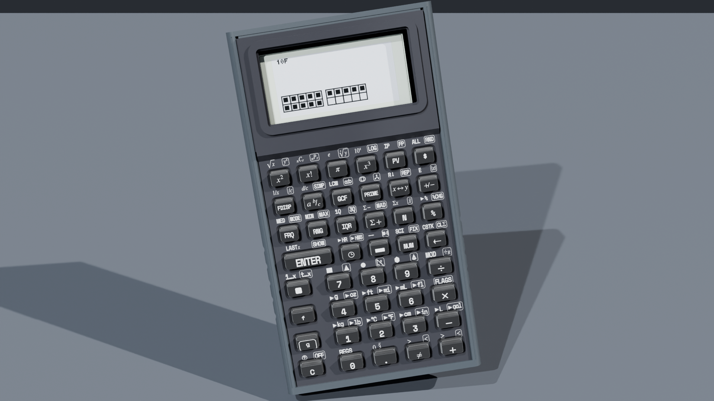

### Your Very First Stack Move: Adding `7` and `5`

Pick up your SC-6 (or place seven and five counting tiles on your desk) and try your very first stack calculation:
1. **Put the first number on Ground Shelf $X$:** Tap `7`. You see `7` sitting on Shelf $X$.
2. **Lift it to Waiting Shelf $Y$:** Tap **`[ENTER]`**. That tells the calculator, *"My first number is finished—lift it up to Shelf $Y$ so I can type the next number."*
3. **Put the second number on Shelf $X$:** Tap `5`. Now look at your screen: `7` is waiting on Shelf $Y$, and `5` is sitting on Shelf $X$. Both numbers are right in front of your eyes at the same time.
4. **Combine them:** Tap **`[+]`**. Instantly, Shelf $Y$ drops down and fuses with Shelf $X$ to make **`12`**.

Mathematicians and engineers call this step-by-step workspace **Reverse Polish Notation (RPN)**—or as we call it throughout this book, **Stack Math**—because you build one small piece at a time and watch every step unfold in plain view. In Chapter 2, you will discover how engineers first built this four-shelf stack into a pocket calculator for astronauts and scientists so no one would ever lose their place halfway through a problem.

---

## Taking the Stack for a Test Drive

Once you know how to send your first number up to Shelf $Y$ with `[ENTER]` and place a second number on Shelf $X$, you can already solve real-world stories. Let's walk through a few everyday adventures together to see what you will build and discover in the chapters ahead.

Throughout this book, whenever we introduce a new stack move, you will see a **4-Register Stack Table** like the one below. Think of each row in the table as a snapshot of your calculator's four shelves (**Top Shelf $T$**, **Shelf $Z$**, **Shelf $Y$**, and **Ground Shelf $X$**, shown as `Register T` through `Register X` in the column headers) right after your finger presses a key, so you can follow every step at your own pace.

### Taking Away: Finding Missing Spaces on a Ten-Frame Tray

Picture placing **7 red counters** into your 10-space Ten-Frame tray, filling the top row of 5 and 2 more spaces on the bottom row. How many blue counters do you need to fill all 10 spaces?

When you look at the Ten-Frame tray on your desk, your eyes don't even have to count the 7 red counters one by one: the raised center divider ridge shows a full top row of 5 plus 2 on the bottom, leaving 3 empty pockets waiting at the end of the tray.

In any subtraction story ($10 - 7$), we start with the whole amount (`10`) and take away the part we already have (`7`). On the stack, your starting number always goes onto Waiting Shelf $Y$ first via `10 [ENTER]`, the number you are taking away (`7`) goes onto Ground Shelf $X$, and tapping `[-]` takes Shelf $X$ away from Shelf $Y$ to leave **`3`** empty spaces:

| Keystroke | Register T | Register Z | Register Y | Register X | What Happens on the Stack |
|:---|:---:|:---:|:---:|:---:|:---|
| `[C]` | 0 | 0 | 0 | 0 | Start with a clean stack of four empty shelves in `[NUM]` mode. |
| `10` | 0 | 0 | 0 | 10 | Put the 10 total spaces of the tray onto Workbench Shelf $X$. |
| `[ENTER]` | 0 | 0 | 10 | 10 | Lift 10 up onto Shelf $Y$ so your Workbench is ready. |
| `7` | 0 | 0 | 10 | 7 | Put the 7 red counters you already have onto Workbench Shelf $X$. |
| `[-]` | 0 | 0 | 0 | 3 | Take 7 away from 10 ($10 - 7 = 3$), leaving 3 empty spaces on Shelf $X$. |

*What if your screen says `17` instead of `3`?* That just means your thumb tapped `[+]` instead of `[-]`. And what if you accidentally typed `7 [ENTER] 10` in the wrong order? You don't have to erase and start over: tapping the **`[x⇄y]` (Swap)** key trades the numbers on Shelf $Y$ and Shelf $X$ so `10` is back on Shelf $Y$ and `7` is on Shelf $X$.

### Checking Your Own Work in One Tap

Every builder and explorer loves to know for sure that a measurement is right. On the SC-6, every time an operation combines two numbers, the calculator automatically tucks a backup copy of the number from Shelf $X$ into a special memory pocket called **`LAST x`** (`[f] [LASTX]`).

Say you are counting trading cards at your desk: you have **24 cards** neatly sorted in your binder and **15 cards** stacked in a tin box. You add `24 [ENTER] 15 [+]` to get **`39`** cards in all. How can you prove that `39` is right in two quick clicks?

Just tap **`[f] [LASTX]`**. Right away, your `15` jumps out of its memory pocket back onto Shelf $X$, while your `39` sum automatically lifts up to Shelf $Y$ to make room. Now tap **`[-]`**, and `39 - 15` lands right back on your starting number, **`24`**, proving your addition was spot-on!

Throughout Chapters 2, 3, and 4, you will use this two-tap detective check across every operation. After adding two beach-bucket collections of seashells ($38 + 25$) via `38 [ENTER] 25 [+]` $\implies \mathbf{63}$, tapping `[f] [LASTX] [-]` checks $63 - 25 = \mathbf{38}$ in two clicks; after multiplying a rectangular array of tiles or dividing supplies among friends, tapping `[f] [LASTX]` followed by the opposite operation restores your starting pile right on Shelf $X$. Even better, if your thumb ever taps `[+]` when you meant to tap `[-]`, `[f] [LASTX]` acts as an instant undo button so you can recover in seconds—and as you are about to see, it can even help you verify division problems that leave extra items behind.

### Sharing with Whole Groups and Leftovers

What happens when numbers don't divide evenly? Imagine you have **26 favorite comic books** on your desk and you are sliding them into protective display sleeves that hold **4 comics each**. If a screen only showed a decimal like `6.5`, what would `0.5` of a sleeve mean? In real life, you fill **6 whole sleeves** ($6 \times 4 = 24$ comics), and you have **2 loose comics left over** on your desk.

On your SC-6, the **`[g] [÷R]` (Quotient & Remainder)** key solves both parts of a sharing story at the exact same time because your screen has two visible shelves waiting to catch both whole numbers. Imagine a summer camp group of **94 campers and counselors** strapping on life jackets for a whitewater river trip in inflatable rafts that hold **8 paddlers each**. How many rafts will be completely full, and how many campers still need a seat?

When you put `94` on Shelf $Y$ (`94 [ENTER]`), put `8` on Shelf $X$, and tap **`[g] [÷R]`**, the calculator splits the division cleanly across your two shelves:
- **Ground Shelf $X$** immediately shows **`11`** completely full rafts ($11 \times 8 = 88$ paddlers).
- **Waiting Shelf $Y$** holds the **`6`** leftover campers who still need a seat on the river!

Because you can see both the **`11` full rafts** and the **`6` remaining campers** side by side on your screen, you immediately spot the real-world answer: the camp cannot leave 6 kids standing on the riverbank, so the guides need to launch $11 + 1 = \mathbf{12\text{ rafts}}$ in all! And when you reach Chapter 4, you will discover a three-tap proof (`[f] [LASTX] [×] [+]`) that multiplies the 11 full rafts by 8 and adds the 6 leftover campers right back to `94`.

---

### Building Two-Step Projects on the Stack

Now that you have seen how Shelf $X$ and Shelf $Y$ work together on one-step stories, what happens when a real-world project has **two or three steps**?

Imagine you are helping design a square brick patio or a wooden skateboard launch pad in a backyard that is **$12\text{ feet}$ wide**, leaving a **$3\text{-foot}$ grass path** along one edge so people can walk by. First, you take away the grass path ($12 - 3 = 9\text{ feet}$) to find the side length of your square patio. Next, you want to know two different things about that $9\text{-foot}$ square:
1. How many **square feet of bricks** it takes to fill the inside of the patio ($9 \times 9 = 81\text{ sq ft}$).
2. How many **feet of wooden border edging** it takes to frame all 4 outside edges ($9 \times 4 = 36\text{ ft}$).

Watch how naturally that whole design unfolds on your SC-6 workbench:
1. **Find the side length ($12 - 3$):** Tap `12 [ENTER] 3 [-]` to put **`9`** feet on Shelf $X$.
2. **Find the brick area ($9^2$):** Tap the **`[x²]` (Square)** key to multiply $9 \times 9 = \mathbf{81\text{ sq ft}}$ of bricks right on Shelf $X$. Because `[x²]` just used your `9`, it automatically tucks a copy of `9` into your `LAST x` pocket!
3. **Bring back the side length for the border ($9 \times 4$):** Tap **`[f] [LASTX]`** to bring the $9\text{-foot}$ side length right back onto Shelf $X$ (which automatically lifts your `81` square feet up onto Waiting Shelf $Y$!).
4. **Finish both measurements side by side:** Type `4` and tap **`[×]`**. Now look at your screen: **`36` feet** of wooden border sits on Shelf $X$, right beside **`81` square feet** of bricks waiting on Shelf $Y$!

Notice something magical that happened in Step 4 when `9` was sitting on Shelf $X$: you didn't have to press `[ENTER]` before typing `4`! Why? Because **whenever a finished answer is sitting on Shelf $X$, typing a new number automatically lifts that finished answer up to the next shelf** to wait for you.

That **automatic stack lift** lets you build multi-part projects one small group at a time, just like snapping two LEGO sub-assemblies together on your desk. Picture your neighborhood maker club weaving a rope suspension bridge for a backyard treehouse: you combine **18 long oak slats and 6 cedar slats** ($18 + 6 = 24$ slats per bundle), you prepare **15 bundles minus 7 spare bundles** kept in the shed ($15 - 7 = 8$ active bundles), and you divide all those slats equally across **8 bridge sections**:
$$((18 + 6) \times (15 - 7)) \div 8$$

Watch how **Shelf $Z$** holds your first finished group upstairs while you build the second group on the bottom shelves:
1. **Build the first group (`18 + 6`):** Tap `18` `[ENTER]` `6` `[+]`. The screen immediately shows **`24`** slats on Shelf $X$.
2. **Build the second group (`15 - 7`):** Right away, type `15` `[ENTER]` `7` `[-]`. The moment you touch `15`, automatic stack lift carries your finished `24` upstairs to wait safely on **Shelf $Z$**, and when `[-]` combines `15` and `7` into **`8`** on Shelf $X$, your waiting `24` drops right back down to **Shelf $Y$** beside it!
3. **Multiply the two groups and divide by `8`:** Now `24` is waiting on Shelf $Y$ and `8` is sitting on Shelf $X$. Tap **`[×]`** to multiply them into **`192`**, and then tap `8` **`[÷]`** to divide by 8:
   `18 [ENTER] 6 [+] 15 [ENTER] 7 [-] [×] 8 [÷]` $\longrightarrow$ **`24`**.

In Chapter 2, you will see how **Shelf $Z$** and **Top Shelf $T$** unlock the full four-story elevator so you can solve multi-group stories from the inside out (`15 [ENTER] 3 [-] 4 [ENTER] 2 [+] [×] 6 [÷]` $\longrightarrow$ **`12`**) while watching every intermediate piece wait safely on its shelf.

---

### Four Helper Keys & Your Visual Screen Modes

As you travel through the chapters ahead, you will meet several more helper keys that turn tricky math topics into hands-on discoveries:

| Signature Key | How It Helps You |
| :--- | :--- |
| **Constant Repeat (`[g] [REP]`)** | **Skip-Counting & Times Tables:** Copies your number across all four shelves ($X = 7, Y = 7, Z = 7, T = 7$) so repeated taps of `[+]` climb times tables (`7, 14, 21, 28...`) or repeated taps of `[×]` double `2` twenty times past **one million (`1,048,576`)**! |
| **Quotient & Remainder (`[g] [÷R]`)** | **Whole Groups & Leftovers Together:** Divides in one tap, putting the whole groups (Quotient) on Shelf $X$ and the exact leftovers (Remainder) on Shelf $Y$. |
| **One-Tap GCF Simplify (`[g] [SIMP]`)** | **Fraction Reduction You Control:** Keeps fractions like `0 [.] 12 [.] 18` unreduced until *you* press `[g] [SIMP]` to divide top and bottom by their Greatest Common Factor in one tap into `2/3`, displaying `LOWEST TERMS` when already simplified. |
| **Add to Total (`[Σ+]`)** | **A Shopping Basket for Totals:** Lets you toss finished numbers into a running basket (`1`, `2`, `3` items) and tap `[f] [Σx]` to see the grand total in one click. |

Look at how handy that **`[Σ+]` (Add to Total)** basket is whenever a project has several separate pieces to add up. Imagine painting three plywood walls for a backyard treehouse: a **North Wall** measuring $4\text{ ft} \times 3\text{ ft}$ ($12\text{ sq ft}$), an **East Wall** measuring $5\text{ ft} \times 3\text{ ft}$ ($15\text{ sq ft}$), and a **South Wall** measuring $6\text{ ft} \times 3\text{ ft}$ ($18\text{ sq ft}$). Instead of writing those three wall sizes down on scrap paper, you simply empty your calculator's running-total basket with **`[g] [CLΣ]`** and toss each finished wall straight in. First, multiply the North Wall (`4 [ENTER] 3 [×]`) and tap **`[Σ+]`**—Shelf $X$ displays **`1`** to confirm *"1 wall is safely inside the basket."* Next, multiply and add the East Wall (`5 [ENTER] 3 [×] [Σ+]` $\to$ **`2`** walls) and the South Wall (`6 [ENTER] 3 [×] [Σ+]` $\to$ **`3`** walls). Finally, one tap of **`[f] [Σx]`** adds the entire basket together to reveal **`45.0` $\text{sq ft}$** of total wall area—and tapping **`[g] [x̄]`** divides that $45\text{ sq ft}$ total equally across all $3$ walls to show an average wall size of **`15.0` $\text{sq ft}$**!

### How Your Blocks, Screen Modes, and Stack Team Up

Just like cutaway drawings that peel back the cover of a machine so you can see every gear working inside *([Macaulay, 2016](sc6/appendix-c-formulas-and-conversions.md#cite-macaulay2016))*, math clicks fastest when you build with **hands-on objects** first, see **visual pictures** second, and combine **numbers** third. Every chapter in this book connects those three layers right at your desk:

| Learning Phase | What You Use | How It Works at Your Desk |
|---|---|---|
| **1. Hands-On Blocks** | 3D-Printed Math Block Kits | You build the problem with physical Ten-Frame Trays, $84\text{ mm}$ Fraction Towers, Four-Color Counting Tiles, Prime Factor Blocks, and a Planetary Geared Clock. |
| **2. Visual Screen Modes** | Daylight Paper-Like Visual Modes | You see the exact same model drawn on the SC-6 screen using Ten-Frame Mode `[▦]`, the Number Rack `[g] [COUNT]`, Number Line Jump Arcs `[f] [LINE]`, Place Value `[PV]`, the Geared Clock Dial `[🕒]`, Polyhedral Dice `[🎲]`, or the 6-Level Math Quiz Game `[f] [?]`. |
| **3. The Number Stack** | Four-Shelf RPN Stack ($X, Y, Z, T$) | You combine your numbers on the four visible stack shelves—solving multi-step puzzles, remainder division, and 3D surface area step by step. |

Switching between any visual picture mode (`[▦]`, `[g] [COUNT]`, `[f] [LINE]`, `[🕒]`, `[🎲]`) and regular numbers (`[NUM]` or `[C]`) never erases your stack—it simply changes the lens through which you view the numbers on your shelves. As you begin exploring, three simple buttons do 90% of the work: **`[ENTER]`** locks your number in and lifts it up to Shelf $Y$, **`[C]`** clears Shelf $X$ back to `0`, and **`[x⇄y]`** swaps Shelf $Y$ and Shelf $X$ in one tap if you ever type two numbers in reverse order for subtraction or division!

### Why Master Builders Always Use a Workbench

Walk into a violin maker's workshop, a neighborhood bakery at dawn, or a robotics garage where students are bolting aluminum frames together, and you will notice one shared habit: great builders never try to hold twenty measurements in their heads at once. A carpenter planes one cedar board on the lower bench, sets it safely on the upper rack, planes the matching board below, and checks their fit side by side before gluing them together.

Long before electronic calculators existed, merchants and architects across Europe, Asia, and the Americas worked the exact same way on carved wooden **counting tables** and **bead frames**. Each horizontal line carved into a merchant's wooden table acted as a visible shelf where bronze or ivory counters waited in plain sight while the next part of a trade was counted out below.

As you flip through the chapters ahead, you will use your blocks and four-shelf workbench to crack real-world mysteries that surprise even adults. In **Chapter 4**, you will test **The Unfoldable Paper Bet**—discovering why it is physically impossible to fold an ordinary sheet of notebook paper in half 10 times with your bare hands, and how locking `2` into your stack with `[g] [REP]` proves that 20 folds would tower higher than the Empire State Building. In **Chapter 6**, you will uncover **The $-40^\circ\text{C}$ Penguin Huddle Secret**, seeing how Emperor penguins in Antarctica use the geometry difference between *outside wall area* and *inside volume* to stay warm in howling blizzards—and why that exact same rule makes French fries crispy on the outside and fluffy on the inside. And in **Chapter 8**, you will master **Beating a Smartphone in Two Seconds Flat**, multiplying $65 \times 65$ or $43 \times 47$ out loud in your head faster than an adult can even unlock their phone and open the calculator app!

Whether you love building LEGO machines, baking in the kitchen, sketching 3D shapes, or racing the 4-second clock in Quiz Mode (`[f] [?]`), every page ahead gives your hands something real to build and test.

---

## How Every Chapter Builds Your Skills

This book is organized into nine hands-on chapters and four reference appendices, and you don't have to read it like a school textbook where every page must be finished in strict order. If you are just unboxing your SC-6 for the first time, start with **Chapters 01 and 02** to set up your desk trays, test the snap-action keys, and learn the smooth rhythm of `[ENTER]`, `[x⇄y]`, and the four stack shelves.

If you are curious about a specific math puzzle today—whether it's why cicadas emerge every 17 years, how bakers scale sourdough recipes, or how deep-sea submersibles dive below sea level—you can jump straight to that chapter in the guide below, because every chapter pairs a 3D-printed block studio with matching visual screen modes and real-world stories. And whenever you are 3D-printing blocks, teaching a class, or looking up a button, flip to the **Appendices** at the back of the book for 3D-printing blueprints ([Appendix A](sc6/appendix-a-manipulative-blueprints.md)), 25 classroom station guides ([Appendix B](sc6/appendix-b-teacher-lesson-plans.md)), plain-English geometry and data formulas ([Appendix C](sc6/appendix-c-formulas-and-conversions.md)), and the complete 43-button directory ([Appendix D](sc6/appendix-d-keycap-directory.md)):

| Chapter / Appendix | What You Will Discover | 3D-Printed Math Block Studio | Primary SC-6 Keycaps | Hands-On Explorations |
| :--- | :--- | :--- | :--- | :--- |
| **[Chapter 01](sc6/01-hardware-architecture.md)** | Setting up your desk studio, first block-and-stack discoveries, daylight screen & button feel | All 8 Companion Studios & Quest Scoreboard | `[ENTER]`, `[+]`, `[×]`, `[C]`, `[<-]`, `[f]`, `[g]` | Measuring screen pixels, snap-domes, Gridfinity trays & battery life |
| **[Chapter 02](sc6/02-rpn-for-young-learners.md)** | Riding the 4-shelf RPN stack ($X, Y, Z, T$) & solving multi-step order of operations step by step | Stack Shelves & Counting Tiles | `[ENTER]`, `[+]`, `[-]`, `[x⇄y]`, `[f] [R↓]`, `[f] [CSTK]` | Weighing a dog on a bathroom scale, cell division, smoothie pitchers & backyard patios |
| **[Chapter 03](sc6/03-counting-place-value.md)** | Spotting groups at a glance, make-ten bridging, multi-digit place value (`1000 \| 100 \| 10 \| 1`), rounding & negative number-line hops | Ten-Frame Studio, Number Rack & Place Value Trays | `[▦]`, `[g] [COUNT]`, `[f] [LINE]`, `[PV]`, `[$]` | Fireflies & ten-pin bowling, Jupiter's moons, red kangaroo leaps & Voyager 1 |
| **[Chapter 04](sc6/04-operations-skip-counting.md)** | Rectangular multiplication arrays, rhythmic skip-counting ladders, powers & fair-share division with remainders | 24-Tile Counting & Array Studio | `[×]`, `[÷]`, `[g] [REP]`, `[g] [÷R]`, `[f] [MOD]`, `[f] [LASTX]` | Spacecraft solar panels, the chessboard wheat legend, farm egg cartons & garage skateboards |
| **[Chapter 05](sc6/05-fractions-decimals-ratios.md)** | Equivalent fractions, one-tap GCF reduction, common denominators, mixed numbers, decimals, percents & ratios | 84 mm Fraction Tower Studio & Decimal Tray | `[a ᵇ/c]`, `[f] [d/c]`, `[g] [SIMP]`, `[FDISP]`, `[%]`, `[g] [%CHG]` | Musical guitar strings, bicycle sprockets, woodworking boards & the 1-2-3 concrete rule |
| **[Chapter 06](sc6/06-geometry-surface-area.md)** | 2D area/perimeter, Pythagorean theorem, 3D prism/cylinder/cone volume, surface area via `[Σ+]` & modulo-60 clock time | Counting Tiles, L-Frame, Volvelle & Geared Clock | `[f] [RECT]`, `[f] [CIRC]`, `[f] [PRISM]`, `[Σ+]`, `[🕒]`, `[f] [▸HR]` | Penguin huddles, Antarctic Scott tents, gift-box wrapping & Palomar dome |
| **[Chapter 07](sc6/07-data-probability-primes.md)** | Prime factor trees, GCF & LCM, polyhedral dice probability, dot plots, mean/median/IQR/MAD & signed integers | Prime Factor Studio, Polyhedral Dice & Two-Color Counters | `[PRIME]`, `[g] [FACT]`, `[GCF]`, `[f] [LCM]`, `[🎲]`, `[g] [x̄]`, `[f] [MED]`, `[+/-]` | 17-year cicadas, RSA secret codes, dice trials & submersible Alvin |
| **[Chapter 08](sc6/08-math-quiz-engine.md)** | Left-to-right mental math tricks (matching tens, 11s split, staircase sums) & 6-level 4-second speedruns | Math Dominoes & Quest Scoreboard | `[f] [?]` (`[f]` + `[C]`), `[≠]`, `[f] [LASTX]` | Mental-math speed shortcuts & 6-level 4-second speedrun sprints |
| **[Chapter 09](sc6/09-applied-stem-labs.md)** | 3D-printed block weights and layer slicing, bean sprout growth, recipe scaling, gear ratios, and solar ovens | All Studios + Calipers, Scale & Stopwatches | `[π]`, `[x²]`, `[f] [√x]`, `[f] [▸g]`, `[f] [▸cm]`, `[f] [▸°C]` | 3D printer slicing, pendulum clocks, botanical growth & maker workshops |
| **[Appendices A–D](sc6/appendix-a-manipulative-blueprints.md)** | CAD/3D-print blueprints ([App. A](sc6/appendix-a-manipulative-blueprints.md)), 25 station lesson plans ([App. B](sc6/appendix-b-teacher-lesson-plans.md)), formulas & primes ([App. C](sc6/appendix-c-formulas-and-conversions.md)), and 43-key matrix ([App. D](sc6/appendix-d-keycap-directory.md)) | Full 3D-Printed Math Block & Reference Suite | Complete 43-Key Hardware Matrix | Turnkey Classroom & Home Reference |

---

## Safety, Regulatory, Trademark & Parent/Educator Notices

> **CHOKING HAZARD — SMALL PARTS (16 CFR § 1501 / ASTM F963):**  
> The physical StackCalc 3D-printed math block kits (Counting & Array Tiles, Ten-Frame Flip Counters, Fraction Studio 1/12 Blocks, Prime Factor Studio Blocks, Math Dominoes, and Polyhedral Dice) contain small modular parts ($7.0\,\text{mm}$ minimum thickness). **Not for children under 3 years of age.** Use only under adult or educator supervision.
> - **3D-Printed Part Inspection:** When printing math block kits on classroom or home Fused Deposition Modeling (FDM) 3D printers, adults must use non-toxic PLA or PETG filament and inspect every finished piece prior to student handling—removing any loose filament strings, sharp seam burrs, or delaminated layers.

> **INGESTION HAZARD — COIN CELL BATTERY SAFETY (REESE'S LAW / 16 CFR PART 1263):**  
> The physical StackCalc SC-6 handheld calculator operates on an internal **CR2032 lithium coin cell battery ($3.0\,\text{V}$)**.
> - **DEATH or serious injury can occur if ingested.** A swallowed button or coin cell battery can cause **Internal Chemical Burns in as little as 2 hours**.
> - **KEEP new and used batteries OUT OF REACH of children.** Adults must verify that the tool-secured battery compartment screw and dovetail latch are fully fastened before handing the instrument to a child.
> - **Seek immediate medical attention** if a battery is suspected to be swallowed or inserted inside any part of the body. In the United States, call the **National Battery Ingestion Hotline at 1-800-498-8666** immediately.

**Trademark Attribution & Non-Affiliation Notice:** StackCalc™, StackCalc SC-6™, and StackCalc SC-32™ are independent products of StackCalc (stackcalc.io).
* **HP®**, **Hewlett-Packard®**, and **HP-32SII™** are registered trademarks or trademarks of **HP Inc.**, which does not sponsor, endorse, or affiliate with this textbook.
* **Unifix®** is a registered trademark of Didax, Inc.; **Cuisenaire®** is a registered trademark of Hand2Mind, Inc.; **Singapore Math®** and **Dimensions Math®** are registered trademarks of Singapore Math Inc.; **Big Ideas Math®** is a registered trademark of Larson Texts, Inc. All references to curriculum frameworks and classic classroom block systems are strictly nominative and comparative for educator cross-reference.
* **Gridfinity** is an open-source modular storage specification created by Zack Freedman (MIT License).

---

### Ready to Open Your Desk Studio?

Whether you are a young builder opening your calculator and block trays for the very first time, a parent exploring evening kitchen-table puzzles, or a teacher setting up a hands-on math station, every chapter ahead begins with something you can touch, see, and build before a single button is pressed.

As you work through the puzzles and maker labs in this book, notice how quickly your confidence grows when you can *see* every step of your thinking. If an answer ever looks unexpected, you never have to erase a whole page and start over from scratch: a single tap of `[f] [LASTX]` brings your last number right back onto Ground Shelf $X$, and switching to a visual mode like `[▦]`, `[f] [LINE]`, or `[PV]` lets you inspect the picture behind the digits immediately.

Whenever a math question looks big or unfamiliar, you never have to guess at a formula in the dark: you can reach into your tray, snap together a physical model you can rotate and measure with your fingers, and watch the exact same numbers ride up and down the shelves of your screen. Turn the page to **[Chapter 1: Meet Your SC-6 Stack Calculator & Math Blocks](sc6/01-hardware-architecture.md)**, where we will set up your desk studio, wake up the daylight screen, and discover the clever engineering hidden inside your calculator and blocks!

---

# Chapter 1: Meet Your SC-6 Stack Calculator & Math Blocks

## 1.1 Opening Your Desktop Math Studio

Picture sitting at your kitchen table on a rainy Tuesday afternoon. Your math book is open on the desk, and right beside it rests a glowing tablet. Within ninety seconds of starting your work, a notification banner slides across the glass: a message chime, a game update, a video alert. Even when locked in "study mode," the tablet's bright electric backlight shines straight into your eyes like a flashlight, and its flat glass screen gives your fingers nothing to feel.

Now look at the other side of your desk: the **StackCalc SC-6**. Molded from tough, dark Midnight Navy plastic, it has no Wi-Fi, no pop-up alerts, and no noisy distractions. Its screen doesn't beam harsh light into your face—it reflects the natural daylight in your room just like a page of paper. And when you press a key, your finger doesn't slide across flat, silent glass. Beneath every keycap sits a tiny stainless-steel spring dome that clicks down with a crisp, satisfying *snap!*

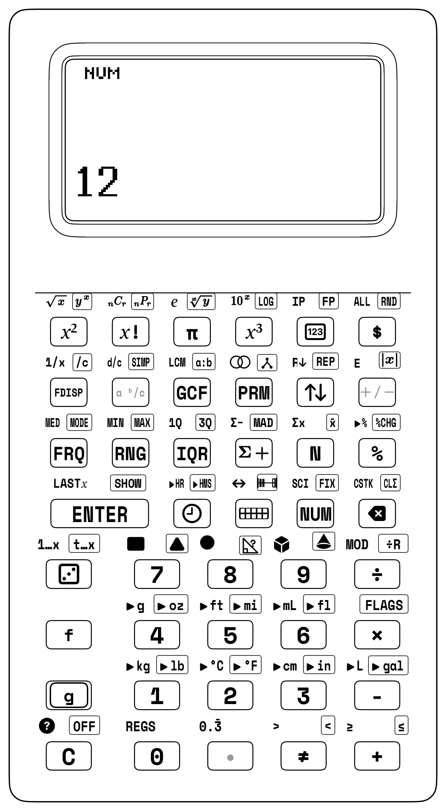

Your brain works best when it can focus on a few clear steps at a time instead of juggling hidden numbers in the dark. When you try to solve a math puzzle on a buzzing tablet—or on a cramped screen that hides your first number the moment you type your second—all that extra clutter gets in your way. Just like a cutaway drawing that opens up a machine so you can see every gear turning inside *([Macaulay, 2016](sc6/appendix-c-formulas-and-conversions.md#cite-macaulay2016))*, the SC-6 pairs **physical math blocks on your desk** with **four visible number shelves on the screen**, so every step stays right in front of your eyes.

### 1.1.1 Two Hands, One Workbench: Matching Your Tray to the Stack Screen

Set a 3D-printed math block tray on the left side of your desk and wake up your SC-6 on the right by tapping **`[C]`**. Notice how the vertical stack screen mirrors the physical layout of your desk tray: the **first group of blocks** you place in the top row of your tray with your left hand matches **Waiting Shelf $Y$** stacked right above on the screen, while the **second group of blocks** you place in the bottom row matches **Ground Shelf $X$** in large bold digits along the bottom of the screen.

Try that two-hand rhythm right now with the **$7\text{ mm}$ Tile Rule (`6 + 4 = 10` Tiles)**. With your left hand, pick up **6 blue Counting Tiles** (each tile is $7\text{ mm}$ thick, making a $42\text{ mm}$ stack), and with your right hand type `6 [ENTER]` to lift `6` onto Shelf $Y$. Next, pick up **4 gold Counting Tiles** ($28\text{ mm}$ tall) and type `4` onto Shelf $X$—without pressing `[ENTER]` after the second number. Now slide the 4 gold tiles onto the 6 blue tiles to build a **10-tile tower** ($70\text{ mm}$ tall, matching the exact height of your Ten-Frame 10-Rod!) as you tap **`[+]`** on your keypad. Shelf $Y$ drops down and fuses with Shelf $X$ into **`10`**—and if you multiply `10 [ENTER] 7 [×]`, the screen confirms your tower stands **`70` millimeters** tall!

### 1.1.2 The Three Shift Modes: Normal, Top-Left Shift, and Top-Right Shift

Instead of hiding math tools inside confusing computer menus, every sculpted button on the SC-6 can perform up to **three actions** (Direct Press, **`[f]` Shift**, and **`[g]` Shift**):
- **Direct Press:** Tapping any key directly uses the main white label on the keycap face—digits `0`–`9`, `[ENTER]`, `[+]`, `[-]`, `[×]`, `[÷]`, clear `[C]`, and backspace `[<-]` (which erases the last digit if you make a typing slip).
- **`[f]` Shift Key:** Pressing `[f]` first lights up the **`↰`** indicator in the top-left corner of the screen and activates the feature printed above the keycap, such as finding common multiples with `[f] [LCM]`, clearing the entire stack with `[f] [CSTK]`, recalling your last number with `[f] [LASTX]`, and inspecting memory `[f] [REGS]`.
- **`[g]` Shift Key:** Pressing `[g]` first lights up the **`↱`** indicator on the screen and activates the feature printed on the right bevel of the keycap, such as prime factor trees with `[g] [FACT]`, simplifying fractions with `[g] [SIMP]`, skip-counting ladders with `[g] [REP]`, whole-number division with remainder `[g] [÷R]`, low-power sleep `[g] [OFF]`, and settings `[g] [FLAGS]`. (If you ever tap `[f]` or `[g]` by mistake, just tap the same shift key again to cancel it!)

Before we open your math block kits, slide the protective cover downward off the front of your calculator, flip the calculator over, and slide the cover onto the rear rails until it clicks into place. Your SC-6 now rests at a hands-free **$15^\circ$ reading angle**, leaving your left hand free to build with blocks while your right hand taps keys onto the stack.

> **Your Favorite Color Theme, Same Friendly Shift Keys (`[f]` and `[g]`):**  
> Whether your SC-6 faceplate or simulator app is set to `Pure Black`, `Retro Futurism`, `Pioneer`, `Stealth`, `Supernova`, `Voyager`, or `Arcade`, the shift keys always work the exact same way. In this book, we always call them by their symbol rather than their color: **`[f]` Shift** (for the top-left label on a button) and **`[g]` Shift** (for the top-right label).

---

## 1.2 Your Nine 3D-Printed Block Studios & 4-Floor Stack

Why is your SC-6 calculator molded in dark Midnight Navy or Slate Gray, while your math blocks are bright white, radiant gold, and electric blue?

Think about how an astronomer uses a telescope: the tube of the telescope is dark matte black so stray light doesn't bounce into your eyes, letting you focus clearly on the bright stars. Your dark calculator frame gives your eyes a quiet, glare-free place to read numbers, while the bright math blocks invite your hands to reach out, sort, stack, and build.

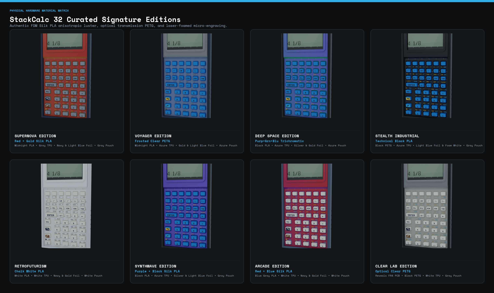

Classic scientific instruments—from brass marine sextants to observatory control panels—have used this same high-contrast pairing for centuries. When the instrument housing is matte and calm, your eyes never tire during an hour of building, and your peripheral vision can immediately spot the difference between a coral-red counter, a golden rod, and a lilac twelfth-block on your desk mat.

Even better, each color in your block trays carries a consistent mathematical meaning across the entire kit: **white** always stands for 1 whole (or 1 unit step), **coral red** and **radiant gold** pair up to make 5s and 10s, **electric blue** marks twos and halves, and **emerald green** marks threes and thirds. Because your hands and eyes meet those same colors in every chapter, you can spot how numbers fit together across whole numbers, fractions, and prime factors before you even press a button.

### 1.2.1 How Your Nine Block Studios Pair with the Keypad

Whenever you start an activity in this book, place your **3D-printed block tray on the left side of your desk** and your **SC-6 in its $15^\circ$ stand on the right**. Every studio in your kit mirrors a matching mode or helper key on the keypad so your hands discover the physical answer on the tray right before the calculator confirms it on the stack:

- **Ten-Frame Trays & Flip Counters (`[▦]`):** Two 5-pocket trays hold ten two-color disc counters (coral red on one side, radiant gold on the other) with built-in finger scoops for easy flipping. A raised **5-anchor divider rib** splits each row of ten into two visual groups of 5 so your eyes spot totals at a glance without counting one by one. Tap `[▦]` to see your trays drawn live on the screen: Shelf $Y$ shows the top tray, Shelf $X$ shows the bottom tray, and tapping `[+]` slides counters across to complete a ten (`7 + 5 = 12`).

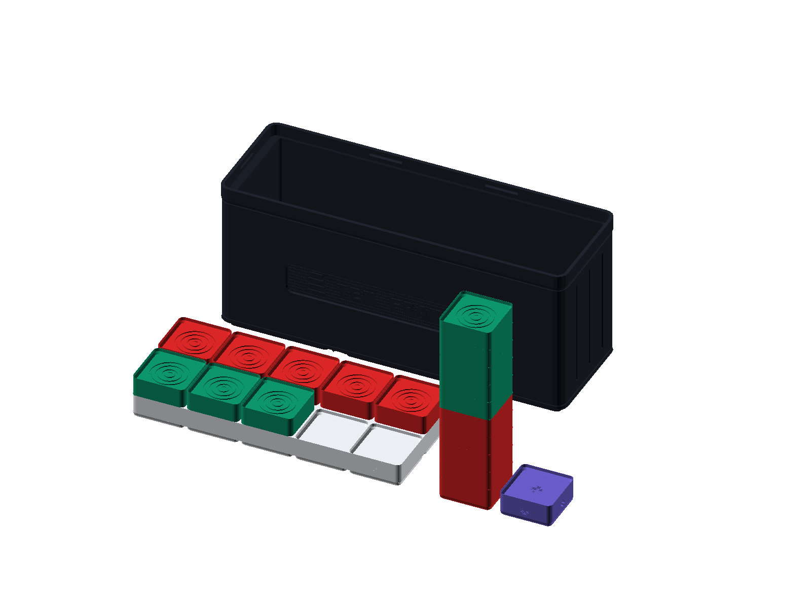

- **Four-Color Counting & Array Studio (`[NUM]` & `[f] [RECT]`) and $90^\circ$ Corner L-Frame:** Each Counting Studio kit holds 24 smooth-docking tiles in four colors (6 white, 6 blue, 6 gold, and 6 slate gray—or 144 tiles when 6 kits are shared at a table). Arrange tiles into rows and columns inside the $90^\circ$ **Corner L-Frame** to build rectangular multiplication arrays ($4 \times 6 = 24$), then spin the tray sideways ($6 \times 4 = 24$) to see why swapping rows and columns never changes the total.

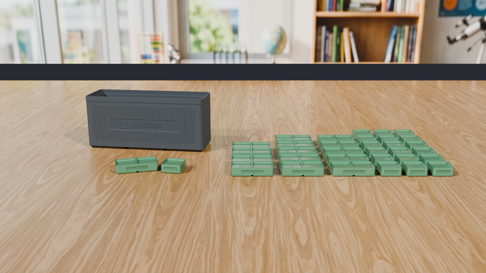

- **84 mm Fraction Towers & Comparator Tray (`[FDISP]` & `[g] [SIMP]`):** Why did our engineers make the $1\text{-Whole}$ master tower **$84.0\text{ mm}$** tall instead of $100\text{ mm}$? Because $84$ divides evenly by $1, 2, 3, 4, 6, 7, 12, 14, 21, 28,$ and $42$—giving every fraction block ($1/2 = 42\text{ mm}$, $1/3 = 28\text{ mm}$, $1/4 = 21\text{ mm}$, $1/6 = 14\text{ mm}$, $1/12 = 7\text{ mm}$) an exact whole-millimeter height!
  - *Try This 5-Second Height Check:* Stack **twelve $7\text{ mm}$ Counting Tiles** right next to your **$84\text{ mm}$ 1-Whole Fraction Tower**, run your finger across their flush tops, and tap `12 [ENTER] 7 [×]` to see **`84`** millimeters on Shelf $X$. When you stand two $1/4$ blocks in the tray and type `0 [.] 2 [.] 4 [g] [SIMP]`, the screen divides top and bottom by their Greatest Common Factor in one tap to reduce `2/4` to `1/2` (displaying `LOWEST TERMS` if already simplified) while your fingers feel their matching $42\text{ mm}$ height.
- **Prime Factor Studio (`[PRIME]` & `[g] [FACT]`):** Color-coded prime-number blocks (`2`, `3`, `5`, `7`, ...) are scaled so that stacking block `2` on top of block `3` reaches the exact height of $2 \times 3 = 6$ on the back-wall ruler, while typing `60 [g] [FACT]` on the keypad reveals $2^2 \times 3 \times 5$.
- **Planetary Geared Clock (`[🕒]`):** Real interlocking 12-to-1 planetary gears link the minute hand and hour hand so turning the minute hand automatically glides the hour hand—matching `[🕒]` Clock mode when you add hours and minutes across 60-minute boundaries.
- **Polyhedral Dice (`[🎲]`), Place Value Trays (`[PV]`), Number Rack (`[g] [COUNT]`) & Quest Scoreboard (`[f] [?]`):** Balanced **Polyhedral Dice** ($d4, d6, d8, d10, d12, d20$) pair with `[🎲]` digital dice rolls; **Whole & Decimal Place Value Trays** pair with `[PV]` (`347 = 300 + 40 + 7`); the two-rail **Number Rack** (5 red and 5 white beads per row) pairs with `[g] [COUNT]`; and the **Quest Scoreboard** pegboard tracks your 4-second speedrun streaks in `[f] [?]` Quiz Mode.

### 1.2.2 Inside the 4-Floor Number Elevator

So far, our bottom two screen shelves—Waiting Shelf $Y$ stacked right above Ground Shelf $X$—have been plenty for combining two piles of blocks. What happens, though, when you are organizing several studio trays on your desk at once and your math puzzle has *three* or *four* parts that need to wait their turn? That is where the two upper floors of your **4-Floor Number Elevator ($T, Z, Y, X$)** come to the rescue.

Flip any of your 3D-printed math block trays upside down and look at the square sockets molded into its base. To keep counters, fraction towers, and array tiles from sliding around during an experiment, every tray snaps into a modular desktop baseplate made of $42\text{ mm}$ squares called **Gridfinity squares**. Suppose you clear a space on your desk to set up a three-tray math station side by side: a **Ten-Frame Tray** that is $2\text{ squares long} \times 1\text{ square wide}$, a **Fraction Studio Well** that is $3\text{ squares long} \times 1\text{ square wide}$, and a **Counting & Array Box** that is $3\text{ squares long} \times 2\text{ squares wide}$. How many Gridfinity squares does your whole three-tray station cover?

$$\text{Total Tray Squares} = (2 \times 1) + (3 \times 1) + (3 \times 2) = 2 + 3 + 6 = 11\text{ squares}$$

Watch how the upper shelves hold each finished tray automatically (`2 [ENTER] 1 [×] 3 [ENTER] 1 [×] [+] 3 [ENTER] 2 [×] [+]` $\rightarrow$ **`11`**). When you multiply the Ten-Frame Tray first (`2 [ENTER] 1 [×]`), **`2`** lands on Shelf $X$. The moment you start typing the Fraction Well (`3 [ENTER] 1`), your finished `2` automatically rides the elevator up to **Shelf $Z$** to wait for you; tapping `[×]` turns the Fraction Well into `3` on Shelf $X$ while `2` drops back down to Shelf $Y$, and tapping `[+]` combines them into **`5`** squares. Finally, when you multiply the Counting Box (`3 [ENTER] 2 [×]`), that running total of `5` rides upstairs to Shelf $Z$ and drops right back to Shelf $Y$ so one tap of `[+]` lands on **`11` Gridfinity squares**:

| Keystroke | Register T | Register Z | Register Y | Register X | What Happens on the Stack |
| :--- | :---: | :---: | :---: | :---: | :--- |
| `2 [ENTER]` | 0 | 0 | 2 | 2 | Put the ten-frame tray length (2 squares) onto Shelf $Y$ |
| `1 [×]` | 0 | 0 | 0 | 2 | Ten-frame footprint: $2 \times 1 = 2\text{ squares}$ on Shelf $X$ |
| `3 [ENTER]` | 0 | 2 | 3 | 3 | Footprint 2 lifts to Shelf $Z$; put fraction well length (3 squares) on Shelves $Y, X$ |
| `1 [×]` | 0 | 0 | 2 | 3 | Fraction well footprint: $3 \times 1 = 3\text{ squares}$ on Shelf $X$ ($2$ drops to Shelf $Y$) |
| `[+]` | 0 | 0 | 0 | 5 | Combine the first two trays: $2 + 3 = 5\text{ squares}$ on Shelf $X$ |
| `3 [ENTER]` | 0 | 5 | 3 | 3 | Running total 5 lifts to Shelf $Z$; put counting box length (3 squares) on Shelves $Y, X$ |
| `2 [×]` | 0 | 0 | 5 | 6 | Counting box footprint: $3 \times 2 = 6\text{ squares}$ on Shelf $X$ ($5$ drops to Shelf $Y$) |
| `[+]` | 0 | 0 | 0 | 11 | Add all three footprints: $5 + 6 = 11\text{ Gridfinity squares}$ ($462\text{ mm}$) |

### 1.2.3 The Two-Box Comic-Book Storage Puzzle

Pause for a second and notice what happened on your screen in the table above right before you pressed the final `[+]` key: **Shelf $Y$ held `5`** (the combined size of your first two trays) while **Shelf $X$ held `6`** (the size of your third tray). Both subtotals sat right in front of your eyes at the exact same moment!

To see why watching Shelf $Y$ and Shelf $X$ together feels so reassuring in everyday life, imagine you are organizing your bedroom closet and packing your comic books into two different storage boxes:
- **12 tall magazine boxes** that hold **15 comic books each** ($12 \times 15 = 180\text{ comics}$).
- **8 smaller shelf boxes** that hold **14 comic books each** ($8 \times 14 = 112\text{ comics}$).

How many comic books have you packed altogether?
$$(12 \times 15) + (8 \times 14) = 180 + 112 = 292\text{ comic books}$$

If you typed `12 × 15 + 8 × 14 =` from left to right on a simple four-function pocket calculator, it would add `180 + 8 = 188` in the middle and multiply `188 × 14 = 2,632`—giving an answer almost ten times too big! And on a single-line screen, the first box count disappears as soon as you start typing the second one, so you never get to see whether the tall boxes held `180` or the small boxes held `112`.

On your SC-6, your hands follow the exact order in which you pack the boxes on your floor:
1. **Pack the tall boxes first:** Tap `12 [ENTER] 15 [×]`. Right away, Shelf $X$ shows **`180`** comic books—so you know for sure how many comics fit in the tall boxes before you move on.
2. **Pack the small boxes second:** Tap `8 [ENTER] 14 [×]`. The moment you touch `8`, your finished `180` rides upstairs to **Shelf $Z$** to stay out of the way, and as soon as `8 × 14` finishes (`112` on Shelf $X$), your waiting `180` drops right back down onto **Shelf $Y$**!
3. **Check both boxes on the stack and snap them together:** Look at your stack screen now: **`180`** is waiting on Shelf $Y$ right above **`112`** sitting on Ground Shelf $X$. One tap of **`[+]`** unites both sets of boxes into **`292`** comic books!

That same two-shelf visibility helps whenever you are shopping or building with a friend—like upgrading a skateboard with **2 packs of bearings at $\$3.50$ each** (`3.50 [ENTER] 2 [×]` $\to$ $\$7.00$) and **4 deck stickers at $\$0.75$ each** (`0.75 [ENTER] 4 [×]` $\to$ $\$3.00$), where you see the $\$7.00$ bearings on Shelf $Y$ and the $\$3.00$ stickers on Shelf $X$ before tapping `[+]` to get $\$10.00$. Whenever you can see both pieces on the workbench before combining them, you know your calculation matches the real objects on your desk.

---

## 1.3 Peeling Back the Cover: The Math Inside Your SC-6

Have you ever wanted to peel back the cover of a gadget and see how everything works inside? When our engineers built the StackCalc SC-6, they hid five clever math designs inside the screen, the buttons, the kickstand, and the battery hatch.

Best of all, you can test all five designs right now using the exact stack moves you just learned!

### 1.3.1 The Daylight Mirror Screen & 8,580 Pixel Squares

Lean in close and look at a digit on your calculator screen. The numbers, ten-frame counters, and clock hands aren't painted ink—they are drawn on a miniature checkerboard of tiny square dots called **pixels**, arranged just like an array of Counting Tiles with **$132$ columns across** and **$65$ rows high**.

In computer memory, each pixel dot takes $1\text{ bit}$ (`1` for a dark dot, `0` for a silver-white dot), and **$8$ bits** pack neatly into **$1$ byte** of memory. How many pixel dots are on your screen altogether, and how many bytes of memory does it take to hold one full screen picture?

First multiply the $132$ columns by the $65$ rows (`132 [ENTER] 65 [×]`) to see all **`8,580` pixels** on Shelf $X$. Notice how your SC-6 boots and resets (`[C]`) with **Whole Number Mode (`[NUM]`) ON**—showing clean whole numbers like `0` up to `999,999,999` and keeping division in whole numbers—while tapping **`[NUM]`** a second time (or tapping **`[f] [ALL]`** or **`[g] [FIX]`**) toggles Whole Number Mode **OFF** and switches to full decimal floating-point mode (so `132 [ENTER] 65 [×] 8 [÷]` gives `1072.5` and `9.35 [ENTER] 4.5 [×]` gives `42.075`). With Whole Number Mode toggled off for decimals, type `8` (which automatically sends `8,580` up to Shelf $Y$) and tap `[÷]` (`132 [ENTER] 65 [×] 8 [÷]` $\rightarrow$ **`1072.5`**) to see that the whole screen fits into **`1072.5` bytes** ($1,073$ whole bytes). *(Try tapping `[f] [LASTX] [×]` right after—it brings back `8` and multiplies to show all $8,580$ pixels again.)*

Why do phones and tablets run out of battery every single day, while your SC-6 can run for months without charging? A tablet shines a bright electric flashlight through the glass from behind—and the brighter the room gets, the harder a tablet has to fight the sunlight.

Your SC-6 uses a completely different optical design: tucked behind that $8,580\text{-pixel}$ grid is a silvery mirror that catches the natural light in your room and bounces it right back to your eyes. Under normal room lights, **$142.0$ units** of light bounce off the silver background while only **$9.35$ units** bounce off the dark numbers. Send `142` to the waiting shelf (`142 [ENTER]`), enter `9.35` on Shelf $X$, and divide with `[÷]` (`142 [ENTER] 9.35 [÷]` $\rightarrow$ **`15.187165775`**): the background is **`15.19` times brighter** than the dark numbers, making it look just like crisp dark ink on paper.

### 1.3.2 Why the Keys Click and the Stand Tilts at $15^\circ$

Anyone who has tried typing fast on a flat tablet screen knows how easy it is to hit the wrong number when your fingers can't feel where the button edges are. Underneath every sculpted keycap on the SC-6 hides a tiny stainless-steel spring dome. When your thumb presses down, that metal dome pushes back until you reach **$400.0\text{ grams}$** of push (about the weight of a full soup can) over a **$1.6\text{ millimeter}$** drop—and then it gives a physical *click* so your fingers know you pressed the key without even looking down.

To measure the stiffness of that spring for each millimeter your thumb pushes it down, divide the push weight by the travel distance:

$$\text{Grams per Millimeter} = \text{Push Weight} \div \text{Distance Pushed} = 400.0\text{ grams} \div 1.6\text{ millimeters} = 250.0\text{ grams per millimeter}$$

Start with the `400`-gram push force (`400 [ENTER]`), type the `1.6`-millimeter drop on the bottom shelf, and press `[÷]` (`400 [ENTER] 1.6 [÷]` $\rightarrow$ **`250`**) to see **`250.0` grams per millimeter**.

Just as sculpted buttons protect your thumbs, the sliding cover protects your posture. When a flat calculator lies on your desk, you have to hunch your neck over it just to read the screen. Snapping the SC-6 cover onto the back rails forms a **$15^\circ$ kickstand ramp** that tilts the screen right toward your eyes.

For every $1\text{ mm}$ that kickstand reaches back across your desk, the $15^\circ$ angle raises the top edge **$0.2679\text{ mm}$** upward. Since the stand reaches **$80.0\text{ mm}$** from front to back, key in `80 [ENTER]`, follow it with `0.2679`, and multiply with `[×]` (`80 [ENTER] 0.2679 [×]` $\rightarrow$ **`21.432`**) to see that the top edge rises **`21.43` mm** off your desk—the exact height of **3 stacked Counting Tiles** ($3 \times 7.0\text{ mm} = 21.0\text{ mm}$)!

*(Curious how our engineering team designed the tool-free sliding calculator enclosure and 3D-printed the nine companion block studios? Turn to **[Appendix A: Hands-On Block Studio Guide & How We Built StackCalc](sc6/appendix-a-manipulative-blueprints.md)** or visit **[stackcalc.io/hardware](https://stackcalc.io/hardware)**.)*

### 1.3.3 How 14 Copper Wires Read All 43 Buttons (The Keypad Matrix)

Here is a hardware puzzle that surprises almost everyone who opens up a calculator or computer keyboard for the first time: your SC-6 has **43 physical buttons**, yet if you look at the green circuit board inside, there aren't 43 separate wires running from the buttons to the calculator's main chip—there are only **14 wires**! How can 14 thin copper tracks read 43 separate buttons without ever getting confused?

The secret is a **row-and-column grid** called a **key matrix**, organized just like the numbered streets and avenues of a city or the rows and columns of your **Counting & Array Studio**! Underneath the keypad face, the 43 buttons are arranged along **8 horizontal row wires** (`Row 0` through `Row 7`) and **6 vertical column wires** (`Column 0` through `Column 5`), with 5 main columns running down all 8 rows and a 6th column wire reading the 3 extra keys in the top three 6-key rows:

$$\text{Total Grid Intersections} = 8\text{ Rows} \times 5\text{ Main Columns} + 3\text{ Top Keys} = 40 + 3 = 43\text{ Buttons}$$

Verify that wire-saving trick on your stack right now:
1. First, multiply the **8 horizontal rows** by the **5 main vertical columns** (`8 [ENTER] 5 [×]` $\to \mathbf{40}$), and add the **3 extra top-row positions** (`3 [+]` $\to \mathbf{43}$ buttons).
2. Next, add the **8 row wires** and **6 column wires** (`8 [ENTER] 6 [+]` $\to \mathbf{14}$ total wires), and subtract that from the 43 wires you would have needed without a grid (`[-]` $\to \mathbf{29}$ wires saved!).

Every thousandth of a second, the calculator sends a tiny electrical pulse down one row wire at a time and listens across the column wires. The instant your thumb clicks the **`[5]`** key—which sits where **Row 5** crosses **Column 2**—the stainless-steel snap dome bridges Row 5 to Column 2, and the calculator immediately knows: *"Row 5, Column 2 just clicked—put `5` onto Ground Shelf $X$!"*

Even your 3D-printed desk trays use that exact same grid thinking. Designer **Zack Freedman** created an open-source workshop organizer standard called **Gridfinity** based on a **$42.0\text{ millimeter}$** square grid unit ($1\text{U} = 42.0\text{ mm}$). Why is $42\text{ mm}$ such a clever building number? Because two $42\text{ mm}$ grid squares side by side equal **$84.0\text{ mm}$** ($42 \times 2 = 84$)—the exact height of your **1-Whole Fraction Tower** and the exact height of **12 stacked Counting Tiles** ($12 \times 7.0\text{ mm} = 84.0\text{ mm}$)! Whether you snap a $1 \times 1$ dice bin ($42\text{ mm}$), a $2 \times 2$ L-Frame tray ($84\text{ mm}$), or a $3 \times 1$ Fraction Studio case ($126\text{ mm}$) onto your desk baseplate, every piece in your math lab shares one unified measurement family.

### 1.3.4 Year-Long Coin-Cell Power & Caring for Your Calculator

Whenever you turn your calculator off (`[g] [OFF]`) or let it fall asleep in your backpack after 3 minutes of quiet time, it automatically saves all four stack shelves ($X, Y, Z, T$), your `[f] [LASTX]` number, and your quiz streaks so you can pick up right where you left off.

What lets a single battery the size of a nickel power your calculator for nearly a whole school year? Inside the rear safety-locked hatch sits a CR2032 coin-cell battery that holds **$225$ drops of battery energy**. During a school day, your calculator uses **$0.65$ energy drops per hour** for **$2$ hours** of math class, and sips just **$0.0025$ energy drops per hour** for the other **$22$ hours** while sleeping:

$$\text{School Days} = \text{Total Energy Drops} \div (\text{Awake Drops} + \text{Sleeping Drops}) = 225 \div ((0.65 \times 2) + (0.0025 \times 22)) \approx 166.05\text{ days}$$

Watch how we solve this two-team battery story on the stack step by step (first toggling Whole Number Mode `[NUM]` off—or tapping `[f] [ALL]` / `[g] [FIX] 4`—so we can enter decimal rates):
1. First multiply the **Awake Team**: `0.65 [ENTER] 2 [×]` puts **`1.30`** awake drops on Shelf $X$.
2. Next multiply the **Sleeping Team**: `0.0025 [ENTER] 22 [×]` puts **`0.055`** sleeping drops on Shelf $X$ while `1.30` waits safely on Shelf $Y$, and tapping **`[+]`** adds them into **`1.355`** energy drops per day.
3. Finally, type `225` onto Shelf $X$ (lifting `1.355` onto Shelf $Y$), tap the **`[x⇄y]` (Swap)** key so `225` trades places into Shelf $Y$ and `1.355` sits in Shelf $X$, and tap **`[÷]`** (`0.65 [ENTER] 2 [×] 0.0025 [ENTER] 22 [×] [+] 225 [x⇄y] [÷]` $\rightarrow$ **`166.051660517`**) to discover that one tiny battery lasts **`166.05` school days**:

| Keystroke | Register T | Register Z | Register Y | Register X | What Happens on the Stack |
| :--- | :---: | :---: | :---: | :---: | :--- |
| `0.65 [ENTER]` | 0 | 0 | $0.65$ | $0.65$ | Put the awake energy rate ($0.65\text{ energy drops/hr}$) onto Shelf $Y$ |
| `2 [×]` | 0 | 0 | 0 | $1.3$ | Awake energy drops: $0.65 \times 2 = 1.30\text{ energy drops}$ on Shelf $X$ |
| `0.0025 [ENTER]` | 0 | $1.3$ | $0.0025$ | $0.0025$ | Enter sleeping energy rate ($0.0025\text{ drops/hr}$); awake drops lift to Shelf $Z$ |
| `22 [×]` | 0 | 0 | $1.3$ | $0.055$ | Sleeping energy drops: $0.0025 \times 22 = 0.055\text{ drops}$ on Shelf $X$; awake drops drop to Shelf $Y$ |
| `[+]` | 0 | 0 | 0 | $1.355$ | Total daily energy drops: $1.30 + 0.055 = 1.355\text{ energy drops/day}$ on Shelf $X$ |
| `225 [x⇄y]` | 0 | 0 | $225$ | $1.355$ | Enter $225\text{ total energy drops}$ and swap so $225$ sits on Shelf $Y$ and daily drops sit on Shelf $X$ |
| `[÷]` | 0 | 0 | 0 | $166.0517$ | Divide total energy drops by daily drops: $\approx 166.05\text{ school days}$ of battery power |

Keeping your SC-6 ready for action across all those school days takes almost no effort at all. Whenever the calculator goes to sleep between study sessions, a single tap of **`[C]`** in a well-lit room wakes the screen right up with all four stack shelves still in place (starting in `[NUM]` Whole Number Mode showing `0` on Shelf $X$, or toggling to full decimal floating-point mode whenever you tap `[NUM]` again, `[f] [ALL]`, or `[g] [FIX]`). If your screen is showing ten-frames (`[▦]`), clock hands (`[🕒]`), or a number line (`[f] [LINE]`), one tap of **`[C]`** (or `[NUM]`) switches straight back to regular numbers without erasing your stack, and you can customize display settings anytime in the `[g] [FLAGS]` menu (`Flag 4` toggles the 4-shelf vs. 1-line stack view, `Flag 5` cycles Stack Depth across `2-LV` $\to$ `4-LV` $\to$ `8-LV`, and `Flag 8` toggles Fixed Denominator `/c`). When you want to clear all stack shelves and saved statistics before a head-to-head race, just tap `[f] [CSTK]` (`[f]` + `[<-]`) and `[g] [CLΣ]` (`[g]` + `[<-]`)—and when the tiny battery icon eventually appears in the top-right corner after months of exploring, an adult can use a small screwdriver to open the child-safe rear battery door and slip in a fresh CR2032 cell (`+` side up) while internal memory keeps your shelves safe. Now that you know what is humming under the hood, let's put the calculator and tiles to work on your desk!

---

## 1.4 Desk Experiments & Looking Ahead to Chapter 2

Now that your hands know the feel of the clicky keypad, the daylight screen, and the nine color-coded block studios, let's put them to work right on your desk before turning the page to Chapter 2.

### 1.4.1 Three Quick Desk Experiments to Try

Grab your Counting Tiles and try these three five-minute experiments at your desk:

1. **The Tray-Width & Widescreen Check:** Place **6 Counting Tiles** flat in a row ($6 \times 19.0\text{ mm} = 114.0\text{ mm}$) right beside your 3-square Fraction Studio well ($3 \times 42.0\text{ mm} = 126.0\text{ mm}$), and use your stack (`3 [ENTER] 42 [×] 6 [ENTER] 19 [×] [-]`) to prove that the 3-square tray is **`12` mm** wider than the 6-tile row! Then divide the screen's $132$ pixel columns by its $65$ pixel rows (`132 [ENTER] 65 [÷]` $\to \mathbf{2.03}$) to see why your display window is almost twice as wide as it is tall.
2. **The Blindfolded Button-Click Challenge:** Challenge a parent or sibling to close their eyes and count to `15` on the calculator without looking at the screen! Tap `1` `[g] [REP]`, close your eyes, and click `[+]` while counting only by the physical *snap!* of the buttons under your thumb. Stop when you think you have reached `15`, open your eyes, and see if your thumb nailed the exact number!
3. **The Two-Token Quest Scoreboard Launch:** Set up your **Quest Scoreboard** pegboard on your desk. Place your first `+10` token in socket `1` for building a physical tile model, stack a second `+10` token on top of it (`10 [ENTER] 10 [+]` $\to \mathbf{20}$) for confirming the answer on the SC-6 stack, and then tap `[f] [?]` to try your first 60-second **Level 1 Warm-Up Game**!

---

### 1.4.2 Riding the Full 4-Story Number Elevator in Chapter 2

Long before famous architects and scientists ever wrote equations in college notebooks, many of them fell in love with math by holding geometric blocks just like yours. In 1876, when American architect **Frank Lloyd Wright** was nine years old, his mother Anna brought home a wooden box of geometric building blocks designed by German educator **Friedrich Froebel**. Wright spent hours at the kitchen table arranging those maple cubes and triangular prisms into symmetrical grids—and seventy years later, after designing masterpieces like *Fallingwater* and the Guggenheim Museum, he wrote that he could still feel those childhood blocks in his fingertips whenever he sketched a building.

Across the Atlantic in Munich, young **Albert Einstein** spent his afternoons constructing multi-story arches and towers out of interlocking *Anker-Steinbaukasten* (Anchor Stone blocks) and mechanical construction sets, training his mind to picture how forces and three-dimensional spaces balance one step at a time. When you snap two Counting Tiles onto your desk tray and watch their numbers rise from Ground Shelf $X$ to Waiting Shelf $Y$ on your daylight screen, your hands and eyes are building that exact same spatial intuition.

Even better, your SC-6 is built to grow right alongside you from your very first single-step addition all the way to multi-step engineering challenges. Every button click, every visual mode (`[▦]`, `[f] [LINE]`, `[g] [COUNT]`, `[PV]`, `[🕒]`, `[🎲]`), and every block in your studio tray follows one consistent rule: put your numbers on the workbench first, see them clearly in front of you, and combine them when you are ready:

| SC-6 Desk Studio Feature | How It Is Engineered | How You Use It on Your Workbench |
| :--- | :--- | :--- |
| **Daylight Screen ($132 \times 65$ px)** | Reflective LCD that grows brighter in room light or sunshine | Shows **Waiting Shelf $Y$** (and upper shelves $Z, T$) stacked vertically above **Ground Shelf $X$** (`2.03` aspect ratio) |
| **43 Snap-Action Buttons** | Stainless-steel snap domes ($160\text{ gf}$) with color-coded `[f]` (Gold) and `[g]` (Blue) shifts | Gives your thumb a crisp physical *click!* so you can feel every entry without looking down |
| **`[<-]` vs. `[C]` Rescue Keys** | Single-digit backspace (`[<-]`) vs. Ground Shelf $X$ clear (`[C]`) | Fixes a mistyped digit or clears Shelf $X$ to `0` while keeping Shelf $Y$ safe upstairs |
| **$42\text{ mm}$ Gridfinity Block Trays** | $1 \times 1$ ($42\text{ mm}$), $2 \times 2$ ($84\text{ mm}$), and $3 \times 3$ ($126\text{ mm}$) modular baseplates | Organizes your Counting Tiles ($19\text{ mm}$), Fraction Towers ($84\text{ mm}$), and Dice on your desk |
| **Visual Picture Windows** | Instant one-tap switching between `[▦]`, `[g] [COUNT]`, `[f] [LINE]`, `[PV]`, `[🕒]`, `[🎲]`, and `[NUM]` | Lets you inspect the exact same number as a ten-frame, a number line, or a 4-shelf stack |
| **Quest Scoreboard & `[f] [?]` Quiz** | 10-socket token pegboard paired with the built-in 6-level Quiz Engine (`[f]` + `[C]`) | Tracks your hands-on block builds (`+10` pts) and 4-second speedrun streaks (`+5` bonus) |

What happens when a puzzle on your desk has *two or three parts* happening at once, or when you type two numbers in the wrong order and want to rescue them in a single tap? Turn the page to **[Chapter 2: Stacking Numbers Just Like Blocks](sc6/02-rpn-for-young-learners.md)**, where you will ride the full 4-story Number Elevator up to Shelf $Z$ and Top Shelf $T$!

---

# Chapter 2: Stacking Numbers Just Like Blocks

## 2.1 From Two Shelves to the 4-Shelf Number Stack

In the Preface and Chapter 1, you met the bottom two shelves of your **StackCalc SC-6**—**Ground Shelf $X$** and **Waiting Shelf $Y$**—and saw how they mirror the two rows of physical blocks in your desk tray.

Now a bigger question awaits: what happens when a real-world math puzzle has *two* or *three* separate groups happening at once—like balancing two block towers on your desk, combining two different sub-assemblies in a maker project, or working from the inside out on a multi-step challenge?

Try this quick balance puzzle with your **Counting & Array Studio** tiles first:
$$8 + 4 = \Box + 5$$
Picture stacking **8 blue tiles** and **4 gold tiles** into a tower on the left side of your desk ($8 + 4 = 12$ tiles high). Your friend places **5 red tiles** right next to your tower and asks: *"How many more tiles do I need on top of my 5 so our two towers stand at the exact same height?"*

Watch how naturally that two-step story flows on your SC-6:
1. **Build the left tower (`8 + 4`):** Tap `8` `[ENTER]` `4` `[+]`. Instantly, **`12`** sits on Shelf $X$.
2. **Find the missing piece (`12 - 5`):** Leave `12` right on the screen and type `5`—which automatically lifts your `12` up onto Shelf $Y$—then tap `[-]` to see **`7`** tiles on Shelf $X$!

Why did that feel so effortless? Because **your brain naturally solves multi-step problems by stacking one piece on top of another**:
- When you pack your backpack, you place your heavy binder on the bottom, then stack your notebook and lunchbox on top.
- When you build a LEGO model, you snap together one small sub-assembly first, set it on the corner of your desk, build the second sub-assembly, and click the two halves together.

In **1924**, a Polish mathematician named **Jan Łukasiewicz** discovered something remarkable: if you always put your numbers down first and apply the action key right after them, **you never need a single parenthesis `( )`—no matter how many steps a math problem has!** Every finished piece simply waits on a shelf until you are ready to snap it together with the next piece.

Nearly fifty years later, in **1972**, two California engineers named **William Hewlett** and **David Packard** challenged their team to build the world's first scientific calculator small enough to fit in a shirt pocket (the famous **HP-35**). Up to that day, scientists and astronauts had to slide wooden rulers called *slide rules* back and forth and scribble middle numbers on scrap paper—and if you lost your place halfway through a calculation, you had to start all over again.

Hewlett and Packard realized that if a pocket calculator used Jan Łukasiewicz's **four-shelf stack ($X, Y, Z, T$)** instead of parenthesis buttons and an `=` key, you could solve even the biggest rocket-science puzzle one small step at a time and never lose your place. If a long math problem on paper ever made you feel frustrated because you lost track of the middle steps, there was nothing wrong with your brain—you were just missing a visible workbench!

Over the next few pages, you will unlock all four shelves of that **Number Elevator ($X, Y, Z, T$)** and meet the everyday controls that drive it: the digit keys `0` through `9` for building numbers on Shelf $X$, `[ENTER]` to lift a finished number upstairs, the four arithmetic action keys (`[+]`, `[-]`, `[×]`, and `[÷]`), and a set of friendly navigation and undo keys (`[<-]` Backspace, `[x⇄y]` Swap, `[f] [R↓]` Roll Down, `[g] [REP]` Repeat, and `[f] [LASTX]` Recover Last Number).

### 2.1.1 Inside the 4-Shelf Number Stack

When you only have two numbers to combine, Ground Shelf $X$ and Waiting Shelf $Y$ are all you need. But what if you finish calculating the first half of a problem—say, $15 - 3 = 12$—and you need a safe place to park that `12` while you work on the second half ($4 + 2 = 6$)?

Your SC-6 has **two more waiting shelves upstairs**—**Shelf $Z$ (the Third-Story Loft)** and **Top Shelf $T$ (the Fourth-Story Roof Shelf)**:

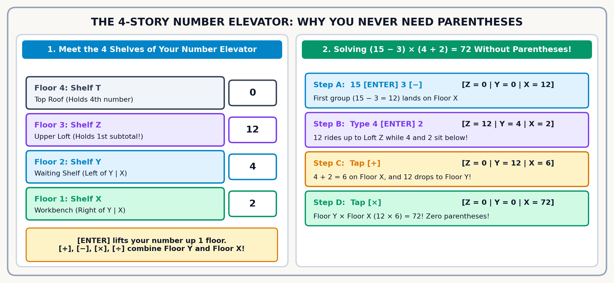

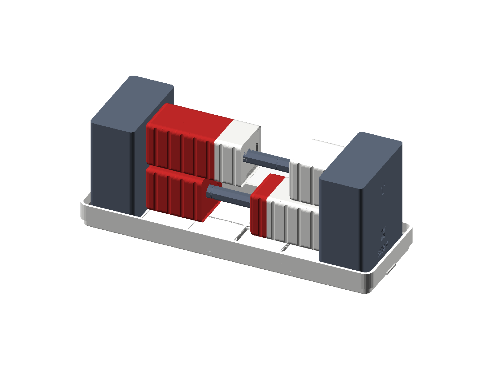

| Elevator Shelf | Table Column Name | How This Shelf Helps You Build | Where You See It on Screen |
|---|---|---|---|
| **Top Shelf $T$** | **Register T** | **The Repeat Shelf:** Keeps a constant step size locked at the top for skip-counting ladders | Top shelf of the 4-story elevator |
| **Shelf $Z$** | **Register Z** | **The Upper Waiting Shelf:** Holds your first finished group while you build a second group below | Just above Shelf $Y$ |
| **Shelf $Y$** | **Register Y** | **The Waiting Shelf:** Holds your first number ready to combine with Shelf $X$ | Stacked right above Ground Shelf $X$ |
| **Ground Shelf $X$** | **Register X** | **Your Workbench:** Every number you type and every answer you calculate appears right here | Bottom line of the screen in large bold digits |

### 2.1.2 The Three Golden Rules of Stack Math

1. **Type the First Number and Press `[ENTER]`:**  
   Whenever you tap digit keys (for example, `3`), that number appears on Ground Shelf $X$ right before your eyes. When your first number is complete, tapping `[ENTER]` lifts it up onto Waiting Shelf $Y$ (like an elevator rising one story), leaving a copy on the bottom shelf that is immediately replaced as soon as you type your next number.
2. **Type the Second Number on Shelf $X$:**  
   As soon as you tap the next digit, your second number takes its place on Shelf $X$ while your first number waits in plain view on Shelf $Y$ right beside it.
3. **Tap the Action Key Last (`+`, `-`, `×`, `÷`):**  
   When you tap an action key such as `[+]`, the `3` on Shelf $Y$ drops down and fuses with the `4` on Shelf $X$, placing their combined sum **`7`** right onto the bottom shelf while Shelf $Y$ resets cleanly to `0`. At that exact same moment, any number waiting upstairs on Shelf $Z$ rides the elevator down into Shelf $Y$, ready for its turn!

### 2.1.3 How Automatic Stack Lift Saves Your Answers
One of the friendliest habits of your SC-6 is **automatic stack lift**. Say you just added `4 [ENTER] 5 [+]` and your answer `9` is sitting on Shelf $X$. What happens when you start typing a new number, like `6`?

You do **NOT** need to press `[ENTER]` first, and typing `6` will **never** erase your `9`! Because the calculator knows `9` is a finished answer, the moment you touch `6`, it automatically sends `9` up to Shelf $Y$ (and pushes anything in Shelf $Y$ up to Shelf $Z$) to make room for your `6` on Shelf $X$:

| Elevator Shelf | Right After `4 [ENTER] 5 [+]` | The Moment You Touch `6` | Ready for Your Next Action Key |
| :---: | :---: | :---: | :---: |
| **Top Shelf $T$** | $0$ | $0$ | $0$ |
| **Shelf $Z$** | $0$ | $0$ | $0$ |
| **Shelf $Y$** | $0$ | **$9$** (Rides up automatically!) | **$9$** |
| **Shelf $X$** | **$9$** (Finished answer) | `6_` (New number begins) | **$6$** |

### 2.1.4 How the Elevator Drops (and the Top-Shelf Secret)
Whenever you press a two-number action key (`+`, `-`, `×`, `÷`), all four shelves of the elevator move together in one smooth step:
1. The waiting number on **Shelf $Y$** combines with the active number on **Shelf $X$**—for example, in subtraction or division, Shelf $Y$ always goes first: $\text{Shelf } Y - \text{Shelf } X$ ($12 - 5 = 7$) or $\text{Shelf } Y \div \text{Shelf } X$ ($12 \div 4 = 3$).
2. Their combined answer lands on **Shelf $X$**.
3. Whatever was waiting on **Shelf $Z$** drops down into **Shelf $Y$**.
4. Whatever was on **Top Shelf $T$** drops down into **Shelf $Z$**—and **leaves a copy of itself behind on Top Shelf $T$!**

Why does Top Shelf $T$ leave a copy of itself behind every time the elevator drops? Because if you lock a step size (like `7`) into Top Shelf $T$, it will keep feeding fresh `7`s down the elevator forever, letting you skip-count through your times tables ($7, 14, 21, 28 \dots$) with single taps of `[+]`!

### 2.1.5 Reading Your Stacked Shelves ($Y$ Above $X$)

When you write a column addition or subtraction story on paper, or stack two rows of blocks in your desk tray, the first number sits on the upper row and the second number sits right underneath it on the bottom row.

Your SC-6 daylight screen matches that exact physical layout by stacking **Waiting Shelf $Y$ right above Ground Shelf $X$**. Across the top status bar sit your mode indicators and battery icon; below them sit the waiting shelves (**`T:`**, **`Z:`**, and **`Y:`** in 4-shelf mode, or **`T:`** right above **`X`** in 2-shelf mode); and along the bottom edge of the screen in extra-large bold digits sits **Ground Shelf $X$**. **Waiting Shelf $Y$** holds the first number you locked in with `[ENTER]` (like **`12`**), and **Ground Shelf $X$** right below it shows the second number you are typing right now (like **`4`**). Because **`12`** sits on the upper shelf and **`4`** sits on the lower shelf, reading down your screen from Shelf $Y$ to Shelf $X$ matches the exact top-to-bottom order of $12 - 4 = 8$ and $12 \div 4 = 3$! *(Prefer one extra-large number on screen without the upper shelves? Open `[g] [FLAGS]` anytime and toggle Flag 4 between the default **4-Shelf Stack** view and **Single-Shelf $X$** view.)*

![Math Dominoes Studio: Placing [5|4] = 9 and [3|2] = 5 Across the 10-Break Line on the 12-Frame Tray to Regroup 9 + 5 into 10 + 4 = 14](../assets/manuals/math_dominoes_bridging_12frame.png)

### 2.1.6 Fast Two-Shelf Warm-Up: Dominoes, Swaps & Saving for a Telescope
Just as a single **Math Domino** holds two dot patterns across its divider line, your calculator's stacked $Y$ and $X$ shelves keep both numbers of a calculation visible right before they combine. Pick up the `[5|3]` Math Domino from your tray: 5 pips sit on one half and 3 pips sit on the other half. Keying `5 [ENTER] 3 [+]` mirrors that exact domino on your screen—lifting `5` up onto Waiting Shelf $Y$ ($Y = 5$), placing `3` on Ground Shelf $X$ ($X = 3$), and snapping them together into **`8`**. *(Did your screen show `53` instead of `8`? That just means your thumb forgot to press `[ENTER]` to separate the two numbers!)*

Seeing both shelves at once is even handier when order matters, like subtraction. Suppose your friends eat $4$ slices from a $9$-slice square pizza: the starting total (`9`) belongs on Waiting Shelf $Y$ above and the slices eaten (`4`) belong on Ground Shelf $X$ below, so keying `9 [ENTER] 4 [-]` leaves **`5`** slices on the pan. What if you were talking to a friend and accidentally typed `4 [ENTER] 9` backward? Instead of clearing and starting over, just glance at your stack (`Y: 4` above `X: 9`), tap **`[x⇄y]`** once to swap the two shelves into `Y: 9` above `X: 4`, and press `[-]`!

Now step up from single digits to two-digit numbers—say, **23 trading cards** in your binder and **14 cards** in a deck box. Dock `2` tens and `3` ones in the top row of your **Place Value Tray** ($23$, matching Shelf $Y$) and `1` ten and `4` ones in the bottom row ($14$, matching Shelf $X$). Keying `23 [ENTER] 14 [+]` combines the tens ($20 + 10 = 30$) and the ones ($3 + 4 = 7$) into **`37`** cards.

What happens when those ones digits overflow past 10? Picture combining **$\$47$** saved from birthday gifts with **$\$36$** earned pet-sitting a neighbor's cat to buy an **$\$83$ backyard telescope**. On your **Place Value Tray**, the $7 + 6 = 13$ ones trade 10-for-1 to add $+1$ to the `TENS` column ($4 + 3 + 1 = 8\text{ tens}$) and leave `3` in `ONES` ($83$). Running `47 [ENTER] 36 [+]` combines both amounts into $\$83$ and immediately taps **`[f] [LASTX]`** (`[f]` then `[ENTER]`) and `[-]` to subtract the $\$36$ back out—restoring your starting **`83`** birthday dollars on Shelf $X$:

| Keystroke | Register T | Register Z | Register Y | Register X | What Happens on the Stack |
| :--- | :--- | :--- | :--- | :--- | :--- |
| `47` | 0 | 0 | 0 | 47 | Type your $\$47$ birthday gift savings onto Shelf $X$. |
| `[ENTER]` | 0 | 0 | 47 | 47 | Lift $\$47$ up to Shelf $Y$. |
| `36` | 0 | 0 | 47 | 36 | Type your $\$36$ cat-sitting earnings onto Shelf $X$. |
| `[+]` | 0 | 0 | 0 | 83 | Combine both amounts ($47 + 36 = 83$) for the telescope; 36 is tucked into `LAST x`. |
| `[f] [LASTX]` | 0 | 0 | 83 | 36 | Recall 36 onto Shelf $X$ while 83 lifts automatically to Shelf $Y$. |
| `[-]` | 0 | 0 | 0 | 47 | Subtract $83 - 36 = 47$ to verify your starting $\$47$ birthday savings! |

---

### 2.1.7 Everyday Stories on the 4-Shelf Stack
Now let's watch how **automatic stack lift** and the four elevator shelves handle real-world puzzles that chain multiple steps together: weighing a squirming dog at home, watching a living cell double, adding bike-riding minutes across three days, and dealing a deck of cards.

Look at the three numbers from our telescope story right above ($47$, $36$, and $83$). What happens when a real-life mystery hands you the combined total ($83$) and one part ($36$), and you need to work backward to uncover the hidden part ($47$)? Have you ever tried to weigh a big, squirming golden retriever on a bathroom scale? Its paws hang off the edges, its tail wags, and it walks right off before the readout settles! Vets and pet owners solve this by weighing the dog inside its rolling travel crate ($83\text{ pounds}$ together) and then subtracting the weight of the empty crate ($36\text{ pounds}$). Placing the combined $83\text{-pound}$ weight on Shelf $Y$ and subtracting the $36\text{-pound}$ crate with `83 [ENTER] 36 [-]` immediately reveals **`47`** pounds for your dog—and tapping `[f] [LASTX] [+]` adds the $36\text{-pound}$ crate right back on to prove $47 + 36 = 83$!

Now look at how living things grow in biology. Every spring in shallow pond water, a fertilized frog egg begins as a single round cell. Under a magnifying glass, a groove pinches across the middle and that single cell divides into $2$ identical cells. About thirty minutes later, both cells divide at the same time to make $4$ cells, then $8$, then $16$, doubling on every round of cell division. Starting with $2$ cells after the first split, how many cells are in the cluster after four more rounds of doubling?

On your SC-6, pressing `[ENTER]` makes an identical twin copy of whatever number sits on Shelf $X$. That means tapping `[ENTER] [+]` doubles *any* number in two quick clicks! Place 2 tiles on your desk, double them to 4, then 8, then 16, and ride the two-key doubling rhythm (`[ENTER] [+]`) four times in a row on your SC-6: running `2 [ENTER] [+] [ENTER] [+] [ENTER] [+] [ENTER] [+]` clones and fuses each generation of cells until Shelf $X$ reaches **`32`** cells.

| Keystroke | Register T | Register Z | Register Y | Register X | What Happens on the Stack |
| :--- | :--- | :--- | :--- | :--- | :--- |
| `2` | 0 | 0 | 0 | 2 | Place the first 2 frog cells onto Shelf $X$. |
| `[ENTER] [+]` | 0 | 0 | 0 | 4 | Clone 2 onto Shelf $Y$ and add ($2 + 2 = 4$ cells after split 2). |
| `[ENTER] [+]` | 0 | 0 | 0 | 8 | Clone 4 onto Shelf $Y$ and add ($4 + 4 = 8$ cells after split 3). |
| `[ENTER] [+]` | 0 | 0 | 0 | 16 | Clone 8 onto Shelf $Y$ and add ($8 + 8 = 16$ cells after split 4). |
| `[ENTER] [+]` | 0 | 0 | 0 | 32 | Clone 16 onto Shelf $Y$ and add ($16 + 16 = 32$ cells after split 5). |

What about adding a list of three or more numbers in a row? Imagine tracking your bike rides after school for three days: **15 minutes** on Monday, **24 minutes** on Tuesday, and **31 minutes** on Wednesday. How do you add three numbers in a row on the stack—and why do you only press `[ENTER]` **once** at the very beginning?

First, spot a neat mental-math shortcut in the ones digits: $5 + 4 + 1 = 10$. Now watch **automatic stack lift** do the work after the first addition: once `15 [ENTER] 24 [+]` produces `39` on Shelf $X$, typing `31` automatically lifts `39` up to Shelf $Y$ without needing another `[ENTER]`. Keying in `15 [ENTER] 24 [+] 31 [+]` chains all three rides into a total of **`70`** minutes.

| Keystroke | Register T | Register Z | Register Y | Register X | What Happens on the Stack |
| :--- | :--- | :--- | :--- | :--- | :--- |
| `15` | 0 | 0 | 0 | 15 | Type Monday's 15-minute bike ride onto Shelf $X$. |
| `[ENTER]` | 0 | 0 | 15 | 15 | Lift 15 up to Shelf $Y$ so the bottom shelf is ready for Tuesday. |
| `24` | 0 | 0 | 15 | 24 | Type Tuesday's 24-minute ride onto Shelf $X$. |
| `[+]` | 0 | 0 | 0 | 39 | Combine Monday and Tuesday ($15 + 24 = 39$ minutes on Shelf $X$). |
| `31` | 0 | 0 | 39 | 31 | Typing Wednesday's 31 minutes automatically lifts 39 to Shelf $Y$! |
| `[+]` | 0 | 0 | 0 | 70 | Combine all three days ($39 + 31 = 70$ total biking minutes). |

Finally, picture sitting down with 3 friends to play Euchre, which uses a 24-card deck (the 9, 10, Jack, Queen, King, and Ace of all four suits), and dealing all 24 cards equally among the 4 players. How many cards does each player get?

Deal your 24 counting tiles into 4 equal piles on your desk: you see 6 tiles in each pile, showing with your hands that division is just multiplication (`4 × 6 = 24`) run in reverse. Just like subtraction, the starting total (`24`) goes onto Shelf $Y$ and the number of players (`4`) goes onto Shelf $X$. Entering `24 [ENTER] 4 [÷]` divides the deck evenly to show **`6`** cards per player—and tapping `[f] [LASTX] [×]` right after multiplies `6` by `4` to restore all `24` cards.

---

## 2.2 Solving Two-Group Puzzles on the Upper Shelves

In every example so far—from weighing a dog on a bathroom scale to dealing a 24-card Euchre deck—we only needed Shelf $Y$ and Shelf $X$ because we were combining one pair of numbers at a time. What happens when a puzzle has **two separate groups** that each need to be solved first before they can be multiplied or divided together? Whenever you finish the first group of a puzzle on Shelf $X$ and start typing the second group, automatic stack lift carries your first group upstairs to **Shelf $Z$**—and drops it right back down to **Shelf $Y$** as soon as the second group finishes!

### 2.2.1 Stepping Through $(15 - 3) \times (4 + 2) \div 6 = 12$

To see how the four-story elevator handles two groups at once, imagine you are helping organize snacks for a 5th-grade field day and hit a puzzle with two separate groups that need to be multiplied and then shared equally:

$$(15 - 3) \times (4 + 2) \div 6 = 12$$

On your SC-6, the elevator shelves hold your place at every step:
1. **Solve the First Group ($15 - 3$):** Tap `15 [ENTER] 3 [-]`, and **`12`** immediately appears on Shelf $X$.
2. **Solve the Second Group ($4 + 2$) While `12` Waits Upstairs:** Right away, tap `4 [ENTER] 2 [+]`. Automatic stack lift carries your finished **`12`** up to **Shelf $Z$** while `4` and `2` sit on the lower shelves, and tapping `[+]` turns $4 + 2$ into **`6`** on Shelf $X$ as **`12`** rides right back down to Shelf $Y$ beside it!
3. **Multiply the Groups and Share by `6`:** Now both finished groups (`12` and `6`) are sitting side by side on your screen. One tap of `[×]` multiplies them into `72`, and tapping `6` `[÷]` splits `72` into 6 equal shares to reveal **`12`**.

Here is how all four shelves carry both groups when you key in `15 [ENTER] 3 [-] 4 [ENTER] 2 [+] [×] 6 [÷]` $\to$ **`12`**:

| Keystroke | Register T | Register Z | Register Y | Register X | What Happens on the Stack |
| :--- | :--- | :--- | :--- | :--- | :--- |
| `15` | 0 | 0 | 0 | 15 | Place 15 onto Shelf $X$ to start the first group. |
| `[ENTER]` | 0 | 0 | 15 | 15 | Lift 15 up to Shelf $Y$. |
| `3` | 0 | 0 | 15 | 3 | Type 3 onto Shelf $X$. |
| `[-]` | 0 | 0 | 0 | 12 | First group finished: $15 - 3 = 12$ sits on Shelf $X$. |
| `4` | 0 | 0 | 12 | 4 | Typing 4 automatically lifts your finished 12 to Shelf $Y$! |
| `[ENTER]` | 0 | 12 | 4 | 4 | Pressing `[ENTER]` lifts 12 up to Shelf $Z$ and 4 to Shelf $Y$. |
| `2` | 0 | 12 | 4 | 2 | Type 2 onto Shelf $X$ while 12 waits safely on Shelf $Z$. |
| `[+]` | 0 | 0 | 12 | 6 | Second group finished ($4 + 2 = 6$); 12 drops back to Shelf $Y$! |
| `[×]` | 0 | 0 | 0 | 72 | Multiply the two groups together ($12 \times 6 = 72$ on Shelf $X$). |
| `6` | 0 | 0 | 72 | 6 | Typing 6 automatically lifts 72 up to Shelf $Y$. |
| `[÷]` | 0 | 0 | 0 | 12 | Share 72 into 6 equal groups ($72 \div 6 = 12$ on Shelf $X$). |


Notice how smooth that elevator drop felt: once your hands learn to lift numbers with `[ENTER]` and combine them with `[+]`, `[-]`, `[×]`, and `[÷]`, every other helper key on your keypad—whether you are splitting whole groups and leftovers with `[g] [÷R]`, locking a constant step into Top Shelf $T$ with `[g] [REP]`, bridging across ten in `[▦]`, or simplifying fraction towers with `[g] [SIMP]`—follows the exact same rhythm.

---

### 2.2.2 Choosing How Many Shelves You Need: `2-LVL`, `4-LVL`, and `8-LVL`

Just as you might use a small two-pocket folder for a quick homework sheet or a big four-shelf locker for all your school projects, the `[g] [FLAGS]` menu (`Flag 5` on hardware firmware, or the Stack Depth selector in the companion app) lets you choose how many shelves your Number Elevator uses:

- **2-Shelf Mode ($T, X$ — `2-LVL`):** Uses just two shelves—**Top Shelf $T$** (for the waiting number) and **Ground Shelf $X$** (for the active number). Because Top Shelf $T$ is the roof of this two-story elevator, whatever number sits on Shelf $T$ stays locked there like a permanent step-counter when the stack drops! That makes `2-LVL` wonderful for early explorers practicing single-step addition, subtraction, and Ten-Frame games.
- **4-Shelf Mode ($X, Y, Z, T$ — `4-LVL` Standard):** The classic four-story Number Elevator—Shelf $X$, Shelf $Y$, Shelf $Z$, and Top Shelf $T$. This is your everyday mode for 3rd–6th grade adventures: multi-step word problems, whole-number division with remainders (`[g] [÷R]`), fractions, and multi-group calculations.
- **8-Shelf Mode (8 Stories Deep — `8-LVL` Companion App Option):** Expands the elevator to 8 full waiting shelves in the companion app for long tournament mental-math relays where you want to stack half a dozen subtotals at once.

One of the first experiments kids try on a calculator is building an automatic step counter: typing `1 [ENTER] 1 [+]` and tapping `[+]` over and over to watch the screen climb $2, 3, 4, 5 \dots$

Try it in **4-Shelf Mode (`4-LVL`)** first: after `1 [ENTER] 1 [+]` gives `2`, what happens if you tap `[+]` again? The screen stays at `2`! Why? Because in 4-Shelf mode, the elevator dropped `0` down from Shelf $Z$ into Shelf $Y$, so tapping `[+]` simply added $2 + 0 = 2$. To make a 4-shelf elevator count forever, you first press Constant Repeat (`1 [g] [REP]`), which fills all four shelves ($T, Z, Y, X$) with `1` so Top Shelf $T$ keeps feeding fresh `1`s down the stack!

In **2-Shelf Mode (`2-LVL`)**, however, Top Shelf $T$ *is* the second shelf right above Ground Shelf $X$. So when `+` drops the stack, Top Shelf $T$ automatically keeps its `1` forever:
`1 [ENTER] 1 [+]` $\implies \mathbf{2}$, `[+]` $\implies \mathbf{3}$, `[+]` $\implies \mathbf{4}$, `[+]` $\implies \mathbf{5}$!

---

## 2.3 Steering Numbers Around Your Shelves

Five dedicated keys on your keypad let you trade, spin, repeat, recall, or inspect numbers across your shelves whenever you want:

| Helper Key | What It Is Called | How It Moves Your Shelves |
|---|---|---|
| `[x⇄y]` | **Swap Shelf $X$ and Shelf $Y$** | Trades the active number on Shelf $X$ with the waiting number on Shelf $Y$ ($X \leftrightarrow Y$), fixing reversed subtraction or division in one tap. |
| `[f] [R↓]` | **Roll Down the Carousel** | Spins all four shelves downward like a Ferris wheel ($X \to T,\; T \to Z,\; Z \to Y,\; Y \to X$) so you can inspect every shelf. |
| `[g] [REP]` | **Constant Repeat** | Copies the number on Shelf $X$ across all four shelves ($T, Z, Y, X$) so repeated taps of `[+]` or `[×]` climb skip-counting ladders automatically. |
| `[f] [LASTX]` | **Last Number Recall** | Brings back the number that was on Shelf $X$ right before your last action key, ready for a two-tap check or instant undo. |
| `[g] [SHOW]` | **Full Digits Peek** | Momentarily reveals every internal digit of the number sitting on Shelf $X$. |

### 2.3.1 Fixing Reversed Entries & Spinning the 4-Shelf Carousel
What happens if you type two numbers onto the stack in reverse order during a subtraction or division problem? Picture blending a **24-ounce pitcher of berry smoothie** in the kitchen and wanting to pour it equally into **8 cups** ($24 \div 8 = 3$). Because you are counting the 8 cups on the counter first, your fingers accidentally type `8` before `24` (`8 [ENTER] 24`).

Just look at your stacked shelves before pressing divide: `8` is sitting on Shelf $Y$ above `24` on Shelf $X$. One tap of `[x⇄y]` swaps them onto their proper shelves before you press `[÷]`. When you run `8 [ENTER] 24 [x⇄y] [÷]`, the swap key puts `24` onto Shelf $Y$ and `8` onto Shelf $X$ so division cleanly gives **`3`** ounces per cup.

| Keystroke | Register T | Register Z | Register Y | Register X | What Happens on the Stack |
| :--- | :--- | :--- | :--- | :--- | :--- |
| `8` | 0 | 0 | 0 | 8 | You type the 8 empty cups first onto Shelf $X$. |
| `[ENTER]` | 0 | 0 | 8 | 8 | Lift 8 up onto Shelf $Y$. |
| `24` | 0 | 0 | 8 | 24 | Type the 24-ounce pitcher onto Shelf $X$ (oops—reversed!). |
| `[x⇄y]` | 0 | 0 | 24 | 8 | Swap Shelf $Y$ and Shelf $X$ so 24 is on Shelf $Y$ and 8 is on Shelf $X$! |
| `[÷]` | 0 | 0 | 0 | 3 | Divide 24 ounces into 8 cups ($24 \div 8 = 3$ ounces per cup). |

Whenever two numbers land on Shelf $Y$ and Shelf $X$ in reverse order, one tap of `[x⇄y]` trades their places right on the spot.

What if you have numbers parked on all four shelves ($T, Z, Y, X$) and want to check every shelf without erasing a single number? Think of the four shelves like a four-car Ferris wheel or a rotating tray carousel.

Load `10`, `20`, `30`, and `40` onto the four shelves of your elevator, then spin them around the 4-shelf carousel using **Roll Down (`[f] [R↓]`)**: when you key in `10 [ENTER] 20 [ENTER] 30 [ENTER] 40 [f] [R↓]`, each tap of `[f] [R↓]` brings the next shelf down to the bottom shelf until all four numbers return to their starting shelves with **`30`** back on Shelf $X$.

| Keystroke | Register T | Register Z | Register Y | Register X | What Happens on the Stack |
| :--- | :--- | :--- | :--- | :--- | :--- |
| `10` | 0 | 0 | 0 | 10 | Place 10 onto Shelf $X$. |
| `[ENTER]` | 0 | 0 | 10 | 10 | Lift 10 up to Shelf $Y$. |
| `20` | 0 | 0 | 10 | 20 | Place 20 onto Shelf $X$. |
| `[ENTER]` | 0 | 10 | 20 | 20 | Lift 10 to Shelf $Z$ and 20 to Shelf $Y$. |
| `30` | 0 | 10 | 20 | 30 | Place 30 onto Shelf $X$. |
| `[ENTER]` | 10 | 20 | 30 | 30 | Lift 10 to Top Shelf $T$, 20 to Shelf $Z$, and 30 to Shelf $Y$. |
| `40` | 10 | 20 | 30 | 40 | Place 40 on Shelf $X$ (all 4 shelves now hold 10, 20, 30, 40). |
| `[f] [R↓]` | 40 | 10 | 20 | 30 | Roll 1: 30 drops to Shelf $X$, while 40 wraps around to Top Shelf $T$. |
| `[f] [R↓]` | 30 | 40 | 10 | 20 | Roll 2: 20 drops to Shelf $X$, while 30 wraps around to Top Shelf $T$. |
| `[f] [R↓]` | 20 | 30 | 40 | 10 | Roll 3: 10 drops to Shelf $X$, while 20 wraps around to Top Shelf $T$. |
| `[f] [R↓]` | 10 | 20 | 30 | 40 | Roll 4: Every number returns to its starting shelf ($X = 40$)! |

Because there are four shelves ($T, Z, Y, X$), pressing `[f] [R↓]` four times brings every number right back to its starting shelf.

### 2.3.2 Reversing Multiplication and Undoing Steps in Two Taps
Just as **`[f] [LASTX]`** let us verify our $\$83$ telescope savings sum in two taps, that exact same backup pocket works for multiplication, division, and subtraction too. Imagine a group of **15 friends and parents** going to a matinee movie where tickets cost **$\$8.00$ each** ($15 \times 8.00 = 120.00$ dollars). How can you double-check that the $\$120.00$ total is right in two taps?

If you model 2 rows of 8 tiles ($16$) on your desk and divide by 8, you see that dividing by the row width always brings back the number of rows. Now multiply the 15 tickets by $\$8$ and let `[f] [LASTX]` reverse-check the receipt by dividing by `8`: entering `15 [ENTER] 8 [×] [f] [LASTX] [÷]` computes the $\$120$ total and immediately divides by the recalled $\$8$ ticket price to restore **`15`** tickets on Shelf $X$.

| Keystroke | Register T | Register Z | Register Y | Register X | What Happens on the Stack |
| :--- | :--- | :--- | :--- | :--- | :--- |
| `15` | 0 | 0 | 0 | 15 | Place the 15 moviegoers onto Shelf $X$. |
| `[ENTER]` | 0 | 0 | 15 | 15 | Lift 15 up to Shelf $Y$. |
| `8` | 0 | 0 | 15 | 8 | Type the $\$8$ ticket price onto Shelf $X$. |
| `[×]` | 0 | 0 | 0 | 120 | Multiply $15 \times 8 = 120$ dollars; 8 is saved in `LAST x`. |
| `[f] [LASTX]` | 0 | 0 | 120 | 8 | Recall the $\$8$ ticket price to Shelf $X$ (120 lifts to Shelf $Y$). |
| `[÷]` | 0 | 0 | 0 | 15 | Divide $120 \div 8 = 15$ to verify all 15 tickets! |

That same `[f] [LASTX]` rescue also lets you undo a subtraction when plans change. Say you have **$\$120.00$** in birthday and chore savings, and you spend **$\$45.00$** on a new skateboard deck (`120 [ENTER] 45 [-]` $\to$ $\$75.00$). Then your parents surprise you by offering to cover the $\$45.00$ deck as a birthday gift!

How do you undo the subtraction and get your $\$120.00$ balance back? Just tap `[f] [LASTX]` to pull `45` out of memory and tap `[+]`. Running `120 [ENTER] 45 [-] [f] [LASTX] [+]` subtracts the $\$45$ purchase and immediately reunites `$75` on Shelf $Y$ with the recalled `$45` on Shelf $X$ to restore **`120`** dollars.

| Keystroke | Register T | Register Z | Register Y | Register X | What Happens on the Stack |
| :--- | :--- | :--- | :--- | :--- | :--- |
| `120` | 0 | 0 | 0 | 120 | Place your starting $\$120$ savings onto Shelf $X$. |
| `[ENTER]` | 0 | 0 | 120 | 120 | Lift $\$120$ up to Shelf $Y$. |
| `45` | 0 | 0 | 120 | 45 | Type the $\$45$ skateboard deck price onto Shelf $X$. |
| `[-]` | 0 | 0 | 0 | 75 | Subtract $120 - 45 = 75$ dollars left; 45 is saved in `LAST x`. |
| `[f] [LASTX]` | 0 | 0 | 75 | 45 | Recall the $\$45$ price to Shelf $X$ while 75 lifts to Shelf $Y$. |
| `[+]` | 0 | 0 | 0 | 120 | Add $75 + 45 = 120$ to restore your full $\$120$ savings! |

In two clicks (`[f] [LASTX]` and `[+]`), your full $\$120.00$ savings balance is right back on the bottom shelf.

### 2.3.3 Whole Groups and Leftovers on Two Shelves
Earlier, when we dealt 24 cards among 4 players, the deck divided evenly with zero cards left over. What happens in real life when numbers *don't* divide evenly?

Picture a neighborhood bakery pulling **17 warm bagels** from the oven and packing them into paper bags that hold **5 bagels each**. How many bags are filled completely, and how many loose bagels are left over on the counter?

Deal 17 counting tiles into piles of 5 on your desk: you get **3 full piles of 5** ($15$ tiles) and **2 loose tiles** left over. Now watch **Quotient & Remainder (`[g] [÷R]`)** put the full bags on Shelf $X$ and the leftover bagels on Shelf $Y$ at the exact same time: when you key in `17 [ENTER] 5 [g] [÷R]`, `[g] [÷R]` splits the 17 bagels into 3 full bags and 2 leftovers before `[x⇄y]` swaps **`3`** onto Shelf $X$ so you can inspect the leftover bagels.

| Keystroke | Register T | Register Z | Register Y | Register X | What Happens on the Stack |
| :--- | :--- | :--- | :--- | :--- | :--- |
| `17` | 0 | 0 | 0 | 17 | Place all 17 warm bagels onto Shelf $X$. |
| `[ENTER]` | 0 | 0 | 17 | 17 | Lift 17 up onto Shelf $Y$. |
| `5` | 0 | 0 | 17 | 5 | Place the bag size (5 bagels per bag) onto Shelf $X$. |
| `[g] [÷R]` | 0 | 0 | 2 | 3 | Shelf $X$ shows 3 full bags; Shelf $Y$ holds 2 leftover bagels! |
| `[x⇄y]` | 0 | 0 | 3 | 2 | Swap shelves to bring the 2 leftover bagels onto Shelf $X$. |

With 3 full bags packed and 2 warm bagels swapped into view by `[x⇄y]`, both parts of the story sit on your screen at once—and if every single bagel needs to go into a bag, you just grab $3 + 1 = 4\text{ bags}$ in all.

That same whole-number remainder key works on larger batches, too. If a school chess club 3D-prints **125 custom chess pieces** and snaps them into storage trays that hold **8 pieces per row**, how many 8-piece rows are filled completely, and how many extra pieces remain for the next tray?

Key in `125 [ENTER] 8 [g] [÷R]`, which first places 15 full rows on Shelf $X$ with 5 leftover pieces waiting on Shelf $Y$, and then swaps **`15`** onto the bottom shelf. *(Want to prove $15 \times 8 + 5 = 125$ in three taps? Right after `[g] [÷R]`, tap `[f] [LASTX] [×] [+]` and watch `125` reappear.)*

---

### 2.3.4 The `1089` Mind-Reading Stack Trick

Want to amaze your parents or friends at the dinner table? Tell them you can read their mind using the SC-6 elevator stack:
1. Write the secret number **`1089`** on a folded slip of paper and hand it to an adult before you start.
2. Ask them to pick *any* 3-digit number where the first and last digits differ by at least 2 (for example, **`732`**).
3. Have them reverse the digits (**`237`**) and subtract the smaller number from the larger on the stack (`732 [ENTER] 237 [-]` $\to$ `495`).
4. Now take that intermediate answer (`495`), reverse its digits (**`594`**), and add them right on the stack: when you run the complete chain `732 [ENTER] 237 [-] 594 [+]`, Shelf $X$ immediately lights up with **`1089`**!
5. Tell them to open the folded paper—no matter which 3-digit number they started with, the stack lands on **`1089`** every single time! *(Why it works: subtracting a reversed 3-digit number always produces a multiple of 99 whose hundreds and ones digits add to 9, and adding its reverse gives $900 + 180 + 9 = 1,089$.)*

---

## 2.4 Why Stack Math Never Needs Parentheses

Why is it so much easier to solve a multi-step math puzzle when you build from the inside out on a stack? Think about clearing space on your desk: our minds work best when we only have to focus on two pieces in front of us at a time. When a long equation forces you to keep track of two or three open sets of parentheses while remembering which operation comes next, it is easy to lose your place. When the Polish logician Jan Łukasiewicz invented parenthesis-free notation in 1924 *([Łukasiewicz, 1924](sc6/appendix-c-formulas-and-conversions.md#cite-lukasiewicz1924))*, he showed that any expression—no matter how intricate—can be evaluated one pair of numbers at a time so you only ever focus on the two numbers sitting on Shelf $Y$ and Shelf $X$ right now.

Look at this multi-step order-of-operations puzzle:
$$40 - 3 \times (2 + 3)^2 \div 5 = 25$$

When people try to solve this from left to right on paper, the **#1 trap** is subtracting $40 - 3 = 37$ first. Why? Because reading left-to-right tempts your eyes to grab $40 - 3$ before noticing that the $3$ is attached by multiplication to $(2 + 3)^2$. Compare the two ways to evaluate this expression:

### 2.4.1 Solving $40 - 3 \times (2 + 3)^2 \div 5$ from the Inside Out
On notebook paper, you have to copy the entire untouched outer frame of the equation over and over on four separate lines like a funnel (**P**arentheses $\to$ **E**xponents, which you can picture as a $5 \times 5 = 25$ square of Counting Tiles $\to$ **M**ultiply/**D**ivide left-to-right $\to$ **A**dd/**S**ubtract left-to-right), taking care never to subtract $40 - 3$ before multiplying.

On your SC-6, you never have to rewrite a line:
- First, park the outer `40` and `3` safely upstairs on Shelf $Z$ and Shelf $Y$ (`40 [ENTER] 3 [ENTER]`) while you solve $(2 + 3)^2$ right on Shelf $X$ with `[+]` and `[x²]`.
- Next, scale and divide (`[×] 5 [÷]`) and finish with `[-]` in one continuous chain:
  `40 [ENTER] 3 [ENTER] 2 [ENTER] 3 [+] [x²] [×] 5 [÷] [-]` $\longrightarrow$ **`25`**.

| What You Are Solving | Rewriting on Notebook Paper | Building on Your SC-6 Shelves |
| :--- | :--- | :--- |
| **1. Park Outer Numbers & Add `(2 + 3)`** | Rewrite $40 - 3 \times (5)^2 \div 5$ | `40 [ENTER] 3 [ENTER] 2 [ENTER] 3 [+]` $\to$ `5` on Shelf $X$ (`3` on Shelf $Y$, `40` on Shelf $Z$) |
| **2. Square the Group (`5²`)** | Rewrite $40 - 3 \times 25 \div 5$ | Tap `[x²]` $\to$ `25` on Shelf $X$ |
| **3. Scale & Divide (`3 × 25 ÷ 5`)** | Rewrite $40 - 75 \div 5 \to 40 - 15$ | Tap `[×] 5 [÷]` $\to$ `15` on Shelf $X$ while `40` drops to Shelf $Y$ |
| **4. Final Subtraction (`40 - 15`)** | $40 - 15 = \mathbf{25}$ | Tap `[-]` $\to$ **`25`**. |

### 2.4.2 The Clark's Nutcracker's 30,000-Seed Memory Ledger
That same ability to keep track of a running total while new numbers arrive shows up in nature, too. High in the alpine forests of the Rocky Mountains, a silver-and-black bird called **Clark's nutcracker** (*Nucifraga columbiana*) performs one of the animal kingdom's most astonishing feats of memory. Every autumn, a single nutcracker harvests up to $30,000$ whitebark pine seeds, buries them in thousands of small underground caches across mountain ridges, and remembers their exact locations nine months later under deep winter snow.

How does a bird track its winter pantry? Like a living stack ledger. Say a nutcracker buries **9 pine seeds in each of 12 caches** along a granite ridge, finds **15 extra seeds** under a fallen pine log, and eats **28 seeds** during a January blizzard:
$$\text{Remaining Seeds} = 9 \times 12 + 15 - 28 = 95\text{ seeds}$$

If you build $12$ rows of $9$ Counting Tiles on your desk to represent the $108$ cached seeds, slide in $15$ loose tiles for the bonus find under the log ($123$ seeds in all), and then sweep away $28$ tiles for the January blizzard, you are left with $95$ seeds. On your SC-6, the entire seasonal ledger flows across Shelf $X$ and Shelf $Y$ in 10 keystrokes—multiplying the 12 caches of 9 seeds first (`9 [ENTER] 12 [×]`), adding the 15 extra seeds (`15 [+]`), and subtracting the 28 eaten seeds (`28 [-]`) to land directly on **`95` seeds**.

Field biologists who study Clark's nutcrackers in the Cascade and Rocky Mountains discovered that the bird uses spatial landmarks—pairs of pine trees, boulders, and ridge lines—to triangulate each cache when six feet of snow cover the ground. Instead of trying to memorize a single giant map of thirty thousand seeds, the nutcracker groups its caches into small neighborhood clusters of 8 to 15 caches per ridge. That is the exact same secret behind your calculator's stack: breaking a big job into small, visible clusters makes it effortless to remember where every piece belongs.

### 2.4.3 Five Multi-Step Journeys without Brackets
Just like the Clark's nutcracker grouping its pine seeds ridge by ridge, your calculator's upper shelves let you solve everyday multi-group puzzles in one smooth flow—whether you are ordering food at a ballpark, packing bakery boxes, paving a bike trail, or laying stone pavers in a backyard.

Imagine stopping at a **stadium snack bar** to order **3 warm soft pretzels at $\$4.00$ each** AND **2 fruit smoothies at $\$5.00$ each** ($3 \times 4 + 2 \times 5$). How does **Shelf $Z$** keep track of both parts of your snack-bar order? If you build two tile arrays on your desk—a $3 \times 4$ array ($12$) and a $2 \times 5$ array ($10$)—you can watch the exact same partnership happen in row 6 of the stack table below: as soon as you type `2 [ENTER] 5` for the smoothies, your $\$12$ pretzel subtotal rides the elevator up to **Shelf $Z$**, waiting safely until the $\$10$ smoothie total finishes on Shelf $X$. Running `3 [ENTER] 4 [×] 2 [ENTER] 5 [×] [+]` brings both subtotals together on the bottom two shelves and combines them into **`22`** dollars in all:

| Keystroke | Register T | Register Z | Register Y | Register X | What Happens on the Stack |
| :--- | :--- | :--- | :--- | :--- | :--- |
| `3` | 0 | 0 | 0 | 3 | Place 3 warm pretzels onto Shelf $X$. |
| `[ENTER]` | 0 | 0 | 3 | 3 | Lift 3 up onto Shelf $Y$. |
| `4` | 0 | 0 | 3 | 4 | Type the $\$4$ pretzel price onto Shelf $X$. |
| `[×]` | 0 | 0 | 0 | 12 | Pretzel subtotal ($3 \times 4 = 12$ dollars) sits on Shelf $X$. |
| `2` | 0 | 0 | 12 | 2 | Typing 2 smoothies automatically lifts 12 up to Shelf $Y$! |
| `[ENTER]` | 0 | 12 | 2 | 2 | Pressing `[ENTER]` lifts 12 up to Shelf $Z$ and 2 to Shelf $Y$. |
| `5` | 0 | 12 | 2 | 5 | Type the $\$5$ smoothie price onto Shelf $X$ while 12 waits on Shelf $Z$. |
| `[×]` | 0 | 0 | 12 | 10 | Smoothie subtotal ($2 \times 5 = 10$); 12 drops back to Shelf $Y$! |
| `[+]` | 0 | 0 | 0 | 22 | Combine both items ($12 + 10 = 22$ dollars total on Shelf $X$). |

Look at Row 8 of that table: right before you press `[+]`, Shelf $Y$ shows your $\$12$ pretzels and Shelf $X$ shows your $\$10$ smoothies side by side. Once your fingers feel that rhythm—solve the first group, type the second group while Shelf $Z$ holds your place, and combine—you can race through two-group puzzles in seconds. Try a **10-second no-peek speed replay** of the $(15 - 3) \times (4 + 2) \div 6$ pattern we met earlier: picture a Saturday morning bakery where **15 blueberry muffins are baked per batch and 3 get eaten warm** ($15 - 3 = 12$ left per batch) across **4 morning batches plus 2 afternoon batches** ($4 + 2 = 6$ batches), packed into **6-muffin gift boxes**. Keying `15 [ENTER] 3 [-] 4 [ENTER] 2 [+] [×] 6 [÷]` lifts `12` to Shelf $Z$, multiplies by `6` batches (`72`), and divides by `6` to land on **`12`** gift boxes in under ten seconds!

What if your two groups are connected by division instead of multiplication—like **paving a park bike trail** where you divide one difference by another, $(24 - 8) \div (6 - 2)$? Say a 24-mile bike trail has 8 miles already paved ($24 - 8 = 16$ miles left), and a trail crew paves $6 - 2 = 4$ miles per day. How many days will it take to finish? Watch how the first difference ($24 - 8 = 16$) rides upstairs to Shelf $Z$, then drops right back onto Shelf $Y$ the moment the second difference ($6 - 2 = 4$) finishes on the bottom shelf: keying in `24 [ENTER] 8 [-] 6 [ENTER] 2 [-] [÷]` divides `16` on Shelf $Y$ by `4` on Shelf $X$ to display **`4`** days:

| Keystroke | Register T | Register Z | Register Y | Register X | What Happens on the Stack |
| :--- | :--- | :--- | :--- | :--- | :--- |
| `24` | 0 | 0 | 0 | 24 | Type the 24-mile bike trail onto Shelf $X$. |
| `[ENTER]` | 0 | 0 | 24 | 24 | Lift 24 up onto Shelf $Y$. |
| `8` | 0 | 0 | 24 | 8 | Type the 8 miles already paved onto Shelf $X$. |
| `[-]` | 0 | 0 | 0 | 16 | Unpaved trail remaining ($24 - 8 = 16$ miles) sits on Shelf $X$. |
| `6` | 0 | 0 | 16 | 6 | Typing 6 automatically lifts 16 up to Shelf $Y$. |
| `[ENTER]` | 0 | 16 | 6 | 6 | Lift 16 up to Shelf $Z$ and 6 onto Shelf $Y$. |
| `2` | 0 | 16 | 6 | 2 | Type 2 onto Shelf $X$ while 16 waits safely on Shelf $Z$. |
| `[-]` | 0 | 0 | 16 | 4 | Daily paving speed ($6 - 2 = 4$ miles/day); 16 drops to Shelf $Y$! |
| `[÷]` | 0 | 0 | 0 | 4 | Divide remaining miles by daily speed ($16 \div 4 = 4$ days). |

When the final `[÷]` key drops the stack, Shelf $X$ shows `4`—and if you tap `[f] [LASTX] [×]` right after, the calculator multiplies $4 \times 4$ to bring `16` right back. You can even chain addition, subtraction, multiplication, and division together in a single bake-sale story: suppose each baking sheet holds **18 chocolate-chip cookies plus 6 oatmeal cookies** ($18 + 6 = 24$ cookies per tray), you bake **10 trays minus 5 trays** saved for home ($10 - 5 = 5$ trays), and you pack all those cookies into **12-cookie bakery boxes**, $(18 + 6) \times (10 - 5) \div 12$. Solve the first group (`24`), type the second group (`5`) while `24` waits upstairs on Shelf $Z$ and drops back to Shelf $Y$, then multiply and divide by `12` in one continuous flow via `18 [ENTER] 6 [+] 10 [ENTER] 5 [-] [×] 12 [÷]` to fill **`10`** boxes!

Even better, when a two-part puzzle involves squaring numbers—like laying a **backyard stone patio around a garden bed** ($15^2 - 9^2$)—you don't even need Shelf $Z$, because the **`[x²]` (Square)** key squares each number right in place on Shelf $X$! Imagine your family is laying stone pavers in a **$15\text{ ft} \times 15\text{ ft}$** square backyard around a central **$9\text{ ft} \times 9\text{ ft}$** raised wooden garden bed. Tapping `15 [x²]` turns `15` into `225` right on Shelf $X$, and typing `9` automatically lifts `225` to Shelf $Y$ while you square `9`: entering `15 [x²] 9 [x²] [-]` subtracts the $81\text{ sq ft}$ garden bed from the $225\text{ sq ft}$ yard to leave **`144`** square feet of patio pavers:

| Keystroke | Register T | Register Z | Register Y | Register X | What Happens on the Stack |
| :--- | :--- | :--- | :--- | :--- | :--- |
| `15` | 0 | 0 | 0 | 15 | Place the outer courtyard side length ($15\text{ ft}$) onto Shelf $X$. |
| `[x²]` | 0 | 0 | 0 | 225 | Square the outer yard ($15 \times 15 = 225\text{ sq ft}$) right on Shelf $X$. |
| `9` | 0 | 0 | 225 | 9 | Typing 9 automatically lifts 225 up to Shelf $Y$! |
| `[x²]` | 0 | 0 | 225 | 81 | Square the inner garden bed ($9 \times 9 = 81\text{ sq ft}$) on Shelf $X$. |
| `[-]` | 0 | 0 | 0 | 144 | Subtract the garden bed from the yard ($225 - 81 = 144\text{ sq ft}$). |

Look closely at that difference of two squares: $225 - 81 = 144$, and $144$ is itself a perfect square ($12 \times 12 = 12^2$). That means the pavers surrounding the $9 \times 9$ garden bed could be rearranged into a solid $12\text{ ft} \times 12\text{ ft}$ square patio with zero leftover stones—uncovering the famous $9\text{–}12\text{–}15$ right-triangle family ($9^2 + 12^2 = 15^2$) that carpenters and surveyors use to check square corners. Best of all, notice how the six-column trace table above let you follow every single number as it rode up and down the waiting shelves—a table format that dates back to the very first computer programmer in history.

---

### 2.4.4 Ada Lovelace, Charles Babbage & the First Mechanical Stack

More than a hundred years before the first electronic pocket calculator was built, two visionary friends in London imagined a machine that solved multi-step puzzles using waiting shelves remarkably like your SC-6.

In the **1830s**, the English inventor **Charles Babbage** grew frustrated with printed books of navigation and astronomy tables. Those tables were calculated by rooms full of human clerks using pen and paper, and whenever a clerk lost track of an intermediate subtotal in the margins, ships at sea could steer miles off course. Babbage set out to design a steam-powered brass giant called the **Analytical Engine**—the true mechanical ancestor of every modern computer and calculator.

When Babbage sketched the floor plan of his Analytical Engine, he realized that any machine that solves multi-step math needs **two separate rooms**:

1. **The "Store" (A Hall of Waiting Columns):** Babbage designed a long gallery of tall vertical brass columns, where each column of engraved gear wheels could hold a multi-digit number waiting quietly in plain sight until it was needed—just like an intermediate subtotal waiting upstairs on **Shelf $Y$, Shelf $Z$, or Top Shelf $T$** while you build the next part of a problem below.
2. **The "Mill" (The Active Gear Workbench):** At the front of the machine sat a spinning gear workshop that Babbage named the **Mill**, after the humming textile mills of northern England. Whenever two numbers were ready to combine, mechanical levers fetched them from the Store, brought them into the Mill, and meshed their brass teeth together to add, subtract, multiply, or divide them on the active workbench.

In **1833**, a seventeen-year-old mathematics prodigy named **Ada Byron** (later **Ada Lovelace**) visited Babbage's workshop in London. While most guests simply stared at the gleaming brass gears like a clockwork curiosity, young Ada immediately understood the mathematical soul of the machine. Ten years later, in **1843**, at age twenty-seven, Ada Lovelace published her famous *Notes* on the Analytical Engine—including **"Note G,"** the world's very first published computer program!

How did Ada Lovelace write the world's first computer program? She drew a **multi-column trace table** across a wide sheet of paper! Down the left column, she listed each operation (`+`, `-`, `×`, `÷`); across the middle columns, she showed the exact number sitting on every waiting column of the Store before and after the gears turned; and on the right, she explained what that step accomplished in the calculation.

Look back at any stack table in this chapter: every part of Babbage and Lovelace's 1843 Analytical Engine lives right inside the calculator on your desk. Babbage's **Store** is your set of **Waiting Shelves $Y$, $Z$, and Top Shelf $T$**, while his **Mill** is your **Ground Shelf $X$** workbench. Even the mechanical transfer levers that lifted, swapped, spun, repeated, or recalled numbers between the Store and the Mill match the helper keys (`[ENTER]`, `[x⇄y]`, `[f] [R↓]`, `[g] [REP]`, and `[f] [LASTX]`) under your thumb. Every time you read across a 4-register stack table to see what sits on each shelf after a keystroke, you are reading Ada Lovelace's 1843 "Note G" trace table brought to life.

Even more inspiring, Ada Lovelace realized something in 1843 that even Babbage himself hadn't noticed: a machine with waiting shelves and an active workbench isn't limited to dry accounting tables—if you represent musical notes, geometric patterns, or logical rules with numbers, those same shelves can compose music, explore patterns, and test scientific ideas! Every time you use your SC-6 to test a pattern or check your own work in two clicks, you are stepping into the footsteps of the world's first programmer.

### 2.4.5 Rear Admiral Grace Hopper & the Three-Cup Kitchen-Table Stack

A century after Ada Lovelace wrote her 1843 trace tables, another trailblazing mathematician turned Babbage and Lovelace's dream into modern computing reality: **Rear Admiral Grace Hopper** (1906–1992). As a child growing up in New York City, seven-year-old Grace wanted to know how mechanical alarm clocks worked—so she disassembled **seven alarm clocks** in her bedrooms before her mother realized what she was doing (and kindly limited her to taking apart just *one* clock at a time!).

When Grace Hopper became one of the first programmers of the room-sized **Harvard Mark I** computer in 1944 and later invented the world's first **compiler** in 1952, she loved making invisible computer ideas something students and engineers could hold in their hands. Whenever someone asked her why computer engineers cared so much about saving a billionth of a second (**one nanosecond**) inside a stack calculation, she pulled a bundle of cut copper wires out of her handbag and handed one out. Each wire was cut to **$11.8\text{ inches}$** ($29.98\text{ centimeters}$)—the exact maximum distance that light or electricity can travel in one billionth of a second! (You can check Grace Hopper's "nanosecond wire" on your stack right now: light travels about $300,000,000\text{ meters}$ per second, which is $30,000,000,000\text{ centimeters}$ per second; dividing by $1,000,000,000$ nanoseconds in a second leaves exactly **`30` centimeters**!)

In Grace Hopper's hands-on spirit, you can build a working model of a computer's stack processor right on your kitchen table using **four paper cups** (or four sticky notes) and a stack of index cards:

1. **Set Up Your Four-Story Cup Elevator:** Line up four paper cups from bottom to top on the table and label them **Shelf X (Workbench)** at the bottom, **Shelf Y (Waiting)** above it, **Shelf Z (Third Story)** above that, and **Top Shelf T** at the top. Set one extra saucer to the side labeled **`LAST x`**.
2. **Act Out $(8 + 4) \times (9 - 6)$ by Hand:** Write `8` on an index card and drop it into Cup $X$. Call out *"ENTER!"*—slide `8` up into Cup $Y$ and write `4` for Cup $X$. Now call out *"PLUS!"*—replace both cards with a single card reading **`12`** in Cup $X$, while tucking the old `4` card onto the `LAST x` saucer!
3. **Watch Automatic Stack Lift in Action:** Without touching `ENTER`, write `9` on a new card for Cup $X$—because `12` is a finished answer, it automatically slides up to Cup $Y$! Call out *"ENTER!"* to lift `12` up to **Cup $Z$** and `9` to Cup $Y$, then place `6` in Cup $X$.
4. **Drop the Stack to Finish:** Call out *"MINUS!"* to turn `9` and `6` into **`3`** in Cup $X$ while `12` drops from Cup $Z$ back to Cup $Y$. Finally, call out *"MULTIPLY!"* to combine `12` and `3` into **`36`** in Cup $X$!

Once you move index cards through four paper cups with your own hands, the four registers inside your calculator (`X, Y, Z, T`) will never feel mysterious again—you can literally picture the cards sliding up and down the shelves inside the case.

---

## 2.5 Dinner-Table Stack Tricks & Looking Ahead

Now that you can ride all four shelves of the Number Elevator—and swap, roll, or undo any step on the fly—you are ready to test your stack skills at the dinner table and peek ahead to Chapter 3.

### 2.5.1 Three Dinner-Table Stack Tricks to Try

Gather a parent, a sibling, or a friend around the dinner table and try these three stack-powered mind readers and races:

1. **The Shoe-Size & Birth-Year Mind Reader:** Hand your SC-6 to a parent or friend and tell them to secretly enter their whole **shoe size** (say, `9`), press `[ENTER] 5 [×]` ($45$), add `50` (`50 [+]` $\to 95$), multiply by `20` (`20 [×]` $\to 1900$), and add **`1026`** (`1026 [+]` $\to 2926$). Why does that sequence work? Multiplying their shoe size by $5$ and then by $20$ scales their shoe size by $5 \times 20 = \mathbf{100}$, shifting their shoe size cleanly into the **hundreds column** ($9 \times 100 = 900$), while adding $50 \times 20 = 1000$ plus $1026$ adds today's calendar year (**`2026`**) right on top ($900 + 2026 = 2926$). Finally, have them type the **4-digit year they were born** (say, `1984`) and tap `[-]` ($\to \mathbf{942}$)—then look at the screen and amaze them: the hundreds digits show their **shoe size (`9`)**, and the last two digits show their **age (`42`)**!
2. **The Inside-Out Napkin Speed Race:** Write $100 - 4 \times (3 + 2)^2 \div 5$ on a napkin and race an adult using their phone calculator while you solve it from the inside out on your SC-6. First, put `100` and `4` onto the upper waiting shelves (`100 [ENTER] 4 [ENTER]`), next build the inner $(3 + 2)^2$ group (`3 [ENTER] 2 [+] [x²]` $\to \mathbf{25}$), and finally multiply by the `4` waiting on Shelf $Y$, divide by `5`, and subtract from `100` (`[×] 5 [÷] [-]` $\to \mathbf{80}$)—then check whether the phone calculator fell into the left-to-right $100 - 4 = 96$ trap!
3. **The Mystery Receipt Coupon Unmasker (`[f] [LASTX]` & `[f] [R↓]`):** Hand your SC-6 to a family member and ask them to add any three item prices from a grocery receipt on the stack (for example, `14 [ENTER] 8 [+] 19 [+]` $\to 41$), then secretly subtract a mystery coupon amount (`6 [-]` $\to \mathbf{35}$) before handing the calculator back to you showing only `35` on Shelf $X$. Tell them you will unmask their secret coupon and restore the original receipt total in just two button taps: press **`[f] [LASTX]`** to reveal their secret coupon (`6`) right on Shelf $X$ while `35` lifts to Shelf $Y$, and tap **`[+]`** to restore the full **`41`** receipt total! Afterward, load four favorite numbers onto the shelves and spin the 4-shelf carousel four times (`[f] [R↓] [f] [R↓] [f] [R↓] [f] [R↓]`) to watch every shelf return to its starting seat.

---

### 2.5.2 Peeking Inside Multi-Digit Numbers in Chapter 3

When Jan Łukasiewicz wrote down his parenthesis-free math notation in 1924, and when Australian computer scientist Charles Hamblin realized in 1957 that a stack of waiting shelves in computer memory could bring Łukasiewicz's idea to life, they were describing the exact rhythm your hands use with blocks: place the pieces on the workbench first, and combine them when they are ready.

Even better, every modern computer processor on Earth—from the chip inside your SC-6 to the flight computers aboard interplanetary spacecraft—evaluates math internally on a hardware stack using this exact inside-out order! By steering Shelves $X, Y, Z,$ and $T$ directly with your fingertips, you are thinking in the native language of every computer and engineering lab in the world. Here is a quick reference to the core stack moves you now have at your command:

| Stack Move or Keycap | How Your Hands Build It | What Happens on Shelves $T, Z, Y, X$ |
| :--- | :--- | :--- |
| **Push & Lift (`[ENTER]`)** | Place your first block group on the upper shelf | Copies Shelf $X$ up to Shelf $Y$ and prepares Shelf $X$ for the next number |
| **Combine (`[+]`, `[-]`, `[×]`, `[÷]`)** | Fuse or compare the two groups on your workbench | Combines `Shelf Y (op) Shelf X` onto Shelf $X$ and drops $Z \to Y$ and $T \to Z$ |
| **Swap Shelves (`[x⇄y]`)** | Trade the upper and lower block groups in one move | Trades Shelf $Y$ and Shelf $X$ immediately if you typed `-` or `÷` in reverse order |
| **4-Shelf Carousel (`[f] [R↓]`)** | Spin all four trays around to inspect upper shelves | Rolls $X \to T$, $T \to Z$, $Z \to Y$, and $Y \to X$ (four taps restore every seat) |
| **Undo & Check (`[f] [LASTX]`)** | Pull the last block group back onto the workbench | Recalls the previous Shelf $X$ number before the last operation so you can verify or undo |
| **Fair Share & Leftovers (`[g] [÷R]`)** | Pack items into equal boxes and count leftovers | Places whole groups (quotient $Q$) on Shelf $X$ and leftovers (remainder $R$) on Shelf $Y$ |

Notice how each of those six moves mirrors a physical action you can see on your desk: setting a number on a waiting shelf, combining two shelves together, swapping two trays, spinning the four-story carousel, or pulling back the piece you just used to double-check your work. Because you never have to type opening and closing brackets or trust a hidden memory button, you can tackle two-group and three-group puzzles with total calm.

Now that you can move whole numbers up and down all four shelves, have you ever stopped to wonder what is actually *inside* a multi-digit number like `14`, `365`, or `4,725`? Turn the page to **[Chapter 3: Ten-Frames, Number Lines & Place Value](sc6/03-counting-place-value.md)**, where we will travel back in time to see how ten human fingers and an empty shell created the number Zero (`0`)—and open the visual picture windows on your SC-6 to watch numbers bundle into tens, hundreds, thousands, and billions!

---

# Chapter 3: Ten-Frames, Number Lines & Place Value

## 3.1 How Ten Fingers and an Empty Shell Created Place Value

Imagine trying to count 250 sheep by dropping 1 pebble into your pocket for every sheep that walks past the gate. By noon, your pockets would rip wide open and your pants would fall down! Ancient builders and merchants had the same problem when they tried to count thousands of bricks or bags of grain. Without a smart way to group numbers by tens, Ancient Egyptian scribes had to chisel **thirty-six separate symbols** into stone—nine coiled ropes for the thousands, nine lotus flowers for the hundreds, nine heel bones for the tens, and nine vertical strokes for the ones—just to write the single four-digit number $9,999$!

Then ancient mathematicians in India and the Maya world invented the ultimate math cheat code *([Ifrah, 2000](sc6/appendix-c-formulas-and-conversions.md#cite-ifrah2000))*: **Place Value and the number Zero (`0`).**

Look down at your two hands: you have **10 fingers**. Thinkers realized that you don't need thousands of different symbols to write giant numbers. You only need ten digits (`0` through `9`) and one clever rule: **a digit's value depends on which slot it sits in!** Drawing an empty shell in the sand—the world's first **Zero (`0`)**—meant *"this slot is empty, so hold this spot open!"* Because `0` holds the empty slots open, a single digit `1` can mean 1 sheep (`1`), 10 sheep (`10`), 100 sheep (`100`), or ten million stars (`10,000,000`) just by sliding one column to the left.

With your **StackCalc SC-6** and your 3D-printed math blocks, you can build and test this ten-finger cheat code with your own hands. When you snap counters into the **Ten-Frame Studio** or slide the two-color beads across the **Number Rack**, you can see every group of 5 and 10 right on your desk. Throughout this chapter, you will open four visual picture windows on your keypad—`[▦]` (Ten-Frame Studio), `[g] [COUNT]` (Number Rack), `[f] [LINE]` (Open Number Line), and `[PV]` (Place Value X-Ray)—using `[.]` to drop single counters, combining and separating numbers on the stack, and returning to standard numbers anytime with `[NUM]`.

---

### 3.1.1 Building Numbers from Blocks to the Stack

When you look at bare digits on a flat worksheet, a sum like $8 + 5 = 13$ can look like two symbols jumping to a new number without showing *why* they snap together into one ten and three ones. When you build with your 3D-printed math blocks first and then tap `[▦]` or `[f] [LINE]` on your keypad, your **StackCalc SC-6** draws that exact same counter tray or number-line trail on the daylight screen right above your four number shelves:

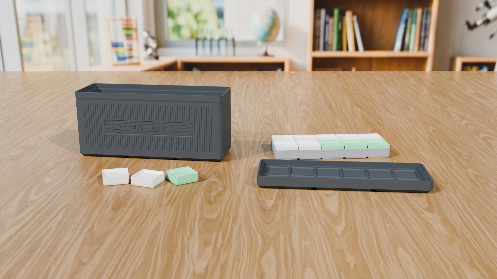

Each of the four visual picture keys (`[▦]`, `[g] [COUNT]`, `[f] [LINE]`, `[PV]`) pairs directly with a physical tray on your desk—turning the screen into a live window where groups of five, full tens, and place-value columns click into place right before your eyes:

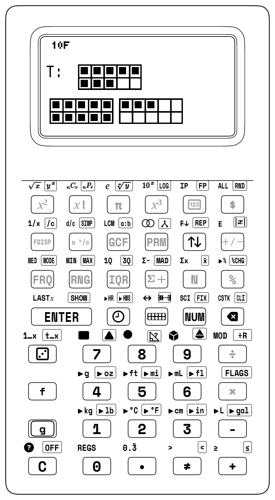

### 3.1.2 The 1-to-10 Staircase & Friends of Ten

Have you ever tried adding all the counting numbers from $1$ to $10$ ($1 + 2 + 3 + 4 + 5 + 6 + 7 + 8 + 9 + 10$) without losing track halfway through? You can discover a wonderful **Friends-of-Ten** shortcut right on your desk using your **Unit Miniblocks** (where each block adds $7.0\text{ mm}$ of height) and your **10-Rod** (which stands $70.0\text{ mm}$ tall, matching 10 stacked blocks):
1. **Build the Staircase:** Line up towers of $1, 2, 3, 4, 5, 6, 7, 8,$ and $9$ Unit Miniblocks in a row right beside your 10-Rod ($10$). Together they form a 10-step staircase climbing step by step up to the top of the 10-Rod.
2. **Snap the Friends of Ten Together:** Pick up the smallest step ($1\text{ block}$) and snap it on top of the $9\text{-block}$ step—together they stand completely flush with the **10-Rod ($1 + 9 = 10$)**! Next, snap the $2\text{-block}$ step onto the $8\text{-block}$ step ($2 + 8 = 10$), the $3\text{-block}$ step onto the $7\text{-block}$ step ($3 + 7 = 10$), and the $4\text{-block}$ step onto the $6\text{-block}$ step ($4 + 6 = 10$).
3. **Count Your Ten-Rods at a Glance:** Look at your desk now: instead of ten messy piles, you have **five matching Ten-Rods** ($10$, $9+1$, $8+2$, $7+3$, and $6+4$, worth $5 \times 10 = 50$) plus the single middle tower of **$5$ blocks** standing by itself in the center. On your SC-6 stack, key in `10 [ENTER] 5 [×] 5 [+]` to see those five tens and one five unite into **`55`**!

---

### 3.1.3 Spotting Number Partners on the Ten-Frame

Roll a six-sided game die across a table and you know right away when it lands on 5, without pointing your finger at the dots and counting $1, 2, 3, 4, 5$. For tiny groups of $1$ to $4$, your eyes recognize the exact count immediately; for larger numbers, your brain spots friendly groups of **5** and **10** and snaps them together at a glance. When you see $7$ counters sitting in a ten-frame tray, you never count to seven by ones—you immediately see a full top row of $5$ plus $2$ more on the bottom ($5 + 2 = 7$).

Every visual mode on your SC-6 screen—and every 3D-printed tray on your desk—is built around those same landmarks of **5** and **10** so number patterns jump right out at you. A raised divider ridge down the middle of both 10-pocket **Ten-Frame Trays** splits each row of coral-red and amber-gold counter disks into touch-friendly groups of five, just as the two smooth rods of your **Number Rack (Rekenrek)** group 20 sliding beads into 5 red and 5 white beads per row to mirror Waiting Shelf $Y$ and Ground Shelf $X$. Even your **Place Value Trays** pair their digit blocks (`0`–`9`) with stackable `+1` regrouping blocks so that 10 stacked blocks stand the exact same height as a Ten-Frame 10-Rod!

---

## 3.2 Ten-Frame Bridges, Step-Counter Towers & Tile Staircases

Think of the four visual sandbox keys (`[▦]`, `[g] [COUNT]`, `[f] [LINE]`, and `[PV]`) as special camera lenses that let you peek inside your calculator's shelves and *see* your numbers as real blocks, beads, and number trails.

Type `7` onto Shelf $X$ and press `[▦]`. Right away, the screen opens the Ten-Frame Studio with two visual rows labeled **`T`** (for the waiting number above) and **`X`** (for your active workbench below). For numbers from $1$ to $10$, a single $5 \times 2$ ten-frame tray is drawn cleanly on the row; as soon as a number grows to $11\text{–}20$, a second side-by-side ten-frame tray appears automatically right next to the first! Inside the ten-frame on Row **`X`** for `7`, all 5 pockets of the top row are filled with dark round counters (`[●][●][●][●][●]`), while the bottom row holds 2 counters followed by **3 empty pockets** (`[●][●][ ][ ][ ]`).

While you are inside the Ten-Frame Studio, the decimal key `[.]` acts like your own hand dropping counters into the tray one at a time. Starting from $X = 7$, watch what happens each time you tap `[.]`:
- Tap `[.]` once and an 8th counter drops into the bottom row ($X = 8$).
- Tap `[.]` again and a 9th counter lands next to it ($X = 9$), leaving just **1 empty pocket** in the tray.
- Tap `[.]` a third time and the 10th counter fills all 10 pockets of the tray ($X = 10$), showing one complete group of ten!
- Tap `[.]` one more time ($X = 11$) and a second side-by-side ten-frame appears automatically as the 11th counter hops into the first pocket of Frame 2, showing $10 + 1 = 11$ right before your eyes.

> **Spotting the Partner to Ten & Switching Lenses Anytime:** Because Ten-Frame mode (`[▦]`) draws whatever number is already sitting on Shelf $X$, type a number like `7` *first* and then tap `[▦]` to see its counters pop into the tray! With 7 counters in Frame 1, you see 3 empty pockets waiting at the end of the row—so pressing `3` `[+]` fills all 10 pockets of the tray and lands on $X = \mathbf{10}$. Whenever you want to return from any visual picture window (`[▦]`, `[g] [COUNT]`, `[f] [LINE]`, or `[PV]`) to regular stack digits, just tap **`[NUM]`** (or tap **`[C]`** once when you aren't typing digits) to switch back while keeping every shelf ($T, Z, Y, X$) completely intact. In stack view, `[NUM]` starts with Whole Number Mode **ON** (so typing `12.34` begins a mixed fraction); tapping **`[NUM]`** a second time (or tapping **`[f] [ALL]`** / **`[g] [FIX]`**) toggles Whole Number Mode **OFF** whenever you want to type a decimal like `12.34`!

---

### 3.2.1 Making a Ten First ($8 + 5 = 10 + 3 = 13$)

When you first add two numbers that cross past 10 (like $8 + 5$), counting on your fingers (*"eight... nine, ten, eleven, twelve, thirteen"*) can feel slow and tricky. The Ten-Frame Studio shows you a much faster way: instead of counting by ones, you slide just enough counters from the second number to finish filling the first tray of 10, and drop the remaining counters into the second tray!
$$\mathbf{8 + 5 = 8 + (2 + 3) = (8 + 2) + 3 = 10 + 3 = 13}$$

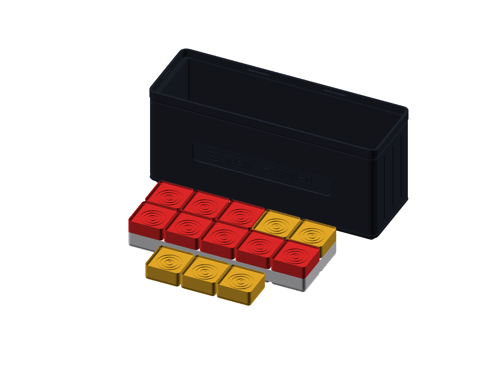

First, build the bridge on your desk: place **8 coral-red counters** into Frame 1 of your physical tray (`[●][●][●][●][●] | [●][●][●][ ][ ]`, leaving **2 empty pockets**), and hold **5 amber-gold counters** in your hand. Instead of adding all 5 at once, split your 5 gold counters into **`2 + 3`**:
1. Drop **2 gold counters** into the two empty pockets of Frame 1 (`[●][●][●][●][●] | [●][●][●][●][●]`) to lock in a **Full 10** ($8 + 2 = 10$).
2. Drop the remaining **3 gold counters** into the fresh second frame (`[●][●][●][ ][ ] | [ ][ ][ ][ ][ ]`).
3. Read the two trays together: **1 full tray of 10 + 3 extras = 13!** On your SC-6, key in `[▦] 8 [ENTER] 5 [+]` to see **`13`**, or step through the bridge inside your Ten-Frame window (`8 [▦]`, then `2 [+]` to fill all 10 pockets of Frame 1, then `3 [+]` to open Frame 2 with the remaining 3 counters):

| Keystroke | Register T | Register Z | Register Y | Register X | What Happens on the Stack |
| :--- | :--- | :--- | :--- | :--- | :--- |
| `8 [▦]` | 0 | 0 | 0 | 8 | Place 8 counters into Frame 1 on Shelf $X$ (leaving 2 empty pockets). |
| `2 [+]` | 0 | 0 | 0 | 10 | Drop 2 counters into the empty pockets to complete a full 10 in Frame 1! |
| `3 [+]` | 0 | 0 | 0 | 13 | Drop the remaining 3 counters into Frame 2 ($10 + 3 = 13$ on Shelf $X$). |

### 3.2.2 Bridging Across Ten in Everyday Life
Once you start looking for landmarks of five and ten, you spot them everywhere you go. Suppose you step out onto the porch at dusk and spot **5 fireflies** blinking near the railing (filling the top row of Frame 1) and **3 more** down by the back fence (sitting on the bottom row); keying `5 [ENTER] 3 [+]` snaps the 5-row and the 3-row together into **`8`** fireflies on Shelf $X$.

What if your first ten-frame is almost full and a new handful pushes you past 10? Picture sorting shiny creek stones into a 10-slot pebble carton where **9 slots are already full** (leaving just **1 empty pocket**) and you find **4 more quartz pebbles** in the creek. Instead of counting up one by one, split the 4 new pebbles into **$1 + 3$** so 1 pebble snaps the first carton shut at `10` and the other 3 pebbles start the second carton (`9 [ENTER] 1 [+] 3 [+]` $\to$ **`13`**):

| Keystroke | Register T | Register Z | Register Y | Register X | What Happens on the Stack |
| :--- | :---: | :---: | :---: | :---: | :--- |
| `9 [ENTER]` | 0 | 0 | 9 | 9 | Put 9 quartz creek pebbles onto Shelf $X$ and lift a copy to Shelf $Y$. |
| `1 [+]` | 0 | 0 | 0 | 10 | Add 1 pebble to fill the last pocket of Frame 1 ($9 + 1 = 10$ on Shelf $X$). |
| `3 [+]` | 0 | 0 | 0 | 13 | Add the remaining 3 pebbles into Frame 2 ($10 + 3 = 13$ pebbles on Shelf $X$). |

You see that same bridge-across-ten move down at a pond when Log 1 holds **9 green frogs** and **6 brown frogs** hop over: 1 frog fills Log 1 to `10` and the other 5 frogs land on Log 2 (`9 [▦] 1 [+] 5 [+]` $\to \mathbf{15}$). Or picture an arcade basketball shootout where you score **7 points** in Round 1, leaving **3 empty pockets** in Frame 1. When you sink **6 bonus points** in the lightning round, split `6` into twin halves ($3 + 3$) via `7 [ENTER] 3 [+] 3 [+]` to lock Frame 1 at `10` and land on **`13`** points—or tap `[f] [LASTX] [+]` right after the first `3 [+]` to reuse `3` in a single click!

Now run that ten-frame bridge in reverse for subtraction. Every frame at a ten-pin bowling alley sets up **10 maple pins** in a triangle ($1 + 2 + 3 + 4 = 10$). Knock down **4 pins** on your first roll via `10 [ENTER] 4 [-]`, and Frame 1 shows **`6`** pins left standing for your spare shot (and when you pick up the spare, tapping `[f] [LASTX] [+]` reunites $6 + 4 = 10$!). Even when you start above ten—say, holding **14 colored markers** (one full 10-pack plus 4 loose markers) and lending **6 markers** to a friend—you can step backward across the 10-line in two easy hops. Split $-6$ into **$-4$ and $-2$** via `14 [ENTER] 4 [-] 2 [-]`, handing over the 4 loose markers first to reach a clean `10`, and then pulling 2 markers from the 10-pack to leave **`8`** markers:

| Keystroke | Register T | Register Z | Register Y | Register X | What Happens on the Stack |
| :--- | :---: | :---: | :---: | :---: | :--- |
| `14 [ENTER]` | 0 | 0 | 14 | 14 | Put 14 colored markers onto Shelf $X$ and lift a copy to Shelf $Y$. |
| `4 [-]` | 0 | 0 | 0 | 10 | Hand over the 4 loose markers from Frame 2, leaving a full 10-pack on Shelf $X$. |
| `2 [-]` | 0 | 0 | 0 | 8 | Take 2 more markers from the 10-pack, leaving 8 markers on Shelf $X$. |

---

### 3.2.3 Step-Counter Towers & Building a 12-Tile Tower up to 84 Millimeters

Have you ever noticed that counting forward ($1, 2, 3, 4 \dots$) is really just adding $1$ over and over again? On your SC-6, you can watch the `1` sit right on Shelf $Y$ while you stack real $7.0\text{ mm}$ counting tiles into a rising tower on your desk!

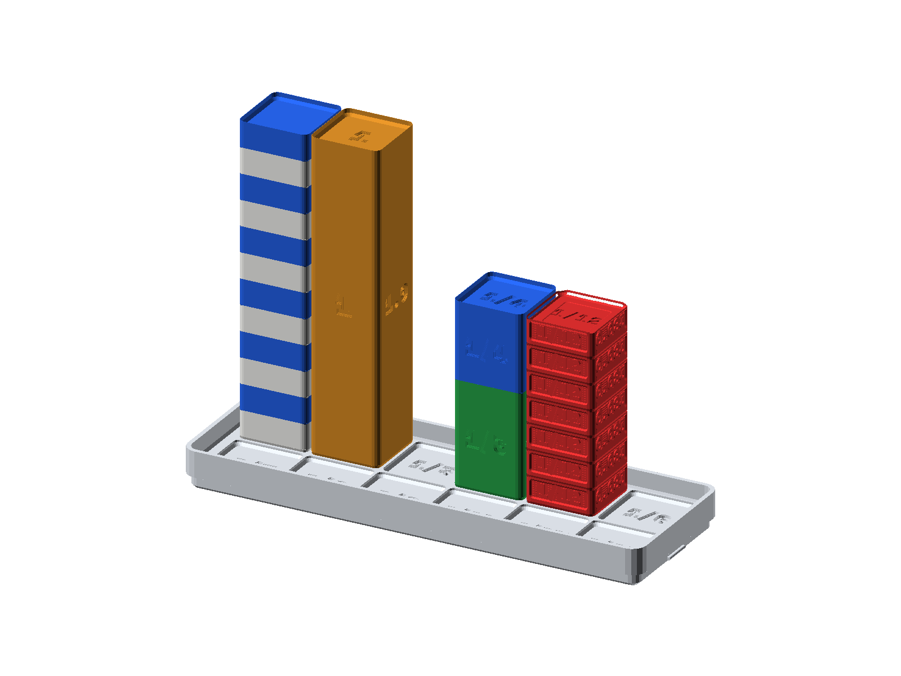

Every interlocking Counting Tile adds exactly $7.0\text{ mm}$ of visible height. As you snap them together one by one, watch how your growing tower matches the exact heights of your **84 mm Fraction Studio** blocks:

| Stacked Tile Count (`X`) | Total Tower Height | How It Matches Your Fraction & Geometry Blocks |
| :---: | :---: | :--- |
| **Tile 1 (`X = 1`)** | $7.0\text{ mm}$ | Matches one $1/12$ Fraction Block |
| **Tile 2 (`X = 2`)** | $14.0\text{ mm}$ | Matches one $1/6$ Fraction Block |
| **Tile 3 (`X = 3`)** | $21.0\text{ mm}$ | Same height as $1$ Unit Cube (or a $1/4$ Fraction Block) |
| **Tile 4 (`X = 4`)** | $28.0\text{ mm}$ | Matches one $1/3$ Fraction Block |
| **Tile 6 (`X = 6`)** | $42.0\text{ mm}$ | Halfway mark (matches the $1/2$ Fraction Block) |
| **Tile 12 (`X = 12`)** | $84.0\text{ mm}$ | Matches the full $1\text{-Whole}$ Fraction Tower! |

Let's climb that 12-story tile tower on your calculator while snapping real $7.0\text{ mm}$ tiles together on your desk. On your standard 4-shelf stack (`4-LVL`), if you only typed `1 [ENTER] 1 [+]`, the count would stop at `2` because Shelf $Z$ and Top Shelf $T$ are still holding `0`—so you press **`1 [g] [REP]`** first to copy `1` across all four shelves ($T, Z, Y, X$) and feed a fresh `1` down from Top Shelf $T$ on every tap of `[+]`! (For younger builders who switch `[g] [FLAGS]` to optional **2-Shelf Mode (`2-LVL`)**, Shelf $Y$ itself is the top shelf, so tapping `1 [ENTER] 1` and pressing `[1] [ENTER] [1] [+]` reaches $X = 2$ as you snap a second tile on top at $14.0\text{ mm}$, and each additional tap of `[+]` climbs through $3\text{ tiles}$ at $21.0\text{ mm}$, $4\text{ tiles}$ at $28.0\text{ mm}$, $6\text{ tiles}$ at $42.0\text{ mm}$, and all the way to $12\text{ tiles}$ at $84.0\text{ mm}$, standing flush with the white **1-Whole Fraction Tower**!):

| Keystroke | Register T | Register Z | Register Y | Register X | What Happens on the Stack |
| :--- | :--- | :--- | :--- | :--- | :--- |
| `1` | 0 | 0 | 0 | 1 | Place the first $7.0\text{ mm}$ tile (`1`) onto Shelf $X$. |
| `[g] [REP]` | 1 | 1 | 1 | 1 | Copy `1` across all four shelves ($T, Z, Y, X$) to lock the step size. |
| `[+]` | 1 | 1 | 1 | 2 | Snap on Tile 2 ($14.0\text{ mm}$); Top Shelf $T$ keeps a fresh `1` ready. |
| `[+]` | 1 | 1 | 1 | 3 | Snap on Tile 3 ($21.0\text{ mm}$, matching the $1/4$ Fraction Block). |
| `[+]` | 1 | 1 | 1 | 4 | Snap on Tile 4 ($28.0\text{ mm}$, matching the $1/3$ Fraction Block). |
| `[+]` | 1 | 1 | 1 | 5 | Snap on Tile 5 ($35.0\text{ mm}$ tower height). |
| `[+]` | 1 | 1 | 1 | 6 | Snap on Tile 6 ($42.0\text{ mm}$, matching the $1/2$ Half-Tower!). |

Once your tower stands 10 or 12 tiles tall, you can also run a **rocket launch countdown** in reverse by unstacking a 10-tile tower one block at a time. Start the countdown by keying in `10 [ENTER] 1`, popping 1 tile off the top of your tower as you tap `[-]` ($X = \mathbf{9}$), and stepping down through the upper half of the tower (`[-]` $\to 8$, `[-]` $\to 7$, `[-]` $\to 6$). Then keep popping tiles off through the final five seconds (`[-]` $\to 5$, `[-]` $\to 4$, `[-]` $\to 3$, `[-]` $\to 2$, `[-]` $\to 1$, and `[-]` $\to \mathbf{0}$)—liftoff!

### 3.2.4 Rhythmic Counting from Gym Benches to Jupiter's Moons
Once you get the feel of adding or subtracting a steady step size, you can count in larger rhythmic jumps across sports, rocket launches, and astronomy. Picture counting **10 pairs of basketball sneakers** lined up along the gym bench: when you set `[g] [FLAGS]` to `2-LVL` two-shelf constant mode, keying `2 [ENTER] 2 [+]` steps evenly by twos (`4, 6, 8, 10, 12, 14, 16, 18`) all the way to **`4`** sneakers while Shelf $Y$ keeps the step size (`2`) locked in place. In the same way, when a NASA launch test counts down a **50-second hold** in 5-second checkpoints (`50, 45, 40, 35...`), keying `50 [ENTER] 5 [-] 5 [-] 5 [-] 5 [-] 5 [-] 5 [-] 5 [-] 5 [-] 5 [-] 5 [-]` steps down five seconds at a time until Shelf $X$ reaches liftoff at **`0`**.

And in your everyday 4-Shelf Mode (`4-LVL`), you can run any rhythmic step counter just as easily with `[g] [REP]`. Out on the basketball court, suppose a player sinks four **3-point shots** in a row (`3, 6, 9, 12`). Pressing `3 [g] [REP] [+] [+] [+]` fills all four shelves ($T, Z, Y, X$) with `3` so Top Shelf $T$ feeds a fresh `3` onto the scoreboard on every shot:

| Keystroke | Register T | Register Z | Register Y | Register X | What Happens on the Stack |
| :--- | :--- | :--- | :--- | :--- | :--- |
| `3 [g] [REP]` | 3 | 3 | 3 | 3 | The `[g] [REP]` key copies 3 onto every shelf ($T, Z, Y, X$) |
| `[+]` | 3 | 3 | 3 | 6 | First addition reaches 6; Top Shelf $T$ keeps a fresh copy of 3 |
| `[+]` | 3 | 3 | 3 | 9 | A fresh 3 drops down from Top Shelf $T$; total reaches 9 |
| `[+]` | 3 | 3 | 3 | 12 | Top Shelf $T$ feeds another 3 so Shelf $X$ reaches 12 |

Because Top Shelf $T$ copies itself every time the stack drops, you never run out of 3s! Astronomers see that exact kind of repeating beat out in deep space around **Jupiter's three inner Galilean moons (Io, Europa, and Ganymede)**. When French mathematician Pierre-Simon Laplace timed their orbits—Io taking $1.77\text{ Earth days}$, Europa taking $3.55\text{ days}$ ($2\times$ Io), and Ganymede taking $7.15\text{ days}$ ($4\times$ Io)—he discovered a locked **$1:2:4$ orbital resonance**: for every 1 orbit of Ganymede, Europa completes 2 orbits and Io completes 4 orbits, tugging on Io in a rhythmic gravitational beat that has kept its interior molten with active volcanoes for billions of years.

---

### 3.2.5 Odd-Number Corner Borders & Square Numbers

Here is one of the coolest number mysteries in all of mathematics. Look at what happens when you add consecutive **odd numbers** starting from $1$:
$$1 = 1 = 1^2$$
$$1 + 3 = 4 = 2^2$$
$$1 + 3 + 5 = 9 = 3^2$$
$$1 + 3 + 5 + 7 = 16 = 4^2$$
$$1 + 3 + 5 + 7 + 9 = 25 = 5^2$$

Wait—why does adding odd numbers ($1, 3, 5, 7, 9 \dots$) *always* produce a perfect square number ($1, 4, 9, 16, 25 \dots$) without a single exception?

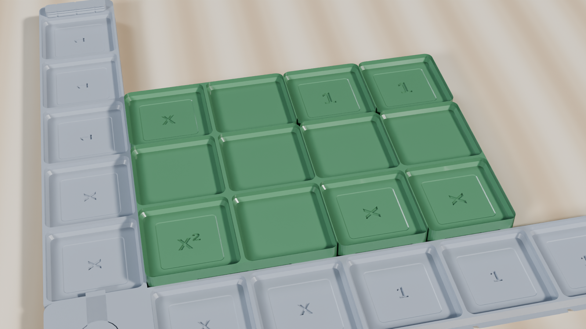

You can solve this mystery with your own hands in thirty seconds! Grab 16 Counting Tiles from your **Counting & Array Studio**—**1 White**, **3 Cobalt Blue**, **5 Radiant Gold**, and **7 Slate Gray**—and build the pattern right on your desk:

1. **Stage 1 ($1\text{ Tile} = 1 \times 1$):** Place **1 White tile** in the bottom-left corner of your desk mat. That single tile is a tiny $1 \times 1$ square ($1$).
2. **Stage 2 ($1 + 3 = 4\text{ Tiles} = 2 \times 2$):** Now ask yourself: *what do I need to add to make this $1 \times 1$ square grow into a $2 \times 2$ square?* You need **1 tile on top**, **1 tile on the right side**, and **1 corner tile** where they meet ($1 + 1 + 1 = 3$). Wrap those **3 Blue tiles** around the White tile like an L-shaped collar—and look down: you have a solid **$2 \times 2 = 4$ square**!
3. **Stage 3 ($1 + 3 + 5 = 9\text{ Tiles} = 3 \times 3$):** To grow your $2 \times 2$ square into a $3 \times 3$ square, you must cover its **2 top edges**, its **2 right edges**, plus **1 new corner tile** ($2 + 2 + 1 = 5$). Wrap **5 Gold tiles** around the corner to complete a **$3 \times 3 = 9$ square**!
4. **Stage 4 ($1 + 3 + 5 + 7 = 16\text{ Tiles} = 4 \times 4$):** To grow from $3 \times 3$ to $4 \times 4$, you need **3 tiles on top**, **3 tiles on the right**, and **1 corner tile** ($3 + 3 + 1 = 7$). Wrap **7 Gray tiles** around the outside to lock in a **$4 \times 4 = 16$ square**!

Now you see the secret: **every odd number is really two matching side arms plus one corner tile!** Whenever you wrap that L-shaped border around a square, it grows the width by 1 and the height by 1 at the exact same time.

You can watch those growing squares form right on the SC-6 stack—and even go beyond the 16 tiles on your desk to build $5 \times 5$ and $6 \times 6$ squares! Start by pressing `[1] [ENTER] [3] [+]` to reach $\mathbf{4}$ ($2^2$), matching your 1 white center tile ($Y = 1$) wrapped by a 3-tile blue L-border ($X = 4$).

Next, tap `5 [+]` to wrap the 5-tile gold border into $\mathbf{9}$ ($3 \times 3$ square), and tap `7 [+]` to wrap the 7-tile gray border into $\mathbf{16}$ ($4 \times 4$ square). Keep the pattern rolling: tap `9 [+]` to reach $\mathbf{25}$ ($5 \times 5$ square), and tap `[1] [1] [+]` to wrap an 11-tile border into $\mathbf{36}$ ($6 \times 6$ square) before pressing `[f] [√x]` to reveal $\mathbf{6}$—the exact side length of your $6 \times 6$ square!

---

### 3.2.6 How Triangular Step Ladders Build Rectangular Arrays

Earlier in this chapter, we folded a 10-step staircase of blocks into Friends of Ten ($1 + 2 + \dots + 10 = 55$). Now let's discover an even more powerful geometric trick that works for *any* staircase of counting numbers—like $1 + 2 + 3 + 4 + 5 + 6 = 21$.

Using your **24-Tile Four-Color Counting & Array Studio**, build six rising columns of tiles on your desk: $1\text{ tile}$, then $2\text{ tiles}$, then $3, 4, 5,$ and $6\text{ tiles}$. Notice how your 21 tiles form a right triangle whose top edge climbs in a jagged 6-step staircase.

How can you find the area of a jagged triangle without adding every column one by one? Imagine a friend builds an identical 21-tile staircase ($1 + 2 + 3 + 4 + 5 + 6$) and flips theirs **upside-down** right on top of yours:
- Their tallest column of **$6$** lands on top of your shortest step of **$1$**, making a column **$7$ tiles tall** ($1 + 6 = 7$).
- Their step of **$5$** lands on your step of **$2$**, also making **$7$ tiles tall** ($2 + 5 = 7$).
- Every single column locks together at **$7$ tiles tall** across all **$6$ columns**—forming a solid **$6 \times 7 = 42$ rectangle**! (And even with a single 24-tile kit, you can fold your 6-step staircase in half—snapping $1$ onto $6$, $2$ onto $5$, and $3$ onto $4$—to form a $3 \times 7 = 21$ rectangle.)

Because two identical staircases make a $6 \times 7 = 42$ rectangle, **one** staircase is simply half of that rectangle ($42 \div 2 = 21$):

| Keystroke | Register T | Register Z | Register Y | Register X | What Happens on the Stack |
| :--- | :---: | :---: | :---: | :---: | :--- |
| `6 [ENTER]` | 0 | 0 | 6 | 6 | Place 6 staircase columns onto Waiting Shelf $Y$ |
| `7 [×]` | 0 | 0 | 0 | 42 | Two interlocked staircases form a $6 \times 7 = 42$ rectangle ($X = 42$) |
| `2 [÷]` | 0 | 0 | 0 | 21 | Half the rectangle gives one triangular staircase ($42 \div 2 = 21$) |

Remember this *"put two staircases together into a rectangle and cut it in half"* secret—at the start of Chapter 4, you will see how a 9-year-old boy used this exact trick to add $1$ through $100$ in seconds!

---

## 3.3 Hopping Along the Number Line & Five-Bead Racks

If the Ten-Frame Studio lets you see numbers as trays of counters, the **Open Number Line (`[f] [LINE]`)** turns addition and subtraction into a hiking trail across your screen.

### 3.3.1 Forward Hops, Backward Hops & The Two-Tap Return Trip
Whenever you press `[f] [LINE]`, your screen draws a crisp horizontal ruler trail (`0, 1, 2, 3, 4, 5, 6, 7, 8, 9, 10, 11...`) that automatically scales its tick marks ($1, 2, 5,$ or $10$) to fit your journey. As soon as you add or subtract—for example, `2 [ENTER] 5 [+]`—the top of the screen displays the equation **`2 + 5 = 7`** on the left and **`X:7`** on the right, while a curved **jump arc** labeled **`+5`** leaps right above the number line from tick `2` to tick `7`.

Watching the arc leap across the screen connects three ideas at once—where you started (Shelf $Y$), how far and which way you hopped, and where you landed (Shelf $X$). For a **Forward Jump (Addition)** like `2 [ENTER] 5 [+]` ($\to 7$), an arc sweeps **to the right** labeled `+5`, showing your number growing along the trail; for a **Backward Jump (Subtraction)** like `9 [ENTER] 4 [-]` ($\to 5$), an arc leaps **to the left** labeled `-4`, showing you walking back down the trail. Even better, you can use the **`[f] [LASTX]` Return-Trip Trick** to hop right back to your starting milepost in two taps: right after `2 [ENTER] 5 [+]` lands on `7`, tap `[f] [LASTX] [-]` and watch `LASTX` remember your `5`-step jump and arc straight back to `2`!

### 3.3.2 How Red Kangaroos Cross the Australian Outback
In the Australian Outback, a full-grown **red kangaroo** (*Osphranter rufus*) stores elastic energy in its giant Achilles tendons like a pair of pogo-stick springs, bounding up to $9\text{ meters}$ ($30\text{ feet}$) in a single leap and cruising across the desert for kilometers without tiring. The Open Number Line (`[f] [LINE]`) turns real-world outback distances and elevations into visual jump arcs right on your screen.

Picture a tagged red kangaroo starting near a dry creek bed at **kilometer marker 14** and bounding forward **8 kilometers** across the red sand plains to reach fresh desert grass. Which trail marker does the kangaroo reach?

On your Open Number Line (`[f] [LINE]`), start at tick 14 and launch a forward arc of `+8`. Just like bridging across 10 on a ten-frame, your mind can hop $+6$ to land on milestone 20 and $+2$ more to reach marker 22: when you key in `14 [ENTER] 8 [+]`, the jump arc sweeps across the twenty mark and lands squarely on kilometer **`22`**.

A little farther along the trail, a tall red sand dune rises to an elevation of **23 meters**, and the trail drops **7 meters** down into a shaded eucalyptus grove. What is the grove's elevation?

Pin tick 23 on your Open Number Line and launch a backward arc of `-7` past the 20 mark—stepping back 3 meters to hit 20, and 4 more meters to land on 16: running `23 [ENTER] 7 [-]` traces the downward hike to **`16`** meters. *(Now try the **Instant Reverse-Hop Check**: press `[f] [LASTX] [+]` and watch the `-7` hike sitting in `LASTX` reverse into a `+7` climb right back to `23`.)*

What if a desert trek covers three stages in a row: **18 kilometers** from base camp to Spinifex Ridge, **5 kilometers** to a giant boab tree, and **7 kilometers** to a waterhole billabong? Watch how automatic stack lift chains the two forward jump arcs (`+5` then `+7`, which together add $+12$ onto $18$) to land right on a round milestone: keying in `18 [ENTER] 5 [+] 7 [+]` advances from marker `18` to `23` and then lands on **`30`** kilometers.

| Keystroke | Register T | Register Z | Register Y | Register X | What Happens on the Stack |
| :--- | :---: | :---: | :---: | :---: | :--- |
| `18 [ENTER]` | 0 | 0 | 18 | 18 | Pin Spinifex Ridge marker 18 onto Shelf $X$ and lift a copy to Shelf $Y$. |
| `5 [+]` | 0 | 0 | 0 | 23 | First forward arc (+5 km) lands on the Boab Tree marker at 23 km on Shelf $X$. |
| `7 [+]` | 0 | 0 | 0 | 30 | Second forward arc (+7 km) lands cleanly on the Billabong milestone at 30 km. |

Those two consecutive arcs trace $18 \to 23 \to 30$, confirming a total trail length of $30\text{ km}$.

Finally, imagine two outback weather stations sitting at **kilometer 63** (Escarpment Overlook) and **kilometer 27** (Riverbed Camp). How far apart are the two stations? On the Open Number Line, jump backward from 63 by splitting $-27$ into friendly mental hops ($-20$ to 43, $-3$ to 40, and $-4$ to 36), then verify on the stack via `63 [ENTER] 27 [-]` to find a separation of **`36`** kilometers.

| Keystroke | Register T | Register Z | Register Y | Register X | What Happens on the Stack |
| :--- | :---: | :---: | :---: | :---: | :--- |
| `63 [ENTER]` | 0 | 0 | 63 | 63 | Pin Escarpment marker 63 onto Shelf $X$ and lift a copy to Shelf $Y$. |
| `27 [-]` | 0 | 0 | 0 | 36 | Leap backward by 27 km; the arc lands squarely on kilometer 36 on Shelf $X$. |

Want to verify that starting at kilometer $36$ and traveling $+27\text{ km}$ brings you right back to marker $63$? Tap `[f] [LASTX] [+]` and watch `63` reappear on Shelf $X$.

### 3.3.3 Hopping Left Past Zero on the Number Line

What happens on the Open Number Line (`[f] [LINE]`) if you start at **$+3$** and subtract **$5$** (`3 [ENTER] 5 [-]`)? Does the number line stop at a brick wall at $0$?

Not at all! The mark $0$ is simply the mirror line—like sea level at the beach or the freezing point on an outdoor thermometer—between positive numbers to the right and negative numbers to the left:

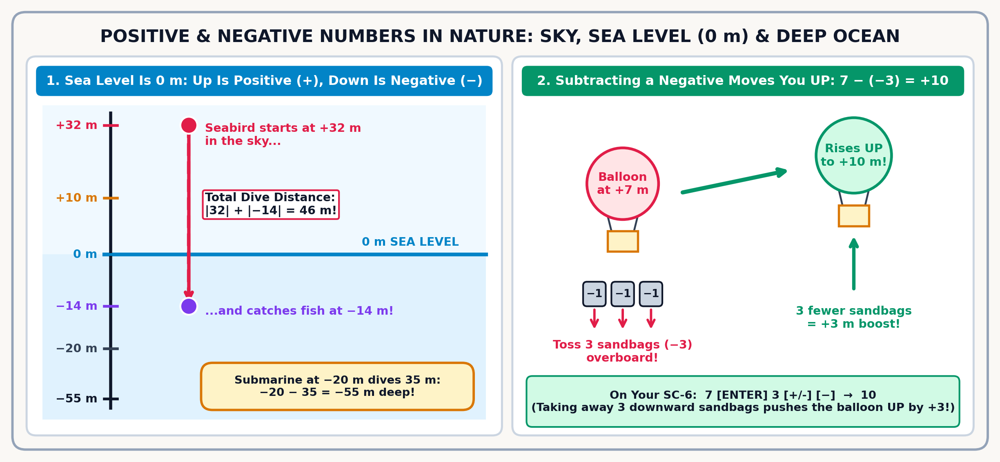

Try that two-stage hop past zero on your calculator right now: tap `[f] [LINE]` (which automatically switches out of Whole Number Mode so negative numbers are unlocked on the number line), then key in `3 [ENTER] 5 [-]` (or `4 [ENTER] 9 [-]` $\to \mathbf{-5}$). Watch the jump arc hop **3 steps left to reach $0$**, and then continue **2 more steps left of zero** to land on **`-2`**! *(Whenever you are in normal stack view instead of `[f] [LINE]`, simply toggle `[NUM]` off—or tap `[f] [ALL]`—before subtracting below zero or using `[+/-]`.)* Biologists see that exact temperature drop high in the Andes mountains, where a tiny hummingbird conserving energy in nighttime *torpor* watches the mountain air fall from $+3^\circ\text{C}$ at dusk by $5^\circ\text{C}$ overnight ($3 - 5 = \mathbf{-2^\circ\text{C}}$, or $2^\circ\text{C}$ below freezing). You can even feel why $+3$ and $-5$ combine to $-2$ on your Ten-Frame tray: 1 gold counter ($+1$) and 1 coral-red counter ($-1$) form a **Zero Pair** ($+1 + (-1) = 0$) that cancels out to zero, leaving 2 red counters ($-2$)—a tool you will use alongside the `[+/-]` key and the submarine *Alvin* in **[Chapter 7: Prime Numbers, Fair Dice & Data Detective](sc6/07-data-probability-primes.md)**.

Before we leave our visual counting studios to explore three- and four-digit place value, let's open one more hands-on tool that combines the 5-and-10 grouping of the Ten-Frame with the left-to-right sliding motion of a number line: the two-wire **Number Rack**.

---

### 3.3.4 Five-and-Ten Bead Clusters on the Two-Rail Number Rack

Our third visual lens is the **Number Rack (`[g] [COUNT]`)**, modeled on the classic 20-bead *Rekenrek* invented by Adrian Treffers at the Freudenthal Institute in the Netherlands. Look at your physical Number Rack: it has two parallel stainless-steel rods, and each rod carries 10 sliding beads split into **5 Red** and **5 White** ($5 + 5 = 10$ on the top wire, and $5 + 5 = 10$ on the bottom wire, for 20 beads in all).

Because each 10-bead wire is split into **5 Red** and **5 White** beads, your eyes can line up the two five-bead clusters vertically across the top and bottom wires to turn $8 + 6$ into $10 + 4$:
1. **Top Wire ($8$):** Slide **8 beads** to the left in a single push—all **5 Red beads** plus **3 White beads** ($5 + 3 = 8$).
2. **Bottom Wire ($6$):** Slide **6 beads** to the left—all **5 Red beads** plus **1 White bead** ($5 + 1 = 6$).
3. **Read the Colors Vertically:** Look at the left column of Red beads: **5 Red on top + 5 Red on the bottom = 10!** Now look at the White beads right next to them: **3 White + 1 White = 4.**

$$8 + 6 = (5 + 3) + (5 + 1) = (5 + 5) + (3 + 1) = 10 + 4 = 14$$

| Keystroke | Register T | Register Z | Register Y | Register X | What Happens on the Stack |
| :--- | :---: | :---: | :---: | :---: | :--- |
| `5 [ENTER] 5 [+]` | 0 | 0 | 0 | 10 | Combine the two 5-Red bead clusters into a full ten ($X = 10$) |
| `3 [ENTER] 1 [+]` | 0 | 0 | 10 | 4 | Combine the 3 White and 1 White beads ($X = 4$) while 10 waits on Shelf $Y$ |
| `[+]` | 0 | 0 | 0 | 14 | Unite the Red ten and White ones: $10 + 4 = 14$ |

### 3.3.5 Seeing Teen Numbers Clearly on the Number Rack
Teen numbers ($11$ through $19$) play a sneaky trick in the English language. In languages like Chinese or Japanese, $14$ is spoken directly as *"ten-four"*, which tells you right away to write a `1` (one ten) followed by a `4` (four ones). In English, however, we say *"fourteen"*—hearing the word *"four"* first, which tempts many young learners to write $41$ instead of $14$!

Whenever you type `14` and press `[g] [COUNT]`, that confusion vanishes at a glance: **Top Wire (Wire 1)** shows all **10 beads** (5 red, 5 white) slid to the active left side for the **`1` ten** in `14`, while **Bottom Wire (Wire 2)** shows **4 red beads** slid to the left for the **`4` ones** in `14`. And just like in Ten-Frame mode, tapping `[.]` slides beads across the wire one by one so you can watch numbers grow up to 20 on the dual-wire rack (and up to 100 in extended counting mode):

| Visual Studio Key | How It Shows Teen Number `14` on Screen | What Your Eyes Spot First |
| :--- | :--- | :--- |
| **Ten-Frame (`[▦]`)** | 1 full 10-cell tray on the left + 4 dots in Tray 2 | **1 full ten** + 4 extra ones ($10 + 4 = 14$) |
| **Number Rack (`[g] [COUNT]`)** | 10 beads slid left on Wire 1 + 4 red beads on Wire 2 | **Two 5-bead clusters** on top + 4 beads below |
| **Number Line (`[f] [LINE]`)** | A curved jump arc leaping `+4` past the `10` milestone | **4 steps to the right** of milestone `10` |
| **Place Value (`[PV]`)** | `10 [PV]` $\to \mathbf{1}$ ten; `1 [PV]` $\to \mathbf{4}$ ones | **`1` in the Tens column**, **`4` in the Ones column** |

### 3.3.6 Spotting Doubles and Near-Doubles in Ocean Wildlife
When marine biologists survey ocean wildlife from a research boat or underwater camera feed, animals don't swim past one at a time—they appear in clusters. Pairing the two-rail **Number Rack (`[g] [COUNT]`)** with the SC-6 stack lets you slide 5-red and 5-white bead clusters across the top and bottom wires to spot teen numbers, doubles, and near-doubles in a single glance.

Say a marine biologist spots a pod of **17 spinner dolphins** swimming past a reef. How do you show 17 on the two-rail Number Rack in just two pushes—without counting 17 beads one by one?

Slide all 10 beads on Rail 1 (5 red, 5 white) in one sweep to lock in one full ten, then slide 7 beads on Rail 2 (all 5 red plus 2 white). To build that exact $10 + 7$ structure on the stack, enter `10 [ENTER] 7 [+]` so Shelf $X$ shows **`17`**, and then tap `[g] [COUNT]` to see 1 full wire of 10 on top and $5 + 2 = 7$ beads on the bottom wire ($X = 17$).

Next, look at how engineers balance a deep-sea submersible's left and right battery pods: **6 lithium battery cells** on the port (left) side and **6 matching battery cells** on the starboard (right) side. Why does the Number Rack make doubles like $6 + 6$ pop out right away?

Slide 6 beads on Rail 1 (5 red, 1 white) and 6 beads on Rail 2 (5 red, 1 white). Now look *vertically* at the red beads: the two 5-red clusters stack up to make a **10**, and the two white beads make **2** ($10 + 2 = 12$). Combine both battery pods on the stack via `6 [ENTER] 6 [+]`, and Shelf $X$ immediately displays **`12`** cells.

| Keystroke | Register T | Register Z | Register Y | Register X | What Happens on the Stack |
| :--- | :---: | :---: | :---: | :---: | :--- |
| `6 [ENTER]` | 0 | 0 | 6 | 6 | Put 6 port-side battery cells onto Shelf $X$ and lift a copy to Shelf $Y$. |
| `6 [+]` | 0 | 0 | 0 | 12 | Combine the two matching pods ($6 + 6 = 12$ battery cells on Shelf $X$). |

Because `6 [ENTER]` already duplicated `6` onto both Shelf $Y$ and Shelf $X$, pressing `6 [ENTER] [+]` doubles any number on the spot.

Once you know your doubles (like $6 + 6 = 12$ and $7 + 7 = 14$), what happens when two numbers are right next door to each other, like $7 + 8$? Imagine sea-turtle conservationists counting green sea-turtle nests across two beaches: **7 nests** at North Cove and **8 nests** at South Cove.

Slide 7 beads on Rail 1 and 8 beads on Rail 2 of your Number Rack. You can clearly see a matching pair of sevens ($7 + 7 = 14$) plus **1 extra white bead** on the bottom rail. That is the **Doubles-Plus-One** strategy in action: keying in `7 [ENTER] 7 [+] 1 [+]` doubles the 7 nests to `14` and adds the 1 extra nest to reach **`15`** nests.

| Keystroke | Register T | Register Z | Register Y | Register X | What Happens on the Stack |
| :--- | :---: | :---: | :---: | :---: | :--- |
| `7 [ENTER]` | 0 | 0 | 7 | 7 | Put North Cove's 7 turtle nests onto Shelf $X$ and lift a copy to Shelf $Y$. |
| `7 [+]` | 0 | 0 | 0 | 14 | Double the two groups of 7 ($7 + 7 = 14$ turtle nests on Shelf $X$). |
| `1 [+]` | 0 | 0 | 0 | 15 | Add the 1 extra nest from South Cove to reach 15 turtle nests on Shelf $X$. |

Any two neighbor numbers (like $6 + 7$, $7 + 8$, or $8 + 9$) are simply a double plus 1.

---

## 3.4 Bundling 10-for-1 & Inspecting Place Value

In the third century BC, the Greek mathematician Archimedes wrote a daring treatise called *The Sand Reckoner*. At the time, people believed the grains of sand on the Sicilian coast were "infinite" because Greek numerals had no clean way to name giant numbers. Archimedes proved them wrong by inventing a system of bundling powers of ten—a breakthrough that Indian and Arab mathematicians perfected into the **10-for-1 Regrouping Exchange** we use today.

When you look at a big number like $4,725$, it isn't just four separate digits sitting next to each other ("4", "7", "2", "5"). Instead, it is four distinct base-ten bundles working together:
$$4,725 = 4,000 + 700 + 20 + 5$$

Whenever you set up a multi-digit number on your **Place Value Studio Whole Numbers Tray (`1000 | 100 | 10 | 1`)**, its two horizontal rows mirror **Waiting Shelf $Y$** and **Ground Shelf $X$** on your screen. Every time a column collects ten `+1` regrouping blocks (standing $70.0\text{ mm}$ tall to match the 10-Rod in your Ten-Frame Studio), your hands trade all ten blocks for a single `+1` block in the next column to the left (`ONES` $\to$ `TENS` $\to$ `HUNDREDS` $\to$ `THOUSANDS`).

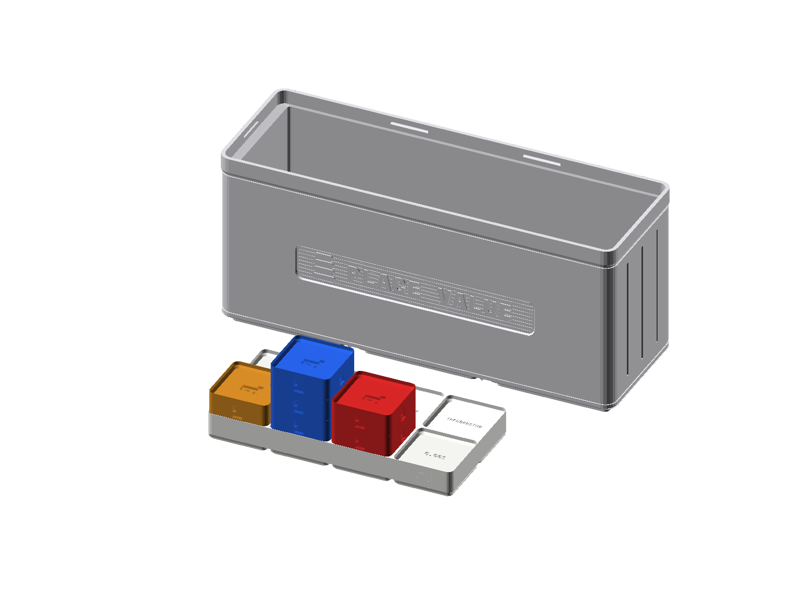

### 3.4.1 Peeking Inside Any Number Column by Column
Think of the `[PV]` key as an X-ray lens that lets you look inside a big number and ask: *"How many bundles are sitting in this exact column?"* First, park your **Starting Number** on Shelf $Y$ (for example, `4725 [ENTER]`). Next, type the **Place Value Column** you want to inspect onto Shelf $X$—type `1` for ones, `10` for tens, `100` for hundreds, or `1000` for thousands—and press `[PV]` so Shelf $X$ immediately reveals the single digit sitting in that column!

For example, when you check the Tens place of $4,725$ by pressing `10 [PV]`, Shelf $X$ shows **`2`** (telling you there are 2 tens, or $20$, inside $4,725$):

| Keystroke | Register T | Register Z | Register Y | Register X | What Happens on the Stack |
| :--- | :--- | :--- | :--- | :--- | :--- |
| `4725` | 0 | 0 | 0 | 4725 | Type the four-digit number $4,725$ onto Shelf $X$. |
| `[ENTER]` | 0 | 0 | 4725 | 4725 | Park $4,725$ on Shelf $Y$ so we can X-ray its columns. |
| `10` | 0 | 0 | 4725 | 10 | Type `10` onto Shelf $X$ to ask about the Tens column. |
| `[PV]` | 0 | 0 | 4725 | 2 | `[PV]` reveals `2` tens ($20$) on Shelf $X$ while $4,725$ stays on Shelf $Y$! |

Look closely at Shelf $Y$ in the table above: even after you pressed `[PV]`, **your starting number (`4725`) stayed parked on Shelf $Y$!** Because `[PV]` keeps `4725` locked on Shelf $Y$ for your next query, typing another column size simply replaces the query on Shelf $X$ so you can X-ray every column in seconds: tapping `100 [PV]` reveals $X = \mathbf{7}$ ($7$ hundreds, worth $700$), tapping `1000 [PV]` reveals $X = \mathbf{4}$ ($4$ thousands, worth $4,000$), and tapping `1 [PV]` reveals $X = \mathbf{5}$ ($5$ ones, worth $5$). Now let's run that X-ray process in reverse by snapping those individual powers of ten back together into whole numbers!

### 3.4.2 Bundling 10 Ones into 1 Ten, and 10 Tens into 100
Just as `[PV]` pulls a number apart into its place-value columns, you can build three-, four-, and five-digit numbers from the ground up by adding their expanded powers of ten ($100\text{s}, 10\text{s}, 1\text{s}$ and beyond) alongside your physical **Place Value Studio Whole Numbers Tray**.

Think about how many days it takes Earth to complete one full orbit around the Sun: **365 days**. Dock the digit miniblocks `3`, `6`, and `5` into the `HUNDREDS`, `TENS`, and `ONES` sockets of your **Place Value Studio Whole Numbers Tray**: `3` hundreds ($300$), `6` tens ($60$), and `5` ones ($5$). Now watch those three bundled packages snap together into one whole number on the stack: running `300 [ENTER] 60 [+] 5 [+]` fuses $300 + 60 + 5$ into **`365`** solar days.

| Keystroke | Register T | Register Z | Register Y | Register X | What Happens on the Stack |
| :--- | :--- | :--- | :--- | :--- | :--- |
| `300 [ENTER]` | 0 | 0 | 300 | 300 | Put `3` hundreds ($300$) onto Shelf $X$ and lift a copy to Shelf $Y$ |
| `60 [+]` | 0 | 0 | 0 | 360 | Add `6` tens ($60$); running total grows to 360 on Shelf $X$ |
| `5 [+]` | 0 | 0 | 0 | 365 | Add `5` ones ($5$); all three bundles snap together into 365 |

Each column contributes its exact place-value weight—$3$ hundreds, $6$ tens, and $5$ ones—to form $300 + 60 + 5 = 365$ days in a year.

Now try a famous four-digit historical year—like **1492**, when ocean navigators steered across the Atlantic using brass astrolabes and star tables long before GPS satellites existed. Dock the four digit miniblocks `1`, `4`, `9`, and `2` into the `THOUSANDS`, `HUNDREDS`, `TENS`, and `ONES` sockets of your **Whole Numbers Place Value Tray**, then build that four-digit year on the stack by adding its four place-value columns ($1,000 + 400 + 90 + 2$): keying in `1000 [ENTER] 400 [+] 90 [+] 2 [+]` stacks each power of ten in turn to display **`1492`**.

Watch how the open zeros act like empty seats waiting for each smaller bundle to slide into place. Starting with `1000 [ENTER]` parks `1000` on Shelf $Y$, and tapping `400 [+]` slides the 4 hundreds into the hundreds seat (`1400`). Next, `90 [+]` drops the 9 tens into the tens seat (`1490`), and finally `2 [+]` snaps the 2 ones into the rightmost seat to complete `1492`.

What happens when a number grows past four digits? Say you build the five-digit countdown number **98,765** out of its five place-value bundles: 9 ten-thousands ($90,000$), 8 thousands ($8,000$), 7 hundreds ($700$), 6 tens ($60$), and 5 ones ($5$). Even though your desktop Place Value Tray has four physical sockets (`1000 | 100 | 10 | 1`), every new column to the left simply bundles 10 of the column before it. Build the five-digit total on the stack via `90000 [ENTER] 8000 [+] 700 [+] 60 [+] 5 [+]`, which layers each place-value bundle from left to right to reach **`98765`**.

| Keystroke | Register T | Register Z | Register Y | Register X | What Happens on the Stack |
| :--- | :--- | :--- | :--- | :--- | :--- |
| `90000 [ENTER]` | 0 | 0 | 90000 | 90000 | Put 90,000 onto Shelf $X$ and lift a copy to Shelf $Y$ |
| `8000 [+]` | 0 | 0 | 0 | 98000 | Add 8,000 so the running total grows to 98,000 on Shelf $X$ |
| `700 [+]` | 0 | 0 | 0 | 98700 | Add 700 into the hundreds seat ($X = 98,700$) |
| `60 [+]` | 0 | 0 | 0 | 98760 | Add 60 into the tens seat ($X = 98,760$) |
| `5 [+]` | 0 | 0 | 0 | 98765 | Add 5 into the ones seat to complete 98,765 |

Each addition fills the next open zero column—uniting $9$ ten-thousands, $8$ thousands, $7$ hundreds, $6$ tens, and $5$ ones into $98,765$.

### 3.4.3 Exploring Tenths and Hundredths with Place Value
The exact same 10-for-1 pattern continues to the right of the raised decimal bump (`•`) on your **Decimal Place Value Tray (`1 • 0.1 | 0.01 | 0.001`)**. If you slice $1\text{ whole}$ into 10 equal strips, each strip is one **Tenth ($0.1$)**; if you slice 1 tenth into 10 tiny squares, each square is one **Hundredth ($0.01$)**.

Toggle Whole Number Mode (`[NUM]`) off—or tap `[f] [ALL]` / `[g] [FIX]`—so the dot key enters a decimal point rather than a mixed fraction, then park $345.67$ on Shelf $Y$ (`345.67 [ENTER]`) and X-ray both sides of the decimal bump with `[PV]`. Probing two places left of the ones column with `100 [PV]` reveals $X = \mathbf{3}$ ($3$ hundreds), while stepping one place right of the decimal point with `0.1 [PV]` reveals $X = \mathbf{6}$ ($6$ tenths) and two places right with `0.01 [PV]` reveals $X = \mathbf{7}$ ($7$ hundredths). And if you test a number with an empty middle column like `405 [ENTER] 10 [PV]`, Shelf $X$ displays **`0`**—doing the exact job Indian and Mayan mathematicians invented zero for by holding the empty tens column open between the $4$ hundreds and $5$ ones!

Your Decimal Place Value Tray also makes it obvious *why* you must line up the decimal points—not the rightmost digits—when adding or subtracting decimals like $14.6 + 3.85$. If you dock `14.60` in the top row of the Decimal Tray (adding a placeholder `0` in the hundredths socket so $14.6$ becomes $14.60$) and `3.85` in the bottom row, the raised decimal bump (`•`) physically keeps the Tenths (`6` and `8`) and Hundredths (`0` and `5`) in matching vertical columns so Tenths add to Tenths ($.60 + .80$) and Hundredths add to Hundredths ($.00 + .05$): $14.60 + 3.85 = \mathbf{18.45}$ (`14.6 [ENTER] 3.85 [+]`, where `0.1 [PV]` $\to 4$ Tenths and `0.01 [PV]` $\to 5$ Hundredths). Makers use that exact decimal alignment when checking workshop drawer clearance: if you slide **4 modular Gridfinity storage bins** ($42.0\text{ mm}$ wide each) side-by-side into a desk drawer whose inside width is **$170.5\text{ mm}$**, subtracting the width of the 4 bins from the drawer width (`170.5 [ENTER] 4 [ENTER] 42 [×] [-]`) shows **`2.5` mm** of smooth sliding clearance ($170.5 - 168.0 = 2.5\text{ mm}$).

### 3.4.4 Leonardo of Pisa & the Harbor Notebook That Changed the World

Have you ever wondered how the ten digits on your SC-6 keypad (`0` through `9`) traveled from ancient India to classrooms and workshops around the world? They were carried across the Mediterranean Sea by a curious twelve-year-old kid!

In the year **1192**, a young Italian boy named **Leonardo of Pisa**—whom we know today by his nickname **Fibonacci**—sailed from the port of Pisa to join his father, Guglielmo Bonacci, at a bustling Mediterranean customs house in **Bugia** (modern-day Béjaïa, Algeria) on the sunlit coast of North Africa. Every morning, merchant ships from Genoa, Venice, Alexandria, Damascus, and Baghdad dropped anchor in the harbor to trade bales of silk, sacks of cinnamon and pepper, barrels of olive oil, and chests of silver coins.

Inside the customs hall, twelve-year-old Leonardo noticed a dramatic contrast between two ways of writing numbers. On one side of the room, the European clerks sat hunched over wooden counting boards, scratching long strings of Roman numerals like `MMDCCCLXXXVIII` ($2,888$) onto parchment. Because Roman numerals have no place-value columns and no symbol for zero, the clerks couldn't line up digits vertically to add, subtract, multiply, or divide on paper—even a simple cargo bill took half an hour of sliding bronze pebbles back and forth!

Across the courtyard, the Arab and North African merchants calculated the exact same cargo bills in seconds using a breathtaking system invented in India: just **nine figures (`1` through `9`)** paired with a small circle called *sifr* (`0`, the Arabic word for *"empty space"*—which gave us both our English word **cipher** and the Italian word *zefiro*, which became **zero**!).

Because *sifr* (`0`) held any empty column open, a single digit like `4` could mean four ones (`4`), four tens (`40`), four hundreds (`400`), or four thousands (`4,000`) simply by shifting left across invisible columns—the exact same columns you see on your **Place Value Studio** trays and probe with **`[PV]`**.

Young Leonardo was so captivated that as he traveled around the Mediterranean coast—through Egypt, Syria, Greece, Sicily, and Provence—he studied with master mathematicians in every port. When he returned to Pisa at age thirty-two in **1202**, he wrote a landmark book called *Liber Abaci* (*The Book of Calculation*), opening Chapter 1 with words that changed human history forever:

> *"These are the nine figures of the Indians: `9 8 7 6 5 4 3 2 1`. With these nine figures, and with this sign `0` which in Arabic is called zephirum, any number may be written."*

Every visual studio in this chapter brings young Leonardo's harbor notebook to life right on your desk. Instead of tallying loose pebbles one by one like the old parchment clerks, your eyes spot five-and-ten groupings at a glance on the Ten-Frame and Number Rack, while your Place Value Trays and `+1` Regrouping Cubes turn the 10-for-1 column exchange into a physical trade you can hold in your hand. And whenever the placeholder circle *sifr* (`0`) holds an empty column open in a number like `405`—or serves as the central balance point on an Open Number Line as you leap into negative temperatures and back—you are using the exact mathematical breakthrough that twelve-year-old Leonardo watched across the courtyard in 1192.

### 3.4.5 Why Dollars, Dimes, and Pennies Match Your Place-Value Tray

Even after Leonardo of Pisa brought base-10 place value to Europe in 1202, one everyday activity stayed stuck in confusing non-decimal numbers for nearly six hundred more years: **counting money**!

When the United States was founded in the 1770s and 1780s, buying a loaf of bread or a pair of boots required a mental gymnastics routine. Shopkeepers kept their ledgers in old British **pounds, shillings, and pence**—where **$12\text{ pence}$** made **$1\text{ shilling}$**, and **$20\text{ shillings}$** ($12 \times 20 = \mathbf{240\text{ pence}}$!) made **$1\text{ pound}$**. Worse yet, the most common coin in people's pockets was the Spanish silver dollar (called a *"piece of eight"*), which shoppers literally chopped with a hammer and chisel into **8 pie-wedge slices** called **"bits"**! Because each silver slice was worth $\frac{1}{8}$ of a dollar ($12.5\text{ cents}$), two slices equaled $\frac{2}{8} = \frac{1}{4}$ of a dollar ($25\text{ cents}$)—which is why Americans still call a quarter **"two bits"** in the stadium chant *"Two bits, four bits, six bits, a dollar!"*

In **1784**, **Thomas Jefferson** (working alongside financier **Gouverneur Morris** and **Robert Morris**) wrote a landmark report titled *Notes on the Establishment of a Money Unit, and of a Coinage for the United States*. Jefferson argued that forcing ordinary citizens and schoolchildren to divide by $8$, $12$, and $20$ every time they bought groceries was a waste of human brainpower. Instead, he proposed that the United States create the world's first national **base-10 decimal currency**, built on the exact same 10-for-1 place-value ladder as our **Place Value Studio**:

- **The Dollar (`1.00` — The Ones Column):** The basic whole unit of money.
- **The Dime (`0.10` — The Tenths Column):** From the Old French word *disme* meaning **"one tenth"** ($\frac{1}{10}$ of a dollar, so **10 dimes** trade for **1 dollar**).
- **The Cent (`0.01` — The Hundredths Column):** From the Latin word *centum* meaning **"one hundred"** ($\frac{1}{100}$ of a dollar, so **10 pennies** trade for **1 dime** and **100 pennies** trade for **1 dollar**).
- **The Mill (`0.001` — The Thousandths Column):** From the Latin *mille* meaning **"one thousand"** ($\frac{1}{1000}$ of a dollar, still used today on gas-station price signs that end in $\frac{9}{10}$ of a cent!).

Compare the old colonial coin puzzle against Jefferson's decimal place-value tray on your SC-6 right now:
1. To find how many pence sat in **7 British pounds, 14 shillings, and 9 pence**, a colonial clerk had to multiply `7 [ENTER] 240 [×]` ($\to 1,680$), multiply `14 [ENTER] 12 [×]` ($\to 168$), and add `[+] 9 [+]` to reach **`1,857` pence**!
2. With Jefferson's decimal coins, combining **7 dollars, 4 dimes, and 9 pennies** requires zero multiplication by $12$ or $20$—because the coins *are* the place-value columns (**`$7.49`**, or **`749` cents**)! Now let's turn that same `[PV]` X-ray lens upward from coins and millimeters to the biggest numbers in nature and space!

---

## 3.5 Big Numbers in Nature and Space

Once you master the 10-for-1 regrouping exchange with your blocks, `[PV]` acts like a mathematical X-ray machine that lets you look inside any giant number in nature—from prehistoric dinosaur eras to the icy rings of Saturn.

### 3.5.1 Flying to the Moon ($384,400\text{ km}$)

Look up at the night sky: the average distance from the Earth to the Moon is $384,400\text{ kilometers}$. To see how that giant distance is built out of base-ten bundles, park $384,400$ on Shelf $Y$ by typing `384400 [ENTER]`, and then X-ray each column from largest to smallest!

When you probe the hundred-thousands column with `100000 [PV]`, Shelf $X$ reveals $\mathbf{3}$—showing that the bulk of the journey consists of three $100,000\text{-kilometer}$ bundles ($300,000\text{ km}$). Stepping one column to the right with `10000 [PV]` uncovers $\mathbf{8}$ ten-thousand-kilometer bundles ($80,000\text{ km}$), while `1000 [PV]` and `100 [PV]` show $\mathbf{4}$ thousands ($4,000\text{ km}$) and $\mathbf{4}$ hundreds ($400\text{ km}$), leaving `0` in both the tens and ones columns.

> **Lunar Transit Time & Two-Tap `[f] [LASTX]` Check:** If an Apollo spacecraft cruises toward the Moon at $4,000\text{ km/hour}$, how many hours does the flight take? Dividing the lunar distance by the cruising speed (`[3] [8] [4] [4] [0] [0] [ENTER] [4] [0] [0] [0] [÷]`) lands on **`96`** hours—about $4\text{ days}$ of continuous spaceflight. Because dividing by $4,000$ automatically tucked that $4,000\text{ km/h}$ speed into `[f] [LASTX]`, right after `384400 [ENTER] 4000 [÷]` (`96.1` hours) you can tap `[f] [LASTX] [×]` to multiply $96.1\text{ hours} \times 4,000\text{ km/h}$ and verify the full `384400` km splashdown corridor!

### 3.5.2 Crossing the One-Million Mark on Earth and in Space

Climbing from hundreds of thousands up to **one million**, how big is a seven-digit number in everyday school life? Say **14 school districts** each serve **450 cartons of milk** per day across a **180-day school year**. Do they cross the one-million-carton mark by summer vacation? Chain all three factors on the stack (`14 × 450 × 180`) with `14 [ENTER] 450 [×] 180 [×]`, and Shelf $X$ climbs to **`1134000`** cartons:

| Keystroke | Register T | Register Z | Register Y | Register X | What Happens on the Stack |
| :--- | :--- | :--- | :--- | :--- | :--- |
| `14 [ENTER]` | 0 | 0 | 14 | 14 | Put the 14 school districts onto Shelf $X$ and lift a copy to Shelf $Y$. |
| `450 [×]` | 0 | 0 | 0 | 6300 | Multiply by 450 cartons/day to get $6,300$ cartons served each day on Shelf $X$. |
| `180 [×]` | 0 | 0 | 0 | 1134000 | Multiply by 180 school days to reach $1,134,000$ milk cartons per year! |

Look at the two `1`s sitting at the left edge of `1,134,000`: even though both digits look identical, lifting `1134000` to Shelf $Y$ (`[ENTER]`) and probing with `1000000 [PV]` vs. `100000 [PV]` shows that the first `1` stands for a full **million** cartons ($1,000,000$) while its neighbor stands for **one hundred thousand** ($100,000$), followed by `3` ten-thousands (`10000 [PV]` $\to 30,000$) and `4` thousands (`1000 [PV]` $\to 4,000$).

Now compare that with the daily flight of the farthest human-made object in the universe: NASA's *Voyager 1* spacecraft, launched in 1977 and now racing through interstellar space at **$17\text{ kilometers every second}$** (fast enough to cross the entire United States in under five minutes). How many kilometers does *Voyager 1* travel in one full 24-hour day ($86,400\text{ seconds}$)? Multiply the seconds per day by *Voyager*'s speed on the stack via `86400 [ENTER] 17 [×]`, and Shelf $X$ reveals **`1468800`** kilometers:

| Keystroke | Register T | Register Z | Register Y | Register X | What Happens on the Stack |
| :--- | :--- | :--- | :--- | :--- | :--- |
| `86400 [ENTER]` | 0 | 0 | 86400 | 86400 | Put the 86,400 seconds in a 24-hour day onto Shelf $Y$. |
| `17 [×]` | 0 | 0 | 0 | 1468800 | Multiply by $17\text{ km/s}$ to see *Voyager 1* travel $1,468,800\text{ km}$ per day! |

*Voyager 1* covers $1,468,800\text{ kilometers}$—nearly $1.5\text{ million kilometers}$—every single day. Notice the twin `8`s inside `1,468,800`: when you lift the daily distance onto Shelf $Y$ (`[ENTER]`) and inspect the thousands and hundreds places with `1000 [PV]` and `100 [PV]`, both return `8`, yet the first `8` represents $8,000\text{ km}$ while the second represents $800\text{ km}$—tucked right behind $\mathbf{1}\text{ million}$ (`1000000 [PV]`), $\mathbf{4}\text{ hundred-thousands}$ (`100000 [PV]`), and $\mathbf{6}\text{ ten-thousands}$ (`10000 [PV]`).

### 3.5.3 Counting into the Millions and Billions

You don't even have to leave Earth to find numbers in the tens of millions—one is beating inside your chest right now! Your heart beats approximately $80\text{ times per minute}$ when you are resting. How many times does it beat in an entire year? With 60 minutes in an hour, your heart beats $80 \times 60 = 4,800\text{ times per hour}$; across 24 hours in a day, that climbs to $4,800 \times 24 = 115,200\text{ beats per day}$; and across all 365 days in a year, it reaches $115,200 \times 365 = \mathbf{42,048,000\text{ beats per year}}$!

Watch how cleanly you can chain that entire year of heartbeats on the SC-6 stack:

| Keystroke | Register T | Register Z | Register Y | Register X | What Happens on the Stack |
| :--- | :--- | :--- | :--- | :--- | :--- |
| `80 [ENTER]` | 0 | 0 | 80 | 80 | Put 80 heartbeats per minute onto Shelf $Y$. |
| `60 [×]` | 0 | 0 | 0 | 4800 | Multiply by 60 minutes to get $4,800$ beats per hour on Shelf $X$. |
| `24 [×]` | 0 | 0 | 0 | 115200 | Multiply by 24 hours to get $115,200$ beats per day on Shelf $X$. |
| `365 [×]` | 0 | 0 | 0 | 42048000 | Multiply by 365 days to reach $42,048,000$ heartbeats per year! |

With $42,048,000$ sitting on Shelf $X$, lift it onto Shelf $Y$ (`[ENTER]`) and inspect the eight-digit total: `10000000 [PV]` shows $\mathbf{4}$ in the ten-millions place ($40,000,000$ beats) and `1000000 [PV]` shows $\mathbf{2}$ in the millions place ($2,000,000$ beats), while `100000 [PV]` displays **`0`**—proving that the zero in the hundred-thousands place is holding the column open so the $4$ and $2$ stay in the tens of millions!

Stepping up to eight- and nine-digit numbers across time and space, the red planet Mars orbits at an average distance of approximately $225,000,000\text{ kilometers}$ from Earth—and on Earth's timeline, the mighty *Tyrannosaurus rex* walked through Cretaceous fern forests $66,000,000\text{ years ago}$. Both numbers feature twin digits side by side (`22` in Mars's distance and `66` in the age of *T. rex*) that differ by a factor of ten because of their seats! When you park Mars's orbital distance on Shelf $Y$ (`225000000 [ENTER]`), probing with `100000000 [PV]`, `10000000 [PV]`, and `1000000 [PV]` breaks the journey into $200\text{ million} + 20\text{ million} + 5\text{ million kilometers}$—and if a robotic spacecraft cruises along that path at $25,000\text{ km/h}$, dividing the orbital distance by the hourly speed and then by $24$ hours per day (`225000000 [ENTER] 25000 [÷] 24 [÷]`) shows Shelf $X$ landing on **`375` days**, just over 1 full year in space! Doing the same X-ray check on the age of *Tyrannosaurus rex* (`66000000 [ENTER]`) with `10000000 [PV]` and `1000000 [PV]` cleanly separates the $60\text{ million-year}$ and $6\text{ million-year}$ spans since the age of dinosaurs.

Venturing even deeper into the solar system, the ringed planet Saturn orbits the Sun at an average distance of **1 billion, 427 million kilometers** ($1,427,000,000\text{ km}$), while a nearby dwarf galaxy cluster holds $2,500,000,000$ stars:
$$1,427,000,000 = 1,000,000,000 + 400,000,000 + 20,000,000 + 7,000,000$$

Here we reach the **ten-digit Billions column** ($10^9 = 1,000,000,000$). Because Whole Number Mode (`[NUM]`) caps whole-number entry at 9 digits (`999,999,999`), toggle `[NUM]` off (or tap `[f] [ALL]`) first to unlock full 10-digit entry. Parking Saturn's orbit on Shelf $Y$ (`1427000000 [ENTER]`) and stepping down from `1000000000 [PV]` ($\to \mathbf{1}\text{ billion}$) through `100000000 [PV]` ($\to \mathbf{4}\text{ hundred-millions}$), `10000000 [PV]` ($\to \mathbf{2}\text{ ten-millions}$), and `1000000 [PV]` ($\to \mathbf{7}\text{ millions}$) confirms every term of the expanded equation—and doing the same on the dwarf galaxy (`2500000000 [ENTER] 1000000000 [PV]` $\to \mathbf{2}\text{ billions}$, `100000000 [PV]` $\to \mathbf{5}\text{ hundred-millions}$) shows how just ten digits can measure an entire galaxy of stars.

---

## 3.6 Number-Detective Challenges & Looking Ahead

With all four visual lenses (`[▦]`, `[f] [LINE]`, `[g] [COUNT]`, and `[PV]`) in your toolkit, you can inspect any number from tiny hundredths up to billions of stars. Try these three number-detective games with your family before we step into two-dimensional tile arrays in Chapter 4.

### 3.6.1 Three Number-Detective Challenges to Try

Grab a sticky note, a handful of coins from a change dish, and your Ten-Frame trays to try these three number-detective games at home:

1. **The Sticky-Note Secret Digit X-Ray:** Ask a parent or sibling to type *any* secret 6-digit number onto your SC-6 (say, `582,419`) and press `[ENTER]`.
   - Cover Waiting Shelf $Y$ with a small piece of sticky note and type `0` on Shelf $X$ so the secret number on Shelf $Y$ is completely hidden from view!
   - First reveal the thousands period from left to right using `100000 [PV]` ($\to 5$), `10000 [PV]` ($\to 8$), and `1000 [PV]` ($\to 2$).
   - Then reveal the ones period using `100 [PV]` ($\to 4$), `10 [PV]` ($\to 1$), and `1 [PV]` ($\to 9$), and peel off the sticky note at the end to show them that their original 6-digit number never budged from Shelf $Y$!
   - Want to make the game even trickier? Have them include a secret decimal price with dimes and pennies (like `409.38`) and probe the right side of the decimal point with `0.1 [PV]` ($\to 3$ tenths) and `0.01 [PV]` ($\to 8$ hundredths)—watching whenever a `0` appears to spot the exact column where the placeholder shell is holding the space open!
2. **The Coin-Jar & Kitchen Freezer-to-Countertop Number-Line Leap (`[f] [LINE]`):** Grab a handful of dollar coins ($\$1.00$), dimes ($\$0.10$), and pennies ($\$0.01$) from a change dish and count their total value onto Waiting Shelf $Y$.
   - Hand the calculator to a family member and let them use `1 [PV]`, `0.1 [PV]`, and `0.01 [PV]` to predict the exact number of dollar coins, dimes, and pennies sitting on the table before looking at the pile!
   - Next, switch to the Open Number Line (`[f] [LINE]`) to model a tray of ice cubes moving from a deep kitchen freezer to a warm countertop: start at a home freezer temperature of $-18^\circ\text{C}$ (`18 [+/-] [ENTER]`) and add a $40^\circ\text{C}$ warm-up (`40 [+]` $\to \mathbf{+22^\circ\text{C}}$ room temperature).
   - Watch the jump arc leap right across the zero milepost (`0`) into positive territory, and then tap `[f] [LASTX] [-]` to hop the temperature right back down to $-18^\circ\text{C}$!
3. **The 30-Second Ten-Frame & 10th Odd-Square Builder Sprint:** Set your physical Ten-Frame trays and your $90^\circ$ L-Frame Stage side by side on the kitchen table.
   - **Part A (Ten-Frame Bridging):** Open Ten-Frame mode (`[▦]`) on your SC-6 and see how many "9-plus" and "8-plus" bridging sums ($9 + 6$, $8 + 7$, $9 + 8$, $8 + 6$, $7 + 6$) you can call out in 30 seconds by picturing how many counters slide across to fill Frame 1 (`10`) and how many remain in Frame 2!
   - **Part B (Building the $6 \times 6$ Odd Square):** Start with `1` corner tile in your L-Frame Stage (`1 [ENTER]`) and wrap successive odd L-borders (`3 [+]` $\to 4$, `5 [+]` $\to 9$, `7 [+]` $\to 16$, `9 [+]` $\to 25$, `11 [+]` $\to 36$) to build a solid **$6 \times 6 = 36$ square**.
   - **Part C (Predicting the 10th Odd Square):** Predict what the **10th odd square** ($1 + 3 + 5 + \dots + 19$) will equal before continuing the odd chain (`13 [+] 15 [+] 17 [+] 19 [+]` $\to 10^2 = \mathbf{100}$) on your stack!

---

### 3.6.2 From Single Rows to 2D Tile Grids in Chapter 4

Once ancient Indian and Mayan astronomers—and young Leonardo Fibonacci at the harbor docks—paired nine digits with the placeholder circle `0`, **10 unit cubes** bundled into **1 ten-rod** ($10^1 = 10$), **10 ten-rods** bundled into **1 hundred-flat** ($10^2 = 100$), and **10 hundred-flats** stacked into **1 thousand-cube** ($10^3 = 1,000$). That exact same 10-for-1 ladder powers the **metric measurement system** and U.S. currency on your workbench today:

| Place-Value Bundle | Physical Block Model | Metric Ruler Length | Everyday U.S. Coins & Bills | How to Probe with `[PV]` |
| :--- | :--- | :--- | :--- | :--- |
| **Hundredths ($0.01$)** | 1 tiny hundredth square | $0.1\text{ mm}$ ($1\text{ cm} \div 100$) | **1 Penny** ($\$0.01$) | `0.01 [PV]` |
| **Tenths ($0.1$)** | 1 strip of 10 hundredths | $1.0\text{ mm}$ ($1\text{ cm} \div 10$) | **1 Dime** ($\$0.10 = 10\text{ pennies}$) | `0.1 [PV]` |
| **Ones ($1$)** | 1 Unit Block ($7.0\text{ mm}$ tall) | $1\text{ centimeter}$ ($10\text{ mm}$) | **1 Dollar Coin** ($\$1.00 = 10\text{ dimes}$) | `1 [PV]` |
| **Tens ($10$)** | 1 Ten-Rod ($10\text{ blocks} = 70.0\text{ mm}$) | $1\text{ decimeter}$ ($10\text{ cm} = 100\text{ mm}$) | **$\$10\text{ Bill}$** ($10\text{ ones}$) | `10 [PV]` |
| **Hundreds ($100$)** | 1 Hundred-Flat ($10 \times 10\text{ blocks}$) | $1\text{ meter}$ ($100\text{ cm} = 1,000\text{ mm}$) | **$\$100\text{ Bill}$** ($10\text{ tens}$) | `100 [PV]` |
| **Thousands ($1,000$)** | 10 stacked Hundred-Flats | $10\text{ meters}$ ($10,000\text{ mm}$) | **Ten $\$100\text{ Bills}$** ($\$1,000$) | `1000 [PV]` |

Even cultures without paper or ink discovered this exact 10-for-1 ladder! High in the Andes mountains of South America, **Inca Empire** record-keepers (*quipucamayocs*) tracked harvests and llama herds by tying knots along hanging cotton cords called **quipus**: knots near the bottom stood for **ones**, the next tier up for **tens**, the next for **hundreds**, and an **untied blank space** on the cord acted as a physical **zero (`0`)**. Across East Asia, merchants using the **soroban** abacus slid a single upper bead worth **`5`** toward the bar alongside four lower beads worth **`1` each**—the exact $5\text{-and-some-more}$ layout built into your Ten-Frame Studio (`[▦]`) and Number Rack (`[g] [COUNT]`).

Notice how every tool you explored in this chapter—from snapping a `5`-row and `3`-row together on your Ten-Frame Tray to hopping past zero on the Number Line (`[f] [LINE]`) and unpacking `1000 | 100 | 10 | 1` columns in Place Value mode (`[PV]`)—turns multi-digit numbers from flat ink marks into physical bundles you can hold and trade. Whenever you see a giant number in a science book or on a scoreboard, your eyes now know how to read its powers of ten from left to right.

Now that you can bundle single units into tens, hundreds, and thousands, what happens when you arrange equal rows of tiles into a 2D rectangular grid—or when a pile of items doesn't divide evenly and leaves leftovers on the table? Turn the page to **[Chapter 4: Tile Arrays, Skip-Counting & Remainders](sc6/04-operations-skip-counting.md)** to see how a 9-year-old schoolboy named **Carl Friedrich Gauss** summed $1$ to $100$ in ten seconds, why **four colors** can color any map on Earth, and how `[g] [÷R]` and `[f] [LASTX]` tame every remainder!

---

# Chapter 4: Tile Arrays, Skip-Counting & Remainders

## 4.1 Young Gauss's 10-Second Shortcut & 2D Tile Grids

Break off a piece of a chocolate bar or pick up a LEGO baseplate and look at the bumps on top: 3 rows with 4 bumps in each row ($3 \times 4 = 12$). You don't have to guess what $3 \times 4$ means or recite a chant in the dark—**multiplication is literally a 2D tile grid you can see, touch, and rotate right on your desk!** Whenever you arrange square tiles into equal rows and columns, the answer is simply the number of tiles filling that rectangle.

Back in 1786, in a noisy one-room schoolhouse in Germany, a grumpy teacher wanted an hour of peace and quiet *([Sartorius von Waltershausen, 1856](sc6/appendix-c-formulas-and-conversions.md#cite-sartorius1856))*. So he walked to the blackboard and ordered the class to add up every single whole number from $1$ to $100$ on their chalk slates:

$$\mathbf{1 + 2 + 3 + 4 + 5 + \dots + 98 + 99 + 100 = \ ?}$$

The teacher figured the kids would be hunched over their desks scribbling $1 + 2 = 3$, $3 + 3 = 6$, $6 + 4 = 10$ for the rest of the afternoon.

Instead, a nine-year-old boy named **Carl Friedrich Gauss** *([Gauss, 1809](sc6/appendix-c-formulas-and-conversions.md#cite-gauss1809))* stared at the numbers for a few seconds, wrote down one number on his slate, walked up to the teacher's desk, and smacked his slate down on the table:

$$\text{\Large\textbf{„Ligget se!“}} \quad \text{("There it lies!")}$$

For the next hour, while the other kids furiously added and erased mistakes, nine-year-old Carl sat with his arms folded. When the teacher finally flipped the slates over, almost every kid in the room had gotten tangled in carrying errors—except Carl, whose slate had just one number with zero scratch work: **5,050**.

How did a nine-year-old beat the entire room in ten seconds?

Carl didn't add the numbers one by one. Instead, he pictured the number line in his head and **folded it in half** so the first number teamed up with the last number:
$$1 + 100 = 101, \quad 2 + 99 = 101, \quad 3 + 98 = 101, \quad \dots \quad 50 + 51 = 101$$

Every single pair added up to **$101$**, and folding $100$ numbers in half made **50 pairs**! Instead of doing 99 slow additions, Carl turned the problem into a **2D rectangle** that was $50$ rows tall by $101$ units wide:
$$50 \times 101 = 5,050$$

On the **StackCalc SC-6**, we use Carl's exact visual approach. With your **24-Tile Four-Color Array Studio** (or sharing six desk kits to build a 144-tile classroom grid), you can snap rows and columns together on your desk to see how multiplication grids work. Then, on the calculator keypad, you will meet three special helper keys: **`[g] [REP]` (Constant Repeat)** for climbing skip-counting ladders in a single tap, **`[g] [÷R]` (Quotient & Remainder)** for seeing whole groups and leftovers at the same time, and **`[f] [LASTX]` (Last Number)** for checking your own answers in reverse.

---

### 4.1.1 Building 2D Tile Grids & Coloring Maps

Every multiplication problem you meet can be built out of **equal groups**, **2D rectangular tile grids**, and **color-coded maps** right in your hands—feeling how rows and columns form a rectangle on your desk, seeing how wide grids split into four friendly color zones, and multiplying or chaining steps across the four shelves of your stack (`Y [ENTER] X [×]`).

Instead of a bag of loose cubes that roll onto the floor, your desk kit gives you the **24-Tile Four-Color Counting & Array Studio**. Each kit holds 24 snap-together square stacking tiles in four bold, high-contrast colors—6 tiles each of **Bright White** (clean snow-white finish), **Cobalt Blue** (deep ocean blue), **Radiant Gold** (warm golden-yellow), and **Slate Gray** (cool storm-cloud gray). With $4 \times 6 = 24\text{ tiles}$ in your personal desk kit (or 6 kits shared at a classroom table for a giant 144-tile $12 \times 12$ grid), the smooth beveled edges let you slide tiles side by side into flat rectangles on your desk mat or snap them vertically into sturdy 3D block prisms without sticking.

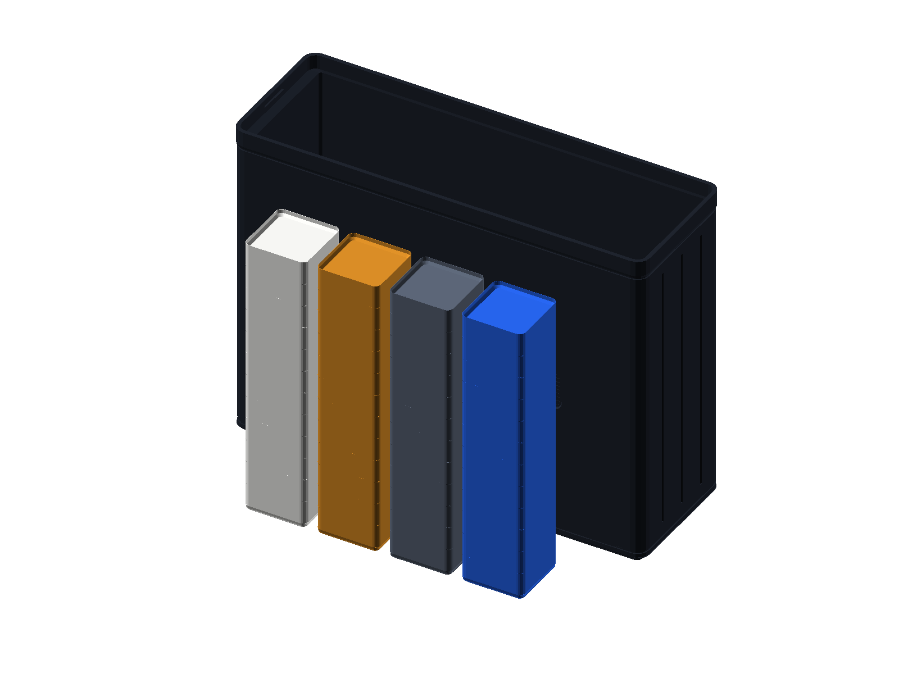

### 4.1.2 Why 24 Is the Champion Packing Number

Why does your kit come with **24 tiles** split into 4 colors instead of 20 or 25? Because 24 is a champion packing number! You can snap all 24 tiles into **four different rectangles** without a single leftover tile: $1 \times 24$, $2 \times 12$, $3 \times 8$ (3 rows of 8 tiles: $8 + 8 + 8 = 24$), and $4 \times 6$ (4 rows of 6 tiles: $6 + 6 + 6 + 6 = 24$). Inside that set of 24, each of the 4 colors has **6 tiles**, which packs into its own $2 \times 3$ six-pack rectangle or a 3-step staircase ($1 + 2 + 3 = 6$). Reshaping those 24 physical tiles between a wide $3 \times 8$ grid and a compact $4 \times 6$ grid with your hands makes it effortless to picture giant multi-digit arrays on your SC-6 stack:

| 24-Tile Rectangle | Turn-Around Twin ($90^\circ$ Turn) | Equal-Row Addition | Stack Multiplication Check |
| :--- | :--- | :--- | :--- |
| **1 Row of 24** ($1 \times 24$) | **24 Rows of 1** ($24 \times 1$) | Single long train of $24$ tiles | `1 [ENTER] 24 [×]` $\to \mathbf{24}$ |
| **2 Rows of 12** ($2 \times 12$) | **12 Rows of 2** ($12 \times 2$) | $12 + 12 = 24$ (two dozen-rods) | `2 [ENTER] 12 [×]` $\to \mathbf{24}$ |
| **3 Rows of 8** ($3 \times 8$) | **8 Rows of 3** ($8 \times 3$) | $8 + 8 + 8 = 24$ (three 8-bars) | `3 [ENTER] 8 [×]` $\to \mathbf{24}$ |
| **4 Rows of 6** ($4 \times 6$) | **6 Rows of 4** ($6 \times 4$) | $6 + 6 + 6 + 6 = 24$ (four 6-color sets) | `4 [ENTER] 6 [×]` $\to \mathbf{24}$ |

### 4.1.3 Frame Borders & the Difference of Two Squares

In Chapter 3, you saw how wrapping odd-numbered L-borders ($1 + 3 + 5 + 7 = 16$) builds a square outward one layer at a time. Now flip that question around using your **Counting & Array Studio** and the $90^\circ$ **L-Frame Stage**: what happens when you start with a **$5 \times 5 = 25$ square** (all 24 tiles from your kit plus 1 unit miniblock in the corner) and lift a **$3 \times 3 = 9$ inner square** right out of its bottom-left corner?
1. **Lift Out the Inner Square ($25 - 9 = 16$):** Removing the $3 \times 3 = 9$ inner square from the $5 \times 5 = 25$ square leaves a thick, L-shaped outer frame border made of **$16$ tiles** ($5^2 - 3^2 = 25 - 9 = 16$).
2. **Slide the Frame into a Rectangle ($(5 - 3) \times (5 + 3) = 2 \times 8 = 16$):** Look at the two arms of that remaining L-shaped frame: the top strip is **$2$ rows tall by $5$ tiles wide** ($5 - 3 = 2$), and the side strip is **$3$ tiles tall by $2$ columns wide**. Swing that $3 \times 2$ side strip up and snap it onto the end of the $2 \times 5$ top strip! Together they form a long, sleek **$2 \times 8 = 16$ rectangle** whose height is the difference of the two squares' sides ($5 - 3 = 2$) and whose width is their sum ($5 + 3 = 8$)!
3. **Reshape into a $4 \times 4$ Square (`5 [x²] 3 [x²] [-] [f] [√x]`):** Cut that $2 \times 8$ rectangle in half and stack the two $2 \times 4$ halves on top of each other—it locks into a solid **$4 \times 4 = 16$ square**! Test both discoveries on your SC-6 stack: first **subtract the two squares** by keying in `5 [x²] 3 [x²] [-]` to see **`16`** on Shelf $X$ (and tap `[f] [√x]` to confirm its **`4`**-tile square side length), and then **multiply the difference by the sum** by keying in `5 [ENTER] 3 [-] 5 [ENTER] 3 [+] [×]` to watch $(5 - 3) \times (5 + 3) = 2 \times 8 = \mathbf{16}$ come together right across your shelves!

---

### 4.1.4 Spinning a Tile Rectangle Quarter-Turn on Your Desk

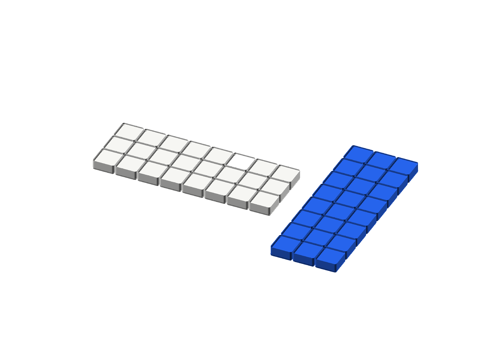

Once you see that any multiplication problem is a physical rectangle of tiles, the three classical laws of multiplication—which math books call the **Commutative**, **Associative**, and **Distributive** laws—turn into hands-on movements you can test on your desk in seconds.

First, try spinning a rectangle a quarter-turn ($\text{Rows} \times \text{Columns} = \text{Columns} \times \text{Rows}$) right on your desk: snap together a solid rectangular mat of 3 rows of 8 tiles ($3 \times 8 = 24$), then physically pick up the mat and turn it $90^\circ$ on the tabletop so you see 8 rows of 3 tiles ($8 \times 3 = 24$). Did the number of tiles change? Not a single tile was added or removed!

On the SC-6 stack, you can place both orientations side by side: first multiply 3 rows of 8 via `3 [ENTER] 8 [×]` to put $\mathbf{24}$ on Shelf $X$, and then multiply 8 rows of 3 with `8 [ENTER] 3 [×]` so the rotated $\mathbf{24}$ lands on Shelf $X$ while the original $\mathbf{24}$ waits right next to it on Shelf $Y$.

| Keystroke | Register T | Register Z | Register Y | Register X | What Happens on the Stack |
| :--- | :--- | :--- | :--- | :--- | :--- |
| `3 [ENTER]` | 0 | 0 | 3 | 3 | Place 3 rows on Shelf $X$ and lift a copy to Shelf $Y$ |
| `8 [×]` | 0 | 0 | 0 | 24 | Multiply by 8 columns per row ($3 \times 8 = 24$ tiles on Shelf $X$) |
| `8 [ENTER]` | 0 | 24 | 8 | 8 | First rectangle (24) rides up to Shelf $Z$; lift 8 rows to Shelf $Y$ |
| `3 [×]` | 0 | 0 | 24 | 24 | Multiply rotated $8 \times 3 = 24$ on Shelf $X$; both 24s sit side by side! |

Look at Waiting Shelf $Y$ and Ground Shelf $X$ at the bottom of that table: both hold `24`! You see with your own eyes and feel with your own hands that spinning a rectangle never changes its area.

### 4.1.5 Stacking Flat Rectangles into Three-Story Block Boxes

What happens when you stack flat rectangles on top of each other to build a 3D box? That shows why you can group three multiplied dimensions in any order: $(3 \times 4) \times 3 = 3 \times (4 \times 3)$. On your desk, start with two layers of $3 \times 4$ tiles ($12$ tiles per layer, $24$ tiles total), and then scale up on your SC-6 to a three-layer block box ($\text{Length} = 3,\; \text{Width} = 4,\; \text{Height} = 3 \implies 36\text{ blocks}$):

$$\text{Box Volume} = \text{Length} \times \text{Width} \times \text{Height} = (3 \times 4) \times 3 = 3 \times (4 \times 3) = 36\text{ blocks}$$

Why do builders and engineers practice two different ways of slicing and multiplying the exact same 3D block prism? If you build the **horizontal floor-layer first** ($(3 \times 4) \times 3$), you lay a flat $3 \times 4$ floor mat on your desk ($12$ tiles per horizontal layer) and stack $3$ identical layers upward ($12 \times 3 = 36$)—the exact layer-by-layer method architects use when multiplying one story's floor area by the number of stories (`[3] [ENTER] [4] [×] [3] [×]` multiplies the $3 \times 4$ footprint into `12` and then scales by `3` stories to reach $X = \mathbf{36}$). If instead you build the **vertical wall-slice first** ($3 \times (4 \times 3)$), you stand up a vertical $4 \times 3$ wall slice ($12$ tiles per slice) and line up $3$ identical wall slices side-by-side ($12 \times 3 = 36$)—the method cargo spacecraft planners use when counting how many vertical supply bays fit down the length of a module (`4 [ENTER] 3 [×] [f] [LASTX] [×]` $\longrightarrow X = \mathbf{36}$, where `[f] [LASTX]` pulls the second `3` right back onto Shelf $X$).

| Keystroke | Register T | Register Z | Register Y | Register X | What Happens on the Stack |
| :--- | :--- | :--- | :--- | :--- | :--- |
| `3 [ENTER]` | 0 | 0 | 3 | 3 | Place length 3 on Shelf $X$ and lift a copy to Shelf $Y$ |
| `4 [×]` | 0 | 0 | 0 | 12 | Multiply by width 4 to build one $3 \times 4 = 12$-tile layer on Shelf $X$ |
| `3 [×]` | 0 | 0 | 0 | 36 | Multiply by height 3 to stack three 12-tile layers into 36 blocks |

Whether you build horizontal floors first or vertical walls first, the box uses the exact same 36 blocks.

### 4.1.6 Slicing Wide Grids Along the Ten-Lines

What do you do when a multiplication grid is too wide to multiply in your head all at once—like $12 \times 12$? You slice the big rectangle along the **10-lines** into smaller corner rectangles whose areas are super easy to multiply!

Start on your desk by arranging a $4 \times 4 = 16$-tile square using four $2 \times 2$ color corners (4 white, 4 blue, 4 gold, and 4 gray tiles: $4 + 4 + 4 + 4 = 16$). Now imagine doing the exact same thing with a $12 \times 12$ square by splitting each side of $12$ into **$10 + 2$**. Slicing between the $10$ and the $2$ divides the big $12 \times 12$ square into four friendly color pieces:
$$(10 + 2) \times (10 + 2) = (10 \times 10) + (10 \times 2) + (2 \times 10) + (2 \times 2) = 100 + 20 + 20 + 4 = 144$$

| Grid Corner Piece | Dimensions | Area Value |
| :--- | :--- | :--- |
| **Upper-Left ($10 \times 10$)** | $10\text{ rows} \times 10\text{ columns}$ | $100\text{ square units}$ |
| **Upper-Right ($10 \times 2$)** | $10\text{ rows} \times 2\text{ columns}$ | $20\text{ square units}$ |
| **Lower-Left ($2 \times 10$)** | $2\text{ rows} \times 10\text{ columns}$ | $20\text{ square units}$ |
| **Lower-Right ($2 \times 2$)** | $2\text{ rows} \times 2\text{ columns}$ | $4\text{ square units}$ |
| **Total Grid Area** | $(10 + 2) \times (10 + 2) = 12 \times 12$ | **$144\text{ square units}$** |

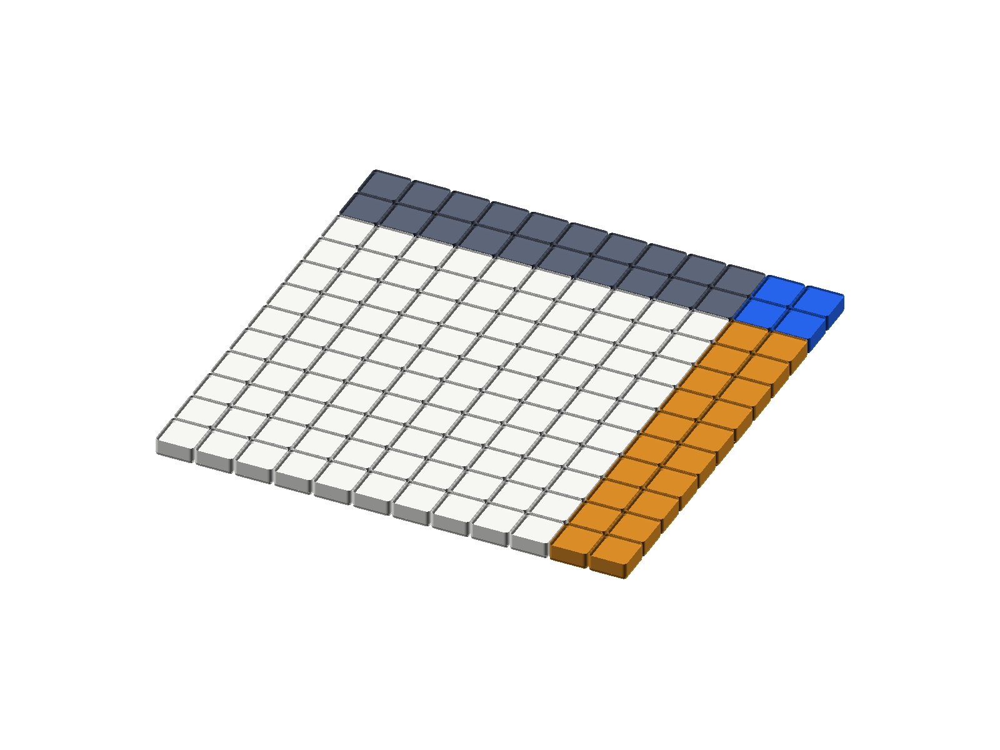

On the SC-6, you can build both $(10 + 2)$ sides and multiply them directly across your shelves via `[1][0] [ENTER] [2] [+] [1][0] [ENTER] [2] [+] [×]`, which forms `12` on Shelf $Y$ and `12` on Shelf $X$ before multiplying them into $X = \mathbf{144}$.

| Keystroke | Register T | Register Z | Register Y | Register X | What Happens on the Stack |
| :--- | :--- | :--- | :--- | :--- | :--- |
| `10 [ENTER]` | 0 | 0 | 10 | 10 | Place 10 on Shelf $X$ and lift a copy to Shelf $Y$ |
| `2 [+]` | 0 | 0 | 0 | 12 | Add 2 to build the first side length ($10 + 2 = 12$) on Shelf $X$ |
| `10 [ENTER]` | 0 | 12 | 10 | 10 | First side 12 rides up to Shelf $Z$; lift 10 onto Shelf $Y$ |
| `2 [+]` | 0 | 0 | 12 | 12 | Add 2 to build the second side 12 on Shelf $X$; first 12 drops to Shelf $Y$ |
| `[×]` | 0 | 0 | 0 | 144 | Multiply the two 12-unit sides ($12 \times 12 = 144$) on Shelf $X$ |

Those four color zones turn a big $12 \times 12$ multiplication problem into four bite-sized pieces ($100 + 20 + 20 + 4 = 144$) you can add in your head! (And once you build the first `12` on Shelf $X$, you can also duplicate and square it in two clicks: `[ENTER] [×]` $\to$ `144`.)

Once you see that you can slice any rectangle into two smaller rectangles, you unlock two everyday kitchen-table shortcuts for multiplying two-digit numbers and store prices in your head. In fact, around **1650 BC**, an **ancient Egyptian scribe named Ahmes** wrote down this exact approach on a 17-foot scroll called the *Rhind Mathematical Papyrus*: the builders who raised the Great Pyramids of Egypt **never needed giant wall-chart multiplication tables!** Instead, they multiplied and divided huge numbers simply by **doubling, halving, and breaking numbers into friendly chunks ($10\text{s}$, $5\text{s}$, and $2\text{s}$)**—the exact same method you use when you split a wide rectangle into two friendly pieces on Shelf $Z$ and Shelf $Y$ of your stack.

Say **8 buses** each carry **53 campers** ($8 \times 53$). Instead of reaching for a pencil, picture a rectangle 8 rows tall and 53 columns wide, and slice the width into **$50 + 3$** so you have an $8 \times 50$ rectangle ($400$) right next to an $8 \times 3$ rectangle ($24$):
$$8 \times 53 = 8(50 + 3) = (8 \times 50) + (8 \times 3) = 400 + 24 = \mathbf{424}$$
On your SC-6 stack, you compute both rectangles and fuse them across your shelves in one smooth run: `8 [ENTER] 50 [×] 8 [ENTER] 3 [×] [+]` $\longrightarrow$ **`424`**. You can use that same rectangle-slicing trick in reverse to outsmart store price tags! Have you ever noticed how stores price items at $\$9.90$ instead of $\$10.00$ because `.90` looks smaller—and looks annoying to multiply? To outsmart the price tag when buying **6 maker kits at $\$9.90$ each** ($6 \times 9.90$), pretend each kit costs a clean **$\$10.00$**, and then subtract the **$\$0.10$** overcharge on each of the 6 kits:
$$6 \times 9.90 = 6(10.00 - 0.10) = (6 \times 10.00) - (6 \times 0.10) = 60.00 - 0.60 = \mathbf{59.40}$$
On your SC-6 stack, `6 [ENTER] 10 [×] 6 [ENTER] 0.10 [×] [-]` lands right on **`59.40`**—and now let's see how that same grid thinking powers real engineering projects!

### 4.1.7 Tile Grids on Spacecraft, Scoreboards & Bedroom Walls
Rectangular tile grids aren't just for math class—engineers, electricians, and homeowners use them every day to wire solar panels on spacecraft, count LEDs in a scoreboard, tally a jar of quarters, and figure out how much paint a bedroom wall needs. Look at a solar-panel wing on a Mars rover: it applies the exact quarter-turn rule we proved on your desk! Whether engineers mount the wing horizontally as **3 rows of 8 solar cells** (`3 [ENTER] 8 [×]` $\to$ **`24`**) or rotate it $90^\circ$ to fit inside a rocket fairing as **8 rows of 3 cells** (`8 [ENTER] 3 [×]` $\to$ **`24`**), the panel packs the exact same $X = 24$ solar cells.

Now glance up at the glowing numbers on a gym scoreboard or a crosswalk countdown sign, where each digit is built from a matrix of **9 rows with 7 LEDs per row**. Place 3 rows of 7 counting tiles ($21$ tiles) on your desk mat to see one-third of the grid, then scale up to all 9 rows on the stack: entering `9 [ENTER] 7 [×]` lifts the 9 rows onto Shelf $Y$ and multiplies by 7 LEDs per row, giving **`63`** LEDs ($X = 63$, which you can immediately reverse-check with `[f] [LASTX] [÷]` $\to 9$). You can even use rectangular grouping at home when you dump out a coin jar, count **36 quarters**, and want to multiply $36 \times 25\text{ cents}$ in your head in two seconds! Picture stacking quarters in groups of four on a table: **4 quarters make 1 dollar ($100\text{ cents}$)**, which means $25$ is simply $100 \div 4$. Instead of multiplying $36 \times 25$ the long way, divide $36$ by $4$ to find how many 4-quarter dollar stacks you have, and multiply by $100$ via `36 [ENTER] 4 [÷] 100 [×]`: `36 [ENTER] 4 [÷]` groups 36 quarters into 9 whole dollars, and `100 [×]` turns 9 dollars into **`900`** cents ($X = 900$, or $\$9.00$).

What if your project combines *two* rectangular grids at once? Imagine painting a rectangular bedroom wall that measures **$15\text{ ft} \times 12\text{ ft}$**, where a wide sliding closet doorway measuring **$18\text{ ft} \times 6\text{ ft}$** doesn't need paint. How do you find the painted wall area—written $(15 \times 12) - (18 \times 6)$—right across your shelves?

Watch Shelf $Z$ act as your automatic upper shelf, holding the $180\text{ sq ft}$ wall area while you multiply the $108\text{ sq ft}$ doorway area on the bottom shelf: running `15 [ENTER] 12 [×] 18 [ENTER] 6 [×] [-]` subtracts the doorway from the wall to display **`72`** square feet.

| Keystroke | Register T | Register Z | Register Y | Register X | What Happens on the Stack |
| :--- | :--- | :--- | :--- | :--- | :--- |
| `15 [ENTER] 12` | 0 | 0 | 15 | 12 | Put wall width 15 onto Shelf $Y$ and height 12 onto Shelf $X$ |
| `[×]` | 0 | 0 | 0 | 180 | Multiply wall size: $15 \times 12 = 180$ on Shelf $X$ |
| `18 [ENTER] 6` | 0 | 180 | 18 | 6 | Wall size 180 lifts to Shelf $Z$; put 18 on Shelf $Y$ and 6 on Shelf $X$ |
| `[×]` | 0 | 0 | 180 | 108 | Multiply doorway size: $18 \times 6 = 108$; 180 drops to Shelf $Y$ |
| `[-]` | 0 | 0 | 0 | 72 | Subtract doorway from wall: $180 - 108 = 72$ on Shelf $X$ |

The final display reads $X = \mathbf{72}$ square feet of wall to paint (and if you were laying flooring across a $15\text{ ft} \times 12\text{ ft}$ bedroom *plus* an $18\text{ ft} \times 6\text{ ft}$ hallway, tapping `[+]` at the end instead of `[-]` adds $180 + 108 = 288\text{ sq ft}$ with the exact same shelf-to-shelf rhythm).

---

### 4.1.8 Francis Guthrie & the Four-Color Map Mystery

There is a second reason your Counting & Array Studio is molded in exactly **four colors** (White, Blue, Gold, and Slate Gray): it lets you play one of the greatest mathematical mysteries of all time right on your desk!

In **1852**, a twenty-year-old London student named **Francis Guthrie** was coloring a map of the counties of England by hand. As he painted each county so that no two bordering counties shared the same color, he noticed something strange: no matter how twisting, crowded, or irregular the county borders were, he never needed a fifth crayon! Even if five or six regions swirled around a center point, **four colors** were always enough to keep every shared border distinct.

Francis showed the puzzle to his younger brother Frederick, who brought it to the famous mathematician Augustus De Morgan. At first, every professor who heard Guthrie's question assumed it would take an afternoon to prove. Instead, the **Four-Color Map Theorem** baffled the greatest mathematical minds on Earth for **124 years**! Only in **1976** did mathematicians **Kenneth Appel and Wolfgang Haken** finally prove that four colors can color *any* flat map in the universe—using **1,200 hours** on an electronic supercomputer to check $1,936$ tricky map configurations!

You can test Francis Guthrie's discovery with a friend right now in a game of **Four-Color Map Showdown**. Deal your 24 four-color tiles between two players and take turns snapping a tile onto a growing map on your desk so that **no two tiles of the same color ever share a flat side edge** (touching at diagonal corners is fair game). Try to surround an empty gap with three different colors so your partner is forced to place the fourth color—and see for yourself why four colors can conquer any map you build!

### 4.1.9 Making Change & Hopping Across Decades

Notice how we just multiplied $6 \times 9.90$ by jumping to a round landmark ($6 \times 10.00 = 60.00$) and adjusting by the tiny difference ($\$0.60$), and how we multiplied $8 \times 53$ by splitting $53$ into tens and ones ($50 + 3$). That exact same habit—jumping to friendly round tens and adjusting—turns tricky two-digit subtraction and addition into two-step mental hops!

When you subtract $92 - 38$ on a paper worksheet by crossing out the `9`, writing an `8`, and penciling a tiny `1` next to the `2`, it is easy to lose track of what is actually happening on your desk: you are unbundling one physical **10-rod** into 10 unit cubes. Even better, just like our store price-tag shortcut for multiplication, you can solve $92 - 38$ in your head by jumping to the nearest round decade!

First is **Round-Landmark Compensation ($92 - 38$)**: imagine paying for a $38\text{-cent}$ sticker when you have $92\text{ cents}$ in your pocket. Instead of counting out 38 pennies one by one, you hand the cashier **4 dimes ($40\text{ cents}$)**—leaving $92 - 40 = 52\text{ cents}$ in your pocket—and the cashier hands you **$2\text{ cents}$ change** ($52 + 2 = 54$)! Because $38$ is just $2$ steps shy of the round landmark $40$, subtracting $40$ and adding $2$ back lands on the answer in two smooth hops:
$$92 - 38 = (92 - 40) + 2 = 52 + 2 = 54$$
Try that exact two-step rhythm on the SC-6 stack via `92 [ENTER] 40 [-] 2 [+]`, which subtracts `40` to reach `52` and adds the `2` cents of change to display $X = \mathbf{54}$.

Second is **Hop-by-Hop Decade Bridging ($47 + 38$)**: when adding $47 + 38$ in your head, split $38$ into three friendly hops ($30 + 3 + 5$). First add the 3 tens ($47 + 30 = 77$), next hop $+3$ to lock into the round decade $80$, and finally add the remaining $5$:
$$47 + 30 = 77 \quad \longrightarrow \quad 77 + 3 = 80 \quad \longrightarrow \quad 80 + 5 = 85$$
Watch the stack trace your mental hops as you key in `47 [ENTER] 30 [+] 3 [+] 5 [+]` to land on $X = \mathbf{85}$.

---

## 4.2 Rhythmic Skip-Counting Ladders & Doubling Chains

How do you build rock-solid fluency with your times tables? Not by staring at a wall chart, but by climbing **rhythmic skip-counting ladders** ($7, 14, 21, 28 \dots$) while laying down rows of tiles on your desk!

On an ordinary keypad, trying to skip-count with `+ 7 = = =` is fragile—if you bump any other key, the hidden constant vanishes. And on older scientific RPN calculators, locking a constant into the top register required pressing `[ENTER]` three times in a row (`7 ENTER ENTER ENTER`).

Your SC-6 makes skip-counting effortless with **Constant Repeat (`[g] [REP]`)** (`[g]` then `[x⇄y]`). When you type a step size like `7` and press `[g] [REP]`, the calculator copies `7` onto **all four shelves of the stack ($T, Z, Y, X$) at once**!

Why does filling all four shelves turn `[+]` into an unstoppable skip-counting ladder? Remember how **Top Shelf $T$** works from Chapter 2: whenever an operation drops the stack, **Top Shelf $T$ leaves a copy of itself behind**. So every single time you tap `[+]`, a fresh `7` rides down from the top shelf to Shelf $Y$, ready for your next tap!

### 4.2.1 How Constant Repeat Turns Addition into Multiplication

Let's start by climbing the **Sevens Ladder**—the same rhythm that counts the days in 1, 2, 3, or 10 weeks. First type `7` and press `[g] [REP]` (`[g]` then `[x⇄y]`) so every shelf ($T, Z, Y, X$) holds `7`, and then tap `[+]` in a steady rhythm as you place 7-tile rows onto your desk:

| Keystroke | Register T | Register Z | Register Y | Register X | What Happens on the Stack |
| :--- | :--- | :--- | :--- | :--- | :--- |
| `7` | 0 | 0 | 0 | 7 | Type step size 7 (1 week = 7 days) onto Shelf $X$ |
| `[g] [REP]` | 7 | 7 | 7 | 7 | Copy step size 7 across all four shelves ($T, Z, Y, X$) |
| `[+]` | 7 | 7 | 7 | 14 | 2 weeks = 14 days; Top Shelf $T$ feeds a fresh 7 down |
| `[+]` | 7 | 7 | 7 | 21 | 3 weeks = 21 days; another 7 drops into Shelf $Y$ |
| `[+]` | 7 | 7 | 7 | 28 | 4 weeks = 28 days (length of February in a common year) |
| `[+]` | 7 | 7 | 7 | 35 | 5 weeks = 35 days on Shelf $X$ |
| `[+]` | 7 | 7 | 7 | 42 | 6 weeks = 42 days on Shelf $X$ |
| `[+]` | 7 | 7 | 7 | 49 | 7 weeks = 49 days ($7 \times 7$ square!) |
| `[+]` | 7 | 7 | 7 | 56 | 8 weeks = 56 days on Shelf $X$ |
| `[+]` | 7 | 7 | 7 | 63 | 9 weeks = 63 days on Shelf $X$ |
| `[+]` | 7 | 7 | 7 | 70 | 10 weeks = 70 days on Shelf $X$ |

Look at Top Shelf $T$ in the table above: `7` never leaves Top Shelf $T$! You can march through the entire 7s table ($7, 14, 21, 28 \dots 70$) with single taps of `[+]`.

Once you have climbed the sevens, try the **Twelves (Dozens) Ladder**. The number 12 is everywhere in daily life—dozens of eggs, hours on a clock face, inches in a foot, and months in a year. Type `12`, press `[g] [REP]`, and tap `[+]` to climb the Dozens Ladder all the way to a gross ($144$):
$$\mathbf{24, 36, 48, 60, 72, 84, 96, 108, 120, 132, 144}$$

| Dozens ($1\text{–}4$) | Dozens ($5\text{–}8$) | Dozens ($9\text{–}12$) |
| :--- | :--- | :--- |
| $1\text{ Dozen} = 12\text{ eggs}$ | $5\text{ Dozen} = 60\text{ eggs}$ | $9\text{ Dozen} = 108\text{ eggs}$ |
| $2\text{ Dozen} = 24\text{ eggs}$ | $6\text{ Dozen} = 72\text{ eggs}$ | $10\text{ Dozen} = 120\text{ eggs}$ |
| $3\text{ Dozen} = 36\text{ eggs}$ | $7\text{ Dozen} = 84\text{ eggs}$ | $11\text{ Dozen} = 132\text{ eggs}$ |
| $4\text{ Dozen} = 48\text{ eggs}$ | $8\text{ Dozen} = 96\text{ eggs}$ | $12\text{ Dozen} = \mathbf{144}\text{ (1 Gross!)}$ |

### 4.2.2 Steady Steps vs. The Chessboard Doubling Explosion
What is the difference between **adding the same step size** over and over (`+ 3`) and **doubling a number** over and over (`× 2`)? Adding climbs like a steady staircase, while doubling starts tiny and then explodes.

First, let's climb a steady **3s addition ladder**—like spacing fence posts or garden stepping stones **3 feet apart** along a path. Instead of typing `+ 3` over and over, Constant Repeat (`[g] [REP]`) copies `3` into all four registers ($T, Z, Y, X$) so every tap of `[+]` adds another 3-foot step.

Snap together 3 rows of 3 counting tiles ($9$ tiles) on your desk mat and count: *3, 6, 9 feet*. Now climb all 9 steps on the stack by pressing `3 [g] [REP] [+] [+] [+] [+] [+] [+] [+] [+]`, which feeds a fresh `3` down from Top Shelf $T$ on every tap to reach **`27`** feet.

| Keystroke | Register T | Register Z | Register Y | Register X | What Happens on the Stack |
| :--- | :--- | :--- | :--- | :--- | :--- |
| `3 [g] [REP]` | 3 | 3 | 3 | 3 | First stepping stone at $3\text{ ft}$ (copy step size 3 across all 4 shelves) |
| `[+]` | 3 | 3 | 3 | 6 | 2nd stone at $6\text{ ft}$; Top Shelf $T$ keeps a fresh 3 ready |
| `[+]` | 3 | 3 | 3 | 9 | 3rd stone at $9\text{ ft}$; a fresh 3 drops down from Top Shelf $T$ |
| `[+]` | 3 | 3 | 3 | 12 | 4th stone at $12\text{ ft}$ along the garden path |
| `[+]` | 3 | 3 | 3 | 15 | 5th stone at $15\text{ ft}$ (halfway down the garden path) |
| `[+]` | 3 | 3 | 3 | 18 | 6th stone at $18\text{ ft}$ along the path |
| `[+]` | 3 | 3 | 3 | 21 | 7th stone at $21\text{ ft}$ along the path |
| `[+]` | 3 | 3 | 3 | 24 | 8th stone at $24\text{ ft}$ along the path |
| `[+]` | 3 | 3 | 3 | 27 | 9th stone at $27\text{ ft}$ at the end of the path |

Look at the two-digit numbers in Shelf $X$ and add their digits together ($1+2=3$, $1+5=6$, $1+8=9$, $2+1=3$, $2+4=6$, $2+7=9$): the digit sums of every multiple of 3 always cycle through **3, 6, 9**.

Now compare that calm, steady $+3$ walk with one of the most famous legends in the history of mathematics: **The Wheat and the Chessboard**. Over a thousand years ago in ancient India, when the mathematician Sissa invented the game of chess (*chaturanga*) on an $8 \times 8$ board of 64 squares, the king offered him any reward he wanted. Sissa asked for what sounded like a tiny bargain: put **1 grain of wheat** on the first square of the chessboard, **2 grains** on the second square, **4 grains** on the third square, **8 grains** on the fourth, **doubling** the wheat on each square ($1 \to 2 \to 4 \to 8 \dots$).

The king laughed and ordered his granary servants to fetch a small sack of wheat. Why was the king about to get a huge surprise? Place 1 counting tile on your desk, double it to 2, then 4, then 8, then 16 tiles to feel how fast doubling overtakes adding. On your SC-6, you can double any number either by locking `2` across all four shelves (`2 [g] [REP] [×] [×]...`) or by riding the two-key cloning rhythm (`[ENTER] [+]`). Keying in `1 [ENTER] [+] [ENTER] [+] [ENTER] [+] [ENTER] [+] [ENTER] [+] [ENTER] [+]` duplicates and adds each square's count until Shelf $X$ reaches **`64`** grains of wheat on the 7th square.

| Keystroke | Register T | Register Z | Register Y | Register X | What Happens on the Stack |
| :--- | :--- | :--- | :--- | :--- | :--- |
| `1 [ENTER]` | 0 | 0 | 1 | 1 | Square 1: Place 1 grain of wheat on the corner square (duplicate into $Y$) |
| `[+]` | 0 | 0 | 0 | 2 | Square 2: $1 + 1 = 2$ grains of wheat |
| `[ENTER] [+]` | 0 | 0 | 0 | 4 | Square 3: $2 + 2 = 4$ grains of wheat |
| `[ENTER] [+]` | 0 | 0 | 0 | 8 | Square 4: $4 + 4 = 8$ grains of wheat |
| `[ENTER] [+]` | 0 | 0 | 0 | 16 | Square 5: $8 + 8 = 16$ grains of wheat |
| `[ENTER] [+]` | 0 | 0 | 0 | 32 | Square 6: $16 + 16 = 32$ grains of wheat |
| `[ENTER] [+]` | 0 | 0 | 0 | 64 | Square 7: $32 + 32 = 64$ grains of wheat |

After just 6 doublings, the pile on the 7th square is already at $64$ grains ($2^6 = 64$)—more than twice our 9-step addition ladder ($27$). At the end of the first row of 8 squares, it is still just a handful of wheat ($128$ grains on the 8th square), so the king kept smiling. By the halfway mark of the chessboard (Square 32), however, the doubling reaches over $2\text{ billion}$ grains—enough wheat to fill several freight train cars. And by the 64th square of the chessboard, the wheat pile explodes past $18.4\text{ quintillion}$ grains ($18,446,744,073,709,551,615$ grains in all)—enough wheat to bury the entire country of India more than a meter deep and exceed all the wheat harvested in human history!

---

## 4.3 Whole Groups & Remainders You Can Hold

In real life, sharing or packing items into equal groups doesn't always come out even—and when you are packing school buses, egg cartons, or 3D-printed parts, a leftover item is a physical object you can hold in your hand. Your SC-6 lets you see both the full groups and the leftovers at the exact same time across Shelves $X$ and $Y$.

### 4.3.1 Why Decimals Hide the Story in Whole-Number Division

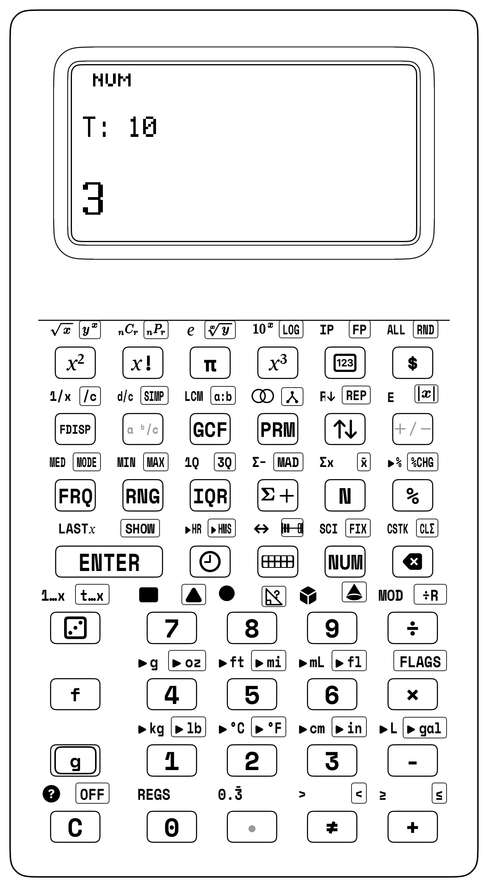

Suppose 145 students are boarding 45-seat buses for a museum trip (like on the screen above), or 23 counting tiles are being dealt into stacks of 5. If you divide with standard decimal division (`[÷]`), a long decimal tail like `3.222222...` hides how many whole buses are full and how many students still need a seat!

When you press **Quotient & Remainder (`[g] [÷R]`)** (`[g]` then `[÷]`), your stacked screen shows *both* whole-number answers at once (with Waiting Shelf $Y$ right above Ground Shelf $X$):
- **Shelf $X$** shows **Whole Groups (Quotient $Q$)**—how many complete groups you can build.
- **Shelf $Y$** holds **Leftovers (Remainder $R$)**—how many loose items remain.

### 4.3.2 Dealing 23 Tiles into Groups of 5

Count out **23 Counting Tiles** onto your desk and deal them into stacks of **5 tiles each**. You can build **4 complete stacks of 5** ($4 \times 5 = 20$ tiles), and you have **3 loose tiles** left over in your hand:
1. Type `23 [ENTER] 5 [g] [÷R]`. Shelf $X$ displays **`4`** (4 full stacks), while Shelf $Y$ holds **`3`** (3 loose tiles)!
2. Tap `[x⇄y]` to swap the **`3`** leftover tiles into $X$ (and tap `[x⇄y]` again to put Quotient `4` back in $X$ and Remainder `3` back in $Y$).
3. **The 3-Key Remainder Proof:** With Quotient `4` in $X$ and Remainder `3` in $Y$, tap `[f] [LASTX] [×] [+]`—recalling `5` from `LASTX`, multiplying $4 \times 5 = 20$, and adding the `3` on Shelf $Y$ to restore all **`23`** tiles!

| Keystroke | Register T | Register Z | Register Y | Register X | What Happens on the Stack |
| :--- | :--- | :--- | :--- | :--- | :--- |
| `23 [ENTER]` | 0 | 0 | 23 | 23 | Place 23 counting tiles on Shelf $X$ and lift a copy to Shelf $Y$ |
| `5` | 0 | 0 | 23 | 5 | Type group size 5 onto Shelf $X$ while 23 waits on Shelf $Y$ |
| `[g] [÷R]` | 0 | 0 | 3 | 4 | Divide into stacks of 5: Shelf $X = 4$ full stacks, Shelf $Y = 3$ left over |
| `[x⇄y]` | 0 | 0 | 4 | 3 | Swap shelves to bring the 3 leftover tiles to Shelf $X$ |

---

### 4.3.3 Packing Cartons, Rock Trays, and Book Crates Without Decimals
Whenever a farm, a science classroom, or a book warehouse packs items into fixed-size containers, `[g] [÷R]` separates full boxes (on Shelf $X$) from leftovers (on Shelf $Y$) in a single click.

Picture a family farm that collects **185 fresh chicken eggs** in the morning to pack into standard **12-egg cartons**. Entering `185 [ENTER] 12 [g] [÷R]` places **15 full cartons** on Shelf $X$ with **5 leftover eggs** on Shelf $Y$, and then swaps **`15`** into the active display for breakfast:

| Keystroke | Register T | Register Z | Register Y | Register X | What Happens on the Stack |
| :--- | :--- | :--- | :--- | :--- | :--- |
| `185 [ENTER]` | 0 | 0 | 185 | 185 | Put 185 total harvested eggs onto Shelf $Y$ |
| `12` | 0 | 0 | 185 | 12 | Put carton size 12 onto Workbench Shelf $X$ |
| `[g] [÷R]` | 0 | 0 | 5 | 15 | Divide into whole cartons: Shelf $X = 15$ full cartons, Shelf $Y = 5$ leftover eggs |
| `[x⇄y]` | 0 | 0 | 15 | 5 | Swap shelves to bring the 5 leftover eggs to Shelf $X$ |

That same two-shelf split works for any packing size, from a classroom rock collection to a giant printing warehouse. In a geology lab sorting **140 polished rock and mineral samples** into **6-slot display trays**, dividing 140 by 6 and swapping shelves via `140 [ENTER] 6 [g] [÷R]` puts **23 full trays** in $X$ and **2 extra rocks** in $Y$ before `[x⇄y]` brings **`23`** to the front ($Q = 23\text{ trays}$, $R = 2\text{ rocks}$). And at a book warehouse packing **3,458 paperback books** into **11-book shipping cartons**, ordinary decimal division ($3,458 \div 11 = 314.363636\dots$) hides the leftover books inside a repeating decimal tail, whereas running `3458 [ENTER] 11 [g] [÷R]` puts Quotient **`314`** (314 full cartons) on Shelf $X$ and Remainder **`4`** on Shelf $Y$ before swapping **`314`** onto Shelf $X$!

---

### 4.3.4 Rebuilding the Starting Pile & Interpreting Leftovers

Looking back to test your answer in reverse is the surest way to know you solved a problem accurately. Every whole-number division follows one unbreakable rule when you deal your Counting Tiles into equal rows on the tabletop:
$$\text{Whole Groups} \times \text{Group Size} + \text{Leftovers} = \text{Starting Total}$$
Right after any `[g] [÷R]` division on your SC-6, your Whole Groups ($Q$) sit on Shelf $X$, your Leftovers ($R$) wait on Shelf $Y$, and the Group Size is tucked inside `LASTX`—so tapping `[f] [LASTX] [×] [+]` rebuilds your starting pile in 3 clicks!

Even more important in real life is deciding **what to do with the leftovers** sitting on Shelf $Y$. Sometimes a remainder forces you to **round the quotient up by 1 ($Q + 1$)** so nothing gets left behind. Say **135 robotics students** are riding to a tournament in **8-seat vans**: tapping `135 [ENTER] 8 [g] [÷R]` shows Quotient **`16`** full vans in $X$ and Remainder **`7`** students in $Y$ (check: `[f] [LASTX] [×] [+]` $\to 135$). Can you leave 7 teammates standing in the parking lot? Never! You must round up to **$16 + 1 = \mathbf{17\text{ vans}}$**. The same thing happens when you slide **165 baseball or Pokémon trading cards** into clear plastic binder pages that hold **9 cards per page** (`165 [ENTER] 9 [g] [÷R]` $\longrightarrow$ Quotient **`18`** full pages in $X$, Remainder **`3`** cards in $Y$): to protect every card without leaving 3 cards loose in a drawer, you need **18 complete 9-pocket pages** plus **1 extra page** for the last 3 cards—**`19` album pages in all**.

Other times, **only full groups count ($Q$)** because a leftover piece is too small to build another whole item. Suppose a maker-lab spool holds **$450\text{ meters}$** of PLA filament, and each 3D-printed chess knight requires **$16\text{ meters}$** (`450 [ENTER] 16 [g] [÷R]` $\longrightarrow$ Quotient **`28`** in $X$, Remainder **`2`** meters in $Y$). Because $2\text{ m}$ of leftover filament cannot print a 29th knight, you can print **`28` complete chess knights** with **$2\text{ m}$ of PLA left over**. *(See Chapter 7 for how `[g] [÷R]` also powers Euclid's GCF algorithm.)*

---

## 4.4 Proving Your Work in Reverse & NASA's Human Computers

Every arithmetic operation has an opposite partner that undoes its work: **subtraction undoes addition**, **addition undoes subtraction**, **division undoes multiplication**, and **multiplication undoes division**.

Because **Last Number Recall (`[f] [LASTX]`)** (`[f]` then `[ENTER]`) always holds a backup copy of the number that was sitting on Shelf $X$ right before your last operation, you can pair `[f] [LASTX]` with all four opposite operations to check your work in two clicks, undo an accidental button press (`[f] [LASTX] [-]` after an unintended `[+]`), or reuse a repeated factor without typing it twice.

### 4.4.1 Four Opposite-Operation Pairs & the Two-Click Speed Sprint

Because `[f] [LASTX]` keeps your last input ready, every operation has a two-click reverse check (`[+]` $\leftrightarrow$ `[f] [LASTX] [-]` and `[×]` $\leftrightarrow$ `[f] [LASTX] [÷]`). Test all four directions right on your keypad: for **Addition $\leftrightarrow$ Subtraction**, key `47 [ENTER] 36 [+]` ($47 + 36 = \mathbf{83}$) and tap `[f] [LASTX] [-]` to return to $\mathbf{47}$, or subtract first via `95 [ENTER] 38 [-]` ($95 - 38 = \mathbf{57}$) and tap `[f] [LASTX] [+]` to restore $\mathbf{95}$. In the exact same way, for **Multiplication $\leftrightarrow$ Division**, multiply `15 [ENTER] 8 [×]` ($15 \times 8 = \mathbf{120}$) and tap `[f] [LASTX] [÷]` to return to $\mathbf{15}$, or divide first via `84 [ENTER] 7 [÷]` ($84 \div 7 = \mathbf{12}$) and tap `[f] [LASTX] [×]` to restore $\mathbf{84}$.

Watch the stack trace a complete two-click check when you combine **68 quarters** and **27 dimes** (`68 [ENTER] 27 [+] [f] [LASTX] [-]` $\to 95$ coins, then `[f] [LASTX] [-]` $\to$ **`68`** quarters):

| Keystroke | Register T | Register Z | Register Y | Register X | What Happens on the Stack |
| :--- | :--- | :--- | :--- | :--- | :--- |
| `68 [ENTER]` | 0 | 0 | 68 | 68 | Put 68 quarters onto Shelf $X$ and lift a copy to Shelf $Y$ |
| `27 [+]` | 0 | 0 | 0 | 95 | Type 27 dimes on Shelf $X$ and add to make 95 coins |
| `[f] [LASTX]` | 0 | 0 | 95 | 27 | Bring back 27 dimes onto Shelf $X$; sum 95 lifts to Shelf $Y$ |
| `[-]` | 0 | 0 | 0 | 68 | Subtract to check our work: $95 - 27 = 68$ quarters restored |

Now try a **Two-Click Speed Sprint** across seven quick workshop and hobby counts, solving each calculation forward and immediately snapping it back to its starting number with `[f] [LASTX]`. Start by multiplying **18 packs of 6 model-rocket motors** and reverse-checking (`18 [ENTER] 6 [×] [f] [LASTX] [÷]` $\to$ **`18`** packs), then divide **156 trail-mix pouches** into bags of **12** and reverse-check (`156 [ENTER] 12 [÷] [f] [LASTX] [×]` $\to$ **`156`** pouches). Next, move **35 fossil shark teeth** out of a **92-tooth** display box and add them back (`92 [ENTER] 35 [-] [f] [LASTX] [+]` $\to$ **`92`** teeth), or combine **348 baseball cards** with **185 football cards** and subtract the second pile back out (`348 [ENTER] 185 [+] [f] [LASTX] [-]` $\to$ **`348`** baseball cards). Finish the sprint by checking **24 rows of 16 auditorium seats** (`24 [ENTER] 16 [×] [f] [LASTX] [÷]` $\to$ **`24`** rows), draining and refilling **187 liters** on a **500-liter** reef aquarium (`500 [ENTER] 187 [-] [f] [LASTX] [+]` $\to$ **`500`** liters), and sorting **225 skateboard wheels** into trays of **15** (`225 [ENTER] 15 [÷] [f] [LASTX] [×]` $\to$ **`225`** wheels).

---

### 4.4.2 Folding Paper to the Sky & Your Age in Seconds

Think multiplication is only for small one-digit grids? A sheet of notebook paper is only $1\text{ layer}$ thick, and every time you fold it in half, the number of layers **doubles** ($\times 2$). Can you fold a piece of paper 10 times with your bare hands? Almost nobody can—and Constant Repeat (`[g] [REP]`) shows why! When you seed the stack with `2` and tap `[×]` nine times in a row—running `2 [g] [REP] [×] [×] [×] [×] [×] [×] [×] [×] [×]`—you watch a 10-step **Doubling Chain ($2 \times 2 \times 2\dots$)** climb to **`1024` layers** (thicker than a 1,000-page dictionary).

Watch how fast that single sheet of paper grows as you tap `[×]`. First tap `2` `[g] [REP]` to lock `2` into all four shelves ($T = Z = Y = X = 2$), then press `[×]` three times for **Folds 1 to 4** to double the paper to `4`, `8` (thicker than cardstock), and `16` layers—where it already fights back against your thumb! Three more taps for **Folds 5 to 7** reach `32` layers (like a deck of index cards), `64` layers (stiff like a wooden ruler), and `128` layers, where it becomes impossible to fold further with bare hands. The final three taps for **Folds 8 to 10** hit `256` layers (a hardcover book), `512` layers (a whole 500-sheet pack of printer paper), and **`1,024` layers**—and if you tapped `[×]` 10 more times ($20\text{ folds} = 1,048,576\text{ layers}$), that single sheet of paper would stand taller than the Empire State Building!

Now test a second big-number challenge: if you are **11 years old**, have you lived for a million seconds yet—or even a *billion* seconds? Chain the multiplication right on the stack ($11\text{ years} \times 365\text{ days} \times 24\text{ hours} \times 60\text{ minutes} \times 60\text{ seconds}$) via `11 [ENTER] 365 [×] 24 [×] 60 [×] 60 [×]` to reveal **`346,896,000` seconds** on Shelf $X$. Start by tapping `11 [ENTER] 365 [×]` to see **`4,015` days** of sunrises and sunsets, then tap `24 [×]` to turn those days into **`96,360` hours**. Next, tap `60 [×]` to reach **`5,781,600` minutes**, and tap `60 [×]` (or `[f] [LASTX] [×]`!) to reach **`346,896,000` seconds**—proving that you actually passed $1,000,000\text{ seconds}$ when you were only $11\text{ and a half days}$ old, and that at age 11 you are already more than **one-third of the way to 1 Billion seconds**!

### 4.4.3 Exponents and Multi-Step Builds in the Workshop

Instead of tapping `[×]` ten times in a row when you multiply the same number by itself, your keypad gives you two dedicated power keys: the Square key **`[x²]`** and the Exponent key **`[g] [yˣ]`**. Before pressing an exponent key, build a **$4 \times 4$ square** on your desk with 16 Counting Tiles to see the #1 exponent rule with your own eyes: $4^2$ means **4 multiplied by itself** ($4 \times 4 = \mathbf{16}$ tiles in a square), **never** $4 \times 2 = 8$! On your SC-6, tapping `4 [x²]` immediately turns `4` into **`16`**.

What happens when you multiply a number by itself four or five times using **`[g] [yˣ]`**? Suppose you want to hoist a heavy **$96\text{-pound}$ tool crate** up into a backyard treehouse using only **$3\text{ pounds}$** of pulling force. By rigging a compound **block-and-tackle pulley hoist** where each movable pulley loop shares the load between two ropes, you **double your lifting power ($\times 2$)** with every stage. With **5 movable pulleys**, your pulling force doubles 5 times ($2 \times 2 \times 2 \times 2 \times 2 = 2^5 = 32$):
$$\text{Total Lifting Force} = 3\text{ pounds} \times (2 \times 2 \times 2 \times 2 \times 2) = 3 \times 32 = \mathbf{96\text{ pounds}}$$
Verify that on your SC-6 stack: `2 [ENTER] 5 [g] [yˣ] 3 [×]` $\longrightarrow$ **`96` pounds**. Biologists see an even faster power chain in nature when European starlings wheel across the sunset sky in a swirling *murmuration*: if 1 startled scout bird signals **5 nearest neighbors**, who each signal **5 more** ($5 \times 5 = 25$), across just **4 signaling waves** ($5 \times 5 \times 5 \times 5 = 5^4$), tapping `5 [ENTER] 4 [g] [yˣ]` shows **`625` starlings** turning together in a fraction of a second!

Now bring rectangular arrays, Shelf $Z$, and `[g] [÷R]` together at a maker workbench where you are wiring a solar rover and assembling wheel bearings for three soapbox go-karts.

Say your rover chassis needs **3 corner light pods with 4 LEDs in each pod** ($3 \times 4 = 12$ LEDs) AND **2 headlight bars with 5 LEDs in each bar** ($2 \times 5 = 10$ LEDs)—Notice that those are the exact same $3 \times 4$ and $2 \times 5$ numbers as our Chapter 2 snack-bar order ($3$ pretzels at $\$4$ + $2$ smoothies at $\$5$), now arranged as physical tile grids! Lay out 3 rows of 4 blue counting tiles ($12$) and 2 rows of 5 gold counting tiles ($10$) on your desk. When you chain both arrays on the stack via `3 [ENTER] 4 [×] 2 [ENTER] 5 [×] [+]`, the first array (`12`) automatically rides up to Shelf $Z$ while you multiply the second array (`10`), then drops back to combine into **`22`** LEDs in all:

| Keystroke | Register T | Register Z | Register Y | Register X | What Happens on the Stack |
| :--- | :--- | :--- | :--- | :--- | :--- |
| `3 [ENTER] 4` | 0 | 0 | 3 | 4 | Place 3 corner pods on Shelf $Y$ and 4 LEDs per pod on Shelf $X$ |
| `[×]` | 0 | 0 | 0 | 12 | Multiply for the corner-pod array ($3 \times 4 = 12$ LEDs) |
| `2 [ENTER] 5` | 0 | 12 | 2 | 5 | Lift 12 LEDs to Shelf $Z$ and 2 bars to Shelf $Y$; type 5 LEDs per bar |
| `[×]` | 0 | 0 | 12 | 10 | Multiply for the headlight-bar array ($10$ LEDs) while 12 waits on Shelf $Y$ |
| `[+]` | 0 | 0 | 0 | 22 | Combine $12 + 10 = 22$ total rover LEDs on Shelf $X$ |

With Shelf $X$ reading $22$, you know the rover wiring harness powers $\mathbf{22}$ LEDs in total.

Next, picture building **3 rolling soapbox carts** in the driveway with your friends. Each cart rolls on **12 roller-blade wheels**, and every wheel housing holds **3 steel ball bearings** ($3 \times 12 \times 3$ bearings in all). If skateboard bearings are sold in plastic tubes of **8 bearings each**, how many full tubes are used up, and how many extra bearings are needed from one more tube?

Chain the three multiplications right into `8 [g] [÷R]` and swap registers with `3 [ENTER] 12 [×] 3 [×] 8 [g] [÷R]`: multiplying $3 \times 12 \times 3$ gives 108 bearings in all, `8 [g] [÷R]` splits 108 into **13 full tubes** ($X = 13$) with **4 extra bearings** needed ($Y = 4$), and `[x⇄y]` brings **`13`** to the front—meaning you need to buy **14 tubes** in total so every wheel can spin.

---

### 4.4.4 Katherine Johnson & NASA's Human Computers

Long before astronauts trusted their lives to electronic flight computers, spaceflight depended on the sharp eyes and self-checking habits of mathematicians known as **Human Computers**—and none was more legendary than **Katherine Johnson**.

Growing up in White Sulphur Springs, West Virginia in the 1920s, young Katherine loved patterns and numbers so much that she counted *everything* she passed: the steps up the road to school and church, the forks and plates she dried after dinner, and the bright stars appearing in the evening sky. Because she saw how numbers grouped into rows, columns, and skip-counting steps—just like your Counting Tiles and the **`[g] [REP]`** key (`[g]` then `[x⇄y]`)—she skipped three grades in elementary school, entered high school at age ten, and graduated from college with highest honors in mathematics at age eighteen!

In **1953**, Katherine Johnson joined the Flight Research Division at **Langley Research Center** in Hampton, Virginia (which soon became part of **NASA**). When America prepared to launch its first astronauts into space in **1961** and **1962**, a single rounding error or stray digit in a trajectory equation could mean an astronaut's capsule splashed down hundreds of miles away from the recovery ship in the Atlantic Ocean.

In February **1962**, as astronaut **John Glenn** prepared to become the first American to orbit the Earth aboard *Friendship 7*, NASA installed massive room-sized IBM electronic computers to calculate his orbital path. Yet before John Glenn would climb into the nose cone of the Atlas rocket, he gave the flight engineers a famous four-word order:

> *"Get the girl to check the numbers."*

Glenn declared that if Katherine Johnson checked the trajectory equations by hand on her desktop mechanical calculator and said the numbers were good, then he was ready to fly. Over a day and a half of intense focus, Katherine worked through every multi-step orbital equation—and how did she and her fellow Langley mathematicians make sure not a single step had slipped?

They **ran every calculation in reverse using the opposite operation**—the exact two-tap habit built into your **`[f] [LASTX]`** key! Whenever Katherine Johnson and her fellow Langley mathematicians **added** two velocity vectors ($A + B = S$), they immediately subtracted the second vector ($S - B = A$) to prove the starting value reappeared without a single altered digit; whenever they **subtracted** a fuel burn ($A - B = D$), they added $B$ right back ($D + B = A$).

In the same way, whenever they **multiplied** an engine burn time by an acceleration rate ($A \times B = P$), they immediately **divided** the product by $B$ to verify that it returned to the exact starting value—and whenever an orbital period left a **whole number of revolutions plus a remainder**, they multiplied the whole orbits by the period and added the remainder back (`[f] [LASTX] [×] [+]`) to prove the total flight time matched down to the tenth of a second.

From calculating the suborbital arc of Alan Shepard's *Freedom 7* in 1961 and verifying John Glenn's *Friendship 7* orbital trajectory in 1962 to computing the lunar-orbit rendezvous window that connected the Apollo 11 Lunar Module *Eagle* with the Command Module *Columbia* above the Moon in 1969, Katherine Johnson's pencil-and-calculator proofs never missed a mark. Every time you tap **`[f] [LASTX]`** on your SC-6 followed by the opposite operation key—or look at a remainder on Shelf $Y$ and decide whether a real-world bus trip needs one extra vehicle so nobody is left behind—you are practicing the exact verification discipline that brought America's astronauts safely home to Earth!

### 4.4.5 John Napier's 1617 Diagonal Multiplication Strips

Three hundred years before Katherine Johnson checked NASA rocket trajectories on her desktop calculator, a Scottish inventor named **John Napier** (1550–1617) asked himself why multiplying big numbers on paper felt so slow and tiring. He noticed that almost every mistake happened when people tried to multiply two digits *and* carry a tens digit in their head at the exact same time.

In **1617**, Napier published a tiny book in Edinburgh called *Rabdologiae* (*Calculation with Rods*) that unveiled one of the cleverest pocket inventions in history: **Napier's Bones**! Instead of forcing you to memorize giant multi-digit products, Napier carved the single-digit times tables (`0` through `9`) onto vertical strips of wood or bone, and drew a **diagonal slash** across every box from the bottom-left corner to the top-right corner. That diagonal line split every two-digit answer into two separate triangles: the **tens digit** sat in the upper-left triangle, and the **ones digit** sat in the lower-right triangle!

Why did that simple diagonal line make big multiplications effortless? Because when you place two or three of Napier's strips side by side—say, the **`3` strip**, the **`6` strip**, and the **`8` strip** to form the number **`368`**—the lower-right ones triangle of each column lines up along the exact same diagonal alley as the upper-left tens triangle of the column to its right!

Let's see how a 17th-century astronomer used Napier's strips to multiply **$368 \times 7$** in five seconds flat, and then watch how the exact same place-value pieces combine on your SC-6 stack:

1. **Read Row `7` Across the `3`, `6`, and `8` Strips:** On the **`3` strip**, Row 7 reads `2 / 1` ($3 \times 7 = 21$, or $21\text{ hundreds} = 2,100$). On the **`6` strip**, Row 7 reads `4 / 2` ($6 \times 7 = 42$, or $42\text{ tens} = 420$). On the **`8` strip**, Row 7 reads `5 / 6` ($8 \times 7 = 56$, or $56\text{ ones}$):
   $$\text{Row } 7 \text{ on the } 3\text{-}6\text{-}8 \text{ Strips: } \quad \mathbf{2}\ /\ \mathbf{1} \quad \big| \quad \mathbf{4}\ /\ \mathbf{2} \quad \big| \quad \mathbf{5}\ /\ \mathbf{6}$$
2. **Slide Down the Diagonal Alleys:** Starting at the far right, the ones triangle holds **`6`**. In the next diagonal alley to the left, the `2` tens from `4 / 2` and the `5` tens from `5 / 6` sit together ($2 + 5 = \mathbf{7}$ tens). In the next diagonal alley left, the `1` hundred from `2 / 1` and the `4` hundreds from `4 / 2` sit together ($1 + 4 = \mathbf{5}$ hundreds). And at the far left sits **`2`** thousands—spelling out **`2,576`** right before your eyes!
3. **Verify the Three Place-Value Strips on Your Stack:** Key the three strips into your SC-6 one column at a time:
   - First multiply the **`300` strip**: `300 [ENTER] 7 [×]` puts **`2,100`** on Shelf $X$.
   - Next multiply the **`60` strip** and add it in: `60 [ENTER] 7 [×] [+]` adds $420$ to reach **`2,520`**.
   - Finally multiply the **`8` strip** and add it in: `8 [ENTER] 7 [×] [+]` adds $56$ to land on **`2,576`**—matching `368 [ENTER] 7 [×]` $\to \mathbf{2,576}$ to the exact digit!

You can make your own pocket set of Napier's strips at home using ten ruled index cards and a ruler: draw 9 boxes down each card, slice each box diagonally from bottom-left to top-right, and write the multiples of that card's top number (`1` through `9`) inside the triangles. Whenever you lay two cards side by side and compare their diagonal alleys against your **Four-Color Array Studio** and your SC-6 stack, you can see four hundred years of hands-on math history working together on your desk.

---

## 4.5 Array & Remainder Challenges & Looking Ahead

With 2D tile grids, skip-counting chains, whole-number remainders, and two-click reverse checks in your toolkit, try these three challenges with your family before we slice leftover remainders into exact fractions in Chapter 5.

### 4.5.1 Three Array, Doubling & Remainder Challenges

Bring a penny, your Four-Color Array tiles, and your SC-6 to the table and put these three puzzles to the test:

1. **The 20-Day Doubling Penny vs. $\$1,000$ Cash Bet (`2 [g] [REP] [×]`):** Ask a family member at dinner whether they would rather take **$\$1,000$ cash** right now or start with **$1\text{ penny}$** and double it every day for **20 doublings** ($2\text{ pennies}$ after 1 doubling, $4\text{ pennies}$ after 2 doublings, $8\text{ pennies}$ after 3 doublings, and so on).
   - Almost everyone picks the $\$1,000$ cash! Now hand them your SC-6, lock `2` into all four shelves with **`2 [g] [REP]`**, and let them tap **`[×]`** nineteen times in a row to watch the pennies double across the screen: after 10 doublings they have **`1,024` pennies** ($\$10.24$), and after 20 doublings ($2^{20}$)—which you can also reach in a single click from Day 10's `1,024` by tapping the Square key **`[x²]`**!—the stack lands on **`1,048,576` pennies**, or **$\$10,485.76$**!
2. **Roller-Coaster Cars vs. Terrarium Moss Jars (`[g] [÷R]` Detective):** Compare two division stories where the remainder changes your decision:
   - **Story A (Roller-Coaster Cars):** **115 theme-park riders** are waiting in line to board **8-seat roller-coaster cars**. Run `115 [ENTER] 8 [g] [÷R]` to find how many full cars (`14` on Shelf $X$) and how many extra riders (`3` on Shelf $Y$) you have—and decide whether the operator must dispatch **`14`** or **`15`** cars so everyone gets a ride!
   - **Story B (Terrarium Moss Jars):** A botany club has **190 polished river pebbles**, and each glass terrarium jar requires **12 pebbles** for its drainage layer (`190 [ENTER] 12 [g] [÷R]`). How many *complete* terrarium jars can they build (`15` on Shelf $X$), how many pebbles are left in the bowl (`10` on Shelf $Y$), and what happens when you tap `[f] [LASTX] [×] [+]`?
3. **The 120-Block Prism Slicer & Four-Color Map Duel:** Calculate the volume of a 3D storage crate measuring **$4\text{ units wide} \times 6\text{ units deep} \times 5\text{ units tall}$** in three different grouping orders:
   - **Floor Layer First:** `4 [ENTER] 6 [×] 5 [×]` ($\to \mathbf{120}$)
   - **Side Wall First:** `6 [ENTER] 5 [×] 4 [×]` ($\to \mathbf{120}$)
   - **Front Wall First:** `4 [ENTER] 5 [×] 6 [×]` ($\to \mathbf{120}$)
   Once you prove all three slices build the exact same **`120`-block prism**, deal all 24 tiles from your Four-Color Array Studio between two players and play a round of **Four-Color Map Showdown**!

---

### 4.5.2 From Whole Remainders to Sliced Fractions in Chapter 5

That physical connection between grids of tiles and fast calculation inspired the very first mechanical calculators in history. In **1617**, Scottish mathematician **John Napier** carved the multiplication table onto ten portable strips of wood or ivory—soon nicknamed **Napier's Bones**—where each square was split by a diagonal line into a **tens triangle** on top and a **ones triangle** on the bottom. Six years later, in **1623**, German astronomer **Wilhelm Schickard** mounted Napier's multiplication cylinders above 10-tooth counting gears to build the world's first mechanical calculating clock for his friend Johannes Kepler.

Every time you split an array into friendly color zones, climb a `[g] [REP]` doubling chain, or keep whole quotients and remainders side by side on Shelves $Y$ and $X$ with `[g] [÷R]`, you are using that exact same visual power:

| Hands-On Array & Division Discovery | What You Build on Your Desk | How Your Stack Shows It (`Y` and `X`) |
| :--- | :--- | :--- |
| **Turn-Around Arrays (Commutative)** | Rotate a $3 \times 8$ tile rectangle $90^\circ$ into $8 \times 3$ | `3 [ENTER] 8 [×]` and `8 [ENTER] 3 [×]` both fuse into `24` |
| **3D Box Slicing (Associative)** | Slice a $2 \times 3 \times 4$ block crate by layers or walls | `(2 × 3) × 4` and `2 × (3 × 4)` both build `24` cubes |
| **Four-Corner Grid Split (Distributive)** | Split $14 \times 13$ into $100 + 30 + 40 + 12$ color zones | Hold each corner area on Shelf $Z$ and Shelf $Y$, then tap `[+]` to reach `182` |
| **Difference of Two Squares ($a^2 - b^2$)** | Lift a $3 \times 3$ square out of a $5 \times 5$ square | `5 [x²] 3 [x²] [-]` leaves a $16$-tile border (`4 × 4`) |
| **Constant Step & Doubling (`[g] [REP]`)** | Stack equal step bars or double wheat on a chessboard | `3 [g] [REP] [+]` climbs `3, 6, 9...`; `2 [g] [REP] [×]` doubles `2, 4, 8, 16...` |
| **Whole Groups & Leftovers (`[g] [÷R]`)** | Pack $135$ students into $8$-seat vans ($16$ full, $7$ left) | `135 [ENTER] 8 [g] [÷R]` puts remainder `7` on Shelf $Y$ and quotient `16` on Shelf $X$ |
| **Reverse Proof Check (`[f] [LASTX]`)** | Rebuild the starting pile from groups plus leftovers | `[f] [LASTX] [×] [+]` multiplies `16 × 8 = 128` and adds `7` back to `135` |

Look at how naturally all seven of those ideas fit together on your desk: multiplication is simply building a rectangular array of rows and columns, skip-counting and powers (`[g] [REP]`) are climbing a rhythmic ladder of equal steps or doublings, and fair-share division (`[g] [÷R]`) is unpacking a pile into equal rows and inspecting any leftover tiles on Waiting Shelf $Y$. Best of all, Katherine Johnson's two-tap `[f] [LASTX]` check lets you verify every single answer in reverse before you move on.

Up to now, whenever a division problem had leftovers—like 7 robotics students waiting for a van or 5 loose eggs at the farm—we kept those remainders whole because you cannot chop a student or a raw egg into pieces! But what happens when you have a leftover that *can* be sliced fairly—like sharing 3 warm loaves of bread among 4 bakers, or measuring a skateboard deck down to the exact eighth of an inch? Turn the page to **[Chapter 5: Fractions, Decimals, Percents & Ratios](sc6/05-fractions-decimals-ratios.md)** to step into the $84\text{ mm}$ Fraction Tower Studio and find out!

---

# Chapter 5: Fractions, Decimals, Percents & Ratios

## 5.1 How Fractions and Ratios Run the Physical World

Grab four $\frac{1}{8}$ blocks and one scarlet $\frac{1}{2}$ block ($42.0\text{ mm}$) from your **84 mm Fraction Studio** and drop them side by side into the **Twin Comparator Well**. Run your fingertip across their tops: they stand at the **exact same $42.0\text{ mm}$ height**, proving in one touch why $\frac{4}{8}\text{ inch}$ on a carpenter's tape measure is the exact same length as a $\frac{1}{2}\text{ inch}$ bolt! Now type `0 [.] 4 [.] 8 [g] [SIMP]` on your SC-6 and watch **One-Tap GCF Simplify (`[g] [SIMP]`)** divide out their Greatest Common Factor ($4$) in one tap so `4/8` simplifies straight to `1/2`.

If fractions on a school worksheet ever made you groan, you are in famous company: **for centuries, even adult astronomers, bakers, and surveyors dreaded adding awkward fractions by hand!** In 9th-century Baghdad, the mathematician **al-Khwarizmi** wrote the first practical guides showing shopkeepers how to line up mismatched fractions on a common grid. Seven hundred years later, in **1585**, Flemish engineer **Simon Stevin** published a tiny 36-page booklet called *De Thiende* (*The Tenth*) for everyday carpenters and tailors—showing how slicing $1\text{ whole}$ into tenths ($0.1$) and hundredths ($0.01$) long before John Napier popularized the modern decimal point in 1614 *([Napier, 1614](sc6/appendix-c-formulas-and-conversions.md#cite-napier1614))* turns fraction arithmetic into whole-number place value, while **Least Common Multiple (`[f] [LCM]`)** snaps any two fractions onto the same grid. Peel back the cover of any machine *([Macaulay, 2016](sc6/appendix-c-formulas-and-conversions.md#cite-macaulay2016))*, and every meshing pair of gears, pulley block, and guitar string is a living fraction in motion.

### 5.1.1 The Pharaoh's Bakery & Pythagoras's Guitar Strings
Why does your **84 mm Fraction Studio** include every unit-fraction block from $\frac{1}{2}$ ($42.0\text{ mm}$) and $\frac{1}{3}$ ($28.0\text{ mm}$) down to $\frac{1}{12}$ ($7.0\text{ mm}$)? Because you can test two of history's coolest discoveries right in your tray! First, travel back to **Ancient Egypt around 1550 BCE**, when **4 temple bakers** had to share **3 round loaves of bread** equally ($\frac{3}{4}$ of a loaf each). Instead of chopping every single loaf into four small pieces, the Egyptian bakers sliced the first two loaves in **half**—giving each baker one big $\frac{1}{2}$ loaf—and cut only the third loaf into **quarters** ($\frac{1}{4}$). Try that in your Twin Comparator Well right now: dock one $\frac{1}{2}$ block ($42.0\text{ mm}$) plus one $\frac{1}{4}$ block ($21.0\text{ mm}$) in the left channel, and three $\frac{1}{4}$ blocks ($63.0\text{ mm}$) in the right channel—both stand completely flush at **$63.0\text{ mm}$** ($\frac{1}{2} + \frac{1}{4} = \frac{3}{4}$), saving the bakers 4 knife cuts!

A thousand years later in ancient Greece, **Pythagoras** discovered that those exact same fractions create musical harmony when you pluck a stretched guitar or lute string: line up the **1 Whole** block ($84.0\text{ mm}$), $\frac{3}{4}$ ($63.0\text{ mm}$), $\frac{2}{3}$ ($56.0\text{ mm}$), and $\frac{1}{2}$ ($42.0\text{ mm}$) on your lid tray, and notice how pinching a guitar string at $\frac{1}{2}$ its length sounds an **Octave**, $\frac{2}{3}$ sounds a **Perfect Fifth**, and $\frac{3}{4}$ sounds a **Perfect Fourth**:

| Keystroke | Register T | Register Z | Register Y | Register X | What Happens on the Stack |
| :--- | :---: | :---: | :---: | :---: | :--- |
| `0 [.] 1 [.] 2 [ENTER]` | 0 | 0 | 1/2 | 1/2 | Put the Egyptian half-loaf $\frac{1}{2}$ ($42.0\text{ mm}$ block) onto Shelf $Y$ |
| `0 [.] 1 [.] 4 [+]` | 0 | 0 | 0 | 3/4 | Add the quarter-loaf $\frac{1}{4}$ ($21.0\text{ mm}$ block) to reach $\frac{3}{4}$ ($63.0\text{ mm}$) |

---

### 5.1.2 Why Hot Dogs and Buns Come in Different Packs (LCM)

Every kid who has ever helped plan a picnic or family birthday barbecue has faced the greatest commercial puzzle in the grocery store: **hot dogs** come in packs of **10**, while **hot dog buns** come in packs of **8**. If you buy 1 pack of each, you have 2 extra wieners and zero buns. If you buy 2 packs of buns (16) and 2 packs of hot dogs (20), you now have 4 extra dogs. How many packages must you buy so that **every single hot dog gets a bun with zero leftovers**?

To rescue the picnic mathematically, you are searching for the **Least Common Multiple (LCM)**—the smallest positive whole number that is a multiple of both 10 and 8:

$$\text{Multiples of } 10: 10, 20, 30, \mathbf{40}, 50, \dots$$
$$\text{Multiples of } 8: 8, 16, 24, 32, \mathbf{40}, 48, \dots$$

The meeting point is **40**, because $40 \div 10 = \mathbf{4}\text{ packs of hot dogs}$ and $40 \div 8 = \mathbf{5}\text{ packs of buns}$. Four packs of dogs plus five packs of buns yields 40 hot dogs tucked neatly into 40 buns. Even better, on your SC-6 you can find that meeting point in a single click: press `10 [ENTER] 8 [f] [LCM]` and the screen immediately flashes **`40`**!

Least Common Multiple isn't just for hot dogs—it is your key to adding different-sized fraction slices. Plant $\frac{1}{6}$ of a garden bed with cherry tomatoes and $\frac{3}{8}$ of the bed with strawberries, and you can't just add $1 + 3$, because a sixth-slice and an eighth-slice are different sizes. You need the **smallest slice size that fits evenly inside both**: $\text{LCM}(6, 8) = 24$ (twenty-fourths, where $\frac{1}{6} = \frac{4}{24}$ and $\frac{3}{8} = \frac{9}{24}$, totaling $\frac{13}{24}$ of the garden).

---

### 5.1.3 Polyrhythms at the Drum Kit: Where Beats Meet

Ever listen to an Afro-Cuban groove, a jazz drum solo, or a modern hip-hop beat where the rhythm seems to float, dance, and pull against itself? That rhythmic tension is powered directly by number theory.

Imagine a drummer playing a **"3-against-4" polyrhythm**, where the right hand taps a steady pulse every 4 clock ticks ($[4, 8, \mathbf{12}, 16, 20, \mathbf{24}, \dots]$) while the left hand plays a cross-pulse every 3 clock ticks ($[3, 6, 9, \mathbf{12}, 15, 18, 21, \mathbf{24}, \dots]$). As the music plays, the two hands wander apart, creating musical tension. The listener's ear holds its breath. But then—**CRASH!** Both hands strike the cymbals at the exact same microsecond.

When does the pattern resolve? At tick **12**—the Least Common Multiple of 3 and 4 ($\text{LCM}(3, 4) = 12$). The entire universe of musical syncopation and harmonic acoustics is governed by common denominators.

---

### 5.1.4 Why Racing Bicycles Use "Hunting Tooth" Gears (GCF)

Look closely at the steel chain and sprockets on a professional racing bicycle. Picture a drivetrain where the chainring at the crank has 34 teeth and the rear cog has 17 teeth.

Notice something dangerous? $34 = 2 \times 17$. Their **Greatest Common Factor is 17** (because 17 divides evenly into both 34 and 17).

If a bicycle were built with that ratio, the exact same chain link would slam into the exact same cog tooth on every second pedal revolution. If that one link picks up a microscopic speck of diamond-hard road grit, it will hammer into that identical tooth thousands of times an hour, gouging a groove and wearing out the sprocket.

Bicycle engineers prevent this wear by choosing gear tooth counts that **share no common factor greater than 1** (their Greatest Common Factor is $1$, a pattern we explore in depth in Chapter 7). When the two gear tooth numbers share no common factor greater than 1, each chain link **"hunts"** around every single tooth on the entire sprocket before ever repeating. Wear is spread evenly across all teeth, allowing the chain to last for thousands of miles.

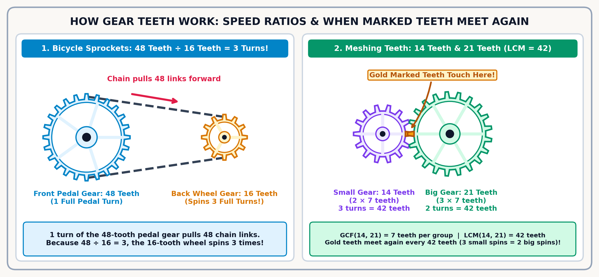

Look at the two gear systems in the diagram above. In **Panel 1 (Bicycle Sprockets)**, when your foot turns a **48-tooth front pedal gear** one full turn, the chain pulls **48 links** forward and wraps them around a smaller **16-tooth back wheel gear**—and because $48 \div 16 = 3$, one turn of your pedals spins the back wheel **3 full turns**! In **Panel 2 (Meshing Gear Teeth)**, when a **14-tooth gear** meshes directly with a **21-tooth gear**, each tooth on the small gear pushes one tooth on the big gear. If you mark the touching pair of teeth with gold paint, when will those two gold teeth touch again? Only when the total number of teeth that have clicked past the center point is a multiple of *both* $14$ and $21$—which happens at $\text{LCM}(14, 21) = \mathbf{42\text{ teeth}}$ ($3$ turns of the small gear and $2$ turns of the big gear)!

Throughout this chapter, you will pair your $84\text{ mm}$ Fraction Towers with two-dot fraction entry (`[.]` for `0 . n . d`, `n . . d`, `. n . d`, and `w . n . d`) and Fraction/Decimal Display Mode (`[FDISP]`), flipping effortlessly between Mixed Numbers (`[a ᵇ/c]`), Improper Fractions (`[f] [d/c]`), and Repeating Decimals (`[f] [0.3̄]`). You will divide out the Greatest Common Factor in a single tap with `[g] [SIMP]`, find common denominators and shared factors with `[f] [LCM]` and `[GCF]`, and scale recipes and gear ratios in Ratio Mode (`[g] [a:b]`).

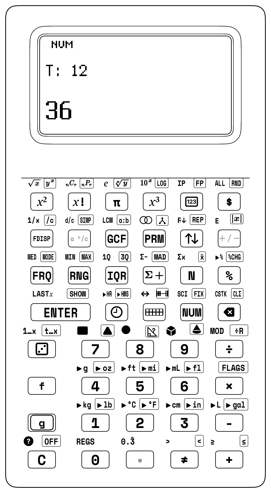

### 5.1.5 Why Your Fraction Towers Stand 84 Millimeters Tall

Think back to the Pharaoh's bread loaves, the hot dog packs, and the bicycle gears we just met. Whether you are sharing bread into halves and quarters, lining up 3-against-4 drumbeats at tick $12$, or comparing different-sized slices, the hardest part of fractions on paper is that the numbers $\frac{3}{4}$ and $\frac{2}{3}$ look like flat symbols trapped on a page—you can't *feel* how big $\frac{3}{4}$ is compared to $\frac{2}{3}$!

That is why your **StackCalc Fraction Studio** turns fractions into real physical towers you can hold in your hands. And why did our engineers choose **$84.0\text{ millimeters}$** as the height of the **1-Whole Tower** instead of $100\text{ mm}$?

Because $84$ is a super-divisible number! While $100$ cannot be divided cleanly by $3$, $6$, or $12$ without leaving ragged decimals, $84\text{ mm}$ divides cleanly into whole-millimeter heights across almost every fraction family in your kit—and its $\frac{1}{12}$ slice ($7.0\text{ mm}$) matches the exact visible height of a single Counting Tile.

### 5.1.6 Seeing $\frac{3}{4} + \frac{2}{3} = 1\frac{5}{12}$ Before You Touch a Pencil

Watch how your $84\text{ mm}$ Fraction Towers take the mystery out of adding fractions with different denominators, like $\frac{3}{4} + \frac{2}{3}$. On paper alone, adding $\frac{3}{4} + \frac{2}{3}$ requires finding the Least Common Multiple of 4 and 3 ($12$), rewriting $\frac{3}{4} = \frac{9}{12}$ and $\frac{2}{3} = \frac{8}{12}$, adding $9 + 8 = \frac{17}{12}$, and converting to $1\frac{5}{12}$. In your hands, however, you can see the answer in five seconds! Drop the $\frac{3}{4}$ tower ($63.0\text{ mm}$) and the $\frac{2}{3}$ tower ($56.0\text{ mm}$) into the left channel of your **Twin Comparator Well** ($63.0 + 56.0 = 119.0\text{ mm}$), and drop the white **1-Whole** tower ($84.0\text{ mm}$) into the right channel beside them. Your $\frac{3}{4} + \frac{2}{3}$ stack sticks up above 1 Whole by $35.0\text{ mm}$—and when you stack **five $\frac{1}{12}$ lilac blocks** ($5 \times 7.0\text{ mm} = 35.0\text{ mm}$) on top of the 1-Whole tower, both channels stand completely flush at **$1\frac{5}{12}$**! Then key in `0 [.] 3 [.] 4 [ENTER] 0 [.] 2 [.] 3 [+]` on your SC-6 stack: the screen immediately shows `1 5/12` (or `17/12` if you tap `[f] [d/c]`, and `1.41666667` if you tap `[FDISP]`), while keeping fractions unreduced whenever you multiply so you can reduce by their Greatest Common Factor in one tap with `[g] [SIMP]`.

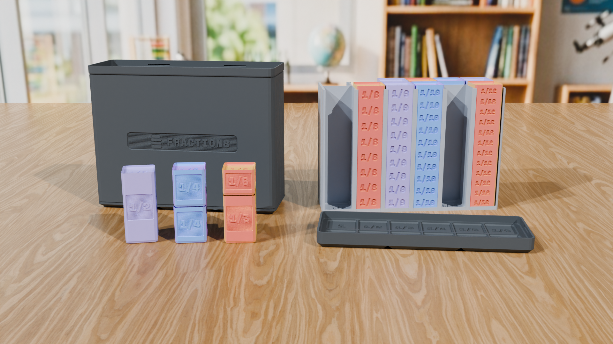

### 5.1.7 Meet Every Tower in Your $84.0\text{ mm}$ Fraction Family
Every color-coded block in your kit is an exact slice of the $84.0\text{ mm}$ 1-Whole white tower, and rotating any block in your hand reveals **three laser-marked faces**—the **Front Face** (common fraction), the **Right Face** (decimal twin), and the **Back Face** (percentage twin):

| Fraction Tower | Studio Color | Exact Height | Blocks per Whole ($84\text{ mm}$) | Front, Right & Back Laser Labels |
| :--- | :--- | :---: | :---: | :--- |
| **`1 WHOLE` Tower** | Bright White | $84.0\text{ mm}$ | $1 \times 84.0\text{ mm}$ | `1 WHOLE` • `1.0` • `100%` |
| **`1/2` Halves** | Scarlet Red | $42.0\text{ mm}$ | $2 \times 42.0\text{ mm}$ | `1/2` • `0.5` • `50%` |
| **`1/3` Thirds** | Solar Yellow | $28.0\text{ mm}$ | $3 \times 28.0\text{ mm}$ | `1/3` • `0.3̄` • `33.3%` |
| **`1/4` Fourths** | Cobalt Blue | $21.0\text{ mm}$ | $4 \times 21.0\text{ mm}$ | `1/4` • `0.25` • `25%` |
| **`1/6` Sixths** | Emerald Green | $14.0\text{ mm}$ | $6 \times 14.0\text{ mm}$ | `1/6` • `0.16̄` • `16.7%` |
| **`1/8` Eighths** | Cyan Blue | $10.5\text{ mm}$ | $8 \times 10.5\text{ mm}$ | `1/8` • `0.125` • `12.5%` |
| **`1/12` Twelfths** | Lilac Purple | $7.0\text{ mm}$ ($1\text{U}$) | $12 \times 7.0\text{ mm}$ | `1/12` • `0.083̄` • `8.3%` |

Holding a single cobalt-blue block lets your eyes see immediately that $\frac{1}{4}$, $0.25$, and $25\%$ are three names for the exact same physical size!

### 5.1.8 Proving Equivalence in the Twin Comparator Well

The storage case for your Fraction Studio includes a side-by-side channel called the **Twin Comparator Well**. Whenever you want to know whether two fractions are equal—or which one is bigger—you simply stand them side by side in Well A and Well B and slide your fingertip across the top edge!

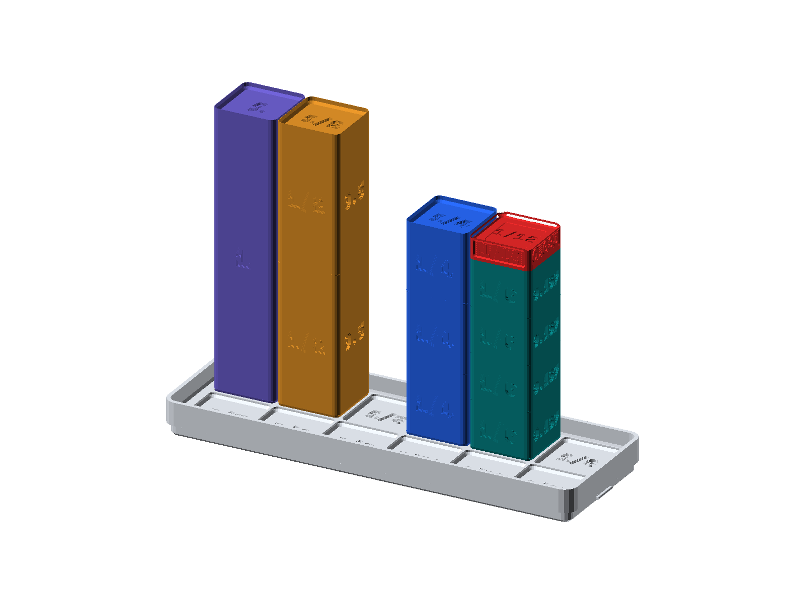

Try two hands-on experiments right now:
1. **Two Halves Make One Whole ($\frac{2}{2} = 1$):** Place the white **1-Whole** tower ($84.0\text{ mm}$) into Well A, and stack two scarlet **$\frac{1}{2}$** towers ($42.0\text{ mm} + 42.0\text{ mm} = 84.0\text{ mm}$) into Well B. Slide your finger across the top: there is zero step between them, proving $\frac{2}{2} = 1$.
2. **Which Is Bigger: $\frac{3}{4}$ or $\frac{4}{6}$? (And How Much Bigger?):** Stack three blue **$\frac{1}{4}$** blocks in Well A ($3 \times 21.0\text{ mm} = 63.0\text{ mm}$) and four green **$\frac{1}{6}$** blocks in Well B ($4 \times 14.0\text{ mm} = 56.0\text{ mm}$). Slide your finger across the top: Well A stands taller than Well B by $7.0\text{ mm}$, proving $\frac{3}{4} > \frac{4}{6}$! Now grab **1 Counting Tile** ($7.0\text{ mm}$ visible height, which is $\frac{1}{12}$ of $84\text{ mm}$) from your Counting Studio and drop it on top of the $\frac{4}{6}$ stack in Well B ($56.0 + 7.0 = 63.0\text{ mm}$). Run your finger across again—*completely flush!* Your fingertips just discovered that $\frac{4}{6} + \frac{1}{12} = \frac{3}{4}$.

Now watch the SC-6 stack confirm what your hands just felt—enter $\frac{4}{6}$ (`0 [.] 4 [.] 6 [ENTER]`), add $\frac{1}{12}$ (`0 [.] 1 [.] 12 [+]`) to see the unreduced twelfths sum **`9/12`**, and tap `[g] [SIMP]` to reduce it to **`3/4`**:

| Keystroke | Register T | Register Z | Register Y | Register X | What Happens on the Stack |
| :--- | :--- | :--- | :--- | :--- | :--- |
| `0 [.] 4 [.] 6` | 0 | 0 | 0 | 4/6 | Build the green tower fraction $\frac{4}{6}$ ($56.0\text{ mm}$) on Shelf $X$ |
| `[ENTER]` | 0 | 0 | 4/6 | 4/6 | Lift $\frac{4}{6}$ onto Shelf $Y$ without reducing it |
| `0 [.] 1 [.] 12` | 0 | 0 | 4/6 | 1/12 | Build the $\frac{1}{12}$ bridge tile ($7.0\text{ mm}$) on Shelf $X$ |
| `[+]` | 0 | 0 | 0 | 9/12 | Add in twelfths ($\frac{8}{12} + \frac{1}{12} = \frac{9}{12}$) on Shelf $X$ |
| `[g] [SIMP]` | 0 | 0 | 0 | 3/4 | Divide out the shared factor of 3 to reach $\frac{3}{4}$ ($63.0\text{ mm}$) |

---

## 5.2 Building, Simplifying & Adding Fractions Step by Step

Now that your hands have felt how the $84.0\text{ mm}$ Fraction Towers line up in the Twin Comparator Well, let's see how to enter, multiply, divide, simplify, and add any pair of fractions right on the SC-6 stack.

### 5.2.1 Entering Fractions with Two Dots
Did you notice how quickly we entered `4/6` and `1/12` in the table above using the dot key `[.]`? Instead of hunting for a fraction-template button or arrowing up and down between little boxes, you build a fraction from top to bottom on the SC-6 using the single button your fingers already know best—the **dot key (`[.]`)**. Think of the **first dot (`[.]`)** as separating the whole number from the numerator and the **second dot (`[.]`)** as drawing the **fraction bar (`/`)** between the top number (numerator) and bottom number (denominator). From default Whole Number Mode (`[NUM]`), you can enter a **Proper Fraction** like $\frac{3}{8}$ either by typing `0` before the first dot (`0 [.] 3 [.] 8`) or by double-tapping the dot (`3 [.] [.] 8`) so the display shows **`3/8`**—and once Fraction Display (`[FDISP]`) is active (or `[NUM]` is toggled off), you can also use the leading-dot shorthand `[.] 3 [.] 8`! If your fraction has a whole number in front—like the **Mixed Number** $2\frac{3}{4}$—simply type the whole number *before* the first dot (`2 [.] 3 [.] 4` $\longrightarrow$ **`2 3/4`**), or enter it directly as an **Improper Fraction** ($\frac{11}{4}$) by tapping `0 [.] 11 [.] 4` (or `11 [.] [.] 4` / `[.] 11 [.] 4`) $\longrightarrow$ **`11/4`**.

The moment your finger taps that second dot `[.]`, the calculator knows you are building a fraction and displays it clearly on your vertical stack screen (with Waiting Shelf $Y$ right above Ground Shelf $X$), automatically sizing the digits so nothing ever gets cut off:

| Fraction Type or View | What You Key on the SC-6 | What Appears on Shelf $X$ | Physical $84\text{ mm}$ Tower Match |
| :--- | :--- | :--- | :--- |
| **Proper Fraction ($\frac{3}{8}$)** | `0 [.] 3 [.] 8` *(or `[.] 3 [.] 8`)* | **`3/8`** | Three cyan $\frac{1}{8}$ blocks ($31.5\text{ mm}$) |
| **Mixed Number ($2\frac{3}{4}$)** | `2 [.] 3 [.] 4` | **`2 3/4`** | Two Whole towers + three $\frac{1}{4}$ blocks |
| **Improper Toggle (`[f] [d/c]`)** | Tap `[f] [d/c]` on `2 3/4` | **`11/4`** | Eleven blue $\frac{1}{4}$ blocks stacked |
| **Decimal Toggle (`[FDISP]`)** | Tap `[FDISP]` on `2 3/4` | **`2.75`** | Right-hand decimal face of the tower |

### 5.2.2 Fractions in Musical Strings and Chocolate Bars
Just as your physical Fraction Towers show fraction, decimal, and percent faces when you turn them in your hand, three keys let you flip how any number looks on screen at any time: **Mixed Number View (`[a ᵇ/c]`)** shows whole units plus the leftover fraction (turning `11/4` into **`2 3/4`**), **Improper Fraction View (`[f] [d/c]`)** packs the whole units inside the numerator so you can count total slices (turning `2 3/4` into **`11/4`**), and the **Fraction / Decimal Toggle (`[FDISP]`)** flips back and forth between exact fraction view and decimal view (`3/4` $\longleftrightarrow$ **`0.75`**).

In real music, sheet music opens with a fraction-like **time signature** ($\frac{3}{4}$, $\frac{6}{8}$, or $\frac{5}{8}$), and pressing a guitar string against a fret divides the vibrating string into an exact fraction of its full length. In a song's 8-beat measure, when a drummer plays a fill covering $\frac{5}{8}$ of the bar—or a guitarist presses a string at the 8th fret so $\frac{5}{8}$ of the string vibrates to sound a minor sixth—you can stack five cyan $\frac{1}{8}$ Fraction Studio blocks ($5 \times 10.5\text{ mm} = 52.5\text{ mm}$) in the Comparator Well to feel that exact proportion against the $84\text{ mm}$ Whole tower. Build the fraction from top to bottom with two dots via `[.] 5 [.] 8 [ENTER]`, and the stack displays **`5/8`**:

| Keystroke | Register T | Register Z | Register Y | Register X | What Happens on the Stack |
| :--- | :--- | :--- | :--- | :--- | :--- |
| `0 [.] 5 [.] 8` | 0 | 0 | 0 | 5/8 | Two dots enter the top number 5 and bottom number 8 on Shelf $X$ |
| `[ENTER]` | 0 | 0 | 5/8 | 5/8 | Lift the fraction onto Shelf $Y$ as an exact fraction |

The daylight display confirms $X = 5/8$ as an exact fraction without any decimal rounding, matching the five cyan eighth-blocks in your Twin Comparator Well down to the half-millimeter.

Now picture **$3\ \frac{2}{5}$ large chocolate bars** on the kitchen table, where each bar is molded with deep grooves dividing it into **5 equal strips** so friends can break off equal shares. How many individual $\frac{1}{5}\text{-bar}$ strips can you hand out in all?

Place 3 full 1-Whole towers beside two $\frac{1}{5}$ blocks to see the whole bars and the extra strips side by side on your tray. Enter `3 . 2 . 5` (putting the whole number `3` before the first dot) and tap `[f] [d/c]` to unpack all the whole bars into fifths: `[3] [.] 2 [.] 5 [ENTER] [f] [d/c]` converts the mixed number on Shelf $X$ into **`17/5`**.

Why does $3\ \frac{2}{5}$ turn into $\frac{17}{5}$? Because each of the $3$ whole chocolate bars breaks into $5$ fifth-sized strips ($3 \times 5 = 15$ strips), and adding the $2$ extra strips gives **$17$ fifth-sized chocolate strips** ($\frac{17}{5}$) in all—while your original mixed number ($3\ \frac{2}{5}$) stays right on Shelf $Y$ so you can see both forms side by side.

---

### 5.2.3 Seeing the True Grid First: Unreduced Fractions & One-Tap GCF Reduction

When you multiply $\frac{1}{2} \times \frac{2}{3}$ on a standard school calculator, the moment you press equals, the screen jumps straight to `1/3`.

Why is that actually a problem when you are learning fractions? Because if the calculator jumps straight from $\frac{1}{2} \times \frac{2}{3}$ to $\frac{1}{3}$, it hides the most important rule of fraction multiplication: **multiplying the numerators ($1 \times 2 = 2$) and multiplying the denominators ($2 \times 3 = 6$) to get $\frac{2}{6}$!**

On the SC-6, **arithmetic never hides your intermediate steps**. When you multiply $\frac{1}{2} \times \frac{2}{3}$, the screen first displays your true unreduced product—**`2/6`**—so you can see how the numerators and denominators multiplied straight across. Then, when you are ready to reduce the fraction, **you** press **One-Tap GCF Simplify (`[g] [SIMP]`)** to divide out the Greatest Common Factor in one tap and reveal **`1/3`** (or flash `LOWEST TERMS` when a fraction cannot be reduced any further):

| Operation | Unreduced Output | Next Step with `[g] [SIMP]` |
|:---|:---|:---|
| **Like Addition:** $2/4 + 1/4$ | $3/4$ | `LOWEST TERMS` alert |
| **Like Addition:** $2/4 + 2/4$ | $4/4$ (retains $4/4$) | `[g] [SIMP]` $\to 1$ |
| **Like Subtraction:** $3/4 - 1/4$ | $2/4$ (retains $2/4$) | `[g] [SIMP]` $\to 1/2$ |
| **Unlike Addition:** $1/2 + 1/4$ | $3/4$ (common denom $4$) | `LOWEST TERMS` alert |
| **Multiply:** $2/3 \times 3/4$ | $6/12$ | `[g] [SIMP]` $\to 1/2$ |
| **Divide:** $2/3 \div 1/4$ | $8/3$ ($2/3 \times 4/1$) | `[a ᵇ/c]` $\to 2\frac{2}{3}$ |

### 5.2.4 Robot Speed Gears & Cross-Canceling

Seeing the unreduced fraction first also helps you understand a famous shortcut your teacher will show you on paper called **cross-canceling**.

Imagine building a 3-stage robot gear train where each gear slows the spin down for extra climbing power. Gear 1 spins at $\frac{1}{2}$ the motor's speed, Gear 2 spins at $\frac{2}{3}$ of Gear 1's speed, and Gear 3 spins at $\frac{3}{4}$ of Gear 2's speed. How fast does Gear 3 spin compared to the motor? You can test two different pathways to find out. First, try multiplying straight across and then pressing `[g] [SIMP]`: multiply all the numerators ($1 \times 2 \times 3 = 6$) and all the denominators ($2 \times 3 \times 4 = 24$) by keying `0 [.] 1 [.] 2 [ENTER] 0 [.] 2 [.] 3 [×] 0 [.] 3 [.] 4 [×]` ($\to \mathbf{6/24}$), and then tap `[g] [SIMP]` to shrink $\frac{6}{24} \longrightarrow \mathbf{\frac{1}{4}}$.

Now compare that with the paper shortcut of **cross-canceling shared factors** before you multiply. Look at the numerators and denominators side by side: there is a $2$ on the bottom and a $2$ on top, plus a $3$ on the bottom and a $3$ on top! Canceling those matching pairs ($\frac{2}{2} = 1$ and $\frac{3}{3} = 1$) leaves the answer right away:
$$\frac{1}{\cancel{2}} \times \frac{\cancel{2}}{\cancel{3}} \times \frac{\cancel{3}}{4} = \mathbf{\frac{1}{4}}$$
The middle gears act like bridges—only the first numerator ($1$) and last denominator ($4$) survive! You can see that same "fraction of a fraction" gear reduction at work on a $24\text{-RPM}$ robot axle: when a drive shaft spins at $24\text{ revolutions per minute (RPM)}$ and passes through a $\frac{1}{3}$ gear stage followed by a $\frac{1}{4}$ gear stage, multiplying $\frac{1}{3} \times \frac{1}{4} = \frac{1}{12}$ finds the combined gear ratio, and tapping `24 [×]` ($\longrightarrow \mathbf{2\text{ RPM}}$) shows that the robot's climbing wheel turns at a steady, high-torque $2\text{ RPM}$.

### 5.2.5 Multiplying Fractions and Scaling Mixed Numbers

Let's see how fraction multiplication works in two everyday situations—first multiplying proper fractions to see the unreduced grid before pressing `[g] [SIMP]`, and then scaling a mixed-number measurement by $1\ \frac{1}{2}$ times.

Cut a rectangular canvas or carbon-fiber patch measuring **$\frac{2}{3}\text{ meter}$ wide by $\frac{3}{4}\text{ meter}$ long**—what is its area in square meters? Picture folding a $1\text{-meter}$ square into $3$ columns (taking $2$) and $4$ rows (taking $3$): the overlapping patch covers $2 \times 3 = 6$ out of $3 \times 4 = 12$ mini-rectangles ($\frac{6}{12}$). Multiply on the stack so you can see the unreduced $\frac{6}{12}$ grid first, and then tap `[g] [SIMP]` to divide out the Greatest Common Factor of $6$ in one tap: keying in `[.] 2 [.] 3 [ENTER] [.] 3 [.] 4 [×] [g] [SIMP]` shows `6/12` and then reduces it to **`1/2`**:

| Keystroke | Register T | Register Z | Register Y | Register X | What Happens on the Stack |
| :--- | :--- | :--- | :--- | :--- | :--- |
| `0 [.] 2 [.] 3 [ENTER]` | 0 | 0 | 2/3 | 2/3 | Put the width $\frac{2}{3}\text{ m}$ onto Shelf $Y$ |
| `0 [.] 3 [.] 4 [×]` | 0 | 0 | 0 | 6/12 | Multiply by length $\frac{3}{4}\text{ m}$; shows $\frac{6}{12}$ before simplifying so you can see the matching twelfths |
| `[g] [SIMP]` | 0 | 0 | 0 | 1/2 | Tap `[g] [SIMP]` to reduce $\frac{6}{12}$ to $\frac{1}{2}\text{ m}^2$ |

What if a recipe or bike-fork oil service calls for **$2\ \frac{1}{4}\text{ ounces}$** (or cups), and you want to make **$1\ \frac{1}{2}$ batches**? How much do you measure out?

In improper fractions, $2\ \frac{1}{4}$ is $\frac{9}{4}$ and $1\ \frac{1}{2}$ is $\frac{3}{2}$, so their product is $\frac{27}{8}$ ounces. Watch the SC-6 multiply the mixed numbers directly and convert $\frac{27}{8}$ back into whole ounces and eighths with `[a ᵇ/c]`: `[2] [.] 1 [.] 4 [ENTER] [1] [.] 1 [.] 2 [×] [a ᵇ/c]` lands right on **`3 3/8`**. Because $24$ eighths fill $3$ whole ounces and leave $3$ eighths left over, your measuring cup reaches the **$3\ \frac{3}{8}\text{-ounce}$** line.

### 5.2.6 Visual Ways to Understand Fraction Division: Measurement & Partitive Models

When you first see a fraction division problem like $\frac{3}{4} \div \frac{1}{8} = 6$, you might ask a great question: *"Wait—how can dividing make the answer BIGGER ($6$)?"*

Think about what $12 \div 3 = 4$ means with whole numbers: it asks, *"How many groups of $3$ fit inside $12$?"* Now ask the exact same question for $\frac{3}{4} \div \frac{1}{8}$: **"How many $\frac{1}{8}\text{-size}$ blocks fit inside a $\frac{3}{4}\text{-size}$ tower?"** Because $\frac{1}{8}$ blocks are small, you can fit **6 of them** inside $\frac{3}{4}$! You can see and prove this **Measurement (Quotitive) Division** model three ways:

1. **Physical Fraction Tower Alignment:** Stack three blue $\frac{1}{4}$ blocks ($3 \times 21.0\text{ mm} = 63.0\text{ mm}$) in Well A of your **84 mm Fraction Studio**, and stack cyan $\frac{1}{8}$ blocks ($10.5\text{ mm}$ each) in Well B until both towers stand flush. It takes exactly **6 cyan $\frac{1}{8}$ blocks** ($6 \times 10.5\text{ mm} = 63.0\text{ mm}$) to match $\frac{3}{4}$!
2. **Common-Denominator Measurement Division:** Rewrite both fractions using the same block size (eighths, since $\frac{3}{4} = \frac{6}{8}$). Now the question is simply *"How many $1\text{-eighths}$ fit inside $6\text{-eighths}$?"*
   $$\frac{3}{4} \div \frac{1}{8} = \frac{6}{8} \div \frac{1}{8} = 6\text{ eighths} \div 1\text{-eighth} = 6 \div 1 = \mathbf{6}$$
3. **Multiplying by the Reciprocal (`[f] [1/x]`):** Because eight $\frac{1}{8}$ blocks fit inside $1$ Whole, dividing by $\frac{1}{8}$ is the same as multiplying by its flipped partner (the **reciprocal** $\frac{8}{1}$, which you can see anytime with the `[f] [1/x]` key):
   $$\frac{3}{4} \times \frac{8}{1} = \frac{24}{4} = \mathbf{6}$$

What if the divisor does *not* fit a whole number of times into the dividend, as in $\frac{1}{2} \div \frac{3}{4} = \frac{2}{3}$? That is where the universal **Partitive "Split & Rebuild 1 Full Tower" ($\div c$ then $\times d$)** model shines!
- **The Partitive Question:** *"If a $\frac{1}{2}$ block ($42.0\text{ mm}$) is $\frac{3}{4}$ of a mystery tower, how tall is $1$ full mystery tower ($\frac{1}{2} \div \frac{3}{4}$)?"*
- **Step 1 — Split by the Numerator ($\div 3$):** Because your $42.0\text{ mm}$ half-tower represents $3$ fourths of the mystery tower, split $42.0\text{ mm}$ into $3$ equal parts to find $\frac{1}{4}$ of the mystery tower: three green $\frac{1}{6}$ blocks ($14.0\text{ mm}$ each, since $42.0\text{ mm} \div 3 = 14.0\text{ mm}$).
- **Step 2 — Rebuild by the Denominator ($\times 4$):** Now stack $4$ of those $\frac{1}{6}$ blocks together ($4 \times 14.0\text{ mm} = 56.0\text{ mm} = \frac{4}{6} = \frac{2}{3}$) in Well B to build all $\frac{4}{4}$ ($1$ full mystery tower)—physically proving why dividing by $\frac{c}{d}$ always splits by $c$ ($\div c$) and rebuilds by $d$ ($\times d$), which is multiplying by the reciprocal $\frac{d}{c}$! *(Classroom Pod Note: When building towers that require extra sixth-blocks or twelfth-blocks across both comparator wells, partner pairs in a 4-kit table pod can pool their sixth- and twelfth-blocks.)*

Once you picture fraction division both ways—*"how many slices fit inside?"* and *"split by the top, rebuild by the bottom"*—everyday kitchen and workshop puzzles click right into place. Suppose you are prepping trail mix for a Saturday hike: a big mixing bowl holds $4\frac{1}{2}\text{ cups}$ of trail mix, and each hiker's snack bag holds $\frac{3}{8}\text{ cup}$. Keying `4 [.] 1 [.] 2 [ENTER] 0 [.] 3 [.] 8 [÷]` ($\frac{9}{2} \div \frac{3}{8} = \frac{36}{8} \div \frac{3}{8} = 36 \div 3$) reveals that you can pack **$12$ full snack bags**. The exact same slicing question works when you are cutting craft ribbon for tournament medals: if you have a $6\text{-meter}$ roll of satin ribbon and snip it into $\frac{3}{20}\text{-meter}$ strips ($15\text{ cm}$ each), keying `6 [ENTER] 0 [.] 3 [.] 20 [÷]` shows you will get **`40` strips** with zero ribbon wasted. And once you can multiply or divide two fractions on their own, you are ready to chain both moves together in a single run.

### 5.2.7 Chaining Mixed-Number Multiplication and Division in One Flow
What happens when a woodworking or baking project combines mixed-number multiplication *and* fraction division in a single expression, like $(3\ \frac{1}{2} \times 2\ \frac{2}{3}) \div 1\ \frac{1}{6}$? Under the hood, $\frac{7}{2} \times \frac{8}{3} = \frac{28}{3}$, and dividing by $\frac{7}{6}$ flips and multiplies ($\frac{28}{3} \times \frac{6}{7} = 4 \times 2 = 8$). Watch two-dot RPN glide straight to **`8`** in 17 keystrokes when you key in `3 [.] 1 [.] 2 [ENTER] 2 [.] 2 [.] 3 [×] 1 [.] 1 [.] 6 [÷] [a ᵇ/c]` to land on **`8`**:

| Keystroke | Register T | Register Z | Register Y | Register X | What Happens on the Stack |
| :--- | :--- | :--- | :--- | :--- | :--- |
| `3 [.] 1 [.] 2 [ENTER]` | 0 | 0 | 3 1/2 | 3 1/2 | Put the first mixed number $3\ \frac{1}{2}$ onto Shelf $Y$ |
| `2 [.] 2 [.] 3 [×]` | 0 | 0 | 0 | 28/3 | Multiply by $2\ \frac{2}{3}$; shows the unsimplified product $\frac{28}{3}$ |
| `1 [.] 1 [.] 6 [÷]` | 0 | 0 | 0 | 8 | Divide by $1\ \frac{1}{6}$; gives the exact whole number 8 |

Both the multiplication step and the division step resolve to the exact whole number **`8`** right across your two bottom shelves.

---

### 5.2.8 Reducing Fractions to Lowest Terms in One Tap

Simplifying a fraction to lowest terms is really just trading lots of small slices for fewer, bigger blocks that reach the exact same height. When you drop two $\frac{1}{4}$ blocks ($42.0\text{ mm}$) and one $\frac{1}{2}$ block ($42.0\text{ mm}$) into your Twin Comparator Well, their top edges stand completely flush—showing your fingers that $\frac{2}{4}$ and $\frac{1}{2}$ are the exact same height, just built with fewer blocks!

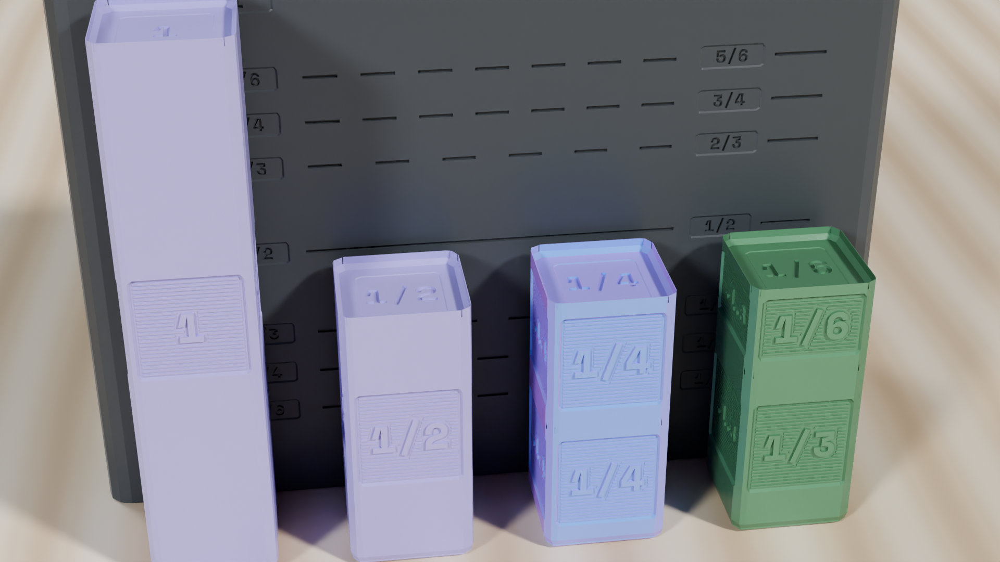

Even better, if you lift a copy of your unreduced fraction onto **Shelf $Y$** with `[ENTER]` before pressing **`[g] [SIMP]`**, your screen acts just like the Twin Comparator Well—keeping the original unreduced fraction on Shelf $Y$ right above the simplified fraction on Shelf $X$!

To test this hands-on, stack twelve $\frac{1}{18}$ unit slices ($12 \times 4.67\text{ mm} = 56.0\text{ mm}$) in Well A and two yellow $\frac{1}{3}$ blocks ($2 \times 28.0\text{ mm} = 56.0\text{ mm}$) in Well B. Their tops match at $56.0\text{ mm}$, proving $\frac{12}{18} = \frac{2}{3}$. Now watch `[g] [SIMP]` place both forms together on the stack:
1. Enter $\frac{12}{18}$ using two-dot syntax: `0 [.] 12 [.] 18 [ENTER]`.
2. Press `[g] [SIMP]`: the calculator divides both $12$ and $18$ by their Greatest Common Factor ($6$), updating Shelf $X$ to **`2/3`** while keeping your original `12/18` visible on Shelf $Y$ for comparison!
3. Press `[g] [SIMP]` a second time: because $2$ and $3$ share no common factor greater than $1$, the screen flashes **`LOWEST TERMS`**!

| Keystroke | Register T | Register Z | Register Y | Register X | What Happens on the Stack |
| :--- | :--- | :--- | :--- | :--- | :--- |
| `0 [.] 12 [.] 18` | 0 | 0 | 0 | 12/18 | Build the unreduced fraction $\frac{12}{18}$ on Shelf $X$ |
| `[ENTER]` | 0 | 0 | 12/18 | 12/18 | Lift a copy of $\frac{12}{18}$ to Shelf $Y$ for comparison |
| `[g] [SIMP]` | 0 | 0 | 12/18 | 2/3 | Divide out the shared factor of 6 to show $\frac{2}{3}$ under $\frac{12}{18}$ |
| `[g] [SIMP]` | 0 | 0 | 12/18 | 2/3 | Second press flashes `LOWEST TERMS` to confirm $\frac{2}{3}$ is fully reduced! |

---

### 5.2.9 Common Denominators & Shared Factors

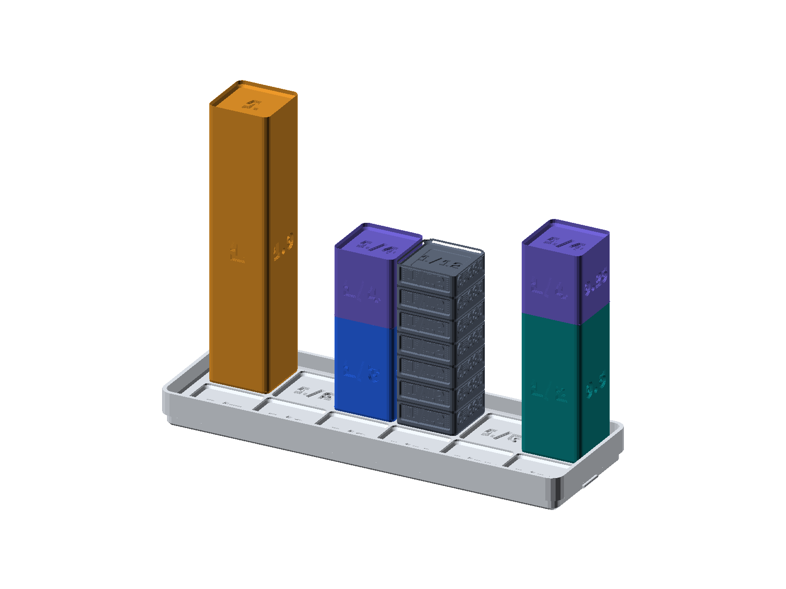

Imagine standing in a woodworking shop gluing a **$\frac{3}{8}\text{-inch}$** plywood panel onto a **$\frac{5}{12}\text{-inch}$** hardwood backing strip. How do you add $\frac{3}{8} + \frac{5}{12}$ when eighths of an inch and twelfths of an inch are different-sized divisions on your ruler? You need the **Least Common Denominator (LCD)**—which is simply the **Least Common Multiple (`[f] [LCM]`)** of the two denominators $8$ and $12$!

### 5.2.10 Finding the Least Common Denominator
Instead of listing multiples on scrap paper, ask your SC-6 for the Least Common Multiple of $8$ and $12$ first, and then add the fractions right underneath it. Keying `8 [ENTER] 12 [f] [LCM]` reveals $X = \mathbf{24}$, telling you at a glance that both fractions can be measured in **twenty-fourths** ($\frac{3}{8} = \frac{9}{24}$ and $\frac{5}{12} = \frac{10}{24}$, so $\frac{9}{24} + \frac{10}{24} = \frac{19}{24}$). Now add $\frac{3}{8} + \frac{5}{12}$ directly on the stack while `24` waits upstairs—`[.] 3 [.] 8 [ENTER] [.] 5 [.] 12 [+]` reaches $X = \mathbf{19/24}$:

| Keystroke | Register T | Register Z | Register Y | Register X | What Happens on the Stack |
| :--- | :--- | :--- | :--- | :--- | :--- |
| `8 [ENTER]` | 0 | 0 | 8 | 8 | Place first denominator 8 onto Shelf $Y$ |
| `12` | 0 | 0 | 8 | 12 | Type second denominator 12 onto Shelf $X$ |
| `[f] [LCM]` | 0 | 0 | 0 | 24 | Find the Least Common Denominator: $\text{LCM}(8, 12) = 24$ |
| `0 [.] 3 [.] 8` | 0 | 0 | 24 | 3/8 | Common denominator 24 lifts to Shelf $Y$; enter $\frac{3}{8}$ on Shelf $X$ |
| `[ENTER]` | 0 | 24 | 3/8 | 3/8 | Lift $\frac{3}{8}$ to Shelf $Y$ while 24 waits on Shelf $Z$ |
| `0 [.] 5 [.] 12` | 0 | 24 | 3/8 | 5/12 | Enter $\frac{5}{12}$ on Shelf $X$ below $\frac{3}{8}$ on Shelf $Y$ |
| `[+]` | 0 | 0 | 24 | 19/24 | Add $\frac{9}{24} + \frac{10}{24} = \frac{19}{24}$ on Shelf $X$ with LCD 24 on Shelf $Y$! |

Look at the bottom row of that table: Shelf $Y$ still holds the common denominator `24` right above the exact fraction sum `19/24` on Shelf $X$! And whenever you want to add those two boards in a single quick step (`[.] 3 [.] 8 [ENTER] [.] 5 [.] 12 [+]`), the SC-6 automatically finds that shared twenty-fourths grid under the hood and displays **`19/24`** ($\mathbf{19/24\text{ inch}}$)—or subtracts a $\frac{5}{12}\text{-foot}$ section from a $\frac{7}{8}\text{-foot}$ board via `0 [.] 7 [.] 8 [ENTER] 0 [.] 5 [.] 12 [-]` to leave $\mathbf{\frac{11}{24}\text{ foot}}$.

### 5.2.11 Cedar Workbench Boards & the Perfect Number 6
What happens when you join two boards that already share the *same* denominator, or test the famous unit-fraction trio that makes $6$ the first **Perfect Number** in mathematics?

Lay two cedar boards across a workbench frame where the first board covers **$\frac{2}{5}\text{ yard}$** of the width and the second board covers **$\frac{1}{5}\text{ yard}$**. Because both boards are measured in fifths, their slice sizes already match. Stack two $\frac{1}{5}$ blocks with one $\frac{1}{5}$ block in the Comparator Well to see why you only add the top numbers ($2 + 1 = 3$), then combine them on the stack via `[.] 2 [.] 5 [ENTER] [.] 1 [.] 5 [+]` to reach **`3/5`** ($\mathbf{\frac{3}{5}\text{ yard}}$).

Now try adding *three* different unit fractions together: $\frac{1}{2} + \frac{1}{3} + \frac{1}{6}$. Ancient Greek mathematicians called **$6$** the first **Perfect Number** because its proper divisors ($1$, $2$, and $3$) add up to $6$ itself ($1 + 2 + 3 = 6$). Divide every part of that equation by $6$, and a wonderful fraction secret appears:

$$\frac{3}{6} + \frac{2}{6} + \frac{1}{6} = \frac{1}{2} + \frac{1}{3} + \frac{1}{6} = 1\text{ Whole!}$$

Drop a scarlet $\frac{1}{2}$ block ($42\text{ mm}$), a yellow $\frac{1}{3}$ block ($28\text{ mm}$), and a green $\frac{1}{6}$ block ($14\text{ mm}$) into the Twin Comparator Well: $42 + 28 + 14 = 84.0\text{ mm}$, standing completely flush with the 1-Whole tower. Watch them snap together into `1` on the stack when you key in `[.] 1 [.] 2 [ENTER] [.] 1 [.] 3 [+] [.] 1 [.] 6 [+]` to reach **`6/6`**.

### 5.2.12 How Greatest Common Factor and Least Common Multiple Work Together
What if you are packing trail-mix bags with **24 pretzel sticks** and **36 chocolate chips** and want to know the biggest number of identical bags you can make—or the biggest shared factor you can divide out of $\frac{24}{36}$ in a single step? Tapping `24 [ENTER] 36 [GCF]` reveals $X = \mathbf{12}$, so dividing both $24$ and $36$ by $12$ simplifies the fraction straight to $\mathbf{\frac{2}{3}}$.

Even better, `[GCF]` and `[f] [LCM]` hide a cool secret that you can test in ten seconds (and prove with Prime Factor blocks in Chapter 7!): for *any* two whole numbers, multiplying their **`[GCF]`** by their **`[f] [LCM]`** gives the **exact same answer** as multiplying the two numbers themselves! Try $18$ and $24$: `18 [ENTER] 24 [GCF]` gives $\text{GCF} = \mathbf{6}$, and `18 [ENTER] 24 [f] [LCM]` gives $\text{LCM} = \mathbf{72}$. Multiply $6 \times 72$ (`6 [ENTER] 72 [×]` $\to \mathbf{432}$), then multiply the original numbers $18 \times 24$ (`18 [ENTER] 24 [×]`), and both land on **`432`**!

---

## 5.3 Bridging Fractions, Decimals, and Percents

Every fraction on your stack can be viewed as a decimal or a percentage—just like turning one of your physical Fraction Studio blocks in your hand to inspect its three laser-marked faces.

### 5.3.1 Repeating Decimal Bars & One-Tap Sale Discounts
When you convert a fraction to a decimal with `[FDISP]`, one of two things happens. Fractions whose denominators divide evenly into powers of $10$ (like $2, 4, 5, 8, 10, 20,$ and $25$) are **terminating decimals** that come to a clean stop, such as $\frac{1}{4} = 0.25$ and $\frac{3}{8} = 0.375$. Fractions like thirds, sixths, and ninths, on the other hand, become **repeating decimals** that loop a pattern forever: $\frac{1}{3} = 0.3333\dots$, $\frac{2}{3} = 0.6666\dots$, and $\frac{1}{6} = 0.1666\dots$. Using the **Repeating Bar (`[f] [0.3̄]`)** mode, your SC-6 draws a crisp repeating bar directly over the looping digits (like $0.\overline{3}$)—just like you write it in math class!

Now turn your Fraction Tower block one more quarter-turn in your hand: the third face shows **percents**, from the Latin *per centum*, meaning **"out of 100"** ($25\% = \frac{25}{100} = 0.25$, and $15\% = \frac{15}{100} = 0.15$). Say you spot an **$\$80.00$ maple skateboard deck** with a **"15% Off Weekend Sale"** tag. On many calculators, finding $15\%$ of $\$80.00$ overwrites the $\$80.00$ starting price, forcing you to write down $\$12.00$ and type $80 - 12$ from scratch. On your SC-6, watch what happens when you put `80` on Shelf $Y$, type `15` on Shelf $X$, and press `[%]`: `80 [ENTER] 15 [%]` produces $X = \mathbf{12.00}$ (the $\$12.00$ discount appears on Shelf $X$, **while the original $\$80.00$ price tag stays waiting on Shelf $Y$!**).

Want the sale price after the discount? Just tap `[-]` ($80 - 12 = \mathbf{68.00}$ dollars)! And if you were adding a $15\%$ shipping-and-handling fee instead of subtracting a discount, tapping `[+]` unites them into $X = \mathbf{92.00}$. Because Shelf $Y$ keeps your base price alive, subtracting a store discount or adding tax or tip takes just one extra tap.

### 5.3.2 Restaurant Tips & How Fast a Sunflower Grows
Let's see that same two-shelf rhythm on a family dinner bill, and then watch **`[f] [LASTX]`** bring back a plant's starting height when measuring a real sunflower's percent growth spurt.

Your family's dinner bill at a neighborhood café comes to **$\$48.00$**, and you want to leave a **$15\%$ tip**. Mentally, $10\%$ of $\$48.00$ is $\$4.80$, and half of that ($5\%$) is $\$2.40$, which add up to $\$7.20$. On the SC-6, pressing `[%]` computes $\$7.20$ on Shelf $X$ while **keeping $\$48.00$ waiting on Shelf $Y$**—so a single tap of `[+]` finishes the whole bill: `48 [ENTER] 15 [%]` $\longrightarrow X = \$7.20$ tip, then press `[+]` $\longrightarrow X = \$55.20$ total.

| Keystroke | Register T | Register Z | Register Y | Register X | What Happens on the Stack |
| :--- | :--- | :--- | :--- | :--- | :--- |
| `48 [ENTER]` | 0 | 0 | 48 | 48 | Put the $\$48$ restaurant bill onto Shelf $Y$ |
| `15 [%]` | 0 | 0 | 48 | 7.20 | Find the 15% tip ($\$7.20$) on Shelf $X$ while $\$48$ waits on Shelf $Y$ |
| `[+]` | 0 | 0 | 0 | 55.20 | Add the tip to the bill waiting on Shelf $Y$ in one tap |

Keeping the base bill on Shelf $Y$ lets a single tap of `[+]` give the total bill of **$\$55.20$**.

Now look at how botanists measure plant growth in a garden. In midsummer, a mammoth sunflower (*Helianthus annuus*) can grow at an astonishing pace as its stem cells elongate toward the sun. When a young sunflower stands **$80\text{ cm}$ tall** on Saturday and reaches **$100\text{ cm}$** one sunny week later (or grows from $40\text{ cm}$ to $50\text{ cm}$), finding the percent increase means first subtracting the $80\text{ cm}$ starting height ($100 - 80 = 20\text{ cm}$ of new growth) and then dividing by that *exact same* $80\text{ cm}$ starting height.

Instead of typing `80` a second time, press **`[f] [LASTX]`** to pull `80` straight from backup memory: `100 [ENTER] 80 [-] [f] [LASTX] [÷] 100 [×]`. Once `[ENTER]` and `[-]` find the $20\text{ cm}$ of new growth and `[f] [LASTX]` with `[÷]` compares it against the original $80\text{ cm}$ height to get one-fourth ($0.25$), multiplying by $100$ with `[×]` confirms a **$25\%$ growth spurt** in a single week!

---

### 5.3.3 Comparing Parts and Scaling Recipes in Ratio Mode

What is the difference between a **fraction** and a **ratio**? Suppose you mix **2 cups of lemon juice** with **6 cups of water** to make a pitcher of lemonade. The **part-to-part ratio** compares lemon juice directly to water as **`2:6`** (which simplifies to **`1:3`**—1 cup of lemon juice for every 3 cups of water), whereas the **part-to-whole fraction** compares lemon juice to the *entire pitcher* ($2 + 6 = 8$ total cups), showing that $\frac{2}{8} = \mathbf{\frac{1}{4}}$ of the pitcher is lemon juice.

If you try to enter the ratio $15:25$ using standard division (`15 ÷ 25`), the calculator turns your ratio into the single decimal `0.6`, hiding the two parts! On your **Prime Factor Studio (`PRIME-01`)** Ratio Lid, build $15 = \text{[3][5]}$ in socket **`A1`** and $25 = \text{[5][5]}$ in socket **`B1`**: removing the shared **`[5]`** block from both sockets reduces the ratio to **`[3]` in `A2` and `[5]` in `B2` ($3:5$)**, and stacking a **`[2]`** block onto both in **`A3`/`B3`** scales it up to **`[3][2] = 6` and `[5][2] = 10` ($6:10$)**! On your SC-6, **Ratio Mode (`[g] [a:b]`)** (`[g]` then `[GCF]`) mirrors those exact prime-block steps on the screen, keeping both sides of the ratio together so you can simplify ratios with `[g] [SIMP]` or scale recipes and blueprints up and down with `[×]`:

| Keystroke | Register T | Register Z | Register Y | Register X | What Happens on the Stack |
| :--- | :--- | :--- | :--- | :--- | :--- |
| `0 [.] 15 [.] 25` | 0 | 0 | 0 | 15/25 | Enter 15 and 25 using two-dot syntax on Shelf $X$ |
| `[g] [a:b]` | 0 | 0 | 0 | 15:25 | Switch into Ratio Mode to lock both parts together as `15:25` |
| `[g] [SIMP]` | 0 | 0 | 0 | 3:5 | Divide out the shared factor of 5 to reveal the base ratio `3:5` |
| `2 [×]` | 0 | 0 | 0 | 6:10 | Scale both sides of the ratio by 2 for a double batch (`6:10`) |
| `[g] [SIMP]` | 0 | 0 | 0 | 3:5 | Reduce `6:10` right back down to the base ratio `3:5` |

And if you already have a part-to-whole fraction like $\frac{15}{25}$ committed on the stack (15 selected items out of 25 total items), pressing `[g] [a:b]` converts it into the **part-to-part ratio** comparing the 15 selected items to the remaining $25 - 15 = 10$ items (**`15:10`**, which simplifies with `[g] [SIMP]` to **`3:2`**)! Better yet, while any ratio is active in `[g] [a:b]` mode, tapping `[▦]` opens an interactive **Ratio Scaling Table** showing `1×` through `10×` multiples side by side (use `[+]` and `[-]` to page 4 rows at a time, type `<N> [ENTER]` to jump straight to row `N`, or type `<N> [▦]` to expand the table range up to `100×`).

### 5.3.4 Visualizing Ratios with Prime-Block Tape Diagrams & Ratio Tables

Watch how your **Prime Factor Studio (`PRIME-01`)** Ratio Lid (`A1..A6` on the Back Row and `B1..B5` on the Front Row) and Ratio Mode (`[g] [a:b]`) bring ratios, unit rates, and percentages to life across the kitchen, the wind-turbine tower, and the biology lab.

Say you are blending **$35\text{ ounces}$** of berry smoothie in a **$3:2$ ratio** of **crushed berries** to **yogurt**. Build a physical **Tape Diagram** on the `PRIME-01` Ratio Lid by reserving **3 Back-Row sockets (`A1, A2, A3`)** for berries and **2 Front-Row sockets (`B1, B2`)** for yogurt: together they form $3 + 2 = 5$ equal sockets sharing $35\text{ ounces}$ ($35 = \text{[5][7]}$), so each socket holds a **`[7]` Prime Block** ($35 \div 5 = \mathbf{7\text{ ounces}}$, `35 [ENTER] 3 [ENTER] 2 [+] [÷]` $\longrightarrow \mathbf{7}$). Placing a **`[7]`** block into each of `A1..A3` and `B1..B2` reveals **$21\text{ ounces}$ of berries** ($3 \times 7 = 21$) and **$14\text{ ounces}$ of yogurt** ($2 \times 7 = 14$)! In the exact same way, mixing $60\text{ mL}$ of custom ocean-teal paint in a $7:5$ ratio of blue to green divides $60 \div (7 + 5) = 5\text{ mL}$ (`[5]` block) per box, giving $35\text{ mL}$ blue and $25\text{ mL}$ green.

What if you want to compare two speeds that were measured over different amounts of time? You divide to find the **unit rate**—the speed for **1 single second** or **1 single minute**. When a 3D printer extruder pulls $45\text{ cm}$ of plastic filament in $18\text{ seconds}$, dividing `45 [ENTER] 18 [÷]` finds the unit rate for $1\text{ second}$ (**$2.5\text{ cm/s}$**), and tapping `50 [×]` immediately predicts it will feed **$125\text{ cm}$** of filament in $50\text{ seconds}$. Or listen to two woodpeckers drumming on hollow oak trees in the forest: Woodpecker A drums $220\text{ taps}$ in $4\text{ minutes}$ (`220 [ENTER] 4 [÷]` $\longrightarrow \mathbf{55\text{ taps/min}}$), while Woodpecker B drums $285\text{ taps}$ in $5\text{ minutes}$ (`285 [ENTER] 5 [÷]` $\longrightarrow \mathbf{57\text{ taps/min}}$). Finding the 1-minute unit rate reveals right away that Woodpecker B is the faster drummer!

Even animals in university animal-intelligence labs have tested their skills with fractions and percents! In Dr. Irene Pepperberg's famous parrot intelligence lab, **Alex the African Grey parrot** learned to count objects by color and shape and even identify which tray held more blocks. In one set of trials, Alex answered **$21$ out of $24$** spoken counting and tray-addition questions accurately. Keying `0 [.] 21 [.] 24 [g] [SIMP]` reduces Alex's score to **`7/8`**; tapping `[FDISP]` flips it to **`0.875`**, and multiplying by `100 [×]` reveals **`87.5%`** accuracy!

### 5.3.5 Simplifying Gear Ratios & Mixing 1-2-3 Concrete
Remember the bicycle gear pairs we explored earlier? Instead of turning a $12\text{-tooth}$ drive gear and a $36\text{-tooth}$ wheel gear into a repeating decimal (`0.3333...`), **Ratio Mode (`[g] [a:b]`)** keeps both tooth counts visible side by side: keying `[.] 12 [.] 36 [g] [a:b] [g] [SIMP]` divides out their shared factor of $12$ ($\text{GCF} = \text{[2][2][3]} = 12$) to display a clean **`1:3`** gear ratio ($3$ turns of the small gear for every $1$ turn of the wheel gear).

Now look at how masons and civil engineers mix concrete for sidewalks, bridges, and backyard patio slabs. Real structural concrete isn't just wet gray mud—it follows the classic **"1-2-3 rule"** by volume: **1 part Portland cement**, **2 parts clean sand**, and **3 parts crushed gravel** ($1:2:3$). Each ingredient has a physical job inside the ratio: the coarse gravel stones provide the backbone strength, the medium-sized sand grains fill the empty pockets between the gravel stones, and the fine cement powder reacts chemically with water to coat every grain and lock the whole mixture into solid artificial rock.

For a **$12\text{-cubic-foot}$** batch of concrete (or a $120\text{-kilogram}$ batch), how much cement, sand, and gravel sit in each single part? Reserve the **6 Back-Row sockets (`A1..A6`)** of your `PRIME-01` Ratio Lid for the $1 + 2 + 3 = 6$ total parts (`A1` = cement, `A2..A3` = sand, `A4..A6` = gravel), and place a **`[2]` Prime Block** ($12 \div 6 = 2\text{ cu ft}$) into each of the 6 sockets!

Because $6$ equal parts share $12\text{ cubic feet}$, add the parts on the stack, type `12`, and use `[x⇄y]` to put `12` in the left seat ($Y$) before dividing by `6`: keying `1 [ENTER] 2 [+] 3 [+] 12 [x⇄y] [÷]` divides the $12\text{ cu ft}$ batch by $6$ parts to show **`2`** cubic feet per part:

| Keystroke | Register T | Register Z | Register Y | Register X | What Happens on the Stack |
| :--- | :--- | :--- | :--- | :--- | :--- |
| `1 [ENTER] 2 [+]` | 0 | 0 | 0 | 3 | Add cement and sand parts ($1 + 2 = 3$) |
| `3 [+]` | 0 | 0 | 0 | 6 | Add gravel parts: $3 + 3 = 6\text{ total parts}$ |
| `12 [x⇄y] [÷]` | 0 | 0 | 0 | 2 | Divide 12 cu ft batch by 6 parts to find $2\text{ cu ft per part}$ |

Each single part equals **$2\text{ cu ft}$**—giving **$2\text{ cu ft}$ cement** ($1 \times 2$), **$4\text{ cu ft}$ sand** ($2 \times 2$), and **$6\text{ cu ft}$ gravel** ($3 \times 2$), which add right back up to the full $12\text{ cu ft}$ batch (and for a $120\text{ kg}$ batch, each part is $120 \div 6 = 20\text{ kg}$, giving $20\text{ kg}$ cement, $40\text{ kg}$ sand, and $60\text{ kg}$ gravel).

---

### 5.3.6 Babylonian Clay Tablets & Stradivarius Violins

Why did we build our Fraction Studio around an **$84.0\text{ mm}$** whole tower instead of $100\text{ mm}$—and why do clocks still divide every hour into **$60$ minutes** and every minute into **$60$ seconds**?

Travel back nearly four thousand years to **ancient Babylon** (around **1800 BCE**) between the Tigris and Euphrates rivers. When Babylonian astronomers and canal builders pressed wedge-shaped reed styluses into soft clay tablets—including the famous mathematical tablet *Plimpton 322*—they didn't count only by tens. Instead, they built their entire fraction and measurement system around **base $60$**!

Why did Babylonian mathematicians love $60$ (just as our Fraction Towers love $84$)? Because $10$ can only be divided cleanly by $2$ and $5$—so as soon as you divide $10$ by $3$ or $6$, you get a forever-looping decimal ($0.\overline{3}$ or $0.1\overline{6}$, shown with the **`[f] [0.3̄]`** repeating bar on your SC-6). The number **$60$**, on the other hand, divides cleanly into **halves** ($30$), **thirds** ($20$), **quarters** ($15$), **fifths** ($12$), **sixths** ($10$), **tenths** ($6$), **twelfths** ($5$), **fifteenths** ($4$), **twentieths** ($3$), and **thirtieths** ($2$) without leaving a single messy remainder!

On that hand-sized clay tablet *Plimpton 322* (now kept at Columbia University after lying in the desert sands of southern Iraq for thirty-eight centuries), a Babylonian scribe pressed **15 rows of exact whole-number ratios** forming right-angled triangles—centuries before Pythagoras was even born! Because Babylonian engineers could express $\frac{1}{3}$ as $20$ sixtieths, $\frac{1}{4}$ as $15$ sixtieths, and $\frac{1}{12}$ as $5$ sixtieths, they could lay out irrigation canals, temple foundations, and lunar eclipse predictions using clean whole numbers.

More than three thousand years later, in the **1600s and early 1700s**, the legendary Italian violin maker **Antonio Stradivari** worked in his sunlit workshop in **Cremona, Italy**, carving violins whose warm, singing tone still fills concert halls today. How did Stradivari shape the spruce top, curly-maple back, and golden scroll of a *Stradivarius* violin long before digital rulers or laser cutters existed?

He used a brass compass, wooden divider calipers, and **exact whole-number fractions and ratios**. Notice something magical about the ratios Stradivari chose for the wood of his violins (`2:3`, `3:4`, and `4:5`): they are the **exact same musical ratios** that vibrate in the air when a violinist bows the strings (a Perfect Fifth is `2:3`, a Perfect Fourth is `3:4`, and a Major Third is `4:5`)!

Even today, if you visit the *Museo del Violino* in Cremona and examine Stradivari's original paper patterns and walnut forms, you won't find messy decimal strings scribbled in the margins—you find clean fractional steps and whole-number ratios (`3:4`, `4:5`, and `2:3`) that any student with an $84\text{ mm}$ Fraction Tower kit can recognize right away, never confusing a **part-to-part ratio** (`3:5` in **`[g] [a:b]`** mode) with a **part-to-whole fraction** ($\frac{3}{8}$).

In the same workshop spirit, your SC-6 lets you build and inspect exact fractional grids before reducing them. Just as Stradivari marked out the full twelfth- and sixteenth-part grid across his wooden molds before carving the final curve, unreduced products on your stack (`0 [.] 1 [.] 2 [ENTER] 0 [.] 2 [.] 3 [×]` $\to$ `2/6`) let you see the true subdivision grid first, and then divide out their Greatest Common Factor in a single tap with **`[g] [SIMP]`** to reach `1/3` (with a second tap confirming `LOWEST TERMS`). Whether you are measuring a spruce soundboard in mixed inches, checking its decimal twin, or scaling a three-part workshop mix, every view on your calculator honors the exact proportions of the physical studio.

### 5.3.7 Pythagoras at the Blacksmith's Forge & the One-String Monochord

Where did Antonio Stradivari get those whole-number musical ratios (`1:2`, `2:3`, and `3:4`) in the first place? According to ancient Greek legend, the discovery began more than two thousand years earlier when the mathematician **Pythagoras** walked past a noisy blacksmith's forge on the island of Samos.

As four blacksmiths swung their iron hammers against a glowing anvil, Pythagoras noticed something astonishing: most of the hammer blows rang out together in rich, ringing musical harmony, while one particular hammer always clashed harshly against the others. Curious why metal tools should obey musical rules, Pythagoras stepped inside the forge and asked to weigh the hammers. He discovered that the hammers that sounded beautiful together had weights in simple, clean **whole-number fractions**—one hammer weighed **$\frac{1}{2}$** as much as the heaviest hammer, another weighed **$\frac{2}{3}$** as much, and the third weighed **$\frac{3}{4}$** as much—while the clashing hammer had an awkward, uneven weight that shared no clean fraction with the rest!

Rushing home to his workshop, Pythagoras stretched a single gut string across a long wooden sounding box and slid a movable wooden bridge underneath it—inventing a scientific instrument called the **monochord** (*"one string"*). Look at how the exact lengths of your **$84.0\text{ mm}$ Fraction Towers** match the musical intervals Pythagoras discovered on that single string:

| Musical Interval | String Length Fraction | Fraction Tower Height ($84\text{ mm}$ Whole) | Vibration Ratio (`[g] [a:b]`) | What Your Ears Hear When Plucked |
| :--- | :---: | :---: | :---: | :--- |
| **Unison (Open String)** | $\mathbf{1}$ Whole | **$84.0\text{ mm}$** (White Tower) | **`1:1`** | The warm fundamental home note |
| **Perfect Fourth** | $\mathbf{\frac{3}{4}}$ of string | **$63.0\text{ mm}$** (Three $\frac{1}{4}$ Blue Blocks) | **`4:3`** | The bright opening leap of *"Here Comes the Bride"* |
| **Perfect Fifth** | $\mathbf{\frac{2}{3}}$ of string | **$56.0\text{ mm}$** (Two $\frac{1}{3}$ Gold Blocks) | **`3:2`** | The bold opening leap of the *Star Wars* main theme |
| **Octave Higher** | $\mathbf{\frac{1}{2}}$ of string | **$42.0\text{ mm}$** (One $\frac{1}{2}$ Red Block) | **`2:1`** | The exact same note family vibrating twice as fast! |

Look at the third column of that table and verify those heights on your SC-6 right now:
- **Octave ($\frac{1}{2}$ of $84\text{ mm}$):** Key in `84 [ENTER] 0 [.] 1 [.] 2 [×]` to see **`42` mm**—and when you flip the fraction $\frac{1}{2}$ upside down with the Reciprocal key **`[f] [1/x]`** (`[f]` then `[FDISP]`), it shows **`2`**, meaning half the string length vibrates **twice as fast**!
- **Perfect Fifth ($\frac{2}{3}$ of $84\text{ mm}$):** Key in `84 [ENTER] 0 [.] 2 [.] 3 [×]` to see **`56` mm**—the exact height of two $28\text{ mm}$ Gold $\frac{1}{3}$ blocks stacked in your Comparator Well.
- **Combining a Fifth and a Fourth ($\frac{2}{3} \times \frac{3}{4}$):** What happens on a guitar neck if you shorten a string to $\frac{2}{3}$ of its length (a Perfect Fifth), and then take $\frac{3}{4}$ of *that* shortened string (a Perfect Fourth)? Multiply them on your stack: `0 [.] 2 [.] 3 [ENTER] 0 [.] 3 [.] 4 [×]` first shows **`6/12`** (six twelfths of the string), and one tap of **`[g] [SIMP]`** reduces `6/12` to **`1/2`**—proving that going up a Perfect Fifth and then up a Perfect Fourth lands you on a clean **Octave ($\frac{1}{2}$)**!

Every time you press down a guitar, violin, or ukulele string against a fret—or stretch a rubber band across an $84\text{ mm}$ Fraction Tower tray and pinch it at the $\frac{1}{2}$, $\frac{2}{3}$, and $\frac{3}{4}$ marks—your ears are literally *listening* to fractions in lowest terms.

---

## 5.4 Kitchen Fraction Experiments & Looking Ahead

To wrap up your tour of fractions, decimals, percents, and ratios, try these three hands-on experiments at the kitchen counter before we step into three-dimensional shapes and geared clocks in Chapter 6.

### 5.4.1 Three Kitchen & Musical-Glass Fraction Experiments

1. **The Water-Glass Musical Scale (`1/2`, `2/3`, `3/4`, `5/8`):** Line up four identical drinking glasses. Leave the first empty, fill the second to $\frac{1}{2}$ ($42.0\text{ mm}$), the third to $\frac{2}{3}$ ($56.0\text{ mm}$), and the fourth to $\frac{3}{4}$ ($63.0\text{ mm}$) using your $84\text{ mm}$ Fraction Towers as a height gauge. Tap each glass with a spoon to hear the pitch change, then use `0 [.] 3 [.] 4 [ENTER] 0 [.] 2 [.] 3 [-]` ($\to \mathbf{1/12}$) to find the exact fraction difference between glasses!
2. **The Weekend Batch Recipe Scaler (`[g] [a:b]` and `[f] [LASTX]`):** Grab a recipe card that uses fractional cups (like $1\ \frac{3}{4}$ cups flour and $\frac{3}{8}$ teaspoon cinnamon). Multiply every ingredient by $1\ \frac{1}{2}$ (`1 [.] 3 [.] 4 [ENTER] 1 [.] 1 [.] 2 [×] [a ᵇ/c]` $\to \mathbf{2\ 5/8\text{ cups}}$), using `[f] [LASTX]` to pull $1\ \frac{1}{2}$ right back onto Shelf $X$ for the next ingredient!
3. **The Infinite Zeno Paper-Folding Challenge:** Around 450 BCE, Zeno of Elea asked: if you walk halfway across a room ($\frac{1}{2}$), then half of what remains ($\frac{1}{4}$), then $\frac{1}{8}$, do you ever reach the far wall? Fold a strip of paper into $\frac{1}{2}, \frac{1}{4}, \frac{1}{8}, \frac{1}{16},$ and $\frac{1}{32}$, adding each fold on your SC-6 (`[+]`) and tapping `[FDISP]` to watch $\frac{31}{32}$ creep toward $1.0000000$!

---

### 5.4.2 Stepping into Three Dimensions in Chapter 6

Walk into a woodworking shop or unroll an ancient Egyptian papyrus scroll, and you will see why craftspeople love **exact fractions** like $\frac{3}{4}$, $\frac{5}{8}$, and $\frac{6}{12}$ more than rounded decimals like `0.4166667`: an exact fraction tells you both **how many equal parts make the whole** and **how many of those parts you hold in your hand**. Across this chapter, your **$84\text{ mm}$ Fraction Tower Studio** and the SC-6 keypad showed how fractions, decimals, percents, and ratios describe the exact same physical heights—from standing $\frac{1}{2} + \frac{1}{4} = \frac{3}{4}$ ($63.0\text{ mm}$) and $\frac{1}{3} + \frac{1}{4} = \frac{7}{12}$ ($49.0\text{ mm}$) side by side in the **Twin Comparator Well** to rotating a block to read its fraction ($\frac{1}{4}$), decimal ($0.25$), and percent ($25\%$) faces with `[FDISP]`, `[a ᵇ/c]`, `[f] [d/c]`, `[%]`, and **Ratio Mode (`[g] [a:b]`)**:

| Hands-On Fraction Studio Discovery | What You Build in the Comparator Well | How Your SC-6 Stack Shows It |
| :--- | :--- | :--- |
| **Two-Dot Entry (`[.]`)** | Stack five $\frac{1}{8}$ blocks ($52.5\text{ mm}$) or $2\frac{3}{4}$ towers | `0 . 5 . 8` *(or `. 5 . 8`)* enters `5/8`; `2 . 3 . 4` enters `2 3/4` |
| **One-Tap GCF Simplify (`[g] [SIMP]`)** | Match $\frac{4}{8}$ ($42.0\text{ mm}$) flush against $\frac{1}{2}$ ($42.0\text{ mm}$) | `0 . 12 . 18 [g] [SIMP]` divides out the GCF ($6$) in one tap to `2/3` (`LOWEST TERMS`) |
| **Least Common Denominator (`[f] [LCM]`)** | Bridge $\frac{1}{3}$ ($28\text{ mm}$) + $\frac{1}{4}$ ($21\text{ mm}$) with seven $\frac{1}{12}$ blocks ($49\text{ mm}$) | `8 [ENTER] 12 [f] [LCM]` $\to$ `24` (shared twenty-fourths grid) |
| **Three-Face Block Rotation (`[FDISP]`)** | Turn the blue $\frac{1}{4}$ block to read `1/4`, `0.25`, and `25%` | Flip between `a ᵇ/c`, `d/c`, repeating bar `0.3̄`, and decimal views |
| **Two-Shelf Sale & Tip (`[%]`)** | Compare a $15\%$ slice against the full $100\%$ starting tower | `80 [ENTER] 15 [%]` puts `12` in $X$ while keeping `80` on Shelf $Y$ |
| **Proportional Scaling (`[g] [a:b]`)** | Build a $3:2$ berry-smoothie bar or $1:2:3$ concrete mix | Scale ratios and unit rates while keeping both parts visible |

Now that you can measure lengths and heights down to any fraction or decimal of a millimeter, what happens when we step out of flat 1D lengths and 2D rectangles into the three-dimensional world of 3D boxes, cylinders, and rotating clock gears? In the next chapter, you will discover how Emperor penguins in Antarctica use the difference between **perimeter** and **area** to stay warm in $-40^\circ\text{C}$ blizzards, why it takes **three identical pyramids** to fill **one rectangular prism** or three cones to fill one cylinder, and how you can unfold a 3D gift box into its flat cardboard net, toss all six wall areas into your **Summation Basket (`[Σ+]`)**, and add hours and minutes across the 60-minute circle on your **Planetary Geared Clock (`[🕒]`)**. Turn the page to **[Chapter 6: Shapes, 3D Boxes & Geared Clock Time](sc6/06-geometry-surface-area.md)** to start building in three dimensions!

---

# Chapter 6: Shapes, 3D Boxes & Geared Clock Time

## 6.1 Galileo's Square-Cube Law & Your 3D Geometry Studio

Out on the Antarctic ice shelf in the middle of winter, the air temperature plummets to $-40^\circ\text{C}$ as howling gale-force blizzards blast across the frozen tundra at $100\text{ km/h}$. Standing directly in that polar gale are thousands of Emperor penguins and their newborn chicks—surviving without shelter, fire, or blankets by relying on one of the deepest geometric laws in the physical universe.

An adult Emperor penguin weighs $35\text{ kg}$, but a baby chick weighs under $1\text{ kg}$. Why does an isolated chick freeze in under 10 minutes, while an adult stands calmly against the polar gale?

### 6.1.1 Inside Heat vs. Outside Skin
First discovered by Galileo Galilei in 1638 as the **Square-Cube Law** *([Galilei, 1638](sc6/appendix-c-formulas-and-conversions.md#cite-galilei1638))*, every living creature's survival in the cold comes down to a tug-of-war between two measurements:
- **Volume** is the space inside an animal's body where it makes and holds onto body heat (matching how much body weight it has inside).
- **Surface Area** is the outer skin and feathers where heat leaks out into the freezing wind.

A fluffy baby chick has a huge amount of outer skin (surface area) compared to its tiny body inside (volume), so heat escapes into the howling wind far faster than the chick's little heart and body can make more warmth. When Antarctic wildlife scientists tracked Emperor penguin colonies through the winter *([Gilbert et al., 2006](sc6/appendix-c-formulas-and-conversions.md#cite-gilbert2006))*, they saw how the penguins beat that math: hundreds of penguins press tightly together shoulder-to-shoulder into a slowly turning six-sided huddle.

All at once, their outer feathers aren't touching $-40^\circ\text{C}$ wind anymore—they are pressed against warm neighbors. To the freezing blizzard, 500 huddled chicks act like **one giant warm creature**. Together they have a huge heat-making volume inside, while almost all of their outer skin is tucked safely out of the wind. Right in the middle of the slowly turning huddle, the air warms all the way up to a comfortable $+20^\circ\text{C}$ while the storm rages at $-40^\circ\text{C}$ outside. Geometry literally keeps the colony alive.

### 6.1.2 Prove the Penguin Huddle Yourself with 8 Unit Miniblocks
Grab **8 Unit Miniblocks** ($19.0 \times 19.0 \times 7.0\text{ mm}$ blocks) from your **Counting & Array Studio** or **Place Value Studio**:
- **Standing Alone in the Wind:** Spread the 8 blocks apart on your desk like 8 lone penguin chicks. Every block has **6 exposed faces** touching the cold air, so all 8 blocks expose $8 \times 6 = \mathbf{48\text{ outer block faces}}$ of skin.
- **Pressed Together in a $2 \times 2 \times 2$ Huddle:** Now dock all 8 blocks tightly together into a single $2 \times 2 \times 2$ block box (four $2\text{-block}$ towers sitting side-by-side in a $2 \times 2$ square). The total volume is still 8 blocks, but half the walls are now tucked warmly on the inside. Each of the 6 outer sides is just a $2 \times 2 = 4\text{-face}$ wall—only $6 \times 4 = \mathbf{24\text{ exposed faces}}$. Half of their cold surface area ($\mathbf{-50\%}$) disappeared inside the huddle:

| Keystroke | Register T | Register Z | Register Y | Register X | What Happens on the Stack |
| :--- | :---: | :---: | :---: | :---: | :--- |
| `8 [ENTER] 6 [×]` | 0 | 0 | 0 | 48 | 8 lone cubes $\times 6$ faces $= 48$ cold exposed faces |
| `6 [ENTER] 4 [×]` | 0 | 0 | 48 | 24 | $2 \times 2 \times 2$ huddle has $6 \times 4 = 24$ exposed faces |
| `[g] [%CHG]` | 0 | 0 | 48 | **-50** | Huddling cuts exposed heat-loss area by **$-50\%$** |

### 6.1.3 The Kitchen-Table Proof: French Fries vs. Baked Potatoes

You see this exact same tug-of-war between volume and surface area every day in the kitchen. Think about **The Whole Potato** versus **The French Fry**: a whole baked potato takes 45 to 60 minutes to cook in a $400^\circ\text{F}$ oven because heat takes a long time to soak through its thick round body to the center, yet if you slice that exact same potato into thin French-fry strips, it fries crispy golden-brown in just 3 minutes! Slicing didn't change how much potato you have (the volume)—it multiplied the outer skin touching the hot oil (the surface area) by over **600%**. You see the exact same rule in **The Ice Cube**: one big ice ball melts slowly in a glass of lemonade, while crushed ice chills your drink in 10 seconds because cold surface area is touching the juice everywhere at once.

When you calculate surface area on your SC-6, you are measuring the exact geometric property that controls crispy French fries, fast-melting ice, parachute drag, and how polar animals stay warm in the wild.

---

### 6.1.4 Building 3D Boxes, Area Frames & Geared Clocks

Shapes live in three dimensions all around you, and the fastest way to understand them is to build them, unfold them, and turn them in your hands. Throughout this chapter, your SC-6 pairs every flat shape, 3D box, and moving clock hand with physical 3D-printed blocks, L-Frame area tiles, polyhedral game dice, and interlocking clock gears you can snap together on your desk:

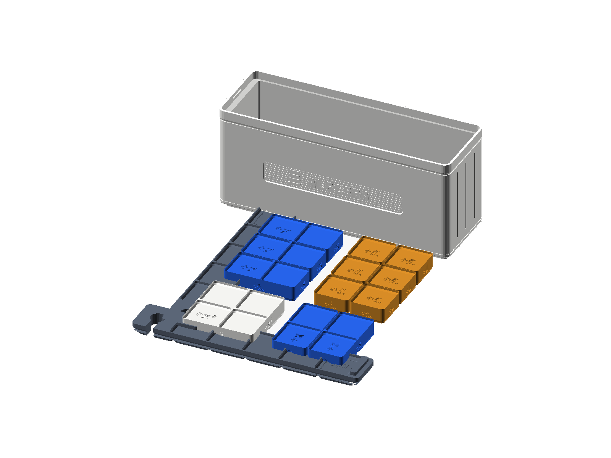

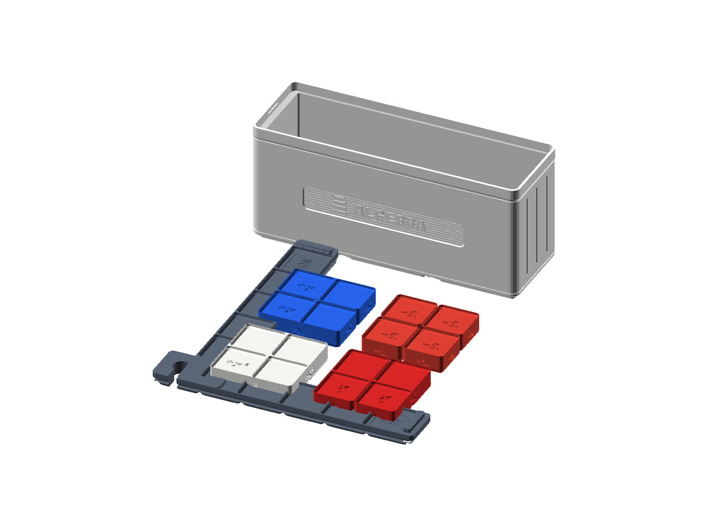

To explore flat shapes, 3D boxes, and moving clock angles with your hands, you will use three physical tools from your desk studio alongside your calculator. First, your **$19.0 \times 19.0\text{ mm}$ Stacking Unit Tiles** ($7.0\text{ mm}$ tall per single block, so 3 blocks stand $21.0\text{ mm}$ tall and 12 blocks build an $84.0\text{ mm}$ tower) let you build 3D rectangular boxes on the studio lid grid and count all 6 outer walls—and they team up with the 5 classic game dice ($d4, d6, d8, d12, d20$) from your **Polyhedral Dice** set plus the printable cardstock nets in **Appendix A** that fold into full-scale paper boxes, tents, and cylinders. Second, your **$90^\circ$ Corner L-Frame & Area-Grid Tiles** provide interlocking horizontal and vertical guide rails that frame flat 2D rectangles and squares on your desk so you can trace outside perimeters and count interior area tiles at the same time. Third, your **Planetary Geared Clock & $360^\circ$ Unit Circle Volvelle** uses a real $12:1$ planetary gear train (where spinning the minute hand 12 times turns the hour hand once) and four removable $90^\circ$ quarter-circle wedges inside a $120\text{ mm}$ degree wheel—matching your SC-6's Planetary Clock mode (`[🕒]`) and time-conversion keys (`[f] [▸HR]` and `[g] [▸HMS]`).

### 6.1.5 How a 3D Box Unfolds into Three Pairs of Twin Walls
When you build a rectangular box out of **Counting Tiles** on your studio docking lid—say, a **$5\text{ cm} \times 4\text{ cm} \times 3\text{ cm}$ gift box** (or unfold its printable cardstock pattern from Appendix A)—turn it slowly in your hands and count its six flat faces. Instead of six unrelated walls, you will immediately spot **three pairs of identical twins**: the **Top Lid and Bottom Floor** form identical horizontal rectangles ($\text{Length} \times \text{Width} = 5 \times 4 = 20\text{ cm}^2$ each, or $2 \times 20 = 40\text{ cm}^2$ together), the **Front Panel and Back Panel** form identical long vertical walls ($\text{Length} \times \text{Height} = 5 \times 3 = 15\text{ cm}^2$ each, or $2 \times 15 = 30\text{ cm}^2$ together), and the **Left End and Right End** form identical side walls ($\text{Width} \times \text{Height} = 4 \times 3 = 12\text{ cm}^2$ each, or $2 \times 12 = 24\text{ cm}^2$ together).

Unfolding those three twin pairs flat on your desk ($40 + 30 + 24 = \mathbf{94\text{ cm}^2}$) proves what **Surface Area** really means: *it is simply the total area of all the flat walls that wrap around the outside of a 3D shape*. Later in this chapter, we will toss each matching wall pair straight into the SC-6's `[Σ+]` running-total basket (and even subtract window or door cutouts with `[f] [Σ-]`) so you can inspect and wrap any 3D box, tent, or cylinder one physical wall group at a time.

### 6.1.6 Packing 24 Blocks into Different 3D Boxes
While surface area measures the flat walls wrapping the *outside* of a box, **volume** measures how many unit blocks pack the *inside* from wall to wall with zero gaps. Try this right on your desk: snap 24 unit blocks from your **Place Value Studio** (or your 24 **Counting Tiles**) into a compact **$2 \times 3 \times 4$ box**, then reshape those exact same 24 blocks into a long **$1 \times 2 \times 12$ bar** and a tall **$2 \times 2 \times 6$ tower**. Even as the outside walls change shape, the volume inside stays locked at **24 blocks**—and when we reach 3D solids later in this chapter, you will see how the stack and the `[f] [PRISM]` and `[g] [CONE]` keys build any 3D room from the floor up!

---

Before we unfold and measure the complete outer skin of a 3D penguin huddle, a triangular A-frame camping tent, or a nose cone on a rocket, let's get comfortable with the flat 2D shapes that stitch every 3D solid together. Think about a cardboard cereal box or a sewn camping tent: before it was folded or stitched into three dimensions, every single wall started out as a flat shape on a tabletop. Let's start on that flat tabletop with the rectangles, triangles, circles, parallelograms, trapezoids, and hexagons that make up every 3D box and tent.

## 6.2 Flat 2D Shapes & One-Tap Area Keys

Every flat shape has two different stories to tell: how far your feet walk if you trace all the way around its outside border (the **Perimeter**), and how many square tiles it takes to cover the floor inside (the **Area**). Once you picture walking the border or laying down floor tiles, every shape's rule makes sense right away.

### 6.2.1 Rectangles and Squares
Picture walking around a rectangular backyard half-court basketball pad or a robotics competition arena with four square corners. If you walk along one **Length** and turn the corner to walk along one **Width**, you have traced an L-shaped half-lap around the court. Since the opposite two sides are identical twins, doubling that L-shaped half-lap wraps all the way around the **Perimeter**. Meanwhile, to pave the court inside with square concrete or interlocking sport-court tiles, you lay down $\text{Length}$ tiles in each row and repeat for $\text{Width}$ rows, multiplying them to find the **Area** (`[f] [RECT]`):
$$\text{Perimeter} = (\text{Length} + \text{Width}) \times 2, \qquad \text{Rectangle Area} = \text{Length} \times \text{Width}$$

When your crew lays out a backyard half-court basketball pad (or a championship robotics competition arena) measuring $14\text{ meters}$ long and $8.5\text{ meters}$ wide, both measurements work together right away. Before construction starts, you need to find both the total length of boundary tape or fencing required to enclose all four sides and the total square meters of paved court surface inside.

Walking the perimeter on the stack is effortless: push the $14\text{-meter}$ length onto Shelf $Y$ and add the $8.5\text{-meter}$ width on Ground Shelf $X$ to trace the L-shaped half-lap ($22.5\text{ m}$), then double that sum with `14 [ENTER] 8.5 [+] 2 [×]` to enclose all four sides in $\mathbf{45.00\text{ meters}}$ of boundary line.

Next, to find the paved court area inside, multiply the length by the width with `14 [ENTER] 8.5 [×]` to uncover $\mathbf{119.00\text{ square meters}}$ of surface. Better yet, right after pressing `14 [ENTER] 8.5 [+]` for the half-perimeter $22.5$, the width `8.5` is still resting inside `LASTX`—so you can tap `14 [f] [LASTX] [×]` to compute the $119.00\text{ m}^2$ court area while $22.5$ waits safely on Shelf $Y$:

| Keystroke | Register T | Register Z | Register Y | Register X | What Happens on the Stack |
| :--- | :--- | :--- | :--- | :--- | :--- |
| `14` | 0 | 0 | 0 | 14 | Type the $14\text{ m}$ court length onto Shelf $X$ |
| `[ENTER]` | 0 | 0 | 14 | 14 | Copy the $14\text{ m}$ length up onto Shelf $Y$ |
| `8.5` | 0 | 0 | 14 | $8.5$ | Type the $8.5\text{ m}$ court width onto Shelf $X$ |
| `[+]` | 0 | 0 | 0 | $22.5$ | Add length and width for the $22.5\text{ m}$ L-shaped half-lap |
| `2` | 0 | 0 | $22.5$ | 2 | Type 2 to double the half-lap; $22.5$ lifts to Shelf $Y$ |
| `[×]` | 0 | 0 | 0 | 45 | Multiply to wrap all four sides: $\mathbf{45.00\text{ m}}$ perimeter |

When you want to find a rectangle's area in a single stroke, the SC-6 also provides the dedicated `[f] [RECT]` solver, which multiplies $\text{Length} \times \text{Width}$ directly: keying `14 [ENTER] 8.5 [f] [RECT]` lands straight on $X = \mathbf{119.00\text{ m}^2}$.

That same L-shaped half-lap rule works whenever you wrap rubber bumper trim around a $2.4\text{ m} \times 1.2\text{ m}$ robotics worktable ($8\text{ ft} \times 4\text{ ft}$): walk the top edge `2.4` onto Shelf $Y$ with `[ENTER]`, turn the corner down the side `1.2` with `[+]` ($3.6\text{ m}$ half-lap), and double across all four sides with `2.4 [ENTER] 1.2 [+] [2] [×]` to reach **`7.2`** ($\mathbf{7.20\text{ m}}$ of trim).

What if a rectangle's length and width are equal—a **square**, like a square gymnastics mat or a backyard trampoline bounce pad measuring $3.5\text{ meters}$ on each side? Instead of typing the side length twice, tap the square key `[x²]` to multiply the side by itself in one click ($\text{Square Area} = \text{Side} \times \text{Side}$). Keying `3.5 [x²]` on the SC-6 squares the $3.5\text{ m}$ side length in place on Shelf $X$ to land on **`12.25`**, showing that a weatherproof cover needs $\mathbf{12.25\text{ m}^2}$ of fabric.

---

### 6.2.2 Triangles & Why Every Triangle Is Half a Box
Why does the area rule (`[g] [TRI]`) for *every* triangle divide by $2$? Imagine slicing a rectangular sandwich straight from one corner to the opposite corner: you get two identical right triangles, each holding half of the sandwich.

Even better, take *any* two identical triangles—whether right-angled, acute, or obtuse—flip one upside-down, and slide their matching slanted edges together: **two matching triangles always lock together into a rectangle or parallelogram** with the same Base and straight-up Height. Because the combined shape has area $\text{Base} \times \text{Height}$, each single triangle covers half:
$$\text{Triangle Area} = (\text{Base} \times \text{Height}) \div 2$$
where the Height is always measured straight up (`90°`) from the Base to the top tip—like measuring your own height standing straight up against a wall, never leaning along a slanted edge.

Once you spot triangles in real sports gear, you can measure them in three taps: a traditional diamond kite with a $20\text{-inch}$ horizontal crossbar and a $30\text{-inch}$ vertical spine is simply two triangles sharing the crossbar, so keying `20 [ENTER] 30 [g] [TRI]` ($20 \times 30 \div 2$) reveals **$300\text{ in}^2$** of ripstop nylon.

| Triangle Classification | Straight-Up Height Location | How Two Identical Triangles Lock Together |
| :--- | :--- | :--- |
| **Right Triangle** | Upright side serves directly as the straight-up Height | Two right triangles join along their slanted hypotenuse into a $\text{Base} \times \text{Height}$ rectangle |
| **Obtuse Triangle** | Straight-up Height drops outside the base line | Flipping one obtuse triangle upside-down locks both into a leaning parallelogram |
| **Acute Triangle** | Straight-up Height drops inside the triangle | Two acute triangles interlock edge-to-edge into a parallelogram of area $\text{Base} \times \text{Height}$ |

Now watch `[g] [TRI]` on all four stack shelves when a sailmaker cuts a radio-controlled model pond-yacht mainsail (or a championship sports pennant) with a bottom boom (base) of $18\text{ cm}$ and a vertical mast height of $32\text{ cm}$. Two identical sails placed hypotenuse-to-hypotenuse form a full $18 \times 32 = 576\text{ cm}^2$ rectangle of sailcloth, so a single sail takes half (`18 [ENTER] 32 [×] 2 [÷]` $\to \mathbf{288.00\text{ cm}^2}$)—or in a single stroke with `[g] [TRI]`:

| Keystroke | Register T | Register Z | Register Y | Register X | What Happens on the Stack |
| :--- | :--- | :--- | :--- | :--- | :--- |
| `18` | 0 | 0 | 0 | 18 | Type the $18\text{ cm}$ triangle base onto Shelf $X$ |
| `[ENTER]` | 0 | 0 | 18 | 18 | Copy the $18\text{ cm}$ base up onto Shelf $Y$ |
| `32` | 0 | 0 | 18 | 32 | Type the $32\text{ cm}$ straight-up height onto Shelf $X$ |
| `[g] [TRI]` | 0 | 0 | 0 | 288 | Multiply and halve in one tap: $(18 \times 32) \div 2 = \mathbf{288\text{ cm}^2}$ |

What if you are carpeting an L-shaped room floor that isn't a single rectangle or triangle? Carpenters use a simple trick: draw one straight line to split the L-shape into **two rectangles**. In a bedroom where the main floor measures $8\text{ feet}$ by $6\text{ feet}$ ($8 \times 6 = 48\text{ sq ft}$) and the attached reading alcove measures $4\text{ feet}$ by $3\text{ feet}$ ($4 \times 3 = 12\text{ sq ft}$), you simply add both rectangular sections:
$$\text{Total Floor Area} = (\text{Main Room Length} \times \text{Width}) + (\text{Alcove Length} \times \text{Width}) = (8 \times 6) + (4 \times 3) = 48 + 12 = 60\text{ sq ft}$$

On your SC-6 stack, you can multiply the main room's $8\text{-foot}$ and $6\text{-foot}$ edges first, let that $48\text{ sq ft}$ floor wait safely on the upper shelf while you multiply the $4 \times 3$ alcove on the lower shelves, and then fuse both rooms together with `8 [ENTER] 6 [×] 4 [ENTER] 3 [×] [+]` to reach $\mathbf{60\text{ sq ft}}$:

| Keystroke | Register T | Register Z | Register Y | Register X | What Happens on the Stack |
| :--- | :---: | :---: | :---: | :---: | :--- |
| `8 [ENTER] 6 [×]` | 0 | 0 | 0 | 48 | Main room area: $8 \times 6 = 48\text{ sq ft}$ on Shelf $X$ |
| `4 [ENTER]` | 0 | 48 | 4 | 4 | Main room ($48$) lifts to $Z$; alcove length ($4$) enters $Y$ and $X$ |
| `3 [×]` | 0 | 0 | 48 | 12 | Alcove area: $4 \times 3 = 12\text{ sq ft}$ in $X$; $48$ drops to $Y$ |
| `[+]` | 0 | 0 | 0 | 60 | Add both rooms together: $48 + 12 = \mathbf{60\text{ sq ft}}$ |

### 6.2.3 Right Triangles & the 3-4-5 Rope-Stretcher Proof
Right triangles hide one of history's most useful building secrets ([x²] and [f] [√x]). Every summer in ancient Egypt, the Nile River flooded its banks and washed away the mud boundary markers between farmers' fields. Once the floodwaters receded, how could royal surveyors redraw perfectly square $90^\circ$ corners in the mud without lasers or plastic protractors?

The Egyptian surveyors—called *harpedonaptai*, or **"rope-stretchers"**—tied **12 evenly spaced knots in a loop of rope** and stretched it tight around three wooden stakes with **$3$ spaces on one side, $4$ spaces on the second side, and $5$ spaces along the slanted side**. The moment the rope pulled taut into a $3\text{–}4\text{–}5$ triangle, the corner between the $3$ side and the $4$ side formed an exact $90^\circ$ right angle! Why? Because if you build a square of **Counting Tiles** on each side of a right triangle, the tiles on the two straight sides always add up to the exact number of tiles in the square on the slanted side (the **hypotenuse**):
$$3^2 + 4^2 = 5^2 \quad \longrightarrow \quad 9\text{ tiles} + 16\text{ tiles} = 25\text{ tiles}$$

Even today, carpenters framing a backyard deck or coaches chalking the foul lines of a Little League baseball diamond use that exact same $3\text{–}4\text{–}5$ tape-measure trick to check if a corner is square! On your SC-6, you can test any right triangle by squaring the two straight sides with `[x²]`, adding them with `[+]`, and taking the square root with `[f] [√x]`: typing `3 [x²] 4 [x²] [+] [f] [√x]` turns $9 + 16 = 25$ into the $\mathbf{5.00}$ slanted side (or use the dedicated hypotenuse shortcut `3 [ENTER] 4 [g] [HYP]` $\to \mathbf{5.00}$ in a single tap).

---

### 6.2.4 Circles, Disks & Rings
What happens when a shape has no straight sides at all (`[f] [CIRC]`)? Pin one end of a piece of string to the center of your paper and sweep a pencil all the way around: every point on the **Circle** sits at the exact same distance (the **Radius**) from the center. The distance straight across through the center is the **Diameter** ($\text{Diameter} = 2 \times \text{Radius}$).

Over two thousand years ago, builders noticed something remarkable: no matter how tiny or gigantic a circle is—whether it is a shirt button or a Ferris wheel—if you wrap a string around its outside rim (the **Circumference**) and compare it to the **Diameter** straight across, the circumference is always just over $3.14$ times as long. Mathematicians call that universal circle ratio **$\pi$ (pi)**, approximately $3.1415926535\dots$, accessed on your SC-6 via the primary key `[π]`.

Why does that same number $\pi$ also find the flat **Area** inside a circle ($\text{Circle Area} = \text{Radius} \times \text{Radius} \times \pi$)? Picture slicing a round pizza into 16 thin triangular wedges and lining them up alternating point-up, point-down, point-up, point-down like teeth on a zipper. As you slice the pizza into 32 wedges, then 64, and then 1,000 paper-thin wedges, the bumpy crust edges flatten out into two straight horizontal lines and the leaning end slice stands straight up into a crisp $90^\circ$ rectangular corner! The straight-up height of that rectangle is one pizza slice long ($\text{Radius}$), and its bottom width is half of the crust ($\frac{1}{2} \times 2 \times \pi \times \text{Radius} = \pi \times \text{Radius}$), because half the crusts sit along the top edge and half sit along the bottom edge. Multiply that $\pi \times \text{Radius}$ width by the $\text{Radius}$ height, and out pops the circle area rule:
$$\text{Circumference} = 2 \times \pi \times \text{Radius} = \pi \times \text{Diameter}, \qquad \text{Circle Area} = \text{Radius} \times \text{Radius} \times \pi$$

Using the SC-6's built-in $\pi$ key (`[π]`) and one-tap circle-area solver (`[f] [CIRC]`) gives you full decimal accuracy automatically, avoiding the rounding drift of rough $3.14$ paper estimates.

To find the enclosed turf area inside a $15\text{-meter}$ radius semicircular turnaround loop at the end of a school sprint track, tap `[f] [CIRC]` to compute a full $15\text{-meter}$ circle first:

| Keystroke | Register T | Register Z | Register Y | Register X | What Happens on the Stack |
| :--- | :--- | :--- | :--- | :--- | :--- |
| `15` | 0 | 0 | 0 | 15 | Type the $15\text{ m}$ track radius onto Shelf $X$ |
| `[f] [CIRC]` | 0 | 0 | 0 | $706.8583$ | Compute circle area: $\pi \times 15^2 = \mathbf{706.8583\text{ m}^2}$ |

Because `[f] [CIRC]` just used the radius `15`, that `15` is still sitting inside `LASTX`. If you also want the racing distance around the outside of that circle, pull `15` right back onto the bottom shelf and multiply by $2\pi$ with `[f] [LASTX] 2 [×] [π] [×]` to reveal the **94.2478-meter** lap circumference while the turf area $706.8583\text{ m}^2$ rests right above it on Shelf $Y$.

Now try unrolling the **Cylindrical Wrapper Net** from your block kit to see how circumference works around a backyard above-ground swimming pool (or the painted center kickoff circle of a youth soccer field) with a radius of $4.2\text{ meters}$ ($8.4\text{ meters}$, or about $27.5\text{ feet}$, straight across). *(Note: If your SC-6 is still in default `[NUM]` Whole Number Mode, tap `[NUM]` or `[f] [ALL]` first so the decimal point enters decimal numbers like `4.2`; pressing `[π]` or `[f] [CIRC]` also switches to decimal floating-point automatically.)* While tapping `4.2 [f] [CIRC]` ($\pi \times 4.2^2$) tells you that a floating solar cover needs $\mathbf{55.42\text{ m}^2}$ of fabric to blanket the water, unrolling the pool's outer wall shows that the top rim stretches $\pi$ times the diameter ($\text{Circumference} = 2 \times \text{Radius} \times \pi$). Doubling the $4.2\text{ m}$ radius into the $8.4\text{ m}$ diameter and multiplying by $\pi$ with `4.2 [ENTER] [2] [×] [π] [×]` gives **`26.38937829`**:

| Keystroke | Register T | Register Z | Register Y | Register X | What Happens on the Stack |
| :--- | :---: | :---: | :---: | :---: | :--- |
| `4.2` | $0$ | $0$ | $0$ | $4.2$ | Type the pool radius ($4.2\text{ m}$) onto Shelf $X$ |
| `[ENTER]` | $0$ | $0$ | $4.2$ | $4.2$ | Copy the $4.2\text{ m}$ radius up onto Shelf $Y$ |
| `2` | $0$ | $0$ | $4.2$ | $2$ | Type 2 to double the radius into the diameter |
| `[×]` | $0$ | $0$ | $0$ | $8.4$ | Multiply to get the full $8.4\text{ m}$ diameter on Shelf $X$ |
| `[π]` | $0$ | $0$ | $8.4$ | $3.1416$ | Place $\pi \approx 3.1416$ on Shelf $X$; $8.4$ lifts to Shelf $Y$ |
| `[×]` | $0$ | $0$ | $0$ | $26.3894$ | Multiply diameter by $\pi$ to wrap the full rim ($26.39\text{ m}$) |

Wrapping the outer rim of the $4.2\text{-meter}$ radius pool takes $\mathbf{26.39\text{ meters}}$ of top-rail coping, enclosing $\mathbf{55.42\text{ m}^2}$ of water inside.

Once you can stamp out a solid circle, what happens when a circle has a hole punched out of the middle—like a roll of duct tape or a steel skateboard axle washer? Just stamp out the big outer circle and subtract the smaller inner circle that was punched out. Take a 3D-printed spacer washer with an outer radius of $12\text{ mm}$ and an inside hole with a radius of $5\text{ mm}$. Subtract the inside hole's radius squared from the outer circle's radius squared, then multiply by $\pi$:
$$\text{Ring Area} = (\text{Outer Radius}^2 - \text{Inner Radius}^2) \times \pi$$

Start by keying `12 [x²]` to enter the outer radius $12$ onto Shelf $X$ and square it in place to $144$. Next, type `5 [x²]`, which automatically lifts $144$ up to Shelf $Y$ while squaring the inner hole radius $5$ to $25$ on the bottom shelf. Tapping `[-]` punches out the center hole ($144 - 25 = 119$), and finishing with `[π] [×]` multiplies that ring factor by $\pi$ to give $\mathbf{373.85\text{ mm}^2}$ of solid plastic.

And every time you ride a bicycle down the street, circle geometry is turning wheel spins into forward distance: whenever a bicycle wheel with a radius of $14\text{ inches}$ completes $1$ full spin, the tire unrolls its entire circumference along the pavement. Keying `14 [ENTER] 2 [×] [π] [×]` ($\text{Circumference} = 2 \times \pi \times \text{Radius}$) shows that the bike rolls forward **$87.96\text{ inches}$** ($\approx 7.33\text{ feet}$) with every single turn of the wheel.

---

### 6.2.5 Parallelograms & Trapezoids

Slanted four-sided figures like parallelograms and trapezoids look tricky at first glance, but they become straightforward to measure once you snip and slide their angled corners back into familiar rectangles and triangles.

A **parallelogram** looks like a rectangle that has been nudged sideways so its left and right walls lean at the same angle. Why do we multiply its **Base** by the straight-up **Height** instead of the leaning side? Picture taking a pair of scissors, slicing a right triangle straight down (`90°`) from one slanted end of a parallelogram, and sliding that triangle across to the opposite end: the two pieces click together into a neat $\text{Base} \times \text{Height}$ rectangle (`[f] [RECT]`). Because no paper was added or thrown away during the slide, its area rule is the exact same as a rectangle's:
$$\text{Parallelogram Area} = \text{Base} \times \text{Height} \quad \text{(Never multiply by the leaning side)}$$

Turn now to a **trapezoid**, which has one pair of parallel bases—a shorter **Top Base** and a wider **Bottom Base**—separated by a straight-up **Height**. Four thousand years ago in ancient Egypt, royal tax scribes along the Nile River faced trapezoids after every summer flood: when the river curved past a village, farmers' barley fields were wider along the riverbank than along the desert canal at the back. How did Egyptian surveyors—and how can you—measure a trapezoid with a $6\text{-meter}$ Top Base, a $10\text{-meter}$ Bottom Base, and a $4\text{-meter}$ straight-up Height? You can prove its area on your desk in three visual ways:
1. **Splitting into a Central Rectangle and Side Triangles:** Slice straight down from the shorter top base ($6$) to the bottom base ($10$), creating a central $6 \times 4 = 24$ rectangle plus two side triangles whose bases add up to $10 - 6 = 4$ ($\text{Area} = (4 \times 4) \div 2 = 8$), totaling $24 + 8 = \mathbf{32}$.
2. **Enclosing Box Minus Cutouts:** Surround the trapezoid with a full $10 \times 4 = 40$ bounding rectangle (`10 [ENTER] 4 [f] [RECT]`), then subtract the two empty corner triangles ($40 - 8 = \mathbf{32}$).
3. **Averaging the Two Parallel Bases Times Height (The Middle-Width Shortcut):** Cut a paper trapezoid horizontally right across its middle height, flip the top half over, and slide it beside the bottom half—or join two identical trapezoids with one flipped upside down! Either way, the slanted sides lock into a single rectangle whose width is halfway between the $6\text{-meter}$ top and the $10\text{-meter}$ bottom ($(6 + 10) \div 2 = 8\text{ m}$), so multiplying that $8\text{-meter}$ middle width by the $4\text{-meter}$ straight-up height lands directly on $8 \times 4 = \mathbf{32\text{ m}^2}$:
$$\text{Trapezoid Area} = (\text{Top Base} + \text{Bottom Base}) \div 2 \times \text{Height}$$

Modern civil engineers and skatepark builders rely on that exact middle-width shortcut when designing **earthen flood-control river levees** and **concrete skatepark bank walls**—structures built narrower at the top coping deck and wider at the ground foundation where water pressure or drop-in force is heaviest. Along a flood-control river embankment (or a full-size concrete skatepark bank wall) with a top crest width of $14\text{ m}$, a wider ground base of $22\text{ m}$, and a vertical height of $6\text{ m}$, how many square meters of erosion-control grass turf or concrete cross-section does the wall cover?

By combining both parallel widths on Shelves $Y$ and $X$ ($14 + 22 = 36\text{ m}$), halving them into the $18\text{ m}$ average middle width, and multiplying by the $6\text{ m}$ vertical height with `14 [ENTER] 22 [+] [2] [÷] [6] [×]`, the stack lands directly on **`108`**:

| Keystroke | Register T | Register Z | Register Y | Register X | What Happens on the Stack |
| :--- | :---: | :---: | :---: | :---: | :--- |
| `14` | $0.0000$ | $0.0000$ | $0.0000$ | $14.0000$ | Type the top width ($14\text{ m}$) onto Shelf $X$ |
| `[ENTER]` | $0.0000$ | $0.0000$ | $14.0000$ | $14.0000$ | Copy the $14\text{ m}$ top width up onto Shelf $Y$ |
| `22` | $0.0000$ | $0.0000$ | $14.0000$ | $22.0000$ | Type the wider bottom width ($22\text{ m}$) onto Shelf $X$ |
| `[+]` | $0.0000$ | $0.0000$ | $0.0000$ | $36.0000$ | Add both parallel widths together ($14 + 22 = 36\text{ m}$) |
| `2` | $0.0000$ | $0.0000$ | $36.0000$ | $2.0000$ | Type 2 so we can find the average middle width |
| `[÷]` | $0.0000$ | $0.0000$ | $0.0000$ | $18.0000$ | Divide by 2 to get the average middle width ($18\text{ m}$) |
| `6` | $0.0000$ | $0.0000$ | $18.0000$ | $6.0000$ | Type the straight-up levee height ($6\text{ m}$) |
| `[×]` | $0.0000$ | $0.0000$ | $0.0000$ | $108.0000$ | Multiply middle width by height for the $108\text{ m}^2$ area |

The trapezoid face covers $\mathbf{108.00\text{ m}^2}$—the exact same area as a flat $18\text{-meter}$ by $6\text{-meter}$ rectangle, because the extra width at the $22\text{-meter}$ base compensates for the narrower $14\text{-meter}$ top crest.

---

### 6.2.6 Why Honeybees and Bicycle Builders Love Six-Sided Hexagons
Have you ever peeked inside a beehive and wondered why honeybees always build six-sided **regular hexagons** instead of circles, triangles, or squares? To make just $1\text{ gram}$ of beeswax, worker bees have to consume about $8\text{ grams}$ of honey—so wasting wax is a matter of survival for the hive. If bees built round wax tubes (like pennies packed on a table), curved gaps would be wasted between every cell. And in 1999, mathematician Thomas Hales proved the 2,000-year-old **Honeycomb Conjecture**: among all possible shapes that tile a flat surface with zero gaps, a regular 6-sided hexagon **encloses the most honey using the least possible wax perimeter**.

Mechanical engineers use that exact same 6-sided geometry on every **steel hex nut and bolt on your bicycle and skateboard**. Why do bolts have 6 flat sides instead of 4 (a square) or 8 (an octagon)? A 4-sided square nut requires you to swing your wrench a full quarter-turn ($90^\circ$) before the wrench can grab the next flat face—which is impossible inside a tight bicycle frame! An 8-sided nut has corners so shallow ($135^\circ$) that a wrench easily slips and rounds them off. A 6-sided hex bolt is the engineering sweet spot: its sturdy $120^\circ$ corners resist stripping, while letting your wrench re-grip the bolt every **$60^\circ$** (one-sixth of a circle) in tight spaces.

How do you find the area of a 6-sided honeycomb cell, hex bolt head, or hexagonal floor tile? Draw straight lines from the center of a regular hexagon out to all 6 corners, and it splits cleanly into **6 matching equilateral triangles**:
$$\text{Hexagon Area} = \text{Side}^2 \times 3 \times \sqrt{3} \div 2$$

Your SC-6 computes $\sqrt{3} \approx 1.7321$ right on the bottom shelf when you type `3 [f] [√x]`, while keeping your earlier product waiting on Shelf $Y$. You can see six-sided tiling in nature at Giant's Causeway in Northern Ireland, where cooling volcanic lava cracked into thousands of interlocking basalt columns. For a $10\text{ cm}$ six-sided basalt stone paver, key `10 [x²]` to square the $10\text{ cm}$ side to $100$ and tap `3 [×]` to reach $300$; next, key `3 [f] [√x]` so $\sqrt{3}$ appears on Shelf $X$ while $300$ waits on Shelf $Y$, tap `[×]`, and halve the product with `2 [÷]` to land on $\mathbf{259.81\text{ cm}^2}$.

Here is the full shelf-by-shelf sequence for a slightly wider $12\text{ cm}$ six-sided acoustic studio panel—where `12 [x²] [3] [×] [3] [f] [√x] [×] [2] [÷]` lands on **`374.12297443`**:

| Keystroke | Register T | Register Z | Register Y | Register X | What Happens on the Stack |
| :--- | :---: | :---: | :---: | :---: | :--- |
| `12` | $0.0000$ | $0.0000$ | $0.0000$ | $12.0000$ | Type the hexagon side length ($12\text{ cm}$) onto Shelf $X$ |
| `[x²]` | $0.0000$ | $0.0000$ | $0.0000$ | $144.0000$ | Square the side length in place ($12 \times 12 = 144$) |
| `3` | $0.0000$ | $0.0000$ | $144.0000$ | $3.0000$ | Type 3 to scale across the 6 matching triangles |
| `[×]` | $0.0000$ | $0.0000$ | $0.0000$ | $432.0000$ | Multiply $144 \times 3 = 432$ on Shelf $X$ |
| `3` | $0.0000$ | $0.0000$ | $432.0000$ | $3.0000$ | Type 3 on Shelf $X$ while $432$ waits on Shelf $Y$ |
| `[f] [√x]` | $0.0000$ | $0.0000$ | $432.0000$ | $1.7321$ | Take the square root of 3 in place ($\sqrt{3} \approx 1.7321$) |
| `[×]` | $0.0000$ | $0.0000$ | $0.0000$ | $748.2459$ | Multiply $432$ by $\sqrt{3}$ to get $748.2459$ |
| `2` | $0.0000$ | $0.0000$ | $748.2459$ | $2.0000$ | Type 2 so we can cut the product in half |
| `[÷]` | $0.0000$ | $0.0000$ | $0.0000$ | $374.1230$ | Divide by 2 to finish the hexagon area ($374.12\text{ cm}^2$) |

Each $12\text{ cm}$ hexagonal panel covers $\mathbf{374.12\text{ cm}^2}$—and just like honeybees' wax cells, dozens of panels tile a recording-studio wall edge-to-edge with zero gaps.

---

## 6.3 Wrapping 3D Boxes, Tents & Canals One Wall at a Time

Now that you can find the area of any flat 2D shape on your tabletop, let's fold those flat panels up into three-dimensional boxes, tents, and tanks!

### 6.3.1 Wrapping a Rectangular Box in the Wall Basket
When packaging designers unfold a rectangular cardboard box flat on a worktable—a pattern engineers call a **net**—the 6 walls never look like a single giant equation:
$$\text{Total Box Surface Area} = 2 \times (\text{Length} \times \text{Width}) + 2 \times (\text{Length} \times \text{Height}) + 2 \times (\text{Width} \times \text{Height})$$

Instead, just like the $5 \times 4 \times 3\text{ cm}$ gift box ($94\text{ cm}^2$) we unfolded at the start of this chapter, any rectangular box lies flat as **three twin wall pairs**: a top lid and bottom floor, a front panel and back panel, and a left end and right end. On your SC-6, **the `[Σ+]` key acts as a running-total basket for walls**: empty the basket with `[g] [CLΣ]`, measure and double each wall pair (`n = 1, 2, 3`), and press `[f] [Σx]` to ring up all 6 walls at once!

Let's take that `[Σ+]` wall-basket method south to McMurdo Station, Antarctica, where the Emperor penguins from the start of our chapter huddle against $-40^\circ\text{C}$ gales. For engineers designing cold-weather field instruments, precious battery heat escapes through every square centimeter of exposed **surface area**. Out on the Ross Ice Shelf, an Antarctic weather technician is wrapping a rectangular weather-sensor housing measuring $6\text{ cm} \times 4\text{ cm} \times 2\text{ cm}$ in reflective Mylar thermal foil so its lithium battery doesn't freeze in the $-40^\circ\text{C}$ wind.

Unfold the Rectangular Prism Net on your desk: the 6 rectangular walls pair up into top/bottom ($6 \times 4$), front/back ($6 \times 2$), and left/right ($4 \times 2$). Tossing all three matching wall pairs into your `[Σ+]` basket and ringing up the total with `[f] [Σx]` via `[g] [CLΣ] [6] [ENTER] [4] [×] [2] [×] [Σ+] [6] [ENTER] [2] [×] [2] [×] [Σ+] [4] [ENTER] [2] [×] [2] [×] [Σ+] [f] [Σx]` reveals **`88`**:

| Keystroke | Register T | Register Z | Register Y | Register X | What Happens on the Stack |
| :--- | :---: | :---: | :---: | :---: | :--- |
| `[g] [CLΣ]` | $0.0000$ | $0.0000$ | $0.0000$ | $0.0000$ | Empty the running-total basket ($n = 0, \Sigma x = 0$) |
| `6` | $0.0000$ | $0.0000$ | $0.0000$ | $6.0000$ | Type the housing length ($6\text{ cm}$) onto Shelf $X$ |
| `[ENTER]` | $0.0000$ | $0.0000$ | $6.0000$ | $6.0000$ | Copy the $6\text{ cm}$ length up onto Shelf $Y$ |
| `4` | $0.0000$ | $0.0000$ | $6.0000$ | $4.0000$ | Type the housing width ($4\text{ cm}$) onto Shelf $X$ |
| `[×]` | $0.0000$ | $0.0000$ | $0.0000$ | $24.0000$ | Multiply length by width for one top wall ($24\text{ cm}^2$) |
| `2` | $0.0000$ | $0.0000$ | $24.0000$ | $2.0000$ | Type 2 to cover both the top and bottom walls |
| `[×]` | $0.0000$ | $0.0000$ | $0.0000$ | $48.0000$ | Double to get the top and bottom wall pair ($48\text{ cm}^2$) |
| `[Σ+]` | $0.0000$ | $0.0000$ | $0.0000$ | $1.0000$ | Toss wall pair 1 into the basket ($n = 1, \Sigma x = 48$) |
| `6` | $0.0000$ | $0.0000$ | $0.0000$ | $6.0000$ | Type the housing length ($6\text{ cm}$) for the front wall |
| `[ENTER]` | $0.0000$ | $0.0000$ | $6.0000$ | $6.0000$ | Copy the $6\text{ cm}$ length up onto Shelf $Y$ |
| `2` | $0.0000$ | $0.0000$ | $6.0000$ | $2.0000$ | Type the housing height ($2\text{ cm}$) onto Shelf $X$ |
| `[×]` | $0.0000$ | $0.0000$ | $0.0000$ | $12.0000$ | Multiply length by height for one front wall ($12\text{ cm}^2$) |
| `2` | $0.0000$ | $0.0000$ | $12.0000$ | $2.0000$ | Type 2 to cover both the front and back walls |
| `[×]` | $0.0000$ | $0.0000$ | $0.0000$ | $24.0000$ | Double to get the front and back wall pair ($24\text{ cm}^2$) |
| `[Σ+]` | $0.0000$ | $0.0000$ | $0.0000$ | $2.0000$ | Toss wall pair 2 into the basket ($n = 2, \Sigma x = 72$) |
| `4` | $0.0000$ | $0.0000$ | $0.0000$ | $4.0000$ | Type the housing width ($4\text{ cm}$) for the side wall |
| `[ENTER]` | $0.0000$ | $0.0000$ | $4.0000$ | $4.0000$ | Copy the $4\text{ cm}$ width up onto Shelf $Y$ |
| `2` | $0.0000$ | $0.0000$ | $4.0000$ | $2.0000$ | Type the housing height ($2\text{ cm}$) onto Shelf $X$ |
| `[×]` | $0.0000$ | $0.0000$ | $0.0000$ | $8.0000$ | Multiply width by height for one side wall ($8\text{ cm}^2$) |
| `2` | $0.0000$ | $0.0000$ | $8.0000$ | $2.0000$ | Type 2 to cover both the left and right end walls |
| `[×]` | $0.0000$ | $0.0000$ | $0.0000$ | $16.0000$ | Double to get the left and right wall pair ($16\text{ cm}^2$) |
| `[Σ+]` | $0.0000$ | $0.0000$ | $0.0000$ | $3.0000$ | Toss wall pair 3 into the basket ($n = 3, \Sigma x = 88$) |
| `[f] [Σx]` | $0.0000$ | $0.0000$ | $0.0000$ | $88.0000$ | Ring up the total area across all 6 walls ($88\text{ cm}^2$) |

Wrapping all six walls of the weather-sensor housing takes $\mathbf{88.00\text{ cm}^2}$ of Mylar thermal foil ($48 + 24 + 16 = 88\text{ cm}^2$), sealing every seam so the battery stays warm inside the $-40^\circ\text{C}$ Antarctic wind.

---

### 6.3.2 Wrapping a Six-Sided Cube
What if all three dimensions of a box—Length, Width, and Height—are equal? Then you have a **cube**, like a 6-sided game die (`d6`) where all 6 walls are identical squares. For a solid cube block with a side length of $4\text{ cm}$:
$$\text{Area of 1 face} = 4\text{ cm} \times 4\text{ cm} = 16\text{ cm}^2, \qquad \text{Total Surface Area} = 6 \times 16\text{ cm}^2 = 96\text{ cm}^2$$

Since all 6 square faces are identical twins, squaring one side and multiplying by 6 in three quick taps via `4 [x²] 6 [×]` lands directly on $\mathbf{96.00\text{ cm}^2}$ (or you can toss `4 [ENTER] 4 [×] [Σ+]` into the basket six times until `n = 6` and press `[f] [Σx]`).

---

### 6.3.3 Wrapping a Five-Wall Triangular Prism
Now picture an A-frame camping tent or a **triangular prism** with **5 flat faces**: two triangular end caps (front and back) connected by three long rectangular panels. Because the two identical triangular ends ($2 \times \frac{1}{2} \times \text{Base} \times \text{Height}$) always lock together into one full $\text{Base} \times \text{Height}$ rectangle, you don't even have to divide by $2$ and multiply by $2$ when adding both ends at once!

High on a snowy mountain glacier, a geology team packs fragile cylinders of ancient ice into a three-sided insulated **equilateral triangular prism** case so the case cannot roll off their cargo sleds on the slope. Its triangular ends have a base of $4\text{ cm}$ and a height of $3.464\text{ cm}$, and the carrier is $20\text{ cm}$ long. Unfold the Triangular Prism Net from your kit: the two triangular ends combine into one $\text{Base} \times \text{Height}$ rectangle ($4 \times 3.464$), while the three matching rectangular side walls form $3 \times (4 \times 20)$. Tossing both wall groups into `[Σ+]` with `[g] [CLΣ] [4] [ENTER] 3.464 [×] [Σ+] [4] [ENTER] 20 [×] [3] [×] [Σ+] [f] [Σx]` brings the total to **`253.856`**:

| Keystroke | Register T | Register Z | Register Y | Register X | What Happens on the Stack |
| :--- | :---: | :---: | :---: | :---: | :--- |
| `[g] [CLΣ]` | $0.0000$ | $0.0000$ | $0.0000$ | $0.0000$ | Empty the running-total basket ($n = 0, \Sigma x = 0$) |
| `4` | $0.0000$ | $0.0000$ | $0.0000$ | $4.0000$ | Type the triangle base ($4\text{ cm}$) onto Shelf $X$ |
| `[ENTER]` | $0.0000$ | $0.0000$ | $4.0000$ | $4.0000$ | Copy the $4\text{ cm}$ base up onto Shelf $Y$ |
| `3.464` | $0.0000$ | $0.0000$ | $4.0000$ | $3.464$ | Type the triangle height ($3.464\text{ cm}$) onto Shelf $X$ |
| `[×]` | $0.0000$ | $0.0000$ | $0.0000$ | $13.856$ | Multiply so both triangle ends combine into $13.856\text{ cm}^2$ |
| `[Σ+]` | $0.0000$ | $0.0000$ | $0.0000$ | $1.0000$ | Toss both triangle ends into the basket ($n = 1, \Sigma x = 13.856$) |
| `4` | $0.0000$ | $0.0000$ | $0.0000$ | $4.0000$ | Type the side wall width ($4\text{ cm}$) onto Shelf $X$ |
| `[ENTER]` | $0.0000$ | $0.0000$ | $4.0000$ | $4.0000$ | Copy the $4\text{ cm}$ width up onto Shelf $Y$ |
| `20` | $0.0000$ | $0.0000$ | $4.0000$ | $20.0000$ | Type the carrier length ($20\text{ cm}$) onto Shelf $X$ |
| `[×]` | $0.0000$ | $0.0000$ | $0.0000$ | $80.0000$ | Multiply to get one rectangular side wall ($80\text{ cm}^2$) |
| `3` | $0.0000$ | $0.0000$ | $80.0000$ | $3.0000$ | Type 3 to cover all 3 matching side walls |
| `[×]` | $0.0000$ | $0.0000$ | $0.0000$ | $240.0000$ | Multiply to get all 3 side walls ($240\text{ cm}^2$) |
| `[Σ+]` | $0.0000$ | $0.0000$ | $0.0000$ | $2.0000$ | Toss the 3 side walls into the basket ($n = 2, \Sigma x = 253.856$) |
| `[f] [Σx]` | $0.0000$ | $0.0000$ | $0.0000$ | $253.856$ | Ring up the total carrier surface area ($253.86\text{ cm}^2$) |

Wrapping the three-sided ice-core carrier takes $\mathbf{253.86\text{ cm}^2}$ of foam insulation—keeping ancient Antarctic ice samples frozen on the sled ride back to camp while the flat triangular bottom stops the carrier from rolling away. *(Tip: When a right-triangular tent has three different side widths like $3, 4,$ and $5\text{ cm}$ along a $6\text{ cm}$ length, `[f] [LASTX]` lets you reuse the $6\text{ cm}$ length across all three rectangular panels without typing `6` three times!)*

---

### 6.3.4 Unrolling Soup Cans & Titanium Water Flasks
How do you measure the curved wall of a round **cylinder**, like a soup can or a water flask? Imagine peeling the paper label off a soup can and laying it flat on your desk. The top and bottom lids are two matching circular disks (`[f] [CIRC]`), and the unrolled paper label is simply a **flat rectangle** whose width wrapped all the way around the circle's rim ($\text{Circumference} = 2 \times \pi \times \text{Radius}$) and whose height is the cylinder's Height:
$$\text{Cylinder Surface Area} = (2 \times \text{Circle Area}) + (\text{Circumference} \times \text{Height})$$

Let's trace that two-part `[Σ+]` rhythm across all four stack shelves as an oceanography team stores a deep-water sample inside a cylindrical titanium flask with a radius of $3.3\text{ cm}$ and a height of $12.2\text{ cm}$. Unroll the Cylindrical Wrapper Net from your kit: the top and bottom form circular disks (`[f] [CIRC]`), while the curved wall unrolls into a rectangle of width $2 \times \text{Radius} \times \pi$ and height $12.2\text{ cm}$. Tossing the twin circular end caps ($n = 1$) and the unrolled side wrapper ($n = 2$) into your `[Σ+]` basket with `[g] [CLΣ] 3.3 [f] [CIRC] [2] [×] [Σ+] 3.3 [ENTER] [2] [×] [π] [×] 12.2 [×] [Σ+] [f] [Σx]` gives **`321.38492846`**:

| Keystroke | Register T | Register Z | Register Y | Register X | What Happens on the Stack |
| :--- | :---: | :---: | :---: | :---: | :--- |
| `[g] [CLΣ]` | $0.0000$ | $0.0000$ | $0.0000$ | $0.0000$ | Empty the running-total basket ($n = 0, \Sigma x = 0$) |
| `3.3` | $0.0000$ | $0.0000$ | $0.0000$ | $3.3$ | Type the flask radius ($3.3\text{ cm}$) onto Shelf $X$ |
| `[f] [CIRC]` | $0.0000$ | $0.0000$ | $0.0000$ | $34.2119$ | Find one circular lid area ($\pi \times 3.3^2 = 34.2119\text{ cm}^2$) |
| `2` | $0.0000$ | $0.0000$ | $34.2119$ | $2.0000$ | Type 2 to cover both the top and bottom circular lids |
| `[×]` | $0.0000$ | $0.0000$ | $0.0000$ | $68.4239$ | Double to get both circular lids ($68.4239\text{ cm}^2$) |
| `[Σ+]` | $0.0000$ | $0.0000$ | $0.0000$ | $1.0000$ | Toss both circular lids into the basket ($n = 1, \Sigma x = 68.4239$) |
| `3.3` | $0.0000$ | $0.0000$ | $0.0000$ | $3.3$ | Type the radius ($3.3\text{ cm}$) for the curved side wall |
| `[ENTER]` | $0.0000$ | $0.0000$ | $3.3$ | $3.3$ | Copy the $3.3\text{ cm}$ radius up onto Shelf $Y$ |
| `2` | $0.0000$ | $0.0000$ | $3.3$ | $2.0000$ | Type 2 to double the radius into the diameter |
| `[×]` | $0.0000$ | $0.0000$ | $0.0000$ | $6.6$ | Multiply to get the full diameter ($6.6\text{ cm}$) |
| `[π]` | $0.0000$ | $0.0000$ | $6.6$ | $3.1416$ | Place $\pi \approx 3.1416$ on Shelf $X$; $6.6$ lifts to Shelf $Y$ |
| `[×]` | $0.0000$ | $0.0000$ | $0.0000$ | $20.7345$ | Multiply diameter by $\pi$ for the rim circumference ($20.7345\text{ cm}$) |
| `12.2` | $0.0000$ | $0.0000$ | $20.7345$ | $12.2$ | Type the flask height ($12.2\text{ cm}$) onto Shelf $X$ |
| `[×]` | $0.0000$ | $0.0000$ | $0.0000$ | $252.9610$ | Multiply circumference by height for the unrolled side wall |
| `[Σ+]` | $0.0000$ | $0.0000$ | $0.0000$ | $2.0000$ | Toss the curved side wall into the basket ($n = 2, \Sigma x = 321.385$) |
| `[f] [Σx]` | $0.0000$ | $0.0000$ | $0.0000$ | $321.3849$ | Ring up the total cylinder surface area ($321.38\text{ cm}^2$) |

Together, the two round lids ($68.42\text{ cm}^2$) and the unrolled side wrapper ($252.96\text{ cm}^2$) give the titanium water flask a total outer skin of $\mathbf{321.38\text{ cm}^2}$—just like peeling the label off a soup can and laying it flat beside the top and bottom lids.

---

### 6.3.5 Wrapping Traffic Cones & Sugar Cones
A right **cone**—like an ice-cream sugar cone or an orange highway traffic cone—has a flat circular floor and a sloped side wall that tapers up to a single point at the top. The distance from the top tip straight down the outside slope is called the **Slant Height** ($\text{Slant Height} = \sqrt{\text{Radius}^2 + \text{Height}^2}$):
$$\text{Circle Base Area} = \text{Radius} \times \text{Radius} \times \pi, \qquad \text{Cone Side Area} = \pi \times \text{Radius} \times \text{Slant Height}$$
$$\text{Total Cone Surface Area} = \text{Circle Base Area} + (\pi \times \text{Radius} \times \text{Slant Height})$$

Walk past a highway work zone and you will see safety crews wrapping reflective orange vinyl around traffic cones that have a base radius of $15\text{ cm}$ and a vertical height of $36\text{ cm}$. Because a traffic cone sits over a rubber base ring with an open bottom, we only need to wrap its sloped side wall—which measures **$39\text{ cm}$** straight down the diagonal slope from the tip to the rim (either measured with a tape measure or calculated from the right triangle $\sqrt{15^2 + 36^2} = 39\text{ cm}$).

First, square both the $15\text{ cm}$ radius and $36\text{ cm}$ height on the stack, add them together, and take the square root with `15 [x²] 36 [x²] [+] [f] [√x]` to uncover the exact slant height of $\mathbf{39.00\text{ cm}}$ on Ground Shelf $X$. With $39$ waiting right on the bottom shelf, multiply by $\pi$ and the $15\text{ cm}$ base radius using `[π] [×] 15 [×]` ($\pi \times \text{Radius} \times \text{Slant Height}$) to find that the cone requires $\mathbf{1,837.83\text{ cm}^2}$ of reflective vinyl.

---

### 6.3.6 Square Pyramids & the Polar Scott Tent
If you unfold a **square pyramid** flat on your desk, it looks like a 4-pointed star: one **square floor** in the middle surrounded by **four matching triangular walls** that fold up to meet at the top peak. The **Slant Height** runs from the top peak straight down the middle of each triangular wall:
$$\text{Square Floor Area} = \text{Side} \times \text{Side}, \qquad \text{Four Triangle Walls Area} = 4 \times (\text{Side} \times \text{Slant Height} \div 2)$$
$$\text{Total Pyramid Surface Area} = \text{Square Floor Area} + \text{Four Triangle Walls Area}$$

Why do polar scientists care so much about square pyramids? When British explorer **Robert Falcon Scott** trekked toward the South Pole in 1910—and when modern Antarctic scientists camp out on the deep ice sheet today—they sleep inside a steep, four-sided square-pyramid shelter called a **Scott Tent**. Even after more than a century of modern materials, the United States Antarctic Program still issues square-pyramid Scott tents for deep-field polar expeditions. Why? Because when a $100\text{ mph}$ Antarctic blizzard slams into a steep triangular wall, the sloped face deflects the wind **downward**, pressing the heavy wooden corner poles firmer into the snow instead of catching the wind like a sail and blowing away.

Notice a neat shortcut when adding all four triangular walls of a square pyramid at once: because $4 \times \frac{1}{2} = 2$, the four triangular walls together always equal $2 \times \text{Base} \times \text{Slant Height}$. Let's use that shortcut as Antarctic engineers test a $1{:}10$ wind-tunnel scale model of a polar Scott tent whose square floor has a side of $20\text{ cm}$ and whose four triangular walls each have a slant height of $16\text{ cm}$. Tossing the square floor ($n = 1$) and the four triangular canopy walls ($n = 2$) into `[Σ+]` with `[g] [CLΣ] 20 [x²] [Σ+] 20 [ENTER] 16 [×] [2] [×] [Σ+] [f] [Σx]` yields **`1040`**:

| Keystroke | Register T | Register Z | Register Y | Register X | What Happens on the Stack |
| :--- | :---: | :---: | :---: | :---: | :--- |
| `[g] [CLΣ]` | $0.0000$ | $0.0000$ | $0.0000$ | $0.0000$ | Empty the running-total basket ($n = 0, \Sigma x = 0$) |
| `20` | $0.0000$ | $0.0000$ | $0.0000$ | $20.0000$ | Type the square floor side length ($20\text{ cm}$) onto Shelf $X$ |
| `[x²]` | $0.0000$ | $0.0000$ | $0.0000$ | $400.0000$ | Square the side length ($20^2 = 400\text{ cm}^2$) for the floor area |
| `[Σ+]` | $0.0000$ | $0.0000$ | $0.0000$ | $1.0000$ | Toss the square floor into the basket ($n = 1, \Sigma x = 400$) |
| `20` | $0.0000$ | $0.0000$ | $0.0000$ | $20.0000$ | Type the tent base edge ($20\text{ cm}$) onto Shelf $X$ |
| `[ENTER]` | $0.0000$ | $0.0000$ | $20.0000$ | $20.0000$ | Copy the $20\text{ cm}$ base edge up onto Shelf $Y$ |
| `16` | $0.0000$ | $0.0000$ | $20.0000$ | $16.0000$ | Type the wall slant height ($16\text{ cm}$) onto Shelf $X$ |
| `[×]` | $0.0000$ | $0.0000$ | $0.0000$ | $320.0000$ | Multiply base by slant height ($20 \times 16 = 320\text{ cm}^2$) |
| `2` | $0.0000$ | $0.0000$ | $320.0000$ | $2.0000$ | Type 2 ($4 \times \frac{1}{2} = 2$) to cover all 4 triangle walls |
| `[×]` | $0.0000$ | $0.0000$ | $0.0000$ | $640.0000$ | Multiply to get all 4 triangle walls ($640\text{ cm}^2$) |
| `[Σ+]` | $0.0000$ | $0.0000$ | $0.0000$ | $2.0000$ | Toss the 4 canopy walls into the basket ($n = 2, \Sigma x = 1040$) |
| `[f] [Σx]` | $0.0000$ | $0.0000$ | $0.0000$ | $1040.0000$ | Ring up the total Scott tent surface area ($1040\text{ cm}^2$) |

The wind-tunnel Scott tent model has a total surface area of $\mathbf{1040.00\text{ cm}^2}$—a time-tested four-sided pyramid whose sloped walls turn howling Antarctic blizzard gusts into downward anchoring force.

---

### 6.3.7 Open-Top Tanks, Observatory Domes & Water Canals
Why is the `[Σ+]` wall-basket method so much more practical than a single rigid formula? Because real engineering structures often leave one side open to the air, rest flat on a stone foundation, or combine two different shapes into a single building. When you build an open-top glass fish tank, coat a mountaintop telescope observatory dome, or line an open water canal with waterproof mortar, you only count the surfaces that actually exist.

In a biology classroom building an open-top glass aquarium measuring $10\text{ inches}$ long, $8\text{ inches}$ wide, and $6\text{ inches}$ high, fish need an open top for air and feeding, so the tank has only **5 glass panels** (1 bottom floor + 2 left/right walls + 2 front/back walls). Notice how after finding the bottom floor ($10 \times 8$), the width `8` stays inside `LASTX`—so you can pull it right back with `[f] [LASTX]` for the side walls without typing `8` again. Start with `[g] [CLΣ]` and toss the single $80.00\text{ in}^2$ bottom glass sheet into the basket using `10 [ENTER] 8 [×] [Σ+]` ($n = 1$, with $8$ saved in `LASTX`). Next, pull `8` back from `LASTX` to build both left and right end walls ($8 \times 6 \times 2 = 96.00\text{ in}^2$) with `[f] [LASTX] 6 [×] 2 [×] [Σ+]` ($n = 2$), and add the front and back glass panels ($10 \times 6 \times 2 = 120.00\text{ in}^2$) with `10 [ENTER] 6 [×] 2 [×] [Σ+]` ($n = 3$). A single press of `[f] [Σx]` confirms that all `n = 3` panel groups require $\mathbf{296.00\text{ in}^2}$ of aquarium glass.

That exact same wall-basket strategy scales up from a classroom fish tank to full-size architecture and civil engineering. Have you ever wondered why major astronomical observatories—like the Hale Telescope dome at **Palomar Observatory** in California or the observatories atop **Mauna Kea** in Hawaii—are shaped like a **round cylinder topped by a rotating hemisphere dome**? A half-sphere dome encloses the maximum room for a giant telescope mirror to swing upward while presenting a smooth, aerodynamic curve that sheds $100\text{ mph}$ mountaintop winds without vibrating the telescope. By resting that hemisphere on a circular steel rail track atop a cylinder tower, astronomers can spin the dome slit $360^\circ$ to aim at any star in the night sky.

Even the paint is pure physics: observatory domes are coated in reflective titanium-white or silver paint so daytime sunlight bounces off the exterior instead of heating the air inside (because rising pockets of warm air would make the stars shimmer and blur!). High on a ridge, a university observatory has a round cylinder tower body (radius $4\text{ m}$, height $10\text{ m}$) topped by a rotating half-sphere telescope dome (radius $4\text{ m}$). Because the flat concrete floor rests on the mountaintop pad, engineers only coat the curved cylinder tower wall plus the half-dome roof.

Unroll the Cylindrical Wrapper Net into a rectangle of $\text{Circumference} \times \text{Height}$ ($25.13\text{ m} \times 10\text{ m}$), and pair it with the half-dome roof ($2 \times \pi \times \text{Radius}^2$, which Archimedes proved equals the area of two flat circular disks). Tossing the cylinder tower wall ($n = 1$) and telescope dome roof ($n = 2$) into `[Σ+]` with `[g] [CLΣ] [4] [ENTER] [2] [×] [π] [×] 10 [×] [Σ+] [4] [f] [CIRC] [2] [×] [Σ+] [f] [Σx]` gives **`351.8583772`**:

| Keystroke | Register T | Register Z | Register Y | Register X | What Happens on the Stack |
| :--- | :---: | :---: | :---: | :---: | :--- |
| `[g] [CLΣ]` | $0.0000$ | $0.0000$ | $0.0000$ | $0.0000$ | Empty the running-total basket ($n = 0, \Sigma x = 0$) |
| `4` | $0.0000$ | $0.0000$ | $0.0000$ | $4.0000$ | Type the cylinder tower radius ($4\text{ m}$) onto Shelf $X$ |
| `[ENTER]` | $0.0000$ | $0.0000$ | $4.0000$ | $4.0000$ | Copy the $4\text{ m}$ radius up onto Shelf $Y$ |
| `2` | $0.0000$ | $0.0000$ | $4.0000$ | $2.0000$ | Type 2 to double the radius into the diameter |
| `[×]` | $0.0000$ | $0.0000$ | $0.0000$ | $8.0000$ | Multiply to get the cylinder diameter ($2 \times 4 = 8\text{ m}$) |
| `[π]` | $0.0000$ | $0.0000$ | $8.0000$ | $3.1416$ | Place $\pi \approx 3.1416$ on Shelf $X$; $8$ lifts to Shelf $Y$ |
| `[×]` | $0.0000$ | $0.0000$ | $0.0000$ | $25.1327$ | Multiply to get the rim circumference ($8 \times \pi \approx 25.1327\text{ m}$) |
| `10` | $0.0000$ | $0.0000$ | $25.1327$ | $10.0000$ | Type the tower height ($10\text{ m}$); rim lifts to Shelf $Y$ |
| `[×]` | $0.0000$ | $0.0000$ | $0.0000$ | $251.3274$ | Multiply rim by height for the cylinder wall area ($251.3274\text{ m}^2$) |
| `[Σ+]` | $0.0000$ | $0.0000$ | $0.0000$ | $1.0000$ | Toss the cylinder wall into the basket ($n = 1, \Sigma x = 251.3274$) |
| `4` | $0.0000$ | $0.0000$ | $0.0000$ | $4.0000$ | Type the half-dome radius ($4\text{ m}$) onto Shelf $X$ |
| `[f] [CIRC]` | $0.0000$ | $0.0000$ | $0.0000$ | $50.2655$ | Find one circular disk area ($\pi \times 4^2 = 50.2655\text{ m}^2$) |
| `2` | $0.0000$ | $0.0000$ | $50.2655$ | $2.0000$ | Type 2 because a half-dome covers $2 \times \text{Circle Area}$ |
| `[×]` | $0.0000$ | $0.0000$ | $0.0000$ | $100.5310$ | Multiply by 2 to get the curved dome roof ($100.5310\text{ m}^2$) |
| `[Σ+]` | $0.0000$ | $0.0000$ | $0.0000$ | $2.0000$ | Toss the dome roof into the basket ($n = 2, \Sigma x = 351.8584$) |
| `[f] [Σx]` | $0.0000$ | $0.0000$ | $0.0000$ | $351.8584$ | Ring up the total painted observatory area ($351.86\text{ m}^2$) |

Coating the observatory tower's cylinder wall and rotating telescope dome covers $\mathbf{351.86\text{ m}^2}$ of heat-reflective silver-white paint—combining both curved architectural sections cleanly inside your `[Σ+]` basket.

### 6.3.8 Waterproofing a Roman Aqueduct & Irrigation Canal

Now let's take that same multi-surface basket down from the mountaintop to a real **Roman aqueduct channel or modern irrigation canal**. Over two thousand years ago, Roman engineers built stone aqueduct channels across France, Spain, and Italy (such as the famous Pont du Gard) and lined the wet interior walls with waterproof mortar (*opus signinum*) so mountain water could flow $50\text{ kilometers}$ into cities without leaking.

Modern civil engineers use that same open-top channel geometry when lining concrete agricultural irrigation canals. Out in an agricultural valley, water-district engineers are lining a $15\text{-meter-long}$ concrete irrigation canal test section (closed off at both ends by temporary inspection gates) whose cross-section is an open-top trapezoid: flat bottom width $1.2\text{ m}$, top opening width $2.4\text{ m}$, vertical water depth $0.8\text{ m}$, and slanted side walls $1.0\text{ m}$ wide each.

How many square meters of waterproof mortar or concrete sealer are needed to coat all 5 wet surfaces of the canal section (1 flat bottom floor + 2 slanted side walls + 2 trapezoidal end gates)? Tossing each of the three surface groups into your `[Σ+]` basket and tapping `[f] [Σx]` via `[g] [CLΣ] 1.2 [ENTER] 15 [×] [Σ+] 1.0 [ENTER] 15 [×] [2] [×] [Σ+] 1.2 [ENTER] 2.4 [+] [2] [÷] 0.8 [×] [2] [×] [Σ+] [f] [Σx]` rings up **`50.88`**:

| Keystroke | Register T | Register Z | Register Y | Register X | What Happens on the Stack |
| :--- | :---: | :---: | :---: | :---: | :--- |
| `[g] [CLΣ]` | $0.0000$ | $0.0000$ | $0.0000$ | $0.0000$ | Empty the running-total basket ($n = 0, \Sigma x = 0$) |
| `1.2` | $0.0000$ | $0.0000$ | $0.0000$ | $1.2$ | Type the canal bottom width ($1.2\text{ m}$) onto Shelf $X$ |
| `[ENTER]` | $0.0000$ | $0.0000$ | $1.2$ | $1.2$ | Copy the $1.2\text{ m}$ bottom width up onto Shelf $Y$ |
| `15` | $0.0000$ | $0.0000$ | $1.2$ | $15.0000$ | Type the canal section length ($15\text{ m}$) onto Shelf $X$ |
| `[×]` | $0.0000$ | $0.0000$ | $0.0000$ | $18.0000$ | Multiply to get the flat bottom floor area ($18\text{ m}^2$) |
| `[Σ+]` | $0.0000$ | $0.0000$ | $0.0000$ | $1.0000$ | Toss the bottom floor into the basket ($n = 1, \Sigma x = 18$) |
| `1.0` | $0.0000$ | $0.0000$ | $0.0000$ | $1.0$ | Type the slanted side wall width ($1.0\text{ m}$) onto Shelf $X$ |
| `[ENTER]` | $0.0000$ | $0.0000$ | $1.0$ | $1.0$ | Copy the $1.0\text{ m}$ slanted width up onto Shelf $Y$ |
| `15` | $0.0000$ | $0.0000$ | $1.0$ | $15.0000$ | Type the canal section length ($15\text{ m}$) onto Shelf $X$ |
| `[×]` | $0.0000$ | $0.0000$ | $0.0000$ | $15.0000$ | Multiply to get one slanted side wall ($15\text{ m}^2$) |
| `2` | $0.0000$ | $0.0000$ | $15.0000$ | $2.0000$ | Type 2 to cover both slanted side walls |
| `[×]` | $0.0000$ | $0.0000$ | $0.0000$ | $30.0000$ | Multiply to get both slanted side walls ($2 \times 15 = 30\text{ m}^2$) |
| `[Σ+]` | $0.0000$ | $0.0000$ | $0.0000$ | $2.0000$ | Toss both slanted walls into the basket ($n = 2, \Sigma x = 48$) |
| `1.2` | $0.0000$ | $0.0000$ | $0.0000$ | $1.2$ | Type the trapezoid bottom width ($1.2\text{ m}$) onto Shelf $X$ |
| `[ENTER]` | $0.0000$ | $0.0000$ | $1.2$ | $1.2$ | Copy the $1.2\text{ m}$ bottom width up onto Shelf $Y$ |
| `2.4` | $0.0000$ | $0.0000$ | $1.2$ | $2.4$ | Type the trapezoid top opening width ($2.4\text{ m}$) |
| `[+]` | $0.0000$ | $0.0000$ | $0.0000$ | $3.6$ | Add both parallel widths together ($1.2 + 2.4 = 3.6\text{ m}$) |
| `2` | $0.0000$ | $0.0000$ | $3.6$ | $2.0000$ | Type 2 so we can find the average middle width |
| `[÷]` | $0.0000$ | $0.0000$ | $0.0000$ | $1.8$ | Divide by 2 to get the average middle width ($1.8\text{ m}$) |
| `0.8` | $0.0000$ | $0.0000$ | $1.8$ | $0.8$ | Type the vertical water depth ($0.8\text{ m}$) onto Shelf $X$ |
| `[×]` | $0.0000$ | $0.0000$ | $0.0000$ | $1.44$ | Multiply to get one trapezoid end gate ($1.44\text{ m}^2$) |
| `2` | $0.0000$ | $0.0000$ | $1.44$ | $2.0000$ | Type 2 to cover both matching end gates |
| `[×]` | $0.0000$ | $0.0000$ | $0.0000$ | $2.88$ | Multiply to get both end gates ($2 \times 1.44 = 2.88\text{ m}^2$) |
| `[Σ+]` | $0.0000$ | $0.0000$ | $0.0000$ | $3.00$ | Toss the end gates into the basket ($n = 3, \Sigma x = 50.88$) |
| `[f] [Σx]` | $0.0000$ | $0.0000$ | $0.0000$ | $50.88$ | Ring up the total waterproof canal lining area ($50.88\text{ m}^2$) |

Sealing all five wet surfaces of the 15-meter irrigation canal section takes $\mathbf{50.88\text{ m}^2}$ of waterproof liner—keeping every surface group organized inside your `[Σ+]` running-total basket.

---

## 6.4 Volume of 3D Boxes, Cylinders & Cones

If **Surface Area** is the wrapping paper on the outside of a box, **Volume** is how many unit cubes, marbles, or liters of water fit *inside* the box.

Why do almost all 3D volume rules look so similar? Imagine stacking a deck of flat playing cards or a stack of identical round pancakes on a plate. A single card at the bottom covers a flat 2D **Floor Base Area**. As you stack more and more identical layers straight up to a **Height**, that flat footprint sweeps out a solid 3D **prism** or **cylinder**. That is why every flat-topped box, prism, or cylinder shares one master volume rule:
$$\text{Prism or Cylinder Volume} = \text{Floor Base Area} \times \text{Height}$$

What if the walls taper inward to a single point at the top, like a **cone** or a **pyramid**? Then the tapered top holds less than a straight-sided cylinder or box—in fact, it always holds **exact one-third**:
$$\text{Cone or Pyramid Volume} = (\text{Floor Base Area} \times \text{Height}) \div 3$$

| 3D Solid Shape | Floor Base Area | Word Rule for Volume |
|:---|:---|:---|
| **Rectangular Box (Prism)** | $\text{Length} \times \text{Width}$ | $\text{Box Volume} = \text{Length} \times \text{Width} \times \text{Height}$ |
| **Cube** | $\text{Side} \times \text{Side}$ | $\text{Cube Volume} = \text{Side} \times \text{Side} \times \text{Side}$ |
| **Cylinder** | $\text{Radius} \times \text{Radius} \times \pi$ | $\text{Cylinder Volume} = \text{Circle Floor Area} \times \text{Height}$ |
| **Square Pyramid** | $\text{Side} \times \text{Side}$ | $\text{Pyramid Volume} = (\text{Square Floor Area} \times \text{Height}) \div 3$ |
| **Cone** | $\text{Radius} \times \text{Radius} \times \pi$ | $\text{Cone Volume} = (\text{Circle Floor Area} \times \text{Height}) \div 3$ |
| **Sphere (Ball)** | *(Round Ball)* | $\text{Sphere Volume} = 4 \div 3 \times \pi \times \text{Radius}^3$ |

### 6.4.1 Rectangular Prisms & Cubes
To find the volume of any box-shaped prism or cube, first multiply $\text{Length} \times \text{Width}$ to build the bottom layer of unit cubes, and then multiply by the vertical $\text{Height}$ to stack that layer all the way to the ceiling. Down at a busy harbor port, a steel intermodal cargo container on a freight ship measures $12\text{ meters}$ long, $2.4\text{ meters}$ wide, and $2.6\text{ meters}$ tall. Let's lay down the floor ($12 \times 2.4 = 28.8\text{ m}^2$) and raise it by the $2.6\text{ m}$ height to see how many cubic meters of cargo fit inside:

| Keystroke | Register T | Register Z | Register Y | Register X | What Happens on the Stack |
| :--- | :--- | :--- | :--- | :--- | :--- |
| `12` | 0 | 0 | 0 | 12 | Type the $12\text{ m}$ container length onto Shelf $X$ |
| `[ENTER]` | 0 | 0 | 12 | 12 | Copy the $12\text{ m}$ length up onto Shelf $Y$ |
| `2.4` | 0 | 0 | 12 | $2.4$ | Type the $2.4\text{ m}$ container width onto Shelf $X$ |
| `[×]` | 0 | 0 | 0 | $28.8$ | Multiply length by width for the $28.8\text{ m}^2$ floor area |
| `2.6` | 0 | 0 | $28.8$ | $2.6$ | Type the $2.6\text{ m}$ height; floor area lifts to Shelf $Y$ |
| `[×]` | 0 | 0 | 0 | $74.88$ | Stack the floor up to the ceiling: $\mathbf{74.88\text{ m}^3}$ volume |

Stacking that $28.8\text{ m}^2$ steel floor up to the $2.6\text{-meter}$ ceiling gives the shipping container $\mathbf{74.88\text{ m}^3}$ of cargo space—enough room to pack nearly $75$ meter-wide crates inside a single container on the freighter deck.

What happens when we pack a box with smaller fractional cubes—for instance, why does a $1\text{-inch}$ unit cube hold **eight** $\frac{1}{2}\text{-inch}$ mini-cubes instead of just two? Because you pack along all three directions—$2$ cubes across the length, $2$ cubes back along the width, and $2$ cubes high ($2 \times 2 \times 2 = 8$).

On your SC-6, entering `[.] 1 [.] 2 [x³]` ($\frac{1}{2} \times \frac{1}{2} \times \frac{1}{2}$) shows that each half-inch cube has a volume of $\mathbf{\frac{1}{8}\text{ in}^3}$. So if a $3\frac{1}{2}\text{ in} \times 2\text{ in} \times 1\frac{1}{2}\text{ in}$ wooden block case holds $10\frac{1}{2}\text{ in}^3$ (`3 [.] 1 [.] 2 [ENTER] 2 [×] 1 [.] 1 [.] 2 [×]`), multiplying by `8 [×]` reveals that it packs **$84$ half-inch cubes**.

You can also run the Stack Drop rule backward whenever you know the total volume inside a box and want to find a missing dimension. When designing a clear acrylic tabletop terrarium or trophy display case with a $9\text{ in} \times 5\text{ in}$ rectangular floor ($\text{Floor Area} = 45\text{ in}^2$) that needs to enclose $360\text{ in}^3$ of space inside, dividing the target volume by the floor area on the stack (`360 [ENTER] 9 [ENTER] 5 [×] [÷]`) immediately reveals the needed wall height: $\text{Height} = 360 \div 45 = \mathbf{8\text{ inches}}$.

---

### 6.4.2 Cylinders & Storage Tanks
A right circular cylinder works just like stacking a tower of round coins or pancakes: you stamp out one flat circular floor disk of area $\text{Radius} \times \text{Radius} \times \pi$ (`[f] [CIRC]`) and multiply by the cylinder's $\text{Height}$.

Atop a city science center stands a round rooftop water tank with an inside radius of $4\text{ m}$ and a vertical height of $16\text{ m}$ to supply the building's water-table exhibits. Fold up the Cylindrical Wrapper Net from your kit to picture the circular floor disk ($\pi \times \text{Radius}^2$) stacking upward through $16\text{ meters}$ of height like a column of coins. Stamping out the circular floor on Shelf $X$ ($50.2655\text{ m}^2$) and raising that disk up the $16\text{-meter}$ tower height with `[4] [f] [CIRC] 16 [×]` reaches **`804`**, holding $\mathbf{804.25\text{ m}^3}$ (and since $1\text{ m}^3$ holds $1,000\text{ liters}$, multiplying by `1000 [×]` reveals $\approx 804,248\text{ liters}$ of water!).

What happens when you combine a rectangular box and a cylinder in the same part—by drilling a round hole straight through a solid square block? To keep pencils and calipers organized on a workbench, imagine 3D-printing a custom desk block that starts as a solid square box ($10 \times 10 \times 5\text{ cm}$) with a round cup hole of radius $2\text{ cm}$ carved straight through its $5\text{ cm}$ height.

Just like punching the hole out of our flat 3D-printed spacer washer earlier—except now in three dimensions—the remaining plastic volume equals the solid square box minus the cylinder hole's volume. Holding the $500\text{ cm}^3$ outer box on Shelf $Y$ while finding the $62.8319\text{ cm}^3$ cylinder hole on the bottom shelf and subtracting with `10 [x²] [5] [×] [2] [f] [CIRC] [5] [×] [-]` yields **`437.16814693`**:

| Keystroke | Register T | Register Z | Register Y | Register X | What Happens on the Stack |
| :--- | :---: | :---: | :---: | :---: | :--- |
| `10` | $0.0000$ | $0.0000$ | $0.0000$ | $10.0000$ | Type the square block side length ($10\text{ cm}$) onto Shelf $X$ |
| `[x²]` | $0.0000$ | $0.0000$ | $0.0000$ | $100.0000$ | Square the side length for the top area ($10^2 = 100\text{ cm}^2$) |
| `5` | $0.0000$ | $0.0000$ | $100.0000$ | $5.0000$ | Type the block height ($5\text{ cm}$); $100$ lifts to Shelf $Y$ |
| `[×]` | $0.0000$ | $0.0000$ | $0.0000$ | $500.0000$ | Multiply to get the solid block volume ($500\text{ cm}^3$) |
| `2` | $0.0000$ | $0.0000$ | $500.0000$ | $2.0000$ | Type the round hole radius ($2\text{ cm}$); $500$ lifts to Shelf $Y$ |
| `[f] [CIRC]` | $0.0000$ | $0.0000$ | $500.0000$ | $12.5664$ | Find the round hole circle area ($\pi \times 2^2 = 12.5664\text{ cm}^2$) |
| `5` | $0.0000$ | $500.0000$ | $12.5664$ | $5.0000$ | Type the hole depth ($5\text{ cm}$); circle area lifts to Shelf $Y$ |
| `[×]` | $0.0000$ | $0.0000$ | $500.0000$ | $62.8319$ | Multiply area by depth for the cylinder hole volume ($62.8319\text{ cm}^3$) |
| `[-]` | $0.0000$ | $0.0000$ | $0.0000$ | $437.1681$ | Subtract the round hole from the solid block ($437.17\text{ cm}^3$) |

Carving that $62.83\text{ cm}^3$ round cup hole out of the $500\text{ cm}^3$ square block leaves $\mathbf{437.17\text{ cm}^3}$ of solid plastic—so your 3D printer slicer knows right down to the gram how much filament spool you need before you press print.

---

### 6.4.3 Cones, Pyramids & the $3:1$ Pouring Proof
Why do cones and pyramids divide by $3$? Try this kitchen-table experiment: roll a stiff paper cone that has the exact same circular opening and height as a straight-sided drinking glass. If you fill the cone to the brim with dry rice or water and pour it into the glass, one cone fills the glass one-third of the way; a second cone fills it two-thirds; and the **third cone fills the cylinder right to the rim**. Whether the base is a circle (a cone) or a square (a pyramid), three pointed solids always fill one straight-sided prism or cylinder of the same base and height:
$$\text{Cylinder Volume} = 3 \times \text{Cone Volume}, \qquad \text{Cone Volume} = (\text{Circle Floor Area} \times \text{Height}) \div 3$$

To test this $3:1$ rule in the science lab, picture a cone-shaped glass funnel with a top opening radius of $6\text{ cm}$ and an inside depth of $10\text{ cm}$. If you plug the bottom stem, how many cubic centimeters of liquid can the cone hold? First, tap `6 [f] [CIRC]` to find the circular opening area ($113.0973\text{ cm}^2 = \text{Radius}^2 \times \pi$), and multiply by the depth with `10 [×]` to get the volume of a full cylinder of the same base and height ($1,130.9734\text{ cm}^3$). Dividing by three with `3 [÷]` takes exact one-third of that cylinder, revealing a funnel capacity of $\mathbf{376.99\text{ cm}^3}$.

What if a bucket or stone tower is shaped like a cone that had its pointed top sliced flat (a shape engineers call a **frustum**)? Out on a rocky headland, a coastal lighthouse foundation (or a giant championship sand-sculpture form) has a wide circular bottom radius of $10\text{ m}$, a narrower flat top radius of $6\text{ m}$, and a vertical height of $12\text{ m}$.

Because the walls taper smoothly from a $10\text{ m}$ bottom radius to a $6\text{ m}$ top radius, you don't have to guess which circle size to use—you blend the bottom circle, the top circle, and their middle mix right on the stack. Start by squaring the wide bottom radius ($10^2 = 100$), squaring the narrower top radius ($6^2 = 36$), and adding their **Middle Mix** ($\text{Bottom} \times \text{Top} = 10 \times 6 = 60$) to get $100 + 36 + 60 = \mathbf{196}$. Next, multiply $196$ by $\pi$ (`[π] [×]` $\to 615.7522$) and then by the $12\text{-meter}$ height (`12 [×]` $\to 7389.0259$). Finally, just like a cone, tap `3 [÷]` via `10 [x²] [6] [x²] [+] 10 [ENTER] [6] [×] [+] [π] [×] 12 [×] [3] [÷]` to average the three circle layers and land on **`2,463.00864`**:

| Keystroke | Register T | Register Z | Register Y | Register X | What Happens on the Stack |
| :--- | :---: | :---: | :---: | :---: | :--- |
| `10` | $0.0000$ | $0.0000$ | $0.0000$ | $10.0000$ | Type the wide bottom radius ($10\text{ m}$) onto Shelf $X$ |
| `[x²]` | $0.0000$ | $0.0000$ | $0.0000$ | $100.0000$ | Square the bottom radius ($10 \times 10 = 100$) |
| `6` | $0.0000$ | $0.0000$ | $100.0000$ | $6.0000$ | Type the narrower top radius ($6\text{ m}$); $100$ lifts to Shelf $Y$ |
| `[x²]` | $0.0000$ | $0.0000$ | $100.0000$ | $36.0000$ | Square the top radius ($6 \times 6 = 36$) |
| `[+]` | $0.0000$ | $0.0000$ | $0.0000$ | $136.0000$ | Add the first two squares together ($100 + 36 = 136$) |
| `10` | $0.0000$ | $0.0000$ | $136.0000$ | $10.0000$ | Type the bottom radius 10; $136$ lifts to Shelf $Y$ |
| `[ENTER]` | $0.0000$ | $136.0000$ | $10.0000$ | $10.0000$ | Copy 10 onto Shelf $Y$ while $136$ waits on Shelf $Z$ |
| `6` | $0.0000$ | $136.0000$ | $10.0000$ | $6.0000$ | Type the top radius 6 onto Shelf $X$ |
| `[×]` | $0.0000$ | $0.0000$ | $136.0000$ | $60.0000$ | Multiply for the middle mix: $\text{Bottom} \times \text{Top}$ ($10 \times 6 = 60$) |
| `[+]` | $0.0000$ | $0.0000$ | $0.0000$ | $196.0000$ | Add all three radius terms together ($136 + 60 = 196$) |
| `[π]` | $0.0000$ | $0.0000$ | $196.0000$ | $3.1416$ | Place $\pi \approx 3.1416$ on Shelf $X$; $196$ lifts to Shelf $Y$ |
| `[×]` | $0.0000$ | $0.0000$ | $0.0000$ | $615.7522$ | Multiply by $\pi$ ($196 \times \pi \approx 615.7522$) |
| `12` | $0.0000$ | $0.0000$ | $615.7522$ | $12.0000$ | Type the tower height ($12\text{ m}$) onto Shelf $X$ |
| `[×]` | $0.0000$ | $0.0000$ | $0.0000$ | $7389.0259$ | Multiply by the height ($7,389.0259$) |
| `3` | $0.0000$ | $0.0000$ | $7389.0259$ | $3.0000$ | Type 3 to divide the cylinder volume by 3 |
| `[÷]` | $0.0000$ | $0.0000$ | $0.0000$ | $2463.0086$ | Divide by 3 to get the tapered frustum volume ($2,463.01\text{ m}^3$) |

The tapered structure holds $\mathbf{2463.01\text{ m}^3}$—right between a narrow $6\text{-meter}$ cylinder ($1,357\text{ m}^3$) and a wide $10\text{-meter}$ cylinder ($3,770\text{ m}^3$).

---

### 6.4.4 Weather Balloons, Spheres & Archimedes' Water Test
What about a completely round ball, or **sphere**, like a basketball, a high-altitude weather balloon, a spherical museum planetarium theater, or Planet Earth? Around 225 BC, the Greek mathematician Archimedes imagined placing a sphere snugly inside a cylinder of the exact same radius and twice the radius in height. He proved that the sphere takes up **exact two-thirds** of that cylinder's volume, which simplifies to:
$$\text{Sphere Volume} = 4 \div 3 \times \pi \times \text{Radius}^3$$

Archimedes prized this discovery so much that he asked his friends to carve a sphere inside a cylinder right onto his tombstone *([Strogatz, 2012](sc6/appendix-c-formulas-and-conversions.md#cite-strogatz2012))*. Twice every day at over 900 weather stations around the globe, meteorologists use Archimedes' rule when launching **high-altitude stratospheric weather balloons** carrying radiosonde instrument pods into the upper atmosphere. On the ground launch pad, a latex weather balloon is inflated to a radius of $1.5\text{ meters}$. To find how many cubic meters of helium gas it takes to fill the balloon at launch, begin by keying `4 [ENTER] 3 [÷]` to stage $4$ onto Shelf $Y$ and divide by $3$, forming Archimedes' sphere ratio $4 \div 3 \approx 1.33333$ on Shelf $X$, and tap `[π] [×]` to multiply by the circle constant $\pi \longrightarrow 4.18879$. Next, key `1.5 [ENTER] 3 [g] [yˣ]`—which lifts $4.18879$ safely onto Shelf $Y$ while cubing the balloon's radius ($1.5 \times 1.5 \times 1.5 = 1.5^3 = 3.375\text{ m}^3$) on the bottom shelf—and tap `[×]` to merge both shelves into $\mathbf{14.14\text{ m}^3}$ of helium gas.

Now follow that balloon as it climbs $20\text{ kilometers}$ into the thin air of the stratosphere. As outside air pressure drops, the helium gas inside expands until the balloon's radius doubles from $1.5\text{ m}$ to **$3.0\text{ meters}$** ($6\text{ meters}$ wide—as tall as a two-story house!). Because the radius is cubed ($3^3 = 27$), doubling the radius multiplies the sphere's volume by $2^3 = 8$ times: keying `4 [ENTER] 3 [÷] [π] [×] 3 [x³] [×]` reveals $36\pi \approx \mathbf{113.10\text{ m}^3}$ of expanded helium—the exact same volume as a $3\text{-meter}$ radius spherical science-museum planetarium projection globe.

How do you measure the volume of a bumpy, irregular object—like a quartz crystal, a steel bolt, or a fossil—that doesn't have a flat length, width, or radius? Archimedes solved this puzzle by watching water rise in a tub: when you submerge an underwater object in a round glass beaker of water, the object pushes water out of the way, making the water level rise into a **new cylinder slice**. The volume of that rising cylinder of water equals the exact volume of the submerged rock.

Pour water into a round glass beaker with an inside radius of $4\text{ cm}$, and gently lower a mineral specimen beneath the surface so the water level rises by $1.8\text{ cm}$. To measure the rock's volume on the stack, stamp out the circular floor of the beaker first and multiply by the $1.8\text{ cm}$ water rise with `4 [f] [CIRC] 1.8 [×]` $\to \mathbf{90.4779\text{ cm}^3}$, proving that the mineral specimen takes up $\mathbf{90.48\text{ cm}^3}$ of space.

---

## 6.5 Geared Clock Hands & 60-Minute Time Math

Circle geometry doesn't stop with swimming pools, fountains, and storage tanks—it also governs how we measure **time**. Every time you look at an analog wall clock, you are watching two pointers sweep around a $360^\circ$ circle, linked together inside the clock by a $12:1$ train of gears.

Why did precision gear trains inside clocks change world history? For centuries, the greatest unsolved problem in exploration was finding a ship's east-west position (**longitude**) out on the open ocean. To know how far west your ship had sailed, you needed a clock on board that kept the exact time of your home port—because the Earth spins $360^\circ$ in $24\text{ hours}$ ($15^\circ$ every hour). But on a pitching, rolling ship in a storm, pendulum clocks went completely haywire, and ships regularly crashed into unseen islands. While top scientists insisted no mechanical watch could ever keep exact time at sea, **John Harrison (1693–1776)**—a self-taught village carpenter and clockmaker's son in England—spent decades designing precision gear trains and low-friction balances. In 1759, Harrison unveiled `H4`, a large geared pocket watch that lost only **5 seconds** across an entire 81-day voyage across the stormy Atlantic!

### 6.5.1 John Harrison's Sea Clock & the Planetary Geared Clock
Have you ever played with a cheap plastic classroom teaching clock where the hour hand and minute hand spin loosely on their own? On those loose dials, it is easy to accidentally point the hour hand straight at the $4$ while the minute hand points down at $30$ minutes—a position that can never happen on a real clock.

Inside a real mechanical clock, the minute hand and the hour hand are locked together by **planetary gears**. Your StackCalc studio kit pairs the SC-6 (`[🕒]`) with a 3D-printed **Planetary Geared Clock** built around an exact $12:1$ gear train: every time you turn the **minute hand** through one full $360^\circ$ lap ($60\text{ minutes}$), the internal planet gears smoothly carry the **hour hand** forward by $\frac{1}{12}\text{th}$ of a circle ($360^\circ \div 12 = 30^\circ$, or 1 hour). That means as the minute hand travels halfway around the dial toward `:30`, the gears are already pushing the hour hand halfway to the next hour number!

Real-world engineering mix-ups often happen when people forget how linked gears or base-60 time cycles move together *([Parker, 2019](sc6/appendix-c-formulas-and-conversions.md#cite-parker2019))*. With your Planetary Geared Clock in your hands and the SC-6 clock display on your desk, you can see and feel every minute pulling the hour hand along in smooth lockstep.

### 6.5.2 Finding the Exact Angle of Both Clock Hands

Because one complete lap around a clock face measures $360^\circ$, the **minute hand** sweeps $360^\circ$ in 60 minutes, moving **$6^\circ$ per minute** ($360^\circ \div 60 = 6^\circ$):
$$\text{Minute Angle} = \text{minutes} \times 6^\circ$$
Meanwhile, the **hour hand** sweeps $360^\circ$ in 12 hours, moving **$30^\circ$ per hour** (or half a degree every single minute as the minutes carry it forward):
$$\text{Hour Angle} = \left(\text{hours} + \frac{\text{minutes}}{60}\right) \times 30^\circ$$

Look at what that $12:1$ gear link means at **$3{:}30$** ($3.30\text{ HMS}$) on your SC-6 clock display:

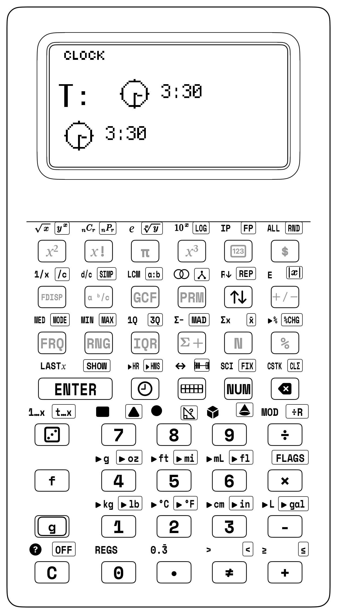

| Clock Hand at $3:30$ | Dial Position | Clock Hand Angle |
| :--- | :--- | :--- |
| **Minute Hand** | Points directly at **$6$** ($30\text{ min}$) | $30 \times 6^\circ = \mathbf{180.0^\circ}$ (half turn) |
| **Hour Hand** | Halfway between **$3$** and **$4$** ($3.5\text{ hr}$) | $(3 + 30/60) \times 30^\circ = 3.5 \times 30^\circ = \mathbf{105.0^\circ}$ |
| **Angle Between Hands** | Wedge from $105.0^\circ$ down to $180.0^\circ$ | $180.0^\circ - 105.0^\circ = \mathbf{75.0^\circ}$ |

Pilots and air-traffic controllers use clock-face angles every day ("traffic at your 4 o'clock!") to call out radar bearings around an aircraft. When a clock-style navigation dial reads 4:20 ($4.20\text{ HMS}$), you can find the exact compass angle of the hour hand using $(4 + 20/60) \times 30^\circ$. Turn your Planetary Geared Clock to 4:20: notice that the hour hand does not stay pinned on the 4, but glides smoothly one-third of the way toward 5, reaching $130^\circ$.

Enter the base hour `4` with `[ENTER]`, convert the 20 minutes into $\frac{1}{3}$ of an hour (`20`, `[ENTER]`, `60`, `[÷]`), add them into $4.3333$ decimal hours, and multiply by $30^\circ$ per hour via `[4] [ENTER] 20 [ENTER] 60 [÷] [+] 30 [×]` to land on **`130`**, proving why the hour hand rests at $130^\circ$ ($10^\circ$ past the 4).

---

### 6.5.3 Clock Time (H.MMSS) Entry and Decimal-Hour Conversion
Why can't you add clock times like ordinary base-10 decimals? Because base-10 decimals count all the way to $100$ before carrying over to the next whole number, whereas clock minutes roll over at **$60$**. If someone types $9.45 + 2.35 = 11.80$ as a decimal sum, they are treating $45\text{ minutes} + 35\text{ minutes}$ as $.80$ of an hour, when in reality $80\text{ minutes}$ is **1 full hour plus 20 extra minutes**—pushing the clock hands past noon to **$12{:}20$**.

On the SC-6, two shifted keys (`[f] [▸HR]` and `[g] [▸HMS]`) translate between base-60 clock time and base-10 decimal hours automatically. You start by typing any clock time in `H.MMSS` format, such as `9.45` for 9 hours 45 minutes (or `9.4530` for 9 hours, 45 minutes, 30 seconds). Tapping `[f] [▸HR]` immediately converts $9\text{ hr } 45\text{ min}$ into `9.7500` decimal hours, because $45\text{ minutes}$ is $\frac{45}{60} = \frac{3}{4} = 0.75$ of an hour. Once your times are in decimal hours, you can add, subtract, or multiply them like ordinary numbers—and then tap `[g] [▸HMS]` at the end to turn the decimal answer right back into `Hours.MinutesSeconds`.

Because `[f] [▸HR]` gives you a clean decimal number like `9.7500`, you can also multiply a flight's decimal hours directly by its ground speed in miles per hour to find distance, or multiply a worker's decimal hours by an hourly pay rate.

---

### 6.5.4 Adding Flight Times on the Geared Clock

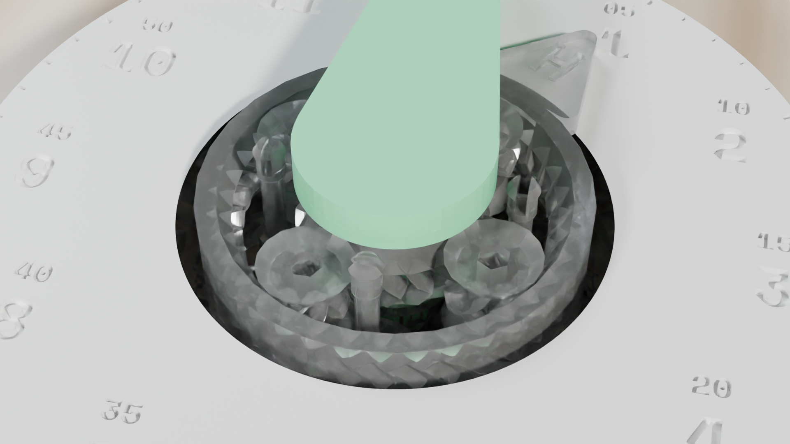

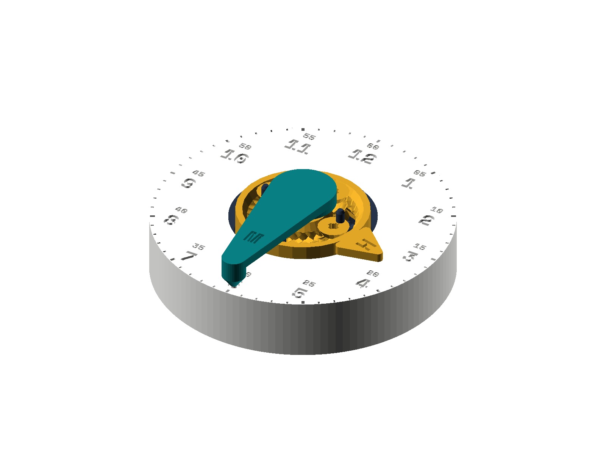

Let's test both your physical Planetary Geared Clock and your SC-6 (`[🕒]`) on a real flight schedule. On a quick morning commuter hop from New York (`9.45 [f] [▸HR] 2.35 [f] [▸HR] [+] [g] [▸HMS]`), rotating the minute ring 2 full turns plus 35 minutes carries the hour hand smoothly past 12 to land at **12:20 PM**.

> **Why Crossing Time Zones Moves Your Clock by Whole Hours ($360^\circ \div 24 = 15^\circ\text{ per Hour}$):** Have you ever wondered why a cross-country flight changes your watch by exact whole hours (`+1 hr`, `+2 hr`, `+3 hr`) instead of awkward minutes? Until **1883**, every town in North America set its own clock by the moment the sun stood directly overhead—meaning when it was `12:00` noon in Chicago, it was `12:09` in Louisville, `12:18` in Detroit, and `12:31` in Pittsburgh! After Scottish-Canadian railway engineer **Sir Sandford Fleming** missed a train because of a confusing local timetable, he proposed dividing the spinning $360^\circ$ Earth into **24 equal slices**—one for each hour of the day. Try dividing `360 [ENTER] 24 [÷]` on your SC-6: Earth spins **`15` degrees of longitude every single hour**! On November 18, 1883 (known in history as *"The Day of Two Noons"*), railroad stationmasters across the continent reset their clocks to those $15^\circ$ standard time zones, so travelers everywhere could add or subtract clean whole hours while keeping the exact same minutes on the dial.

What if a cross-country cargo flight has multiple legs and a refueling stop in the middle? At an air-freight hub, a cargo plane takes off at 10:00 AM, flies Leg 1 for 2h 15m ($2.15\text{ HMS}$), stops to refuel for 1h 30m ($1.30\text{ HMS}$), and flies Leg 2 for 3h 20m ($3.20\text{ HMS}$). What time does it touch down at its final destination?

Trace all three steps on your Planetary Geared Clock ($10{:}00 \to 12{:}15 \to 13{:}45 \to 17{:}05$) and chain them in decimal hours on the stack using `10 [f] [▸HR] 2.15 [f] [▸HR] [+] 1.30 [f] [▸HR] [+] 3.20 [f] [▸HR] [+] [g] [▸HMS]` to reach **`17.05`**:

| Keystroke | Register T | Register Z | Register Y | Register X | What Happens on the Stack |
| :--- | :---: | :---: | :---: | :---: | :--- |
| `10` | $0.0000$ | $0.0000$ | $0.0000$ | $10.0000$ | Type the departure time 10:00 AM (`HH.MM`) onto Shelf $X$ |
| `[f] [▸HR]` | $0.0000$ | $0.0000$ | $0.0000$ | $10.0000$ | Convert departure to decimal hours ($10.0\text{ hr}$) |
| `2.15` | $0.0000$ | $0.0000$ | $10.0000$ | $2.1500$ | Type Leg 1 flight time (2h 15m); departure lifts to Shelf $Y$ |
| `[f] [▸HR]` | $0.0000$ | $0.0000$ | $10.0000$ | $2.2500$ | Convert Leg 1 time to decimal hours ($2 + 15/60 = 2.25\text{ hr}$) |
| `[+]` | $0.0000$ | $0.0000$ | $0.0000$ | $12.2500$ | Add Leg 1 to departure time ($12.25\text{ hr}$) |
| `1.30` | $0.0000$ | $0.0000$ | $12.2500$ | $1.3000$ | Type the airport refueling stop (1h 30m) onto Shelf $X$ |
| `[f] [▸HR]` | $0.0000$ | $0.0000$ | $12.2500$ | $1.5000$ | Convert refueling stop to decimal hours ($1 + 30/60 = 1.5\text{ hr}$) |
| `[+]` | $0.0000$ | $0.0000$ | $0.0000$ | $13.7500$ | Add the stop to the running trip time ($13.75\text{ hr}$) |
| `3.20` | $0.0000$ | $0.0000$ | $13.7500$ | $3.2000$ | Type Leg 2 flight time (3h 20m) onto Shelf $X$ |
| `[f] [▸HR]` | $0.0000$ | $0.0000$ | $13.7500$ | $3.3333$ | Convert Leg 2 to decimal hours ($3 + 20/60 = 3.3333\text{ hr}$) |
| `[+]` | $0.0000$ | $0.0000$ | $0.0000$ | $17.0833$ | Add Leg 2 to get the landing time in decimal hours |
| `[g] [▸HMS]` | $0.0000$ | $0.0000$ | $0.0000$ | $17.0500$ | Convert decimal hours back to clock time (`17:05` or `5:05 PM`) |

The cargo flight touches down at $\mathbf{17:05\text{ HMS}}$ ($5:05\text{ PM}$), right on schedule for the evening ground crew!

---

### 6.5.5 Crossing Past Midnight Into Tomorrow
What happens when a backyard stargazing night or an overnight science timer starts late in the evening and runs past midnight (`24:00`) into the next morning? Whenever your total decimal hours (`[f] [▸HR]`) climb past `24`, the clock has rolled into a new day—so you simply subtract `24` (one full 24-hour day) on the stack before pressing `[g] [▸HMS]` to read the morning clock time.

Let's watch every shelf during a midnight crossing inside a planetarium observatory dome. An automated telescope camera begins a deep-sky exposure at 21:30 ($9{:}30\text{ PM}$, which converts via `21.30 [f] [▸HR]` to $21.5000\text{ decimal hours}$) and tracks a glowing nebula across the night sky for 4 hours and 45 minutes ($4.45\text{ HMS}$, or $4.7500\text{ decimal hours}$).

When you press `[+]` to add the start time and run time, the total reaches $26.2500\text{ hours}$—passing 24 hours because the telescope tracked right past midnight. Turning your Planetary Geared Clock past midnight wraps the hour hand smoothly into the new morning, matching subtracting 24 hours (`24 [-]` $\to 2.2500\text{ hr}$) and `[g] [▸HMS]` conversion on the stack when you run `21.30 [f] [▸HR] 4.45 [f] [▸HR] [+] 24 [-] [g] [▸HMS]` to reach **`2.15`**:

| Keystroke | Register T | Register Z | Register Y | Register X | What Happens on the Stack |
| :--- | :---: | :---: | :---: | :---: | :--- |
| `21.30` | $0.0000$ | $0.0000$ | $0.0000$ | $21.3000$ | Type the start time 21:30 (`HH.MM` format) onto Shelf $X$ |
| `[f] [▸HR]` | $0.0000$ | $0.0000$ | $0.0000$ | $21.5000$ | Convert start time to decimal hours ($21 + 30/60 = 21.5\text{ hr}$) |
| `4.45` | $0.0000$ | $0.0000$ | $21.5000$ | $4.4500$ | Type the tracking time 4h 45m; start time lifts to Shelf $Y$ |
| `[f] [▸HR]` | $0.0000$ | $0.0000$ | $21.5000$ | $4.7500$ | Convert tracking time to decimal hours ($4 + 45/60 = 4.75\text{ hr}$) |
| `[+]` | $0.0000$ | $0.0000$ | $0.0000$ | $26.2500$ | Add both times together, passing 24 hours ($26.25\text{ hr}$ total) |
| `24` | $0.0000$ | $0.0000$ | $26.2500$ | $24.0000$ | Type 24 for one full day; total hours lift to Shelf $Y$ |
| `[-]` | $0.0000$ | $0.0000$ | $0.0000$ | $2.2500$ | Subtract 24 hours to cross midnight into the morning ($2.25\text{ hr}$) |
| `[g] [▸HMS]` | $0.0000$ | $0.0000$ | $0.0000$ | $2.1500$ | Convert decimal hours back to clock time (`02:15 AM`) |

After sweeping across the starry dome past midnight, the telescope shutter clicks shut at $\mathbf{02:15\text{ AM}}$ ($2.15\text{ HMS}$)—2 hours and 30 minutes before midnight plus 2 hours and 15 minutes after midnight.

---

### 6.5.6 How the 12:1 Planetary Clock Gears Mesh
If you flip your Planetary Geared Clock over and peek at the 3D-printed gears inside (which you can print yourself using the open-source blueprints in Appendix A), how do those spinning gears fit together without jamming *and* create an exact $12:1$ ratio? In our classroom gear set, each gear tooth adds $1.0\text{ mm}$ to the gear's pitch diameter ($\text{Gear Width in mm} = 1.0\text{ mm per tooth} \times \text{Number of Teeth}$): the **Center Sun Gear** has $12\text{ teeth}$ ($12.0\text{ mm}$ wide), the **Three Planet Gears** have $60\text{ teeth}$ each ($60.0\text{ mm}$ wide), and the big **Outer Ring Gear** has $132\text{ teeth}$ ($132.0\text{ mm}$ wide).

First, check the tooth-count rule that makes the gears sit flat and mesh cleanly inside the outer ring: the number of teeth on the big **Outer Ring Gear** must equal the **Center Sun Gear** plus **two Planet Gears** sitting side-by-side across the middle:
$$\text{Outer Ring Teeth} = \text{Center Sun Teeth} + (2 \times \text{Planet Gear Teeth}) \longrightarrow 132 = 12 + (2 \times 60) = 12 + 120 = 132$$
Because $12 + 120 = 132$, all three planet gears roll smoothly around the center sun gear with zero binding. Second, the reduction ratio between the minute hand and the hour hand comes straight from comparing that $132\text{-tooth}$ outer ring gear to the $12\text{-tooth}$ center sun gear:
$$\text{Clock Gear Ratio} = 1 + (\text{Outer Ring Teeth} \div \text{Center Sun Teeth}) = 1 + (132 \div 12) = 1 + 11 = 12$$
Every 12 full turns of the minute hand turn the hour hand 1 full circle ($12:1$), keeping both hands synchronized around the dial—and showing how hands-on geometry turns abstract rules into something you can see and touch. That same visual approach to geometry inspired one of the greatest mathematicians of modern times.

---

### 6.5.7 Maryam Mirzakhani's Floor-Sized Geometry

If you have ever looked at a page of dry geometry formulas and felt like math wasn't for you, you are in remarkable company. Growing up in Tehran, Iran, in the 1980s, young **Maryam Mirzakhani** (1977–2017) didn't care about mathematics at all. Her true passion was storytelling: she wanted to be a novelist, and she spent every spare afternoon browsing crowded local bookstores and reading every story she could get her hands on. In middle school, her math teacher even decided Maryam wasn't particularly talented at numbers—and Maryam believed it, losing interest in the subject for a whole year.

Everything changed when her older brother came home from high school one afternoon and showed her the visual folding puzzle you explored in Chapter 4 for adding all the numbers from $1$ to $100$ in seconds. Watching the long number line fold in half into fifty matching pairs of $101$, Maryam suddenly realized that mathematics wasn't about copying dry formulas—it was a creative detective story! By high school, she and her best friend Roya Beheshti were solving national Olympiad geometry problems, and Maryam went on to earn two consecutive gold medals at the International Mathematical Olympiad (including a perfect score in 1995) before completing her doctorate at Harvard and becoming a professor of mathematics at Stanford University.

Throughout her career, Mirzakhani worked in a way that looks a lot like your hands-on block studio. Instead of sitting stiffly at a desk staring at tiny symbols on notebook paper, she unrolled huge sheets of white butcher paper across her living-room floor, got down on her hands and knees with colored markers, and sketched giant, sprawling three-dimensional cylinders, cones, loops, and **hyperbolic surfaces**—worlds that curve in opposite directions like a horse's saddle, a ruffled leaf of kale, or a many-holed pretzel.

On those saddle-curved surfaces, parallel lines bend away from each other and the three corners of a triangle add up to *less* than $180^\circ$! By snipping those complex curved pretzels along closed loops into simpler pants-shaped tubes—much like unfolding a 3D box or cylinder net on your desk—and imagining what a billiard ball would see if it bounced forever around a mirrored polygon table, she tamed shapes that had baffled geometers for a century. Her floor-sized drawings were so vivid that her young daughter Anahita used to peek into the room and tell visitors, *"Mommy is painting again!"*

In 2014, those giant floor drawings led to history: Maryam Mirzakhani became the **first woman ever awarded the Fields Medal**, the highest honor in all of mathematics, for discovering hidden laws governing curved surfaces and closed geodesic loops. Whenever you unfold a 3D cardboard box flat on your table to sum its wall pairs, slice a paper cone to test Archimedes' $3{:}1$ pouring rule, or turn the interlocking rings of your **Planetary Geared Clock**, you are doing the exact kind of visual thinking that carried a book-loving middle schooler all the way to the pinnacle of geometry.

### 6.5.8 Soccer Balls, Geodesic Domes & Euler's Magic Number `2`

Before we leave 3D shapes, look closely at a classic black-and-white **soccer ball** (or the giant **Spaceship Earth** geodesic sphere at EPCOT, inspired by inventor **Buckminster Fuller**). Earlier in this chapter, we saw that **six regular hexagons** ($6 \times 120^\circ = 720^\circ$, with $360^\circ$ meeting around each corner) fit together **completely flat** like a bathroom tile floor or a honeybee comb.

Wait a second: if hexagons always lie flat, then how can you stitch flat leather patches together to curve into a round 3D soccer ball?

Try replacing just one 6-sided hexagon at a corner with a **5-sided pentagon** ($108^\circ$ corners): suddenly the three shapes meeting at that corner add up to less than $360^\circ$ ($120^\circ + 120^\circ + 108^\circ = 348^\circ$, leaving a $12^\circ$ gap!), so when you stitch the edges shut, the flat sheet **pops upward into a 3D bowl**! Every time you add a pentagon, the surface curves a little more, and when you stitch **12 black pentagons** and **20 white hexagons** ($12 + 20 = \mathbf{32\text{ faces}}$) together, the bowl closes into a sturdy 3D sphere!

In **1750**, the great Swiss mathematician **Leonhard Euler** (pronounced *"OY-ler"*) discovered a surprising law that connects the **Corners (Vertices, $V$)**, the **Fold Lines (Edges, $E$)**, and the **Flat Walls (Faces, $F$)** of *every* closed, flat-walled 3D shape in your studio:

$$\text{Corners } (V) - \text{Edges } (E) + \text{Faces } (F) = \mathbf{2}$$

Grab any 3D shape on your desk and test **Euler's Formula ($V - E + F = 2$)** on your SC-6 stack right now:

| 3D Shape in Your Studio | Corners ($V$) | Fold Edges ($E$) | Flat Faces ($F$) | Stack Check (`V ENTER E - F +`) |
| :--- | :---: | :---: | :---: | :--- |
| **1. Rectangular Prism or Cube** | **$8$** corners | **$12$** edges | **$6$** walls | `8 [ENTER] 12 [-] 6 [+]` $\to$ **`2`** |
| **2. Antarctic Square Pyramid** | **$5$** corners | **$8$** edges | **$5$** walls | `5 [ENTER] 8 [-] 5 [+]` $\to$ **`2`** |
| **3. Triangular Roof Prism** | **$6$** corners | **$9$** edges | **$5$** walls | `6 [ENTER] 9 [-] 5 [+]` $\to$ **`2`** |
| **4. 20-Sided Probability Die ($d20$)** | **$12$** corners | **$30$** edges | **$20$** triangles | `12 [ENTER] 30 [-] 20 [+]` $\to$ **`2`** |
| **5. 32-Panel Soccer Ball** | **$60$** corners | **$90$** seams | **$32$** panels | `60 [ENTER] 90 [-] 32 [+]` $\to$ **`2`** |

Look at that last row: even on a 32-panel soccer ball—where $12$ pentagons ($12 \times 5 = 60$ border edges) and $20$ hexagons ($20 \times 6 = 120$ border edges) share $180$ total panel edges stitched together in pairs to make $180 \div 2 = \mathbf{90\text{ seams}}$ ($E = 90$) and $180 \div 3 = \mathbf{60\text{ three-seam corners}}$ ($V = 60$)—keying `60 [ENTER] 90 [-] 32 [+]` lands on the exact same magic number: **`2`**!

---

## 6.6 Box-Unfolding, Cone & Clock Challenges & Looking Ahead

Clear a corner of the kitchen counter and grab an empty cereal box, a sheet of paper, and a wall clock to run these three geometry investigations, and then see where our next chapter takes us.

### 6.6.1 Three Box-Unfolding, Cone & Clock Challenges

1. **The Cereal-Box Unfolding Audit (`[g] [CLΣ]`, `[Σ+]`, `[f] [Σx]`):** Grab an empty cardboard cereal or cracker box from the pantry and carefully slit along three edges so all six rectangular walls unfold flat on the kitchen table. Measure the length, width, and height in centimeters, toss all three matching wall pairs into your SC-6 basket using `[Σ+]`, and tap `[f] [Σx]` to find the total cardboard area—then multiply $\text{Length} \times \text{Width} \times \text{Height}$ to see how many cubic centimeters of crunchy cereal fit inside!
2. **The Three-Cone Rice Pouring Bet (`[f] [CIRC]` and `[g] [CONE]`):** Roll a sheet of stiff paper into a cone that has the exact same round opening and height as a straight kitchen drinking glass, and tape the seam. Ask a family member to guess how many paper cones of dry rice or popcorn kernels it will take to fill the glass to the rim—then pour and count as **exact cone #3** fills it to the top! Check both volumes on your SC-6.
3. **The Live Wall-Clock Angle Hunt (`[f] [▸HR]` and `[g] [▸HMS]`):** Glance at a wall clock right now (or spin your Planetary Geared Clock to your favorite time of day). Use your SC-6 to find the exact angle of the hour hand ($\text{decimal hours} \times 30^\circ$) and the minute hand ($\text{minutes} \times 6^\circ$), then subtract to find the exact degree wedge between them!

---

### 6.6.2 Looking Ahead to Chapter 7

Think back to the Emperor penguin chicks huddling on the Antarctic ice shelf at the opening of this chapter. When Galileo Galilei formulated his **Square-Cube Law** in 1638, he showed that every three-dimensional creature or structure lives in a tug-of-war between the **flat panels on the outside** (surface area) and the **space packed on the inside** (volume). Docking eight unit cubes into a $2 \times 2 \times 2$ huddle hides half of their exposed faces inside warm shared walls while keeping their volume locked at eight blocks—the same geometry that protects penguins at $-40^\circ\text{C}$ and crisps French fries in hot oil.

Every shape and gear in this chapter shares that truth: three-dimensional structures are built from simple flat pieces you can unfold in your hands. You measured flat rectangles, triangles, Nile trapezoids, honeybee hexagons, and circles, then folded them into 3D boxes, polar Scott tents, cylinders, and observatory domes—tossing each wall group into your `[Σ+]` basket and ringing up the total with `[f] [Σx]`. That same step-by-step clarity links Archimedes' $2{:}3$ sphere and $1{:}3$ cone ratios to the $12{:}1$ gear train inside your **Planetary Geared Clock** (`[🕒]`):

| Geometry or Time Discovery | Hands-On Block Proof | Key Stack Shortcut on Your SC-6 |
| :--- | :--- | :--- |
| **Square-Cube Huddle Law** | Dock $8$ unit cubes into a $2 \times 2 \times 2$ cube (`48` $\to$ `24` outer faces) | Compare exposed wall faces ($6s^2$) vs. interior cubes ($s^3$) |
| **Right Triangle ($3\text{–}4\text{–}5$ Rope)** | Fit $9$-tile and $16$-tile squares along the legs to match the $25$-tile hypotenuse | `3 [x²] 4 [x²] [+] [f] [√x]` $\to \mathbf{5}$ |
| **Trapezoid & Hexagon Slicing** | Average parallel bases ($b_1, b_2$) or pack $6$ equilateral triangles | `b1 [ENTER] b2 [+] 2 [÷] h [×]` |
| **3D Box Wrapping Basket** | Unfold the $6$ hinged walls of the $5 \times 4 \times 3\text{ cm}$ folding net | Toss wall pairs into `[g] [CLΣ]` $\dots$ `[Σ+]`, then tap `[f] [Σx]` $\to \mathbf{94\text{ cm}^2}$ |
| **Pyramid & Cone $3{:}1$ Pour** | Pour $3$ cones or pyramids of rice to fill the matching cylinder or prism | Multiply $\text{Base Area} \times \text{Height}$, then tap `3 [÷]` |
| **Archimedes' Sphere & Dome** | Compare a sphere of radius $r$ to its snug cylinder ($V = \frac{4}{3}\pi r^3$, $A = 4\pi r^2$) | `4 [ENTER] 3 [÷] [π] [×] r [ENTER] 3 [g] [yˣ] [×]` |
| **Planetary Geared Clock ($12{:}1$)** | Spin the $60$-tooth minute ring to drive the hour hand through $12{:}1$ gears | Convert `H.MMSS` with `[f] [▸HR]` and `[g] [▸HMS]`, or check $30^\circ/\text{hr}$ vs. $6^\circ/\text{min}$ |

Notice how every single geometry and clock tool in that table starts with something you can trace with your fingers: snapping square tiles along the legs of a right triangle, unfolding the six walls of a box, pouring three paper cones of rice into a drinking glass, or turning the 60-tooth ring of your geared clock. Whenever a 3D shape or a clock puzzle looks complicated on paper, ask yourself what it looks like when you unfold its walls flat on your desk and add them up in your `[Σ+]` basket one piece at a time.

In **[Chapter 7: Prime Numbers, Fair Dice & Data Detective](sc6/07-data-probability-primes.md)**, you will roll balanced polyhedral dice (`[🎲]`) to see why Lucky 7 rules board games, use your `[Σ+]` basket to find averages (`[g] [x̄]`), medians (`[f] [MED]`), and outlier fences (`[IQR]`), explore negative numbers (`[+/-]`), and crack whole numbers into their unbreakable prime building blocks (`[PRIME]` and `[g] [FACT]`).

---

# Chapter 7: Prime Numbers, Fair Dice & Data Detective

## 7.1 The 17-Year Cicada Mystery & Nature's Prime Shield

Deep beneath the deciduous forests of eastern North America, millions of periodical cicada nymphs (*Magicicada septendecim*) sip tree-root sap in the dark for **17 years**—until, on a single warm spring weekend, billions of them tunnel out of the soil at once and fill the forest canopy with a deafening chorus *([Gould, 1977](sc6/appendix-c-formulas-and-conversions.md#cite-gould1977))*. Across living ecosystems, spacecraft communications, and tabletop games, **prime numbers and probability govern how creatures outsmart predators, how secret codes stay unbreakable, and how dice roll with equal chance.**

### 7.1.1 Why Cicadas Count in Primes

Forest scientists and bug researchers spent years puzzling over a cool nature mystery *([Webb, 2001](sc6/appendix-c-formulas-and-conversions.md#cite-webb2001))*: **Why 13 years? Why 17 years?** Why didn't cicadas end up with a 12-year, 14-year, or 16-year life cycle?

To see the danger of a non-prime schedule, picture the **Composite Number Trap** that would happen if a cicada brood crawled out on a 12-year schedule. Because the number 12 is **composite**—with factors of $1, 2, 3, 4, 6,$ and $12$—hungry birds or wasps that boom every 2 years would be waiting for a feast on every single cicada emergence ($2 \times 6 = 12$). Worse still, a predator with a 3-year boom would meet them every single time ($3 \times 4 = 12$), and a predator with a 4-year boom would catch them every single time ($4 \times 3 = 12$). Hungry predators would wipe out the cicadas almost every time they crawled above ground!

Now compare that trap with the **Prime Number Shield** of 17. Because 17 is **prime**, its *only* factors are 1 and 17—so a predator cycle and a 17-year cicada cycle only line up at their **Least Common Multiple (`[f] [LCM]`)**. A **2-year predator cycle** only syncs up with the cicadas once every **34 years** ($2 \times 17 = 34$), a **3-year predator cycle** has to wait a full **51 years** between feasts ($3 \times 17 = 51$), and a **5-year predator cycle** crosses paths with the brood just once every **85 years** ($5 \times 17 = 85$, longer than a human lifetime!). By sleeping underground for an exact prime number of years, cicadas outsmart every predator in the forest!

What happens when *two different* prime cicada broods—the **13-year Brood XIX** across the southern states and the **17-year Brood XIII** across the Midwest—live in neighboring forests? Because both $13$ and $17$ are prime numbers, they share no common factors other than $1$. Key `13 [ENTER] 17 [f] [LCM]` onto your SC-6 right now: the screen flashes **`221`**! That means the 13-year and 17-year cicada broods crawl out of the ground in the exact same spring only **once every 221 years**. When both broods emerged together in the spring of **2024**, it was the first time they had met since **1803** (when Thomas Jefferson had just signed the Louisiana Purchase!), and they will not emerge together again until the year **2245** ($2024 + 221$). Primes are nature's secret code—the unbreakable building blocks of all whole numbers *([Gauss, 1809](sc6/appendix-c-formulas-and-conversions.md#cite-gauss1809); [Singh, 1997](sc6/appendix-c-formulas-and-conversions.md#cite-singh1997))*.

---

### 7.1.2 Why Board Games Use Fair 16 mm Dice

Ever wonder why your favorite tabletop adventure games use 4, 6, 8, 12, or 20-sided dice—but nobody sells a 7-sided or 11-sided die?

Over 2,300 years ago, Greek builders and geometers proved an amazing 3D secret: in our universe, there are **only five completely symmetrical 3D shapes** (called the Platonic Solids) where every single flat face is the exact same shape and size, and every corner meets the exact same number of edges:
1. **Tetrahedron (d4):** 4 matching equilateral triangle faces
2. **Cube (d6):** 6 matching square faces
3. **Octahedron (d8):** 8 matching equilateral triangle faces
4. **Dodecahedron (d12):** 12 matching 5-sided pentagon faces
5. **Icosahedron (d20):** 20 matching equilateral triangle faces

If you try to carve a 7-sided or 11-sided die, some sides will always be wider or flatter than others—so it can never land with equal chance! True fairness in gaming isn't just about giving the dice cup a good shake—it comes from building dice whose sides and corners match in every direction *([Gardner, 1959](sc6/appendix-c-formulas-and-conversions.md#cite-gardner1959))*.

---

### 7.1.3 Fair-Weight Dice, Spinners & Prime Factor Blocks

Before we tap keys on the calculator, we roll real dice, balance two-color counters, and build prime-number towers with our hands. Each physical studio kit on your desk teams up directly with a family of calculator keys we will explore step by step in this chapter. Your **Precision Dice & Spinner Studio (`[🎲]`)** sets up a desktop probability lab featuring 10-slice number lids (`0`–`9`), swap-in uneven ($50\%, 25\%, 15\%, 10\%$) and coin-flip (`0`/`1`) spinner plates, and four custom-engineered 6-sided dice paired with your SC-6's digital polyhedral dice (`[🎲]`, covering $d4, d6, d8, d10, d12,$ and $d20$). Right beside it, your **Prime Factor Studio (`[PRIME]`, `[g] [FACT]`, `[GCF]`, `[f] [LCM]`)** provides scaled Prime Factor Blocks ($2, 3, 5, 7\dots$) and a Comparator Stage whose heights add together when you multiply numbers, while your **Counting & Array Studio (`[Σ+]`, `[g] [x̄]`, `[f] [MED]`, `[+/-]`)** gives you four bright color groups of interlocking tiles for stacking tabletop bar charts as you tally data into `[Σ+]` and for building positive and negative Zero Pairs when you flip signs with `[+/-]`.

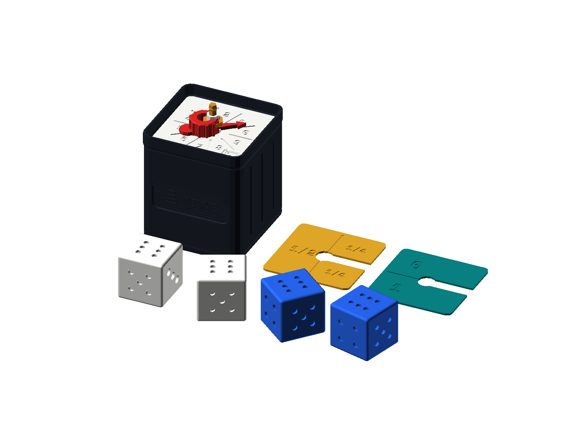

Have you ever looked closely at an ordinary store-bought plastic die and wondered if all six sides really weigh the same? On a cheap game die, every dot (called a **pip**) is scooped out to the exact same size and depth. That means the 6-dot face has **six times as much plastic scooped out** as the 1-dot face—making the 6-dot side slightly lighter and more likely to turn face-up when the heavy 1-dot side settles to the bottom!

Professional tournament dice and your 3D-printed **Dice & Spinner Studio** fix this hidden weight bias through **volume-equalized pips**. By making the single dot on the 1-face wider and deeper—and scaling the dots on the 2, 3, 4, 5, and 6 faces progressively shallower so all six faces lose the exact same volume of plastic—every face has the exact same mass and center of balance. Whenever you roll your physical studio dice on the desk or tap `[🎲]` on the SC-6, every face has an equal mathematical chance.

---

## 7.2 Fair Dice, Spinners & Game Odds

Every time you flip a coin, spin a game-board spinner, or roll a die, you are exploring **Probability**—the branch of mathematics that measures how likely something is to happen on a scale from $0$ (completely impossible) to $1$ (guaranteed to happen every time):
$$\text{Probability of an Event} = \frac{\text{Number of Winning Outcomes}}{\text{Total Number of Equally Likely Outcomes}}$$

| Probability | What It Means | Classroom Example |
| :--- | :--- | :--- |
| **$0.0$** | Impossible | Rolling a `7` on a standard 6-sided die ($d6$) |
| **$0.5$** | Equally Likely ($50/50$) | Flipping Heads or Tails on a fair coin |
| **$1.0$** | Certain | Rolling a whole number from `1` to `6` on a standard $d6$ |

### 7.2.1 Rolling Digital Dice & Custom Random Ranges
What if you want to run a 60-roll probability experiment right at your desk without chasing runaway dice across the classroom floor? Pressing the dedicated dice key `[🎲]` on your SC-6 keypad turns the screen into an instant digital dice cup. Each press of `[🎲]` wakes up the calculator's random number roller, drawing crisp $17 \times 17$ pixel die faces right on the display (`T` and `X`) with classic dot patterns—from a single center dot for `1`, diagonal pairs and triples for `2` and `3`, four corner dots ($2 \times 2$ square) for `4`, four corners plus a center dot ($4 + 1$) for `5`, up to two columns of three dots ($2 \times 3$ rectangle) for `6`. Even better, the number you rolled ($1 \dots 6$) lands directly on Shelf $X$ with **automatic stack lift** ($X \to Y \to Z \to T$), so you can roll two dice (`2d6`) and tap `[+]` to add them, or tap `[Σ+]` to log 50 rolls in a row.

When your game or science experiment needs a 20-sided die ($d20$), a coin flip (`1` or `2`), or a random student number from `1` to `28`, two shifted random-range keys let you build any custom spinner or die you can imagine. The **`[f] [1…x]` (Random 1 to X)** key picks a random whole number from $1$ up to whatever number is sitting on Shelf $X$: type `20 [f] [1…x]` to roll a 20-sided die ($d20$ from $1$ to $20$), type `2 [f] [1…x]` to flip a fair coin ($1 = \text{Heads}, 2 = \text{Tails}$), or type `28 [f] [1…x]` to pick a random lab partner from a class of 28 students. And when you want a custom starting number other than $1$, the **`[g] [t…x]` (Random Y to X)** key picks a random whole number between the starting number on Shelf $Y$ and the ending number on Shelf $X$—for example, keying `10 [ENTER] 99 [g] [t…x]` generates a random two-digit number from $10$ to $99$:

| Tabletop Randomizer | Physical Studio Piece | SC-6 Keystrokes | Possible Outcomes |
| :--- | :--- | :--- | :--- |
| **Fair Coin Flip** | Binary `0`/`1` Spinner Plate | `2 [f] [1…x]` | `1` (Heads) or `2` (Tails) |
| **Standard 6-Sided Die ($d6$)** | Volume-Equalized $16\text{ mm}$ Cube | `[🎲]` *(or `6 [f] [1…x]`)* | Graphic die face `1` through `6` |
| **10-Slice Spinner (`1`–`10`)** | 10-Sector Probability Lid | `10 [f] [1…x]` | Whole numbers `1` through `10` |
| **20-Sided Adventure Die ($d20$)** | 20-Triangle Icosahedron | `20 [f] [1…x]` | Whole numbers `1` through `20` |
| **Two-Digit Mystery Draw** | Custom Range ($Y$ to $X$) | `10 [ENTER] 99 [g] [t…x]` | Any two-digit number `10` to `99` |

Why doesn't a real die land on `4` *exactly* once every 6 rolls? Because **Expected Odds** (theoretical probability) tell you what happens over thousands of rolls, while **Real-Life Trials** (experimental probability) record what actually happened in your game today. Roll a standard six-sided die 60 times at your desk: on any single roll, the expected chance of rolling a 4 is $\frac{1}{6}$, so across 60 rolls a 4 should appear about $60 \times \frac{1}{6} = 10\text{ times}$:

$$\text{Expected Chance of Rolling a 4} = \frac{1}{6} \approx 0.1667 \ (16.67\%)$$
$$\text{Expected Count} = 60 \times \frac{1}{6} = 10\text{ times}$$

In a real 60-roll classroom trial, you might see a 4 turn up twelve times instead of ten. With Whole Number Mode (`[NUM]`) toggled off (or after tapping `[g] [FIX] 4` / `[f] [ALL]`), dividing your 12 wins by the 60 total rolls on the stack with `12 [ENTER] 60 [÷]` gives a real-life rate of $0.2000$ ($20.0\%$), and subtracting the expected $\frac{1}{6}$ share with `0.20 [ENTER] 1 [ENTER] 6 [÷] [-]` shows a $+0.0333$ ($+3.33\%$) difference.

Game designers use this exact ratio (`Winning Outcomes ÷ Total Outcomes`) to check the fairness of every die roll and card draw before printing a rulebook. Pick up one of your physical $d6$ dice and count the odd faces ($1, 3,$ and $5$): 3 out of the 6 faces are odd. Dividing 3 by 6 on your SC-6 with `[3] [ENTER] [6] [÷]` gives **`0.5`**—an exact coin-flip ($\mathbf{0.5000}$ or $50\%$), so across 60 rolls you can expect roughly 30 odd numbers.

The same ratio works for a 52-card deck when a player wants to draw an Ace on the very first card. Since each of the 4 suits (hearts, diamonds, clubs, and spades) has 1 Ace, there are 4 Aces in the 52-card deck: keying `[4] [ENTER] 52 [÷]` gives **`0.0769230769`**, or $\mathbf{0.0769}$ ($\approx 7.69\%$, which simplifies to $4/52 = 1/13$).

---

### 7.2.2 Galileo's Dice Mystery & the 36-Outcome Grid
Here is a classic board-game mystery: when you roll **two** six-sided dice and add them together, the possible totals run from $2$ all the way to $12$. Are all eleven sums equally likely? Not even close.

Imagine painting the first die **Red** and the second die **Blue**. Because each of the 6 faces on the Red die can pair up with any of the 6 faces on the Blue die, there are $6 \times 6 = \mathbf{36\text{ equally likely pairs}}$ of *(Red Die, Blue Die)*. Look at what happens when we list all 36 pairs by their sum: to roll a **$2$** ("snake eyes"), both dice *must* land on $1$ as $(1,1)$, giving **only 1 way** out of 36; and to roll a **$12$** ("boxcars"), both dice *must* land on $6$ as $(6,6)$, again giving **only 1 way** out of 36. Now look at **$7$**: if the Red die lands on *anything at all*—$1, 2, 3, 4, 5,$ or $6$—there is an exact partner on the Blue die that makes $7$: $(1,6), (2,5), (3,4), (4,3), (5,2),$ and $(6,1)$. That gives **6 different ways** to roll a $7$—making **$7$** the tallest bar in the center of the rooftop pyramid.

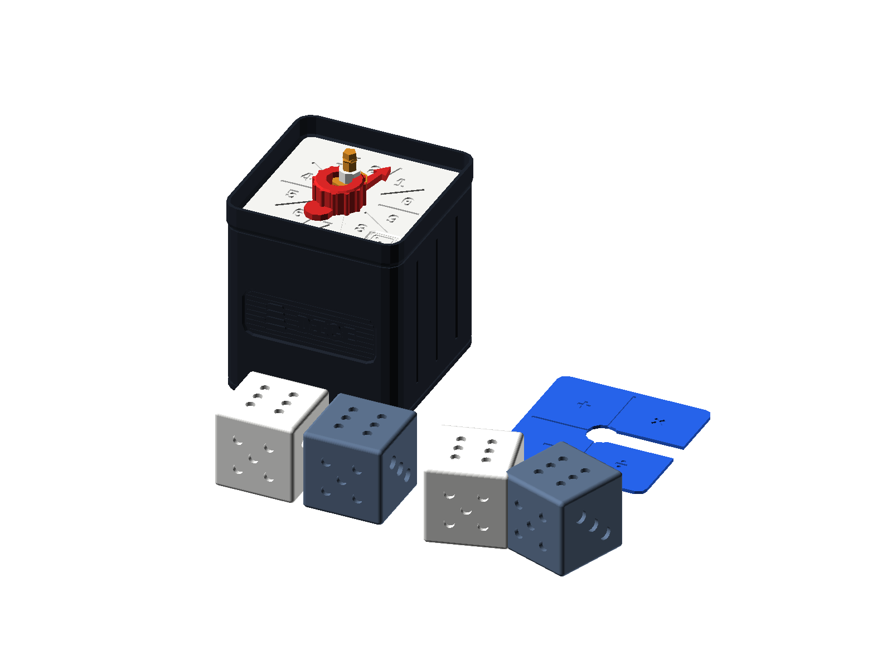

| Dice Sum | Winning Pairs *(First Die, Second Die)* | Count | Probability of Sum |
| :---: | :--- | :---: | :---: |
| **$2$** | $(1,1)$ | $1$ | $1/36$ |
| **$3$** | $(1,2), (2,1)$ | $2$ | $2/36 = 1/18$ |
| **$4$** | $(1,3), (2,2), (3,1)$ | $3$ | $3/36 = 1/12$ |
| **$5$** | $(1,4), (2,3), (3,2), (4,1)$ | $4$ | $4/36 = 1/9$ |
| **$6$** | $(1,5), (2,4), (3,3), (4,2), (5,1)$ | $5$ | $5/36$ |
| **$7$** | $(1,6), (2,5), (3,4), (4,3), (5,2), (6,1)$ | **$6$** | **$6/36 = 1/6$** |
| **$8$** | $(2,6), (3,5), (4,4), (5,3), (6,2)$ | $5$ | $5/36$ |
| **$9$** | $(3,6), (4,5), (5,4), (6,3)$ | $4$ | $4/36 = 1/9$ |
| **$10$** | $(4,6), (5,5), (6,4)$ | $3$ | $3/36 = 1/12$ |
| **$11$** | $(5,6), (6,5)$ | $2$ | $2/36 = 1/18$ |
| **$12$** | $(6,6)$ | $1$ | $1/36$ |
| **Total** | **All $6 \times 6$ Outcomes** | **$36$** | **$36/36 = 1.00$** |

Look at the `Count` column (`1, 2, 3, 4, 5, 6, 5, 4, 3, 2, 1`): if you stack one **Counting Tile** on your studio tray for each winning pair in that column, the eleven stacks rise by 1 tile per step up to **Lucky $7$** (6 tiles tall) and step back down to $12$ (1 tile tall) like a symmetric rooftop pyramid! That rooftop shape is the exact reason strategy board games like *Catan* put the robber on **$7$** and place the highest-value resource tiles on **$6$** and **$8$** ($5/36$ each). Enter `6` ways out of `36` on your stack to simplify the exact probability of rolling a $7$:

| Keystroke | Register T | Register Z | Register Y | Register X | What Happens on the Stack |
| :--- | :---: | :---: | :---: | :---: | :--- |
| `0 [.] 6 [.] 36 [g] [SIMP]` | 0 | 0 | 0 | **1/6** | 6 ways out of 36 simplifies by their $\text{GCF} = 6$ to **$\frac{1}{6}$** |
| `[FDISP]` | 0 | 0 | 0 | **0.1667** | Toggle fraction/decimal view: $\frac{1}{6} \approx \mathbf{16.67\%}$ |

The probability of rolling a sum of $7$ is **$1/6 \approx 16.67\%$**—six times more likely than rolling a $2$ or a $12$.

Even the greatest scientists in history used this exact step-by-step table trick when dice puzzles got tricky! In 1620, the Grand Duke of Tuscany asked the Italian astronomer **Galileo Galilei** a question (*Sopra le Scoperte dei Dadi*) that had stumped every board-game player in Florence: when you roll **three** six-sided dice and add them up, why does a total of **$10$** show up slightly more often than a total of **$9$**—even though both $9$ and $10$ can be split into three die numbers in the exact same number of ways ($6$ combinations each)?

Galileo solved the mystery not with complicated formulas, but by writing out the full table of ordered outcomes ($6 \times 6 \times 6 = 216$ possibilities, just like your $6 \times 6 = 36$ table for two dice!). He showed that three different numbers like $(6,3,1)$ can land on the three dice in **$6$ different orders**, whereas a triple like $(3,3,3)$—which adds to $9$—can only land in **$1$ single way**. Counting every ordered roll gave $10$ twenty-seven winning outcomes ($27/216$) and $9$ only twenty-five ($25/216$). Whenever a probability question seems confusing, writing out the fair outcomes step by step makes the hidden pattern pop right out!

What if you pair two different random tools together—like flipping **Heads** on a fair coin ($\frac{1}{2}$) *and* rolling a **$6$** on a six-sided die ($\frac{1}{6}$) on the same turn? Because the coin and the die don't affect each other, their $2 \times 6$ outcome grid has $12$ equally likely pairs, and only $1$ of those $12$ pairs is *(Heads, 6)*. Multiplying the two chances on the stack via `[1] [ENTER] [2] [÷] [1] [ENTER] [6] [÷] [×]` yields **`0.0833333333`**, giving a combined chance of $\text{Chance of Heads} \times \text{Chance of 6} = 1/12 \approx \mathbf{8.33\%}$.

### 7.2.3 Drawing Marbles Without Putting Them Back
What happens when you pull a marble out of a bag (or deal a card from a deck) and **keep it in your hand** instead of tossing it back in? Now the bag has *one fewer marble* inside, so the odds on your second draw change.

| First Draw Outcome ($8$ Marbles) | Second Draw Outcome ($7$ Remaining) | Combined Branch Probability |
| :--- | :--- | :---: |
| **Red 1st ($5/8$)** | Red 2nd ($4/7$) | $\frac{5}{8} \times \frac{4}{7} = \frac{20}{56}$ |
| **Red 1st ($5/8$)** | Blue 2nd ($3/7$) | $\frac{5}{8} \times \frac{3}{7} = \frac{15}{56}$ |
| **Blue 1st ($3/8$)** | Red 2nd ($5/7$) | $\frac{3}{8} \times \frac{5}{7} = \frac{15}{56}$ |
| **Blue 1st ($3/8$)** | **Blue 2nd ($2/7$)** | $\frac{3}{8} \times \frac{2}{7} = \frac{6}{56} = \mathbf{\frac{3}{28}}$ |

Reach into a cloth bag containing 5 Red and 3 Blue marbles ($8$ marbles in all) and draw two marbles without looking and without putting the first marble back. What is the chance of drawing two Blue marbles in a row? On your first reach, $3$ out of $8$ marbles are Blue ($\frac{3}{8}$). Once you hold that Blue marble in your hand, only $2$ Blue marbles remain among the $7$ marbles left in the bag ($\frac{2}{7}$). Multiply the two step chances together:
$$\text{Chance of Both Blue} = \text{Chance of 1st Blue} \times \text{Chance of 2nd Blue} = \frac{3}{8} \times \frac{2}{7} = \frac{6}{56} = \frac{3}{28}$$

On the stack (with `[NUM]` toggled off or in `[f] [ALL]` decimal view), compute the first draw probability $\frac{3}{8}$, compute the second draw probability $\frac{2}{7}$, and multiply them with `3 [ENTER] 8 [÷] 2 [ENTER] 7 [÷] [×]` to obtain $0.107143$. Tapping `[FDISP]` switches to exact fraction view ($\mathbf{3/28}$), showing that the probability of drawing two blue marbles in a row is $3/28 \approx \mathbf{10.71\%}$.

What if someone asks for the chance of drawing **at least one Red marble** in those two picks? Instead of adding up three different branches (Red-Red, Red-Blue, and Blue-Red), use a clever shortcut: notice that the *only* way to miss Red completely is to draw **Both Blue** ($\frac{3}{28}$). Subtracting the chance of Both Blue from $1$ ($100\%$) gives the answer in one step:
$$\text{Chance of At Least One Red} = 1 - \text{Chance of Both Blue} = 1 - \frac{3}{28} = \frac{25}{28}$$

Enter `1` ($100\%$), divide `3` by `28`, and subtract with `1 [ENTER] 3 [ENTER] 28 [÷] [-]` to reach $0.892857$—and one tap of `[FDISP]` reveals the exact fraction $\mathbf{25/28}$ ($\approx \mathbf{89.29\%}$).

That same keep-it-in-your-hand rule explains why drawing **two Aces in a row** from a 52-card deck is such a rare event. On the first draw, $4$ of the $52$ cards are Aces ($4/52$). Once you hold that first Ace in your hand, only **$3$ Aces** remain among the **$51$ cards** left in the deck ($3/51$). Multiplying the two step chances on the stack with `[4] [ENTER] 52 [÷] [3] [ENTER] 51 [÷] [×]` gives **`0.0045248869`**—a combined probability of $1/221 \approx \mathbf{0.45\%}$, happening only once in every 221 two-card deals. And whenever you want to simplify a single-draw bag ratio—such as reaching into a cloth pouch holding $9$ winning gold tokens and $3$ silver tokens ($12$ tokens in all)—typing `0 [.] 9 [.] 12 [g] [SIMP]` immediately reduces the $9/12$ chance to $\mathbf{3/4} = 75\%$.

---

## 7.3 Prime Numbers, Factor Towers & The Secret Partner Rule

Now let's return to the 17-year cicada mystery from the start of our chapter. Why are prime numbers like $2, 3, 5, 7, 11, 13,$ and $17$ so special? Just as every molecule in chemistry is built out of atoms, **every whole number greater than 1 is built by multiplying a unique team of prime numbers together**. Across your desk and your SC-6 screen, you can explore prime numbers in three connected ways: testing whether **Counting Tiles** form flat rectangles, stacking scaled **Prime Factor Studio** blocks on the comparator stage so block heights multiply numbers automatically, and tapping your number-detective keys (`[PRIME]`, `[g] [FACT]`, `[GCF]`, and `[f] [LCM]`) on the 4-shelf stack.

### 7.3.1 The Rectangle Test for Prime Numbers
How can you tell with your bare hands whether a number is **prime** or **composite**? Grab 12 **Counting Tiles** from your 24-Tile Studio: you can arrange them into a neat $2 \times 6$ rectangle or a $3 \times 4$ rectangle with zero leftovers. Now add one more tile to make 13 and try building a rectangle 2, 3, or 4 tiles wide. Every attempt leaves an extra tile sticking out—the only rectangle 13 tiles can form is a single skinny $1 \times 13$ line! That is the geometric meaning of a prime number: it cannot be factored into two side lengths greater than 1.

| Number Classification | Tile Count | Complete Rectangular Factor Arrays | Positive Divisors |
| :--- | :--- | :--- | :--- |
| **Composite (12 Tiles)** | 12 Tiles | $1 \times 12$, $2 \times 6$, and $3 \times 4$ complete rectangles | `1, 2, 3, 4, 6, 12` (6 factors) |
| **Prime (13 Tiles)** | 13 Tiles | Rows of 2, 3, or 4 always leave 1 leftover tile; only $1 \times 13$ forms a rectangle | `1, 13` (2 factors only) |

Comparing your 12-tile rectangle and 13-tile line on the SC-6 shows that exact difference in a single glance:

| Keystroke | Register T | Register Z | Register Y | Register X | What Happens on the Stack |
| :--- | :--- | :--- | :--- | :--- | :--- |
| `12` | 0 | 0 | 0 | 12 | Type 12 onto Shelf $X$ |
| `[PRIME]` | 0 | 0 | 0 | 12 | Screen flashes `COMPOSITE` while keeping 12 on Shelf $X$ |
| `13` | 0 | 0 | 12 | 13 | Type 13 onto Shelf $X$; 12 lifts to Shelf $Y$ |
| `[PRIME]` | 0 | 0 | 12 | 13 | Screen flashes `PRIME` while keeping 13 on Shelf $X$ |

---

### 7.3.2 The Four-Color Sieve of Eratosthenes
Over two thousand years ago, the Greek librarian Eratosthenes of Cyrene (c. 276–194 BC) discovered a remarkably fast way to trap every prime number on a number grid. Because $10 \times 10 = 100$ (and $12 \times 12 = 144$), any composite number up to 100 must have at least one prime factor smaller than 10. That means setting aside $1$ and crossing out the multiples of just four small primes—**2, 3, 5, and 7**—automatically leaves behind all **25 primes under 100**!

With your individual 24-tile kit, you can build a $4 \times 6$ grid to hunt down all 9 primes up to 24—or pool 6 student kits across a classroom table ($6 \times 24 = 144$ tiles: 36 each of Archival White, Cobalt Blue, Radiant Gold, and Slate Gray) to build a giant $12 \times 12$ sieve and uncover all 34 primes up to 144.

Run the four-color sweep across your tile grid in four fast moves:
1. **Set Aside Unit `1`:** Place Tile `1` (Archival White) aside at the top-left corner, since $1$ is the single unit building block rather than a prime.
2. **Cobalt Blue Sweep (Multiples of Prime `2`):** Leave Tile `2` untouched as your first prime survivor, and cover every higher even multiple ($4, 6, 8, 10, 12, 14, 16, 18, 20, 22, 24, \dots$) with **Cobalt Blue** tiles—knocking out half the grid in a single pass!
3. **Radiant Gold Sweep (Multiples of Prime `3`):** Move to the next uncovered spot, **Prime 3**, keep it safe, and cover every remaining odd multiple of $3$ ($9, 15, 21, 27, 33, 39, 45, 51, 57, 63, \dots$) with **Radiant Gold** tiles.
4. **Archival White Sweep (Multiples of Primes `5` & `7`):** In the 6-kit classroom pool, cover the remaining multiples of **5 and 7** ($25, 35, 49, 55, 65, 77, 85, 91, 95, 115, 119, 121, 125, \dots$) with patterned **Archival White** tiles.

Every **Slate Gray** tile still standing untouched at the end of the sweep is a **Prime Survivor**! In a single 24-tile kit, the 9 survivor tiles are **$2, 3, 5, 7, 11, 13, 17, 19, 23$**. Across a 100-chart, 25 primes survive up to $97$, and across a 6-kit classroom pool ($144$ tiles), all 34 primes $\le 144$ survive:  
$2, 3, 5, 7, 11, 13, 17, 19, 23, 29, 31, 37, 41, 43, 47, 53, 59, 61, 67, 71, 73, 79, 83, 89, 97, 101, 103, 107, 109, 113, 127, 131, 137, 139$.

Notice how the eighties end with two true prime survivors—**$83$** and **$89$**—whereas the nineties and early hundreds hide sneaky "impostor primes" that look prime at first glance because they are odd and don't end in $5$, yet are secret multiples of $7$. You can test each survivor or impostor right on your SC-6! Under 100, keying `97 [PRIME]` flashes `PRIME` on the top banner while keeping `97` on the bottom line, whereas keying `91 [PRIME]` (or `91 [PRIME]`) flashes `COMPOSITE` while keeping `91` ($7 \times 13$, a neat $7 \times 13$ tile rectangle!) and neighbor prime $89$ (`97 [PRIME]`) flashes `PRIME`. Past 100, testing $119$ (`119 [PRIME]`) unmasks another multiple of $7$ ($119 = 7 \times 17$) while `137 [PRIME]` confirms `PRIME`. Whenever any candidate flashes `COMPOSITE`, simply tap `[g] [FACT]` right afterward to unmask its hidden prime factors on the LCD.

---

### 7.3.3 Multiplying by Stacking Prime Factor Blocks
Normally, stacking two blocks *adds* their heights together. Could we design special blocks where stacking two blocks on top of each other **multiplies** their numbers instead?

That is the secret behind your **Prime Factor Studio**. The back wall of the studio has a logarithmic ruler scale numbered from $1$ to $100$ where the marks get closer together as you climb higher (every time a number doubles—$2, 4, 8, 16, 32$—it steps up by the exact same $7.00\text{ mm}$ height). Each prime block is 3D-printed to match that scale: **Prime 2 (Blue)** stands $7.00\text{ mm}$ ($1\text{U}$) tall, **Prime 3 (Amber/Green)** stands $11.09\text{ mm}$ tall, **Prime 5 (Yellow)** stands $16.25\text{ mm}$ tall, and **Prime 7 (Red)** stands $19.65\text{ mm}$ tall. Because the ruler scale is spaced by multiplication steps, **adding block heights on the stage automatically multiplies their numbers**.

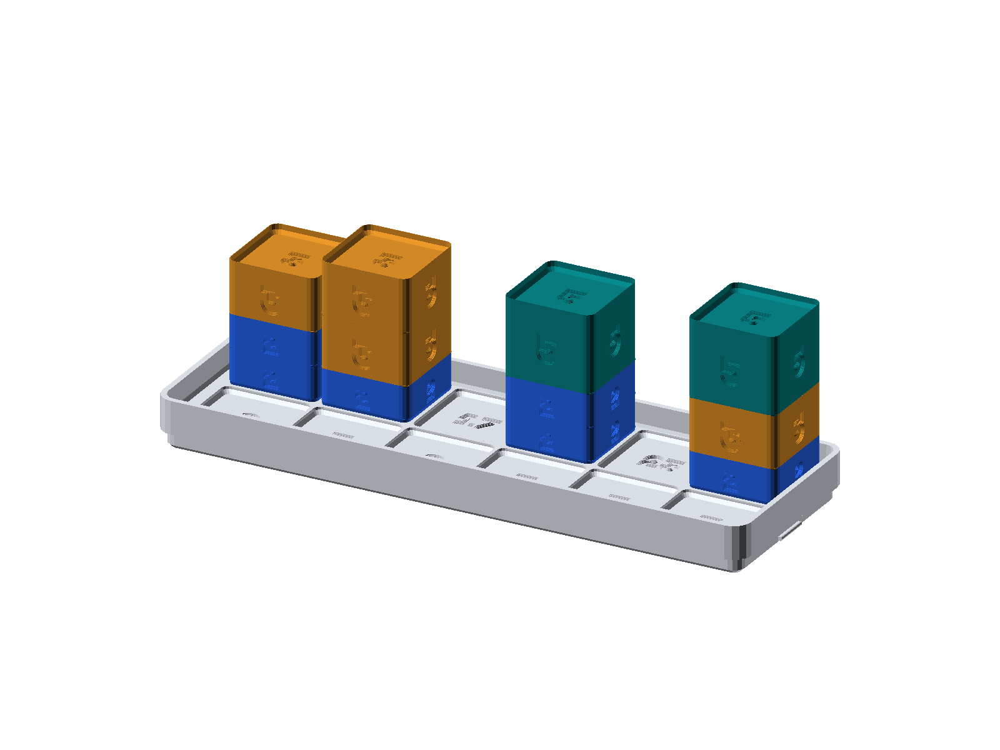

Try stacking your Prime Blocks right on the tower-matching stage to watch height addition turn into multiplication. If you place Blue Block `2` ($7.00\text{ mm}$) on the stage and stack Amber/Green Block `3` ($11.09\text{ mm}$) on top, their combined height ($7.00\text{ mm} + 11.09\text{ mm} = \mathbf{18.09\text{ mm}}$) lines up **right on the "6" tick mark** on the back wall, showing $2 \times 3 = 6$! Swap the `3` block for Yellow Block `5` ($16.25\text{ mm}$), and the new stack ($7.00\text{ mm} + 16.25\text{ mm} = \mathbf{23.25\text{ mm}}$) lands squarely on the line labeled **"10"** ($2 \times 5 = 10$). Even a larger number like $60 = 2 \times 2 \times 3 \times 5$ works the exact same way: when you stack two `2` blocks, one `3` block, and one `5` block, adding their heights ($7.00\text{ mm} + 7.00\text{ mm} + 11.09\text{ mm} + 16.25\text{ mm} = \mathbf{41.34\text{ mm}}$) points straight at the **"60"** line on the rear wall. Best of all, if you reorder that tower—putting Yellow `5` on the bottom, then `3`, then both `2`s—the total height stays locked at **$41.34\text{ mm}$** ($5 \times 3 \times 2 \times 2 = 60$), proving with your hands that the order in which you multiply prime factors never changes the product!

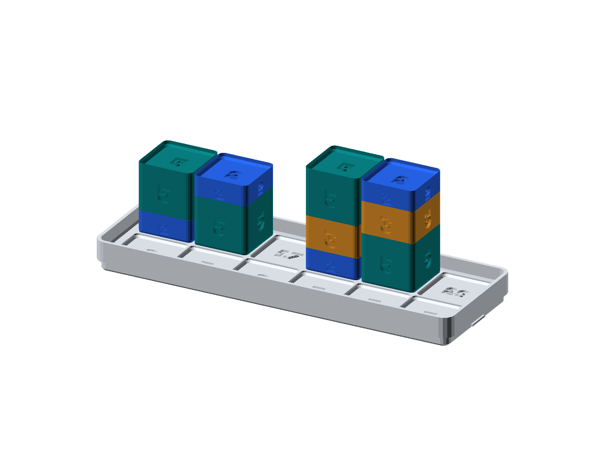

Now compare your physical block tower to the screen. Keying `60 [g] [FACT]` on the SC-6 breaks `60` directly into its prime building blocks (`2 × 2 × 3 × 5`), matching your four stacked blocks block-for-block:

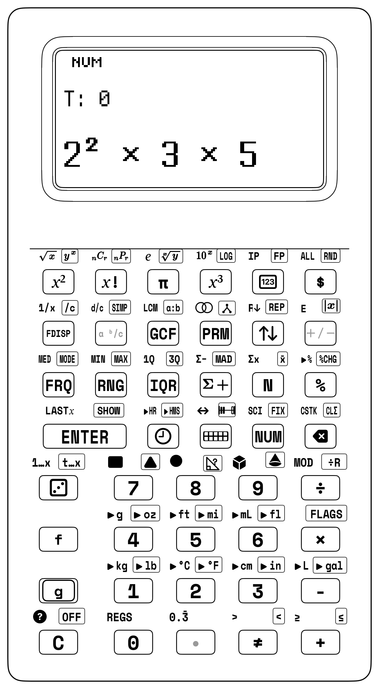

How does your SC-6 uncover that exact `2² × 3 × 5` prime tower the instant you type `60` and tap `[g] [FACT]`? Under the hood, the calculator runs a lightning-fast **prime factor peel** from the smallest prime upward, while keeping `60` safely untouched on Shelf $X$ (`T = 0, Z = 0, Y = 0, X = 60`). Because $60$ is an even number, it first peels off one Blue `2` block ($60 \div 2 = 30$) and immediately peels off a second Blue `2` block ($30 \div 2 = 15$), bundling those twin factors into `2²`. Since $15$ is odd and $2$ no longer fits evenly, the calculator steps up to the next prime number, $3$, and peels off one Amber/Green `3` block ($15 \div 3 = 5$). That leaves a quotient of $5$, which is itself a prime number—one Yellow `5` block! Every composite number has only *one* set of prime building blocks (mathematicians call this the **Fundamental Theorem of Arithmetic**), so whether you build the tower on your desk or tap `[g] [FACT]` on your SC-6, `60` always unlocks the exact same prime signature: **`2² × 3 × 5`**.

---

### 7.3.4 The Prime Detective Key
On the SC-6, pressing the primary key `[PRIME]` tests the whole number sitting on Shelf $X$ in a flash: it momentarily flashes `PRIME` or `COMPOSITE` on the top status banner while leaving Shelf $X$ and the rest of the 4-shelf stack completely untouched so you can immediately keep working with your number.

Why isn't the number `1` considered prime? A prime number must have *two different factors* ($1$ and itself), whereas $1$ has only *one* factor. Even deeper, remember the **Fundamental Theorem of Arithmetic**: every composite number has *one unique* prime block tower (like $12 = 2 \times 2 \times 3$). If mathematicians called $1$ a prime number, you could tack on $\times 1$ forever ($12 = 2 \times 2 \times 3 \times 1 = 2 \times 2 \times 3 \times 1 \times 1 \dots$) and no number would have a unique prime signature! That is why $1$ is a single building unit (neither prime nor composite): testing `1` with `1 [PRIME]` flashes `NEITHER` because $1$ is neither prime nor composite, whereas testing `2` with `2 [PRIME]` flashes `PRIME` and keeps `2` on Shelf $X$ as the smallest prime number and the only even prime.

| Keystroke | Register T | Register Z | Register Y | Register X | What Happens on the Stack |
| :--- | :--- | :--- | :--- | :--- | :--- |
| `97` | 0 | 0 | 0 | 97 | Type 97 onto Shelf $X$ |
| `[PRIME]` | 0 | 0 | 0 | 97 | Screen flashes `PRIME` |
| `119` | 0 | 0 | 97 | 119 | Type 119; 97 lifts to Shelf $Y$ |
| `[PRIME]` | 0 | 0 | 97 | 119 | Screen flashes `COMPOSITE` ($7 \times 17$) |
| `2` | 0 | 97 | 119 | 2 | Type 2; stack lifts 119 to Shelf $Y$ and 97 to Shelf $Z$ |
| `[PRIME]` | 0 | 97 | 119 | 2 | Screen flashes `PRIME` (the only even prime) |

Why do modern computers spend so much time testing whether numbers are prime? Every time you log into a website, send a private message, or buy something online, your computer protects your secret password using **prime-number cryptography** (such as RSA encryption, invented in 1977 by Ron Rivest, Adi Shamir, and Leonard Adleman). A computer picks two secret prime numbers and multiplies them together to create a public lock key. Multiplying two primes forward takes a fraction of a millisecond, but factoring a giant composite number backward into its two secret prime building blocks is so hard that even the world's fastest supercomputers would need years to crack it.

When building a miniature encryption lock key, you first want to test whether the candidate **`83`** (`83 [PRIME]`) is a true prime number before multiplying it into a public key. Remember how 13 Counting Tiles refuse to form any rectangle of 2, 3, or 4 rows without leaving a tile sticking out? Testing candidate 83 with the prime key via `83 [PRIME]` confirms **`83`**: because $9 \times 9 = 81$ and none of the primes below 9 ($2, 3, 5,$ or $7$) divide evenly into 83, the status line flashes `PRIME` and keeps $\mathbf{83}$ ready on Shelf $X$.

Because `[PRIME]` keeps each number on the stack, you can test two primes in a row and immediately combine them. For example, two prime numbers that sit just $2$ steps apart on the number line—like $(11, 13)$ or $(17, 19)$—are called **Twin Primes** (because the even number sandwiched between them is always divisible by $2$). Let's use `[PRIME]` to verify that **$29$** and **$31$** are both prime, and then add them together on the stack via `29 [PRIME] 31 [PRIME] [+]` to reach **`60`**. Both candidates flash `PRIME` on the screen and add up to $\mathbf{60}$—a multiple of 12, which is true for every twin prime pair bigger than $(3, 5)$.

You can also use `[PRIME]` to test a famous 300-year-old mathematical puzzle from the year 1742. That year, Christian Goldbach wrote a letter to Leonhard Euler with a bold guess: *Every even whole number greater than 2 can be built by adding two prime numbers together* ($4 = 2+2$, $6 = 3+3$, $8 = 3+5$, $10 = 3+7\dots$).

Even with modern supercomputers testing numbers up into the quintillions, no one has ever found an even number that breaks Goldbach's rule. Better yet, because `[PRIME]` checks a number on Shelf $X$ without erasing or changing it, testing `11 [PRIME] 17 [PRIME] [+]` gives the exact same sum as a normal `11 [ENTER] 17 [+]` addition! Let's run both side by side with `11 [PRIME] 17 [PRIME] [+] 11 [ENTER] 17 [+]` so both sums sit together as **`28`** on Shelves $Y$ and $X$:

| Keystroke | Register T | Register Z | Register Y | Register X | What Happens on the Stack |
| :--- | :---: | :---: | :---: | :---: | :--- |
| `11` | $0.0000$ | $0.0000$ | $0.0000$ | $11.0000$ | Type the first prime candidate 11 onto Shelf $X$ |
| `[PRIME]` | $0.0000$ | $0.0000$ | $0.0000$ | $11.0000$ | Screen flashes `PRIME`; keeps 11 on Shelf $X$ |
| `17` | $0.0000$ | $0.0000$ | $11.0000$ | $17.0000$ | Type the second candidate 17; 11 lifts to Shelf $Y$ |
| `[PRIME]` | $0.0000$ | $0.0000$ | $11.0000$ | $17.0000$ | Screen flashes `PRIME`; keeps 17 on Shelf $X$ |
| `[+]` | $0.0000$ | $0.0000$ | $0.0000$ | $28.0000$ | Add both primes together ($11 + 17 = 28$) |
| `11` | $0.0000$ | $0.0000$ | $28.0000$ | $11.0000$ | Type 11 for a second check; 28 lifts to Shelf $Y$ |
| `[ENTER]` | $0.0000$ | $28.0000$ | $11.0000$ | $11.0000$ | Copy 11 onto Shelf $Y$; 28 lifts to Shelf $Z$ |
| `17` | $0.0000$ | $28.0000$ | $11.0000$ | $17.0000$ | Type 17 onto Shelf $X$ |
| `[+]` | $0.0000$ | $0.0000$ | $28.0000$ | $28.0000$ | Add $11 + 17 = 28$; both Shelf $Y$ and Shelf $X$ show 28 |

Both Ground Shelf $X$ and Shelf $Y$ show $28$—proving that Goldbach's 300-year-old guess works for $28$ ($11 + 17 = 28$), and you can even find a second prime pair for $28$ by testing $5 + 23 = 28$!

---

### 7.3.5 Prime Factor Trees & Venn Diagrams
Whenever `[PRIME]` tells you a number is `COMPOSITE`, you naturally want to know: *Which prime blocks multiply together to build it?* Pressing `[g] [FACT]` (`[g]` + `[PRIME]`) breaks any whole number $\ge 2$ into its prime building blocks, showing exponents and multiplication dots right on the screen—so keying `12` `[g] [FACT]` displays **`2² × 3`**, keying `140 [g] [FACT]` displays **`2² × 5 × 7`**, keying `360` `[g] [FACT]` displays **`2³ × 3² × 5`**, and keying `2639` `[g] [FACT]` unmasks **`7 × 13 × 29`**:

| Keystroke | Register T | Register Z | Register Y | Register X | What Happens on the Stack |
| :--- | :--- | :--- | :--- | :--- | :--- |
| `360` | 0 | 0 | 0 | 360 | Type 360 (the degrees in a full circle) onto Shelf $X$ |
| `[g] [FACT]` | 0 | 0 | 0 | 360 | Displays `2³ × 3² × 5` while keeping 360 on Shelf $X$ |

---

### 7.3.6 Shared Prime Blocks: Greatest Common Factor & Least Common Multiple

In Chapter 5, you met the `[GCF]` and `[f] [LCM]` keys as fast tools for simplifying fractions and finding Least Common Denominators. Now we can look under the hood with our **Prime Factor Blocks** to see *why* GCF and LCM are secret partners. Pressing the primary key **`[GCF]`** finds the **Greatest Common Factor** of Shelf $Y$ and Shelf $X$—for example, keying `12 [ENTER] 18 [GCF]` stages $12$ on Shelf $Y$ and $18$ on Shelf $X$, then returns their largest shared factor **`6`**. Pressing the shifted key **`[f] [LCM]`** finds the **Least Common Multiple** of Shelf $Y$ and Shelf $X$—for example, keying `12 [ENTER] 18 [f] [LCM]` returns **`36`**, the smallest grid size that both $12$ and $18$ divide into evenly.

You can see how GCF and LCM share their prime blocks by drawing a **Two-Circle Prime Factor Venn Diagram** on your desk for the numbers **$48$** and **$72$**. First, break down $48 = 2 \times 2 \times 2 \times 2 \times 3$ (four `2` blocks and one `3` block) and $72 = 2 \times 2 \times 2 \times 3 \times 3$ (three `2` blocks and two `3` blocks). Next, slide every matching pair of prime blocks that both numbers share (**three `2`s and one `3`**) into the **Center Overlap**: multiplying those shared center blocks (or keying `48 [ENTER] 72 [GCF]` on the stack) gives the Greatest Common Factor:
$$\text{GCF} = 2 \times 2 \times 2 \times 3 = 8 \times 3 = \mathbf{24}$$
Finally, place the leftover unshared blocks in the outer crescents (one extra `2` on the Left for $48$, and one extra `3` on the Right for $72$). Multiplying **all blocks across all three regions** (Left $\times$ Center $\times$ Right) gives the Least Common Multiple:
$$\text{LCM} = 2 \times 24 \times 3 = 16 \times 9 = \mathbf{144}$$

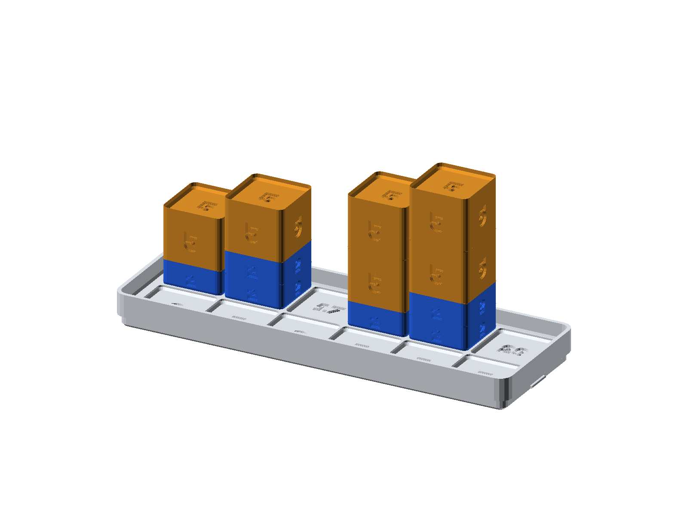

Why do musicians, astronomers, and harbor engineers use both `[GCF]` and `[f] [LCM]`? Because **GCF** finds the largest shared building block that fits evenly inside two rhythms, while **LCM** finds the exact moment two different cycles line back up at the start. In an electronic music studio, suppose a drummer records a **$16\text{-beat}$ drum loop** ($16 = 2^4$) while a bassist records a **$20\text{-beat}$ synth bassline** ($20 = 2^2 \times 5$). Keying `16 [ENTER] 20 [GCF]` gives **`4`**, showing that both loops are built from **$4\text{-beat}$ measures** ($4$ measures in the drum loop, $5$ measures in the bassline), while keying `16 [ENTER] 20 [f] [LCM]` gives **`80`**, proving that both loops hit their opening downbeat together every **$80$ beats** ($5$ drum loops $= 4$ bass loops). Out at a harbor entrance after dark, a ship's navigator uses that same cycle math to track navigation lights: when a green lighthouse beacon flashes every **$15\text{ seconds}$** ($3 \times 5$) and a red channel buoy flashes every **$25\text{ seconds}$** ($5^2$), keying `15 [ENTER] 25 [f] [LCM]` $\to \mathbf{75}$ reveals that if both lights flash together right now, they will flash at the exact same instant every **$75\text{ seconds}$** ($1\text{ minute } 15\text{ seconds}$).

---

### 7.3.7 Why GCF × LCM Equals First × Second
Look back at the two-circle Venn diagram you built for $48$ and $72$. When we found the **GCF** ($24$), we multiplied the shared prime blocks in the center overlap. When we found the **LCM** ($144$), we multiplied the left crescent, the center overlap, and the right crescent. Notice that if you multiply **$\text{GCF} \times \text{LCM}$**, the center overlap gets counted *twice*—which uses the exact same collection of prime blocks as multiplying the two original numbers together!
$$\text{GCF} \times \text{LCM} = \text{First Number} \times \text{Second Number}$$

Test the Secret Partner Rule on **$24$** and **$36$**: their Greatest Common Factor is $12$ (`24 [ENTER] 36 [GCF]`) and their Least Common Multiple is $72$ (`24 [ENTER] 36 [f] [LCM]`). Multiplying $12 \times 72 = \mathbf{864}$ matches multiplying the two starting numbers directly with `24 [ENTER] 36 [×]` $\to X = \mathbf{864.00}$!

Even better, because the SC-6 has four stack shelves, you can chain Chapter 5's **$18$-tooth and $24$-tooth** partner check in a single continuous sequence without writing down the GCF in between (and if you ever want to inspect every shared factor of two gear wheels at once, the shifted common-factors key `[f] [C.FAC]` lists them on the screen). Chaining both keys on the stack with `18 [ENTER] 24 [GCF] 18 [ENTER] 24 [f] [LCM] [×]` holds the GCF ($6$) on Shelf $Z$ while finding the LCM ($72$), then multiplies them to land on **`432`** ($18 \times 24 = 432$):

| Keystroke | Register T | Register Z | Register Y | Register X | What Happens on the Stack |
| :--- | :---: | :---: | :---: | :---: | :--- |
| `18` | $0.0000$ | $0.0000$ | $0.0000$ | $18.0000$ | Type the first gear tooth count (18) onto Shelf $X$ |
| `[ENTER]` | $0.0000$ | $0.0000$ | $18.0000$ | $18.0000$ | Copy 18 up onto Shelf $Y$ |
| `24` | $0.0000$ | $0.0000$ | $18.0000$ | $24.0000$ | Type the second gear tooth count (24) onto Shelf $X$ |
| `[GCF]` | $0.0000$ | $0.0000$ | $0.0000$ | $6.0000$ | Find the Greatest Common Factor of 18 and 24 ($6$) |
| `18` | $0.0000$ | $0.0000$ | $6.0000$ | $18.0000$ | Type the first number 18; the GCF ($6$) lifts to Shelf $Y$ |
| `[ENTER]` | $0.0000$ | $6.0000$ | $18.0000$ | $18.0000$ | Copy 18 onto Shelf $Y$ while 6 waits on Shelf $Z$ |
| `24` | $0.0000$ | $6.0000$ | $18.0000$ | $24.0000$ | Type the second number 24 onto Shelf $X$ |
| `[f] [LCM]` | $0.0000$ | $0.0000$ | $6.0000$ | $72.0000$ | Find the Least Common Multiple of 18 and 24 ($72$); 6 drops to $Y$ |
| `[×]` | $0.0000$ | $0.0000$ | $0.0000$ | $432.0000$ | Multiply GCF by LCM ($6 \times 72 = 432$) |

The Secret Partner Rule matches on the nose ($6 \times 72 = 432$, and $18 \times 24 = 432$)! *(Pro tip: Since `[GCF]` saves `24` inside `[f] [LASTX]`, you can make this even shorter by using `18 [f] [LASTX] [f] [LCM]` instead of typing `24` again.)*

---

### 7.3.8 Tiling a Hallway with the Remainder Ladder
How does the SC-6 find the Greatest Common Factor of two huge numbers without testing hundreds of prime factors? Over 2,300 years ago, Euclid of Alexandria discovered a visual shortcut (`[g] [÷R]`). You can see *why* it works by **tiling a rectangular hallway with the largest possible square floor tiles**:

Imagine a rectangular hallway that is **$105\text{ cm}$ long** and **$45\text{ cm}$ wide**. We want to find the largest square tile that covers the whole hallway evenly:
1. First, lay down big **$45\text{ cm} \times 45\text{ cm}$ squares** along the $105\text{ cm}$ hallway. Two of those $45\text{ cm}$ squares fit side by side ($2 \times 45 = 90\text{ cm}$), leaving an unfilled rectangular gap at the end that measures **$45\text{ cm}$ by $15\text{ cm}$** (because $105 \div 45 = 2$ with a **remainder of $15$**).
2. Any square tile that covers the whole hallway *must also* fit evenly inside that leftover **$45\text{ cm} \times 15\text{ cm}$** gap.
3. Now fill the $45\text{ cm} \times 15\text{ cm}$ gap with **$15\text{ cm} \times 15\text{ cm}$ squares**. Three $15\text{ cm}$ squares fit with **remainder $0$** ($45 \div 15 = 3$, remainder $0$). Because $15\text{ cm}$ squares tile the gap with zero leftover space, they also tile the $45\text{ cm}$ squares—and the entire $105\text{ cm} \times 45\text{ cm}$ hallway ($\text{GCF of } 105\text{ and } 45 = \mathbf{15}$).

$$\text{GCF of Big and Small} = \text{GCF of Small and Remainder}$$

On the SC-6, you can run this remainder ladder on any pair of numbers using the shifted key `[g] [÷R]`. Each press of `[g] [÷R]` divides $Y$ by $X$, putting the whole-number quotient in $X$, the leftover remainder in $Y$, and the divisor inside `[f] [LASTX]`.

Watch the full remainder ladder in action on a larger stone courtyard measuring **$252\text{ cm}$ by $105\text{ cm}$**, playing the leftover game until the remainder hits zero:

First, divide $252$ by $105$ and look at the leftover: **$42$** (because two $105\text{ cm}$ squares take up $210\text{ cm}$, leaving a $42\text{ cm}$ strip). Since $42$ isn't zero yet, we divide $105$ by that $42$ leftover—which leaves a smaller strip of **$21$**. Finally, we divide $42$ by that $21$ leftover, and out pops $2$ with **$0$ leftover**. The last leftover before zero is **$21$**, so a **$21\text{ cm} \times 21\text{ cm}$** square stone tiles the whole courtyard.

| Step / Key | Dividend (Y) | Divisor (X) | Quotient (X) | Remainder (Y) |
| :--- | :--- | :--- | :--- | :--- |
| 252 `[ENTER]` 105 | 252 | 105 | - | - |
| `[g] [÷R]` | - | - | 2 | 42 |
| `[x⇄y]` | 2 | 42 | 42 | 2 |
| `[f] [LASTX]` `[x⇄y]` | 105 | 42 | - | - |
| `[g] [÷R]` | - | - | 2 | 21 |
| `[x⇄y]` `[f] [LASTX]` `[x⇄y]` | 42 | 21 | - | - |
| `[g] [÷R]` | - | - | 2 | 0 |

> **Why the `[x⇄y] [f] [LASTX] [x⇄y]` Dance Works Like Magic:** Why didn't we have to type `105` or `42` a second time in the table above? Every time you press `[g] [÷R]`, the leftover remainder lands in $Y$, while the number you just divided by gets saved inside `[f] [LASTX]`.
>
> Tapping `[x⇄y]` brings the leftover down to $X$. Next, tapping `[f] [LASTX]` pulls the old divisor back out, and one more `[x⇄y]` puts them in the right order (`Old Divisor` in $Y$, `Leftover` in $X$) so you can press `[g] [÷R]` again!

You can also check that entire courtyard remainder ladder in a single tap using the GCF key `252 [ENTER] 105 [GCF]` to land directly on $X = \mathbf{21.00}$.

---

## 7.4 Averages, Medians & Data Spread

What happens when a scientist, nurse, basketball coach, or game designer collects a whole notebook full of numbers? Looking at a jumble of 20 or 30 raw measurements can make anyone's head spin—until you organize them. In 1858, **Florence Nightingale (1820–1910)** showed the world that she wasn't just a pioneer nurse—she was also one of history's greatest **data detectives**. By carefully recording hospital numbers and turning raw tables into clear averages and colorful circular "rose diagrams," she proved to lawmakers that clean water and fresh air saved thousands of lives.

Your SC-6 gives you the exact same **Data Detective skills** with two families of tools for taming any list of numbers:
1. **Finding the Center (`[g] [x̄]`, `[f] [MED]`, `[g] [MODE]`):** What single "typical" number best describes the middle of the group?
2. **Measuring the Spread (`[RNG]`, `[IQR]`, `[g] [MAD]`):** Are all the numbers huddled tightly together, or are they scattered all over the map?

### 7.4.1 Picturing Mean, Median & Spread
Before touching a single data key (`[g] [x̄]`, `[f] [MED]`, or `[g] [MAD]`), picture what each measure looks like in the real world.

**Fair-Share Tower Leveling (`[g] [x̄]` Mean):** In a nesting-box check, four baby bluebirds weigh $24\text{ g}, 26\text{ g}, 25\text{ g},$ and $29\text{ g}$. Build four **Counting Tile** towers of heights $4, 6, 5,$ and $9$ above a $20\text{-gram}$ baseline. Now move tiles from the tallest tower ($9$) to the shorter towers until **every tower stands at the exact same height**—all four level out at **$6$ tiles** ($26\text{ g}$). Tapping `[g] [CLΣ] 24 [Σ+] 26 [Σ+] 25 [Σ+] 29 [Σ+] [g] [x̄]` does that exact fair-share leveling in your running-total basket ($\text{Mean} = \mathbf{26\text{ g}}$).

**The Middle Kid in the Height Lineup (`[f] [MED]` Median):** Imagine lining up your friends from shortest to tallest for a team photo. The **Median** (`[f] [MED]`) is simply the person standing right in the **exact middle** of the line. Even if a 7-foot pro basketball center joins the tall end of the line, the middle person's height barely budges—which is why data detectives rely on the median whenever one extreme outlier would pull the mean off balance.

**Fencing the Middle Half (`[IQR]` Interquartile Range):** Split that shortest-to-tallest lineup into four equal quarters. The middle two quarters ($25\%$ mark to $75\%$ mark) hold the **middle half of the players**. The distance between the lower quarter mark (`[f] [1Q]`) and the upper quarter mark (`[g] [3Q]`) is the **Interquartile Range (`[IQR]`)**—a sturdy fence around the main group that ignores extreme stragglers at both ends.

**How Far Trials Wander from the Average (`[g] [MAD]` Mean Absolute Deviation):** In a bird-puzzle lab, **Raven A** solves 4 puzzle boxes in **`8, 9, 9, 10` seconds**, while **Crow B** solves them in **`6, 8, 10, 12` seconds**. Both birds have the *exact same mean* ($9.0\text{ s}$). When you measure how far each try wanders from $9$, Raven A's distances are $1, 0, 0, 1$ (`[g] [MAD]` $= \mathbf{0.5\text{ s}}$, super consistent), whereas Crow B's distances are $3, 1, 1, 3$ (`[g] [MAD]` $= \mathbf{2.0\text{ s}}$, four times more spread out):

| Data Measure | Key / Shift | Kid-Friendly Word Rule |
| :--- | :--- | :--- |
| **Total Count (`N`)** | `[N]` | How many numbers are in your data list |
| **Total Sum (`Σx`)** | `[f] [Σx]` | All the numbers added together |
| **Mean (Average)** | `[g] [x̄]` | $\text{Total Sum} \div \text{How Many Numbers}$ |
| **Median** | `[f] [MED]` | Middle number when lined up from smallest to largest |
| **Mode** | `[g] [MODE]` | Number that shows up the most times |
| **Range** | `[RNG]` | $\text{Biggest Number} - \text{Smallest Number}$ |
| **Interquartile Range (IQR)** | `[IQR]` | $\text{Third Quartile (3Q)} - \text{First Quartile (1Q)}$ |
| **Mean Absolute Deviation (MAD)** | `[g] [MAD]` | Average distance each number wanders from the Mean |

Let's watch the fair-share **Mean (`[g] [x̄]`)** and middle **Median (`[f] [MED]`)** in action on two tournament datasets. First, in a four-round free-throw basketball shootout, you score `88`, `92`, `79`, and `95` points (so the sample count is $n = 4$). What is your fair-share average (`[g] [x̄]`)?

Mark 88, 92, 79, and 95 with four Counting Tiles on a desk number line. Notice how the two scores above $88.5$ ($+3.5$ and $+6.5$, totaling $+10$) balance the two scores below $88.5$ ($-0.5$ and $-9.5$, totaling $-10$). Tossing all four rounds into your `[Σ+]` running-total basket (where the sample count is $n = 4$) and tapping `[g] [x̄]` via `[g] [CLΣ] 88 [Σ+] 92 [Σ+] 79 [Σ+] 95 [Σ+] [g] [x̄]` confirms **`88.5`**:

| Keystroke | Register T | Register Z | Register Y | Register X | What Happens on the Stack |
| :--- | :---: | :---: | :---: | :---: | :--- |
| `[g] [CLΣ]` | $0.0000$ | $0.0000$ | $0.0000$ | $0.0000$ | Empty the running-total basket ($\text{Count} = 0, \text{Sum} = 0$) |
| `88` | $0.0000$ | $0.0000$ | $0.0000$ | $88.0000$ | Type the first shootout score (88) onto Shelf $X$ |
| `[Σ+]` | $0.0000$ | $0.0000$ | $0.0000$ | $1.0000$ | Toss score 1 into the basket ($\text{Count} = 1, \text{Sum} = 88$) |
| `92` | $0.0000$ | $0.0000$ | $0.0000$ | $92.0000$ | Type the second shootout score (92) onto Shelf $X$ |
| `[Σ+]` | $0.0000$ | $0.0000$ | $0.0000$ | $2.0000$ | Toss score 2 into the basket ($\text{Count} = 2, \text{Sum} = 180$) |
| `79` | $0.0000$ | $0.0000$ | $0.0000$ | $79.0000$ | Type the third shootout score (79) onto Shelf $X$ |
| `[Σ+]` | $0.0000$ | $0.0000$ | $0.0000$ | $3.0000$ | Toss score 3 into the basket ($\text{Count} = 3, \text{Sum} = 259$) |
| `95` | $0.0000$ | $0.0000$ | $0.0000$ | $95.0000$ | Type the fourth shootout score (95) onto Shelf $X$ |
| `[Σ+]` | $0.0000$ | $0.0000$ | $0.0000$ | $4.0000$ | Toss score 4 into the basket ($\text{Count} = 4, \text{Sum} = 354$) |
| `[g] [x̄]` | $0.0000$ | $0.0000$ | $0.0000$ | $88.5$ | Find the fair-share mean ($354 \div 4 = 88.5$) |

Leveling all four shootout towers gives a fair-share mean score of $\mathbf{88.50}$—right at the balance point where the 10 points above average ($92$ and $95$) fill in the 10 points below average ($88$ and $79$).

Second, step outside to the sprint track, where five finalists finish the 100-meter dash in $12.4, 12.8, 13.1, 13.5,$ and $14.0\text{ seconds}$ (sample count is $n = 5$). What is the middle **median** (`[f] [MED]`) time? Line up five Counting Tiles from fastest to slowest on your desk: the third tile sits right in the middle with two sprinters faster and two slower, pointing straight to $13.1\text{ s}$.

Tossing the five sprint times into your running-total basket and tapping `[f] [MED]` via `[g] [CLΣ] 12.4 [Σ+] 12.8 [Σ+] 13.1 [Σ+] 13.5 [Σ+] 14.0 [Σ+] [f] [MED]` returns **`13.1`**. With $5$ runners counted on Shelf $Y$, the middle runner's time of $\mathbf{13.10\text{ seconds}}$ appears on Shelf $X$.

### 7.4.2 The 10-Quiz Score Dot Plot & Frequency Table

Let's see how fast `[Σ+]` checks a whole classroom list of scores. Across 10 students, a math class records the following scores on a 100-point weekly quiz:
$$70, \ 75, \ 80, \ 80, \ 85, \ 85, \ 85, \ 90, \ 90, \ 95$$

| Quiz Score | Tally | Frequency (How Many Times) | Dot Plot Visual Representation |
| :---: | :---: | :---: | :--- |
| 70 | I | 1 | ● |
| 75 | I | 1 | ● |
| 80 | II | 2 | ● ● |
| 85 | III | 3 | ● ● ● *(Peak Mode)* |
| 90 | II | 2 | ● ● |
| 95 | I | 1 | ● |
| **Total Count = Sum of All Frequencies** | — | **10** | $10$ total quiz scores |

Look at the shape of the dot plot above. The scores climb smoothly from $70$ up to a central peak at $85$ (the **Mode**, because $85$ shows up the most times), and then step back down toward $95$.

Now toss all 10 scores into your `[Σ+]` running-total basket: start with `[g] [CLΣ]` to empty the basket ($\text{Count} = 0$), then enter `70 [Σ+]` ($\text{Count} = 1$), `75 [Σ+]` ($\text{Count} = 2$), `80 [Σ+] 80 [Σ+]` ($\text{Count} = 4$), `85 [Σ+] 85 [Σ+] 85 [Σ+]` ($\text{Count} = 7$), `90 [Σ+] 90 [Σ+]` ($\text{Count} = 9$), and `95 [Σ+]` ($\text{Count} = 10$). (If you ever mistype a score, tapping `[f] [Σ-]` takes it right back out of the basket, while `[FRQ]` opens the scrollable `FREQ TABLE` showing how many times each score appears in your data list.)

Once all ten quiz papers are in the basket, each data key tells a different part of the classroom story. Tapping `[N]` confirms that you logged $X = \mathbf{10}$ quizzes in all, while `[f] [Σx]` adds every point earned across the room into a grand total of $X = \mathbf{835.0}$. When you tap `[f] [MED]` for the middle student in the lineup and `[g] [MODE]` for the most common score at the peak of the dot plot, both land right on $X = \mathbf{85.0}$. Meanwhile, tapping `[g] [x̄]` levels all ten scores into a fair-share **Mean** of $X = \mathbf{83.5}$—sitting just $1.5$ points below the median and mode because that single score of $70$ at the left edge pulls the average slightly downward—and tapping `[RNG]` measures the full $X = \mathbf{25.0}$ spread from the lowest paper ($70$) to the highest ($95 - 70 = 25$).

---

### 7.4.3 How Spread Out Are Five Quiz Scores?

Now let's zoom in on a 5-student study group with scores of $85, 90, 75, 90, 100$ (where the sample count is $n = 5$) so you can see how `[IQR]` and `[g] [MAD]` measure spread. When you load all five scores into your running-total basket with `[g] [CLΣ] 85 [Σ+] 90 [Σ+] 75 [Σ+] 90 [Σ+] 100 [Σ+]` and sort them from lowest to highest ($75, 85, 90, 90, 100$), they span from a minimum of $\mathbf{75.0}$ to a maximum of $\mathbf{100.0}$ (a total range of $100 - 75 = \mathbf{25.0}$). Tapping `[f] [Σx]` adds the five papers to $\mathbf{440.00}$, so the fair-share **Mean** (`[g] [x̄]`) is $440 \div 5 = \mathbf{88.00}$, while both the middle **Median** (`[f] [MED]`, the 3rd score out of 5) and the most frequent **Mode** (`[g] [MODE]`) sit at $\mathbf{90.00}$.

To see how tightly the study group is clustered without being fooled by the single $75$ or $100$ at the ends, tap `[IQR]` for the **Interquartile Range**. With $5$ sorted scores ($75, 85, \mathbf{90}, 90, 100$), the SC-6 splits the odd-sized list into two inclusive halves that both include the middle median ($90$): the lower half ($75, \mathbf{85}, 90$) and the upper half ($90, \mathbf{90}, 100$). On the SC-6, the **First Quartile (1Q)** is the median of the lower half, $\mathbf{85.0}$, and the **Third Quartile (3Q)** is the median of the upper half, $\mathbf{90.0}$, fencing off the middle half of the group inside a $5\text{-point}$ window:
$$\text{Interquartile Range (IQR)} = \text{Third Quartile (3Q)} - \text{First Quartile (1Q)} = 90.0 - 85.0 = \mathbf{5.00}$$

Next, tap `[g] [MAD]` to find the **Mean Absolute Deviation**—the average distance each student's score wanders from the group mean of $88.0$. Measuring how far each of the five scores ($75, 85, 90, 90, 100$) sits from $88$ gives distances of $13, 3, 2, 2,$ and $12$. Adding those five distances together ($13 + 3 + 2 + 2 + 12 = 32.0$) and dividing by the $5$ students reveals that a typical score in the study group sits $\mathbf{6.40\text{ points}}$ away from the mean:
$$\text{Mean Absolute Deviation (MAD)} = \text{Total Distance from the Mean} \div \text{How Many Numbers} = 32.0 \div 5 = \mathbf{6.40}$$

### 7.4.4 Five-Number Box Plots & Spotting Wild Outliers
When data detectives draw a **Box-and-Whisker Plot**, they line up all the numbers from smallest to largest and mark five milestones—the **Minimum (`MIN`)**, **First Quartile (`1Q`)**, **Median (`MED`)**, **Third Quartile (`3Q`)**, and **Maximum (`MAX`)**—that slice the entire sorted list into four equal quarters ($25\%$ of the data in each quarter) around a central box of width **`IQR`**:

| Box Plot Milestone | Statistical Keycap | What It Shows on the Box Plot |
| :--- | :--- | :--- |
| **Lower Whisker Tip (`MIN`)** | `[f] [MIN]` | Smallest number ($0\%$ mark) |
| **Left Box Edge — First Quartile (`1Q`)** | `[f] [1Q]` | Lower quarter mark ($25\%$ boundary of the center box) |
| **Center Line — Median (`MED`)** | `[f] [MED]` | Halfway mark ($50\%$ median line inside the box) |
| **Right Box Edge — Third Quartile (`3Q`)** | `[g] [3Q]` | Upper quarter mark ($75\%$ boundary of the center box) |
| **Center Box Width (`IQR`)** | `[IQR]` | $\text{Third Quartile (3Q)} - \text{First Quartile (1Q)}$ |
| **Upper Whisker Tip (`MAX`)** | `[g] [MAX]` | Biggest number ($100\%$ mark) |

How do scientists decide whether an unusual number is just a little high or a true **outlier** that wandered far away from the pack? They use the **$1.5 \times \text{IQR}$ Outlier Fence Rule**: measure the width of the center box (`[IQR]`), multiply it by $1.5$, and build an invisible "fence" $1.5$ box-widths below the First Quartile and above the Third Quartile:
$$\text{Lower Fence} = \text{First Quartile (1Q)} - (1.5 \times \text{IQR})$$
$$\text{Upper Fence} = \text{Third Quartile (3Q)} + (1.5 \times \text{IQR})$$
Any number that jumps past either fence is officially flagged as an outlier.

Let's see that outlier fence in action on a real cross-country race. Eight runners finish a 5K race in the following times (in minutes): $25, 28, 30, 32, 34, 35, 38, 58$. Runner 8 stopped to tie a shoelace and took $58\text{ minutes}$. Does $58$ jump past the upper outlier fence?

When you line up those eight finish times in order ($25, 28, 30, 32, 34, 35, 38, 58$), the halfway **Median (`MED`)** sits right between the fourth and fifth runners at $(32 + 34) \div 2 = \mathbf{33.0\text{ minutes}}$. Splitting the faster four runners ($25, 28, 30, 32$) in half places the **First Quartile (`1Q`)** at $(28 + 30) \div 2 = \mathbf{29.0\text{ minutes}}$, while splitting the slower four runners ($34, 35, 38, 58$) in half places the **Third Quartile (`3Q`)** at $(35 + 38) \div 2 = \mathbf{36.5\text{ minutes}}$—giving the center box an **Interquartile Range (`IQR`)** of $36.5 - 29.0 = \mathbf{7.5\text{ minutes}}$.

Now build the upper outlier fence on the stack. Multiplying the $7.5\text{-minute}$ box width by $1.5$ via `7.5 [ENTER] 1.5 [×]` gives a fence margin of $11.25\text{ minutes}$. Adding that margin to the Third Quartile with `36.5 [+]` places the upper fence at $\mathbf{47.75\text{ minutes}}$. Since $58$ is greater than $47.75$, the time of 58 minutes sits well past the upper fence and is a **true outlier**.

---

## 7.5 Negative Numbers, Zero Pairs & Distance from Zero

Up to now, most of your math has stayed at zero or above. Now you get to cross zero into a brand-new territory. Picture a long horizontal number line with **`0`** standing right at the center origin: stepping right (or climbing up) carries you into **positive numbers ($+$)** (`+1, +2, +3, +4, +5`), while stepping left (or diving down) carries you an equal distance into **negative numbers ($-$)** (`-1, -2, -3, -4, -5`). Every number has both a **size** (how many steps from zero) and a **direction** (which side of zero it sits on).

### 7.5.1 Hot-Air Balloons & Two-Color Zero Pairs
To make adding, subtracting, and multiplying negative numbers crystal clear with the flip-sign key (`[+/-]`), picture a **hot-air balloon** floating at height $0$ (sea level) alongside your **Two-Color Counters**. Each **Yellow Counter ($+1$)** acts like a puff of hot air that lifts the balloon **up $+1\text{ meter}$**, while each **Crimson Counter ($-1$)** acts like a heavy sandbag hooked onto the basket that pulls the balloon **down $-1\text{ meter}$**.

When one $+1$ puff of hot air and one $-1$ sandbag meet, they form a **Zero Pair ($+1 + (-1) = 0$)** and balance each other out completely, keeping the balloon at the exact same height. If you lay down **5 Crimson counters (`-5`)** and **3 Yellow counters (`+3`)** side by side, 3 Yellow-Crimson Zero Pairs cancel out, leaving **2 Crimson counters (`-2`)**—proving right on the table why `5 [+/-] [ENTER] 3 [+]` equals **`-2`**.

What happens if your balloon is floating at $+7\text{ meters}$ and you **subtract (toss overboard) $3$ heavy sandbags** ($7 - (-3) = 10$, or a friend cancels a $\$3$ debt you owed them)? With $3$ fewer sandbags pulling it down, the balloon rises **up $+3\text{ meters}$** to $+10$! Taking away a negative weight does the exact same thing as adding a positive boost—and keying `7 [ENTER] 3 [+/-] [-]` on your SC-6 confirms **`10`**. By the same token, if adding $3$ groups of $2$ Crimson sandbags ($+3 \times -2 = -6$) pulls the balloon down $6\text{ meters}$, then **removing ($-3$ groups of) $2$ Crimson sandbags** (`-3 × -2`) lifts $6$ sandbags *off* the basket, sending the balloon rising to **`+6`** (`3 [+/-] [ENTER] 2 [+/-] [×]` $\longrightarrow$ **`6`**).

On the SC-6, look at the difference between the two keys that have a minus sign: the **subtraction key** (`[-]`) works between two shelves by subtracting $X$ from $Y$ ($Y - X$), whereas the **change-sign key** (`[+/-]`) flips the sign of the single number currently sitting in $X$ (turning positive `8` into negative `-8`, or `-8` back into `+8`). Because default **Whole Number Mode (`[NUM]`)** keeps stack numbers at `0` or above, toggle `[NUM]` off first (or tap `[f] [ALL]` / `[g] [FIX]`) whenever you want to work with negative numbers in stack view: then type `8 [+/-]` so the screen displays `-8`, and pressing `[+/-]` a second time flips `-8` right back to `8`.

Imagine checking an outdoor thermometer in Minnesota on a frosty morning: at 6:00 AM, it reads $-12^\circ\text{C}$ ($12$ degrees below freezing). By 2:00 PM, the afternoon sun warms the air up by $+15^\circ\text{C}$. What is the afternoon temperature?

$$\text{Temperature Change: } -12 + 15 = +3^\circ\text{C}$$

Picture 12 Crimson cold tokens meeting 15 Yellow warm tokens: 12 Zero Pairs cancel out to bring the thermometer right up to $0^\circ\text{C}$, and the remaining 3 Yellow tokens push it to $+3^\circ\text{C}$ so the icicles start dripping! On the stack, key `12 [+/-] [ENTER] 15 [+]` $\to \mathbf{3}$, showing $+3^\circ\text{C}$ right on the screen.

What happens when *both* numbers pull in the negative direction—for instance, if you hook $15$ sandbags ($-15$) onto a balloon basket, and then hook on $28$ *more* sandbags ($-28$)? Model a smaller version with Crimson counters first ($-3 + (-5) = -8$ Crimson tokens): because both groups pull downward, there are zero Yellow tokens to cancel them out. Combining the two negative movements on the stack with `15 [+/-] [ENTER] 28 [+/-] [+]` gives **`-43`**, as the two downward pulls team up to reach **$-43$**.

Now compare that with subtracting a bigger positive number from a smaller one. When your bank account has $\$45$ (45 Yellow $+1$ tokens) and you spend $\$70$, where does your balance land? The first $\$45$ wipes out all 45 Yellow tokens down to $\$0$, and the remaining $\$25$ pulls you 25 steps below zero into Crimson debt ($-25$). Finding $45 - 70$ on the SC-6 with `45 [ENTER] 70 [-]` gives **`-25`** (**$-\$25$**).

---

### 7.5.2 Distance from Zero with Absolute Value
If your friend walks $5\text{ steps}$ east ($+5$) and you walk $5\text{ steps}$ west ($-5$), who walked farther from the starting line? You both walked the exact same distance: **$5\text{ steps}$** (`[g] [|x|]`).

The **absolute value** of a number, written $|x|$, is simply its **distance from zero** on the number line—and whether you walk left or right, distance is always positive:
$$\text{Absolute Value } (|x|) = \text{Distance from } 0 \text{ on the Number Line (Always Positive!)}$$

On the SC-6, pressing the shifted absolute-value key `[g] [|x|]` (`[g]` + `[+/-]`) strips away any negative sign from $X$, leaving its positive distance from zero—so keying `42 [+/-] [g] [|x|]` displays **`42`**, while keying `15 [g] [|x|]` keeps **`15`** unchanged.

To see why absolute value is so handy when crossing sea level, picture a desert hiker starting at the bottom of Badwater Basin in Death Valley at $-86\text{ meters}$ ($86\text{ m}$ below sea level) and climbing all the way to the top of Telescope Peak at $+3,366\text{ meters}$ above sea level. First the hiker climbs $86\text{ meters}$ just to reach sea level ($0\text{ m}$), and then climbs another $3,366\text{ meters}$ to the peak.

$$\text{Vertical Climb: } |3366 - (-86)| = |3366 + 86| = 3,452\text{ meters}$$

Subtract the negative starting height from the peak height and take the absolute value via `3366 [ENTER] 86 [+/-] [-] [g] [|x|]`. The screen shows a total climb of $\mathbf{3,452.00\text{ meters}}$.

The same rule works whenever a bird dives into the ocean or a snowplow salts an icy road. When a diving Northern Gannet plunges from $+32\text{ m}$ in the sky to $-14\text{ m}$ underwater to catch a fish, its total dive distance across $0\text{ m}$ sea level is $|32| + |-14| = \mathbf{46\text{ m}}$ (`32 [g] [|x|] [ENTER] 14 [+/-] [g] [|x|] [+]`). And in winter, spreading rock salt lowers water's freezing point from $0^\circ\text{C}$ by $-14.5^\circ\text{C}$, while adding beet juice lowers it another $-6.75^\circ\text{C}$: keying `0 [ENTER] 14.5 [-] 6.75 [-]` shows that snowplows keep roads ice-free down to **$-21.25^\circ\text{C}$**.

---

### 7.5.3 Unmasking Mystery Numbers by Working Backwards
Your counting tiles and four-shelf stack also make it easy to build multi-step word rules forward—and then unwind them in reverse to unmask a hidden starting number. Suppose you are playing a backyard beanbag toss where landing in the center bullseye awards $10\text{ points}$ and landing in the outer ring awards $3\text{ points}$:
$$\text{Total Points} = (10 \times \text{Bullseyes}) + (3 \times \text{Outer Rings})$$
When you land $7$ bullseyes and $4$ outer rings, the 4-shelf stack computes both groups and merges them in one smooth sequence: `10 [ENTER] 7 [×] 3 [ENTER] 4 [×] [+]` $\longrightarrow \mathbf{82\text{ points}}$.

Now flip the puzzle around: what if a friend picks a secret Mystery Number, multiplies it by $3$, and subtracts $5$ to end up at $16$? To unmask their secret number, you simply undo each step in reverse order on your stack (`16 [ENTER] 5 [+] 3 [÷]`). Adding $+5$ first undoes the $-5$ (`16 [ENTER] 5 [+]` $\to 21$), and dividing by $3$ (`3 [÷]`) undoes multiplying by $3$ to reveal **$\mathbf{7}$**. That same reverse-order detective work unlocks geometry mysteries too: in Chapter 6, you saw how squaring (`[x²]`) turns a side length into a square's area, while the square root key (`[f] [√x]`) runs that rule backward ($\text{Side} = \sqrt{\text{Square Area}}$). Out on a ranch, if a square horse pasture covers $1,225\text{ m}^2$, taking the square root with `1225 [f] [√x]` unmasks a side length of $35.00\text{ meters}$, and multiplying by 4 sides (`4 [×]`) shows you need $\mathbf{140.00\text{ meters}}$ of fence. Next, let's take those forward-and-backward steps below sea level to track an elevator and a deep-sea submarine in motion.

### 7.5.4 Diving Below Sea Level with Submersible *Alvin*
You can follow negative numbers in motion across skyscrapers, deep-sea trenches, and bank accounts right on the stack.

First, picture a skyscraper with 3 underground parking levels (Floors $-3, -2, -1$), a ground lobby (Floor $0$), and 60 tower floors (Floors $1 \dots 60$). An elevator starts at underground parking Level $-3$, rides up $+45$ floors to deliver boxes, drops $-12$ floors to the cafeteria, and finally drops $-33$ floors:

$$\text{Elevator Journey: } -3 + 45 - 12 - 33 = -3\text{ (Back at parking Level -3)}$$

Keying `3 [+/-] [ENTER] 45 [+] 12 [-] 33 [-]` $\to -3$ brings the elevator right back to underground parking Level $-3$.

Next, head out into the ocean aboard the famous **deep-sea research submersible** *Alvin* **(DSV-2)**—the real three-person titanium-sphere submersible operated by the Woods Hole Oceanographic Institution since 1964, which explored the wreck of the *Titanic* on the Atlantic Ocean floor and discovered boiling volcanic hydrothermal vents and giant tube worms in the pitch-black Pacific Ocean.

To survive the crushing weight of miles of ocean water, *Alvin*'s three-person crew rides inside a hollow sphere forged from $5\text{-centimeter-thick}$ titanium, adjusting their depth by pumping seawater in and out of variable-ballast tanks. When *Alvin* is hoisted onto its support ship's A-frame crane at $+4\text{ meters}$ above sea level and lowered down to a canyon ledge at $-180\text{ meters}$ ($180\text{ m}$ below sea level), subtracting the ledge depth from the crane height via `4 [ENTER] 180 [+/-] [-]` reveals a total vertical descent of $184.00\text{ meters}$ ($4 - (-180) = +184\text{ m}$).

From that $-180\text{ m}$ canyon ledge, let's trace *Alvin*'s underwater survey across all four stack shelves: the pilot pumps seawater out of the ballast tanks to rise $+65\text{ m}$ over a deep-water coral ridge, and then vents buoyancy to descend $-40\text{ m}$ into a rocky fissure. Follow *Alvin* along a vertical depth gauge ($-180 \to -115 \to -155$) and chain the moves on your SC-6 with `180 [+/-] [ENTER] 65 [+] 40 [-]` to land at **`-155`**:

| Keystroke | Register T | Register Z | Register Y | Register X | What Happens on the Stack |
| :--- | :---: | :---: | :---: | :---: | :--- |
| `180` | $0.0000$ | $0.0000$ | $0.0000$ | $180.0000$ | Type the starting depth number 180 onto Shelf $X$ |
| `[+/-]` | $0.0000$ | $0.0000$ | $0.0000$ | $-180.0000$ | Flip the sign to $-180\text{ m}$ ($180\text{ m}$ below sea level) |
| `[ENTER]` | $0.0000$ | $0.0000$ | $-180.0000$ | $-180.0000$ | Copy the starting depth $-180\text{ m}$ onto Shelf $Y$ |
| `65` | $0.0000$ | $0.0000$ | $-180.0000$ | $65.0000$ | Type the upward climb ($+65\text{ m}$) onto Shelf $X$ |
| `[+]` | $0.0000$ | $0.0000$ | $0.0000$ | $-115.0000$ | Add the climb ($-180 + 65 = -115\text{ m}$) |
| `40` | $0.0000$ | $0.0000$ | $-115.0000$ | $40.0000$ | Type the canyon dive ($40\text{ m}$); $-115$ lifts to Shelf $Y$ |
| `[-]` | $0.0000$ | $0.0000$ | $0.0000$ | $-155.0000$ | Subtract the dive ($-115 - 40 = -155\text{ m}$) |

After rising $+65\text{ m}$ over the coral ridge and descending $-40\text{ m}$ into the rocky fissure, *Alvin* hovers at $\mathbf{155\text{ m}}$ below sea level ($-155.00$)—$25\text{ m}$ higher than where its canyon survey began.

Negative numbers also show up whenever you track money. Follow four transactions in a student checking account that starts with $+\$120.00$, using the SC-6 dollar key `[$]`: suppose you buy school books for $\$85.00$ ($-\$85.00$), buy an art supply kit for $\$60.00$ ($-\$60.00$), get charged a bank overdraft fee of $\$25.00$ ($-\$25.00$), and then deposit a lawn-mowing paycheck of $\$95.00$ ($+\$95.00$). Keying `120 [ENTER] 85 [-]` subtracts the $\$85.00$ book purchase to leave $35.00$. Next, subtracting `60 [-]` drops the account below zero to $-25.00$, and subtracting the `25 [-]` fee reaches $-50.00$. Finally, adding the `95 [+]` paycheck brings you back up to $+45.00$, and pressing `[$]` displays your closing balance as **$\$45.00$**. Now let's meet a self-taught mathematician who saw hidden beauty in every whole number he met.

---

### 7.5.5 Srinivasa Ramanujan & Taxicab Number 1729

To a true number detective, whole numbers aren't just cold labels on a page—each one has its own personality, prime building blocks, and hidden symmetries. No one in history felt that friendship with numbers more deeply than the self-taught Indian mathematician **Srinivasa Ramanujan** (1887–1920). Growing up in the temple town of Kumbakonam in southern India, young Ramanujan became fascinated by prime numbers, infinite series, and number partitions when he borrowed a single battered library book of math formulas at age 15. Because writing paper was expensive in his family's small home, Ramanujan worked out thousands of original mathematical discoveries on a handheld stone slate rested against his knee, wiping the slate clean with his elbow and copying only his favorite finished gems into frayed notebooks.

When Ramanujan mailed a letter filled with his strange, breathtaking formulas to **G. H. Hardy** at the University of Cambridge in 1913, Hardy took one look and realized these theorems could only have been written by a mathematician of the highest class—inviting the young clerk to sail to England so they could work side by side. A few years later, when Ramanujan fell ill in a London nursing home at Putney, Hardy rode a taxicab across town to visit him. Hoping to start a cheerful conversation, Hardy walked into the room and remarked: *"I rode in taxicab number **1729** today. It seemed to me rather a dull number, and I hope it is not an unfavorable omen."*

Without a second's hesitation, Ramanujan smiled from his bed and replied: *"No, Hardy! It is a very interesting number; it is the smallest number expressible as the sum of two cubes in two different ways!"* Years earlier, while exploring number patterns on his slate in India, Ramanujan had noticed that **`1729`** sits at the exact crossroads of two completely different pairs of 3D cubes—which is why mathematicians ever since have called `1729` the **Hardy–Ramanujan Taxicab Number**.

Grab your SC-6 right now and test Ramanujan's Taxicab Number on your stack in seconds. First, build a $12 \times 12 \times 12$ cube and add a tiny $1 \times 1 \times 1$ unit cube by keying `12 [x³] 1 [x³] [+]`: Shelf $Y$ ($1,728$) and Ground Shelf $X$ ($1$) fuse into **`1729`**. Now test the second way by building a $10 \times 10 \times 10$ thousand-cube and adding a $9 \times 9 \times 9$ cube with `10 [x³] 9 [x³] [+]`: Shelf $Y$ ($1,000$) and Shelf $X$ ($729$) fuse into the exact same number, **`1729`**, while your first `1729` waits right above on Shelf $Y$ so you can see both sums side by side!

While `1729` is still resting on the bottom shelf, tap `[PRIME]` (`COMPOSITE`) and then press `[g] [FACT]` to peek inside its prime building blocks. The screen reveals **`7 × 13 × 19`**—three prime numbers spaced in a neat step-by-6 pattern ($7$, plus $6$ is $13$, plus $6$ is $19$) multiplying together to build Ramanujan's favorite taxicab number! Even wilder, try adding the four digits of $1,729$ together on your stack (`1 [ENTER] 7 [+] 2 [+] 9 [+]`): their sum is **`19`**. Now reverse the digits of `19` to make **`91`**, and multiply them together with `91 [×]`—and out pops **`1729`** all over again ($19 \times 91 = 1,729$)! Whenever you spot an ordinary-looking number on a license plate, a street sign, or a locker door, tapping `[PRIME]` and `[g] [FACT]` lets you explore its hidden personality just like Ramanujan did on his slate.

---

## 7.6 Dice, Prime & Data Detective Challenges & Looking Ahead

Grab your Polyhedral Dice, Prime Factor Blocks, Counting Tiles, and SC-6 to test these four challenges tonight, and then see how Chapter 8 puts all of your number sense on a 4-second speedrun clock.

### 7.6.1 Four Dice, Prime & Data Detective Challenges to Try

1. **The 36-Roll Lucky 7 Tower Race:** Grab two 6-sided dice from your Dice & Spinner Studio and roll them 36 times. After each roll, toss the sum ($2$ through $12$) into `[Σ+]` on your SC-6 and stack a Counting Tile onto your tabletop bar chart. When all 36 rolls are done, tap `[g] [x̄]`, `[f] [MED]`, and `[g] [MODE]`—did **Lucky 7** build the tallest tower, and how close did your average get to $7.00$?
2. **The Sneaky Impostor Prime Hunt:** Odd numbers like **$91$**, **$119$**, **$133$**, and **$143$** love to disguise themselves as prime numbers because $2, 3,$ and $5$ don't divide into them! Race someone in your family to unmask all four impostors using `[PRIME]` and `[g] [FACT]` on your SC-6, then build their secret prime towers on your Prime Factor Studio stage!
3. **The Unbreakable Secret Partner Bet:** Ask a parent or friend to pick *any* two two-digit numbers—say, $36$ and $48$ (`36 [ENTER] 48 [GCF]`). Find their `[GCF]` (`12`), then use `36 [f] [LASTX] [f] [LCM]` to find their `[f] [LCM]` (`144`) without re-typing `48`, and multiply them together (`[×]` $\to 1,728$). Bet them that $\text{GCF} \times \text{LCM}$ will match the two starting numbers multiplied together ($36 \times 48 = 1,728$) every single time!
4. **The Outlier vs. Median Balance Test:** Measure the length of five pencils or shoes in centimeters and log all five into your running-total basket (`[g] [CLΣ]` followed by five `[Σ+]` entries). Check `[g] [x̄]` and `[f] [MED]` and write both numbers down. Now add one "giant" imaginary measurement (like `250 [Σ+]`) and check `[g] [x̄]` and `[f] [MED]` again: watch how the fair-share mean jumps upward toward the giant outlier while the middle median hardly moves at all!

---

### 7.6.2 Looking Ahead to Chapter 8

Across more than two thousand years of discovery, the greatest breakthroughs in number theory, probability, and statistics all began when curious thinkers looked for the hidden structure inside everyday puzzles. When Eratosthenes of Cyrene sifted prime numbers on a parchment grid in Alexandria, and when Euclid tiled rectangular floors with smaller and smaller squares until the leftover gap disappeared (`105 [ENTER] 45 [g] [÷R]` $\to$ Quotient `2` on Shelf $X$ and Remainder `15` on Shelf $Y$), they proved that whole numbers are built from unbreakable prime blocks—turning a mystery number like `2,639` into **`7 × 13 × 29`** with a single tap of `[g] [FACT]`. And when you stack your physical **Prime Factor Blocks** on the comparator stage and run `24 [ENTER] 36 [GCF] 24 [f] [LASTX] [f] [LCM] [×]` on your SC-6, you can see with your own eyes why the Greatest Common Factor ($12$) and the Least Common Multiple ($72$) are secret partners whose product ($12 \times 72 = 864$) always matches the two starting numbers multiplied together ($24 \times 36 = 864$).

That same search for hidden balance connects Galileo Galilei's 1620 dice tables, Blaise Pascal's games of chance, and Florence Nightingale's pioneering hospital charts. A single roll of a volume-equalized six-sided die (`[🎲]`) is unpredictable on its own, yet across 36 pairs of two dice, six different number pairs converge on the center peak of **Lucky 7**. Better still, your calculator's running-total basket (`[Σ+]`) lets you level out uneven towers into a fair-share average (`[g] [x̄]`), line up data from smallest to largest to spot the middle value (`[f] [MED]`) and most frequent score (`[g] [MODE]`), fence off wild outliers, and dive below sea level with the submersible *Alvin* using signed numbers (`[+/-]`) and absolute distance from zero (`[g] [|x|]`):

| Number & Data Detective Tool | Hands-On Studio Model | Key Stack Move on Your SC-6 |
| :--- | :--- | :--- |
| **Fair Dice & Random Trials (`[🎲]`)** | Volume-equalized $d6$ dice & 10-slice spinner | Roll `[🎲]` or custom ranges `[f] [1…x]` and `[g] [t…x]` |
| **Prime & Factor Towers (`[PRIME]`, `[g] [FACT]`)** | Scaled Prime Factor blocks ($2, 3, 5, 7$) on the stage | Test primality with `[PRIME]` and peel prime factors with `[g] [FACT]` |
| **Secret Partner Rule (`[GCF]`, `[f] [LCM]`)** | Shared prime blocks vs. tallest prime towers | `24 [ENTER] 36 [GCF] 24 [f] [LASTX] [f] [LCM] [×]` $\to \mathbf{864}$ |
| **Center & Spread (`[g] [x̄]`, `[f] [MED]`, `[IQR]`, `[g] [MAD]`)** | Leveling Counting Tile towers & 5-number box plots | Load data with `[g] [CLΣ]` $\dots$ `[Σ+]`, then inspect `[g] [x̄]`, `[f] [MED]`, `[IQR]`, `[g] [MAD]` |
| **Zero Pairs & Sea-Level Dives (`[+/-]`, `[g] [|x|]`)** | Yellow ($+1$) and Crimson ($-1$) two-color counters | Flip signs in place with `[+/-]` and find distance from $0$ with `[g] [|x|]` |

In **[Chapter 8: Mental Math Tricks & The Quiz Game](sc6/08-math-quiz-engine.md)**, you will take all of that number sense and put your reflexes to the test. You will learn eight lightning-fast mental-math shortcuts—from multiplying two-digit numbers by $11$ in your head to spotting prime and divisibility clues at a glance—and then step into the built-in 4-second Quiz Challenge (`[f] [?]`) on your SC-6 to light up your five-dot streak meter and race the clock!

---

# Chapter 8: Mental Math Tricks & The Quiz Game

## 8.1 Why Fast Number Sense Frees Up Your Brain

Picture a concert pianist sitting down at a grand piano in front of a packed concert hall. Their fingers fly across eighty-eight black and white keys at lightning speed, playing booming chords and fast, sparkling runs. If that pianist had to stop for even half a second to count which fingers belong on middle C, E-flat, and G, the music would instantly stumble into clumsy wrong notes. The pianist can play with feeling, rhythm, and soaring melodies *only because their fingers practiced scales and chords until they became automatic*. Once the finger moves are second nature, the musician's mind is completely free to focus on the music!

Now travel to Cape Canaveral during the Apollo moon missions. Inside the flight simulators, astronauts like Neil Armstrong and Jim Lovell spent hundreds of hours strapped into practice capsules while flight instructors triggered surprise thruster problems, computer alarms, and navigation puzzles. When you are flying toward the Moon at 25,000 miles per hour, there is no time to flip through a thick instruction book. The astronauts practiced until their hands knew every switch and dial by heart—freeing up their brains to solve big surprises calmly on the spot.

In math, **spotting number patterns in a flash works just like a musician's scales or an astronaut's flight simulator**.

When you look at $7 \times 8$ and have to count by sevens on your fingers ($7, 14, 21, 28, 35, 42, 49, 56$), your brain gets tired before you even start the fun part of a puzzle. When basic number facts click right away—because you can picture your **Math Dominoes**, **Counting Tile Arrays**, and **Fraction Towers** in your head—your mind stays fresh for bigger adventures.

Your StackCalc SC-6 doesn't replace your brain—it coaches it! With the built-in Quiz Game key (`[f] [?]`), your SC-6 turns mental-math practice into a fast, fun rhythm game right in your hands.

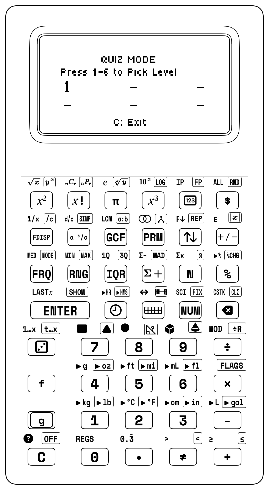

---

### 8.1.1 Starting a 4-Second Speedrun & Stack Mystery Puzzles

Have you ever played a musical rhythm game where notes glide down the screen and you tap the beat right on time, or raced a speedrun clock where each clean streak unlocks a faster puzzle tier? Tapping **`[f] [?]`** (`[f]` + `[C]`) opens the **Quiz Mode Level Picker (`⚡ QUIZ MODE` / `Press 1-6 to Pick Level`)** showing which levels you have unlocked; tap a number key **`1`–`6`** to launch your mental-math speedrun challenge! A puzzle flashes on screen, you type the answer using the number keys (plus `.` for fractions or `[<-]` if you want to fix a digit), and you lock in your answer with one tap of **`[≠]`** (the `=/≠` submit key). After the feedback screen (`Press C for Next Quiz`) grades your answer, tap **`[C]`** (or `[≠]`) to advance to the next question! Because **`[≠]`** submits your quiz answer, **`[ENTER]` and all of your arithmetic keys remain completely free for RPN stack scratch work**! Whenever you want to check your running score (`SCORE  <score> / <total>`) during a game, tap **`[g] [SHOW]`**; when you are ready to exit Quiz Mode back to your normal calculator stack, tap **`[NUM]`** (or press `[C]` while a question prompt is on screen).

Most quiz apps lock you into multiple-choice guessing games—where you can often spot the right answer just by looking at the last digit without actually doing the math. On the SC-6, there are no multiple-choice buttons to guess from. Instead, the Quiz Engine challenges your brain with two on-screen prompt formats (paired with hands-on Mystery Block bonds on your desk):

1. **RPN Stack Prompts (`4 [ENTER] 5 +`, `1/2 [ENTER] 1/4 +`, or `24 [ENTER] 36 GCF`):** Used across Levels 1–4 and Level 5 Bands 1–2, showing the two numbers sitting on Shelf $Y$ and Shelf $X$ followed by the operation that combines them (`Q1/100 | Press ≠ | C: Reset`):
   $$\mathtt{4 \ \ [ENT] \ \ 5 \ \ +}$$
2. **Algebraic & Multi-Step Prompts (`5² + 3² = ?`, `15% of 60 = ?`, `4! ÷ 6 = ?`, or `gcd(48,36) = ?`):** Used in Level 5 Band 3 and throughout Level 6 (`L6: Math Champ`), where you picture the multi-step pattern in your head, type the exact answer onto Shelf $X$, and tap `[≠]` (`Q1 | Enter answer, press ≠`).
3. **Hands-On Missing-Number Bonds (`3 + ? = 10` or `8 × ? = 56`):** Using the physical **`?` Mystery Block** on your **Quest Scoreboard** rail, you can also set up missing-number stories on your desk and solve them by working backward (`10 [ENTER] 3 -` or `56 [ENTER] 8 ÷`).

During a live game, the graphic LCD organizes everything into clean horizontal bands: a top scoreboard banner showing your current level (`L1: +/- to 10`) on the left and your running score (`Score: 4/4`) on the right, a bold center prompt displaying the active puzzle (`3 [ENTER] 7 +` or `5² + 3² = ?`) and your typed digits, and a bottom status bar (`Q1/100 | Press ≠ | C: Reset`).

In a heartbeat, your brain spots the ten-partner (*"3 and 7 make 10!"*) and you tap `10 [≠]`. The moment you press `[≠]`, the calculator checks your answer in any equivalent form—automatically matching `2/4`, `0.5`, and `1/2`—while its internal stopwatch times your solve against the 4.0-second speedrun clock (`CORRECT! <time>s ★ FAST!` under 4s, `CORRECT! <time>s ✓` in 4–8s, `CORRECT! <time>s` over 8s, or `WRONG: <expected>` so you immediately see the right fact before it cycles back 3 and 7 turns later), displaying `Mastery: <score>% · Fast Streak: <n>` on the second line and `Press C for Next Quiz` at the bottom. Better yet, you can test every single puzzle right on your calculator stack using the exact moves shown in each level below.

---

## 8.2 The 6-Level Game Ladder & Head-to-Head Sprints

How does a well-tuned puzzle game know the exact moment to make a level slightly faster—not so easy that you yawn, and not so steep that you get stuck? During solo play, the SC-6 shuffles each level's puzzle deck automatically across three adaptive bands so every round feels fresh. And when you want to race a friend or run a kitchen-table relay, both players can tap `[f] [?]` and pick the exact same target level (`1`–`6`) to race through that level's 3-band challenge deck head to head.

Every level is organized into **three smooth difficulty bands (`Band 1: Warm-Up`, `Band 2: Builder`, `Band 3: Boss Sprint`)**, progressing from **RPN Stack Prompts** (`4 [ENTER] 5 +`) in Levels 1–5 to **Algebraic Multi-Step Prompts** (`5² + 3² = ?`) in Level 5 Band 3 and Level 6:

| Level | Screen Tag | Band 1 (Warm-Up) | Band 2 (Builder) | Band 3 (Boss Sprint) |
| :--- | :--- | :--- | :--- | :--- |
| **Level 1** | `L1: +/- to 10` | Sums & differences within 5 (`3 [ENTER] 2 +`, `4 [ENTER] 1 -`) | Sums 6 to 10 & ten-frame partners (`7 [ENTER] 3 +`, `8 [ENTER] 5 -`) | Full $0\text{--}10$ facts with zeroes & doubles (`9 [ENTER] 0 +`, `5 [ENTER] 5 +`) |
| **Level 2** | `L2: +/- to 100` | Multiples of 10 (`40 [ENTER] 30 +`, `80 [ENTER] 20 -`) | Two-digit $+ / -$ without regrouping (`34 [ENTER] 25 +`, `67 [ENTER] 24 -`) | Two-digit $+ / -$ with regrouping (`47 [ENTER] 38 +`, `82 [ENTER] 45 -`) |
| **Level 3** | `L3: x/÷ to 12` | $\times / \div$ by $2, 5, 10$ (`5 [ENTER] 4 ×`, `20 [ENTER] 5 ÷`) | $\times / \div$ by $3, 4, 6, 8$ (`6 [ENTER] 8 ×`, `48 [ENTER] 6 ÷`) | $\times / \div$ by $7, 9, 11, 12$ (`7 [ENTER] 8 ×`, `72 [ENTER] 9 ÷`) |
| **Level 4** | `L4: Fractions` | Like denominators $+ / -$ (`1/4 [ENTER] 1/4 +`, `5/6 [ENTER] 1/6 -`) | Related denominators $+ / -$ (`1/2 [ENTER] 1/4 +`, `5/6 [ENTER] 1/3 -`) | Unlike denominators $+, -, \times$ (`2/3 [ENTER] 1/4 +`, `2/3 [ENTER] 3/4 ×`) |
| **Level 5** | `L5: Mixed Mastery` | Fraction $+ / \times$ review (`3/4 [ENTER] 1/2 +`, `2/3 [ENTER] 3/5 ×`) | Two-digit RPN $+ / -$ sprints (`58 [ENTER] 37 +`, `91 [ENTER] 46 -`) | Multi-step squares, cubes, roots & percents (`5² + 3² = ?`, `15% of 60 = ?`, `√144 + 5 = ?`) |
| **Level 6** | `L6: Math Champ` | Factorials, $\log_{10}$, powers, $\Sigma(1..n)$, $P(n,r)$, $C(n,r)$, $\gcd$, $\text{lcm}$ | Multi-step roots, powers & $\Sigma k^2$ (`(√169 - 5)² = ?`, `∑(k²,k=1..4) = ?`) | Compound $\Sigma k^3$, combinatorics & nested powers (`∑(k³,k=1..4) = ?`, `C(10,4) ÷ C(5,2) = ?`) |

Every level is directly paired with your physical **StackCalc Block Studios** so that mental speed grows naturally out of hands-on building. In Levels 1 and 2, for instance, you build fast number-bond recognition using the **Math Dominoes**—whose 28 double-six domino tiles train your eyes to spot $4 + 5 = 9$ and turn-around twins like $[3 \mid 5]$ and $[5 \mid 3]$ without counting dots one by one—and the **Quest Scoreboard**, whose physical **`?` Mystery Block** slots right into an equation rail to model missing-number puzzles like `3 ? + = 10` before you tap `[f] [?]` on the keypad.

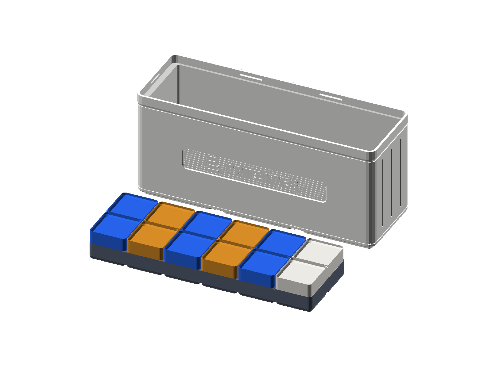

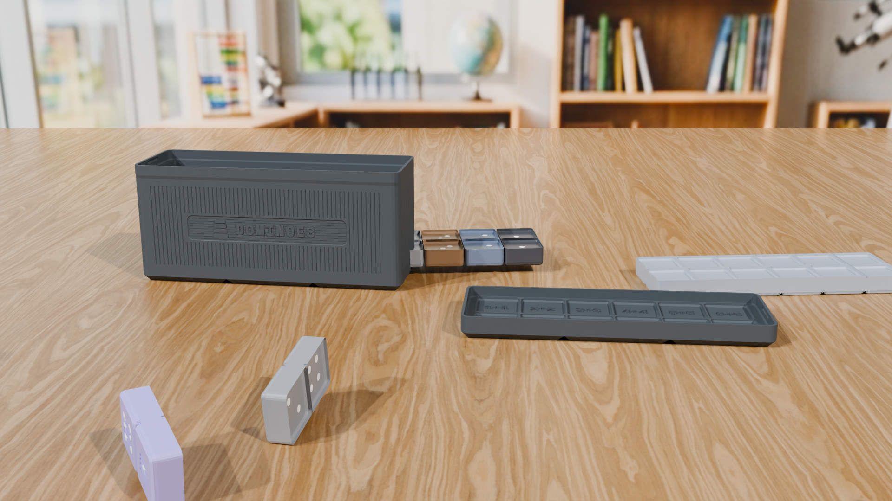

Let's walk through all six levels of the challenge ladder—from **Level 1 (Addition & Subtraction Warm-Up)** to **Level 6 (Championship Boss Round / `L6: Math Champ`)**—to see how each physical block studio powers your mental shortcuts and how every quiz prompt plays out on the 4-shelf stack.

### Level 1: Single-Digit Number Bonds (Sums & Differences to 10)
Level 1 is your Addition & Subtraction Warm-Up: instead of counting dots one by one on your fingers, you use two speedrunner tricks—**Double-Plus-One** and **Ten-Frame Partners**—to spot answers in under a second and start building your 5-fast streak.

First, watch how **spotting a hidden double ($4 + 5$)** beats counting on your fingers. When a puzzle like `4 [ENTER] 5 +` flashes on the screen, don't count up from 4. Pull the $[4 \mid 5]$ tile from your **Math Dominoes** and look at how the five side is just a four-square with one bonus dot in the middle. Your eyes lock onto the twin fours ($4 + 4 = 8$) and pop the center dot on top ($8 + 1 = 9$)—letting you key in `9 [≠]` and advance your fast streak (`Fast Streak: 1`). When you switch to `[NUM]` mode and key `4 [ENTER] 5 [+]`, Shelf $Y$ (`4`) and Shelf $X$ (`5`) fuse directly into **`9`**.

Now flip from addition to subtraction by **reading the empty spaces in a Ten-Frame ($10 - 7$)**. Subtraction feels twice as fast when you look at what is *missing* instead of counting backward. Picture a full **Ten-Frame Tray** holding two rows of 5 counters, and lift 7 counters out (one whole row of 5 plus 2 from the bottom row). You don't even have to count the 7 you took away—your eyes immediately see **3 empty pockets** staring back at you, because $7$ and $3$ are ten-partners. That lets you solve `10 [ENTER] 7 -` right away with `3 [≠]`, matching the ten-partner bond `10 [ENTER] 7 [-]` $\to$ **`3`** on the live stack.

---

### Level 2: Two-Digit Mental Addition & Subtraction (To 100)
With five fast solves under 4.0 seconds in Level 1 (`Fast Streak: 5`), the screen flashes `★ NEXT LEVEL UNLOCKED! ★`, and you advance to Level 2. Here you unlock two essential two-digit mental strategies: **Jumping by Tens** and **The Two-Hop Split** (plus a bonus **99 Trick** for big sums like $64 + 99$, where you just add $100$ to get $164$ and step back $1$ to land on $163$).

Start by **turning big tens into friendly ones ($40 + 30$)**. Whenever both numbers end in zero, cover up the zeros in your mind. Putting 4 counters and 3 counters into your **Ten-Frame Tray** gives $4 + 3 = 7$. Now treat every counter as a 10-rod: $4\text{ tens} + 3\text{ tens} = 7\text{ tens}$, which is $70$. The moment `40 [ENTER] 30 +` pops up, `70 [≠]` locks in the point—just as stacking four 10-rods and three 10-rods via `40 [ENTER] 30 [+]` places **`70`** on Shelf $X$.

What if the second number has both tens *and* ones, like $80 - 25$? Use **the two-hop split with zero borrowing ($80 - 25$)**! Have you ever tried to borrow across columns in your head on a problem like $80 - 25$ and lost track of the digits? Hop in two clean steps from left to right instead: start with 8 ten-rods ($80$), hop back 2 tens first ($80 - 20 = 60$), and then hop back the last 5 ones ($60 - 5 = 55$). When the screen shows `80 [ENTER] 25 -`, that two-hop jump ($80 \to 60 \to 55$) gives you `55 [≠]` without a single borrow, matching `80 [ENTER] 25 [-]` $\to$ **`55`**.

---

### Level 3: Multiplication & Division Mastery (Up to $12 \times 12$)
Level 3 turns the rectangular tile grids from Chapter 4 into fast times-table shortcuts—like slicing tricky rectangles in half, reading the 9s tens-digit code, or using the **Split-and-Double Trick** (where a rectangle like $15 \times 14$ gets cut in half one way and doubled the other way to become $30 \times 7 = 210$).

First, let's **slice the toughest times-table fact in two ($7 \times 8$)**. Ask ten students which multiplication fact trips them up the most, and nine of them will say $7 \times 8$. Here are two ways to never miss it again: first, slice 7 rows of 8 tiles into 5 rows of 8 ($40$) plus 2 rows of 8 ($16$ from your **24 Array Tiles**), which snap together into $40 + 16 = 56$. Second, notice the four-number countdown march: **5, 6, 7, 8** $\to \mathbf{56} = \mathbf{7} \times \mathbf{8}$. Either way, `7 [ENTER] 8 ×` is an instant `56 [≠]` solve, and multiplying the rectangle on your keypad with `7 [ENTER] 8 [×]` lands squarely on **`56`**.

Once you can build rectangles fast, you can also run them in reverse by **cracking the secret 9s tens-digit code ($72 \div 9$)**. Every multiple of 9 up to $90$ hides a clue right inside its tens digit. Build $2 \times 9 = 18$ with your **24 Array Tiles**: notice that the tens digit ($1$) is **one less** than the number you multiplied by ($2$), and the two digits always add up to 9 ($1 + 8 = 9$). So when `72 [ENTER] 9 ÷` flashes on the screen, look at the tens digit **`7`** in $72$ and add $1$: $7 + 1 = 8$. Lock in `8 [≠]` for the speed bonus, matching the missing side length **`8`** when you divide `72` by `9` with `72 [ENTER] 9 [÷]`.

---

### Level 4: Remainder Division & Fraction Benchmarks
In Level 4, the puzzles shift from whole-number rectangles into leftover tiles (`[g] [÷R]`) and **Fraction Towers** (`[g] [SIMP]`). Instead of writing out slow common-denominator steps, you trade tower pieces in your head and beat the 4.0-second clock with room to spare.

Your first Level 4 warmup is **counting full towers and leftover tiles ($17 \div 5$)** when a division problem doesn't come out even. Ask yourself: *how many full towers of 5 fit inside 17?* Grab 17 tiles from your **24-Tile Counting & Array Studio** and stack them by fives ($5, 10, 15$). You get **3 full towers** ($15$ tiles) with **2 leftover tiles** in your hand. When solving for the whole number of towers, `3 [≠]` locks in the quotient, while `17 [ENTER] 5 [g] [÷R]` in `[NUM]` mode shows **`3`** on Shelf $X$ with the remainder perched above it:

| Keystroke | Register T | Register Z | Register Y | Register X | What Happens on the Stack |
| :--- | :--- | :--- | :--- | :--- | :--- |
| `17` | 0 | 0 | 0 | 17 | Type 17 total tiles onto Shelf $X$ |
| `[ENTER]` | 0 | 0 | 17 | 17 | Copy 17 up onto Shelf $Y$ |
| `5` | 0 | 0 | 17 | 5 | Type the tower height of 5 onto Shelf $X$ |
| `[g] [÷R]` | 0 | 0 | 2 | 3 | Remainder division: **3** full towers in $X$, **2** leftover tiles in $Y$ |

*(Shelf $X$ shows your 3 full towers of 5, while Shelf $Y$ holds the 2 leftover tiles; tap `[x⇄y]` anytime you want to bring the remainder to the front).*

Next, the game deals fraction puzzles where you **trade a half for two quarters ($1/2 + 1/4$)**. Think of quarters in your pocket or look at your **Fraction Towers** comparison well: one $1/2$ block is the exact same height as two $1/4$ blocks ($2/4$). Dropping one more $1/4$ block on top gives you three quarters ($3/4$) immediately. You can type `0 [.] 3 [.] 4 [≠]` (or `[.] 3 [.] 4 [≠]`) the instant `1/2 [ENTER] 1/4 +` appears—the exact same **`3/4`** tower height built by `. 1 . 2 [ENTER] . 1 . 4 [+]`.

What happens when you subtract two fractions and **shrink the leftover fraction tower ($5/6 - 1/3$)** into a simpler block? Stand five $1/6$ pieces ($5/6$) next to a $1/3$ piece in your **Fraction Towers** kit. Since one $1/3$ piece equals two $1/6$ pieces ($2/6$), taking away two sixths from five sixths leaves three sixths ($3/6$)—which is the exact height of a **$1/2$ tower**. Typing the simplified answer `0 [.] 1 [.] 2 [≠]` on `5/6 [ENTER] 1/3 -` grabs the fast bonus in one move, just as `. 5 . 6 [ENTER] . 1 . 3 [-] [g] [SIMP]` reduces the fraction to **`1/2`**:

| Keystroke | Register T | Register Z | Register Y | Register X | What Happens on the Stack |
| :--- | :--- | :--- | :--- | :--- | :--- |
| `0 [.] 5 [.] 6` | 0 | 0 | 0 | 5/6 | Enter fraction $5/6$ onto Shelf $X$ |
| `[ENTER]` | 0 | 0 | 5/6 | 5/6 | Copy $5/6$ up onto Shelf $Y$ |
| `0 [.] 1 [.] 3` | 0 | 0 | 5/6 | 1/3 | Enter fraction $1/3$ onto Shelf $X$ |
| `[-]` | 0 | 0 | 0 | 3/6 | Subtract: $5/6 - 2/6 = 3/6$ |
| `[g] [SIMP]` | 0 | 0 | 0 | 1/2 | Simplify $3/6$ to its cleanest fraction block: **`1/2`** |

Trading those three $1/6$ blocks (`3/6`) for a single `1/2` block in your hands matches `[g] [SIMP]` on the screen. As you climb into Band 3 of Level 4, you unlock **the criss-cross twelfths match ($2/3 + 1/4$)** for denominators like $3$ and $4$ that meet at $12$ ($3 \times 4 = 12$). Reach for the twelfths pieces in your **Fraction Towers** kit: two thirds ($2/3$) match $8$ twelfths ($8/12$), and one fourth ($1/4$) matches $3$ twelfths ($3/12$). Add $8 + 3 = 11$ twelfths in your head and type `0 [.] 11 [.] 12 [≠]` when `2/3 [ENTER] 1/4 +` appears—mirroring `. 2 . 3 [ENTER] . 1 . 4 [+]` as the stack combines both fractions into **`11/12`** on Shelf $X$.

Right after adding twelfths, you can **spot a shared six-pack ($\text{Simplify } 18/24$)** whenever an unreduced fraction appears. Look for the biggest group size that packs both numbers evenly: using your **24 Array Tiles**, 18 is **3 six-packs** ($3 \times 6$) and 24 is **4 six-packs** ($4 \times 6$). Cancel out the shared six-packs in your head and `18/24` shrinks right down to **`3/4`** (`0 [.] 3 [.] 4 [≠]`), the same reduced fraction **`3/4`** that appears on Shelf $X$ when you tap `. 18 . 24 [ENTER] [g] [SIMP]`.

Finally, for your Level 4 promotion challenge, watch what happens when two fraction towers **spill over the 1-Whole line ($5/8 + 1/2$)**. In your **Fraction Towers** well, $1/2$ equals four eighths ($4/8$). Add $5/8 + 4/8$ to get nine eighths ($9/8$)—which is $8$ eighths ($1$ whole tower) with **$1$ extra eighth** perched on top (`1 1/8`). Punch in `1 [.] 1 [.] 8 [≠]` (or `0 [.] 9 [.] 8 [≠]`) to clear `5/8 [ENTER] 1/2 +`, and watch `. 5 . 8 [ENTER] . 1 . 2 [+]` build **`1 1/8`** step by step:

| Keystroke | Register T | Register Z | Register Y | Register X | What Happens on the Stack |
| :--- | :--- | :--- | :--- | :--- | :--- |
| `0 [.] 5 [.] 8` | 0 | 0 | 0 | 5/8 | Enter fraction $5/8$ onto Shelf $X$ |
| `[ENTER]` | 0 | 0 | 5/8 | 5/8 | Copy $5/8$ up onto Shelf $Y$ |
| `0 [.] 1 [.] 2` | 0 | 0 | 5/8 | 1/2 | Enter fraction $1/2$ ($4/8$) onto Shelf $X$ |
| `[+]` | 0 | 0 | 0 | 1 1/8 | Add: $5/8 + 4/8 = 9/8 =$ **`1 1/8`** |

Just like snapping eight $1/8$ blocks into a full $1$-whole tower with one $1/8$ block on top, the stack turns `9/8` into `1 1/8` automatically—and one tap of `[f] [d/c]` or `[a ᵇ/c]` flips between `1 1/8`, `9/8`, and `1.125` anytime you like.

---

### Level 5: Multi-Step Order of Operations, Decimals & Percents
In Level 5, the Quiz Engine combines fraction operations (Band 1), two-digit RPN addition and subtraction sprints (Band 2), and multi-step algebraic expressions with squares, cubes, roots, and percents (`5² + 3² = ?`, `15% of 60 = ?`, `√144 + 5 = ?` in Band 3) to test whether you can spot **which math action happens first**—and even spot hidden 100s in multiplication chains like $4 \times 17 \times 25$ (where $4 \times 25 = 100$ first, turning the whole problem into $100 \times 17 = 1,700$).

The first golden rule in Level 5 is to **multiply or divide the array before adding loose singles ($24 \div 6 + 7$)**. Look at `24 ÷ 6 + 7 = ?`: if you added $6 + 7 = 13$ first, $24 \div 13$ would make a messy fraction. Multiplication, division, powers, and roots are tightly bundled groups, so they always go before loose single counters. Split your **24 Array Tiles** into 6 equal rows of **4** ($24 \div 6 = 4$), then slide in 7 counters from your **Ten-Frame Tray** ($4 + 7 = 11$) and lock in `11 [≠]`. Here is how `24 [ENTER] 6 [÷] 7 [+]` unfolds to **`11`** on the four shelves:

| Keystroke | Register T | Register Z | Register Y | Register X | What Happens on the Stack |
| :--- | :--- | :--- | :--- | :--- | :--- |
| `24` | 0 | 0 | 0 | 24 | Type 24 tiles onto Shelf $X$ |
| `[ENTER]` | 0 | 0 | 24 | 24 | Copy 24 up onto Shelf $Y$ |
| `6` | 0 | 0 | 24 | 6 | Type 6 equal rows onto Shelf $X$ |
| `[÷]` | 0 | 0 | 0 | 4 | Divide first: $24 \div 6 = 4$ tiles per row |
| `7` | 0 | 0 | 4 | 7 | Type 7 loose counters; $4$ lifts to Shelf $Y$ |
| `[+]` | 0 | 0 | 0 | 11 | Add the 7 counters: $4 + 7 = \mathbf{11}$ |

Watching `4` appear on Shelf $X$ before `7` arrives makes the order of operations crystal clear. Now apply that exact same rectangle-first habit to **dodge the left-to-right subtraction trap ($15 - 3 \times 4$)**—the puzzle that tricks almost everyone who reads strictly left-to-right: `15 - 3 × 4 = ?`. If you subtract $15 - 3 = 12$ first and multiply by $4$, you get $48$. Instead, see `3 × 4` as a solid $3 \times 4 = 12$ rectangle of **Array Tiles** that must be lifted away from your pile of 15 tiles all at once, leaving $15 - 12 = \mathbf{3}$ tiles (`3 [≠]`). When you key `15 [ENTER] 3 [ENTER] 4 [×] [-]` to reach **`3`**, your starting `15` waits safely up on Shelf $Z$ while `3` and `4` multiply into `12` below, and then `[-]` takes `12` away from `15` to leave `3`.

What if a classic prompt wraps parentheses `( )` around two numbers, like `(18 - 6) ÷ 3 = ?`? Then you **unpack the box first ($(18 - 6) \div 3$)**! Treat the brackets like a closed gift box: take 6 tiles away from 18 **Array Tiles** inside the box to leave 12 tiles ($18 - 6 = 12$), then deal those 12 tiles equally to 3 friends ($12 \div 3 = 4$) and tap `4 [≠]`. Keying `18 [ENTER] 6 [-] 3 [÷]` in `[NUM]` mode steps through **`4`**:

| Keystroke | Register T | Register Z | Register Y | Register X | What Happens on the Stack |
| :--- | :--- | :--- | :--- | :--- | :--- |
| `18` | 0 | 0 | 0 | 18 | Type 18 starting tiles onto Shelf $X$ |
| `[ENTER]` | 0 | 0 | 18 | 18 | Copy 18 up onto Shelf $Y$ |
| `6` | 0 | 0 | 18 | 6 | Type 6 tiles to take away |
| `[-]` | 0 | 0 | 0 | 12 | Solve inside the box first: $18 - 6 = 12$ |
| `3` | 0 | 0 | 12 | 3 | Type 3 equal groups; $12$ lifts to Shelf $Y$ |
| `[÷]` | 0 | 0 | 0 | 4 | Divide 12 into 3 equal shares of **`4`** |

Taking away the 6 tiles first leaves `12` on Shelf $X$, ready to divide cleanly into 3 equal groups of `4`. Next, when Level 5 deals mixed numbers like `1 1/2 + 2 1/4`, don't waste time turning them into big improper fractions—just **snap the whole towers and fraction slices separately ($1\ 1/2 + 2\ 1/4$)**! Snap the whole **Fraction Towers** together first ($1 + 2 = 3$), then snap the half ($2/4$) and quarter ($1/4$) together into $3/4$ for a total of **`3 3/4`** (`3 [.] 3 [.] 4 [≠]`)—the exact mixed number **`3 3/4`** resting on Shelf $X$ after `1 . 1 . 2 [ENTER] 2 . 1 . 4 [+]`.

One last order-of-operations challenge stands between you and Level 6: **building the rectangle before adding loose counters ($8 + 4 \times 5$)** when `8 + 4 × 5 = ?` appears. Ignore the temptation to add $8 + 4$. Spot the $4 \times 5 = 20$ rectangle first (two full **Ten-Frame Trays**), toss the 8 loose counters on top ($20 + 8 = 28$), and punch in `28 [≠]`. Watch `8 [ENTER] 4 [ENTER] 5 [×] [+]` assemble **`28`** without disturbing the `8` until the rectangle is ready:

| Keystroke | Register T | Register Z | Register Y | Register X | What Happens on the Stack |
| :--- | :--- | :--- | :--- | :--- | :--- |
| `8` | 0 | 0 | 0 | 8 | Type 8 loose counters onto Shelf $X$ |
| `[ENTER]` | 0 | 0 | 8 | 8 | Copy 8 up onto Shelf $Y$ |
| `4` | 0 | 0 | 8 | 4 | Type 4 rows onto Shelf $X$ |
| `[ENTER]` | 0 | 8 | 4 | 4 | Lift 8 up to Shelf $Z$ while copying 4 to Shelf $Y$ |
| `5` | 0 | 8 | 4 | 5 | Type 5 tiles per row onto Shelf $X$ |
| `[×]` | 0 | 0 | 8 | 20 | Multiply the rectangle first ($4 \times 5 = 20$); $8$ drops to $Y$ |
| `[+]` | 0 | 0 | 0 | 28 | Add the 8 loose counters: $8 + 20 = \mathbf{28}$ |

Holding `8` up on Shelf $Z$ while the $4 \times 5 = 20$ rectangle forms on the bottom shelves makes it impossible to fall for the $(8 + 4) \times 5 = 60$ trap.

---

### Level 6: Championship Speed Sprints (`L6: Math Champ`)
Welcome to **Level 6 (`L6: Math Champ`)**, the highest tier on the SC-6. Here negative numbers (`[+/-]`), prime factor building blocks (`[GCF]` / `gcd` and `[f] [LCM]` / `lcm`), factorials (`[x!]`), combinations (`[f] [nCr]`), and high-speed number patterns come together for championship speedruns.

First, watch how you **climb toward the ice surface on a submarine depth gauge ($-14 + 9$)** when a signed-number challenge appears. Picture an Arctic research submarine cruising $14\text{ meters}$ below the polar ice pack (`-14`) and rising $+9\text{ meters}$ toward the surface—or 14 blue sub-zero counters meeting 9 gold warming counters in your **Ten-Frame Trays**. Nine zero-pairs cancel out, leaving the submarine $14 - 9 = 5\text{ meters}$ below the ice (`-5`). To enter a negative answer fast in Quiz Mode, type the digits first and flip the sign with `[+/-]`: `5 [+/-] [≠]`, matching the depth gauge reading **`-5`** from `14 [+/-] [ENTER] 9 [+]` (with `[NUM]` toggled off in stack view):

| Keystroke | Register T | Register Z | Register Y | Register X | What Happens on the Stack |
| :--- | :--- | :--- | :--- | :--- | :--- |
| `14` | 0 | 0 | 0 | 14 | Type 14 onto Shelf $X$ |
| `[+/-]` | 0 | 0 | 0 | $-14.0000$ | Flip the sign to $-14$ ($14\text{ m}$ below the ice) |
| `[ENTER]` | 0 | 0 | $-14.0000$ | $-14.0000$ | Copy $-14$ up onto Shelf $Y$ |
| `9` | 0 | 0 | $-14.0000$ | 9 | Type the $+9\text{ m}$ upward climb onto Shelf $X$ |
| `[+]` | 0 | 0 | 0 | $-5.0000$ | Cancel 9 zero-pairs: $-14 + 9 = \mathbf{-5}$ |

After rising 9 meters from $-14\text{ m}$, the submarine hovers at `-5`—five meters below the surface ice. Next, for our final championship challenge, `gcd(24,36) = ?` (or `24 [ENTER] 36 GCF`) asks you to **spot the biggest shared building block ($\text{GCF of } 24\text{ and } 36$)**. Instead of listing every factor from 1 upward, look at the gap between the two numbers ($36 - 24 = 12$) and check if $12$ divides into both. With your **Prime Factor Blocks**, $24$ is two **`12`**-stacks ($2 \times 2 \times 3 = 12$, times $2$) and $36$ is three **`12`**-stacks ($12 \times 3$). They share a full **`12`** (`12 [≠]`), the exact common factor **`12`** returned by `24 [ENTER] 36 [GCF]`:

| Keystroke | Register T | Register Z | Register Y | Register X | What Happens on the Stack |
| :--- | :--- | :--- | :--- | :--- | :--- |
| `24` | 0 | 0 | 0 | 24 | Type 24 onto Shelf $X$ |
| `[ENTER]` | 0 | 0 | 24 | 24 | Copy 24 up onto Shelf $Y$ |
| `36` | 0 | 0 | 24 | 36 | Type 36 onto Shelf $X$ |
| `[GCF]` | 0 | 0 | 0 | 12 | Find the Greatest Common Factor: $\text{GCF}(24, 36) = \mathbf{12}$ |

*(Bonus `[f] [LASTX]` move: Because `[GCF]` saved `36` inside `LASTX`, tapping `24 [f] [LASTX] [f] [LCM]` right afterward checks the matching Least Common Multiple `72` without re-typing `36`—completing all six levels of the challenge ladder with your 5-fast streak glowing.)*

---

### 8.2.1 How Streaks, Mastery Bars & Automatic Level-Ups Work

How does the SC-6 know when you are ready to graduate from warm-up questions to tougher puzzles, or unlock the next level altogether? It watches two things at once—your **steady mastery score** (`Mastery: <score>%`) and your **fast streak counter** (`Fast Streak: <n>`):

| Quiz Event & Response Time | LCD Feedback Banner | Mastery Point Delta | Fast Streak Effect |
| :--- | :--- | :--- | :--- |
| **Fast Correct (Under 4 seconds)** | `CORRECT! <time>s ★ FAST!` | **`+20%` Mastery** | Increments Fast Streak (`+1`) |
| **Good Correct (4 to 8 seconds)** | `CORRECT! <time>s ✓` | **`+10%` Mastery** | Preserves current Fast Streak |
| **Steady Correct (Over 8 seconds)** | `CORRECT! <time>s` | **`+5%` Mastery** | Resets Fast Streak to `0` |
| **Incorrect Submission** | `WRONG: <expected>` | **`-10%` Mastery** (min `0%`) | Resets Fast Streak to `0` (demotes band if Mastery $< 25\%$) |

Notice something important about the table above: you don't have to be the fastest player in the room on your very first try to level up. The SC-6 gives you two ways to advance—either by filling your **Mastery Score to `100%`** at a steady pace, or by hitting a **5-Fast-Streak (`Fast Streak: 5`)** in a row under 4.0 seconds each. Within each level, **Band 1 $\to$ Band 2 Promotion** unlocks automatically when your `Mastery` reaches `35%` or you hit a `Fast Streak` of `2`, and **Band 2 $\to$ Band 3 Promotion** unlocks when your `Mastery` reaches `70%` or you hit a `Fast Streak` of `4`.

The moment your `Mastery` hits `100%`—or you complete a **5-Fast-Streak** of five consecutive answers under $4.0\text{ seconds}$—the game triggers **Next Level Advance (`★ NEXT LEVEL UNLOCKED! ★`)**! For example, when you nail **`7 [ENTER] 8 ×`** in Level 3 by keying `56` `[≠]`, the feedback screen flashes **`★ NEXT LEVEL UNLOCKED! ★`**, and tapping `[C]` lifts you straight to `Level + 1` (all the way up to `L6: Math Champ`). In classroom team relays, players also celebrate four streak milestones across rounds: **Bronze Streak** (`3` fast), **Silver Streak** (`5` fast — automatic level advance), **Golden Master** (`10` fast), and the **20-Streak Flawless Sprint**.

---

### 8.2.2 Riding a 5-Streak Wave in Level 6

What does it feel like when your mental-math shortcuts and your fingers lock into a rhythm? Try this 5-problem speedrun wave in **Level 6 (`L6: Math Champ`)** and watch how five tough-looking problems fall in under 8 seconds total:

| Sprint Round & Prompt | Mental Math Strategy | Your Keystrokes | Elapsed Time & Score |
| :--- | :--- | :--- | :--- |
| **1st Round (`Streak: 1`):** `35² = ?` | Multiply tens digit by $(\text{tens} + 1)$: $3 \times 4 = 12$; attach $25 \to 1225$ | `1225` `[≠]` | $1.8\text{ s}$ (`+20% Mastery`, `Fast Streak: 1`) |
| **2nd Round (`Streak: 2`):** `48 × 5 = ?` | Cut $48$ in half $\to 24$, then multiply by $10 \to 240$ | `240` `[≠]` | $1.4\text{ s}$ (`+20% Mastery`, `Fast Streak: 2`) |
| **3rd Round (`Streak: 3`):** `1000 - 647 = ?` | Complement from $999$: $(9-6)(9-4)(10-7) = 353$ | `353` `[≠]` | $1.7\text{ s}$ (`+20% Mastery`, `Fast Streak: 3`) |
| **4th Round (`Streak: 4`):** `144 ÷ 12 = ?` | Picture the $12 \times 12 = 144$ square array $\to 12$ | `12` `[≠]` | $1.1\text{ s}$ (`+20% Mastery`, `Fast Streak: 4`) |
| **5th Round (`Streak: 5`):** `25 × 16 = ?` | Four quarters make $100$: $16 \div 4 = 4$ hundreds $\to 400$ | `400` `[≠]` | $1.5\text{ s}$ (`+20% Mastery`, `★ NEXT LEVEL UNLOCKED! ★`) |

The entire 5-problem wave took just $7.5\text{ seconds}$ of active thinking—completing the 5-fast streak and triggering `★ NEXT LEVEL UNLOCKED! ★`.

---

### 8.2.3 Solo Warm-Ups, Personal-Best Sprints & 4-Player Relays

You can play the SC-6 Quiz Engine solo on the bus, at the kitchen table, or with friends in a classroom math station. Before starting your daily math lesson, set your SC-6 to your current level and run a focused 120-second warmup sprint against a kitchen timer or classroom clock. Your goal is never to beat someone else across the room—it is to beat *your own* personal best from yesterday! Jot down your score, accuracy, and longest fast streak in your math logbook. Just like a concert pianist playing two minutes of scales before rehearsal, a daily 2-minute sprint wakes up your left-to-right number sense in 120 seconds flat:

| Date | Target Level | Final Score | Fast Streak | Personal Best? |
| :--- | :--- | :--- | :--- | :--- |
| **Oct 14** | Level 3 ($\times/\div$) | `140` | `4` | No |
| **Oct 15** | Level 3 ($\times/\div$) | `180` | `6` | **Yes** |
| **Oct 16** | Level 3 ($\times/\div$) | `210` | `8` | **Yes** |
| **Oct 17** | Level 4 (Fractions) | `90` | `2` | New Level |

You can also turn mental math into a team sport with **four players and a single SC-6 as the relay baton**:
1. Four teammates sit in a row with one SC-6 calculator in the middle of the table.
2. Player 1 launches Quiz Mode and aims for a **3-Fast-Streak (`●●●○○`)** before passing the calculator to Player 2.
3. If a player enters a wrong answer, their streak resets to zero—and their teammates can coach them using the physical blocks on the table until they hit their 3-streak!
4. Player 2 earns 3 more streak dots and passes to Player 3, who passes to Player 4.
5. The team clock stops the instant Player 4 locks in the final 3-streak (12 fast answers across the team).

---

### 8.2.4 Speedrun Rescues & Strategy
Before a head-to-head race or team relay, you can clear out your stack shelves and start a fresh round in two taps: exit to `[NUM]` mode, tap `[f] [CSTK]` (`[f]` + `[<-]`) to clear all four stack shelves ($X, Y, Z, T$) to zero, and then tap `[f] [?]` and pick your target level `1`–`6` so every player starts from the exact same baseline and difficulty band.

Why do smart mental shortcuts always beat frantic button-mashing in a tournament? Timed paper tests on a classroom wall chart can make anyone's stomach flip, but on the SC-6 your practice is just between you and your screen. When you miss a problem, the game simply shows you the right answer and brings that puzzle back a few turns later so you can nail it—and even when you turn the calculator off (`[g] [OFF]`), it remembers your unlocked levels, high scores, and streak records.

Better yet, slowing down for one extra breath protects your fast streak. Every wrong guess deducts $-10\%$ mastery and wipes out your fast streak, while taking a moment to slice $7 \times 8 = 56$ inside the $4.0\text{-second}$ window (`★ FAST!`) earns $+20\%$ mastery and moves you one step closer to `★ NEXT LEVEL UNLOCKED! ★` (and answering in $4.0\text{--}8.0\text{ seconds}$ earns $+10\%$ `✓` while keeping your streak alive). Ten thoughtful answers beat forty wild guesses every single time. And when a fraction prompt appears, picturing the physical blocks before you key keeps you out of the classic button-mashing trap of adding denominators straight across ($\frac{1}{3} + \frac{1}{4} \ne \frac{2}{7}$): stand a $\frac{1}{3}$ tower and a $\frac{1}{4}$ tower in your **Fraction Towers** well in your mind, see both trade cleanly into twelfths ($\frac{4}{12} + \frac{3}{12} = \frac{7}{12}$), and type `0 [.] 7 [.] 1 2 [≠]` to grab the full $+20\%$ fast bonus. Now let's open the speedrunner playbook and learn eight mental-math shortcuts that let you call out answers faster than a grown-up can type them.

---

## 8.3 Eight Mental Math Tricks That Beat Any Calculator

Have you ever watched someone multiply two big two-digit numbers in their head in two seconds flat—faster than a grown-up can even unlock their smartphone and open the calculator app? When you picture your **L-Frame Factoring Stage**, **Place Value Trays**, and **Counting Tile** staircases in your mind, big calculations collapse into simple visual patterns. Here are eight speedrunner tricks—grouped into four fast multiplication shortcuts and four lightning sum and pattern rules—that you can learn in five minutes and use to conquer Level 6 or amaze your friends and family tonight:

### 8.3.1 Four Fast Multiplication Shortcuts

**1. Matching Tens & Ones That Add to 10 ($43 \times 47$ and $35^2$):** Whenever two numbers start with the **same tens digit** (like the $4$ in $43 \times 47$) and their **ones digits add up to 10** ($3 + 7 = 10$), you can call out the four-digit product in two seconds flat:
$$\text{First Two Digits} = \text{Tens Digit} \times (\text{Next Whole Number Up}), \qquad \text{Last Two Digits} = \text{Ones Digit} \times \text{Ones Digit}$$
Try **$43 \times 47$** right now: multiply the tens digit $4$ by its upstairs neighbor $5$ ($4 \times 5 = 20 \to 2,000$), multiply the ones digits ($3 \times 7 = 21$), and snap them side by side into **2,021**—verified on the stack with `43 [ENTER] 47 [×]` $\to \mathbf{2021.00}$. That exact same rule squares **any number ending in 5** (like **$35^2$**): in $35 \times 35$, both tens digits are $3$ and the ones digits add up to $5 + 5 = 10$, so you multiply $3$ by the next whole number up ($3 \times 4 = 12$) and glue $5 \times 5 = 25$ onto the end to get **1,225**, checked in one tap via `6 [ENTER] 3 [+]`. Why do your tiles make this work every time? On your **L-Frame Factoring Stage**, a $43 \times 47$ grid holds a $40 \times 40$ square, two side strips ($40 \times 3$ and $40 \times 7$), and a $3 \times 7 = 21$ corner; because $3 + 7 = 10$, the two side strips join into one full $40 \times 10$ bar, turning the main square into $40 \times 50 = 2,000$ plus the $21$ corner!

**2. The Four-Quarters Rule ($\times 25$):** Remember from Chapter 4 how $36$ quarters grouped into $9$ stacks of four quarters to make $900\text{ cents}$? Because every **$4$ quarters** make **$100\text{ cents}$**, you can multiply *any* number by $25$ in your head by dividing by $4$ to count how many hundred-stacks you have, and attaching two zeros ($\times 100$):
$$\text{Number} \times 25 = (\text{Number} \div 4) \times 100$$
For **$28 \times 25$**, divide $28 \div 4 = 7$ and attach two zeros to call out **700** in a blink; for **$52 \times 25$**, divide $52 \div 4 = 13$ to get **1,300** (`52 [ENTER] 25 [×]` $\to \mathbf{1300.00}$). *(And if dividing by 4 leaves a remainder of $1, 2,$ or $3$ extra quarters, just snap $25, 50,$ or $75$ onto the end—so $19 \times 25$ is $4\text{ hundreds} + 3\text{ quarters} = \mathbf{475}$!)*

**3. Squaring Numbers in the Fifties ($51^2\text{–}59^2$):** How can you square a number just above $50$—like $54 \times 54$—faster than someone can type it?
$$\text{First Two Digits} = 25 + \text{Steps Above 50}, \qquad \text{Last Two Digits} = (\text{Steps Above 50})^2$$
Since **$54$** sits $4$ steps above $50$, the first two digits are $25 + 4 = 29$ ($2,900$) and the last two digits are $4^2 = 16$—snap them together into **2,916** and verify in one keystroke with `54 [x²]` $\to \mathbf{2916.00}$. Slicing a $54 \times 54$ tile square at $50$ shows why this works: it creates a $50 \times 50 = 2,500$ square ($25\text{ hundreds}$), two matching $50 \times 4$ strips that join end-to-end into $100 \times 4 = 400$ ($4\text{ hundreds}$), and a $4 \times 4 = 16$ corner!

**4. Multiplying Neighbors Around a Round Number ($28 \times 32$):** Whenever two numbers sit the exact same distance below and above a round tens number—like $28$ and $32$, which sit $2$ steps below and $2$ steps above $30$—your **L-Frame Factoring Stage** turns their product into a one-step subtraction. Start with a $30 \times 30$ square of tiles ($900$) and pop a tiny $2 \times 2$ square ($4$) out of one corner, leaving $900 - 4 = 896$ tiles. If you slice the remaining strip of width $2$ off the top edge and slide it onto the right edge, it fits flush to form a $28 \times 32$ rectangle!
$$\text{Product} = (\text{Center Number})^2 - (\text{Step Distance})^2$$
For $28 \times 32$ (centered at $30$ with a step distance of $2$), you simply square the center number ($30 \times 30 = 900$) and subtract the tiny corner square ($2 \times 2 = 4$) to get $900 - 4 = \mathbf{896}$, confirmed on the stack via `28 [ENTER] 32 [×]` $\to \mathbf{896.00}$.

### 8.3.2 Four Lightning Sum & Pattern Shortcuts

**5. The Staircase Half-First Rule ($1$ to $N$):** In Chapters 3 and 4, you saw how folding a staircase of $1 + 2 + 3 + \dots + N$ tiles onto an upside-down twin forms a solid $N \times (N + 1)$ rectangle:
$$\text{Staircase Sum from } 1 \text{ to } N = (\text{Last Number} \times \text{Next Whole Number Up}) \div 2$$
When a staircase sum pops up on the 4-second Level 6 boss clock, **don't multiply the two big numbers first and then divide by 2**! Because $N$ and $N + 1$ are neighbors, one of them is *always* an even number—so **cut the even neighbor in half first**, and then multiply by the odd neighbor in one fast mental step. To add **all 15 numbered balls on a pool table ($1$ to $15$)**, cut the even neighbor $16$ in half first ($8$) and multiply $15 \times 8 = \mathbf{120}$. For **the 12 days of gifts ($1$ to $12$)**, cut the even neighbor $12$ in half first ($6$) and multiply $6 \times 13 = \mathbf{78}$. And for **a 20-step tile staircase ($1$ to $20$)**, cut $20$ in half first ($10$) and multiply $10 \times 21 = \mathbf{210}$—matching `20 [ENTER] 21 [×] 2 [÷]` $\to \mathbf{210.00}$ on your stack.

**6. The Odd-Sum Midpoint Trick:** In Chapter 3, wrapping odd L-shaped borders ($1, 3, 5, 7, \dots$) around a corner tile showed why the sum of the first $N$ odd numbers is always $N^2$. In a Level 6 boss round, however, the prompt shows the **last odd number** (like $1 + 3 + 5 + \dots + 19$) rather than counting how many odd numbers are in the chain. To find $N$ in a split second, just average the first and last odd numbers—**add $1$ to the last odd number, divide by $2$, and square it**:
$$\text{How Many Odd Numbers } (N) = (\text{Last Odd Number} + 1) \div 2, \qquad \text{Odd Sum} = N^2$$
To add **$1 + 3 + 5 + \dots + 19$**, add $1 + 19 = 20$, cut it in half to get $N = 10$, and square $10^2 = \mathbf{100}$ in two seconds flat. For **$1 + 3 + 5 + \dots + 23$**, half of $(1 + 23)$ is $12$, and squaring $12^2$ gives **144**—confirmed in a single tap with `12 [x²]` $\to \mathbf{144.00}$. And for **$1 + 3 + 5 + \dots + 29$**, half of $(1 + 29)$ is $15$, and squaring $15^2$ with the Ends-in-5 rule ($1 \times 2 = 2 \to \mathbf{225}$) beats any button-pusher in the room!

**7. Turning Repeating Nines ($9\text{s}$ and $99\text{s}$) into Exact Fractions:** Whenever a decimal repeats **one digit forever** (like $0.777\dots$), it always equals **that digit over $9$** ($\mathbf{\frac{7}{9}}$). Why? When $9$ friends share $1$ whole ($1 \div 9$), trading $1$ whole for $10$ tenths gives each friend $0.1$ with $1$ tenth left over, and trading that tenth for $10$ hundredths gives each friend $0.01$ with $1$ hundredth left over forever ($\frac{1}{9} = 0.111\dots$). By the same logic, because $99$ sits $1$ step shy of $100$, a decimal that repeats **two digits forever** (like $0.363636\dots$) equals **that two-digit pair over $99$** ($\frac{36}{99}$)—divide top and bottom by $9$ in your head to get $\mathbf{\frac{4}{11}}$, verified with `0 [.] 36 [.] 99 [g] [SIMP]` $\to \mathbf{4/11}$.

**8. The Split-and-Drop $\times 11$ Shortcut & Divisibility Tug-of-War:** Because $11 = 10 + 1$, multiplying any number by $11$ just adds the number to a shifted copy of itself ($\text{Number} \times 10 + \text{Number}$). For a two-digit number like $53 \times 11$, pull the two digits apart (`5 _ 3`) and drop their sum ($5 + 3 = 8$) into the middle gap to get **$583$** (or for $42 \times 11$, $4 + 2 = 6 \to \mathbf{462}$). If the middle sum hits $10$ or more—like $75 \times 11$, where $7 + 5 = 12$—leave the `2` in the middle gap and carry the `1` onto the left digit ($7 + 1 = 8$) to get **$825$**, confirmed on the stack via `10 [ENTER] 7 [-]`.

That same proximity to $10$ gives you a three-second **divisibility tug-of-war** for $11$. Look at how close each place-value block sits to a multiple of $11$: each **ten** ($10$) is $1$ *short* of $11$ ($11 - 1$); each **hundred** ($100$) is $1$ *more* than $99$ ($9 \times 11 + 1$); and each **thousand** ($1,000$) is $1$ *short* of $1,001$ ($91 \times 11 - 1$). Because every step left flips the leftover between $+1$ and $-1$, you can test a four-digit number like $8,426$ by putting the alternating digits on two teams: Team A (ones + hundreds: $6 + 4 = 10$) minus Team B (tens + thousands: $2 + 8 = 10$) equals $10 - 10 = \mathbf{0}$. Whenever the two teams tie at $0$ (or differ by $11$), the number divides evenly by $11$—as `8426 [ENTER] 11 [g] [÷R]` confirms with Quotient $X = \mathbf{766}$ and Remainder $Y = \mathbf{0}$.

---

### 8.3.3 How Chess Grandmasters and "Human Computers" See Whole Boards at a Glance

Why did we choose **4.0 seconds** as the `★ FAST!` speedrun window when we engineered the SC-6 Quiz Engine (`[f] [?]`)? That exact four-second benchmark comes from one of the most famous experiments in the history of chess. In the 1940s, the Dutch researcher and international chess master **Adriaan de Groot** wanted to know what made world chess grandmasters like Max Euwe and Paul Keres so much faster and more accurate than ordinary club players.

To find out, de Groot placed a complex mid-game chessboard holding 25 pieces in front of each player, let them look at the board for just **4 seconds**, and then covered the board with a cloth and asked them to rebuild the position on an empty board. Ordinary players could place only 5 or 6 individual pieces before guessing. The grandmasters, by contrast, placed **23 or 24 out of 25 pieces** on their exact squares after a single four-second glance!

At first, observers wondered if grandmasters simply had superhuman photographic eyes. Then researchers **Herbert Simon and William Chase** ran a clever follow-up test: they scrambled the 25 chess pieces *randomly* across the squares in a way that could never happen in a real game and flashed the board for 4 seconds again. Suddenly, the grandmasters' advantage vanished—they placed only 5 or 6 pieces, no better than a beginner! The secret wasn't a camera-like eye at all: in a real game, a grandmaster never tracks 25 isolated pieces one by one. Instead, their eyes recognize 4 or 5 familiar **patterns and chunks**—a castled king tucked behind three pawns, a fianchettoed bishop guarding a long diagonal, or a knight-and-queen battery—and hold each multi-piece cluster in their mind as a single unit.

That exact same pattern-chunking superpower is what turned legendary Indian mental calculator **Shakuntala Devi** (1929–2013) into a worldwide sensation known as *"The Human Computer."* Born in Bangalore to a father who worked as a circus trapeze artist, tightrope walker, and lion tamer, young Shakuntala learned card and number patterns beside the circus ring at age three and was demonstrating lightning mental arithmetic at universities by age six—before she had ever sat in a formal school classroom. In 1977 at Southern Methodist University in Dallas, she extracted the $23\text{rd}$ root of a 201-digit number in her head in **50 seconds flat**, beating a room-sized Univac 1108 mainframe computer that took more than a minute! And in 1980 in London, she multiplied two randomly chosen 13-digit numbers in her head in just 28 seconds.

Whenever students asked Shakuntala Devi how she moved so fast without losing her place, she pointed out that school worksheets teach children to calculate backward from **right to left**—starting with the tiny ones column, carrying invisible digits in their heads, and discovering the most important part of the answer last. Mental-math masters and chess grandmasters always read a board from **left to right**, locking onto the biggest, most meaningful chunks first. When you add $68 + 27$, instead of adding $8 + 7 = 15$ and juggling a carried $1$, you grab the big ten-rods on the left first ($60 + 20 = 80$) and snap the $8 + 7 = 15$ onto the end ($80 + 15 = \mathbf{95}$). When `2/5 + 1/5 = ?` flashes on the 4-second clock, your eyes don't see four isolated digits to add across—they see two $\frac{1}{5}$ blocks and one $\frac{1}{5}$ block standing in your **Fraction Towers** well (`3/5`), and when $17 \div 5$ leaves $2$ tiles over (`17 [ENTER] 5 [g] [÷R]` $\to$ Quotient `3`, Remainder `2`), you immediately recognize those $2$ leftover tiles as two fifths ($\frac{2}{5} = 0.4 \to \mathbf{3.4}$). Even when splitting $68 \times 11$ into `6 _ 8`, you see that the middle tens gap holds a single digit, so $6 + 8 = 14$ leaves `4` in the tens place and carries `+1` hundred onto the left chunk ($600 + 140 + 8 = \mathbf{748}$).

Every time you build an L-Frame square (`35 [x²]` $\to 1,225$), spot a domino double-plus-one ($7 + 8 = 14 + 1 = 15$), or lock in an answer with `[≠]` inside the 4.0-second `★ FAST!` window, you are training your eyes to see numbers the way grandmasters see a chessboard: not as lonely digits to count one by one, but as friendly, interlocking patterns you can recognize in a single glance.

Once you get the hang of reading numbers in chunks, you can even extend Shortcut 8's **Split-and-Drop $\times 11$ trick** to three-digit numbers! Engineer **Jakow Trachtenberg**—who developed a complete system of paperless mental arithmetic in the 1940s—called this *"adding the neighbor."* To multiply a three-digit number like **$342 \times 11$** in your head, write down the outer digits **`3`** and **`2`** as your bookends, and drop the sums of each adjacent neighbor pair ($3 + 4 = \mathbf{7}$ and $4 + 2 = \mathbf{6}$) into the middle to get **`3,762`**—which you can verify in one tap on your SC-6 with `342 [ENTER] 11 [×]` $\to \mathbf{3,762}$!

Compare how a right-to-left paper calculator sees five classic Level 6 prompts versus how a left-to-right pattern chunker sees them in a single 4-second glance:

| Level 6 Boss Prompt | Slow Right-to-Left Digit Juggling | Fast Left-to-Right Visual Chunking (Under 2 Seconds!) |
| :--- | :--- | :--- |
| **`68 + 57 = ?`** | Add $8 + 7 = 15$, carry `1`, add $1 + 6 + 5 = 12$ | Grab the big 10-rods first ($60 + 50 = 110$), then snap on $15 \to \mathbf{125}$ |
| **`1000 - 647 = ?`** | Borrow across three zeros (`10`, `9`, `9`) from right to left | Read $999 - 647$ from left to right plus $1$: $(9-6)(9-4)(10-7) = \mathbf{353}$ |
| **`43 × 47 = ?`** | Multiply $7 \times 43$, multiply $40 \times 43$, and add two rows | Matching $40\text{s}$ with $3+7=10$: multiply $4 \times 5 = 20$ and attach $3 \times 7 = 21 \to \mathbf{2,021}$ |
| **`342 × 11 = ?`** | Write $342$ twice shifted by one column and add three columns | Bookend `3` and `2`, and drop the neighbor sums ($3+4=7$, $4+2=6$) inside $\to \mathbf{3,762}$ |
| **`1 + 2 + … + 24 = ?`** | Add twenty-four numbers one after another | Cut the even neighbor $24$ in half ($12$) and multiply $12 \times 25 = 3 \times 100 = \mathbf{300}$ |

### 8.3.4 Kaprekar's Mystery Constant (`6,174`) & Palindrome Mirror Numbers

Once you start spotting patterns across your math blocks and the 4-second Quiz Engine, even random four-digit numbers turn into miniature puzzle playgrounds. One of the most famous number mysteries in the world was discovered in **1949** by an elementary schoolteacher in Devlali, India named **D. R. Kaprekar** (1905–1986), who loved inventing number games on his chalkboard so his students would look forward to arithmetic every morning.

One afternoon, Kaprekar discovered a hidden "gravity well" inside four-digit numbers that amazed mathematicians around the globe—now known as **Kaprekar's Constant (`6,174`)**. Grab your SC-6 right now and test Kaprekar's discovery on *any* four-digit number whose digits aren't all identical (say, **`3,524`**):

1. **Step 1 (Biggest Minus Smallest):** Arrange the four digits of `3,524` from largest to smallest to make **`5,432`** (`5432 [ENTER]`), then arrange the exact same digits from smallest to largest to make **`2,345`**, and tap **`[-]`**:
   $$5,432 - 2,345 = \mathbf{3,087}$$
2. **Step 2 (Sort and Subtract Again):** Now sort the four digits of `3,087` from largest to smallest (**`8,730`**) and smallest to largest (**`0,378`**), and subtract on the stack (`8730 [ENTER] 378 [-]`):
   $$8,730 - 378 = \mathbf{8,352}$$
3. **Step 3 (Bullseye at `6,174`!):** Sort the four digits of `8,352` from largest to smallest (**`8,532`**) and smallest to largest (**`2,358`**), and subtract (`8532 [ENTER] 2358 [-]`):
   $$8,532 - 2,358 = \mathbf{6,174}$$
4. **Why `6,174` Never Escapes:** What happens if you sort the digits of **`6,174`** itself from largest to smallest (`7,641`) and smallest to largest (`1,467`) and subtract (`7641 [ENTER] 1467 [-]`)? Out pops **`6,174`** all over again ($7,641 - 1,467 = \mathbf{6,174}$)!

No matter what four-digit number you start with—whether it is your street address, the year you were born, or `1,000` (`1000 - 0001 = 0999` $\to$ `9990 - 0999 = 8991` $\to$ `9981 - 1899 = 8082` $\to$ `8820 - 0288 = 8532` $\to$ **`6,174`**)—Kaprekar proved that every single valid four-digit number in the universe falls into **`6,174` in at most 7 subtractions**! Even three-digit numbers have their own secret whirlpool: if you pick any three-digit number whose digits aren't all the same (like `724`), sorting and subtracting (`742 [ENTER] 247 [-]` $\to \mathbf{495}$, and `954 [ENTER] 459 [-]` $\to \mathbf{495}$) always locks onto **`495`**!

Kaprekar also loved **Mirror-and-Add Palindrome Races**—numbers that read the same forward and backward, like `363` or `4,884`. Start with **`57`** (`57 [ENTER]`), add its mirror **`75 [+]`** to get **`132`**, then add its mirror **`231 [+]`** to land on the palindrome **`363`** in two steps! Try **`68`** (`68 + 86 = 154` $\to$ `154 + 451 = 605` $\to$ `605 + 506 =` **`1,111`** in three steps), or challenge a friend to find why **`89`** is the marathon runner of two-digit numbers (24 steps to reach `8,813,200,023,188`!).

---

## 8.4 Family Speedrun Challenges & Looking Ahead

Gather your family around the table after dinner, pull out a smartphone calculator, and see who can win these three speed challenges before we take our math skills into the Chapter 9 workshop.

### 8.4.1 Three Family Speedrun Challenges to Try

1. **The Ends-in-5 Beat-the-Smartphone Bet:** Hand a family member a smartphone calculator while you solve $25^2, 35^2, 45^2, 65^2, 75^2,$ and $85^2$ out loud using the **Matching-Tens Shortcut**: multiply the tens digit by the next whole number up and attach $25$ ($6 \times 7 = 42 \to \mathbf{4,225}$), then prove it in one tap on your SC-6 with `[x²]`.
2. **The Same-Level Head-to-Head Duel:** Both players tap `[f] [?]` and select the exact same target level (`1`–`6`) at the same time to race through its 3-band challenge deck. Who can hit a 5-Fast-Streak (`Fast Streak: 5`) and unlock `★ NEXT LEVEL UNLOCKED! ★` first without a `-10%` miss?
3. **The 11-Divisibility Tug-of-War Bluff Game:** Ask someone to multiply any two- or three-digit number by `11` on their phone—or make up a four-digit bluff! Using the alternating-digit Tug-of-War rule from Shortcut 8 ($\text{Ones} + \text{Hundreds}$ vs. $\text{Tens} + \text{Thousands}$), call out whether their number is a multiple of $11$, then prove it with `11 [g] [÷R]` (Remainder `0` in Shelf $Y$)!

---

### 8.4.2 Taking Your Number Sense to the Chapter 9 Workbench

When "mathemagician" **Arthur Benjamin** races a row of calculators on stage, or when NASA mathematician **Katherine Johnson** verified orbital flight paths by hand, their secret was treating numbers like flexible building blocks reshaped from **left to right** into friendly hundreds, tens, arrays, and squares. Looking at your **Place Value Studio** blocks from left to right shows immediately that $1,000$ is $999 + 1$—so you can subtract $1,000 - 647$ in a glance by taking the first two digits from $9$ and the last from $10$: $(9-6)(9-4)(10-7) = \mathbf{353}$. Pairing the Quiz Engine (`[f] [?]`) with `[NUM]` stack mode lets you practice 4.0-second speedruns (`★ FAST!`) and inspect *why* each shortcut works on the four-shelf display:

| Mental-Math Speed Shortcut | How Your Hands & Eyes See It | One-Line Stack Check (`[NUM]`) |
| :--- | :--- | :--- |
| **1. Multiply by 11 (`53 × 11`)** | Split the two digits apart (`5 _ 3`) and drop their sum (`5 + 3 = 8`) in the middle | `53 [ENTER] 11 [×]` $\to \mathbf{583}$ |
| **2. Multiply by 5 (`48 × 5`)** | Five is half of a 10-rod: cut the number in half (`24`) and multiply by `10` | `48 [ENTER] 2 [÷] 10 [×]` $\to \mathbf{240}$ |
| **3. Multiply by 25 (`16 × 25`)** | Four quarters make $\$1.00$: divide by `4` (`4`) and multiply by `100` | `16 [ENTER] 4 [÷] 100 [×]` $\to \mathbf{400}$ |
| **4. Ends-in-5 Squares (`35²`)** | Multiply tens digit by the next number up (`3 × 4 = 12`) and attach `25` | `35 [x²]` $\to \mathbf{1,225}$ |
| **5. Difference of Squares (`28 × 32`)** | Reshape `(30 - 2)(30 + 2)` on the L-Frame into `30² - 2² = 900 - 4` | `30 [x²] 2 [x²] [-]` $\to \mathbf{896}$ |
| **6. Left-to-Right Tens First (`68 + 27`)** | Add the big 10-rods first (`60 + 20 = 80`), then snap on the ones (`+ 15`) | `60 [ENTER] 20 [+] 15 [+]` $\to \mathbf{95}$ |
| **7. Staircase Folding (`1 + … + 20`)** | Fold into `10` matching pairs of `21` (`20 × 21 ÷ 2`) | `20 [ENTER] 21 [×] 2 [÷]` $\to \mathbf{210}$ |
| **8. Divisibility & Primes (`4,917 ÷ 11`)** | Compare alternating digit teams (`7 + 9 = 16` vs. `1 + 4 = 5`; diff `11`) | `4917 [ENTER] 11 [g] [÷R]` $\to R = 0, Q = \mathbf{447}$ |

Best of all, left-to-right number sense gives you an automatic **sanity check** at the workbench: before multiplying $19\text{ gears} \times 21\text{ teeth}$, your mental L-Frame tells you the answer sits right near $20^2 - 1^2 = \mathbf{399}$, so a typo like `39.9` or `3,990` never fools you. In **[Chapter 9: Kitchen-Table Inventions & Maker Projects](sc6/09-applied-stem-labs.md)**, you will take those skills into the workshop—slicing $0.20\text{ mm}$ 3D-printer layers, timing pendulums, baking in a solar oven, scaling recipes, meshing gears, and lifting books with water-filled syringes!

---

# Chapter 9: Kitchen-Table Inventions & Maker Projects

## 9.1 The Invention Studio: 3D Printing, Slicing & Pendulums

Picture the kitchen table on a rainy Saturday morning. In the center sits a spool of corn-based PLA plastic filament, a pair of digital calipers, a stopwatch, a piece of string, the 3D-printed math blocks you have used throughout this book, and your StackCalc SC-6 calculator. Outside, the rain taps against the window; inside, the table is a live invention workshop!

If you have ever stared at a page of math homework and wondered, *"When am I ever going to use this in real life?"*—this chapter is your answer! Math was never meant to stay trapped on flat paper under a red grading pen. It is the secret blueprint behind every moving machine, 3D print, and kitchen experiment.

Math is what guides a 3D printer nozzle heated to $215^\circ\text{C}$ as it slices your **Counting Tiles** and **Planetary Geared Clock** into paper-thin $0.20\text{ mm}$ layers. And it is the steady rhythm discovered by Galileo Galilei in 1638 *([Galilei, 1638](sc6/appendix-c-formulas-and-conversions.md#cite-galilei1638))* that keeps a grandfather clock pendulum swinging back and forth in equal beats across centuries.

When you pick up the SC-6 at your workbench, you aren't just doing schoolwork—you are an engineer, a builder, and an inventor! In a real workshop, you know your math is right when your creation actually works: when the 3D-printed gears mesh smoothly, the printed layers stack to the exact millimeter, and the pendulum keeps steady time. With **Stack Math**, you push lengths and weights onto the stack, tap your keys, and watch your ideas turn into machines that whir, tick, and fly!

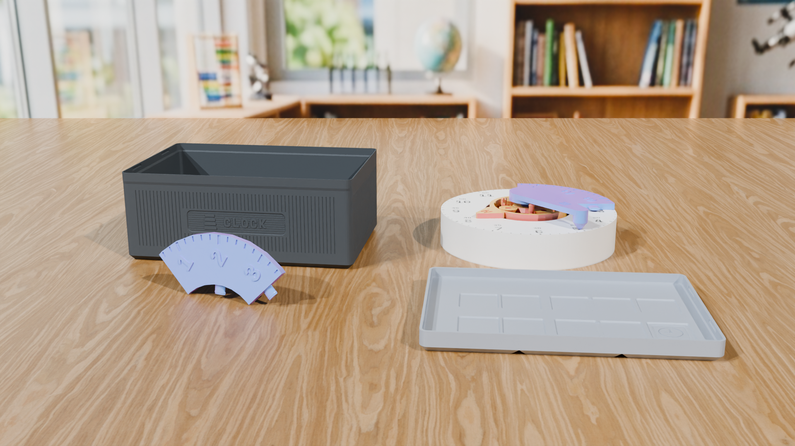

---

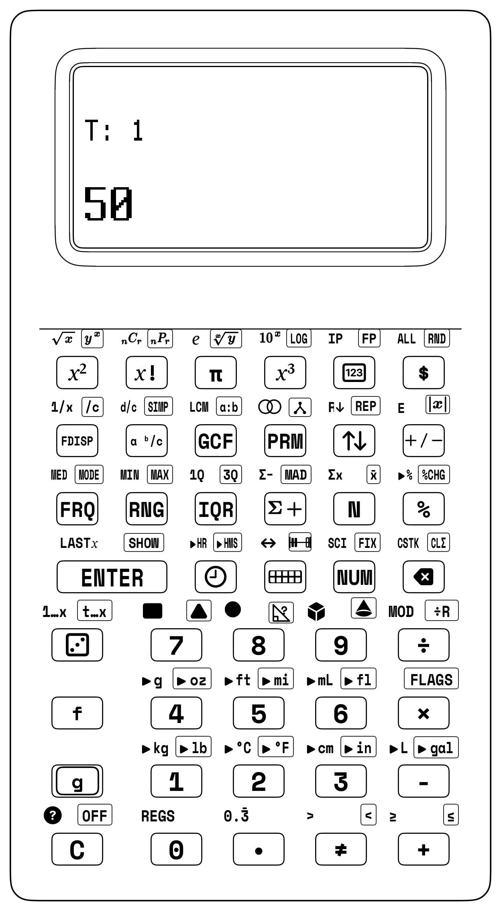

**How 3D Printers Slice Models into Thin Layers:** Look at the SC-6 screen above: a 3D-printed block stands $3\text{ cm}$ tall in total, and its solid base takes up the bottom $2\text{ cm}$. Subtracting `3 [ENTER] 2 [-]` leaves $1\text{ cm}$ of height for the top section. When the 3D printer slices that $1\text{ cm}$ top section into horizontal plastic layers that are each $0.02\text{ cm}$ ($0.20\text{ mm}$) thick, dividing by `.02 [÷]` shows that the printer nozzle must lay down **`50` layers**!

### 9.1.1 How the 12 Maker Projects Work

To turn your desk or kitchen table into an invention lab, gather four simple tools beside your 3D-printed math blocks and your SC-6: a metric ruler (or digital calipers), a digital kitchen scale, a stopwatch, and a notebook. Each project in this chapter pairs a hands-on physical build with a live calculation on the 4-level stack ($X, Y, Z, T$). In **3D Printing & Workshop Geometry**, you will measure filament strands and layer heights with calipers, spin the gears of your **Planetary Geared Clock** (`[🕒]`), and find circular cross-sections (`[x²]`, `[π]`) and `[f] [LASTX]` height checks right at the printer bed.

In **Physics Timers, Catapults & Solar Angles**, you will time swinging pendulums with a stopwatch, dial launch and solar tilt angles on your **Unit Circle Volvelle**, and drop multi-trial experiments into the `[Σ+]` basket to find your bullseye average (`[g] [x̄]`) and consistency (`[g] [MAD]`). And in **Kitchen Scaling & Maker Budgets**, you will stack **Fraction Towers** (`[a ᵇ/c]`) beside your measuring cups and kitchen scale to resize recipes, track growth rates, and price out filament spools and club gear (`[%]`, `[g] [%CHG]`, `[$]`).

---

### 9.1.2 How Much Plastic & Money Does a 3D Print Use?

Have you ever wondered how a 3D printer's slicing software knows—down to the gram and the penny—how much plastic your design will use before the nozzle even heats up? Peek inside the extruder head of a desktop 3D printer: a tiny steel **hobbed drive gear** with microscopic teeth grips the plastic filament from the spool and pushes it millimeter by millimeter into the $215^\circ\text{C}$ melting chamber. Because the printer's stepper motor counts every fraction of a turn of that drive gear, it knows the exact length of filament unspooled!

Unwind a few centimeters of plastic filament and look closely at it. That flexible strand is really a long, thin **cylinder**—like a giant strand of plastic spaghetti. Standard 3D printing filament has a width (diameter) of $1.75\text{ mm}$, which means its radius from the center to the edge is half of that: $0.875\text{ mm}$, or $0.0875\text{ cm}$. Once you multiply the tiny circular cross-section of its cut end ($\pi \times \text{Radius}^2$) by the length of strand pulled off the reel, you have the exact cubic centimeters of plastic—which converts straight into grams ($1.24\text{ g/cm}^3$ for corn-based PLA) and cents from a $1,000\text{-gram}$ spool:
$$\text{Filament Volume} = (\pi \times \text{Radius}^2) \times \text{Length}, \qquad \text{Part Weight} = \text{Volume} \times 1.24\text{ g/cm}^3$$

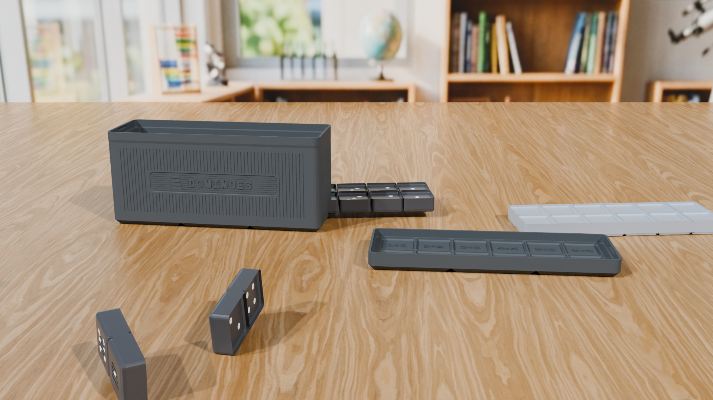

**From Filament Strand to Price Tag:**
When your 3D-printer slicer reports that a replacement divider tray for your **Math Dominoes** takes $500\text{ cm}$ ($5.0\text{ meters}$) of filament from a $\$20.00$ spool ($1,000\text{ g}$, or $\$0.02/\text{g}$), you can price it in seconds: squaring the $0.0875\text{ cm}$ radius (`.0875 [x²] [π] [×]` $\to 0.02405\text{ cm}^2$) and multiplying by `500 [×]` gives $12.03\text{ cm}^3$ of PLA, or `1.24 [×]` $= \mathbf{14.91\text{ grams}}$. Keying `20 [ENTER] 1000 [÷]`, `[×]`, and `[$]` rounds $14.91 \times \$0.02$ to **`$0.30`**—and weighing a nearly empty spool on your kitchen scale (minus $200\text{ g}$ for the empty reel) tells you right away whether you have $15\text{ grams}$ left for an overnight print!

Watch the full shelf-by-shelf sequence when you print a deeper storage bin for all your **Counting Tiles**, using $1,200\text{ cm}$ ($12\text{ meters}$) of $1.75\text{ mm}$ filament (radius $= 0.0875\text{ cm}$). Finding the filament's circle area ($\pi \times \text{Radius}^2$) with `.0875 [x²] [π] [×]` gives **`0.02405 cm²`**, and multiplying by the $1,200\text{ cm}$ length with `.02405 [ENTER] 1200 [×]` lands on **`28.86 cm³`**:

| Keystroke | Register T | Register Z | Register Y | Register X | What Happens on the Stack |
| :--- | :--- | :--- | :--- | :--- | :--- |
| `.0875` | 0 | 0 | 0 | $0.0875$ | Enter filament radius in centimeters ($0.0875\text{ cm}$) |
| `[x²]` | 0 | 0 | 0 | $0.007656$ | Square the radius ($0.0875 \times 0.0875 = 0.00765625\text{ cm}^2$) |
| `[π]` | 0 | 0 | $0.007656$ | $3.141593$ | Enter $\pi$; stack lifts the squared radius onto Shelf $Y$ |
| `[×]` | 0 | 0 | 0 | $0.024053$ | Multiply to find the filament circle area ($\approx 0.02405\text{ cm}^2$) |
| `1200` | 0 | 0 | $0.024053$ | 1200 | Enter the filament length ($1,200\text{ cm}$) |
| `[×]` | 0 | 0 | 0 | $28.863383$ | Multiply circle area by length to find plastic volume ($28.86\text{ cm}^3$) |

Shelf $X$ shows that the storage bin uses $\mathbf{28.86\text{ cm}^3}$ of melted plastic—turning a long, flexible strand of filament on the spool into a sturdy box on the printer bed that takes up about the same space as twenty-nine $1\text{ cm}$ unit cubes.

**Why 3D Prints Have a Honeycomb Inside ($15\%$ Infill):**
Why don't 3D printers make every block $100\%$ solid plastic inside? Just like honeybees build lightweight hexagonal combs inside a hive, a 3D printer builds strong outer walls and fills the inside with a $15\%$ honeycomb grid.

You can feel this difference right in your hand by comparing a $20\text{ mm}$ ($2.0\text{ cm}$) calibration test cube against a hollow-infill block. Closing your digital calipers across all three directions of the test cube shows that its length, width, and height are each an exact $2\text{ cm}$. Multiplying the length, width, and height (`[2] [ENTER] [2] [×] [2] [×]`) finds the cube's volume in cubic centimeters, **`8.0 cm³`**:

| Keystroke | Register T | Register Z | Register Y | Register X | What Happens on the Stack |
| :--- | :--- | :--- | :--- | :--- | :--- |
| `2` | 0 | 0 | 0 | 2 | Enter cube length in centimeters ($2\text{ cm}$) |
| `[ENTER]` | 0 | 0 | 2 | 2 | Copy length onto Shelf $Y$ |
| `2` | 0 | 0 | 2 | 2 | Enter cube width ($2\text{ cm}$) |
| `[×]` | 0 | 0 | 0 | 4 | Multiply length by width to get the bottom square area ($4\text{ cm}^2$) |
| `2` | 0 | 0 | 4 | 2 | Enter cube height ($2\text{ cm}$); lifts area onto Shelf $Y$ |
| `[×]` | 0 | 0 | 0 | 8 | Multiply base area by height to find cube volume ($8.0\text{ cm}^3$) |

The bottom line shows a volume of $\mathbf{8.0\text{ cm}^3}$—the exact space of eight $1\text{ cm}$ unit cubes stacked in a $2 \times 2 \times 2$ block. Because every cubic centimeter ($1\text{ cm}^3$) of corn-based PLA plastic weighs $1.24\text{ grams}$, printing that $8.0\text{ cm}^3$ block completely solid ($100\%$ infill) via `[8] [ENTER] 1.24 [×]` would weigh **`9.92 grams`** ($9.92\text{ grams}$).

Now subtract the $3.1\text{-gram}$ weight of a hollow-infill **Counting Tile** (`9.92 [ENTER] 3.1 [-]`) to get **`6.82 g saved`**. That honeycomb inside saves $\mathbf{6.82\text{ grams}}$ on every single block—and on a larger $100\text{ cm}^3$ trophy base ($20\text{ cm}^3$ solid outer shell plus $80\text{ cm}^3$ at $15\%$ infill), a $15\%$ honeycomb cuts the weight from $124.0\text{ g}$ down to $39.68\text{ g}$, saving **$84.32\text{ grams}$** ($\$1.69$ of filament) and more than two hours of print time while keeping the vertical hexagonal pillars strong enough to stand on!

---

### 9.1.3 Running a Desktop 3D-Printing Toy Factory

What does it take to run your own miniature toy factory at home or in a classroom maker lab? When you print a complete 24-piece set of **Counting Tiles**, you aren't just using plastic from the spool—you are also paying for the electricity that keeps the printer's nozzle and build plate warm for hours! Every block is built from the bottom up as the brass nozzle lays down paper-thin horizontal ribbons of melted PLA plastic ($0.20\text{ mm}$ thick—so a $14.4\text{ mm}$ tall two-tier block stack takes `14.4 [ENTER] 0.20 [÷]` $= \mathbf{72\text{ horizontal layers}}$). In this project, you budget both the filament and the electricity for a full student kit.

**Printing a Complete Set of 24 Counting Tiles:**
How much does the plastic cost to 3D print a complete student kit of 24 **Counting Tiles**—six tiles each of Coral Red, Amber Gold, Sky Cyan, and Indigo Purple arranged in a neat $4 \times 6$ array on the heated build plate?

When you pop one finished $19\text{ mm} \times 19\text{ mm}$ snap-together tile off the build plate and set it on a digital kitchen scale, the readout settles at $3.1\text{ grams}$ of PLA plastic. In your head, you can already estimate the whole tray: 24 tiles times $3\text{ grams}$ is $72\text{ grams}$, plus 24 tenths of a gram ($2.4\text{ g}$) makes $74.4\text{ grams}$. On your SC-6 stack, staging the `24`-tile batch size on Shelf $Y$ and multiplying by the $3.1\text{-gram}$ single-tile weight via `24 [ENTER] 3.1 [×]` places the exact kit weight of $\mathbf{74.4\text{ grams}}$ on Shelf $X$. Multiplying that batch weight by `.02 [×]` ($2\text{ cents}$ per gram from a $\$20.00$ kilogram spool) gives a raw plastic cost of $\$1.488$, which one tap of `[$]` rounds cleanly to **`$1.49`**.

What if your school maker lab needs to print 10 complete student kits (240 Counting Tiles in total) so every table group has its own tray? Multiplying $74.4\text{ grams}$ per kit by $10$ kits uses $744\text{ grams}$ of plastic, and subtracting $1,000 - 744 = 256\text{ grams}$ shows that a single $1,000\text{-gram}$ spool of PLA can produce all 10 classroom kits with $256\text{ grams}$ of filament still left on the reel. Even better, dividing that $256\text{-gram}$ reserve by $3.1\text{ grams per tile}$ (`256 [ENTER] 3.1 [÷]`) proves that the leftover plastic on the reel can print **82 extra replacement tiles** whenever a tile rolls under a cabinet!

**How Much Electricity Does a 4.5-Hour Print Use?**
Now let's check the electric bill for that 24-tile print job! While the printer's stepper motors hum back and forth and the heater block holds the nozzle at $215^\circ\text{C}$, a classroom 3D printer draws an average electrical power of $120\text{ Watts}$—which is $0.120\text{ kilowatts}$ ($\text{Watts} \div 1,000$). Because the 24-tile Counting Tile kit takes $4.5\text{ hours}$ to finish and your local utility charges $\$0.15$ per kilowatt-hour (kWh), you can chain the entire utility check on the stack. First, enter `[.] 12 [ENTER] 4.5 [×]` to multiply $0.120\text{ kW} \times 4.5\text{ hours} = \mathbf{0.54\text{ kWh}}$ (just over half a kilowatt-hour of energy). Next, multiply that $0.54\text{ kWh}$ by the utility rate with `[.] 15 [×]` to get $\$0.081$—only **$8\text{ cents}$** of electricity for a four-and-a-half-hour print! Finally, add the filament cost right onto the electric cost with `1.49 [+] [$]` (`$1.49 + $0.081 = $1.571`) to land on **$\$1.57$** for the entire 24-tile kit.

Notice how surprising that breakdown is for new makers: out of the $\$1.57$ total cost to manufacture a 24-tile kit, the melted plastic accounts for $\$1.49$ (nearly $95\%$ of the cost), while running the heated printer for $4.5\text{ hours}$ uses only $8\text{ cents}$ of electricity!

That same batch-costing chain works for larger school runs—such as printing 50 gold award medals ($14.5\text{ grams}$ each) for the Friday STEM Fair at $\$0.02$ per gram (`50 [ENTER] 14.5 [×] .02 [×] [$]` $\to$ **`$14.50`**):

| Keystroke | Register T | Register Z | Register Y | Register X | What Happens on the Stack |
| :--- | :--- | :--- | :--- | :--- | :--- |
| `50` | 0 | 0 | 0 | 50 | Enter total medals to print ($50\text{ medals}$) |
| `[ENTER]` | 0 | 0 | 50 | 50 | Copy medal count onto Shelf $Y$ |
| `14.5` | 0 | 0 | 50 | $14.5$ | Enter weight of one medal ($14.5\text{ g}$) |
| `[×]` | 0 | 0 | 0 | 725 | Multiply to find total plastic weight ($50 \times 14.5 = 725\text{ g}$) |
| `.02` | 0 | 0 | 725 | $0.02$ | Enter filament cost per gram ($\$0.02$ per gram) |
| `[×]` | 0 | 0 | 0 | $14.5$ | Multiply weight by price per gram ($725 \times 0.02 = 14.50$) |
| `[$]` | $0.00$ | $0.00$ | $0.00$ | $14.50$ | Format result in currency mode |

Shelf $X$ displays $\$14.50$, showing that printing all 50 STEM fair medals uses $725\text{ grams}$ of plastic (a little under three-quarters of a $1,000\text{-gram}$ spool) and costs just **\$14.50** total—less than a single store-bought trophy.

To outfit your 6-student Maker Club for the STEM Fair, the team orders a bundle of custom team hoodies and digital calipers listed at $\$56.00$ with a $30\%$ student discount (`56 [ENTER] 30 [%] [-] [$]` $\to$ **`$39.20`**) plus $7.5\%$ sales tax (`39.20 [ENTER] 7.5 [%] [+] [$]` $\to$ **`$42.14`**). Then, when the club's total 3D-printing and hoodie supply bill comes to $\$124.80$, you split it equally among all $6$ members (`124.80 [ENTER] [6] [÷] [$]` $\to$ **`$20.80`**):

| Keystroke | Register T | Register Z | Register Y | Register X | What Happens on the Stack |
| :--- | :--- | :--- | :--- | :--- | :--- |
| `56 [ENTER]` | 0 | 0 | 56 | 56 | Enter regular bundle price ($\$56.00$) |
| `30 [%]` | 0 | 0 | 56 | $16.8$ | Find $30\%$ discount ($\$16.80$); base $\$56$ stays on Shelf $Y$ |
| `[-] [$]` | $0.00$ | $0.00$ | $0.00$ | $39.20$ | Subtract discount and format as currency ($\$39.20$ sale price) |
| `7.5 [%]` | $0.00$ | $0.00$ | $39.20$ | $2.94$ | Find $7.5\%$ sales tax ($\$2.94$); $\$39.20$ stays on Shelf $Y$ |
| `[+] [$]` | $0.00$ | $0.00$ | $0.00$ | $42.14$ | Add sales tax for final bundle checkout price ($\$42.14$) |
| `124.80 [ENTER] 6 [÷] [$]` | $0.00$ | $0.00$ | $42.14$ | $20.80$ | Split the $\$124.80$ supply bill among 6 students ($\$20.80$ each) |

The discounted gear bundle costs **\$42.14** after tax, and each club member pays **\$20.80** for the supply bill—while Shelf $Y$ still holds the $\$42.14$ checkout price so you can see both totals at once.

---

### 9.1.4 3D-Printer Layer Slicing & Height Checks

Have you ever seen a 3D-printed math block with a dark slate-gray base and bright gold numbers raised on top, even though the printer only has a single nozzle? Makers do this with a technique called a **filament color swap**: you let the printer finish the bottom base, pause the machine, load a second color of plastic, and let it print the remaining top layers.

To program that pause at the exact right layer number in your slicer, you subtract the already-printed base height from the total model height to find the remaining upper height, and then divide by the thickness of a single plastic ribbon ($0.02\text{ cm}$, or $0.20\text{ mm}$):

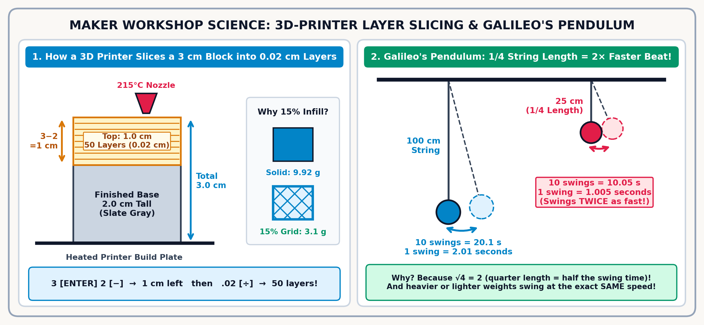

Inside your 3D printer's brass nozzle, solid **PLA (polylactic acid)**—a biodegradable bioplastic fermented from natural cornstarch and sugarcane—softens at $60^\circ\text{C}$ and melts into a smooth, honey-like ribbon around $200^\circ\text{C}$ to $215^\circ\text{C}$, giving off a faint scent like warm breakfast waffles as it prints! Because the stepper motor lifts the nozzle by an exact $0.02\text{ cm}$ ($0.20\text{ mm}$) after every horizontal pass, each new ribbon welds onto the layer below it like microscopic LEGO bricks (with a tiny cross-section of `0.020 [x²]` $\to 0.0004\text{ cm}^2$). Just as the $3.0\text{ cm}$ trophy screenshot at the start of this chapter left $3 - 2 = 1.0\text{ cm}$ ($1.0 \div 0.02 = \mathbf{50\text{ layers}}$) above its $2.0\text{ cm}$ base, watch how you slice a taller $9.0\text{ cm}$ **Fraction Tower** holder whose solid base takes up the bottom $3.2\text{ cm}$. Subtracting the base height via `9 [ENTER] 3.2 [-]` leaves $\mathbf{5.8\text{ cm}}$ of upper wall height, dividing by `[.] 02 [÷]` shows **`290.0 layers`**, and tapping `[f] [LASTX] [×]` rebuilds the exact **`5.8 cm`** height:

| Keystroke | Register T | Register Z | Register Y | Register X | What Happens on the Stack |
| :--- | :--- | :--- | :--- | :--- | :--- |
| `9 [ENTER]` | 0 | 0 | 9 | 9 | Enter total tower height ($9.0\text{ cm}$) and copy to Shelf $Y$ |
| `3.2 [-]` | 0 | 0 | 0 | $5.8$ | Subtract the $3.2\text{ cm}$ base to leave $5.8\text{ cm}$ of upper wall |
| `.02 [÷]` | 0 | 0 | 0 | 290 | Divide by $0.02\text{ cm}$ per layer: **290 layers** needed |
| `[f] [LASTX]` | 0 | 0 | 290 | $0.02$ | Recall $0.02\text{ cm}$ layer thickness; $290$ lifts to Shelf $Y$ |
| `[×]` | 0 | 0 | 0 | $5.8$ | Multiply $290 \times 0.02 = \mathbf{5.8\text{ cm}}$ to verify the upper height |

---

### 9.1.5 Timing a Swinging Clock Pendulum

Why does a grandfather clock keep the exact same steady beat whether its swinging weight is heavy brass or light wood—and what happens to the beat if you shorten the string to one-fourth of its original length?

Over four hundred years ago, a young Galileo Galilei watched a bronze oil lamp swinging from a high cathedral ceiling in Pisa. With no stopwatch in the 1500s, Galileo pressed two fingers against his wrist and timed the swinging chandelier against his own heartbeat! Even as the swings died down from wide arcs to tiny nudges, each swing took the exact same number of pulse beats. He later proved that the time a pendulum takes to swing depends on the **length of the string**, not on how heavy the weight is (gravity pulls harder on a heavier bolt, but the heavier bolt has matching inertia, so the two cancel out completely!).

Because a single swing goes by so fast that your thumb on the stopwatch might be a tenth of a second early or late, clockmakers time **10 complete back-and-forth swings** in a row and divide by $10$ to find the average time for a single swing:
$$\text{One-Swing Period} = \text{Total Time for 10 Swings} \div 10, \qquad \text{Swings per Minute} = 60\text{ seconds} \div \text{One-Swing Period}$$

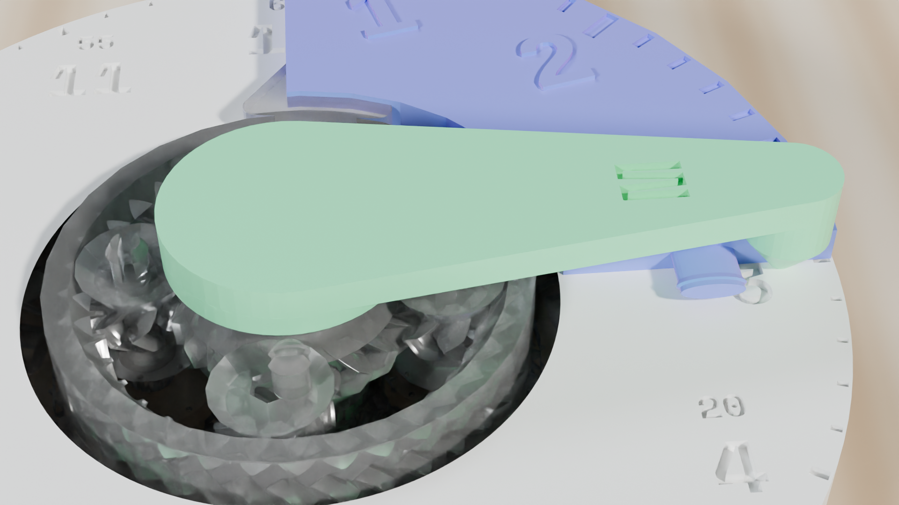

Look closely at the **Planetary Geared Clock** and its removable $90^\circ$ clock quadrants above. In a mechanical grandfather clock, a swinging pendulum rocks an anchor-shaped lever (called an **escapement**) that releases one gear tooth on every tick, driving the $60\text{-minute}$ outer ring and $12:1$ planetary hour hand at a steady pace.

Run Galileo's two-length pendulum test with a washer, a string, and a stopwatch. Start with a **$100\text{ cm}$ ($1\text{-meter}$) string**: tie a metal washer to the end, pull it aside about $15^\circ$, and time 10 complete round-trip swings ($20.1\text{ seconds}$). Dividing by $10$ (`20.1 [ENTER] 10 [÷]`) shrinks your thumb's reaction error tenfold to reveal **`2.01` seconds per swing**—and dividing into $60\text{ seconds}$ (`60 [x⇄y] [÷]`) shows **`29.85` swings per minute**. Now test the **$25\text{ cm}$ (quarter-length) surprise**: pinch the string at $25\text{ cm}$, which is one-fourth ($\frac{1}{4}$) of $100\text{ cm}$. Most people guess it will swing four times as fast, but 10 swings take **$10.05\text{ seconds}$** (`10.05 [ENTER] 10 [÷]` $\to \mathbf{1.005\text{ seconds per swing}}$). Comparing against the $100\text{ cm}$ pendulum (`2.01 [x⇄y] [÷]`) lands on $\mathbf{2.0}$: shortening the string to $\frac{1}{4}$ made it swing **twice as fast** ($\sqrt{4} = 2$), because a pendulum's period scales with the **square root** of its length:

| Keystroke | Register T | Register Z | Register Y | Register X | What Happens on the Stack |
| :--- | :--- | :--- | :--- | :--- | :--- |
| `10.05 [ENTER]` | 0 | 0 | $10.05$ | $10.05$ | Enter 10-swing time for the $25\text{ cm}$ pendulum ($10.05\text{ s}$) |
| `10 [÷]` | 0 | 0 | 0 | $1.005$ | Divide by 10 swings: $1.005\text{ seconds}$ per swing |
| `2.01` | 0 | 0 | $1.005$ | $2.01$ | Enter the $100\text{ cm}$ pendulum's 1-swing time ($2.01\text{ s}$) |
| `[x⇄y]` | 0 | 0 | $2.01$ | $1.005$ | Swap $X$ and $Y$ so $2.01\text{ s}$ is ready to be divided by $1.005\text{ s}$ |
| `[÷]` | 0 | 0 | 0 | 2 | Divide $2.01 \div 1.005 = \mathbf{2.0}$ (quarter length swings **twice as fast**) |

---

## 9.2 Solar Ovens, Catapults, Plant Growth & Bakery Scaling

Now let's step from the 3D printer bed to the backyard and kitchen counter, where temperature rises, launch distances, growing bean stems, and baker's dough weights all obey step-by-step stack rules.

### 9.2.1 The Pizza-Box Solar Oven

How can an ordinary cardboard pizza box lined with aluminum foil and clear plastic wrap trap enough sunshine to melt chocolate and marshmallows into gooey s'mores on a sunny afternoon? The shiny foil bounces extra sunlight into the box, the black paper at the bottom soaks up that light as heat, and the clear plastic window plus newspaper insulation trap the warm air inside like a greenhouse!

In 1767, the Swiss alpine naturalist **Horace-Bénédict de Saussure** wondered why mountain sunlight felt just as bright on top of freezing, snow-covered peaks in the Alps as it did in warm valleys below. To prove that trapped sunshine could heat air regardless of the cold mountain wind outside, he built the world's first **solar oven**—an insulated pine box lined with black cork under three layers of clear window glass—and watched the temperature inside climb past $100^\circ\text{C}$ ($212^\circ\text{F}$, the boiling point of water) while he cooked fresh fruit with pure sunlight! In your own pizza-box version of de Saussure's solar collector, you will subtract your starting temperature from your ending temperature to find the **Temperature Rise**, and then divide by the **Heating Time in minutes** to measure how many degrees Celsius your solar oven gains every single minute ($^\circ\text{C/min}$).

**Measuring Solar Heating Speed:**
Place your solar cooker in direct noon sunlight with a graham cracker, marshmallow, and dark chocolate square inside. When the air inside climbs from **$22.5^\circ\text{C}$** to **$78.0^\circ\text{C}$** over **$25\text{ minutes}$**, keying `78 [ENTER] 22.5 [-]` (`78 [ENTER] 22.5 [-] 25 [÷]`) shows a $55.5^\circ\text{C}$ temperature rise and a heating speed of $\mathbf{2.22^\circ\text{C per minute}}$, while `22.5 [ENTER] 78 [g] [%CHG]` confirms a $\mathbf{+246.67\%}$ jump. Angle the foil reflector flap on a compact oven to catch even more direct rays ($20^\circ\text{C} \to 65^\circ\text{C}$ in just $15\text{ minutes}$), and `65 [ENTER] 20 [-] 15 [÷]` clocks **`3.00 °C/min`** ($\mathbf{3.00^\circ\text{C/min}}$) with a `20 [ENTER] 65 [g] [%CHG]` boost of **`+225.0%`** ($\mathbf{+225.0\%}$)!

**How Well Does Newspaper Insulation Trap the Heat?**
How well does your rolled-up newspaper insulation around the edges of the pizza box hold onto that trapped solar warmth when a big cumulus cloud drifts across the sun? At peak noon heat, the oven reaches $78^\circ\text{C}$ in the sun while the outdoor shade temperature is $22^\circ\text{C}$ (so the inside of the box is $78 - 22 = 56^\circ\text{C}$ warmer than the shade). You carry the closed solar oven into the shade for 30 minutes and check the thermometer again: it reads $56^\circ\text{C}$ (which is still $56 - 22 = 34^\circ\text{C}$ warmer than the $22^\circ\text{C}$ shade!). Dividing the remaining warmth by the starting warmth gives the exact **fraction of extra heat kept inside**: $\frac{56 - 22}{78 - 22} = \frac{34^\circ\text{C}}{56^\circ\text{C}} \approx \mathbf{60.71\%}$ kept inside after half an hour in the shade:

| Keystroke | Register T | Register Z | Register Y | Register X | What Happens on the Stack |
| :--- | :--- | :--- | :--- | :--- | :--- |
| `56` | 0 | 0 | 0 | 56 | Enter oven temperature after 30 min in shade ($56^\circ\text{C}$) |
| `[ENTER]` | 0 | 0 | 56 | 56 | Copy $56^\circ\text{C}$ up onto Shelf $Y$ |
| `22 [-]` | 0 | 0 | 0 | 34 | Subtract $22^\circ\text{C}$ shade temp: $34^\circ\text{C}$ of warmth still inside |
| `78` | 0 | 0 | 34 | 78 | Enter peak oven temperature ($78^\circ\text{C}$); $34$ lifts to Shelf $Y$ |
| `[ENTER]` | 0 | 34 | 78 | 78 | Lift $34$ to Shelf $Z$ while copying $78$ onto Shelf $Y$ |
| `22 [-]` | 0 | 0 | 34 | 56 | Subtract $22^\circ\text{C}$ shade temp: $56^\circ\text{C}$ starting warmth above shade |
| `[÷]` | 0 | 0 | 0 | $0.6071$ | Divide remaining warmth by starting warmth ($34 \div 56 = 0.6071$) |
| `100 [×]` | 0 | 0 | 0 | $60.71$ | Convert to percent: **60.71%** of the extra heat stayed trapped |

---

### 9.2.2 Tabletop Catapults & Finding Your Bullseye Average

When you pull back the arm of a tabletop rubber-band catapult and launch a foam ball toward a floor target, why doesn't the ball land on the exact same millimeter every single time? Tiny differences in how your finger releases the lever create a small scatter of landing spots!

By holding your **Unit Circle Volvelle** (or a $90^\circ$ quadrant from your **Planetary Geared Clock**) beside the catapult arm to dial in an exact pullback angle ($30^\circ, 45^\circ,$ or $60^\circ$) before releasing the lever, you can measure each shot's landing distance in centimeters along a floor tape and toss every trial into `[Σ+]`. Why do we test $45^\circ$ first? As Italian mathematician **Niccolò Tartaglia** and **Galileo Galilei** discovered when studying projectile arcs, a low $30^\circ$ launch skims fast across the floor but touches down early, while a steep $60^\circ$ launch climbs high into the air without traveling far forward—making the halfway **$45^\circ$ angle** the sweet spot for maximum horizontal distance! Once your five trials are in the `[Σ+]` basket, `[g] [x̄]` and `[g] [MAD]` reveal both your center bullseye distance and how tightly grouped your shots are.

**Launch Average & Spread at $45^\circ$:**
Tape a measuring tape down the hallway floor, set a $45^\circ$ pullback angle with your **Unit Circle Volvelle**, and launch 5 shots in a row: **$182\text{ cm}, 195\text{ cm}, 188\text{ cm}, 201\text{ cm},$ and $189\text{ cm}$**. Clearing the basket (`[g] [CLΣ]`), logging all five chalk marks with `[Σ+]`, and tapping `[g] [x̄]` then `[g] [MAD]` levels the five shots into a bullseye center of $\mathbf{191.00\text{ cm}}$ ($955 \div 5$) with a Mean Absolute Deviation of $\mathbf{5.60\text{ cm}}$!

Watch the shelf-by-shelf sequence during a quick 3-shot patio calibration check ($150\text{ cm}$, $162\text{ cm}$, and $156\text{ cm}$), where `[g] [CLΣ] 150 [Σ+] 162 [Σ+] 156 [Σ+] [g] [x̄]` levels the three distances out to **`156.00 cm`**:

| Keystroke | Register T | Register Z | Register Y | Register X | What Happens on the Stack |
| :--- | :--- | :--- | :--- | :--- | :--- |
| `[g] [CLΣ]` | 0 | 0 | 0 | 0 | Clear the statistics registers |
| `150 [Σ+]` | 0 | 0 | 0 | 1 | Add Shot 1 ($150\text{ cm}$); screen shows count $= 1$ |
| `162 [Σ+]` | 0 | 0 | 0 | 2 | Add Shot 2 ($162\text{ cm}$); screen shows count $= 2$ |
| `156 [Σ+]` | 0 | 0 | 0 | 3 | Add Shot 3 ($156\text{ cm}$); screen shows count $= 3$ |
| `[g] [x̄]` | 0 | 0 | 0 | 156 | Compute the average (mean) landing distance ($156.00\text{ cm}$) |

How tightly grouped were those three practice shots ($150\text{ cm}, 162\text{ cm}, 156\text{ cm}$) around the $156.00\text{ cm}$ center? Shot 1 was $6\text{ cm}$ short, Shot 2 was $6\text{ cm}$ long, and Shot 3 landed right on the nose ($0\text{ cm}$). Since all three shots are still sitting in your running-total basket, one tap of `[g] [MAD]` via `[g] [CLΣ] 150 [Σ+] 162 [Σ+] 156 [Σ+] [g] [MAD]` returns **`4.00 cm`**—confirming that $(6 + 6 + 0) \div 3 = \mathbf{4.00\text{ cm}}$ of average spread from the bullseye!

**Will Your Catapult Shots Land Inside the Target Ring?**
Will your 5-trial catapult shots (with a center average of $191.00\text{ cm}$ and a Mean Absolute Deviation of $5.60\text{ cm}$) land inside a circular floor target centered at $190\text{ cm}$ with a radius of $15\text{ cm}$ (stretching from $175\text{ cm}$ on the near edge to $205\text{ cm}$ on the far edge)?

Engineers often check a launcher's **two-deviation landing zone** ($\text{Mean} \pm 2 \times \text{MAD}$) to see where almost all shots will touch down. To find the near edge of that landing zone, enter your mean (`191 [ENTER]`), double your $5.60\text{ cm}$ spread (`5.60 [ENTER] 2 [×]` $\to 11.20\text{ cm}$), and press `[-]` to land on $\mathbf{179.80\text{ cm}}$—well past the target ring's $175\text{ cm}$ front rim. Then, because subtracting $11.20\text{ cm}$ automatically saved $11.20$ inside `[f] [LASTX]`, you don't even have to type `11.20` again to check the far edge: simply enter `191`, tap `[f] [LASTX]` to pull $11.20\text{ cm}$ back onto Shelf $X$, and press `[+]` to find the far boundary at $\mathbf{202.20\text{ cm}}$ (while the near edge $179.80\text{ cm}$ stays visible right above it on Shelf $Y$). Both edges ($179.80\text{ cm}$ to $202.20\text{ cm}$) sit comfortably inside the $175\text{ cm}$ to $205\text{ cm}$ target ring! Now let's trade the fast arc of a catapult for the slow, steady climb of a living plant by the window.

---

### 9.2.3 Watching a Window Bean Sprout Race Toward the Sun

Have you ever planted a bean seed in a clear cup by a sunny window and noticed that it seems to grow taller overnight? Plants grow too slowly for your eyes to see in real time, like the hour hand of a clock—but when you measure the stem height in millimeters every two days, the stack lets you calculate its exact **growth speed in millimeters per day**!

| Observation Day | Stem Height ($\text{mm}$) | 2-Day Growth Gain | What the Bean Plant Is Doing |
| :--- | :---: | :---: | :--- |
| **Day 2** | $12\text{ mm}$ | $+12\text{ mm}$ | Seed coat splits; arched green stem ("hypocotyl") peeks up |
| **Day 4** | $28\text{ mm}$ | $+16\text{ mm}$ | White root network anchors into the damp paper towel |
| **Day 6** | $49\text{ mm}$ | $+21\text{ mm}$ | First pair of solar-panel leaves unfold to catch window light |
| **Day 8** | $74\text{ mm}$ | $+25\text{ mm}$ | Leaves convert sunlight and water into fast stem growth |
| **Day 10** | $105\text{ mm}$ | $+31\text{ mm}$ | Peak growth spurt as second leaf tier opens |
| **Day 12** | $138\text{ mm}$ | $+33\text{ mm}$ | Tall stem thickens and reaches toward the window glass |
| **Day 14** | $172\text{ mm}$ | $+34\text{ mm}$ | Full $17.2\text{ cm}$ seedling ready for a garden pot |

Look closely at the 14-day sprout log above: once the first green leaves unfold after Day 4, the sprout shoots up from $28\text{ mm}$ on Day 4 to $105\text{ mm}$ on Day 10! Dividing the height gain by the elapsed days (`105 [ENTER] 28 [-] 10 [ENTER] 4 [-] [÷]`) shows that the stem climbed $77\text{ mm} \div 6\text{ days} \approx \mathbf{12.83\text{ mm/day}}$—and comparing the Day 14 height ($172\text{ mm}$) against Day 2 ($12\text{ mm}$) with `12 [ENTER] 172 [g] [%CHG]` reveals a $\mathbf{+1333.33\%}$ jump!

Watch how both measurements—daily growth speed *and* percentage growth—chain together on a second sprout that grew from $15\text{ mm}$ to $75\text{ mm}$ over $5\text{ days}$. Finding the daily growth speed with `75 [ENTER] 15 [-] [5] [÷]` yields **`12.0 mm/day`**, and checking the percentage growth via `15 [ENTER] 75 [g] [%CHG]` confirms **`+400.0%`**:

| Keystroke | Register T | Register Z | Register Y | Register X | What Happens on the Stack |
| :--- | :--- | :--- | :--- | :--- | :--- |
| `75` | 0 | 0 | 0 | 75 | Enter ending sprout height ($75\text{ mm}$) |
| `[ENTER]` | 0 | 0 | 75 | 75 | Copy ending height onto Shelf $Y$ |
| `15` | 0 | 0 | 75 | 15 | Enter starting sprout height ($15\text{ mm}$) |
| `[-]` | 0 | 0 | 0 | 60 | Subtract to find total height gained ($75 - 15 = 60\text{ mm}$) |
| `5` | 0 | 0 | 60 | 5 | Enter number of growing days ($5\text{ days}$) |
| `[÷]` | 0 | 0 | 0 | 12 | Divide height gained by days ($60 \div 5 = 12.0\text{ mm/day}$) |
| `15 [ENTER]` | 0 | 12 | 15 | 15 | Enter starting height ($15\text{ mm}$) onto Shelf $Y$ |
| `75 [g] [%CHG]` | 0 | 12 | 15 | 400 | Find percent increase from $15\text{ mm}$ to $75\text{ mm}$ ($+400.0\%$) |

Shelf $X$ shows a total growth of $\mathbf{+400.0\%}$ ($60\text{ mm}$ of new stem divided by the $15\text{ mm}$ starting height is $4$ full times more height, so the plant now stands $5\times$ as tall as on Day 1), while Shelf $Z$ still holds its daily speed of $\mathbf{12.0\text{ mm/day}}$.

---

### 9.2.4 Scaling Bread & Smoothie Recipes

Why do professional bread and pizza bakers weigh their ingredients in grams on a digital kitchen scale instead of scooping flour with measuring cups—and why do they call the flour weight **$100\%$** even when all the ingredients add up to $171.5\%$?

If you scoop flour with a cup, packing the flour tightly can sneak $30$ extra grams into the bowl and make your pizza crust or bread loaf dry and heavy. With **Baker's Percentages**, the flour is always the $100\%$ anchor, and every other ingredient (water, yeast, salt) is simply a percentage of the flour weight. That means you can scale a recipe to feed 4 people or 400 people in seconds.

| Ingredient | Baker's Percentage |
| :--- | :--- |
| **Bread Flour** | $100.0\%$ (Base Ingredient) |
| **Water (Hydration)** | $68.0\%$ |
| **Yeast** | $1.5\%$ |
| **Salt** | $2.0\%$ |
| **Total Formula** | **$171.5\%$** |

**Scaling Multi-Loaf Bakery Batches:**
Because the SC-6 percentage key `[%]` calculates a percentage of Shelf $Y$ *without* erasing Shelf $Y$, your $100\%$ flour anchor stays alive on Shelf $Y$ for every ingredient! To bake 7 loaves ($500\text{ g}$ flour each) for a 28-guest dinner, multiplying `500 [ENTER] 7 [×]` sets your $100\%$ flour anchor at $\mathbf{3,500\text{ g}}$, and then `3500 [ENTER] 68 [%]` ($\mathbf{2,380\text{ g}}$ water at $68\%$), `3500 [ENTER] 2 [%]` ($\mathbf{70\text{ g}}$ salt at $2\%$), and `3500 [ENTER] 1.5 [%]` ($\mathbf{52.5\text{ g}}$ yeast at $1.5\%$) measure every ingredient from that same $3,500\text{ g}$ anchor ($\mathbf{6,002.5\text{ g}}$ total dough).

Watch all four stack shelves in action when you scale twelve golden loaves of country sourdough ($450\text{ g}$ flour per loaf, $65\%$ water, $2\%$ salt): finding total flour (`450 [ENTER] 12 [×]` $\to$ **`5,400 grams`**), $65\%$ water (`5400 [ENTER] 65 [%]` $\to$ **`3,510 grams`**), and $2\%$ salt (`5400 [ENTER] [2] [%]` $\to$ **`108 grams`**) keeps every weight visible at once:

| Keystroke | Register T | Register Z | Register Y | Register X | What Happens on the Stack |
| :--- | :--- | :--- | :--- | :--- | :--- |
| `450 [ENTER]` | 0 | 0 | 450 | 450 | Enter flour weight for 1 loaf ($450\text{ g}$) |
| `12 [×]` | 0 | 0 | 0 | 5400 | Multiply by 12 loaves to find total flour ($5,400\text{ g}$) |
| `65 [%]` | 0 | 0 | 5400 | 3510 | Find $65\%$ of $5,400\text{ g}$ for water ($3,510\text{ g}$); $5,400$ stays on Shelf $Y$ |
| `5400 [ENTER]` | 5400 | 3510 | 5400 | 5400 | Place the $5,400\text{ g}$ flour base on Shelf $Y$ |
| `2 [%]` | 5400 | 3510 | 5400 | 108 | Find $2\%$ of $5,400\text{ g}$ for salt ($108\text{ g}$) |

Look at all four stack shelves at the end of the sequence: Shelf $X$ holds your $\mathbf{108\text{ grams}}$ of salt, Shelves $Y$ and $T$ hold your $\mathbf{5,400\text{ grams}}$ of flour, and Shelf $Z$ still holds your $\mathbf{3,510\text{ grams}}$ of water—all three recipe weights visible at once without writing a single number on a flour-dusted notepad.

**Scaling Down a Liquid Measuring Cup Recipe with Fraction Towers:**
What if a cookbook recipe uses fractional measuring cups and you want to make a smaller or larger batch? Take a Saturday-morning pancake recipe that calls for $1\ \frac{3}{4}$ cups of milk to make 8 fluffy pancakes, when you are making breakfast for just two people ($2$ pancakes, or $\frac{2}{8} = \frac{1}{4}$ of the recipe).

Before touching the keypad, picture this with your **Fraction Towers** right beside your glass measuring pitcher: $1$ whole tower plus three $\frac{1}{4}$ blocks equals seven $\frac{1}{4}$ blocks ($\frac{7}{4}$). When you divide that stack by $4$, you are splitting each $\frac{1}{4}$ block into 4 equal pieces, which turns fourths into sixteenths ($\frac{7}{16}$ of a cup)! On your SC-6, entering the mixed fraction with `1 [.] 3 [.] 4 [ENTER]` stages $1\ \frac{3}{4}$ ($7/4 = 1.75$) onto Shelf $Y$, and dividing by `4 [÷]` lands directly on **`7/16`** cup of milk ($0.4375\text{ cup}$)—which is just a splash under the $\frac{1}{2}\text{-cup}$ ($8/16$) mark, or exactly $7\text{ tablespoons}$ since there are $16\text{ tablespoons}$ in $1\text{ cup}$!

Now try scaling up and down for two STEM Bake Sale treats! First, a single batch of trail-mix granola bars calls for $2\ \frac{1}{4}$ cups of rolled oats, and you need $4$ batches for the bake sale table.

Picture $2\ \frac{1}{4} \times 4$ with your **Fraction Towers**: four $2$-whole towers make $8$ wholes, and four $\frac{1}{4}$ blocks snap together into $1$ more whole tower ($8 + 1 = 9$). Checking on the SC-6 using mixed-fraction entry via `2 [.] 1 [.] 4 [ENTER] [4] [×] [a ᵇ/c]` confirms **`9 cups`**—multiplying $2\ \frac{1}{4}$ by $4$ gives an exact $\mathbf{9\text{ cups}}$ of oats!

Second, to wash down the warm granola bars, you blend $3\ \frac{1}{2}$ cups of berry smoothie and pour it equally into $4$ tasting cups for your baking team. Picture $3\ \frac{1}{2}$ as seven $\frac{1}{2}\text{-cup}$ blocks ($7/2$): when you slice each half-cup into 4 equal shares, halves turn into eighths ($7/8$). Dividing the mixed-number volume by 4 on the stack with `3 [.] 1 [.] 2 [ENTER] [4] [÷] [a ᵇ/c]` gives **`7/8 cup`**:

| Keystroke | Register T | Register Z | Register Y | Register X | What Happens on the Stack |
| :--- | :--- | :--- | :--- | :--- | :--- |
| `3 [.] 1 [.] 2` | 0 | 0 | 0 | $3\ 1/2$ | Enter mixed number $3\ \frac{1}{2}$ cups |
| `[ENTER]` | 0 | 0 | $3\ 1/2$ | $3\ 1/2$ | Push $3\ \frac{1}{2}$ onto Shelf $Y$ |
| `4` | 0 | 0 | $3\ 1/2$ | 4 | Enter 4 equal cups |
| `[÷]` | 0 | 0 | 0 | $7/8$ | Divide $3\ \frac{1}{2} \div 4 = 7/8$ cup |
| `[FDISP]` | 0 | 0 | 0 | $0.875$ | Toggle between exact fraction `7/8` and decimal `0.875` |

Each tasting cup gets $\mathbf{7/8\text{ cup}}$ ($0.875\text{ cup}$) of smoothie—just one eighth of a cup shy of a full cup, so you can pour it right up to the $\frac{3}{4}\text{-cup}$ plus $\frac{1}{8}\text{-cup}$ line on your kitchen pitcher!

---

## 9.3 Gears, Hydraulics, Drones & Solar Tilt

With our kitchen and backyard experiments logged, we are ready to build mechanical and electrical machines—exploring how gear trains and water syringes multiply force, and how drone pilots and solar engineers budget electrical energy.

### 9.3.1 How Bicycle & Robot Gears Trade Speed for Super-Strength

How can a tiny electric motor that spins super fast—but is weak enough to stop with your finger—lift a heavy crate or turn the hands of a clock when you connect it through a train of gears?

In the 1490s, Renaissance artist and inventor **Leonardo da Vinci** filled his *Codex Madrid* notebooks with detailed drawings of interlocking wooden and brass gear wheels—showing his workshop apprentices that every mesh between a small gear and a big gear is really a fraction and a ratio you can count with your fingertips! You feel this exact gear math in your legs every time you click the thumb-shifter on a **multi-speed bicycle**: when you pedal up a steep hill, the bicycle's rear derailleur guides the steel chain onto a wide, many-toothed sprocket on the back wheel so your legs spin easily while multiplying your climbing force; on a flat road, shifting to a tiny 12-tooth rear sprocket makes one turn of your pedals spin the back wheel three or four times for top speed!

When two gear wheels mesh directly together, their teeth lock one tooth at a time. When a small **Driver Gear** with only $12$ teeth meshes with a big **Driven Gear** that has $36$ teeth, one full spin of the small gear only pushes $12$ teeth around the edge of the big gear. Because $36 \div 12 = 3$, the small gear has to spin **$3$ full times** just to turn the big gear **once**! The big gear spins $3$ times slower, **but it pushes with $3$ times the lifting strength**.

What if $3$ times stronger still isn't strong enough to lift a heavy robot arm? Instead of building one gigantic gear the size of a dinner plate, engineers connect **two gear pairs in a row** on a shared middle axle—just like the hidden gears inside your **Planetary Geared Clock**:

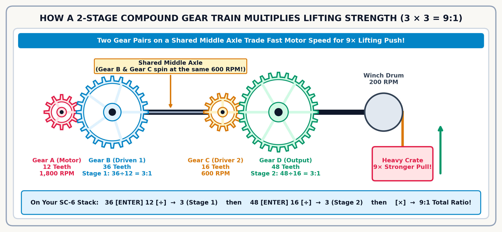

Look at the diagram above to see how each stage hands off the push. In **Stage 1 (Red to Blue)**, Small Gear A ($12\text{ teeth}$) turns Big Gear B ($36\text{ teeth}$): dividing `36 [ENTER] 12 [÷]` (`36 [ENTER] 12 [÷]`) gives a **`3.0`** ($3:1$) ratio, slowing an $1,800\text{ RPM}$ motor down to $600\text{ RPM}$ and multiplying its strength by $3\times$.

Next, in **Stage 2 on the Shared Middle Axle (Gold to Green)**, Small Gear C ($16\text{ teeth}$) is locked onto the same rod as Gear B and turns Big Gear D ($48\text{ teeth}$). Dividing `48 [ENTER] 16 [÷]` (`48 [ENTER] 16 [÷]`) places the second **`3.0`** on Shelf $X$ while holding Stage 1's `3.0` on Shelf $Y$, and tapping `[×]` multiplies them into a **`9.0`** ($9:1$) compound reduction—slowing the winch drum to $1800 \div 9 = \mathbf{200\text{ RPM}}$ with **$9\times$ the pulling muscle**! *(If you accidentally hook the motor to the big gear first, you get $12 \div 36 = 0.3333$—one tap of `[x⇄y]` before `[÷]` flips the tooth counts back into place.)*
$$\text{Total Gear Ratio} = (\text{Stage 1 Driven Teeth} \div \text{Stage 1 Driver Teeth}) \times (\text{Stage 2 Driven Teeth} \div \text{Stage 2 Driver Teeth})$$

| Reduction Stage | Driver Gear | Driven Gear | Stage Ratio |
| :--- | :---: | :---: | :---: |
| **Stage 1 (Input Shaft)** | Gear A ($12\text{ teeth}$) | Gear B ($36\text{ teeth}$) | $36 \div 12 = 3:1$ |
| **Stage 2 (Middle Shaft)** | Gear C ($16\text{ teeth}$) | Gear D ($48\text{ teeth}$) | $48 \div 16 = 3:1$ |
| **Compound Output** | — | — | **$3 \times 3 = 9:1$** |

What if your robotics team tests a single $4:1$ gear pair first ($16\text{-tooth}$ driver turning a $64\text{-tooth}$ driven gear via `64 [ENTER] 16 [÷]` $\to$ **`4.0 : 1`**), and then builds a two-stage winch where Stage 1 is $40 \div 10$ ($4:1$) and Stage 2 is $30 \div 15$ ($2:1$)? Watch how Shelf $Z$ holds Stage 1 (`4`) while you divide Stage 2 (`30 ÷ 15 = 2`), then multiplies both stages (`40 [ENTER] 10 [÷] 30 [ENTER] 15 [÷] [×]` $\to$ **`8.0 : 1`**):

| Keystroke | Register T | Register Z | Register Y | Register X | What Happens on the Stack |
| :--- | :--- | :--- | :--- | :--- | :--- |
| `40 [ENTER] 10 [÷]` | 0 | 0 | 0 | 4 | Stage 1 gear ratio: $40 \div 10 = 4.0$ |
| `30 [ENTER]` | 0 | 4 | 30 | 30 | Enter Stage 2 driven gear ($30\text{ teeth}$); lifts $4$ onto Shelf $Z$ |
| `15 [÷]` | 0 | 0 | 4 | 2 | Stage 2 gear ratio: $30 \div 15 = 2.0$; drops $4$ onto Shelf $Y$ |
| `[×]` | 0 | 0 | 0 | 8 | Multiply Stage 1 by Stage 2: $4 \times 2 = 8.0$ |

Shelf $X$ displays $8.0$, proving that the two-stage gear train gives an $\mathbf{8.0 : 1}$ strength boost—trading eight fast turns of the motor shaft for one slow, high-torque turn of the winch drum.

---

### 9.3.2 Lifting Heavy Books with Water Syringes

How can a gentle push from your thumb on a small water-filled plastic syringe lift a heavy stack of dictionaries sitting on top of a wide syringe? In 1646, the young French scientist **Blaise Pascal (1623–1662)** staged a dramatic experiment to prove that water transmits pressure equally in every direction. Pascal attached a tall, skinny vertical tube no wider than a drinking straw to the lid of a heavy, water-filled oak barrel. When he climbed a ladder and poured just a single cup of water down that skinny tube, the water pressure multiplied across the wide barrel walls so powerfully that the heavy oak staves burst open!

You can harness Pascal's water-pressure multiplier right on your desk—without bursting any barrels! Connect a narrow $1.0\text{ cm}$ master syringe to a wide $3.0\text{ cm}$ lifting syringe with clear vinyl tubing filled with water. When you push the small plunger, the water carries your pressure equally to every square centimeter of the big plunger—the exact same hydraulic principle that lets a driver stop a $4,000\text{-pound}$ car with one foot on the brake pedal.

Why does making the big plunger $3\times$ wider multiply your lifting push by **$9\times$** instead of $3\times$?

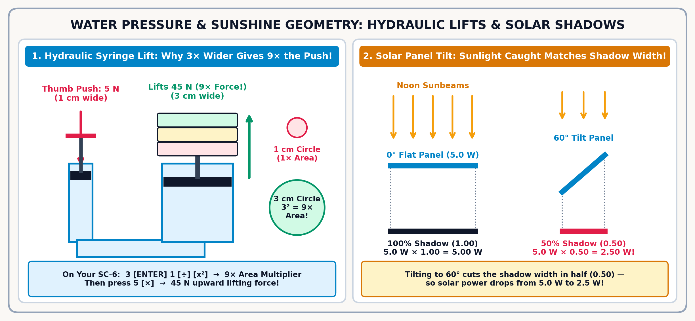

Look at the water-pressure diagram above: a syringe plunger is a circle, and just like you discovered in Chapter 6, a circle's area grows with the **square** of its width. When you divide the $3.0\text{ cm}$ wide plunger by the $1.0\text{ cm}$ narrow plunger (`3 [ENTER] 1 [÷]` $\to 3.0$) and tap `[x²]`, its circular face packs **`9.0`** times the area—turning your gentle thumb push into **nine times the upward lifting force** ($\text{Output Lift} = 9 \times \text{Thumb Push}$), the exact same hydraulic secret that powers giant yellow excavators and fire-truck aerial ladders. What is the trade-off for getting $9\times$ the push? Watch the water inside the vinyl tube! Because the big syringe has $9\times$ the circle area, pushing the small $1.0\text{ cm}$ plunger down by **$9.0\text{ cm}$** only raises the big $3.0\text{ cm}$ plunger by **$1.0\text{ cm}$**. Just like a $9:1$ gear train trades 9 fast turns for 1 super-strong turn, a hydraulic syringe lift trades **$9\times$ the push distance** for **$9\times$ the lifting strength**!

Now test that $9\times$ hydraulic multiplier under a stack of heavy hardcover dictionaries! If you press the small plunger with a gentle thumb force of $5.0\text{ Newtons}$ (about half a kilogram of push), how many Newtons of upward force—and how many kilograms of books (where $1\text{ kg}$ weighs $9.8\text{ Newtons}$ in Earth's gravity)—can the large syringe raise? Multiply the $9\times$ area multiplier by your $5.0\text{ N}$ thumb push (`9 [ENTER] 5.0 [×]`) to reach $\mathbf{45.0\text{ Newtons}}$ of upward lift, then divide by Earth's gravity (`9.8 [÷]`) to land on $\mathbf{4.59\text{ kg}}$ (over $10\text{ pounds}$ of books lifted with one thumb!):

| Keystroke | Register T | Register Z | Register Y | Register X | What Happens on the Stack |
| :--- | :--- | :--- | :--- | :--- | :--- |
| `9 [ENTER]` | 0 | 0 | 9 | 9 | Enter the $9\times$ syringe area multiplier onto Shelf $Y$ |
| `5.0 [×]` | 0 | 0 | 0 | $45.0$ | Multiply by your $5.0\text{ N}$ thumb push: $45.0\text{ Newtons}$ of lift |
| `9.8 [÷]` | 0 | 0 | 0 | $4.59$ | Divide by gravity ($9.8\text{ N/kg}$): lifts **4.59 kg** of books |

---

### 9.3.3 Quadcopter Drone Batteries & Safe Flight Timers

Why do drone pilots always set a countdown timer to land when their rechargeable battery still has $20\%$ charge left—and how can you predict your exact hover time before spinning up the propellers?

Think of a drone battery's **milliamp-hour ($\text{mAh}$) rating** like a fuel tank of electrical energy, and the four motors' **current draw ($\text{mA}$)** like how fast the motors sip from that tank. Inside a quadcopter's lightweight **lithium-polymer (LiPo)** battery pack, microscopic lithium ions shuttle back and forth through a polymer gel: if you ever drain the pack all the way to $0\%$, the chemical layers inside puff up with gas and permanently lose their ability to hold a charge, while the sudden voltage drop mid-flight leaves the propellers without enough power to cushion your landing! That is why aerospace engineers and RC pilots always follow the **$80\%$ Safe Battery Rule**—multiplying the battery's capacity by $0.80$ (so $20\%$ stays untouched in reserve), multiplying by $60\text{ minutes per hour}$, and dividing by the hover current in milliamps:
$$\text{Safe Flight Time (Minutes)} = (\text{Battery Capacity in mAh} \times 0.80 \times 60\text{ minutes}) \div \text{Hover Current in mA}$$

On a lightweight $850\text{ mAh}$ pack whose motors draw $4,200\text{ mA}$ (`850 [ENTER] 0.8 [×] 60 [×] 4200 [÷]`), you get **$9.714\text{ minutes}$** ($9\text{ min } 43\text{ s}$ via `[g] [▸HMS]`) of safe flight—or **$7.418\text{ minutes}$** ($\mathbf{-23.64\%}$ via `[g] [%CHG]`) if a $45\text{-gram}$ action camera raises the motor draw to $5,500\text{ mA}$.

To get more flight time back when carrying a custom 3D-printed prop-guard frame ($5,000\text{ mA}$ draw), upgrade to a larger $1,200\text{ mAh}$ battery! Following the $80\%$ safe battery rule (`1200 [ENTER] .8 [×] 60 [×] 5000 [÷]`) lands on **`11.52 min`**:

| Keystroke | Register T | Register Z | Register Y | Register X | What Happens on the Stack |
| :--- | :--- | :--- | :--- | :--- | :--- |
| `1200 [ENTER]` | 0 | 0 | 1200 | 1200 | Enter battery capacity ($1,200\text{ mAh}$) |
| `.8 [×]` | 0 | 0 | 0 | 960 | Multiply by $0.80$ safe battery rule: $960\text{ mAh}$ usable |
| `60 [×]` | 0 | 0 | 0 | 57600 | Multiply by $60\text{ minutes per hour}$ ($57,600\text{ mA}\cdot\text{min}$) |
| `5000` | 0 | 0 | 57600 | 5000 | Enter hover current draw ($5,000\text{ mA}$) |
| `[÷]` | 0 | 0 | 0 | $11.52$ | Divide usable battery by current ($57,600 \div 5,000 = 11.52\text{ min}$) |

The bottom line displays $11.52\text{ minutes}$ ($11\text{ minutes}$ and $0.52 \times 60 \approx 31\text{ seconds}$), showing that the upgraded $1,200\text{ mAh}$ battery lets the quadcopter safely hover for **11 minutes 31 seconds** before the landing timer beeps.

---

### 9.3.4 Solar Panel Tilt Angle & Sunlight Shadow Factor

Why does a solar panel make full power when aimed straight at the noon sun ($0^\circ$ tilt), yet drop to half power when tilted at $60^\circ$? Try this experiment on your desk right now: hold a flashlight straight down ($0^\circ$) over a sheet of graph paper and count how many squares the bright circle of light covers. Now tilt the flashlight at a steep $60^\circ$ angle: that exact same beam of light stretches out into an oval twice as wide, spreading its energy thin across twice as many squares! Conversely, if you hold a flat solar panel under the noon sun and tilt it slowly, the **shadow** it casts on the table directly underneath gets narrower and narrower.

A solar panel only catches as much beam width of sunshine as its flat shadow—and you can read that exact **Sunlight Shadow Factor** right off your 3D-printed **Unit Circle Volvelle**. When you turn the pointer of the Unit Circle Volvelle to $0^\circ, 30^\circ, 45^\circ,$ or $60^\circ$, the horizontal window displays the shadow factor ($1.0000, 0.8660, 0.7071,$ and $0.5000$), showing the exact decimal fraction of direct sunlight caught by the tilted panel.

**Solar Power at Different Tilt Angles:**
Set a classroom solar panel on a sunny windowsill where it produces $5.00\text{ Watts}$ when pointed straight at the sun ($0^\circ$ tilt). How many Watts does it produce when the sun strikes it at tilt angles of $30^\circ, 45^\circ,$ and $60^\circ$? By staging the panel's $5.0\text{-Watt}$ peak rating on Shelf $Y$ (`5 [ENTER]`) and multiplying by the Volvelle shadow factor on Shelf $X$, you can test all three angles in seconds. At a gentle **$30^\circ$ tilt** (shadow factor $0.8660$), multiplying via `5 [ENTER] 0.866 [×]` yields $\mathbf{4.33\text{ Watts}}$—showing that even a $30^\circ$ angle still captures $86.6\%$ of peak sunshine! At a medium **$45^\circ$ tilt** (shadow factor $0.7071$), keying in `5 [ENTER] 0.7071 [×]` gives $\mathbf{3.54\text{ Watts}}$ ($70.7\%$ of peak). And at a steep **$60^\circ$ tilt** (shadow factor $0.5000$), pressing `5 [ENTER] .5 [×]` lands on an exact $\mathbf{2.50\text{ Watts}}$ ($50.0\%$—half the shadow width means half the electrical power):

| Panel Tilt Angle | Sunlight Shadow Factor (from Volvelle) | Peak Watts | Output Power ($\text{Peak} \times \text{Factor}$) | Percent of Peak |
| :--- | :---: | :---: | :---: | :---: |
| **$0^\circ$ (Flat to the Sun)** | $1.0000$ | $5.00\text{ W}$ | $\mathbf{5.00\text{ W}}$ | $100.0\%$ |
| **$30^\circ$ Tilt** | $0.8660$ | $5.00\text{ W}$ | $\mathbf{4.33\text{ W}}$ | $86.6\%$ |
| **$45^\circ$ Tilt** | $0.7071$ | $5.00\text{ W}$ | $\mathbf{3.54\text{ W}}$ | $70.7\%$ |
| **$60^\circ$ Tilt** | $0.5000$ | $5.00\text{ W}$ | $\mathbf{2.50\text{ W}}$ | $50.0\%$ |

That shadow-factor table explains why rooftop solar installers tilt fixed solar panels to match a city's **latitude on Earth**—tilting panels around $30^\circ$ in southern cities like Austin, New Orleans, or Cairo, and around $45^\circ$ in northern cities like Minneapolis, Portland, or Milan—so the panel faces as squarely as possible into the noon sun all year round!

**Adding Up a Full School Day of Solar Energy:**
As the sun arcs across the sky from morning to afternoon, how much total electrical energy does your panel collect over an 8-hour school day? In the morning (9:00 AM to 12:00 PM, $60^\circ$ tilt), the panel produces $2.50\text{ Watts}$ for $3\text{ hours}$ ($7.50\text{ Watt-hours}$). Around noon (12:00 PM to 2:00 PM, $0^\circ$ tilt), it produces a full $5.00\text{ Watts}$ for $2\text{ hours}$ ($10.00\text{ Watt-hours}$). And in the afternoon (2:00 PM to 5:00 PM, $45^\circ$ tilt), it produces $3.54\text{ Watts}$ for $3\text{ hours}$ ($10.62\text{ Watt-hours}$).

Instead of jotting down subtotals on paper, you can clear your statistics basket with `[g] [CLΣ]`, multiply the Watts by the hours for each part of the day (`2.5 [ENTER] 3 [×] [Σ+]` for morning, `5 [ENTER] 2 [×] [Σ+]` for noon, and `3.54 [ENTER] 3 [×] [Σ+]` for afternoon), and tap `[f] [Σx]` to ring up the full day's harvest of $\mathbf{28.12\text{ Watt-hours}}$—then divide by `1000 [÷]` to convert into $\mathbf{0.02812\text{ kWh}}$:

| Keystroke | Register T | Register Z | Register Y | Register X | What Happens on the Stack |
| :--- | :--- | :--- | :--- | :--- | :--- |
| `[g] [CLΣ]` | 0 | 0 | 0 | 0 | Clear the statistics basket before starting the daily log |
| `2.5 [ENTER] 3 [×]` | 0 | 0 | 0 | $7.5$ | Morning energy: $2.50\text{ W} \times 3\text{ hours} = 7.50\text{ Wh}$ |
| `[Σ+]` | 0 | 0 | 0 | $1.0000$ | Toss morning energy into the basket ($\text{Count} = 1$) |
| `5 [ENTER] 2 [×]` | 0 | 0 | 0 | $10.0$ | Noon energy: $5.00\text{ W} \times 2\text{ hours} = 10.00\text{ Wh}$ |
| `[Σ+]` | 0 | 0 | 0 | $2.0000$ | Toss noon energy into the basket ($\text{Count} = 2$) |
| `3.54 [ENTER] 3 [×]` | 0 | 0 | 0 | $10.62$ | Afternoon energy: $3.54\text{ W} \times 3\text{ hours} = 10.62\text{ Wh}$ |
| `[Σ+]` | 0 | 0 | 0 | $3.0000$ | Toss afternoon energy into the basket ($\text{Count} = 3$) |
| `[f] [Σx]` | 0 | 0 | 0 | $28.12$ | Sum all three periods: **28.12 Watt-hours** total |
| `1000 [÷]` | 0 | 0 | 0 | $0.02812$ | Divide by 1,000 to convert into **0.02812 kWh** |

---

## 9.4 The Maker's Notebook, Wind Tunnels & Weekend Challenges

Real makers always check how close their physical measurements come to their design target. In this closing section, we will check **Percent Error**, **3D-Printing Snap-Fit Clearance**, and **Archimedes' Density Fingerprint**, and then see how the Wright brothers used a bicycle-shop wind tunnel and triangle trusses to build the first airplane.

### 9.4.1 Maker Lab Engineering Notebook & Measurement Checks

To check your accuracy at the workbench, compare your measured value against the target value using:

$$\text{Percent Error} = (\text{Difference from Target} \div \text{Target Value}) \times 100\%$$

**Checking Percent Error on a Precision Calibration Block:**
A precision 3D-printed calibration bar has a CAD target weight of $9.80665\text{ grams}$, and your digital scale measures $9.7716\text{ grams}$. How close is your print in percent? Because subtracting $9.80665$ automatically saves $9.80665$ inside `[f] [LASTX]`, tapping `[f] [LASTX] [÷]` divides by the target value right away without making you type that six-digit number a second time.

| Keystroke | Register T | Register Z | Register Y | Register X | What Happens on the Stack |
| :--- | :--- | :--- | :--- | :--- | :--- |
| `9.7716` | 0 | 0 | 0 | $9.7716$ | Enter the measured scale weight ($9.7716\text{ g}$) |
| `[ENTER]` | 0 | 0 | $9.7716$ | $9.7716$ | Copy measured weight up onto Shelf $Y$ |
| `9.80665` | 0 | 0 | $9.7716$ | $9.80665$ | Enter the exact target weight ($9.80665\text{ g}$) |
| `[-]` | 0 | 0 | 0 | $-0.03505$ | Subtract to find the raw weight difference ($-0.03505\text{ g}$) |
| `[f] [LASTX]` | 0 | 0 | $-0.03505$ | $9.80665$ | Recall target weight from `LASTX` without re-typing it |
| `[÷]` | 0 | 0 | 0 | $-0.003574$ | Divide difference by target weight |
| `[g] [|x|]` | 0 | 0 | 0 | $0.003574$ | Take absolute value so error is positive |
| `100 [×]` | 0 | 0 | 0 | $0.357$ | Multiply by 100: **0.357%** error (within $0.36\%$!) |

*(Your print is within $0.36\%$ of the target—and `[f] [LASTX]` saved you from re-typing `9.80665`.)*

---

### 9.4.2 3D Printing Snap-Fit Clearance Gap
When 3D printing interlocking parts—like the stacking lips of your **Counting Tiles**, the dovetail slots of the **L-Frame Factoring Stage**, or the $42\text{ mm}$ **Gridfinity Studio Bins**—melted plastic expands slightly as it cools, so engineers leave a small clearance gap of $0.15\text{ mm}$ on each side.

If a round peg is $10.00\text{ mm}$ wide, what is the minimum hole width needed so the peg slides in smoothly?
$$\text{Hole Width} = \text{Peg Width} + (2 \times \text{Clearance Gap}) = 10.00\text{ mm} + (2 \times 0.15\text{ mm}) = 10.30\text{ mm}$$

Doubling the $0.15\text{ mm}$ side clearance and adding it to the $10.00\text{ mm}$ peg width on the stack via `10 [ENTER] .15 [ENTER] 2 [×] [+]` gives a smooth-sliding hole diameter of $\mathbf{10.30\text{ mm}}$.

---

### 9.4.3 Archimedes' Mystery Filament Detective Test
Over two thousand years ago in Syracuse, King Hiero II suspected his goldsmith had secretly mixed cheaper, lighter silver into a solid gold crown—and asked Archimedes to unmask the fraud without scratching the crown! Archimedes realized that every pure material has its own unchangeable **density fingerprint** ($\text{Density} = \text{Weight in Grams} \div \text{Volume in cm}^3$).

You can run that exact Archimedes detective test on two unlabeled spools of black 3D-printing plastic on the back shelf of the maker lab: one is corn-based **PLA** ($1.24\text{ g/cm}^3$, which prints cleanly at $215^\circ\text{C}$), and the other is petroleum-based **ABS** ($1.04\text{ g/cm}^3$, which clogs a $215^\circ\text{C}$ PLA nozzle!). Print a solid $2.0\text{ cm} \times 2.0\text{ cm} \times 2.0\text{ cm}$ test cube from the mystery spool—the exact same $2.0\text{ cm}$ calibration cube size we measured earlier in this chapter (`2 [ENTER] 2 [×] 2 [×]` $\to$ **`8`** $\text{cm}^3$ on Shelf $X$).

When you set that mystery cube on your digital scale, ABS would weigh only $8.32\text{ grams}$, whereas the readout settles at $9.92\text{ grams}$! Typing `9.92` onto Shelf $X$ (lifting `8.0` to Shelf $Y$), tapping `[x⇄y]` to put grams over cubic centimeters, and pressing `[÷]` lands on **`1.24`** ($\mathbf{1.24\text{ g/cm}^3}$)—unmasking the mystery spool as **genuine PLA** (and for a curved 3D print like a chess knight that pushes up $15.0\text{ cm}^3$ of water in a beaker and weighs $18.60\text{ g}$, dividing `18.60 [ENTER] 15 [÷]` reveals the exact same **`1.24`** PLA fingerprint!).

---

### 9.4.4 Workshop Safety Rules & Checking the Wall Outlet

Operating maker space equipment requires following classroom safety rules:

> **Workshop Safety & Electrical Power Rules**
> 1. **Heat Safety:** 3D printer nozzles reach $210^\circ\text{C} - 245^\circ\text{C}$; heated build plates reach $60^\circ\text{C}$. Never touch the nozzle or heated bed while printing.
> 2. **Battery Safety:** Never short-circuit rechargeable batteries or drain them past their $20\%$ reserve margin.
> 3. **Eye Protection:** Always wear safety glasses when launching tabletop catapults, testing water syringes, or clipping plastic support material.
> 4. **Fresh Air:** Always run the classroom air filter when 3D printing.

Have you ever plugged a toaster and a hair dryer into the same wall outlet and heard the circuit breaker click off in the hallway panel? Inside your classroom walls, copper wires warm up as electrical current (**Amps**) flows through them, and the National Electrical Code requires continuous loads to stay below **$80\%$** of a circuit breaker's rating ($15\text{ Amps} \times 0.80 = 12.0\text{ Amps}$).

Plugged into a single $120\text{-Volt}$, $15\text{-Amp}$ classroom wall circuit are four 3D printers ($150\text{ W}$ each), two laptop computers ($65\text{ W}$ each), and an air filter ($80\text{ W}$). On the stack, multiplying the 4 printers (`4 [ENTER] 150 [×]` $\to 600\text{ W}$), adding the 2 laptops (`2 [ENTER] 65 [×] [+]` $\to 730\text{ W}$), and adding the air filter (`80 [+]`) reveals a combined load of $\mathbf{810\text{ Watts}}$. Dividing by the $120\text{-Volt}$ wall voltage (`120 [÷]`) shows that the equipment draws $\mathbf{6.75\text{ Amps}}$ of current. When you compute the $80\%$ safe breaker limit (`15 [ENTER] 80 [%]` $\to \mathbf{12.00\text{ Amps}}$) and swap-subtract (`12 [ENTER] 6.75 [-]`), Shelf $X$ confirms $\mathbf{5.25\text{ Amps}}$ of safety margin to spare:

| Keystroke | Register T | Register Z | Register Y | Register X | What Happens on the Stack |
| :--- | :--- | :--- | :--- | :--- | :--- |
| `4 [ENTER] 150 [×]` | 0 | 0 | 0 | 600 | Four 3D printers at $150\text{ W}$ each $= 600\text{ W}$ |
| `2 [ENTER] 65 [×]` | 0 | 0 | 600 | 130 | Two laptops at $65\text{ W}$ each $= 130\text{ W}$; $600\text{ W}$ waits on Shelf $Y$ |
| `[+]` | 0 | 0 | 0 | 730 | Combine printers and laptops ($600 + 130 = 730\text{ W}$) |
| `80 [+]` | 0 | 0 | 0 | 810 | Add the $80\text{ W}$ air filter: $810\text{ Watts}$ total load |
| `120 [÷]` | 0 | 0 | 0 | $6.75$ | Divide by $120\text{ Volts}$ to find current: **6.75 Amps** |
| `15 [ENTER] .80 [×]` | 0 | 0 | $6.75$ | $12.0$ | Compute $80\%$ safe limit of $15\text{ A}$ breaker: **12.0 Amps** |
| `[x⇄y] [-]` | 0 | 0 | 0 | $5.25$ | Swap and subtract ($12.0 - 6.75$): **5.25 Amps** of safety margin |

---

### 9.4.5 The Wright Brothers' 1901 Bicycle-Shop Wind Tunnel

At the turn of the twentieth century, some of the best-funded laboratories in the world were racing to build the first airplane—and failing. Why did two brothers from Dayton, Ohio, who never attended college and funded their experiments entirely with their own savings, succeed where famous institutions crashed? Because **Wilbur Wright** (1867–1912) and **Orville Wright** (1871–1948) were hands-on makers who trusted careful workshop measurements and notebook math over guesswork.

Long before they ever stood on the windy sand dunes of Kitty Hawk, North Carolina, Wilbur and Orville ran a home-built printing press and a neighborhood bicycle shop called **The Wright Cycle Exchange** at 1127 West Third Street in Dayton. In their back workshop, they brazed lightweight steel frames, trued wire-spoked wheels, and calculated sprocket-and-chain gear ratios ($\text{Driven Teeth} \div \text{Driver Teeth}$) for their own custom bicycle brands, the *Van Cleve* and the *St. Clair*. Bicycles taught the brothers three lessons that no textbook of the 1890s understood: how to build strong, feather-light structures out of triangles and tensioned spokes, how to transmit power efficiently through roller chains and sprockets, and why an unstable vehicle (like a bicycle or an airplane) stays upright not by being rigid and heavy, but by actively banking and steering into every turn.

In the summer of 1901, however, the brothers hit a heartbreaking wall. When they flew their full-size 1901 glider in the coastal winds at Kitty Hawk, its curved wings produced only **one-third** as much upward lift as the official air-pressure tables published by Europe's leading aeronautical scientists promised. Discouraged on the train ride home to Ohio, Wilbur remarked that humanity might not fly for a thousand years.

Back in their Dayton bicycle shop that autumn, the brothers decided to test whether the textbook equations themselves were wrong. First, they mounted a small model wing and a flat metal plate horizontally onto the front handlebars of a St. Clair bicycle and pedaled furiously down a Dayton street to watch how the wind pushed the two surfaces balanced against each other. Then, in October 1901, they cleared a space in the upstairs room above their bike shop and built a **6-foot-long wooden wind tunnel** out of an old starch box with a glass viewing window on top, blown by a two-bladed fan connected to their shop's overhead belt drive.

Inside that homemade wooden tunnel, Orville and Wilbur placed two of the cleverest measuring instruments in engineering history: miniature aerodynamic balances **hacked together out of old hacksaw blades and ground-down bicycle spokes**! Just like the angle pointer and shadow scale on your **Unit Circle Volvelle**, the brothers' bicycle-spoke balance measured the exact angle of each miniature wing slice against the wind and let them read the lift and drag ratios directly off a protractor dial. Over two intense months in late 1901, Wilbur and Orville bent and filed more than **200 miniature wing shapes** out of sheet steel, tested every angle of attack, and filled their pocket notebooks with the first accurate flight tables in human history.

Two years later—on December 17, 1903—those back-room wind-tunnel numbers took to the sky. Even on the 1903 *Wright Flyer* itself, their bicycle-shop DNA was everywhere: to turn the twin wooden propellers in opposite directions from their 12-horsepower engine, Wilbur and Orville linked the engine shaft to the propellers using **heavy-duty bicycle sprockets and roller chains** running through steel tubes (with a $23\text{:}8$ sprocket reduction ratio—$23 \div 8 = 2.875\text{ engine turns}$ for every $1\text{ propeller turn}$—to trade high motor speed for low-speed pushing thrust, just like the compound gear trains you built in this chapter!). Every time you measure a filament strand with calipers, time 10 swings of a pendulum, log catapult trials with `[Σ+]` and `[g] [MAD]`, or test a gear ratio on your SC-6, you are working in the exact spirit of the two bicycle mechanics from Dayton who measured their way into the sky.

### 9.4.6 Why Triangles Hold Up Bridges: Testing Paper Trusses to Failure

One of the first things Wilbur and Orville Wright noticed in their bicycle shop is that a four-sided rectangle pinned at its corners is floppy—push on one corner and it collapses into a tilted parallelogram—whereas a **three-sided triangle** cannot change its shape without bending or breaking one of its sides! That geometric rule is why bicycle frames, bridge trusses, roof rafters, and the internal honeycomb infill inside your 3D-printed math blocks are all built out of **triangles**.

When civil and aerospace engineers design a bridge or an airplane wing, they don't just ask *"How much weight can it hold?"* Anyone can build a bridge out of solid cast iron that holds a heavy load if you don't care how heavy the bridge itself is! Instead, real engineers measure a structure's **Strength-to-Weight Ratio**—dividing the maximum load the bridge holds before buckling by the weight of the bridge itself:

$$\text{Strength-to-Weight Ratio} = \frac{\text{Maximum Load Supported (grams)}}{\text{Mass of the Bridge (grams)}}$$

You can run a real structural engineering lab right at your desk using two hardcover books spaced **$16\text{ centimeters}$ apart**, two identical sheets of notebook or printer paper (each weighing about **$4.5\text{ grams}$**), and a cup of **U.S. pennies** (where each copper-plated zinc penny weighs exactly **$2.50\text{ grams}$** on a digital scale!):

| Bridge Design Across a $16\text{ cm}$ Gap | Bridge Mass ($M$) | Pennies Held ($N$) | Total Load ($2.50\text{ g} \times N$) | Strength-to-Weight Ratio ($\text{Load} \div M$) |
| :--- | :---: | :---: | :---: | :---: |
| **1. Flat Unfolded Sheet of Paper** | $4.5\text{ g}$ | **$2$ pennies** | **$5.0\text{ g}$** | `5 [ENTER] 4.5 [÷]` $\to$ **`1.11×`** its weight |
| **2. Folded Side-Wall Channel (`U`-Beam)** | $4.5\text{ g}$ | **$28$ pennies** | **$70.0\text{ g}$** | `28 [ENTER] 2.5 [×] 4.5 [÷]` $\to$ **`15.56×`** its weight |
| **3. Accordion Triangle Truss (7 Pleats)** | $4.5\text{ g}$ | **$108$ pennies** | **$270.0\text{ g}$** | `108 [ENTER] 2.5 [×] 4.5 [÷]` $\to$ **`60.00×`** its weight! |

Verify the **Accordion Triangle Truss** on your SC-6 stack: multiplying **108 pennies** by **$2.50\text{ g}$ per penny** (`108 [ENTER] 2.5 [×]` $\to \mathbf{270.0\text{ g}}$) and dividing by the **$4.5\text{ g}$** sheet of paper (`4.5 [÷]` $\to \mathbf{60.00}$) shows that folding triangular pleats lets that $4.5\text{-gram}$ sheet hold **60 times its own weight** (`60 [ENTER] 1.1111 [÷]` $\to \mathbf{54\times}$ stronger than the flat sheet!). That is why your 3D-printer slicer fills the inside of your **Fraction Towers** and **Gridfinity Trays** with triangular and honeycomb infill rather than solid plastic—printing in a third of the time while shrugging off classroom drops.

---

### 9.4.7 Three Weekend Maker-Bench Experiments to Try

1. **The Kitchen-Table Pendulum Timing Lab:** Tie a washer to a $100\text{ cm}$ string, time 10 swings with a stopwatch, and divide by $10$ on your SC-6 ($\sim 2.0\text{ s}$ per swing). Then shorten the string to $25\text{ cm}$ (one-fourth as long) and time 10 swings to see why a quarter-length pendulum swings **twice as fast**!
2. **The Baker's Percentage Pizza Night:** Weigh $400\text{ g}$ of flour on a kitchen scale ($100\%$) and use `[%]` on your SC-6 to find the gram weights for $65\%$ warm water (`400 [ENTER] 65 [%]` $\to 260\text{ g}$), $2\%$ salt (`2 [%]` $\to 8\text{ g}$), and $1.5\%$ yeast (`1.5 [%]` $\to 6\text{ g}$)!
3. **The 3D-Printer Slicer & `[f] [LASTX]` Height Sprint:** Measure a block's height in centimeters, subtract a $2\text{ cm}$ base, and divide by `.02` ($0.02\text{ cm}$ per layer) to find the layer count—then tap `[f] [LASTX] [×]` to prove those layers stack right back to the exact height!

---

### 9.4.8 Thinking Like an Engineer at the Workbench

Across these nine chapters, you have seen how every workshop invention—from a 3D-printed **Counting Tile** tray to a two-stage robot winch—is built out of intermediate steps that sit in plain sight on your four-shelf stack ($X, Y, Z, T$) just like physical blocks on a desk:

| Maker Project | What You Measure on the Bench | Stack Keys That Power Your Build |
| :--- | :--- | :--- |
| **1–2. 3D-Print Spool & Layer Slicer** | Spool length ($1,200\text{ cm}$), PLA density ($1.24\text{ g/cm}^3$), $0.02\text{ cm}$ layers | `[x²]`, `[π]`, `[×]`, `[÷]`, and `[f] [LASTX]` reverse height verification |
| **3–4. Clock Pendulum & Solar Oven** | $100\text{ cm}$ vs. $25\text{ cm}$ pendulum string ($2\times$ speed) & $22.5^\circ\text{C} \to 78.0^\circ\text{C}$ solar oven | `[÷]`, `[f] [√x]`, and `[+]`/`[-]` temperature-rise tracking |
| **5–6. Tabletop Catapult & Bean Sprouts** | 3-launch landing distances ($156\text{ cm}$ & $191\text{ cm}$ means) & 6-day bean growth ($12.83\text{ mm/day}$) | `[g] [CLΣ]`, `[Σ+]`, `[g] [x̄]`, `[f] [MED]`, and `[g] [MAD]` consistency |
| **7–8. Baker's Dough & Compound Gears** | $65\%$ baker's hydration ($3,510\text{ g}$ water) & $40{:}10 \times 30{:}15$ gear winches ($8\times$) | Non-consuming `[%]`, fraction scaling (`[a ᵇ/c]`), and multi-shelf `[÷] [×]` |
| **9–10. Hydraulic Lifter & Drone Battery** | $1\text{ cm}$ vs. $3\text{ cm}$ syringes ($9\times$ force) & $1,200\text{ mAh}$ $80\%$ safe flight timer | `[x²]` area multiplier (`45.0 N` lift), `0.8 [×]`, and `60 [×]` ($11.52\text{ min}$) |
| **11–12. Solar Panel Tilt & Density Check** | $30^\circ\text{–}60^\circ$ sun-tilt factors ($5.00\text{ W}$ panel), $0.357\%$ scale check & PLA density ($1.24\text{ g/cm}^3$) | `[×]`, `[g] [|x|]` percent-error check, and `[÷]` water displacement |

Remember the Wright brothers' secret from their Dayton bicycle shop: real discovery happens when your hands build the model, your eyes measure what happens, and your stack turns every measurement into clear understanding. To 3D print your own blocks or see how the SC-6 was engineered, turn to **[Appendix A](sc6/appendix-a-manipulative-blueprints.md)**, explore classroom stations in **[Appendix B](sc6/appendix-b-teacher-lesson-plans.md)**, look up geometry, fraction, and unit references in **[Appendix C](sc6/appendix-c-formulas-and-conversions.md)**, or tour every button in **[Appendix D](sc6/appendix-d-keycap-directory.md)**. Keep building, keep measuring, and keep exploring!

---

# Appendix A: Hands-On Block Studio Guide & How We Built StackCalc

> **3D Print Files, Laser Templates & Classroom Safety:** All downloadable `.stl` and `.3mf` 3D print files, full-scale PDF cardstock cutouts, laser-cutter templates, and enclosure CAD drawings are available free of charge at **[stackcalc.io/downloads](https://stackcalc.io/downloads/)** (including the complete [Learning Lab Master STL Pack](https://stackcalc.io/downloads/stackcalc-learning-lab-0.2.0-stl-pack.zip)), **[stackcalc.io/hardware](https://stackcalc.io/hardware)**, and the **[Hackaday.io StackCalc Build Log](https://hackaday.io/project/206743-stackcalc32-a-tactile-rpn-calculator)**. Always print classroom math blocks in certified non-toxic PLA or PETG filament, inspect finished prints to remove any loose filament wisps, and observe the small-parts safety guidance in the Preface (not for children under 3 years of age; recommended for supervised use in Grades 3–6, ages 8–12).

---

## A.1 The 84-Millimeter Rule & Nine 3D-Printed Block Studios

Why build physical math blocks when digital screens are everywhere? Because your hands and eyes learn together! When you pick up a physical 10-rod, stack an $84\text{ mm}$ fraction tower, or balance a lever beam, your fingers can *feel* why an idea is true before you even press a key on the calculator.

Grounded in Jerome Bruner's hands-on learning research *([Bruner, 1966](sc6/appendix-c-formulas-and-conversions.md#cite-bruner1966))*, Zoltan Dienes' hands-on base-ten block discoveries *([Dienes, 1960](sc6/appendix-c-formulas-and-conversions.md#cite-dienes1960))*, and David Macaulay's clear visual explanations of how things work *([Macaulay, 2016](sc6/appendix-c-formulas-and-conversions.md#cite-macaulay2016))*, every StackCalc block studio follows three simple design principles:
1. **True Mathematical Scale (The $1\text{U}$ Miniblock Standard):** Every unit tile across the studios shares a unified $19.0 \times 19.0\text{ mm}$ square footprint and a $7.0\text{ mm}$ visible $1\text{U}$ height step (with a recessed interlocking lip so stacked blocks never slide off each other). Ten stacked unit blocks reach $70.0\text{ mm}$ to match a 10-rod, and twelve stacked unit blocks reach $84.0\text{ mm}$ to match the $1\text{-Whole}$ Fraction Tower with zero gap.
2. **Three Ways to Build:** Every classroom and family can make these tools using a desktop 3D printer (with zero support material needed), a school laser cutter, or ordinary cardstock paper, scissors, and a glue stick.
3. **Tidy Modular Trays:** All nine hands-on block studios (comprising 12 modular desktop kits) store neatly inside standard **Gridfinity** modular trays ($42.0\text{ mm}$ grid squares) so pieces stay organized on your desk.

All 3D-printable `.stl` and `.3mf` files for these nine studios (12 modular desktop kits in total) can be downloaded free of charge at **[stackcalc.io/downloads](https://stackcalc.io/downloads/)**, either as the complete Master STL Pack or as individual studio archives listed in the Print & Filament Schedule below. Every piece is engineered to print flat on a standard $220 \times 220\text{ mm}$ desktop FDM printer (such as a Bambu Lab, Prusa, or Ender printer) in **PLA or PETG at $0.20\text{ mm}$ layer height with $15\%$ gyroid or grid infill and zero support material**.

### A.1.1 Base-Ten, Place Value & $84\text{ mm}$ Fraction Kits
For the **Ten-Frame Studio (`[▦]`)**, print the two $2 \times 5$ Ten-Frame trays flat on their bases in matte slate or navy PLA so the recessed counter wells and the raised **5-anchor divider rib** contrast sharply against the bright counters. For the twenty $16.5 \times 3.5\text{ mm}$ two-color flip counters, add a single **filament color pause at Layer 9 ($1.80\text{ mm}$ height)** in your slicer: print the bottom half in coral red and the top half in radiant gold. When you pull the finished counters off the build plate, test-slide two counters across the finger scoops from a tray of 5 into a tray of 8 to confirm they drop smoothly into the pockets before tapping `[+]` in `[▦]` Ten-Frame Mode.

The **Place Value Studio (`[PV]`)** prints inside a $3 \times 1 \times 7\text{U}$ Gridfinity box with an embossed `"PLACE VALUE"` front plaque and `[PV]` lid badge. When slicing the two $4 \times 2$ activity trays ($77.8 \times 38.6 \times 8.85\text{ mm}$)—one labeled `THOUSANDS | HUNDREDS | TENS | ONES` (`1000 | 100 | 10 | 1`) for whole numbers and the second labeled `ONES • TENTHS | HUNDREDTHS | THOUSANDTHS` (`1 • 0.1 | 0.01 | 0.001`) with a raised decimal point (`•`)—pause for a filament swap on the top two layers so the column headers and the raised decimal dot stand out in bright white. Print the 44 digit miniblocks (`0`–`9` plus four extra `0` placeholders) and the 9 stackable `+1` regrouping cubes with a $0.4\text{ mm}$ nozzle, then verify that ten stacked `+1` cubes stand at $70.0\text{ mm}$ to match the Ten-Frame 10-Rod during 10-for-1 regrouping trades.

Because the **$84\text{ mm}$ Fraction Studio (`[a ᵇ/c]`, `[g] [SIMP]`)** relies on exact side-by-side height comparisons in the lid comparator well ($1 = 84.0\text{ mm}$, $\frac{1}{2} = 42.0\text{ mm}$, $\frac{1}{3} = 28.0\text{ mm}$, $\frac{1}{4} = 21.0\text{ mm}$, $\frac{1}{6} = 14.0\text{ mm}$, $\frac{1}{8} = 10.5\text{ mm}$, and $\frac{1}{12} = 7.0\text{ mm}$), slice all 78 blocks at **$0.20\text{ mm}$ layer height** (using $0.10\text{ mm}$ adaptive layers on the $\frac{1}{8}$ block so $10.5\text{ mm}$ lands on an exact layer boundary). Every tower features a recessed $1.85\text{ mm}$ top-and-bottom lap joint that locks blocks together without adding to their visible height. After printing, stand $\frac{1}{2} + \frac{1}{3} + \frac{1}{6}$ ($42 + 28 + 14 = 84.0\text{ mm}$) beside the white $1\text{ WHOLE}$ tower in the comparator well and run your fingertip across the top seam to confirm they sit flush before testing `[g] [SIMP]`.

### A.1.2 Area Grids, Geared Clocks & Rotary Volvelles
In the **Counting & Array Studio (`[f] [RECT]`, `[g] [TRI]`)**, each student kit includes 24 gravity-docking $1\text{U}$ tiles ($19.0 \times 19.0 \times 7.0\text{ mm}$ visible height) across four high-contrast colors (6 white, 6 blue, 6 gold, 6 slate), while the classroom drop-front Desktop Storage Case holds 144 tiles ($12 \times 12$) for building area and perimeter rectangles. You can print all 36 tiles of a single color on one build plate in under 95 minutes; after printing, stack 12 tiles vertically ($12 \times 7.0\text{ mm} = 84.0\text{ mm}$) and stand them next to the Fraction Studio's $1\text{-Whole}$ tower to verify zero cumulative height drift.

The two interlocking rails of the **$90^\circ$ Corner L-Frame & Area-Grid Studio** print flat and snap together at a crisp $90^\circ$ corner joint—forming a horizontal top rail and a vertical side rail that frame two-digit area models on your desk. Print the 40 stackable tiles by color family: four large square flats ($38.6 \times 38.6\text{ mm}$) in radiant gold, twelve rectangular rods ($38.6 \times 19.0\text{ mm}$) in electric blue, twelve $+1$ unit tiles in bright white, and twelve $-1$ unit tiles in coral red. Test the $90^\circ$ corner dovetail by laying out $(10 + 2) \times (10 + 3) = 100 + 50 + 6 = 156$ inside the L-Frame rails and checking that all tiles sit flat without binding.

The **Planetary Geared Clock (`[🕒]`) & $360^\circ$ Unit Circle Volvelle** are favorite maker builds because their moving mechanical parts snap together with zero metal screws. Print the clock's **12-tooth center sun gear, three 60-tooth planet gears, and 132-tooth outer ring gear** ($12 + 2 \times 60 = 132$) with the slicer's *"Elephant's Foot Compensation"* set to $0.15\text{ mm}$ so the bottom gear teeth mesh smoothly without rubbing:
$$\text{Clock Gear Ratio} = 1 + (132 \div 12) = 1 + 11 = \mathbf{12 : 1\text{ Exact Reduction}}$$
Press the three 60-tooth planet gears onto the carrier pins, snap the minute hand onto the center sun shaft, and spin the minute hand one full $360^\circ$ turn to watch the meshed gear train drive the hour hand forward by $\frac{1}{12}$ of a circle ($30^\circ$, or 1 hour). Next, drop the four removable $90^\circ$ dial quadrants into the clock face and snap the two concentric rings of the $120\text{ mm}$ **Unit Circle Volvelle** together with the center snap pin so the sight window rotates smoothly from $0^\circ$ to $360^\circ$.

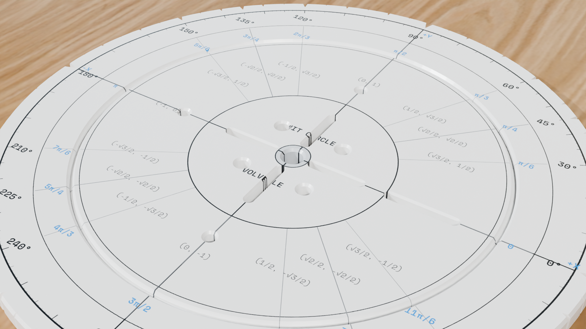

### A.1.3 Number Racks, Fair-Weight Dice & Logarithmic Prime Blocks
The **Number Rack, Math Dominoes & Quest Scoreboard (`[g] [COUNT]`, `[f] [?]`)** share the standard $3 \times 1 \times 7\text{U}$ Gridfinity box footprint. Print the two horizontal Number Rack rails and slide five white blocks and five coral-red blocks onto each rail before snapping the end caps into the tray walls; for the Math Dominoes, pause for a filament color swap on the top two layers so the raised pips pop out clearly inside the 12-frame divider tray. Print the 60 universal `+10` $1\text{U}$ tokens in radiant gold and the $3 \times 1$ Quest Scoreboard lid (`1`–`10` sockets plus the `100` Mastery Tower socket) in dark slate so students can stack 1 token ($+10\text{ pts}$) for a physical block solution and a 2nd token ($+20\text{ pts}$) for a verified SC-6 stack solution.

When slicing the **Fair Probability Dice & Modular Spinner Studio (`[🎲]`)**—which includes four $18\text{ mm}$ **volume-equalized $d6$ dice** and the polyhedral dice set ($d4, d6, d8, d10, d12, d20$)—increase infill to **$100\%$ concentric or rectilinear infill** (or 4 perimeter walls with $40\%$ symmetric gyroid infill) so the internal mass stays balanced around the center of gravity. Because the CAD model carves the six pips on the `6` face shallower than the single deep pip on the `1` face, all six faces lose the exact same volume of plastic. For the companion $1 \times 1$ spinner box, print the low-friction center spindle at $0.12\text{ mm}$ layer height so the standard 10-sector (`0–9`) decimal lid and the three drop-in dials—Biased ($\frac{1}{2}\text{–}\frac{1}{4}\text{–}\frac{1}{4}$), Binary ($50/50$), and Operations ($+, -, \times, \div$)—spin freely with a flick of your finger.

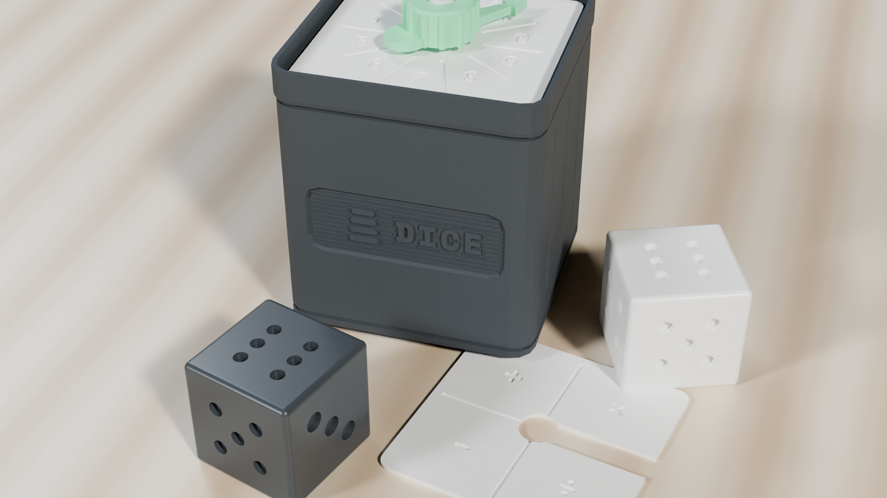

In the **Logarithmic Prime Factor Studio (`[PRIME]`, `[g] [FACT]`, `[GCF]`, `[f] [LCM]`)**, each prime block's visible height is scaled to $7.00\text{ mm} \times \log_2(p)$ so that stacking blocks *adds* their heights to *multiply* their numbers! Slice the prime blocks (`2`, `3`, `5`, `7`, `11`, `13`, `17`, `19`, `23`, `29` plus fused powers $2^2, 2^3, 3^2, 5^2$) at **$0.10\text{ mm}$ layer height** so logarithmic heights like the `3`-block ($11.09\text{ mm}$) and `5`-block ($16.25\text{ mm}$) print within $\pm 0.05\text{ mm}$ of the laser-tick marks on the drop-front comparator case. Test your finished print by stacking $2 \times 2 \times 3$ ($7.00 + 7.00 + 11.09 = 25.09\text{ mm}$) beside the `12` tick mark, and standing $20 = 2^2 \times 5$ ($30.25\text{ mm}$) beside $50 = 2 \times 5^2$ ($39.51\text{ mm}$) to check $\text{GCF}(20,50) = 10$ ($23.25\text{ mm}$) and $\text{LCM}(20,50) = 100$ ($46.51\text{ mm}$).

| Target Number | Prime Building Blocks | Visible Block Heights Added Together (in $\text{mm}$) | Mark on Comparator Scale |
|:---:|:---|:---|:---:|
| **2** | `2`-block | $7.00\text{ mm}$ ($1\text{U}$ base unit) | **Target 2** |
| **3** | `3`-block | $11.09\text{ mm}$ | **Target 3** |
| **4** | $2 \times 2$ ($2^2$) | $7.00 + 7.00 = 14.00\text{ mm}$ | **Target 4** |
| **6** | $2 \times 3$ | $7.00 + 11.09 = 18.09\text{ mm}$ | **Target 6** |
| **10** | $2 \times 5$ | $7.00 + 16.25 = 23.25\text{ mm}$ | **Target 10** |
| **12** | $2^2 \times 3$ | $14.00 + 11.09 = 25.09\text{ mm}$ | **Target 12** |
| **20** | $2^2 \times 5$ | $14.00 + 16.25 = 30.25\text{ mm}$ | **Target 20** |
| **30** | $2 \times 3 \times 5$ | $7.00 + 11.09 + 16.25 = 34.34\text{ mm}$ | **Target 30** |
| **50** | $2 \times 5^2$ | $7.00 + 32.51 = 39.51\text{ mm}$ | **Target 50** |
| **60** | $2^2 \times 3 \times 5$ | $14.00 + 11.09 + 16.25 = 41.34\text{ mm}$ | **Target 60** |
| **100** | $2^2 \times 5^2$ | $14.00 + 32.51 = 46.51\text{ mm}$ | **Target 100** |

---

### A.1.4 Printable Cardstock Cutout Workshop (Scissors & Glue Nets)

If you don't have a 3D printer handy, you can print the full-scale paper nets from **[stackcalc.io/downloads](https://stackcalc.io/downloads/)** at $100\%$ scale on heavy cardstock ($110\text{ lb}$ index paper), score the dashed lines with an empty ballpoint pen, cut along the solid outer edges, and glue the tabs.

To fold a rigid **Two-Row Ten-Frame Tray ($125 \times 42\text{ mm}$ Base)** that matches the exact footprint of the 3D-printed tray, lay your ruler along the dashed border of the $125 \times 42\text{ mm}$ center base—marked with **Row 1: Cells `(1) (2) (3) (4) (5)`** on top, **Row 2: Cells `(6) (7) (8) (9) (10)`** on the bottom, and the bold vertical $5\text{-anchor}$ line down the middle—and score firmly with a dry ballpoint pen. Next, crease the top, bottom, and twin $12 \times 42\text{ mm}$ left and right side flaps upward at crisp $90^\circ$ angles, then fold the inner rim strips back down over the corner glue tabs and press for ten seconds to lock the tray walls in place.

To assemble the **$84\text{ mm}$ Whole & $42\text{ mm}$ Half Fraction Towers** as hollow $20 \times 20\text{ mm}$ square prisms calibrated to the exact $84.0\text{ mm}$ whole-tower height, start with either the **Whole ($1$)** tower ($4$ faces of $20 \times 84\text{ mm}$ printed with `"1 WHOLE"` on the front and `"100%"` on the back) or the **Half ($1/2$)** tower ($4$ faces of $20 \times 42\text{ mm}$ printed with `"1/2"` on the front and `"50%"` on the back), scoring and folding all four vertical creases at $90^\circ$ angles so the strip wraps into a square tube. Glue the long side tab inside the fourth wall to close the square prism, then fold the $20 \times 20\text{ mm}$ top and bottom square caps over their three glue tabs so your cardstock `1/2` towers stack flush alongside a `1 WHOLE` tower.

You can also build the **$120\text{ mm}$ Unit Circle Volvelle & Prime Comparator Ruler** from heavy cardstock in under ten minutes. For the **Two-Disc Unit Circle Volvelle ($120\text{ mm}$ Diameter)**, cut out the larger $120\text{ mm}$ bottom degree wheel ($0^\circ$ to $360^\circ$ marked in $5^\circ$ and $15^\circ$ ticks) and the smaller $96\text{ mm}$ top pointer wheel, carefully snipping out the shaded sight window on the top disc; punch a $3\text{ mm}$ hole through the center crosshairs of both discs and push a brass paper fastener (or a short 3D-printed snap pin) through the center so the top pointer spins smoothly around all four $90^\circ$ quadrants. For the **Folding Prime Factor Comparator Strip**, cut out and fold the L-shaped cardstock comparator stand alongside the rectangular cardstock strips for the `2`-block ($7.00\text{ mm}$), `3`-block ($11.09\text{ mm}$), `5`-block ($16.25\text{ mm}$), and `7`-block ($19.65\text{ mm}$)—laying two `2`-strips and one `3`-strip end-to-end along the vertical comparator scale lands right on the printed `12` line ($25.09\text{ mm}$), matching the 3D-printed Prime Factor Studio!

---

## A.2 Printing Settings, Color Guide & Quick Checks

Teachers and parents can customize classroom settings anytime via the `[g] [FLAGS]` menu (`[g]` + `[×]`, then tap `0`–`9` to toggle a flag):

| Flag # | Screen Tag & Default | Classroom Purpose |
| :--- | :--- | :--- |
| **Flag 0** | `0:F0` (`0` Off) | General-purpose user flag 0 for classroom experiments |
| **Flag 1** | `1:F1` (`0` Off) | General-purpose user flag 1 for classroom experiments |
| **Flag 2** | `2:INT` (`HRD` / `APP`) | Interface Style Selector: toggles between Hardware replica (`HRD`) and expanded touch (`APP`) layout |
| **Flag 3** | `3:FACE` (`0` Off) | Hardware / App faceplate skin selector |
| **Flag 4** | `4:STK` (`1` `4-LN`) | Stack View Layout: `1` (`4-LN`, default) = 4-Shelf / Split Stack View, `0` (`1-LN`) = Large Single-Line `X` |
| **Flag 5** | `5:DEP` (`4-LV`) | Stack Depth Mode: cycles `2-LV` (2-Level) $\to$ `4-LV` (4-Level $T, Z, Y, X$, default) $\to$ `8-LV` (8-Level) |
| **Flag 6** | `6:MOD` (`0` SC-6) | Active Calculator Model selector (when inside the `FLAGS` menu) |
| **Flag 7** | `7:FRC` (`0` Decimal) | Fraction Display Mode: `0` = Decimal, `1` = Fraction (`a b/c` or `d/c`) |
| **Flag 8** | `8:/c` (`0` Auto) | Fixed Denominator Lock: `1` = Locks fractions to the denominator set by `[g] [/c]` |
| **Flag 9** | `9:d/c` (`0` Mixed) | Improper Fraction Style: `0` = Mixed Number (`a b/c`), `1` = Improper (`d/c`) |

### A.2.1 3D Print & Filament Schedule (Part 1: 3 Core Anchor Studios & Part 2: 6 Companion Specialty Studios)

To make classroom 3D printing simple and modular, the nine physical studios are organized into **Part 1: The 3 Core Anchor Block Studios** (`PLACE-01`, `FRAC-01`, and `PRIME-01`, which anchor 80% of daily K–6 lessons across *Book 2A* and *Book 2B*) and **Part 2: The 6 Companion Specialty Studios** (which you can print as your class reaches geometry, time, probability, and fluency stations):

#### Part 1: The 3 Core Anchor Block Studios (Print These First)

| Anchor Studio Code & Kit Name | Gridfinity Box | Filament & Slicer Profile | Free 3MF Download |
| :--- | :---: | :--- | :--- |
| **`PLACE-01`: Ten-Frame, Place Value & Counting/Array Studios** | $3 \times 1 \times 7\text{U}$ | $0.20\text{ mm}$ PLA; pause at $1.80\text{ mm}$ on counters for red/gold swap; 4-color tile plates ($12 \times 7.0 = 84.0\text{ mm}$) | [Printables Profile ↗](https://www.printables.com/@StackCalc_5593834) |
| **`FRAC-01`: 84 mm Fraction Towers & Comparator Studio** | Desktop Case ($3 \times 1$) | $0.20\text{ mm}$ PLA ($0.10\text{ mm}$ adaptive on $\frac{1}{8}$ block for exact $10.5\text{ mm}$ height) | [Printables Profile ↗](https://www.printables.com/@StackCalc_5593834) |
| **`PRIME-01`: Prime Factor Logarithmic Tower Studio** | Desktop Case ($3 \times 1$) | $0.10\text{ mm}$ fine layers for $\pm 0.05\text{ mm}$ logarithmic height match ($h(p) = 7.0 \cdot \log_2(p)\text{ mm}$) | [Printables Profile ↗](https://www.printables.com/@StackCalc_5593834) |

#### Part 2: The 6 Companion Specialty Studios (Print as Needed by Unit)

| Companion Studio & Modular Kit Name | Gridfinity Box | Filament & Slicer Profile | Free 3MF Download |
| :--- | :---: | :--- | :--- |
| **4. 90° Corner L-Frame & Area Studio** | $3 \times 1 \times 7\text{U}$ | $0.20\text{ mm}$ PLA in 4 colors (gold flats, blue rods, white/red units) | [Printables Profile ↗](https://www.printables.com/@StackCalc_5593834) |
| **5a. Planetary Geared Clock** | $3 \times 2 \times 7\text{U}$ | $0.20\text{ mm}$ PLA with $0.15\text{ mm}$ elephant-foot compensation on gears | [Printables Profile ↗](https://www.printables.com/@StackCalc_5593834) |
| **5b. Unit Circle Volvelle** | $120\text{ mm}$ Disc | $0.20\text{ mm}$ PLA; two-color swap on degree ticks & sight window | [Printables Profile ↗](https://www.printables.com/@StackCalc_5593834) |
| **6a. Number Rack Studio** | $3 \times 1 \times 7\text{U}$ | $0.20\text{ mm}$ PLA; print sliding $5+5$ beads in white and coral red | [Printables Profile ↗](https://www.printables.com/@StackCalc_5593834) |
| **6b. Math Dominoes Studio** | $3 \times 1 \times 7\text{U}$ | $0.20\text{ mm}$ PLA; top-layer contrast swap on raised domino pips | [Printables Profile ↗](https://www.printables.com/@StackCalc_5593834) |
| **6c. Quest Scoreboard** | $3 \times 1 \times 7\text{U}$ | $0.20\text{ mm}$ PLA; 60 radiant-gold `+10` tokens & dark slate lid | [Printables Profile ↗](https://www.printables.com/@StackCalc_5593834) |
| **8. Probability Dice & Spinner** | $1 \times 1 \times 7\text{U}$ | $100\%$ concentric infill on dice; $0.12\text{ mm}$ layers on spinner spindle | [Printables Profile ↗](https://www.printables.com/@StackCalc_5593834) |

### A.2.2 Five-Color Filament Palette & Multi-Color Layer Swaps
To help students spot mathematical connections across different chapters—and to let any single-nozzle printer produce high-contrast parts—all nine studios share a five-color filament palette:

| Filament Color | Standard PLA / PETG Shade | Where Students Meet This Color Across the Studios |
| :--- | :--- | :--- |
| **Bright White** | Matte Snow White | $1\text{-Whole}$ ($84\text{ mm}$) Fraction Tower, $+1$ Unit Tiles, `0`–`9` Digit Tops, Number Rack first-5 beads |
| **Coral Red** | Matte Scarlet / Coral | $\frac{1}{2}$ ($42\text{ mm}$) Fraction Towers, Ten-Frame Counter side A, $-1$ Opposite Tiles, Number Rack second-5 beads |
| **Radiant Gold** | Silk or Matte Amber Gold | $\frac{1}{3}$ ($28\text{ mm}$) Fraction Towers, Ten-Frame Counter side B, $10 \times 10$ Hundred-Flats, `5` Prime Blocks, `+10` Quest Tokens |
| **Cobalt Blue** | Matte Royal / Electric Blue | $\frac{1}{4}$ ($21\text{ mm}$) Fraction Towers, $10 \times 1$ Ten-Rods, `2` Prime Blocks ($7.0\text{ mm}$), Counting & Array Quarter-Grid |
| **Slate Navy** | Matte Charcoal / Dark Slate | All $3 \times 1$ Gridfinity Storage Trays, $90^\circ$ L-Frame Stage Rails, Comparator Wells, and Faceplate Bezels |

You do not need an expensive multi-material printer to make the raised text, pips, and clock numerals pop out in a second color. Every raised label across the nine studios—including the column headers and decimal dot (`•`) on the **Place Value** trays, the raised pips on the **Math Dominoes**, the $5\text{-minute}$ outer ring numerals on the **Planetary Geared Clock**, and the degree ticks on the **Unit Circle Volvelle**—is extruded exactly $0.40\text{ mm}$ (two $0.20\text{ mm}$ layers) above the flat dark-slate surface below it. By right-clicking the vertical layer slider in your slicer software and inserting a standard filament pause command (`M600`) at the first raised layer, any single-extruder classroom printer will automatically park its nozzle, beep, and wait for you to load Bright White or Radiant Gold filament for the final two minutes of the print.

---

## A.3 How We Built the StackCalc Learning Lab

Curious how a calculator, nine 3D-printed block studios, and this math book were invented together? We documented every step of our journey on our open-source **[Hackaday Engineering Blog](https://hackaday.io/project/206743-stackcalc32-a-tactile-rpn-calculator)** and at **[stackcalc.io](https://stackcalc.io)**. Here is the behind-the-scenes story of how open-source hardware engineering, physical block design, and screen simulation came together to build StackCalc:

### A.3.1 From a Tiny Watch Screen to Kid-Tested Gravity-Docking Blocks
StackCalc began on a wristwatch. When you try to do math on an Apple Watch screen that is barely $40\text{ millimeters}$ wide, there is no room for tiny `( )` parenthesis buttons or long scrolling formulas. Reverse Polish Notation (RPN)—the 4-story Number Elevator you use in this book—made watch math direct and practical: you type your two numbers, see them sitting right on Shelf $Y$ and Shelf $X$, and tap the operation key. As we expanded from the watch to the iPhone, the web browser, and our physical handheld calculators (`SC-6` and `SC-32`), we made a strict rule: **every device would share the exact same mathematical brain.** Whether you tap `[g] [SIMP]` on a handheld SC-6 at your desk or click it in the web simulator at **[stackcalc.io](https://stackcalc.io)**, every shelf of the stack behaves the exact same way.

Meanwhile, watching real 3rd–6th graders test our first prototypes reshaped the physical blocks just as dramatically. Our very first 3D-printed math tiles were completely flat plastic squares—and the first time elementary students tested them on a classroom table, an accidental elbow bump sent a whole multiplication array sliding across the desk! Guided by what young builders showed us with their hands, we engineered **gravity-docking socket trays and stacking lips** across all nine studios: adding a recessed $1.85\text{ mm}$ interlocking lip to the bottom of every tile and molding matching socket grids into the Place Value, Ten-Frame, and L-Frame trays so tiles drop into place with a satisfying clack and stay put even when you pass a tray across the table to a partner.

Because students also loved closing their eyes and counting by touch, we added **finger-traceable raised symbols** across the entire kit. We raised the decimal point (`•`) on the Place Value tray, the 5-anchor divider rib on the Ten-Frame, and the fraction numerals on the $84\text{ mm}$ towers so your fingertips can feel the structure of a number before your eyes even read the screen.

### A.3.2 Virtual Hardware Simulation & Screw-Free Sliding Assembly
Before we ever ordered a physical circuit board or soldered a single button, we built a **virtual hardware simulator** that runs right on a computer screen. It draws the exact $132 \times 65$ pixel display—including the live Ten-Frame dots (`[▦]`), Number Line jump arcs (`[f] [LINE]`), and Geared Clock hands (`[🕒]`)—so teachers and students could test every button and Math Quiz sprint (`[f] [?]`) while the physical parts were still being 3D-printed.

When it came time to manufacture the physical calculator enclosure, we asked a simple question: have you ever opened a toy or calculator and found tiny metal screws that strip out the plastic or roll off the table and get lost? In our Hackaday build logs (*"How the Circuit Board Design Shapes the Printed Calculator"* and *"Tool-Free Sliding Assembly"*), we showed how we eliminated external case screws entirely by using **circuit-board-driven 3D models**: instead of measuring the circuit board with a ruler and guessing where the buttons and screen holes should go, our 3D-printing program reads the exact button coordinates directly from the circuit board design file so every keycap hole lines up automatically.

Even better, the calculator case prints in a **4-piece sliding lock** (bottom shell, button frame, top faceplate, and a side-locking rail) that slides together like a Japanese puzzle box and locks tight with a single click, holding the internal circuit board and battery contacts securely in place—while all of your desktop math block trays print flat on any classroom 3D printer with zero support plastic to peel off:

| Engineering Layer | How We Designed It | Why It Matters at Your Desk |
| :--- | :--- | :--- |
| **Shared RPN Engine** | Identical stack math across SC-6 hardware, iOS, watchOS, and web simulator | Every keystroke and stack table in this book works identically on screen and in hand |
| **Gravity-Docking Trays** | $1.85\text{ mm}$ recessed tile lips and chamfered socket pockets | Multiplication arrays and fraction towers stay locked in place when bumped |
| **Tactile Raised Relief** | $0.40\text{ mm}$ (2-layer) raised numerals, pips, and 5-anchor divider ribs | Lets students trace number structures by touch and swap filament colors easily |
| **PCB-Driven 3D Case** | Enclosure geometry generated directly from circuit-board button coordinates | Zero misaligned buttons and tool-free 4-piece sliding rail assembly |

### A.3.3 Classroom Care, Caliper Checks & Saltwater Dice Testing

Once your nine 3D-printed studios come off the printer bed, three quick quality checks will make sure every block and die performs with laboratory accuracy for years of classroom or home use:

1. **The $84.0\text{ mm}$ Master Height Check (`[-]` & `[%]`):** Before placing a freshly printed set of **Fraction Towers** or **Counting Tiles** into the comparator tray, close the jaws of a digital caliper around the white **$1\text{-Whole}$ tower** ($84.00\text{ mm}$), then stack **three $\frac{1}{3}$ Gold blocks** ($3 \times 28.00 = 84.00\text{ mm}$), **four $\frac{1}{4}$ Blue blocks** ($4 \times 21.00 = 84.00\text{ mm}$), and **twelve Counting Tiles** ($12 \times 7.00 = 84.00\text{ mm}$) beside it. If your printer's first layer squishes slightly (a common 3D-printing effect called *"elephant's foot"*), lightly deburr the bottom rim or enable **$0.15\text{ mm}$ elephant-foot compensation** in your slicer so every complete stack stands within $\pm 0.15\text{ mm}$ of $84.00\text{ mm}$.
2. ** Lou Lou's Saltwater Fair-Die Float Test (`[🎲]`):** How do board-game makers and probability labs verify that a 3D-printed $6\text{-sided}$ or $20\text{-sided}$ die doesn't have an air pocket inside that biases it toward one face? Dissolve **3 tablespoons of table salt** in a warm glass of water until your $100\%$-infill PLA die floats just below the surface. Flick the floating die gently with your fingertip **10 times** and record which face floats to the top each time! A balanced $100\%$ concentric-infill die will bob up with different random faces, whereas a hollow or lopsided die will swing its lightest face to the top on almost every flick.
3. **Keeping PLA Blocks Clean & Warp-Free:** Because standard **PLA** (*polylactic acid*, made from fermented cornstarch and sugarcane) begins to soften above **$55^\circ\text{C}$ ($131^\circ\text{F}$)**, never wash 3D-printed math blocks in a hot dishwasher or leave a dark-slate storage bin on a car dashboard in direct summer sun. To clean classroom blocks between school terms, simply swish them in a basin of **lukewarm water ($30^\circ\text{C}$) with a drop of mild dish soap**, rinse, and towel-dry on a flat table.

For complete classroom lesson scripts and station activities that use these 3D-printed math blocks, turn to **[Appendix B: Teacher Lesson Plans & Station Guide](sc6/appendix-b-teacher-lesson-plans.md)**.

---

# Appendix B: Teacher Lesson Plans & Station Guide

## B.1 Running the 45-Minute Workshop & Foundational Fluency Stations

The StackCalc SC-6 station curriculum aligns with the Grades 3–6 Common Core State Standards for Mathematics *([CCSSM, 2010](sc6/appendix-c-formulas-and-conversions.md#cite-ccssm2010))* and follows the **Math Workshop Rotation Model**, where every mathematical concept moves from physical blocks *([Dienes, 1960](sc6/appendix-c-formulas-and-conversions.md#cite-dienes1960); [Bruner, 1966](sc6/appendix-c-formulas-and-conversions.md#cite-bruner1966))* to visual bar and array models *([Singapore MOE, 2014](sc6/appendix-c-formulas-and-conversions.md#cite-singapore2014))* to the four-shelf number stack. Grounded in research on elementary mathematics instruction *([Ma, 1999](sc6/appendix-c-formulas-and-conversions.md#cite-ma1999))*, relational understanding of equality *([Falkner et al., 1999](sc6/appendix-c-formulas-and-conversions.md#cite-falkner1999))*, and structured problem-solving heuristics *([Pólya, 1945](sc6/appendix-c-formulas-and-conversions.md#cite-polya1945))*, each 45-minute lesson unfolds in four phases:

| Time Window | Phase | Activity & Student Experience |
| :---: | :--- | :--- |
| **00:00 – 05:00** | Whole-Class Warm-Up | Share the real-world story challenge and pose the main question. |
| **05:00 – 20:00** | Station Investigation | Hands-on physical block build at studio stations. |
| **20:00 – 35:00** | Stack Verification & Practice | SC-6 four-shelf stack verification and keystroke logging. |
| **35:00 – 45:00** | Discourse & Exit Ticket | Mathematical reflection, quick check, and notebook log. |

### B.1.1 Classroom Hand-Signals for the Four Shelves ($X, Y, Z, T$)

When introducing the four-shelf stack ($X, Y, Z, T$) at the classroom carpet or whiteboard, pair each shelf with a simple hand-height cue so students connect the physical blocks on their desk with the shelves on the screen:

| Stack Shelf | Classroom Hand-Signal Cue | How It Connects to the Desk Tray & Screen |
| :--- | :--- | :--- |
| **Ground Shelf $X$** | **Hands Flat on the Desk** (The Workbench) | Every number you type starts right here on Ground Shelf $X$, matching the front/bottom row of your block tray. |
| **Waiting Shelf $Y$** | **Hands Raised to Chest Height** | Tapping `[ENTER]` lifts your first number up to Waiting Shelf $Y$, matching the back/top row of your block tray so both numbers sit in plain sight before an operation combines them. |
| **Upper Shelf $Z$** | **Hands Raised to Shoulder Height** | Whenever you start building a second group in a multi-step problem, your finished first group rides automatically up to Shelf $Z$ to wait safely out of the way. |
| **Top Shelf $T$** | **Hands Raised Overhead** (The Constant Dispenser) | Pressing `[g] [REP]` fills all four shelves up to Top Shelf $T$, which feeds a fresh copy of your step size downward every time the stack drops during skip-counting. |

### B.1.2 Setting Up the Five-Table Studio Rotation & 60-Second Tray Cleanup

In a typical classroom of 20 to 30 students, the 45-minute workshop runs smoothly when desks are clustered into **five station tables of 4 to 6 students** (two or three partner pairs per table). Each table receives one modular studio tray (or a pair of student kits) alongside two or three SC-6 calculators so every pair shares one physical block tray and one calculator. On the first problem at a station, **Partner A (The Architect)** builds the physical model with the 3D-printed blocks while **Partner B (The Stack Navigator)** keys the matching sequence onto the SC-6 stack and calls out what appears on Shelf $Y$ and Ground Shelf $X$; on the next problem, partners swap roles so every student builds with both their hands and the keypad.

Fast finishers sometimes want to jump straight to the calculator buttons without touching the blocks. Placing a **Quest Scoreboard** lid at the center of the table solves this naturally through the **Two-Token Quest Scoreboard Rule**: partners earn their first `+10` token *only* when their physical block model is built on the desk, and they stack their second `+10` token (`+20` total) when the SC-6 screen confirms the exact same result.

Because every StackCalc studio tray is engineered with recessed sockets for its exact part count—10 pockets per row in the Ten-Frame, 12 color columns in the Counting & Array case, and stepped wells in the $84\text{ mm}$ Fraction and Prime Factor cases—you never have to count loose plastic pieces by hand at the end of class. Give a **60-Second Gridfinity Socket Count-In** chime at minute `34:00`: if every socket in the tray is filled and the lid slides shut flush, zero pieces are left on the floor!

Foundational fluency stations (`F.1`–`F.11`) build quick ten-frame pattern recognition, spotting groups of 5 and 10 at a glance, tower comparisons, place-value bundling, and skip-counting fluency as warm-up and practice stations for Grades 3–6 classrooms using physical Ten-Frame trays, Place Value Trays, and Counting Tiles alongside `[▦]` Ten-Frame Mode.

### Station F.1: Spotting 5-and-Some-More in Ten-Frame Mode

Place a **Ten-Frame Studio tray** and ten two-color flip counters (yellow and red) between each pair of students to launch your first workshop rotation (**CCSS 3.NBT.A.2**; **TEKS 3.2.A**). To kick off the five-minute warm-up, have partners fill the top row of their tray with 5 red counters and place 3 yellow counters in the bottom row, then ask how they can tell the total is 8—with 2 empty pockets left to reach 10—without counting from one.

Invite students to hold up their SC-6 calculator, tap the Ten-Frame key `[▦]`, and compare the glass display to the plastic tray on their desk. They will immediately notice the same two rows of five cells separated by the center 5-anchor divider. Have them build the warm-up tray step by step on both the desk and the screen, dropping one counter into the top row each time they tap `1 [+]` until all five top pockets are filled. Once they see that a full top row always represents an instant group of 5 on Shelf $X$, ask them to add the 3 yellow counters into the bottom row (`3 [+]`) so their eyes read $5 + 3 = 8$ and spot the 2 empty cells remaining to make 10.

| Keystroke | Register T | Register Z | Register Y | Register X | What Happens on the Stack |
| :--- | :--- | :--- | :--- | :--- | :--- |
| `[▦]` | 0 | 0 | 0 | 0 (10F) | Open Ten-Frame Mode (`0` dots filled) |
| `1 [+]` | 0 | 0 | 0 | 1 (10F) | Add 1st counter into top row (`1` dot) |
| `1 [+]` | 0 | 0 | 0 | 2 (10F) | Add 2nd counter (`2` dots) |
| `1 [+]` | 0 | 0 | 0 | 3 (10F) | Add 3rd counter (`3` dots) |
| `1 [+]` | 0 | 0 | 0 | 4 (10F) | Add 4th counter (`4` dots) |
| `1 [+]` | 0 | 0 | 0 | 5 (10F) | Complete the full top row of **5** dots |

During partner practice, challenge teams to build `7` on the tray (5 on top, 2 on bottom) and match it on screen (`[▦] 7`), fill all `10` dots to confirm that two complete rows of 5 make 10, and then clear the frame (`[C] [▦]`) to enter `3` dots and name the `7` empty boxes needed to reach 10.

As you circulate among tables, watch for two common habits: if a student taps calculator keys faster than they place counters and overshoots the count, coach them to pair each physical counter with a single key press (*"touch the block, tap the key"*). If a student scatters counters randomly across both rows, guide them to fill the top row of 5 from left to right first so the 5-and-some-more pattern jumps out at a glance.

---

### Station F.2: Building & Splitting Benchmark Number Bonds

What happens when you shake 5 two-color counters inside a cup and spill them onto the desk—does the total ever change when the colors flip? In this number-bond investigation (**CCSS 3.OA.C.7**; **TEKS 3.4.A**), partners use a **Ten-Frame Studio tray**, a small cup, and 5 (or 10) two-color counters to discover how decomposing a whole into partner pairs ($4+1, 3+2, 2+3, 1+4$) always preserves the total. Begin by having one partner shake 5 counters in the cup, spill them onto the desk, and sort the yellow and red counters into the tray.

When the first spill lands on 3 yellow and 2 red counters, walk students through loading those two parts onto the SC-6 elevator: typing `3 [ENTER]` lifts the 3 yellow counters up to Shelf $Y$, and typing `2` places the 2 red counters on Shelf $X$. With both parts visible side by side on the screen, pressing `[+]` combines them into `5` on the bottom shelf. Have the second partner shake and spill the same 5 counters again—perhaps landing on 4 yellow and 1 red—and key in `4 [ENTER] 1 [+]`. Discuss why every spill of the cup lands on the exact same sum of `5`: no counters ever entered or left the cup, so only the yellow-and-red split changed.

| Keystroke | Register T | Register Z | Register Y | Register X | What Happens on the Stack |
| :--- | :--- | :--- | :--- | :--- | :--- |
| `3` | 0 | 0 | 0 | 3 | Enter 3 yellow counters onto Shelf $X$ |
| `[ENTER]` | 0 | 0 | 3 | 3 | Copy 3 up onto Shelf $Y$ |
| `2` | 0 | 0 | 3 | 2 | Enter 2 red counters onto Shelf $X$ |
| `[+]` | 0 | 0 | 0 | 5 | Combine both parts: $3 + 2 = \mathbf{5}$ |

Once the first two spills are verified, have partners log all remaining splits of 5 (`1 [ENTER] 4 [+]`, `2 [ENTER] 3 [+]`, and `5 [ENTER] 0 [+]`) before repeating the cup-spill investigation with 10 counters.

Keep an eye on the screen during the first few entries: if `32` appears instead of `5`, the student typed `3` and `2` without pressing `[ENTER]` between them; remind them to press `[ENTER]` so the `3` rides up to Shelf $Y$ before `2` steps onto Shelf $X$. And if a student wonders why $3+2$ and $2+3$ give the same answer, have them rotate their Ten-Frame tray $180^\circ$ on the desk to see that the total count never changes.

---

### Station F.3: Finding the Difference Between Two Towers

Many young learners think subtraction only means "taking things away"—which makes comparison questions like *"How much taller is the blue tower than the gold tower?"* surprisingly tricky. This station reframes subtraction as the physical height gap between two side-by-side towers (**CCSS 3.NBT.A.2**; **TEKS 3.2.D**). Give each pair the **Counting & Array Studio** with its $6 \times 2$ docking lid, 10 Cobalt Blue tiles, 10 Amber Gold tiles, and a straightedge ruler. Start by having students dock a tower of 7 blue tiles in the left socket and a tower of 4 gold tiles in the adjacent right socket, laying the ruler across the top of the shorter tower to see the step gap.

Ask partners how many tiles sit where the two towers are neck-and-neck (4 tiles) and how many extra blue tiles rise above the ruler (3 tiles). To measure that gap on the SC-6 stack, have them load the taller tower onto Shelf $Y$ first (`7 [ENTER]`), enter the shorter tower on Shelf $X$ (`4`), and press `[-]`. The `3` on the bottom shelf measures the exact 3-tile step between the towers. Then have students snap 3 more gold tiles onto the shorter tower and run a finger across both tops: standing flush at 7 tiles physically proves that $4 + 3 = 7$ and $7 - 4 = 3$ are inverse partners.

| Keystroke | Register T | Register Z | Register Y | Register X | What Happens on the Stack |
| :--- | :--- | :--- | :--- | :--- | :--- |
| `7` | 0 | 0 | 0 | 7 | Enter the taller 7-tile tower onto Shelf $X$ |
| `[ENTER]` | 0 | 0 | 7 | 7 | Copy 7 up onto Shelf $Y$ |
| `4` | 0 | 0 | 7 | 4 | Enter the shorter 4-tile tower onto Shelf $X$ |
| `[-]` | 0 | 0 | 0 | 3 | Subtract to find the height gap: $7 - 4 = \mathbf{3}$ |

Invite partners to build and compare tower pairs of `9` and `5` (`9 [ENTER] 5 [-]` $\to 4$), `8` and `8` (`8 [ENTER] 8 [-]` $\to 0$, level tops), and `6` and `2` (`6 [ENTER] 2 [-]` $\to 4$).

Whenever a student enters the shorter tower first (`4 [ENTER] 7 [-]`)—in `[f] [LINE]` Number Line mode or with `[NUM]` Whole Number Mode toggled off—and sees `-3`, explain that `-3` tells us the gold tower is 3 tiles *shorter* than the blue tower, and show how tapping `[x⇄y]` before `[-]` puts the taller tower on Shelf $Y$ first. Also make sure both towers are seated firmly in the lid sockets so the tile steps align cleanly.

---

### Station F.4: Bridging Through 10 with the Ten-Frame

Instead of counting on their fingers one by one to add $8 + 5$, fluent mathematicians build a bridge through 10 ($8 + 2 + 3 = 13$). Set **two Ten-Frame Studio trays** side by side with 20 two-color counters at each partner station (**CCSS 3.NBT.A.2**; **TEKS 3.4.A**), and launch the activity by having students place 8 yellow counters into Tray 1 while holding 5 red counters in their hand. Ask: *"How many of the red counters in your hand do we need just to finish filling Tray 1?"*

Students quickly see that Tray 1 has 2 empty pockets waiting. Have them drop 2 red counters into those pockets to complete a full 10 in Tray 1, then place the remaining 3 red counters into Tray 2 so their eyes read $10 + 3 = 13$ immediately. Next, have them key `8 [ENTER] 5 [+]` on the SC-6 to see `13` on Shelf $X$, and then press `[▦]`: the LCD displays one completely filled ten-frame of 10 dots plus 3 dots in the second frame, mirroring the two plastic trays on the table.

| Keystroke | Register T | Register Z | Register Y | Register X | What Happens on the Stack |
| :--- | :--- | :--- | :--- | :--- | :--- |
| `8` | 0 | 0 | 0 | 8 | Enter 8 counters in Tray 1 |
| `[ENTER]` | 0 | 0 | 8 | 8 | Copy 8 up onto Shelf $Y$ |
| `5` | 0 | 0 | 8 | 5 | Enter 5 counters to add |
| `[+]` | 0 | 0 | 0 | 13 | Bridge through 10: $8 + 2 + 3 = \mathbf{13}$ |
| `[▦]` | 0 | 0 | 0 | 13(10F) | View as 1 full ten-frame plus 3 dots |

From there, partners can practice the same make-ten bridge with $9 + 6$ (`9 [ENTER] 6 [+] [▦]` $\to 10 + 5 = 15$), $7 + 5$ (`7 [ENTER] 5 [+] [▦]` $\to 10 + 2 = 12$), and $8 + 7$ (`8 [ENTER] 7 [+] [▦]` $\to 10 + 5 = 15$).

Whenever a student reverts to counting up one by one on their fingers, point to the empty pockets in Tray 1 and ask: *"How many empty seats are left to finish 10? Fill Tray 1 completely before any counters spill over into Tray 2."*

---

### Station F.5: The Turn-Around Rule of Addition ($3 + 7 = 7 + 3$)

Snap 3 Cobalt Blue tiles onto 7 Amber Gold tiles to build a 10-tile tower, then flip the whole tower upside down in your hands—did the height of the tower change at all? Pairing **Four-Color Counting Tiles** with the SC-6 swap key `[x⇄y]` gives students a tangible proof of the Turn-Around Rule of addition (**CCSS 3.NBT.A.2**; **TEKS 3.4.A**).

To mirror that physical flip on the calculator, have students enter `3 [ENTER] 7` so Shelf $Y$ holds `3` and Shelf $X$ holds `7`. When they tap `[x⇄y]`, the two shelves trade places right on the screen—putting `7` on Shelf $Y$ and `3` on the bottom shelf—and pressing `[+]` yields `10`. Tapping `[f] [LASTX] 3 [+]` confirms that both orders land on `10` because swapping the order of two addends never changes the combined height of the tower.

| Keystroke | Register T | Register Z | Register Y | Register X | What Happens on the Stack |
| :--- | :--- | :--- | :--- | :--- | :--- |
| `3` | 0 | 0 | 0 | 3 | Enter 3 blue tiles onto Shelf $X$ |
| `[ENTER]` | 0 | 0 | 3 | 3 | Copy 3 up onto Shelf $Y$ |
| `7` | 0 | 0 | 3 | 7 | Enter 7 gold tiles onto Shelf $X$ |
| `[x⇄y]` | 0 | 0 | 7 | 3 | Swap Shelves $X$ and $Y$ ($7$ on $Y$, $3$ on $X$) |
| `[+]` | 0 | 0 | 0 | 10 | Add both shelves: $7 + 3 = \mathbf{10}$ |

Encourage partners to test $4 + 8$ vs. $8 + 4$ (both `12`), $2 + 9$ vs. $9 + 2$ (both `11`), and $6 + 5$ vs. $5 + 6$ (both `11`) using `[x⇄y]`.

Before closing the station, pose a thought-provoking extension question: does *subtraction* also obey the Turn-Around Rule ($7 - 3$ vs. $3 - 7$)? Having students switch to `[f] [LINE]` Number Line mode (or toggle `[NUM]` off) and key `3 [ENTER] 7 [-]` on the SC-6 so `-4` appears on screen sparks a memorable conversation about why order matters in subtraction even though addition is turn-around friendly.

---

### Station F.6: Number Bonds & Part-Whole Missing Numbers

An overturned cup hiding a secret pile of tiles turns missing-addend equations like $? + 6 = 14$ into a classroom detective game (**CCSS 3.OA.D.8**; **TEKS 3.5.A**). Give each pair **14 counting tiles** and an opaque cup. During the opening mystery, one partner counts out all 14 tiles onto the desk, hides a secret cluster under the cup while the other partner closes their eyes, and leaves 6 tiles visible outside the cup.

Ask students how they can figure out how many tiles are hiding under the cup without peeking. Because the whole collection is 14 tiles and the visible part is 6 tiles, subtracting the visible part from the whole reveals the hidden part. Have students key the starting whole first (`14 [ENTER]`), enter the visible part second (`6`), and press `[-]` to uncover `8` on Shelf $X$—then lift the cup to count the 8 hidden tiles ($8 + 6 = 14$).

| Keystroke | Register T | Register Z | Register Y | Register X | What Happens on the Stack |
| :--- | :--- | :--- | :--- | :--- | :--- |
| `14` | 0 | 0 | 0 | 14 | Enter the starting whole of 14 tiles |
| `[ENTER]` | 0 | 0 | 14 | 14 | Copy 14 up onto Shelf $Y$ |
| `6` | 0 | 0 | 14 | 6 | Enter the 6 visible tiles onto Shelf $X$ |
| `[-]` | 0 | 0 | 0 | 8 | Subtract to uncover the **8** hidden tiles |

Partners can then trade roles hiding tiles for $? + 5 = 12$ (`12 [ENTER] 5 [-]` $\to 7$), $? + 9 = 16$ (`16 [ENTER] 9 [-]` $\to 7$), and $? + 8 = 15$ (`15 [ENTER] 8 [-]` $\to 7$).

Watch out for a common reflex: a student sees the `+` sign in $? + 6 = 14$ and immediately adds $14 + 6 = 20$. Point to the overturned cup and ask: *"Can the hidden pile under the cup have 20 tiles if we only started with 14 tiles on the whole table?"* That physical check steers them right back to subtracting the visible part from the whole.

---

### Station F.7: Bundling 10 Ones into 1 Ten

Count out 13 loose $1\text{U}$ unit blocks ($7.0\text{ mm}$ tall each) and stack 10 of them into a single column right beside the solid **$70.0\text{ mm}$ 10-Rod** from the Ten-Frame Studio (**CCSS 3.NBT.A.1**; **TEKS 3.2.A**). Using the **Place Value Studio** (Whole Numbers Tray, digit miniblocks, and `+1` regrouping unit cubes), this station shows students why 10 loose ones trade cleanly for 1 ten.

When students run a finger across the top of their 10-cube tower and the solid 10-Rod, they feel that both stand at the exact same $70.0\text{ mm}$ height. Have them trade those 10 loose ones for a `1` digit miniblock in the `TENS` socket and dock a `3` miniblock in the `ONES` socket of the Place Value Tray, then key `10 [ENTER] 3 [+]` on the SC-6. Comparing the tray to the `13` on Shelf $X$ makes it clear that the `1` in `13` means 1 full bundle of ten ($10$), while the `3` means 3 loose ones.

| Keystroke | Register T | Register Z | Register Y | Register X | What Happens on the Stack |
| :--- | :--- | :--- | :--- | :--- | :--- |
| `10` | 0 | 0 | 0 | 10 | Enter 1 bundle of ten ($10$) |
| `[ENTER]` | 0 | 0 | 10 | 10 | Copy 10 up onto Shelf $Y$ |
| `3` | 0 | 0 | 10 | 3 | Enter 3 loose ones onto Shelf $X$ |
| `[+]` | 0 | 0 | 0 | 13 | Combine 1 ten and 3 ones into **13** |

Once `13` is docked on the tray, ask partners to build and verify 2 tens and 5 ones (`20 [ENTER] 5 [+]` $\to 25$), 3 tens and 8 ones (`30 [ENTER] 8 [+]` $\to 38$), and 4 tens and 0 ones (`40 [ENTER] 0 [+]` $\to 40$), pressing `[PV]` to see the calculator decompose each number back into its place-value parts.

A classic place-value misconception is writing `103` for thirteen by placing `10` and `3` side by side. If you see this, have the student slide the `3` miniblock directly over the `0` placeholder in the `ONES` socket of the Place Value Tray so they see why `0` was only holding the ones seat empty until the `3` arrived.

---

### Station F.8: Skip-Counting Ladders with Constant Repeat

How does tapping equal towers of **Counting Tiles** across a desk turn into multiplication readiness? At this station (**CCSS 3.OA.A.1**; **TEKS 3.4.E**), partners snap together six towers of 5 tiles each, line them up in a row across the table, and touch each tower as they skip-count aloud (*5, 10, 15, 20, 25, 30*) before matching that cadence with the SC-6 Constant Repeat key (`[g] [REP]`).

Demonstrate how to load Top Shelf $T$ with `[g] [REP]` so the calculator skip-counts right alongside their fingers. Typing `5` and pressing `[g] [REP]` copies `5` into all four shelves ($T, Z, Y,$ and $X$). Have students touch the second 5-tile tower and tap `[+]` once to see `10` on Shelf $X$, then tap `[+]` four more times as they touch the third, fourth, fifth, and sixth towers (`15`, `20`, `25`, `30`). Because Top Shelf $T$ keeps feeding a fresh `5` down onto Shelf $Y$ after every addition, each tap of `[+]` adds one more tower of 5.

| Keystroke | Register T | Register Z | Register Y | Register X | What Happens on the Stack |
| :--- | :--- | :--- | :--- | :--- | :--- |
| `5` | 0 | 0 | 0 | 5 | Enter step size of 5 onto Shelf $X$ |
| `[g] [REP]` | 5 | 5 | 5 | 5 | Fill all four shelves ($T, Z, Y, X$) with 5 |
| `[+]` | 5 | 5 | 5 | 10 | Two 5-towers $= 10$; Shelf $T$ refills $5$ from the top |
| `[+]` | 5 | 5 | 5 | 15 | Three 5-towers $= 15$ |
| `[+]` | 5 | 5 | 5 | 20 | Four 5-towers $= \mathbf{20}$ |

After mastering fives, let partners build and step through skip-counting ladders by twos up to 16 (`2 [g] [REP] [+]...`), by tens up to 70 (`10 [g] [REP] [+]...`), and by threes up to 21 (`3 [g] [REP] [+]...`).

Sometimes a student taps `[ENTER]` repeatedly after `[g] [REP]` and wonders why the display stays stuck on `5`; remind them that `[ENTER]` only copies Shelf $X$ upward to Waiting Shelf $Y$, whereas `[+]` combines Shelf $Y$ and the bottom shelf to step up the ladder.

---

### Station F.9: Two-Digit Addition with Regrouping

Why do we "carry a 1" when adding $38 + 27$, and what is that carried `1` really worth? On the **Place Value Studio Whole Numbers Tray** (`1000 | 100 | 10 | 1`), digit miniblocks (`0`–`9`) and stackable `+1` regrouping unit blocks make two-digit regrouping concrete (**CCSS 3.NBT.A.2**; **TEKS 3.4.A**). Begin the activity by having students dock `3` tens and `8` ones in the top row of the tray ($38$, matching Shelf $Y$) and `2` tens and `7` ones in the bottom row ($27$, matching Shelf $X$).

When students combine the ones column ($8 + 7 = 15$ ones), ask why all 15 unit blocks cannot remain in the `ONES` socket. Because every group of 10 ones forms a new ten, students stack 10 of the `+1` unit blocks into a $70.0\text{ mm}$ tower, trade that tower for `+1` in the `TENS` column, and leave `5` ones in the `ONES` socket. Counting the `TENS` column ($3 + 2 + 1\text{ traded ten} = 6\text{ tens}$) and the `ONES` column ($5\text{ ones}$) yields `65`, which students verify on the SC-6 by keying `38 [ENTER] 27 [+]`.

| Keystroke | Register T | Register Z | Register Y | Register X | What Happens on the Stack |
| :--- | :--- | :--- | :--- | :--- | :--- |
| `38` | 0 | 0 | 0 | 38 | Enter first addend ($38$: 3 tens, 8 ones) |
| `[ENTER]` | 0 | 0 | 38 | 38 | Copy 38 up onto Shelf $Y$ |
| `27` | 0 | 0 | 38 | 27 | Enter second addend ($27$: 2 tens, 7 ones) |
| `[+]` | 0 | 0 | 0 | 65 | Regroup 15 ones into 1 ten and 5 ones: **65** |

For independent practice, teams model and check $46 + 28$ (`46 [ENTER] 28 [+]` $\to 74$), $57 + 35$ (`57 [ENTER] 35 [+]` $\to 92$), and $19 + 64$ (`19 [ENTER] 64 [+]` $\to 83$).

This physical trade cures the classic paper-and-pencil `515` error (where a student adds $3+2=5$ and $8+7=15$ and writes `515`): whenever a student forgets to carry the new ten, have them physically stack 10 of the 15 unit cubes and move that tower into the `TENS` column before reading the result.

---

### Station F.10: Two-Digit Subtraction with Unbundling

Dock `5` in the `TENS` socket and `2` unit blocks in the `ONES` socket of the **Place Value Studio Whole Numbers Tray** to represent $52$, then challenge partners to lift 6 ones out of the `ONES` socket ($52 - 26$, **CCSS 3.NBT.A.2**; **TEKS 3.4.A**).

Students immediately spot the bottleneck: there are only 2 loose ones sitting in the `ONES` column! Ask how they can get more loose ones on the tray without changing the starting total of 52. By lifting 1 ten out of the `TENS` column (leaving 4 tens) and trading it for ten `+1` unit blocks in the `ONES` column, the tray now holds 4 tens and 12 ones ($40 + 12 = 52$). From those 12 ones and 4 tens, students easily lift away 6 ones and 2 tens to leave 2 tens and 6 ones (`26`), then verify on the stack with `52 [ENTER] 26 [-]`.

| Keystroke | Register T | Register Z | Register Y | Register X | What Happens on the Stack |
| :--- | :--- | :--- | :--- | :--- | :--- |
| `52` | 0 | 0 | 0 | 52 | Enter starting total ($52$: 5 tens, 2 ones) |
| `[ENTER]` | 0 | 0 | 52 | 52 | Copy 52 up onto Shelf $Y$ |
| `26` | 0 | 0 | 52 | 26 | Enter amount to subtract ($26$) |
| `[-]` | 0 | 0 | 0 | 26 | Unbundle 1 ten ($4\text{ tens} + 12\text{ ones} - 26$): **26** |

Students can then practice unbundling on the tray and verifying on the SC-6 with $63 - 27$ (`63 [ENTER] 27 [-]` $\to 36$), $71 - 38$ (`71 [ENTER] 38 [-]` $\to 33$), and $80 - 45$ (`80 [ENTER] 45 [-]` $\to 35$).

Watch for the upside-down subtraction habit where a student flips the ones digits on paper ($6 - 2 = 4$) to get `34` instead of `26`. Pointing to the physical tray—where only 2 loose ones sit in the `ONES` column until a ten is unpacked into 10 ones—makes the reason for unbundling unmistakable.

---

### Station F.11: Even and Odd Numbers via Equal Pairing

Give each pair of students **15 counters** and ask them to line up 11 counters in two equal rows of partners to open the investigation (**CCSS 3.OA.D.9**; **TEKS 3.4.I**). Linking physical partner-pairing to remainder division (`[g] [÷R]`) turns even-and-odd rules into something students can see and touch.

Students see right away that 11 counters form 5 complete pairs with 1 leftover counter standing alone at the end of the line. Explain that this lone leftover counter is the physical signature of an *odd* number, and show how the SC-6 Quotient & Remainder key (`[g] [÷R]`) tests any number for partners: typing `11 [ENTER] 2 [g] [÷R]` places the `5` complete pairs on Shelf $X$ and stores the leftover remainder on Shelf $Y$. Tapping `[x⇄y]` brings that remainder of `1` to the front, proving that 11 is odd (whereas any even number leaves a remainder of `0` when divided by 2).

| Keystroke | Register T | Register Z | Register Y | Register X | What Happens on the Stack |
| :--- | :--- | :--- | :--- | :--- | :--- |
| `11` | 0 | 0 | 0 | 11 | Enter 11 counters to test |
| `[ENTER]` | 0 | 0 | 11 | 11 | Copy 11 up onto Shelf $Y$ |
| `2` | 0 | 0 | 11 | 2 | Divide into pairs of 2 |
| `[g] [÷R]` | 0 | 0 | 1 (Rem) | 5 (Quot) | 5 full pairs in $X$; remainder 1 in $Y$ |
| `[x⇄y]` | 0 | 0 | 5 (Quot) | 1 (Rem) | Swap to view the **1** leftover counter (ODD) |

Have students test 14 (`14 [ENTER] 2 [g] [÷R] [x⇄y]` $\to$ Remainder 0, even), 17 (`17 [ENTER] 2 [g] [÷R] [x⇄y]` $\to$ Remainder 1, odd), and 20 (`20 [ENTER] 2 [g] [÷R] [x⇄y]` $\to$ Remainder 0, even), and then test a three-digit mystery number like `348`.

When a student guesses that `16` is odd because its tens digit `1` is odd, have them pair up a full 10-frame first: because every 10 is already 5 complete pairs of 2, only the ones digit decides whether a counter is left without a partner.

---

## B.2 Grade 3 Lesson Plans (Ages 8–9)

Grade 3 stations move from counting into 2D rectangular arrays (`[f] [RECT]`), fair-share division with remainders (`[g] [÷R]`), unit fraction towers, and polygon perimeters (`[Σ+]`).

### Station 3.1: Arrays, Equal Groups & Rectangular Area

When students snap 24 tiles from their **Four-Color Counting & Array Studio** onto a $4 \times 4$ Gridfinity coordinate baseplate in 6 columns of 4 rows, equal-group multiplication and rectangular floor area become the exact same picture (**CCSS 3.OA.A.1, 3.MD.C.7**; **TEKS 3.4.D, 3.6.C**).

Ask students to count how many columns of 4 form their rectangle and how many total square tiles cover its floor (`24`). Introduce *area* as the number of unit squares covering a flat region, and have students enter the rectangle's length and width on the SC-6 (`6 [ENTER] 4`) before tapping `[f] [RECT]` to see `24` on Shelf $X$. Next, have them rotate the baseplate $90^\circ$ on the desk so it stands 4 columns wide by 6 rows tall and run `4 [ENTER] 6 [f] [RECT]`: because turning the baseplate never adds or removes a single tile, $6 \times 4$ and $4 \times 6$ cover the exact same area of 24 square units.

| Keystroke | Register T | Register Z | Register Y | Register X | What Happens on the Stack |
| :--- | :--- | :--- | :--- | :--- | :--- |
| `6` | 0 | 0 | 0 | 6 | Enter 6 columns along the length |
| `[ENTER]` | 0 | 0 | 6 | 6 | Copy 6 up onto Shelf $Y$ |
| `4` | 0 | 0 | 6 | 4 | Enter 4 rows along the width |
| `[f] [RECT]` | 0 | 0 | 0 | 24 | Compute rectangle area: $6 \times 4 = \mathbf{24}$ tiles |

To build fluency with `[f] [RECT]`, have partners calculate and model a $7 \times 5$ rug (`7 [ENTER] 5 [f] [RECT]` $\to 35$), an $8 \times 3$ garden bed (`8 [ENTER] 3 [f] [RECT]` $\to 24$), and—combining two 24-tile partner kits—a $9 \times 4$ patio (`9 [ENTER] 4 [f] [RECT]` $\to 36$).

Once partners finish the three practice builds, launch the **"Capture the Rectangle"** four-player table game using the shared 144-tile classroom case (Player 1 in Archival White, Player 2 in Cobalt Blue, Player 3 in Radiant Gold, and Player 4 in Slate Gray) and two dice (or `[🎲]`). On each turn, a player rolls two factors (such as `5` and `4`), computes the area on the SC-6 (`5 [ENTER] 4 [f] [RECT]` $\to 20$), and snaps a $5 \times 4$ rectangle of their color onto the shared board so that no two rectangles of the same color touch along a side. If a student confuses perimeter with area during gameplay, have them trace the outer edge with one fingertip (*"that's the perimeter fence"*) and press their open palm flat across the tiles (*"that's the area floor"*).

---

### Station 3.2: Division as Fair Sharing vs. Grouping

Deal **23 Four-Color Counting Tiles** (from a single 24-tile student kit) one by one into **4 Gridfinity sorting trays** like playing cards until you cannot complete another fair round (**CCSS 3.OA.A.2**; **TEKS 3.4.H**).

When the dealing stops, students see 5 tiles inside each of the 4 trays and 3 leftover tiles sitting on the desk because 3 is not enough to give all 4 trays a sixth tile. Have them verify their physical deal on the SC-6 by entering the starting total first (`23 [ENTER]`), the 4 trays second (`4`), and pressing `[g] [÷R]`. Shelf $X$ displays the whole-number quotient `5` (tiles per tray), and tapping `[x⇄y]` brings Shelf $Y$ to the front to reveal the remainder `3` (leftover tiles).

| Keystroke | Register T | Register Z | Register Y | Register X | What Happens on the Stack |
| :--- | :--- | :--- | :--- | :--- | :--- |
| `23` | 0 | 0 | 0 | 23 | Enter 23 total tiles onto Shelf $X$ |
| `[ENTER]` | 0 | 0 | 23 | 23 | Copy 23 up onto Shelf $Y$ |
| `4` | 0 | 0 | 23 | 4 | Enter 4 equal sorting trays |
| `[g] [÷R]` | 0 | 0 | 3 (Rem) | 5 (Quot) | 5 tiles per tray in $X$; 3 leftover in $Y$ |
| `[x⇄y]` | 0 | 0 | 5 (Quot) | 3 (Rem) | Swap to bring the **3** leftover tiles to $X$ |

Ask partners to solve three real-world sharing puzzles with `[g] [÷R]`: 19 markers shared among 3 pencil cases (`19 [ENTER] 3 [g] [÷R]` $\to$ Quotient 6, Remainder 1), 31 apples packed into bags of 6 (`31 [ENTER] 6 [g] [÷R]` $\to$ Quotient 5, Remainder 1), and 35 tiles shared among teams of 4 (`35 [ENTER] 4 [g] [÷R]` $\to$ Quotient 8, Remainder 3).

Then let partners play **"Remainder Race to Bank"** with a shared pool of 36 tiles and a die: Player 1 rolls (say `5`), runs `36 [ENTER] 5 [g] [÷R]`, returns the quotient (`7`) to the supply depot, swaps with `[x⇄y]` to see the remainder (`1`), and banks that 1 leftover tile as their score while play continues with the remaining tiles. If a student accidentally presses regular division (`[÷]`) on $23 \div 4$ and gets `5.75`, ask whether we can deal `0.75` of a solid plastic tile into a tray—reinforcing when a problem calls for whole-number remainders (`[g] [÷R]`) versus decimal slices (`[÷]`).

---

### Station 3.3: Introduction to Unit Fractions with Fraction Studio

Why does a larger denominator produce a *smaller* unit fraction ($\frac{1}{8} < \frac{1}{2}$) when $8$ is bigger than $2$? Standing the **$84\text{ mm}$ Fraction Studio** towers upright on the desk settles this third-grade question in seconds (**CCSS 3.NF.A.1**; **TEKS 3.3.A**). Begin the activity by having students stand the $1\text{-Whole}$ tower ($84.0\text{ mm}$) next to two stacked $\frac{1}{2}$ blocks ($42.0\text{ mm}$ each) to feel their flush tops.

Now ask partners to stand a single $\frac{1}{2}$ block next to a single $\frac{1}{8}$ block ($10.5\text{ mm}$) and explain why the $\frac{1}{8}$ block is so much shorter even though $8$ is larger than $2$. Seeing the blocks side by side makes the reason obvious: slicing the same $84\text{ mm}$ bar into 8 equal shares makes each share four times thinner than slicing it into 2 shares. Have students measure the height gap between $\frac{1}{2}$ and $\frac{1}{8}$ on the SC-6 by entering $\frac{1}{2}$ (`0 [.] 1 [.] 2 [ENTER]`) and subtracting $\frac{1}{8}$ (`0 [.] 1 [.] 8 [-]`) to see `3/8` on Shelf $X$, then stack three $\frac{1}{8}$ blocks on top of the $\frac{1}{8}$ block so it stands flush with $\frac{1}{2}$ ($\frac{4}{8} = \frac{1}{2}$).

| Keystroke | Register T | Register Z | Register Y | Register X | What Happens on the Stack |
| :--- | :--- | :--- | :--- | :--- | :--- |
| `0 [.] 1 [.] 2` | 0 | 0 | 0 | 1/2 | Enter fraction $1/2$ onto Shelf $X$ |
| `[ENTER]` | 0 | 0 | 1/2 | 1/2 | Copy $1/2$ up onto Shelf $Y$ |
| `0 [.] 1 [.] 8` | 0 | 0 | 1/2 | 1/8 | Enter fraction $1/8$ onto Shelf $X$ |
| `[-]` | 0 | 0 | 0 | 3/8 | Subtract: $4/8 - 1/8 =$ **`3/8`** height difference |

During partner practice, students verify three relationships with blocks and keys: stacking three $\frac{1}{3}$ blocks to equal 1 whole (`0 [.] 1 [.] 3 [ENTER] 3 [×]` $\to 1$), measuring the height difference between $\frac{1}{2}$ and $\frac{1}{4}$ (`0 [.] 1 [.] 2 [ENTER]` followed by `0 [.] 1 [.] 4 [-]` $\to 1/4$), and standing four $\frac{1}{8}$ blocks beside $\frac{1}{2}$ (`0 [.] 1 [.] 8 [ENTER] 4 [×]` $\to 1/2$).

Whenever a student slips into whole-number thinking and claims $\frac{1}{8} > \frac{1}{4}$ because $8 > 4$, simply ask them to stand the $\frac{1}{8}$ block ($10.5\text{ mm}$) beside the $\frac{1}{4}$ block ($21.0\text{ mm}$) in the comparator lid—their fingertips will correct the misconception in seconds.

---

### Station 3.4: Perimeter of Polygons vs. Area in the Wall Basket

Tracing the outer walls of a multi-sided polygon is easy until a student loses count of which side they started on! Combining **Counting & Array Studio tiles**, the **Algebra Factoring L-Frame Stage**, and a millimeter ruler with the SC-6 running-total basket (`[Σ+]`) keeps every wall accounted for (**CCSS 3.MD.D.8**; **TEKS 3.7.B**). To open the investigation, students arrange tiles inside the $90^\circ$ L-Frame Stage to form a stepped 5-sided polygon (pentagon) with side lengths $6\text{ cm}, 4\text{ cm}, 4.2\text{ cm}, 4.2\text{ cm},$ and $4\text{ cm}$.

Explain that finding perimeter means walking all the way around the outer fence and tossing each side length into the SC-6 statistics basket (`[Σ+]`). Have students first clear any old data from the basket with `[g] [CLΣ]`, then trace each wall of the polygon with a finger as they key in Side 1 (`6 [Σ+]`), Side 2 (`4 [Σ+]`), Side 3 (`4.2 [Σ+]`), Side 4 (`4.2 [Σ+]`), and Side 5 (`4 [Σ+]`).

Because the screen confirms `Count = 5` after the fifth tap, students know they haven't skipped or double-counted a wall before pressing `[f] [Σx]` to read the total perimeter of `22.4 cm`.

| Keystroke | Register T | Register Z | Register Y | Register X | What Happens on the Stack |
| :--- | :--- | :--- | :--- | :--- | :--- |
| `[g] [CLΣ]` | 0 | 0 | 0 | 0 | Clear the statistics basket (`Count = 0`) |
| `6 [Σ+]` | 0 | 0 | 0 | 1 | Add Side 1 ($6\text{ cm}$) to the basket (`Count = 1`) |
| `4 [Σ+]` | 0 | 0 | 0 | 2 | Add Side 2 ($4\text{ cm}$) to the basket (`Count = 2`) |
| `4.2 [Σ+]` | 0 | 0 | 0 | 3 | Add Side 3 ($4.2\text{ cm}$) to the basket (`Count = 3`) |
| `4.2 [Σ+]` | 0 | 0 | 0 | 4 | Add Side 4 ($4.2\text{ cm}$) to the basket (`Count = 4`) |
| `4 [Σ+]` | 0 | 0 | 0 | 5 | Add Side 5 ($4\text{ cm}$) to the basket (`Count = 5`) |
| `[f] [Σx]` | 0 | 0 | 0 | 22.4 | Sum all 5 sides: **22.4 cm** perimeter |

Have partners use `[g] [CLΣ]`, `[Σ+]`, and `[f] [Σx]` to find the perimeter of a triangle with sides $5, 7, 8$ (`Count = 3`, sum `20`), a rectangle with sides $8, 5, 8, 5$ (`Count = 4`, sum `26`), and a hexagon with sides $3, 3, 4, 4, 5, 5$ (`Count = 6`, sum `24`).

If a student's perimeter on the second or third shape comes out unexpectedly large (say `46` instead of `26` on the rectangle), ask them to tap `[N]` to check the item count: seeing `Count = 7` immediately reveals that they forgot to tap `[g] [CLΣ]` to empty the basket before starting the new polygon!

---

## B.3 Grade 4 Lesson Plans (Ages 9–10)

Grade 4 stations extend division to multi-digit remainders (`[g] [÷R]`), build equivalent fractions and one-tap GCF reductions (`[g] [SIMP]`), add and subtract unlike fractions, and measure angles with the $360^\circ$ Volvelle.

### Station 4.1: Long Division with Remainders

What happens in real life when a division problem leaves a remainder—do you leave the leftover campers outside in the rain, or order one extra cabin? Using the **Place Value Studio** (or the shared 144-tile Counting Studio bin) and `[g] [÷R]`, students learn how to interpret quotients and remainders in real-world packing problems (**CCSS 4.OA.A.3**; **TEKS 4.4.F**). Start with a smaller hands-on trial using a 24-tile student kit—packing 20 trail-mix bars into bags of 6 ($20 \div 6 = 3\text{ bags}$ with $2\text{ bars}$ left over)—and then pose the main station challenge: distributing $89\text{ fluid ounces}$ of water into $16\text{-ounce}$ hiking flasks.

Have students dock `8` in `TENS` and `9` in `ONES` on the Place Value Tray to represent the $89\text{ oz}$ supply, then key `89 [ENTER] 16 [g] [÷R]` on the SC-6. Shelf $X$ reports `5` completely filled flasks, and tapping `[x⇄y]` brings Shelf $Y$ to the front to show `9` leftover fluid ounces still waiting in the pitcher. Ask students to verify the division by running the inverse check right on the stack: $5\text{ flasks} \times 16\text{ oz} = 80\text{ oz}$, plus the $9\text{ leftover oz} = 89\text{ oz}$.

| Keystroke | Register T | Register Z | Register Y | Register X | What Happens on the Stack |
| :--- | :--- | :--- | :--- | :--- | :--- |
| `89` | 0 | 0 | 0 | 89 | Enter 89 fluid ounces of water |
| `[ENTER]` | 0 | 0 | 89 | 89 | Copy 89 up onto Shelf $Y$ |
| `16` | 0 | 0 | 89 | 16 | Enter 16 ounces per flask |
| `[g] [÷R]` | 0 | 0 | 9 (Rem) | 5 (Quot) | 5 full flasks in $X$; 9 leftover oz in $Y$ |
| `[x⇄y]` | 0 | 0 | 5 (Quot) | 9 (Rem) | Swap to inspect the **9** leftover ounces |

During station practice, challenge teams to find both the quotient and remainder—and explain what you must do with the remainder in real life—for 145 campers assigned to cabins of 12 (`145 [ENTER] 12 [g] [÷R]` $\to 12\text{ cabins, R }1\text{ camper}$, requiring a 13th cabin so no camper sleeps outside!), 250 eggs packed into cartons of 12 (`250 [ENTER] 12 [g] [÷R]` $\to 20\text{ full cartons, R }10\text{ eggs}$), and 500 pencils boxed in packs of 24 (`500 [ENTER] 24 [g] [÷R]` $\to 20\text{ packs, R }20\text{ pencils}$).

When coaching at tables, watch for students who read the remainder `9` on Shelf $Y$ as `5.9 flasks`. Ask them what unit the starting `89` was measured in (*fluid ounces*): because the remainder is simply the unpoured water left in the pitcher, `9` means 9 whole fluid ounces ($\frac{9}{16}$ of a flask), not 9 tenths!

---

### Station 4.2: Equivalent Fractions & One-Tap GCF Simplification

Stack six $\frac{1}{8}$ blocks ($6 \times 10.5\text{ mm} = 63.0\text{ mm}$) in the comparator well of the **$84\text{ mm}$ Fraction Studio** and ask partners how many $\frac{1}{4}$ blocks ($21.0\text{ mm}$ each) match that exact height (**CCSS 4.NF.A.1**; **TEKS 4.3.C**). Pairing the physical fraction towers with the SC-6 Simplify key (`[g] [SIMP]`) proves that simplifying a fraction fuses smaller slices into the largest shared slice size (`GCF`) without changing the tower's height.

Students see that three $\frac{1}{4}$ blocks stand flush with six $\frac{1}{8}$ blocks because every pair of $\frac{1}{8}$ blocks fuses into one $\frac{1}{4}$ block. Now have them enter six-eighths on the SC-6 (`0 [.] 6 [.] 8 [ENTER]`) and press `[g] [SIMP]` (`[g]` + `[a ᵇ/c]`): Shelf $X$ reduces `6/8` to `3/4` by dividing both the top and bottom numbers by their Greatest Common Factor (`2`).

| Keystroke | Register T | Register Z | Register Y | Register X | What Happens on the Stack |
| :--- | :--- | :--- | :--- | :--- | :--- |
| `0 [.] 6 [.] 8` | 0 | 0 | 0 | 6/8 | Enter fraction $6/8$ onto Shelf $X$ |
| `[ENTER]` | 0 | 0 | 6/8 | 6/8 | Copy $6/8$ up onto Shelf $Y$ |
| `[g] [SIMP]` | 0 | 0 | 6/8 | 3/4 | Divide top and bottom by $\text{GCF}(6,8) = 2$: **`3/4`** |

Have partners build the matching towers, predict the Greatest Common Factor with `[GCF]`, and confirm with `[g] [SIMP]` for $\frac{8}{12}$ (`0 [.] 8 [.] 12 [g] [SIMP]` $\to \frac{2}{3}$, dividing by $\text{GCF} = 4$), $\frac{10}{25}$ (`0 [.] 10 [.] 25 [g] [SIMP]` $\to \frac{2}{5}$, dividing by $\text{GCF} = 5$), and $\frac{18}{24}$ (`0 [.] 18 [.] 24 [g] [SIMP]` $\to \frac{3}{4}$, dividing by $\text{GCF} = 6$), recording the starting tower, shared GCF group size, and simplified tower in their notebooks.

One quick teacher check before the rotation starts: if a student wants to hold an unreduced denominator on screen (such as keeping twelfths visible while comparing $\frac{8}{12}$ and $\frac{9}{12}$), they can lock a fixed denominator with `12 [g] [/c]` (`Flag 8`), and then tap `[g] [SIMP]` when ready to reduce to lowest terms (`2/3` and `3/4`).

---

### Station 4.3: Adding & Subtracting Fractions with Unlike Denominators

Before students ever compute a common denominator on paper, let them feel why unlike fractions must trade into a shared slice size using the **$84\text{ mm}$ Fraction Studio** towers (**CCSS 4.NF.B.3**; **TEKS 4.3.E**). Open the activity by having partners stack one $\frac{1}{2}$ block ($42.0\text{ mm}$) and one $\frac{1}{4}$ block ($21.0\text{ mm}$) together and measure the combined $63.0\text{ mm}$ tower against their $\frac{1}{4}$ blocks.

Because the $\frac{1}{2}$ block trades cleanly for two $\frac{1}{4}$ blocks, the combined tower equals three $\frac{1}{4}$ blocks ($\frac{2}{4} + \frac{1}{4} = \frac{3}{4}$). Have students verify this on the SC-6 by keying $\frac{1}{2}$ (`0 [.] 1 [.] 2 [ENTER]`) and adding $\frac{1}{4}$ (`0 [.] 1 [.] 4 [+]`) to see `3/4` on Shelf $X$. Next, challenge them to model $\frac{5}{6} - \frac{1}{3}$ by trading the $\frac{1}{3}$ block ($28.0\text{ mm}$) for two $\frac{1}{6}$ blocks ($14.0\text{ mm}$ each): removing $\frac{2}{6}$ from $\frac{5}{6}$ leaves $\frac{3}{6}$, which stands flush with the $\frac{1}{2}$ block and matches $\frac{5}{6}$ (`0 [.] 5 [.] 6 [ENTER]`) minus $\frac{1}{3}$ (`0 [.] 1 [.] 3 [-]` $\to$ `3/6`, then `[g] [SIMP]` $\to$ `1/2`) on the calculator.

| Keystroke | Register T | Register Z | Register Y | Register X | What Happens on the Stack |
| :--- | :--- | :--- | :--- | :--- | :--- |
| `0 [.] 1 [.] 2` | 0 | 0 | 0 | 1/2 | Enter fraction $1/2$ onto Shelf $X$ |
| `[ENTER]` | 0 | 0 | 1/2 | 1/2 | Copy $1/2$ up onto Shelf $Y$ |
| `0 [.] 1 [.] 4` | 0 | 0 | 1/2 | 1/4 | Enter fraction $1/4$ onto Shelf $X$ |
| `[+]` | 0 | 0 | 0 | 3/4 | Trade $1/2$ for $2/4$ and add: **`3/4`** |

From there, partners build with blocks and verify three practice sums and differences on the stack: adding $\frac{1}{3} + \frac{1}{6}$ (`0 [.] 1 [.] 3 [ENTER]` and `0 [.] 1 [.] 6 [+]` $\to \frac{1}{2}$), subtracting $\frac{3}{4} - \frac{1}{8}$ (`0 [.] 3 [.] 4 [ENTER]` and `0 [.] 1 [.] 8 [-]` $\to \frac{5}{8}$), and combining $\frac{2}{5} + \frac{3}{10}$ (`0 [.] 2 [.] 5 [ENTER]` and `0 [.] 3 [.] 10 [+]` $\to \frac{7}{10}$).

Whenever a student falls into the add-across trap on paper—writing $\frac{1}{2} + \frac{1}{4} = \frac{2}{6}$ by adding tops and bottoms separately—ask them to stand two $\frac{1}{6}$ blocks ($28.0\text{ mm}$) next to their starting $\frac{1}{2}$ block ($42.0\text{ mm}$). Seeing that $\frac{2}{6}$ is *shorter* than the $\frac{1}{2}$ block they started with before even adding $\frac{1}{4}$ permanently cures the add-across habit!

---

### Station 4.4: Angles & Rotations with the $360^\circ$ Volvelle Protractor

Set the pointer of the two-disc rotating **$360^\circ$ Unit Circle Volvelle** to $0^\circ$, rotate the top dial to match the square $90^\circ$ corner of a removable **clock quadrant sector**, and let students feel how degree turns work in their hands (**CCSS 4.MD.C.6**; **TEKS 4.7.C**). Combining the Volvelle, the $90^\circ$ clock quadrants, and the equilateral triangle faces of the **$d4$/$d8$ polyhedral dice** makes acute, right, and obtuse angles effortless to compare.

Ask students to rotate the Volvelle pointer to the $120^\circ$ mark (which corresponds to 4 hours on the Planetary Geared Clock face) and compare that opening against a $90^\circ$ square corner to see that $120^\circ$ is an obtuse angle. Ask how many degrees remain between that $120^\circ$ turn and a $180^\circ$ straight line (supplementary angles): keying `180 [ENTER] 120 [-]` on the SC-6 yields `60°` on Shelf $X$. Have students nest the $60^\circ$ corner of a $d4$ or $d8$ die right beside the $120^\circ$ Volvelle sector to see the two angles snap together into a flat $180^\circ$ straightedge.

| Keystroke | Register T | Register Z | Register Y | Register X | What Happens on the Stack |
| :--- | :--- | :--- | :--- | :--- | :--- |
| `180` | 0 | 0 | 0 | 180 | Enter straight-line angle ($180^\circ$) |
| `[ENTER]` | 0 | 0 | 180 | 180 | Copy $180^\circ$ up onto Shelf $Y$ |
| `120` | 0 | 0 | 180 | 120 | Enter measured obtuse angle ($120^\circ$) |
| `[-]` | 0 | 0 | 0 | 60 | Subtract for supplementary angle: **60°** |

Then invite partners to dial in and compute the complementary partner of $35^\circ$ inside a $90^\circ$ right angle (`90 [ENTER] 35 [-]` $\to 55^\circ$), the supplementary partner of $45^\circ$ along a $180^\circ$ straight line (`180 [ENTER] 45 [-]` $\to 135^\circ$), and the missing fourth angle when $90^\circ, 120^\circ,$ and $80^\circ$ meet around a full $360^\circ$ circle (`360 [ENTER] 90 [-] 120 [-] 80 [-]` $\to 70^\circ$).

If a student misreads an ordinary protractor scale and reports $60^\circ$ for an angle that is clearly obtuse, teach them the **Square-Tile Corner Check**: tucking a $90^\circ$ square counting tile into the vertex first immediately tells their eyes whether the angle is narrower ($<90^\circ$) or wider ($>90^\circ$) than a right angle.

---

## B.4 Grade 5 Lesson Plans (Ages 10–11)

Grade 5 stations explore 3D prism volume and `[Σ+]` surface area baskets, fraction multiplication and flip-and-multiply division (`[f] [1/x]`), and parenthesis-free order of operations on the 4-shelf stack.

### Station 5.1: Volume & Total Surface Area of Prisms

Hand each partner pair a **$6 \times 5 \times 4\text{ cm}$ rectangular prism** (distinct from the $5 \times 4 \times 3\text{ cm}$ gift box in Chapter 6 so students apply the 3-pair wall method to a fresh dimension set) and ask them to turn it in their hands to compare the space packed inside against the six flat walls wrapping the outside (**CCSS 5.MD.C.5, 6.G.A.4**; **TEKS 5.6.B**). Using the SC-6 running-total basket (`[Σ+]`), students can separate 3D interior volume from 2D exterior surface area without needing scratch paper. Have partners inspect all 6 faces of the box first and notice that opposite faces are identical twins: a matching top and bottom ($6 \times 5$), a matching front and back ($6 \times 4$), and a matching left and right end ($5 \times 4$).

First, have students find the interior volume ($\text{Length} \times \text{Width} \times \text{Height}$) by keying `6 [ENTER] 5 [×] 4 [×]` (or `6 [ENTER] 5 [f] [RECT] 4 [f] [PRISM]`) to get `120 cm³`. Then have them clear the statistics basket (`[g] [CLΣ]`) to accumulate the 6 outer walls in three twin pairs: first the **Top & Bottom Pair** ($6 \times 5 \times 2$ via `6 [ENTER] 5 [×] 2 [×] [Σ+]` $\to$ `60 cm²`, `Count = 1`), second the **Front & Back Pair** ($6 \times 4 \times 2$ via `6 [ENTER] 4 [×] 2 [×] [Σ+]` $\to$ `48 cm²`, `Count = 2`), and third the **Left & Right Pair** ($5 \times 4 \times 2$ via `5 [ENTER] 4 [×] 2 [×] [Σ+]` $\to$ `40 cm²`, `Count = 3`).

With `Count = 3` pairs verified on screen, tapping `[f] [Σx]` recalls the complete 6-face surface area of `148 cm²` on Shelf $X$.

| Keystroke | Register T | Register Z | Register Y | Register X | What Happens on the Stack |
| :--- | :--- | :--- | :--- | :--- | :--- |
| `[g] [CLΣ]` | 0 | 0 | 0 | 0 | Clear the statistics basket (`Count = 0`) |
| `6 [ENTER] 5 [×] 2 [×]` | 0 | 0 | 0 | 60 | Top & bottom pair: $6 \times 5 \times 2 = 60\text{ cm}^2$ |
| `[Σ+]` | 0 | 0 | 0 | 1 | Toss Pair 1 into the basket (`Count = 1`) |
| `6 [ENTER] 4 [×] 2 [×]` | 0 | 0 | 0 | 48 | Front & back pair: $6 \times 4 \times 2 = 48\text{ cm}^2$ |
| `[Σ+]` | 0 | 0 | 0 | 2 | Toss Pair 2 into the basket (`Count = 2`) |
| `5 [ENTER] 4 [×] 2 [×]` | 0 | 0 | 0 | 40 | Left & right pair: $5 \times 4 \times 2 = 40\text{ cm}^2$ |
| `[Σ+]` | 0 | 0 | 0 | 3 | Toss Pair 3 into the basket (`Count = 3`) |
| `[f] [Σx]` | 0 | 0 | 0 | 148 | Sum all 6 faces: **148 cm²** total surface area |

Next, have partners compute both volume and total surface area for a $6 \times 3 \times 2\text{ cm}$ box ($\text{Volume} = 36\text{ cm}^3$, $\text{Surface Area} = 72\text{ cm}^2$), a $4 \times 4 \times 4\text{ cm}$ cube ($\text{Volume} = 64\text{ cm}^3$, $\text{Surface Area} = 96\text{ cm}^2$), and a $10 \times 8 \times 5\text{ cm}$ storage crate ($\text{Volume} = 400\text{ cm}^3$, $\text{Surface Area} = 340\text{ cm}^2$).

Watch for `74 cm²` instead of `148 cm²` on the $6 \times 5 \times 4\text{ cm}$ box: that means the student added only the three visible faces ($30 + 24 + 20 = 74$) and forgot the opposite twin walls; have them touch both the ceiling and floor of the physical box as they multiply each face area by `2`.

---

### Station 5.2: Fraction Multiplication & Flip-and-Multiply Division

Why does multiplying two proper fractions make a *smaller* piece, while dividing by a fraction flips the divisor upside down? At this station (**CCSS 5.NF.B.4, 5.NF.B.7**; **TEKS 5.3.I, 5.3.L**), students use **transparent area-grid overlays** (or Fraction Studio towers) alongside the SC-6 reciprocal key `[f] [1/x]` to see both operations in action. Begin by having students shade $\frac{3}{4}$ of a square grid vertically in blue and $\frac{2}{3}$ of the same square horizontally in yellow: counting the 6 green overlapping cells out of 12 total cells visually proves that $\frac{2}{3} \times \frac{3}{4} = \frac{6}{12} = \frac{1}{2}$, which matches entering $\frac{2}{3}$ (`0 [.] 2 [.] 3 [ENTER]`), multiplying by $\frac{3}{4}$ (`0 [.] 3 [.] 4 [×]` $\to$ `6/12`), and tapping `[g] [SIMP]` ($\to$ `1/2`) on the SC-6.

Now explore why dividing by a fraction is the same as multiplying by its flipped reciprocal (`[f] [1/x]`). Pose the problem $\frac{3}{4} \div \frac{2}{5}$: have students enter the starting quantity $\frac{3}{4}$ onto Shelf $Y$ (`0 [.] 3 [.] 4 [ENTER]`), enter the divisor $\frac{2}{5}$ on Shelf $X$ (`0 [.] 2 [.] 5`), and tap `[f] [1/x]`. Right on the bottom shelf, `2/5` flips upside down into `5/2`, and pressing `[×]` multiplies $\frac{3}{4} \times \frac{5}{2}$ to display `15/8` (or `1 7/8` when toggled with `[a ᵇ/c]`).

| Keystroke | Register T | Register Z | Register Y | Register X | What Happens on the Stack |
| :--- | :--- | :--- | :--- | :--- | :--- |
| `0 [.] 3 [.] 4` | 0 | 0 | 0 | 3/4 | Enter starting fraction $3/4$ onto Shelf $X$ |
| `[ENTER]` | 0 | 0 | 3/4 | 3/4 | Copy $3/4$ up onto Shelf $Y$ |
| `0 [.] 2 [.] 5` | 0 | 0 | 3/4 | 2/5 | Enter divisor fraction $2/5$ onto Shelf $X$ |
| `[f] [1/x]` | 0 | 0 | 3/4 | 5/2 | Flip divisor $2/5$ into its reciprocal $5/2$ |
| `[×]` | 0 | 0 | 0 | 15/8 | Multiply $3/4 \times 5/2 =$ **`15/8`** ($1\frac{7}{8}$) |

For partner practice, teams solve three fraction challenges: multiplying $\frac{4}{5} \times \frac{5}{8}$ (`0 [.] 4 [.] 5 [ENTER]` and `0 [.] 5 [.] 8 [×] [g] [SIMP]` $\to \frac{1}{2}$), dividing $\frac{1}{2} \div \frac{1}{6}$ (`0 [.] 1 [.] 2 [ENTER]` and `0 [.] 1 [.] 6 [f] [1/x] [×]` $\to 3$, verified by stacking three $\frac{1}{6}$ blocks beside one $\frac{1}{2}$ block!), and dividing $\frac{2}{3} \div \frac{4}{9}$ (`0 [.] 2 [.] 3 [ENTER]` and `0 [.] 4 [.] 9 [f] [1/x] [×] [g] [SIMP]` $\to \frac{3}{2} = 1\frac{1}{2}$).

When a student isn't sure *which* of the two fractions gets flipped with `[f] [1/x]`, remind them of the elevator roles: Shelf $Y$ holds the starting batch of dough you have on the table, while Shelf $X$ holds the measuring scoop you are dividing by—so `[f] [1/x]` always flips the divisor sitting on the bottom shelf.

---

### Station 5.3: Order of Operations without Parentheses (Stack Architecture)

Look closely at the SC-6 keypad and ask your fifth graders what buttons are missing: there are zero `(` or `)` parenthesis keys! Using printed expression cards and a 4-shelf elevator mat, students discover how the four-shelf stack handles multi-step order of operations automatically (**CCSS 5.OA.A.1**; **TEKS 5.4.F**). Display $(8 + 4) \times (9 - 3)$ to open the station and ask which parts must be solved before the multiplication can happen: both parenthetical groups must be evaluated first.

Show students how naturally the four shelves handle both groups without a single parenthesis key. When they build the first group (`8 [ENTER] 4 [+]`), `12` lands on Shelf $X$. As soon as they begin typing the second group (`9 [ENTER] 3`), the finished `12` rides automatically up to Shelf $Z$ to wait safely out of the way! Pressing `[-]` turns $9 - 3$ into `6` on the bottom shelf while dropping `12` right back down to Shelf $Y$, and one final tap of `[×]` multiplies the two groups into `72`.

| Keystroke | Register T | Register Z | Register Y | Register X | What Happens on the Stack |
| :--- | :--- | :--- | :--- | :--- | :--- |
| `8 [ENTER] 4` | 0 | 0 | 8 | 4 | Stage 8 and 4 for the first group |
| `[+]` | 0 | 0 | 0 | 12 | Solve first group: $8 + 4 = 12$ |
| `9` | 0 | 0 | 12 | 9 | Enter 9; $12$ lifts to Shelf $Y$ |
| `[ENTER]` | 0 | 12 | 9 | 9 | Lift $12$ to Shelf $Z$ and copy 9 to Shelf $Y$ |
| `3` | 0 | 12 | 9 | 3 | Enter 3 onto Shelf $X$ |
| `[-]` | 0 | 0 | 12 | 6 | Solve second group ($9 - 3 = 6$); $12$ drops to $Y$ |
| `[×]` | 0 | 0 | 0 | 72 | Multiply both groups: $12 \times 6 = \mathbf{72}$ |

Have partners trace the shelf movements and evaluate three multi-step expressions: $(14 + 6) \div (7 - 2)$ via `14 [ENTER] 6 [+]` then `7 [ENTER] 2 [-] [÷]` ($\to 4$), $50 - (4 \times 8) + 6$ via `50 [ENTER] 4 [ENTER] 8 [×] [-] 6 [+]` ($\to 24$), and $(3 + 5)^2 - 10$ via `3 [ENTER] 5 [+] [x²] 10 [-]` ($\to 54$).

When a student evaluating $50 - (4 \times 8)$ tries to subtract $50 - 4$ first just because `50` is written on the left, show them how `50 [ENTER]` parks `50` safely upstairs on Shelf $Z$ while `4 [ENTER] 8 [×]` computes `32` on Shelf $X$ so `[-]` subtracts $50 - 32 = 18$.

---

## B.5 Grade 6 Lesson Plans (Ages 11–12)

Grade 6 stations bridge into pre-algebra with two-color integer zero-pairs (`[+/-]`), prime factor towers and GCF/LCM intersections (`[PRIME]`, `[g] [FACT]`), and unit rates with `[f] [LASTX]`.

### Station 6.1: Negative Numbers & Two-Color Zero Pairs

Slide one $+1$ yellow counter and one $-1$ red counter together on the desk until they cancel out as a **zero pair**, and signed integer arithmetic loses all its mystery (**CCSS 6.NS.C.5, 6.NS.C.6**; **TEKS 6.2.B**). Equip each pair with **30 two-color counters** (15 yellow for $+1$ and 15 red for $-1$, or the $+1$ and $-1$ unit tiles from the Algebra Factoring Studio) alongside the SC-6 sign-flip key `[+/-]`. Start by having partners place 7 yellow counters ($+7$) and 4 red counters ($-4$) on the desk, slide each $+1/-1$ pair together to cancel as a zero pair, and see that 3 yellow counters ($+3$) remain.

Now reverse the balance by having students lay out 8 red counters ($-8$) and 5 yellow counters ($+5$): after 5 zero pairs cancel out, 3 red counters ($-3$) remain on the desk. To enter $-8$ on the SC-6 (after toggling `[NUM]` Whole Number Mode off or tapping `[f] [ALL]` so signed integers are unlocked), students type `8` first and tap `[+/-]` to flip its sign to `-8` on Shelf $X$, press `[ENTER]` to lift `-8` to Shelf $Y$, and then type `5 [+]` to confirm `-3` on the bottom shelf.

| Keystroke | Register T | Register Z | Register Y | Register X | What Happens on the Stack |
| :--- | :--- | :--- | :--- | :--- | :--- |
| `8` | 0 | 0 | 0 | 8 | Enter 8 onto Shelf $X$ |
| `[+/-]` | 0 | 0 | 0 | -8 | Flip sign to $-8$ (8 red counters) |
| `[ENTER]` | 0 | 0 | -8 | -8 | Copy $-8$ up onto Shelf $Y$ |
| `5` | 0 | 0 | -8 | 5 | Enter $+5$ (5 yellow counters) |
| `[+]` | 0 | 0 | 0 | -3 | Cancel 5 zero-pairs: $-8 + 5 = \mathbf{-3}$ |

During station practice, partners model with counters and verify three signed challenges on the stack: combining two groups of red counters in $-12 + (-7)$ (`12 [+/-] [ENTER] 7 [+/-] [+]` $\to -19$), removing 6 red debt counters in $15 - (-6)$ (`15 [ENTER] 6 [+/-] [-]` $\to 21$), and flipping four groups of 8 red counters in $(-4) \times (-8)$ (`4 [+/-] [ENTER] 8 [+/-] [×]` $\to 32$).

The most common calculator slip-up in sixth grade is pressing the subtraction operation key `[-]` instead of the sign-flip key `[+/-]` when entering a negative number. Remind students that `[-]` immediately subtracts Shelf $X$ from Shelf $Y$, whereas `[+/-]` flips the sign of the single number currently sitting on the bottom shelf.

---

### Station 6.2: Prime Factorization, GCF & LCM

Every whole number greater than 1 is built from a unique team of prime building blocks—and in the **Prime Factor Studio**, students can literally stack those prime factors into physical towers whose heights add up to the product (**CCSS 6.NS.B.4**; **TEKS 6.7.A**). Pairing the **Counting & Array Studio** and the logarithmic prime blocks (`2` through `29` with the comparator scale box) alongside `[PRIME]`, `[g] [FACT]`, `[GCF]`, and `[f] [LCM]`, begin with a two-part hands-on warm-up:
1. **The Rectangle Tile Test:** Have students arrange 24 counting tiles into multi-row rectangles ($2 \times 12, 3 \times 8,$ and $4 \times 6$), then remove 1 tile and try to arrange 23 tiles into any rectangle at least 2 rows wide. Because 23 leaves a remainder when divided by 2, 3, or 4, it can only form a single $1 \times 23$ strip—physically proving that 23 is prime.
2. **Logarithmic Factor Stacking:** Have students stack a Green `3`-block ($11.09\text{ mm}$) on top of a Blue `2`-block ($7.00\text{ mm}$) on the Prime Factor Studio comparator stage and see the top edge align flush with the `6` mark ($18.09\text{ mm}$).

Invite students to test `23 [PRIME]` on the SC-6 to see `PRIME` flash on Shelf $X$, and then test `60 [PRIME]` (`COMPOSITE`) followed by `[g] [FACT]` to reveal `2² × 3 × 5`. When students pull two Blue `2`-blocks, one Green `3`-block, and one Yellow `5`-block from the studio and stack them in any order on the comparator stage, the tower always reaches the exact `60` mark at $41.34\text{ mm}$—which `2 [x²] 3 [×] 5 [×]` $\to 60$ confirms on the stack.

| Keystroke | Register T | Register Z | Register Y | Register X | What Happens on the Stack |
| :--- | :--- | :--- | :--- | :--- | :--- |
| `60` | 0 | 0 | 0 | 60 | Enter composite candidate $60$ onto Shelf $X$ |
| `[PRIME]` | 0 | 0 | 0 | 60 | Screen flashes `COMPOSITE` while keeping $60$ on Shelf $X$ |
| `[g] [FACT]` | 0 | 0 | 0 | 60 | Screen displays **`2² × 3 × 5`** while keeping $60$ on Shelf $X$ |

For station practice, have partners factor `84` (`84 [g] [FACT]` $\to$ `2² × 3 × 7`) and `180` (`180 [g] [FACT]` $\to$ `2² × 3² × 5`), build both prime towers side by side in the comparator stage to pull out their shared blocks ($\text{GCF} = 2^2 \times 3 = 12$, verified via `84 [ENTER] 180 [GCF]`), and verify their Least Common Multiple (`84 [ENTER] 180 [f] [LCM]` $\to 1,260$).

Whenever a student asks why `1` is not considered a prime number, have them key `1 [PRIME]` (`INVALID DATA`) and look at the Prime Factor Studio tray: if `1` were a prime block of height $0\text{ mm}$, you could stack five, ten, or a hundred `1` blocks onto `60` (`1 × 1 × 2² × 3 × 5`) and destroy the rule that every composite number has *one unique team* of prime building blocks!

---

### Station 6.3: Ratios, Unit Rates & Nature's Spiral Ratio

From grocery store price tags to the spiral of a pinecone, ratios and unit rates tell us how two quantities grow together (**CCSS 6.RP.A.2, 6.RP.A.3**; **TEKS 6.4.B**). Using double number lines, tape measures, and the SC-6 `[f] [LASTX]` key, students explore everyday unit rates and the Golden Ratio ($\approx 1.618$) hidden inside Fibonacci numbers. Warm up by asking how much 1 pack of gum costs if 3 packs cost $\$ 4.50$ (`4.50 [ENTER] 3 [÷]` $\to$ $\$1.50$ per pack).

Walk students through finding a highway fuel-efficiency unit rate on the stack: if a family car travels $372\text{ miles}$ on $12\text{ gallons}$ of gas, entering miles first (`372 [ENTER]`), gallons second (`12`), and pressing `[÷]` yields `31 miles per gallon` on Shelf $X$. Then pivot to nature's famous pattern ($1, 1, 2, 3, 5, 8, 13, 21, 34, 55, 89$): have students divide consecutive terms $55 \div 34$ (`55 [ENTER] 34 [÷]` $\to 1.617647$), and then generate the next Fibonacci number on the stack (`34 [ENTER] 55 [+]` $\to 89$). Because `55` was automatically preserved inside `[f] [LASTX]`, tapping `[f] [LASTX] [÷]` immediately divides $89 \div 55 = 1.618182$ without retyping `55`!

| Keystroke | Register T | Register Z | Register Y | Register X | What Happens on the Stack |
| :--- | :--- | :--- | :--- | :--- | :--- |
| `372` | 0 | 0 | 0 | 372 | Enter total distance ($372\text{ miles}$) |
| `[ENTER]` | 0 | 0 | 372 | 372 | Copy 372 up onto Shelf $Y$ |
| `12` | 0 | 0 | 372 | 12 | Enter fuel used ($12\text{ gallons}$) |
| `[÷]` | 0 | 0 | 0 | 31 | Divide for unit rate: **31 miles per gallon** |

Finally, let partners compute the unit price of 6 pairs of socks for $\$ 18.60$ (`18.60 [ENTER] 6 [÷]` $\to$ $\$3.10$ per pair), a typing speed of 385 words in 7 minutes (`385 [ENTER] 7 [÷]` $\to 55\text{ words per minute}$), and the next Fibonacci ratio $144 \div 89$ (`55 [ENTER] 89 [+] [f] [LASTX] [÷]` $\to 1.617978$).

Whenever a student divides unit-rate numbers in reverse order ($12 \div 372 = 0.032\text{ gallons per mile}$), teach them to listen for the word **"per"** (*miles PER gallon*, *dollars PER pair*, *words PER minute*): the unit before "per" always rides up to Shelf $Y$ first, and the unit after "per" divides it from Shelf $X$ (or one tap of `[x⇄y]` before `[÷]` swaps them into place).

---

## B.6 Classroom Observation Guide & Common Student Stumbling Blocks

Across all 25 station lessons, teachers can check student progress across four friendly milestones:

| Performance Band | Score | Hands-On Block Building | Visual Sketching | Calculator Stack Execution |
|:---|:---:|:---|:---|:---|
| **Exemplary** | **4 pts** | Fluidly constructs physical model with zero prompting. Explains spatial relationships and patterns clearly to peers. | Accurately sketches bar models, area arrays, or number lines with correct proportional scaling. | Keys problem into SC-6 fluently; explains shelf states ($X, Y, Z, T$); uses `[f] [LASTX]` or inverse operations to self-check. |
| **Proficient** | **3 pts** | Correctly builds model after initial launch. Self-corrects minor block errors without teacher help. | Draws recognizable visual models matching the problem context. | Enters correct keystrokes on SC-6; successfully identifies solution on Shelf $X$. |
| **Developing** | **2 pts** | Requires teacher prompting to begin building or select the right 3D-printed math blocks. | Sketches disorganized diagrams that do not yet match the block sizes. | Occasionally forgets `[ENTER]` separator or mixes up `[+/-]` with `[-]`; needs step-by-step keystroke guidance. |
| **Getting Started** | **1 pt** | Needs a partner or teacher model to begin building with blocks; counts one by one. | Needs a starter template before sketching; writes isolated digits. | Needs guided practice with the calculator buttons; guesses without checking screen feedback. |

### B.6.1 Conducting a 90-Second Table Conference (The "Point-and-Prove" Check)

When you pull up a chair beside a partner pair during the 15-minute Station Investigation window, you can assess all three columns of the rubric in under 90 seconds using three quick **"Point-and-Prove"** prompts:
1. **"Point to Shelf $Y$ on your desk:"** Ask the partners to touch the exact pile of counters, fraction tower, or rectangle side on their table that matches the number currently waiting on Shelf $Y$ of their SC-6 screen. When a student can point directly from the upper line of the LCD to the first physical group on the desk, you know they are reading the stack as a real physical workspace rather than a black box.
2. **"Predict before you press:"** Before Partner B taps the operation key (`[+]`, `[-]`, `[×]`, `[g] [÷R]`, or `[g] [SIMP]`), cover the calculator screen with an index card and ask both partners what their physical blocks say the answer *must* be. Lifting the card after the key press turns every calculation into an instant self-check.
3. **"Show me with `[f] [LASTX]`:"** After an operation completes and Shelf $Y$ and Shelf $X$ collapse into a single result, ask the student what number was sitting on the bottom shelf just a moment ago—and have them tap `[f] [LASTX]` to prove it and run the inverse operation back to where they started.

### B.6.2 Common Student Slip-Ups & Coaching Rescues

When a student gets stuck at a workshop station, use this quick table to spot what happened and get them rolling again:

| What You Might See | Why It Happens | How to Help |
| :--- | :--- | :--- |
| **Stuck-Together Digits** (e.g., `64` instead of `6` `[ENTER]` `4`) | Forgot to press `[ENTER]` before typing the second number | Remind them of the **Elevator Model** (*"Lift `6` to Shelf $Y$ first before `4` steps onto Shelf $X$."*) |
| **Surprise Negative Answer** (e.g., negative area or distance) | Typed the smaller number first before subtracting, or divided in reverse order | Point to the physical blocks: *"Can $4$ tiles have negative area? Tap `[x⇄y]` before you subtract!"* |
| **Counting One-by-One from $1$** | Not yet spotting groups of $5$ and $10$ at a glance | Switch to **Ten-Frame Mode** (`[▦]`) and practice spotting full rows of $5$ and $10$ |
| **Wild Guessing in Quiz Mode** | Timer or level feels too fast right now | Drop down two difficulty levels and build one problem with physical blocks before restarting the sprint |

---

### B.6.3 Integrating Fluency Sprints & Differentiated Pacing Across the School Week

Once students have built a concept with physical blocks during the 20-minute station investigation, short, low-stakes bursts in the SC-6 Quiz Engine (`[f] [?]`, detailed in [Chapter 8](sc6/08-math-quiz-engine.md)) consolidate their concrete models into effortless recall. Rather than assigning long paper worksheets at the end of a lesson, educators can weave a two-minute `[f] [?]` sprint into the final five minutes of the workshop block using three classroom management strategies:

**Spaced 2-Minute Replay Schedule Across the Unit:**
Brief, spaced two-minute replays across several days build far stronger fluency than a single long drill session. When introducing a new station concept on Monday, schedule a 2-minute `[f] [?]` sprint at the matching level on Day 2, Day 4, Day 8, and Day 16:

| Workshop Touchpoint | Recommended Classroom Format | Teacher Facilitation Focus |
| :--- | :--- | :--- |
| **Day 1 (Station Launch)** | Untimed Two-Way Mastery (`10` problems with blocks + SC-6) | Verify every student can build the physical block model before touching `[f] [?]`. |
| **Day 2 (1st Replay)** | Solo 2-Minute Personal-Best Sprint (`[f] [?]`) | Students record their starting score and streak in their notebook log. |
| **Day 4 (2nd Replay)** | Partner Check with Physical Studio Blocks Nearby | Any missed fact that returns in the $+3/+7$ review queue is built once with blocks. |
| **Day 8 (3rd Replay)** | 4-Player Baton Relay (Shared Target Level `1`–`6`) | Mixed-ability table teams pass the calculator every 2 questions (`1`–`10`). |
| **Day 16+ (Spiral Review)** | Friday Warm-Up Tournament (Shared Level + `[g] [CLΣ]` Reset) | Celebrate personal growth over Day 2 baseline scores across the whole class. |

**Synchronized Level Launches & Smart Review Coaching:**
During independent practice, the SC-6 shuffles questions automatically so students sitting side by side cannot copy each other's screens. When you want to run a whole-class warm-up or a 4-player table relay where every team races through the same skill tier, write the target **Quiz Level (`1`–`6`)** on the board. Having every student tap `[f] [?]` and select that same level launches every calculator in the room into the identical 3-band challenge deck (where students submit each answer with `[≠]` and tap `[C]` to advance to the next prompt).

Because the SC-6 Quiz Engine automatically recycles any missed fact **3 turns later** and **7 turns later** within the same round (while resting mastered facts for 30 turns), you never need to grade stacks of fluency slips to spot which facts a student finds tricky. As you circulate during the last two minutes of a sprint, glance at which problems reappear on a student's screen and keep the corresponding studio tray within reach—whether that means sliding two counters across the 5-anchor rib for a make-ten fact, turning a Counting Tile array $90^\circ$ for a multiplication fact, or canceling $+1/-1$ counter pairs for a signed-integer challenge.

---

## B.7 School Library Makerspace, Math Circle & Year-Long Pacing Guide

Beyond the daily 45-minute math classroom, school librarians, makerspace coordinators, and math coaches frequently use the StackCalc SC-6 and its 3D-printed math block studios to host **drop-in library exploration corners**, **after-school Math Circles**, and **Family STEM Nights**. Because every block tray snaps into a self-contained Gridfinity box where missing pieces are visible at a glance, a library or media center can circulate kits with the same ease as board games or robotics bins.

### B.7.1 Setting Up Circulating Library "Math Explorer Backpacks"
School and public libraries can assemble sturdy, check-out-ready **Math Explorer Backpacks** for students in Grades 3–6 to borrow over a weekend with their families. Each circulating backpack pairs this book with a curated subset of 3D-printed trays so students can teach their parents and siblings at the kitchen table:

| Backpack Theme | Recommended Grades | Included 3D-Printed Studio Trays | Featured Family Kitchen-Table Quests |
| :--- | :---: | :--- | :--- |
| **Pack 1: Patterns, Arrays & Mind-Reading Math** | Grades 3–4 | Ten-Frame Studio + 24-Tile Counting & Array Studio | The `1089` Mind-Reading Trick ([Ch. 2](sc6/02-rpn-for-young-learners.md)), Gauss's $1\text{–}100$ Staircase & Four-Color Map Game ([Ch. 4](sc6/04-operations-skip-counting.md)) |
| **Pack 2: Fraction Towers, Musical Strings & Recipes** | Grades 3–5 | 84 mm Fraction Studio + Twin Comparator Lid | Musical Glass Water Fractions ([Ch. 5](sc6/05-fractions-decimals-ratios.md)), Pharaoh's Unit-Fraction Bakery & Sourdough Scaling ([Ch. 9](sc6/09-applied-stem-labs.md)) |
| **Pack 3: 3D Boxes, Penguin Huddles & Clock Gears** | Grades 4–6 | Planetary Geared Clock + Counting Tiles & Cardstock Nets | Emperor Penguin Square-Cube Huddle, Cereal-Box Surface Area Audit & Clock-Hand Angle Hunt ([Ch. 6](sc6/06-geometry-surface-area.md)) |
| **Pack 4: Fair Dice, Cicada Primes & Secret Partners** | Grades 5–6 | Fair-Weight Dice & Spinner + Prime Factor Comparator Box | 36-Roll Lucky 7 Tower Race, Impostor Prime Hunt & GCF $\times$ LCM Secret Partner Challenge ([Ch. 7](sc6/07-data-probability-primes.md)) |

To make check-in effortless at the circulation desk, tape a photo of the filled socket grid inside the lid of each backpack pouch: when all 24 Counting Tile sockets, 10 Ten-Frame pockets, or 14 Prime Factor slots are filled flush to the rim, the librarian knows in five seconds that every piece has come home safely.

### B.7.2 Running a 60-Minute After-School Math Circle (Grades 3–6)
In an after-school **Math Circle** or library club, students from Grades 3 through 6 often sit together around shared tables without grade-level tests or homework grades. The goal of a Math Circle is joyful mathematical discovery—posing a surprising mystery that a 3rd grader can explore right away with physical blocks while a 6th grader uncovers *why* the pattern always works on the four-shelf stack. Here are four proven 60-minute Math Circle sessions built directly from this book:

1. **The Square-Frame & Odd-Number Staircase Mystery ([Chapter 3](sc6/03-counting-place-value.md) & [Chapter 4](sc6/04-operations-skip-counting.md)):**
   Start by handing each table 25 Four-Color Counting Tiles and asking them to build a $1 \times 1$ white square in the corner, wrap a 3-tile blue L-border around it to form a $2 \times 2$ square ($1 + 3 = 4$), wrap a 5-tile gold L-border around that to form a $3 \times 3$ square ($4 + 5 = 9$), and then add a 7-tile slate L-border ($9 + 7 = 16$) and a 9-tile white L-border ($16 + 9 = 25$). Challenge the circle to predict what happens if you add the first **20 odd numbers** ($1 + 3 + 5 + \dots + 39$) before testing it on the SC-6 (`20 [x²]` $\to 400$). Then ask older students to remove an inner $3 \times 3$ square from a $5 \times 5$ square ($5^2 - 3^2 = 16$) and rearrange the leftover L-border into a single rectangle to discover why $(5 - 3) \times (5 + 3) = 2 \times 8 = 16$.

2. **The Musical Monochord & Egyptian Fraction Bakery ([Chapter 5](sc6/05-fractions-decimals-ratios.md)):**
   Bring four identical drinking glasses, a pitcher of water, a ruler, and a metal spoon to the library table alongside the **84 mm Fraction Studio**. Have students measure the glass height, pour water to $\frac{1}{4}$, $\frac{1}{3}$, $\frac{1}{2}$, and $\frac{3}{4}$ full, and tap the glasses to hear the musical intervals rise as the air column shortens. Next, pose the ancient Egyptian scribe puzzle from the Rhind Papyrus: *How can 8 bakers share 5 loaves of bread fairly without crumbling the loaves into tiny bits?* Have students model $\frac{5}{8}$ in the Twin Comparator Well by stacking one $\frac{1}{2}$ block ($42.0\text{ mm}$) and one $\frac{1}{8}$ block ($10.5\text{ mm}$) to reach $52.5\text{ mm}$, then verify `0 [.] 1 [.] 2 [ENTER] 0 [.] 1 [.] 8 [+]` $\to$ `5/8` on the SC-6.

3. **The Antarctic Penguin Huddle & Giant Monster Scaling Lab ([Chapter 6](sc6/06-geometry-surface-area.md)):**
   Ask the circle why a movie monster that is $10\text{ times}$ taller than a human would collapse under its own weight, and why Emperor penguins huddle tightly together in $-40^\circ\text{C}$ blizzards. Have students take 8 Unit Miniblocks and compare their exposed square faces when standing apart ($8 \times 6 = 48$ chilly faces) versus snapped into a $2 \times 2 \times 2$ cube ($6 \times 4 = 24$ exposed faces—cutting heat loss in half!). Then challenge teams to use `[g] [CLΣ]` and `[Σ+]` to find which 3D rectangular prism built from 24 Counting Tiles ($1 \times 1 \times 24$, $1 \times 2 \times 12$, $1 \times 3 \times 8$, $1 \times 4 \times 6$, or $2 \times 3 \times 4$) has the *smallest* outer surface area (`2 × 3 × 4` wins with just $52$ square faces!).

4. **The Settlers of Catan Dice Pyramid & Prime Factor Vault ([Chapter 7](sc6/07-data-probability-primes.md)):**
   Give each team two volume-equalized $d6$ dice and a supply of Counting Tiles arranged along a number line from `2` to `12`. As teams roll the dice 36 times (and simulate rapid rolls on the SC-6 with `[🎲] [🎲] [+]`), they stack a tile on the matching sum for every roll and watch the tall pyramid peak over `6`, `7`, and `8`. Follow up by switching to the **Prime Factor Studio**: challenge partners to race the SC-6 `[g] [FACT]` key by building factor towers for `36`, `60`, `84`, and `120` in the comparator stage and discovering why stacking blocks in any order always reaches the exact same millimeter mark.

### B.7.3 Hosting a Five-Table Family Math & Maker Night
One of the most rewarding ways to build community excitement around mathematics is a 90-minute **Family Math & Maker Night** in the school library or cafeteria, where **students act as the station hosts** and teach their parents and grandparents how the four-shelf stack works. Set up five tables around the room with student ambassadors stationed at each table:

| Family Night Table | Studio Equipment on the Table | What Student Ambassadors & Families Do Together |
| :--- | :--- | :--- |
| **Table 1: "Beat the Smartphone!" Relay** | SC-6 Calculators + Parent Smartphones | Students hand parents a smartphone calculator while using the SC-6 themselves to race on two-group snack-bar orders like $(14 \times 6) + (18 \times 4)$ and mental-math squares like $65^2$ (`65 [x²]` $\to 4,225$). |
| **Table 2: $84\text{ mm}$ Fraction Tower Challenge** | $84\text{ mm}$ Fraction Studio + Comparator Lid | Families race to find three different fraction block combinations that stand flush with the $84.0\text{ mm}$ `1 WHOLE` tower (such as $\frac{1}{2} + \frac{1}{3} + \frac{1}{6}$) and verify each with Two-Dot Entry and `[g] [SIMP]`. |
| **Table 3: Cereal-Box Unfolding Station** | Flattened Cardboard Boxes + Rulers + SC-6 | Families measure the three pairs of matching walls on unfolded boxes, toss each pair into `[Σ+]`, verify `Count = 3`, and read the total cardboard area with `[f] [Σx]`. |
| **Table 4: Tabletop Catapult & Pendulum Lab** | Rubber-Band Catapults + Tape Measure + SC-6 | Families launch three catapult shots across the floor, log the landing distances with `[Σ+]`, and press `[g] [x̄]` and `[g] [MAD]` to see both the bullseye average and the consistency spread ([Chapter 9](sc6/09-applied-stem-labs.md)). |
| **Table 5: Live 3D-Printing Tile Station** | Desktop FDM 3D Printer + Digital Scale + SC-6 | A 3D printer extrudes $19.0 \times 19.0 \times 7.0\text{ mm}$ Counting Tiles live while student ambassadors show families how the SC-6 calculates the exact volume, gram weight (`3.1 g`), and 6-cent cost (`[$]`) of each tile! |

---

### B.7.4 Pacing the 25 Stations Across the School Year & Companion Workbook Cross-Reference

To weave these 25 station lessons across a full 36-week school year (or a summer math camp), educators can group the stations into four seasonal modules that spiral from whole-number foundations to applied STEM labs and align directly with **Book 2A (*Grades K–2 Elementary Companion Workbook*)**, **Book 2B (*Grades 3–5 Elementary Companion Workbook*)**, and **Book 3 (*Big Ideas Middle School SC-6 Workbook*)**:

| Seasonal Module | Recommended Weeks | Featured Station Rotations | Companion Workbook Units (`Book 2A` / `Book 2B` / `Book 3`) | Companion Book Chapters |
| :--- | :---: | :--- | :--- | :--- |
| **Quarter 1: Number Sense, Place Value & Stack Foundations** | Weeks 1–9 | Stations `F.1`–`F.10` (Ten-Frames, Make-a-Ten, Bundling, Regrouping & `[g] [REP]` Ladders) | `Book 2A` Units `U01`–`U05` (`PLACE-01` Ten-Frames, Number Bonds, Regrouping & Skip-Counting) | [Chapters 01](sc6/01-hardware-architecture.md)–[03](sc6/03-counting-place-value.md) |
| **Quarter 2: Rectangular Arrays, Remainders & Unit Fractions** | Weeks 10–18 | Stations `F.11`, `3.1`–`3.4`, and `4.1` (`[f] [RECT]` Arrays, `[g] [÷R]` Sharing, Unit Fractions & `[Σ+]` Perimeters) | `Book 2A` `U06`–`U08` & `Book 2B` `U01`–`U03` (`PLACE-01` Arrays, Division with Remainders & `FRAC-01` Unit Towers) | [Chapters 04](sc6/04-operations-skip-counting.md)–[05](sc6/05-fractions-decimals-ratios.md) |
| **Quarter 3: Equivalent Fractions, 3D Prisms & Order of Operations** | Weeks 19–27 | Stations `4.2`–`4.4` and `5.1`–`5.3` (`[g] [SIMP]` Reduction, Unlike Fractions, Volvelle Angles & 3D Prism Nets) | `Book 2B` Units `U04`–`U07` (`FRAC-01` Equivalence, Partitive Division, 3D Prism Nets & 4-Shelf Order of Operations) | [Chapters 05](sc6/05-fractions-decimals-ratios.md)–[06](sc6/06-geometry-surface-area.md) |
| **Quarter 4: Primes, Data Detective, Zero Pairs & Maker STEM Labs** | Weeks 28–36 | Stations `6.1`–`6.3` plus STEM Maker Projects (`[+/-]` Zero Pairs, `[g] [FACT]` Prime Towers, Ratios & Sprints) | `Book 2B` `U08`–`U10` & `Book 3` Units `U01`–`U06` (`PRIME-01` Logarithmic Towers, `GCF`/`LCM`, `1Q`/`3Q`/`IQR` & Signed Integers) | [Chapters 07](sc6/07-data-probability-primes.md)–[09](sc6/09-applied-stem-labs.md) |

Within any single school week, teachers can rotate five table groups through a balanced **5-Day Weekly Workshop Rhythm** paired with **3-Tier Differentiation (`Practice A–F`)** from the companion workbooks so every student experiences hands-on block building, visual screen discovery, four-shelf stack verification, and team fluency relays:

| Day of the Week | 45-Minute Classroom Focus | Physical Studio & SC-6 Mode | 3-Tier Workbook Differentiation (`Practice A–F`) & Formative Check |
| :--- | :--- | :--- | :--- |
| **Monday (Launch & Build)** | Whole-class 5-minute anchor story + Partner A/B physical block build at Tables 1–5 | Core Anchor Studio (`PLACE-01`, `FRAC-01`, or `PRIME-01`) + Visual Mode (`[▦]`, `[f] [LINE]`, `[PV]`, `[🕒]`) | **Tier 1 (`Practice A–B` Concrete Launch):** First `+10` token placed on Quest Scoreboard for verified physical model |
| **Tuesday (Stack Connection)** | Partners translate Monday's physical block model into 4-shelf stack keystrokes ($X, Y, Z, T$) | `[NUM]` or Fraction Mode (`[a ᵇ/c]`) + `[f] [LASTX]` reverse checks | **Tier 2 (`Practice C–D` Representational Stack Bridge):** Second `+10` token stacked (`+20` total) + 90-second "Point-and-Prove" check |
| **Wednesday (Station Switch)** | Table groups rotate clockwise to a companion station or multi-step extension puzzle | Companion Studio Tray + Multi-step Shelf $Z$ or `[Σ+]` basket | **Tier 2–3 (`Practice D–E` Multi-Step Reasoning):** Students log one 4-register trace table in their math notebooks |
| **Thursday (Maker Application)** | Real-world STEM measurement lab (rulers, scales, stopwatches, or cardstock nets) | Chapter 9 Maker Lab + Unit Conversions (`[f] [▸cm]`, `[f] [▸g]`, `[g] [x̄]`, `[g] [MAD]`) | **Tier 3 (`Practice E–F` Transfer & STEM Challenge):** Partner teams compare `Count`, `Mean`, and `MAD` across table trials |
| **Friday (Relay & Reflection)** | Synchronized Level 4-Player Baton Relay (`[f] [?]`) + Math Circle discussion | Shared Target Level (`[f] [?]`, then level `1`–`6`, `[≠]` submit, and `[C]` next) + Studio Trays on table | **All Tiers (`Practice A–F` Spiral Synthesis):** Celebrate personal-best growth over Tuesday baseline scores |

**Why the Four-Shelf Stack Works in Elementary Classrooms:** Across all four quarters, teachers consistently notice that students make far fewer multi-step calculation mistakes on the SC-6 than on conventional parenthesis calculators. Studies of human memory show that our brains can comfortably focus on only a few numbers at a time *([Miller, 1956](sc6/appendix-c-formulas-and-conversions.md#cite-miller1956); [Sweller, 1988](sc6/appendix-c-formulas-and-conversions.md#cite-sweller1988))*, and classroom research confirms that young learners grasp multi-step problems much more naturally when they enter numbers in the exact order they build with their blocks *([Hamrick, 1996](sc6/appendix-c-formulas-and-conversions.md#cite-hamrick1980))*. By combining parenthesis-free stack entry *([Burks et al., 1954](sc6/appendix-c-formulas-and-conversions.md#cite-burks1954))* with exact decimal and fraction arithmetic *([Kahan, 1979](sc6/appendix-c-formulas-and-conversions.md#cite-kahan1979))*, the SC-6 keeps every step visible on Shelves $X, Y, Z,$ and $T$—so students can focus on the meaning of the math rather than hunting for missing brackets.

---

# Appendix C: Formulas, Conversions & Prime Catalogs

## C.1 Elementary Math & Geometry Word-Rule Directory

In many school textbooks, geometry rules and unit conversions are written with lots of letter variables and parentheses:

$$\text{Triangle Area} = (\text{Base} \times \text{Height}) \div 2 \qquad \text{Trapezoid Area} = (\text{Top} + \text{Bottom}) \div 2 \times \text{Height} \qquad \text{Celsius} = (\text{Fahrenheit} - 32) \times 5 \div 9$$

When students try to type these rules into an ordinary calculator, it is easy to miss a parenthesis or lose track of a middle step.

On the **StackCalc SC-6**, the four-shelf stack ($X, Y, Z, T$) needs zero parentheses *([Łukasiewicz, 1924](#cite-lukasiewicz1924); [Hamrick, 1996](#cite-hamrick1980))*. Just like looking inside a cutaway drawing of a machine *([Macaulay, 2016](#cite-macaulay2016))*, every middle step stays visible on Waiting Shelf $Y$ and Upper Shelf $Z$ and drops into place right when you tap an operation key. This appendix gives you step-by-step RPN keystrokes, unit conversion factors, divisibility tests, and prime-number catalogs for every elementary and middle-school topic. This directory pairs core number rules, 2D flat shape rules, and 3D solid box and cylinder rules with their physical block models and SC-6 keystroke sequences.

### C.1.1 Foundational Number Rules & Block Models

Elementary math is built on simple, reliable patterns. The table below pairs each rule with its physical block proof, chapter link, and SC-6 stack check:

| Math Rule | Rule in Words & Numbers | Physical Block Model | Chapter Link | SC-6 Stack Check (`Example`) |
|:---|:---|:---|:---|:---|
| **Turn-Around Rule (Addition)** | $\text{First} + \text{Second} = \text{Second} + \text{First}$ ($3 + 5 = 5 + 3$) | Sliding Number Rack beads left vs. right | [Chapter 4](sc6/04-operations-skip-counting.md) | `3 [ENTER] 5 [+]` equals `5 [ENTER] 3 [+]` |
| **Turn-Around Rule (Multiplication)** | $\text{Rows} \times \text{Columns} = \text{Columns} \times \text{Rows}$ ($4 \times 6 = 6 \times 4$) | Turning a 24-tile rectangle $90^\circ$ on the desk | [Chapter 4](sc6/04-operations-skip-counting.md) | `4 [ENTER] 6 [×]` equals `6 [ENTER] 4 [×]` |
| **Grouping Rule (Addition)** | $(\text{First} + \text{Second}) + \text{Third} = \text{First} + (\text{Second} + \text{Third})$ | Joining 3 color trains of snap cubes | [Chapter 4](sc6/04-operations-skip-counting.md) | `2 [ENTER] 3 [+] 4 [+]` |
| **Grouping Rule (Multiplication)** | $(\text{Length} \times \text{Width}) \times \text{Height}$ in any order | Stacking 3D layers of unit cubes | [Chapter 4](sc6/04-operations-skip-counting.md) | `2 [ENTER] 3 [×] 4 [×]` |
| **Split-Apart Rule** | $4 \times (10 + 3) = (4 \times 10) + (4 \times 3)$ | Splitting a 4-color tile rectangle along a color seam | [Chapter 4](sc6/04-operations-skip-counting.md) | `10 [ENTER] 3 [+] 4 [×]` |
| **Zero and One Rules** | Adding $0$ or multiplying by $1$ leaves a number unchanged | Adding zero tiles; taking 1 group of tiles | [Chapter 4](sc6/04-operations-skip-counting.md) | `7 [ENTER] 0 [+]` $\to 7$; `7 [ENTER] 1 [×]` $\to 7$ |
| **Division with Remainder Check** | $\text{Total} = (\text{Divisor} \times \text{Quotient}) + \text{Remainder}$ | Sharing counters equally into cups with leftovers | [Chapter 4](sc6/04-operations-skip-counting.md) | `29 [ENTER] 4 [g] [÷R]` $\to$ Remainder `1` in $Y$, Quotient `7` in $X$ |
| **GCF and LCM Partner Rule** | $\text{GCF} \times \text{LCM} = \text{First Number} \times \text{Second Number}$ | Comparing Prime Factor Studio towers side by side | [Chapter 7](sc6/07-data-probability-primes.md) | `12 [ENTER] 18 [GCF] 12 [ENTER] 18 [f] [LCM] [×]` $\to 216$ |
| **Fraction-to-Decimal Bridge** | $\text{Top Number} \div \text{Bottom Number} = \text{Decimal}$ | Comparing Fraction Towers to the $1\text{-Whole}$ tower | [Chapter 5](sc6/05-fractions-decimals-ratios.md) | `3 [ENTER] 4 [÷]` $\to 0.75$ |

---

### C.1.2 Two-Dimensional Perimeter & Area Word Rules

The table below summarizes 2D flat shape rules in plain words alongside their chapter links and SC-6 RPN keystroke sequences:

| Flat Shape | Word Rule | Chapter Link | SC-6 RPN Keystroke Sequence | Stack Shelves Used |
|:---|:---|:---|:---|:---:|
| **Square (Perimeter)** | $\text{Perimeter} = 4 \times \text{Side}$ | [Chapter 6](sc6/06-geometry-surface-area.md) | `[Side] [ENTER] 4 [×]` | $Y, X$ |
| **Square (Area)** | $\text{Area} = \text{Side} \times \text{Side}$ | [Chapter 6](sc6/06-geometry-surface-area.md) | `[Side] [x²]` | $X$ |
| **Rectangle (Perimeter)** | $\text{Perimeter} = 2 \times (\text{Length} + \text{Width})$ | [Chapter 6](sc6/06-geometry-surface-area.md) | `[Length] [ENTER] [Width] [+] 2 [×]` | $Y, X$ |
| **Rectangle (Area)** | $\text{Area} = \text{Length} \times \text{Width}$ | [Chapter 6](sc6/06-geometry-surface-area.md) | `[Length] [ENTER] [Width] [f] [RECT]` | $Y, X$ |
| **Triangle (Perimeter)** | $\text{Perimeter} = \text{Side 1} + \text{Side 2} + \text{Side 3}$ | [Chapter 6](sc6/06-geometry-surface-area.md) | `[Side 1] [ENTER] [Side 2] [+] [Side 3] [+]` | $Z, Y, X$ |
| **Triangle (Area)** | $\text{Area} = (\text{Base} \times \text{Height}) \div 2$ | [Chapter 6](sc6/06-geometry-surface-area.md) | `[Base] [ENTER] [Height] [×] 2 [÷]` | $Y, X$ |
| **Parallelogram (Area)** | $\text{Area} = \text{Base} \times \text{Height}$ | [Chapter 6](sc6/06-geometry-surface-area.md) | `[Base] [ENTER] [Height] [×]` | $Y, X$ |
| **Trapezoid (Area)** | $\text{Area} = (\text{Top} + \text{Bottom}) \div 2 \times \text{Height}$ | [Chapter 6](sc6/06-geometry-surface-area.md) | `[Top] [ENTER] [Bottom] [+] 2 [÷] [Height] [×]` | $Z, Y, X$ |
| **Circle (Circumference)** | $\text{Distance Around} = \pi \times \text{Width (Diameter)}$ | [Chapter 6](sc6/06-geometry-surface-area.md) | `[Diameter] [π] [×]` | $Y, X$ |
| **Circle (Area)** | $\text{Area} = \pi \times \text{Radius} \times \text{Radius}$ | [Chapter 6](sc6/06-geometry-surface-area.md) | `[Radius] [x²] [π] [×]` | $Y, X$ |

---

### C.1.3 Flat Shapes on the Stack

To see how Shelves $T, Z, Y,$ and $X$ update step by step when measuring flat shapes, let's trace five classic two-dimensional shapes on the stack. Suppose you start with a **triangle** whose base is $14\text{ cm}$ and height is $9\text{ cm}$. Because any triangle is half of a bounding rectangle, the triangle word rule tells us that $\text{Area} = (\text{Base} \times \text{Height}) \div 2 = (14 \times 9) \div 2 = 63\text{ cm}^2$:

| Keystroke | Register T | Register Z | Register Y | Register X | What Happens on the Stack |
| :--- | :--- | :--- | :--- | :--- | :--- |
| `14` | 0 | 0 | 0 | 14 | Enter the $14\text{ cm}$ triangle base onto Shelf $X$ |
| `[ENTER]` | 0 | 0 | 14 | 14 | Copy the $14\text{ cm}$ base up onto Shelf $Y$ |
| `9` | 0 | 0 | 14 | 9 | Enter the $9\text{ cm}$ height onto Shelf $X$ |
| `[×]` | 0 | 0 | 0 | 126 | Multiply base by height ($14 \times 9 = 126\text{ cm}^2$ rectangle) |
| `2` | 0 | 0 | 126 | 2 | Type 2 to halve the rectangle; $126$ lifts to Shelf $Y$ |
| `[÷]` | 0 | 0 | 0 | 63 | Divide by 2 for the triangle area: **63 cm²** |

Notice how you first multiply $14 \times 9 = 126$ for the full bounding rectangle, and then type `2` and tap `[÷]` to slice that rectangle in half: $126 \div 2 = 63$.

What if the top of the shape isn't a sharp point, but a flat roof—making a **trapezoid** with a top width of $8\text{ in}$, a bottom width of $14\text{ in}$, and a height of $6\text{ in}$? Averaging the top and bottom widths first gives the middle width ($(8 + 14) \div 2 = 11\text{ in}$), and multiplying by the height gives $\text{Area} = (\text{Top} + \text{Bottom}) \div 2 \times \text{Height} = 11 \times 6 = 66\text{ sq in}$:

| Keystroke | Register T | Register Z | Register Y | Register X | What Happens on the Stack |
| :--- | :--- | :--- | :--- | :--- | :--- |
| `8` | 0 | 0 | 0 | 8 | Enter the $8\text{ in}$ top width onto Shelf $X$ |
| `[ENTER]` | 0 | 0 | 8 | 8 | Copy $8\text{ in}$ up onto Shelf $Y$ |
| `14` | 0 | 0 | 8 | 14 | Enter the $14\text{ in}$ bottom width onto Shelf $X$ |
| `[+]` | 0 | 0 | 0 | 22 | Add top and bottom widths ($8 + 14 = 22\text{ in}$) |
| `2` | 0 | 0 | 22 | 2 | Type 2 to average the two widths |
| `[÷]` | 0 | 0 | 0 | 11 | Divide by 2 for the middle width ($11\text{ in}$) |
| `6` | 0 | 0 | 11 | 6 | Enter the $6\text{ in}$ straight-up height |
| `[×]` | 0 | 0 | 0 | 66 | Multiply middle width by height: **66 sq in** |

Why does averaging the top and bottom widths turn any trapezoid into an equivalent rectangle? If you snip off the two slanted triangular wings on the left and right sides of the trapezoid at the halfway height mark and flip them upside down into the top corners, the slanted sides lock together into a straight-sided **$11\text{ in} \times 6\text{ in}$ rectangle** with zero leftover scraps.

When straight edges curve into a circle—such as a **circular splash pad** with a radius of $3.5\text{ m}$—imagine slicing the circle into thin pie wedges and alternating them teeth-together like a zipper. As the wedges get thinner, they form a nearly flat rectangle whose height is the radius ($r$) and whose width is half the circumference ($\pi \times r$). Squaring the radius first (`3.5 [x²]` $\to 12.25\text{ m}^2$, the area of a $3.5\text{ m} \times 3.5\text{ m}$ corner square) and scaling by `[π]` ($\approx 3.1415926$) yields $\text{Area} = \pi \times \text{Radius} \times \text{Radius} = \pi \times 3.5^2 \approx 38.48451\text{ m}^2$:

| Keystroke | Register T | Register Z | Register Y | Register X | What Happens on the Stack |
| :--- | :--- | :--- | :--- | :--- | :--- |
| `3.5` | 0 | 0 | 0 | 3.5 | Enter the $3.5\text{ m}$ radius onto Shelf $X$ |
| `[x²]` | 0 | 0 | 0 | 12.25 | Square the radius ($3.5 \times 3.5 = 12.25\text{ m}^2$) |
| `[π]` | 0 | 0 | 12.25 | 3.1415926 | Enter $\pi$; $12.25$ lifts to Shelf $Y$ |
| `[×]` | 0 | 0 | 0 | 38.484510 | Multiply by $\pi$ for circle area: **38.48 m²** |

Notice how squaring the radius first (`[x²]`) turns a 1D spoke length ($3.5\text{ m}$) into a 2D corner square ($12.25\text{ m}^2$) on Ground Shelf $X$, and tapping `[π] [×]` scales that single radius-square by slightly more than three to fill all four quadrants of the circle.

Whenever we want the distance around the outside of a shape instead of the space inside it, we walk its boundary perimeter in 1D length units. Around a **rectangular garden** of length $14\text{ m}$ and width $9\text{ m}$, walking down one long side and across one short side covers an L-shaped half-lap ($14 + 9 = 23\text{ m}$). Doubling that half-lap covers all four sides without having to type each measurement twice, giving $\text{Perimeter} = 2 \times (\text{Length} + \text{Width}) = 2 \times 23 = 46\text{ m}$:

| Keystroke | Register T | Register Z | Register Y | Register X | What Happens on the Stack |
| :--- | :--- | :--- | :--- | :--- | :--- |
| `14` | 0 | 0 | 0 | 14 | Enter the $14\text{ m}$ garden length onto Shelf $X$ |
| `[ENTER]` | 0 | 0 | 14 | 14 | Copy $14\text{ m}$ up onto Shelf $Y$ |
| `9` | 0 | 0 | 14 | 9 | Enter the $9\text{ m}$ garden width onto Shelf $X$ |
| `[+]` | 0 | 0 | 0 | 23 | Add length and width for the $23\text{ m}$ half-lap |
| `2` | 0 | 0 | 23 | 2 | Type 2 to double the half-lap |
| `[×]` | 0 | 0 | 0 | 46 | Multiply by 2 for the full perimeter: **46 m** |

And to find how far a $24\text{-inch}$ **bicycle wheel** rolls along the pavement in one full turn ($\text{Circumference} = \pi \times 24$), typing `24 [π] [×]` on the stack immediately displays **$75.39822\text{ inches}$** per revolution—showing that every wheel travels a little more than three times its own diameter on every spin.

---

### C.1.4 Three-Dimensional Solid Volume & Surface Area Word Rules

| 3D Solid Shape | Volume Word Rule | Total Surface Area Word Rule | Chapter Link | SC-6 Volume Keystrokes |
|:---|:---|:---|:---|:---|
| **Cube** | $\text{Volume} = \text{Side} \times \text{Side} \times \text{Side}$ | $\text{Surface Area} = 6 \times (\text{Side} \times \text{Side})$ | [Chapter 6](sc6/06-geometry-surface-area.md) | `[Side] [ENTER] 3 [g] [yˣ]` |
| **Rectangular Box (Prism)** | $\text{Volume} = \text{Length} \times \text{Width} \times \text{Height}$ | Add all $6$ rectangular faces ($2\text{ Top/Bottom} + 2\text{ Front/Back} + 2\text{ Sides}$) | [Chapter 6](sc6/06-geometry-surface-area.md) | `[Length] [ENTER] [Width] [×] [Height] [×]` |
| **Triangular Tent (Prism)** | $\text{Volume} = (\text{Base} \times \text{Height} \div 2) \times \text{Length}$ | Add the $2$ triangle ends plus the $3$ rectangular side panels | [Chapter 6](sc6/06-geometry-surface-area.md) | `[Base] [ENTER] [Height] [×] 2 [÷] [Length] [×]` |
| **Cylinder (Can)** | $\text{Volume} = (\pi \times \text{Radius}^2) \times \text{Height}$ | $\text{Curved Side} \ (2 \times \pi \times \text{Radius} \times \text{Height}) + 2\text{ Circle Ends} \ (2 \times \pi \times \text{Radius}^2)$ | [Chapter 6](sc6/06-geometry-surface-area.md) | `[Radius] [x²] [π] [×] [Height] [×]` |

---

### C.1.5 Solid Shapes on the Stack

When a flat base is lifted upward into three dimensions, the stack lets you find both volume and surface area without parentheses or scratch paper. Every prism or cylinder volume works like stacking identical coasters or pancakes: first calculate the flat 2D footprint on the floor, and then multiply by the height to sweep that footprint upward into 3D space. Consider a **cylindrical farm storage silo** with a radius of $4\text{ m}$ and a height of $10\text{ m}$. Its volume stacks the circular base area across the height: $(\pi \times 4^2) \times 10 = 160\pi \approx 502.6548\text{ m}^3$:

| Keystroke | Register T | Register Z | Register Y | Register X | What Happens on the Stack |
| :--- | :--- | :--- | :--- | :--- | :--- |
| `4` | 0 | 0 | 0 | 4 | Enter the $4\text{ m}$ silo radius onto Shelf $X$ |
| `[x²]` | 0 | 0 | 0 | 16 | Square the radius ($4 \times 4 = 16$) |
| `[π]` | 0 | 0 | 16 | 3.1415926 | Enter $\pi$; $16$ lifts to Shelf $Y$ |
| `[×]` | 0 | 0 | 0 | 50.265482 | Multiply for the circular floor area ($50.27\text{ m}^2$) |
| `10` | 0 | 0 | 50.265482 | 10 | Enter the $10\text{ m}$ silo height |
| `[×]` | 0 | 0 | 0 | 502.654824 | Stack the circle floor by height: **502.65 m³** |

What if we want to paint that same silo's outer shell and both circular lids? If you unroll the curved metal wall of a cylinder like a soup-can label, it flattens into a rectangle whose width is the circle's circumference ($2 \times \pi \times 4\text{ m} \approx 25.13\text{ m}$) and whose height is $10\text{ m}$. On the stack, you can calculate that unrolled side wrapper first ($251.33\text{ m}^2$) and let automatic stack lift hold it safely on Waiting Shelf $Y$ while you build the two circular end caps ($2 \times \pi \times 4^2 \approx 100.53\text{ m}^2$) on Ground Shelf $X$, then unite both parts with `[+]` for $\approx 351.8584\text{ m}^2$:

| Keystroke | Register T | Register Z | Register Y | Register X | What Happens on the Stack |
| :--- | :--- | :--- | :--- | :--- | :--- |
| `2` | 0 | 0 | 0 | 2 | Start the $2\pi r h$ curved side wall |
| `[π] [×]` | 0 | 0 | 0 | 6.2831853 | Multiply $2 \times \pi \approx 6.2832$ |
| `4 [×]` | 0 | 0 | 0 | 25.132741 | Multiply by the $4\text{ m}$ radius ($25.13\text{ m}$ rim) |
| `10 [×]` | 0 | 0 | 0 | 251.327412 | Multiply by $10\text{ m}$ height ($251.33\text{ m}^2$ side wall) |
| `2` | 0 | 0 | 251.327412 | 2 | Start the 2 circular lids; side wall lifts to Shelf $Y$ |
| `[π] [×]` | 0 | 0 | 251.327412 | 6.2831853 | Multiply $2 \times \pi$ on Shelf $X$ |
| `4 [x²] [×]` | 0 | 0 | 251.327412 | 100.530964 | Multiply by $4^2$ for both lids ($100.53\text{ m}^2$) |
| `[+]` | 0 | 0 | 0 | 351.858376 | Add side wall and lids: **351.86 m²** total surface |

The same layer-stacking idea works for rectangular boxes and cubes. Imagine filling the bottom of a **square-base storage box** ($6\text{ cm}$ by $6\text{ cm}$ base, $8\text{ cm}$ tall) with $1\text{ cm}$ unit cubes: squaring the $6\text{ cm}$ side covers the bottom floor with a single layer of $36$ unit cubes ($36\text{ cm}^2$), and multiplying by $8$ stacks eight identical layers on top of one another ($36 \times 8 = 288\text{ cm}^3$):

| Keystroke | Register T | Register Z | Register Y | Register X | What Happens on the Stack |
| :--- | :--- | :--- | :--- | :--- | :--- |
| `6 [x²]` | 0 | 0 | 0 | 36 | Square the $6\text{ cm}$ side for the $36\text{ cm}^2$ floor |
| `8` | 0 | 0 | 36 | 8 | Enter the $8\text{ cm}$ height; $36$ lifts to Shelf $Y$ |
| `[×]` | 0 | 0 | 0 | 288 | Multiply floor area by height: **288 cm³** volume |

And when all three dimensions match—such as a **$9\text{ cm}$ cube**—it holds $\text{Side}^3 = 9^3 = 729\text{ cm}^3$ of space inside (`9 [ENTER] 3 [g] [yˣ]` $\to \mathbf{729}\text{ cm}^3$) and is wrapped by six identical $9 \times 9$ square faces (`9 [x²] 6 [×]` $\to \mathbf{486}\text{ cm}^2$).

---

## C.2 Complete Unit Conversions Directory

Why does a meter divide cleanly by $10$, $100$, and $1,000$, while an English mile contains the seemingly strange number of $5,280\text{ feet}$? Every conversion number in the tables below carries a piece of human history. In ancient Rome, soldiers measured long roads by counting $1,000$ double-paces (*mille passus*, where one left-right stride was about $5\text{ Roman feet}$), giving a Roman mile of $5,000\text{ feet}$. Centuries later in England, farmers measured plowed fields in *furlongs* ("furrow-longs" of $660\text{ feet}$, the distance an ox team could pull a plow before resting). In 1593, Queen Elizabeth I passed a law making the statute mile equal to **8 furlongs** ($8 \times 660 = \mathbf{5,280\text{ feet}}$) so land surveyors and road builders could share one common scale.

Before the French Revolution of the 1790s, almost every town in Europe used a different foot or pound. Between 1792 and 1799, French scientists decided to base a new universal unit—the **meter** (from the Greek *metron*, "measure")—on the planet Earth itself, defining $1\text{ meter}$ as one ten-millionth of the distance from the North Pole to the Equator. Two astronomers, Jean-Baptiste Delambre and Pierre Méchain, spent seven years trekking across mountains and church bell towers from Dunkirk to Barcelona with brass surveying triangles to measure the Earth's curve and cast the first platinum meter bar.

Even the numbers on a kitchen or weather thermometer tell an engineering story. In 1724, instrument maker Daniel Gabriel Fahrenheit mixed ice, water, and salt to reach the coldest laboratory temperature he could make ($0^\circ\text{F}$), and placed freezing pure water at **$32^\circ\text{F}$** and human body temperature near $96^\circ\text{F}$ so the $64\text{-degree}$ gap between them could be halved six times in a row ($64 = 2^6$) when marking glass thermometer tubes! Eighteen years later, in 1742, Swedish astronomer Anders Celsius divided the span between freezing and boiling water into **$100$ equal steps** (originally putting $0^\circ$ at boiling and $100^\circ$ at freezing, until botanist Carl Linnaeus flipped the scale upright so warmer days had higher numbers).

Every unit conversion on the SC-6 works two ways: for the most common everyday measurements (grams/ounces, kilograms/pounds, centimeters/inches, milliliters/fluid ounces, liters/gallons, and Celsius/Fahrenheit), you can use the **one-tap shifted conversion keys** on Rows 5–6 of the keypad (`[f]` for Metric, `[g]` for U.S. Customary), or you can multiply and divide directly by the exact conversion factor on the stack so you can see the rate at work.

### C.2.1 Length Conversions

| From Unit | To Unit | Conversion Number | SC-6 Forward Keystrokes | Reverse (Back Again) |
|:---|:---|:---:|:---|:---:|
| **Inches (in)** | **Centimeters (cm)** | $2.54$ | `[in] [ENTER] 2.54 [×]` | $\div 2.54$ |
| **Feet (ft)** | **Inches (in)** | $12.0$ | `[ft] [ENTER] 12 [×]` | $\div 12$ |
| **Feet (ft)** | **Meters (m)** | $0.3048$ | `[ft] [ENTER] [.] 3048 [×]`| $\div 0.3048$ |
| **Yards (yd)** | **Feet (ft)** | $3.0$ | `[yd] [ENTER] 3 [×]` | $\div 3$ |
| **Yards (yd)** | **Meters (m)** | $0.9144$ | `[yd] [ENTER] [.] 9144 [×]`| $\div 0.9144$ |
| **Miles (mi)** | **Feet (ft)** | $5280.0$ | `[mi] [ENTER] 5280 [×]` | $\div 5280$ |
| **Miles (mi)** | **Kilometers (km)** | $1.609344$| `[mi] [ENTER] 1.609344 [×]`| $\div 1.609344$ |
| **Nautical Miles (NM)**| **Kilometers (km)**| $1.852$ | `[NM] [ENTER] 1.852 [×]` | $\div 1.852$ |
| **Nautical Miles (NM)**| **Statute Miles (mi)**| $\approx 1.150779$| `[NM] [ENTER] 1.1508 [×]`| $\div 1.1508$ |
| **Meters (m)** | **Centimeters (cm)** | $100.0$ | `[m] [ENTER] 100 [×]` | $\div 100$ |
| **Centimeters (cm)**| **Millimeters (mm)**| $10.0$ | `[cm] [ENTER] 10 [×]` | $\div 10$ |
| **Kilometers (km)**| **Meters (m)** | $1000.0$ | `[km] [ENTER] 1000 [×]` | $\div 1000$ |

For example, to convert a $100\text{-yard}$ football field into meters, key in `100 [ENTER] 0.9144 [×]` to obtain **$91.44\text{ meters}$**—and dividing right back with `[.] 9144 [÷]` restores the original **$100.00\text{ yards}$**.

---

### C.2.2 Area Conversions

| From Unit | To Unit | Conversion Number | SC-6 Forward Keystrokes | Reverse |
|:---|:---|:---:|:---|:---:|
| **Square Feet (sq ft)**| **Square Inches (sq in)**| $144.0$ | `[sq ft] [ENTER] 144 [×]` | $\div 144$ |
| **Square Yards (sq yd)**| **Square Feet (sq ft)**| $9.0$ | `[sq yd] [ENTER] 9 [×]` | $\div 9$ |
| **Acres (ac)** | **Square Feet (sq ft)**| $43,560.0$ | `[ac] [ENTER] 43560 [×]`| $\div 43560$ |
| **Acres (ac)** | **Hectares (ha)** | $\approx 0.4046856$| `[ac] [ENTER] [.] 4047 [×]`| $\div 0.4047$ |
| **Hectares (ha)** | **Square Meters ($\text{m}^2$)**| $10,000.0$ | `[ha] [ENTER] 10000 [×]`| $\div 10000$ |
| **Square Miles ($\text{mi}^2$)**| **Acres (ac)** | $640.0$ | `[sq mi] [ENTER] 640 [×]` | $\div 640$ |
| **Square Meters ($\text{m}^2$)**| **Square Feet (sq ft)**| $\approx 10.76391$ | `[m²] [ENTER] 10.764 [×]`| $\div 10.764$ |

For instance, to find how many square feet lie inside a $2.5\text{-acre}$ neighborhood park, enter `2.5 [ENTER] 43560 [×]`, which reveals **$108,900\text{ sq ft}$**.

---

### C.2.3 Weight & Mass Conversions

| From Unit | To Unit | Conversion Number | SC-6 Forward Keystrokes | Reverse |
|:---|:---|:---:|:---|:---:|
| **Ounces (oz)** | **Grams (g)** | $28.349523$ | `[oz] [ENTER] 28.35 [×]` | $\div 28.3495$ |
| **Pounds (lb)** | **Ounces (oz)** | $16.0$ | `[lb] [ENTER] 16 [×]` | $\div 16$ |
| **Pounds (lb)** | **Kilograms (kg)** | $0.45359237$| `[lb] [ENTER] [.] 4536 [×]` | $\div 0.4536$ |
| **Kilograms (kg)** | **Pounds (lb)** | $\approx 2.2046226$| `[kg] [ENTER] 2.2046 [×]`| $\div 2.2046$ |
| **Tons (US Short)**| **Pounds (lb)** | $2000.0$ | `[ton] [ENTER] 2000 [×]` | $\div 2000$ |
| **Metric Tons (t)** | **Kilograms (kg)** | $1000.0$ | `[t] [ENTER] 1000 [×]` | $\div 1000$ |
| **Kilograms (kg)** | **Grams (g)** | $1000.0$ | `[kg] [ENTER] 1000 [×]` | $\div 1000$ |
| **Grams (g)** | **Milligrams (mg)** | $1000.0$ | `[ENTER] 1000 [×]` | $\div 1000$ |

To convert a $65\text{ lb}$ bicycle shipping crate into kilograms, press `65 [ENTER] 0.453592 [×]` to read **$29.483\text{ kg}$** on the display.

---

### C.2.4 Capacity & Liquid Volume Conversions

| From Unit | To Unit | Conversion Number | SC-6 Forward Keystrokes | Reverse |
|:---|:---|:---:|:---|:---:|
| **Fluid Ounces (fl oz)** | **Milliliters (mL)** | $29.57352956$| `[fl oz] [ENTER] 29.57 [×]` | $\div 29.5735$ |
| **Cups (c)** | **Fluid Ounces (fl oz)**| $8.0$ | `[c] [ENTER] 8 [×]` | $\div 8$ |
| **Pints (pt)** | **Cups (c)** | $2.0$ | `[pt] [ENTER] 2 [×]` | $\div 2$ |
| **Quarts (qt)** | **Pints (pt)** | $2.0$ | `[qt] [ENTER] 2 [×]` | $\div 2$ |
| **Gallons (gal US)**| **Quarts (qt)** | $4.0$ | `[gal] [ENTER] 4 [×]` | $\div 4$ |
| **Gallons (gal US)**| **Liters (L)** | $3.785411784$ | `[gal] [ENTER] 3.7854 [×]`| $\div 3.7854$ |
| **Gallons (Imperial)**| **Liters (L)** | $4.54609$ | `[gal imp] [ENTER] 4.546 [×]`| $\div 4.5461$ |
| **Liters (L)** | **Milliliters (mL)** | $1000.0$ | `[L] [ENTER] 1000 [×]` | $\div 1000$ |
| **Cubic Meters ($\text{m}^3$)**| **Liters (L)** | $1000.0$ | `[m³] [ENTER] 1000 [×]` | $\div 1000$ |

To convert a $15\text{-gallon}$ camp water tank into liters, run `15 [ENTER] 3.7854 [×]` to find **$56.781\text{ liters}$**.

---

### C.2.5 Speed Conversions

| From Unit | To Unit | Conversion Number | SC-6 Keystrokes |
|:---|:---|:---:|:---|
| **Miles per Hour (mph)**| **Kilometers per Hour (km/h)**| $1.609344$ | `[mph] [ENTER] 1.609 [×]` |
| **Miles per Hour (mph)**| **Feet per Second (ft/s)**| $\approx 1.466667$ | `[mph] [ENTER] 5280 [×] 3600 [÷]` |
| **Kilometers per Hour (km/h)**| **Meters per Second (m/s)**| $\approx 0.277778$| `[km/h] [ENTER] 1000 [×] 3600 [÷]` |
| **Knots (kt)** | **Miles per Hour (mph)**| $\approx 1.150779$ | `[kt] [ENTER] 1.151 [×]` |
| **Knots (kt)** | **Kilometers per Hour (km/h)**| $1.852$ | `[kt] [ENTER] 1.852 [×]` |

When a quadcopter drone flies at $45\text{ mph}$, you can find how many feet it covers each second by keying in `45 [ENTER] 5280 [×] 3600 [÷]`, which lands on **$66.0\text{ ft/s}$**.

---

### C.2.6 Tire & Air Pressure Conversions

| From Unit | To Unit | Conversion Number | SC-6 Keystrokes |
|:---|:---|:---:|:---|
| **Atmospheres (atm)** | **Pounds per Sq Inch (psi)**| $14.6959488$ | `[atm] [ENTER] 14.696 [×]` |
| **Atmospheres (atm)** | **Kilopascals (kPa)** | $101.325$ | `[atm] [ENTER] 101.325 [×]` |
| **Bar (bar)** | **Kilopascals (kPa)** | $100.0$ | `[bar] [ENTER] 100 [×]` |
| **Pounds per Sq Inch (psi)**| **Kilopascals (kPa)**| $6.894757$ | `[psi] [ENTER] 6.895 [×]` |

If a road bicycle tire is inflated to $85\text{ psi}$, keying in `85 [ENTER] 6.89476 [×]` converts that pressure to **$586.05\text{ kPa}$**.

---

### C.2.7 Time Conversions

| From Unit | To Unit | Conversion Number | SC-6 Keystroke Sequence |
|:---|:---|:---:|:---|
| **Minutes (min)** | **Seconds (s)** | $60.0$ | `[min] [ENTER] 60 [×]` |
| **Hours (hr)** | **Minutes (min)** | $60.0$ | `[hr] [ENTER] 60 [×]` |
| **Hours (hr)** | **Seconds (s)** | $3600.0$ | `[hr] [ENTER] 3600 [×]` |
| **Days (d)** | **Hours (hr)** | $24.0$ | `[days] [ENTER] 24 [×]` |
| **Weeks (wk)** | **Days (d)** | $7.0$ | `[wk] [ENTER] 7 [×]` |
| **Years (yr standard)**| **Days (d)** | $365.0$ | `[yr] [ENTER] 365 [×]` |
| **Years (yr leap)**| **Days (d)** | $366.0$ | `[yr] [ENTER] 366 [×]` |

To count how many seconds tick by in a full 24-hour day, enter `24 [ENTER] 3600 [×]` to reach **$86,400\text{ seconds}$**.

---

### C.2.8 Temperature Conversions (Fahrenheit and Celsius)

Because water freezes at $32^\circ\text{F}$ ($0^\circ\text{C}$) and boils at $212^\circ\text{F}$ ($100^\circ\text{C}$), converting between Fahrenheit and Celsius uses two simple word rules:

$$\text{Celsius} = (\text{Fahrenheit} - 32) \times 5 \div 9 \qquad \text{Fahrenheit} = (\text{Celsius} \times 9 \div 5) + 32$$

| Conversion | Word Rule | SC-6 Step-by-Step Keystrokes (or One-Tap Key) |
| :--- | :--- | :--- |
| **Fahrenheit to Celsius** | $(\text{Fahrenheit} - 32) \times 5 \div 9$ | `[Temp F] [ENTER] 32 [-] 5 [×] 9 [÷]` (or `[Temp F] [f] [▸°C]`) |
| **Celsius to Fahrenheit** | $(\text{Celsius} \times 9 \div 5) + 32$ | `[Temp C] [ENTER] 9 [×] 5 [÷] 32 [+]` (or `[Temp C] [g] [▸°F]`) |

Here is how normal human body temperature ($98.6^\circ\text{F}$) converts to Celsius step by step on the stack:

| Keystroke | Register T | Register Z | Register Y | Register X | What Happens on the Stack |
| :--- | :--- | :--- | :--- | :--- | :--- |
| `98.6` | 0 | 0 | 0 | 98.6 | Enter normal body temperature ($98.6^\circ\text{F}$) |
| `[ENTER]` | 0 | 0 | 98.6 | 98.6 | Copy $98.6$ up onto Shelf $Y$ |
| `32` | 0 | 0 | 98.6 | 32 | Enter freezing-point offset ($32^\circ\text{F}$) |
| `[-]` | 0 | 0 | 0 | 66.6 | Subtract 32 ($98.6 - 32 = 66.6$) |
| `5` | 0 | 0 | 66.6 | 5 | Enter numerator 5 of the $5/9$ scale factor |
| `[×]` | 0 | 0 | 0 | 333.0 | Multiply $66.6 \times 5 = 333.0$ |
| `9` | 0 | 0 | 333.0 | 9 | Enter denominator 9 of the $5/9$ scale factor |
| `[÷]` | 0 | 0 | 0 | 37.0 | Divide $333.0 \div 9 =$ **37.0°C** |

Normal human body temperature is **$37.0^\circ\text{C}$** (or in one tap on the SC-6 keypad, `98.6 [f] [▸°C]` $\to$ `37.00`).

---

### C.2.9 Chaining Multi-Step Unit Conversions on the Stack

When a real-world measurement needs two conversion steps in a row, the stack lets you chain them without parentheses or scratch paper. For a **marathon footrace** ($26.2\text{ miles} \to \text{kilometers} \to \text{meters}$), since $1\text{ mile} = 1.609344\text{ kilometers}$ and $1\text{ kilometer} = 1,000\text{ meters}$, multiplying $26.2 \times 1.609344$ first gives $42.164813\text{ km}$ and multiplying by $1,000$ converts to meters:

| Keystroke | Register T | Register Z | Register Y | Register X | What Happens on the Stack |
| :--- | :--- | :--- | :--- | :--- | :--- |
| `26.2` | 0 | 0 | 0 | 26.2 | Enter marathon distance ($26.2\text{ miles}$) |
| `[ENTER]` | 0 | 0 | 26.2 | 26.2 | Copy $26.2$ up onto Shelf $Y$ |
| `1.609344` | 0 | 0 | 26.2 | 1.609344 | Enter kilometers per mile ($1.609344$) |
| `[×]` | 0 | 0 | 0 | 42.164813 | Multiply for marathon in kilometers ($42.165\text{ km}$) |
| `1000` | 0 | 0 | 42.164813 | 1000 | Enter $1,000\text{ meters per kilometer}$ |
| `[×]` | 0 | 0 | 0 | 42164.81280 | Multiply for marathon in meters: **42,164.81 m** |

Ground Shelf $X$ shows the full Olympic marathon distance in meters: **$42,164.81\text{ meters}$**.

Next, consider an **airliner cruising at $36,000\text{ ft}$** ($36,000\text{ ft} \to \text{meters} \to \text{kilometers}$). Using $1\text{ foot} = 0.3048\text{ meters}$, we multiply $36,000 \times 0.3048$ to get meters and immediately divide by $1,000$ for kilometers:

| Keystroke | Register T | Register Z | Register Y | Register X | What Happens on the Stack |
| :--- | :--- | :--- | :--- | :--- | :--- |
| `36000` | 0 | 0 | 0 | 36000 | Enter cruising altitude ($36,000\text{ ft}$) |
| `[ENTER]` | 0 | 0 | 36000 | 36000 | Copy $36,000$ up onto Shelf $Y$ |
| `.3048` | 0 | 0 | 36000 | 0.3048 | Enter meters per foot ($0.3048\text{ m/ft}$) |
| `[×]` | 0 | 0 | 0 | 10972.8 | Multiply to get altitude in meters ($10,972.8\text{ m}$) |
| `1000` | 0 | 0 | 10972.8 | 1000 | Enter $1,000\text{ meters per kilometer}$ |
| `[÷]` | 0 | 0 | 0 | 10.9728 | Divide by 1,000 for kilometers: **10.97 km** |

Cruising height is **$10,972.8\text{ meters}$**, or **$10.97\text{ km}$** above sea level.

What about comparing **family car fuel mileage** ($35.0\text{ Miles per Gallon} \to \text{Liters per 100 km}$)? Dividing the conversion constant $235.215$ by the Miles per Gallon ($\text{Liters per 100 km} = 235.215 \div \text{MPG}$) flips American mileage into metric fuel consumption:

| Keystroke | Register T | Register Z | Register Y | Register X | What Happens on the Stack |
| :--- | :--- | :--- | :--- | :--- | :--- |
| `235.215` | 0 | 0 | 0 | 235.215 | Enter the fuel-economy constant ($235.215$) |
| `[ENTER]` | 0 | 0 | 235.215 | 235.215 | Copy $235.215$ up onto Shelf $Y$ |
| `35` | 0 | 0 | 235.215 | 35 | Enter fuel rating ($35\text{ MPG}$) onto Shelf $X$ |
| `[÷]` | 0 | 0 | 0 | 6.720429 | Divide $235.215 \div 35 =$ **6.72 L/100 km** |

A car rated at $35\text{ MPG}$ burns **$6.72\text{ liters of fuel per 100 kilometers}$**.

Finally, we can test a **snowy winter morning temperature** ($14^\circ\text{F} \to -10^\circ\text{C} \to 14^\circ\text{F}$) by converting $14^\circ\text{F}$ into Celsius and then running the inverse steps right on the stack to return to $14^\circ\text{F}$:

| Keystroke | Register T | Register Z | Register Y | Register X | What Happens on the Stack |
| :--- | :--- | :--- | :--- | :--- | :--- |
| `14` | 0 | 0 | 0 | 14 | Enter winter morning temperature ($14^\circ\text{F}$) |
| `[ENTER]` | 0 | 0 | 14 | 14 | Copy $14$ up onto Shelf $Y$ |
| `32` | 0 | 0 | 14 | 32 | Enter freezing-point offset ($32^\circ\text{F}$) |
| `[-]` | 0 | 0 | 0 | -18 | Subtract 32 ($14 - 32 = -18^\circ\text{F}$ below freezing) |
| `5` | 0 | 0 | -18 | 5 | Enter numerator 5 |
| `[×]` | 0 | 0 | 0 | -90 | Multiply $-18 \times 5 = -90$ |
| `9` | 0 | 0 | -90 | 9 | Enter denominator 9 |
| `[÷]` | 0 | 0 | 0 | -10 | Divide $-90 \div 9 =$ **-10°C** |
| `9 [×] 5 [÷]` | 0 | 0 | 0 | -18 | Reverse the scale factor ($-10 \times 9 \div 5 = -18$) |
| `32 [+]` | 0 | 0 | 0 | 14 | Add 32 to return to **14°F** |

Here $14^\circ\text{F}$ equals **$-10^\circ\text{C}$** (ten degrees below freezing), and reversing the steps returns **$14^\circ\text{F}$**.

---

## C.3 Prime Number Catalog & Factorization Directory

A prime number is a whole number greater than 1 that has **only two factors: 1 and itself**. Every composite number greater than 1 can be built by multiplying a unique team of prime numbers together.

### C.3.1 Complete Catalog of All 46 Prime Numbers Under 200

There are **46 prime numbers** less than 200. The table below lists each prime number, its Twin Prime partner (a prime just 2 steps away), and a fun number pattern:

| Prime # | Prime Number | Twin Prime Partner | Fun Number Pattern |
|:---:|:---:|:---|:---|
| #1 | **2** | Only Even Prime | Only even prime; smallest prime number ($1 + 1 = 2$). |
| #2 | **3** | Twin with 5 | Smallest odd prime ($2^2 - 1 = 3$). |
| #3 | **5** | Twin with 3 and 7 | Only prime in two twin pairs ($3,5$ and $5,7$); sum of two squares ($1^2 + 2^2 = 5$). |
| #4 | **7** | Twin with 5 | Largest one-digit prime ($2^3 - 1 = 7$). |
| #5 | **11** | Twin with 13 | Smallest two-digit prime; reads the same forward and backward. |
| #6 | **13** | Twin with 11 | Reversing its digits makes $31$ (also prime!); sum of two squares ($2^2 + 3^2 = 13$). |
| #7 | **17** | Twin with 19 | Sum of the first four primes ($2 + 3 + 5 + 7 = 17$); $4^2 + 1 = 17$. |
| #8 | **19** | Twin with 17 | Twin prime partner of $17$ ($1 + 6 + 12 = 19$). |
| #9 | **23** | Solo Prime | Sum of three consecutive primes ($5 + 7 + 11 = 23$). |
| #10 | **29** | Twin with 31 | Sum of three consecutive squares ($2^2 + 3^2 + 4^2 = 29$); also $2^2 + 5^2 = 29$. |
| #11 | **31** | Twin with 29 | One less than $32$ ($2^5 - 1 = 31$); digit-flip partner of $13$. |
| #12 | **37** | Solo Prime | Sum of two squares ($1^2 + 6^2 = 37$); digit-flip partner of $73$. |
| #13 | **41** | Twin with 43 | Sum of the first six primes ($2 + 3 + 5 + 7 + 11 + 13 = 41$); $4^2 + 5^2 = 41$. |
| #14 | **43** | Twin with 41 | Twin prime partner of $41$ ($6^2 + 7 = 43$). |
| #15 | **47** | Solo Prime | Two less than a square ($7^2 - 2 = 47$). |
| #16 | **53** | Solo Prime | Sum of two squares ($2^2 + 7^2 = 53$); sum of five primes ($5 + 7 + 11 + 13 + 17 = 53$). |
| #17 | **59** | Twin with 61 | Sum of three consecutive primes ($17 + 19 + 23 = 59$). |
| #18 | **61** | Twin with 59 | Sum of two squares ($5^2 + 6^2 = 61$); difference of two cubes ($5^3 - 4^3 = 61$). |
| #19 | **67** | Solo Prime | Sum of five consecutive primes ($7 + 11 + 13 + 17 + 19 = 67$). |
| #20 | **71** | Twin with 73 | Sum of three consecutive primes ($19 + 23 + 29 = 71$); digit-flip partner of $17$. |
| #21 | **73** | Twin with 71 | Sum of two squares ($3^2 + 8^2 = 73$); digit-flip partner of $37$. |
| #22 | **79** | Solo Prime | Digit-flip partner of $97$ ($79$ and $97$ are both prime). |
| #23 | **83** | Solo Prime | Sum of three consecutive primes ($23 + 29 + 31 = 83$); $9^2 + 2 = 83$. |
| #24 | **89** | Solo Prime | Fibonacci prime ($34 + 55 = 89$); sum of two squares ($5^2 + 8^2 = 89$). |
| #25 | **97** | Solo Prime | Largest two-digit prime; sum of two squares ($4^2 + 9^2 = 97$). |
| #26 | **101** | Twin with 103 | Smallest three-digit prime; reads the same forward and backward ($10^2 + 1 = 101$). |
| #27 | **103** | Twin with 101 | Twin prime partner of $101$. |
| #28 | **107** | Twin with 109 | Twin prime partner of $109$. |
| #29 | **109** | Twin with 107 | Sum of two squares ($3^2 + 10^2 = 109$); twin prime partner of $107$. |
| #30 | **113** | Solo Prime | Sum of two squares ($7^2 + 8^2 = 113$); every rearrangement of its digits ($113, 131, 311$) is prime! |
| #31 | **127** | Solo Prime | One less than $128$ ($2^7 - 1 = 127$). |
| #32 | **131** | Solo Prime | Reads the same forward and backward; digit partner of $113$ and $311$. |
| #33 | **137** | Twin with 139 | Sum of two squares ($4^2 + 11^2 = 137$); twin prime partner of $139$. |
| #34 | **139** | Twin with 137 | Twin prime partner of $137$; sum of five primes ($19 + 23 + 29 + 31 + 37 = 139$). |
| #35 | **149** | Twin with 151 | Sum of two squares ($7^2 + 10^2 = 149$). |
| #36 | **151** | Twin with 149 | Reads the same forward and backward; twin prime partner of $149$. |
| #37 | **157** | Solo Prime | Sum of two squares ($6^2 + 11^2 = 157$); halfway between $151$ and $163$. |
| #38 | **163** | Solo Prime | Solo prime between $157$ and $167$ ($9^2 + 9^2 + 1 = 163$). |
| #39 | **167** | Solo Prime | Two less than $169$ ($13^2 - 2 = 167$). |
| #40 | **173** | Solo Prime | Sum of two squares ($2^2 + 13^2 = 173$); sum of three primes ($53 + 59 + 61 = 173$). |
| #41 | **179** | Twin with 181 | Twin prime partner of $181$. |
| #42 | **181** | Twin with 179 | Reads the same forward and backward; sum of two squares ($9^2 + 10^2 = 181$). |
| #43 | **191** | Twin with 193 | Reads the same forward and backward; twin prime partner of $193$. |
| #44 | **193** | Twin with 191 | Sum of two squares ($7^2 + 12^2 = 193$); twin prime partner of $191$. |
| #45 | **197** | Twin with 199 | Sum of the first twelve primes ($2 + 3 + \dots + 37 = 197$); $14^2 + 1 = 197$. |
| #46 | **199** | Twin with 197 | Largest prime under $200$; sum of three consecutive primes ($61 + 67 + 71 = 199$). |

### C.3.2 The $\sqrt{N}$ Sieve Stop Rule & Eratosthenes' Shadow Stick

In [Chapter 7](sc6/07-data-probability-primes.md), you used the **Sieve of Eratosthenes** to cross out multiples of $2, 3, 5,$ and $7$ on a $1\text{--}100$ grid. Notice the remarkable shortcut that happens when you extend Eratosthenes' sieve all the way to **$200$** in the 46-prime reference table above: **once you finish crossing out multiples of $2, 3, 5, 7, 11,$ and $13$, every single remaining uncrossed number up to $200$ is guaranteed to be prime!**

Why don't you have to test $17, 19, 23,$ or any larger prime? Because whenever a composite number $N$ factors into two numbers $A \times B = N$, the two factors cannot *both* be larger than $\sqrt{N}$—if both were larger than $\sqrt{N}$, their product would already exceed $N$! That means every composite number up to $200$ must have at least one prime factor less than or equal to $\sqrt{200}$. On your SC-6, tapping `200 [f] [√x]` displays **`14.142136`**, and the largest prime below $14.142136$ is **$13$** (since the smallest composite number built purely from $17$ or larger primes is $17 \times 17 = 289$, well past $200$). That exact **$\sqrt{N}$ Stop Rule** is how the SC-6 `[PRIME]` and `[g] [FACT]` keys test even a four-digit number like $1,999$ in a tiny fraction of a second: since `1999 [f] [√x]` is $44.71$, the processor checks only the 14 primes up to $43$ and immediately flashes `PRIME`!

Eratosthenes of Cyrene (chief librarian of the great Library of Alexandria around 240 BCE) used that same eye for clean mathematical bounds to pull off one of the greatest measurements in science history: **measuring the distance around the entire planet Earth using nothing but a stick's shadow!** Travelers told him that at noon on the summer solstice in the southern city of Syene (modern Aswan), the sun shone straight down to the bottom of a deep water well with zero shadow ($0^\circ$). On that exact same day in Alexandria—$800\text{ kilometers}$ due north—Eratosthenes stood a vertical measuring stick in the ground and used a protractor wheel like your **$360^\circ$ Unit Circle Volvelle** to measure the sun's shadow angle at **$7.2^\circ$**.

Because a full circle around the curved Earth is $360^\circ$, Eratosthenes divided the full circle by his shadow angle (`360 [ENTER] 7.2 [÷]` $\to \mathbf{50}$) to discover that the $800\text{ km}$ road between Syene and Alexandria was exactly $\frac{1}{50}$ of the way around the world! Multiplying that fraction by $800\text{ km}$ right on the stack (`360 [ENTER] 7.2 [÷] 800 [×]`) gives **$40,000\text{ kilometers}$**—matching modern satellite measurements of Earth's circumference ($40,008\text{ km}$ around the poles) to within two-tenths of one percent!

---

### C.3.3 Quick Divisibility Rules with SC-6 Checks

Before testing a big number with `[PRIME]`, you can spot small factors right away using these mental math rules:

| Divide By | Quick Mental Rule | How to Check on Your SC-6 (`[g] [÷R]`) | Example |
|:---:|:---|:---|:---|
| **2** | Last digit is even ($0, 2, 4, 6, 8$). | `[Number] [ENTER] 2 [g] [÷R]` (Remainder in $Y$ is `0`) | $84 \div 2 = 42$ with Remainder $0$ |
| **3** | Add the digits; the sum divides evenly by 3. | Add the digits on the stack, then press `3 [g] [÷R]` | $153 \to 1+5+3=9$, and $9 \div 3 = 3$ |
| **4** | Last two digits divide evenly by 4. | `[Last 2 Digits] [ENTER] 4 [g] [÷R]` | $3,728 \to 28 \div 4 = 7$ (Remainder $0$) |
| **5** | Last digit is 0 or 5. | Look at the ones digit on the screen. | $95$ ends in $5$ ($95 \div 5 = 19$) |
| **6** | Passes both the 2-test (even) and the 3-test. | Check that it is even and its digits add to a multiple of 3. | $78$ is even, and $7+8=15$ ($78 \div 6 = 13$) |
| **8** | Last three digits divide evenly by 8. | `[Last 3 Digits] [ENTER] 8 [g] [÷R]` | $5,128 \to 128 \div 8 = 16$ (Remainder $0$) |
| **9** | Add the digits; the sum divides evenly by 9. | Add the digits on the stack, then press `9 [g] [÷R]` | $423 \to 4+2+3=9$, and $9 \div 9 = 1$ |
| **10** | Last digit is 0. | Look at the ones digit on the screen. | $340$ ends in $0$ ($340 \div 10 = 34$) |

---

### C.3.4 Ten Classic Prime Factorizations

Every composite whole number greater than 1 breaks down into a unique product of prime numbers—just like a tower built from your **Prime Factor Studio** blocks. The table below shows 10 classic composite numbers, their prime factor blocks, and how to multiply the prime blocks back together on your SC-6:

| Composite Number | Prime Factor Blocks | SC-6 `[g] [FACT]` Screen Output | RPN Keystrokes to Multiply Them Back |
|:---:|:---:|:---|:---|
| **72** | $2^3 \times 3^2$ | `2³ × 3²` | `2 [ENTER] 3 [g] [yˣ] 3 [x²] [×]` $\to 72$ |
| **84** | $2^2 \times 3 \times 7$ | `2² × 3 × 7` | `2 [x²] 3 [×] 7 [×]` $\to 84$ |
| **180** | $2^2 \times 3^2 \times 5$ | `2² × 3² × 5` | `2 [x²] 3 [x²] [×] 5 [×]` $\to 180$ |
| **252** | $2^2 \times 3^2 \times 7$ | `2² × 3² × 7` | `2 [x²] 3 [x²] [×] 7 [×]` $\to 252$ |
| **360** | $2^3 \times 3^2 \times 5$ | `2³ × 3² × 5` | `2 [ENTER] 3 [g] [yˣ] 3 [x²] [×] 5 [×]` $\to 360$ |
| **504** | $2^3 \times 3^2 \times 7$ | `2³ × 3² × 7` | `2 [ENTER] 3 [g] [yˣ] 3 [x²] [×] 7 [×]` $\to 504$ |
| **720** | $2^4 \times 3^2 \times 5$ | `2⁴ × 3² × 5` | `2 [ENTER] 4 [g] [yˣ] 3 [x²] [×] 5 [×]` $\to 720$ |
| **1,000** | $2^3 \times 5^3$ | `2³ × 5³` | `2 [ENTER] 3 [g] [yˣ] 5 [ENTER] 3 [g] [yˣ] [×]` $\to 1000$ |
| **1,024** | $2^{10}$ | `2¹⁰` | `2 [ENTER] 10 [g] [yˣ]` $\to 1024$ |
| **1,729** | $7 \times 13 \times 19$ | `7 × 13 × 19` | `7 [ENTER] 13 [×] 19 [×]` $\to 1729$ |

*Why Master Builders & Astronomers Love "Highly Composite" Numbers (`72`, `84`, `180`, `360`, `720`):* Look closely at the prime factor blocks of the first seven numbers in the table above. In 1915, **Srinivasa Ramanujan** (whose $1,729 = 7 \times 13 \times 19$ Taxicab Number from [Chapter 7](sc6/07-data-probability-primes.md) caps the bottom row) published a landmark study on what he named **Highly Composite Numbers**—numbers packed with small prime factors ($2, 3, 5,$ and $7$) so they can be divided evenly in more ways than any smaller number! You can actually calculate *how many* whole-number divisors any number has straight from the exponents in its `[g] [FACT]` output: **add $1$ to each prime's exponent and multiply them together**.

For example, your **1-Whole Fraction Tower** stands **$84\text{ mm}$** tall ($2^2 \times 3^1 \times 7^1$). Adding $1$ to each exponent gives $(2+1) \times (1+1) \times (1+1) = 3 \times 2 \times 2 = \mathbf{12\text{ divisors}}$ ($1, 2, 3, 4, 6, 7, 12, 14, 21, 28, 42, 84$), allowing halves, thirds, fourths, sixths, sevenths, and twelfths to land on exact whole-millimeter heights. A **$360^\circ$ circle** ($2^3 \times 3^2 \times 5^1$) is even richer: adding $1$ to each exponent (`3 [ENTER] 1 [+] 2 [ENTER] 1 [+] [×] 1 [ENTER] 1 [+] [×]` $\to 4 \times 3 \times 2$) reveals **$24$ exact divisors**, so a $360^\circ$ circle splits into clean whole degrees whether you divide it into $2, 3, 4, 5, 6, 8, 9, 10, 12, 15, 18, 20, 24, 30, 36, 40, 45, 60, 72, 90, 120,$ or $180$ equal wedges! Doubling $360$ to **$720$** ($2^4 \times 3^2 \times 5^1$) yields $(4+1) \times (2+1) \times (1+1) = 5 \times 3 \times 2 = \mathbf{30\text{ divisors}}$ (which is why two full turns of a $360^\circ$ wheel or the total interior angles of a 6-sided hexagon equal $720^\circ$). And look at **`1,000`** ($2^3 \times 5^3$) beside **`1,024`** ($2^{10}$): metric decimal blocks (`1,000`) use three $2$-blocks and three $5$-blocks ($(3+1) \times (3+1) = 16$ divisors), whereas computer memory chips (`1,024` bytes in a traditional kilobyte) stack ten pure $2$-blocks (`2 [ENTER] 10 [g] [yˣ]` $\to 1,024$, with $10 + 1 = 11$ power-of-two divisors).

---

### C.3.5 GCF and LCM Reference Table for Common Number Pairs

The table below shows 9 popular number pairs, the prime blocks they share (`[GCF]`), the product of the two numbers, and their Least Common Multiple (`[f] [LCM]`):

| Number Pair | Shared Prime Blocks | Greatest Common Factor (`GCF`) | First $\times$ Second | Least Common Multiple (`LCM`) |
|:---:|:---|:---:|:---:|:---:|
| **$24\text{ and }18$** | $2 \times 3$ | **6** | 432 | **72** |
| **$36\text{ and }24$** | $2 \times 2 \times 3$ | **12** | 864 | **72** |
| **$60\text{ and }42$** | $2 \times 3$ | **6** | 2,520 | **420** |
| **$84\text{ and }36$** | $2 \times 2 \times 3$ | **12** | 3,024 | **252** |
| **$105\text{ and }45$**| $3 \times 5$ | **15** | 4,725 | **315** |
| **$120\text{ and }75$**| $3 \times 5$ | **15** | 9,000 | **600** |
| **$144\text{ and }96$**| $2^4 \times 3$ | **48** | 13,824 | **288** |
| **$210\text{ and }165$**| $3 \times 5$ | **15** | 34,650 | **2,310** |
| **$252\text{ and }105$**| $3 \times 7$ | **21** | 26,460 | **1,260** |

---

### C.3.6 Why "Goldbach's Comet" Has High Ridges and Low Valleys

In Chapter 7, you met **Christian Goldbach's** famous 1742 letter to **Leonhard Euler**—observing that every even number greater than $2$ can be written as the sum of two prime numbers ($4 = 2 + 2$, $6 = 3 + 3$, $8 = 3 + 5$, $10 = 3 + 7 = 5 + 5$). When mathematicians plot *how many different prime pairs* add up to each even number, the dots streak across the page like a glowing comet tail (**Goldbach's Comet**) split into low valleys and high ridges.

Why do powers of $2$ like **$8$** ($1$ pair: $3 + 5$), **$16$** ($2$ pairs: $3 + 13, 5 + 11$), **$32$** ($2$ pairs: $3 + 29, 13 + 19$), and **$64$** ($5$ pairs) sit in the lowest valleys? Because powers of $2$ have no odd prime factors at all (they are not divisible by $3, 5,$ or $7$), nearly half of the odd primes below them are blocked from pairing up when their partners land on multiples of $3$ or $5$! Conversely, multiples of $6$ ($2 \times 3$) and $30$ ($2 \times 3 \times 5$) like **$18$** ($2$ pairs), **$30$** ($3$ pairs), **$42$** ($4$ pairs), **$60$** ($6$ pairs), and **$90$** ($9$ pairs) ride the top ridge of the comet: because multiples of $6$ already divide evenly by both $2$ and $3$, subtracting any prime greater than $3$ from a multiple of $6$ is guaranteed *never* to land on a multiple of $2$ or $3$, giving every prime a much higher chance of meeting a prime partner!

You can test any even number on Goldbach's Comet right on your SC-6 by picking a prime candidate with `[PRIME]`, subtracting it from your even number, and tapping `[PRIME]` on the partner:

| Even Number | How Many Prime Pairs? | All Prime Pairs That Add to This Even Number | Why It Sits Low or High on Goldbach's Comet |
|:---:|:---:|:---|:---|
| **4** | **1 pair** | $2 + 2$ | Only even number that uses the even prime $2$ |
| **8** | **1 pair** | $3 + 5$ | Power of $2$ ($2^3$): only one odd prime pair works |
| **10** | **2 pairs** | $3 + 7,\; 5 + 5$ | Includes the twin-center pair $5 + 5$ |
| **16** | **2 pairs** | $3 + 13,\; 5 + 11$ | Power of $2$ ($2^4$): sits on the bottom edge of the comet |
| **24** | **3 pairs** | $5 + 19,\; 7 + 17,\; 11 + 13$ | Multiple of $6$: three symmetric prime pairs around $12$ |
| **30** | **3 pairs** | $7 + 23,\; 11 + 19,\; 13 + 17$ | Primorial ($2 \times 3 \times 5$): every non-3, non-5 prime pairs up! |
| **32** | **2 pairs** | $3 + 29,\; 13 + 19$ | Power of $2$ ($2^5$): drops back down to just $2$ pairs |
| **36** | **4 pairs** | $5 + 31,\; 7 + 29,\; 13 + 23,\; 17 + 19$ | Square multiple of $6$: four distinct prime pairs |
| **48** | **5 pairs** | $5 + 43,\; 7 + 41,\; 11 + 37,\; 17 + 31,\; 19 + 29$ | Multiple of $6$: climbs to five prime pairs |
| **60** | **6 pairs** | $7 + 53,\; 13 + 47,\; 17 + 43,\; 19 + 41,\; 23 + 37,\; 29 + 31$ | Champion under $60$ ($2^2 \times 3 \times 5$): six distinct prime pairs! |
| **64** | **5 pairs** | $3 + 61,\; 5 + 59,\; 11 + 53,\; 17 + 47,\; 23 + 41$ | Power of $2$ ($2^6$): fewer pairs than $60$ even though $64 > 60$ |
| **100** | **6 pairs** | $3 + 97,\; 11 + 89,\; 17 + 83,\; 29 + 71,\; 41 + 59,\; 47 + 53$ | Six pairs of two-digit primes add to an exact $100$ |

---

### C.3.7 Perfect Numbers & Giant Factor Challenges

A **Perfect Number** is a special whole number whose smaller factors add up to the number itself. Look at the first four perfect numbers:

| Perfect Number | Prime Recipe | Smaller Factors Added Together |
|:---:|:---:|:---|
| **6** | $2 \times 3$ | $1 + 2 + 3 = \mathbf{6}$ |
| **28** | $4 \times 7$ | $1 + 2 + 4 + 7 + 14 = \mathbf{28}$ |
| **496** | $16 \times 31$ | $1 + 2 + 4 + 8 + 16 + 31 + 62 + 124 + 248 = \mathbf{496}$ |
| **8,128** | $64 \times 127$ | $1 + 2 + 4 + 8 + 16 + 32 + 64 + 127 + \dots = \mathbf{8,128}$ |

You can build the third perfect number ($496$) right on the stack by following Euclid's ancient recipe: multiply $2^4$ ($16$) by the prime number $2^5 - 1$ ($31$) to reach $16 \times 31 = 496$:

| Keystroke | Register T | Register Z | Register Y | Register X | What Happens on the Stack |
| :--- | :--- | :--- | :--- | :--- | :--- |
| `2 [ENTER]` | 0 | 0 | 2 | 2 | Enter base 2 and copy onto Shelf $Y$ |
| `5 [g] [yˣ]` | 0 | 0 | 0 | 32 | Raise $2^5 = 32$ |
| `1 [-]` | 0 | 0 | 0 | 31 | Subtract 1 for Mersenne candidate $2^5 - 1 = 31$ |
| `[PRIME]` | 0 | 0 | 0 | 31 | Screen flashes `PRIME` to confirm that $31$ is a prime number |
| `2 [ENTER]` | 0 | 31 | 2 | 2 | Enter base 2; $31$ lifts to Shelf $Z$ |
| `4 [g] [yˣ]` | 0 | 0 | 31 | 16 | Raise $2^4 = 16$; $31$ drops to Shelf $Y$ |
| `[×]` | 0 | 0 | 0 | 496 | Multiply $31 \times 16 =$ **496** (the third perfect number) |

The display lands on **$496$**, the third perfect number. That same curiosity about giant powers of two led to one of history's most famous division checks: in 1640, Pierre de Fermat guessed that $2^{32} + 1 = 4,294,967,297$ was a prime number, and for nearly a hundred years no one could factor it—until Leonhard Euler proved in 1732 that $641$ divides into it evenly with zero remainder:
$$4,294,967,297 = 641 \times 6,700,417$$
You can test Euler's discovery right on your SC-6 by keying in `4294967297 [ENTER] 641 [÷]`, which lands cleanly on **$6,700,417.00$** with no decimal remainder.

---

## C.4 Everyday Rates, Money & Shopping Word Rules

Whether you are comparing unit prices in a grocery store aisle, computing average speed on a family road trip, or adding sales tax at a register, the SC-6 stack keeps your starting numbers visible at every step:

| Everyday Math Task | What You Know | Word Rule | SC-6 Keystroke Pattern |
|:---|:---|:---|:---|
| **Speed (Unit Rate)** | Distance, Time | $\text{Distance} \div \text{Time}$ | `[Distance] [ENTER] [Time] [÷]` |
| **Travel Distance** | Speed, Time | $\text{Speed} \times \text{Time}$ | `[Speed] [ENTER] [Time] [×]` |
| **Travel Time** | Distance, Speed | $\text{Distance} \div \text{Speed}$ | `[Distance] [ENTER] [Speed] [÷]` |
| **Unit Price (Best Buy)** | Total Cost, Count | $\text{Total Cost} \div \text{Count}$ | `[Total Cost] [ENTER] [Count] [÷] [$]` |
| **Density of an Object** | Mass (g), Volume ($\text{cm}^3$) | $\text{Mass} \div \text{Volume}$ | `[Mass] [ENTER] [Volume] [÷]` |
| **Percent of a Number** | Whole, Percent | $\text{Whole} \times (\text{Percent} \div 100)$ | `[Whole] [ENTER] [Percent] [%]` |
| **Percent Change** | Starting, Ending | $(\text{Ending} - \text{Starting}) \div \text{Starting} \times 100$ | `[Starting] [ENTER] [Ending] [g] [%CHG]` |

### C.4.1 Why Distance, Unit Price & Density All Share One Rule

Look closely at the first five rows of that table and you will spot a wonderful shortcut: **Speed** ($\text{miles} \div \text{hours}$), **Unit Price** ($\text{dollars} \div \text{ounces}$), and **Density** ($\text{grams} \div \text{cm}^3$) are all the exact same mathematical idea! Every time you see the word **"per"** in everyday life—*miles per hour*, *dollars per pound*, *heartbeats per minute*, or *grams per cubic centimeter*—the word **"per"** simply means **"divide the total on Shelf $Y$ by the number of units on Shelf $X$"** (`[÷]`):

- **Finding the Best Buy in the Grocery Store Aisle:** Suppose a $12\text{-ounce}$ box of cereal costs $\$4.56$, while a giant $18\text{-ounce}$ family box of the same cereal costs $\$6.30$. Which box gives you more cereal for each dollar?
  1. Key in the first box's price and ounces (`4.56 [ENTER] 12 [÷]`): Shelf $X$ shows **`0.38`** ($38\text{ cents per ounce}$).
  2. Now key in the family box right on top (`6.30 [ENTER] 18 [÷]`): Shelf $X$ shows **`0.35`** ($35\text{ cents per ounce}$), while the first box's **`0.38`** waits right above it on Shelf $Y$ so you can compare both unit prices side by side! Subtracting `[-]` confirms that the family box saves **$3\text{ cents per ounce}$** ($\$0.54$ saved across the $18\text{-ounce}$ box).
- **Combining Road-Trip Speed and Clock Time (`[g] [▸HMS]`):** Suppose your family is driving $210\text{ miles}$ to a state park at a steady highway speed of $60\text{ miles per hour}$. Dividing `210 [ENTER] 60 [÷]` gives **`3.5` hours** in decimal time—and one tap of **`[g] [▸HMS]`** (`[g]` then `[🕒]`) translates `3.5` decimal hours directly into **`3.3000`** (**$3\text{ hours, } 30\text{ minutes}$**)!

### C.4.2 Adding Tax, Tips & Discounts in One Tap

Because `[%]` on the SC-6 computes the percentage on Ground Shelf $X$ while keeping your original dollar amount untouched on Shelf $Y$, you never have to retype a price to add sales tax or subtract a sale discount:

| Money Task | Word Rule | SC-6 Keystroke Pattern |
|:---|:---|:---|
| **Simple Interest Earned** | $\text{Starting Money} \times \text{Yearly Rate \%} \times \text{Years}$ | `[Money] [ENTER] [Rate] [%] [Years] [×] [$]` |
| **Sales Tax Amount** | $\text{Price} \times \text{Tax Rate \%}$ | `[Price] [ENTER] [Tax Rate] [%] [$]` |
| **Total Price with Tax** | $\text{Price} + \text{Sales Tax}$ | `[Price] [ENTER] [Tax Rate] [%] [+] [$]` |
| **Discount Saved** | $\text{Regular Price} \times \text{Discount \%}$ | `[Price] [ENTER] [Discount] [%] [$]` |
| **Sale Price After Discount** | $\text{Regular Price} - \text{Discount}$ | `[Price] [ENTER] [Discount] [%] [-] [$]` |
| **Restaurant Tip ($18\%$)**| $\text{Bill} \times 18\%$ | `[Bill] [ENTER] 18 [%] [$]` |
| **Splitting a Bill Equally** | $(\text{Bill} + \text{Tip}) \div \text{Diners}$ | `[Bill] [ENTER] 18 [%] [+] [Diners] [÷] [$]` |

Even two-step store sales—like taking a **$20\%$ coupon** off a $\$45.00$ backpack and then adding **$8\%$ sales tax** at the register—flow in one unbroken chain without writing down a single intermediate number:
1. Key in `45 [ENTER] 20 [%]` to see the **`9.00`** discount on Shelf $X$ while `45` waits on Shelf $Y$, then tap **`[-]`** to land on the **`36.00`** sale price.
2. Now type `8 [%]` (`2.88` tax on Shelf $X$, `36.00` sale price on Shelf $Y$), tap **`[+]`**, and tap **`[$]`** to round cleanly to **`38.88`** at the checkout counter!

When money stays in a savings account for several years, the interest itself starts earning interest! For example, to watch a $\$500$ savings account grow at $4\%$ interest compounded yearly for $3$ years, multiply $\$500$ by $1.04$ three times ($1.04^3 \times 500 = 562.43$ dollars):

| Keystroke | Register T | Register Z | Register Y | Register X | What Happens on the Stack |
| :--- | :--- | :--- | :--- | :--- | :--- |
| `1.04` | 0 | 0 | 0 | 1.04 | Enter yearly growth multiplier ($1 + 0.04 = 1.04$) |
| `[ENTER]` | 0 | 0 | 1.04 | 1.04 | Copy $1.04$ up onto Shelf $Y$ |
| `3` | 0 | 0 | 1.04 | 3 | Enter 3 years of compounding |
| `[g] [yˣ]` | 0 | 0 | 0 | 1.124864 | Raise $1.04^3 = 1.124864$ |
| `500` | 0 | 0 | 1.124864 | 500 | Enter starting savings ($\$500$); multiplier lifts to $Y$ |
| `[×]` | 0 | 0 | 0 | 562.43 | Multiply by $\$500$ for **\$562.43** total savings |

After $3$ years, the account holds **$\$562.43$** total savings ($\$62.43$ in interest earned).

---

## C.5 Annotated Bibliography & Primary Mathematical Sources

Every numbered reference across this volume links to a classic book, historical source, or mathematical study in the **Annotated Bibliography** below. If a story or puzzle in this book sparked your curiosity, several unforgettable books from our bibliography are waiting for you at your school or public library. For puzzle lovers and aspiring math magicians, **Martin Gardner's** *The Colossal Book of Short Puzzles and Problems* *([Gardner, 1959](#cite-gardner1959))* and **George Pólya's** *How to Solve It* *([Pólya, 1945](#cite-polya1945))* show how drawing a picture, testing a smaller case, or working backward can crack seemingly impossible riddles. For young engineers and machine builders, **David Macaulay's** *The Way Things Work Now* *([Macaulay, 2016](#cite-macaulay2016))* and **Randall Munroe's** *What If?* *([Munroe, 2014](#cite-munroe2014))* open up gears, levers, pendulums, and wild physics questions with playful illustrations that pair naturally with Chapter 6 and Chapter 9, while **Simon Singh's** *The Code Book* *([Singh, 1997](#cite-singh1997))* tells the true history of secret ciphers from ancient Rome to modern RSA prime-number internet security.

To explore the history and beauty of everyday math, look for **Steven Strogatz's** *The Joy of x* *([Strogatz, 2012](#cite-strogatz2012))*, **Jordan Ellenberg's** *How Not to Be Wrong* *([Ellenberg, 2014](#cite-ellenberg2014))*, and **Georges Ifrah's** *The Universal History of Numbers* *([Ifrah, 2000](#cite-ifrah2000))*, which trace how human beings use place value, fractions, geometry, and probability to understand the natural world. And for parents, teachers, and math coaches, **Jerome Bruner's** *Toward a Theory of Instruction* *([Bruner, 1966](#cite-bruner1966))*, **Liping Ma's** *Knowing and Teaching Elementary Mathematics* *([Ma, 1999](#cite-ma1999))*, and **Zoltan Dienes's** *Building Up Mathematics* *([Dienes, 1960](#cite-dienes1960))* explain why building with physical blocks before moving to visual diagrams and symbols builds deep, lasting mathematical confidence.

### C.5.1 History of Stack Notation & Pocket Calculators

<a id="cite-lukasiewicz1924"></a>
**[lukasiewicz1924] Jan Łukasiewicz (1929)** — *Elementy logiki matematycznej (Elements of Mathematical Logic; parenthesis-free notation devised 1924)*. *Komisja Wydawnicza Koła Matematyczno-Fizycznego Słuchaczów Uniwersytetu Warszawskiego (Warsaw; English trans. Pergamon Press, 1963)*.
> **Annotation:** Introduces parenthesis-free prefix and postfix notation (devised in 1924 and published in his 1929 Warsaw logic treatise), demonstrating that operator position alone uniquely determines evaluation order without grouping symbols.  
> **Cited in Chapters:** [App C](sc6/appendix-c-formulas-and-conversions.md), [Ch 02](sc6/02-rpn-for-young-learners.md)

<a id="cite-burks1954"></a>
**[burks1954] Arthur W. Burks, Don W. Warren & Jesse B. Wright (1954)** — *An Analysis of a Logical Machine Using Parenthesis-Free Notation*. *Mathematical Tables and Other Aids to Computation, Vol. 8, No. 46, pp. 53–57*.
> **Annotation:** Formalizes Polish parenthesis-free postfix notation for electronic digital computers, laying the theoretical foundation for hardware-evaluated operational stacks.  
> **Cited in Chapters:** [App B](sc6/appendix-b-teacher-lesson-plans.md)

<a id="cite-hamrick1980"></a>
**[hamrick1980] Kathy B. Hamrick (1996)** — *The History of the Hand-Held Electronic Calculator*. *The American Mathematical Monthly, Vol. 103, No. 8, pp. 633–639*.
> **Annotation:** Traces the historical evolution of Polish notation from abstract Warsaw mathematical logic to Corvallis handheld scientific computing.  
> **Cited in Chapters:** [App B](sc6/appendix-b-teacher-lesson-plans.md), [App C](sc6/appendix-c-formulas-and-conversions.md)

### C.5.2 Classic Discoveries in Mathematics & Physics

<a id="cite-napier1614"></a>
**[napier1614] John Napier (1614)** — *Mirifici Logarithmorum Canonis Descriptio*. *Andrew Hart, Edinburgh*.
> **Annotation:** The invention of logarithms, transforming laborious multi-digit multiplication into addition and doubling the working lifespan of astronomers.  
> **Cited in Chapters:** [Ch 05](sc6/05-fractions-decimals-ratios.md)

<a id="cite-galilei1638"></a>
**[galilei1638] Galileo Galilei (1638)** — *Discorsi e Dimostrazioni Matematiche, intorno à due nuoue scienze (Dialogues Concerning Two New Sciences)*. *Louis Elsevier, Leiden*.
> **Annotation:** Establishes the geometric Square-Cube Law governing surface-area-to-volume scaling in structural mechanics and biological thermoregulation, as well as the isochronous law of the pendulum.  
> **Cited in Chapters:** [Ch 06](sc6/06-geometry-surface-area.md), [Ch 09](sc6/09-applied-stem-labs.md)

<a id="cite-gauss1809"></a>
**[gauss1809] Carl Friedrich Gauss (1809)** — *Theoria Motus Corporum Coelestium in Sectionibus Conicis Solem Ambientium*. *Perthes and Besser, Hamburg*.
> **Annotation:** Introduces the Method of Least Squares and the Gaussian Normal error distribution, recovering the lost celestial orbit of Ceres.  
> **Cited in Chapters:** [Ch 04](sc6/04-operations-skip-counting.md), [Ch 07](sc6/07-data-probability-primes.md)

<a id="cite-kahan1979"></a>
**[kahan1979] William M. Kahan (1979)** — *Personal Calculator Has Key to Solve Any Equation f(x) = 0*. *Hewlett-Packard Journal, Vol. 30, No. 12, pp. 20–26*.
> **Annotation:** Establishes the non-destructive base-preserving percentage invariant and foundational floating-point error bounds for handheld solvers.  
> **Cited in Chapters:** [App B](sc6/appendix-b-teacher-lesson-plans.md)

### C.5.3 Mathematics, Nature & Popular Nonfiction

<a id="cite-sartorius1856"></a>
**[sartorius1856] Wolfgang Sartorius von Waltershausen (1856)** — *Gauss zum Gedächtniss*. *S. Hirzel, pp. 12–13, Leipzig*.
> **Annotation:** Primary biographical source recording young Carl Friedrich Gauss's arithmetic series solution in J.G. Büttner's Brunswick classroom and his Low German exclamation 'Ligget se!' ('There it lies!').  
> **Cited in Chapters:** [Ch 04](sc6/04-operations-skip-counting.md)

<a id="cite-gardner1959"></a>
**[gardner1959] Martin Gardner (1959)** — *The Scientific American Book of Mathematical Puzzles and Diversions*. *Simon & Schuster, New York*.
> **Annotation:** Pioneered popular mathematical recreations, flexagons, hexaflexagons, and spatial puzzles that celebrate mathematical play.  
> **Cited in Chapters:** [App C](sc6/appendix-c-formulas-and-conversions.md), [Ch 07](sc6/07-data-probability-primes.md)

<a id="cite-gould1977"></a>
**[gould1977] Stephen Jay Gould (1977)** — *Ever Since Darwin: Reflections in Natural History*. *W. W. Norton & Company, New York*.
> **Annotation:** Analyzes the evolutionary biology of 13-year and 17-year periodical cicadas (*Magicicada*) and prime-number predator avoidance cycles.  
> **Cited in Chapters:** [Ch 07](sc6/07-data-probability-primes.md)

<a id="cite-singh1997"></a>
**[singh1997] Simon Singh (1997)** — *Fermat's Enigma: The Epic Quest to Solve the World's Greatest Mathematical Problem*. *Walker & Company, New York*.
> **Annotation:** Captures the three-century human quest to prove Fermat's Last Theorem, conveying the passion and stakes of mathematical discovery.  
> **Cited in Chapters:** [App C](sc6/appendix-c-formulas-and-conversions.md), [Ch 07](sc6/07-data-probability-primes.md)

<a id="cite-ifrah2000"></a>
**[ifrah2000] Georges Ifrah (2000)** — *The Universal History of Numbers: From Prehistory to the Invention of the Computer*. *John Wiley & Sons, New York*.
> **Annotation:** Comprehensive historical account of tally stones, Mesopotamian sexagesimal accounting, Egyptian hieroglyphic numerals, and the independent invention of zero and positional place value in India and Mesoamerica.  
> **Cited in Chapters:** [App C](sc6/appendix-c-formulas-and-conversions.md), [Ch 03](sc6/03-counting-place-value.md)

<a id="cite-webb2001"></a>
**[webb2001] Glenn F. Webb (2001)** — *The Prime Number Periodical Cicada Problem*. *Discrete and Continuous Dynamical Systems - Series B, Vol. 1, No. 3, pp. 387–399*.
> **Annotation:** Mathematical population model proving that 13-year and 17-year prime emergence periods minimize resonance with multi-year predator-prey cycles.  
> **Cited in Chapters:** [Ch 07](sc6/07-data-probability-primes.md)

<a id="cite-gilbert2006"></a>
**[gilbert2006] Caroline Gilbert, Graham Robertson, Yvon Le Maho, Yasuhiko Naito & André Ancel (2006)** — *Huddling behavior in emperor penguins: Dynamics of huddling*. *Physiology & Behavior, Vol. 88, No. 4-5, pp. 479–488*.
> **Annotation:** Quantifies how Emperor penguins (*Aptenodytes forsteri*) reduce exposed windward surface area per bird to survive Antarctic winter blizzards.  
> **Cited in Chapters:** [Ch 06](sc6/06-geometry-surface-area.md)

<a id="cite-strogatz2012"></a>
**[strogatz2012] Steven Strogatz (2012)** — *The Joy of x: A Guided Tour of Math, from One to Infinity*. *Eamon Dolan / Houghton Mifflin Harcourt, Boston*.
> **Annotation:** Guides the reader through arithmetic, algebra, geometry, and calculus using everyday curiosity and intuitive geometric insight.  
> **Cited in Chapters:** [App C](sc6/appendix-c-formulas-and-conversions.md), [Ch 06](sc6/06-geometry-surface-area.md), [Foreword](sc6/index.md)

<a id="cite-ellenberg2014"></a>
**[ellenberg2014] Jordan Ellenberg (2014)** — *How Not to Be Wrong: The Power of Mathematical Thinking*. *Penguin Press, New York*.
> **Annotation:** Exposes common cognitive biases, non-linear scaling traps, and statistical survivorship fallacies with conversational wit.  
> **Cited in Chapters:** [App C](sc6/appendix-c-formulas-and-conversions.md)

<a id="cite-munroe2014"></a>
**[munroe2014] Randall Munroe (2014)** — *What If?: Serious Scientific Answers to Absurd Hypothetical Questions*. *Houghton Mifflin Harcourt, Boston*.
> **Annotation:** Applies order-of-magnitude dimensional analysis, physics Fermi approximations, and creative mathematical modeling to wild scenarios.  
> **Cited in Chapters:** [App C](sc6/appendix-c-formulas-and-conversions.md)

<a id="cite-macaulay2016"></a>
**[macaulay2016] David Macaulay (2016)** — *The Way Things Work Now*. *HMH Books for Young Readers, Boston*.
> **Annotation:** Visualizes mechanical physical mechanisms and gear systems through step-by-step illustrations, inspiring the SC-6 tactile manipulative studio design.  
> **Cited in Chapters:** [App A](sc6/appendix-a-manipulative-blueprints.md), [App C](sc6/appendix-c-formulas-and-conversions.md), [Ch 01](sc6/01-hardware-architecture.md), [Ch 05](sc6/05-fractions-decimals-ratios.md), [Foreword](sc6/index.md)

<a id="cite-parker2019"></a>
**[parker2019] Matt Parker (2019)** — *Humble Pi: A Comedy of Maths Errors*. *Riverhead Books, New York*.
> **Annotation:** Explores famous engineering catastrophes and numerical bugs caused by round-off errors, integer overflows, and unit conversion failures.  
> **Cited in Chapters:** [Ch 06](sc6/06-geometry-surface-area.md)

### C.5.4 Hands-On Mathematics Education & Curriculum Standards

<a id="cite-polya1945"></a>
**[polya1945] George Pólya (1945)** — *How to Solve It: A New Aspect of Mathematical Method*. *Princeton University Press, Princeton, NJ*.
> **Annotation:** Defines the heuristic problem-solving framework (Understand, Plan, Carry Out, Look Back), aligned with step-by-step RPN stack inspection.  
> **Cited in Chapters:** [App B](sc6/appendix-b-teacher-lesson-plans.md), [App C](sc6/appendix-c-formulas-and-conversions.md)

<a id="cite-miller1956"></a>
**[miller1956] George A. Miller (1956)** — *The Magical Number Seven, Plus or Minus Two: Some Limits on Our Capacity for Processing Information*. *Psychological Review, Vol. 63, No. 2, pp. 81–97*.
> **Annotation:** Identifies the 7 ± 2 item capacity limit of human short-term working memory, validating the 4-register stack as the optimal cognitive span.  
> **Cited in Chapters:** [App B](sc6/appendix-b-teacher-lesson-plans.md)

<a id="cite-dienes1960"></a>
**[dienes1960] Zoltan P. Dienes (1960)** — *Building Up Mathematics*. *Hutchinson Educational, London*.
> **Annotation:** Introduces Multibase Arithmetic Blocks and the Dynamic Principle of mathematical learning, grounding the SC-6 Place Value Studio.  
> **Cited in Chapters:** [App A](sc6/appendix-a-manipulative-blueprints.md), [App B](sc6/appendix-b-teacher-lesson-plans.md), [App C](sc6/appendix-c-formulas-and-conversions.md)

<a id="cite-bruner1966"></a>
**[bruner1966] Jerome S. Bruner (1966)** — *Toward a Theory of Instruction*. *Harvard University Press, Cambridge, MA*.
> **Annotation:** Establishes the developmental progression from physical action to visual imagery and symbolic notation underpinning the StackCalc manipulative studios and display modes.  
> **Cited in Chapters:** [App A](sc6/appendix-a-manipulative-blueprints.md), [App B](sc6/appendix-b-teacher-lesson-plans.md), [App C](sc6/appendix-c-formulas-and-conversions.md)

<a id="cite-sweller1988"></a>
**[sweller1988] John Sweller (1988)** — *Cognitive Load During Problem Solving: Effects on Learning*. *Cognitive Science, Vol. 12, No. 2, pp. 257–285*.
> **Annotation:** Establishes Cognitive Load Theory, demonstrating that parentheses and operator precedence buffering in algebraic calculators impose extraneous cognitive load.  
> **Cited in Chapters:** [App B](sc6/appendix-b-teacher-lesson-plans.md)

<a id="cite-falkner1999"></a>
**[falkner1999] Karen P. Falkner, Thomas P. Carpenter & Elizabeth Fennema (1999)** — *Children's Understanding of Equality: A Foundation for Algebra*. *Teaching Children Mathematics, Vol. 6, No. 4, pp. 232–236*.
> **Annotation:** Landmark empirical study demonstrating that elementary students misinterpret the equals sign (=) as a command to execute an operation rather than relational equivalence.  
> **Cited in Chapters:** [App B](sc6/appendix-b-teacher-lesson-plans.md)

<a id="cite-ma1999"></a>
**[ma1999] Liping Ma (1999)** — *Knowing and Teaching Elementary Mathematics: Teachers' Understanding of Fundamental Mathematics in China and the United States*. *Lawrence Erlbaum Associates, Mahwah, NJ*.
> **Annotation:** Demonstrates Profound Understanding of Fundamental Mathematics (PUFM) through transparent conceptual operations and division with remainders.  
> **Cited in Chapters:** [App B](sc6/appendix-b-teacher-lesson-plans.md), [App C](sc6/appendix-c-formulas-and-conversions.md)

<a id="cite-ccssm2010"></a>
**[ccssm2010] National Governors Association Center for Best Practices & Council of Chief State School Officers (2010)** — *Common Core State Standards for Mathematics*. *National Governors Association & CCSSO, Washington, DC*.
> **Annotation:** The foundational curriculum standards framework governing K-12 operations, algebraic thinking, number sense, and geometry in US classrooms.  
> **Cited in Chapters:** [App B](sc6/appendix-b-teacher-lesson-plans.md)

<a id="cite-singapore2014"></a>
**[singapore2014] Ministry of Education Singapore (2014)** — *Primary Mathematics Teaching and Learning Syllabus*. *Curriculum Planning and Development Division, Singapore*.
> **Annotation:** The Singapore Math framework emphasizing bar modeling, hands-on block-to-symbol transitions, and relational understanding in fractions and ratios.  
> **Cited in Chapters:** [App B](sc6/appendix-b-teacher-lesson-plans.md)

### C.5.5 Complete BibTeX Catalog (StackCalc SC-6 Elementary)

```bibtex
@book{lukasiewicz1924,
  author    = {Łukasiewicz, Jan},
  title     = {Elementy logiki matematycznej (Elements of Mathematical Logic; parenthesis-free notation devised 1924)},
  publisher = {Komisja Wydawnicza Koła Matematyczno-Fizycznego Słuchaczów Uniwersytetu Warszawskiego (Warsaw; English trans. Pergamon Press, 1963)},
  year      = {1929},
  note      = {Introduces parenthesis-free prefix and postfix notation (devised in 1924 and published in his 1929 Warsaw logic treatise), demonstrating that operator position alone uniquely determines evaluation order without grouping symbols.}
}

@article{burks1954,
  author    = {Burks, Arthur W. and Warren, Don W. and Wright, Jesse B.},
  title     = {An Analysis of a Logical Machine Using Parenthesis-Free Notation},
  journal   = {Mathematical Tables and Other Aids to Computation},
  volume    = {8},
  number    = {46},
  pages     = {53--57},
  year      = {1954},
  note      = {Formalizes Polish parenthesis-free postfix notation for electronic digital computers, laying the theoretical foundation for hardware-evaluated operational stacks.}
}

@article{hamrick1980,
  author    = {Hamrick, Kathy B.},
  title     = {The History of the Hand-Held Electronic Calculator},
  journal   = {The American Mathematical Monthly},
  volume    = {103},
  number    = {8},
  pages     = {633--639},
  year      = {1996},
  note      = {Traces the historical evolution of Polish notation from abstract Warsaw mathematical logic to Corvallis handheld scientific computing.}
}

@book{napier1614,
  author    = {Napier, John},
  title     = {Mirifici Logarithmorum Canonis Descriptio},
  publisher = {Andrew Hart},
  address   = {Edinburgh},
  year      = {1614},
  note      = {The invention of logarithms, transforming laborious multi-digit multiplication into addition and doubling the working lifespan of astronomers.}
}

@book{gauss1809,
  author    = {Gauss, Carl Friedrich},
  title     = {Theoria Motus Corporum Coelestium in Sectionibus Conicis Solem Ambientium},
  publisher = {Perthes and Besser},
  address   = {Hamburg},
  year      = {1809},
  note      = {Introduces the Method of Least Squares and the Gaussian Normal error distribution, recovering the lost celestial orbit of Ceres.}
}

@article{kahan1979,
  author    = {Kahan, William M.},
  title     = {Personal Calculator Has Key to Solve Any Equation f(x) = 0},
  journal   = {Hewlett-Packard Journal},
  volume    = {30},
  number    = {12},
  pages     = {20--26},
  year      = {1979},
  note      = {Establishes the non-destructive base-preserving percentage invariant and foundational floating-point error bounds for handheld solvers.}
}

@book{strogatz2012,
  author    = {Strogatz, Steven},
  title     = {The Joy of x: A Guided Tour of Math, from One to Infinity},
  publisher = {Eamon Dolan / Houghton Mifflin Harcourt},
  address   = {Boston},
  year      = {2012},
  isbn      = {978-0547517650},
  note      = {Opens every mathematical section with everyday curiosity and intuitive aha-moments, showing how mathematical beauty connects to human experience.}
}

@book{ellenberg2014,
  author    = {Ellenberg, Jordan},
  title     = {How Not to Be Wrong: The Power of Mathematical Thinking},
  publisher = {Penguin Press},
  address   = {New York},
  year      = {2014},
  isbn      = {978-1594205224},
  note      = {Exposes common cognitive biases, non-linear scaling traps, and statistical survivorship fallacies with conversational wit.}
}

@book{parker2019,
  author    = {Parker, Matt},
  title     = {Humble Pi: A Comedy of Maths Errors},
  publisher = {Riverhead Books},
  address   = {New York},
  year      = {2019},
  isbn      = {978-0593084694},
  note      = {Explores famous engineering catastrophes and numerical bugs caused by round-off errors, integer overflows, and unit conversion failures.}
}

@book{munroe2014,
  author    = {Munroe, Randall},
  title     = {What If?: Serious Scientific Answers to Absurd Hypothetical Questions},
  publisher = {Houghton Mifflin Harcourt},
  address   = {Boston},
  year      = {2014},
  isbn      = {978-0544272996},
  note      = {Applies order-of-magnitude dimensional analysis, physics Fermi approximations, and creative mathematical modeling to wild scenarios.}
}

@book{macaulay2016,
  author    = {Macaulay, David},
  title     = {The Way Things Work Now},
  publisher = {HMH Books for Young Readers},
  address   = {Boston},
  year      = {2016},
  isbn      = {978-0544824386},
  note      = {Visualizes mechanical physical mechanisms and gear systems through step-by-step illustrations, inspiring the SC-6 tactile manipulative studio design.}
}

@book{singh1997,
  author    = {Singh, Simon},
  title     = {Fermat's Enigma: The Epic Quest to Solve the World's Greatest Mathematical Problem},
  publisher = {Walker & Company},
  address   = {New York},
  year      = {1997},
  isbn      = {978-0385493628},
  note      = {Captures the three-century human quest to prove Fermat's Last Theorem, conveying the passion and stakes of mathematical discovery.}
}

@book{gardner1959,
  author    = {Gardner, Martin},
  title     = {The Scientific American Book of Mathematical Puzzles and Diversions},
  publisher = {Simon & Schuster},
  address   = {New York},
  year      = {1959},
  note      = {Pioneered popular mathematical recreations, flexagons, hexaflexagons, and spatial puzzles that celebrate mathematical play.}
}

@article{miller1956,
  author    = {Miller, George A.},
  title     = {The Magical Number Seven, Plus or Minus Two: Some Limits on Our Capacity for Processing Information},
  journal   = {Psychological Review},
  volume    = {63},
  number    = {2},
  pages     = {81--97},
  year      = {1956},
  note      = {Identifies the 7 ± 2 item capacity limit of human short-term working memory, validating the 4-register stack as the optimal cognitive span.}
}

@book{bruner1966,
  author    = {Bruner, Jerome S.},
  title     = {Toward a Theory of Instruction},
  publisher = {Harvard University Press},
  address   = {Cambridge, MA},
  year      = {1966},
  note      = {Establishes the developmental progression from physical action to visual imagery and symbolic notation underpinning the StackCalc manipulative studios and display modes.}
}

@book{dienes1960,
  author    = {Dienes, Zoltan P.},
  title     = {Building Up Mathematics},
  publisher = {Hutchinson Educational},
  address   = {London},
  year      = {1960},
  note      = {Introduces Multibase Arithmetic Blocks and the Dynamic Principle of mathematical learning, grounding the SC-6 Place Value Studio.}
}

@book{polya1945,
  author    = {Pólya, George},
  title     = {How to Solve It: A New Aspect of Mathematical Method},
  publisher = {Princeton University Press},
  address   = {Princeton, NJ},
  year      = {1945},
  note      = {Defines the heuristic problem-solving framework (Understand, Plan, Carry Out, Look Back), aligned with step-by-step RPN stack inspection.}
}

@article{sweller1988,
  author    = {Sweller, John},
  title     = {Cognitive Load During Problem Solving: Effects on Learning},
  journal   = {Cognitive Science},
  volume    = {12},
  number    = {2},
  pages     = {257--285},
  year      = {1988},
  note      = {Establishes Cognitive Load Theory, demonstrating that parentheses and operator precedence buffering in algebraic calculators impose extraneous cognitive load.}
}

@book{ma1999,
  author    = {Ma, Liping},
  title     = {Knowing and Teaching Elementary Mathematics: Teachers' Understanding of Fundamental Mathematics in China and the United States},
  publisher = {Lawrence Erlbaum Associates},
  address   = {Mahwah, NJ},
  year      = {1999},
  note      = {Demonstrates Profound Understanding of Fundamental Mathematics (PUFM) through transparent conceptual operations and division with remainders.}
}

@techreport{singapore2014,
  author      = {{Ministry of Education Singapore}},
  title       = {Primary Mathematics Teaching and Learning Syllabus},
  institution = {Curriculum Planning and Development Division},
  address     = {Singapore},
  year        = {2014},
  note        = {The Singapore Math framework emphasizing bar modeling, Concrete-Pictorial-Abstract transitions, and relational understanding in fractions and ratios.}
}

@techreport{ccssm2010,
  author      = {{National Governors Association Center for Best Practices and Council of Chief State School Officers}},
  title       = {Common Core State Standards for Mathematics},
  institution = {NGA Center for Best Practices and CCSSO},
  address     = {Washington, DC},
  year        = {2010},
  note        = {The foundational curriculum standards framework governing K-12 operations, algebraic thinking, number sense, and geometry in US classrooms.}
}

@article{falkner1999,
  author = {Karen P. Falkner and Thomas P. Carpenter and Elizabeth Fennema},
  title = {Children's Understanding of Equality: A Foundation for Algebra},
  year = {1999},
  journal = {Teaching Children Mathematics},
  volume = {6},
  number = {4},
  pages = {232--236},
}

@book{ifrah2000,
  author = {Georges Ifrah},
  title = {The Universal History of Numbers: From Prehistory to the Invention of the Computer},
  year = {2000},
  publisher = {John Wiley & Sons},
  address = {New York},
  isbn = {978-0471393405},
}

@book{sartorius1856,
  author = {Wolfgang Sartorius von Waltershausen},
  title = {Gauss zum Gedächtniss},
  year = {1856},
  pages = {12--13},
  publisher = {S. Hirzel},
  address = {Leipzig},
}

@book{galilei1638,
  author = {Galileo Galilei},
  title = {Discorsi e Dimostrazioni Matematiche, intorno à due nuoue scienze (Dialogues Concerning Two New Sciences)},
  year = {1638},
  publisher = {Louis Elsevier},
  address = {Leiden},
}

@article{gilbert2006,
  author = {Caroline Gilbert and Graham Robertson and Yvon Le Maho and Yasuhiko Naito and André Ancel},
  title = {Huddling behavior in emperor penguins: Dynamics of huddling},
  year = {2006},
  journal = {Physiology & Behavior},
  volume = {88},
  number = {4-5},
  pages = {479--488},
}

@book{gould1977,
  author = {Stephen Jay Gould},
  title = {Ever Since Darwin: Reflections in Natural History},
  year = {1977},
  publisher = {W. W. Norton & Company},
  address = {New York},
  isbn = {978-0393308181},
}

@article{webb2001,
  author = {Glenn F. Webb},
  title = {The Prime Number Periodical Cicada Problem},
  year = {2001},
  journal = {Discrete and Continuous Dynamical Systems - Series B},
  volume = {1},
  number = {3},
  pages = {387--399},
}
```


---

For detailed hands-on lesson plans implementing these rules in classroom workshop stations, see [Appendix B: Teacher Lesson Plans & Station Guide](sc6/appendix-b-teacher-lesson-plans.md). For 3D-printing and cardstock cutouts of the hands-on block kits, see [Appendix A: Hands-On Block Studio Guide & How We Built StackCalc](sc6/appendix-a-manipulative-blueprints.md).

---

# Appendix D: Complete 43-Button Map & Quick Finder

## D.1 How the 43 Buttons Are Organized on Your Keypad

The StackCalc SC-6 keypad is built for fast, comfortable thumb and finger movement, with every math tool grouped into three easy-to-find zones:

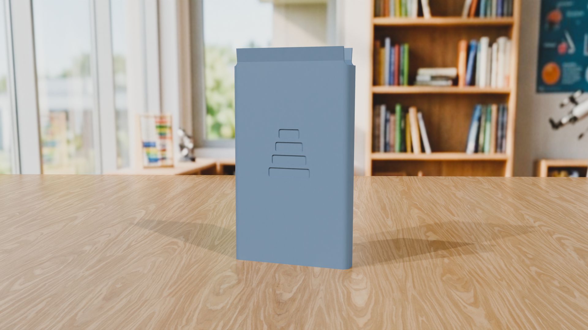

### D.1.1 Upper Math & Number Sense Zone (Rows 0–2, 6 Columns)
The top three rows of the keypad gather your advanced exploration tools into a 6-column grid—placing powers (`[x²]`, `[x³]`), place value (`[PV]`), fraction towers (`[a ᵇ/c]`, `[g] [SIMP]`), prime number theory (`[GCF]`, `[PRIME]`), and data-detective tools (`[Σ+]`, `[IQR]`, `[g] [x̄]`) right beneath the daylight screen:

| Row | Col 0 | Col 1 | Col 2 | Col 3 | Col 4 | Col 5 |
| :---: | :---: | :---: | :---: | :---: | :---: | :---: |
| **Row 0** | `[x²]` | `[x!]` | `[π]` | `[x³]` | `[PV]` | `[$]` |
| **Row 1** | `[FDISP]` | `[a ᵇ/c]` | `[GCF]` | `[PRIME]` | `[x⇄y]` | `[+/-]` |
| **Row 2** | `[FRQ]` | `[RNG]` | `[IQR]` | `[Σ+]` | `[N]` | `[%]` |

### D.1.2 Hands-On Math Modes & Stack Elevator Zone (Row 3)
Across the middle bridge of the calculator sits the double-wide **`[ENTER]`** key—spanning Columns 0 and 1 right under your left thumb—alongside your instant-launch visual studio keys (`[🕒]` Geared Clock, `[▦]` Ten-Frame, and `[NUM]` Stack View) and the `[<-]` backspace key:

| Row | Col 0 & 1 (Double-Wide) | Col 2 | Col 3 | Col 4 | Col 5 |
| :---: | :---: | :---: | :---: | :---: | :---: |
| **Row 3** | `[ENTER]` | `[🕒]` | `[▦]` | `[NUM]` | `[<-]` |

### D.1.3 Lower Arithmetic & Geometry Zone (Rows 4–7, 5 Columns)
The bottom four rows use extra-wide 5-column spacing for fast, mistake-free digit entry (`0`–`9`), the four core operations (`÷, ×, -, +`) down the right edge, and the polyhedral dice key (`[🎲]`), shift latches (`[f]`, `[g]`), and `[C]` (`ON` / `[f] [?]` Quiz) down the left edge:

| Row | Col 0 | Col 1 | Col 2 | Col 3 | Col 4 |
| :---: | :---: | :---: | :---: | :---: | :---: |
| **Row 4** | `[🎲]` | `[7]` | `[8]` | `[9]` | `[÷]` |
| **Row 5** | `[f]` (f-Shift) | `[4]` | `[5]` | `[6]` | `[×]` |
| **Row 6** | `[g]` (g-Shift) | `[1]` | `[2]` | `[3]` | `[-]` |
| **Row 7** | `[C]` (ON) | `[0]` | `[.]` | `[≠]` | `[+]` |

### D.1.4 How the Three Labels on Every Button & Number-Pad Shortcuts Work
Look closely at any button on your SC-6 and you will spot up to three labels—plus a clever spatial pattern hidden across the number pad (`1`–`9`). The bold **Primary Legend** printed on the keycap face runs with a single tap. Tapping **`[f]`** once lights the `↰` indicator in the top-left corner of the screen and selects the **upper-left `[f]` label** on your next key press; tapping **`[g]`** once lights `↱` and selects the **upper-right `[g]` label** (and tapping the same shift key a second time cancels it if you change your mind).

Even the number pad (`1`–`9` and `-`) is organized as a visual map so your fingers can find geometry builders and measurement conversions without hunting:

| Number-Pad Zone | Keys | `[f]` Shift (Top-Left) | `[g]` Shift (Top-Right) | Why It Is Grouped This Way |
| :--- | :---: | :--- | :--- | :--- |
| **Row 4: 2D & 3D Geometry Workbench** | `7`, `8`, `9` | `[f] [RECT]`, `[f] [CIRC]`, `[f] [PRISM]` | `[g] [TRI]`, `[g] [HYP]`, `[g] [CONE]` | Moves left-to-right from flat rectangles/triangles (`7`) and circles/right triangles (`8`) to 3D prisms/cones (`9`) |
| **Row 5: Everyday Weight, Distance & Volume** | `4`, `5`, `6` | `[f] [▸g]`, `[f] [▸ft]`, `[f] [▸mL]` | `[g] [▸oz]`, `[g] [▸mi]`, `[g] [▸fl]` | Pairs grams/ounces (`4`), feet/miles (`5`), and milliliters/fluid ounces (`6`) across `[f]` (left) and `[g]` (right) |
| **Row 6: Heavy Mass, Temperature, Length & Tanks** | `1`, `2`, `3`, `-` | `[f] [▸kg]`, `[f] [▸°C]`, `[f] [▸cm]`, `[f] [▸L]` | `[g] [▸lb]`, `[g] [▸°F]`, `[g] [▸in]`, `[g] [▸gal]` | Tapping `[f]` converts to Metric (`kg`, `°C`, `cm`, `L`); tapping `[g]` on the same key converts to U.S. Customary (`lb`, `°F`, `in`, `gal`) |

---

## D.2 The Complete 43-Key Directory & Chapter Guide

The table below catalogs every keycap position, primary legend, `[f]` and `[g]` shift combinations, grade band, and direct links to the chapters where each key is introduced and practiced:

| Key & Grid | Primary Key | `[f]` Shift (Top-Left) | `[g]` Shift (Top-Right) | Grade Band & Chapter Guide |
| :---: | :---: | :--- | :--- | :--- |
| **01** (R0, C0) | `[x²]` | `[f] [√x]` Root | `[g] [yˣ]` Power | Grades 5–6+ • [Chapter 6: Square Area & Roots](sc6/06-geometry-surface-area.md) • [Chapter 4: Powers](sc6/04-operations-skip-counting.md) |
| **02** (R0, C1) | `[x!]` | `[f] [nCr]` Combinations | `[g] [nPr]` Permutations | Grades 6+ • [Chapter 7: Counting Choices & Arrangements](sc6/07-data-probability-primes.md) |
| **03** (R0, C2) | `[π]` | `[f] [e]` Euler | `[g] [ˣ√y]` Root | Grades 5–6+ • [Chapter 6: Circle Geometry & 3D Volumes](sc6/06-geometry-surface-area.md) |
| **04** (R0, C3) | `[x³]` | `[f] [10ˣ]` Power of 10 | `[g] [LOG]` Base-10 | Grades 5–6+ • [Chapter 6: 3D Cube Volumes](sc6/06-geometry-surface-area.md) • [Chapter 3: Place Value Powers](sc6/03-counting-place-value.md) |
| **05** (R0, C4) | `[PV]` | `[f] [IP]` Whole Part | `[g] [FP]` Fraction Part | Grades 3–4 • [Chapter 3: Place Value Decomposition](sc6/03-counting-place-value.md) • [Chapter 5: Whole & Fractional Parts](sc6/05-fractions-decimals-ratios.md) |
| **06** (R0, C5) | `[$]` | `[f] [ALL]` Full Digits | `[g] [RND]` Round | Grades 3–5 • [Chapter 3: Currency & Place Value](sc6/03-counting-place-value.md) • [Chapter 4: Rounding](sc6/04-operations-skip-counting.md) |
| **07** (R1, C0) | `[FDISP]` | `[f] [1/x]` Reciprocal | `[g] [/c]` Denominator | Grades 3–5 • [Chapter 5: Fraction Entry, Reciprocals & Fixed Denominators](sc6/05-fractions-decimals-ratios.md) |
| **08** (R1, C1) | `[a ᵇ/c]` | `[f] [d/c]` Improper | `[g] [SIMP]` Simplify | Grades 3–5 • [Chapter 5: Mixed Numbers, Improper Fractions & Simplify](sc6/05-fractions-decimals-ratios.md) |
| **09** (R1, C2) | `[GCF]` | `[f] [LCM]` Multiple | `[g] [a:b]` Ratio | Grades 5–6 • [Chapter 7: Number Theory GCF & LCM](sc6/07-data-probability-primes.md) • [Chapter 5: Ratios & Rates](sc6/05-fractions-decimals-ratios.md) |
| **10** (R1, C3) | `[PRIME]` | `[f] [C.FAC]` Common Factors | `[g] [FACT]` Factor Tree | Grades 5–6 • [Chapter 7: Prime Studio & Factorization](sc6/07-data-probability-primes.md) |
| **11** (R1, C4) | `[x⇄y]` | `[f] [R↓]` Roll Down | `[g] [REP]` Replicate | Grades 3–4 • [Chapter 2: Stack Swapping & Rolling](sc6/02-rpn-for-young-learners.md) • [Chapter 4: Constant Repeat Skip-Counting](sc6/04-operations-skip-counting.md) |
| **12** (R1, C5) | `[+/-]` | `[f] [E]` Exponent | `[g] [|x|]` Absolute Value | Grades 5–6 • [Chapter 7: Signed Numbers & Absolute Value](sc6/07-data-probability-primes.md) • [Chapter 3: Big Numbers](sc6/03-counting-place-value.md) |
| **13** (R2, C0) | `[FRQ]` | `[f] [MED]` Median | `[g] [MODE]` Mode | Grades 5–6 • [Chapter 7: Frequency Tables, Median & Mode](sc6/07-data-probability-primes.md) |
| **14** (R2, C1) | `[RNG]` | `[f] [MIN]` Minimum | `[g] [MAX]` Maximum | Grades 5–6 • [Chapter 7: Data Spread & Extremes](sc6/07-data-probability-primes.md) |
| **15** (R2, C2) | `[IQR]` | `[f] [1Q]` Quartile 1 | `[g] [3Q]` Quartile 3 | Grades 6+ • [Chapter 7: Quartiles & Box Plots](sc6/07-data-probability-primes.md) |
| **16** (R2, C3) | `[Σ+]` | `[f] [Σ-]` Remove | `[g] [MAD]` Mean Deviation | Grades 4–6 • [Chapter 6: Master Surface Area via Stats](sc6/06-geometry-surface-area.md) • [Chapter 7: Mean Absolute Deviation](sc6/07-data-probability-primes.md) |
| **17** (R2, C4) | `[N]` | `[f] [Σx]` Total Sum | `[g] [x̄]` Mean Average | Grades 5–6 • [Chapter 7: Sample Count & Fair-Share Mean](sc6/07-data-probability-primes.md) |
| **18** (R2, C5) | `[%]` | `[f] [▸%]` Decimal to % | `[g] [%CHG]` % Change | Grades 5–6 • [Chapter 5: Percentages, Tips & Discounts](sc6/05-fractions-decimals-ratios.md) |
| **19** (R3, C0-1) | `[ENTER]` | `[f] [LASTX]` Last X | `[g] [SHOW]` Full 15-Digit | Grades 3–6 • [Chapter 2: The Elevator Push](sc6/02-rpn-for-young-learners.md) • [Chapter 4: Last Number Self-Check](sc6/04-operations-skip-counting.md) |
| **20** (R3, C2) | `[🕒]` | `[f] [▸HR]` Decimal Hours | `[g] [▸HMS]` Clock Time | Grades 3–5 • [Chapter 6: Planetary Geared Clock & Elapsed Time](sc6/06-geometry-surface-area.md) |
| **21** (R3, C3) | `[▦]` | `[f] [LINE]` Number Line | `[g] [COUNT]` Step Count | Grades 3–5 • [Chapter 3: Ten-Frame, Number Line & Number Rack](sc6/03-counting-place-value.md) |
| **22** (R3, C4) | `[NUM]` | `[f] [SCI]` Scientific | `[g] [FIX]` Fixed Decimals | Grades 3–6 • [Chapter 2: Numerical 4-Stack Mode](sc6/02-rpn-for-young-learners.md) • [Chapter 3: Display Formats](sc6/03-counting-place-value.md) |
| **23** (R3, C5) | `[<-]` | `[f] [CSTK]` Clear Stack | `[g] [CLΣ]` Clear Stats | Grades 3–6 • [Chapter 2: Backspace & Clear Stack](sc6/02-rpn-for-young-learners.md) • [Chapter 6: Clear Stats Basket](sc6/06-geometry-surface-area.md) |
| **24** (R4, C0) | `[🎲]` | `[f] [1…x]` Random Roll | `[g] [t…x]` Random Range | Grades 3–6 • [Chapter 7: Polyhedral Dice & Probability Trials](sc6/07-data-probability-primes.md) |
| **25** (R4, C1) | `[7]` | `[f] [RECT]` Area | `[g] [TRI]` Area | Grades 3–6 • [Chapter 6: Rectangle & Triangle Area](sc6/06-geometry-surface-area.md) (`7` + 2D Polygon Areas) |
| **26** (R4, C2) | `[8]` | `[f] [CIRC]` Area | `[g] [HYP]` Hypotenuse | Grades 3–6 • [Chapter 6: Circle Area & 3-4-5 Hypotenuse](sc6/06-geometry-surface-area.md) (`8` + Curved/Slanted Shapes) |
| **27** (R4, C3) | `[9]` | `[f] [PRISM]` Volume | `[g] [CONE]` Volume | Grades 3–6 • [Chapter 6: 3D Prism & Cone Volumes](sc6/06-geometry-surface-area.md) (`9` + 3D Solid Builders) |
| **28** (R4, C4) | `[÷]` | `[f] [MOD]` Remainder | `[g] [÷R]` Quotient & Rem | Grades 3–5 • [Chapter 4: Division, Quotient & Remainder](sc6/04-operations-skip-counting.md) |
| **29** (R5, C0) | `[f]` (f-Shift) | *(f-Shift Latch)* | *(f-Shift Latch)* | Grades 3–6 • [Chapter 1: Primary f-Shift Key](sc6/01-hardware-architecture.md) |
| **30** (R5, C1) | `[4]` | `[f] [▸g]` Grams | `[g] [▸oz]` Ounces | Grades 3–6 • [Chapter 9: 3D Print Filament Weight (`▸g` / `▸oz`)](sc6/09-applied-stem-labs.md) |
| **31** (R5, C2) | `[5]` | `[f] [▸ft]` Feet | `[g] [▸mi]` Miles | Grades 3–6 • [Chapter 9: Field & Road Distance Scaling (`▸ft` / `▸mi`)](sc6/09-applied-stem-labs.md) |
| **32** (R5, C3) | `[6]` | `[f] [▸mL]` Milliliters | `[g] [▸fl]` Fluid Ounces | Grades 3–6 • [Chapter 9: Kitchen & Lab Liquid Volumes (`▸mL` / `▸fl`)](sc6/09-applied-stem-labs.md) |
| **33** (R5, C4) | `[×]` | — | `[g] [FLAGS]` System Flags | Grades 3–5 • [Chapter 4: Array Multiplication](sc6/04-operations-skip-counting.md) • [Chapter 2: Stack Depth Modes](sc6/02-rpn-for-young-learners.md) |
| **34** (R6, C0) | `[g]` (g-Shift) | *(g-Shift Latch)* | *(g-Shift Latch)* | Grades 3–6 • [Chapter 1: Secondary g-Shift Key](sc6/01-hardware-architecture.md) |
| **35** (R6, C1) | `[1]` | `[f] [▸kg]` Kilograms | `[g] [▸lb]` Pounds | Grades 3–6 • [Chapter 9: Heavy Mass Conversions (`▸kg` / `▸lb`)](sc6/09-applied-stem-labs.md) |
| **36** (R6, C2) | `[2]` | `[f] [▸°C]` Celsius | `[g] [▸°F]` Fahrenheit | Grades 3–6 • [Chapter 9: Solar Oven & Weather Temperatures (`▸°C` / `▸°F`)](sc6/09-applied-stem-labs.md) |
| **37** (R6, C3) | `[3]` | `[f] [▸cm]` Centimeters | `[g] [▸in]` Inches | Grades 3–6 • [Chapter 9: Caliper & Ruler Length Conversions (`▸cm` / `▸in`)](sc6/09-applied-stem-labs.md) |
| **38** (R6, C4) | `[-]` | `[f] [▸L]` Liters | `[g] [▸gal]` Gallons | Grades 3–6 • [Chapter 4: Subtraction](sc6/04-operations-skip-counting.md) • [Chapter 9: Water & Tank Volumes](sc6/09-applied-stem-labs.md) |
| **39** (R7, C0) | `[C]` (ON) | `[f] [?]` Quiz Sprint | `[g] [OFF]` Sleep | Grades 3–6 • [Chapter 1: Wake & Sleep](sc6/01-hardware-architecture.md) • [Chapter 8: Math Quiz Game](sc6/08-math-quiz-engine.md) |
| **40** (R7, C1) | `[0]` | `[f] [REGS]` Stack Viewer | — | Grades 3–6 • [Chapter 3: Zero & Place Value](sc6/03-counting-place-value.md) • [Chapter 2: Stack Viewer](sc6/02-rpn-for-young-learners.md) |
| **41** (R7, C2) | `[.]` | `[f] [0.3̄]` Repeating | — | Grades 3–5 • [Chapter 5: Two-Dot Fractions & Repeating Decimals](sc6/05-fractions-decimals-ratios.md) |
| **42** (R7, C3) | `[≠]` | `[f] [>]` Greater Than | `[g] [<]` Less Than | Grades 3–5 • [Chapter 4: Comparing Numbers](sc6/04-operations-skip-counting.md) • [Chapter 8: Quiz Submit](sc6/08-math-quiz-engine.md) |
| **43** (R7, C4) | `[+]` | `[f] [≥]` Greater/Equal | `[g] [≤]` Less/Equal | Grades 3–5 • [Chapter 4: Addition & Comparisons](sc6/04-operations-skip-counting.md) |

---

## D.3 Which Buttons to Explore Next & Quick Task Finder

Not sure which buttons to try next? Follow this six-step map from your very first Ten-Frame puzzles all the way to prime factor trees and mental math sprints:

| Exploration Stage | What You Can Build & Solve | Buttons to Try |
| :--- | :--- | :--- |
| **1. First Stack Moves** | Counting groups, making 10s, and adding or subtracting on the shelves | `[▦]` Ten-Frame, `[g] [COUNT]`, `[f] [LINE]`, `[+]`, `[-]`, `[ENTER]`, `[C]`, `[<-]` |
| **2. Place Value & Skip-Counting** | Breaking big numbers into 1000s/100s/10s/1s, money math, and skip-counting | `[PV]` Place Value, `[g] [REP]` Constant Repeat, `[$]` Money, `[x⇄y]` |
| **3. Tile Arrays, Area & Clock Time** | Building tile rectangles, telling geared clock time, and entering fractions | `[×]`, `[÷]`, `[f] [RECT]`, `[🕒]` Geared Clock, `[FDISP]`, `[.]` |
| **4. Remainders & Fraction Towers** | Sharing with leftovers, simplifying fractions to lowest terms, and checking work | `[g] [÷R]` Quotient & Remainder, `[a ᵇ/c]`, `[f] [d/c]`, `[g] [SIMP]`, `[f] [LASTX]` |
| **5. Common Slices & 3D Boxes** | Finding common denominators, wrapping 3D boxes, and building tally tables | `[GCF]`, `[f] [LCM]`, `[f] [PRISM]`, `[Σ+]` Add to Total, `[FRQ]` Tables |
| **6. Primes, Fair Dice & Quiz Sprints** | Negative numbers, prime factor trees, fair-share data averages, and quiz sprints | `[+/-]`, `[g] [|x|]`, `[PRIME]`, `[g] [FACT]`, `[g] [a:b]`, `[x²]`, `[f] [√x]`, `[IQR]`, `[g] [MAD]` |

### D.3.1 Task-to-Button Quick Finder ("I Want To... $\to$ Press This Key")

Whenever you are in the middle of a math puzzle or maker project and want to find the right key sequence in five seconds, look up your goal in this quick-finder table:

| I Want To... | Button Sequence to Press | Quick Example to Try |
| :--- | :--- | :--- |
| **Fix a mistyped digit before pressing `[ENTER]`** | Tap `[<-]` (Backspace) | Type `478`, tap `[<-]` $\to$ `47` |
| **Swap the two numbers on Shelf $Y$ and Shelf $X$** | Tap `[x⇄y]` | `8 [ENTER] 24 [x⇄y] [÷]` $\to$ `3` |
| **Prove my last answer in reverse without retyping** | Tap `[f] [LASTX]` (`[ENTER]`) + opposite key | After `47 [ENTER] 36 [+]` (`83`), tap `[f] [LASTX] [-]` $\to$ `47` |
| **Skip-count by the same number on every tap** | Type step, tap `[g] [REP]` (`[x⇄y]`), tap `[+]` | `7 [g] [REP] [+] [+] [+]` $\to$ `14, 21, 28` |
| **Divide and see both Whole Groups and Leftovers** | Put Total in $Y$, Group Size in $X$, tap `[g] [÷R]` (`[÷]`) | `145 [ENTER] 45 [g] [÷R]` $\to$ `X: 3` buses, `Y: 10` left over |
| **X-ray the digit sitting in any place-value column** | Put number in $Y$, column (`1, 10, 100...`) in $X$, tap `[PV]` | `4725 [ENTER] 100 [PV]` $\to$ `7` hundreds |
| **Enter a proper fraction (like $\frac{3}{8}$) or mixed number ($2\frac{1}{4}$)** | Use two dots (`[.]`) to separate whole, top, and bottom | `0 [.] 3 [.] 8 [ENTER]` *(or `[.] 3 [.] 8`)* or `2 [.] 1 [.] 4 [ENTER]` |
| **Simplify a fraction or ratio to lowest terms** | Tap `[g] [SIMP]` (`[a ᵇ/c]`) | `0 [.] 12 [.] 18 [ENTER] [g] [SIMP]` $\to$ `2/3` |
| **Find the Least Common Denominator of two fractions** | Put denominators on $Y$ and $X$, tap `[f] [LCM]` (`[GCF]`) | `8 [ENTER] 12 [f] [LCM]` $\to$ `24` |
| **Take a sale discount or add a tip in two taps** | Put price on $Y$, percent on $X$, tap `[%]`, then `[-]` or `[+]` | `80 [ENTER] 15 [%] [-]` $\to$ `68.00` |
| **Find the area of a rectangle, triangle, or circle** | Use `[f] [RECT]` (`[f]` `7`), `[g] [TRI]` (`[g]` `7`), or `[f] [CIRC]` (`[f]` `8`) | `14 [ENTER] 9 [g] [TRI]` $\to$ `63` |
| **Wrap all the walls of a 3D box or tent** | Clear basket (`[g] [CLΣ]`), toss each wall into `[Σ+]`, tap `[f] [Σx]` | Toss $3$ wall pairs into `[Σ+]`, tap `[f] [Σx]` (`[N]`) |
| **Add or subtract hours and minutes (`HH.MM`)** | Convert with `[f] [▸HR]`, add/subtract, convert back with `[g] [▸HMS]` | `9.45 [f] [▸HR] 2.35 [f] [▸HR] [+] [g] [▸HMS]` $\to$ `12.20` |
| **Test if a number is prime & see its factor tree** | Tap `[PRIME]`, then tap `[g] [FACT]` (`[PRIME]`) | `60 [PRIME]` (`COMPOSITE`), then `[g] [FACT]` $\to$ `2² × 3 × 5` |
| **Roll fair polyhedral dice ($1\text{d}6$, $2\text{d}6$, or $1\text{d}20$)** | Tap `[🎲]` for $1\text{d}6$ (`[🎲] [🎲] [+]` for $2\text{d}6$), or type $N$ and tap `[f] [1…x]` (`[🎲]`) | `20 [f] [1…x]` $\to$ random roll from `1` to `20` |
| **Find the Mean (`[g] [x̄]`), Median (`[f] [MED]`), and IQR (`[IQR]`)** | Clear (`[g] [CLΣ]`), enter each data point with `[Σ+]`, tap stat key | After loading data with `[Σ+]`, tap `[g] [x̄]` (`[N]`) or `[f] [MED]` |

### D.3.2 Ten 30-Second Daily Warm-Ups Across the Keypad

Want a fast way to keep all 43 buttons fresh in your fingertips? Pick any two of these **30-second warm-ups** before starting your math homework or maker project:

| Warm-Up # | Studio Focus | Exact Keystrokes to Press | What You Should See on Your Screen |
| :---: | :--- | :--- | :--- |
| **1** | **Ten-Frame Partner to 10** | `7 [▦]` $\to$ `[NUM] 3 [+]` | Ten-frame shows `7` dots and `3` empty sockets; adding `3` completes **`10`** |
| **2** | **Number-Line Bridge Across Zero** | `[f] [LINE] 4 [ENTER] 9 [-]` | Jump arc hops back `4` to `0`, then `5` more left to land on **`-5`** |
| **3** | **Place-Value X-Ray Check** | `8042 [ENTER] 100 [PV]` | Extracts the hundreds column digit **`0`** (zero hundred-flats holding the column open) |
| **4** | **Constant Doubling Ladder** | `2 [g] [REP] [×] [×] [×] [×]` | Doubles `2` across four taps (`4` $\to$ `8` $\to$ `16` $\to$ **`32`**) |
| **5** | **Remainder & Reverse Proof** | `100 [ENTER] 7 [g] [÷R]` $\to$ `[f] [LASTX] [×] [+]` | Splits `100` into **`14`** ($X$) with **`2`** left ($Y$), then rebuilds **`100`** |
| **6** | **Fraction Tower Addition** | `0 [.] 1 [.] 3 [ENTER] 0 [.] 1 [.] 4 [+]` | Bridges thirds and fourths on the shared twelfths grid to display **`7/12`** |
| **7** | **3D Box Volume Builder** | `5 [ENTER] 4 [f] [RECT] 3 [f] [PRISM]` | Multiplies the $5 \times 4 = 20$ base rectangle by height $3$ to display Volume **`60`** on Shelf $X$ |
| **8** | **Geared Clock Time Jump** | `2.45 [f] [▸HR] 1.30 [f] [▸HR] [+] [g] [▸HMS]` | Adds $2\text{ hr } 45\text{ min}$ and $1\text{ hr } 30\text{ min}$ to land on **`4.15`** ($4{:}15$) |
| **9** | **Prime Factor Tree Builder** | `84 [PRIME]` $\to$ `[g] [FACT]` | Identifies $84$ as `COMPOSITE` and reveals its prime tower **`2² × 3 × 7`** |
| **10** | **Data Basket Mean & Median** | `[g] [CLΣ] 12 [Σ+] 15 [Σ+] 24 [Σ+] [g] [x̄]` | Averages the $3$ measurements to **`17.0`**, while `[f] [MED]` shows middle **`15.0`** |

---

### D.3.3 Continuing Your Mathematical Journey

Every time you place a number on Shelf $Y$ with `[ENTER]`, watch a finished answer lift automatically to Shelf $Z$, or unfold a 3D box into `[Σ+]`, you are practicing the exact way scientists, architects, and engineers think: breaking big puzzles into small, honest pieces you can see and touch. Keep your math blocks and your SC-6 within reach on your desk—and whenever you are ready for trigonometric waves, orbital mechanics, and numerical calculus, *Thinking in the Stack* (**Volume II: StackCalc SC-32**) is waiting for you.
