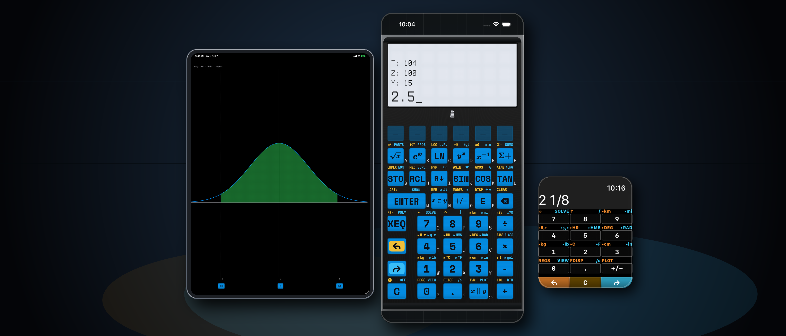
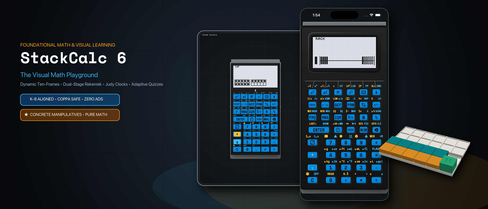
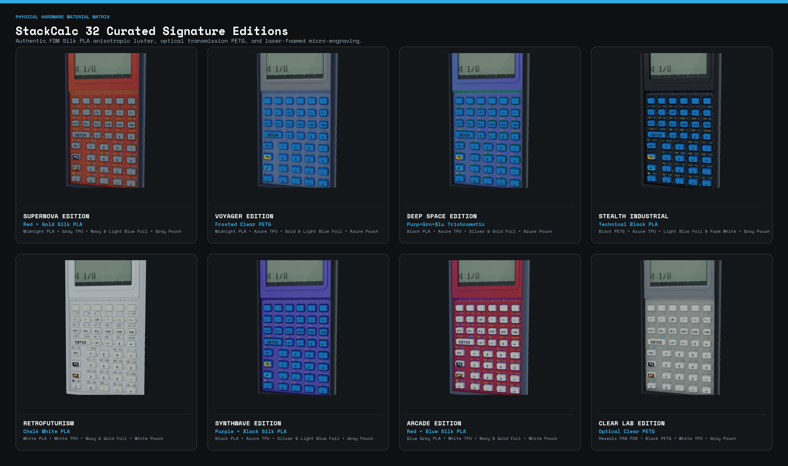

# Press Kit & Editorial Overview

**StackCalc Calculator** is a tactile, deterministic scientific RPN calculator and visual K–8 math companion for **iPhone, iPad, and a 100% standalone Apple Watch app**.

Rather than treating mobile math as another flat, soulless grid of glass—or hiding reasoning inside a black-box AI—StackCalc restores the physical joy, speed, and transparent step-by-step clarity of a dedicated mathematical instrument across **one unified app with two built-in modes** that grow with the learner from first grade through professional engineering.

  <a href="https://apps.apple.com/app/id6801788040" target="_blank" class="brutalist-button-primary px-6 py-3 font-mono text-sm font-bold inline-flex items-center gap-2 text-decoration-none">
    App Store (Scientific Mode — StackCalc 32)
  </a>
  <a href="https://apps.apple.com/us/app/stackcalc-calculator/id6801788040?ppid=adb09508-b8f0-4e64-9913-15c8eabb57a8" target="_blank" class="brutalist-button-primary px-6 py-3 font-mono text-sm font-bold inline-flex items-center gap-2 text-decoration-none">
    Custom Product Page (Visual Mode — StackCalc 6)
  </a>
  <a href="/downloads/teacher-curriculum-guide-letter.pdf" target="_blank" class="brutalist-button-primary px-6 py-3 font-mono text-sm font-bold inline-flex items-center gap-2 text-decoration-none">
    43-Page K–12 Teacher Curriculum Guide (PDF)
  </a>

---

## 1. At-a-Glance Editorial Fact Sheet

| Attribute | Details |
| :--- | :--- |
| **App Store Name** | **StackCalc Calculator** (*Subtitle:* `Scientific, Graphing & Solver`) |
| **Apple App ID** | `6801788040` ([apps.apple.com/app/id6801788040](https://apps.apple.com/app/id6801788040)) |
| **Version 1.1 Milestone** | Unifies **Scientific Mode (StackCalc 32)** and **Visual Learning Mode (StackCalc 6)** in a single universal app |
| **Supported Platforms** | **iOS** (iPhone), **iPadOS** (iPad), **watchOS** (100% Standalone Apple Watch App) |
| **Instant Mode Deep Link** | Open `stackcalc://sc6` on any iPhone or iPad to launch directly into **Visual Learning Mode (StackCalc 6)** |
| **Business Model & Ethics** | **100% Offline • Zero Ads • Zero Tracking • Zero Subscriptions • COPPA & FERPA Safe** |
| **Open Education Ecosystem** | Free downloadable **43-page K–12 Teacher Curriculum Guide** & open-source **3D-printable Gridfinity classroom blocks** ([stackcalc.io/education](learning-lab.md)) |

---

## 2. The Design Philosophy: Bridging Classroom Intuition and Engineering Precision

Traditional math tools force learners through three disconnected worlds: children begin with physical classroom blocks, transition to algebraic school calculators cluttered with nested parentheses and syntax errors, and only encounter clean stack-based computation (Reverse Polish Notation) in university or professional engineering—often on discontinued vintage hardware like the **HP-32SII** or \$250+ boutique collectors' calculators.

**StackCalc was created to unify that journey in a single, accessible instrument:**

* **End Parenthesis Anxiety:** By keeping active numbers visible on a clean vertical stack, users operate on numbers in the exact order they think—eliminating bracket mismatches and hidden state.
* **Connect Physical and Digital Learning:** Elementary students see numbers transform directly into visual models on screen alongside free, open-source 3D-printable classroom blocks, building spatial number sense before graduating to full scientific and calculus workflows.
* **Built for Everyday Use & Exam Integrity:** Free of programming modes, CAS engines, QWERTY keyboards, ads, or subscriptions—delivering pure, distraction-free mathematical utility across iPhone, iPad, and Apple Watch.

---

## 3. One Unified App, Two Built-In Modes

StackCalc is a single universal app that adapts to the user's stage of learning through two purpose-built modes:

### Mode A: Scientific Mode (`StackCalc 32`) — The Modern HP-32SII Reimagined

Designed for engineers, scientists, AP students, and anyone who values speed and transparency over black-box answers:

* **Zero Parentheses, Visible 4-Level Stack (`X, Y, Z, T`):** Enter numbers, tap operations, and watch intermediate results stay visible at every step. You never lose your place or battle syntax errors.
* **Exact Mixed Fractions (`SIMP`):** Natural mixed-fraction entry and display (e.g., `2 1/8`) with dedicated step-by-step prime factor reduction so students and builders see *how* fractions simplify.
* **Multi-Variable Equation Solver & Calculus:** Store custom formulas, solve numerically for any unknown variable, and evaluate definite integrals using Simpson convergence.
* **Interactive Curve Plotting:** High-contrast graphing canvas with real-time root inspection, inflection tracing, and shaded area-under-the-curve integration.
* **STEM & Computer Science Toolkit:** Complex numbers, 2-variable statistical regressions, and Base-N programmer modes (`HEX`, `DEC`, `OCT`, `BIN`).

#### 60fps App Preview Walkthroughs (Normal Distribution Integration & Z-Score)

  

    
<strong>iPhone Walkthrough (30s)</strong>

    <video controls playsinline preload="metadata" poster="/assets/press/sc32_search_card.png" style="width: 100%; border-radius: 12px; border: 1px solid #333; background-color: #000;">
      <source src="/assets/press/stackcalc-npdf-walkthrough-iphone.mp4" type="video/mp4">
    </video>
  

  

    
<strong>iPad Benchtop Walkthrough (30s)</strong>

    <video controls playsinline preload="metadata" poster="/assets/press/sc32_product_page_header.png" style="width: 100%; border-radius: 12px; border: 1px solid #333; background-color: #000;">
      <source src="/assets/press/stackcalc-npdf-walkthrough-ipad.mp4" type="video/mp4">
    </video>
  

---

### Mode B: Visual Learning Mode (`StackCalc 6` — New in Version 1.1)

In Version 1.1, switching into **Visual Learning Mode (`StackCalc 6`)** transforms the calculator into a distraction-free K–8 educational playground aligned with **Singapore Math (Concrete • Pictorial • Abstract)** and **Common Core**:

* **Live Pictorial LCD Visualizations:** As students enter numbers and perform operations on a focused 2-level stack, the dot-matrix display dynamically renders quantities as:
  * **Ten-Frames (`10F`):** Subitizing and make-ten bridging strategies up to 100.
  * **20-Bead Number Rack (`RACK`):** Classic 5-and-5 Rekenrek bead grouping for doubles and near-doubles fluency.
  * **Dynamic Number Line (`LINE`):** Proportional jump arcs illustrating addition and subtraction trajectories.
  * **Analog Judy Clock (`🕒`):** Synchronized hour, minute, and ticking second hands with elapsed time conversion.
  * **Ratio, Stats & Frequency Tables:** Side-by-side tabular inspection for elementary data literacy.
* **5-Level Adaptive Fluency Quiz Engine (`?`):** Generates targeted mental math challenges (`L1`–`L5`) that adapt to student response speed and accuracy, complete with live score tracking and celebratory mastery banners.

#### Paired with Open-Source 3D-Printable Classroom Blocks & 43-Page Curriculum

To bridge the screen with hands-on classroom learning, we designed the **[StackCalc Learning Lab](learning-lab.md)**—a modular ecosystem of **open-source 3D-printable Gridfinity manipulatives** and a **[43-page Teacher Curriculum Guide (PDF)](downloads/teacher-curriculum-guide-letter.pdf)** mapped lesson-by-lesson to **Singapore Dimensions Math**, **Bridges in Mathematics**, and **Big Ideas Math**:

  

    
    
<strong>Modular Gridfinity Dock:</strong> The storage box becomes the student desk workstation.

  

  

    
    
<strong>Ten-Frame Stage:</strong> Mirrors the on-screen Ten-Frame display for Kindergarten & Grade 1.

  

  

    
    
<strong>20-Bead Number Rack:</strong> Tactile 5-grouping paired with StackCalc 6.

  

---

## 4. Obsessive Apple Platform Craftsmanship

### A. 100% Standalone Apple Watch Instrument
Unlike companion calculator apps that rely on a paired iPhone or reduce the wrist to a basic four-function pad, StackCalc runs its complete scientific RPN math engine natively on **watchOS**:

* **75% Direct Display-as-ENTER:** The top 75% of the watch screen acts as an authoritative, no-look `ENTER` target—allowing effortless one-handed calculation in a lab, workshop, or field environment.
* **Digital Crown & Bezel Stack Scrubbing:** Drag up from the lower 25% bezel or turn the Digital Crown to inspect all four stack registers (`X, Y, Z, T`) and scrub interactive tutorials.
* **True `#000000` OLED Canvas & Wayfinding Beacons:** Subtle directional color beacons (Burnt Orange, Electric Blue, Cyan) orient your thumb across key pages without visual clutter, paired with native Watch Face Complications and Smart Stack widgets.

### B. Continuous Tactile Field (`CoreHaptics`)
Physical calculators are revered for the crisp snap of their keys. StackCalc’s custom `CoreHaptics` engine simulates both **key-seam boundary pulses** (so your finger can feel button edges when sliding across glass) and **mechanical snap-dome actuation** with distinct physical weight for numbers, shift modifiers, and `ENTER`.

### C. 10 Curated Heritage & 3D-Printed Material Editions
Every theme in StackCalc is modeled after either a landmark historical instrument—such as **Pioneer Brown** (1988 Corvallis HP-32SII) and **RetroFuturism** (1980s Dieter Rams / Braun)—or our real-world 3D-printed thermoplastics and 1064nm infrared laser-foamed keycaps (**Stealth Industrial**, **Cosmos**, **Voyager**, **Synthwave**, and **Clear Lab**):

---

## 5. High-Resolution Media & Downloads for Editors

* **Main App Store Listing (Scientific Mode):** [https://apps.apple.com/app/id6801788040](https://apps.apple.com/app/id6801788040)
* **Custom Product Page (Visual Learning Mode):** [https://apps.apple.com/us/app/stackcalc-calculator/id6801788040?ppid=adb09508-b8f0-4e64-9913-15c8eabb57a8](https://apps.apple.com/us/app/stackcalc-calculator/id6801788040?ppid=adb09508-b8f0-4e64-9913-15c8eabb57a8)
* **21:9 Ultra-Wide Hero Banner — Scientific Mode (3840×1646 PNG):** [Download `sc32_product_page_header.png`](assets/press/sc32_product_page_header.png)
* **21:9 Ultra-Wide Hero Banner — Visual Mode (3840×1646 PNG):** [Download `sc6_product_page_header.png`](assets/press/sc6_product_page_header.png)
* **3:2 Search Card — Scientific Mode (1920×1280 PNG):** [Download `sc32_search_card.png`](assets/press/sc32_search_card.png)
* **3:2 Search Card — Visual Mode (1920×1280 PNG):** [Download `sc6_search_card.png`](assets/press/sc6_search_card.png)
* **43-Page Teacher Curriculum Guide (Letter PDF):** [Download `teacher-curriculum-guide-letter.pdf`](downloads/teacher-curriculum-guide-letter.pdf)
* **Student Quick Reference Cards (Letter PDF):** [Download `reference-cards-letter.pdf`](downloads/reference-cards-letter.pdf)
* **3D-Printable Learning Lab STL Bundle (ZIP):** [Download `stackcalc-learning-lab-0.3.0-prototype.zip`](downloads/stackcalc-learning-lab-0.3.0-prototype.zip)

---

## 6. Editorial Contact, Promo Codes & App Store Verification

* **Media & Editorial Inquiries:** [press@stackcalc.io](mailto:press@stackcalc.io)
* **Direct Customer & App Support:** [support@stackcalc.io](mailto:support@stackcalc.io)
* **App Store Review Promo Codes:** Review promo codes and TestFlight evaluation builds are readily provided for App Store review staff, tech journalists, and STEM educators upon request to [press@stackcalc.io](mailto:press@stackcalc.io).
* **Official Website:** [https://www.stackcalc.io](https://www.stackcalc.io)
* **Privacy Policy (App Store Required):** [https://www.stackcalc.io/privacy/](https://www.stackcalc.io/privacy/)
* **Support & FAQ (App Store Required):** [https://www.stackcalc.io/support/](https://www.stackcalc.io/support/)
* **Terms of Service:** [https://www.stackcalc.io/terms/](https://www.stackcalc.io/terms/)
* **Open Source Repository:** [https://github.com/abagher2/watch-calc-32](https://github.com/abagher2/watch-calc-32)
