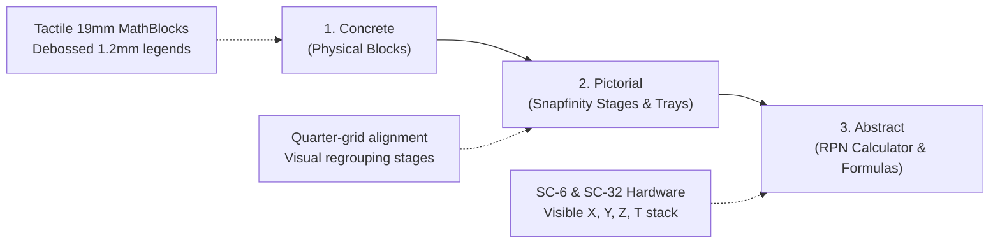
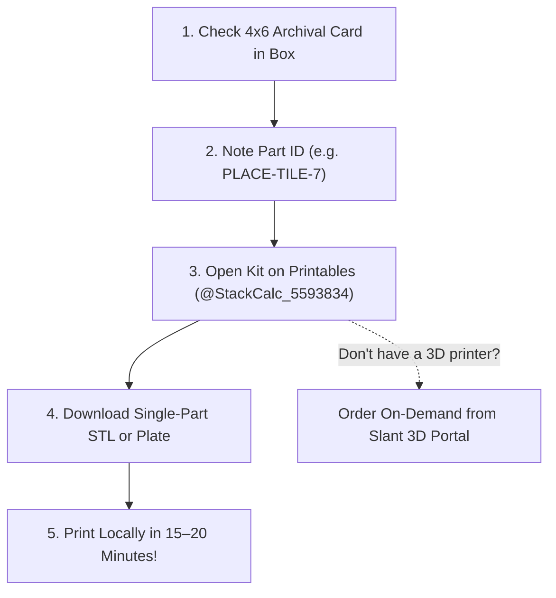

# Makerspace 3D Print Kits & Classroom Refills

Welcome to the **StackCalc Makerspace Hub**. We believe mathematics manipulatives belong in every classroom, and budget constraints or lost pieces should never stop a student from holding math in their hands.

Instead of charging for digital STL downloads or hosting cumbersome raw files across unversioned servers, **the complete digital 3D design files (STLs and 3MFs) for our entire library of 14 math manipulative kits, Gridfinity storage enclosures, and calculator hardware chassis are published 100% free and open-source on [Printables](https://www.printables.com/@StackCalc_5593834)** under the Creative Commons Attribution-NonCommercial-ShareAlike 4.0 (CC BY-NC-SA 4.0) license.

<div style="display: flex; flex-wrap: wrap; gap: 1rem; align-items: center; margin: 1.5rem 0 2rem 0; padding: 1.25rem 1.5rem; background: rgba(250, 107, 5, 0.08); border: 1px solid rgba(250, 107, 5, 0.4); border-radius: 12px;">
  <div style="flex: 1; min-width: 280px;">
    <span style="font-family: 'Space Mono', monospace; font-size: 0.72rem; font-weight: 700; color: #FA6B05; text-transform: uppercase;">OFFICIAL PRINTABLES PROFILE</span>
    <h3 style="margin: 0.25rem 0 0.5rem 0; font-size: 1.25rem; font-weight: 800; color: #FFFFFF;">Printables Collection: @StackCalc_5593834</h3>
    <p style="margin: 0; font-size: 0.85rem; color: #CBD5E1; line-height: 1.5;">
      Browse 14 verified models, pre-sliced color-coordinated plate files matching our factory manufacturing pipeline, and download individual replacement pieces with standardized Part IDs.
    </p>
  </div>
  <div style="display: flex; flex-wrap: wrap; gap: 0.75rem;">
    <a href="https://www.printables.com/@StackCalc_5593834" target="_blank" rel="noopener noreferrer" style="display: inline-block; padding: 0.75rem 1.5rem; border-radius: 8px; background-color: #FA6B05; color: #FFFFFF; font-family: 'Space Mono', monospace; font-size: 0.85rem; font-weight: 800; text-decoration: none; box-shadow: 0 4px 14px rgba(250, 107, 5, 0.4);">
      VISIT PRINTABLES HUB ↗
    </a>
    <a href="https://hackaday.io/project/206743-stackcalc32-a-tactile-rpn-calculator" target="_blank" rel="noopener noreferrer" style="display: inline-block; padding: 0.75rem 1.25rem; border-radius: 8px; background-color: rgba(255, 255, 255, 0.08); border: 1px solid rgba(255, 255, 255, 0.2); color: #FFFFFF; font-family: 'Space Mono', monospace; font-size: 0.85rem; font-weight: 700; text-decoration: none;">
      HACKADAY LOGS ↗
    </a>
    <a href="https://teleportpod.com/portals/profile/StackCalc" target="_blank" rel="noopener noreferrer" style="display: inline-block; padding: 0.75rem 1.25rem; border-radius: 8px; background-color: rgba(255, 255, 255, 0.08); border: 1px solid rgba(255, 255, 255, 0.2); color: #FFFFFF; font-family: 'Space Mono', monospace; font-size: 0.85rem; font-weight: 700; text-decoration: none;">
      SLANT 3D STORE ↗
    </a>
    <a href="https://www.etsy.com/shop/StackCalcMath" target="_blank" rel="noopener noreferrer" style="display: inline-block; padding: 0.75rem 1.25rem; border-radius: 8px; background-color: rgba(255, 255, 255, 0.08); border: 1px solid rgba(255, 255, 255, 0.2); color: #FFFFFF; font-family: 'Space Mono', monospace; font-size: 0.85rem; font-weight: 700; text-decoration: none;">
      ETSY STORE ↗
    </a>
  </div>
</div>

---

## The Big Picture: Why We Are Building StackCalc

If you ask a classroom of elementary or middle school students how they feel about math, far too many will say: *"I'm just not a math person."*

Why does this happen? Because traditional education rushes children into abstract alphanumeric symbols ($x + y = z$) and flat 2D worksheets long before their brains have developed intuitive, spatial number sense. Then, in high school, we hand them complex black-box calculators with hidden menus and arbitrary syntax rules.

**StackCalc was founded to change this from the ground up.**

We are an open-source engineering initiative reimagining how human beings learn mathematics:
- We believe mathematics is **tactile, physical, and intuitive**.
- You should be able to **touch** place value. You should be able to **feel** a common denominator. You should be able to **see** a prime number stand alone.
- Our ecosystem spans from **concrete 3D-printed blocks for kindergarteners**, all the way to **open-source hardware handheld scientific calculators (the SC-6 and SC-32) that students build, program, and understand from the silicon up**.

Whether you only print a single kit for your child's homework desk or build the full open-hardware calculator, you are giving a student the superpower of physical mathematical intuition.

---

## Why 3D Printing & Open Hardware: The Hybrid Model

Commercial manipulative kits from educational publishers cost $40 to $80 per box. They are sold in closed corporate ecosystems, and when two unit blocks roll under a radiator or get lost in a backpack, the whole set is ruined and ends up abandoned in a classroom closet.

**We chose an open-source hybrid model:**

1. **Free to 3D Print (Open Source):** If you or your school have a 3D printer, every single component, tray, and block is free to download and print right here on Printables under a Creative Commons (CC BY-NC-SA 4.0) license. No digital paywalls, no subscriptions.
2. **"No Lost Piece Left Behind":** Every single part carries a permanent, debossed **Part ID** matching the included inventory card. If a block goes missing, don't throw away the set—just download that single Part ID STL and print an exact replacement in 15–20 minutes!
3. **Don't Have a 3D Printer? We've Got You Covered:** For parents, schools, and teachers who don't have access to 3D printers, we manufacture and sell finished physical kits. You can order on-demand factory refills directly through our [Slant 3D Portal](https://teleportpod.com/portals/profile/StackCalc), or handcrafted boxed sets with printed cards and spiral guides from our [Etsy Storefront](https://www.etsy.com/shop/StackCalcMath).
4. **Engineered for Real Classrooms:** Zero supports, zero fragile filament swaps, and heavy-duty 3-perimeter walls designed to survive tile floor drops.

---

## Community Attribution, Remix Heritage & Open Standards

The StackCalc Learning Lab is proudly built on the open-source shoulders of the 3D printing and maker community. We express our deepest gratitude and provide direct links to the foundational standards and creators that made this project possible:

- **The Gridfinity System (Zack Freedman):** Invented and gifted to the world by **Zack Freedman** ([@ZackFreedman on Printables](https://www.printables.com/@ZackFreedman)). Original Model: [The Ultimate Modular 3D Printable Storage System (Printables #174346)](https://www.printables.com/model/174346-the-ultimate-modular-3d-printable-storage-system-). Community standard: [gridfinity.xyz](https://gridfinity.xyz). *StackCalc's Contribution:* We strictly adhere to Zack's 42.0 mm pitch, 7.0 mm `U` vertical height step, and 45° base chamfers, extending it with **Quarter-Gridfinity (21.0 mm sub-pitch)** to allow high-density educational math manipulatives to live natively inside standard workshop Gridfinity drawers.
- **The Snapfinity Interlocking System (mcbillsan):** Pioneered by **mcbillsan** ([@mcbillsan_550805 on Printables](https://www.printables.com/@mcbillsan_550805)) in the [Gridfinity Snapfinity Baseplate (#422204)](https://www.printables.com/model/422204-gridfinity-snapfinity-baseplate). *StackCalc's Contribution:* We adapted snap-fit friction detents and perimeter retention rails for our dual-purpose calculation lids and workbench stages, calibrated through FEA beam deflection for child-friendly ~8.3 N peel forces.
- **OpenSCAD Parametric CAD Engine:** Created by Clifford Wolf, Marius Kintel, and the open-source OpenSCAD community ([openscad.org](https://openscad.org)). Every block, stage, gear, and tray in this project is 100% procedurally generated with parametric code.
- **Print-in-Place Planetary Kinematics (Emmett Lalish):** Inspired by the legendary print-in-place planetary gear bearing standard pioneered by **Emmett Lalish** ([@emmett on Printables](https://www.printables.com/@emmett) / [Model #2464](https://www.printables.com/model/2464-planetary-gear-bearing)). We adapted captive planetary gear profiles with zero-overhang linear extrusions for a 12:1 reduction ratio with synchronized hour and minute hands.
- **Space Mono Typography (Colophon Foundry):** Debossed tactile legends use the high-legibility monospace font *Space Mono* by Colophon Foundry, licensed under the [SIL Open Font License 1.1](https://scripts.sil.org/OFL).
- **Concrete-Pictorial-Abstract (CPA) Mathematics Heritage:** Grounded in Jerome Bruner's foundational cognitive learning research, Maria Montessori's sensorial mathematics apparatus, and Cuisenaire rods.
- **Reverse Polish Notation (RPN) Computing:** Inspired by Jan Łukasiewicz and the legendary handheld engineering instruments of Hewlett-Packard (HP-35, HP-15C, HP-42S, HP-32SII).
- **Official StackCalc Project Hub & Creator Profile:** Designed and maintained by the StackCalc Team ([@StackCalc_5593834 on Printables](https://www.printables.com/@StackCalc_5593834)). Comprehensive documentation, lesson plans, and free printable station worksheets are available at [stackcalc.io](https://stackcalc.io).

---

## Storage Architecture: Gridfinity, Snapfinity & Quarter-Gridfinity (21 mm)

Every StackCalc manipulative kit is engineered from the ground up to eliminate classroom clutter, prevent lost parts, and enable cross-kit physical arithmetic through three architectural principles:

```
+-------------------------------------------------------------------------+
|                  STACKCALC MODULAR HARDWARE ARCHITECTURE                |
+------------------------------------+------------------------------------+
| 42 mm Standard Gridfinity Pitch    | Snapfinity Dual-Purpose Lids       |
| • Open standard storage envelope   | • Secure friction fit for travel   |
| • Stacks in drawer grids & carts   | • Inverts into calculation stage   |
+------------------------------------+------------------------------------+
| Quarter-Gridfinity (21 mm)         | Cross-Kit Interchangeability       |
| • 19 mm MathBlock + clearance      | • Digit blocks fit Ten-Frames      |
| • Exactly 4 blocks per 42 mm cell  | • Array tiles fit Algebra Studio   |
+------------------------------------+------------------------------------+
```

1. **Gridfinity Standard (42 mm Pitch):** Every storage bin, caddy, and display stand adheres strictly to Zach Freedman's open 42 mm Gridfinity specification. Bins nest securely into standard classroom organizers, drawer matrices, and rolling makerspace carts.
2. **Snapfinity Dual-Purpose Lids & Stages:** Our lids do double duty. Snapped on top of a bin, they provide child-resistant friction retention for transport. Flipped over onto a student's desk, they become structured **calculation stages and alignment workbenches** with calibrated detents for physical problem-solving.
3. **Quarter-Gridfinity Sub-Grid (21 mm Pitch):** StackCalc MathBlocks are sized on a 21 mm modular quarter-grid (19 mm block footprint + calibrated clearance). This allows exactly **4 MathBlocks to dock into any standard 42 mm Gridfinity cell** (a 2x2 matrix), creating a dense, space-efficient classroom footprint.
4. **Cross-Kit Interchangeability:** Blocks, tokens, and trays are universal across the entire ecosystem. Place Value digit blocks drop directly into Ten-Frame arithmetic trays; Counting Tiles interface seamlessly with Algebra Factoring rails; and both SC-32 and SC-6 handheld calculators dock side-by-side with your manipulative trays using the Modular Desk Stand.

---

## From Blocks to the Stack: The CPA Learning Continuum & RPN

Why do our manipulatives mention calculators and "stacks"?

When children learn math with physical blocks, they stack them vertically. When computer scientists and engineers calculate, they use an operational stack (Reverse Polish Notation, or RPN)—the exact same stack-based logic pioneered by Hewlett-Packard and modern computer architectures.

StackCalc implements Jerome Bruner's **Concrete-Pictorial-Abstract (CPA)** pedagogical framework:
- **1. Concrete:** Students handle tactile, physical blocks with calibrated heights, weights, and socket detents.
- **2. Pictorial:** Students organize blocks into visible visual arrangements (arrays, fraction bars, ten-frames, and factoring rectangles).
- **3. Abstract:** Students translate their physical proofs directly into numbers, equations, and calculator operations.



### Bridging Manipulatives to Reverse Polish Notation (RPN)
Traditional algebraic calculators hide intermediate numbers behind an invisible parenthesis hierarchy. StackCalc couples physical manipulatives directly with **Reverse Polish Notation (RPN)** stack computing:
- Stacking physical blocks vertically mirrors pushing values onto the calculator's operational stack (**X**, **Y**, **Z**, and **T** registers).
- Performing a physical operation (combining two towers or regrouping a ten-frame) mirrors executing an RPN operator key (`[+]`, `[x]`, `[ENTER]`).
- Designed as the physical companion to the **SC-6 Elementary Calculator** (featuring dedicated non-shifted keys like `[PV]`, `[FDISP]`, `[SIMP]`, `[PRIME]`, and `[?]`), our 120 station worksheets, and our illustrated companion textbook on Amazon: [*From Blocks to the Stack: The RPN Journey* (ASIN B0HPJN3KP9)](https://link.amazon/B0f5cP0Ur).

---

## Makerspace Slicer & Print Specifications

Every part in the StackCalc ecosystem has been engineered from the ground up for standard school and makerspace 3D printers (such as the Original Prusa MK4, MK3S+, and Prusa MINI).

| Parameter | Recommended Value | Why This Matters for Classrooms |
| :--- | :--- | :--- |
| **Nozzle Diameter** | `0.40 mm` (Standard) | Clean debossed numbers without slowing down batch printing. |
| **Layer Height** | `0.20 mm` Standard (`0.12–0.16 mm` for keycaps/gears) | Perfect balance between fast print times and smooth tactile chamfers. |
| **Perimeters / Walls** | `3 Perimeters` (1.2 mm wall thickness) | High impact strength when dropped on tile classroom floors. |
| **Infill** | `15% – 20%` (Gyroid or Grid) | Lightweight, economical filament use with solid structural rigidity. |
| **Supports** | **0% (100% Support-Free)** | All overhangs $\le 45^\circ$; zero post-processing or support removal scars. |
| **Recommended Filament** | **Standard PLA or PLA+** | Non-toxic, biodegradable, zero-odor, easy bed adhesion, and safe for K–12 environments. |
| **Minimum Bed Size** | `180 x 180 mm` | Fits compact classroom beds (Prusa MINI, MK4, Ender-3). |
| **Gridfinity Standard** | **42.0 mm Pitch Base** | Every kit nests directly into standard Gridfinity trays, rolling carts, and bins. |

---

## Tactile Debossed Typography & Single-Material Efficiency

StackCalc MathBlocks are engineered specifically for clean, reliable printing on standard single-extruder 3D printers:

1. **1.2 mm Deep Debossed Numerals & Symbols:** All digits, fractions, and legends are recessed 1.2 mm into the top and side surfaces. Ambient classroom lighting creates deep, crisp natural contrast shadows that are readable from any angle while allowing children to trace numerals with their fingertips.
2. **Durable Monolithic Layer Strength:** Printing every block as a solid single-material structure maximizes inter-layer adhesion, ensuring components survive drops onto hard classroom floors without shear failure.
3. **Fast, Zero-Waste Printing:** No purge towers, no material waste, and rapid print queues so teachers can batch-print entire classroom sets economically.
4. **Geometric Meaning:** In StackCalc mathematics, place value and mathematical meaning are derived from **position and geometry** (quarter-grid slots and stages), not artificial color coding. Any spool of standard PLA in your maker space will produce a 100% mathematically valid, fully functional kit.

---

## Open-Source Parametric CAD & Makefile Pipeline

For makers, educators, and makerspace coordinators who want to customize tolerances or automate batch printing, StackCalc provides the full **OpenSCAD (`.scad`) parametric source code** and automated `Makefile` pipeline for every manipulative kit alongside the pre-rendered STLs and 3MFs.

### Why Parametric OpenSCAD?
- **Calibrated Clearances:** If your 3D printer has flow-rate variances or slight elephant's foot, you can adjust `$fn`, stacking socket depth (`d_socket`), or tray pocket clearance in OpenSCAD and recompile in seconds.
- **Single-Command Batch Generation:** Each kit includes a POSIX `Makefile` that compiles individual modular parts or consolidated, color-separated production plates matching our commercial print farm specifications:

```bash
# Clone or download the kit CAD package (e.g. 02_fraction_studio_towers_cad_source.zip)
cd 02_fraction_studio_towers

# 1. Compile color-coded Slant 3D farm production plates
make plates

# 2. Compile individual modular component STLs
make parts

# 3. Clean generated build outputs
make clean
```

### Reproducible Farm Manufacturing
The `make plates` target in each kit's Makefile is the exact same command used to produce our high-volume production plates for the [Slant 3D Farm](https://teleportpod.com/portals/profile/StackCalc). Every plate is color-separated for continuous single-material FDM production without mid-print filament changes.

---

## Classroom Refill Protocol: Replacing a Lost Block

When a block rolls under a desk or disappears into a backpack, never retire the kit:



1. **Check the Included 4×6″ Reference Card:** Every kit comes with an archival card seated in the lid displaying the exploded assembly and exact **Part ID** for every block, tray, and token.
2. **Open the Kit on Printables:** Visit [Printables @StackCalc_5593834](https://www.printables.com/@StackCalc_5593834) and select the corresponding kit collection.
3. **Download the Specific Part File:** Each kit folder includes both consolidated color plates (for printing entire sets) and individual component files (for 1-click single-part refills).
4. **Print Locally in Under 20 Minutes:** A single missing unit block or token takes under 20 minutes to print on any standard FDM machine!
5. **No 3D Printer in Your Building?** Order authentic matching replacements on-demand through our [Slant 3D Portal](https://teleportpod.com/portals/profile/StackCalc) or contact [support@stackcalc.io](mailto:support@stackcalc.io).

---

## Master Model Directory for Printables (14 Kits)

Below is the complete directory of physical manipulative kits and hardware enclosures available on Printables. Each card includes the educational scope, bill of materials, Part IDs, and plate-by-plate print settings organized by color and material matching our Slant 3D manufacturing files (`Education/build/stl/slant3d_plates/`).

---

### 1. Place Value Studio & Regrouping Trays (`PLACE-01`)
*Grades 1–5 &bull; Base-Ten Positional Notation, Multi-Digit Addition/Subtraction, Regrouping/Carrying, Decimals*

#### Why Your Kids Need This Kit
Place value is the single most critical foundation of elementary mathematics—and the #1 reason kids develop early math anxiety. When children see a number like 342, their brains initially perceive three separate, equal digits rather than 3 hundreds, 4 tens, and 2 ones. When multi-digit addition and subtraction introduce 'carrying' and 'borrowing' (regrouping), abstract pencil-and-paper scratch marks feel like arbitrary black magic. When decimals arrive, kids frequently believe 0.05 is larger than 0.2 simply because '5 is bigger than 2.' They desperately need to hold place value in their physical hands.

#### How It Works in Practice
The Place Value Studio makes positional notation physical through dual 6x2 activity trays: one dedicated to Whole Numbers (100k down to 1) and one dedicated to Decimals (0.1 down to 0.000001). Digit blocks sit in quarter-grid sockets. When students add 7 + 8, they place seven and eight blocks in the ones column, immediately see the slot overflow past 10, and physically exchange ten ones for an interlocking +1 regrouping carry token that snaps into the tens column. Because both the digit blocks and the +1 carry tokens share the exact same 19.0 x 19.0 x 8.85 mm dimensions (7.0 mm visible stack height) and identical 1.85 mm stacking sockets, they align to the exact same waterline across all tray channels and stack vertically with zero wobble. Across the decimal boundary, the physical separation cements that tenths, hundredths, and thousandths are diminishing fractional subdivisions, making decimal arithmetic visual and intuitive.

<div style="padding: 1rem 1.25rem; border-radius: 10px; background: rgba(56, 189, 248, 0.08); border: 1px solid rgba(56, 189, 248, 0.3); margin-bottom: 1.25rem;">
  <div style="display: flex; flex-wrap: wrap; justify-content: space-between; align-items: center; gap: 1rem;">
    
    <div style="flex: 1; min-width: 240px;">
      <span style="font-family: 'Space Mono', monospace; font-size: 0.72rem; color: #38BDF8; font-weight: 700;">3X1X7U GRIDFINITY &bull; HARDWARE KEY: [PV]</span>
      <div style="font-size: 0.85rem; color: #E2E8F0; margin-top: 0.25rem;">Includes Whole Tray, Decimal Tray, 44 Symmetric Digit Tiles (22 White + 22 Blue-Gray), 4 Regrouping (+1) Tokens, 7U Box with 12 Labeled Floor Sockets, and Snapfinity Stage Lid.</div>
    </div>
    <a href="https://www.printables.com/@StackCalc_5593834" target="_blank" rel="noopener noreferrer" style="padding: 0.5rem 1rem; border-radius: 6px; background-color: #FA6B05; color: #FFFFFF; font-family: 'Space Mono', monospace; font-size: 0.75rem; font-weight: 700; text-decoration: none;">DOWNLOAD ON PRINTABLES ↗</a>
  </div>
</div>

#### Bill of Materials
| Part ID | Description | Quantity | Dimensions |
| :--- | :--- | :---: | :--- |
| `PLACE-TRAY-WHOLE` | Whole Numbers 6x2 Activity Tray (100k down to 1, Layer 5) | 1 | `117.4 x 38.6 x 8.85 mm` |
| `PLACE-TRAY-DEC` | Decimal Numbers 6x2 Activity Tray (0.1 down to 0.000001, Layer 6) | 1 | `117.4 x 38.6 x 8.85 mm` |
| `PLACE-TILE-0 to 9` | Symmetric Digit '0' through '9' MathBlocks (22 White + 22 Blue-Gray: 4x '0', 2x '1'–'9' each) | 44 | `19.0 x 19.0 x 8.85 mm` |
| `PLACE-TOKEN-PLUS1` | +1 Stackable Regrouping Carry Tokens (Identical height to digit blocks) | 4 | `19.0 x 19.0 x 8.85 mm` |
| `PLACE-BOX-3X1` | 3x1x7U Gridfinity Storage Box (12 Labeled Floor Sockets: 0,0,1..9,+1) with debossed [123] lid | 2 | `125.5 x 42.0 x 56.4 mm` |

#### Plate-by-Plate Print Settings (Consolidated Slant 3D Plates)
| Plate STL File | Target Color | Material | Recommended Infill | Included Components & Role |
| :--- | :--- | :---: | :---: | :--- |
| `pv_plate_gray_box.stl` | **Technical Dark Gray** | PLA | 15% Grid | 3x1x7U Gridfinity storage enclosure box body with 12 labeled floor sockets |
| `pv_plate_white_lid_and_blocks_22pcs.stl` | **Pure White** | PLA | 15% Gyroid | Dual-purpose Snapfinity workbench lid/stage + 22 White Digit Blocks (4x '0', 2x '1'–'9') |
| `pv_plate_gray_trays_2pcs.stl` | **Technical Dark Gray / Blue-Gray** | PLA | 15% Grid | Whole Numbers 6x2 Activity Tray + Decimal Numbers 6x2 Activity Tray |
| `pv_plate_tan_blocks_22pcs.stl` | **Slate Blue-Gray / Tan** | PLA | 15% Gyroid | 22 Digit Blocks (4x '0', 2x '1'–'9' Set B) in 6x4 ganged matrix |
| `pv_plate_red_blocks_4pcs.stl` | **Glow Yellow / Matte Muted Red** | PLA | 15% Gyroid | 4 Regrouping (+1) carry/borrow tokens in 2x2 matrix |

---

### 2. Fraction Studio Proportional Towers (`FRAC-01`)
*Grades 3–8 &bull; Proportional Equivalence, Common Denominators, Fraction Reduction, Mixed Numbers, Decimals & Percentages*

#### Why Your Kids Need This Kit
Ask any fourth or fifth grader which is larger: 1/3 or 1/8. A shocking number of students will say 1/8 because their brains have spent years learning that '8 is bigger than 3.' Traditional 2D pie charts on worksheets fail because comparing curved pizza wedges is visually ambiguous and prone to optical illusion. Kids need a linear, proportional physical proof where mathematical equality is undeniable.

#### How It Works in Practice
Every tower's height is mathematically calibrated: $h = 84/d\text{ mm}$, where $d$ is the denominator. The 1 Whole tower is exactly $84.0\text{ mm}$ tall (2 Gridfinity units). The Half tower is $42.0\text{ mm}$. The Third tower is $28.0\text{ mm}$, the Fourth tower is $21.0\text{ mm}$, and the Twelfth tower is exactly $7.0\text{ mm}$ (identically matching the 7.0 mm visible height of our Place Value blocks!). When a child places two $1/4$ blocks ($21 + 21 = 42\text{ mm}$) side-by-side with a $1/2$ block ($42\text{ mm}$) inside the Snapfinity stage lid, the flat top surface forms a perfectly level, continuous horizontal plane. Equivalence is not a theorem to memorize—it is a physical fact they can feel with their fingertips. All four vertical faces feature debossed legends: Fraction ($1/4$), Decimal ($0.25$), Percentage ($25\%$), and calculator stack entry.

<div style="padding: 1rem 1.25rem; border-radius: 10px; background: rgba(56, 189, 248, 0.08); border: 1px solid rgba(56, 189, 248, 0.3); margin-bottom: 1.25rem;">
  <div style="display: flex; flex-wrap: wrap; justify-content: space-between; align-items: center; gap: 1rem;">
    
    <div style="flex: 1; min-width: 240px;">
      <span style="font-family: 'Space Mono', monospace; font-size: 0.72rem; color: #38BDF8; font-weight: 700;">3X1X13U GRIDFINITY &bull; HARDWARE KEYS: [FDISP], [SIMP]</span>
      <div style="font-size: 0.85rem; color: #E2E8F0; margin-top: 0.25rem;">Includes 9 Proportional Towers (1/1 to 1/12), Comparison Stage, 3x1 Bin &amp; Workbench Lid.</div>
    </div>
    <a href="https://www.printables.com/@StackCalc_5593834" target="_blank" rel="noopener noreferrer" style="padding: 0.5rem 1rem; border-radius: 6px; background-color: #FA6B05; color: #FFFFFF; font-family: 'Space Mono', monospace; font-size: 0.75rem; font-weight: 700; text-decoration: none;">DOWNLOAD ON PRINTABLES ↗</a>
  </div>
</div>

#### Bill of Materials
| Part ID | Description | Quantity | Dimensions |
| :--- | :--- | :---: | :--- |
| `FRAC-TOW-1` | 1/1 Whole Tower Block ($h = 84.0\text{ mm}$ visible) | 1 | `19.0 x 19.0 x 85.85 mm` |
| `FRAC-TOW-2` | 1/2 Half Tower Block ($h = 42.0\text{ mm}$ visible) | 2 | `19.0 x 19.0 x 43.85 mm` |
| `FRAC-TOW-3` | 1/3 Third Tower Block ($h = 28.0\text{ mm}$ visible) | 3 | `19.0 x 19.0 x 29.85 mm` |
| `FRAC-TOW-4` | 1/4 Fourth Tower Block ($h = 21.0\text{ mm}$ visible) | 4 | `19.0 x 19.0 x 22.85 mm` |
| `FRAC-TOW-5` | 1/5 Fifth Tower Block ($h = 16.8\text{ mm}$ visible) | 5 | `19.0 x 19.0 x 18.65 mm` |
| `FRAC-TOW-6` | 1/6 Sixth Tower Block ($h = 14.0\text{ mm}$ visible) | 6 | `19.0 x 19.0 x 15.85 mm` |
| `FRAC-TOW-8` | 1/8 Eighth Tower Block ($h = 10.5\text{ mm}$ visible) | 8 | `19.0 x 19.0 x 12.35 mm` |
| `FRAC-TOW-9` | 1/9 Ninth Tower Block ($h = 9.33\text{ mm}$ visible) | 9 | `19.0 x 19.0 x 11.18 mm` |
| `FRAC-TOW-10` | 1/10 Tenth Tower Block ($h = 8.4\text{ mm}$ visible) | 10 | `19.0 x 19.0 x 10.25 mm` |
| `FRAC-TOW-12` | 1/12 Twelfth Tower Block ($h = 7.0\text{ mm}$ visible, matches Place Value) | 12 | `19.0 x 19.0 x 8.85 mm` |
| `FRAC-BOX-3X1` | 3x1x13U Gridfinity Storage Box with Dual Comparison Stage Lid | 1 | `125.5 x 42.0 x 98.4 mm` |

#### Plate-by-Plate Print Settings
| Plate STL File | Target Color | Material | Recommended Infill | Included Components & Role |
| :--- | :--- | :---: | :---: | :--- |
| `frac_plate_gray_box.stl` | **Technical Dark Gray** | PLA | 15% Grid | 13U Caddy-Free Box Body with 6x2 interior socket floor |
| `frac_plate_white_lid_and_blocks_15pcs.stl` | **Pure White** | PLA | 15% Gyroid | Dual Comparison Stage Lid + 15 White Blocks (5x 1/5, 10x 1/10) |
| `frac_plate_tan_blocks_6pcs.stl` | **Tan** | PLA | 15% Gyroid | 6 Tower Blocks (2x 1 Whole, 4x 1/2 in 3x2 matrix) |
| `frac_plate_red_blocks_18pcs.stl` | **Matte Muted Red** | PLA | 15% Gyroid | 18 Ternary Blocks (3x 1/3, 6x 1/6, 9x 1/9 in 6x3 matrix) |
| `frac_plate_blue_blocks_24pcs.stl` | **Matte Blue** | PLA | 15% Gyroid | 24 Binary Blocks (4x 1/4, 8x 1/8, 12x 1/12 in 6x4 matrix) |

---

### 3. Prime Factor Studio & Slide Rule Comparator (`PRIME-01`)
*Grades 3–9 &bull; Prime Factorization, Fundamental Theorem of Arithmetic, LCM, GCD, Logarithmic Stacking*

#### Why Your Kids Need This Kit
Prime numbers are the fundamental 'atoms' of mathematics, yet in traditional school curricula, prime factorization is reduced to tedious, repetitive 'factor trees' drawn in pencil. Students memorize that 2, 3, 5, and 7 are prime, but they have zero intuition for why prime decomposition powers modern cryptography, how LCM and GCD work geometrically, or what the Fundamental Theorem of Arithmetic actually guarantees.

#### How It Works in Practice
The Prime Factor Studio is the world's first logarithmic manipulative where stacking primes physically multiplies them. Tower heights follow the logarithmic scaling function $h(p) = k \cdot \ln(p)$. Because logarithms convert multiplication into addition ($\ln(a \times b) = \ln(a) + \ln(b)$), when you stack the `[2]` block ($24.0\text{ mm}$) on top of the `[3]` block ($38.0\text{ mm}$), their combined height is exactly $62.0\text{ mm}$—which precisely aligns with the composite `[6]` benchmark on the bilateral slide rule comparator! Stacking `[2]`, `[2]`, and `[3]` physically reaches `[12]`. To find the Greatest Common Divisor (GCD) of two numbers, students simply compare their prime towers and find the shared physical height.

<div style="padding: 1rem 1.25rem; border-radius: 10px; background: rgba(56, 189, 248, 0.08); border: 1px solid rgba(56, 189, 248, 0.3); margin-bottom: 1.25rem;">
  <div style="display: flex; flex-wrap: wrap; justify-content: space-between; align-items: center; gap: 1rem;">
    
    <div style="flex: 1; min-width: 240px;">
      <span style="font-family: 'Space Mono', monospace; font-size: 0.72rem; color: #38BDF8; font-weight: 700;">3X1X7U GRIDFINITY &bull; HARDWARE KEY: [PRIME]</span>
      <div style="font-size: 0.85rem; color: #E2E8F0; margin-top: 0.25rem;">Includes 29 Logarithmic Prime Blocks (Primes 2–23), Slide Rule Comparator Stage &amp; Stepped Box.</div>
    </div>
    <a href="https://www.printables.com/@StackCalc_5593834" target="_blank" rel="noopener noreferrer" style="padding: 0.5rem 1rem; border-radius: 6px; background-color: #FA6B05; color: #FFFFFF; font-family: 'Space Mono', monospace; font-size: 0.75rem; font-weight: 700; text-decoration: none;">DOWNLOAD ON PRINTABLES ↗</a>
  </div>
</div>

#### Bill of Materials
| Part ID | Description | Quantity | Dimensions |
| :--- | :--- | :---: | :--- |
| `PRIME-BLK-2` | Prime [2] Logarithmic Block ($h = 24.0\text{ mm}$) | 24 | `18x18x24.0 mm` |
| `PRIME-BLK-3` | Prime [3] Logarithmic Block ($h = 38.0\text{ mm}$) | 9 | `18x18x38.0 mm` |
| `PRIME-BLK-5` | Prime [5] Logarithmic Block ($h = 55.8\text{ mm}$) | 6 | `18x18x55.8 mm` |
| `PRIME-BLK-7` | Prime [7] Logarithmic Block ($h = 67.5\text{ mm}$) | 4 | `18x18x67.5 mm` |
| `PRIME-STAGE` | Bilateral Slide Rule Comparator with composite product scale | 1 | `126x42x18 mm` |
| `PRIME-BOX-3X1` | 3x1x7U Stepped-Floor Gridfinity Storage Bin | 1 | `125.5 x 42.0 x 56.4 mm` |

#### Plate-by-Plate Print Settings
| Plate STL File | Target Color | Material | Recommended Infill | Included Components & Role |
| :--- | :--- | :---: | :---: | :--- |
| `prime7u_plate_gray_box.stl` | **Technical Dark Gray** | PLA | 15% Grid | 7U Stepped-Floor Box Body (4-3-3-2 risers, caddy-free) |
| `prime7u_plate_white_lid_and_blocks_6pcs.stl` | **Pure White** | PLA | 20% Gyroid | Factorization Slide Rule Stage Lid + 6 Prime [5] Blocks |
| `prime7u_plate_blue_blocks_24pcs.stl` | **Matte Blue** | PLA | 20% Gyroid | 24 Prime [2] Logarithmic Blocks ($h = 24.0\text{ mm}$) in 6x4 matrix |
| `prime7u_plate_red_blocks_9pcs.stl` | **Matte Muted Red** | PLA | 20% Gyroid | 9 Prime [3] Logarithmic Blocks ($h = 38.0\text{ mm}$) in 3x3 matrix |
| `prime7u_plate_tan_blocks_4pcs.stl` | **Tan** | PLA | 20% Gyroid | 4 Prime [7] Logarithmic Blocks ($h = 67.5\text{ mm}$) in 2x2 matrix |

---

### 4. Ten-Frame Studio & Arithmetic Set (`BASE-10`)
*Grades Pre-K–3 &bull; Subitizing, Combinations to 10 and 20, Regrouping, Making 10, Commutative Property*

#### Why Your Kids Need This Kit
Before a young child can add or subtract, they must develop subitizing—the cognitive ability to recognize a quantity of objects instantly without counting 1, 2, 3... one by one. If children rely on counting fingers or pencil tallies, they hit a cognitive wall as soon as numbers exceed 10. They need a visual and tactile framework that anchors all arithmetic to the benchmark number 10.

#### How It Works in Practice
The Ten-Frame Studio uses two modular 2x5 recessed grid stages and 40 tactile debossed counters. Arranging counters into the 2x5 grid instantly reveals combinations to 10: a student sees a full row of 5 plus 2 more and immediately recognizes $5 + 2 = 7$, noticing the 3 empty spots that prove $10 - 7 = 3$. When bridging across 10 (e.g. $8 + 5$), the student fills the two empty spots on the first frame to 'make 10', and leaves 3 on the second frame, making $8 + 5 = 10 + 3 = 13$ visual and effortless. All 10 counters slide into the elevated Carry Shelf, where the solid 2U Carry Cube cements the transition from loose units into a solid ten.

<div style="padding: 1rem 1.25rem; border-radius: 10px; background: rgba(56, 189, 248, 0.08); border: 1px solid rgba(56, 189, 248, 0.3); margin-bottom: 1.25rem;">
  <div style="display: flex; flex-wrap: wrap; justify-content: space-between; align-items: center; gap: 1rem;">
    <div>
      <span style="font-family: 'Space Mono', monospace; font-size: 0.72rem; color: #38BDF8; font-weight: 700;">3X1X7U GRIDFINITY &bull; HARDWARE KEY: [▦]</span>
      <div style="font-size: 0.85rem; color: #E2E8F0; margin-top: 0.25rem;">Includes Dual 2x5 Stages, 40 Monolithic Counters, 2U Carry Cube &amp; 3x1 Storage Caddy.</div>
    </div>
    <a href="https://www.printables.com/@StackCalc_5593834" target="_blank" rel="noopener noreferrer" style="padding: 0.5rem 1rem; border-radius: 6px; background-color: #FA6B05; color: #FFFFFF; font-family: 'Space Mono', monospace; font-size: 0.75rem; font-weight: 700; text-decoration: none;">DOWNLOAD ON PRINTABLES ↗</a>
  </div>
</div>

#### Bill of Materials
| Part ID | Description | Quantity | Dimensions |
| :--- | :--- | :---: | :--- |
| `BASE10-STAGE-A` | Primary 5x2 Ten-Frame Grid Base | 1 | `97.4 x 38.6 x 8.85 mm` |
| `BASE10-STAGE-B` | Secondary 5x2 Ten-Frame Grid Base | 1 | `97.4 x 38.6 x 8.85 mm` |
| `BASE10-COUNTER` | Universal MathBlock Counter (7.0 mm visible, dual-state tactile) | 40 | `19.0 x 19.0 x 8.85 mm` |
| `BASE10-CARRY-CUBE` | Solid 2U Base-Ten Regrouping Carry Cube | 1 | `38.0 x 38.0 x 42.0 mm` |
| `BASE10-CADDY-3X1` | 3x1x7U Gridfinity Storage Caddy & Snapfinity Lid | 1 | `125.5 x 42.0 x 56.4 mm` |

#### Plate-by-Plate Print Settings
| Plate STL File | Target Color | Material | Recommended Infill | Included Components & Role |
| :--- | :--- | :---: | :---: | :--- |
| `tf_plate_gray_box.stl` | **Technical Dark Gray** | PLA | 15% Grid | 7U Ten-Frames Box Body |
| `tf_plate_white_lid_and_blocks_26pcs.stl` | **Pure White** | PLA | 15% Grid | Matching White Snapfinity Lid + 20 Counters Set A + 6 Landmark Tens |
| `tf_plate_tan_blocks_26pcs.stl` | **Tan / Yellow** | PLA | 15% Grid | 20 Counters Set B + 6 Landmark Tens in 6x5 matrix |
| `tf_plate_gray_trays_2pcs.stl` | **Technical Dark Gray** | PLA | 15% Grid | 2 Modular 5x2 Ten-Frame Activity Trays + 2U Carry Cube |

---

### 5. Counting Tiles & Planar Array Studio (`COUNT-01`)
*Grades K–6 &bull; Multiplication Arrays, Area Models, Partial Products, Prime Rectangles, Four-Color Map Investigations*

#### Why Your Kids Need This Kit
Rote multiplication tables on flashcards teach children that math is about rapid memorization under pressure. When kids don't see multiplication as an area in physical space, they struggle later when trying to understand multi-digit multiplication, the distributive property, fractions, and polynomial factoring. They need to see that $4 \times 6$ is literally a rectangle.

#### How It Works in Practice
100 precision interlocking tiles nest into a chamfered 10x10 staging tray with tactile perimeter guide marks. Building $4 \times 6$ means laying out 4 rows of 6 tiles ($24$ tiles total). Children can physically split the rectangle down the middle into $4 \times 5 = 20$ and $4 \times 1 = 4$, experiencing the distributive property firsthand ($4 \times (5 + 1) = 20 + 4 = 24$). Children also discover prime numbers organically: a prime number (like 7 or 11) is a number of tiles that can only form a single, long 1-tile-wide strip, and can never form a rectangular block!

<div style="padding: 1rem 1.25rem; border-radius: 10px; background: rgba(56, 189, 248, 0.08); border: 1px solid rgba(56, 189, 248, 0.3); margin-bottom: 1.25rem;">
  <div style="display: flex; flex-wrap: wrap; justify-content: space-between; align-items: center; gap: 1rem;">
    <div>
      <span style="font-family: 'Space Mono', monospace; font-size: 0.72rem; color: #38BDF8; font-weight: 700;">3X1 GRIDFINITY &bull; HARDWARE KEYS: [ENTER], [x]</span>
      <div style="font-size: 0.85rem; color: #E2E8F0; margin-top: 0.25rem;">Includes 10x10 Planar Array Tray, 100 Interlocking Tiles &amp; 3x1 Storage Caddy.</div>
    </div>
    <a href="https://www.printables.com/@StackCalc_5593834" target="_blank" rel="noopener noreferrer" style="padding: 0.5rem 1rem; border-radius: 6px; background-color: #FA6B05; color: #FFFFFF; font-family: 'Space Mono', monospace; font-size: 0.75rem; font-weight: 700; text-decoration: none;">DOWNLOAD ON PRINTABLES ↗</a>
  </div>
</div>

#### Bill of Materials
| Part ID | Description | Quantity | Dimensions |
| :--- | :--- | :---: | :--- |
| `COUNT-TRAY-10X10` | 10x10 Chamfered Planar Array Staging Tray | 1 | `190x190x8 mm` |
| `COUNT-TILE-A` | 18x18x5mm Interlocking Chamfered Array Tile (Group A) | 25 | `18x18x5 mm` |
| `COUNT-TILE-B` | 18x18x5mm Interlocking Chamfered Array Tile (Group B) | 25 | `18x18x5 mm` |
| `COUNT-TILE-C` | 18x18x5mm Interlocking Chamfered Array Tile (Group C) | 25 | `18x18x5 mm` |
| `COUNT-TILE-D` | 18x18x5mm Interlocking Chamfered Array Tile (Group D) | 25 | `18x18x5 mm` |
| `COUNT-BOX-3X1` | 3x1 Gridfinity Storage Bin with slide lid | 1 | `126x42x60 mm` |

#### Plate-by-Plate Print Settings
| Plate STL File | Target Color | Material | Recommended Infill | Included Components & Role |
| :--- | :--- | :---: | :---: | :--- |
| `count_plate_gray_box.stl` | **Technical Dark Gray** | PLA | 15% Grid | 3x1 Gridfinity Storage Box with sliding desk lid |
| `count_plate_tray_10x10.stl` | **Pure White** | PLA | 15% Grid | 10x10 Planar Array Staging Tray (Multiplication Grid) |
| `count_plate_tiles_group_ab_50pcs.stl` | **Matte Blue** | PLA | 15% Rectilinear | 50 Chamfered Interlocking Tiles (Groups A & B) |
| `count_plate_tiles_group_cd_50pcs.stl` | **Tan / Red** | PLA | 15% Rectilinear | 50 Chamfered Interlocking Tiles (Groups C & D) |

---

### 6. Math Domino Studio & 12-Frame Set (`DOMI-01`)
*Grades Pre-K–4 &bull; Doubles Facts, Part-Part-Whole, Subitizing Pips, Missing Addends, Commutative Identity*

#### Why Your Kids Need This Kit
Doubles facts ($3+3=6, 4+4=8, 6+6=12$) and 'near doubles' ($6+7 = 6+6+1$) are the secret building blocks of mental math agility. Furthermore, young learners frequently struggle to understand the commutative property: does $2 + 5$ really equal $5 + 2$? They need tactile tools that let them play games while internalizing part-part-whole relationships.

#### How It Works in Practice
This set features 28 Double-Six MathBlock dominoes with deep debossed pips that dock into a 6x2 (12-frame) tray featuring a distinct 10+2 partition boundary. A child places the 2|5 domino in the tray, reads $2 + 5 = 7$, then flips it $180^\circ$ to see $5 + 2 = 7$ occupying the exact same physical footprint—permanently verifying the commutative property. The Snapfinity lid serves as a dedicated doubling practice stage with dual side-by-side sockets.

<div style="padding: 1rem 1.25rem; border-radius: 10px; background: rgba(56, 189, 248, 0.08); border: 1px solid rgba(56, 189, 248, 0.3); margin-bottom: 1.25rem;">
  <div style="display: flex; flex-wrap: wrap; justify-content: space-between; align-items: center; gap: 1rem;">
    <div>
      <span style="font-family: 'Space Mono', monospace; font-size: 0.72rem; color: #38BDF8; font-weight: 700;">3X1X7U GRIDFINITY &bull; HARDWARE KEYS: [+], [REP]</span>
      <div style="font-size: 0.85rem; color: #E2E8F0; margin-top: 0.25rem;">Includes 30 Double-Six Dominoes, 12-Frame Tray &amp; Doubling Snap Lid.</div>
    </div>
    <a href="https://www.printables.com/@StackCalc_5593834" target="_blank" rel="noopener noreferrer" style="padding: 0.5rem 1rem; border-radius: 6px; background-color: #FA6B05; color: #FFFFFF; font-family: 'Space Mono', monospace; font-size: 0.75rem; font-weight: 700; text-decoration: none;">DOWNLOAD ON PRINTABLES ↗</a>
  </div>
</div>

#### Bill of Materials
| Part ID | Description | Quantity | Dimensions |
| :--- | :--- | :---: | :--- |
| `DOMI-TILE-00 to 66` | Double-Six 2x1 MathBlock Dominoes with Debossed Pips | 28 | `36x18x8 mm` |
| `DOMI-TILE-WILD` | Wildcard / Custom Blank Dominoes | 2 | `36x18x8 mm` |
| `DOMI-TRAY-12` | 6x2 12-Frame Regrouping Tray with 10+2 Partition Divider | 1 | `115x42x10 mm` |
| `DOMI-LID-DOUBLES` | Doubles Practice Snap-Fit Staging Lid | 1 | `126x42x6 mm` |
| `DOMI-BOX-3X1` | 3x1x7U Gridfinity Storage Box | 1 | `126x42x50 mm` |

#### Plate-by-Plate Print Settings
| Plate STL File | Target Color | Material | Recommended Infill | Included Components & Role |
| :--- | :--- | :---: | :---: | :--- |
| `domi_plate_gray_box_and_tray.stl` | **Technical Dark Gray** | PLA | 15% Grid | 3x1x7U Storage Box + 6x2 12-Frame Tray with 10+2 Divider |
| `domi_plate_white_lid_and_tiles_15pcs.stl` | **Pure White** | PLA | 20% Grid | Doubles Practice Snap Lid + 15 Double-Six Dominoes |
| `domi_plate_blue_tiles_15pcs.stl` | **Matte Blue** | PLA | 20% Grid | 13 Double-Six Dominoes + 2 Wildcard Dominoes |

---

### 7. Sectional Classroom Planetary Clock (`TIME-01`)
*Grades K–5 &bull; 12:1 Planetary Gear Kinematics, Elapsed Time, Quarter Hours (:15, :30, :45, :00), Minute-to-Hour Conversion*

#### Why Your Kids Need This Kit
Analog clocks are vanishing from modern homes, yet reading analog time is a critical cognitive bridge connecting circular geometry, fractions, and modular arithmetic. Children get baffled by typical toy clocks because the hands move independently or slip out of alignment, making it impossible to see why 15 minutes is a 'quarter hour' or why the short hand slowly creeps between hours.

#### How It Works in Practice
We engineered an authentic 12:1 epicyclic planetary gear train directly into a 2x1 Gridfinity desktop stand! Turning the large minute hand $360^\circ$ (one full rotation) mechanically drives the internal sun and planet gears to advance the hour hand by exactly $30^\circ$ ($1/12$th of a circle). Four pop-out modular quadrant wedges (:15, :30, :45, :00) slide into the face, physically demonstrating that 'quarter past' is a literal $90^\circ$ slice of a circle.

<div style="padding: 1rem 1.25rem; border-radius: 10px; background: rgba(56, 189, 248, 0.08); border: 1px solid rgba(56, 189, 248, 0.3); margin-bottom: 1.25rem;">
  <div style="display: flex; flex-wrap: wrap; justify-content: space-between; align-items: center; gap: 1rem;">
    <div>
      <span style="font-family: 'Space Mono', monospace; font-size: 0.72rem; color: #38BDF8; font-weight: 700;">2X1 DESK STAND &bull; HARDWARE KEY: [CLK]</span>
      <div style="font-size: 0.85rem; color: #E2E8F0; margin-top: 0.25rem;">Includes 12:1 Planetary Core, 4 Color Quadrants, Hour/Minute Hands &amp; 2x1 Gridfinity Stand.</div>
    </div>
    <a href="https://www.printables.com/@StackCalc_5593834" target="_blank" rel="noopener noreferrer" style="padding: 0.5rem 1rem; border-radius: 6px; background-color: #FA6B05; color: #FFFFFF; font-family: 'Space Mono', monospace; font-size: 0.75rem; font-weight: 700; text-decoration: none;">DOWNLOAD ON PRINTABLES ↗</a>
  </div>
</div>

#### Bill of Materials
| Part ID | Description | Quantity | Dimensions |
| :--- | :--- | :---: | :--- |
| `TIME-GEAR-SUN` | Central 12-Tooth Sun Gear Drive | 1 | `18x18x12 mm` |
| `TIME-GEAR-PLANET` | Epicyclic Planet Gears (Pack of 3) | 3 | `16x16x8 mm` |
| `TIME-RING-GEAR` | Internal Annulus Ring Gear Chassis | 1 | `110x110x14 mm` |
| `TIME-QUAD-1 to 4` | Modular 15-Minute Quadrant Inserts (:15, :30, :45, :00) | 4 | `50x50x4 mm` |
| `TIME-HAND-HR` | Hour Hand with Snap Hub | 1 | `35x10x5 mm` |
| `TIME-HAND-MIN` | Minute Hand with Direct Sun Coupler | 1 | `48x10x5 mm` |
| `TIME-STAND-2X1` | 2x1 Gridfinity Desktop Showcase Display Stand | 1 | `84x42x35 mm` |

#### Plate-by-Plate Print Settings
| Plate STL File | Target Color | Material | Recommended Infill | Included Components & Role |
| :--- | :--- | :---: | :---: | :--- |
| `clock_plate_white_box.stl` | **Technical Dark Gray** | PLA | 15% Grid | 3x2 Gridfinity Storage Box Body |
| `clock_plate_white_lid_and_gears.stl` | **Pure White** | PLA | 20% Gyroid | Snapfinity Lid + Sun Gear + 3 Planet Gears + Annulus Ring |
| `clock_plate_white_dials_2pcs.stl` | **Pure White** | PLA | 100% Solid | Upper & Lower 12-Hour Clock Dial Faces |
| `clock_plate_blue_hand_and_intervals_7pcs.stl` | **Matte Blue** | PLA | 20% Gyroid | Minute Hand + :15 and :30 Minute Interval Quadrants |
| `clock_plate_red_hand_and_ampm_7pcs.stl` | **Matte Muted Red** | PLA | 20% Gyroid | Hour Hand + AM/PM Indicator + :45 and :00 Minute Quadrants |

---

### 8. Algebra Factoring Studio & Tiles (`ALGB-01`)
*Grades 7–12 &bull; Quadratic Factoring, Binomial Multiplication (FOIL), Completing the Square, Positive/Negative Tiles*

#### Why Your Kids Need This Kit
High school algebra is where countless students give up on STEM. Quadratic expressions ($x^2 + 5x + 6$) and binomial multiplication ('FOIL') are taught as disconnected alphanumeric gymnastics. When negative signs enter the equation ($x^2 - 2x - 8$), students guess at signs and lose track of what the equation actually represents in geometric space.

#### How It Works in Practice
Archimedean algebra tiles transform abstract quadratic factoring into solving a tactile physical puzzle. The kit includes large squares ($x^2$, $60\times60\text{ mm}$), rectangular rods ($x$, $60\times15\text{ mm}$), and unit squares ($1$, $15\times15\text{ mm}$). To factor $x^2 + 5x + 6$, students arrange 1 large square, 5 rods, and 6 unit squares on the 90° Cartesian L-rail stage. The only way the tiles fit together without gaps is into a solid rectangle measuring $(x + 2)$ by $(x + 3)$ along its perimeter rails! Debossed `+` and `-` symbols make zero-pair cancellation tangible and intuitive.

<div style="padding: 1rem 1.25rem; border-radius: 10px; background: rgba(56, 189, 248, 0.08); border: 1px solid rgba(56, 189, 248, 0.3); margin-bottom: 1.25rem;">
  <div style="display: flex; flex-wrap: wrap; justify-content: space-between; align-items: center; gap: 1rem;">
    <div>
      <span style="font-family: 'Space Mono', monospace; font-size: 0.72rem; color: #38BDF8; font-weight: 700;">3X1 GRIDFINITY &bull; HARDWARE KEYS: [POLY], [SOLVE]</span>
      <div style="font-size: 0.85rem; color: #E2E8F0; margin-top: 0.25rem;">Includes 32 Factoring Tiles, 90° Cartesian Stage, 3x1 Storage Caddy &amp; Cartouche Lid.</div>
    </div>
    <a href="https://www.printables.com/@StackCalc_5593834" target="_blank" rel="noopener noreferrer" style="padding: 0.5rem 1rem; border-radius: 6px; background-color: #FA6B05; color: #FFFFFF; font-family: 'Space Mono', monospace; font-size: 0.75rem; font-weight: 700; text-decoration: none;">DOWNLOAD ON PRINTABLES ↗</a>
  </div>
</div>

#### Bill of Materials
| Part ID | Description | Quantity | Dimensions |
| :--- | :--- | :---: | :--- |
| `ALGB-TILE-X2` | Quadratic x² Square Large Tile ($60\times60\times4\text{ mm}$) | 4 | `60x60x4 mm` |
| `ALGB-TILE-X` | Linear x Rectangular Rod Tile ($60\times15\times4\text{ mm}$) | 10 | `60x15x4 mm` |
| `ALGB-TILE-UNIT-POS` | Constant +1 Unit Square Tile (Debossed '+') | 12 | `15x15x4 mm` |
| `ALGB-TILE-UNIT-NEG` | Negative Constant -1 Unit Square Tile (Debossed '-') | 6 | `15x15x4 mm` |
| `ALGB-STAGE-90` | Dual-Axis 90° Cartesian L-Rail Factoring Stage | 1 | `120x120x8 mm` |
| `ALGB-BOX-3X1` | 3x1 Gridfinity Storage Box with [x²] debossed lid | 1 | `126x42x50 mm` |

#### Plate-by-Plate Print Settings
| Plate STL File | Target Color | Material | Recommended Infill | Included Components & Role |
| :--- | :--- | :---: | :---: | :--- |
| `alg_plate_white_box.stl` | **Technical Dark Gray** | PLA | 15% Grid | 3x1x7U Storage Box with [x²] debossed lid |
| `alg_plate_gray_stage_rails_2pcs.stl` | **Pure White** | PLA | 15% Grid | Dual-Axis 90° Cartesian L-Rail Factoring Stage |
| `alg_plate_blue_pos_tiles_20pcs.stl` | **Matte Blue** | PLA | 15% Grid | 20 Positive Polynomial Tiles (2x +x², 6x +x, 12x +1) |
| `alg_plate_red_neg_tiles_20pcs.stl` | **Matte Muted Red** | PLA | 15% Grid | 20 Negative Polynomial Tiles (2x -x², 6x -x, 12x -1) |

---

### 9. Probability Dice & Modular Spinner Pack (`PROB-01`)
*Grades 4–12 &bull; Empirical vs Theoretical Probability, Law of Large Numbers, Biased vs Fair Spinners, Sampling Distributions*

#### Why Your Kids Need This Kit
Human beings are notoriously bad at probability. We fall prey to the gambler's fallacy ('tails is due!') and struggle to understand sampling variance. To understand probability, students must conduct dozens of empirical trials and watch theoretical distributions emerge before their eyes.

#### How It Works in Practice
Most school plastic spinners snag on plastic friction burrs, yielding biased results. We engineered an ultra-low-friction conical bearing spinner that spins freely for over 15 seconds! The 1x1 Gridfinity pocket case features tool-free interchangeable faceplate discs: equal 4-sector, fair 6-sector, 8-sector, and an intentionally biased/skewed sector disc. Paired with balanced hollow-cage dice, students run trials, tally outcomes, and watch empirical frequency converge to mathematical expectation.

<div style="padding: 1rem 1.25rem; border-radius: 10px; background: rgba(56, 189, 248, 0.08); border: 1px solid rgba(56, 189, 248, 0.3); margin-bottom: 1.25rem;">
  <div style="display: flex; flex-wrap: wrap; justify-content: space-between; align-items: center; gap: 1rem;">
    <div>
      <span style="font-family: 'Space Mono', monospace; font-size: 0.72rem; color: #38BDF8; font-weight: 700;">1X1 GRIDFINITY &bull; HARDWARE KEYS: [Σ+], [x̄]</span>
      <div style="font-size: 0.85rem; color: #E2E8F0; margin-top: 0.25rem;">Includes Low-Friction Spinner Base, 4 Modular Face Discs, Dice Cages &amp; 1x1 Pocket Box.</div>
    </div>
    <a href="https://www.printables.com/@StackCalc_5593834" target="_blank" rel="noopener noreferrer" style="padding: 0.5rem 1rem; border-radius: 6px; background-color: #FA6B05; color: #FFFFFF; font-family: 'Space Mono', monospace; font-size: 0.75rem; font-weight: 700; text-decoration: none;">DOWNLOAD ON PRINTABLES ↗</a>
  </div>
</div>

#### Bill of Materials
| Part ID | Description | Quantity | Dimensions |
| :--- | :--- | :---: | :--- |
| `PROB-SPIN-BASE` | Ultra-Low-Friction Precision Bearing Spinner Base | 1 | `40x40x12 mm` |
| `PROB-SPIN-DIAL` | Balanced Pointer Needle with Snap Pivot | 1 | `35x8x4 mm` |
| `PROB-FACE-4` | 4-Sector Equal Probability Faceplate Disc | 1 | `36x36x2 mm` |
| `PROB-FACE-6` | 6-Sector Fair Numerical Faceplate Disc (1-6) | 1 | `36x36x2 mm` |
| `PROB-FACE-8` | 8-Sector Fractional Probability Faceplate Disc | 1 | `36x36x2 mm` |
| `PROB-FACE-BIASED` | Biased / Unequal Area Probability Faceplate Disc | 1 | `36x36x2 mm` |
| `PROB-DICE-D6` | Balanced D6 Hollow Cage Precision Die | 1 | `18x18x18 mm` |
| `PROB-BOX-1X1` | 1x1 Gridfinity Pocket Box & Snap Lid | 1 | `42x42x40 mm` |

#### Plate-by-Plate Print Settings
| Plate STL File | Target Color | Material | Recommended Infill | Included Components & Role |
| :--- | :--- | :---: | :---: | :--- |
| `prob_plate_box_and_base.stl` | **Technical Dark Gray** | PLA / PETG | 20% Gyroid | 1x1 Gridfinity Pocket Box, Snap Lid & Low-Friction Spinner Base |
| `prob_plate_faceplates_and_needle.stl` | **Pure White** | PLA | 100% Solid | Balanced Pointer Needle + 4 Modular Faceplate Discs (4, 6, 8, Biased) |
| `prob_plate_balanced_dice.stl` | **Matte Blue / Red** | PLA / PETG | 20% Gyroid | Balanced D6 Hollow Cage Precision Die |

---

### 10. Unit Circle & Trigonometry Volvelle (`VOLV-01`)
*Grades 9–12 & College &bull; Unit Circle Coordinates $(\cos \theta, \sin \theta)$, Exact Radicals, Radian-to-Degree Mapping, Tangent Slope*

#### Why Your Kids Need This Kit
Every pre-calculus and trigonometry student is handed a terrifying 16-point unit circle covered in fractions of $\pi$, square roots, coordinates, and degrees, and told to memorize the entire circle for upcoming exams. The sheer cognitive overload causes panic and memorization without spatial understanding.

#### How It Works in Practice
The Unit Circle Volvelle turns trigonometry into a precision rotating slide decoder. Consisting of a 120mm base stator and a top rotor with laser-calibrated aperture windows, students simply spin the dial to any special angle (such as $150^\circ$). The viewing windows isolate and reveal only the data for that angle: the exact radian fraction ($5\pi/6$), exact Cartesian coordinates $(-\sqrt{3}/2, 1/2)$, and the tangent slope $(-\sqrt{3}/3)$. It connects angle rotation directly to $(x, y)$ coordinate geometry.

<div style="padding: 1rem 1.25rem; border-radius: 10px; background: rgba(56, 189, 248, 0.08); border: 1px solid rgba(56, 189, 248, 0.3); margin-bottom: 1.25rem;">
  <div style="display: flex; flex-wrap: wrap; justify-content: space-between; align-items: center; gap: 1rem;">
    <div>
      <span style="font-family: 'Space Mono', monospace; font-size: 0.72rem; color: #38BDF8; font-weight: 700;">POCKET ROTOR &bull; HARDWARE KEYS: [SIN], [COS], [RAD], [π]</span>
      <div style="font-size: 0.85rem; color: #E2E8F0; margin-top: 0.25rem;">Includes 120mm Stator Base Disc, Rotor with Viewing Windows &amp; Interlocking Snap Pivot Pin.</div>
    </div>
    <a href="https://www.printables.com/@StackCalc_5593834" target="_blank" rel="noopener noreferrer" style="padding: 0.5rem 1rem; border-radius: 6px; background-color: #FA6B05; color: #FFFFFF; font-family: 'Space Mono', monospace; font-size: 0.75rem; font-weight: 700; text-decoration: none;">DOWNLOAD ON PRINTABLES ↗</a>
  </div>
</div>

#### Bill of Materials
| Part ID | Description | Quantity | Dimensions |
| :--- | :--- | :---: | :--- |
| `VOLV-DISC-BASE` | 120mm Stator Base Disc with 16 Special Angle Sectors | 1 | `120x120x2.5 mm` |
| `VOLV-DISC-TOP` | Rotor with Precision Viewing Apertures | 1 | `115x115x2.0 mm` |
| `VOLV-PIN` | Central Interlocking Friction-Fit Snap Pivot Pin | 1 | `12x12x8 mm` |

#### Plate-by-Plate Print Settings
| Plate STL File | Target Color | Material | Recommended Infill | Included Components & Role |
| :--- | :--- | :---: | :---: | :--- |
| `volv_plate_stator_base.stl` | **Technical Dark Gray / Blue** | PLA / PETG | 100% Solid | 120mm Stator Base Disc with 16 Special Angle Sectors |
| `volv_plate_rotor_and_pin.stl` | **Pure White** | PLA / PETG | 100% Solid | Top Rotor with Viewing Apertures + Friction-Fit Snap Pivot Pin |

---

### 11. SC-6 Quest Scoreboard & +10 Token Kit (`QUEST-01`)
*Grades K–8 &bull; Gamified Problem Solving, Two-Method Mastery (10 pts concrete / +10 pts calculator), Milestone Tracking*

#### Why Your Kids Need This Kit
Gamification works wonders for math motivation, but digital screen games often distract kids with flashy animations and paywalls rather than building mathematical persistence. Children love earning physical tokens, tracking their progress, and taking pride in hands-on mastery.

#### How It Works in Practice
The SC-6 Quest Scoreboard is designed as the classroom companion to our 120 station worksheets and curriculum. When a student solves a math challenge using concrete manipulatives, they earn a tactile `+10` token and drop it into socket 1. When they verify their solution on their calculator or workbook, they earn an additional `+10` token (`+20` points per station). As they complete challenges, tokens stack vertically into the 100 Mastery Tower. It celebrates multi-method problem solving with physical reward.

<div style="padding: 1rem 1.25rem; border-radius: 10px; background: rgba(56, 189, 248, 0.08); border: 1px solid rgba(56, 189, 248, 0.3); margin-bottom: 1.25rem;">
  <div style="display: flex; flex-wrap: wrap; justify-content: space-between; align-items: center; gap: 1rem;">
    <div>
      <span style="font-family: 'Space Mono', monospace; font-size: 0.72rem; color: #38BDF8; font-weight: 700;">3X1X7U GRIDFINITY &bull; HARDWARE KEY: [?]</span>
      <div style="font-size: 0.85rem; color: #E2E8F0; margin-top: 0.25rem;">Includes 3x1 Scoreboard Lid with Sockets 1–10 &amp; 100 Mastery Tower + 60 Universal +10 Tokens.</div>
    </div>
    <a href="https://www.printables.com/@StackCalc_5593834" target="_blank" rel="noopener noreferrer" style="padding: 0.5rem 1rem; border-radius: 6px; background-color: #FA6B05; color: #FFFFFF; font-family: 'Space Mono', monospace; font-size: 0.75rem; font-weight: 700; text-decoration: none;">DOWNLOAD ON PRINTABLES ↗</a>
  </div>
</div>

#### Bill of Materials
| Part ID | Description | Quantity | Dimensions |
| :--- | :--- | :---: | :--- |
| `QUEST-BOARD-LID` | 3x1 Scoreboard Lid with Sockets 1-10, 100 Mastery Tower & [?] Badge | 1 | `126x42x12 mm` |
| `QUEST-TOKEN-10` | Universal +10 Quarter-Grid Score Token with top stacking stud | 60 | `19.0 x 19.0 x 8.85 mm` |
| `QUEST-BOX-3X1` | 3x1x7U Gridfinity Storage Enclosure Body | 1 | `126x42x50 mm` |

#### Plate-by-Plate Print Settings
| Plate STL File | Target Color | Material | Recommended Infill | Included Components & Role |
| :--- | :--- | :---: | :---: | :--- |
| `quest_plate_box_and_frame.stl` | **Technical Dark Gray** | PLA | 15% Grid | 3x1x7U Storage Box + 10-Socket Scoreboard Lid with 100 Mastery Tower |
| `quest_plate_tokens_gold_30pcs.stl` | **Yellow / Gold** | PLA | 15% Grid | 30 Universal +10 Quarter-Grid Score Tokens |
| `quest_plate_tokens_teal_30pcs.stl` | **Matte Blue / Teal** | PLA | 15% Grid | 30 Universal +10 Quarter-Grid Score Tokens |

---

### 12. Modular Desk Stands (`RACK-01`)
*All Grades & Professional Desks &bull; Dual-Angle 15° and 60° Ergonomic Interlocking Stands with Gridfinity Base*

#### Why Your Kids Need This Kit
A cluttered workspace creates a cluttered mind. When students are engaged in hands-on math, their desks quickly become crowded with workbooks, pencils, loose blocks, and calculators lying flat under harsh fluorescent lights where glare strains their eyes and encourages poor posture.

#### How It Works in Practice
A 4-piece interlocking puzzle stand that snaps together in 10 seconds with zero screws or glue. It provides two calibrated ergonomic display angles: a shallow $15^\circ$ reading angle perfect for hands-on desk calculation, and an upright $60^\circ$ showcase angle for lecture viewing. It docks seamlessly with standard 1x1, 2x1, or 3x1 Gridfinity manipulative trays, keeping the student's calculator elevated and aligned with their active math blocks.

<div style="padding: 1rem 1.25rem; border-radius: 10px; background: rgba(56, 189, 248, 0.08); border: 1px solid rgba(56, 189, 248, 0.3); margin-bottom: 1.25rem;">
  <div style="display: flex; flex-wrap: wrap; justify-content: space-between; align-items: center; gap: 1rem;">
    <div>
      <span style="font-family: 'Space Mono', monospace; font-size: 0.72rem; color: #38BDF8; font-weight: 700;">MODULAR DESK STAND &bull; 15° / 60° ANGLE</span>
      <div style="font-size: 0.85rem; color: #E2E8F0; margin-top: 0.25rem;">Includes Left &amp; Right Interlocking Legs with Dual Angle Sockets + Crossbar Braces.</div>
    </div>
    <a href="https://www.printables.com/@StackCalc_5593834" target="_blank" rel="noopener noreferrer" style="padding: 0.5rem 1rem; border-radius: 6px; background-color: #FA6B05; color: #FFFFFF; font-family: 'Space Mono', monospace; font-size: 0.75rem; font-weight: 700; text-decoration: none;">DOWNLOAD ON PRINTABLES ↗</a>
  </div>
</div>

#### Bill of Materials
| Part ID | Description | Quantity | Dimensions |
| :--- | :--- | :---: | :--- |
| `STAND-LEG-L` | Left Interlocking Truss Leg with dual 15°/60° rest sockets | 1 | `110x35x12 mm` |
| `STAND-LEG-R` | Right Interlocking Truss Leg with dual 15°/60° rest sockets | 1 | `110x35x12 mm` |
| `STAND-CROSSBAR` | Cross-Brace Stabilizer Bars | 2 | `75x12x6 mm` |

#### Plate-by-Plate Print Settings
| Plate STL File | Target Color | Material | Recommended Infill | Included Components & Role |
| :--- | :--- | :---: | :---: | :--- |
| `stand_plate_legs_pair.stl` | **Technical Dark Gray** | PLA / PETG | 20% Gyroid (4 perims) | Left & Right Interlocking Truss Legs with Dual 15°/60° Sockets |
| `stand_plate_crossbars.stl` | **Pure White / Accent** | PLA / PETG | 20% Gyroid (4 perims) | Interlocking Cross-Brace Stabilizer Bars |

---

### 13. SC-32 Scientific RPN Calculator Chassis (`SC32-HW`)
*Makers & STEM Labs &bull; Tool-Free Snap Dovetail Chassis, Battery Door & 43-Key Tactile Carrier*

#### Why Makers Need This Kit
Commercial scientific calculators are closed-source, unrepairable, glue-sealed black boxes running slow microcode virtually unchanged since the 1990s. When they break or run out of memory, they become e-waste. High school and college STEM students deserve a calculating tool they can understand, inspect, repair, and modify.

#### How It Works in Practice
The SC-32 is a 100% open-source scientific RPN calculator powered by the dual-core Raspberry Pi RP2350 microcontroller. This listing provides the complete 3D printable snap-together enclosure: a sliding dovetail top bezel and bottom shell that assemble in under 5 minutes without a single screw, a tactile 43-key dome matrix carrier, and an ergonomic slide battery door. It runs our open-source Embedded Swift/C firmware featuring 4-level RPN stack computing, Romberg numerical calculus, Brent's polynomial root solver, and complex phasors—all dockable into your Gridfinity workspace.

<div style="padding: 1rem 1.25rem; border-radius: 10px; background: rgba(56, 189, 248, 0.08); border: 1px solid rgba(56, 189, 248, 0.3); margin-bottom: 1.25rem;">
  <div style="display: flex; flex-wrap: wrap; justify-content: space-between; align-items: center; gap: 1rem;">
    <div>
      <span style="font-family: 'Space Mono', monospace; font-size: 0.72rem; color: #38BDF8; font-weight: 700;">OPEN HARDWARE RPN CALCULATOR &bull; RP2350 SILICON</span>
      <div style="font-size: 0.85rem; color: #E2E8F0; margin-top: 0.25rem;">Includes Top Bezel Cowl, Bottom Shell, Slide Battery Door, Carrier Plate &amp; 43 Tactile Keycaps.</div>
    </div>
    <a href="https://www.printables.com/@StackCalc_5593834" target="_blank" rel="noopener noreferrer" style="padding: 0.5rem 1rem; border-radius: 6px; background-color: #FA6B05; color: #FFFFFF; font-family: 'Space Mono', monospace; font-size: 0.75rem; font-weight: 700; text-decoration: none;">DOWNLOAD ON PRINTABLES ↗</a>
  </div>
</div>

#### Bill of Materials
| Part ID | Description | Quantity | Dimensions |
| :--- | :--- | :---: | :--- |
| `SC32-CHASSIS-TOP` | Top Bezel Cowl with ST7567A LCD frame & dovetail rails | 1 | `156x78x6 mm` |
| `SC32-CHASSIS-BOT` | Bottom Mainframe Enclosure Shell with battery compartment | 1 | `156x78x8 mm` |
| `SC32-BATT-DOOR` | Tool-Free Quick-Slide Battery Door | 1 | `52x28x3 mm` |
| `SC32-KEY-CARRIER` | 43-Key Tactile Dome Switch Matrix Carrier Plate | 1 | `110x68x3 mm` |
| `SC32-KEYCAP-SET` | 43 Molded/Printed Tactile Keycaps | 43 | `9x9x5 mm` |

#### Plate-by-Plate Print Settings
| Plate STL File | Target Color | Material | Recommended Infill | Included Components & Role |
| :--- | :--- | :---: | :---: | :--- |
| `sc32_plate_chassis_pair.stl` | **Technical Black / Slate** | PETG / Tough PLA | 20% Gyroid (3 perims) | Top Bezel Cowl + Bottom Enclosure Shell + Slide Battery Door |
| `sc32_plate_keycaps_43pcs.stl` | **Pure White / Accent** | PETG / Tough PLA | 20% Gyroid (0.12mm) | 43 Molded/Debossed Tactile Keycaps + Switch Carrier Plate |
| `sc32_plate_tpu_case_and_membrane.stl` | **Flexible TPU 95A** | TPU 95A | 100% Solid | Ergonomic Slip-On Impact Bumper Sleeve + Tactile Keypad Membrane |

---

### 14. SC-6 Elementary RPN Calculator Chassis (`SC6-HW`)
*Grades K–6 &bull; Child-Proof Snap Enclosure, Large-Format 14mm Chamfered Tactile Keycaps*

#### Why Kids & Classrooms Need This Kit
Most calculators marketed to elementary schools are cheap plastic toys that break after the first drop, or phone apps filled with notifications and screen fatigue. Young learners need a durable, tactile handheld calculating instrument that reinforces the math they are learning in class rather than hiding it behind algebraic syntax errors.

#### How It Works in Practice
The SC-6 Elementary Calculator chassis is an ultra-rugged, drop-proof handheld enclosure engineered specifically for young hands (Grades K–6). It features $2\text{ mm}$ internal shock ribs designed to survive hard drops onto classroom tile, large-format $14\text{ mm}$ chamfered tactile keycaps with debossed legends, and a child-resistant safety battery cover. It houses our dedicated elementary RPN hardware keyboard, featuring dedicated physical keys for Place Value (`[PV]`), Fraction Display (`[FDISP]`), Step-by-Step Reduction (`[SIMP]`), Prime Factorization (`[PRIME]`), and the interactive Quiz Engine (`[?]`).

<div style="padding: 1rem 1.25rem; border-radius: 10px; background: rgba(56, 189, 248, 0.08); border: 1px solid rgba(56, 189, 248, 0.3); margin-bottom: 1.25rem;">
  <div style="display: flex; flex-wrap: wrap; justify-content: space-between; align-items: center; gap: 1rem;">
    <div>
      <span style="font-family: 'Space Mono', monospace; font-size: 0.72rem; color: #38BDF8; font-weight: 700;">ELEMENTARY RPN CALCULATOR &bull; RP2040 SILICON</span>
      <div style="font-size: 0.85rem; color: #E2E8F0; margin-top: 0.25rem;">Includes Shock-Rim Bezel, Impact Shell, Screw Battery Cover &amp; 24 Tactile Keycaps.</div>
    </div>
    <a href="https://www.printables.com/@StackCalc_5593834" target="_blank" rel="noopener noreferrer" style="padding: 0.5rem 1rem; border-radius: 6px; background-color: #FA6B05; color: #FFFFFF; font-family: 'Space Mono', monospace; font-size: 0.75rem; font-weight: 700; text-decoration: none;">DOWNLOAD ON PRINTABLES ↗</a>
  </div>
</div>

#### Bill of Materials
| Part ID | Description | Quantity | Dimensions |
| :--- | :--- | :---: | :--- |
| `SC6-CHASSIS-TOP` | Top Protective Shock-Rim Bezel with LCD Window | 1 | `148x82x7 mm` |
| `SC6-CHASSIS-BOT` | Bottom Heavy-Duty Impact Shell with Battery Housing | 1 | `148x82x9 mm` |
| `SC6-BATT-DOOR` | Recessed Safety Screw / Child-Resistant Battery Cover | 1 | `48x30x3 mm` |
| `SC6-KEY-SET` | Large-Format 14mm Chamfered Tactile Keycaps | 24 | `14x14x6 mm` |

#### Plate-by-Plate Print Settings
| Plate STL File | Target Color | Material | Recommended Infill | Included Components & Role |
| :--- | :--- | :---: | :---: | :--- |
| `sc6_plate_chassis_pair.stl` | **High-Vis Orange / Blue** | PETG / Tough PLA | 25% Grid (4 perims) | Top Protective Shock-Rim Bezel + Bottom Shell + Screw Battery Cover |
| `sc6_plate_keycaps_24pcs.stl` | **Pure White** | PETG / Tough PLA | 25% Grid (0.12mm) | 24 Large-Format 14mm Chamfered Tactile Keycaps with Debossed Legends |
| `sc6_plate_tpu_bumper.stl` | **Flexible TPU 95A** | TPU 95A | 100% Solid | Full-Surround Classroom Drop Bumper |

---

## District & Classroom Purchasing Options

| Need | Recommended Route | Channel Link | Details |
| :--- | :--- | :---: | :--- |
| **Self-Service 3D Printing (Free)** | **Printables Community Hub** | [Printables @StackCalc_5593834](https://www.printables.com/@StackCalc_5593834) | 100% free open-source STLs and pre-sliced 3MF profiles. Zero paywalls. |
| **On-Demand Replacement Refills** | **Slant 3D Portals Store** | [Slant 3D Storefront](https://teleportpod.com/portals/profile/StackCalc) | Industrial high-precision 3D printing dispatched directly to your school front office. |
| **Boxed Classroom Gift Sets & Books** | **Etsy Handcrafted Store** | [Etsy Storefront](https://www.etsy.com/shop/StackCalcMath) | Complete handcrafted boxed sets, reference manuals, and calculator kits. |
| **Open Hardware Build Logs** | **Hackaday Engineering Hub** | [Hackaday Project (206743)](https://hackaday.io/project/206743-stackcalc32-a-tactile-rpn-calculator) | Engineering logs, RP2350 schematics, KiCad layouts, and firmware bring-up. |
| **SC-32 Scientific Book on Amazon** | **Amazon Bookstore** | [Paperback](https://link.amazon/B07DqTRR5) &bull; [Hardcover](https://link.amazon/B09AnTIQI) | *Thinking in the Stack: The Art of Reverse Polish Notation* editions. |
| **SC-6 Student Handbook on Amazon** | **Amazon Bookstore** | [Amazon Bookstore (B0HPJN3KP9)](https://link.amazon/B0f5cP0Ur) | *From Blocks to the Stack* illustrated paperback/hardcover textbook. |
| **Middle School Workbook on Amazon** | **Amazon Bookstore** | [Amazon Bookstore (B07bxzYKq)](https://link.amazon/B07bxzYKq) | *Middle School Math Block Supplement & Student Workbook* (128 pages • Grades 6–8). |
| **Teacher's Curriculum Guide on Amazon** | **Amazon Bookstore** | [Amazon Bookstore (B05RFHqeu)](https://link.amazon/B05RFHqeu) | *Teaching with the Stack & Manipulatives: Teacher's Guide & Lesson Plans*. |
| **District Net-30 Purchase Orders** | **Direct Institutional Sales** | `quotes@stackcalc.io` | Formal Net-30 institutional billing, signed W-9, and volume tiered discounts. |

---

<div class="mt-8 pt-6 border-t border-mask/20 flex flex-wrap gap-4 font-mono text-xs text-mask">
    <a href="parts.md" class="hover:text-accentCyan font-bold">&larr; REPLACEMENT PARTS DIRECTORY</a>
    <span class="text-mask/40">·</span>
    <a href="products.md" class="hover:text-accentCyan font-bold">MASTER PRODUCT CATALOG</a>
    <span class="text-mask/40">·</span>
    <a href="curriculum/index.md" class="hover:text-accentCyan font-bold">CURRICULUM &amp; STANDARDS</a>
    <span class="text-mask/40">·</span>
    <a href="index.md" class="hover:text-icyblue">HOME</a>
</div>
