<!-- Schema.org JSON-LD Catalog CollectionPage Schema -->

  <!-- Breadcrumb -->
  <nav class="ec-breadcrumb" aria-label="Breadcrumb">
    <a href="../">Home</a>
    /
    Products &amp; Manipulatives
  </nav>

  <!-- Store Header: Product Directory -->
  <header class="te-catalog-header">
    

      PRODUCT DIRECTORY
      •
      HARDWARE &amp; TACTILE INSTRUMENTS
    

    <h1 class="te-catalog-headline">Tactile Instruments &amp; Classroom Manipulatives</h1>
    

      Dedicated handheld Reverse Polish Notation calculators, precision physical math manipulatives, modular desk stands, and 100% free open-source CAD downloads. Engineered for focus, tactile feedback, and concrete mathematical mastery.
    

    <!-- Storefront Quick Links -->
    

      

        &check;
        SAT &bull; ACT &bull; AP Exam Permitted (No RF)
      

      

        <a href="https://stackcalcmath.etsy.com" target="_blank" rel="noopener noreferrer" class="te-trust-link-etsy">
          Etsy Storefront ↗
        </a>
      

      

        <a href="https://www.printables.com/@StackCalc_5593834" target="_blank" rel="noopener noreferrer" style="color: #FA6B05; font-weight: 700; text-decoration: none;">
          Printables Profile ↗
        </a>
      

      

        <a href="https://link.amazon/B07DqTRR5" target="_blank" rel="noopener noreferrer" style="color: #FF9900; font-weight: 700; text-decoration: none;">
          SC-32 Book on Amazon ($16) ↗
        </a>
      

      

        <a href="https://link.amazon/B0f5cP0Ur" target="_blank" rel="noopener noreferrer" style="color: #FF9900; font-weight: 700; text-decoration: none;">
          SC-6 Book on Amazon ($16) ↗
        </a>
      

      

        <a href="https://link.amazon/B07bxzYKq" target="_blank" rel="noopener noreferrer" style="color: #FF9900; font-weight: 700; text-decoration: none;">
          Middle School Workbook ($16) ↗
        </a>
      

      

        <a href="https://link.amazon/B05RFHqeu" target="_blank" rel="noopener noreferrer" style="color: #FF9900; font-weight: 700; text-decoration: none;">
          Teacher Guide on Amazon ($16) ↗
        </a>
      

    

    <!-- Filter Bar -->
    

      <button type="button" class="te-filter-btn active" data-filter="all" onclick="filterCatalog('all', this)" role="tab">All Products</button>
      <button type="button" class="te-filter-btn" data-filter="calculators" onclick="filterCatalog('calculators', this)" role="tab">Calculators</button>
      <button type="button" class="te-filter-btn" data-filter="manipulatives" onclick="filterCatalog('manipulatives', this)" role="tab">Manipulatives</button>
      <button type="button" class="te-filter-btn" data-filter="accessories" onclick="filterCatalog('accessories', this)" role="tab">Stands &amp; Pouches</button>
      <button type="button" class="te-filter-btn" data-filter="curriculum" onclick="filterCatalog('curriculum', this)" role="tab">Books &amp; Curriculum</button>
      <button type="button" class="te-filter-btn" data-filter="downloads" onclick="filterCatalog('downloads', this)" role="tab">Free 3D Printables</button>
    

  </header>

  <!-- ==========================================================================
       FEATURED FLAGSHIP SHOWCASE: SC-32 SCIENTIFIC CALCULATOR
       Complete with real hardware faceplates and interactive swatch switcher
       ========================================================================== -->
  <section id="featured">
    

      <!-- Left Column: Unobstructed Hardware Viewport & Real Faceplate Matrix -->
      

        <!-- Clean Media Viewport -->
        

          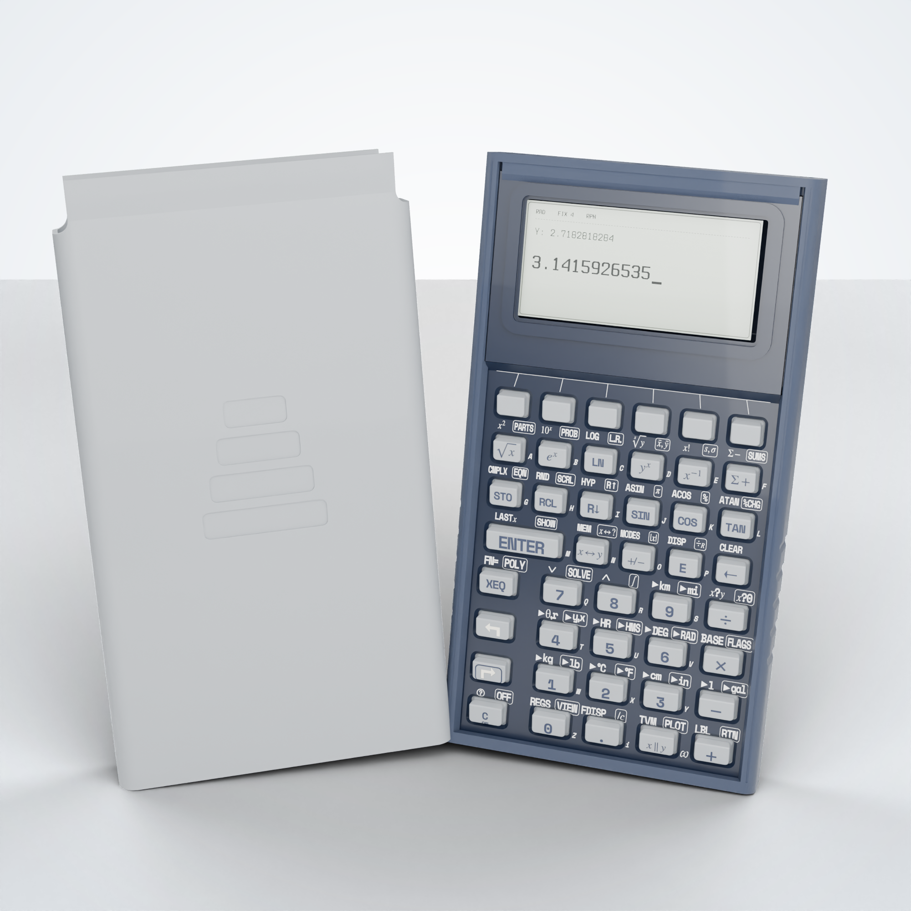
        

        <!-- Interactive Tactile Faceplate Swatch Selector -->
        

          

            Modular Faceplates:
            Tool-Free 10s Dovetail Swap
          

          

            <!-- 1. Cosmos (Champion Edition) -->
            <button type="button" class="te-swatch-btn active" id="btn-swatch-cosmos" onclick="selectFaceplate('cosmos', '../assets/renders/etsy/combo_sc32_cosmos-square.png', 'Sunlu Midnight PLA 2.0+ (15.2:1 AAA Champion)', 'Midnight Navy PLA 2.0+', 'Tactile Light Gray TPU 95A', 'Direct 1064nm IR Micro-Foam Stark White')">
              
              Cosmos
            </button>

            <!-- 2. Pure Black Monolith -->
            <button type="button" class="te-swatch-btn" id="btn-swatch-pureblack" onclick="selectFaceplate('pureblack', '../assets/renders/etsy/combo_sc32_pure_black-square.png', 'Technical Matte Black PLA', 'Black PETG Monolith', 'Technical Black TPU 95A', 'Direct 1064nm IR Micro-Foam Stark White (Right-Shift Pill Outline)')">
              
              Pure Black
            </button>

            <!-- 3. Grayscale -->
            <button type="button" class="te-swatch-btn" id="btn-swatch-grayscale" onclick="selectFaceplate('grayscale', '../assets/renders/etsy/combo_sc32_grayscale-square.png', 'Technical Matte Black PLA', 'Elegoo Black PLA', 'Tactile Light Gray TPU 95A', 'Direct 1064nm IR Clean White Micro-Foam (12.8:1 AAA)')">
              
              Grayscale
            </button>

            <!-- 4. Synthwave -->
            <button type="button" class="te-swatch-btn" id="btn-swatch-synthwave" onclick="selectFaceplate('synthwave', '../assets/renders/etsy/combo_sc32_synthwave-square.png', 'Purple+Black Dual Silk PLA (Archimedean Sheen)', 'Elegoo Black PLA', 'Tactile Light Gray TPU 95A', 'Direct 1064nm IR Silver-Frost Micro-Foam (7.5:1 AA)')">
              
              Synthwave
            </button>

            <!-- 5. Earth-Tone Espresso -->
            <button type="button" class="te-swatch-btn" id="btn-swatch-earthtone" onclick="selectFaceplate('earthtone', '../assets/renders/etsy/combo_sc32_earth_tone-square.png', 'Sunlu Coffee Brown PLA (Rich Espresso)', 'Sunlu Coffee Brown PLA', 'Tactile Light Gray TPU 95A', 'Direct 1064nm IR Warm Chalk White Foam (13.0:1 AAA)')">
              
              Earth-Tone
            </button>

            <!-- 6. Pure Black & White (Two-Tone) -->
            <button type="button" class="te-swatch-btn" id="btn-swatch-pureblackwhite" onclick="selectFaceplate('pureblackwhite', '../assets/renders/etsy/combo_sc32_pure_black_white-square.png', 'Technical Matte Black PLA', 'Clean White PETG (Unengraved Back Plate)', 'Technical Black TPU 95A', 'Direct 1064nm IR Laser Foamed Stark White (Faceplate) • Solid White Back Plate (No details)')">
              
              Two-Tone
            </button>

            <!-- 7. Stealth Industrial -->
            <button type="button" class="te-swatch-btn" id="btn-swatch-stealth" onclick="selectFaceplate('stealth', '../assets/renders/etsy/combo_sc32_stealth_industrial-square.png', 'Technical Matte Black PLA', 'Elegoo Black PLA', 'Cobalt Azure TPU 95A', 'Carbon Black Inset on Azure TPU &amp; Silver Chrome Badges')">
              
              Stealth
            </button>

            <!-- 8. Voyager -->
            <button type="button" class="te-swatch-btn" id="btn-swatch-voyager" onclick="selectFaceplate('voyager', '../assets/renders/etsy/combo_sc32_voyager-square.png', 'Elegoo Space Gray PLA', 'Sunlu Midnight PLA 2.0+', 'Tactile Light Gray TPU 95A', 'Direct 1064nm IR Stark White Micro-Foam (12.4:1 AAA)')">
              
              Voyager
            </button>
          

          <!-- Dynamic CMF Material Readout Strip -->
          

            <strong>CMF FINISH:</strong> FACEPLATE: Sunlu Midnight PLA 2.0+ (15.2:1 AAA Champion) &bull; CHASSIS: Midnight Navy PLA 2.0+ &bull; KEYS: Tactile Light Gray TPU 95A &bull; MARKING: Direct 1064nm IR Micro-Foam Stark White
          

          <!-- Quick Thumbnails Strip -->
          

            

              
            

            

              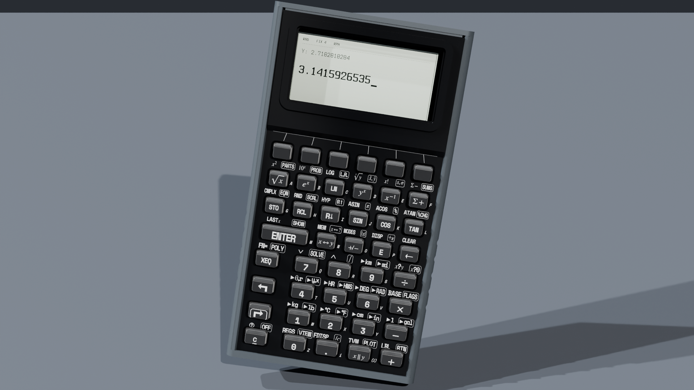
            

            

              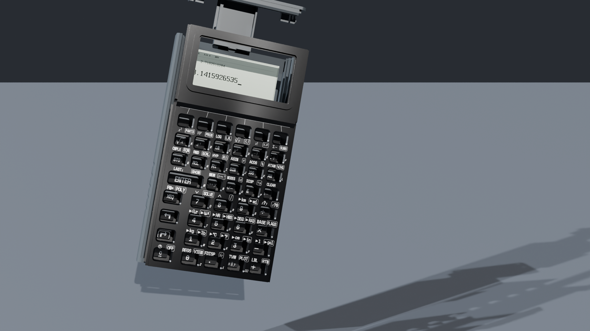
            

            

              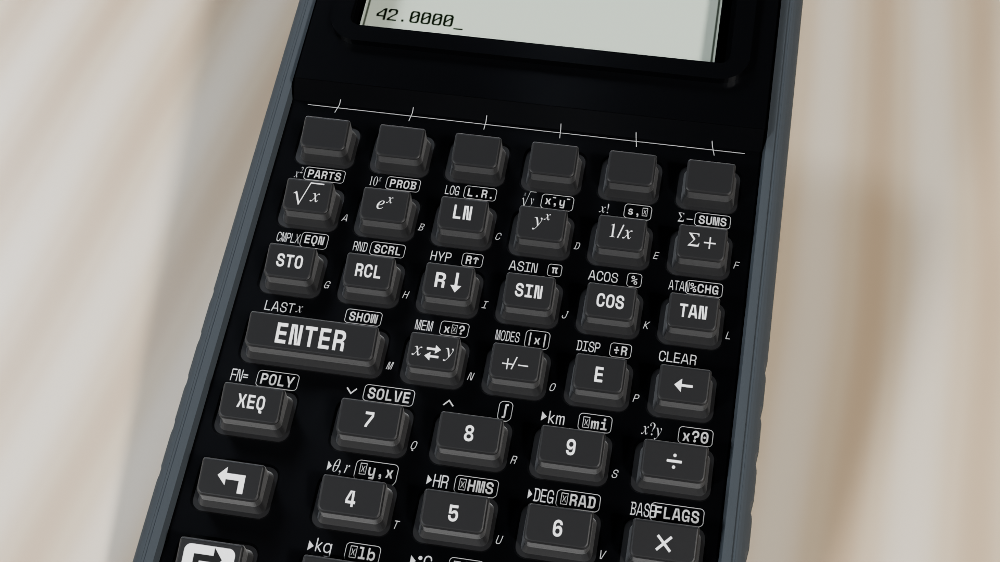
            

            

              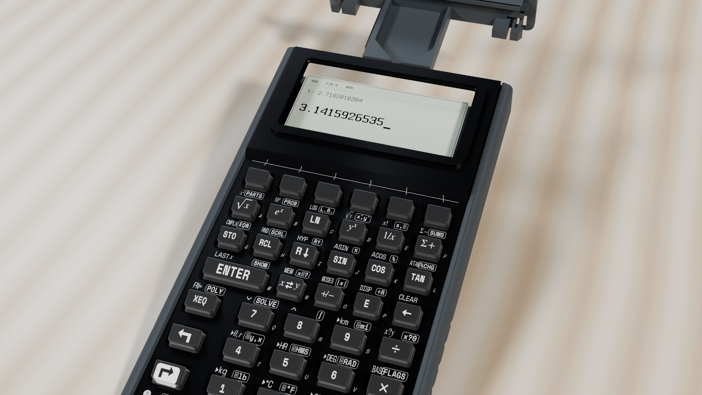
            

            

              
            

            

              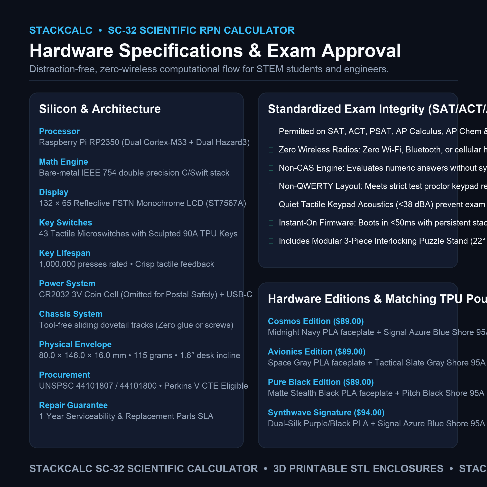
            

          

        

      

      <!-- Right Column: Specs, Certification & Buy Box -->
      

        

          
RP2350 Hardware Silicon &bull; 4-Line RPN Stack

          <h2 class="te-spotlight-title">SC-32 Scientific RPN Calculator</h2>

          <!-- Teenage Engineering Technical Field Spec Grid -->
          

            

              Processor Core
              Raspberry Pi RP2350 (Dual Cortex-M33 + Hazard3 RISC-V @ 150MHz)
            

            

              Operational Engine
              Native bare-metal 4-line RPN stack with sub-millisecond evaluation
            

            

              Graphic Display
              ST7567A 132&times;65 Transflective Monochrome LCD (Terminus Pixel Font)
            

            

              Keypad Switches
              43 tactile microswitches with sculpted Shore 90A TPU keys
            

            

              Chassis Mechanics
              4-part interlocking sliding dovetail (zero screws, zero glue)
            

            

              Exam Integrity
              Zero wireless radios, no CAS, College Board &amp; ACT policy approved
            

          

          <!-- Price & Allocation Tiers -->
          

            

              $89.00
              Free US Priority Shipping &bull; 100% Pre-Soldered Maker Kit
            

            

              

                <strong>Pre-Soldered Logic Board</strong>
                RP2350 silicon + 43 tactile microswitches with TPU keys
              

              

                <strong>Sliding Dovetail Housing</strong>
                Tool-free 5-min snap assembly, zero soldering
              

              

                <strong>Full Accessories Included</strong>
                Includes 3-in-1 Desk Stand &amp; Shore 95A TPU Pouch
              

            

          

        

        

          <a href="sc32-calculator/" class="te-btn-primary">
            Explore Hardware &amp; 4K Videos &rarr;
          </a>
          <a href="https://link.amazon/B07DqTRR5" target="_blank" rel="noopener noreferrer" class="te-btn-secondary" style="border-color: #FF9900; color: #FF9900; font-weight: 700;">
            Book (Paperback $16) ↗
          </a>
          <a href="https://link.amazon/B09AnTIQI" target="_blank" rel="noopener noreferrer" class="te-btn-secondary" style="border-color: #FF9900; color: #FF9900; font-weight: 700;">
            Book (Hardcover) ↗
          </a>
          <a href="../manuals/#sc-32-scientific" class="te-btn-secondary">
            Reference Manual &amp; Print ($16) &rarr;
          </a>
          <a href="https://stackcalcmath.etsy.com" target="_blank" rel="noopener noreferrer" class="te-btn-secondary">
            Order on Etsy Storefront ↗
          </a>
        

      

    

  </section>

  <!-- ==========================================================================
       SECTION 01: CLASSROOM PHYSICAL MANIPULATIVES
       ========================================================================== -->
  <section id="manipulatives" class="ec-section">
    

      

        <h2 class="te-section-title">Classroom Physical Manipulatives</h2>
        
Hands-on architectural math tools designed for standard tabletop and desk use.

      

    

    

      <!-- 1. Fraction Studio -->
      <article class="te-card">
        

          <a href="fraction-studio/">
            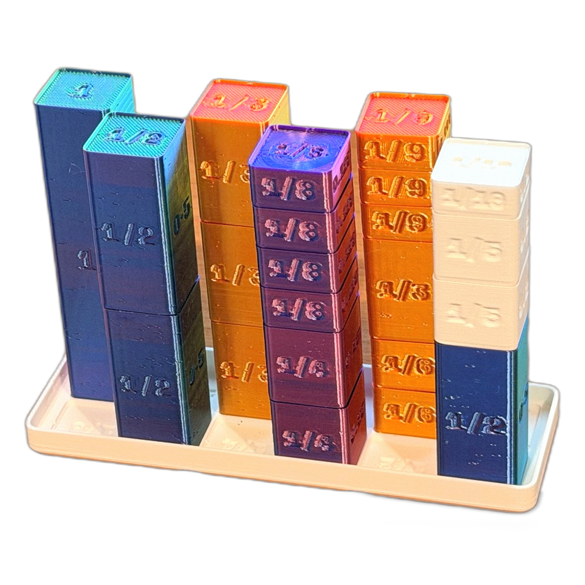
          </a>
        

        

          
Fractions &amp; Equivalence

          <h3 class="te-card-title"><a href="fraction-studio/">Fraction Studio Proportional Towers</a></h3>
          

            Precision proportional towers with debossed 4-face notation (fraction, decimal, percent, degree). Halves, quarters, and eighths physically align flush on any classroom table. Available in two variations: Beta Kit ($24.99 introductory) or Standard Production 3x1 Snapfinity Gridfinity enclosure ($48.00). Pairs directly with SC-6 stacked fraction display mode.
          

        

        

          

            $24.99 &ndash; $48.00
          

          
          

            <a href="fraction-studio/" class="te-card-btn">Specs &rarr;</a>
            <a href="https://stackcalcmath.etsy.com" target="_blank" rel="noopener noreferrer" class="te-btn-etsy-sm">Etsy ↗</a>
            <a href="https://www.printables.com/@StackCalc_5593834" target="_blank" rel="noopener noreferrer" class="te-btn-stl-sm" style="background-color: #FA6B05; border-color: #FA6B05; color: #FFFFFF;">Printables ↗</a>
          

        

      </article>

      <!-- 2. Prime Factor Studio -->
      <article class="te-card">
        

          <a href="prime-factor-studio/">
            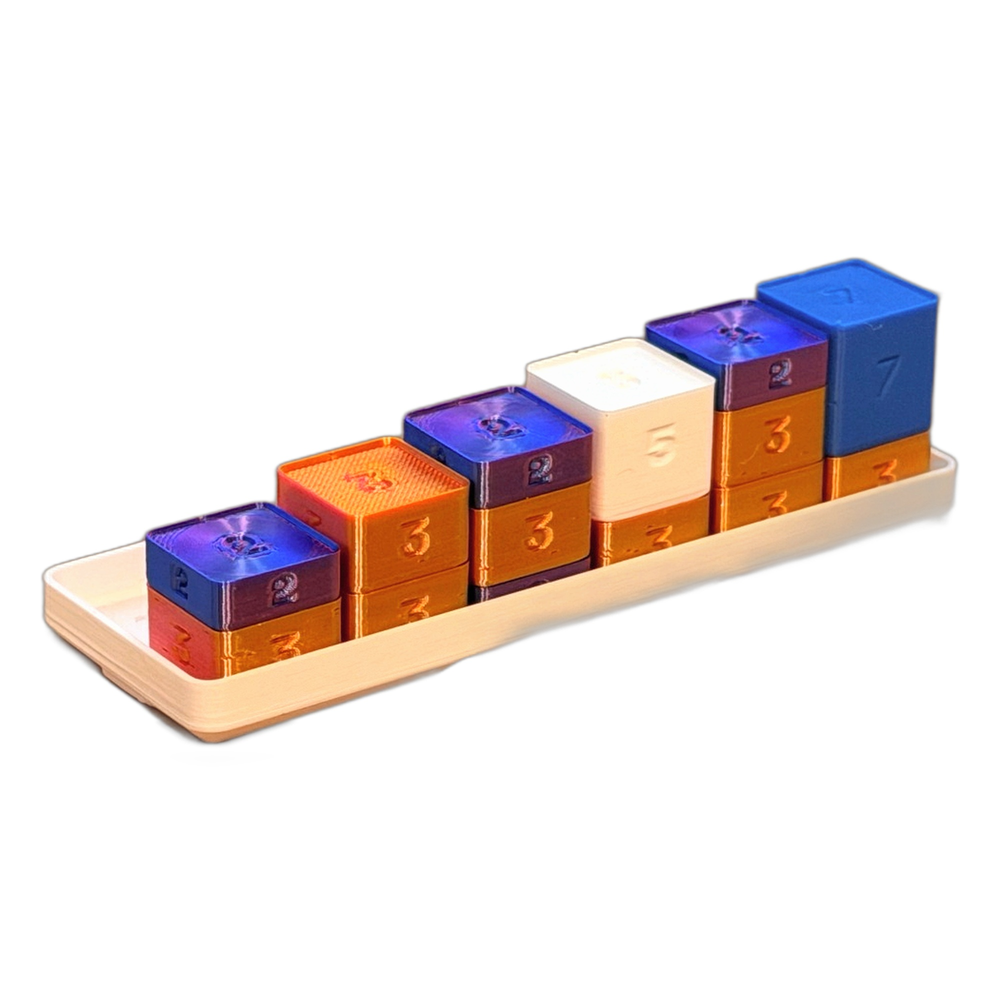
          </a>
        

        

          
Prime Factorization &amp; Logarithms

          <h3 class="te-card-title"><a href="prime-factor-studio/">Prime Factor Studio &amp; Factor Towers</a></h3>
          

            Proportional logarithmic prime factor blocks. Stacking prime blocks physically multiplies them ($2 \times 3 = 6$, $2 \times 2 \times 3 = 12$) to prove the Fundamental Theorem of Arithmetic and solve GCF/LCM. Available in two variations: Standard Production 3x1x7U Snapfinity Gridfinity enclosure with integrated stepped floor pedestals (Slant 3D farm, 23 pcs), or Founders Collector Edition 3x1x13U enclosure with drop-front sliding door and 12-column caddy (in-house batch, 47 pcs) reaching the uniform waterline, offered at the same introductory price ($46.00). Direct twin to SC-6 prime engine.
          

        

        

          

            $46.00
          

          

            <a href="prime-factor-studio/" class="te-card-btn">Specs &rarr;</a>
            <a href="https://stackcalcmath.etsy.com" target="_blank" rel="noopener noreferrer" class="te-btn-etsy-sm">Etsy ↗</a>
            <a href="https://www.printables.com/@StackCalc_5593834" target="_blank" rel="noopener noreferrer" class="te-btn-stl-sm" style="background-color: #FA6B05; border-color: #FA6B05; color: #FFFFFF;">Printables ↗</a>
          

        

      </article>

      <!-- 3. Place Value Studio -->
      <article class="te-card">
        

          <a href="place-value/">
            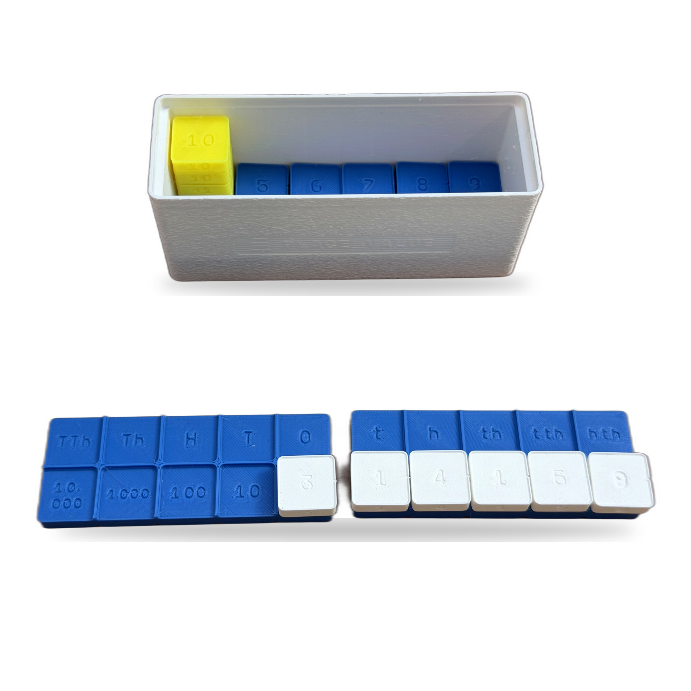
          </a>
        

        

          
Place Value, Addition &amp; Decimals

          <h3 class="te-card-title"><a href="place-value/">Place Value Studio &amp; Regrouping Trays</a></h3>
          

            Dual 6&times;2 desktop activity trays (Whole Numbers 100k–1 and Decimals 0.1–0.000001) with 44 contoured digit blocks and 9 stackable +1 regrouping tokens. Two operational rows provide physical column alignment for multi-digit addition, subtraction, carries, borrows, and decimal conversions.
          

        

        

          

            $38.00
          

          

            <a href="place-value/" class="te-card-btn">Specs &rarr;</a>
            <a href="https://stackcalcmath.etsy.com" target="_blank" rel="noopener noreferrer" class="te-btn-etsy-sm">Etsy ↗</a>
            <a href="https://www.printables.com/@StackCalc_5593834" target="_blank" rel="noopener noreferrer" class="te-btn-stl-sm" style="background-color: #FA6B05; border-color: #FA6B05; color: #FFFFFF;">Printables ↗</a>
          

        

      </article>

    

    <!-- Open-Source 3MF Printables Lab Section -->
    

      

        

          <h3 style="font-size: 1.05rem; font-weight: 700; color: #FFFFFF; margin: 0;">Open-Source 3MF Printables Lab</h3>
          
100% free open-source multi-plate 3MF files for Bambu Lab, Prusa, and Voron 3D printers, available directly on our official Printables profile.

        

        <a href="https://www.printables.com/@StackCalc_5593834" target="_blank" rel="noopener noreferrer" style="font-family: 'Space Mono', monospace; font-size: 0.72rem; color: #FFFFFF; background: #FA6B05; padding: 4px 10px; border-radius: 4px; text-decoration: none; font-weight: 700;">PRINTABLES PROFILE ↗</a>
      

      

      <!-- 2. Sectional Planetary Clock -->
      <article class="te-card">
        

          <a href="classroom-clock/">
            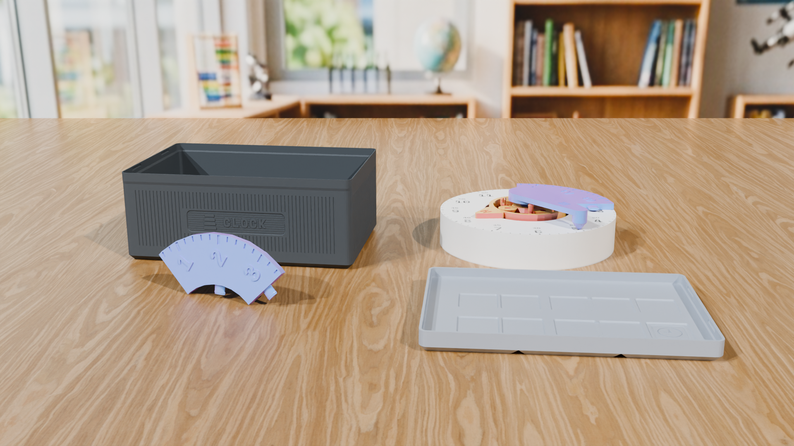
          </a>
        

        

          
Time &amp; Gear Mechanics

          <h3 class="te-card-title"><a href="classroom-clock/">Sectional Classroom Planetary Clock</a></h3>
          

            Internal 12:1 planetary gear core with synchronized hour and minute hands. Removable 15-minute quadrant wedges fit standard 2x1x13U Snapfinity Gridfinity workstation box and desk stand for kinesthetic elapsed-time discovery.
          

        

        

          

            Free 3MF
          

          
          

            <a href="classroom-clock/" class="te-card-btn">Specs &rarr;</a>
            <a href="https://www.printables.com/@StackCalc_5593834" target="_blank" rel="noopener noreferrer" class="te-btn-etsy-sm" style="background-color: #FA6B05; border-color: #FA6B05; color: #FFFFFF;">Printables ↗</a>
          

        

      </article>

      <!-- 3. Algebra Boxes & Factoring Stage -->
      <article class="te-card">
        

          <a href="algebra-boxes/">
            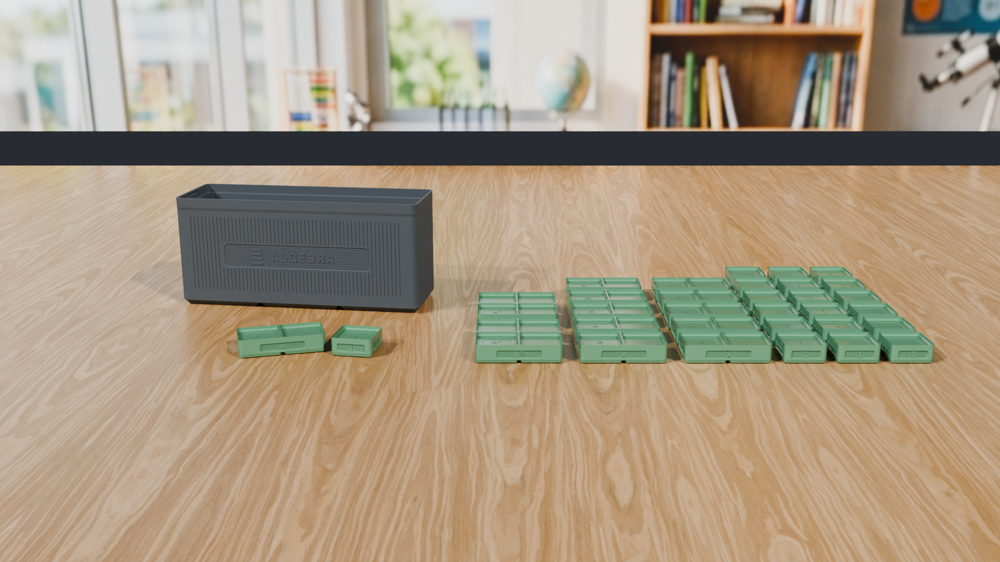
          </a>
        

        

          
Algebra &amp; Factoring

          <h3 class="te-card-title"><a href="algebra-boxes/">Algebra Factoring Studio &amp; Tiles</a></h3>
          

            Chamfered polynomial tiles for \(x^2\), \(x\), and \(1\) paired with slotted stage factoring rails. Housed in a 3x1x13U Snapfinity Gridfinity box for binomial multiplication, trinomial factoring, and completing the square.
          

        

        

          

            Free 3MF
          

          
          

            <a href="algebra-boxes/" class="te-card-btn">Specs &rarr;</a>
            <a href="https://www.printables.com/@StackCalc_5593834" target="_blank" rel="noopener noreferrer" class="te-btn-etsy-sm" style="background-color: #FA6B05; border-color: #FA6B05; color: #FFFFFF;">Printables ↗</a>
          

        

      </article>

      <!-- 4. Dual Ten-Frames & Carry Shelf -->
      <article class="te-card">
        

          <a href="ten-frames/">
            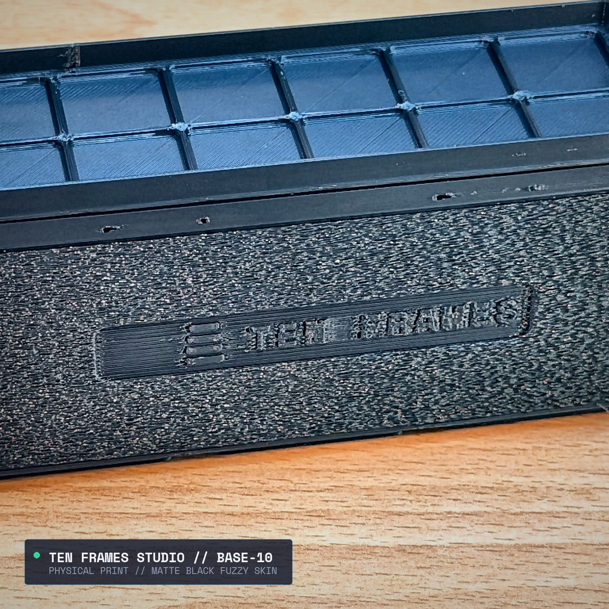
          </a>
        

        

          
Place Value &amp; Counting

          <h3 class="te-card-title"><a href="ten-frames/">Ten-Frame Dual Stage &amp; Carry Shelf</a></h3>
          

            Dual 2x5 counting stage with an elevated carry shelf, 20 square miniblock counters (19&times;19mm), and a 2U cube "10" carry block. Housed in a 3x1x13U Snapfinity Gridfinity enclosure with integrated carry shelf for base-ten regrouping and make-a-ten mental arithmetic.
          

        

        

          

            Free 3MF
          

          
          

            <a href="ten-frames/" class="te-card-btn">Specs &rarr;</a>
            <a href="https://www.printables.com/@StackCalc_5593834" target="_blank" rel="noopener noreferrer" class="te-btn-etsy-sm" style="background-color: #FA6B05; border-color: #FA6B05; color: #FFFFFF;">Printables ↗</a>
          

        

      </article>

      <!-- 5. Math Domino Studio & 12-Frame Set -->
      <article class="te-card">
        

          <a href="math-dominoes/">
            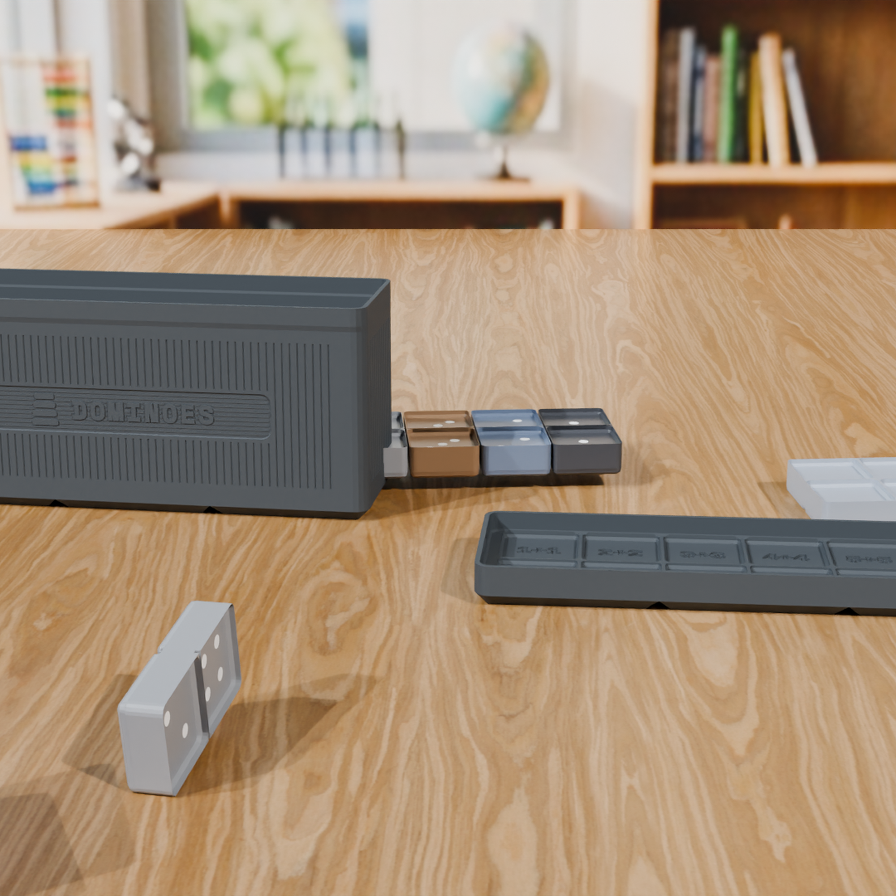
          </a>
        

        

          
Early Numeracy &amp; Doubles

          <h3 class="te-card-title"><a href="math-dominoes/">Math Domino Studio &amp; 12-Frame Set</a></h3>
          

            30 miniblock domino tiles (28 double-six + 2 blanks) with direct 1064nm IR laser-foamed pips, a 12-frame regrouping tray (10+2 divider), and a stackable doubling snap lid in a 3x1x13U Snapfinity Gridfinity box.
          

        

        

          

            Free 3MF
          

          
          

            <a href="math-dominoes/" class="te-card-btn">Specs &rarr;</a>
            <a href="https://www.printables.com/@StackCalc_5593834" target="_blank" rel="noopener noreferrer" class="te-btn-etsy-sm" style="background-color: #FA6B05; border-color: #FA6B05; color: #FFFFFF;">Printables ↗</a>
          

        

      </article>

      <!-- 6. Probability Dice & Spinner Pack -->
      <article class="te-card">
        

          <a href="dice-and-spinner/">
            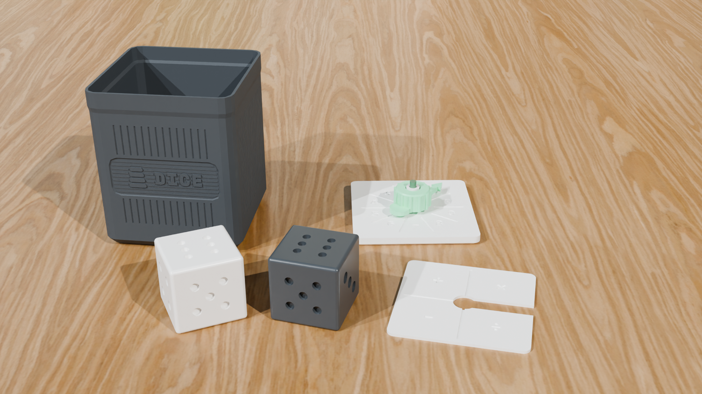
          </a>
        

        

          
Probability &amp; Data

          <h3 class="te-card-title"><a href="dice-and-spinner/">Probability Dice &amp; Spinner Pack</a></h3>
          

            Ultra-low-friction centered spinner with interchangeable 4, 6, 8, and 12-sector discs and mass-compensated polyhedral dice pack. Housed in a 1x1x13U Snapfinity Gridfinity box for empirical probability experiments.
          

        

        

          

            Free 3MF
          

          
          

            <a href="dice-and-spinner/" class="te-card-btn">Specs &rarr;</a>
            <a href="https://www.printables.com/@StackCalc_5593834" target="_blank" rel="noopener noreferrer" class="te-btn-etsy-sm" style="background-color: #FA6B05; border-color: #FA6B05; color: #FFFFFF;">Printables ↗</a>
          

        

      </article>

      <!-- 7. Unit Circle & Trig Volvelle -->
      <article class="te-card">
        

          <a href="unit-circle-volvelle/">
            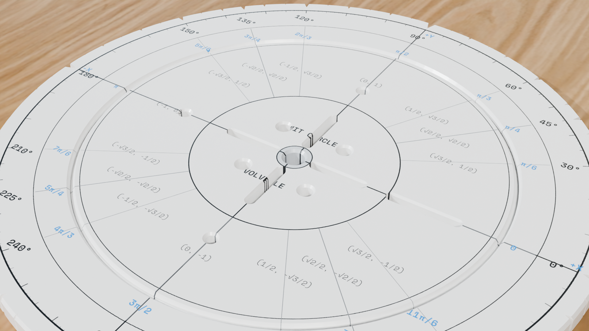
          </a>
        

        

          
Trigonometry &amp; Calculus

          <h3 class="te-card-title"><a href="unit-circle-volvelle/">Unit Circle Trigonometry Volvelle</a></h3>
          

            Flat dual-disc rotating dial with laser-engraved degree angles, radian measures, and exact \((\cos \theta, \sin \theta)\) coordinate pairs. Flush center brass eyelet for binder storage.
          

        

        

          

            Free 3MF
          

          
          

            <a href="unit-circle-volvelle/" class="te-card-btn">Specs &rarr;</a>
            <a href="https://www.printables.com/@StackCalc_5593834" target="_blank" rel="noopener noreferrer" class="te-btn-etsy-sm" style="background-color: #FA6B05; border-color: #FA6B05; color: #FFFFFF;">Printables ↗</a>
          

        

      </article>

      <!-- 8. Counting Tiles & Planar Array Studio -->
      <article class="te-card">
        

          <a href="counting-tiles/">
            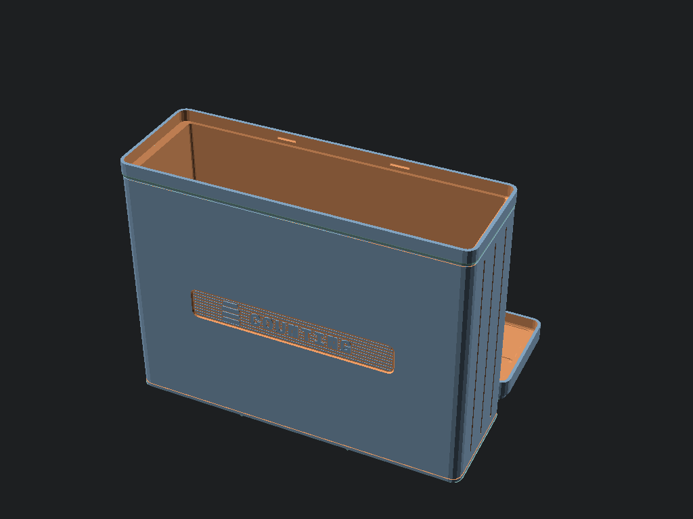
          </a>
        

        

          
Cardinality &amp; Multiplication Arrays

          <h3 class="te-card-title"><a href="counting-tiles/">Counting Tiles &amp; Planar Array Studio</a></h3>
          

            144 precision stacking tiles (4 colors &times; 36) in a 3x1x13U Snapfinity Gridfinity box with 12-miniblock array docking lid. Bridges one-to-one counting, the 12&times;12 multiplication matrix, partial-product area models, and the Four-Color Map Theorem.
          

        

        

          

            Free 3MF
          

          
          

            <a href="counting-tiles/" class="te-card-btn">Specs &rarr;</a>
            <a href="https://www.printables.com/@StackCalc_5593834" target="_blank" rel="noopener noreferrer" class="te-btn-etsy-sm" style="background-color: #FA6B05; border-color: #FA6B05; color: #FFFFFF;">Printables ↗</a>
          

        

      </article>

      <!-- 9. SC-6 Quest Scoreboard & +10 Token Kit -->
      <article class="te-card">
        

          <a href="quest-scoreboard/">
            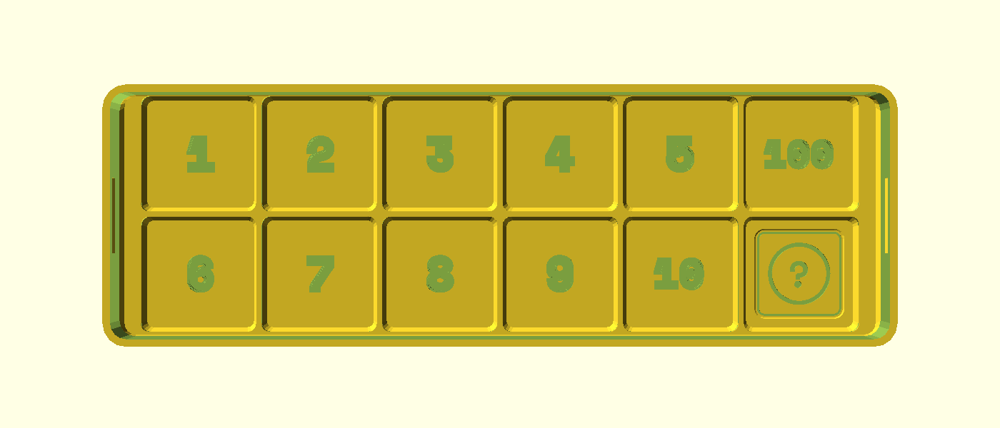
          </a>
        

        

          
Multi-Method Fluency &amp; Confidence

          <h3 class="te-card-title"><a href="quest-scoreboard/">SC-6 Quest Scoreboard &amp; +10 Token Kit</a></h3>
          

            Simplified 2-piece 3x1x7U Gridfinity open storage bin and Snapfinity Scoreboard Lid with 60 universal +10 quarter-block tokens. Seat 1 block in Sockets 1&ndash;10 for your 1st Way (+10 pts), stack a 2nd block on top when verified a 2nd Way (+20 pts), and build a 10-block tower in the [100] Mastery socket! Matches SC-6 [↰][C] (?) Tutorial Mode.
          

        

        

          

            Free 3MF
          

          
          

            <a href="quest-scoreboard/" class="te-card-btn">Specs &rarr;</a>
            <a href="https://www.printables.com/@StackCalc_5593834" target="_blank" rel="noopener noreferrer" class="te-btn-etsy-sm" style="background-color: #FA6B05; border-color: #FA6B05; color: #FFFFFF;">Printables ↗</a>
          

        

      </article>

      

    

  </section>

  <!-- ==========================================================================
       SECTION 02: DEDICATED CALCULATORS & DIGITAL TWIN
       ========================================================================== -->
  <section id="calculators" class="ec-section">
    

      

        <h2 class="te-section-title">Calculators &amp; Digital Twin</h2>
        
Dedicated tactile hardware and bit-accurate iOS/watchOS software.

      

    

    

      <!-- SC-32 Scientific RPN Calculator (Flagship Hardware) -->
      <article class="te-card">
        

          
        

        

          Finish:
          
          
          
          
          
          
          
          
        

        

          
Flagship RPN Hardware

          <h3 class="te-card-title"><a href="sc32-calculator/">SC-32 Scientific RPN Maker Kit</a></h3>
          

            The definitive dedicated physical RPN calculator. Raspberry Pi RP2350 silicon, 43 tactile microswitches with sculpted TPU keys, transflective graphic LCD, and tool-free sliding dovetail chassis with 8 interchangeable faceplate finishes. 100% pre-soldered, 5-minute snap assembly. SAT/ACT/AP approved.
          

        

        

          

            $89.00
          

          
          

            <a href="sc32-calculator/" class="te-card-btn">Specs &rarr;</a>
            <a href="../manuals/#sc-32-scientific" class="te-card-btn" title="Reference Manual & Spiral Print Edition ($16)">Manual 📖</a>
            <a href="https://stackcalcmath.etsy.com" target="_blank" rel="noopener noreferrer" class="te-btn-etsy-sm">Etsy ↗</a>
            <a href="https://www.printables.com/@StackCalc_5593834" target="_blank" rel="noopener noreferrer" class="te-btn-stl-sm" style="background-color: #FA6B05; border-color: #FA6B05; color: #FFFFFF;">Printables ↗</a>
          

        

      </article>

      <!-- SC-6 Elementary Edition -->
      <article class="te-card">
        

          <a href="sc6-elementary/">
            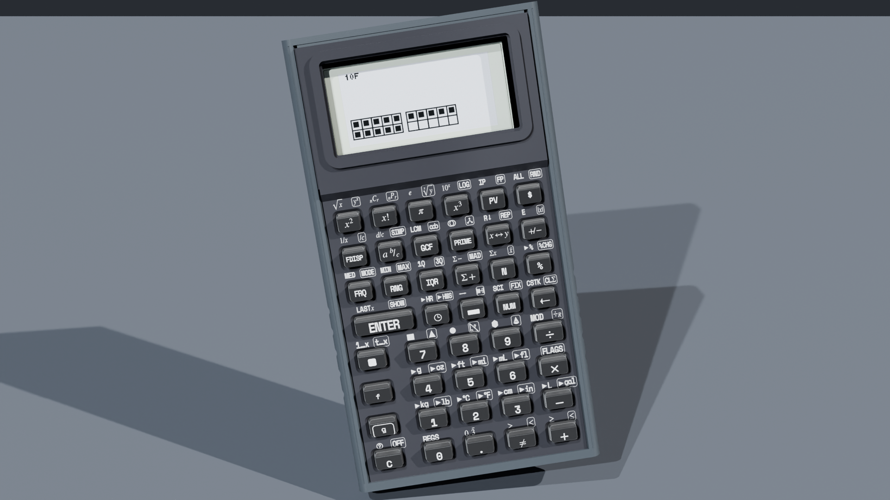
          </a>
        

        

          
Elementary RPN Calculator

          <h3 class="te-card-title"><a href="sc6-elementary/">SC-6 Elementary Edition</a></h3>
          

            Tactile arithmetic calculator designed for primary and intermediate students. Clean White PLA 2.0+ lab chassis, Slate Gray tool-free sliding cowl, tactile switches with sculpted 90A TPU keypads, and default 4-line XYZT operational stack (with toggleable 2-stack mode for counting racks and dice) using crisp right-aligned Terminus font.
          

        

        

          

            $79.00
          

          
          

            <a href="sc6-elementary/" class="te-card-btn">Specs &rarr;</a>
            <a href="../manuals/#sc-6-elementary" class="te-card-btn" title="Reference Manual & Spiral Print Edition ($16)">Manual 📖</a>
            <a href="https://stackcalcmath.etsy.com" target="_blank" rel="noopener noreferrer" class="te-btn-etsy-sm">Etsy ↗</a>
            <a href="https://www.printables.com/@StackCalc_5593834" target="_blank" rel="noopener noreferrer" class="te-btn-stl-sm" style="background-color: #FA6B05; border-color: #FA6B05; color: #FFFFFF;">Printables ↗</a>
          

        

      </article>

      <!-- Digital Twin App -->
      <article class="te-card">
        

          <a href="../ios_app/">
            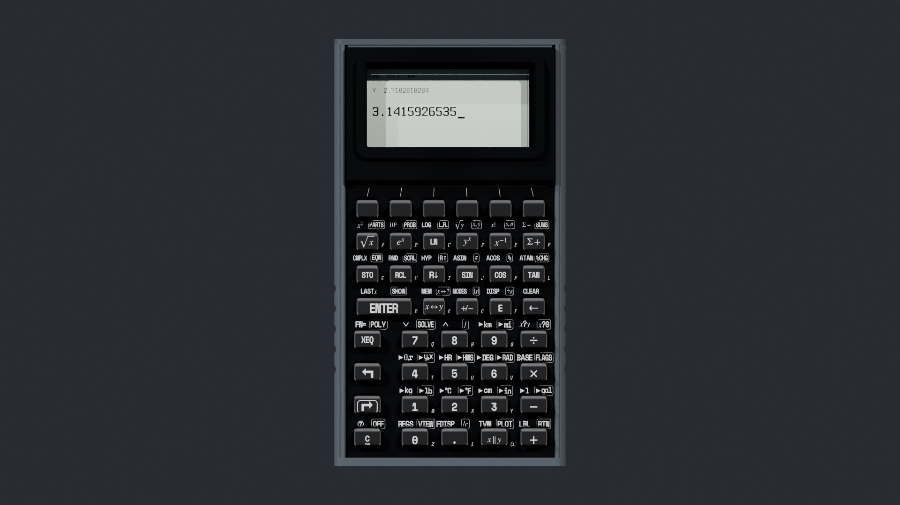
          </a>
        

        

          
Bit-Accurate Emulation

          <h3 class="te-card-title"><a href="../ios_app/">StackCalc Digital Twin App</a></h3>
          

            The 1:1 software twin of the SC-32 physical calculator. Runs the exact same core arithmetic engine with haptic feedback, customizable skins, and wrist calculation on Apple Watch.
          

        

        

          

            Free
          

          <a href="../ios_app/" class="te-card-btn">App Store &rarr;</a>
        

      </article>

    

  </section>

  <!-- ==========================================================================
       SECTION 03: MODULAR ACCESSORIES & POUCHES
       ========================================================================== -->
  <section id="accessories" class="ec-section">
    

      

        <h2 class="te-section-title">Stands, Pouches &amp; Accessories</h2>
        
Modular packaging that transforms into ergonomic stands and protective gear.

      

    

    

      <!-- Puzzle Stand System -->
      <article class="te-card">
        

          <a href="stands-and-pouches/">
            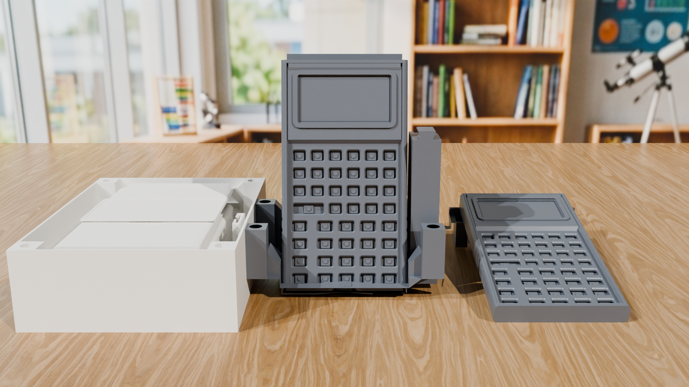
          </a>
        

        

          
Ergonomic Stands

          <h3 class="te-card-title"><a href="stands-and-pouches/">Modular 3-in-1 Puzzle Stand</a></h3>
          

            Zero-waste packaging insert that reconfigures into a 78&deg; shelf display with TPU pouch dock or a 10&deg; ergonomic desk wedge. 100% recyclable interlocking design with laser-cut living hinges.
          

        

        

          

            $24.00
          

          
          

            <a href="stands-and-pouches/" class="te-card-btn">Specs &rarr;</a>
            <a href="https://stackcalcmath.etsy.com" target="_blank" rel="noopener noreferrer" class="te-btn-etsy-sm">Etsy ↗</a>
            <a href="https://www.printables.com/@StackCalc_5593834" target="_blank" rel="noopener noreferrer" class="te-btn-stl-sm" style="background-color: #FA6B05; border-color: #FA6B05; color: #FFFFFF;">Printables ↗</a>
          

        

      </article>

      <!-- TPU Travel Pouch -->
      <article class="te-card">
        

          <a href="stands-and-pouches/">
            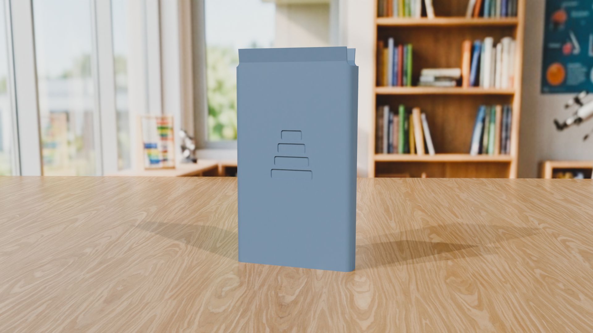
          </a>
        

        

          
Protective Cases

          <h3 class="te-card-title"><a href="stands-and-pouches/">Flexible TPU Travel Pouch</a></h3>
          

            Drop-tested shock-absorbing pouch in azure blue with debossed logo, integrated 3-ring binder clip, and lanyard attachment. Fits SC-32 and SC-6 snugly with impact-dissipating perimeter ridges.
          

        

        

          

            $18.00
          

          
          

            <a href="stands-and-pouches/" class="te-card-btn">Specs &rarr;</a>
            <a href="https://stackcalcmath.etsy.com" target="_blank" rel="noopener noreferrer" class="te-btn-etsy-sm">Etsy ↗</a>
            <a href="https://www.printables.com/@StackCalc_5593834" target="_blank" rel="noopener noreferrer" class="te-btn-stl-sm" style="background-color: #FA6B05; border-color: #FA6B05; color: #FFFFFF;">Printables ↗</a>
          

        

      </article>

      <!-- Replacement Parts Service -->
      <article class="te-card">
        

          <a href="https://teleportpod.com/portals/profile/StackCalc" target="_blank" rel="noopener noreferrer">
            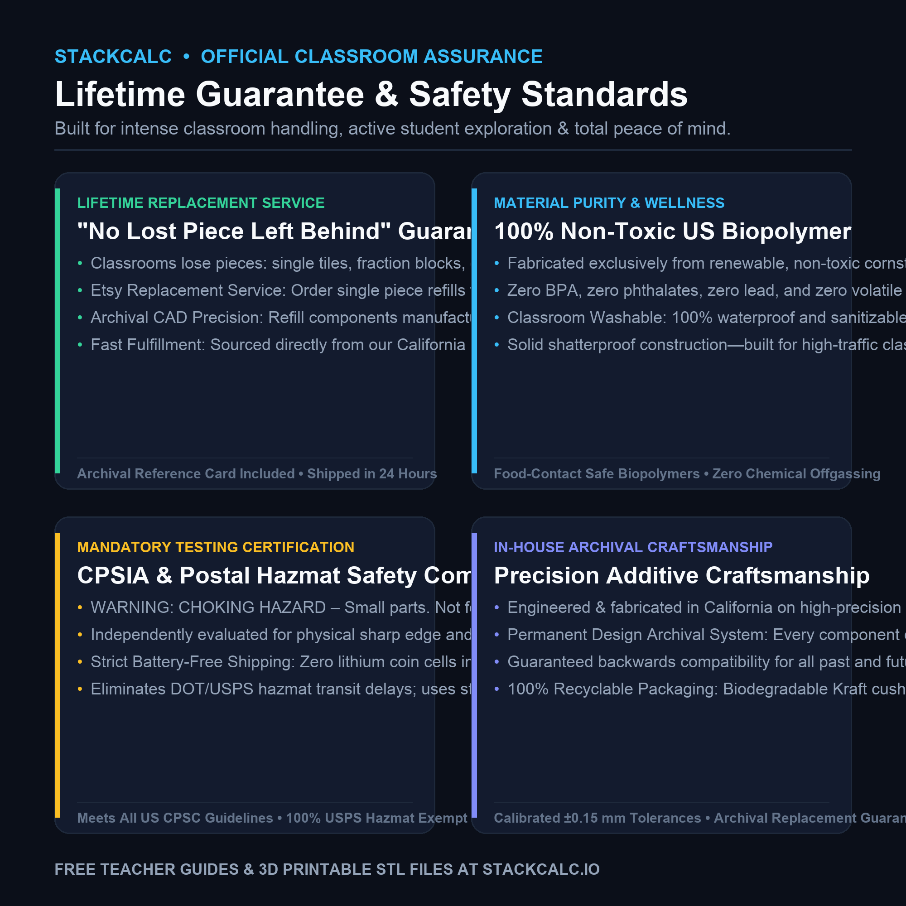
          </a>
        

        

          
Lifetime Parts &amp; Refill Service

          <h3 class="te-card-title"><a href="https://teleportpod.com/portals/profile/StackCalc" target="_blank" rel="noopener noreferrer">Replacement Parts &amp; Refills (Slant 3D)</a></h3>
          

            Never retire an educational set again because a tile rolled under a radiator. Order individual replacement fraction blocks, algebra tiles, counters, or stand legs 3D printed on-demand via our official Slant 3D Portal, or download free STL models to print locally.
          

        

        

          

            On-Demand
          

          <a href="https://teleportpod.com/portals/profile/StackCalc" target="_blank" rel="noopener noreferrer" class="te-card-btn" style="background-color: #38BDF8; color: #080B10; font-weight: 800;">Slant 3D Portal ↗</a>
        

      </article>

    

  </section>

  <!-- ==========================================================================
       SECTION 04: CURRICULUM & LAB DECKS
       ========================================================================== -->
  <section id="curriculum" class="ec-section">
    

      

        <h2 class="te-section-title">Curriculum Workbooks &amp; Problem Decks</h2>
        
Structured problem cards and teacher guides designed around tactile manipulatives.

      

    

    <!-- SC-6 Book Spotlight Feature -->
    

      

        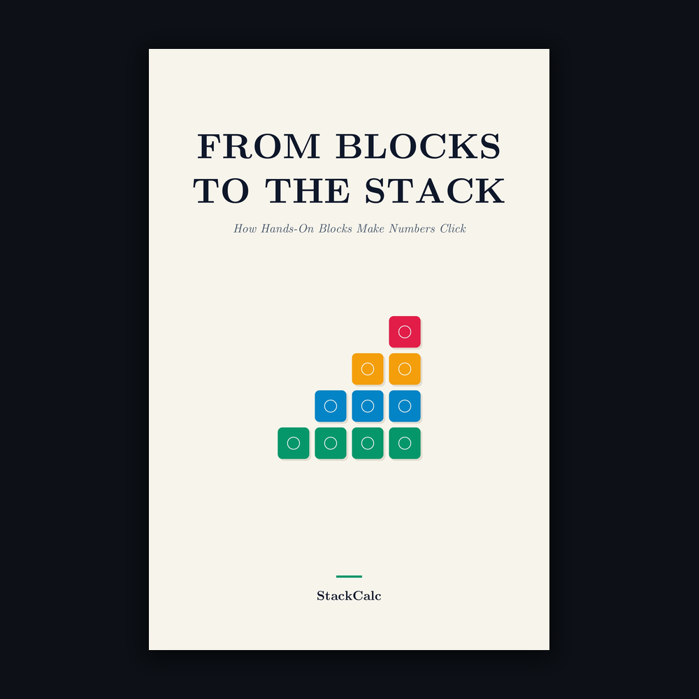
      

      

        

          
Grades 3–6 Companion

          <h3 class="te-spotlight-title">From Blocks to the Stack</h3>
          
Hands-On Math &amp; the SC-6 Stack Calculator

          

            $16.00
            Paperback on Amazon &bull; Spiral on Lulu
          

          

            The student handbook, parent guide, and classroom companion connecting 3D-printed math blocks with the 4-level number stack ($X, Y, Z, T$). 9 illustrated chapters, 25 complete teacher lesson plans, and engine-verified stack traces.
          

        

        

          <a href="sc6-book/" class="te-btn-primary">Book Overview &amp; TOC &rarr;</a>
          <a href="https://link.amazon/B0f5cP0Ur" target="_blank" rel="noopener noreferrer" class="te-btn-primary" style="background-color: #FF9900; border-color: #FF9900; color: #111827; font-weight: 800;">Order on Amazon ($16) ↗</a>
          <a href="https://link.amazon/B07bxzYKq" target="_blank" rel="noopener noreferrer" class="te-btn-secondary" style="border-color: #FF9900; color: #FF9900; font-weight: 700;">Middle School Workbook ↗</a>
          <a href="https://www.lulu.com/spotlight/stackcalc" target="_blank" rel="noopener noreferrer" class="te-btn-secondary" style="border-color: #0284C7; color: #38BDF8; font-weight: 700;">Spiral Workbooks on Lulu ↗</a>
          <a href="https://teleportpod.com/portals/profile/StackCalc" target="_blank" rel="noopener noreferrer" class="te-btn-secondary" style="border-color: #38BDF8; color: #38BDF8; font-weight: 700;">Slant 3D Manipulatives ↗</a>
        

      

      

        <h4 class="text-white font-semibold mb-3 font-mono text-sm uppercase text-amber-400">Book Highlights:</h4>
        <ul class="text-sm text-gray-300 space-y-2.5 m-0 p-0 list-none">
          <li class="flex items-center gap-2">✓ 9 comprehensive chapters &amp; 4 appendices</li>
          <li class="flex items-center gap-2">✓ Pairs with 9 modular 3D-printed manipulative studios</li>
          <li class="flex items-center gap-2">✓ 25 complete classroom lesson plans for Grades 3&ndash;6</li>
          <li class="flex items-center gap-2">✓ 100% free open-source digital edition available online</li>
        </ul>
      

    

    <!-- 2. SC-32 Scientific Manual Spotlight Feature -->
    

      

        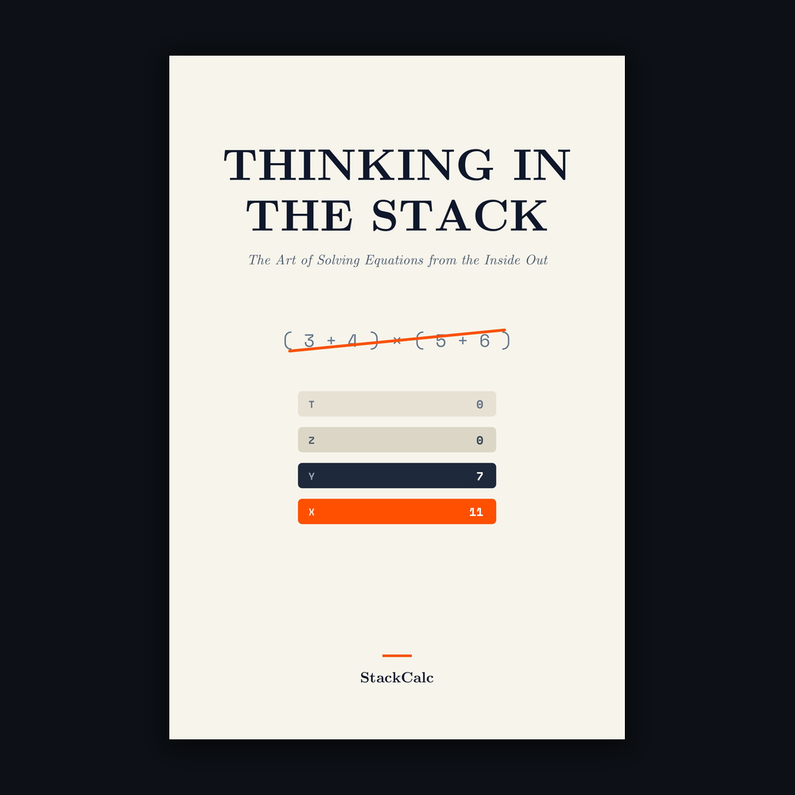
      

      

        

          
High School &bull; College &bull; Pro

          <h3 class="te-spotlight-title">Thinking in the Stack</h3>
          
Postfix Computation &amp; Algorithmic Thinking with the StackCalc SC-32

          

            $16.00
            Paperback $16 &bull; Hardcover $28 &bull; Free Online
          

          

            The comprehensive reference manual for the StackCalc SC-32 scientific hardware calculator. Explores 16-level RPN stack architecture, scientific trigonometry, logarithms, complex numbers, statistical registers, and postfix program design.
          

        

        

          <a href="https://link.amazon/B07DqTRR5" target="_blank" rel="noopener noreferrer" class="te-btn-primary" style="background-color: #FF9900; border-color: #FF9900; color: #111827; font-weight: 800;">Order on Amazon ($16) ↗</a>
          <a href="https://link.amazon/B09AnTIQI" target="_blank" rel="noopener noreferrer" class="te-btn-secondary" style="border-color: #FF9900; color: #FF9900; font-weight: 700;">Hardcover ($28) ↗</a>
          <a href="../manuals/#sc-32-scientific" class="te-btn-secondary">Online Reference Manual &rarr;</a>
          <a href="https://www.lulu.com/spotlight/stackcalc" target="_blank" rel="noopener noreferrer" class="te-btn-secondary" style="border-color: #0284C7; color: #38BDF8; font-weight: 700;">Lulu Spiral Edition ↗</a>
        

      

      

        <h4 class="text-white font-semibold mb-3 font-mono text-sm uppercase text-sky-400">Manual Highlights:</h4>
        <ul class="text-sm text-gray-300 space-y-2.5 m-0 p-0 list-none">
          <li class="flex items-center gap-2">✓ 16-level deep postfix stack diagrams &amp; traces</li>
          <li class="flex items-center gap-2">✓ Complete scientific, trig, stat, &amp; binary operations</li>
          <li class="flex items-center gap-2">✓ Hardware schematics, RP2350 architecture &amp; Pinouts</li>
          <li class="flex items-center gap-2">✓ Permitted on SAT&reg;, ACT&reg;, and AP&reg; exams</li>
        </ul>
      

    

    <!-- 3. Middle School Math Lab Workbook Spotlight Feature -->
    

      

        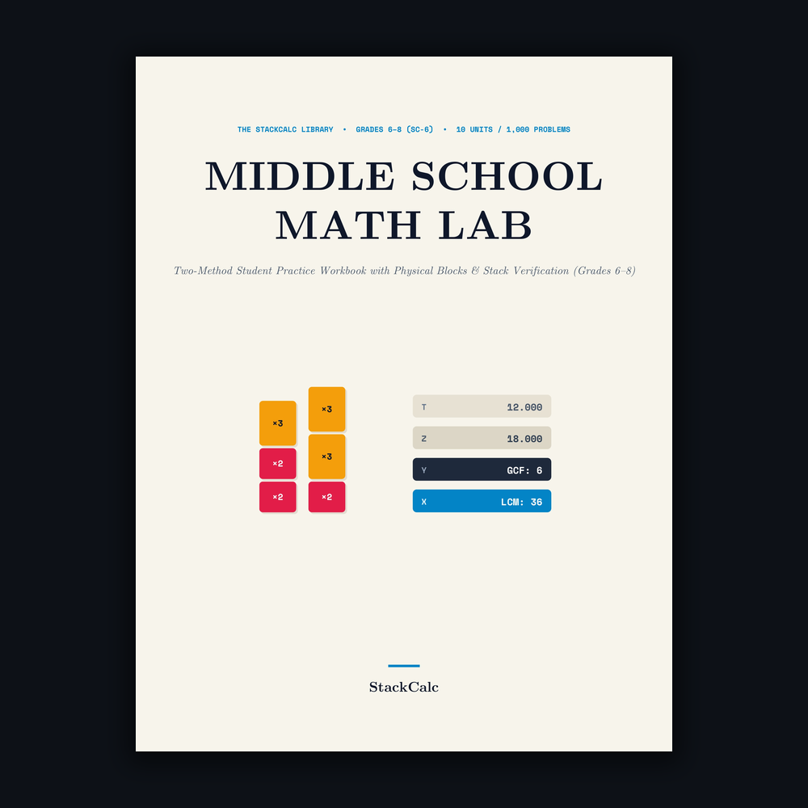
      

      

        

          
Grades 6–8 Lab Workbook

          <h3 class="te-spotlight-title">Middle School Math Lab</h3>
          
Hands-On Fractions, Integers, &amp; RPN with the StackCalc SC-6

          

            $16.00
            128-Page Reproducible Lab Workbook on Amazon Prime
          

          

            128-page reproducible curriculum workbook connecting physical Fraction &amp; Prime Factor blocks directly to SC-6 calculator exercises. Features station activity worksheets, lab record sheets, and stepped problem sets covering ratios, proportions, integers, and pre-algebra.
          

        

        

          <a href="https://link.amazon/B07bxzYKq" target="_blank" rel="noopener noreferrer" class="te-btn-primary" style="background-color: #FF9900; border-color: #FF9900; color: #111827; font-weight: 800;">Order on Amazon ($16) ↗</a>
          <a href="../curriculum/big-ideas-middle-school-sc6-workbook/" class="te-btn-secondary">Curriculum Alignment &rarr;</a>
          <a href="../curriculum/worksheets/" class="te-btn-secondary" style="border-color: #10B981; color: #10B981; font-weight: 700;">Station Worksheets &rarr;</a>
        

      

      

        <h4 class="text-white font-semibold mb-3 font-mono text-sm uppercase text-emerald-400">Workbook Highlights:</h4>
        <ul class="text-sm text-gray-300 space-y-2.5 m-0 p-0 list-none">
          <li class="flex items-center gap-2">✓ 128 reproducible classroom lab worksheet pages</li>
          <li class="flex items-center gap-2">✓ Direct alignment to Big Ideas &amp; CCSS Math 6&ndash;8</li>
          <li class="flex items-center gap-2">✓ Hands-on fraction and prime factor physical labs</li>
          <li class="flex items-center gap-2">✓ Step-by-step SC-6 calculator verification traces</li>
        </ul>
      

    

    <!-- 4. Teacher's Curriculum Guide Spotlight Feature -->
    

      

        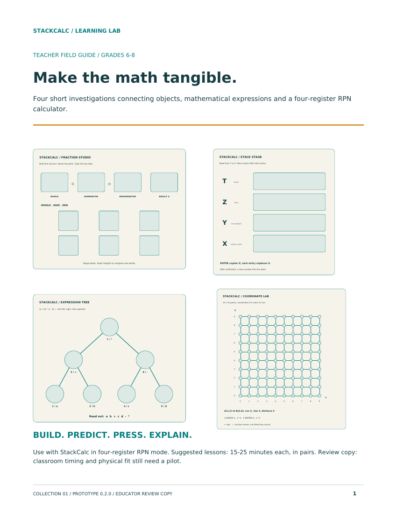
      

      

        

          
K–8 Educator &bull; Homeschool &bull; STEM Specialist

          <h3 class="te-spotlight-title">Teaching with the Stack</h3>
          
Teacher's Curriculum Guide &amp; Classroom Lesson Plans

          

            $16.00
            Comprehensive Educator Manual on Amazon Prime
          

          

            The definitive classroom facilitation manual connecting physical manipulatives with RPN calculator pedagogy. Includes 12 unified curriculum units, 25 turnkey 45-minute lesson plans, concrete-representational-abstract (CRA) scaffolding, 30-second misconception diagnostics, and station rotation guides.
          

        

        

          <a href="https://link.amazon/B05RFHqeu" target="_blank" rel="noopener noreferrer" class="te-btn-primary" style="background-color: #FF9900; border-color: #FF9900; color: #111827; font-weight: 800;">Order on Amazon ($16) ↗</a>
          <a href="../curriculum/teacher-guide/" class="te-btn-secondary">Online Teacher Guide &rarr;</a>
          <a href="../curriculum/" class="te-btn-secondary" style="border-color: #F59E0B; color: #F59E0B; font-weight: 700;">Curriculum Portal &rarr;</a>
        

      

      

        <h4 class="text-white font-semibold mb-3 font-mono text-sm uppercase text-amber-400">Guide Highlights:</h4>
        <ul class="text-sm text-gray-300 space-y-2.5 m-0 p-0 list-none">
          <li class="flex items-center gap-2">✓ 12 complete curriculum units covering K–8 concepts</li>
          <li class="flex items-center gap-2">✓ 25 turnkey 45-minute station lesson plans</li>
          <li class="flex items-center gap-2">✓ 30-second rapid misconception diagnostic cues</li>
          <li class="flex items-center gap-2">✓ Full CRA (Concrete &rarr; Representational &rarr; Abstract) progression</li>
        </ul>
      

    

    

      

        

          <h3 class="te-spotlight-title">Manipulative Investigation Decks &amp; Lab Guides</h3>
          

            $18.00 &ndash; $28.00
            Free Classroom PDF Downloads Included
          

          

            60-card tactile problem decks and spiral-bound student laboratory workbooks. Each card walks students through the Concrete-Representational-Abstract (CRA) continuum: first testing quantities with physical blocks, then sketching diagrams, and finally recording equations.
          

        

        

          <a href="curriculum-and-decks/" class="te-btn-primary">Explore Curriculum Guides &rarr;</a>
          <a href="../curriculum/worksheets/" class="te-btn-secondary" style="border: 1px solid rgba(56, 189, 248, 0.4); color: #38BDF8;">120 Free Station Guides &rarr;</a>
          <a href="../curriculum/uil-competition/" class="te-btn-secondary" style="border: 1px solid rgba(16, 185, 129, 0.4); color: #10B981;">24 UIL Practice Exams &rarr;</a>
        

      

      

        <h4 class="text-white font-semibold mb-3 font-mono text-sm uppercase text-sky-400">Included in Every Curriculum Pack:</h4>
        <ul class="text-sm text-gray-300 space-y-2.5 m-0 p-0 list-none">
          <li class="flex items-center gap-2">✓ 60 double-sided wipe-clean challenge cards</li>
          <li class="flex items-center gap-2">✓ Teacher rubric with step-by-step pictorial solutions</li>
          <li class="flex items-center gap-2">✓ Reproducible student lab worksheet templates</li>
          <li class="flex items-center gap-2">✓ Aligned with Common Core &amp; State Math Standards</li>
        </ul>
      

    

  </section>

  <!-- ==========================================================================
       SECTION 05: OPEN-SOURCE MAKER DOWNLOADS
       ========================================================================== -->
  <section id="downloads" class="ec-section">
    

      

        <h3 class="ec-maker-title">Self-Manufacture With Your 3D Printer</h3>
        

          Every physical manipulative, calculator enclosure, and desk stand in the StackCalc ecosystem is open hardware. Download print-tested STLs and 3MFs calibrated on Prusa research printers with PrusaSlicer, or download directly from Printables.
        

      

      

        <a href="https://www.printables.com/@StackCalc_5593834" target="_blank" rel="noopener noreferrer" class="te-btn-primary" style="background-color: #FA6B05; border-color: #FA6B05;">
          Download on Printables ↗
        </a>
        <a href="printables.md" class="te-btn-primary" style="background-color: rgba(255,255,255,0.1); border-color: rgba(255,255,255,0.25);">
          Makerspace Kits Guide &rarr;
        </a>
        <a href="https://hackaday.io/project/206743-stackcalc32-a-tactile-rpn-calculator" target="_blank" rel="noopener noreferrer" class="te-btn-secondary" style="color: #FFFFFF !important; border-color: rgba(255,255,255,0.3);">
          Hackaday Project ↗
        </a>
        <a href="https://github.com/abagher/watch-calc-32" target="_blank" rel="noopener noreferrer" class="te-btn-secondary" style="color: #FFFFFF !important; border-color: rgba(255,255,255,0.3);">
          GitHub Repository ↗
        </a>
      

    

  </section>

  <!-- ==========================================================================
       SECTION 06: SAFETY, COMPLIANCE & EDUCATOR GUARANTEES
       ========================================================================== -->
  <section class="ec-section">
    

      

        <h2 class="te-section-title">Safety, Compliance &amp; Educator Guarantees</h2>
        
Engineered to meet rigorous standards for classroom health, testing, and longevity.

      

    

    

      

        <strong class="text-amber-300 flex items-center gap-2 mb-1 font-mono text-xs">
          ⚠ CPSIA &amp; ASTM SAFETY WARNING
        </strong>
        

          <strong>WARNING: CHOKING HAZARD &ndash; Small parts.</strong> Not for children under 3 years. Counting tiles, dice, and fractional blocks are designed for classroom instruction (ages 5+) under adult supervision.
        

      

      

        <strong class="text-sky-400 flex items-center gap-2 mb-1 font-mono text-xs">
          ✓ 100% NON-TOXIC MATERIALS
        </strong>
        

          Produced exclusively from odorless, renewable, food-contact grade PLA and impact-absorbing PETG. Zero BPA, lead, PVC, or phthalates. Completely washable and sanitizable between class periods.
        

      

      

        <strong class="text-emerald-400 flex items-center gap-2 mb-1 font-mono text-xs">
          ⚙ NO LOST PIECE GUARANTEE
        </strong>
        

          Classrooms lose pieces. If any tile, token, hand, or block ever goes missing or gets damaged, order individual replacement components anytime starting at $2.49 with guaranteed 100% CAD fit by matching the Part ID on your kit's included Archival Reference Card.
        

      

      

        <strong class="text-indigo-400 flex items-center gap-2 mb-1 font-mono text-xs">
          ★ STANDARDIZED EXAM INTEGRITY
        </strong>
        

          The SC-32 Scientific Calculator is fully permitted on SAT, ACT, PSAT, AP Calculus, and AP Physics exams. Non-CAS calculation core with zero wireless radios or cheat vulnerabilities.
        

      

    

  </section>

  <!-- ==========================================================================
       SECTION 07: SCHOOL DISTRICT PURCHASING & INSTITUTIONAL PROCUREMENT
       ========================================================================== -->
  <section class="ec-section">
    

      

        

          &bull; Institutional Purchasing Vehicle
          <h3 class="text-xl font-bold text-white m-0">K&ndash;12 School District Purchase Orders &amp; Bulk Procurement</h3>
          
Direct vendor onboarding, Net-30 invoice terms, and federal Title I / STEM grant compliance.

        

        

          UNSPSC: 60101700 (Manipulatives)
          UNSPSC: 44101800 (Calculators)
        

      

      

        

          <h4 class="text-white font-semibold flex items-center gap-2 mb-2 font-mono text-xs">
            ✓ DISTRICT POS &amp; NET-30 TERMS
          </h4>
          

            We accept official school district and university purchase orders. Email your PO to <code>quotes@stackcalc.io</code> for immediate Net-30 order fulfillment and automated electronic invoicing. W-9 forms provided upon request.
          

        

        

          <h4 class="text-white font-semibold flex items-center gap-2 mb-2 font-mono text-xs">
            ✓ FEDERAL &amp; STATE STANDARDS ALIGNMENT
          </h4>
          

            Aligned to Common Core (<code>CCSS.MATH.CONTENT.3.NF.A.1</code>, <code>HSA.SSE.A.2</code>, <code>K.OA.A.4</code>) and Texas Essential Knowledge &amp; Skills (<code>TEKS</code>). Fully eligible under Title I (Academic Achievement) and Title IV STEM initiatives meeting ESSA Tier 4 evidence standards.
          

        

        

          <h4 class="text-white font-semibold flex items-center gap-2 mb-2 font-mono text-xs">
            ✓ ZERO-PREP &amp; 60-SECOND INVENTORY
          </h4>
          

            Each kit includes 5 laminated, 5-minute table-group student activity cards for instant deployment. 42mm Gridfinity nesting allows teachers to visually verify that 100% of blocks and tiles are accounted for in under 3 seconds before class dismisses.
          

        

      

      

        

          <strong class="text-gray-200">Bulk Tier Pricing:</strong> 10+ Sets (15% off) &bull; Full Grade-Level Sets (30+ units, 25% off + Free Educator Master Training Pack).
        

        <a href="mailto:quotes@stackcalc.io?subject=School%20District%20Procurement%20Inquiry" class="te-btn-primary text-xs py-2 px-4 whitespace-nowrap">
          Request Institutional W-9 &amp; Quote &rarr;
        </a>
      

    

  </section>

  <!-- ==========================================================================
       SECTION: THE COMPETITIVE POSITIONING MATRIX (POSTFIX VS. IN-FIX)
       ========================================================================== -->
  <!-- ==========================================================================
       SECTION: THE POSTFIX MANIFESTO (ARCHITECTURE & PHILOSOPHY)
       ========================================================================== -->
  <section class="ec-section" style="margin-top: 4rem; margin-bottom: 4rem;">
    

      

        <h2 class="te-section-title">The Architecture of Understanding: Postfix vs. In-Fix</h2>
        
Why physical stacking and Reverse Polish Notation outperform legacy calculating tools.

      

    

    

      

        
LEGACY IN-FIX COMPUTING

        <ul style="list-style: none; margin: 0; padding: 0; font-size: 0.88rem; color: #94A3B8; line-height: 1.6;">
          <li style="margin-bottom: 0.85rem;"><strong style="color: #E2E8F0;">Parentheses Traps:</strong> Formulas are entered as abstract strings with invisible precedence rules and constant syntax errors.</li>
          <li style="margin-bottom: 0.85rem;"><strong style="color: #E2E8F0;">Ephemeral Black Boxes:</strong> Numbers vanish behind plastic membranes; intermediate states cannot be inspected or verified.</li>
          <li style="margin-bottom: 0.85rem;"><strong style="color: #E2E8F0;">Disposable Hardware:</strong> Thin injection polystyrene, non-repairable assemblies, and battery leaks destined for landfills.</li>
          <li><strong style="color: #E2E8F0;">Recurring Software Rent:</strong> Cloud apps and paid emulator licenses ($15/seat/year) laden with notifications and ads.</li>
        </ul>
      

      

        
THE STACKCALC HARDWARE PHILOSOPHY

        <ul style="list-style: none; margin: 0; padding: 0; font-size: 0.88rem; color: #E2E8F0; line-height: 1.6;">
          <li style="margin-bottom: 0.85rem;"><strong style="color: #38BDF8;">Pure Physical Postfix:</strong> Zero parentheses. Numbers are pushed onto visible shelves; operations consume them in order of physical causality.</li>
          <li style="margin-bottom: 0.85rem;"><strong style="color: #38BDF8;">1:1 Spatial Mapping:</strong> Physical manipulative blocks on your desk map directly to the 4-line hardware LCD stack.</li>
          <li style="margin-bottom: 0.85rem;"><strong style="color: #38BDF8;">Heirloom Craftsmanship:</strong> Precision matte polymer with debossed geometry, snap-dome microswitches, and Shore 90A TPU keys.</li>
          <li><strong style="color: #38BDF8;">Zero Subscriptions, 100% Repairable:</strong> Buy once, own forever. 100% open-source 3MF files to print replacement parts anytime.</li>
        </ul>
      

    

    

      <a href="../blog/2026/10/12/the-postfix-manifesto/" style="font-family: 'Space Mono', monospace; font-size: 0.8rem; color: #38BDF8; text-decoration: none; font-weight: 700;">
        Read the Full Essay: The Postfix Manifesto &rarr;
      </a>
    

  </section>

    <!-- Discreet Ecosystem Blurb -->
  

    
&Delta;

    

      
The StackCalc Mathematical Ecosystem

      

        StackCalc connects tactile physical manipulatives, dedicated hardware calculators, and modern software into a single unified learning path. Each manipulative stands on its own for classroom instruction, while seamlessly preparing students for advanced calculation and STEM problem-solving.
      

    

  

<!-- Vanilla JS for Interactive Tactile Faceplate Switcher -->

