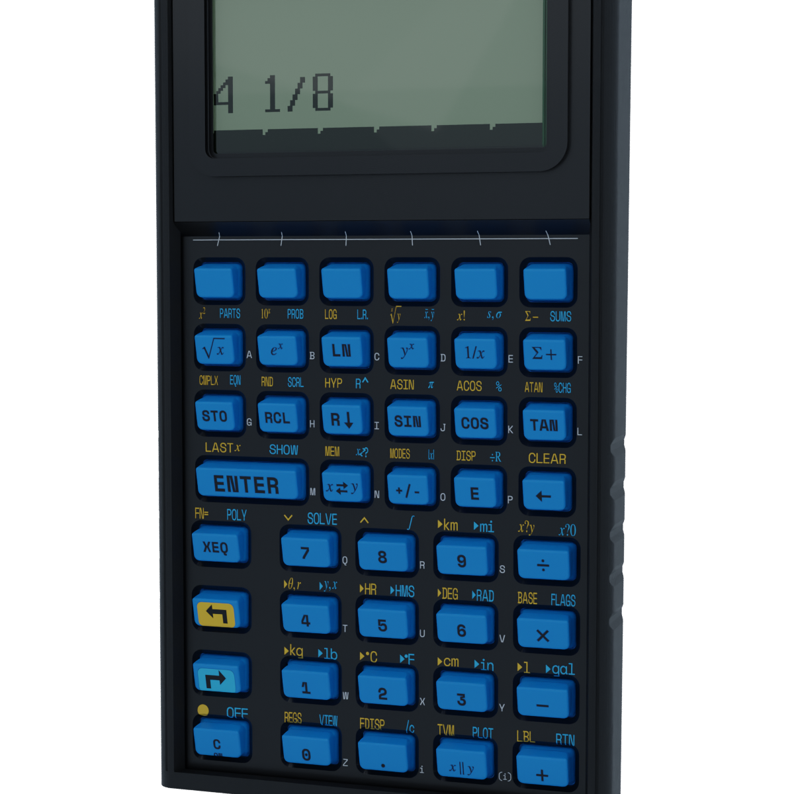
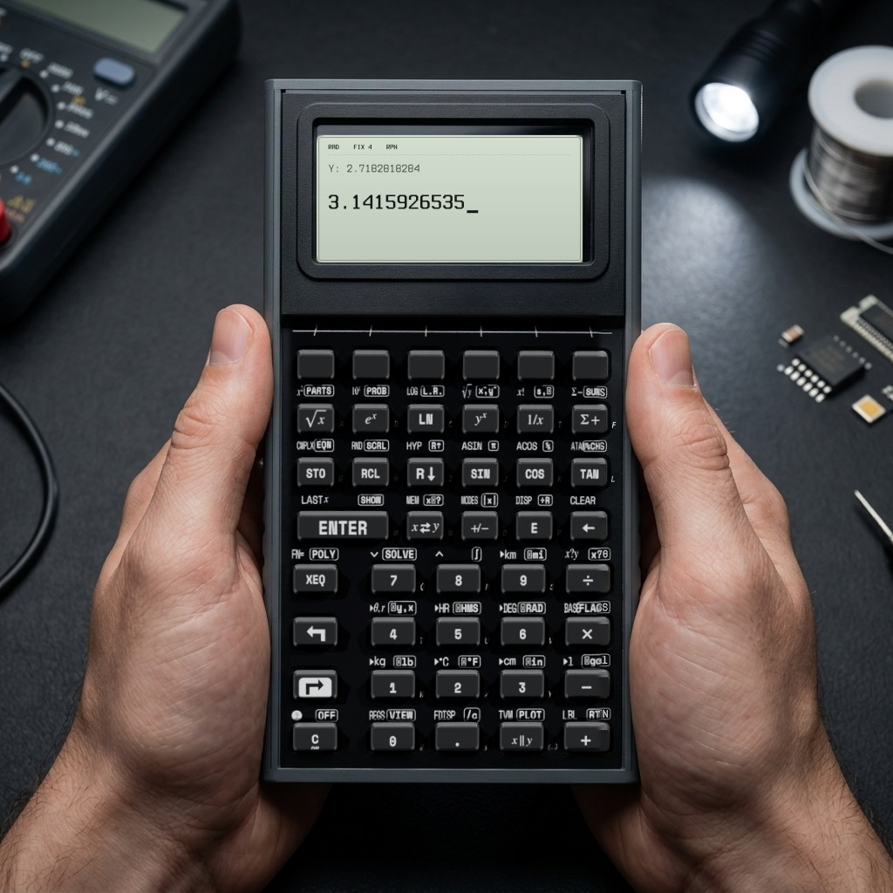
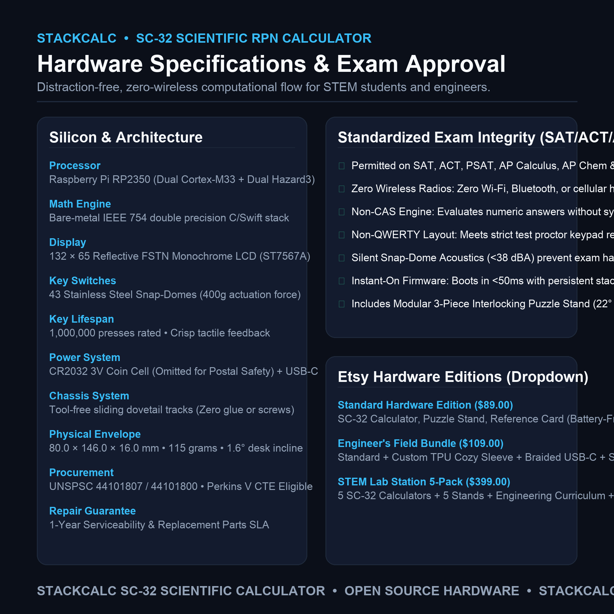
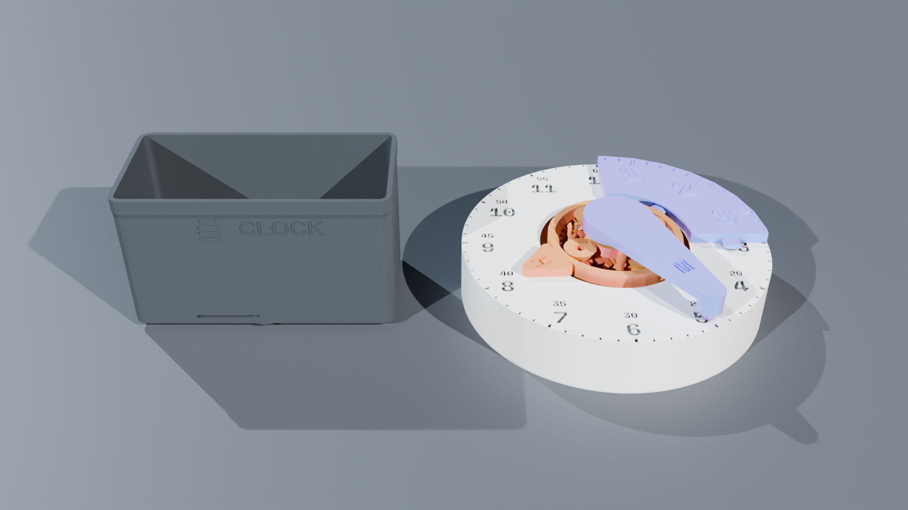
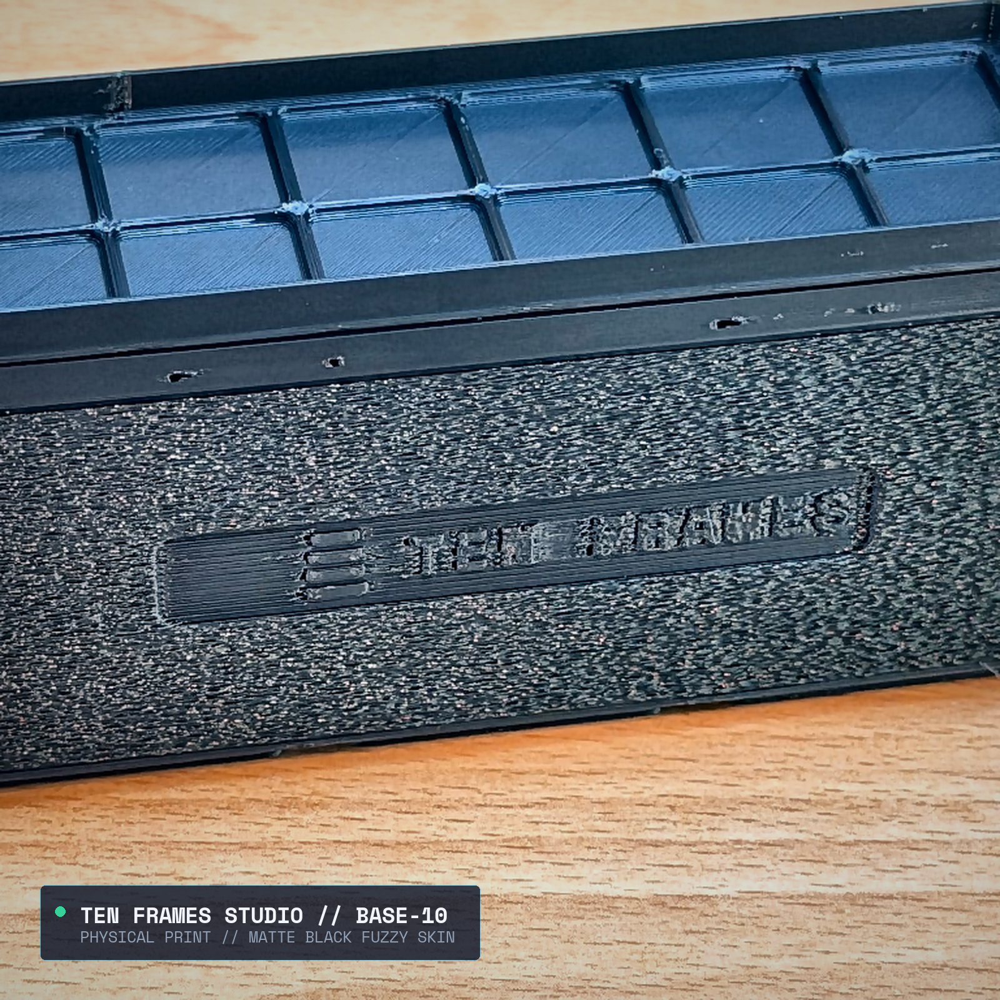
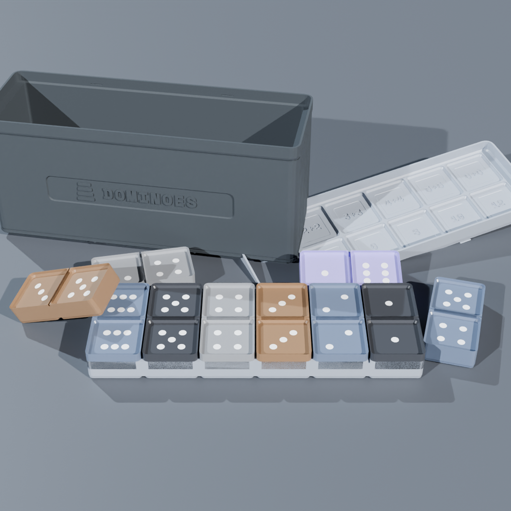
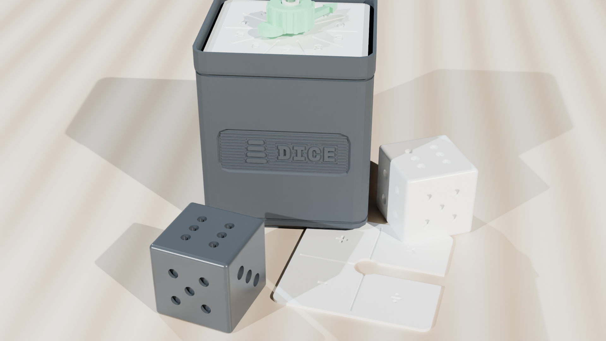

<!-- Schema.org JSON-LD Catalog CollectionPage Schema -->

  <!-- Breadcrumb -->
  <nav class="ec-breadcrumb" aria-label="Breadcrumb">
    <a href="../">Home</a>
    /
    Products &amp; Manipulatives
  </nav>

  <!-- Store Header: Teenage Engineering Technical Directory -->
  <header class="te-catalog-header">
    

      STACKCALC HARDWARE DIRECTORY
      //
      REV 2.4
      //
      MIL-SPEC PLA 2.0+
      //
      42MM GRIDFINITY STANDARD
    

    <h1 class="te-catalog-headline">Tactile Instruments &amp; Classroom Manipulatives</h1>
    

      Dedicated handheld Reverse Polish Notation calculators, precision physical math manipulatives, modular desk stands, and 100% free open-source CAD/STL downloads. Engineered for focus, tactile feedback, and concrete mathematical mastery.
    

    <!-- eBay-Style Live Trust & Guarantee Status Strip -->
    

      

        ★★★★★ 4.9 / 5.0
        (180+ Educator Pilot Reviews)
      

      

        ✓
        Free US Priority Shipping on Orders $35+
      

      

        ⚙
        "No Lost Piece Left Behind" Lifetime Guarantee
      

      

        <a href="https://www.etsy.com/shop/StackCalc" target="_blank" rel="noopener noreferrer" class="te-trust-link-etsy">
          Shop Official Etsy Storefront ↗
        </a>
      

    

    <!-- Institutional School PO Banner & Free Curriculum Lead Magnet -->
    

      

        

          // INSTITUTIONAL &amp; DISTRICT PROCUREMENT
          <h3 style="margin: 0.25rem 0; font-size: 1.15rem; font-weight: 800; color: #FFFFFF;">Equipping a Math Lab, Department, or School Co-op?</h3>
          

            We accept standard school purchase orders (Net-30 payment terms), provide signed W-9s, and offer volume tiered classroom discounts. Includes our <strong>Perpetual Reproduction License</strong>—print unlimited student lab workbooks forever with zero recurring software fees.
          

        

        

          <a href="mailto:quotes@stackcalc.io?subject=StackCalc%20School%20Purchase%20Order%20Quote%20Request" style="padding: 0.55rem 1rem; border-radius: 6px; background-color: #FFBF00; color: #080B10; font-family: 'Space Mono', monospace; font-size: 0.75rem; font-weight: 800; text-decoration: none;">REQUEST PO QUOTE ↗</a>
          <a href="../downloads/stackcalc-curriculum-sample-v0.2.0.pdf" download style="padding: 0.55rem 1rem; border-radius: 6px; background: rgba(255, 255, 255, 0.08); border: 1px solid rgba(255, 255, 255, 0.2); color: #FFFFFF; font-family: 'Space Mono', monospace; font-size: 0.75rem; font-weight: 700; text-decoration: none;">SAMPLE WORKBOOK (.PDF) ↓</a>
        

      

    

    <!-- Tri-Tier Acquisition Architecture Banner -->
    

      

        TIER 1 &bull; ASSEMBLED ($28–$89)
        
Factory assembled &amp; calibrated. Ships in 48 hours via Etsy.

      

      

        TIER 2 &bull; MAKER PACKS ($15–$25)
        
PCBs, laser-foamed keycaps, fasteners, and silicone pads.

      

      

        TIER 3 &bull; FREE 3MFs ($0)
        
100% free open-source STLs &amp; 3MFs on Printables.

      

    

    <!-- Teenage Engineering Mechanical Segmented Filter Bar -->
    

      <button type="button" class="te-filter-btn active" data-filter="all" onclick="filterCatalog('all', this)" role="tab">
        00
        ALL SYSTEMS
        13
      </button>
      <button type="button" class="te-filter-btn" data-filter="calculators" onclick="filterCatalog('calculators', this)" role="tab">
        01
        RPN CALCULATORS
        03
      </button>
      <button type="button" class="te-filter-btn" data-filter="manipulatives" onclick="filterCatalog('manipulatives', this)" role="tab">
        02
        CLASSROOM MANIPULATIVES
        07
      </button>
      <button type="button" class="te-filter-btn" data-filter="accessories" onclick="filterCatalog('accessories', this)" role="tab">
        03
        STANDS &amp; REFILLS
        03
      </button>
      <button type="button" class="te-filter-btn" data-filter="curriculum" onclick="filterCatalog('curriculum', this)" role="tab">
        04
        CURRICULUM DECKS
        01
      </button>
      <button type="button" class="te-filter-btn" data-filter="downloads" onclick="filterCatalog('downloads', this)" role="tab">
        05
        FREE 3D STLs
        ZIP
      </button>
    

  </header>

  <!-- ==========================================================================
       FEATURED FLAGSHIP SHOWCASE: SC-32 SCIENTIFIC CALCULATOR
       Complete with real hardware faceplates and interactive swatch switcher
       ========================================================================== -->
  <section id="featured">
    

      <!-- Left Column: Unobstructed Hardware Viewport & Real Faceplate Matrix -->
      

        <!-- Pre-Image Header Bar (Never overlapping the product!) -->
        

          SYS-32 // RPN SCIENTIFIC INSTRUMENT
          ● BATCH 001 FABRICATION [SHIPS 24H]
        

        <!-- Clean Media Viewport -->
        

          
        

        <!-- Interactive Tactile Faceplate Swatch Selector -->
        

          

            Modular Faceplate Architecture:
            Tool-Free 10s Dovetail Swap
          

          

            <!-- 1. Stealth Industrial -->
            <button type="button" class="te-swatch-btn active" id="btn-swatch-stealth" onclick="selectFaceplate('stealth', '../assets/renders/edition_stealth_industrial.png', 'Black PLA 2.0+ (Concentric Micro-Grooves)', 'Black PETG', 'Electric Azure TPU 95A', 'Laser Silver Chrome &amp; Gold Foil')">
              
              Stealth
            </button>

            <!-- 2. Retrofuturism -->
            <button type="button" class="te-swatch-btn" id="btn-swatch-retro" onclick="selectFaceplate('retro', '../assets/renders/edition_retrofuturism.png', 'Polar White PLA 2.0+ (Ivory Matte)', 'Polar White PLA 2.0+', 'Polar White TPU 95A', 'Deep Navy &amp; Antique Bronze Foil')">
              
              Retro
            </button>

            <!-- 3. Voyager -->
            <button type="button" class="te-swatch-btn" id="btn-swatch-voyager" onclick="selectFaceplate('voyager', '../assets/renders/edition_voyager.png', 'Optical Frosted Translucent PETG', 'Midnight Navy PLA 2.0+', 'Electric Azure TPU 95A', 'Deep Navy &amp; Sky Blue Foil')">
              
              Voyager
            </button>

            <!-- 4. Supernova -->
            <button type="button" class="te-swatch-btn" id="btn-swatch-supernova" onclick="selectFaceplate('supernova', '../assets/renders/edition_supernova.png', 'Dichromatic Red+Gold Silk PLA', 'Midnight Navy PLA 2.0+', 'Light Gray TPU 95A', 'Mirror Silver &amp; Gold Foil')">
              
              Supernova
            </button>

            <!-- 5. Deep Space -->
            <button type="button" class="te-swatch-btn" id="btn-swatch-deepspace" onclick="selectFaceplate('deepspace', '../assets/renders/edition_deep_space.png', 'Trichromatic Purple+Green+Blue Silk PLA', 'Black PLA 2.0+', 'Electric Azure TPU 95A', 'Laser-Foamed White &amp; Gold Foil')">
              
              Deep Space
            </button>

            <!-- 6. Synthwave -->
            <button type="button" class="te-swatch-btn" id="btn-swatch-synthwave" onclick="selectFaceplate('synthwave', '../assets/renders/edition_synthwave.png', 'Dichromatic Neon Purple+Black Silk PLA', 'Black PLA 2.0+', 'Electric Azure TPU 95A', 'Laser-Foamed White &amp; Cyan Foil')">
              
              Synthwave
            </button>

            <!-- 7. Arcade -->
            <button type="button" class="te-swatch-btn" id="btn-swatch-arcade" onclick="selectFaceplate('arcade', '../assets/renders/edition_arcade.png', 'Dichromatic Red+Blue Silk PLA', 'Blue Gray PLA 2.0+', 'Polar White TPU 95A', 'Laser Mirror Silver &amp; Navy Foil')">
              
              Arcade
            </button>

            <!-- 8. Clear Lab -->
            <button type="button" class="te-swatch-btn" id="btn-swatch-clearlab" onclick="selectFaceplate('clearlab', '../assets/renders/edition_clear_lab.png', 'Optical Polished Clear PETG', 'Black PETG', 'Polar White TPU 95A', 'Sub-Surface Direct PCB View')">
              
              Clear Lab
            </button>
          

          <!-- Dynamic CMF Material Readout Strip -->
          

            <strong>[ACTIVE CMF]</strong> FACEPLATE: Black PLA 2.0+ (Concentric Micro-Grooves) &bull; CHASSIS: Black PETG &bull; KEYS: Electric Azure TPU 95A &bull; FOIL: Laser Silver Chrome &amp; Gold Foil
          

          <!-- Quick Thumbnails Strip -->
          

            

              
            

            

              
            

            

              
            

            

              
            

            

              
            

            

              
            

            

              
            

          

        

      

      <!-- Right Column: Specs, Certification & Buy Box -->
      

        

          
RP2350 HARDWARE SILICON // 4-LINE POSTFIX STACK

          <h2 class="te-spotlight-title">SC-32 Scientific RPN Calculator</h2>

          

            ★★★★★
            4.9 / 5.0
            (42 Reviews)
            ✓ SAT &bull; ACT &bull; AP APPROVED
          

          <!-- Teenage Engineering Technical Field Spec Grid -->
          

            

              Processor Core
              Raspberry Pi RP2350 (Dual Cortex-M33 + Hazard3 RISC-V @ 150MHz)
            

            

              Operational Engine
              Native bare-metal 4-line RPN stack with sub-millisecond evaluation
            

            

              Graphic Display
              ST7567A 132&times;65 Transflective Monochrome LCD (Terminus Pixel Font)
            

            

              Keypad Switches
              43 stainless steel tactile snap-domes (400g actuation force)
            

            

              Chassis Mechanics
              4-part interlocking sliding dovetail (zero screws, zero glue)
            

            

              Exam Integrity
              Zero wireless radios, no CAS, College Board &amp; ACT policy approved
            

          

          <!-- Price & Allocation Tiers -->
          

            

              $59.00 &ndash; $89.00
              ✓ Free US Priority Shipping &bull; No Upfront Risk
            

            

              

                <strong>Core Edition ($59)</strong>
                Standard Stealth or Polar White finish
              

              

                <strong>Curated Silk ($79)</strong>
                Supernova, Voyager, Deep Space, or Synthwave
              

              

                <strong>Founder Pack ($89)</strong>
                Includes 3-in-1 Puzzle Stand &amp; TPU Pouch
              

            

          

        

        

          <a href="sc32-calculator/" class="te-btn-primary">
            Explore Hardware &amp; 4K Videos &rarr;
          </a>
          <a href="https://www.etsy.com/shop/StackCalc" target="_blank" rel="noopener noreferrer" class="te-btn-secondary">
            Order on Etsy Storefront ↗
          </a>
        

      

    

  </section>

  <!-- ==========================================================================
       SECTION 01: CLASSROOM PHYSICAL MANIPULATIVES
       ========================================================================== -->
  <section id="manipulatives" class="ec-section">
    

      

        <h2 class="te-section-title">Classroom Physical Manipulatives</h2>
        
Hands-on architectural math tools designed for standard tabletop and desk use.

      

      6 KITS &bull; 42MM GRIDFINITY STANDARD &bull; NON-TOXIC PLA 2.0+
    

    

      <!-- 1. Fraction Studio -->
      <article class="te-card">
        

          FRAC-01 // EQUIVALENCE
          ● IN STOCK [SHIPS 24H]
        

        

          
        

        

          GRID: 42mm
          GRADES: 3&ndash;8
          NOTATION: 4-FACE
        

        

          
Fractions &amp; Equivalence

          <h3 class="te-card-title"><a href="fraction-studio/">Fraction Studio Proportional Towers</a></h3>
          

            Single-color precision proportional blocks with debossed 4-face notation (fraction, decimal, percent, degree). Halves, quarters, and eighths physically align flush on any classroom table with zero loose trays required.
          

        

        

          

            $34.99
            ✓ Free US Ship $35+
          

          
          

            <a href="fraction-studio/" class="te-card-btn">Specs &rarr;</a>
            <a href="https://www.etsy.com/shop/StackCalc" target="_blank" rel="noopener noreferrer" class="te-btn-etsy-sm">Etsy ↗</a>
            <a href="../downloads/fraction-studio-open-source-stls.zip" download class="te-btn-stl-sm">3MF ↓</a>
          

        

      </article>

      <!-- 2. Sectional Planetary Clock -->
      <article class="te-card">
        

          TIME-01 // PLANETARY GEARS
          ○ PRE-ORDER [BATCH 001]
        

        

          
        

        

          RATIO: 12:1 GEARS
          GRADES: K&ndash;5
          GRID: 2x1 STAND
        

        

          
Time &amp; Gear Mechanics

          <h3 class="te-card-title"><a href="classroom-clock/">Sectional Classroom Planetary Clock</a></h3>
          

            Internal 12:1 herringbone planetary gear core with synchronized hour and minute hands. Removable 5-minute quadrant wedges fit standard 2x1 Gridfinity stands for kinesthetic elapsed-time discovery.
          

        

        

          

            $32.99
            ✓ Free US Ship $35+
          

          
          

            <a href="classroom-clock/" class="te-card-btn">Specs &rarr;</a>
            <a href="https://www.etsy.com/shop/StackCalc" target="_blank" rel="noopener noreferrer" class="te-btn-etsy-sm">Etsy ↗</a>
            <a href="../downloads/classroom-clock-open-source-stls.zip" download class="te-btn-stl-sm">3MF ↓</a>
          

        

      </article>

      <!-- 3. Algebra Boxes & Factoring Stage -->
      <article class="te-card">
        

          ALGB-01 // POLYNOMIAL STAGE
          ○ PRE-ORDER [BATCH 001]
        

        

          
        

        

          TILES: x², x, 1
          GRADES: 7&ndash;11
          STAGE: DUAL-L
        

        

          
Algebra &amp; Factoring

          <h3 class="te-card-title"><a href="algebra-boxes/">Algebra Factoring Studio &amp; Tiles</a></h3>
          

            Chamfered polynomial tiles for \(x^2\), \(x\), and \(1\) paired with slotted stage factoring rails. Concrete visual-spatial modeling for binomial multiplication, trinomial factoring, and completing the square.
          

        

        

          

            $39.99
            ✓ Free US Ship $35+
          

          
          

            <a href="algebra-boxes/" class="te-card-btn">Specs &rarr;</a>
            <a href="https://www.etsy.com/shop/StackCalc" target="_blank" rel="noopener noreferrer" class="te-btn-etsy-sm">Etsy ↗</a>
            <a href="../downloads/algebra-boxes-open-source-stls.zip" download class="te-btn-stl-sm">3MF ↓</a>
          

        

      </article>

      <!-- 4. Dual Ten-Frames & Carry Shelf -->
      <article class="te-card">
        

          BASE-10 // REGROUPING STAGE
          ● BATCH 001 [SHIPS 24H]
        

        

          
        

        

          BLOCKS: 20 SQUARE MINIBLOCKS
          CARRY: 2U REGROUP CUBE
          GRADES: K&ndash;3
        

        

          
Place Value &amp; Counting

          <h3 class="te-card-title"><a href="ten-frames/">Ten-Frame Dual Stage &amp; Carry Shelf</a></h3>
          

            Dual 2x5 counting stage with an elevated carry shelf, 20 square miniblock counters (19&times;19mm), and a 2U cube "10" carry block. Tactile base-ten regrouping and make-a-ten mental arithmetic with instant classroom inventory check.
          

        

        

          

            $28.00
            ✓ Free US Ship $35+
          

          
          

            <a href="ten-frames/" class="te-card-btn">Specs &rarr;</a>
            <a href="https://www.etsy.com/shop/StackCalc" target="_blank" rel="noopener noreferrer" class="te-btn-etsy-sm">Etsy ↗</a>
            <a href="../downloads/ten-frames-open-source-stls.zip" download class="te-btn-stl-sm">3MF ↓</a>
          

        

      </article>

      <!-- 5. Math Domino Studio & 12-Frame Set -->
      <article class="te-card">
        

          DOMI-01 // MATH DOMINOES
          ● BATCH 001 [SHIPS 24H]
        

        

          
        

        

          PIPS: 1064nm FOAMED
          GRADES: PRE-K&ndash;4
          LID: DOUBLES SLOTS
        

        

          
Early Numeracy &amp; Doubles

          <h3 class="te-card-title"><a href="math-dominoes/">Math Domino Studio &amp; 12-Frame Set</a></h3>
          

            30 miniblock domino tiles (28 double-six + 2 blanks) with direct 1064nm IR laser-foamed pips, a 12-frame regrouping tray (10+2 divider), and a stackable doubling snap lid in a 3x1 Gridfinity fuzzy-skin box.
          

        

        

          

            $29.00
            ✓ Free US Ship $35+
          

          
          

            <a href="math-dominoes/" class="te-card-btn">Specs &rarr;</a>
            <a href="https://www.etsy.com/shop/StackCalc" target="_blank" rel="noopener noreferrer" class="te-btn-etsy-sm">Etsy ↗</a>
            <a href="../downloads/math-dominoes-open-source-stls.zip" download class="te-btn-stl-sm">3MF ↓</a>
          

        

      </article>

      <!-- 5. Probability Dice & Spinner Pack -->
      <article class="te-card">
        

          STAT-01 // PROBABILITY LAB
          ● IN STOCK [SHIPS 24H]
        

        

          
        

        

          DISCS: 4/6/8/12
          GRADES: 4&ndash;10
          HUB: CERAMIC BEARINGS
        

        

          
Probability &amp; Data

          <h3 class="te-card-title"><a href="dice-and-spinner/">Probability Dice &amp; Spinner Pack</a></h3>
          

            Ultra-low-friction centered spinner with interchangeable 4, 6, 8, and 12-sector discs and polyhedral dice pack. Houses in a standard 1x1 Gridfinity box for empirical probability experiments.
          

        

        

          

            $29.99
            ✓ Free US Ship $35+
          

          
          

            <a href="dice-and-spinner/" class="te-card-btn">Specs &rarr;</a>
            <a href="https://www.etsy.com/shop/StackCalc" target="_blank" rel="noopener noreferrer" class="te-btn-etsy-sm">Etsy ↗</a>
            <a href="../downloads/dice-and-spinner-open-source-stls.zip" download class="te-btn-stl-sm">3MF ↓</a>
          

        

      </article>

      <!-- 6. Unit Circle & Trig Volvelle -->
      <article class="te-card">
        

          TRIG-01 // VOLVELLE DIAL
          ● IN STOCK [SHIPS 24H]
        

        

          
        

        

          DIAL: DUAL-DISC
          GRADES: 9&ndash;COLLEGE
          NOTATION: (cos, sin)
        

        

          
Trigonometry &amp; Calculus

          <h3 class="te-card-title"><a href="unit-circle-volvelle/">Unit Circle Trigonometry Volvelle</a></h3>
          

            Flat dual-disc rotating dial with laser-engraved degree angles, radian measures, and exact \((\cos \theta, \sin \theta)\) coordinate pairs. Flush center brass eyelet for binder storage.
          

        

        

          

            $19.99
            ✓ Free US Ship $35+
          

          
          

            <a href="unit-circle-volvelle/" class="te-card-btn">Specs &rarr;</a>
            <a href="https://www.etsy.com/shop/StackCalc" target="_blank" rel="noopener noreferrer" class="te-btn-etsy-sm">Etsy ↗</a>
            <a href="../downloads/unit-circle-volvelle-open-source-stls.zip" download class="te-btn-stl-sm">3MF ↓</a>
          

        

      </article>

    

  </section>

  <!-- ==========================================================================
       SECTION 02: DEDICATED CALCULATORS & DIGITAL TWIN
       ========================================================================== -->
  <section id="calculators" class="ec-section">
    

      

        <h2 class="te-section-title">Calculators &amp; Digital Twin</h2>
        
Dedicated tactile hardware and bit-accurate iOS/watchOS software.

      

      HARDWARE SILICON &bull; watchOS &bull; iOS
    

    

      <!-- SC-32 Scientific RPN Calculator (Flagship Hardware) -->
      <article class="te-card">
        

          SYS-32 // SCIENTIFIC RPN
          ● BATCH 001 [SHIPS 24H]
        

        

          
        

        

          CORE: RP2350
          STACK: 4-LINE RPN
          LCD: 132&times;65
        

        

          Finish:
          
          
          
          
          
          
          
          
        

        

          
Flagship RPN Hardware

          <h3 class="te-card-title"><a href="sc32-calculator/">SC-32 Scientific RPN Calculator</a></h3>
          

            The definitive dedicated physical RPN calculator. Raspberry Pi RP2350 silicon, 43 snap-dome tactile switches (400g actuation), transflective graphic LCD, and tool-free sliding dovetail chassis with 8 interchangeable faceplate finishes. SAT/ACT/AP approved.
          

        

        

          

            $59.00 &ndash; $89.00
            ✓ Free US Ship $35+
          

          
          

            <a href="sc32-calculator/" class="te-card-btn">Specs &rarr;</a>
            <a href="https://www.etsy.com/shop/StackCalc" target="_blank" rel="noopener noreferrer" class="te-btn-etsy-sm">Etsy ↗</a>
            <a href="../downloads/sc32-calculator-open-source-stls.zip" download class="te-btn-stl-sm">3MF ↓</a>
          

        

      </article>

      <!-- SC-6 Elementary Edition -->
      <article class="te-card">
        

          CALC-06 // ELEMENTARY RPN
          ○ IN PROTOTYPING
        

        

          
        

        

          STACK: 6-REGISTER
          GRADES: 1&ndash;6
          KEYS: TACTILE DOMES
        

        

          
Elementary RPN Calculator

          <h3 class="te-card-title"><a href="sc6-elementary/">SC-6 Elementary Edition</a></h3>
          

            Tactile arithmetic calculator designed for primary and intermediate students. Clean White PLA 2.0+ lab chassis, Slate Gray tool-free sliding cowl, 400g snap-dome keys, and simplified 6-stack RPN operation with crisp right-aligned Terminus font.
          

        

        

          

            $39.00 &ndash; $49.00
            ✓ Free US Ship $35+
          

          
          

            <a href="sc6-elementary/" class="te-card-btn">Specs &rarr;</a>
            <a href="https://www.etsy.com/shop/StackCalc" target="_blank" rel="noopener noreferrer" class="te-btn-etsy-sm">Etsy ↗</a>
            <a href="../downloads/sc6-elementary-open-source-stls.zip" download class="te-btn-stl-sm">3MF ↓</a>
          

        

      </article>

      <!-- Digital Twin App -->
      <article class="te-card">
        

          APP-32 // DIGITAL TWIN
          ★ FREE DOWNLOAD
        

        

          
        

        

          PLATFORM: iOS / watchOS
          ENGINE: 1:1 C SWIFT
          HAPTICS: FULL TACTILE
        

        

          
Bit-Accurate Emulation

          <h3 class="te-card-title"><a href="../ios_app/">StackCalc Digital Twin App</a></h3>
          

            The 1:1 software twin of the SC-32 physical calculator. Runs the exact same core arithmetic engine with haptic feedback, customizable skins, and wrist calculation on Apple Watch.
          

        

        

          

            Free
            App Store Download
          

          <a href="../ios_app/" class="te-card-btn">App Store &rarr;</a>
        

      </article>

    

  </section>

  <!-- ==========================================================================
       SECTION 03: MODULAR ACCESSORIES & POUCHES
       ========================================================================== -->
  <section id="accessories" class="ec-section">
    

      

        <h2 class="te-section-title">Stands, Pouches &amp; Accessories</h2>
        
Modular packaging that transforms into ergonomic stands and protective gear.

      

      ZERO-WASTE RECONFIGURABLE &bull; SHORE 95A TPU
    

    

      <!-- Puzzle Stand System -->
      <article class="te-card">
        

          STND-01 // 3-IN-1 PUZZLE
          ● IN STOCK [SHIPS 24H]
        

        

          
        

        

          ANGLES: 78° &amp; 10°
          MATERIAL: PETG
          DOCK: TPU POUCH
        

        

          
Ergonomic Stands

          <h3 class="te-card-title"><a href="stands-and-pouches/">Modular 3-in-1 Puzzle Stand</a></h3>
          

            Zero-waste packaging insert that reconfigures into a 78&deg; shelf display with TPU pouch dock or a 10&deg; ergonomic desk wedge. 100% recyclable interlocking design with laser-cut living hinges.
          

        

        

          

            $18.00 &ndash; $25.00
            ✓ Free US Ship $35+
          

          
          

            <a href="stands-and-pouches/" class="te-card-btn">Specs &rarr;</a>
            <a href="https://www.etsy.com/shop/StackCalc" target="_blank" rel="noopener noreferrer" class="te-btn-etsy-sm">Etsy ↗</a>
            <a href="../downloads/stands-and-pouches-open-source-stls.zip" download class="te-btn-stl-sm">3MF ↓</a>
          

        

      </article>

      <!-- TPU Travel Pouch -->
      <article class="te-card">
        

          CASE-01 // TPU SHIELD
          ● IN STOCK [SHIPS 24H]
        

        

          
        

        

          POLYMER: TPU 95A
          DROP: 2.0 METERS
          CLIP: BINDER HOOK
        

        

          
Protective Cases

          <h3 class="te-card-title"><a href="stands-and-pouches/">Flexible TPU Travel Pouch</a></h3>
          

            Drop-tested shock-absorbing pouch in azure blue with debossed logo, integrated 3-ring binder clip, and lanyard attachment. Fits SC-32 and SC-6 snugly with impact-dissipating perimeter ridges.
          

        

        

          

            $15.00
            ✓ Ships with Calculator
          

          
          

            <a href="stands-and-pouches/" class="te-card-btn">Specs &rarr;</a>
            <a href="https://www.etsy.com/shop/StackCalc" target="_blank" rel="noopener noreferrer" class="te-btn-etsy-sm">Etsy ↗</a>
            <a href="../downloads/stands-and-pouches-open-source-stls.zip" download class="te-btn-stl-sm">3MF ↓</a>
          

        

      </article>

      <!-- Replacement Parts Service -->
      <article class="te-card">
        

          REPL-01 // NO LOST PIECE
          ● ACTIVE SERVICE [SHIPS 24H]
        

        

          
        

        

          PRICE: $2.49+
          TRACKING: GIT HASH
          SLA: 24 HOURS
        

        

          
Lifetime Parts Service

          <h3 class="te-card-title"><a href="https://www.etsy.com/shop/StackCalc" target="_blank" rel="noopener noreferrer">Lifetime Replacement Parts Service</a></h3>
          

            Never retire a classroom set again because a tile rolled under a radiator. Order individual replacement fraction blocks, algebra tiles, counters, or stand legs 3D printed from the exact Git commit of your set. Structured at 50% over amortized cost to eliminate kit arbitrage.
          

        

        

          

            $2.49 &ndash; $7.50
            ✓ USPS Letter Included
          

          <a href="https://www.etsy.com/shop/StackCalc" target="_blank" rel="noopener noreferrer" class="te-card-btn">Order Part ↗</a>
        

      </article>

    

  </section>

  <!-- ==========================================================================
       SECTION 04: CURRICULUM & LAB DECKS
       ========================================================================== -->
  <section id="curriculum" class="ec-section">
    

      

        <h2 class="te-section-title">Curriculum Workbooks &amp; Problem Decks</h2>
        
Structured problem cards and teacher guides designed around tactile manipulatives.

      

      CRA CONTINUUM &bull; CCSS ALIGNED &bull; 60 CHALLENGE CARDS
    

    

      

        

          
CONCRETE-REPRESENTATIONAL-ABSTRACT // K-12

          <h3 class="te-spotlight-title">Manipulative Investigation Decks &amp; Lab Guides</h3>
          

            $18.00 &ndash; $28.00
            ✓ Free Classroom PDF Downloads Included
          

          

            60-card tactile problem decks and spiral-bound student laboratory workbooks. Each card walks students through the Concrete-Representational-Abstract (CRA) continuum: first testing quantities with physical blocks, then sketching diagrams, and finally recording equations.
          

        

        

          <a href="curriculum-and-decks/" class="te-btn-primary">Explore Curriculum Guides &rarr;</a>
        

      

      

        <h4 class="text-white font-semibold mb-3 font-mono text-sm uppercase text-sky-400">Included in Every Curriculum Pack:</h4>
        <ul class="text-sm text-gray-300 space-y-2.5 m-0 p-0 list-none">
          <li class="flex items-center gap-2">✓ 60 double-sided wipe-clean challenge cards</li>
          <li class="flex items-center gap-2">✓ Teacher rubric with step-by-step pictorial solutions</li>
          <li class="flex items-center gap-2">✓ Reproducible student lab worksheet templates</li>
          <li class="flex items-center gap-2">✓ Aligned with Common Core &amp; State Math Standards</li>
        </ul>
      

    

  </section>

  <!-- ==========================================================================
       SECTION 05: OPEN-SOURCE MAKER DOWNLOADS
       ========================================================================== -->
  <section id="downloads" class="ec-section">
    

      

        ★ 100% FREE OPEN HARDWARE
        <h3 class="ec-maker-title">Self-Manufacture With Your 3D Printer</h3>
        

          Every physical manipulative, calculator enclosure, and desk stand in the StackCalc ecosystem is open hardware. Download print-tested STLs and 3MFs calibrated on Prusa research printers with PrusaSlicer, or download directly from Printables.
        

      

      

        <a href="https://www.printables.com/@StackCalc" target="_blank" rel="noopener noreferrer" class="te-btn-primary" style="background-color: #FA6B05; border-color: #FA6B05;">
          Download on Printables ↗
        </a>
        <a href="/downloads/stackcalc-3d-print-stls-v0.2.0.zip" class="te-btn-primary">
          All STLs (.ZIP) &darr;
        </a>
        <a href="https://github.com/abagher/watch-calc-32" target="_blank" rel="noopener noreferrer" class="te-btn-secondary" style="color: #FFFFFF !important; border-color: rgba(255,255,255,0.3);">
          GitHub Repository ↗
        </a>
      

    

  </section>

  <!-- ==========================================================================
       SECTION 06: SAFETY, COMPLIANCE & EDUCATOR GUARANTEES
       ========================================================================== -->
  <section class="ec-section">
    

      

        <h2 class="te-section-title">Safety, Compliance &amp; Educator Guarantees</h2>
        
Engineered to meet rigorous standards for classroom health, testing, and longevity.

      

      ASTM F963 &bull; CPSIA &bull; FOOD-CONTACT PLA
    

    

      

        <strong class="text-amber-300 flex items-center gap-2 mb-1 font-mono text-xs">
          ⚠ CPSIA &amp; ASTM SAFETY WARNING
        </strong>
        

          <strong>WARNING: CHOKING HAZARD &ndash; Small parts.</strong> Not for children under 3 years. Counting tiles, dice, and fractional blocks are designed for classroom instruction (ages 5+) under adult supervision.
        

      

      

        <strong class="text-sky-400 flex items-center gap-2 mb-1 font-mono text-xs">
          ✓ 100% NON-TOXIC BIOPOLYMERS
        </strong>
        

          Produced exclusively from odorless, renewable, food-contact grade PLA and impact-absorbing PETG. Zero BPA, lead, PVC, or phthalates. Completely washable and sanitizable between class periods.
        

      

      

        <strong class="text-emerald-400 flex items-center gap-2 mb-1 font-mono text-xs">
          ⚙ NO LOST PIECE GUARANTEE
        </strong>
        

          Classrooms lose pieces. If any tile, token, hand, or block ever goes missing or gets damaged, order individual replacement components anytime starting at $2.49 with guaranteed 100% CAD fit by matching the Part ID on your kit's included Archival Reference Card.
        

      

      

        <strong class="text-indigo-400 flex items-center gap-2 mb-1 font-mono text-xs">
          ★ STANDARDIZED EXAM INTEGRITY
        </strong>
        

          The SC-32 Scientific Calculator is fully permitted on SAT, ACT, PSAT, AP Calculus, and AP Physics exams. Non-CAS calculation core with zero wireless radios or cheat vulnerabilities.
        

      

    

  </section>

  <!-- ==========================================================================
       SECTION 07: SCHOOL DISTRICT PURCHASING & INSTITUTIONAL PROCUREMENT
       ========================================================================== -->
  <section class="ec-section">
    

      

        

          &bull; Institutional Purchasing Vehicle
          <h3 class="text-xl font-bold text-white m-0">K&ndash;12 School District Purchase Orders &amp; Bulk Procurement</h3>
          
Direct vendor onboarding, Net-30 invoice terms, and federal Title I / STEM grant compliance.

        

        

          UNSPSC: 60101700 (Manipulatives)
          UNSPSC: 44101800 (Calculators)
        

      

      

        

          <h4 class="text-white font-semibold flex items-center gap-2 mb-2 font-mono text-xs">
            ✓ DISTRICT POS &amp; NET-30 TERMS
          </h4>
          

            We accept official school district and university purchase orders. Email your PO to <code>procurement@stackcalc.io</code> for immediate Net-30 order fulfillment and automated electronic invoicing. W-9 forms provided upon request.
          

        

        

          <h4 class="text-white font-semibold flex items-center gap-2 mb-2 font-mono text-xs">
            ✓ FEDERAL &amp; STATE STANDARDS ALIGNMENT
          </h4>
          

            Aligned to Common Core (<code>CCSS.MATH.CONTENT.3.NF.A.1</code>, <code>HSA.SSE.A.2</code>, <code>K.OA.A.4</code>) and Texas Essential Knowledge &amp; Skills (<code>TEKS</code>). Fully eligible under Title I (Academic Achievement) and Title IV STEM initiatives meeting ESSA Tier 4 evidence standards.
          

        

        

          <h4 class="text-white font-semibold flex items-center gap-2 mb-2 font-mono text-xs">
            ✓ ZERO-PREP &amp; 60-SECOND INVENTORY
          </h4>
          

            Each kit includes 5 laminated, 5-minute table-group student activity cards for instant deployment. 42mm Gridfinity nesting allows teachers to visually verify that 100% of blocks and tiles are accounted for in under 3 seconds before class dismisses.
          

        

      

      

        

          <strong class="text-gray-200">Bulk Tier Pricing:</strong> 10+ Sets (15% off) &bull; Full Grade-Level Sets (30+ units, 25% off + Free Educator Master Training Pack).
        

        <a href="mailto:procurement@stackcalc.io?subject=School%20District%20Procurement%20Inquiry" class="te-btn-primary text-xs py-2 px-4 whitespace-nowrap">
          Request Institutional W-9 &amp; Quote &rarr;
        </a>
      

    

  </section>

  <!-- ==========================================================================
       SECTION: THE COMPETITIVE POSITIONING MATRIX (POSTFIX VS. IN-FIX)
       ========================================================================== -->
  <section class="ec-section" style="margin-top: 3.5rem; margin-bottom: 3.5rem;">
    

      

        <h2 class="te-section-title">The Architecture of Understanding: Why Postfix Outperforms In-Fix</h2>
        
A 5-dimension objective comparison against legacy classroom calculators and commodity manipulatives.

      

      OBJECTIVE CRO RUBRIC AUDIT
    

    

      <table style="width: 100%; border-collapse: collapse; font-size: 0.85rem; text-align: left; min-width: 680px;">
        <thead>
          <tr style="background: #0E1015; border-bottom: 1px solid rgba(255, 255, 255, 0.1); font-family: 'Space Mono', monospace; font-size: 0.75rem; color: #94A3B8;">
            <th style="padding: 1rem 1.25rem;">DIMENSION</th>
            <th style="padding: 1rem 1.25rem;">LEGACY IN-FIX CALCULATORS</th>
            <th style="padding: 1rem 1.25rem;">COMMODITY SCHOOL PLASTICS</th>
            <th style="padding: 1rem 1.25rem;">TRADITIONAL SENSORY SETS</th>
            <th style="padding: 1rem 1.25rem; background: rgba(56, 189, 248, 0.08); border-left: 2px solid #38BDF8; border-right: 2px solid #38BDF8; color: #38BDF8; font-weight: 800;">STACKCALC ECOSYSTEM</th>
          </tr>
        </thead>
        <tbody style="color: #CBD5E1;">
          <tr style="border-bottom: 1px solid rgba(255, 255, 255, 0.06);">
            <td style="padding: 1rem 1.25rem; font-family: 'Space Mono', monospace; font-weight: 700; color: #FFFFFF;">Logic System</td>
            <td style="padding: 1rem 1.25rem; color: #94A3B8;">In-fix parentheses soup, hidden order of operations, syntax errors</td>
            <td style="padding: 1rem 1.25rem; color: #94A3B8;">None (disconnected toys without computational link)</td>
            <td style="padding: 1rem 1.25rem; color: #94A3B8;">None (rote sensorial isolation)</td>
            <td style="padding: 1rem 1.25rem; background: rgba(56, 189, 248, 0.08); border-left: 2px solid #38BDF8; border-right: 2px solid #38BDF8; font-weight: 700; color: #FFFFFF;">Pure RPN: Zero parentheses. 1:1 concrete block to hardware stack parity.</td>
          </tr>
          <tr style="border-bottom: 1px solid rgba(255, 255, 255, 0.06);">
            <td style="padding: 1rem 1.25rem; font-family: 'Space Mono', monospace; font-weight: 700; color: #FFFFFF;">Durability / CMF</td>
            <td style="padding: 1rem 1.25rem; color: #94A3B8;">Flimsy injection plastic, mushy membrane keys, battery acid leaks</td>
            <td style="padding: 1rem 1.25rem; color: #94A3B8;">Thin brittle polystyrene, pastel colors that chip</td>
            <td style="padding: 1rem 1.25rem; color: #94A3B8;">Softwood, chips easily, moisture expansion</td>
            <td style="padding: 1rem 1.25rem; background: rgba(56, 189, 248, 0.08); border-left: 2px solid #38BDF8; border-right: 2px solid #38BDF8; font-weight: 700; color: #FFFFFF;">Apollo-era brutalist Sunlu White PLA 2.0+, 400g metal snap-dome keys.</td>
          </tr>
          <tr style="border-bottom: 1px solid rgba(255, 255, 255, 0.06);">
            <td style="padding: 1rem 1.25rem; font-family: 'Space Mono', monospace; font-weight: 700; color: #FFFFFF;">Modularity &amp; Storage</td>
            <td style="padding: 1rem 1.25rem; color: #94A3B8;">Monolithic brick; zero desk organization</td>
            <td style="padding: 1rem 1.25rem; color: #94A3B8;">Loose unorganized plastic tubs; pieces scatter across carpet</td>
            <td style="padding: 1rem 1.25rem; color: #94A3B8;">Bulky wooden trays requiring dedicated storage shelves</td>
            <td style="padding: 1rem 1.25rem; background: rgba(56, 189, 248, 0.08); border-left: 2px solid #38BDF8; border-right: 2px solid #38BDF8; font-weight: 700; color: #FFFFFF;">100% Gridfinity compatible standard. Lid doubles as a desk workbench.</td>
          </tr>
          <tr style="border-bottom: 1px solid rgba(255, 255, 255, 0.06);">
            <td style="padding: 1rem 1.25rem; font-family: 'Space Mono', monospace; font-weight: 700; color: #FFFFFF;">Software Subscriptions</td>
            <td style="padding: 1rem 1.25rem; color: #94A3B8;">Paid emulator licenses ($15/seat/year recurring school fees)</td>
            <td style="padding: 1rem 1.25rem; color: #94A3B8;">Fragile companion iPad apps with ads and notifications</td>
            <td style="padding: 1rem 1.25rem; color: #94A3B8;">None</td>
            <td style="padding: 1rem 1.25rem; background: rgba(56, 189, 248, 0.08); border-left: 2px solid #38BDF8; border-right: 2px solid #38BDF8; font-weight: 700; color: #FFFFFF;">Zero subscriptions. Perpetual classroom reproduction license included.</td>
          </tr>
          <tr>
            <td style="padding: 1rem 1.25rem; font-family: 'Space Mono', monospace; font-weight: 700; color: #FFFFFF;">Repairability</td>
            <td style="padding: 1rem 1.25rem; color: #94A3B8;">Proprietary, non-repairable, landfill bound</td>
            <td style="padding: 1rem 1.25rem; color: #94A3B8;">Discard and re-purchase entire kit when parts vanish</td>
            <td style="padding: 1rem 1.25rem; color: #94A3B8;">Costly hand-carved replacement pieces with long lead times</td>
            <td style="padding: 1rem 1.25rem; background: rgba(56, 189, 248, 0.08); border-left: 2px solid #38BDF8; border-right: 2px solid #38BDF8; font-weight: 700; color: #FFFFFF;">100% Open Source. Free downloadable 3MFs to 3D print spares for pennies.</td>
          </tr>
        </tbody>
      </table>
    

    

      <a href="../blog/2026/10/12/the-postfix-manifesto/" style="font-family: 'Space Mono', monospace; font-size: 0.8rem; color: #38BDF8; text-decoration: none; font-weight: 700;">
        Read the Full Essay: The Postfix Manifesto &rarr;
      </a>
    

  </section>

    <!-- Discreet Ecosystem Blurb -->
  

    
&Delta;

    

      
The StackCalc Mathematical Ecosystem

      

        StackCalc connects tactile physical manipulatives, dedicated hardware calculators, and modern software into a single unified learning path. Each manipulative stands on its own for classroom instruction, while seamlessly preparing students for advanced calculation and STEM problem-solving.
      

    

  

<!-- Vanilla JS for Interactive Tactile Faceplate Switcher -->

