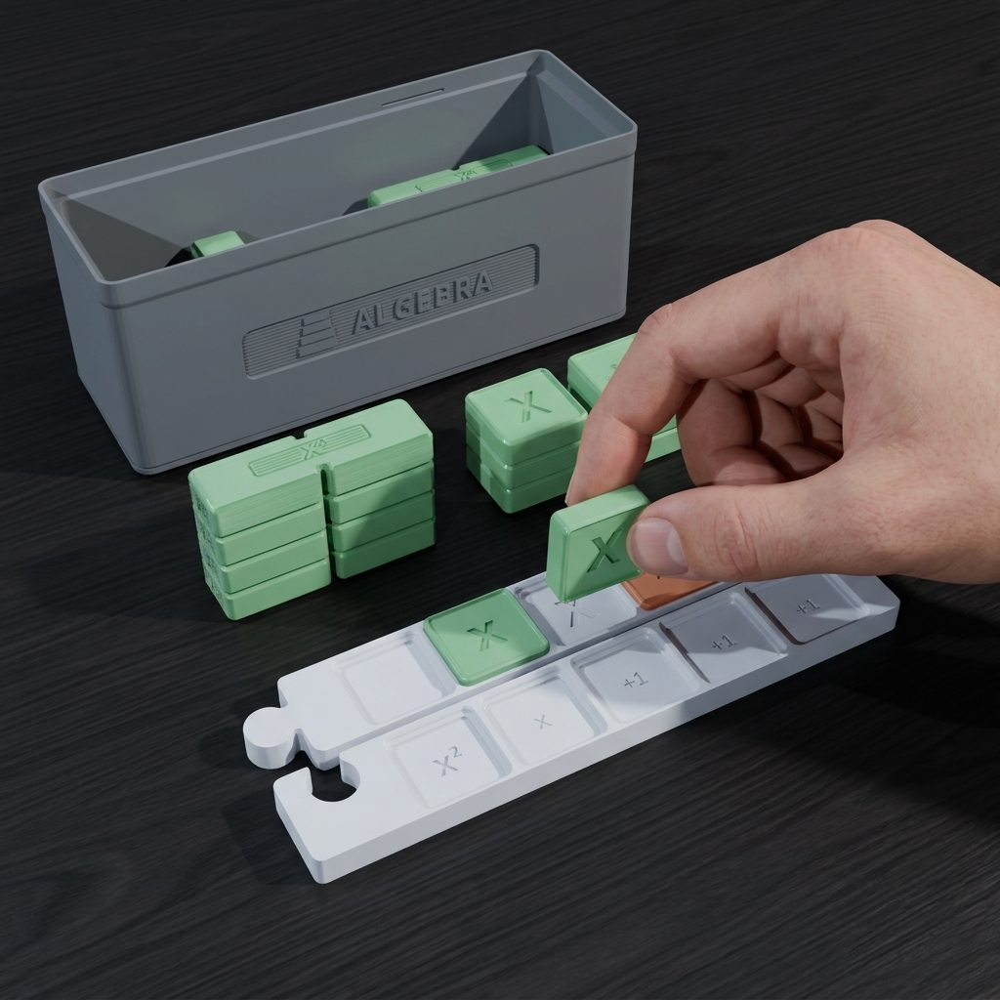
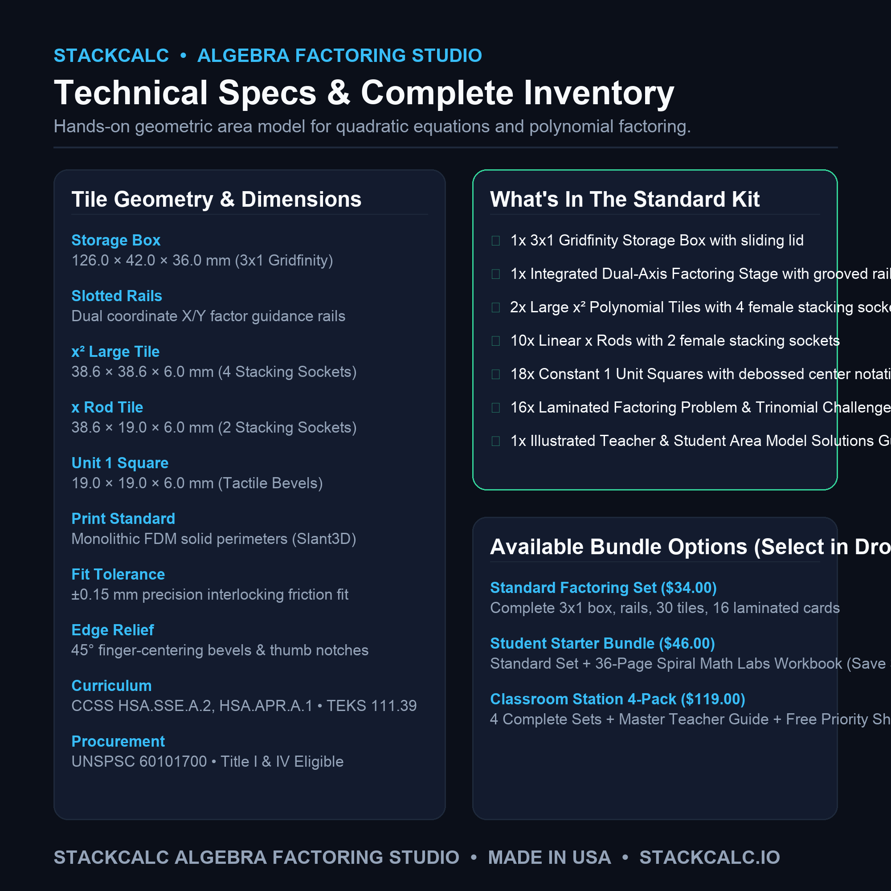
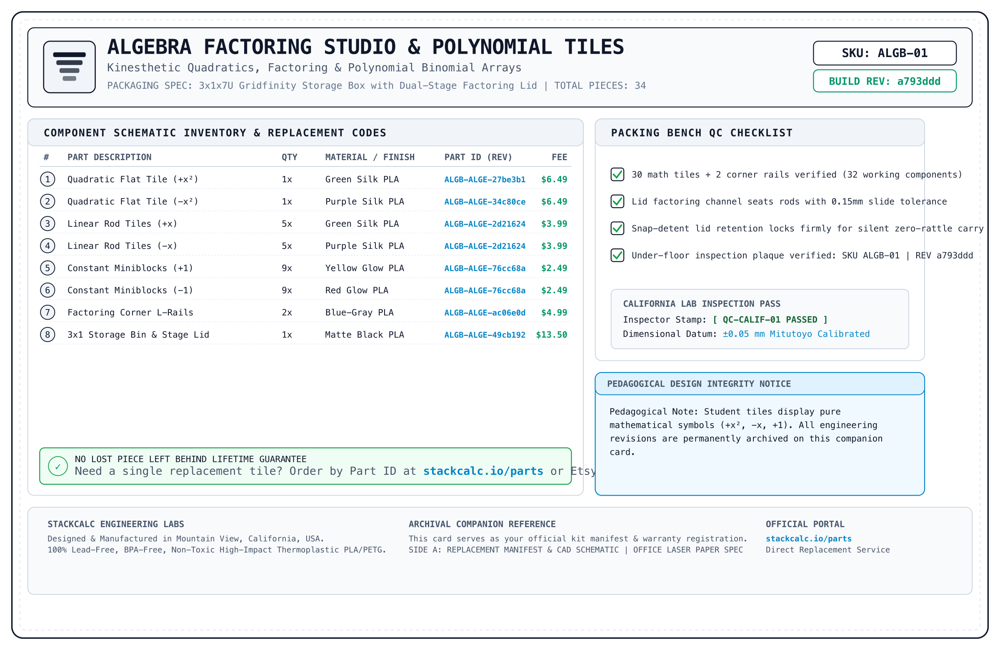
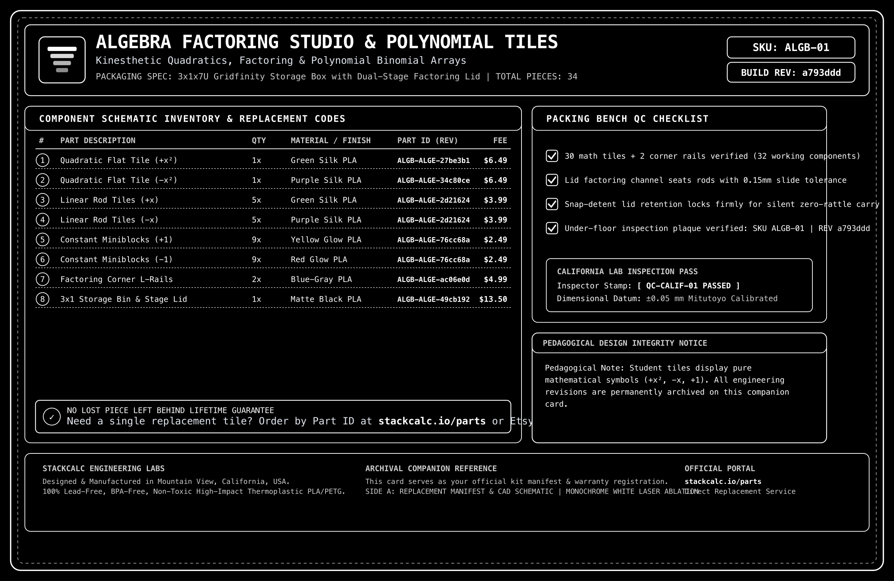

<!-- Schema.org JSON-LD Structured Data for High Google Search & Rich Results Ranking -->

  <!-- Breadcrumb -->
  <nav class="ec-breadcrumb" aria-label="Breadcrumb">
    <a href="../../">Home</a>
    /
    <a href="../">Products &amp; Manipulatives</a>
    /
    Algebra Factoring Studio
  </nav>

  <!-- ==========================================================================
       HERO PRODUCT SECTION (2-COLUMN ECOMMERCE SPLIT)
       ========================================================================== -->
  

    <!-- Left Column: Product Gallery -->
    

      

        

          Grades 7&ndash;11
          &bull; In Stock &bull; Batch 001
        

        
      

      <!-- Thumbnail Selector Strip (Includes Real High-Res Infographics) -->
      

        

          
        

        

          
        

        

          
        

        

          
        

        

          
        

        

          
        

        

          
        

        

          
        

        

          
        

      

    

    <!-- Right Column: Buy Box & Product Info -->
    

      

        Algebra &amp; Polynomials
        &check; Geometric Area Model
      

      <h1 class="ec-product-title">Algebra Factoring Studio &amp; Tiles</h1>

      <!-- Social Proof & Review Score -->
      

        
★★★★★

        4.9 / 5.0
        &bull; 28 Educator Reviews
        &check; Verified Classroom Pilot
      

      

        $34.00
        &check; Free US Shipping &bull; In Stock
      

      

        The tactile algebraic laboratory for mastering polynomial expressions, the distributive property, binomial multiplication, and quadratic factoring. A modular 3&times;1 Gridfinity storage box integrates a precision factoring stage with perimeter guidance rails and 35 chamfered dual-color snap tiles.
      

      <!-- Highlights Checklist -->
      

        

          &check;
          <strong>Physical Area Model:</strong> Replaces rote FOIL memorization with concrete geometric rectangle construction.
        

        

          &check;
          <strong>Slotted Factoring Stage:</strong> Perimeter rails hold dimension factors \((x + a)\) and \((x + b)\) in place during assembly.
        

        

          &check;
          <strong>30 Chamfered Tiles:</strong> Tactile large \(x^2\) squares, \(x\) bars, and unit \(1\) tiles with debossed algebraic labels and thumb-lift notches.
        

        

          &check;
          <strong>Gridfinity 3x1 Standard:</strong> Neatly stores into standard classroom desk organizers and maker systems.
        

      

      <!-- Action Buttons -->
      

        <a href="https://www.etsy.com/shop/StackCalc" target="_blank" rel="noopener noreferrer" class="ec-btn-primary" style="background-color: #f1641e; border-color: #f1641e; color: #ffffff;">
          Order on Etsy ($34.00) ↗
        </a>
        <a href="#downloads" class="ec-btn-secondary">
          Download Free 3MF / STLs &darr;
        </a>
      

      <!-- Quick Subpage Links -->
      

        <a href="assembly/" class="text-xs font-semibold px-3 py-1.5 rounded bg-slate-800 text-sky-400 border border-sky-500/30 hover:bg-slate-700">
          &bull; Step-by-Step Assembly Guide &amp; Video &rarr;
        </a>
        <a href="lessons/" class="text-xs font-semibold px-3 py-1.5 rounded bg-slate-800 text-emerald-400 border border-emerald-500/30 hover:bg-slate-700">
          &bull; Classroom Curriculum (Lessons 1 &amp; 2) &rarr;
        </a>
      

      <!-- Trust Badges -->
      

        

          &check;
          Algebra I Standards Aligned
        

        

          &square;
          3x1 Gridfinity Storage Box
        

        

          &hearts;
          Non-Toxic Matte Polymer Finish
        

      

    

  

  <!-- ==========================================================================
       SECTION: EDUCATIONAL VALUE & THE AREA MODEL
       ========================================================================== -->
  <section class="ec-section">
    <h2 class="ec-section-title">Demystifying Factoring with the Area Model</h2>
    

      Factoring quadratic trinomials is one of the highest hurdles in early high school mathematics. Algebra Boxes turns abstract equations into intuitive spatial puzzles.
    

    

      

        
&square;

        <h3 class="ec-feature-title">1. Factors as Side Dimensions</h3>
        

          When multiplying \((x + 2)(x + 3)\), students arrange an \(x\) bar and 2 units along the vertical rail, and an \(x\) bar and 3 units along the horizontal rail.
        

      

      

        
&times;

        <h3 class="ec-feature-title">2. Product as Enclosed Area</h3>
        

          Filling in the interior grid requires exactly one large \(x^2\) tile, five \(x\) bars, and six unit \(1\) tiles. The equation \(x^2 + 5x + 6\) is immediately visualized as a complete rectangle.
        

      

      

        
&minus;

        <h3 class="ec-feature-title">3. Completing the Square</h3>
        

          Students physically observe why "completing the square" requires adding \((\frac{b}{2})^2\): they build a symmetrical L-shape around \(x^2\) and discover the exact missing corner tile.
        

      

    

  </section>

  <!-- ==========================================================================
       SECTION: DEMONSTRATION VIDEOS, UNBOXING & KINEMATICS (3-VIDEO MEDIA SUITE)
       ========================================================================== -->
  <section id="product-videos" class="ec-section">
    <h2 class="ec-section-title">The Video Showcase: Mechanical Animation, Unboxing &amp; Classroom Lesson</h2>
    
Experience the complete journey from precision CAD kinematics and zero-plastic unboxing to tactile algebra instruction on a classroom desk.

    

      <!-- 1. CAD / Mechanical Animation -->
      

        

          <video controls playsinline preload="metadata" poster="../../assets/renders/algebra-boxes-hero.png">
            <source src="/assets/videos/algebra-boxes-assembly.mp4" type="video/mp4">
            Your browser does not support HTML5 video.
          </video>
          1. CAD KINEMATICS
        

        

          

            <h3 class="text-sm font-bold text-slate-100 mb-1">Mechanical &amp; CAD Animation</h3>
            
Exploded 3D view showing coordinate rail dovetails, chamfered snap-fit tolerances, and modular 3x1 Gridfinity nesting.

          

          

            60 FPS Cycles Render
            0.20mm Tolerance
          

        

      

      <!-- 2. Unboxing Experience -->
      

        

          <video controls playsinline preload="metadata" poster="../../assets/renders/algebra-boxes-hero.png">
            <source src="/assets/videos/algebra-boxes-unboxing.mp4" type="video/mp4">
            Your browser does not support HTML5 video.
          </video>
          2. UNBOXING EXPERIENCE
        

        

          

            <h3 class="text-sm font-bold text-slate-100 mb-1">Unboxing Experience</h3>
            
Opening the protective mailer to reveal the 135&times;90mm archival reference card resting on top of organized, rattle-free components.

          

          

            135x90mm Duplex Card
            Zero Plastic Wrap
          

        

      

      <!-- 3. Classroom Lesson in Action -->
      

        

          <video controls playsinline preload="metadata" poster="../../assets/renders/algebra-boxes-hero.png">
            <source src="/assets/videos/algebra-boxes-lesson.mp4" type="video/mp4">
            Your browser does not support HTML5 video.
          </video>
          3. CLASSROOM LESSON
        

        

          

            <h3 class="text-sm font-bold text-slate-100 mb-1">Classroom Lesson in Action</h3>
            
Tangible polynomial factoring: tiling \((x + 2)(x + 1) = x^2 + 3x + 2\) with tactile area rails and chamfered tiles.

          

          

            CCSS HSA.SSE.A.2
            TEKS 111.39
          

        

      

    

    <!-- Reference Card Download Callout -->
    

      

        
        

          <h4 class="text-sm font-bold text-slate-100">Archival Reference &amp; Video QR Card (135&times;90mm)</h4>
          
Included inside every box. Scan Side B to jump straight to this 3-video learning portal or inspect Side A for part replacement IDs.

        

      

      

        <a href="/assets/reference_cards/reference_card_ALGB-01_paper.png" target="_blank" rel="noopener noreferrer" class="px-3 py-1.5 bg-slate-800 hover:bg-slate-700 text-xs font-mono text-slate-200 rounded border border-slate-700 transition">View Front (Side A)</a>
        <a href="/assets/reference_cards/reference_card_ALGB-01_back_paper.png" target="_blank" rel="noopener noreferrer" class="px-3 py-1.5 bg-cyan-950 hover:bg-cyan-900 text-xs font-mono text-cyan-300 rounded border border-cyan-800 transition">View Back (QR Side B)</a>
        <a href="/downloads/packing_bench_cards.html" class="px-3 py-1.5 bg-emerald-950 hover:bg-emerald-900 text-xs font-mono text-emerald-300 rounded border border-emerald-800 transition">Print Duplex Sheet</a>
      

    

  </section>

  <!-- ==========================================================================
       SECTION: FROM THE TEACHER'S MANUAL (REPRODUCIBLE MANIPULATIVE LAB SHEET)
       ========================================================================== -->
  <section class="ec-section">
    

      

        &bull; Classroom Pedagogy &bull; Concrete-Representational-Abstract (CRA)
        <h2 class="ec-section-title m-0">From the Teacher's Manual: Unit Lab Sheet</h2>
      

      Unit 04 &bull; Algebra 1
    

    

      Most traditional math teacher manuals treat manipulatives as optional afterthoughts. In the StackCalc curriculum, every manipulative unit includes a dedicated, reproducible lab sheet connecting hands-on tactile geometry directly to hardware calculator execution.
    

    <!-- Authentic Spiral-Bound Workbook Page Facsimile -->
    

      

        

        

        

        

        

      

      

        

          

            STACKCALC MATH LABS // SERIES 01
            STANDARDS: CCSS HSA.APR.A.1 &bull; TEKS 111.39.c.10
            PERIOD: 45 MIN STATION
          

          <h3 class="workbook-title">Lab 04: The Geometric Area Model &amp; RPN Polynomial Verification</h3>
          

            <strong>Investigation Goal:</strong> Prove that polynomial multiplication is the physical calculation of a rectangle's area. Construct the tactile geometric expansion of \((x + 2)(x + 1)\), formulate the trinomial, and verify factor equivalence across the entire real number line using the SC-32 RPN stack.
          

        

        <!-- Phase 1: Concrete Spatial Exploration -->
        

          

            &square; PHASE 1: CONCRETE SPATIAL EXPLORATION (MANIPULATIVE STAGE)
          

          

            Lock the 90&deg; mortise-and-tenon L-frame rails together on your desk. Dimension the Base Rail to \((x + 2)\) using one \(x\) rod and two \(1\) units. Dimension the Height Rail to \((x + 1)\) using one \(x\) rod and one \(1\) unit.
          

          

            

              <strong class="text-sky-400 block mb-0.5">Step A: Origin Tile</strong>
              Seat one \(x^2\) large tile at \((0, 0)\). Area: \(x \times x = x^2\).
            

            

              <strong class="text-amber-400 block mb-0.5">Step B: Linear Rails</strong>
              Place two horizontal \(x\) rods and one vertical \(x\) rod. Area: \(3x\).
            

            

              <strong class="text-emerald-400 block mb-0.5">Step C: Unit Corner</strong>
              Place two \(1\) unit tiles in the corner. Area: \(2 \times 1 = 2\).
            

          

        

        <!-- Phase 2: Structured Observation Table -->
        

          

            &equiv; PHASE 2: REPRESENTATIONAL DATA &amp; OBSERVATION TABLE
          

          <table class="workbook-table">
            <thead>
              <tr>
                <th>Binomial Factors</th>
                <th>x&sup2; Squares Count</th>
                <th>x Rods Count</th>
                <th>Unit Squares Count</th>
                <th>Expanded Polynomial Form</th>
              </tr>
            </thead>
            <tbody>
              <tr>
                <td class="font-mono text-cyan-300">\((x + 2)(x + 1)\)</td>
                <td class="font-mono">1 tile (\(x^2\))</td>
                <td class="font-mono">3 rods (\(3x\))</td>
                <td class="font-mono">2 units (\(2\))</td>
                <td class="font-mono text-emerald-400 font-bold">\(x^2 + 3x + 2\)</td>
              </tr>
              <tr>
                <td class="font-mono text-cyan-300">\((x + 3)(x + 2)\)</td>
                <td class="font-mono">1 tile (\(x^2\))</td>
                <td class="font-mono">5 rods (\(5x\))</td>
                <td class="font-mono">6 units (\(6\))</td>
                <td class="font-mono text-emerald-400 font-bold">\(x^2 + 5x + 6\)</td>
              </tr>
            </tbody>
          </table>
        

        <!-- Phase 3: Abstract Verification via SC-32 RPN Calculator -->
        

          

            &Delta; PHASE 3: ABSTRACT VERIFICATION (SC-32 CALCULATOR EXECUTION)
          

          

            Choose any test scalar (e.g. \(x = 5\)). Evaluate both the factored side-lengths and the tiled polynomial area on the SC-32 4-register RPN stack to prove mathematical identity:
          

          

            

              1. Calculate Factored Form \((5 + 2) \times (5 + 1)\):
              

                5
                ENTER
                2
                +
                5
                ENTER
                1
                +
                &times;
                &rarr; X-Register: 42.0000
              

            

            

              2. Calculate Tiled Polynomial Form \(5^2 + 3(5) + 2\):
              

                5
                x&sup2;
                3
                ENTER
                5
                &times;
                +
                2
                +
                &rarr; X-Register: 42.0000
              

            

          

          

            REGISTER X: 42.0000 (RESULT)
            REGISTER Y: 40.0000
            REGISTER Z: 25.0000
            &check; FACTORS VERIFIED
          

        

        <!-- Teacher Facilitation Box -->
        

          <strong>Teacher Diagnostic Note:</strong> If a student attempts to measure the physical \(x\) rod (\(38.6\text{ mm}\)) against two unit tiles (\(38.0\text{ mm}\)) and concludes that \(x = 2\), prompt: <em>"Notice the intentional 0.6mm gap. In algebra, \(x\) represents an unknown variable, not a fixed constant of 2. The physical tile models the spatial relationship across any real value of \(x\)."</em>
        

        <!-- Download & Order Row -->
        

          

            <strong>Sample Page 14</strong> from the 36-page <em>StackCalc RPN Math Labs Student Workbook</em>.
          

          

            <a href="/downloads/stackcalc-curriculum-sample-v0.2.0.pdf" class="ec-btn-secondary text-xs">
              &darr; Download Free Lab 04 Worksheet (PDF)
            </a>
            <a href="/products/curriculum-and-decks/" class="ec-btn-primary text-xs">
              Order Complete 36-Page Workbook ($24.00) &rarr;
            </a>
          

        

      

    

  </section>

  <!-- ==========================================================================
       SECTION: COMPLETE THE CLASSROOM MATH STATION (CROSS-SELL BUNDLE)
       ========================================================================== -->
  <section class="cross-sell-section">
    

      &bull; Complete The Math Station
      <h2 class="text-2xl font-bold text-white mt-1 mb-2">Build a Complete Hands-On Algebra Station</h2>
      

        Research demonstrates that students retain algebraic concepts 40% faster when tactile manipulatives are paired with structured problem workbooks and zero-distraction RPN hardware calculators.
      

    

    

      <!-- Cross-Sell 1: SC-32 Calculator -->
      

        

          
          <h3 class="cross-sell-card-title">SC-32 Scientific RPN Calculator</h3>
          

            The hardware math engine for classroom focus. Instant power-on, zero wireless radios (100% exam legal), and 4-register RPN stack evaluating polynomial roots with zero parentheses syntax errors.
          

        

        

          

            $89.00
            Hardware Core
          

          <a href="/products/sc32-calculator/" class="ec-btn-secondary w-full text-center mt-3 text-xs block">
            View SC-32 Calculator &rarr;
          </a>
        

      

      <!-- Cross-Sell 2: Curriculum Workbook & Decks -->
      

        

          
          <h3 class="cross-sell-card-title">36-Page Spiral Student Workbook</h3>
          

            20 ready-to-teach STEM laboratory investigations. Features full-color illustrated diagrams, reproducible student sheets, and complete teacher answer keys for Algebra 1 and Pre-Calculus.
          

        

        

          

            $24.00
            Teacher Approved
          

          <a href="/products/curriculum-and-decks/" class="ec-btn-secondary w-full text-center mt-3 text-xs block">
            Add Workbook &amp; Decks &rarr;
          </a>
        

      

      <!-- Cross-Sell 3: Complete Algebra Station Bundle -->
      

        SAVE $19.00
        

          
          <h3 class="cross-sell-card-title">Complete Algebra 1 Station Bundle</h3>
          

            Everything needed for a 2-student desk station: Algebra Factoring Studio + SC-32 Calculator + 36-Page Spiral Workbook + CR80 Waterproof Reference Decks + Desktop Origami Stand.
          

        

        

          

            $128.00
            &check; Save $19 (Was $147)
          

          <a href="https://www.etsy.com/shop/StackCalc" target="_blank" rel="noopener noreferrer" class="ec-btn-primary w-full text-center mt-3 text-xs block" style="background-color: #f1641e; border-color: #f1641e; color: #ffffff;">
            Order Complete Station on Etsy ↗
          </a>
        

      

    

  </section>

  <!-- ==========================================================================
       SECTION: TECHNICAL SPECIFICATIONS
       ========================================================================== -->
  <section class="ec-section">
    <h2 class="ec-section-title">Technical Specifications</h2>
    
Precision proportions and tile dimensions.

    <table class="ec-spec-table">
      <tbody>
        <tr>
          <td class="ec-spec-k">Outer Box Dimensions</td>
          <td class="ec-spec-v">126.0 mm (L) &times; 42.0 mm (W) &times; 36.0 mm (H) &bull; Standard 3x1 Gridfinity footprint</td>
        </tr>
        <tr>
          <td class="ec-spec-k">Factoring Stage Rails</td>
          <td class="ec-spec-v">Dual grooved coordinate guidance tracks for factor positioning along X and Y axes</td>
        </tr>
        <tr>
          <td class="ec-spec-k">Polynomial Tiles (30 Total)</td>
          <td class="ec-spec-v">2&times; \(x^2\) large squares (\(38.6 \times 38.6\,\text{mm}\)), 10&times; \(x\) rods (\(38.6 \times 19.0\,\text{mm}\)), 18&times; unit \(1\) squares (\(19.0 \times 19.0\,\text{mm}\))</td>
        </tr>
        <tr>
          <td class="ec-spec-k">Tile Annotations</td>
          <td class="ec-spec-v">Tactile debossed math notation with 45&deg; perimeter bevels and corner thumb-lift notches</td>
        </tr>
        <tr>
          <td class="ec-spec-k">Industrial Design &amp; CMF</td>
          <td class="ec-spec-v">Monolithic farm additive manufacturing (Slant3D) &bull; Solid continuous perimeters &bull; &plusmn;0.15 mm interlocking fit tolerance &bull; 45&deg; finger-relief edge bevels</td>
        </tr>
        <tr>
          <td class="ec-spec-k">Curriculum Standards</td>
          <td class="ec-spec-v">Common Core: CCSS.MATH.CONTENT.HSA.SSE.A.2, HSA.APR.A.1 &bull; TEKS: 111.39.c.10 &bull; CA Framework Grades 7&ndash;11</td>
        </tr>
        <tr>
          <td class="ec-spec-k">Procurement Classification</td>
          <td class="ec-spec-v">UNSPSC: 60101700 (Math Manipulatives) &bull; Eligible for Federal Title I and Title IV STEM Grant Funding</td>
        </tr>
      </tbody>
    </table>
  </section>

  <!-- ==========================================================================
       SECTION: WHAT'S IN THE BOX
       ========================================================================== -->
  <section class="ec-section">
    <h2 class="ec-section-title">What's in the Box</h2>
    
Complete hands-on polynomial factoring station.

    

      

        &check;
        3x1 Gridfinity Storage Box with Integrated Factoring Stage Rails
      

      

        &check;
        30 Chamfered Precision Polynomial Tiles (\(x^2\), \(x\), and \(1\))
      

      

        &check;
        16 Laminated Quadratic Factoring &amp; Trinomial Challenge Cards
      

      

        &check;
        Teacher / Student Area Model Polynomial Solutions Guide
      

    

  </section>

  <!-- ==========================================================================
       SECTION: SAFETY, COMPLIANCE & GUARANTEES
       ========================================================================== -->
  <section class="ec-section">
    <h2 class="ec-section-title">Safety, Compliance &amp; Guarantees</h2>
    
Engineered for safe classroom environments and reliable long-term instruction.

    

      

        <strong class="text-amber-300 flex items-center gap-2 mb-1">
          &#9888; Mandatory Safety Disclaimer (CPSIA / ASTM F963)
        </strong>
        

          <strong>WARNING: CHOKING HAZARD &ndash; Small parts.</strong> Not for children under 3 years. This product contains small tactile tiles (\(19.0 \times 19.0\,\text{mm}\)). Designed specifically for educational instruction for Grades 3+ (ages 8 and up) under adult supervision.
        

      

      

        <strong class="text-sky-400 flex items-center gap-2 mb-1">
          &#10003; 100% Non-Toxic &amp; Food-Contact Safe Biopolymers
        </strong>
        

          Manufactured exclusively from odorless, non-toxic, BPA-free PLA biopolymer and impact-resistant PETG. Free from lead, PVC, and phthalates. Wipe clean with standard classroom disinfectant wipes.
        

      

      

        <strong class="text-emerald-400 flex items-center gap-2 mb-1">
          &#9874; "No Lost Piece Left Behind" Educator Guarantee
        </strong>
        

          Classrooms are busy spaces. If a tile or rail ever goes missing or gets damaged, order individual replacement parts anytime for just the nominal cost of postage ($1.99).
        

      

      

        <strong class="text-indigo-400 flex items-center gap-2 mb-1">
          &#9881; US Additive Farm Production
        </strong>
        

          Designed by StackCalc in California; produced in high-volume American 3D print farms (Slant3D) under strict dimensional tolerances and quality control.
        

      

    

  </section>

  <!-- ==========================================================================
       SECTION: VERIFIED EDUCATOR REVIEWS & SOCIAL PROOF
       ========================================================================== -->
  <section class="ec-section">
    

      

        <h2 class="ec-section-title m-0">Educator Endorsements &amp; Verified Reviews</h2>
        
Classroom trial feedback from public school math teachers, department heads, and homeschool parents.

      

      

        4.9
        
★★★★★

        (28 Verified Reviews)
      

    

    

      

        

          
★★★★★

          

            "The geometric area model finally made factoring click for students who struggled with abstract FOIL rules. Stacking the tiles to complete the square is genius."
          

        

        

          <strong class="text-xs text-white block">Sarah M.</strong>
          High School Math Dept Chair &bull; California
        

      

      

        

          
★★★★★

          

            "The 3x1 Gridfinity box solved our missing pieces headache. In 15 seconds at the end of class, my students can see whether every tile is in place."
          

        

        

          <strong class="text-xs text-white block">Marcus T.</strong>
          Algebra 1 Teacher &bull; Texas Independent SD
        

      

      

        

          
★★★★★

          

            "Heirloom-grade biopolymer feel with debossed labels that won't rub off. The 'No Lost Piece Left Behind' guarantee gave our principal total confidence to approve PO funding."
          

        

        

          <strong class="text-xs text-white block">Elena R.</strong>
          STEM Curriculum Director &bull; Ohio
        

      

    

  </section>

  <!-- ==========================================================================
       SECTION: FREQUENTLY ASKED QUESTIONS (FAQ)
       ========================================================================== -->
  <section class="ec-section">
    <h2 class="ec-section-title">Frequently Asked Questions</h2>
    
Everything you need to know about classroom deployment, standards, and durability.

    

      

        

          How does the geometric area model help with quadratic factoring?
          +
        

        

          Rather than relying on abstract memorization of binomial FOIL rules, students arrange physical side factor rails (e.g. \(x + 2\) and \(x + 3\)) and physically tile the interior rectangle with \(x^2\), \(x\), and unit tiles. The trinomial equation \(x^2 + 5x + 6\) becomes an intuitive rectangular puzzle.
        

      

      

        

          Which educational standards does the Algebra Factoring Studio meet?
          +
        

        

          The kit directly aligns with Common Core State Standards CCSS.MATH.CONTENT.HSA.SSE.A.2 and HSA.APR.A.1, Texas Essential Knowledge and Skills (TEKS 111.39.c.10), and the California Mathematics Framework for Grades 7–11. It is classified under UNSPSC 60101700 and qualifies for Federal Title I and Title IV Part A grant funding.
        

      

      

        

          How do schools sanitize and clean the tiles?
          +
        

        

          All components are manufactured from waterproof, non-porous PLA biopolymer and PETG. They can be sanitized using standard hospital-grade classroom disinfectant wipes or washed in lukewarm soapy water (up to 50°C / 120°F).
        

      

      

        

          What is the "No Lost Piece Left Behind" guarantee?
          +
        

        

          We understand that classroom manipulatives can occasionally get lost or swept away. We guarantee that educators and parents can request individual replacement tiles or rails anytime for the lifetime of the product, paying only $1.99 to cover domestic postage.
        

      

    

  </section>

  <!-- Open Source Maker Download Callout -->
  <section id="downloads" class="ec-section">
    

      

        &bull; 100% Free Open Hardware
        <h3 class="ec-maker-title">3D Print Algebra Boxes</h3>
        

          Download our print-tested STL files for the Gridfinity factoring box and all 35 polynomial tiles.
        

      

      

        <a href="/downloads/algebra-boxes-open-source-stls.zip" class="ec-btn-primary">
          Download Algebra STLs (.ZIP) &darr;
        </a>
      

    

  </section>

  <!-- Discreet Ecosystem Blurb -->
  

    
&Delta;

    

      
Part of the StackCalc Math Learning Ecosystem

      

        Algebra Boxes bridge concrete spatial factoring to algebraic equations. Once students master quadratic factorization geometrically, they easily solve and evaluate complex polynomials using the dedicated stack on our SC-32 scientific calculator.
      

    

  

