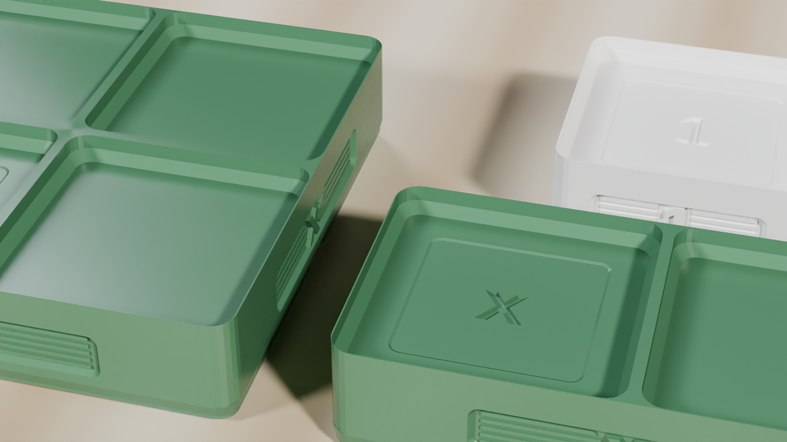

  <!-- Breadcrumb -->
  <nav class="ec-breadcrumb" aria-label="Breadcrumb">
    <a href="../../../">Home</a>
    /
    <a href="../../">Products &amp; Manipulatives</a>
    /
    <a href="../">Algebra Factoring Studio</a>
    /
    Classroom Lessons
  </nav>

  <!-- Header -->
  <header class="ec-catalog-header">
    
Secondary Mathematics &bull; The Area Model

    <h1 class="ec-catalog-headline">Algebra Factoring Studio Lessons</h1>
    

      Replace rote FOIL memorization with spatial geometric rectangle construction. These lessons transition students from concrete tiles to abstract polynomial factoring.
    

  </header>

  <!-- Navigation Pill Row -->
  

    <a href="../" class="ec-btn-secondary">&larr; Back to Product Overview</a>
    <a href="../assembly/" class="ec-btn-secondary">View Assembly Guide &rarr;</a>
  

  <!-- Video Section: Lesson Demonstration -->
  <section class="ec-section">
    <h2 class="ec-section-title">Classroom Demonstration Video: Lessons 1 &amp; 2</h2>
    
Watch algebraic tiles construct \((x + 2)(x + 1) = x^2 + 3x + 2\) along precision perimeter rails on a classroom desk.

    

      

        

          <video controls playsinline preload="metadata" poster="../../assets/renders/algebra-lframe-grid-hero.png">
            <source src="/assets/videos/algebra-boxes-lesson.mp4" type="video/mp4">
            Your browser does not support HTML5 video.
          </video>
        

        

          <strong>Curriculum Demonstration (Lessons 1 &amp; 2)</strong>
          90&deg; Interlocking L-Frame: (x + 2)(x + 1) = x&sup2; + 3x + 2 &bull; Trinomial factoring
        

      

      

        
&square;

        <h3 class="ec-feature-title">Why the Area Model Grounds Algebra</h3>
        

          In traditional algebra instruction, students memorize "FOIL" (First, Outside, Inside, Last) as an arbitrary mnemonic, frequently forgetting middle terms or signs. The physical area model proves that multiplication is simply calculating the area of a rectangle with side lengths equal to the two factors.
        

      

    

  </section>

  <!-- ==========================================================================
       LESSON 1: BINOMIAL MULTIPLICATION (THE AREA MODEL)
       ========================================================================== -->
  <section class="ec-section">
    

      

        Lesson 01
        Target Grades: 7&ndash;9 &bull; Standard: CCSS.MATH.CONTENT.HSA.APR.A.1
      

      <h2 class="text-2xl font-bold text-white mb-2">Binomial Multiplication: Proving (x + 2)(x + 1) = x&sup2; + 3x + 2</h2>
      

        <strong>Lesson Objective:</strong> Students lock the 90&deg; interlocking L-frame, dimension the horizontal and vertical rails to represent binomial factors, and complete the physical rectangle to prove polynomial expansion.
      

      <!-- Concept Illustration Card -->
      

        
        

          <strong>90&deg; Interlocking L-Frame Stage:</strong> Base Rail and Height Rail join via puzzle mortise-and-tenon, framing the complete continuous rectangle: \(1(x^2) + 3(x) + 2(1)\).
          Area = x&sup2; + 3x + 2
        

      

      <h3 class="text-base font-bold text-sky-400 mb-3">Step-by-Step Classroom Investigation</h3>
      

        

          1.
          

            <strong>Set Side Dimensions on Perimeter Rails:</strong>
            <ul class="list-disc pl-5 mt-1 text-xs text-gray-300 space-y-1">
              <li>Along the horizontal Base Rail, place one \(x\) rod and two \(1\) unit tiles. Total horizontal length: \(x + 2\).</li>
              <li>Along the vertical Height Rail, place one \(x\) rod and one \(1\) unit tile. Total vertical height: \(x + 1\).</li>
            </ul>
          

        

        

          2.
          

            <strong>Populate the Origin Pocket (x &times; x):</strong> Place one large \(x^2\) square tile at the origin \((0, 0)\). Point out: <em>"An \(x\) length times an \(x\) height creates an area of \(x^2\)."</em>
          

        

        

          3.
          

            <strong>Populate the Cross Terms:</strong>
            <ul class="list-disc pl-5 mt-1 text-xs text-gray-300 space-y-1">
              <li>Under the two horizontal unit tiles (height \(x\)), place two horizontal \(x\) rods. Area: \(2x\).</li>
              <li>Next to the vertical unit tile (length \(x\)), place one vertical \(x\) rod. Area: \(1x\).</li>
            </ul>
          

        

        

          4.
          

            <strong>Fill the Corner Units (1 &times; 2):</strong> Place two \(1\) unit tiles in the remaining lower-right corner. The rectangle is now completely solid and flush with the perimeter rails.
          

        

        

          5.
          

            <strong>Tally Total Area:</strong> Count the physical tiles inside the rectangle:
            \[
            \text{Area} = (x + 2)(x + 1) = 1(x^2) + 3(x) + 2(1) = x^2 + 3x + 2
            \]
          

        

      

      <!-- Misconception Diagnostic Box -->
      

        <h4 class="text-sm font-bold text-amber-300 mb-1">&Delta; Key Misconception Diagnostic: "Treating x as a Fixed Constant"</h4>
        

          <strong>The Common Error:</strong> Students measure the physical \(x\) rod (\(38.6\text{ mm}\)) against two unit tiles (\(2 \times 19.0 = 38.0\text{ mm}\)) and conclude that \(x\) is physically equal to 2.
        

        

          <strong>The Physical Fix:</strong> Clarify the model contract: <em>"In algebra, \(x\) represents an unknown variable that can be any number. We deliberately printed the \(x\) rod at \(38.6\text{ mm}\) with a 0.6 mm mismatch so it does NOT match two unit tiles perfectly. The shape represents the variable relationship, not a specific scalar."</em>
        

      

      <!-- Independent Transfer Task -->
      

        <h4 class="text-sm font-bold text-emerald-400 mb-1">&check; Independent Transfer Check</h4>
        

          <strong>Prompt:</strong> Set up the rails to model \((x + 3)(x + 2)\). Predict how many \(x\) rods and unit tiles will be needed inside the rectangle before placing them. Build the rectangle to confirm.
        

      

    

  </section>

  <!-- ==========================================================================
       LESSON 2: FACTORING TRINOMIALS
       ========================================================================== -->
  <section class="ec-section">
    

      

        Lesson 02
        Target Grades: 8&ndash;10 &bull; Standard: CCSS.MATH.CONTENT.HSA.SSE.B.3
      

      <h2 class="text-2xl font-bold text-white mb-2">Factoring Trinomials: Decomposing x&sup2; + 4x + 3</h2>
      

        <strong>Lesson Objective:</strong> Given a collection of tiles representing \(x^2 + 4x + 3\), discover the binomial factors by arranging the tiles into the unique solid rectangle that fits within the L-frame.
      

      <h3 class="text-base font-bold text-sky-400 mb-3">Step-by-Step Classroom Investigation</h3>
      

        

          1.
          

            <strong>Collect the Tile Inventory:</strong> Hand the student 1 \(x^2\) square, 4 \(x\) rods, and 3 \(1\) unit tiles. State the challenge: <em>"Arrange all of these pieces into one solid rectangle with no holes and no jagged overhangs."</em>
          

        

        

          2.
          

            <strong>Test Candidate Arrangement (Non-Example):</strong> Place 2 \(x\) rods horizontally and 2 \(x\) rods vertically. Try to fill the corner with the 3 unit tiles:
            
The corner gap has dimensions \(2 \times 2 = 4\text{ units}\), but we only have 3 unit tiles! One square remains empty. Conclusion: This layout is invalid.

          

        

        

          3.
          

            <strong>Discover the Valid Rectangle:</strong> Rearrange the \(x\) rods: place 3 \(x\) rods along the bottom and 1 \(x\) rod along the side.
            
The corner gap now has dimensions \(3 \times 1 = 3\text{ units}\). The 3 unit tiles fit <em>perfectly</em>!

          

        

        

          4.
          

            <strong>Read the Factors from the Edges:</strong>
            <ul class="list-disc pl-5 mt-1 text-xs text-gray-300 space-y-1">
              <li>Horizontal dimension: \(x + 3\)</li>
              <li>Vertical dimension: \(x + 1\)</li>
              <li>Conclusion: \(x^2 + 4x + 3 = (x + 3)(x + 1)\).</li>
            </ul>
          

        

      

      <!-- Misconception Diagnostic Box -->
      

        <h4 class="text-sm font-bold text-amber-300 mb-1">&Delta; Key Misconception Diagnostic: "The Magic Diamond Trap"</h4>
        

          <strong>The Common Error:</strong> Students memorize factoring formulas (numbers that multiply to \(c\) and add to \(b\)) without understanding <em>why</em>. When faced with \(2x^2 + 5x + 2\), standard mnemonics break down.
        

        

          <strong>The Physical Fix:</strong> The tiles show that factoring is simply finding dimensions of a rectangle. The numbers that multiply to \(c\) represent the unit corner area, and the numbers that add to \(b\) represent the distributed rod lengths.
        

      

      <!-- Independent Transfer Task -->
      

        <h4 class="text-sm font-bold text-emerald-400 mb-1">&check; Independent Transfer Check</h4>
        

          <strong>Prompt:</strong> Take 1 \(x^2\) tile, 5 \(x\) rods, and 6 unit tiles. Build the rectangle and state the factors of \(x^2 + 5x + 6\).
        

      

    

  </section>

  <!-- ==========================================================================
       SECTION: CRAFTSMANSHIP & GRIDFINITY STACKING
       ========================================================================== -->
  <section class="ec-section">
    

      

        Tactile Craftsmanship
        Archimedean Dual-Tone Silk &bull; Gridfinity Underside
      

      <h2 class="text-2xl font-bold text-white mb-2">Heirloom Quality &amp; Precision Modularity</h2>
      

        All algebraic tiles are printed with concentric Archimedean spiral infill in high-contrast silk colors (Emerald green \(x^2\), Terracotta gold \(x\), Archival white unit \(1\)). The underside features self-aligning 0.5U Gridfinity miniblock registration pockets for stable nesting.
      

      

        

          
        

        

          

            <strong class="text-emerald-300 font-mono text-xs block mb-1">x&sup2; QUADRATIC TILE (42.0 &times; 42.0 mm)</strong>
            Features debossed \(x^2\) algebraic notation with 0.8 mm depth and four 0.5U Gridfinity registration sockets on its reverse side.
          

          

            <strong class="text-amber-300 font-mono text-xs block mb-1">x LINEAR ROD (42.0 &times; 19.6 mm)</strong>
            Precisely engineered to bridge between quadratic squares and unit cubes without ambiguity or accidental scalar equivalence.
          

          

            <strong class="text-sky-300 font-mono text-xs block mb-1">UNIT CONSTANT TILE (19.6 &times; 19.6 mm)</strong>
            Monolithic white PLA with debossed "1" numeral, establishing the concrete discrete scalar count.
          

        

      

    

  </section>

  <!-- ==========================================================================
       SECTION: PRE-GENERATED STATION WORKSHEETS & STANDARDS INTEGRATION
       ========================================================================== -->
  <section class="ec-section">
    

      

        

          // CURRICULUM &amp; STATION GUIDES
          <h2 class="text-2xl font-bold text-white mt-1">Pre-Generated Algebra Worksheets &amp; Standards</h2>
        

        CCSS HSA.APR.A.1 &bull; HSA.SSE.B.3 &bull; 8.EE.A.2
      

      

        The Algebra Factoring Studio pairs directly with our 120-edition library of publication-grade, 2-page classroom station guides. Designed for middle and secondary algebra classrooms, each guide features CAD diagrams, authentic drawing workspaces, and 4-tier teacher scoring rubrics.
      

      

        <a href="../../../curriculum/worksheets/" class="p-4 rounded-xl bg-white/5 border border-white/10 hover:border-cyan-400 transition flex flex-col justify-between group">
          

            <strong class="text-white group-hover:text-cyan-400 block mb-1">📝 120 Station Worksheets</strong>
            Download Form A &amp; Form B PDFs for Algebra 1 Chapter 7 and Singapore Dimensions 8A Chapter 5.
          

          &rarr; Browse Worksheets
        </a>

        <a href="../../../curriculum/alignment-matrix/#big-ideas-math" class="p-4 rounded-xl bg-white/5 border border-white/10 hover:border-emerald-400 transition flex flex-col justify-between group">
          

            <strong class="text-white group-hover:text-emerald-400 block mb-1">🎯 Standards Alignment Matrix</strong>
            Cross-reference chapter-by-chapter with Big Ideas Math, Singapore Dimensions, and CCSS-M.
          

          &rarr; View Matrix
        </a>

        <a href="../../../curriculum/teacher-guide/" class="p-4 rounded-xl bg-white/5 border border-white/10 hover:border-amber-400 transition flex flex-col justify-between group">
          

            <strong class="text-white group-hover:text-amber-400 block mb-1">🧑‍🏫 Teacher Facilitator Guide</strong>
            Geometric area model diagnostics, eliminating FOIL misconceptions, and station rotations.
          

          &rarr; Read Teacher Guide
        </a>
      

      

        

          Perpetual Reproduction License &bull; Free Classroom Photocopy Rights
        

        <a href="../../../downloads/stackcalc-curriculum-sample-v0.2.0.pdf" download class="px-4 py-2 rounded bg-white/10 hover:bg-white/20 text-white font-bold transition flex items-center gap-1.5">
          Download 36-Page Curriculum Sample (.PDF)
          &darr;
        </a>
      

    

  </section>

