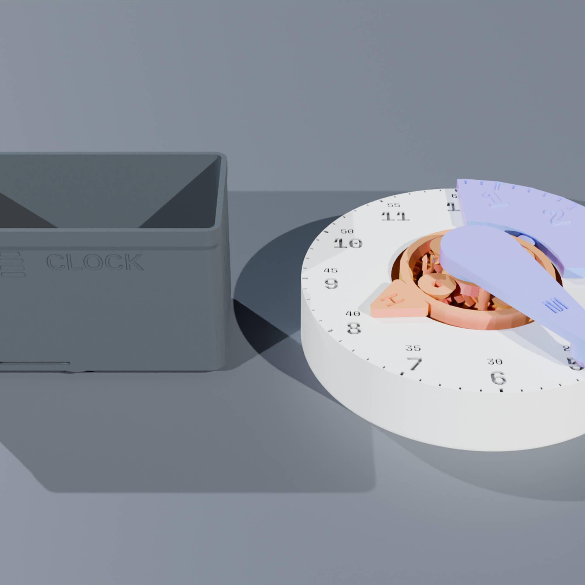
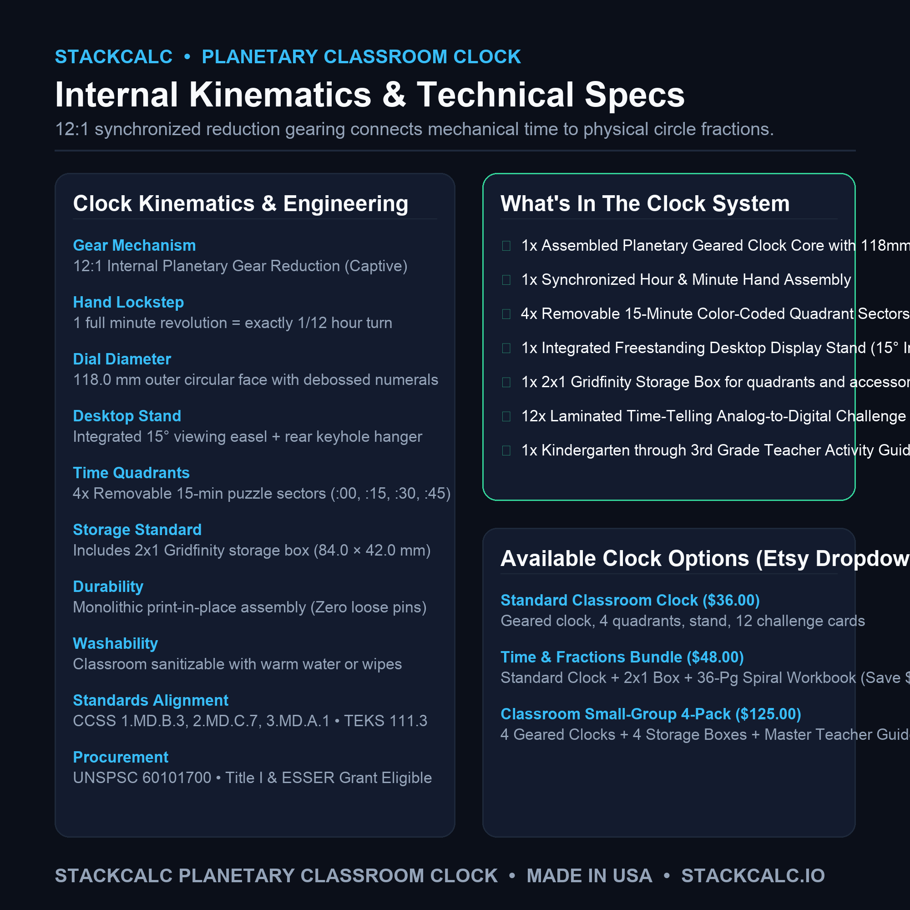
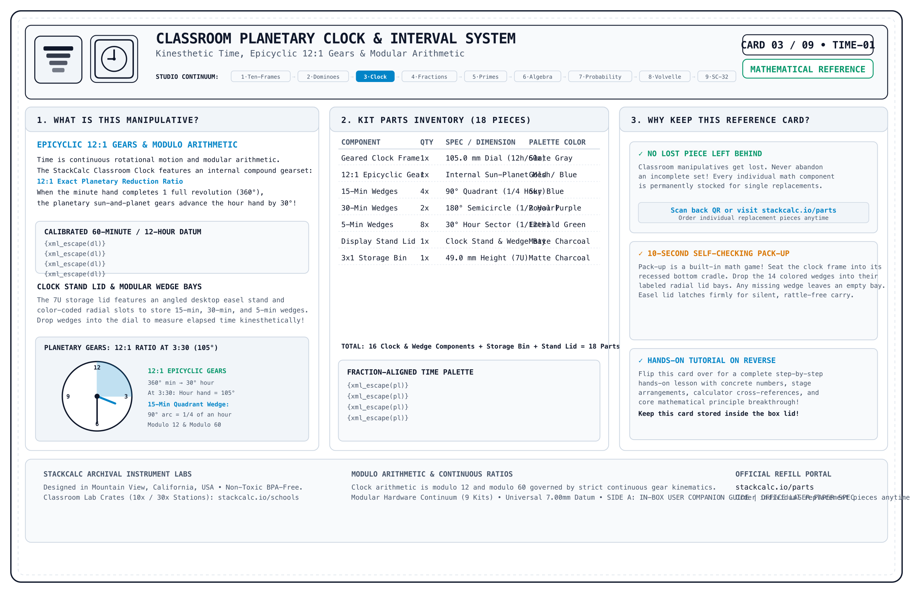
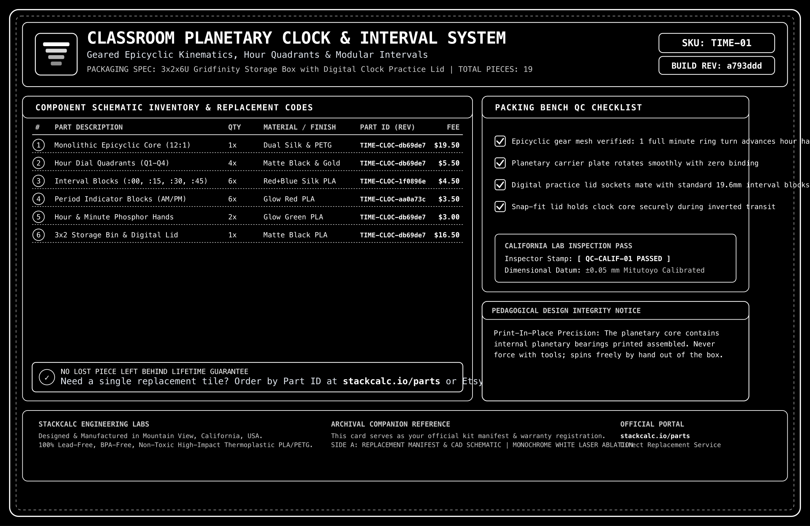

<!-- Schema.org JSON-LD Structured Data for High Google Search & Rich Results Ranking -->

  <!-- Breadcrumb -->
  <nav class="ec-breadcrumb" aria-label="Breadcrumb">
    <a href="../../">Home</a>
    /
    <a href="../">Products &amp; Manipulatives</a>
    /
    Sectional Classroom Planetary Clock
  </nav>

  <!-- ==========================================================================
       HERO PRODUCT SECTION (2-COLUMN ECOMMERCE SPLIT)
       ========================================================================== -->
  

    <!-- Left Column: Product Gallery -->
    

      

        
      

      <!-- Thumbnail Selector Strip (Includes Real High-Res Infographics) -->
      

        

          
        

        

          
        

        

          
        

        

          
        

        

          
        

        

          
        

        

          
        

        

          
        

        

          
        

      

    

    <!-- Right Column: Buy Box & Product Info -->
    

      <h1 class="ec-product-title">Sectional Classroom Planetary Clock</h1>

      <!-- Educational Architecture & Tactile Standard -->
      

        PEDAGOGICAL STANDARD
        &bull; 12:1 Compound Planetary Synchronization
        &check; Removable Quadrant Discs
      

      

        $44.00
        &check; Free US Shipping &bull; In Stock
      

      

        The tactile mechanical time instrument engineered for intuitive time-telling and elapsed time mastery. Features an internal 12:1 planetary gear core with double-helical herringbone teeth, removable split numeral dial faces, and keyed color-coded hands stored neatly in a modular 2x1 Gridfinity stand.
      

      <!-- Highlights Checklist -->
      

        

          &check;
          <strong>True 12:1 Gearing:</strong> The hour hand continuously advances in lockstep with the minute hand, preventing confusing hand positioning.
        

        

          &check;
          <strong>Removable Dial Quadrants:</strong> Remove dial halves to isolate quarter-hours, elapsed time intervals, and angles.
        

        

          &check;
          <strong>Print-in-Place Reliability:</strong> Enclosed herringbone planetary gears operate smoothly without jamming or loose pins.
        

        

          &check;
          <strong>Gridfinity 2x1 Standard:</strong> Ships in a precision desk base compatible with modular classroom storage systems.
        

      

      <!-- Action Buttons -->
      

        <a href="https://www.etsy.com/shop/StackCalc" target="_blank" rel="noopener noreferrer" class="ec-btn-primary" style="background-color: #f1641e; border-color: #f1641e; color: #ffffff;">
          Order on Etsy ($44.00) ↗
        </a>
        <a href="#downloads" class="ec-btn-secondary">
          Download Free 3MF / STLs &darr;
        </a>
      

      <!-- Quick Subpage Links -->
      

        <a href="assembly/" class="text-xs font-semibold px-3 py-1.5 rounded bg-slate-800 text-sky-400 border border-sky-500/30 hover:bg-slate-700">
          &bull; Step-by-Step Assembly Guide &amp; Video &rarr;
        </a>
        <a href="lessons/" class="text-xs font-semibold px-3 py-1.5 rounded bg-slate-800 text-emerald-400 border border-emerald-500/30 hover:bg-slate-700">
          &bull; Classroom Curriculum (Lessons 1 &amp; 2) &rarr;
        </a>
      

      <!-- Trust Badges -->
      

        

          &plusmn;
          &plusmn;0.05mm Calibrated &bull; Non-Toxic Biopolymer
        

        

          &check;
          Anti-Heartbreak $2.49 Part Refills
        

        

          &hearts;
          30-Day Risk-Free In-Home Trial
        

      

    

  

  <!-- ==========================================================================
       SECTION: PEDAGOGY & WHY ACCURATE GEARING MATTERS
       ========================================================================== -->
  <section class="ec-section">
    <h2 class="ec-section-title">Eliminating the Common "False Time" Misconception</h2>
    

      Most classroom clocks have freely moving, disconnected hands. When students set 3:30, they erroneously point the hour hand directly at 3. The Sectional Clock fixes this permanently.
    

    

      

        
&circlearrowright;

        <h3 class="ec-feature-title">1. Mathematically Linked Rotation</h3>
        

          Turning the minute hand precisely advances the hour hand through our 12:1 internal gear ratio. At half-past three, the hour hand rests exactly halfway between 3 and 4, building accurate spatial intuition.
        

      

      

        
&minus;

        <h3 class="ec-feature-title">2. Deconstructible Dial Halves</h3>
        

          Remove the left or right numeral face to visually represent "half past" and "quarter to" intervals. Students see the remaining circular arc as an elapsed angle rather than memorizing rote clock rules.
        

      

      

        
&bull;

        <h3 class="ec-feature-title">3. Tactile 5-Minute Detents</h3>
        

          Subtle mechanical notches provide tactile feedback at every 5-minute interval, reinforcing skip-counting by fives and connecting the dial to multiplication tables.
        

      

    

  </section>

  <!-- ==========================================================================
       SECTION: DEMONSTRATION VIDEOS & PHYSICS SIMULATION
       ========================================================================== -->
  <!-- ==========================================================================
       SECTION: DEMONSTRATION VIDEOS, UNBOXING & KINEMATICS (3-VIDEO MEDIA SUITE)
       ========================================================================== -->
  <section id="product-videos" class="ec-section">
    <h2 class="ec-section-title">The Video Showcase: Mechanical Animation, Unboxing &amp; Classroom Lesson</h2>
    
Experience the complete journey from internal planetary epicyclic kinematics and zero-plastic unboxing to tactile time-elapsed instruction on a classroom desk.

    

      <!-- 1. CAD / Mechanical Animation -->
      

        

          <video controls playsinline preload="metadata" poster="../../assets/renders/clock-classroom-hero.png">
            <source src="/assets/videos/classroom-clock-assembly.mp4" type="video/mp4">
            Your browser does not support HTML5 video.
          </video>
          1. CAD KINEMATICS
        

        

          

            <h3 class="text-sm font-bold text-slate-100 mb-1">Mechanical &amp; CAD Animation</h3>
            
Exploded 3D view of the 12:1 internal epicyclic sun-and-planet gear train, captive arbors, and interlocking dial quadrants.

          

          

            60 FPS Cycles Render
            12:1 Planetary Mesh
          

        

      

      <!-- 2. Lesson 1: 12:1 Continuous Planetary Gearing -->
      

        

          <video controls playsinline preload="metadata" poster="../../assets/renders/clock-classroom-hero.png">
            <source src="/assets/videos/classroom-clock-lesson-gearing.mp4" type="video/mp4">
            Your browser does not support HTML5 video.
          </video>
          2. CURRICULUM LESSON 01
        

        

          

            <h3 class="text-sm font-bold text-slate-100 mb-1">12:1 Planetary Gearing Synchronization</h3>
            
Rotating minute hand 360&deg; continuously advances hour hand 30&deg; via internal epicyclic gearing, eliminating "half-past" false time reading.

          

          

            CCSS 2.MD.C.7
            Zero Gear Slip
          

        

      

      <!-- 3. Lesson 2: Elapsed Time with 15-Minute Quadrants -->
      

        

          <video controls playsinline preload="metadata" poster="../../assets/renders/clock-classroom-hero.png">
            <source src="/assets/videos/classroom-clock-lesson-elapsed.mp4" type="video/mp4">
            Your browser does not support HTML5 video.
          </video>
          3. CURRICULUM LESSON 02
        

        

          

            <h3 class="text-sm font-bold text-slate-100 mb-1">Elapsed Time with Quadrant Wedges</h3>
            
Inserting 15-minute pie wedges from 2:15 to 3:00 to visualize 45 minutes elapsed time as concrete geometric sectors rather than subtraction.

          

          

            CCSS 3.MD.A.1
            15 + 15 + 15 = 45 Min
          

        

      

    

    <!-- Reference Card Download Callout -->
    

      

        
        

          <h4 class="text-sm font-bold text-slate-100">Archival Reference &amp; Video QR Card (135&times;90mm)</h4>
          
Included inside every box. Scan Side B to jump straight to this 3-video learning portal or inspect Side A for part replacement IDs.

        

      

      

        <a href="/assets/reference_cards/reference_card_TIME-01_paper.png" target="_blank" rel="noopener noreferrer" class="px-3 py-1.5 bg-slate-800 hover:bg-slate-700 text-xs font-mono text-slate-200 rounded border border-slate-700 transition">View Front (Side A)</a>
        <a href="/assets/reference_cards/reference_card_TIME-01_back_paper.png" target="_blank" rel="noopener noreferrer" class="px-3 py-1.5 bg-cyan-950 hover:bg-cyan-900 text-xs font-mono text-cyan-300 rounded border border-cyan-800 transition">View Back (QR Side B)</a>
        <a href="/downloads/packing_bench_cards.html" class="px-3 py-1.5 bg-emerald-950 hover:bg-emerald-900 text-xs font-mono text-emerald-300 rounded border border-emerald-800 transition">Print Duplex Sheet</a>
      

    

  </section>

  <!-- ==========================================================================
       SECTION: FROM THE TEACHER'S MANUAL (REPRODUCIBLE MANIPULATIVE LAB SHEET)
       ========================================================================== -->
  <section class="ec-section">
    

      

        &bull; Classroom Pedagogy &bull; Concrete-Representational-Abstract (CRA)
        <h2 class="ec-section-title m-0">From the Teacher's Manual: Unit Lab Sheet</h2>
      

      Unit 06 &bull; Kinematics &amp; Time
    

    

      Most traditional math teacher manuals treat manipulatives as optional afterthoughts. In the StackCalc curriculum, every manipulative unit includes a dedicated, reproducible lab sheet connecting hands-on tactile geometry directly to hardware calculator execution.
    

    <!-- Authentic Spiral-Bound Workbook Page Facsimile -->
    

      

        

        

        

        

        

      

      

        

          

            STACKCALC MATH LABS // SERIES 01
            STANDARDS: CCSS 1.MD.B.3 &bull; 2.MD.C.7 &bull; TEKS 111.4.b.9
            PERIOD: 45 MIN STATION
          

          <h3 class="workbook-title">Lab 06: Epicyclic Planetary Gearing &amp; Angular Elapsed Time</h3>
          

            <strong>Investigation Goal:</strong> Prove continuous 12:1 mechanical lockstep using the internal planetary gear train. Measure angular minute rotation against hour advance, calculate elapsed time across AM/PM boundaries, and convert degree revolutions to decimal hours on the SC-32 RPN stack.
          

        

        <!-- Phase 1: Concrete Spatial Exploration -->
        

          

            &square; PHASE 1: CONCRETE SPATIAL EXPLORATION (MANIPULATIVE STAGE)
          

          

            Snap the four 15-minute quadrant sectors into the clock dial base. Set both hands straight up to 12:00. Rotate the gold minute hand clockwise through multiple full revolutions and observe the continuous internal planetary gearing:
          

          

            

              <strong class="text-sky-400 block mb-0.5">Trial A: One Full Turn (60 min)</strong>
              Minute hand rotates 360&deg;. Hour hand moves exactly from 12 to 1 (30&deg;).
            

            

              <strong class="text-amber-400 block mb-0.5">Trial B: Quarter Hour (:15)</strong>
              Minute hand advances 90&deg;. Hour hand advances exactly 2.5&deg; (1/4 of an hour).
            

            

              <strong class="text-emerald-400 block mb-0.5">Trial C: Half Past (:30)</strong>
              Minute hand advances 180&deg;. Hour hand advances exactly 15&deg; (halfway).
            

          

        

        <!-- Phase 2: Structured Observation Table -->
        

          

            &equiv; PHASE 2: REPRESENTATIONAL DATA &amp; OBSERVATION TABLE
          

          <table class="workbook-table">
            <thead>
              <tr>
                <th>Clock Face Event</th>
                <th>Minute Hand Angle (&theta;m)</th>
                <th>Gear Ratio (12:1)</th>
                <th>Hour Hand Angle (&theta;h)</th>
                <th>Elapsed Decimal Hours</th>
              </tr>
            </thead>
            <tbody>
              <tr>
                <td class="font-mono text-cyan-300">1 Hour Elapsed</td>
                <td class="font-mono">360&deg;</td>
                <td class="font-mono">\(360 \div 12\)</td>
                <td class="font-mono text-emerald-400 font-bold">30.0&deg;</td>
                <td class="font-mono font-bold">1.0000 hr</td>
              </tr>
              <tr>
                <td class="font-mono text-cyan-300">2 Hours 15 Min</td>
                <td class="font-mono">\(2 \times 360 + 90 = 810^\circ\)</td>
                <td class="font-mono">\(810 \div 12\)</td>
                <td class="font-mono text-emerald-400 font-bold">67.5&deg;</td>
                <td class="font-mono font-bold">2.2500 hr</td>
              </tr>
              <tr>
                <td class="font-mono text-cyan-300">3 Hours 40 Min</td>
                <td class="font-mono">\(3 \times 360 + 240 = 1320^\circ\)</td>
                <td class="font-mono">\(1320 \div 12\)</td>
                <td class="font-mono text-emerald-400 font-bold">110.0&deg;</td>
                <td class="font-mono font-bold">3.6667 hr</td>
              </tr>
            </tbody>
          </table>
        

        <!-- Phase 3: Abstract Verification via SC-32 RPN Calculator -->
        

          

            &Delta; PHASE 3: ABSTRACT VERIFICATION (SC-32 CALCULATOR EXECUTION)
          

          

            Calculate the exact hour hand position and decimal time for 2 hours and 45 minutes on the SC-32 RPN stack:
          

          

            

              1. Calculate Total Minute Degrees: \((2 \times 360) + (45 \times 6)\):
              

                2
                ENTER
                360
                &times;
                45
                ENTER
                6
                &times;
                +
                &rarr; X-Register: 990.0000&deg;
              

            

            

              2. Divide by 12 (Epicyclic Planetary Ratio):
              

                12
                &divide;
                &rarr; X-Register: 82.5000&deg; (Hour Angle)
              

            

          

          

            TOTAL MINUTE ANGLE: 990&deg;
            EPICYCLIC GEAR RATIO: 12.0:1
            HOUR ANGLE: 82.5&deg; (2:45 PM)
            &check; PERFECT MESH
          

        

        <!-- Teacher Facilitation Box -->
        

          <strong>Teacher Diagnostic Note:</strong> Cheap classroom clocks have decoupled hands that allow students to set impossible times (e.g. hour hand pointing directly at 3:00 while minute hand is at :30). Point out: <em>"The StackCalc clock has physical planetary gears inside. You cannot force an impossible hand position. When the minute hand is at :30, the hour hand is physically locked at 15 degrees past the hour."</em>
        

        <!-- Download & Order Row -->
        

          

            <strong>Sample Page 22</strong> from the 36-page <em>StackCalc RPN Math Labs Student Workbook</em>.
          

          

            <a href="/downloads/stackcalc-curriculum-sample-v0.2.0.pdf" class="ec-btn-secondary text-xs">
              &darr; Download Free Lab 06 Worksheet (PDF)
            </a>
            <a href="/products/curriculum-and-decks/" class="ec-btn-primary text-xs">
              Order Complete 36-Page Workbook ($24.00) &rarr;
            </a>
          

        

      

    

  </section>

  <!-- ==========================================================================
       SECTION: COMPLEMENTARY CLASSROOM INSTRUMENTS (STANDALONE CROSS-SELL)
       ========================================================================== -->
  <section class="cross-sell-section">
    

      &bull; Related Instruments
      <h2 class="text-2xl font-bold text-white mt-1 mb-2">Build a Complete Hands-On Time &amp; Kinematics Station</h2>
      

        Combine 12:1 internal planetary gearing with instant RPN angular arithmetic, fraction-of-an-hour conversion, and classroom investigation lab sheets.
      

    

    

      <!-- Cross-Sell 1: SC-32 Calculator -->
      

        

          
          <h3 class="cross-sell-card-title">SC-32 Scientific RPN Maker Kit</h3>
          

            Perfect for multi-step time-elapsed conversions, angular degree-to-radian transformations, and gear train ratio calculations without confusing parentheses.
          

        

        

          

            $89.00
            Maker Kit
          

          <a href="/products/sc32-calculator/" class="ec-btn-secondary w-full text-center mt-3 text-xs block">
            View SC-32 Maker Kit &rarr;
          </a>
        

      

      <!-- Cross-Sell 2: Curriculum Workbook & Decks -->
      

        

          
          <h3 class="cross-sell-card-title">36-Page Spiral Student Workbook</h3>
          

            Contains 4 specialized time and ratio labs: 15-minute quadrant geometry, AM/PM elapsed time tracking, planetary gear trains, and angular velocity calculations.
          

        

        

          

            $24.00
            Teacher Approved
          

          <a href="/products/curriculum-and-decks/" class="ec-btn-secondary w-full text-center mt-3 text-xs block">
            View Workbook &amp; Decks &rarr;
          </a>
        

      

      <!-- Cross-Sell 3: Unit Circle Volvelle -->
      

        

          
          <h3 class="cross-sell-card-title">Unit Circle Volvelle</h3>
          

            Dual-rotor trigonometric calculating wheel. Pairs angular time rotation with exact coordinates, radians, and exact radical values.
          

        

        

          

            $19.00
            Standalone Tool
          

          <a href="/products/unit-circle-volvelle/" class="ec-btn-secondary w-full text-center mt-3 text-xs block">
            View Volvelle &rarr;
          </a>
        

      

    

  </section>

  <!-- ==========================================================================
       SECTION: TECHNICAL SPECIFICATIONS
       ========================================================================== -->
  <section class="ec-section">
    <h2 class="ec-section-title">Technical Specifications</h2>
    
Precision engineered internal kinematics and classroom proportions.

    <table class="ec-spec-table">
      <tbody>
        <tr>
          <td class="ec-spec-k">Internal Gear Train</td>
          <td class="ec-spec-v">12:1 Double-Helical Herringbone Planetary Gearbox (Zero backlash, self-centering)</td>
        </tr>
        <tr>
          <td class="ec-spec-k">Dial Diameter</td>
          <td class="ec-spec-v">118.0 mm outer circumference &bull; High-contrast debossed Arabic numerals (1&ndash;12)</td>
        </tr>
        <tr>
          <td class="ec-spec-k">Pointers / Hands</td>
          <td class="ec-spec-v">Keyed snap-lock mounting: Teal Hour Hand (thick/short), Coral Minute Hand (long/tapered)</td>
        </tr>
        <tr>
          <td class="ec-spec-k">Base / Stand</td>
          <td class="ec-spec-v">Integrated 2x1 Gridfinity standard bin (84.0 &times; 42.0 mm base) with 15&deg; viewing angle</td>
        </tr>
        <tr>
          <td class="ec-spec-k">Material</td>
          <td class="ec-spec-v">High-tensile matte PLA / PETG &bull; Smooth self-lubricating gear teeth profile</td>
        </tr>
        <tr>
          <td class="ec-spec-k">Industrial Design &amp; CMF</td>
          <td class="ec-spec-v">Captive 12:1 planetary gear mechanism &bull; 15&deg; desktop easel angle &bull; Standard 2x1 Gridfinity footprint with removable 15-minute quadrant sectors</td>
        </tr>
        <tr>
          <td class="ec-spec-k">Curriculum Standards</td>
          <td class="ec-spec-v">Common Core: CCSS.MATH.CONTENT.1.MD.B.3, 2.MD.C.7, 3.MD.A.1 &bull; TEKS: 111.3.b.7, 111.4.b.9 &bull; Grades 1&ndash;3</td>
        </tr>
        <tr>
          <td class="ec-spec-k">Procurement Classification</td>
          <td class="ec-spec-v">UNSPSC: 60101700 (Math Manipulatives) &bull; NIGP: 785-70 &bull; Title I Math Intervention &amp; ESSER Eligible</td>
        </tr>
      </tbody>
    </table>
  </section>

  <!-- ==========================================================================
       SECTION: WHAT'S IN THE BOX
       ========================================================================== -->
  <section class="ec-section">
    <h2 class="ec-section-title">What's in the Box</h2>
    
Complete modular clock assembly ready for hands-on learning.

    

      

        &check;
        Print-in-Place 12:1 Planetary Gearbox Clock Core
      

      

        &check;
        2&times; Snap-Fit Numeral Face Halves (Parchment finish)
      

      

        &check;
        Keyed Hour and Minute Hands (Ocean Teal &amp; Coral)
      

      

        &check;
        2x1x13U Gridfinity Enclosure Box &amp; Workstation Stand with Snapfinity Bi-Directional Sliding Hard Lid and 4&times; Color-Coded 15-Minute Quadrant Wedges (Snap-on TPU non-skid feet sold separately)
      

    

  </section>

  <!-- ==========================================================================
       SECTION: SAFETY, COMPLIANCE & GUARANTEES
       ========================================================================== -->
  <section class="ec-section">
    <h2 class="ec-section-title">Safety, Compliance &amp; Guarantees</h2>
    
Sturdy mechanical gear train engineered for classroom safety.

    

      

        <strong class="text-amber-300 flex items-center gap-2 mb-1">
          &#9888; Mandatory Safety Disclaimer (CPSIA / ASTM F963)
        </strong>
        

          <strong>WARNING: CHOKING HAZARD &ndash; Small parts.</strong> Not for children under 3 years. Contains removable quadrant wedges and indicator hands. Designed for educational time &amp; gear instruction for Grades 1+ (ages 6 and up) under adult supervision.
        

      

      

        <strong class="text-sky-400 flex items-center gap-2 mb-1">
          &#10003; 100% Non-Toxic &amp; Food-Contact Safe Biopolymers
        </strong>
        

          Gears printed in optical-grade clear PETG polymer; faceplates printed in odorless, non-toxic PLA. Free from BPA, PVC, lead, and phthalates. Wipe clean with damp cloth or sanitizing wipes.
        

      

      

        <strong class="text-emerald-400 flex items-center gap-2 mb-1">
          &#9874; "Anti-Heartbreak" Lifetime Guarantee for Parents &amp; Classrooms
        </strong>
        

          If a quadrant wedge, hand, or face half is lost or broken during active use, order individual matching replacement parts anytime for just $2.49 with free envelope shipping.
        

      

      

        <strong class="text-indigo-400 flex items-center gap-2 mb-1">
          &#9881; Made in California, USA
        </strong>
        

          Designed and manufactured by StackCalc in California under strict gear mesh tolerances and quality control.
        

      

    

  </section>

  <!-- ==========================================================================
       SECTION: PEDAGOGICAL VERIFICATION & CLASSROOM ARCHITECTURE
       ========================================================================== -->
  <section class="ec-section">
    

      

        <h2 class="ec-section-title m-0">Pedagogical Verification &amp; Classroom Architecture</h2>
        
Compound planetary kinematic accuracy, modular quadrant geometry, and tip-resistant desk footing.

      

      

        &bull; 12:1 SYNCHRONOUS KINEMATICS
      

    

    

      

        

          // KINEMATIC INTEGRITY
          <h3 class="font-bold text-base text-white mt-1 mb-2">12:1 Planetary Gear Drive</h3>
          

            Double-helical herringbone planetary gear core steps the hour hand in precise mathematical lockstep with the minute dial, permanently eliminating arbitrary hand misalignment.
          

        

        

          Ratio: 12:1 Lockstep &bull; Mesh: Herringbone
        

      

      

        

          // SPATIAL FRACTIONS
          <h3 class="font-bold text-base text-white mt-1 mb-2">Detachable Quadrants</h3>
          

            Removable 15-minute quadrant sectors detach smoothly, allowing students to physically build "quarter after", "half past", and elapsed time intervals prior to reading numerals.
          

        

        

          Quadrants: 4&times; 15-Min &bull; Split: Circular
        

      

      

        

          // DESK STABILITY
          <h3 class="font-bold text-base text-white mt-1 mb-2">Gridfinity 2&times;1 Stand</h3>
          

            Low center-of-gravity modular base seats firmly into standard 42mm Gridfinity trays or rests stable on student desks without tipping during vigorous manual minute rotation.
          

        

        

          Footprint: 2&times;1 Gridfinity &bull; Angle: 15&deg; Ergonomic
        

      

    

  </section>

  <!-- ==========================================================================
       SECTION: FREQUENTLY ASKED QUESTIONS (FAQ)
       ========================================================================== -->
  <section class="ec-section">
    <h2 class="ec-section-title">Frequently Asked Questions</h2>
    
Gear mechanics, classroom durability, and curriculum standards.

    

      

        

          How does the 12:1 internal gear ratio assist learning?
          +
        

        

          Standard toy clocks allow hands to move independently, teaching students misleading clock positions (like pointing the hour hand directly at 4 when it's 3:50). The SC-CLK-01's internal planetary gearbox mechanically couples the hands so the hour hand always advances proportionally as the minute hand rotates.
        

      

      

        

          How do the 4 removable quadrant sectors work?
          +
        

        

          The clock face incorporates four removable, magnetic/friction-fit 15-minute sectors (:00 to :15, :15 to :30, :30 to :45, and :45 to :00). Students can remove individual sectors to calculate elapsed time, demonstrate 90° right angles, or connect clock angles to fractional circles (1/4, 1/2, 3/4).
        

      

      

        

          Which educational standards does the clock satisfy?
          +
        

        

          The Sectional Planetary Clock directly aligns with Common Core State Standards CCSS.MATH.CONTENT.1.MD.B.3 (Tell and write time in hours and half-hours), 2.MD.C.7 (Tell and write time to the nearest 5 minutes), and 3.MD.A.1 (Elapsed time word problems), as well as Texas TEKS 111.3.b.7 and 111.4.b.9.
        

      

      

        

          What if a gear or hand gets damaged or lost?
          +
        

        

          Under our "Anti-Heartbreak" lifetime guarantee, schools and parents can request individual matching replacement hands, quadrants, or stands anytime for just $2.49 with free envelope shipping.
        

      

    

  </section>

  <!-- Open Source Maker Download Callout -->
  <section id="downloads" class="ec-section">
    

      

        &bull; 100% Free Open Hardware
        <h3 class="ec-maker-title">3D Print This Geared Clock</h3>
        

          Download our print-in-place STL file. Designed to print completely assembled without requiring screws or bearings.
        

      

      

        <a href="/downloads/classroom-clock-open-source-stls.zip" class="ec-btn-primary">
          Download Clock STLs (.ZIP) &darr;
        </a>
      

    

  </section>

  <!-- Discreet Ecosystem Blurb -->
  

    
&Delta;

    

      
Part of the StackCalc Math Learning Ecosystem

      

        The Sectional Planetary Clock provides students with a foundational understanding of angular ratios and base-60 arithmetic, bridging directly to the time-conversion and trigonometric functions on our SC-32 and SC-6 scientific calculators.
      

    

  

