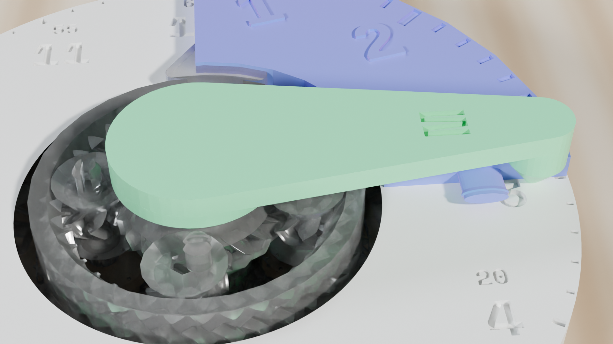

  <!-- Breadcrumb -->
  <nav class="ec-breadcrumb" aria-label="Breadcrumb">
    <a href="../../../">Home</a>
    /
    <a href="../../">Products &amp; Manipulatives</a>
    /
    <a href="../">Classroom Planetary Clock</a>
    /
    Classroom Lessons
  </nav>

  <!-- Header -->
  <header class="ec-catalog-header">
    
Curriculum Lessons &bull; Gear Kinematics

    <h1 class="ec-catalog-headline">Sectional Classroom Clock Lessons</h1>
    

      Eliminate the classic "false time" misconceptions caused by free-spinning toy clock hands. These lessons establish accurate spatial intuition for continuous time advance and elapsed duration.
    

  </header>

  <!-- Navigation Pill Row -->
  

    <a href="../" class="ec-btn-secondary">&larr; Back to Product Overview</a>
    <a href="../assembly/" class="ec-btn-secondary">View Assembly Guide &rarr;</a>
  

  <!-- Video Section: Lesson Demonstration -->
  <section class="ec-section">
    <h2 class="ec-section-title">Classroom Demonstration Video: Lessons 1 &amp; 2</h2>
    
Watch the continuous 12:1 planetary gearing synchronize hands and the 15-minute quadrant wedge measure elapsed time.

    

      

        

          <video controls playsinline preload="metadata" poster="../../../assets/renders/clock-classroom-hero.png">
            <source src="/assets/videos/classroom-clock-lesson.mp4" type="video/mp4">
            Your browser does not support HTML5 video.
          </video>
        

        

          <strong>Curriculum Demonstration (Lessons 1 &amp; 2)</strong>
          12:1 continuous gearing &bull; 15-minute quadrant block insertion
        

      

      

        
&circlearrowright;

        <h3 class="ec-feature-title">Why Continuous Motion Matters</h3>
        

          In elementary math assessments, over 40% of time-reading errors occur at "half past" or "quarter to" because students point the hour hand directly at the hour number. With true 12:1 planetary synchronization, students physically see that an hour is a continuous journey across space.
        

      

    

  </section>

  <!-- ==========================================================================
       LESSON 1: 12:1 GEARING SYNCHRONIZATION
       ========================================================================== -->
  <section class="ec-section">
    

      

        Lesson 01
        Target Grades: 2&ndash;4 &bull; Standard: CCSS.MATH.CONTENT.2.MD.C.7
      

      <h2 class="text-2xl font-bold text-white mb-2">Continuous Synchronization &amp; The Half-Past Position</h2>
      

        <strong>Lesson Objective:</strong> Students discover why the hour hand never stays locked on a number while minutes pass, physically observing that at 30 minutes, the hour hand rests exactly halfway to the next hour.
      

      <!-- Concept Illustration Card -->
      

        
        

          <strong>2-Stage Clear PETG Kinematics:</strong> White PLA dial face conceals the Stage 1 base gear, while the Stage 2 planetary gears advance the hour ring in a pure 12:1 reduction ratio.
          12:1 Epicyclic Mesh
        

      

      <h3 class="text-base font-bold text-sky-400 mb-3">Step-by-Step Classroom Investigation</h3>
      

        

          1.
          

            <strong>Set to the Top of the Hour:</strong> Rotate the minute hand until both hands point straight up at 12:00. Note: <em>"The hour hand points directly at 12 only when zero minutes have passed."</em>
          

        

        

          2.
          

            <strong>Advance to Half Past:</strong> Slowly rotate the minute hand clockwise by half a turn (\(180^\circ\)), pointing it straight down at the 6 (30 minutes).
          

        

        

          3.
          

            <strong>Examine the Hour Pointer:</strong> Ask the student: <em>"Where is the hour hand pointing now?"</em> Look closely at the dial: the hour hand is not on 12, nor is it on 1. It is positioned <em>exactly in the middle</em> between 12 and 1 (a \(15^\circ\) angular displacement).
          

        

        

          4.
          

            <strong>Connect Gearing to Fractions:</strong> Explain the mathematical ratio:
            \[
            \frac{30\text{ minutes}}{60\text{ minutes}} = \frac{1}{2}\text{ of an hour} \implies \text{Hour hand moves } \frac{1}{2} \times 30^\circ = 15^\circ
            \]
            Because the gears are physically meshed 12 to 1, the hands cannot tell a mathematical lie.
          

        

      

      <!-- Misconception Diagnostic Box -->
      

        <h4 class="text-sm font-bold text-amber-300 mb-1">&Delta; Key Misconception Diagnostic: "The False 3:30 Clock"</h4>
        

          <strong>The Common Error:</strong> When asked to draw 3:30 on a paper worksheet, a child draws the hour hand pointing directly at 3 and the minute hand pointing at 6.
        

        

          <strong>The Physical Fix:</strong> Challenge the child to set the Sectional Clock to 3:30. As they turn the minute hand to 6, watch their eyes light up when the hour hand glides past 3 to rest halfway between 3 and 4. The student immediately realizes their drawn clock was physically impossible.
        

      

      <!-- Independent Transfer Task -->
      

        <h4 class="text-sm font-bold text-emerald-400 mb-1">&check; Independent Transfer Check</h4>
        

          <strong>Prompt:</strong> Set the clock to 8:45 (quarter to nine). Before looking at the hour hand, predict whether it will be closer to 8 or closer to 9. Verify by inspecting the dial. Explain your reasoning in terms of fractions of an hour.
        

      

    

  </section>

  <!-- ==========================================================================
       LESSON 2: ELAPSED TIME WITH QUADRANT BLOCKS
       ========================================================================== -->
  <section class="ec-section">
    

      

        Lesson 02
        Target Grades: 3&ndash;5 &bull; Standard: CCSS.MATH.CONTENT.3.MD.A.1
      

      <h2 class="text-2xl font-bold text-white mb-2">Tactile Elapsed Time with 15-Minute Quadrant Blocks</h2>
      

        <strong>Lesson Objective:</strong> Calculate elapsed time across hour boundaries by inserting tactile quadrant wedges into the dial perimeter.
      

      <!-- Concept Illustration Card -->
      

        
        

          <strong>Physical Elapsed Time Wedge:</strong> Translucent emerald PETG quadrant block seated in the 12:00–3:00 dial sector physically marks 15 minutes of duration.
          1/4 Turn = 15 Min
        

      

      <h3 class="text-base font-bold text-sky-400 mb-3">Step-by-Step Classroom Investigation</h3>
      

        

          1.
          

            <strong>Set the Start Time:</strong> Set the clock to 10:15 (minute hand at 3, hour hand just past 10).
          

        

        

          2.
          

            <strong>Model the Elapsed Duration:</strong> The class goes to recess for 45 minutes. Ask: <em>"How many 15-minute quadrant blocks make up 45 minutes?"</em> The student determines that \(45 / 15 = 3\) blocks are needed.
          

        

        

          3.
          

            <strong>Insert the Quadrant Wedges:</strong> Snap three 15-minute quadrant blocks into the perimeter rim starting at the 3 (15-minute mark):
            <ul class="list-disc pl-5 mt-1 text-xs text-gray-300 space-y-1">
              <li>Block 1 covers 3:00 to 6:00 (15 min).</li>
              <li>Block 2 covers 6:00 to 9:00 (15 min).</li>
              <li>Block 3 covers 9:00 to 12:00 (15 min).</li>
            </ul>
          

        

        

          4.
          

            <strong>Sweep and Read:</strong> Turn the minute hand joystick through the three quadrant blocks until it reaches the end of the third block. Read the new time: the minute hand points to 12 and the hour hand has arrived at 11:00. Total elapsed time: 45 minutes; end time: 11:00.
          

        

      

      <!-- Misconception Diagnostic Box -->
      

        <h4 class="text-sm font-bold text-amber-300 mb-1">&Delta; Key Misconception Diagnostic: Treating Time Like Base-10 Decimals</h4>
        

          <strong>The Common Error:</strong> Adding 45 minutes to 10:15 algebraically as \(10.15 + 0.45 = 10.60\), failing to regroup at 60 minutes into the next hour.
        

        

          <strong>The Physical Fix:</strong> The quadrant blocks physically close the dial circle at 12:00, forcing the minute hand back to 0 while the 12:1 internal gear automatically trips the hour hand over to 11. Time base-60 mechanics become intuitive.
        

      

      <!-- Independent Transfer Task -->
      

        <h4 class="text-sm font-bold text-emerald-400 mb-1">&check; Independent Transfer Check</h4>
        

          <strong>Prompt:</strong> A science experiment begins at 1:45 PM and lasts 1 hour and 30 minutes. Use the clock and quadrant blocks to find what time the experiment ends. Draw the timeline showing your jumps.
        

      

    

  </section>

  <!-- ==========================================================================
       SECTION: PRE-GENERATED STATION WORKSHEETS & STANDARDS INTEGRATION
       ========================================================================== -->
  <section class="ec-section">
    

      

        

          // CURRICULUM &amp; STATION GUIDES
          <h2 class="text-2xl font-bold text-white mt-1">Pre-Generated Clock Worksheets &amp; Standards</h2>
        

        CCSS 2.MD.C.7 &bull; 3.MD.A.1
      

      

        The Sectional Classroom Planetary Clock pairs directly with our 120-edition library of publication-grade, 2-page classroom station guides. Designed for early elementary through intermediate time-telling, each guide features CAD diagrams, authentic drawing workspaces, and 4-tier teacher scoring rubrics.
      

      

        <a href="../../../curriculum/worksheets/" class="p-4 rounded-xl bg-white/5 border border-white/10 hover:border-cyan-400 transition flex flex-col justify-between group">
          

            <strong class="text-white group-hover:text-cyan-400 block mb-1">📝 120 Station Worksheets</strong>
            Download Form A &amp; Form B PDFs for Singapore Dimensions 3B Ch 10 and Bridges Grade 4 Unit 4.
          

          &rarr; Browse Worksheets
        </a>

        <a href="../../../curriculum/alignment-matrix/#common-core" class="p-4 rounded-xl bg-white/5 border border-white/10 hover:border-emerald-400 transition flex flex-col justify-between group">
          

            <strong class="text-white group-hover:text-emerald-400 block mb-1">🎯 Standards Alignment Matrix</strong>
            Cross-reference chapter-by-chapter with Common Core, Bridges, and Singapore Math.
          

          &rarr; View Matrix
        </a>

        <a href="../../../curriculum/teacher-guide/" class="p-4 rounded-xl bg-white/5 border border-white/10 hover:border-amber-400 transition flex flex-col justify-between group">
          

            <strong class="text-white group-hover:text-amber-400 block mb-1">🧑‍🏫 Teacher Facilitator Guide</strong>
            Continuous 12:1 gear kinematics diagnostics, eliminating "false 3:30" traps, and rotation guides.
          

          &rarr; Read Teacher Guide
        </a>
      

      

        

          Perpetual Reproduction License &bull; Free Classroom Photocopy Rights
        

        <a href="../../../downloads/stackcalc-curriculum-sample-v0.2.0.pdf" download class="px-4 py-2 rounded bg-white/10 hover:bg-white/20 text-white font-bold transition flex items-center gap-1.5">
          Download 36-Page Curriculum Sample (.PDF)
          &darr;
        </a>
      

    

  </section>

