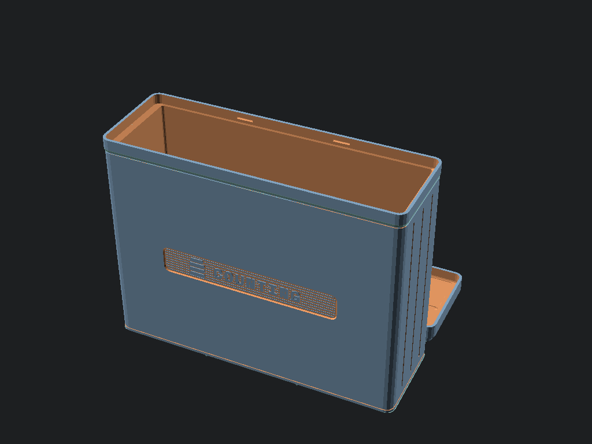

<!-- Schema.org JSON-LD Structured Data for High Google Search & Rich Results Ranking -->

  <!-- Breadcrumb -->
  <nav class="ec-breadcrumb" aria-label="Breadcrumb">
    <a href="../../">Home</a>
    /
    <a href="../">Products &amp; Manipulatives</a>
    /
    Counting Tiles &amp; Array Studio
  </nav>

  <!-- ==========================================================================
       HERO PRODUCT SECTION (2-COLUMN ECOMMERCE SPLIT)
       ========================================================================== -->
  

    <!-- Left Column: Product Gallery -->
    

      

        
      

      <!-- Thumbnail Selector Strip -->
      

        
t.classList.remove('active')); this.classList.add('active');">
          
        

        
t.classList.remove('active')); this.classList.add('active');">
          
        

        
t.classList.remove('active')); this.classList.add('active');">
          
        

      

    

    <!-- Right Column: Buy Box & Product Info -->
    

      <h1 class="ec-product-title">Counting Tiles &amp; Planar Array Studio</h1>

      <!-- Educational Architecture & Tactile Standard -->
      

        PEDAGOGICAL STANDARD
        &bull; CRA Concrete-Representational Model
        &check; 42mm Gridfinity Compliant
      

      

        $44.00
        &check; Free US Shipping &bull; In Stock
      

      

        The ultimate tactile manipulative for one-to-one correspondence, rectangular arrays, partial product area modeling, and spatial reasoning. Contains <strong>144 precision stacking tiles</strong> (4 colors &times; 36 tiles) housed in a 3&times;1&times;13U Gridfinity storage box with a 12-miniblock docking lid grid. Standardized to 7.0mm visible 1U height, perfectly harmonized with our Fraction Studio towers.
      

      <!-- Highlights Checklist -->
      

        

          &check;
          <strong>144-Tile Mathematical Palette:</strong> 36 tiles in each of 4 colors (Archival White, Cobalt Blue, Radiant Gold, Slate Gray) builds the full \(12 \times 12 = 144\) multiplication matrix.
        

        

          &check;
          <strong>Zero-Friction Gravity Docking:</strong> Precision 45&deg; chamfers and 0.40mm slip-fit clearance stack effortlessly via gravity. No broken plastic snaps or painful finger fatigue.
        

        

          &check;
          <strong>Harmonized 1U Fraction Ratio:</strong> Exactly matches 1/12th of the Fraction Studio whole tower: 3 stacked tiles = 21mm unit cube; 12 stacked tiles = 84mm whole tower.
        

        

          &check;
          <strong>Four-Color Map Theorem &amp; Area Models:</strong> Enables hands-on map coloring investigations and 4-quadrant distributive area models \((a+b)(c+d)\).
        

      

      <!-- Action Buttons -->
      

        <a href="https://www.etsy.com/shop/StackCalc" target="_blank" rel="noopener noreferrer" class="ec-btn-primary" style="background-color: #f1641e; border-color: #f1641e; color: #ffffff;">
          Order on Etsy ($44.00) ↗
        </a>
        <a href="../../downloads/counting-tiles-open-source-stls.zip" download class="ec-btn-secondary">
          Download Free 3MF / STLs &darr;
        </a>
      

      <!-- Quick Subpage & PO Links -->
      

        <a href="../../#school-po" class="text-xs font-semibold px-3 py-1.5 rounded bg-slate-800 text-emerald-400 border border-emerald-500/30 hover:bg-slate-700">
          &bull; District Net-30 PO Quote Form &rarr;
        </a>
      

      <!-- Trust Strip -->
      

        

          &plusmn;
          &plusmn;0.05mm Calibrated &bull; Non-Toxic Biopolymer
        

        

          &check;
          Anti-Heartbreak $2.49 Part Refills
        

        

          &hearts;
          30-Day Risk-Free In-Home Trial
        

      

    

  

  <!-- ==========================================================================
       SECTION: DEMONSTRATION VIDEOS & ANIMATED STEP-BY-STEP LESSONS
       ========================================================================== -->
  <section id="product-videos" class="ec-section">
    <h2 class="ec-section-title">The Video Showcase: Animated Step-by-Step Lessons &amp; Kinematics</h2>
    
Experience foundational counting principles, 1U fraction scaling, and distributive property area arrays directly from our classroom curriculum guide.

    

      <!-- 1. Lesson 1: 1U Fraction Scaling -->
      

        

          <video controls playsinline preload="metadata" poster="../../assets/renders/counting-tiles-hero.png">
            <source src="/assets/videos/counting-tiles-lesson-scaling.mp4" type="video/mp4">
            Your browser does not support HTML5 video.
          </video>
          1. CURRICULUM LESSON 01
        

        

          

            <h3 class="text-sm font-bold text-slate-100 mb-1">1U Fraction Scaling &amp; Cardinality</h3>
            
Step-by-step proof aligning 12 counting tiles (7.0mm each) end-to-end to equal the 84.0mm Whole datum of Fraction Studio.

          

          

            CCSS 3.MD.C.5
            84.0mm Datum Invariant
          

        

      

      <!-- 2. Lesson 2: Distributive Property Array -->
      

        

          <video controls playsinline preload="metadata" poster="../../assets/renders/counting-tiles-hero.png">
            <source src="/assets/videos/counting-tiles-lesson-distributive.mp4" type="video/mp4">
            Your browser does not support HTML5 video.
          </video>
          2. CURRICULUM LESSON 02
        

        

          

            <h3 class="text-sm font-bold text-slate-100 mb-1">Distributive Property Array</h3>
            
Decomposing a 7&times;8 array (56 tiles) into friendly sub-arrays of 5&times;8 (40 tiles) and 2&times;8 (16 tiles) to make multiplication intuitive.

          

          

            CCSS 3.OA.B.5
            40 + 16 = 56 Tiles
          

        

      

      <!-- 3. Snap Durability Kinematics -->
      

        

          <video controls playsinline preload="metadata" poster="../../assets/renders/counting-tiles-hero.png">
            <source src="/assets/videos/video-snap-durability.mp4" type="video/mp4">
            Your browser does not support HTML5 video.
          </video>
          3. DURABILITY KINEMATICS
        

        

          

            <h3 class="text-sm font-bold text-slate-100 mb-1">Zero-Tab Drop Durability</h3>
            
High-speed kinematic stress testing showing monolithic Gridfinity bases surviving repeated drops without breaking fragile snap tabs.

          

          

            Gridfinity 1U Base Plug
            Zero Snapped Connectors
          

        

      

    

    <!-- Curriculum Guide Callout -->
    

      

        
        

          <h4 class="text-sm font-bold text-slate-100">Counting Tiles Station Curriculum &amp; Math Labs</h4>
          
Includes 12 reproducible station lab cards for area models, Four-Color Map Theorem planar investigations, and 1U fraction scaling.

        

      

      

        <a href="/curriculum/worksheets/" class="px-3 py-1.5 bg-slate-800 hover:bg-slate-700 text-xs font-mono text-slate-200 rounded border border-slate-700 transition">View Station Worksheets &rarr;</a>
        <a href="/curriculum/teacher-guide/" class="px-3 py-1.5 bg-cyan-950 hover:bg-cyan-900 text-xs font-mono text-cyan-300 rounded border border-cyan-800 transition">Teacher Facilitator Guide &rarr;</a>
      

    

  </section>

  <!-- ==========================================================================
       PEDAGOGICAL ARCHITECTURE & SPECIFICATIONS
       ========================================================================== -->
  <section class="mt-16 pt-12 border-t border-white/10">
    

      ENGINEERING CONTRACT // TILE-01 SPECIFICATIONS
      ● 100% GRIDFINITY COMPLIANT &bull; ZERO PLASTIC SNAPS
    

    

      

        <h3 class="text-sm font-bold text-white uppercase tracking-wider">// PHYSICAL HARDWARE SPECS</h3>
        <ul class="space-y-2 text-slate-300">
          <li><strong>Tile Footprint:</strong> 19.0 &times; 19.0 mm square miniblock footprint</li>
          <li><strong>Visible Height:</strong> 7.0 mm (1U Gridfinity height; matches 1/12th fraction block)</li>
          <li><strong>Total Tile Height:</strong> 8.85 mm (7.0 mm body + 1.85 mm bottom Gridfinity base plug)</li>
          <li><strong>Enclosure Box:</strong> 3&times;1&times;13U Gridfinity Bin (125.5 &times; 42.0 &times; 91.0 mm body)</li>
          <li><strong>Master Stack Height:</strong> 95.4 mm (91.0 mm body + 4.4 mm upper stacking lip)</li>
          <li><strong>Front Plaque:</strong> Deep-relief debossed "COUNTING" instrument badge</li>
          <li><strong>Rear Button:</strong> Exact hardware replica squircle button badge stamped "[NUM]"</li>
          <li><strong>Total Weight:</strong> ~310 g (Box, lid, and 144 precision tiles)</li>
        </ul>
      

      

        <h3 class="text-sm font-bold text-white uppercase tracking-wider">// CURRICULUM &amp; STANDARDS</h3>
        <ul class="space-y-2 text-slate-300">
          <li><strong>Kindergarten (K.CC.B.4):</strong> One-to-one cardinality, count sequences to 20</li>
          <li><strong>Grade 1 (1.OA.C.6):</strong> Ten-frames bridge-through-10, part-part-whole decomposition</li>
          <li><strong>Grade 2 (2.OA.C.4):</strong> Equal groups, rectangular arrays up to 5&times;5</li>
          <li><strong>Grade 3 (3.OA.B.5):</strong> Distributive property: \(7 \times 8 = (5 \times 8) + (2 \times 8)\)</li>
          <li><strong>Grade 4 (4.NBT.B.5):</strong> 4-quadrant area models for multi-digit multiplication</li>
          <li><strong>Grade 5&ndash;6 (5.OA.A, 6.EE.A):</strong> Sieve of Eratosthenes, prime array factorization</li>
          <li><strong>Discrete Math:</strong> Four-Color Map Theorem planar graph coloring</li>
        </ul>
      

    

    <!-- Comparative Table: Traditional Snap Cubes vs. StackCalc Counting Tiles -->
    <h2 class="text-2xl font-bold text-white mt-12 mb-4">Why We Eliminated Traditional Snap Cubes</h2>
    

      Traditional linking/snap cubes were invented over 50 years ago. While well-intentioned, their tiny plastic ball-and-socket tabs quickly become loose or snap off, and their interlocking friction makes disassembling arrays difficult for young children. StackCalc Counting Tiles redesign elementary counting from first engineering principles:
    

    

      <table class="w-full text-left font-mono text-xs border border-white/10">
        <thead class="bg-black/60 text-white border-b border-white/10">
          <tr>
            <th class="p-3">Design Attribute</th>
            <th class="p-3">Traditional Plastic Snap Cubes</th>
            <th class="p-3 text-emerald-400">StackCalc Counting Tiles (TILE-01)</th>
          </tr>
        </thead>
        <tbody class="divide-y divide-white/5 text-slate-300">
          <tr>
            <td class="p-3 font-bold text-white">Connection Mechanism</td>
            <td class="p-3 text-red-400">Friction ball-and-socket tabs (breaks, hurts fingers)</td>
            <td class="p-3 text-emerald-400 font-bold">Gridfinity gravity docking (45&deg; chamfer, 0.4mm slip-fit)</td>
          </tr>
          <tr>
            <td class="p-3 font-bold text-white">Planar Array Stability</td>
            <td class="p-3">Lateral sockets bow and warp when locked into flat planes</td>
            <td class="p-3 text-emerald-400 font-bold">100% coplanar alignment; forms rock-solid 2D grid arrays</td>
          </tr>
          <tr>
            <td class="p-3 font-bold text-white">Height Harmony</td>
            <td class="p-3">Arbitrary 20mm cube; incompatible with fraction rods</td>
            <td class="p-3 text-emerald-400 font-bold">1U = 7.0mm (3 tiles = 21mm cube; 12 tiles = 84mm Fraction Tower)</td>
          </tr>
          <tr>
            <td class="p-3 font-bold text-white">Color Distribution</td>
            <td class="p-3">Random 10-color bag (too few of any one color for arrays)</td>
            <td class="p-3 text-emerald-400 font-bold">36 &times; 4 colors = 144 tiles (builds full 12&times;12 multiplication square)</td>
          </tr>
          <tr>
            <td class="p-3 font-bold text-white">Storage Ecosystem</td>
            <td class="p-3">Loose plastic zip bag or cardboard bucket</td>
            <td class="p-3 text-emerald-400 font-bold">3&times;1&times;13U Gridfinity box with 12-miniblock array docking lid</td>
          </tr>
        </tbody>
      </table>
    

  </section>

