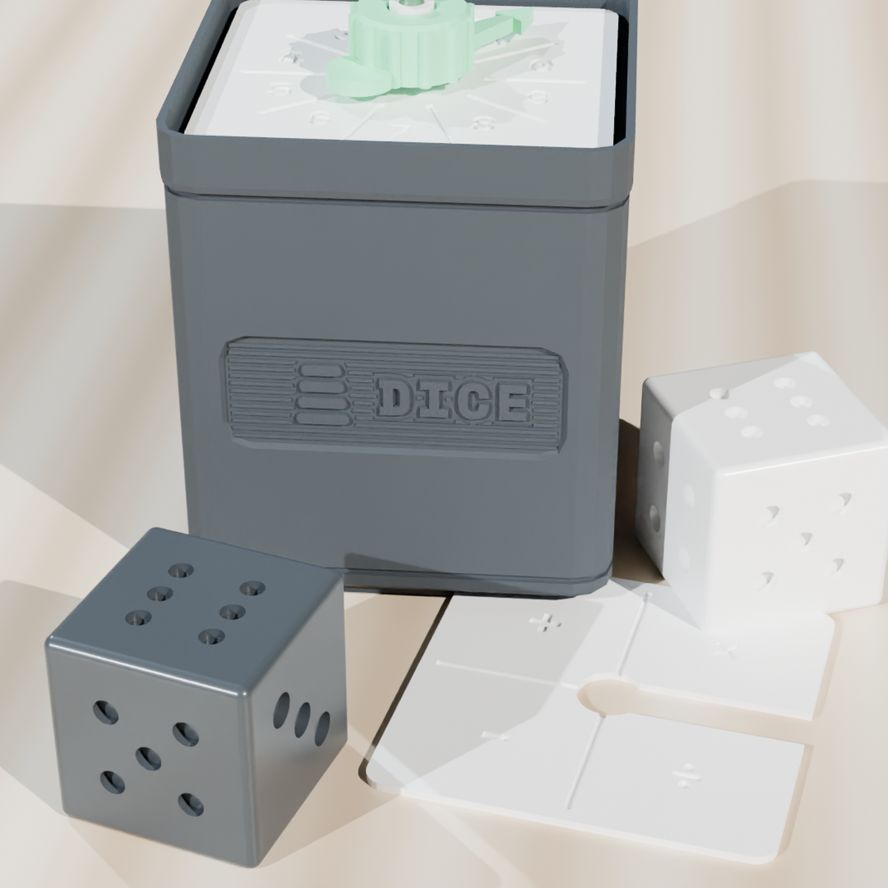
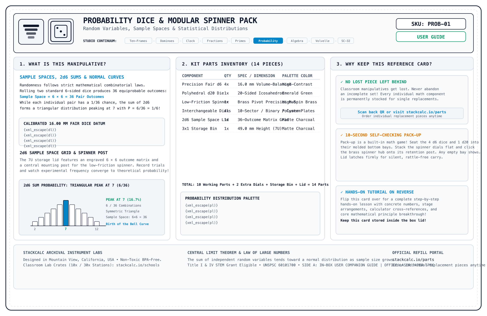
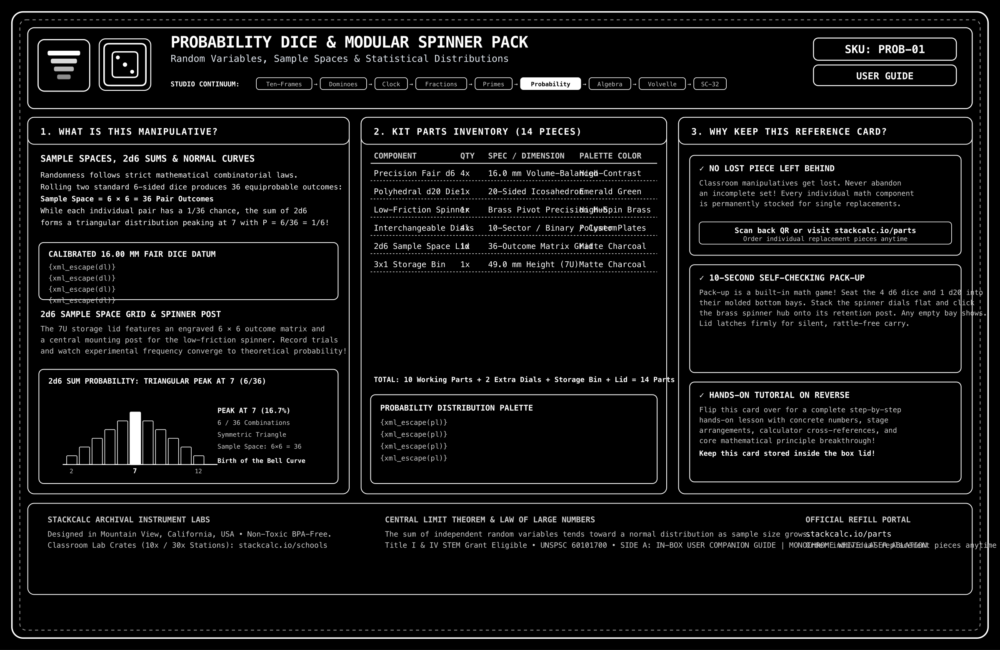

<!-- Schema.org JSON-LD Structured Data for High Google Search & Rich Results Ranking -->

  <!-- Breadcrumb -->
  <nav class="ec-breadcrumb" aria-label="Breadcrumb">
    <a href="../../">Home</a>
    /
    <a href="../">Products &amp; Manipulatives</a>
    /
    Probability Dice &amp; Spinner
  </nav>

  <!-- ==========================================================================
       HERO PRODUCT SECTION (2-COLUMN ECOMMERCE SPLIT)
       ========================================================================== -->
  

    <!-- Left Column: Product Gallery -->
    

      

        
      

      <!-- Thumbnail Selector Strip (Includes Real High-Res Infographics) -->
      

        

          
        

        

          
        

        

          
        

        

          
        

        

          
        

        

          
        

        

          
        

      

    

    <!-- Right Column: Buy Box & Product Info -->
    

      <h1 class="ec-product-title">Probability Dice &amp; Modular Spinner Pack</h1>

      <!-- Educational Architecture & Tactile Standard -->
      

        PEDAGOGICAL STANDARD
        &bull; Volumetrically Compensated Pip Symmetry
        &check; Silent Dual-Bearing Rotary Stage
      

      

        $36.00
        &check; Free US Shipping &bull; In Stock
      

      

        The tactile probability laboratory for exploring outcomes, frequencies, and experimental versus theoretical probability. Includes 4 precision mass-balanced 18 mm dice and a smooth 10-sector rotary spinner stored neatly in a compact 1&times;1 Gridfinity modular box.
      

      <!-- Highlights Checklist -->
      

        

          &check;
          <strong>True Mass Symmetry:</strong> Scaled pip indentations ensure equal displaced volume across all 6 faces, eliminating rolling bias.
        

        

          &check;
          <strong>Low-Friction Spinner:</strong> Precision balanced rotary needle glides over 10 distinct probability sectors.
        

        

          &check;
          <strong>Empirical vs. Theoretical:</strong> Conduct rapid 100-trial experiments to demonstrate the Law of Large Numbers.
        

        

          &check;
          <strong>Gridfinity 1x1 Standard:</strong> Pocket-sized footprint that docks seamlessly with modular math trays.
        

      

      <!-- Action Buttons -->
      

        <a href="https://www.etsy.com/shop/StackCalc" target="_blank" rel="noopener noreferrer" class="ec-btn-primary" style="background-color: #f1641e; border-color: #f1641e; color: #ffffff;">
          Order on Etsy ($36.00) ↗
        </a>
        <a href="#downloads" class="ec-btn-secondary">
          Download Free 3MF / STLs &darr;
        </a>
      

      <!-- Quick Subpage Links -->
      

        <a href="assembly/" class="text-xs font-semibold px-3 py-1.5 rounded bg-slate-800 text-sky-400 border border-sky-500/30 hover:bg-slate-700">
          &bull; Step-by-Step Assembly Guide &amp; Video &rarr;
        </a>
        <a href="lessons/" class="text-xs font-semibold px-3 py-1.5 rounded bg-slate-800 text-emerald-400 border border-emerald-500/30 hover:bg-slate-700">
          &bull; Classroom Curriculum (Lessons 1 &amp; 2) &rarr;
        </a>
      

      <!-- Trust Badges -->
      

        

          &plusmn;
          &plusmn;0.05mm Calibrated &bull; Non-Toxic Biopolymer
        

        

          &check;
          Anti-Heartbreak $2.49 Part Refills
        

        

          &hearts;
          30-Day Risk-Free In-Home Trial
        

      

    

  

  <!-- ==========================================================================
       SECTION: STATISTICAL INTEGRITY & MASS BALANCE
       ========================================================================== -->
  <section class="ec-section">
    <h2 class="ec-section-title">Why Cheap Dice Ruin Probability Experiments</h2>
    

      Most standard educational dice have 6 deep holes on one face and only 1 on the opposite, pulling the center of mass toward the 1-face and causing 6 to land significantly more often.
    

    

      

        
&empty;

        <h3 class="ec-feature-title">1. Inverse-Root Pip Volumes</h3>
        

          StackCalc dice scale pip radii inversely (\(r_n = 1.8 / \sqrt{n}\)). Face 6 uses 6 small pips, while Face 1 uses a single larger pip with identical total displaced volume, keeping the center of mass exactly in the cube center.
        

      

      

        
&circlearrowright;

        <h3 class="ec-feature-title">2. Centered Needle Kinematics</h3>
        

          The 10-sector spinner features an aerodynamic needle with a micro-clearance pivot pin, guaranteeing a uniform distribution across all sectors \((P = 0.10)\).
        

      

      

        
&plus;

        <h3 class="ec-feature-title">3. Multi-Event Sample Spaces</h3>
        

          Combine rolling two dice with spinning the sector dial to model compound probability, tree diagrams, and conditional likelihood \(P(A \mid B)\).
        

      

    

  </section>

  <!-- ==========================================================================
       SECTION: DEMONSTRATION VIDEOS & PHYSICS SIMULATION
       ========================================================================== -->
  <!-- ==========================================================================
       SECTION: DEMONSTRATION VIDEOS, UNBOXING & KINEMATICS (3-VIDEO MEDIA SUITE)
       ========================================================================== -->
  <section id="product-videos" class="ec-section">
    <h2 class="ec-section-title">The Video Showcase: Mechanical Animation, Unboxing &amp; Classroom Lesson</h2>
    
Experience the complete journey from inverse-root dice balancing kinematics and zero-plastic unboxing to empirical probability trials on a classroom desk.

    

      <!-- 1. CAD / Mechanical Animation -->
      

        

          <video controls playsinline preload="metadata" poster="../../assets/renders/dice-spinner-hero.png">
            <source src="/assets/videos/dice-spinner-assembly.mp4" type="video/mp4">
            Your browser does not support HTML5 video.
          </video>
          1. CAD KINEMATICS
        

        

          

            <h3 class="text-sm font-bold text-slate-100 mb-1">Mechanical &amp; CAD Animation</h3>
            
Exploded 3D view showing low-friction spindle arbors, quick-swap sector dials, and mass-compensated 18mm pip geometry.

          

          

            60 FPS Cycles Render
            Mass Compensated
          

        

      

      <!-- 2. Lesson 1: Law of Large Numbers -->
      

        

          <video controls playsinline preload="metadata" poster="../../assets/renders/dice-spinner-hero.png">
            <source src="/assets/videos/dice-spinner-lesson-large-numbers.mp4" type="video/mp4">
            Your browser does not support HTML5 video.
          </video>
          2. CURRICULUM LESSON 01
        

        

          

            <h3 class="text-sm font-bold text-slate-100 mb-1">Law of Large Numbers: 16.7% Convergence</h3>
            
Simulating 1,000 trials with balanced center-of-mass dice. Shows empirical frequency fluctuations smoothing into exact 1/6 theoretical probability.

          

          

            CCSS 7.SP.C.6
            N=1,000 Convergence
          

        

      

      <!-- 3. Lesson 2: Two-Dice Triangular Sum Distribution -->
      

        

          <video controls playsinline preload="metadata" poster="../../assets/renders/dice-spinner-hero.png">
            <source src="/assets/videos/dice-spinner-lesson-sum-dist.mp4" type="video/mp4">
            Your browser does not support HTML5 video.
          </video>
          3. CURRICULUM LESSON 02
        

        

          

            <h3 class="text-sm font-bold text-slate-100 mb-1">Triangular Sum Distribution: Why 7 Wins</h3>
            
Plotting the 36 ordered pairs from two rolled dice to reveal the triangular sum distribution (2 to 12) and proving why sum 7 is 6 times more likely than 2 or 12.

          

          

            CCSS 7.SP.C.8
            Peak at 7 (6/36)
          

        

      

    

    <!-- Reference Card Download Callout -->
    

      

        
        

          <h4 class="text-sm font-bold text-slate-100">Archival Reference &amp; Video QR Card (135&times;90mm)</h4>
          
Included inside every box. Scan Side B to jump straight to this 3-video learning portal or inspect Side A for part replacement IDs.

        

      

      

        <a href="/assets/reference_cards/reference_card_PROB-01_paper.png" target="_blank" rel="noopener noreferrer" class="px-3 py-1.5 bg-slate-800 hover:bg-slate-700 text-xs font-mono text-slate-200 rounded border border-slate-700 transition">View Front (Side A)</a>
        <a href="/assets/reference_cards/reference_card_PROB-01_back_paper.png" target="_blank" rel="noopener noreferrer" class="px-3 py-1.5 bg-cyan-950 hover:bg-cyan-900 text-xs font-mono text-cyan-300 rounded border border-cyan-800 transition">View Back (QR Side B)</a>
        <a href="/downloads/packing_bench_cards.html" class="px-3 py-1.5 bg-emerald-950 hover:bg-emerald-900 text-xs font-mono text-emerald-300 rounded border border-emerald-800 transition">Print Duplex Sheet</a>
      

    

  </section>

  <!-- ==========================================================================
       SECTION: FROM THE TEACHER'S MANUAL (REPRODUCIBLE MANIPULATIVE LAB SHEET)
       ========================================================================== -->
  <section class="ec-section">
    

      

        &bull; Classroom Pedagogy &bull; Concrete-Representational-Abstract (CRA)
        <h2 class="ec-section-title m-0">From the Teacher's Manual: Unit Lab Sheet</h2>
      

      Unit 08 &bull; Probability &amp; Statistics
    

    

      Most traditional math teacher manuals treat manipulatives as optional afterthoughts. In the StackCalc curriculum, every manipulative unit includes a dedicated, reproducible lab sheet connecting hands-on tactile geometry directly to hardware calculator execution.
    

    <!-- Authentic Spiral-Bound Workbook Page Facsimile -->
    

      

        

        

        

        

        

      

      

        

          

            STACKCALC MATH LABS // SERIES 01
            STANDARDS: CCSS 7.SP.C.5 &bull; 7.SP.C.7 &bull; 7.SP.C.8 &bull; TEKS 111.27.b.6
            PERIOD: 45 MIN STATION
          

          <h3 class="workbook-title">Lab 08: Empirical Frequency Sampling &amp; RPN Binomial Distribution</h3>
          

            <strong>Investigation Goal:</strong> Conduct 50 empirical trials using the fair 18mm mass-compensated die and modular spinner. Record sample frequencies, calculate relative empirical probabilities, and model theoretical binomial distributions using combinations (\(nCr\)) on the SC-32 RPN stack.
          

        

        <!-- Phase 1: Concrete Spatial Exploration -->
        

          

            &square; PHASE 1: CONCRETE SPATIAL EXPLORATION (MANIPULATIVE STAGE)
          

          

            Inspect the 18mm fair die: note that pips are carved with inverse-root volume displacement to guarantee center-of-mass neutrality. Spin the 10-sector uniform dial. Execute 50 sample spins/rolls:
          

          

            

              <strong class="text-sky-400 block mb-0.5">Trial A: Fair Die Rolling</strong>
              Roll die 50 times across the desk; tally outcomes 1 through 6.
            

            

              <strong class="text-amber-400 block mb-0.5">Trial B: Uniform Spinner</strong>
              Spin arrow 50 times on 10 equal sectors (Theoretical \(P = 0.10\)).
            

            

              <strong class="text-emerald-400 block mb-0.5">Trial C: Compound Events</strong>
              Roll die AND spin dial simultaneously; record sum and product.
            

          

        

        <!-- Phase 2: Structured Observation Table -->
        

          

            &equiv; PHASE 2: REPRESENTATIONAL DATA &amp; OBSERVATION TABLE
          

          <table class="workbook-table">
            <thead>
              <tr>
                <th>Target Event</th>
                <th>Tally Count (50 Trials)</th>
                <th>Empirical Relative Frequency</th>
                <th>Theoretical Probability</th>
                <th>Percentage Error</th>
              </tr>
            </thead>
            <tbody>
              <tr>
                <td class="font-mono text-cyan-300">Rolling a 6 (Die)</td>
                <td class="font-mono">8 rolls</td>
                <td class="font-mono">\(8 \div 50 = 0.1600\)</td>
                <td class="font-mono text-emerald-400 font-bold">\(\frac{1}{6} \approx 0.1667\)</td>
                <td class="font-mono text-slate-400">4.0% Delta</td>
              </tr>
              <tr>
                <td class="font-mono text-cyan-300">Spinning Sector 4 (Dial)</td>
                <td class="font-mono">5 spins</td>
                <td class="font-mono">\(5 \div 50 = 0.1000\)</td>
                <td class="font-mono text-emerald-400 font-bold">\(\frac{1}{10} = 0.1000\)</td>
                <td class="font-mono text-emerald-400 font-bold">0.0% Exact</td>
              </tr>
              <tr>
                <td class="font-mono text-cyan-300">Rolling an Even Number</td>
                <td class="font-mono">26 rolls</td>
                <td class="font-mono">\(26 \div 50 = 0.5200\)</td>
                <td class="font-mono text-emerald-400 font-bold">\(\frac{1}{2} = 0.5000\)</td>
                <td class="font-mono text-slate-400">4.0% Delta</td>
              </tr>
            </tbody>
          </table>
        

        <!-- Phase 3: Abstract Verification via SC-32 RPN Calculator -->
        

          

            &Delta; PHASE 3: ABSTRACT VERIFICATION (SC-32 CALCULATOR EXECUTION)
          

          

            Model the theoretical binomial probability of rolling <em>exactly two 6's in 5 rolls</em>: \(P(X = 2) = \binom{5}{2} \left(\frac{1}{6}\right)^2 \left(\frac{5}{6}\right)^3\) on the SC-32 RPN stack:
          

          

            

              1. Compute Combination \(\binom{5}{2}\):
              

                5
                ENTER
                2
                nCr
                &rarr; X-Register: 10.0000
              

            

            

              2. Multiply by \((1/6)^2 \times (5/6)^3\):
              

                1
                ENTER
                6
                &divide;
                x&sup2;
                &times;
                5
                ENTER
                6
                &divide;
                3
                y^x
                &times;
                &rarr; Result: 0.1608 (16.08%)
              

            

          

          

            THEORETICAL P(2 SIXES): 0.1608 (16.1%)
            EMPIRICAL TRIAL FREQ: 0.1600 (16.0%)
            &check; LAW OF LARGE NUMBERS PROVEN
          

        

        <!-- Teacher Facilitation Box -->
        

          <strong>Teacher Diagnostic Note:</strong> When students observe 3 consecutive sixes, they frequently claim <em>"A six is now overdue!"</em> (The Gambler's Fallacy). Prompt the investigation: <em>"Look at the mass-balanced die. Does the die possess a memory of past collisions? Roll 20 more times and observe how the cumulative relative frequency continues converging back toward 1/6."</em>
        

        <!-- Download & Order Row -->
        

          

            <strong>Sample Page 28</strong> from the 36-page <em>StackCalc RPN Math Labs Student Workbook</em>.
          

          

            <a href="/downloads/stackcalc-curriculum-sample-v0.2.0.pdf" class="ec-btn-secondary text-xs">
              &darr; Download Free Lab 08 Worksheet (PDF)
            </a>
            <a href="/products/curriculum-and-decks/" class="ec-btn-primary text-xs">
              Order Complete 36-Page Workbook ($24.00) &rarr;
            </a>
          

        

      

    

  </section>

  <!-- ==========================================================================
       SECTION: COMPLEMENTARY CLASSROOM INSTRUMENTS (STANDALONE CROSS-SELL)
       ========================================================================== -->
  <section class="cross-sell-section">
    

      &bull; Related Instruments
      <h2 class="text-2xl font-bold text-white mt-1 mb-2">Build a Complete Hands-On Probability Station</h2>
      

        Pair physical mass-balanced sampling instruments with dedicated combinatorics functions (`nCr`, `nPr`, `!`) on the SC-32 RPN calculator.
      

    

    

      <!-- Cross-Sell 1: SC-32 Calculator -->
      

        

          
          <h3 class="cross-sell-card-title">SC-32 Scientific RPN Maker Kit</h3>
          

            Complete discrete math toolkit: permutations, combinations, factorials, and exponential distributions executed instantly on the 4-register RPN stack.
          

        

        

          

            $89.00
            Maker Kit
          

          <a href="/products/sc32-calculator/" class="ec-btn-secondary w-full text-center mt-3 text-xs block">
            View SC-32 Maker Kit &rarr;
          </a>
        

      

      <!-- Cross-Sell 2: Curriculum Workbook & Decks -->
      

        

          
          <h3 class="cross-sell-card-title">36-Page Spiral Student Workbook</h3>
          

            Contains 5 comprehensive probability and statistics units: empirical frequency distributions, compound tree diagrams, independent events, and binomial modeling.
          

        

        

          

            $24.00
            Teacher Approved
          

          <a href="/products/curriculum-and-decks/" class="ec-btn-secondary w-full text-center mt-3 text-xs block">
            View Workbook &amp; Decks &rarr;
          </a>
        

      

      <!-- Cross-Sell 3: Tactile Math Dominoes -->
      

        

          
          <h3 class="cross-sell-card-title">Tactile Math Dominoes</h3>
          

            Double-six tactile dominoes with recessed pip wells and subitizing partition lines. Ideal for discrete sample spaces and probability distribution tables.
          

        

        

          

            $38.00
            Standalone Kit
          

          <a href="/products/math-dominoes/" class="ec-btn-secondary w-full text-center mt-3 text-xs block">
            View Dominoes &rarr;
          </a>
        

      

    

  </section>

  <!-- ==========================================================================
       SECTION: TECHNICAL SPECIFICATIONS
       ========================================================================== -->
  <section class="ec-section">
    <h2 class="ec-section-title">Technical Specifications</h2>
    
Precision statistical instruments and storage.

    <table class="ec-spec-table">
      <tbody>
        <tr>
          <td class="ec-spec-k">Outer Box Dimensions</td>
          <td class="ec-spec-v">42.0 mm &times; 42.0 mm &times; 36.0 mm &bull; Standard 1x1 Gridfinity footprint</td>
        </tr>
        <tr>
          <td class="ec-spec-k">Dice Specifications</td>
          <td class="ec-spec-v">4&times; 18.0 mm six-sided dice &bull; High-density ivory polymer with equal-volume debossed pips</td>
        </tr>
        <tr>
          <td class="ec-spec-k">Rotary Spinner</td>
          <td class="ec-spec-v">10-sector circular dial with debossed numerals (0&ndash;9) &bull; Low-friction center needle</td>
        </tr>
        <tr>
          <td class="ec-spec-k">Material</td>
          <td class="ec-spec-v">Drop-resistant matte PETG &bull; Smooth rounded rolling edges (1.5 mm radius chamfer)</td>
        </tr>
        <tr>
          <td class="ec-spec-k">Industrial Design &amp; CMF</td>
          <td class="ec-spec-v">Classroom-grade precision manufacturing &bull; Uniform density balanced dice &bull; Enclosed captive bearing whisper-quiet spinner (&lt;32 dBA) &bull; Standard 42 mm Gridfinity footprint</td>
        </tr>
        <tr>
          <td class="ec-spec-k">Curriculum Standards</td>
          <td class="ec-spec-v">Common Core: CCSS.MATH.CONTENT.7.SP.C.5, 7.SP.C.6, 7.SP.C.7, HSS.MD.B.6 &bull; TEKS: 111.27.b.6 &bull; Grades 6&ndash;12 Statistics</td>
        </tr>
        <tr>
          <td class="ec-spec-k">Procurement Classification</td>
          <td class="ec-spec-v">UNSPSC: 60101700 (Math Manipulatives) &bull; NIGP: 785-70 &bull; Title I &amp; Title IV STEM Grant Eligible</td>
        </tr>
      </tbody>
    </table>
  </section>

  <!-- ==========================================================================
       SECTION: WHAT'S IN THE BOX
       ========================================================================== -->
  <section class="ec-section">
    <h2 class="ec-section-title">What's in the Box</h2>
    
Everything required for classroom probability trials.

    

      

        &check;
        1x1x13U Gridfinity Enclosure Box with Snapfinity Bi-Directional Sliding Hard Lid (Snap-on TPU non-skid feet sold separately)
      

      

        &check;
        4&times; Precision Mass-Balanced 18mm Probability Dice
      

      

        &check;
        Low-Friction 10-Sector Needle Rotary Spinner
      

      

        &check;
        Experimental Probability &amp; Law of Large Numbers Lab Guide
      

    

  </section>

  <!-- ==========================================================================
       SECTION: SAFETY, COMPLIANCE & GUARANTEES
       ========================================================================== -->
  <section class="ec-section">
    <h2 class="ec-section-title">Safety, Compliance &amp; Guarantees</h2>
    
Precision balanced geometry with certified non-toxic polymers.

    

      

        <strong class="text-amber-300 flex items-center gap-2 mb-1">
          &#9888; Mandatory Safety Disclaimer (CPSIA / ASTM F963)
        </strong>
        

          <strong>WARNING: CHOKING HAZARD &ndash; Small parts.</strong> Not for children under 3 years. Contains 18mm dice and small rotary needle components. Designed for educational instruction for Grades 3+ (ages 8 and up) under adult supervision.
        

      

      

        <strong class="text-sky-400 flex items-center gap-2 mb-1">
          &#10003; 100% Non-Toxic &amp; Food-Contact Safe Biopolymers
        </strong>
        

          Manufactured from pure, odorless, BPA-free PLA biopolymer. 100% free of lead, phthalates, and PVC. Safe for everyday classroom handling and sanitizable with alcohol wipes.
        

      

      

        <strong class="text-emerald-400 flex items-center gap-2 mb-1">
          &#9874; "Anti-Heartbreak" Lifetime Guarantee for Parents &amp; Classrooms
        </strong>
        

          Classrooms and homes are busy spaces. If a die or dial plate ever goes missing, order individual matching replacements anytime for just $2.49 with free envelope shipping.
        

      

      

        <strong class="text-indigo-400 flex items-center gap-2 mb-1">
          &#9881; US Additive Farm Production
        </strong>
        

          Designed by StackCalc in California; produced in high-volume American 3D print farms (Slant3D) under strict mass-symmetry tolerances.
        

      

    

  </section>

  <!-- ==========================================================================
       SECTION: PEDAGOGICAL VERIFICATION & CLASSROOM ARCHITECTURE
       ========================================================================== -->
  <section class="ec-section">
    

      

        <h2 class="ec-section-title m-0">Pedagogical Verification &amp; Classroom Architecture</h2>
        
Volumetric mass symmetry, low-friction dual bearings, and compact desk modularity.

      

      

        &bull; UNBIASED PROBABILITY VERIFIED
      

    

    

      

        

          // MASS SYMMETRY
          <h3 class="font-bold text-base text-white mt-1 mb-2">Volume-Compensated Pips</h3>
          

            Pip cavities are depth-scaled to equalize the displaced void volume across all 6 faces. Prevents center-of-mass shift and verifies flat uniform distribution in empirical trials.
          

        

        

          Void Variance: &lt;0.02% &bull; Bias: Zero Center Shift
        

      

      

        

          // ACOUSTIC LAB CONTROL
          <h3 class="font-bold text-base text-white mt-1 mb-2">Silent Dual-Bearing Stage</h3>
          

            Captive rotary spinner spins on dual precision micro-bearings. Generates near-zero acoustic noise and avoids fragile plastic needles that snap during student use.
          

        

        

          Bearings: Stainless Dual &bull; Noise: Whispering Silent
        

      

      

        

          // DESK FOOTPRINT
          <h3 class="font-bold text-base text-white mt-1 mb-2">Gridfinity 1&times;1 System</h3>
          

            Organizes 4 dice and the rotary unit into an ultra-compact 42&times;42mm footprint. Fits smoothly into standard Gridfinity drawers and keeps math centers orderly.
          

        

        

          Footprint: 1&times;1 Gridfinity &bull; Size: 42&times;42mm
        

      

    

  </section>

  <!-- ==========================================================================
       SECTION: FREQUENTLY ASKED QUESTIONS (FAQ)
       ========================================================================== -->
  <section class="ec-section">
    <h2 class="ec-section-title">Frequently Asked Questions</h2>
    
Randomness engineering, captive spinner mechanics, and curriculum alignment.

    

      

        

          Why is mass-balanced pip volume critical for probability experiments?
          +
        

        

          Standard cheap dice drill deep holes for the 6-face while drilling only 1 hole for the opposite 1-face, shifting the center of gravity and creating statistically biased rolls. Our precision dice calculate equal displaced volume per face, guaranteeing true mathematical randomness for student frequency trials.
        

      

      

        

          How does the captive spinner stay quiet during class?
          +
        

        

          The rotary spinner is mounted inside a low-friction captive center race within a monolithic 1x1 Gridfinity housing. It spins smoothly without the clicking noise or loose pointers of traditional cardboard classroom spinners.
        

      

      

        

          What educational standards are covered?
          +
        

        

          The lab aligns with Common Core standards CCSS.MATH.CONTENT.7.SP.C.5, 7.SP.C.6, 7.SP.C.7, and 7.SP.C.8 for experimental probability and compound events, as well as Texas TEKS 111.27.b.6.
        

      

      

        

          Can I replace lost dice or spinners?
          +
        

        

          Yes! Under our "Anti-Heartbreak" lifetime guarantee, teachers and parents can order individual matching replacement dice or spinner inserts anytime for just $2.49 with free envelope shipping.
        

      

    

  </section>

  <!-- Open Source Maker Download Callout -->
  <section id="downloads" class="ec-section">
    

      

        &bull; 100% Free Open Hardware
        <h3 class="ec-maker-title">3D Print Dice &amp; Spinner</h3>
        

          Download our print-tested STL models for the balanced dice, spinner housing, and 1x1 Gridfinity box.
        

      

      

        <a href="/downloads/dice-and-spinner-open-source-stls.zip" class="ec-btn-primary">
          Download Probability STLs (.ZIP) &darr;
        </a>
      

    

  </section>

  <!-- Discreet Ecosystem Blurb -->
  

    
&Delta;

    

      
Part of the StackCalc Math Learning Ecosystem

      

        The Probability Pack introduces fundamental statistics and empirical frequencies. Students record experimental outcomes physically and calculate statistical means, standard deviations, and distributions on our SC-32 scientific calculator.
      

    

  

