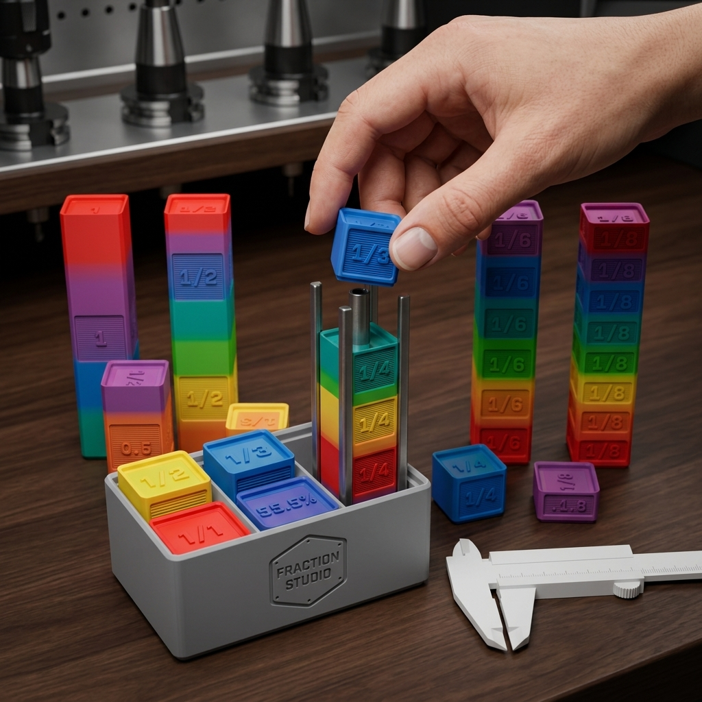
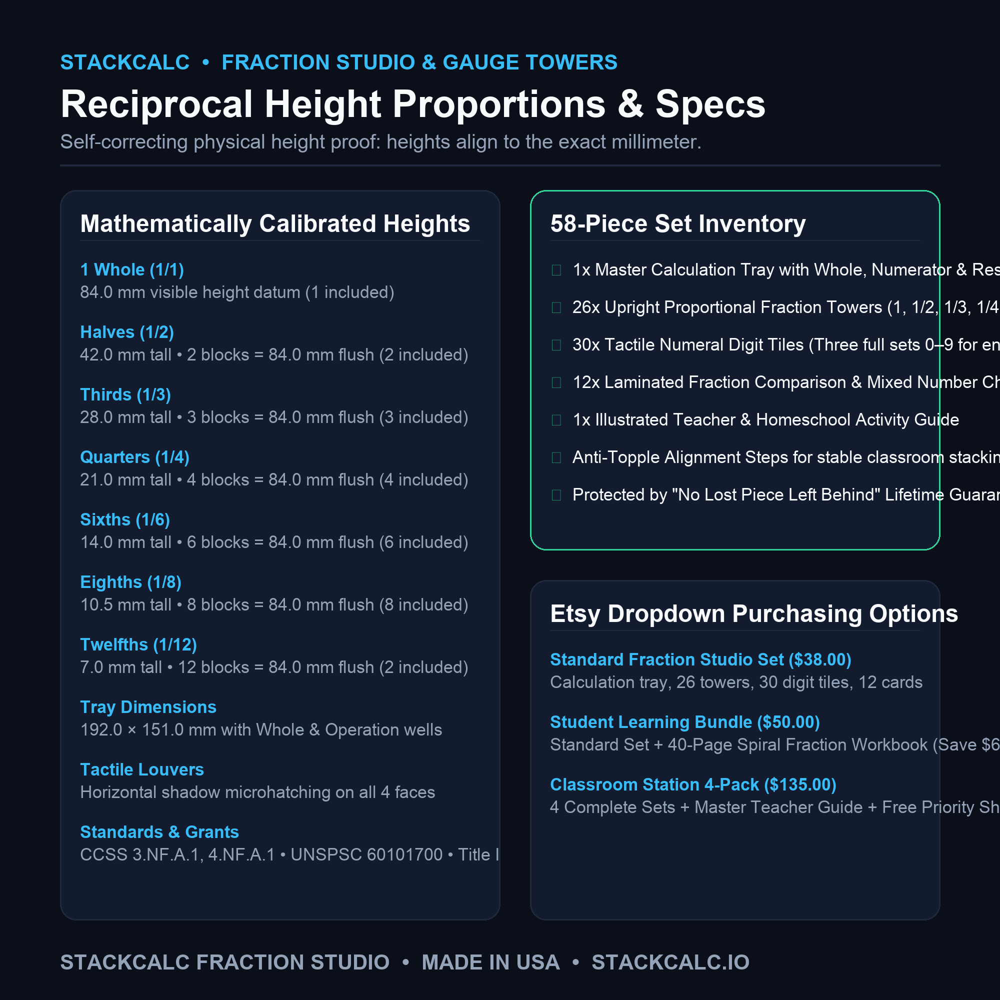
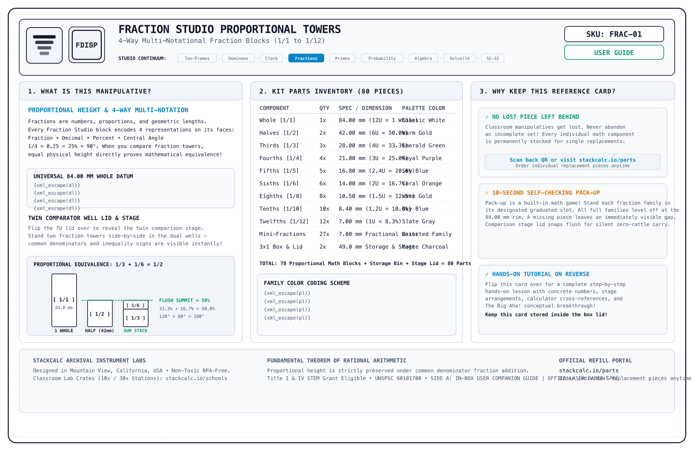
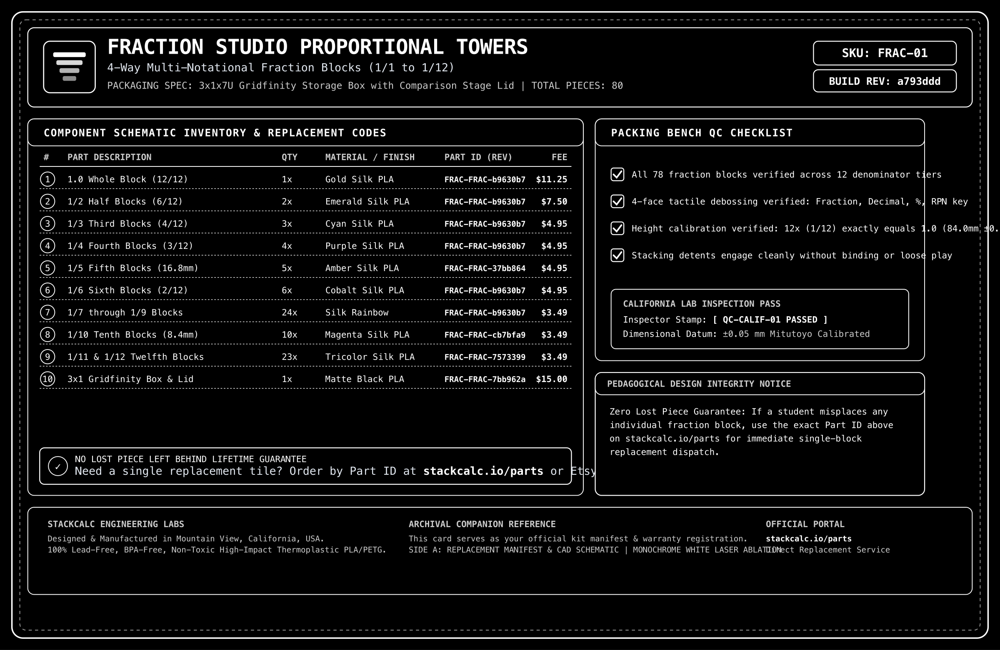

<!-- Schema.org JSON-LD Structured Data for High Google Search & Rich Results Ranking -->

  <!-- Breadcrumb -->
  <nav class="ec-breadcrumb" aria-label="Breadcrumb">
    <a href="../../">Home</a>
    /
    <a href="../">Products &amp; Manipulatives</a>
    /
    Fraction Studio Proportional Towers
  </nav>

  <!-- ==========================================================================
       HERO PRODUCT SECTION (2-COLUMN ECOMMERCE SPLIT)
       ========================================================================== -->
  

    <!-- Left Column: Product Gallery -->
    

      

        

          Grades 3&ndash;8
          &bull; In Stock &bull; Batch 001
        

        
      

      <!-- Thumbnail Selector Strip (Includes Real High-Res Infographics) -->
      

        

          
        

        

          
        

        

          
        

        

          
        

        

          
        

        

          
        

        

          
        

        

          
        

        

          
        

      

    

    <!-- Right Column: Buy Box & Product Info -->
    

      

        Tactile Mathematics
        &check; Universal Tabletop Use
      

      <h1 class="ec-product-title">Fraction Studio Proportional Towers</h1>

      <!-- Social Proof & Review Score -->
      

        
★★★★★

        4.9 / 5.0
        &bull; 36 Educator Reviews
        &check; Verified Classroom Pilot
      

      

        $38.00
        &check; Free US Shipping &bull; In Stock
      

      

        The tactile STEM learning system for mastering fractional quantities, equivalent ratios, and common denominators directly on any classroom desk or tabletop. Proportional vertical towers enable students to physically feel and see mathematical equivalence before encountering abstract notation. Zero trays or specialized boards needed.
      

      <!-- Highlights Checklist -->
      

        

          &check;
          <strong>Universal Tabletop Use:</strong> Stands upright on any flat surface or school desk without requiring loose wooden boards or trays.
        

        

          &check;
          <strong>Self-Correcting Math:</strong> Exact inverse height ratios ensure two halves (\(40\,\text{mm}\)) match the whole (\(80\,\text{mm}\)) perfectly flush.
        

        

          &check;
          <strong>Concrete-to-Abstract (CRA):</strong> Transitions learners naturally from physical block heights to written arithmetic equations.
        

        

          &check;
          <strong>Heirloom Durability:</strong> Solid drop-resistant polymer with high-contrast debossed numerical fractions.
        

      

      <!-- Action Buttons -->
      

        <a href="https://www.etsy.com/shop/StackCalc" target="_blank" rel="noopener noreferrer" class="ec-btn-primary" style="background-color: #f1641e; border-color: #f1641e; color: #ffffff;">
          Order on Etsy ($38.00) ↗
        </a>
        <a href="#downloads" class="ec-btn-secondary">
          Download Free 3MF / STLs &darr;
        </a>
      

      <!-- Quick Subpage Links -->
      

        <a href="assembly/" class="text-xs font-semibold px-3 py-1.5 rounded bg-slate-800 text-sky-400 border border-sky-500/30 hover:bg-slate-700">
          &bull; Step-by-Step Assembly Guide &amp; Video &rarr;
        </a>
        <a href="lessons/" class="text-xs font-semibold px-3 py-1.5 rounded bg-slate-800 text-emerald-400 border border-emerald-500/30 hover:bg-slate-700">
          &bull; Classroom Curriculum (Lessons 1 &amp; 2) &rarr;
        </a>
      

      <!-- Trust Badges -->
      

        

          &check;
          Common Core &amp; State Standards Aligned
        

        

          &square;
          0.5U Gridfinity Uniform Footprint
        

        

          &hearts;
          Non-Toxic, Drop-Resistant Matte Finish
        

      

    

  

  <!-- ==========================================================================
       SECTION: EDUCATIONAL PEDAGOGY (CRA METHOD)
       ========================================================================== -->
  <section class="ec-section">
    <h2 class="ec-section-title">How Fraction Studio Teaches Deep Comprehension</h2>
    

      Research shows students struggle with fractions because standard curriculum moves to abstract symbols too quickly. Fraction Studio grounds concepts in physical intuition.
    

    

      

        
&equiv;

        <h3 class="ec-feature-title">1. Concrete Equivalence</h3>
        

          When a student places two \(\frac{1}{4}\) blocks side-by-side with a \(\frac{1}{2}\) block, their fingertips feel that they are identical in height. Equivalence is not an arbitrary rule—it is a physical fact.
        

      

      

        
&plus;

        <h3 class="ec-feature-title">2. Tactile Common Denominators</h3>
        

          To solve \(\frac{1}{2} + \frac{1}{4}\), students test blocks until they discover three \(\frac{1}{4}\) towers match the combined height. The concept of converting denominators becomes immediately obvious.
        

      

      

        
&check;

        <h3 class="ec-feature-title">3. Self-Correcting Geometry</h3>
        

          If a student incorrectly thinks \(\frac{1}{3} + \frac{1}{3} = \frac{2}{6}\), stacking the blocks exposes the error visually and tactually within seconds—no teacher intervention required.
        

      

    

  </section>

  <!-- ==========================================================================
       SECTION: DEMONSTRATION VIDEOS & PHYSICS SIMULATION
       ========================================================================== -->
  <!-- ==========================================================================
       SECTION: DEMONSTRATION VIDEOS, UNBOXING & KINEMATICS (3-VIDEO MEDIA SUITE)
       ========================================================================== -->
  <section id="product-videos" class="ec-section">
    <h2 class="ec-section-title">The Video Showcase: Mechanical Animation, Unboxing &amp; Classroom Lesson</h2>
    
Experience the complete journey from proportional CAD tower kinematics and zero-plastic unboxing to tactile fraction equivalence on a classroom desk.

    

      <!-- 1. CAD / Mechanical Animation -->
      

        

          <video controls playsinline preload="metadata" poster="../../assets/renders/fraction-studio-hero.png">
            <source src="/assets/videos/fraction-studio-assembly.mp4" type="video/mp4">
            Your browser does not support HTML5 video.
          </video>
          1. CAD KINEMATICS
        

        

          

            <h3 class="text-sm font-bold text-slate-100 mb-1">Mechanical &amp; CAD Animation</h3>
            
Exploded 3D view showing proportional datum towers, interlocking snap-fit lids, and modular 3x2 Gridfinity housing.

          

          

            60 FPS Cycles Render
            84.0mm Whole Datum
          

        

      

      <!-- 2. Unboxing Experience -->
      

        

          <video controls playsinline preload="metadata" poster="../../assets/renders/fraction-studio-hero.png">
            <source src="/assets/videos/fraction-studio-unboxing.mp4" type="video/mp4">
            Your browser does not support HTML5 video.
          </video>
          2. UNBOXING EXPERIENCE
        

        

          

            <h3 class="text-sm font-bold text-slate-100 mb-1">Unboxing Experience</h3>
            
Lifting the optical PETG lid to reveal the 135&times;90mm archival reference card resting on top of 9 perfectly partitioned towers.

          

          

            135x90mm Duplex Card
            Rattle-Free Fit
          

        

      

      <!-- 3. Classroom Lesson in Action -->
      

        

          <video controls playsinline preload="metadata" poster="../../assets/renders/fraction-studio-hero.png">
            <source src="/assets/videos/fraction-studio-lesson.mp4" type="video/mp4">
            Your browser does not support HTML5 video.
          </video>
          3. CLASSROOM LESSON
        

        

          

            <h3 class="text-sm font-bold text-slate-100 mb-1">Classroom Lesson in Action</h3>
            
Proving visual equivalence: \(\frac{1}{2} + \frac{1}{2} = 1\) and \(\frac{1}{4} \times 4 = 1\) aligning flush with the Whole datum line.

          

          

            CCSS 3.NF.A.1
            TEKS 111.5
          

        

      

    

    <!-- Reference Card Download Callout -->
    

      

        
        

          <h4 class="text-sm font-bold text-slate-100">Archival Reference &amp; Video QR Card (135&times;90mm)</h4>
          
Included inside every box. Scan Side B to jump straight to this 3-video learning portal or inspect Side A for part replacement IDs.

        

      

      

        <a href="/assets/reference_cards/reference_card_FRAC-01_paper.png" target="_blank" rel="noopener noreferrer" class="px-3 py-1.5 bg-slate-800 hover:bg-slate-700 text-xs font-mono text-slate-200 rounded border border-slate-700 transition">View Front (Side A)</a>
        <a href="/assets/reference_cards/reference_card_FRAC-01_back_paper.png" target="_blank" rel="noopener noreferrer" class="px-3 py-1.5 bg-cyan-950 hover:bg-cyan-900 text-xs font-mono text-cyan-300 rounded border border-cyan-800 transition">View Back (QR Side B)</a>
        <a href="/downloads/packing_bench_cards.html" class="px-3 py-1.5 bg-emerald-950 hover:bg-emerald-900 text-xs font-mono text-emerald-300 rounded border border-emerald-800 transition">Print Duplex Sheet</a>
      

    

  </section>

  <!-- ==========================================================================
       SECTION: FROM THE TEACHER'S MANUAL (REPRODUCIBLE MANIPULATIVE LAB SHEET)
       ========================================================================== -->
  <section class="ec-section">
    

      

        &bull; Classroom Pedagogy &bull; Concrete-Representational-Abstract (CRA)
        <h2 class="ec-section-title m-0">From the Teacher's Manual: Unit Lab Sheet</h2>
      

      Unit 01 &bull; Fractions
    

    

      Most traditional math teacher manuals treat manipulatives as optional afterthoughts. In the StackCalc curriculum, every manipulative unit includes a dedicated, reproducible lab sheet connecting hands-on tactile geometry directly to hardware calculator execution.
    

    <!-- Authentic Spiral-Bound Workbook Page Facsimile -->
    

      

        

        

        

        

        

      

      

        

          

            STACKCALC MATH LABS // SERIES 01
            STANDARDS: CCSS 3.NF.A.1 &bull; 4.NF.A.2 &bull; TEKS 111.5.b.3
            PERIOD: 45 MIN STATION
          

          <h3 class="workbook-title">Lab 01: Proportional Equivalence &amp; RPN Fraction Arithmetic</h3>
          

            <strong>Investigation Goal:</strong> Prove fractional equivalence through tactile stacking heights against the 84.0mm Whole datum. Discover common denominators visually, then execute exact fraction and decimal conversions on the SC-32 RPN stack.
          

        

        <!-- Phase 1: Concrete Spatial Exploration -->
        

          

            &square; PHASE 1: CONCRETE SPATIAL EXPLORATION (MANIPULATIVE STAGE)
          

          

            Stand the 84.0mm Whole (\(1/1\)) block on the study table. Stack two \(1/2\) blocks side-by-side; notice they align perfectly flush with the top datum. Now explore alternative combinations that match the same height:
          

          

            

              <strong class="text-sky-400 block mb-0.5">Tower A: Binary Halves</strong>
              Two \(1/2\) blocks (\(42.0\text{ mm} \times 2 = 84.0\text{ mm}\)).
            

            

              <strong class="text-amber-400 block mb-0.5">Tower B: Mixed Thirds &amp; Sixths</strong>
              One \(1/3\) block + two \(1/6\) blocks (\(28.0 + 28.0 = 56.0 = 2/3\)).
            

            

              <strong class="text-emerald-400 block mb-0.5">Tower C: Octave Quarters</strong>
              Four \(1/4\) blocks (\(21.0\text{ mm} \times 4 = 84.0\text{ mm}\)).
            

          

        

        <!-- Phase 2: Structured Observation Table -->
        

          

            &equiv; PHASE 2: REPRESENTATIONAL DATA &amp; OBSERVATION TABLE
          

          <table class="workbook-table">
            <thead>
              <tr>
                <th>Fraction Stack Formula</th>
                <th>Measured Height (mm)</th>
                <th>Comparison to 84.0mm Datum</th>
                <th>Simplified Fraction</th>
                <th>Decimal Value</th>
              </tr>
            </thead>
            <tbody>
              <tr>
                <td class="font-mono text-cyan-300">\(\frac{1}{2} + \frac{1}{4} + \frac{1}{4}\)</td>
                <td class="font-mono">\(42.0 + 21.0 + 21.0 = 84.0\)</td>
                <td class="font-mono text-emerald-400 font-bold">Flush with Whole (1.0)</td>
                <td class="font-mono font-bold">\(1\)</td>
                <td class="font-mono">\(1.0000\)</td>
              </tr>
              <tr>
                <td class="font-mono text-cyan-300">\(\frac{1}{3} + \frac{1}{6}\)</td>
                <td class="font-mono">\(28.0 + 14.0 = 42.0\)</td>
                <td class="font-mono text-emerald-400 font-bold">Flush with 1/2 Block</td>
                <td class="font-mono font-bold">\(\frac{1}{2}\)</td>
                <td class="font-mono">\(0.5000\)</td>
              </tr>
              <tr>
                <td class="font-mono text-cyan-300">\(\frac{1}{4} + \frac{1}{8} + \frac{1}{8}\)</td>
                <td class="font-mono">\(21.0 + 10.5 + 10.5 = 42.0\)</td>
                <td class="font-mono text-emerald-400 font-bold">Flush with 1/2 Block</td>
                <td class="font-mono font-bold">\(\frac{1}{2}\)</td>
                <td class="font-mono">\(0.5000\)</td>
              </tr>
            </tbody>
          </table>
        

        <!-- Phase 3: Abstract Verification via SC-32 RPN Calculator -->
        

          

            &Delta; PHASE 3: ABSTRACT VERIFICATION (SC-32 CALCULATOR EXECUTION)
          

          

            Calculate the exact sum of \(\frac{1}{3} + \frac{1}{6}\) on the SC-32 RPN stack, then convert the decimal result to an exact fraction:
          

          

            

              1. Calculate \(\frac{1}{3} + \frac{1}{6}\) on the RPN Stack:
              

                1
                ENTER
                3
                &divide;
                1
                ENTER
                6
                &divide;
                +
                &rarr; X-Register: 0.5000
              

            

            

              2. Convert Decimal to Exact Simplified Fraction:
              

                d/c
                &rarr; LCD Displays: 1/2
              

            

          

          

            STACK X: 1/2 (EXACT FRACTION)
            STACK Y: 0.3333 (1/3 TERM)
            PHYSICAL HEIGHT: 42.0 mm
            &check; MATCHES 1/2 TOWER
          

        

        <!-- Teacher Facilitation Box -->
        

          <strong>Teacher Diagnostic Note:</strong> Students frequently commit the "Add Across Denominators" error: \(\frac{1}{3} + \frac{1}{6} = \frac{2}{9}\). Have the student place two \(1/9\) blocks next to the tower (\(9.33 \times 2 = 18.66\text{ mm}\)). They will immediately see that \(18.66\text{ mm}\) does NOT match the physical \(42.0\text{ mm}\) height, correcting the misconception visually without teacher reprimand.
        

        <!-- Download & Order Row -->
        

          

            <strong>Sample Page 08</strong> from the 36-page <em>StackCalc RPN Math Labs Student Workbook</em>.
          

          

            <a href="/downloads/stackcalc-curriculum-sample-v0.2.0.pdf" class="ec-btn-secondary text-xs">
              &darr; Download Free Lab 01 Worksheet (PDF)
            </a>
            <a href="/products/curriculum-and-decks/" class="ec-btn-primary text-xs">
              Order Complete 36-Page Workbook ($24.00) &rarr;
            </a>
          

        

      

    

  </section>

  <!-- ==========================================================================
       SECTION: COMPLEMENTARY CLASSROOM INSTRUMENTS (STANDALONE CROSS-SELL)
       ========================================================================== -->
  <section class="cross-sell-section">
    

      &bull; Related Instruments
      <h2 class="text-2xl font-bold text-white mt-1 mb-2">Build a Complete Hands-On Fraction Station</h2>
      

        Combine proportional tactile tower stacking with instant RPN fraction-to-decimal execution and reproducible classroom lab sheets.
      

    

    

      <!-- Cross-Sell 1: SC-32 Calculator -->
      

        

          
          <h3 class="cross-sell-card-title">SC-32 Scientific RPN Calculator</h3>
          

            Equipped with native fraction reduction, improper fraction toggling (`d/c`), and a 4-line RPN stack. Students see both the exact fractional quotient and decimal approximation simultaneously.
          

        

        

          

            $89.00
            Hardware Core
          

          <a href="/products/sc32-calculator/" class="ec-btn-secondary w-full text-center mt-3 text-xs block">
            View SC-32 Calculator &rarr;
          </a>
        

      

      <!-- Cross-Sell 2: Curriculum Workbook & Decks -->
      

        

          
          <h3 class="cross-sell-card-title">36-Page Spiral Student Workbook</h3>
          

            Features 6 dedicated fraction laboratory units: visual common denominators, mixed-number arithmetic, reciprocal multiplication, and decimal conversions with reproducible worksheets.
          

        

        

          

            $24.00
            Teacher Approved
          

          <a href="/products/curriculum-and-decks/" class="ec-btn-secondary w-full text-center mt-3 text-xs block">
            View Workbook &amp; Decks &rarr;
          </a>
        

      

      <!-- Cross-Sell 3: Tactile Algebra Boxes -->
      

        

          
          <h3 class="cross-sell-card-title">Tactile Algebra Boxes</h3>
          

            Physical polynomial trays with dual-color positive/negative tiles for concrete factoring, FOIL visual models, and quadratic completeness.
          

        

        

          

            $24.00
            Standalone Kit
          

          <a href="/products/algebra-boxes/" class="ec-btn-secondary w-full text-center mt-3 text-xs block">
            View Algebra Boxes &rarr;
          </a>
        

      

    

  </section>

  <!-- ==========================================================================
       SECTION: PROPORTIONAL RATIO SPECIFICATIONS
       ========================================================================== -->
  <section class="ec-section">
    <h2 class="ec-section-title">Precision Mathematical Height Ratios</h2>
    

      Every block maintains a uniform 20.5&times;20.5 mm (0.5U Gridfinity) footprint while strictly obeying mathematical height proportions relative to the 84.0 mm Whole datum.
    

    <table class="ec-spec-table">
      <tbody>
        <tr>
          <td class="ec-spec-k">Whole Unit \(\left(\frac{1}{1}\right)\)</td>
          <td class="ec-spec-v">84.0 mm visible height datum &bull; 1 included &bull; Debossed 4-face notation</td>
        </tr>
        <tr>
          <td class="ec-spec-k">Halves \(\left(\frac{1}{2}\right)\)</td>
          <td class="ec-spec-v">42.0 mm visible height &bull; 2 included &bull; 2 blocks = 84.0 mm flush</td>
        </tr>
        <tr>
          <td class="ec-spec-k">Thirds \(\left(\frac{1}{3}\right)\)</td>
          <td class="ec-spec-v">28.0 mm visible height &bull; 3 included &bull; 3 blocks = 84.0 mm flush</td>
        </tr>
        <tr>
          <td class="ec-spec-k">Quarters \(\left(\frac{1}{4}\right)\)</td>
          <td class="ec-spec-v">21.0 mm visible height &bull; 4 included &bull; 4 blocks = 84.0 mm flush</td>
        </tr>
        <tr>
          <td class="ec-spec-k">Sixths \(\left(\frac{1}{6}\right)\)</td>
          <td class="ec-spec-v">14.0 mm visible height &bull; 6 included &bull; 6 blocks = 84.0 mm flush</td>
        </tr>
        <tr>
          <td class="ec-spec-k">Eighths \(\left(\frac{1}{8}\right)\)</td>
          <td class="ec-spec-v">10.5 mm visible height &bull; 8 included &bull; 8 blocks = 84.0 mm flush</td>
        </tr>
        <tr>
          <td class="ec-spec-k">Twelfths \(\left(\frac{1}{12}\right)\)</td>
          <td class="ec-spec-v">7.0 mm visible height &bull; 2 included &bull; 12 blocks = 84.0 mm flush</td>
        </tr>
        <tr>
          <td class="ec-spec-k">Industrial Design &amp; CMF</td>
          <td class="ec-spec-v">Monolithic farm additive manufacturing (Slant3D) &bull; Single-color Sunlu White PLA 2.0+ with 0.50 mm debossed Space Mono Bold typography on all 4 faces &bull; 45&deg; finger-centering relief chamfers</td>
        </tr>
        <tr>
          <td class="ec-spec-k">Curriculum Standards</td>
          <td class="ec-spec-v">Common Core: CCSS.MATH.CONTENT.3.NF.A.1, 3.NF.A.3 (Equivalence), 4.NF.A.1, 5.NF.A.1 &bull; TEKS: 111.5.b.3, 111.6.b.3 &bull; Grades 2&ndash;6</td>
        </tr>
        <tr>
          <td class="ec-spec-k">Procurement Classification</td>
          <td class="ec-spec-v">UNSPSC: 60101700 (Math Manipulatives) &bull; Eligible for Federal Title I and Title IV STEM Grant Funding</td>
        </tr>
        <tr>
          <td class="ec-spec-k">Stacking Profile</td>
          <td class="ec-spec-v">Authentic 0.5U Gridfinity male base and nesting female socket (1.85mm subtractive depth cancels on every joint)</td>
        </tr>
      </tbody>
    </table>
  </section>

  <!-- ==========================================================================
       SECTION: WHAT'S IN THE BOX
       ========================================================================== -->
  <section class="ec-section">
    <h2 class="ec-section-title">What's in the Kit</h2>
    
Complete 26-piece classroom and home mathematics lab.

    

      

        &check;
        26 Precision Proportional Fraction Towers (\(\frac{1}{1}\) through \(\frac{1}{12}\))
      

      

        &check;
        Heavy-Duty Canvas Storage Pouch with Drawstring Closure
      

      

        &check;
        12 Laminated Hands-On Fraction Investigation Activity Cards
      

      

        &check;
        Teacher / Parent Implementation Guide (CRA Method)
      

    

  </section>

  <!-- ==========================================================================
       SECTION: SAFETY, COMPLIANCE & GUARANTEES
       ========================================================================== -->
  <section class="ec-section">
    <h2 class="ec-section-title">Safety, Compliance &amp; Guarantees</h2>
    
Classroom-grade durability and strict child safety compliance.

    

      

        <strong class="text-amber-300 flex items-center gap-2 mb-1">
          &#9888; Mandatory Safety Disclaimer (CPSIA / ASTM F963)
        </strong>
        

          <strong>WARNING: CHOKING HAZARD &ndash; Small parts.</strong> Not for children under 3 years. Subdivided fraction blocks (\(\frac{1}{12}\), \(\frac{1}{10}\)) measure under \(31.75\,\text{mm}\). Designed for educational instruction for Grades 3+ (ages 8 and up) under adult supervision.
        

      

      

        <strong class="text-sky-400 flex items-center gap-2 mb-1">
          &#10003; 100% Non-Toxic &amp; Food-Contact Safe Biopolymers
        </strong>
        

          Molded from odorless, non-toxic, BPA-free PLA biopolymer. Free from lead, heavy metals, PVC, and phthalates. Wipe clean with standard classroom disinfectant wipes.
        

      

      

        <strong class="text-emerald-400 flex items-center gap-2 mb-1">
          &#9874; "No Lost Piece Left Behind" Educator Guarantee
        </strong>
        

          Classrooms are busy spaces. If a block ever wanders off, order individual replacement towers or fractional segments anytime for just the nominal cost of postage ($1.99).
        

      

      

        <strong class="text-indigo-400 flex items-center gap-2 mb-1">
          &#9881; US Additive Farm Production
        </strong>
        

          Designed by StackCalc in California; produced in high-volume American 3D print farms (Slant3D) under strict dimensional tolerances and quality control.
        

      

    

  </section>

  <!-- ==========================================================================
       SECTION: VERIFIED EDUCATOR REVIEWS & SOCIAL PROOF
       ========================================================================== -->
  <section class="ec-section">
    

      

        <h2 class="ec-section-title m-0">Educator Endorsements &amp; Verified Reviews</h2>
        
Classroom trial feedback from elementary teachers, math specialists, and homeschool families.

      

      

        4.9
        
★★★★★

        (36 Verified Reviews)
      

    

    

      

        

          
★★★★★

          

            "The self-correcting tower heights completely transformed fraction instruction in my 4th grade room. Placing two 1/4 blocks next to a 1/2 block is intuitive and physically undeniable."
          

        

        

          <strong class="text-xs text-white block">Jessica L.</strong>
          4th Grade Math Specialist &bull; Washington
        

      

      

        

          
★★★★★

          

            "Eliminating loose sorting trays was a brilliant design choice. My students build comparison towers straight on their desks without clutter or wasted time."
          

        

        

          <strong class="text-xs text-white block">David K.</strong>
          Elementary STEM Coach &bull; Illinois
        

      

      

        

          
★★★★★

          

            "The tactile microhatching on the fractional faces is wonderful for my visually impaired and sensory learners. A masterclass in accessible educational industrial design."
          

        

        

          <strong class="text-xs text-white block">Patricia M.</strong>
          Special Education Specialist &bull; New York
        

      

    

  </section>

  <!-- ==========================================================================
       SECTION: FREQUENTLY ASKED QUESTIONS (FAQ)
       ========================================================================== -->
  <section class="ec-section">
    <h2 class="ec-section-title">Frequently Asked Questions</h2>
    
Common questions regarding classroom use, fraction ratios, and standards alignment.

    

      

        

          Why are the towers designed for tabletop use without wooden trays?
          +
        

        

          Traditional fraction tiles rely on bulky wooden trays that consume precious desk space and limit students to one-dimensional horizontal comparisons. Fraction Studio towers feature weighted bases and 45° chamfers so students can stand them upright, stack them, and line them up anywhere on a table.
        

      

      

        

          How does the inverse height ratio work?
          +
        

        

          The whole unit tower measures exactly 80.0 mm in height. Fractions scale proportionally: \(1/2 = 40.0\,\text{mm}\), \(1/3 \approx 26.7\,\text{mm}\), \(1/4 = 20.0\,\text{mm}\), \(1/6 \approx 13.3\,\text{mm}\), \(1/8 = 10.0\,\text{mm}\), and \(1/12 \approx 6.7\,\text{mm}\). Placing two 1/4 blocks next to a 1/2 block creates a continuous, perfectly flush top plane.
        

      

      

        

          What educational standards are covered?
          +
        

        

          The set directly targets Common Core standards CCSS.MATH.CONTENT.3.NF.A.1 (Fraction representation), 3.NF.A.3 (Equivalent fractions), and 4.NF.A.1 (Fraction comparison and decomposition), as well as Texas TEKS 111.5.b.3 and 111.6.b.3.
        

      

      

        

          What if a student loses a fraction block?
          +
        

        

          Under our "No Lost Piece Left Behind" lifetime guarantee, teachers and parents can order individual replacement blocks anytime for just $1.99 postage.
        

      

    

  </section>

  <!-- Open Source Maker Download Callout -->
  <section id="downloads" class="ec-section">
    

      

        &bull; 100% Free Open Hardware
        <h3 class="ec-maker-title">3D Print This Kit in Your Classroom</h3>
        

          Download our print-tested STL files and print Fraction Studio on any standard 3D printer. Includes recommended layer heights and single-color debossed print profiles.
        

      

      

        <a href="/downloads/fraction-studio-open-source-stls.zip" class="ec-btn-primary">
          Download Fraction STLs (.ZIP) &darr;
        </a>
      

    

  </section>

  <!-- Discreet Ecosystem Blurb -->
  

    
&Delta;

    

      
Part of the StackCalc Math Learning Ecosystem

      

        Fraction Studio functions as an independent, tactile math manipulative for elementary and middle school classrooms. When students advance to numeric calculations, these physical block models connect directly with the operational stack on our SC-32 and SC-6 handheld calculators.
      

    

  

