<!-- Schema.org JSON-LD Structured Data for High Google Search & Rich Results Ranking -->

  <!-- Breadcrumb -->
  <nav class="ec-breadcrumb" aria-label="Breadcrumb">
    <a href="../../">Home</a>
    /
    <a href="../">Products &amp; Manipulatives</a>
    /
    Fraction Studio Proportional Towers
  </nav>

  <!-- ==========================================================================
       HERO PRODUCT SECTION (2-COLUMN ECOMMERCE SPLIT)
       ========================================================================== -->
  

    <!-- Left Column: Product Gallery -->
    

      

        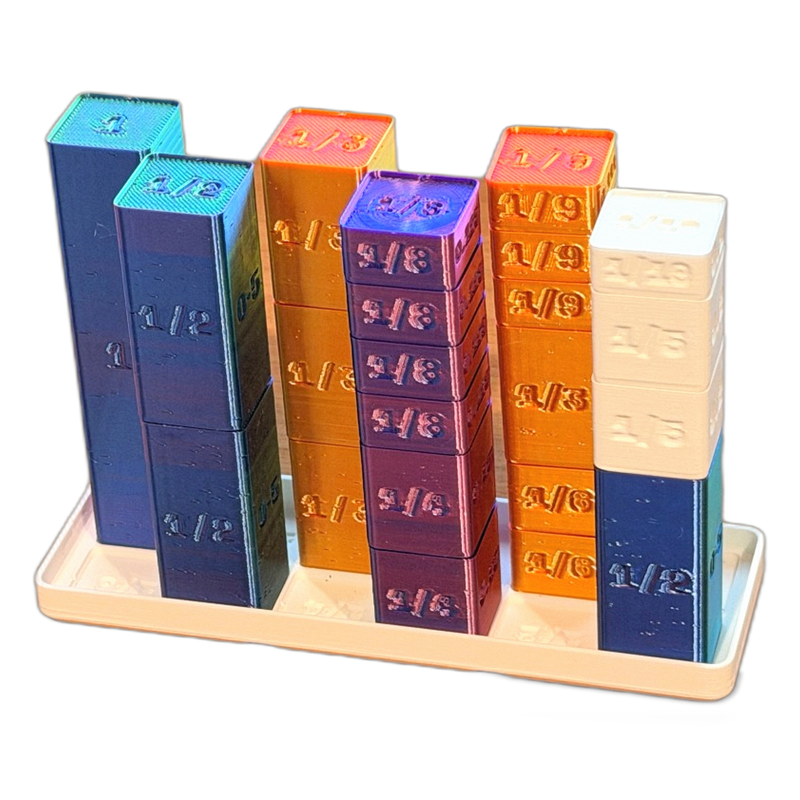
      

      <!-- Thumbnail Selector Strip (Includes Real High-Res Photography & Infographics) -->
      

        

          
        

        

          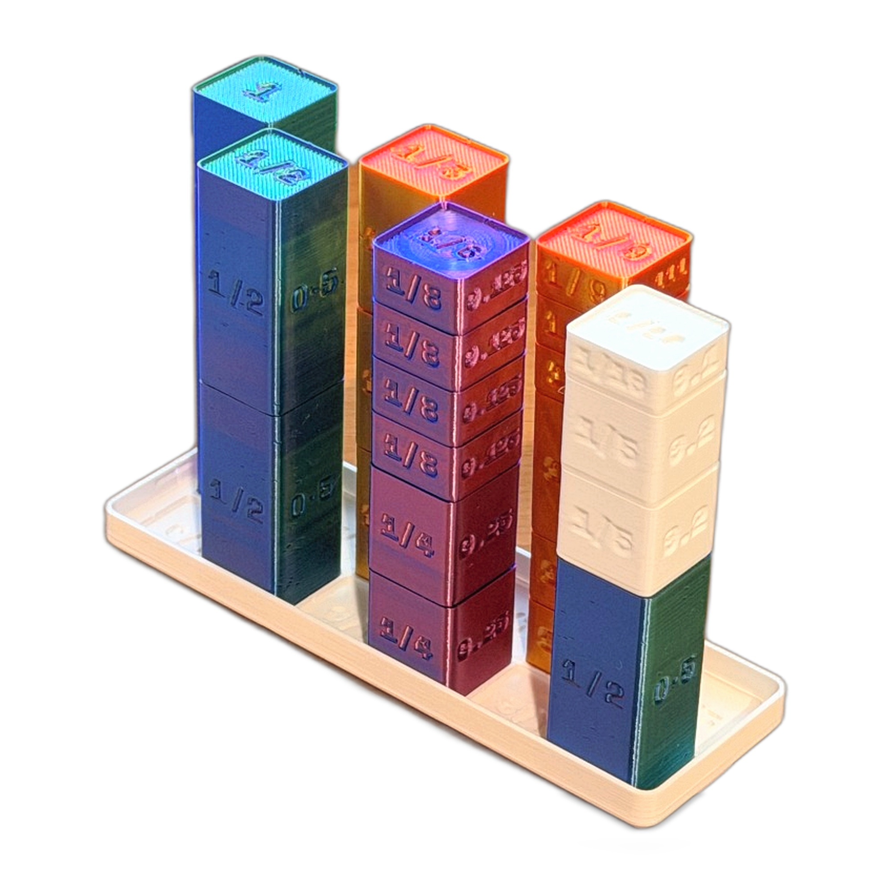
        

        

          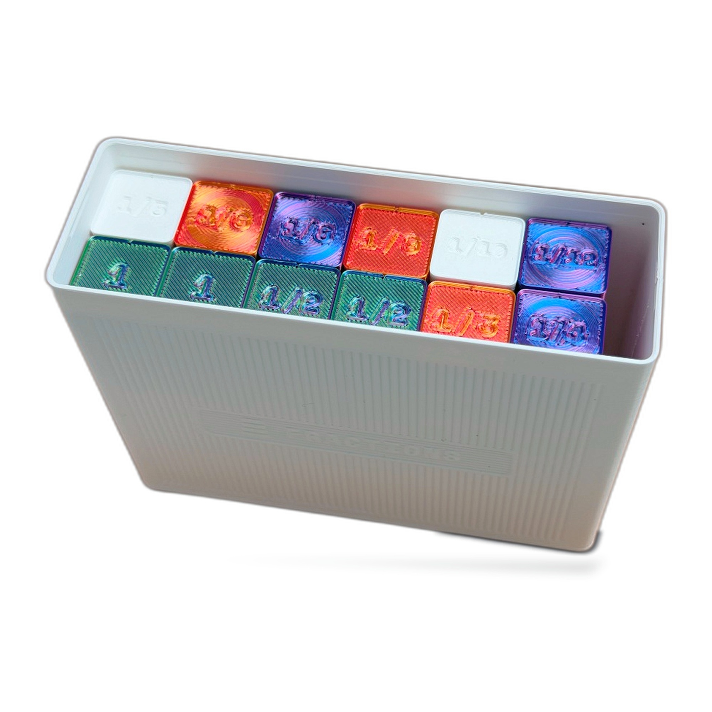
        

        

          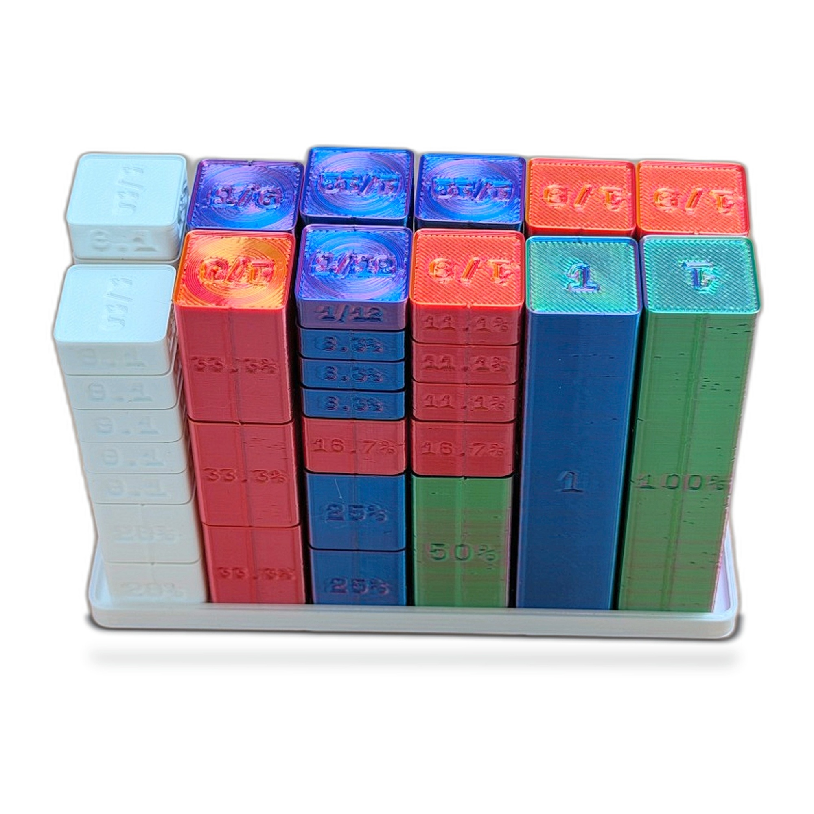
        

        

          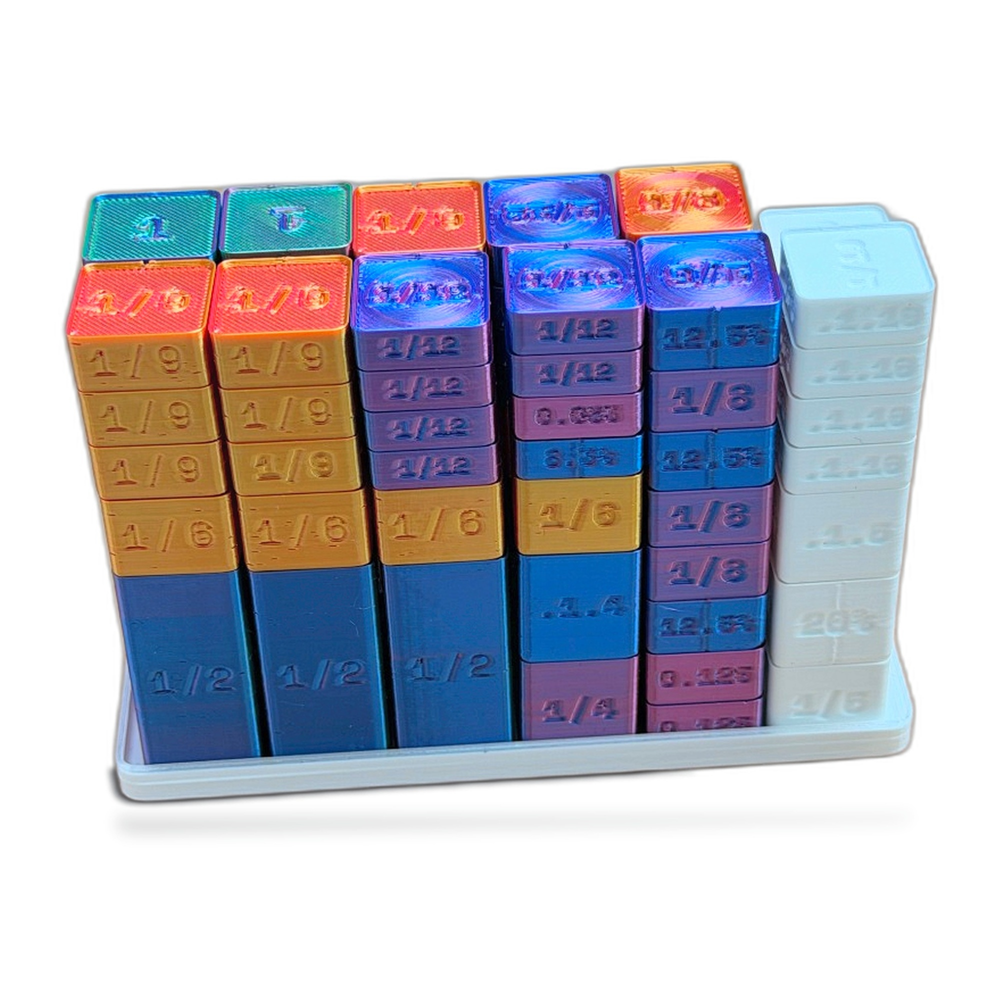
        

        

          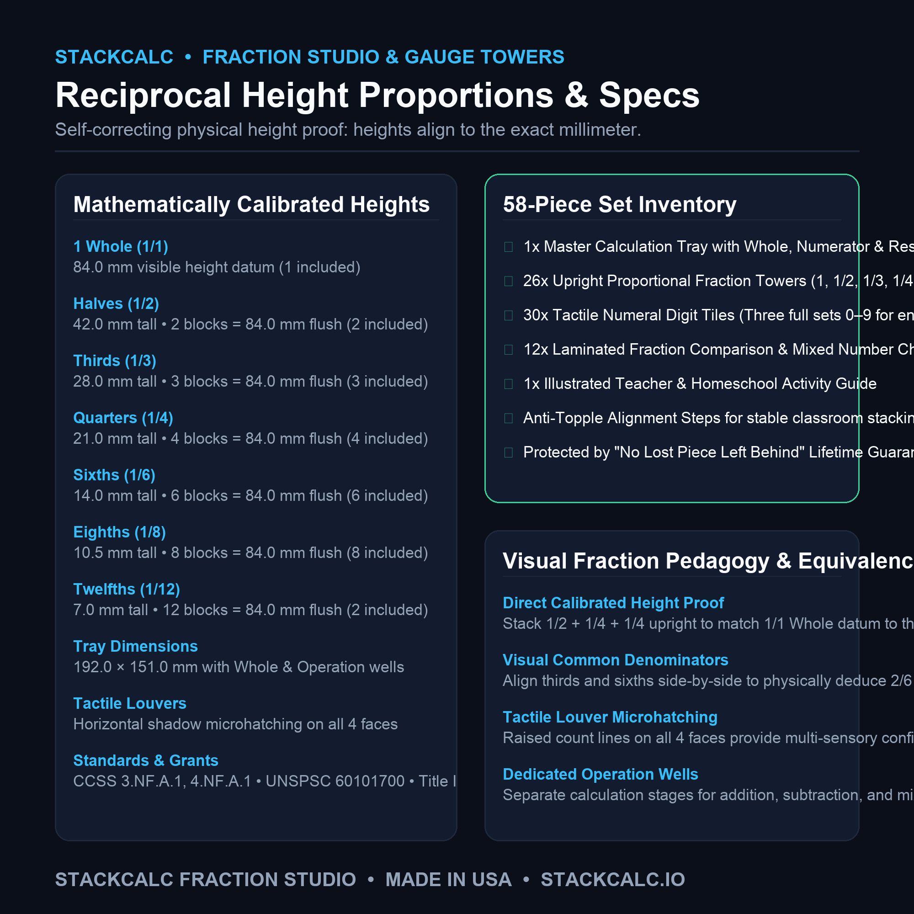
        

        

          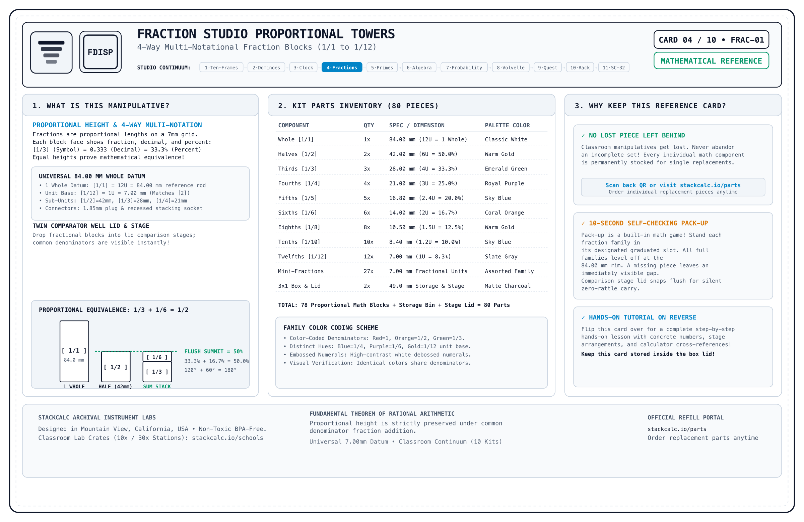
        

        

          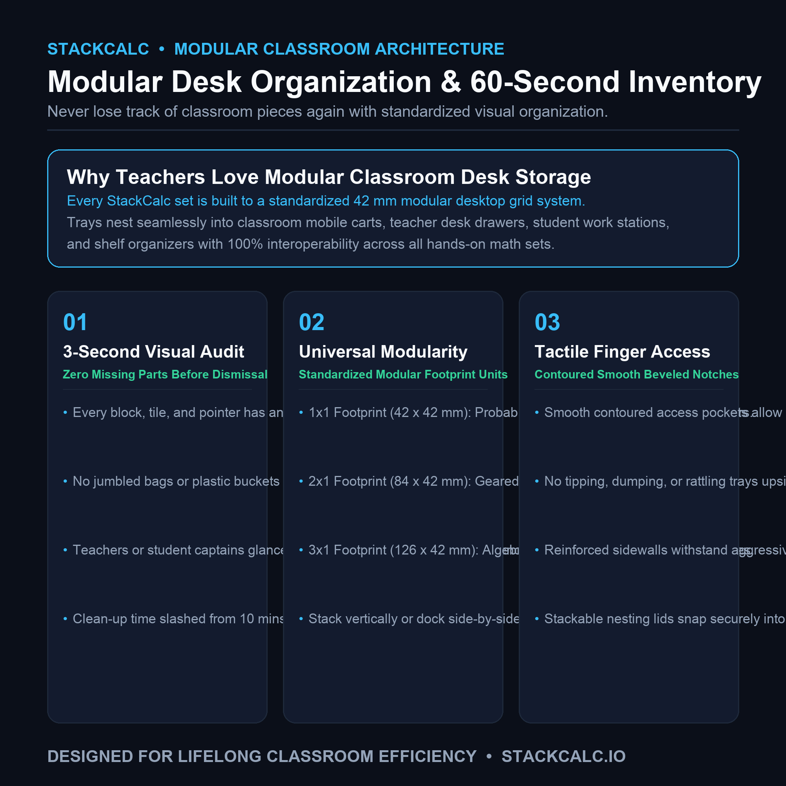
        

        

          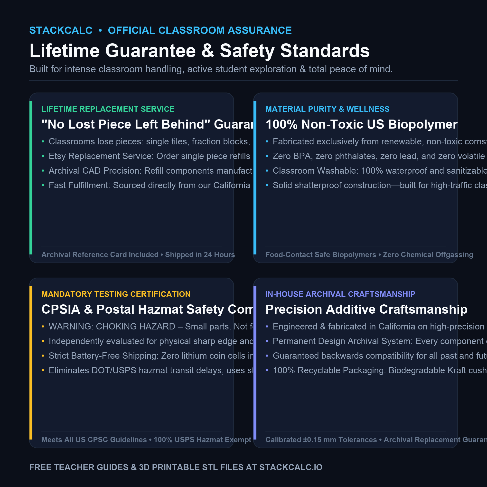
        

      

    

    <!-- Right Column: Buy Box & Product Info -->
    

      <h1 class="ec-product-title">Fraction Studio Proportional Towers</h1>

      <!-- Educational Architecture & Tactile Standard -->
      

        PEDAGOGICAL STANDARD
        &bull; Self-Correcting Proportional Geometry
        &check; 12-Column Caddy &amp; Desktop Modularity
      

      

        $24.99 &ndash; $48.00
        &check; Beta Kit ($24.99) &bull; Standard V1 ($48.00) &bull; Free US Shipping $35+
      

      

        The tactile STEM learning system for mastering fractional quantities, equivalent ratios, and common denominators directly on any classroom desk or tabletop. Proportional vertical towers enable students to physically feel and see mathematical equivalence before encountering abstract notation. Housed in a dedicated 12-column caddy chassis within a 3x1x13U Snapfinity Gridfinity enclosure.
      

      <!-- Highlights Checklist -->
      

        

          &check;
          <strong>12-Column Caddy Chassis:</strong> Features anti-scrape vertical runner glides, continuous central spine, and debossed socket floors for 100% horizontal hand access and rapid 3-second visual inventory audits.
        

        

          &check;
          <strong>Self-Correcting Math:</strong> Exact inverse height ratios ensure two halves match the whole tower perfectly flush.
        

        

          &check;
          <strong>Concrete-to-Abstract (CRA):</strong> Transitions learners naturally from physical block heights to written arithmetic equations.
        

        

          &check;
          <strong>Heirloom Durability:</strong> Solid drop-resistant polymer with high-contrast debossed numerical fractions.
        

      

      <!-- Action Buttons -->
      

        <a href="https://stackcalcmath.etsy.com" target="_blank" rel="noopener noreferrer" class="ec-btn-primary" style="background-color: #f1641e; border-color: #f1641e; color: #ffffff;">
          Order on Etsy ($24.99+) ↗
        </a>
        <a href="https://teleportpod.com/portals/profile/StackCalc" target="_blank" rel="noopener noreferrer" class="ec-btn-secondary" style="border-color: #38BDF8; color: #38BDF8;">
          On-Demand Parts (Slant 3D) ↗
        </a>
        <a href="#downloads" class="ec-btn-secondary">
          Download Free 3MF / STLs &darr;
        </a>
      

      <!-- Navigation & Editions Grid -->
      

        <a href="../../learning-lab/" class="p-2.5 rounded bg-sky-500/20 hover:bg-sky-500/30 border border-sky-500/40 text-sky-300 hover:text-white transition flex items-center justify-between font-bold">
          📐 2D Interactive Lab
          &rarr;
        </a>
        <a href="#downloads" class="p-2.5 rounded bg-white/5 hover:bg-white/10 border border-white/10 hover:border-white/30 text-slate-300 hover:text-white transition flex items-center justify-between">
          Free 3MFs &amp; STLs
          &darr;
        </a>
        <a href="../../downloads/#1-classroom-curriculum--competition-downloads-pdf" class="p-2.5 rounded bg-white/5 hover:bg-white/10 border border-white/10 hover:border-white/30 text-slate-300 hover:text-white transition flex items-center justify-between">
          Curriculum Downloads
          &rarr;
        </a>
        <a href="https://link.amazon/B0f5cP0Ur" target="_blank" rel="noopener noreferrer" class="p-2.5 rounded bg-white/5 hover:bg-white/10 border border-white/10 hover:border-white/30 text-slate-300 hover:text-white transition flex items-center justify-between">
          SC-6 Book (Amazon)
          ↗
        </a>
        <a href="https://link.amazon/B07bxzYKq" target="_blank" rel="noopener noreferrer" class="p-2.5 rounded bg-white/5 hover:bg-white/10 border border-white/10 hover:border-white/30 text-slate-300 hover:text-white transition flex items-center justify-between">
          Workbook (Amazon)
          ↗
        </a>
        <a href="#specifications" class="p-2.5 rounded bg-white/5 hover:bg-white/10 border border-white/10 hover:border-white/30 text-slate-300 hover:text-white transition flex items-center justify-between">
          Technical Specs
          &darr;
        </a>
      

      <!-- Trust Badges -->
      

        

          &check;
          Durable Matte Polymer &bull; 42mm Gridfinity
        

        

          &check;
          Anti-Heartbreak $2.49 Part Refills
        

        

          &check;
          Secure Checkout via Etsy
        

      

    

  

  <!-- Interactive 2D Simulator Launcher -->
  

    

      
CLASSROOM DIGITAL TWIN // 2D SIMULATOR

      <h3 style="margin: 0.25rem 0; color: #FFFFFF; font-size: 1.25rem; font-weight: 800;">Launch Interactive 2D Fraction Towers Lab</h3>
      

        Build fractions with proportional blocks, push values onto the live 4-line RPN calculator stack, and verify mathematical equivalence datum lines directly in your browser.
      

    

    

      <a href="../../learning-lab/" class="ec-btn-primary" style="background-color: #38BDF8; border-color: #38BDF8; color: #080A0E; font-weight: 800; white-space: nowrap;">
        Launch 2D Lab (Projector Mode) ⛶
      </a>
    

  

  <!-- ==========================================================================
       SECTION: EDUCATIONAL PEDAGOGY (CRA METHOD)
       ========================================================================== -->
  <section class="ec-section">
    <h2 class="ec-section-title">How Fraction Studio Teaches Deep Comprehension</h2>
    

      Research shows students struggle with fractions because standard curriculum moves to abstract symbols too quickly. Fraction Studio grounds concepts in physical intuition.
    

    

      

        
&equiv;

        <h3 class="ec-feature-title">1. Concrete Equivalence</h3>
        

          When a student places two \(\frac{1}{4}\) blocks side-by-side with a \(\frac{1}{2}\) block, their fingertips feel that they are identical in height. Equivalence is not an arbitrary rule—it is a physical fact.
        

      

      

        
&plus;

        <h3 class="ec-feature-title">2. Tactile Common Denominators</h3>
        

          To solve \(\frac{1}{2} + \frac{1}{4}\), students test blocks until they discover three \(\frac{1}{4}\) towers match the combined height. The concept of converting denominators becomes immediately obvious.
        

      

      

        
&check;

        <h3 class="ec-feature-title">3. Self-Correcting Geometry</h3>
        

          If a student incorrectly thinks \(\frac{1}{3} + \frac{1}{3} = \frac{2}{6}\), stacking the blocks exposes the error visually and tactually within seconds—no teacher intervention required.
        

      

    

  </section>

  <!-- ==========================================================================
       SECTION: DEMONSTRATION VIDEOS & PHYSICS SIMULATION
       ========================================================================== -->
  <!-- ==========================================================================
       SECTION: DEMONSTRATION VIDEOS, UNBOXING & KINEMATICS (3-VIDEO MEDIA SUITE)
       ========================================================================== -->
  <section id="product-videos" class="ec-section">
    <h2 class="ec-section-title">The Video Showcase: Mechanical Animation, Unboxing &amp; Classroom Lesson</h2>
    
Experience the complete journey from proportional CAD tower kinematics and zero-plastic unboxing to tactile fraction equivalence on a classroom desk.

    

      <!-- 1. CAD / Mechanical Animation -->
      

        

          <video controls playsinline preload="metadata" poster="../../assets/renders/fraction-studio-hero.png">
            <source src="../../assets/videos/fraction-studio-assembly.mp4" type="video/mp4">
            Your browser does not support HTML5 video.
          </video>
          1. CAD KINEMATICS
        

        

          

            <h3 class="text-sm font-bold text-slate-100 mb-1">Mechanical &amp; CAD Animation</h3>
            
Exploded 3D view showing proportional datum towers, interlocking snap-fit lids, and modular 3x2 Gridfinity housing.

          

          

            60 FPS Cycles Render
            84.0mm Whole Datum
          

        

      

      <!-- 2. Lesson 1: Concrete Equivalence -->
      

        

          <video controls playsinline preload="metadata" poster="../../assets/renders/fraction-studio-hero.png">
            <source src="../../assets/videos/fraction-studio-lesson-equivalence.mp4" type="video/mp4">
            Your browser does not support HTML5 video.
          </video>
          2. CURRICULUM LESSON 01
        

        

          

            <h3 class="text-sm font-bold text-slate-100 mb-1">Concrete Equivalence: 1/2 = 2/4 = 4/8</h3>
            
Step-by-step physical alignment against the 42.0mm waterline. Top surfaces align perfectly flush to eliminate denominator misconceptions.

          

          

            CCSS 3.NF.A.3
            Flush Datum Proof
          

        

      

      <!-- 3. Lesson 2: Common Denominators -->
      

        

          <video controls playsinline preload="metadata" poster="../../assets/renders/fraction-studio-hero.png">
            <source src="../../assets/videos/fraction-studio-lesson-denominators.mp4" type="video/mp4">
            Your browser does not support HTML5 video.
          </video>
          3. CURRICULUM LESSON 02
        

        

          

            <h3 class="text-sm font-bold text-slate-100 mb-1">Tactile Addition: 1/2 + 1/4 = 3/4</h3>
            
Testing candidate blocks to solve unlike denominators: three 1/4 blocks match the 63.0mm combined height without calculation errors.

          

          

            CCSS 5.NF.A.1
            63.0mm Sum Invariant
          

        

      

    

    <!-- Reference Card Download Callout -->
    

      

        
        

          <h4 class="text-sm font-bold text-slate-100">Archival Reference &amp; Video QR Card (135&times;90mm)</h4>
          
Included inside every box. Scan Side B to jump straight to this 3-video learning portal or inspect Side A for part replacement IDs.

        

      

      

        <a href="../../assets/reference_cards/reference_card_FRAC-01_paper.png" target="_blank" rel="noopener noreferrer" class="px-3 py-1.5 bg-slate-800 hover:bg-slate-700 text-xs font-mono text-slate-200 rounded border border-slate-700 transition">View Front (Side A)</a>
        <a href="../../assets/reference_cards/reference_card_FRAC-01_back_paper.png" target="_blank" rel="noopener noreferrer" class="px-3 py-1.5 bg-cyan-950 hover:bg-cyan-900 text-xs font-mono text-cyan-300 rounded border border-cyan-800 transition">View Back (QR Side B)</a>
        <a href="../../downloads/packing_bench_cards.html" class="px-3 py-1.5 bg-emerald-950 hover:bg-emerald-900 text-xs font-mono text-emerald-300 rounded border border-emerald-800 transition">Print Duplex Sheet</a>
      

    

  </section>

  <!-- ==========================================================================
       SECTION: PROPORTIONAL ARCHITECTURE & PEDAGOGY
       ========================================================================== -->
  <section class="ec-section" id="pedagogy">
    

      

        PROPORTIONAL TACTILE PEDAGOGY
        <h2 class="ec-section-title m-0">The 84.0 mm Harmonic Datum</h2>
      

      Self-Correcting Equivalence
    

    

      Instead of arbitrary plastic circles or flat tiles, Fraction Studio uses precision inverse heights calibrated against an 84.0 mm whole tower. When two fraction stacks are equal in value, they align flush down to the sub-millimeter level on any flat desk.
    

    <!-- The 3 Pillars of Proportional Intuition -->
    

      

        

          
01 / The Harmonic Height

          <h3 class="text-base font-bold text-white mb-2">Why 84.0 mm?</h3>
          

            84 is the smallest integer divisible by \(1, 2, 3, 4, 6, 7,\) and \(12\). Every tower segment has an integer or clean half-millimeter height, creating exact geometric alignment without rounding error.
          

        

        

          Clean rational proportions
        

      

      

        

          
02 / Self-Correcting Touch

          <h3 class="text-base font-bold text-white mb-2">Instant Visual Proof</h3>
          

            Common student misconceptions (such as adding across denominators: \(\frac{1}{3} + \frac{1}{6} = \frac{2}{9}\)) instantly fail physically: two \(1/9\) towers stand at 18.66 mm, glaringly shorter than the 42.0 mm half datum.
          

        

        

          Zero teacher reprimand needed
        

      

      

        

          
03 / Hardware Stack Pairing

          <h3 class="text-base font-bold text-white mb-2">Concrete to Postfix</h3>
          

            Stack two segments on the desk, then verify on the SC-32 or SC-6: <code class="text-white font-mono bg-white/10 px-1 py-0.5 rounded">1 [ENTER] 3 [/] 1 [ENTER] 6 [/] [+]</code> displays <code class="text-emerald-400 font-mono">0.5000</code>, and pressing <code class="text-white font-mono bg-white/10 px-1 py-0.5 rounded">d/c</code> renders <code class="text-emerald-400 font-mono">1/2</code>.
          

        

        

          Seamless arithmetic transition
        

      

    

    <!-- Pedagogy & Documentation Companion Strip -->
    

      

        Looking for printable student investigation packets, lesson plans, or the textbook chapter?
      

      

        <a href="../../downloads/#1-classroom-curriculum--competition-downloads-pdf" class="text-sky-400 hover:text-sky-300 transition font-bold">
          Curriculum Downloads (PDF) &rarr;
        </a>
        &bull;
        <a href="../../learning-lab/" class="text-slate-300 hover:text-white transition">
          2D Fraction Towers Lab &rarr;
        </a>
        &bull;
        <a href="../../downloads/" class="text-amber-400 hover:text-amber-300 transition">
          Open 3MF Blueprints &rarr;
        </a>
      

    

  </section>

  <!-- ==========================================================================
       SECTION: COMPLEMENTARY CLASSROOM INSTRUMENTS (STANDALONE CROSS-SELL)
       ========================================================================== -->
  <section class="cross-sell-section">
    

      &bull; Related Instruments
      <h2 class="text-2xl font-bold text-white mt-1 mb-2">Build a Complete Hands-On Fraction Station</h2>
      

        Combine proportional tactile tower stacking with instant RPN fraction-to-decimal execution and reproducible classroom lab sheets.
      

    

    

      <!-- Cross-Sell 1: SC-32 Calculator -->
      

        

          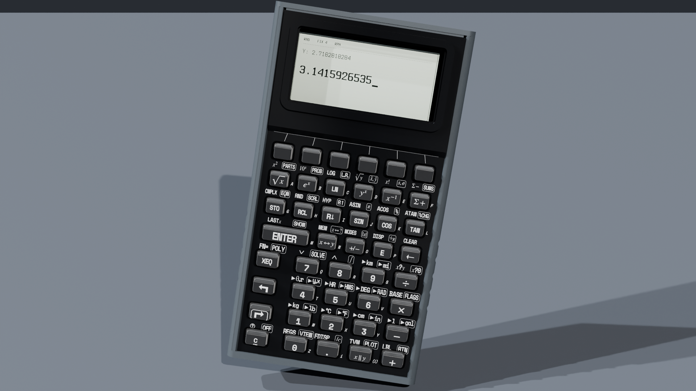
          <h3 class="cross-sell-card-title">SC-32 Scientific RPN Maker Kit</h3>
          

            Equipped with native fraction reduction, improper fraction toggling (), and a 4-line RPN stack. Students see both the exact fractional quotient and decimal approximation simultaneously.
          

        

        

          

            .00
            Maker Kit
          

          <a href="../sc32-calculator/" class="ec-btn-secondary w-full text-center mt-3 text-xs block">
            View SC-32 Maker Kit &rarr;
          </a>
        

      

      <!-- Cross-Sell 2: Prime Factor Studio -->
      

        

          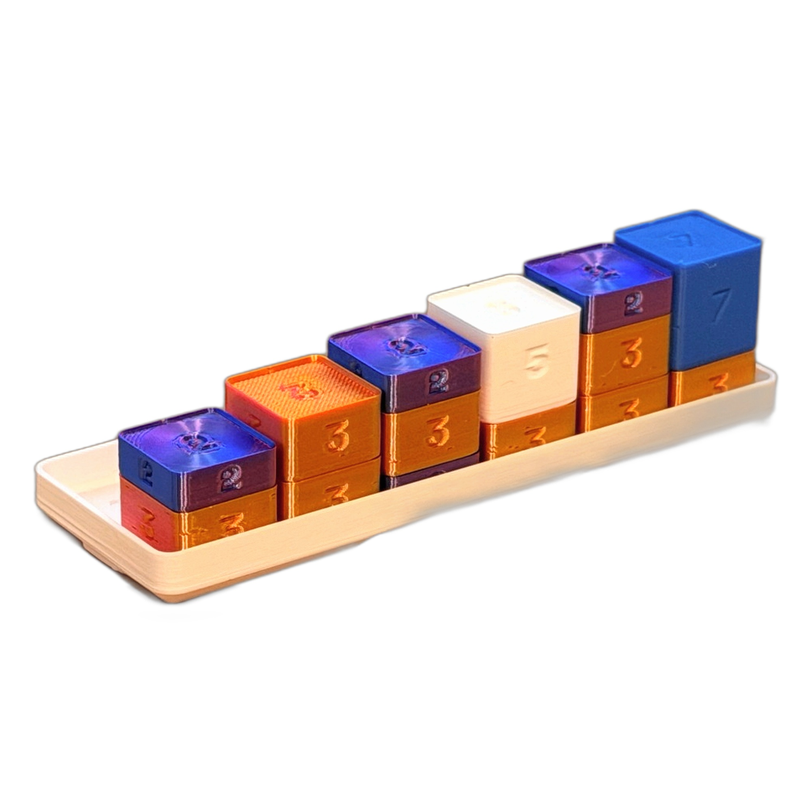
          <h3 class="cross-sell-card-title">Prime Factor Studio</h3>
          

            Tactile prime number towers with snap-fit blocks. Visualizes prime factorization, LCM, GCD, and the fundamental theorem of arithmetic.
          

        

        

          

            .00
            Standalone Kit
          

          <a href="../prime-factor-studio/" class="ec-btn-secondary w-full text-center mt-3 text-xs block">
            Explore Prime Factor Studio &rarr;
          </a>
        

      

      <!-- Cross-Sell 3: SC-6 Elementary Calculator -->
      

        

          
          <h3 class="cross-sell-card-title">SC-6 Elementary Calculator</h3>
          

            The foundational calculator for elementary learners. Pairs physical fraction tower heights with on-screen fraction reduction and stack manipulation.
          

        

        

          

            .00
            Standalone Kit
          

          <a href="../sc6-elementary/" class="ec-btn-secondary w-full text-center mt-3 text-xs block">
            Explore SC-6 Calculator &rarr;
          </a>
        

      

    

  </section>

  <!-- ==========================================================================
       SECTION: PROPORTIONAL RATIO SPECIFICATIONS
       ========================================================================== -->
  <section class="ec-section">
    <h2 class="ec-section-title">Precision Mathematical Height Ratios</h2>
    

      Every block maintains a uniform 20.5&times;20.5 mm (0.5U Gridfinity) footprint while strictly obeying mathematical height proportions relative to the 84.0 mm Whole datum.
    

    <table class="ec-spec-table">
      <tbody>
        <tr>
          <td class="ec-spec-k">Whole Unit \(\left(\frac{1}{1}\right)\)</td>
          <td class="ec-spec-v">84.00 mm visible height datum &bull; 2 included (2 columns) &bull; Debossed 4-face notation</td>
        </tr>
        <tr>
          <td class="ec-spec-k">Halves \(\left(\frac{1}{2}\right)\)</td>
          <td class="ec-spec-v">42.00 mm visible height &bull; 4 included (2 columns of 2) &bull; 2 blocks = 84.00 mm flush</td>
        </tr>
        <tr>
          <td class="ec-spec-k">Thirds \(\left(\frac{1}{3}\right)\)</td>
          <td class="ec-spec-v">28.00 mm visible height &bull; 3 included &bull; 3 blocks = 84.00 mm flush</td>
        </tr>
        <tr>
          <td class="ec-spec-k">Quarters \(\left(\frac{1}{4}\right)\)</td>
          <td class="ec-spec-v">21.00 mm visible height &bull; 4 included &bull; 4 blocks = 84.00 mm flush</td>
        </tr>
        <tr>
          <td class="ec-spec-k">Fifths \(\left(\frac{1}{5}\right)\)</td>
          <td class="ec-spec-v">16.80 mm visible height &bull; 5 included &bull; 5 blocks = 84.00 mm flush</td>
        </tr>
        <tr>
          <td class="ec-spec-k">Sixths \(\left(\frac{1}{6}\right)\)</td>
          <td class="ec-spec-v">14.00 mm visible height &bull; 6 included &bull; 6 blocks = 84.00 mm flush</td>
        </tr>
        <tr>
          <td class="ec-spec-k">Eighths \(\left(\frac{1}{8}\right)\)</td>
          <td class="ec-spec-v">10.50 mm visible height &bull; 8 included &bull; 8 blocks = 84.00 mm flush</td>
        </tr>
        <tr>
          <td class="ec-spec-k">Ninths \(\left(\frac{1}{9}\right)\)</td>
          <td class="ec-spec-v">9.33 mm visible height &bull; 9 included &bull; 9 blocks = 84.00 mm flush</td>
        </tr>
        <tr>
          <td class="ec-spec-k">Tenths \(\left(\frac{1}{10}\right)\)</td>
          <td class="ec-spec-v">8.40 mm visible height &bull; 10 included &bull; 10 blocks = 84.00 mm flush</td>
        </tr>
        <tr>
          <td class="ec-spec-k">Twelfths \(\left(\frac{1}{12}\right)\)</td>
          <td class="ec-spec-v">7.00 mm visible height &bull; 12 included &bull; 12 blocks = 84.00 mm flush</td>
        </tr>
        <tr>
          <td class="ec-spec-k">Industrial Design &amp; CMF</td>
          <td class="ec-spec-v">Solid matte polymer with 0.50 mm debossed Space Mono Bold typography on all 4 faces &bull; 45&deg; finger-centering relief chamfers &bull; Sub-millimeter reciprocal height parity</td>
        </tr>
        <tr>
          <td class="ec-spec-k">Curriculum Standards</td>
          <td class="ec-spec-v">Common Core: CCSS.MATH.CONTENT.3.NF.A.1, 3.NF.A.3 (Equivalence), 4.NF.A.1, 5.NF.A.1 &bull; TEKS: 111.5.b.3, 111.6.b.3 &bull; Grades 2&ndash;6</td>
        </tr>
        <tr>
          <td class="ec-spec-k">Stacking Profile</td>
          <td class="ec-spec-v">Authentic 0.5U Gridfinity bottom base plug and nesting top socket (1.85mm subtractive depth cancels on every joint)</td>
        </tr>
      </tbody>
    </table>
  </section>

  <!-- ==========================================================================
       SECTION: WHAT'S IN THE BOX
       ========================================================================== -->
  <section class="ec-section">
    <h2 class="ec-section-title">What's in the Kit</h2>
    
Complete 65-piece classroom and home mathematics lab.

    

      

        &check;
        63 Precision Proportional Fraction Towers across 12 columns and 10 curriculum denominators (\(\frac{1}{1}, \frac{1}{2}, \frac{1}{3}, \frac{1}{4}, \frac{1}{5}, \frac{1}{6}, \frac{1}{8}, \frac{1}{9}, \frac{1}{10}, \frac{1}{12}\))
      

      

        &check;
        3&times;1&times;13U Caddy-Free Socketed Gridfinity Storage Enclosure Box (125.5 &times; 42.0 &times; 98.4 mm) with 12 integrated debossed fraction socket floors
      

      

        &check;
        Snapfinity Dual-Well Stackable Fraction Comparator Stage Lid
      

      

        &check;
        Archival 4&times;6" Reference Card &bull; 12 Laminated Fraction Investigation Activity Cards &bull; Teacher / Parent Guide
      

    

  </section>

  <!-- ==========================================================================
       SECTION: SAFETY, COMPLIANCE & GUARANTEES
       ========================================================================== -->
  <section class="ec-section">
    <h2 class="ec-section-title">Safety, Compliance &amp; Guarantees</h2>
    
Classroom-grade durability and strict child safety compliance.

    

      

        <strong class="text-amber-300 flex items-center gap-2 mb-1">
          &#9888; Mandatory Safety Disclaimer (CPSIA / ASTM F963)
        </strong>
        

          <strong>WARNING: CHOKING HAZARD &ndash; Small parts.</strong> Not for children under 3 years. Subdivided fraction blocks (\(\frac{1}{12}\), \(\frac{1}{10}\)) measure under \(31.75\,\text{mm}\). Designed for educational instruction for Grades 3+ (ages 8 and up) under adult supervision.
        

      

      

        <strong class="text-sky-400 flex items-center gap-2 mb-1">
          &#10003; 100% Non-Toxic Classroom Materials
        </strong>
        

          Molded from odorless, non-toxic, BPA-free PLA polymer. Free from lead, heavy metals, PVC, and phthalates. Wipe clean with standard classroom disinfectant wipes.
        

      

      

        <strong class="text-emerald-400 flex items-center gap-2 mb-1">
          &#9874; "Anti-Heartbreak" Lifetime Guarantee for Parents &amp; Classrooms
        </strong>
        

          Classrooms and living rooms are busy spaces. If a block ever wanders off, order individual replacement towers or fractional segments anytime for just $2.49 with free envelope shipping.
        

      

      

        <strong class="text-indigo-400 flex items-center gap-2 mb-1">
          &#9881; Made in California, USA
        </strong>
        

          Designed and manufactured by StackCalc in California under strict dimensional tolerances and quality control.
        

      

    

  </section>

  <!-- ==========================================================================
       SECTION: PEDAGOGICAL VERIFICATION & CLASSROOM ARCHITECTURE
       ========================================================================== -->
  <section class="ec-section">
    

      

        <h2 class="ec-section-title m-0">Pedagogical Verification &amp; Classroom Architecture</h2>
        
Proportional height geometry, tactile surface distinction, and freestanding desk ergonomics.

      

      

        &bull; GEOMETRIC INTEGRITY VERIFIED
      

    

    

      

        

          MATHEMATICAL GEOMETRY
          <h3 class="font-bold text-base text-white mt-1 mb-2">Self-Correcting Z-Axis Heights</h3>
          

            Vertical heights are strictly proportional to mathematical values (two 1/4 blocks physically equal one 1/2 block). Eliminates cognitive misconceptions through undeniable tactile equality.
          

        

        

          Tolerance: &plusmn;0.1mm &bull; Scale: 1.0 = 120mm
        

      

      

        

          TACTILE ACCESSIBILITY
          <h3 class="font-bold text-base text-white mt-1 mb-2">Debossed Microhatching</h3>
          

            Each fraction denominator family features unique tactile hatched surface patterns alongside debossed numerals, enabling multi-sensory and low-vision spatial recognition.
          

        

        

          Surface: Concentric/Crosshatch &bull; Relief: 0.6mm
        

      

      

        

          WORKSPACE EFFICIENCY
          <h3 class="font-bold text-base text-white mt-1 mb-2">12-Column Caddy &amp; Desktop Freedom</h3>
          

            Engineered with a removable 12-column caddy chassis featuring anti-scrape runner glides and debossed socket floors. During lessons, towers stand freely on any student desk with zero wobble for multi-tower comparisons.
          

        

        

          Base: 3x1 Gridfinity &bull; Footprint: Desk Optimized
        

      

    

  </section>

  <!-- ==========================================================================
       SECTION: FREQUENTLY ASKED QUESTIONS (FAQ)
       ========================================================================== -->
  <section class="ec-section">
    <h2 class="ec-section-title">Frequently Asked Questions</h2>
    
Common questions regarding classroom use, fraction ratios, and standards alignment.

    

      

        

          How does the 12-column socketed enclosure keep classroom pieces organized?
          +
        

        

          The 3&times;1&times;13U Gridfinity enclosure features 12 integrated socket wells with permanently debossed fraction numerals (Row 1: 1, 1, 1/2, 1/2, 1/3, 1/4; Row 0: 1/5, 1/6, 1/8, 1/9, 1/10, 1/12). Every complete fraction column levels off at the uniform 84.00 mm waterline, allowing teachers and students to complete a full visual inventory audit in under 3 seconds before packing away.
        

      

      

        

          How does the inverse height ratio work?
          +
        

        

          The whole unit tower measures exactly 84.00 mm in visible height. Fractions scale proportionally across all 10 curriculum denominators: \(1/2 = 42.00\,\text{mm}\), \(1/3 = 28.00\,\text{mm}\), \(1/4 = 21.00\,\text{mm}\), \(1/5 = 16.80\,\text{mm}\), \(1/6 = 14.00\,\text{mm}\), \(1/8 = 10.50\,\text{mm}\), \(1/9 = 9.33\,\text{mm}\), \(1/10 = 8.40\,\text{mm}\), and \(1/12 = 7.00\,\text{mm}\). Placing two 1/4 blocks next to a 1/2 block creates a continuous, perfectly flush top plane.
        

      

      

        

          What educational standards are covered?
          +
        

        

          The set directly targets Common Core standards CCSS.MATH.CONTENT.3.NF.A.1 (Fraction representation), 3.NF.A.3 (Equivalent fractions), and 4.NF.A.1 (Fraction comparison and decomposition), as well as Texas TEKS 111.5.b.3 and 111.6.b.3.
        

      

      

        

          What if a student or child loses a fraction block?
          +
        

        

          Under our "Anti-Heartbreak" lifetime guarantee, parents and teachers can order individual matching replacement blocks anytime for just $2.49 with free envelope shipping. Never retire a set because a piece went missing.
        

      

    

  </section>

  <!-- Open Source Maker Download Callout -->
  <section id="downloads" class="ec-section">
    

      

        &bull; 100% Free Open Hardware
        <h3 class="ec-maker-title">3D Print This Kit in Your Classroom</h3>
        

          Download our print-tested STL files and print Fraction Studio on any standard 3D printer. Includes recommended layer heights and single-color debossed print profiles.
        

      

      

        <a href="https://www.printables.com/@StackCalc_5593834" target="_blank" rel="noopener noreferrer" class="ec-btn-primary" style="background-color: #FA6B05; border-color: #FA6B05; color: #FFFFFF;">
          Download 3MF on Printables ↗
        </a>
      

    

  </section>

  <!-- Discreet Ecosystem Blurb -->
  

    
&Delta;

    

      
Part of the StackCalc Math Learning Ecosystem

      

        Fraction Studio functions as an independent, tactile math manipulative for elementary and middle school classrooms. When students advance to numeric calculations, these physical block models connect directly with the operational stack on our <a href="../sc6-elementary/" class="text-sky-400 hover:underline">SC-6 Elementary</a> and <a href="../sc32-calculator/" class="text-sky-400 hover:underline">SC-32 Scientific</a> calculators. Explore complete lesson modules in our <a href="../../downloads/#1-classroom-curriculum--competition-downloads-pdf" class="text-amber-400 hover:underline">120 Classroom Station Worksheets</a> and order on-demand precision refills at the <a href="https://teleportpod.com/portals/profile/StackCalc" target="_blank" rel="noopener noreferrer" class="text-emerald-400 hover:underline">Slant 3D Replacement Parts Center ↗</a>.
      

    

  

