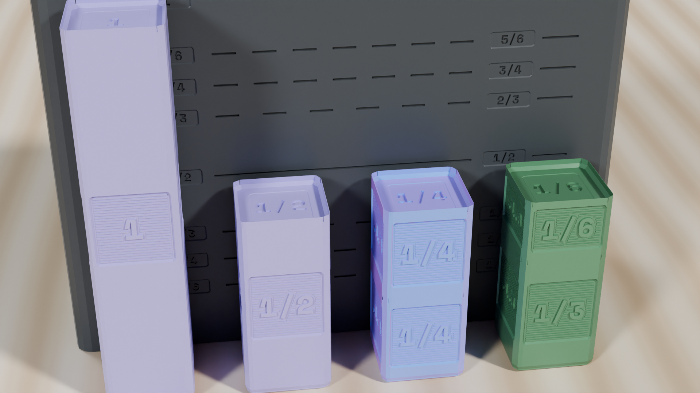
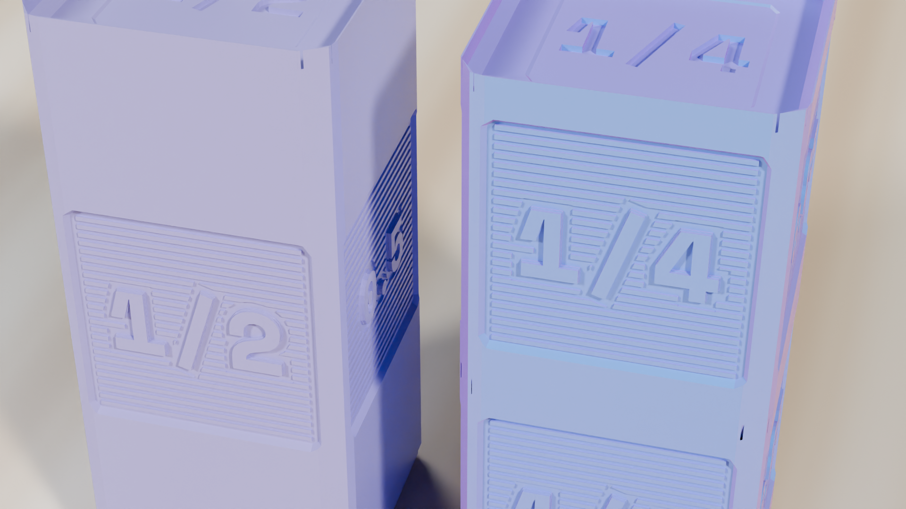

  <!-- Breadcrumb -->
  <nav class="ec-breadcrumb" aria-label="Breadcrumb">
    <a href="../../../">Home</a>
    /
    <a href="../../">Products &amp; Manipulatives</a>
    /
    <a href="../">Fraction Studio</a>
    /
    Classroom Lessons
  </nav>

  <!-- Header -->
  <header class="ec-catalog-header">
    
Curriculum Lessons &bull; CRA Methodology

    <h1 class="ec-catalog-headline">Fraction Studio Classroom Lessons</h1>
    

      Ground abstract fractional symbols in physical tactile reality. These lessons follow the Concrete-Representational-Abstract (CRA) instructional framework aligned with CCSS Math Standards.
    

  </header>

  <!-- Navigation Pill Row -->
  

    <a href="../" class="ec-btn-secondary">&larr; Back to Product Overview</a>
    <a href="../assembly/" class="ec-btn-secondary">View Assembly Guide &rarr;</a>
  

  <!-- Lesson Video Demonstration -->
  <section class="ec-section">
    <h2 class="ec-section-title">Classroom Demonstration Video: Lessons 1 &amp; 2</h2>
    
Watch students use authentic proportional towers to prove equivalence and add fractions with common denominators on a desk.

    

      

        

          <video controls playsinline preload="metadata" poster="../../../assets/renders/fraction-studio-gauge-comparison.png">
            <source src="/assets/videos/fraction-studio-lesson.mp4" type="video/mp4">
            Your browser does not support HTML5 video.
          </video>
        

        

          <strong>Curriculum Demonstration (Lessons 1 &amp; 2)</strong>
          Equivalence: 1/2 = 2/4 = 4/8 &bull; Addition: 1/2 + 1/4 = 3/4 &bull; Gauge comparison
        

      

      

        
&equiv;

        <h3 class="ec-feature-title">Why Physical Heights Work</h3>
        

          When students struggle with fractions, it is almost always because standard textbooks jump to abstract symbolic rules before students build a physical mental model of the quantity. Fraction Studio gives students an unshakeable tactile foundation: if two towers are the same height, they are mathematically equal.
        

      

    

  </section>

  <!-- ==========================================================================
       LESSON 1: TACTILE FRACTION EQUIVALENCE
       ========================================================================== -->
  <section class="ec-section">
    

      

        Lesson 01
        Target Grades: 3&ndash;5 &bull; Standard: CCSS.MATH.CONTENT.3.NF.A.3
      

      <h2 class="text-2xl font-bold text-white mb-2">Concrete Equivalence: Proving 1/2 = 2/4 = 4/8 Against the Box Gauge</h2>
      

        <strong>Lesson Objective:</strong> Students physically discover and prove that fractions with different numerators and denominators represent the exact same quantity when their physical heights match flush against each other and align with the debossed benchmark gauge on the back of the storage box.
      

      <!-- Concept Illustration Card -->
      

        
        

          <strong>Physical Alignment:</strong> The \(1/2\) tower (\(42.0\text{ mm}\)), two \(1/4\) blocks, and four \(1/8\) blocks line up flush with the \(1/2\) benchmark waterline.
          Tolerance: &plusmn;0.05 mm
        

      

      <h3 class="text-base font-bold text-sky-400 mb-3">Step-by-Step Classroom Investigation</h3>
      

        

          1.
          

            <strong>Position the Box Gauge Comparator:</strong> Place the matte black storage box upright on the classroom desk with its rear wall facing forward. Point out the debossed precision waterline scale with engraved fractions (\(0, 1/6, 1/4, 1/3, 1/2, 2/3, 3/4, 5/6, 1\)) spanning the \(84.0\text{ mm}\) total height.
          

        

        

          2.
          

            <strong>Seat the Reference Half:</strong> Place one \(1/2\) block (\(42.0\text{ mm}\)) upright directly in front of the box gauge at column 2. Note how its top edge matches the debossed \(1/2\) line exactly.
          

        

        

          3.
          

            <strong>Build the Quarters Tower:</strong> Beside the half block, stack two \(1/4\) blocks (\(2 \times 21.0 = 42.0\text{ mm}\)). Have the student run a fingertip across both tops: they are perfectly level, and both touch the \(1/2\) waterline on the box gauge.
          

        

        

          4.
          

            <strong>Construct the Eighths Tower:</strong> In the next column, stack four \(1/8\) blocks (\(4 \times 10.5 = 42.0\text{ mm}\)). All three towers now share the exact same physical height and align with the gauge waterline:
            \[
            \frac{1}{2} = \frac{2}{4} = \frac{4}{8}
            \]
          

        

      

      <!-- Misconception Diagnostic Box -->
      

        <h4 class="text-sm font-bold text-amber-300 mb-1">&Delta; Key Misconception Diagnostic: "Larger Denominator Means Bigger"</h4>
        

          <strong>The Common Error:</strong> Many students intuitively believe that \(\frac{1}{8}\) is larger than \(\frac{1}{2}\) because the digit 8 is larger than 2.
        

        

          <strong>The Physical Fix:</strong> Hand the student one \(\frac{1}{8}\) block and one \(\frac{1}{2}\) block. Have them hold one in each hand. Ask: <em>"If a pizza is cut into 8 slices, is one slice larger or smaller than if the same pizza is cut into only 2 slices?"</em> The physical height difference (\(10.5\text{ mm}\) vs. \(42.0\text{ mm}\)) eliminates the misconception immediately.
        

      

      <!-- Independent Transfer Task -->
      

        <h4 class="text-sm font-bold text-emerald-400 mb-1">&check; Independent Transfer Check</h4>
        

          <strong>Prompt:</strong> Without stacking against the Whole, predict how many \(\frac{1}{6}\) blocks are needed to match a single \(\frac{1}{2}\) block. Test with blocks to confirm. Then, on a blank sheet of paper, sketch a number line from \(0\) to \(1\) and mark \(\frac{1}{2}\), \(\frac{2}{4}\), and \(\frac{3}{6}\) at the exact same point.
        

      

    

  </section>

  <!-- ==========================================================================
       LESSON 2: TACTILE COMMON DENOMINATORS
       ========================================================================== -->
  <section class="ec-section">
    

      

        Lesson 02
        Target Grades: 4&ndash;6 &bull; Standard: CCSS.MATH.CONTENT.5.NF.A.1
      

      <h2 class="text-2xl font-bold text-white mb-2">Tactile Addition &amp; Finding Common Denominators: 1/2 + 1/4</h2>
      

        <strong>Lesson Objective:</strong> Solve addition problems with unlike denominators by physically finding equivalent unit blocks that measure the combined height without gaps or overhangs.
      

      <h3 class="text-base font-bold text-sky-400 mb-3">Step-by-Step Classroom Investigation</h3>
      

        

          1.
          

            <strong>Physical Problem Setup:</strong> Take one \(\frac{1}{2}\) block and stack one \(\frac{1}{4}\) block on top of it. Total stack height is \(42.0 + 21.0 = 63.0\text{ mm}\). State the question: <em>"What single fraction name describes the total height of this combined tower?"</em>
          

        

        

          2.
          

            <strong>Test Candidate Denominators:</strong> Attempt to match the height using Thirds (\(\frac{1}{3}\)):
            <ul class="list-disc pl-5 mt-1 text-xs text-gray-300 space-y-1">
              <li>Two thirds (\(2 \times 28.0 = 56.0\text{ mm}\)) is too short.</li>
              <li>Three thirds (\(3 \times 28.0 = 84.0\text{ mm}\)) is too tall.</li>
              <li>Conclusion: Thirds cannot measure this quantity cleanly.</li>
            </ul>
          

        

        

          3.
          

            <strong>Discover the Common Denominator:</strong> Test Fourths (\(\frac{1}{4}\)):
            <ul class="list-disc pl-5 mt-1 text-xs text-gray-300 space-y-1">
              <li>Stack three \(\frac{1}{4}\) blocks side-by-side with the combined tower (\(3 \times 21.0 = 63.0\text{ mm}\)).</li>
              <li>They align <em>perfectly flush</em>!</li>
            </ul>
          

        

        

          4.
          

            <strong>Write the Mathematical Equivalence:</strong> Connect the physical action to symbolic notation:
            \[
            \frac{1}{2} + \frac{1}{4} = \frac{2}{4} + \frac{1}{4} = \frac{3}{4}
            \]
            Explain: <em>"The \(\frac{1}{2}\) block is physically identical to two \(\frac{1}{4}\) blocks. Converting to a common denominator simply means measuring everything with blocks of the same size."</em>
          

        

      

      <!-- Misconception Diagnostic Box -->
      

        <h4 class="text-sm font-bold text-amber-300 mb-1">&Delta; Key Misconception Diagnostic: "Adding Across" (1/3 + 1/3 = 2/6)</h4>
        

          <strong>The Common Error:</strong> Students add both numerators and denominators: \(\frac{1}{3} + \frac{1}{3} = \frac{2}{6}\).
        

        

          <strong>The Physical Fix:</strong> Have the student stack two \(\frac{1}{3}\) blocks (\(56.0\text{ mm}\)). Then have them stack two \(\frac{1}{6}\) blocks (\(28.0\text{ mm}\)). Show that \(\frac{2}{6}\) is <em>smaller</em> than a single \(\frac{1}{3}\) block! When combining thirds, the unit size (thirds) never changes; only the count of units increases.
        

      

      <!-- Independent Transfer Task -->
      

        <h4 class="text-sm font-bold text-emerald-400 mb-1">&check; Independent Transfer Check</h4>
        

          <strong>Prompt:</strong> Using your blocks, solve \(\frac{1}{3} + \frac{1}{6}\). Predict which block denomination can measure both. Verify with blocks, and write down the full equation showing your common denominator step.
        

      

    

  </section>

  <!-- ==========================================================================
       SECTION: CRAFTSMANSHIP & 4-FACE MULTI-NOTATION
       ========================================================================== -->
  <section class="ec-section">
    

      

        Tactile Craftsmanship
        Archival Matte White PLA &bull; Debossed Typography
      

      <h2 class="text-2xl font-bold text-white mb-2">Heirloom Craftsmanship &amp; Multi-Notational Mapping</h2>
      

        Every block in Fraction Studio is fabricated with solid high-infill matte polymer and debossed with crisp Space Mono typography. Notice the 0.5U Gridfinity male footprint and female socket with 45-degree lead-in chamfers.
      

      

        

          
        

        

          

            <strong class="text-sky-300 font-mono text-xs block mb-1">FACE 1: STANDARD FRACTION</strong>
            Debossed numeral (e.g. \(1/2\)) provides primary visual and tactile reference for young learners.
          

          

            <strong class="text-emerald-300 font-mono text-xs block mb-1">FACE 2: DECIMAL EQUIVALENT</strong>
            Rotated 90&deg; to reveal the exact decimal equivalent (\(0.5\)), bridging fractions to base-10 metrics.
          

          

            <strong class="text-amber-300 font-mono text-xs block mb-1">FACE 3: PERCENTAGE NOTATION</strong>
            Rotated 180&deg; to display the percentage value (\(50\%\)), demonstrating that all three notations represent the same spatial volume.
          

        

      

    

  </section>

