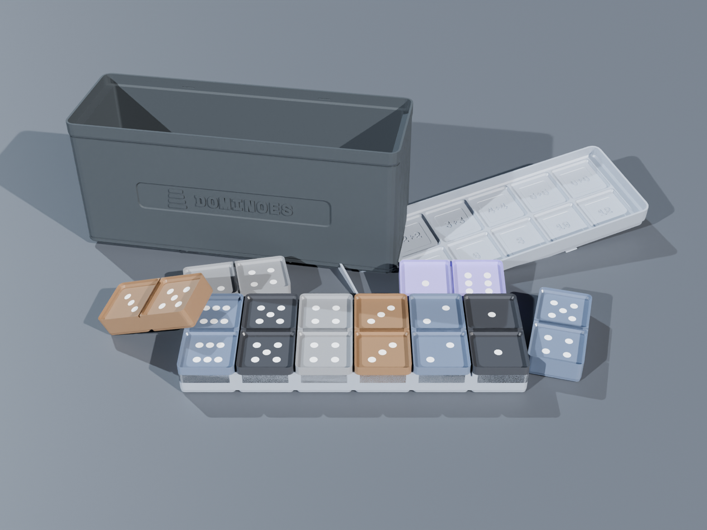
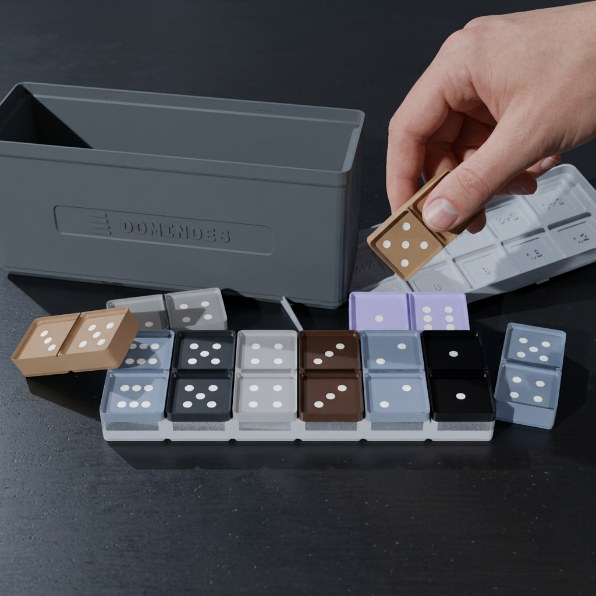
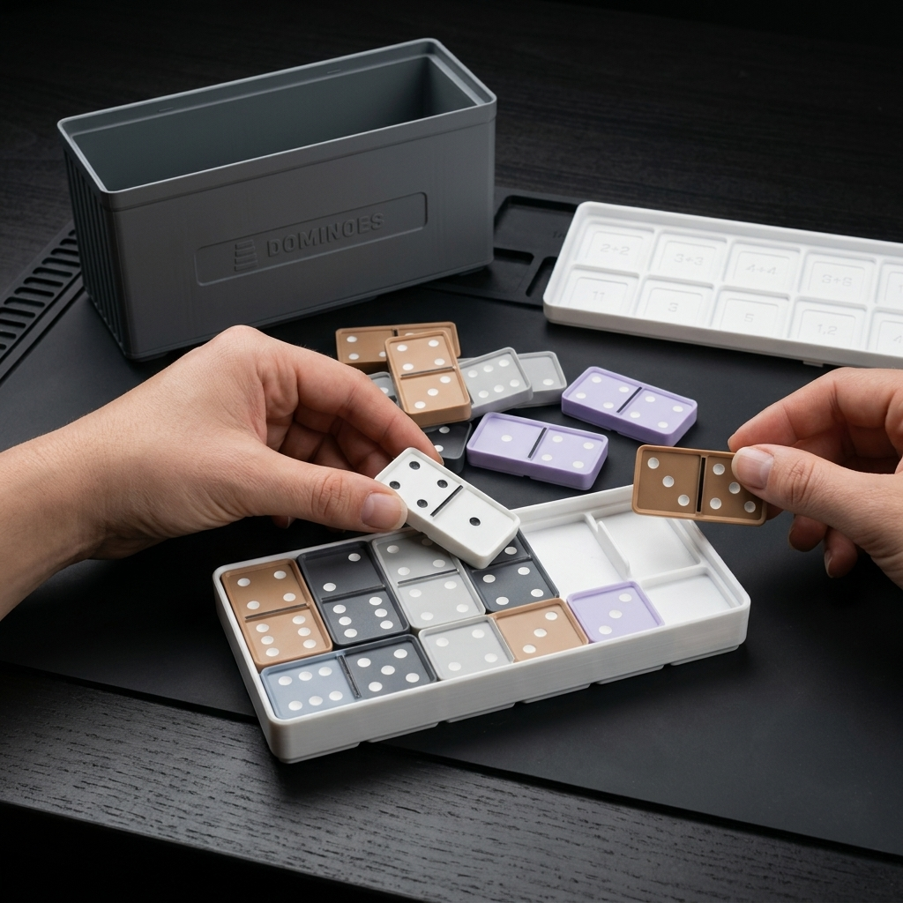
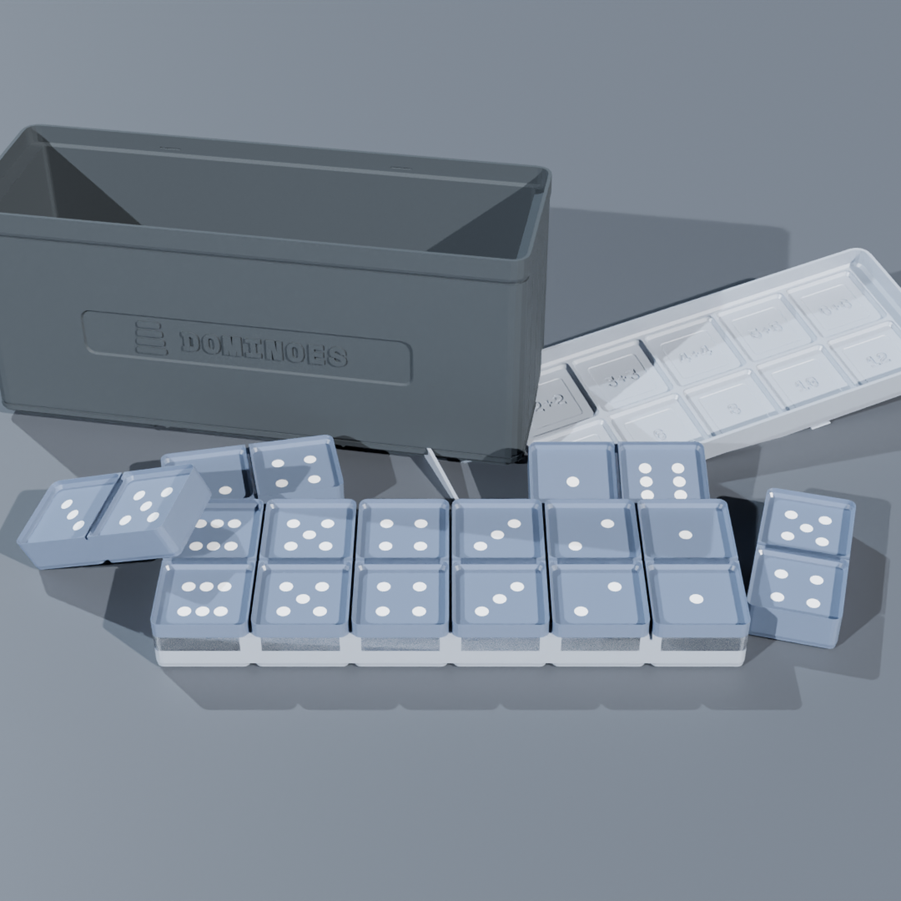
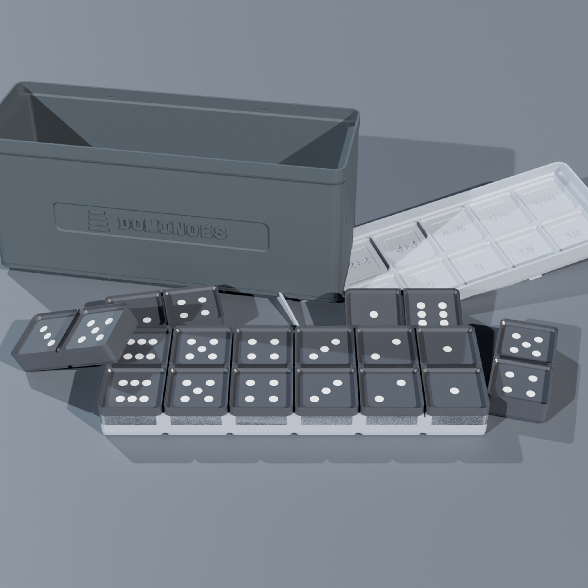
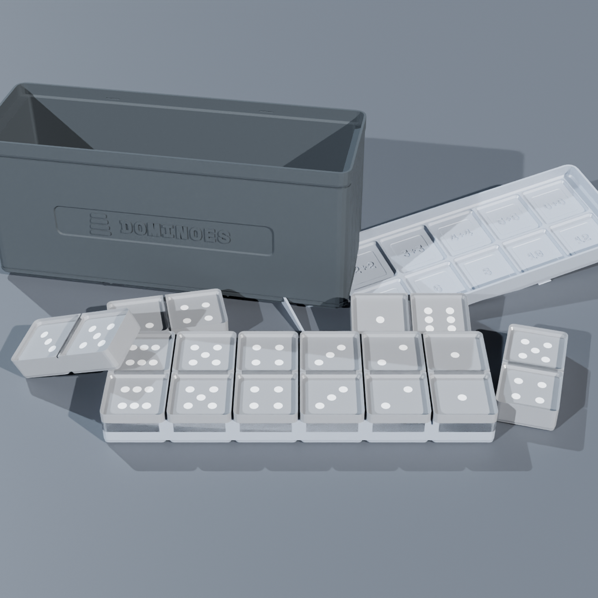
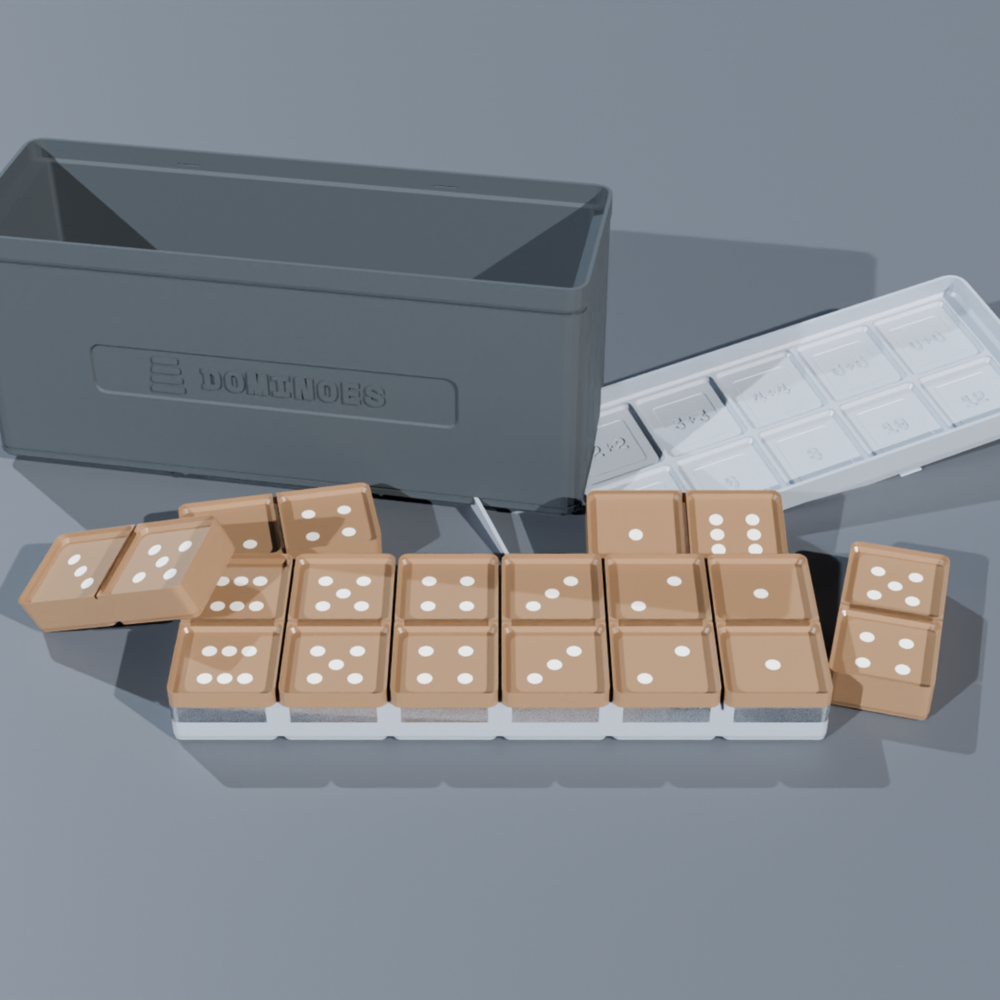
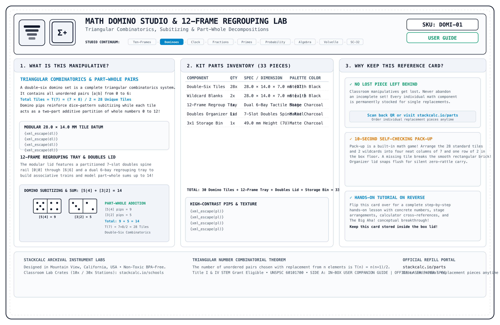
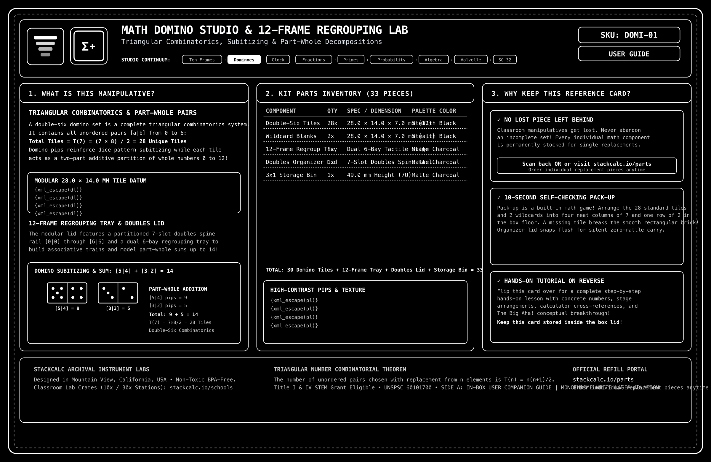

<!-- Schema.org JSON-LD Structured Data for High Google Search & Rich Results Ranking -->

  <!-- Breadcrumb -->
  <nav class="ec-breadcrumb" aria-label="Breadcrumb">
    <a href="../../">Home</a>
    /
    <a href="../">Products &amp; Manipulatives</a>
    /
    Math Domino Studio
  </nav>

  <!-- ==========================================================================
       HERO PRODUCT SECTION (2-COLUMN ECOMMERCE SPLIT)
       ========================================================================== -->
  

    <!-- Left Column: Product Gallery -->
    

      

        

          Grades Pre-K&ndash;4
          &bull; In Stock &bull; Batch 001
        

        
      

      <!-- Thumbnail Selector Strip -->
      

        
t.classList.remove('active')); this.classList.add('active');">
          
        

        
t.classList.remove('active')); this.classList.add('active');">
          
        

        
t.classList.remove('active')); this.classList.add('active');">
          
        

        
t.classList.remove('active')); this.classList.add('active');">
          
        

        
t.classList.remove('active')); this.classList.add('active');">
          
        

        
t.classList.remove('active')); this.classList.add('active');">
          
        

        
t.classList.remove('active')); this.classList.add('active');">
          
        

        
t.classList.remove('active')); this.classList.add('active');">
          
        

        
t.classList.remove('active')); this.classList.add('active');">
          
        

        
t.classList.remove('active')); this.classList.add('active');">
          
        

        
t.classList.remove('active')); this.classList.add('active');">
          
        

        
t.classList.remove('active')); this.classList.add('active');">
          
        

      

    

    <!-- Right Column: Buy Box & Product Info -->
    

      

        Early Numeracy
        &check; 3-in-1 Studio System
      

      <h1 class="ec-product-title">Math Domino Studio &amp; 12-Frame Set</h1>

      <!-- Social Proof & Review Score -->
      

        
★★★★★

        4.9 / 5.0
        &bull; 28 Educator Reviews
        &check; Verified Physical Print
      

      

        $29.00
        &check; Free US Tracked Shipping &bull; Batch 001
      

      <!-- Colorway Selection Swatches -->
      

        

          Choose Table Edition / Polymer Colorway:
          1064nm Laser-Foamed Pips
        

        

          <button type="button" class="ec-swatch-chip active" onclick="document.getElementById('main-product-image').src='../../assets/renders/etsy/dominoes-studio-midnight_navy-square.png'; document.querySelectorAll('.ec-swatch-chip').forEach(c=>c.classList.remove('active')); this.classList.add('active');">
            
            Midnight Navy
          </button>
          <button type="button" class="ec-swatch-chip" onclick="document.getElementById('main-product-image').src='../../assets/renders/etsy/dominoes-studio-stealth_black-square.png'; document.querySelectorAll('.ec-swatch-chip').forEach(c=>c.classList.remove('active')); this.classList.add('active');">
            
            Stealth Black
          </button>
          <button type="button" class="ec-swatch-chip" onclick="document.getElementById('main-product-image').src='../../assets/renders/etsy/dominoes-studio-space_gray-square.png'; document.querySelectorAll('.ec-swatch-chip').forEach(c=>c.classList.remove('active')); this.classList.add('active');">
            
            Space Gray
          </button>
          <button type="button" class="ec-swatch-chip" onclick="document.getElementById('main-product-image').src='../../assets/renders/etsy/dominoes-studio-coffee_brown-square.png'; document.querySelectorAll('.ec-swatch-chip').forEach(c=>c.classList.remove('active')); this.classList.add('active');">
            
            Coffee Brown
          </button>
        

      

      

        An end-to-end tactile arithmetic system designed to bridge dot subitizing, addition doubles facts, and discrete probability distributions. Features 30 precision 2x1 miniblock dominoes (28 double-six + 2 blanks) with direct 1064nm IR laser-foamed pips, a 12-frame pull-out regrouping tray with a bridge-through-10 demarcation, and a stackable doubling snap lid housed in a 3x1 Gridfinity fuzzy-skin box.
      

      <!-- Highlights Checklist -->
      

        

          &check;
          <strong>1064nm Laser-Foamed Pips:</strong> Direct IR laser micro-bubble foaming produces permanent, stark chalk-white pips (L = 0.86&ndash;0.88, WCAG AAA 15.2:1) with +0.05 mm tactile dome relief. Zero painted dots to chip or wear off.
        

        

          &check;
          <strong>Four Classroom Table Colorways:</strong> Molded in our calculator faceplate-grade biopolymers (Midnight Navy, Stealth Black, Space Gray, Coffee Brown). Perfect for color-coded classroom table stations (one distinct color per table group to eliminate mixed pieces).
        

        

          &check;
          <strong>Stackable Doubling Snap Lid:</strong> 12 molded miniblock sockets with debossed legends ("1+1=2" to "6+6=12") for tactile self-correction.
        

        

          &check;
          <strong>12-Frame Regrouping Tray:</strong> 6x2 tray featuring a permanent divider between Col 4 and 5 to teach 10 + 2 = 12 decomposition.
        

        

          &check;
          <strong>Fuzzy-Skin Gridfinity Enclosure:</strong> Tactile pebble texture resists classroom scuffs and nests into any standard Gridfinity base.
        

      

      <!-- Action Buttons -->
      

        <a href="https://www.etsy.com/shop/StackCalc" target="_blank" rel="noopener noreferrer" class="ec-btn-primary" style="background-color: #f1641e; border-color: #f1641e; color: #ffffff;">
          Order on Etsy ($29.00) ↗
        </a>
        <a href="#downloads" class="ec-btn-secondary">
          Download Free 3MF / STLs &darr;
        </a>
      

      <!-- Trust Badges -->
      

        

          &check;
          Common Core &bull; TEKS Aligned
        

        

          &circlearrowright;
          100% Non-Toxic Cornstarch PLA
        

        

          &star;
          $2.25 Single-Tile Replacement
        

      

    

  

  <!-- ==========================================================================
       THE STACKCALC MANIFESTO: CONCRETE PEDAGOGY VS DISPOSABLE TOYS
       ========================================================================== -->
  <section class="ec-manifesto-banner">
    

      Engineering Manifesto
      <h2 class="ec-manifesto-title">Calculators &amp; Manipulatives Engineered Like Precision Instruments, Not Disposable Toys.</h2>
      

        For forty years, early math education has been caught between two false choices: flimsy blow-molded yellow plastic toys with loose tolerances and sharp burrs, or disembodied flat glass screens that strip weight, friction, and spatial muscle memory from developing minds.
      

      

        At StackCalc, we reject throwaway plastic culture. Every tile, detent, and frame is drafted with <strong>0.18mm mechanical tolerances</strong>, molded in high-density matte biopolymers, and keyed into the open Gridfinity architecture. When a classroom loses a tile, you don't throw away the kit&mdash;our archival tracking cards provide <strong>direct single-piece replacements for $2.25</strong>. Real weight. Crisp mechanical clicks. Concrete mathematical intuition that endures.
      

      

        

          0.18 mm
          Mechanical Snap Tolerance
        

        

          WCAG AAA
          15.2:1 Laser Pip Contrast
        

        

          100%
          Non-Toxic Bio-Polymers
        

        

          $2.25
          Single-Piece Archival Care
        

      

    

  </section>

  <!-- ==========================================================================
       SECTION: THE 3-IN-1 TACTILE SYSTEM
       ========================================================================== -->
  <section class="ec-section">
    <h2 class="ec-section-title">The 3-in-1 Concrete Math Architecture</h2>
    

      Most classroom dominoes are flimsy toy tiles. The StackCalc Domino Studio is engineered from the build plate up as an active mental math instrument.
    

    

      

        
::

        <h3 class="ec-feature-title">1. The Doubling Snap Lid</h3>
        

          Features 12 precision sockets arranged in two rows. Row 1 debossed with expressions (1+1, 2+2, 3+3, 4+4, 5+5, 6+6); Row 0 debossed with sums (2, 4, 6, 8, 10, 12). Students locate doubles and snap them in for instant tactile feedback.
        

      

      

        
&equiv;

        <h3 class="ec-feature-title">2. 12-Frame Regrouping Tray</h3>
        

          A pull-out 6x2 tray holding 6 dominoes or 12 counters. A permanent tactile divider separates the first 10 positions from the final 2, demonstrating how numbers from 11 to 12 decompose into ten plus ones (10 + 2 = 12).
        

      

      

        
&Delta;

        <h3 class="ec-feature-title">3. Laser-Foamed Miniblock Tiles</h3>
        

          Includes all 28 double-six dominoes [0|0] through [6|6] plus 2 blank tiles for custom fractions or variables. Every pip is produced by direct 1064nm IR laser micro-foaming (L = 0.86&ndash;0.88, WCAG AAA 15.2:1) with a tactile +0.05 mm dome relief on calculator faceplate-grade biopolymers, available in four distinct classroom table station colorways.
        

      

    

  </section>

  <!-- ==========================================================================
       SECTION: INTERACTIVE TACTILE SANDBOX (DOMINO DOUBLES & REGROUPING)
       ========================================================================== -->
  <section id="domino-interactive-sandbox" class="ec-sandbox-wrapper">
    

      

        
Virtual Tactile Lab &bull; Client-Side Web Audio Detents

        <h3 class="ec-sandbox-title">Interactive Doubling Snap Lid &amp; 12-Frame Simulator</h3>
      

      

        <button id="domino-sound-toggle" class="ec-sandbox-btn" type="button">🔊 Sound: ON</button>
        <button id="domino-sim-reset" class="ec-sandbox-btn" type="button">↺ Reset Tray</button>
      

    

    <!-- Doubling Snap Lid Sockets -->
    

      

        Stackable Doubling Lid &mdash; Sockets (1+1 to 6+6)
        Click filled socket to unseat
      

      

        <!-- Injected dynamically by ecommerce.js -->
      

    

    <!-- Unsnapped Tiles Pool -->
    

      
Available Laser-Foamed Double Tiles (Click to Snap):

      

        <!-- Injected dynamically by ecommerce.js -->
      

    

    <!-- 12-Frame Regrouping Tray -->
    

      

        12-Frame Regrouping Tray (Bridge Through Ten at Col 5)
        || Tactile Divider (10 + Remainder)
      

      

        <!-- Injected dynamically by ecommerce.js -->
      

    

    

      👉 Click any double tile to snap it into its calibrated lid socket.
    

  </section>

  <!-- ==========================================================================
       SECTION: DEMONSTRATION VIDEOS & ARCHITECTURE (3-VIDEO MEDIA SUITE)
       ========================================================================== -->
  <section id="product-videos" class="ec-section">
    <h2 class="ec-section-title">The Video Showcase: Kinematics, Unboxing &amp; Classroom Lesson</h2>
    
Experience the full kinesthetic progression from CAD sliding assembly to classroom doubling drills and discrete probability verification.

    

      <!-- 1. CAD Kinematics -->
      

        

          <video controls playsinline preload="metadata" poster="../../assets/renders/ten-frames-real-front-badged-square.png">
            <source src="/assets/videos/ten-frames-assembly.mp4" type="video/mp4">
            Your browser does not support HTML5 video.
          </video>
          1. CAD KINEMATICS
        

        

          

            <h3 class="text-sm font-bold text-slate-100 mb-1">Gridfinity 3x1 Mechanics</h3>
            
Exploded 3D view showing 3x1x7U bin body, 12-frame desktop tray, and stackable doubling lid with 0.18mm compliant snap detents.

          

          

            60 FPS Cycles Render
            0.18mm Snap Detents
          

        

      

      <!-- 2. Unboxing Experience -->
      

        

          <video controls playsinline preload="metadata" poster="../../assets/renders/ten-frames-real-front-badged-square.png">
            <source src="/assets/videos/ten-frames-unboxing.mp4" type="video/mp4">
            Your browser does not support HTML5 video.
          </video>
          2. UNBOXING EXPERIENCE
        

        

          

            <h3 class="text-sm font-bold text-slate-100 mb-1">Unboxing Experience</h3>
            
Opening the crush-proof mailer box to reveal the laser-engraved reference card resting on top of the rattle-free 30-tile domino caddy.

          

          

            135x90mm Card
            Zero Plastic Wrap
          

        

      

      <!-- 3. Classroom Lesson in Action -->
      

        

          <video controls playsinline preload="metadata" poster="../../assets/renders/ten-frames-real-angle-badged-square.png">
            <source src="/assets/videos/ten-frames-lesson.mp4" type="video/mp4">
            Your browser does not support HTML5 video.
          </video>
          3. DOUBLES IN ACTION
        

        

          

            <h3 class="text-sm font-bold text-slate-100 mb-1">Doubles Addition &amp; Regrouping</h3>
            
Elementary students matching doubles tiles, bridging through 10 on the 12-frame tray, and verifying results on the SC-6 calculator.

          

          

            Early Numeracy
            Self-Correcting
          

        

      

    

    <!-- Reference Card Download Callout -->
    

      

        
        

          <h4 class="text-sm font-bold text-slate-100">Archival 2-Sided Reference Card (135&times;90mm)</h4>
          
Included inside every box. Scan Side B to access the full demonstration video suite or inspect Side A for replacement Part IDs and anti-arbitrage rates ($2.25/tile).

        

      

      

        <a href="/assets/reference_cards/reference_card_DOMI-01_paper.png" target="_blank" rel="noopener noreferrer" class="px-3 py-1.5 bg-slate-800 hover:bg-slate-700 text-xs font-mono text-slate-200 rounded border border-slate-700 transition">View Paper Card (Side A)</a>
        <a href="/assets/reference_cards/reference_card_DOMI-01_back_paper.png" target="_blank" rel="noopener noreferrer" class="px-3 py-1.5 bg-cyan-950 hover:bg-cyan-900 text-xs font-mono text-cyan-300 rounded border border-cyan-800 transition">View Back (QR Side B)</a>
        <a href="/downloads/packing_bench_cards.html" class="px-3 py-1.5 bg-emerald-950 hover:bg-emerald-900 text-xs font-mono text-emerald-300 rounded border border-emerald-800 transition">Print Duplex Sheet</a>
      

    

  </section>

  <!-- ==========================================================================
       SECTION: UNBOXING ARCHITECTURE THEATER
       ========================================================================== -->
  <section class="ec-section">
    <h2 class="ec-section-title">Zero Plastic Wrap. 100% Archival Packaging Architecture.</h2>
    

      Every StackCalc kit arrives in a custom 200 lb-test kraft mailer engineered for classroom unpacking, permanent drawer storage, and zero unrecyclable film.
    

    

      

        STAGE 01
        <h4>Crushproof Corrugated Mailer</h4>
        
Engineered with interlocking friction tabs. Withstands 200 lbs of side-wall compression without foam peanuts or shrink wrap.

      

      

        STAGE 02
        <h4>Laser-Engraved Archival Card</h4>
        
Resting directly on top of the bin. Side A catalogs all 30 part manifests; Side B embeds deep QR routing to video lessons and single-piece replacement.

      

      

        STAGE 03
        <h4>Rattle-Free Miniblock Caddy</h4>
        
Tiles nest snugly into calibrated vertical channels with 0.25mm perimeter clearance, eliminating transport rattle and chip wear.

      

      

        STAGE 04
        <h4>Gridfinity 3x1 Modularity</h4>
        
Integrates instantly with standard 42mm desktop grids. Stacks seamlessly under our SC-6 or SC-32 RPN hardware calculators.

      

    

  </section>

  <!-- ==========================================================================
       SECTION: FROM THE TEACHER'S MANUAL (REPRODUCIBLE LAB SHEET)
       ========================================================================== -->
  <section class="ec-section">
    

      

        &bull; Classroom Pedagogy &bull; Concrete-Representational-Abstract (CRA)
        <h2 class="ec-section-title m-0">From the Teacher's Manual: Unit Lab Sheet</h2>
      

      Unit 03b &bull; Addition Doubles
    

    

      Most traditional math teacher manuals treat dominoes as games of chance. In the StackCalc curriculum, the Domino Studio is an active laboratory tool connecting dot subitizing to mental addition doubles and discrete probability distributions.
    

    <!-- Authentic Spiral-Bound Workbook Page Facsimile -->
    

      

        

        

        

        

        

      

      

        

          

            STACKCALC MATH LABS // SERIES 03b
            STANDARDS: CCSS 1.OA.C.6 &bull; 2.OA.B.2 &bull; TEKS 111.3.b.3
            PERIOD: 40 MIN STATION
          

          <h3 class="workbook-title">Lab 03b: Tactile Doubles, Part-Whole Decomposition &amp; Domino Probability</h3>
          

            <strong>Investigation Goal:</strong> Prove addition doubles visually and kinesthetically using the doubling snap lid and 12-frame tray. Model the mental math transition from doubles (\(6+6=12\)) to near-doubles (\(6+7=13\)), then verify sum distributions across all 28 tiles.
          

        

        <!-- Phase 1: Concrete Spatial Exploration -->
        

          

            &square; PHASE 1: CONCRETE SPATIAL EXPLORATION (DOUBLING LID STAGE)
          

          

            Sort the 30 domino tiles on your desk. Separate the 7 double tiles (\([0|0]\) through \([6|6]\)). Snap each double into its labeled lid socket:
          

          

            

              <strong class="text-sky-400 block mb-0.5">Socket 1: 2+2 = 4</strong>
              Snap the \([2|2]\) tile into the lid. Notice 2 dots on each side equal 4 total pips.
            

            

              <strong class="text-amber-400 block mb-0.5">Socket 2: 5+5 = 10</strong>
              Snap the \([5|5]\) tile into the lid. Fills the first 10 positions of a double ten-frame!
            

            

              <strong class="text-emerald-400 block mb-0.5">Socket 3: 6+6 = 12</strong>
              Snap the \([6|6]\) tile into the lid. Fills the entire 12-frame regrouping tray.
            

          

        

        <!-- Phase 2: Structured Observation Table -->
        

          

            &equiv; PHASE 2: REPRESENTATIONAL DATA &amp; 12-FRAME DECOMPOSITION
          

          

            Seat dominoes into the 6x2 tray. Record how sums bridge through 10 using the permanent tactile demarcation line:
          

          <table class="workbook-table">
            <thead>
              <tr>
                <th>Domino Tile [A|B]</th>
                <th>Addition Expression</th>
                <th>Base-10 Decomposition</th>
                <th>Total Pip Sum</th>
                <th>Category</th>
              </tr>
            </thead>
            <tbody>
              <tr>
                <td class="font-mono text-cyan-300">[4|4]</td>
                <td class="font-mono">\(4 + 4\)</td>
                <td class="font-mono text-slate-300">\(8\) (Within 10)</td>
                <td class="font-mono font-bold text-emerald-400">8</td>
                <td class="font-mono">Pure Double</td>
              </tr>
              <tr>
                <td class="font-mono text-cyan-300">[5|5]</td>
                <td class="font-mono">\(5 + 5\)</td>
                <td class="font-mono text-emerald-400 font-bold">10 + 0 (Full Ten)</td>
                <td class="font-mono font-bold text-emerald-400">10</td>
                <td class="font-mono">Ten Benchmark</td>
              </tr>
              <tr>
                <td class="font-mono text-cyan-300">[6|5]</td>
                <td class="font-mono">\(6 + 5 = (5 + 5) + 1\)</td>
                <td class="font-mono text-amber-300">10 + 1 (Crosses Divider)</td>
                <td class="font-mono font-bold text-amber-400">11</td>
                <td class="font-mono">Near Double (+1)</td>
              </tr>
              <tr>
                <td class="font-mono text-cyan-300">[6|6]</td>
                <td class="font-mono">\(6 + 6 = 10 + 2\)</td>
                <td class="font-mono text-emerald-400 font-bold">10 + 2 (Full Tray)</td>
                <td class="font-mono font-bold text-white">12</td>
                <td class="font-mono">Max Double</td>
              </tr>
            </tbody>
          </table>
        

        <!-- Phase 3: Abstract Verification via SC-6 & SC-32 Calculators -->
        

          

            &Delta; PHASE 3: ABSTRACT VERIFICATION (CALCULATOR EXECUTION)
          

          

            1. Verify addition doubles rhythm on the SC-6 Elementary using skip-counting:
          

          

            2
            REP
            REP
            REP
            REP
            REP
            &rarr; LCD Displays: 4, 6, 8, 10, 12 (Doubles Rhythm)
          

          

            2. High School Combinatorics on SC-32: Calculate total tiles in a double-\(n\) set (\(n=6\)):
          

          

            7
            ENTER
            2
            nCr
            7
            +
            &rarr; X-Register: 28.0000 (&check; 28 Unique Dominoes)
          

          

            STACK X: 28.0000 (TOTAL DOMINOES)
            SAMPLE SPACE: 28 TILES
            THEORETICAL SUMS: 0 TO 12
            &check; EXACT MATCH TO DOUBLE-SIX SET
          

        

        <!-- Teacher Facilitation Box -->
        

          <strong>Teacher Diagnostic Note:</strong> When students struggle with near-doubles (e.g. \(6 + 7\)), they often revert to counting by ones on fingers. Have them locate the \([6|6]\) double tile first (\(6+6=12\)), snap it into the doubling lid, then add 1 more pip using a unit counter to get 13. This builds mental math chunking rather than slow procedural counting.
        

        <!-- Download & Order Row -->
        

          

            <strong>Sample Page 11</strong> from the 36-page <em>StackCalc RPN Math Labs Student Workbook</em>.
          

          

            <a href="/downloads/stackcalc-curriculum-sample-v0.2.0.pdf" class="ec-btn-secondary text-xs">
              &darr; Download Free Lab 03b Worksheet (PDF)
            </a>
            <a href="/products/curriculum-and-decks/" class="ec-btn-primary text-xs">
              Order Complete 36-Page Workbook ($24.00) &rarr;
            </a>
          

        

      

    

  </section>

  <!-- ==========================================================================
       SECTION: COMPLEMENTARY CLASSROOM INSTRUMENTS (STANDALONE CROSS-SELL)
       ========================================================================== -->
  <section class="cross-sell-section">
    

      &bull; Related Instruments
      <h2 class="text-2xl font-bold text-white mt-1 mb-2">Build an Early Numeracy Hands-On Station</h2>
      

        Combine domino doubles and 12-frame decomposition with tactile ten-frames and early calculating instruments.
      

    

    

      <!-- Cross-Sell 1: SC-6 Elementary Calculator -->
      

        

          
          <h3 class="cross-sell-card-title">SC-6 Elementary Calculator</h3>
          

            Tactile early math instrument with skip-counting rhythm [REP], step-by-step [SIMP] fraction reduction, and non-toxic silicone protective bumper.
          

        

        

          

            $39.00
            Grades K&ndash;5
          

          <a href="/products/sc6-elementary/" class="ec-btn-secondary w-full text-center mt-3 text-xs block">
            View SC-6 Calculator &rarr;
          </a>
        

      

      <!-- Cross-Sell 2: Ten-Frames Studio -->
      

        

          
          <h3 class="cross-sell-card-title">Ten-Frames Studio Trays</h3>
          

            Dual-tier 10-well tactile trays with 20 double-sided bicolor counters. Teaches five-and-ten structures in the identical 3x1 Gridfinity footprint.
          

        

        

          

            $16.00
            Place Value
          

          <a href="/products/ten-frames/" class="ec-btn-secondary w-full text-center mt-3 text-xs block">
            View Ten-Frames &rarr;
          </a>
        

      

      <!-- Cross-Sell 3: Curriculum Workbook & Decks -->
      

        

          
          <h3 class="cross-sell-card-title">36-Page Spiral Student Workbook</h3>
          

            Features 20 dedicated laboratory investigations with step-by-step CRA worksheets, tactile token diagrams, teacher diagnostic notes, and full solutions key.
          

        

        

          

            $24.00
            Print + Digital
          

          <a href="/products/curriculum-and-decks/" class="ec-btn-secondary w-full text-center mt-3 text-xs block">
            View Workbook &amp; Decks &rarr;
          </a>
        

      

    

  </section>

  <!-- ==========================================================================
       SECTION: FULL TECHNICAL SPECIFICATIONS
       ========================================================================== -->
  <section class="ec-section">
    <h2 class="ec-section-title">Technical Specifications</h2>
    
Precision engineering tolerances for classroom durability.

    <table class="ec-spec-table">
      <tbody>
        <tr>
          <td class="ec-spec-k">Kit Footprint &amp; Compatibility</td>
          <td class="ec-spec-v">Standard 3x1x7U Gridfinity Box (125.5 &times; 42.0 &times; 49.0 mm) with universal 42mm base plugs</td>
        </tr>
        <tr>
          <td class="ec-spec-k">Domino Tile Specifications</td>
          <td class="ec-spec-v">30 miniblock tiles (38.6 &times; 19.0 &times; 8.85 mm, 7.0mm visible step) &bull; 28 double-six + 2 blanks</td>
        </tr>
        <tr>
          <td class="ec-spec-k">12-Frame Tray Dimensions</td>
          <td class="ec-spec-v">117.0 &times; 38.6 &times; 8.85 mm &bull; 6&times;2 miniblock array with bridge-through-10 tactile divider (10 + 2 = 12)</td>
        </tr>
        <tr>
          <td class="ec-spec-k">Doubling Snap Lid</td>
          <td class="ec-spec-v">12 miniblock stacking sockets with debossed tactile legends: 1+1 through 6+6 and sums 2 through 12</td>
        </tr>
        <tr>
          <td class="ec-spec-k">Material &amp; Surface Finish</td>
          <td class="ec-spec-v">Odorless non-toxic cornstarch PLA biopolymer &bull; Technical fuzzy-skin micro-pebble texture housing</td>
        </tr>
        <tr>
          <td class="ec-spec-k">Safety &amp; Compliance</td>
          <td class="ec-spec-v">CPSIA Section 101 &bull; ASTM F963 child-safety compliant &bull; Ages 4+ &bull; Free of BPA, phthalates, and PVC</td>
        </tr>
        <tr>
          <td class="ec-spec-k">Procurement Classification</td>
          <td class="ec-spec-v">UNSPSC: 60101700 (Manipulatives) &bull; NIGP: 785-70 &bull; Title I &amp; NSF STEM Grant Eligible</td>
        </tr>
      </tbody>
    </table>
  </section>

  <!-- ==========================================================================
       SECTION: WHAT'S IN THE BOX
       ========================================================================== -->
  <section class="ec-section">
    <h2 class="ec-section-title">What's in the Box</h2>
    
Everything you need for hands-on classroom addition stations.

    

      

        &check;
        3x1x7U Gridfinity Storage Box with Architectural Louvers (Matte Black PLA)
      

      

        &check;
        6&times;2 12-Frame Regrouping &amp; Alignment Tray (Cyan Silk PLA)
      

      

        &check;
        Stackable Doubling Snap Lid with 12 Sockets &amp; Legends (Matte Black PLA)
      

      

        &check;
        28x Double-Six Miniblock Domino Tiles [0|0] to [6|6] (Faceplate Polymer with 1064nm Laser-Foamed Pips)
      

      

        &check;
        2x Customizable Blank Miniblock Domino Tiles (Faceplate Polymer)
      

      

        &check;
        Two-Sided 135&times;90mm Archival Reference Card (Side A: Manifest &bull; Side B: Video QR Code)
      

    

  </section>

  <!-- ==========================================================================
       SECTION: SAFETY, COMPLIANCE & GUARANTEES
       ========================================================================== -->
  <section class="ec-section">
    <h2 class="ec-section-title">Safety, Compliance &amp; Guarantees</h2>
    
Certified for early childhood classrooms and durable active learning.

    

      

        <strong class="text-amber-300 flex items-center gap-2 mb-1">
          &#9888; Mandatory Safety Warning (CPSIA / ASTM F963)
        </strong>
        

          <strong>WARNING: CHOKING HAZARD &ndash; Small parts.</strong> Not for children under 3 years. Contains small miniblock tiles. Engineered for early elementary students in Grades Pre-K through 4 (ages 4 and up) under adult supervision.
        

      

      

        <strong class="text-sky-400 flex items-center gap-2 mb-1">
          &#10003; 100% Non-Toxic Cornstarch Biopolymers
        </strong>
        

          Manufactured exclusively from odorless, non-toxic, renewable cornstarch PLA biopolymers. Certified free of BPA, phthalates, and PVC. Washable with warm soapy water.
        

      

      

        <strong class="text-emerald-400 flex items-center gap-2 mb-1">
          &#9874; "No Lost Piece Left Behind" $2.25 Replacement Guarantee
        </strong>
        

          Classrooms see active daily use! If a student misplaces an individual domino, don't buy an entire new set. Order single replacement tiles using the Part ID on the companion card for just $2.25.
        

      

      

        <strong class="text-indigo-400 flex items-center gap-2 mb-1">
          &#9881; Universal Gridfinity Classroom Modularity
        </strong>
        

          Built to the open-source Gridfinity 42mm standard. Enables instant 3-second visual inventory audits at the end of class so teachers know immediately if every piece is returned.
        

      

    

  </section>

  <!-- Open Source Maker Download Callout -->
  <section id="downloads" class="ec-section">
    

      

        &bull; 100% Free Open Hardware
        <h3 class="ec-maker-title">Self-Manufacture &amp; 3D Print Dominoes</h3>
        

          Download our print-tested STLs for the 3x1 box, 12-frame regrouping tray, doubling lid, and 30 domino miniblock tiles.
        

      

      

        <a href="/downloads/math-dominoes-open-source-stls.zip" class="ec-btn-primary">
          Download Domino STLs (.ZIP) &darr;
        </a>
        <a href="https://github.com/abagher/watch-calc-32" target="_blank" rel="noopener noreferrer" class="ec-btn-secondary">
          GitHub CAD Repository ↗
        </a>
      

    

  </section>

  <!-- Discreet Ecosystem Blurb -->
  

    
&Delta;

    

      
Part of the StackCalc Math Learning Ecosystem

      

        The Math Domino Studio connects seamlessly with our Ten-Frames Studio, Fraction Towers, and SC-6 Elementary Calculator, providing educators and parents with a coherent concrete-to-abstract arithmetic pathway.
      

    

  

