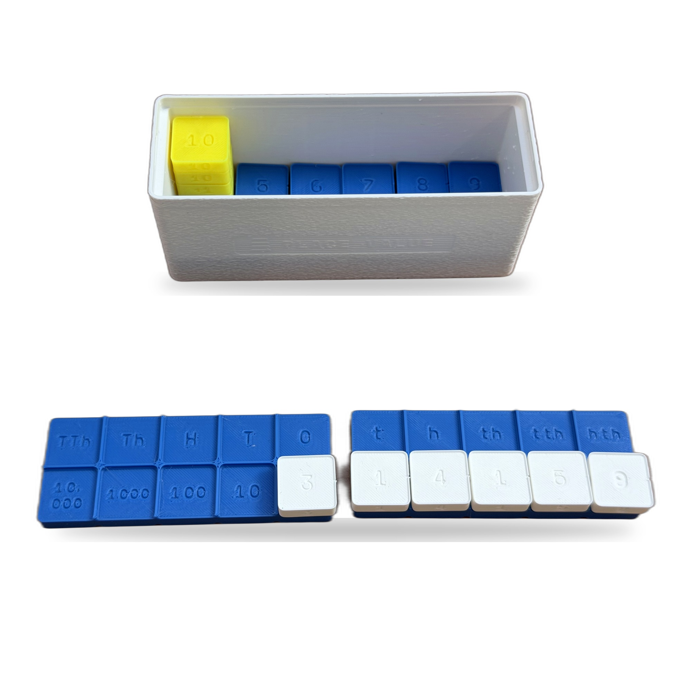
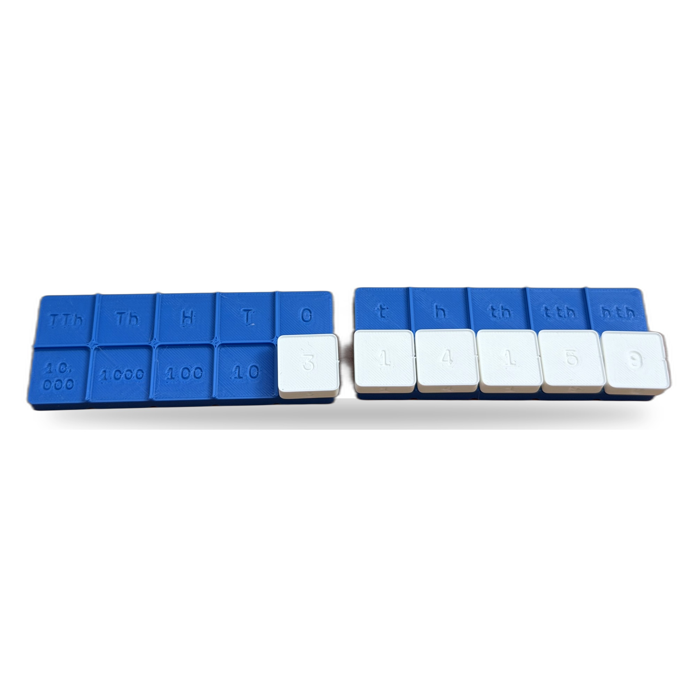
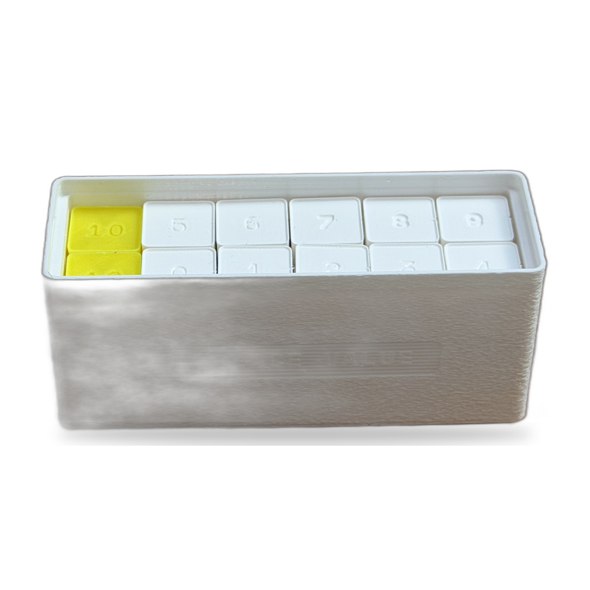
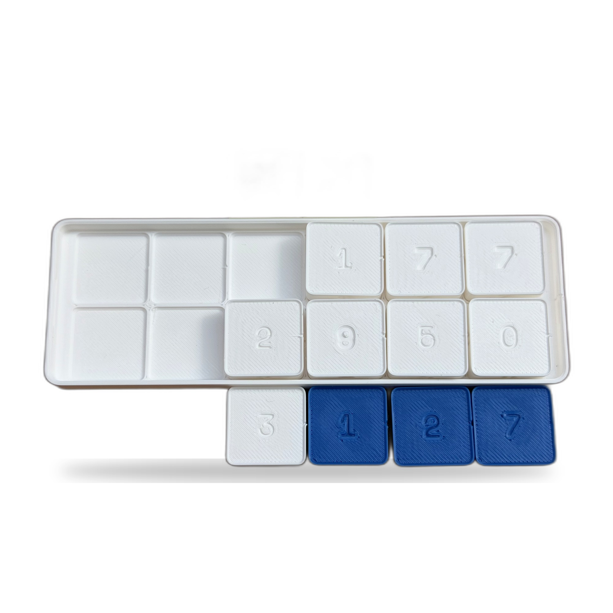
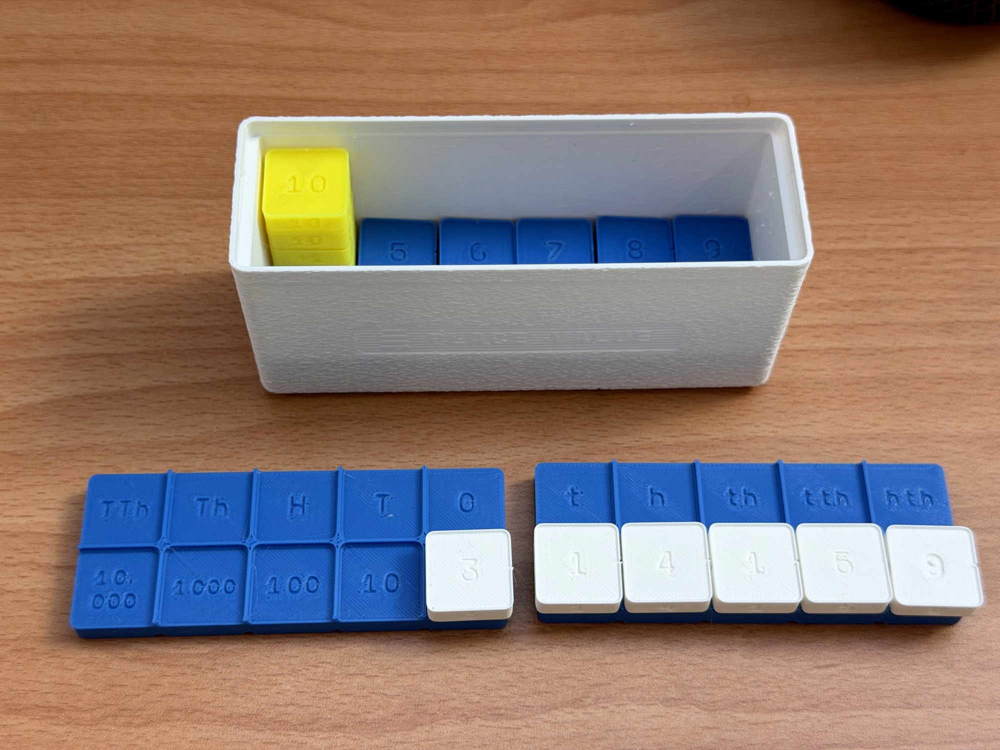
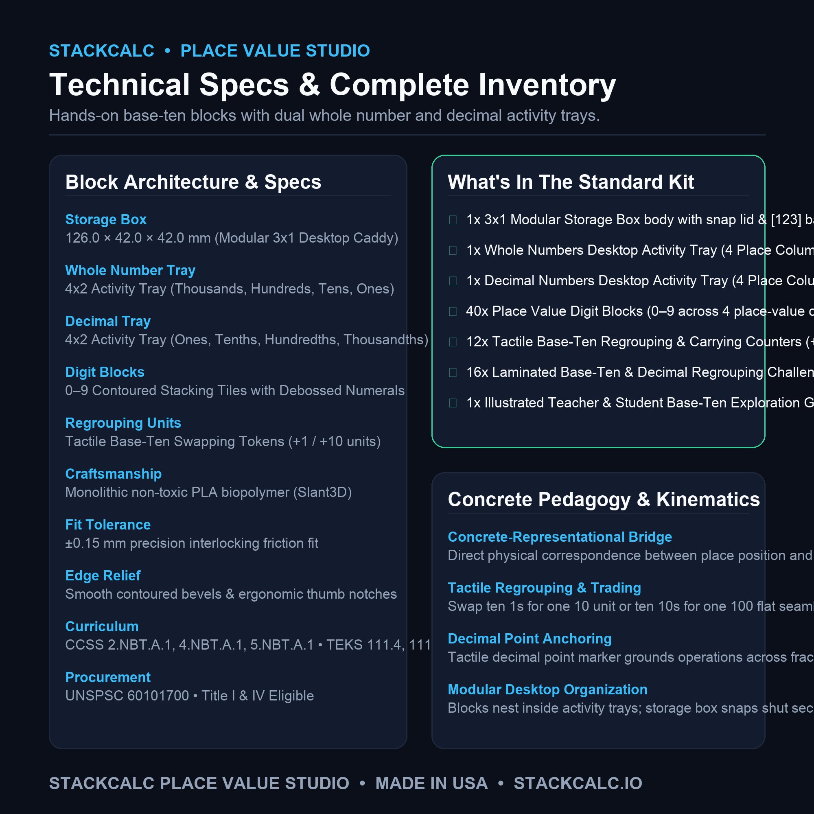
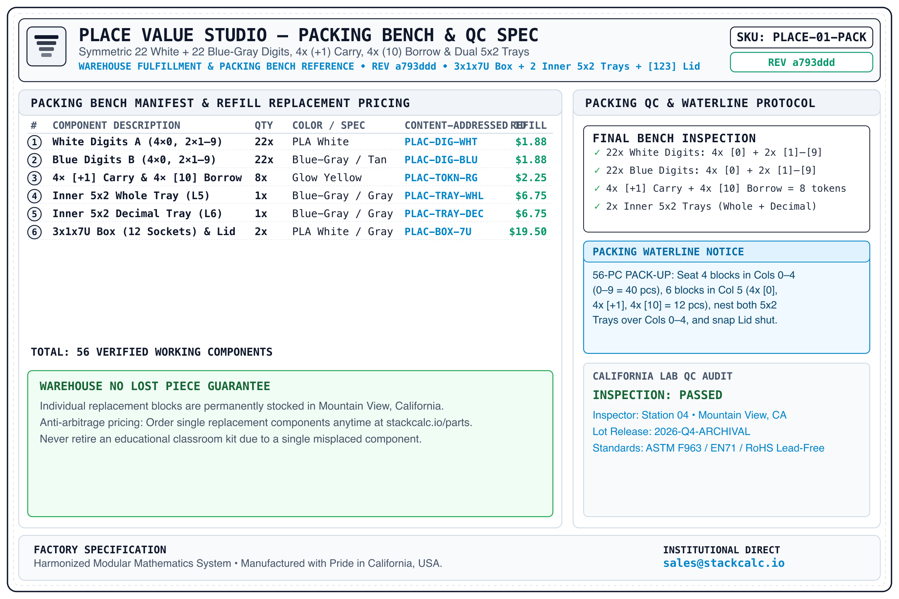
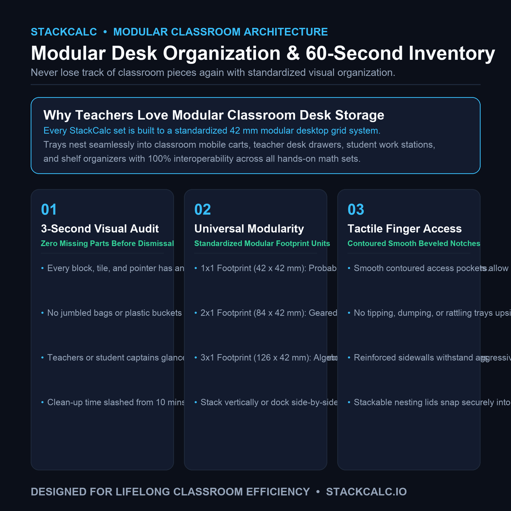

<!-- Schema.org JSON-LD Structured Data for High Google Search & Rich Results Ranking -->

  <!-- Breadcrumb -->
  <nav class="ec-breadcrumb" aria-label="Breadcrumb">
    <a href="../../">Home</a>
    /
    <a href="../">Products &amp; Manipulatives</a>
    /
    Place Value Studio
  </nav>

  <!-- ==========================================================================
       HERO PRODUCT SECTION (2-COLUMN ECOMMERCE SPLIT)
       ========================================================================== -->
  

    <!-- Left Column: Product Gallery -->
    

      

        
      

      <!-- Thumbnail Selector Strip -->
      

        
t.classList.remove('active')); this.classList.add('active');">
          
        

        
t.classList.remove('active')); this.classList.add('active');">
          
        

        
t.classList.remove('active')); this.classList.add('active');">
          
        

        
t.classList.remove('active')); this.classList.add('active');">
          
        

        
t.classList.remove('active')); this.classList.add('active');">
          
        

        
t.classList.remove('active')); this.classList.add('active');">
          
        

        
t.classList.remove('active')); this.classList.add('active');">
          
        

        
t.classList.remove('active')); this.classList.add('active');">
          
        

        
t.classList.remove('active')); this.classList.add('active');">
          
        

      

    

    <!-- Right Column: Buy Box & Product Info -->
    

      <h1 class="ec-product-title">Place Value Studio &amp; Regrouping Trays</h1>

      <!-- Educational Architecture & Tactile Standard -->
      

        PEDAGOGICAL STANDARD
        &bull; Concrete Multi-Digit Arithmetic &amp; Decimal Bridging
        &check; 42mm Gridfinity Compliant
      

      

        $38.00
        &check; Free US Shipping &bull; In Stock
      

      

        Transform abstract place value and decimal regrouping into tangible, self-correcting understanding. Features dual 6&times;2 desktop activity trays (Whole Numbers &amp; Decimals), 44 precision digit blocks (0&ndash;9), and 9 stackable +1 regrouping tokens housed in a modular 3&times;1 Gridfinity storage box with Snapfinity sliding lid.
      

      <!-- Highlights Checklist -->
      

        

          &check;
          <strong>Dual 6&times;2 Activity Trays:</strong> Whole Numbers tray (100k down to 1) and Decimal Numbers tray (0.1 to 0.000001) with tactile decimal separator point.
        

        

          &check;
          <strong>53 Tactile Miniblocks:</strong> 4 full sets of digits 0&ndash;9, 4 extra zeros, and 9 stackable +1 carry/borrow tokens.
        

        

          &check;
          <strong>Vertical Carries &amp; Borrows:</strong> Two operational rows permit vertical column alignment; stackable +1 tokens click directly onto digit blocks to physically model carrying a ten.
        

        

          &check;
          <strong>SC-6 Hardware Synergy:</strong> Direct tactile companion to the SC-6 elementary calculator's dedicated <code>[PV]</code> Place Value decomposition mode.
        

      

      <!-- Action Buttons -->
      

        <a href="https://stackcalcmath.etsy.com" target="_blank" rel="noopener noreferrer" class="ec-btn-primary" style="background-color: #f1641e; border-color: #f1641e; color: #ffffff;">
          Order on Etsy ($38.00) ↗
        </a>
        <a href="https://www.printables.com/@StackCalc_5593834" target="_blank" rel="noopener noreferrer" class="ec-btn-secondary" style="border-color: #FA6B05; color: #FA6B05;">
          Download 3MF on Printables ↗
        </a>
      

      <!-- Navigation & Editions Grid -->
      

        <a href="../../manuals/sc6/02-rpn-for-young-learners/" class="p-2.5 rounded bg-white/5 hover:bg-white/10 border border-white/10 hover:border-white/30 text-slate-300 hover:text-white transition flex items-center justify-between">
          Aligned Chapter
          &rarr;
        </a>
        <a href="https://link.amazon/B0f5cP0Ur" target="_blank" rel="noopener noreferrer" class="p-2.5 rounded bg-white/5 hover:bg-white/10 border border-white/10 hover:border-white/30 text-slate-300 hover:text-white transition flex items-center justify-between">
          SC-6 Book (Amazon)
          ↗
        </a>
        <a href="https://link.amazon/B07bxzYKq" target="_blank" rel="noopener noreferrer" class="p-2.5 rounded bg-white/5 hover:bg-white/10 border border-white/10 hover:border-white/30 text-slate-300 hover:text-white transition flex items-center justify-between">
          Workbook (Amazon)
          ↗
        </a>
        <a href="https://link.amazon/B05RFHqeu" target="_blank" rel="noopener noreferrer" class="p-2.5 rounded bg-white/5 hover:bg-white/10 border border-white/10 hover:border-white/30 text-slate-300 hover:text-white transition flex items-center justify-between">
          Teacher Guide (Amazon)
          ↗
        </a>
        <a href="https://www.printables.com/@StackCalc_5593834" target="_blank" rel="noopener noreferrer" class="p-2.5 rounded bg-white/5 hover:bg-white/10 border border-white/10 hover:border-white/30 text-slate-300 hover:text-white transition flex items-center justify-between">
          Free 3MF (Printables)
          ↗
        </a>
        <a href="../../curriculum/" class="p-2.5 rounded bg-white/5 hover:bg-white/10 border border-white/10 hover:border-white/30 text-slate-300 hover:text-white transition flex items-center justify-between">
          Curriculum Guide
          &rarr;
        </a>
        <a href="#specifications" class="p-2.5 rounded bg-white/5 hover:bg-white/10 border border-white/10 hover:border-white/30 text-slate-300 hover:text-white transition flex items-center justify-between">
          Technical Specs
          &darr;
        </a>
      

      <!-- Trust Badges -->
      

        

          &check;
          Durable Matte Polymer &bull; 42mm Gridfinity
        

        

          &check;
          Anti-Heartbreak $2.49 Part Refills
        

        

          &check;
          Secure Checkout via Etsy
        

      

    

  

  <!-- ==========================================================================
       VIDEO SHOWCASE SECTION
       ========================================================================== -->
  <section class="ec-section">
    <h2 class="ec-section-title">The Video Showcase: Two-Row Regrouping &amp; Decimals in Action</h2>
    
Watch how dual 6&times;2 trays turn confusing carrying and borrowing algorithms into physical, self-checking block movements.

    

      

        <video controls playsinline preload="metadata" poster="../../assets/renders/etsy/place-value-studio-real-overview-hero-tight.jpg" style="width: 100%; border-radius: 8px;">
          <source src="../../assets/videos/place-value-studio-listing-hero.mp4" type="video/mp4">
          Your browser does not support HTML5 video.
        </video>
      

      

        <h3 class="text-sm font-bold text-slate-100 mb-1">Place Value Studio: Addition, Subtraction &amp; Decimal Bridging</h3>
        
Demonstrating 47 + 28 with a physical +1 carry token stacked onto the tens block, followed by decimal alignment across the tactile separator.

      

    

  </section>

  <!-- ==========================================================================
       SECTION: TECHNICAL SPECIFICATIONS
       ========================================================================== -->
  <section class="ec-section">
    <h2 class="ec-section-title">Technical Specifications</h2>
    
Tactile proportions and modular classroom storage.

    <table class="ec-spec-table">
      <tbody>
        <tr>
          <td class="ec-spec-k">Outer Box Dimensions</td>
          <td class="ec-spec-v">126.0 mm (L) &times; 42.0 mm (W) &times; 42.0 mm (H) &bull; Standard 3x1x7U Gridfinity bin</td>
        </tr>
        <tr>
          <td class="ec-spec-k">Activity Trays</td>
          <td class="ec-spec-v">Two 6&times;2 pull-out trays (117.4 &times; 38.6 mm): Whole Numbers (<code>100K, 10K, 1K, 100, 10, 1</code>) and Decimal Numbers (<code>.1, .01, .001, 10^-4, 10^-5, 10^-6</code>)</td>
        </tr>
        <tr>
          <td class="ec-spec-k">Miniblock Footprint</td>
          <td class="ec-spec-v">0.5U Gridfinity pitch (19.0 &times; 19.0 mm), 7.0 mm visible height, 1.85 mm recessed top stacking socket</td>
        </tr>
        <tr>
          <td class="ec-spec-k">Pieces Included (52 Total)</td>
          <td class="ec-spec-v">44 symmetric digit blocks (22 White Set A: 4&times; '0', 2&times; '1–9'; 22 Slate Blue-Gray Set B: 4&times; '0', 2&times; '1–9') + 4 stackable +1 regrouping carry tokens + 2 inner 6&times;2 trays (Whole + Decimal) + 1 7U box (12 labeled floor sockets) + 1 <code>[123]</code> lid = 52 pieces</td>
        </tr>
        <tr>
          <td class="ec-spec-k">Material</td>
          <td class="ec-spec-v">Non-toxic matte PETG/PLA polymer &bull; Washable with warm water and soap</td>
        </tr>
        <tr>
          <td class="ec-spec-k">Curriculum Standards</td>
          <td class="ec-spec-v">Common Core: CCSS.MATH.CONTENT.1.NBT.B.2, 2.NBT.B.5, 3.NBT.A.2, 4.NBT.A.1, 5.NBT.A.1 &bull; TEKS: 111.3.b.2, 111.4.b.2</td>
        </tr>
      </tbody>
    </table>
  </section>

