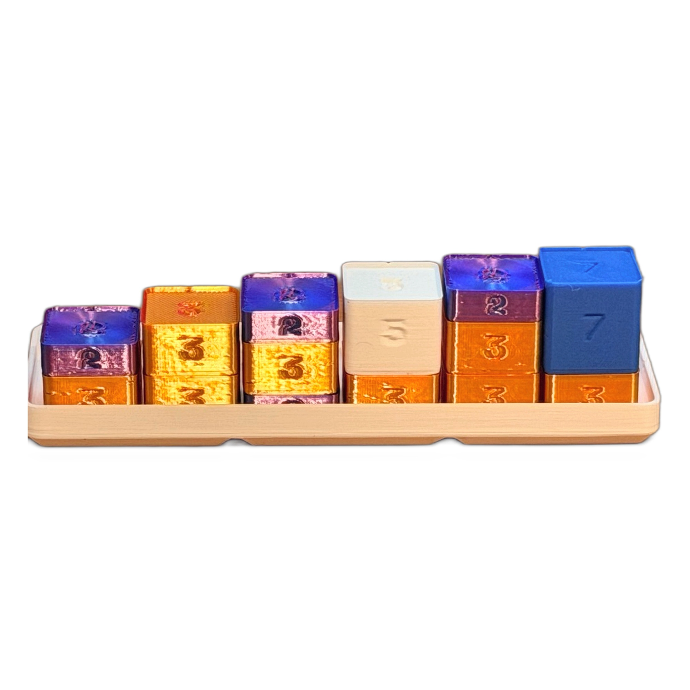
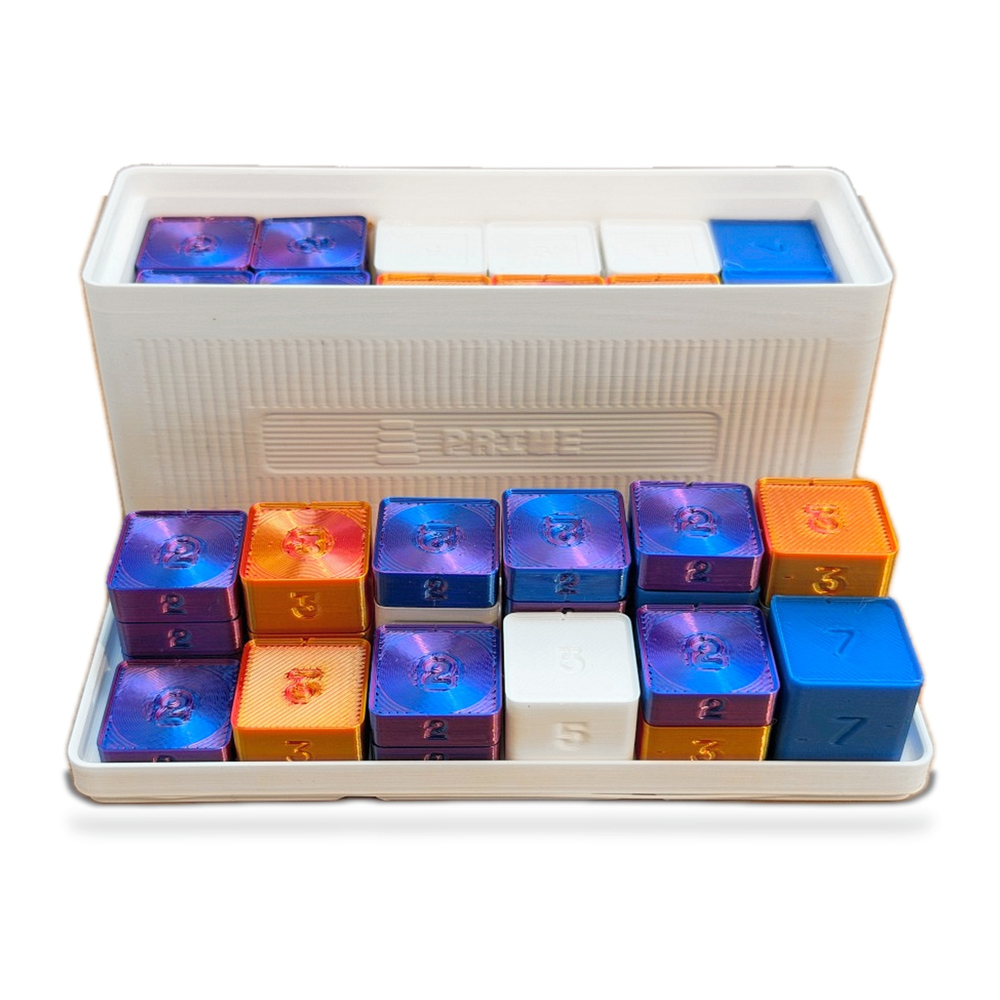
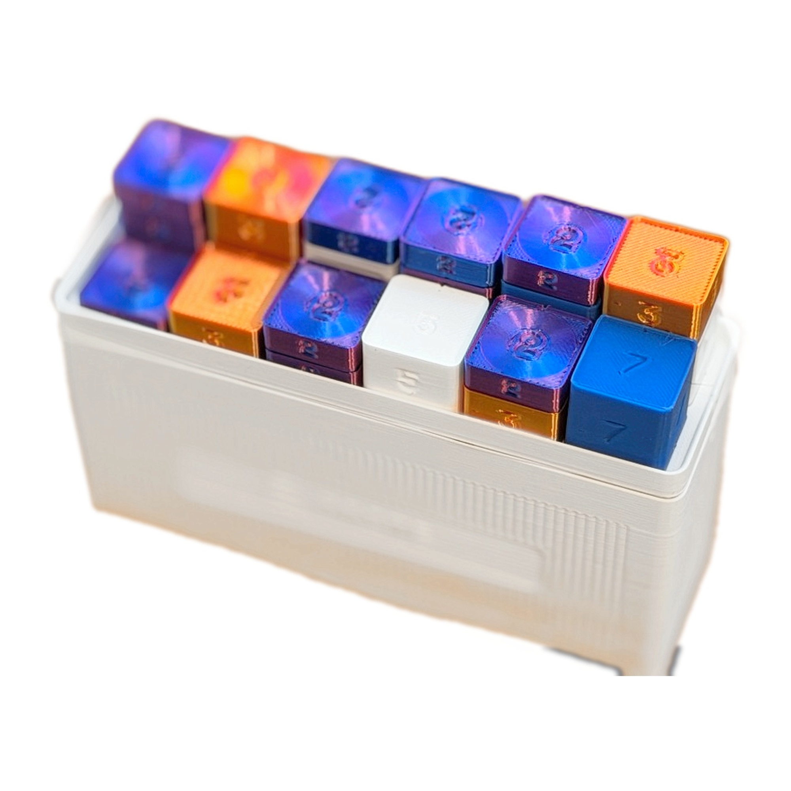
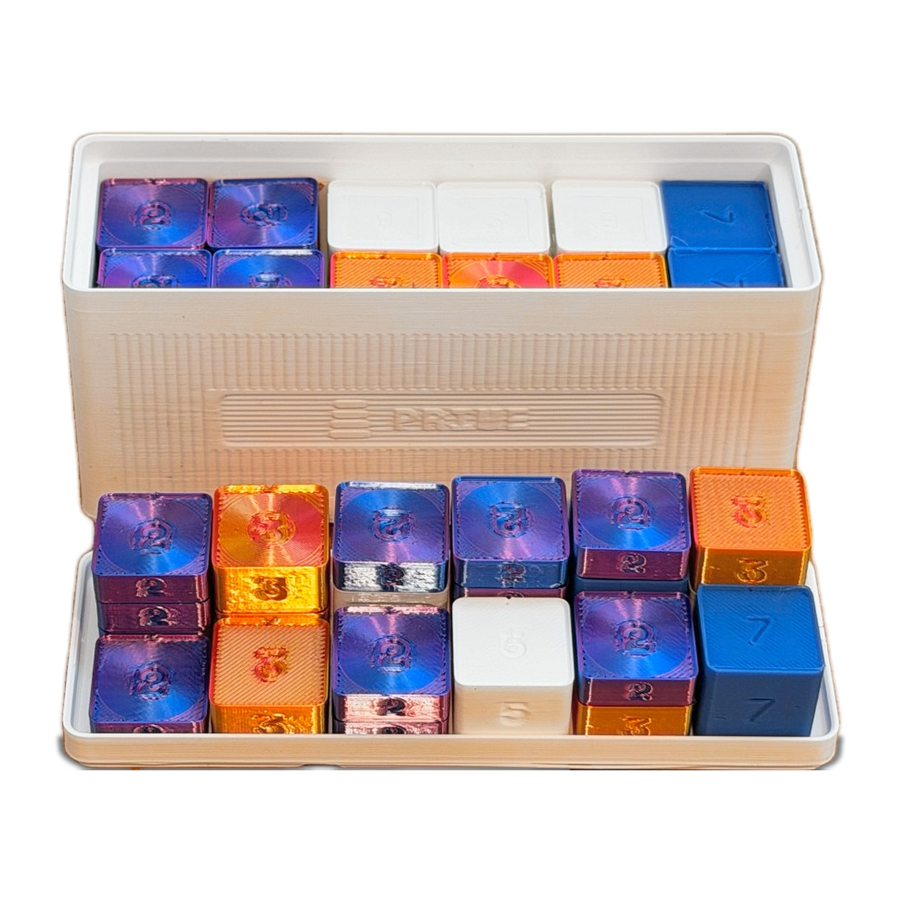
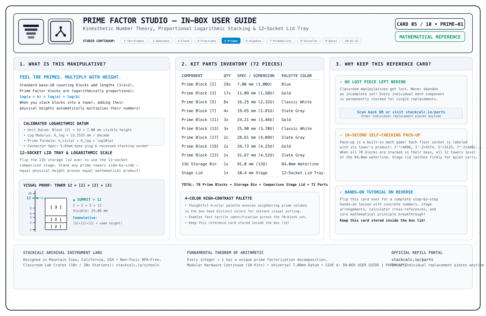
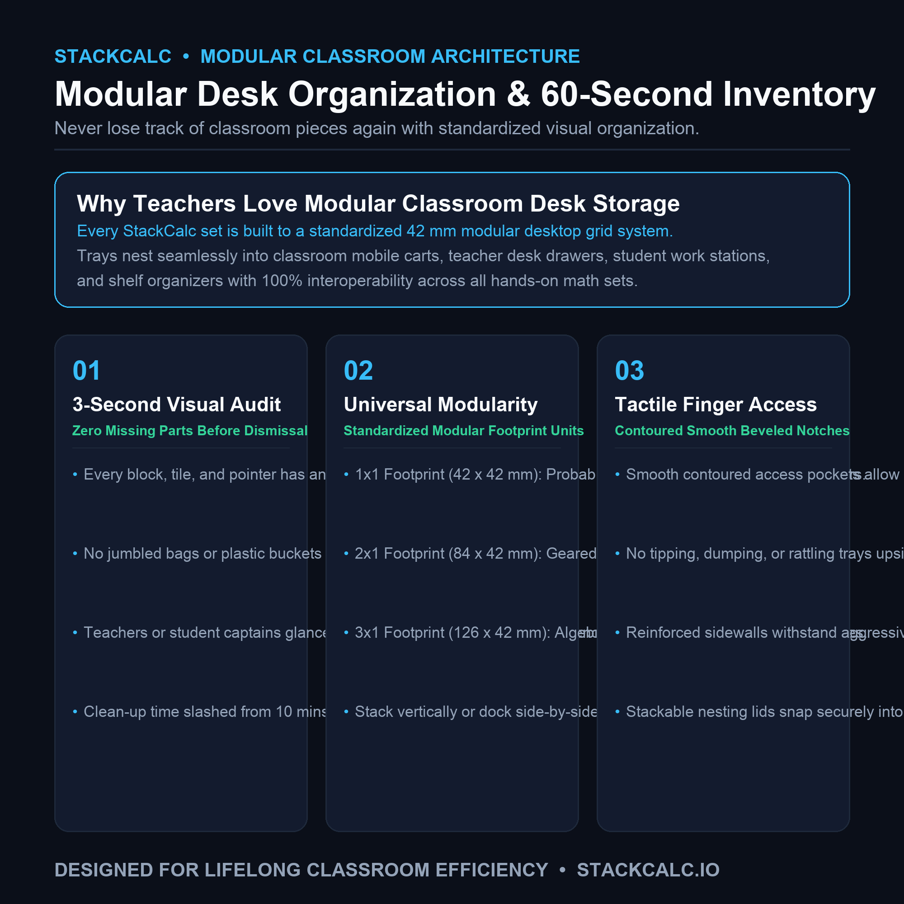
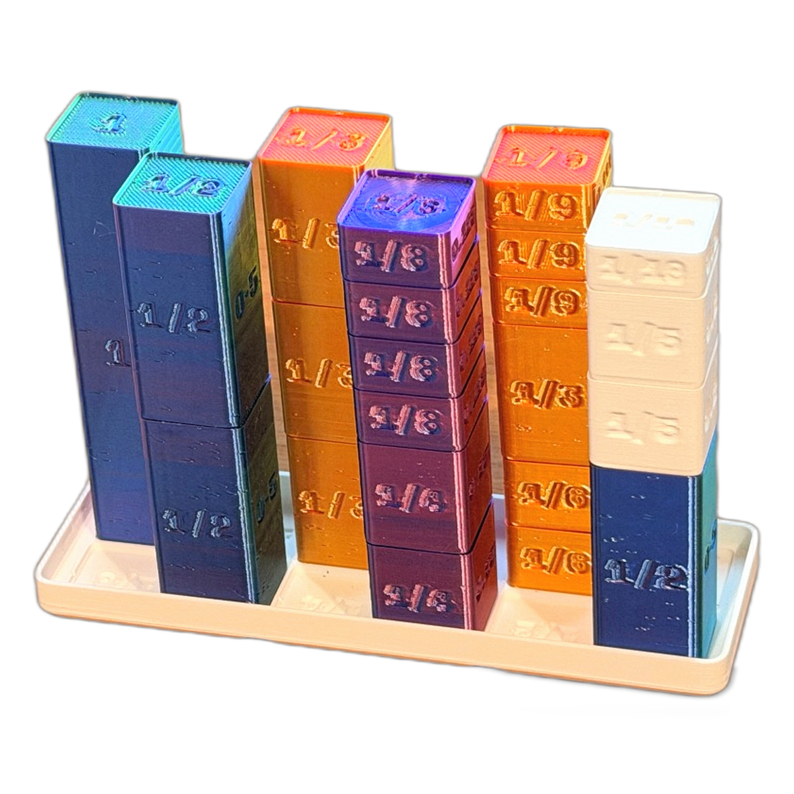
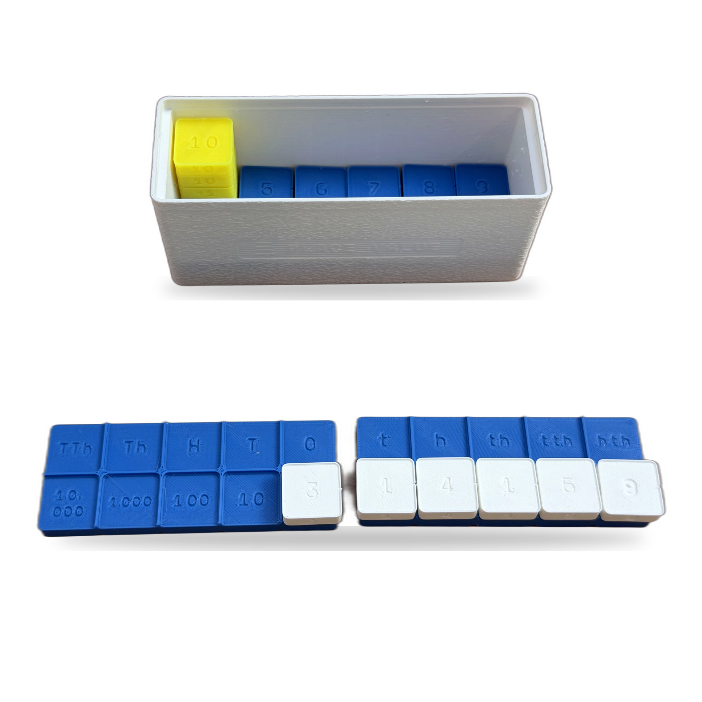

<!-- Schema.org JSON-LD Structured Data for High Google Search & Rich Results Ranking -->

  <!-- Breadcrumb -->
  <nav class="ec-breadcrumb" aria-label="Breadcrumb">
    <a href="../../">Home</a>
    /
    <a href="../">Products &amp; Manipulatives</a>
    /
    Prime Factor Studio
  </nav>

  <!-- ==========================================================================
       HERO PRODUCT SECTION (2-COLUMN ECOMMERCE SPLIT)
       ========================================================================== -->
  

    <!-- Left Column: Product Gallery -->
    

      

        
      

      <!-- Thumbnail Selector Strip (Includes Authentic Studio Photography & Infographics) -->
      

        
t.classList.remove('active')); this.classList.add('active');">
          
        

        
t.classList.remove('active')); this.classList.add('active');">
          
        

        
t.classList.remove('active')); this.classList.add('active');">
          
        

        
t.classList.remove('active')); this.classList.add('active');">
          
        

        
t.classList.remove('active')); this.classList.add('active');">
          
        

        
t.classList.remove('active')); this.classList.add('active');">
          
        

        
t.classList.remove('active')); this.classList.add('active');">
          
        

        
t.classList.remove('active')); this.classList.add('active');">
          
        

      

    

    <!-- Right Column: Buy Box & Product Info -->
    

      <h1 class="ec-product-title">Prime Factor Studio &amp; Factor Towers</h1>

      <!-- Educational Architecture & Tactile Standard -->
      

        GRADES 3–9 (AGES 8–14)
        &bull; 45-Piece Set (43 Prime Blocks + Stepped Box + Stage Lid)
        &check; Stacking Blocks Multiplies Them
      

      

        $46.00
        &check; Free US Shipping &bull; In Stock
      

      

        <strong>Turns boring factor trees into a self-checking building puzzle:</strong> On paper, factoring numbers and finding Greatest Common Factor (GCF) or Least Common Multiple (LCM) feels like tedious guesswork. Prime Factor Studio gives your child <strong>43 color-coded prime blocks</strong> (24&times; <code>[2]</code>, 9&times; <code>[3]</code>, 6&times; <code>[5]</code>, 4&times; <code>[7]</code>) scaled on a logarithmic curve so <strong>stacking blocks vertically physically multiplies them</strong>. Stacking <code>[2]</code> and <code>[3]</code> reaches the exact same height whether <code>[2]</code> is on bottom or <code>[3]</code> is on bottom—and two composite towers stand flush at the exact same height if and only if they equal the same number.
      

      <!-- Highlights Checklist -->
      

        

          &check;
          <strong>Stacking Physically Multiplies (\(a \times b = b \times a\)):</strong> Each prime block's visible height is \(7.00 \cdot \log_2(p)\text{ mm}\). Because logarithms turn multiplication into addition, stacking <code>[2]</code> + <code>[2]</code> + <code>[3]</code> physically measures \(2 \times 2 \times 3 = 12\) (25.10 mm).
        

        

          &check;
          <strong>See GCF &amp; LCM in Seconds:</strong> Build two numbers side-by-side in the dual-well comparator lid (e.g., 12 and 18). The matching blocks shared by both towers are the <strong>GCF</strong>; adding the missing block makes both towers stand flush at the <strong>LCM</strong> (36).
        

        

          &check;
          <strong>3-Second Flat-Top Box Cleanup:</strong> The 3&times;1&times;7U Gridfinity box features a stepped floor so every full column of <code>[2]</code>, <code>[3]</code>, <code>[5]</code>, and <code>[7]</code> levels off at the exact same 42.0 mm top waterline.
        

        

          &check;
          <strong>Includes 4&times;6&Prime; Activity &amp; Reference Card:</strong> Ships with a heavy-duty reference card featuring 5-minute factor challenges, height tables, and component Part IDs.
        

      

      <!-- Clear Primary CTA Hierarchy -->
      

        <a href="https://stackcalcmath.etsy.com" target="_blank" rel="noopener noreferrer" class="ec-btn-primary" style="background-color: #f1641e; border-color: #f1641e; color: #ffffff; flex: 1; min-width: 220px; text-align: center; justify-content: center; font-weight: 800;">
          Order Complete Boxed Kit on Etsy ($46.00) ↗
        </a>
        <a href="../../lab/prime-factor-studio/" class="ec-btn-secondary" style="border-color: #10B981; color: #10B981; font-weight: 700;">
          Try Free 2D Prime Lab ⛶
        </a>
      

      <!-- Secondary Helper Box: 3D Printing & Slant 3D Direct Order -->
      

        <strong>Own a 3D printer or ordering direct?</strong>
        

          <a href="https://www.printables.com/@StackCalc_5593834" target="_blank" rel="noopener noreferrer" style="color: #FA6B05; text-decoration: none;">Free 3MF Files ↗</a>
          <a href="https://teleportpod.com/portal/af6e21e5-604e-46c5-b7fd-f6f3a7a184c9?item=9143&template=bold" target="_blank" rel="noopener noreferrer" style="color: #34D399; text-decoration: none;">Order on Slant 3D ($46) ↗</a>
        

      

      <!-- Quick Jump & Sibling Studios Grid -->
      

        <a href="#kitchen-table-guide" class="p-2.5 rounded bg-emerald-500/20 hover:bg-emerald-500/30 border border-emerald-500/40 text-emerald-300 hover:text-white transition flex items-center justify-between font-bold">
          10-Min Parent Guide
          &darr;
        </a>
        <a href="#product-videos" class="p-2.5 rounded bg-white/5 hover:bg-white/10 border border-white/10 hover:border-white/30 text-slate-300 hover:text-white transition flex items-center justify-between">
          Video Lessons
          &darr;
        </a>
        <a href="../fraction-studio/" class="p-2.5 rounded bg-white/5 hover:bg-white/10 border border-white/10 hover:border-white/30 text-slate-300 hover:text-white transition flex items-center justify-between">
          Fraction ($48)
          &rarr;
        </a>
        <a href="../place-value/" class="p-2.5 rounded bg-white/5 hover:bg-white/10 border border-white/10 hover:border-white/30 text-slate-300 hover:text-white transition flex items-center justify-between">
          Place Value ($48)
          &rarr;
        </a>
        <a href="../" class="p-2.5 rounded bg-emerald-500/15 hover:bg-emerald-500/25 border border-emerald-500/30 text-emerald-300 hover:text-white transition flex items-center justify-between font-bold col-span-2 sm:col-span-2">
          ★ Or Bundle All 3 Studios (Grades 1–9)
          &rarr;
        </a>
      

      <!-- Trust Strip -->
      

        

          &check;
          Includes 4&times;6&Prime; Activity Card
        

        

          &check;
          Color-Matched Block Refill Packs
        

        

          &check;
          Secure Checkout via Etsy
        

      

    

  

  <!-- ==========================================================================
       HOW A 10-MINUTE KITCHEN-TABLE SESSION WORKS (ZERO PREP REQUIRED)
       ========================================================================== -->
  <section id="kitchen-table-guide" class="ec-section" style="margin: 1.5rem 0 2rem 0;">
    

      
ZERO TEACHING EXPERIENCE REQUIRED // INCLUDED 4&times;6&Prime; ACTIVITY CARD

      <h2 style="margin: 0 0 0.5rem 0; color: #FFFFFF; font-size: 1.35rem; font-weight: 800;">How a 10-Minute Kitchen-Table Session Works</h2>
      

        Open the box and place the <code>[FACT]</code> comparator lid on the table. Try these three hands-on challenges with your child in 10 minutes:
      

      

        

          
STEP 01 &bull; MINUTE 1–3

          
Prove That Order Doesn't Matter (\(4 \times 9 = 6 \times 6\))

          
Have your child build <code>4 &times; 9</code> in the left socket (two blue <code>[2]</code>s + two red <code>[3]</code>s) and <code>6 &times; 6</code> in the right socket (<code>[2]+[3]+[2]+[3]</code>). Both towers reach the exact same 36.2 mm height—proving both factor trees equal 36.

        

        

          
STEP 02 &bull; MINUTE 4–7

          
Solve GCF &amp; LCM Without Formulas

          
Build <code>12</code> (<code>[2]+[2]+[3]</code>) on the left and <code>18</code> (<code>[2]+[3]+[3]</code>) on the right. The blocks they share in common (<code>[2]</code> and <code>[3]</code>) give <strong>GCF = 6</strong>. Snap one missing block onto the shorter tower until both stand flush at <strong>LCM = 36</strong>.

        

        

          
STEP 03 &bull; MINUTE 8–10

          
3-Second Stepped-Floor Cleanup

          
Stack the blue <code>[2]</code>s, red <code>[3]</code>s, white <code>[5]</code>s, and tan <code>[7]</code>s back into their 12 stepped box columns. When all 43 blocks are in place, every column stands completely flat at 42.0 mm.

        

      

    

  </section>

  <!-- ==========================================================================
       SECTION: DEMONSTRATION VIDEOS & ANIMATED STEP-BY-STEP LESSONS
       ========================================================================== -->
  <section id="product-videos" class="ec-section">
    <h2 class="ec-section-title">The Video Showcase: Animated Step-by-Step Lessons &amp; Kinematics</h2>
    
Experience logarithmic factor stacking, the Fundamental Theorem of Arithmetic, and LCM/GCD Venn towers directly from our curriculum guide.

    

      <!-- 1. Lesson 1: Fundamental Theorem Logarithmic Stacking -->
      

        

          <video controls playsinline preload="metadata" poster="../../assets/renders/prime-factor-studio-hero.png">
            <source src="../../assets/videos/prime-factor-lesson-fundamental.mp4" type="video/mp4">
            Your browser does not support HTML5 video.
          </video>
          1. CURRICULUM LESSON 01
        

        

          

            <h3 class="text-sm font-bold text-slate-100 mb-1">Fundamental Theorem of Arithmetic</h3>
            
Step-by-step physical multiplication: stacking logarithmic prime blocks [2] and [3] to match the exact height of composite factor tower [6].

          

          

            CCSS 6.NS.B.4
            2 &times; 3 = 6 Flush
          

        

      

      <!-- 2. Lesson 2: LCM & GCD Venn Stacking -->
      

        

          <video controls playsinline preload="metadata" poster="../../assets/renders/prime-factor-studio-hero.png">
            <source src="../../assets/videos/prime-factor-lesson-lcm-gcd.mp4" type="video/mp4">
            Your browser does not support HTML5 video.
          </video>
          2. CURRICULUM LESSON 02
        

        

          

            <h3 class="text-sm font-bold text-slate-100 mb-1">LCM &amp; GCD Venn Stacking</h3>
            
Decomposing 12 and 18 into prime towers. Extracting shared intersection blocks for GCD (6) and union blocks for LCM (36).

          

          

            CCSS 6.NS.B.4
            GCD=6 &bull; LCM=36
          

        

      

      <!-- 3. Lesson 3: Unique Prime Factorization & Commutativity -->
      

        

          <video controls playsinline preload="metadata" poster="../../assets/renders/prime-factor-studio-hero.png">
            <source src="../../assets/videos/prime-factor-lesson-factorization.mp4" type="video/mp4">
            Your browser does not support HTML5 video.
          </video>
          3. CURRICULUM LESSON 03
        

        

          

            <h3 class="text-sm font-bold text-slate-100 mb-1">Unique Prime Factorization: 36 = 2&sup2; &times; 3&sup2;</h3>
            
Building 36 along two distinct branching paths (4 &times; 9 vs. 6 &times; 6). Both towers level to the exact same 36.00mm summit (0.000mm error), proving factorization is unique and commutative.

          

          

            CCSS 4.OA.B.4 &bull; 6.NS.B.4
            Summit = 36 Flush
          

        

      

    

    <!-- Reference Card Download Callout -->
    

      

        
        

          <h4 class="text-sm font-bold text-slate-100">Archival Reference &amp; Video QR Card (135&times;90mm)</h4>
          
Included inside every box. Scan Side B to jump straight to this animated video lesson portal or inspect Side A for replacement part dimensions.

        

      

      

        <a href="../../assets/reference_cards/reference_card_PRIME-01_paper.png" target="_blank" rel="noopener noreferrer" class="px-3 py-1.5 bg-slate-800 hover:bg-slate-700 text-xs font-mono text-slate-200 rounded border border-slate-700 transition">View Front (Side A)</a>
        <a href="../../assets/reference_cards/reference_card_PRIME-01_back_paper.png" target="_blank" rel="noopener noreferrer" class="px-3 py-1.5 bg-cyan-950 hover:bg-cyan-900 text-xs font-mono text-cyan-300 rounded border border-cyan-800 transition">View Back (QR Side B)</a>
        <a href="../../downloads/packing_bench_cards.html" class="px-3 py-1.5 bg-emerald-950 hover:bg-emerald-900 text-xs font-mono text-emerald-300 rounded border border-emerald-800 transition">Print Duplex Sheet</a>
      

    

  </section>

  <!-- ==========================================================================
       MATHEMATICAL ARCHITECTURE & EXPERIMENTAL BENCHMARKS
       ========================================================================== -->
  <section class="mt-16 pt-12 border-t border-white/10">
    

      MATHEMATICAL PROOF • LOGARITHMIC TOWER ALIGNMENT
      ● 0.000 MM ERROR &bull; THE FUNDAMENTAL THEOREM OF ARITHMETIC
    

    

      

        In middle school arithmetic, students are taught to draw "factor trees" on paper. While tree diagrams show branching, they fail to convey <em>magnitude</em>—a prime 2 looks the same size as a composite 24. <strong>Prime Factor Studio</strong> grounds abstract prime factorization in physical spatial geometry:
      

    

    <!-- Tower Alignment Benchmark Table -->
    

      <table class="w-full text-left font-mono text-xs border border-white/10">
        <thead class="bg-black/60 text-white border-b border-white/10">
          <tr>
            <th class="p-3">Target Number \(N\)</th>
            <th class="p-3">Prime Blocks Stacked (Slant 3D Palette)</th>
            <th class="p-3">Visible Height \(\sum h_{\text{vis}}\)</th>
            <th class="p-3">Desk Stacking Top \(Z_{\text{top}}\)</th>
            <th class="p-3">Target Height \(Z_{\text{target}}\)</th>
            <th class="p-3 text-emerald-400">Alignment Delta</th>
          </tr>
        </thead>
        <tbody class="divide-y divide-white/5 text-slate-300">
          <tr>
            <td class="p-3 font-bold text-white">\(N = 2\)</td>
            <td class="p-3"><kbd class="px-1.5 py-0.5 rounded bg-[#1D4ED8] text-white font-bold">[2]</kbd></td>
            <td class="p-3">7.00 mm</td>
            <td class="p-3">8.85 mm</td>
            <td class="p-3">8.85 mm</td>
            <td class="p-3 text-emerald-400 font-bold">0.000 mm (Exact)</td>
          </tr>
          <tr>
            <td class="p-3 font-bold text-white">\(N = 4\)</td>
            <td class="p-3"><kbd class="px-1.5 py-0.5 rounded bg-[#1D4ED8] text-white font-bold">[2]</kbd> + <kbd class="px-1.5 py-0.5 rounded bg-[#1D4ED8] text-white font-bold">[2]</kbd></td>
            <td class="p-3">14.00 mm</td>
            <td class="p-3">15.85 mm</td>
            <td class="p-3">15.85 mm</td>
            <td class="p-3 text-emerald-400 font-bold">0.000 mm (Exact)</td>
          </tr>
          <tr>
            <td class="p-3 font-bold text-white">\(N = 6\)</td>
            <td class="p-3"><kbd class="px-1.5 py-0.5 rounded bg-[#1D4ED8] text-white font-bold">[2]</kbd> + <kbd class="px-1.5 py-0.5 rounded bg-[#FF5F2D] text-white font-bold">[3]</kbd></td>
            <td class="p-3">18.10 mm</td>
            <td class="p-3">19.95 mm</td>
            <td class="p-3">19.95 mm</td>
            <td class="p-3 text-emerald-400 font-bold">0.000 mm (Exact)</td>
          </tr>
          <tr>
            <td class="p-3 font-bold text-white">\(N = 10\)</td>
            <td class="p-3"><kbd class="px-1.5 py-0.5 rounded bg-[#1D4ED8] text-white font-bold">[2]</kbd> + <kbd class="px-1.5 py-0.5 rounded bg-white text-slate-950 font-bold">[5]</kbd></td>
            <td class="p-3">23.25 mm</td>
            <td class="p-3">25.10 mm</td>
            <td class="p-3">25.10 mm</td>
            <td class="p-3 text-emerald-400 font-bold">0.000 mm (Exact)</td>
          </tr>
          <tr>
            <td class="p-3 font-bold text-white">\(N = 14\)</td>
            <td class="p-3"><kbd class="px-1.5 py-0.5 rounded bg-[#1D4ED8] text-white font-bold">[2]</kbd> + <kbd class="px-1.5 py-0.5 rounded bg-[#D49459] text-white font-bold">[7]</kbd></td>
            <td class="p-3">26.65 mm</td>
            <td class="p-3">28.50 mm</td>
            <td class="p-3">28.50 mm</td>
            <td class="p-3 text-emerald-400 font-bold">0.000 mm (Exact)</td>
          </tr>
          <tr>
            <td class="p-3 font-bold text-white">\(N = 36\)</td>
            <td class="p-3"><kbd class="px-1.5 py-0.5 rounded bg-[#1D4ED8] text-white font-bold">[2]</kbd>&sup2; + <kbd class="px-1.5 py-0.5 rounded bg-[#FF5F2D] text-white font-bold">[3]</kbd>&sup2;</td>
            <td class="p-3">36.20 mm</td>
            <td class="p-3">38.05 mm</td>
            <td class="p-3">38.05 mm</td>
            <td class="p-3 text-emerald-400 font-bold">0.000 mm (Exact)</td>
          </tr>
          <tr>
            <td class="p-3 font-bold text-white">\(N = 64\) (Box Waterline)</td>
            <td class="p-3">6&times; <kbd class="px-1.5 py-0.5 rounded bg-[#1D4ED8] text-white font-bold">[2]</kbd></td>
            <td class="p-3">42.00 mm</td>
            <td class="p-3">43.85 mm</td>
            <td class="p-3">43.85 mm</td>
            <td class="p-3 text-emerald-400 font-bold">0.000 mm (Flush Lid)</td>
          </tr>
        </tbody>
      </table>
    

    

      

        <h3 class="text-sm font-bold text-white uppercase tracking-wider">HARDWARE INVENTORY (45 PIECES: 43 BLOCKS + BOX + LID)</h3>
        <ul class="space-y-2 text-slate-300">
          <li><strong>24&times; [2] Factor Blocks (4 columns &times; 6):</strong> Matte Blue (\(h_{\text{vis}} = 7.00\text{ mm}\), \(8.85\text{ mm}\) total)</li>
          <li><strong>9&times; [3] Factor Blocks (3 columns &times; 3):</strong> Muted Red (\(h_{\text{vis}} = 11.10\text{ mm}\), \(12.95\text{ mm}\) total)</li>
          <li><strong>6&times; [5] Factor Blocks (3 columns &times; 2):</strong> White (\(h_{\text{vis}} = 16.25\text{ mm}\), \(18.10\text{ mm}\) total)</li>
          <li><strong>4&times; [7] Factor Blocks (2 columns &times; 2):</strong> Tan (\(h_{\text{vis}} = 19.65\text{ mm}\), \(21.50\text{ mm}\) total)</li>
          <li><strong>Footprint:</strong> 19.0 &times; 19.0 mm square 0.5U Gridfinity miniblock</li>
          <li><strong>Socket Nesting Depth:</strong> 1.85 mm (cancels identically on every joint)</li>
          <li><strong>Enclosure &amp; Lid:</strong> 3&times;1&times;7U Stepped-Floor Gridfinity Bin (125.5 &times; 42.0 &times; 56.4 mm) with integrated 4-3-3-2 stepped pedestals (42.00 mm / \(2^6=64\) waterline) and Snapfinity dual-well comparator stage lid</li>
        </ul>
      

      

        <h3 class="text-sm font-bold text-white uppercase tracking-wider">CLASSROOM INVESTIGATIONS</h3>
        <ul class="space-y-2 text-slate-300">
          <li><strong>Prime vs. Composite:</strong> Primes are single indivisible blocks; composites are multi-block stacks.</li>
          <li><strong>Commutative Property:</strong> \([3] + [5] = [5] + [3] = 15\) (stacking order does not change height).</li>
          <li><strong>Greatest Common Divisor:</strong> Find \(\gcd(18, 24)\) by comparing overlapping blocks \([2] \times [3] = 6\).</li>
          <li><strong>Least Common Multiple:</strong> Extend stacks until heights equalize; \(\text{lcm}(4, 6) = 12\).</li>
          <li><strong>Logarithmic Multiplication:</strong> Concrete precursor to Napierian logarithms, where adding block heights executes multiplication.</li>
        </ul>
      

    

  </section>

    <!-- ==========================================================================
       SECTION: COMPLEMENTARY CLASSROOM INSTRUMENTS (STANDALONE CROSS-SELL)
       ========================================================================== -->
  <section class="cross-sell-section">
    

      &bull; Related Instruments
      <h2 class="text-2xl font-bold text-white mt-1 mb-2">Equip Your Classroom With Tactile STEM Manipulatives</h2>
      

        Prime Factor Studio pairs with our complete collection of launched physical manipulatives for hands-on concrete understanding.
      

    

    

      <!-- Cross-Sell 1: Fraction Studio -->
      

        

          
          <h3 class="cross-sell-card-title">Fraction Studio Towers</h3>
          

            63 proportional fraction towers (84.0mm Whole) across 10 denominators. Bridges arithmetic fractions directly into spatial intuition.
          

        

        

          

            $48.00
            65-Piece Kit
          

          <a href="../fraction-studio/" class="ec-btn-secondary w-full text-center mt-3 text-xs block">
            Explore Fraction Studio &rarr;
          </a>
        

      

      <!-- Cross-Sell 2: Place Value Studio -->
      

        

          
          <h3 class="cross-sell-card-title">Place Value Studio</h3>
          

            Dual 6&times;2 activity trays (Whole &amp; Decimals) with 44 digit blocks and stackable +1 regrouping tokens for hands-on base-ten arithmetic.
          

        

        

          

            $48.00
            52-Piece Kit
          

          <a href="../place-value/" class="ec-btn-secondary w-full text-center mt-3 text-xs block">
            Explore Place Value Studio &rarr;
          </a>
        

      

    

  </section>

<!-- Discreet Ecosystem Blurb -->
  

    
&Delta;

    

      
Part of the StackCalc Math Learning Ecosystem

      

        Prime Factor Studio models the Fundamental Theorem of Arithmetic and logarithmic geometry for elementary through middle school classrooms. It connects directly with our launched physical manipulative collection (<a href="../fraction-studio/" class="text-sky-400 hover:underline">Fraction Studio</a> and <a href="../place-value/" class="text-sky-400 hover:underline">Place Value Studio</a>), providing students with a seamless path from hands-on tactile models to deep mathematical mastery. Order on-demand precision refills at the <a href="https://teleportpod.com/portals/profile/StackCalc" target="_blank" rel="noopener noreferrer" class="text-emerald-400 hover:underline">Slant 3D Replacement Parts Center ↗</a> or download free open-source <a href="../../printables/" class="text-white hover:underline">3MF models</a>.
      

    

  

