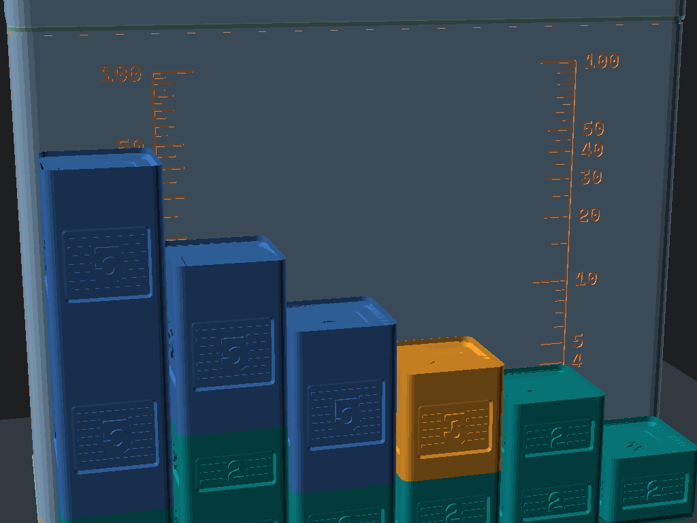

<!-- Schema.org JSON-LD Structured Data for High Google Search & Rich Results Ranking -->

  <!-- Breadcrumb -->
  <nav class="ec-breadcrumb" aria-label="Breadcrumb">
    <a href="../../">Home</a>
    /
    <a href="../">Products &amp; Manipulatives</a>
    /
    Prime Factor Studio
  </nav>

  <!-- ==========================================================================
       HERO PRODUCT SECTION (2-COLUMN ECOMMERCE SPLIT)
       ========================================================================== -->
  

    <!-- Left Column: Product Gallery -->
    

      

        
      

      <!-- Thumbnail Selector Strip -->
      

        
t.classList.remove('active')); this.classList.add('active');">
          
        

        
t.classList.remove('active')); this.classList.add('active');">
          
        

      

    

    <!-- Right Column: Buy Box & Product Info -->
    

      <h1 class="ec-product-title">Prime Factor Studio &amp; Factor Towers</h1>

      <!-- Educational Architecture & Tactile Standard -->
      

        PEDAGOGICAL STANDARD
        &bull; Concrete Proof of Fundamental Theorem of Arithmetic
        &check; 42mm Gridfinity Compliant
      

      

        $46.00
        &check; Free US Shipping &bull; In Stock
      

      

        The world's first physical logarithmic manipulative for prime factorization, prime vs. composite numbers, and early number theory. Contains <strong>29 proportional stacking prime factor blocks</strong> (powers of 2, 3, 5, 7, and higher prime markers) paired with a 3&times;1&times;13U Snapfinity Gridfinity box with integrated prime power lid sockets. Stacking prime blocks physically multiplies them, matching composite factor heights with 0.000mm error.
      

      <!-- Highlights Checklist -->
      

        

          &check;
          <strong>Physical Proof of \(a \times b = b \times a\):</strong> Stacking [2] then [5] reaches exactly the same height as [5] then [2] (both reach 42.00mm, representing product 10), physically proving the commutative property of multiplication.
        

        

          &check;
          <strong>Additive Logarithmic Geometry:</strong> Each block's visible height is \(42.0 \times \log_{10}(p)\text{ mm}\). Because \(\log(ab) = \log(a) + \log(b)\), physical tower height directly measures the arithmetic product.
        

        

          &check;
          <strong>Fundamental Theorem of Arithmetic:</strong> Any composite number decomposes into a single unique set of prime blocks (e.g. \(36 = 2^2 \times 3^2\)), eliminating abstract factoring confusion.
        

        

          &check;
          <strong>Prime Power Storage Lid:</strong> Docking sockets for \(2^6, 3^4, 5^2, 7^2, 11, 13, 17, 19, 23\) and an authentic HP-32 hardware replica button badge stamped <code>[FACT]</code>.
        

      

      <!-- Action Buttons -->
      

        <a href="https://www.etsy.com/shop/StackCalc" target="_blank" rel="noopener noreferrer" class="ec-btn-primary" style="background-color: #f1641e; border-color: #f1641e; color: #ffffff;">
          Order on Etsy ($46.00) ↗
        </a>
        <a href="../../downloads/prime-factor-studio-open-source-stls.zip" download class="ec-btn-secondary">
          Download Free 3MF / STLs &darr;
        </a>
      

      <!-- Quick Subpage & PO Links -->
      

        <a href="../../#school-po" class="text-xs font-semibold px-3 py-1.5 rounded bg-slate-800 text-emerald-400 border border-emerald-500/30 hover:bg-slate-700">
          &bull; District Net-30 PO Quote Form &rarr;
        </a>
      

      <!-- Trust Strip -->
      

        

          &plusmn;
          &plusmn;0.05mm Calibrated &bull; Non-Toxic Biopolymer
        

        

          &check;
          Anti-Heartbreak $2.49 Part Refills
        

        

          &hearts;
          30-Day Risk-Free In-Home Trial
        

      

    

  

  <!-- ==========================================================================
       SECTION: DEMONSTRATION VIDEOS & ANIMATED STEP-BY-STEP LESSONS
       ========================================================================== -->
  <section id="product-videos" class="ec-section">
    <h2 class="ec-section-title">The Video Showcase: Animated Step-by-Step Lessons &amp; Kinematics</h2>
    
Experience logarithmic factor stacking, the Fundamental Theorem of Arithmetic, and LCM/GCD Venn towers directly from our curriculum guide.

    

      <!-- 1. Lesson 1: Fundamental Theorem Logarithmic Stacking -->
      

        

          <video controls playsinline preload="metadata" poster="../../assets/renders/prime-factor-studio-hero.png">
            <source src="/assets/videos/prime-factor-lesson-fundamental.mp4" type="video/mp4">
            Your browser does not support HTML5 video.
          </video>
          1. CURRICULUM LESSON 01
        

        

          

            <h3 class="text-sm font-bold text-slate-100 mb-1">Fundamental Theorem of Arithmetic</h3>
            
Step-by-step physical multiplication: stacking logarithmic prime blocks [2] and [3] to match the exact height of composite factor tower [6].

          

          

            CCSS 6.NS.B.4
            2 &times; 3 = 6 Flush
          

        

      

      <!-- 2. Lesson 2: LCM & GCD Venn Stacking -->
      

        

          <video controls playsinline preload="metadata" poster="../../assets/renders/prime-factor-studio-hero.png">
            <source src="/assets/videos/prime-factor-lesson-lcm-gcd.mp4" type="video/mp4">
            Your browser does not support HTML5 video.
          </video>
          2. CURRICULUM LESSON 02
        

        

          

            <h3 class="text-sm font-bold text-slate-100 mb-1">LCM &amp; GCD Venn Stacking</h3>
            
Decomposing 12 and 18 into prime towers. Extracting shared intersection blocks for GCD (6) and union blocks for LCM (36).

          

          

            CCSS 6.NS.B.4
            GCD=6 &bull; LCM=36
          

        

      

      <!-- 3. Lesson 3: Unique Prime Factorization & Commutativity -->
      

        

          <video controls playsinline preload="metadata" poster="../../assets/renders/prime-factor-studio-hero.png">
            <source src="/assets/videos/prime-factor-lesson-factorization.mp4" type="video/mp4">
            Your browser does not support HTML5 video.
          </video>
          3. CURRICULUM LESSON 03
        

        

          

            <h3 class="text-sm font-bold text-slate-100 mb-1">Unique Prime Factorization: 36 = 2&sup2; &times; 3&sup2;</h3>
            
Building 36 along two distinct branching paths (4 &times; 9 vs. 6 &times; 6). Both towers level to the exact same 36.00mm summit (0.000mm error), proving factorization is unique and commutative.

          

          

            CCSS 4.OA.B.4 &bull; 6.NS.B.4
            Summit = 36 Flush
          

        

      

    

    <!-- Reference Card Download Callout -->
    

      

        
        

          <h4 class="text-sm font-bold text-slate-100">Archival Reference &amp; Video QR Card (135&times;90mm)</h4>
          
Included inside every box. Scan Side B to jump straight to this animated video lesson portal or inspect Side A for replacement part dimensions.

        

      

      

        <a href="/assets/reference_cards/reference_card_PRIME-01_paper.png" target="_blank" rel="noopener noreferrer" class="px-3 py-1.5 bg-slate-800 hover:bg-slate-700 text-xs font-mono text-slate-200 rounded border border-slate-700 transition">View Front (Side A)</a>
        <a href="/assets/reference_cards/reference_card_PRIME-01_back_paper.png" target="_blank" rel="noopener noreferrer" class="px-3 py-1.5 bg-cyan-950 hover:bg-cyan-900 text-xs font-mono text-cyan-300 rounded border border-cyan-800 transition">View Back (QR Side B)</a>
        <a href="/downloads/packing_bench_cards.html" class="px-3 py-1.5 bg-emerald-950 hover:bg-emerald-900 text-xs font-mono text-emerald-300 rounded border border-emerald-800 transition">Print Duplex Sheet</a>
      

    

  </section>

  <!-- ==========================================================================
       MATHEMATICAL ARCHITECTURE & EXPERIMENTAL BENCHMARKS
       ========================================================================== -->
  <section class="mt-16 pt-12 border-t border-white/10">
    

      MATHEMATICAL PROOF // LOGARITHMIC TOWER ALIGNMENT
      ● 0.000 MM ERROR &bull; THE FUNDAMENTAL THEOREM OF ARITHMETIC
    

    

      

        In middle school arithmetic, students are taught to draw "factor trees" on paper. While tree diagrams show branching, they fail to convey <em>magnitude</em>—a prime 2 looks the same size as a composite 24. <strong>Prime Factor Studio</strong> grounds abstract prime factorization in physical spatial geometry:
      

    

    <!-- Tower Alignment Benchmark Table -->
    

      <table class="w-full text-left font-mono text-xs border border-white/10">
        <thead class="bg-black/60 text-white border-b border-white/10">
          <tr>
            <th class="p-3">Target Number \(N\)</th>
            <th class="p-3">Prime Blocks Stacked</th>
            <th class="p-3">Visible Height \(\sum h_{\text{vis}}\)</th>
            <th class="p-3">Desk Stacking Top \(Z_{\text{top}}\)</th>
            <th class="p-3">Target Height \(Z_{\text{target}}\)</th>
            <th class="p-3 text-emerald-400">Alignment Delta</th>
          </tr>
        </thead>
        <tbody class="divide-y divide-white/5 text-slate-300">
          <tr>
            <td class="p-3 font-bold text-white">\(N = 2\)</td>
            <td class="p-3"><kbd class="px-1 rounded bg-teal-500/20 text-teal-300">[2]</kbd></td>
            <td class="p-3">12.64 mm</td>
            <td class="p-3">14.49 mm</td>
            <td class="p-3">14.49 mm</td>
            <td class="p-3 text-emerald-400 font-bold">0.000 mm (Exact)</td>
          </tr>
          <tr>
            <td class="p-3 font-bold text-white">\(N = 4\)</td>
            <td class="p-3"><kbd class="px-1 rounded bg-teal-500/20 text-teal-300">[2]</kbd> + <kbd class="px-1 rounded bg-teal-500/20 text-teal-300">[2]</kbd></td>
            <td class="p-3">25.29 mm</td>
            <td class="p-3">27.14 mm</td>
            <td class="p-3">27.14 mm</td>
            <td class="p-3 text-emerald-400 font-bold">0.000 mm (Exact)</td>
          </tr>
          <tr>
            <td class="p-3 font-bold text-white">\(N = 6\)</td>
            <td class="p-3"><kbd class="px-1 rounded bg-teal-500/20 text-teal-300">[2]</kbd> + <kbd class="px-1 rounded bg-amber-500/20 text-amber-300">[3]</kbd></td>
            <td class="p-3">32.68 mm</td>
            <td class="p-3">34.53 mm</td>
            <td class="p-3">34.53 mm</td>
            <td class="p-3 text-emerald-400 font-bold">0.000 mm (Exact)</td>
          </tr>
          <tr>
            <td class="p-3 font-bold text-white">\(N = 10\)</td>
            <td class="p-3"><kbd class="px-1 rounded bg-teal-500/20 text-teal-300">[2]</kbd> + <kbd class="px-1 rounded bg-blue-500/20 text-blue-300">[5]</kbd></td>
            <td class="p-3">42.00 mm</td>
            <td class="p-3">43.85 mm</td>
            <td class="p-3">43.85 mm</td>
            <td class="p-3 text-emerald-400 font-bold">0.000 mm (Exact)</td>
          </tr>
          <tr>
            <td class="p-3 font-bold text-white">\(N = 20\)</td>
            <td class="p-3"><kbd class="px-1 rounded bg-teal-500/20 text-teal-300">[2]</kbd> + <kbd class="px-1 rounded bg-teal-500/20 text-teal-300">[2]</kbd> + <kbd class="px-1 rounded bg-blue-500/20 text-blue-300">[5]</kbd></td>
            <td class="p-3">54.64 mm</td>
            <td class="p-3">56.49 mm</td>
            <td class="p-3">56.49 mm</td>
            <td class="p-3 text-emerald-400 font-bold">0.000 mm (Exact)</td>
          </tr>
          <tr>
            <td class="p-3 font-bold text-white">\(N = 50\)</td>
            <td class="p-3"><kbd class="px-1 rounded bg-teal-500/20 text-teal-300">[2]</kbd> + <kbd class="px-1 rounded bg-blue-500/20 text-blue-300">[5]</kbd> + <kbd class="px-1 rounded bg-blue-500/20 text-blue-300">[5]</kbd></td>
            <td class="p-3">71.36 mm</td>
            <td class="p-3">73.21 mm</td>
            <td class="p-3">73.21 mm</td>
            <td class="p-3 text-emerald-400 font-bold">0.000 mm (Exact)</td>
          </tr>
          <tr>
            <td class="p-3 font-bold text-white">\(N = 100\)</td>
            <td class="p-3"><kbd class="px-1 rounded bg-teal-500/20 text-teal-300">[2]</kbd>&sup2; + <kbd class="px-1 rounded bg-blue-500/20 text-blue-300">[5]</kbd>&sup2;</td>
            <td class="p-3">84.00 mm</td>
            <td class="p-3">85.85 mm</td>
            <td class="p-3">85.85 mm</td>
            <td class="p-3 text-emerald-400 font-bold">0.000 mm (Exact)</td>
          </tr>
        </tbody>
      </table>
    

    

      

        <h3 class="text-sm font-bold text-white uppercase tracking-wider">// HARDWARE INVENTORY (29 BLOCKS)</h3>
        <ul class="space-y-2 text-slate-300">
          <li><strong>12&times; [2] Factor Blocks:</strong> Teal / Blue (\(h_{\text{vis}} = 12.64\text{ mm}\))</li>
          <li><strong>8&times; [3] Factor Blocks:</strong> Amber / Green (\(h_{\text{vis}} = 20.04\text{ mm}\))</li>
          <li><strong>2&times; [5] Factor Blocks:</strong> Royal Blue / Gold (\(h_{\text{vis}} = 29.36\text{ mm}\))</li>
          <li><strong>2&times; [7] Factor Blocks:</strong> Crimson / Purple (\(h_{\text{vis}} = 35.49\text{ mm}\))</li>
          <li><strong>5&times; Higher Primes:</strong> 1 each of [11], [13], [17], [19], [23]</li>
          <li><strong>Footprint:</strong> 19.0 &times; 19.0 mm square 0.5U Gridfinity miniblock</li>
          <li><strong>Socket Nesting Depth:</strong> 1.85 mm (cancels identically on every joint)</li>
          <li><strong>Enclosure Box:</strong> 3&times;1&times;13U Gridfinity Bin (125.5 &times; 42.0 &times; 91.0 mm) with prime power lid sockets (Snap-on TPU non-skid feet sold separately)</li>
        </ul>
      

      

        <h3 class="text-sm font-bold text-white uppercase tracking-wider">// CLASSROOM INVESTIGATIONS</h3>
        <ul class="space-y-2 text-slate-300">
          <li><strong>Prime vs. Composite:</strong> Primes are single indivisible blocks; composites are multi-block stacks.</li>
          <li><strong>Commutative Property:</strong> \([3] + [5] = [5] + [3] = 15\) (stacking order does not change height).</li>
          <li><strong>Greatest Common Divisor:</strong> Find \(\gcd(18, 24)\) by comparing overlapping blocks \([2] \times [3] = 6\).</li>
          <li><strong>Least Common Multiple:</strong> Extend stacks until heights equalize; \(\text{lcm}(4, 6) = 12\).</li>
          <li><strong>Logarithmic Multiplication:</strong> Concrete precursor to Napierian logarithms, where adding block heights executes multiplication.</li>
        </ul>
      

    

  </section>

