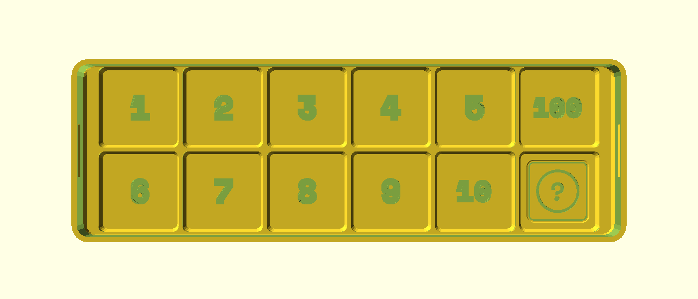
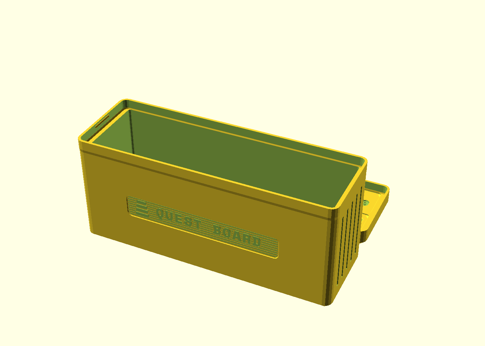
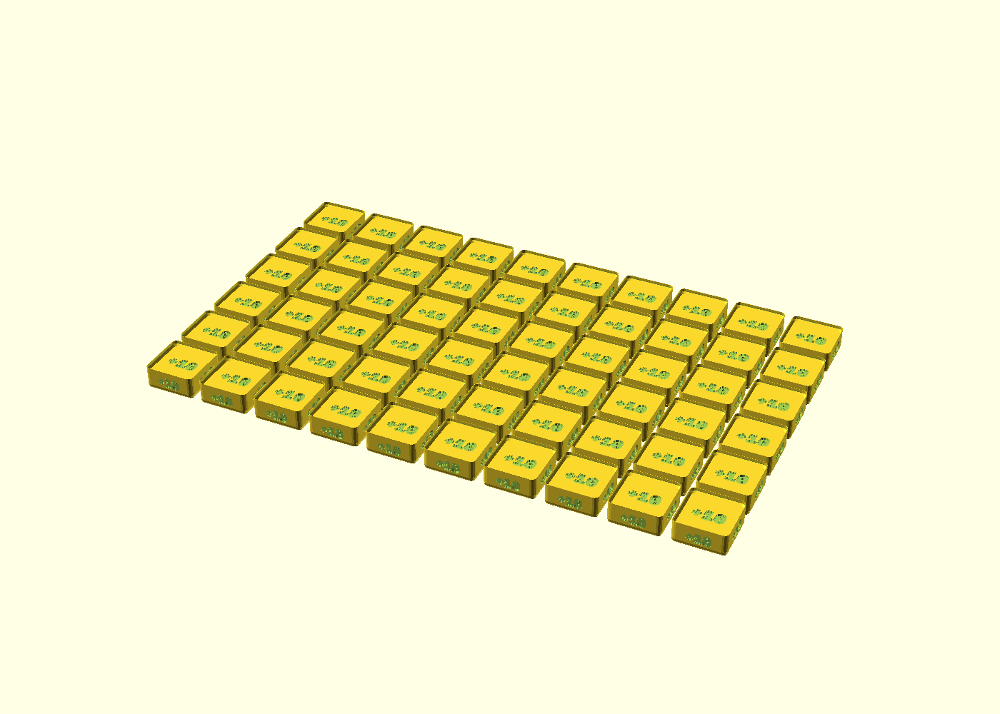
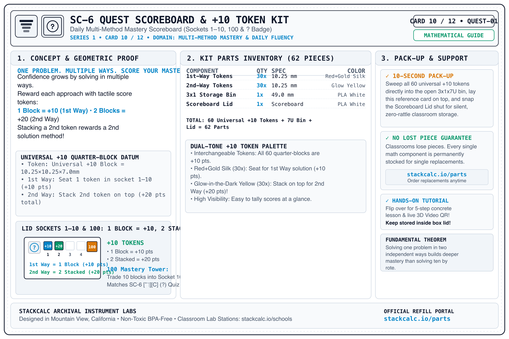
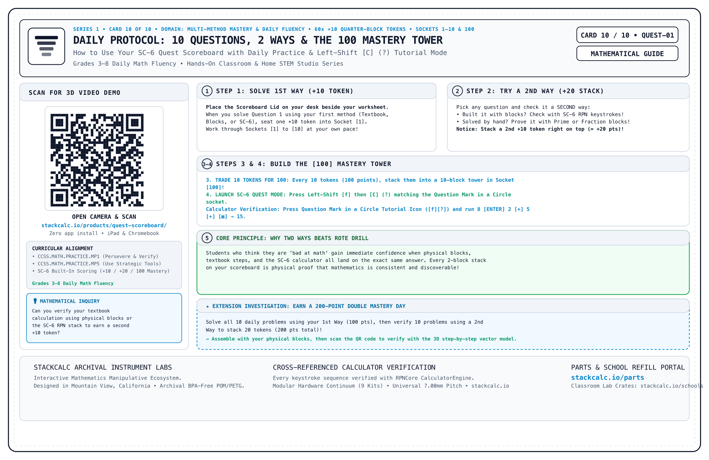

<!-- Schema.org JSON-LD Structured Data -->

  <!-- Breadcrumb -->
  <nav class="ec-breadcrumb" aria-label="Breadcrumb">
    <a href="../../">Home</a>
    /
    <a href="../">Products &amp; Manipulatives</a>
    /
    SC-6 Quest Scoreboard &amp; +10 Token Kit
  </nav>

  <!-- ==========================================================================
       HERO PRODUCT SECTION (2-COLUMN ECOMMERCE SPLIT)
       ========================================================================== -->
  

    <!-- Left Column: Product Gallery -->
    

      

        
      

      <!-- Thumbnail Selector Strip -->
      

        
t.classList.remove('active')); this.classList.add('active');">
          
        

        
t.classList.remove('active')); this.classList.add('active');">
          
        

        
t.classList.remove('active')); this.classList.add('active');">
          
        

        
t.classList.remove('active')); this.classList.add('active');">
          
        

      

    

    <!-- Right Column: Buy Box & Product Info -->
    

      <h1 class="ec-product-title">SC-6 Quest Scoreboard &amp; +10 Token Kit</h1>

      <!-- Educational Architecture & Tactile Standard -->
      

        MULTI-METHOD MASTERY
        &bull; 2-Piece Simplified Design
        &check; Matches SC-6 [↰][C] (?) Quiz
      

      

        $24.00
        &check; Ships in 48h &bull; Free Open-Source 3MF &amp; STLs
      

      

        Turn daily math practice into a low-stress, confidence-building game. This simplified <strong>2-piece 3&times;1&times;7U Gridfinity enclosure and Snapfinity Scoreboard Lid</strong> holds <strong>60 universal <code>+10</code> quarter-block tokens</strong> directly in an open storage bin (no inner sorting tray needed). Seat 1 block in Sockets <code>1</code>&ndash;<code>10</code> for your first solution (<strong>+10 pts</strong>), stack a 2nd block right on top when you verify with a second method (<strong>+20 pts</strong>), and trade 10 blocks into the <code>100</code> socket to build a <strong>100-Point Mastery Tower</strong>!
      

      <!-- Highlights Checklist -->
      

        

          &check;
          <strong>One Problem, Two Ways (+10 / +20 Stacking):</strong> 1 block in a socket = <strong>+10 pts</strong> (1st Way); 2 stacked blocks in the same socket = <strong>+20 pts</strong> (2nd Way verified with blocks or SC-6 RPN!).
        

        

          &check;
          <strong>Simplified 2-Piece Open-Bin Architecture:</strong> Just the 3&times;1&times;7U open storage bin and the Snapfinity Scoreboard Lid—grab tokens straight from the bin and sweep all 60 back in when done.
        

        

          &check;
          <strong>Question Mark in a Circle <code>(?)</code> Tutorial Badge:</strong> Embossed on the lid and rear wall to match the left-shift label above <code>[C]</code> on the SC-6 calculator (<code>[↰] [C]</code>).
        

        

          &check;
          <strong>Aligned to the 91-Page Big Ideas Supplement (900 Problems):</strong> Designed hand-in-hand with our free 91-page Student Workbook (90 Practice A &amp; B worksheets, 90 Two-Method Worked Examples) and 10-page Teacher Coach Guide across all 45 Big Ideas sections (Units 1&ndash;10).
        

      

      <!-- Action Buttons -->
      

        <a href="https://stackcalcmath.etsy.com" target="_blank" rel="noopener noreferrer" class="ec-btn-primary" style="background-color: #f1641e; border-color: #f1641e; color: #ffffff;">
          Order on Etsy ($24.00) ↗
        </a>
        <a href="https://teleportpod.com/portals/profile/StackCalc" target="_blank" rel="noopener noreferrer" class="ec-btn-secondary" style="border-color: #38BDF8; color: #38BDF8;">
          On-Demand Parts (Slant 3D) ↗
        </a>
        <a href="https://www.printables.com/@StackCalc_5593834" target="_blank" rel="noopener noreferrer" class="ec-btn-secondary" style="border-color: #FA6B05; color: #FA6B05;">
          Download 3MF on Printables ↗
        </a>
      

      <!-- Navigation & Editions Grid -->
      

        <a href="../../products/sc6-book/" class="p-2.5 rounded bg-white/5 hover:bg-white/10 border border-white/10 hover:border-white/30 text-slate-300 hover:text-white transition flex items-center justify-between">
          SC-6 Companion
          &rarr;
        </a>
        <a href="https://link.amazon/B0f5cP0Ur" target="_blank" rel="noopener noreferrer" class="p-2.5 rounded bg-white/5 hover:bg-white/10 border border-white/10 hover:border-white/30 text-slate-300 hover:text-white transition flex items-center justify-between">
          Companion Book
          ↗
        </a>
        <a href="https://link.amazon/B05RFHqeu" target="_blank" rel="noopener noreferrer" class="p-2.5 rounded bg-white/5 hover:bg-white/10 border border-white/10 hover:border-white/30 text-slate-300 hover:text-white transition flex items-center justify-between">
          Teacher Guide
          ↗
        </a>
        <a href="https://www.printables.com/@StackCalc_5593834" target="_blank" rel="noopener noreferrer" class="p-2.5 rounded bg-white/5 hover:bg-white/10 border border-white/10 hover:border-white/30 text-slate-300 hover:text-white transition flex items-center justify-between">
          Free 3MF (Printables)
          ↗
        </a>
        <a href="../../curriculum/" class="p-2.5 rounded bg-white/5 hover:bg-white/10 border border-white/10 hover:border-white/30 text-slate-300 hover:text-white transition flex items-center justify-between">
          Curriculum Guide
          &rarr;
        </a>
        <a href="#specifications" class="p-2.5 rounded bg-white/5 hover:bg-white/10 border border-white/10 hover:border-white/30 text-slate-300 hover:text-white transition flex items-center justify-between">
          Technical Specs
          &darr;
        </a>
      

      <!-- Quick Subpage & Curriculum Links -->
      

        <a href="../../downloads/worksheets/sc6_quest_token_scoring_guide.pdf" class="text-xs font-semibold px-3 py-1.5 rounded bg-slate-800 text-emerald-400 border border-emerald-500/30 hover:bg-slate-700">
          &bull; Free 1-Page Token Scoring Guide (PDF) &darr;
        </a>
        <a href="https://link.amazon/B07bxzYKq" target="_blank" rel="noopener noreferrer" class="text-xs font-semibold px-3 py-1.5 rounded bg-slate-800 text-cyan-400 border border-cyan-500/30 hover:bg-slate-700">
          &bull; Student Workbook on Amazon ($16) ↗
        </a>
        <a href="https://link.amazon/B05RFHqeu" target="_blank" rel="noopener noreferrer" class="text-xs font-semibold px-3 py-1.5 rounded bg-slate-800 text-amber-400 border border-amber-500/30 hover:bg-slate-700">
          &bull; Master Teacher Guide on Amazon ($16) ↗
        </a>
        <a href="../../downloads/StackCalc-Book-3-Middle-School-Math-Lab.pdf" download class="text-xs font-semibold px-3 py-1.5 rounded bg-slate-800 text-emerald-400 border border-emerald-500/30 hover:bg-slate-700">
          &bull; Student Workbook PDF (128 pp.) &darr;
        </a>
      

      <!-- Trust Strip -->
      

        

          &plusmn;
          &plusmn;0.05mm Calibrated &bull; Non-Toxic PETG &amp; PLA
        

        

          &check;
          Anti-Heartbreak $1.88 Token Refills
        

        

          &hearts;
          100% Free Open-Source CAD &amp; PDFs
        

      

    

  

  <!-- ==========================================================================
       SECTION: HOW THE 2-PIECE SCOREBOARD & +10 TOKENS WORK
       ========================================================================== -->
  <section id="product-videos" class="mt-16 pt-12 border-t border-white/10">
    

      DAILY CLASSROOM &amp; HOME PROTOCOL • QUEST SCOREBOARD
      ● 1 BLOCK = +10 PTS &bull; 2 STACKED = +20 PTS &bull; 10 BLOCKS = 100 MASTERY
    

    

      

        
STEP 1: 1ST WAY (+10 POINTS)

        

          Pop the Snapfinity Scoreboard Lid off the open storage bin and set it beside your worksheet. Solve any problem (1 through 10) using your first choice of method—Big Ideas textbook steps, physical blocks, or SC-6 RPN keystrokes—and seat <strong>1 Gold <code>+10</code> token</strong> into that question's socket.
        

      

      

        
STEP 2: 2ND WAY BONUS (+20 STACK)

        

          Revisit any question and verify it using a <strong>second independent method</strong>! When both methods produce the exact same answer, stack a <strong>2nd Glow-in-the-Dark <code>+10</code> token</strong> right on top of the first token in the same socket (2 stacked blocks = <strong>+20 points</strong>).
        

      

      

        
STEP 3: THE [100] MASTERY TOWER

        

          Every time you accumulate <strong>10 tokens (100 points)</strong> across your scoreboard or across the SC-6 <code>[↰] [C]</code> (<code>?</code>) Tutorial Quiz mode, trade and stack those 10 blocks into a <strong>70mm tall Mastery Tower</strong> in the dedicated <code>[100]</code> socket!
        

      

    

    <!-- In-Box Reference Card Preview -->
    

      

        
SIDE A: IN-BOX USER COMPANION GUIDE

        
      

      

        
SIDE B: DAILY 2-WAY PROTOCOL &amp; QR GUIDE

        
      

    

    <!-- Hardware & Pedagogical Specs -->
    

      

        <h3 class="text-sm font-bold text-white uppercase tracking-wider">PHYSICAL HARDWARE SPECS</h3>
        <ul class="space-y-2 text-slate-300">
          <li><strong>Token Geometry:</strong> 60x Universal <code>+10</code> Quarter-Blocks (10.25 &times; 10.25 &times; 7.00 mm visible 1U height)</li>
          <li><strong>Token Palette:</strong> 30x Red+Gold Dual Silk PLA (1st Way) + 30x Glow-in-the-Dark Yellow PLA (2nd Way)</li>
          <li><strong>Enclosure Box:</strong> 3&times;1&times;7U Open Gridfinity Storage Bin (125.5 &times; 42.0 &times; 56.4 mm, no inner tray)</li>
          <li><strong>Scoreboard Lid:</strong> 3&times;1 Snapfinity Lid with Sockets <code>1</code>&ndash;<code>10</code>, <code>100</code> Mastery Socket, and <code>(?)</code> Keycap Badge</li>
          <li><strong>Front Plaque:</strong> Deep-relief debossed "SC-6 QUEST" instrument badge</li>
          <li><strong>Tutorial Keycap Badge:</strong> Question Mark in a Circle <code>(?)</code> matching left-shift <code>[C]</code> on the SC-6</li>
        </ul>
      

      

        <h3 class="text-sm font-bold text-white uppercase tracking-wider">BIG IDEAS MATH SUPPLEMENT ALIGNMENT</h3>
        <ul class="space-y-2 text-slate-300">
          <li><strong>Units 1&ndash;2:</strong> Number Sense, Order of Operations, Prime Factorization (<code>COUNT-01</code>, <code>PRIME-01</code>)</li>
          <li><strong>Units 3&ndash;4:</strong> Fractions, Mixed Numbers &amp; Decimal Place Value (<code>FRAC-01</code>, <code>PLACE-01</code>)</li>
          <li><strong>Units 5&ndash;6:</strong> Ratios, Rates, Percents &amp; Integer Zero-Pairs (<code>FRAC-01</code>, <code>BASE-10</code>, <code>ALGB-01</code>)</li>
          <li><strong>Units 7&ndash;8:</strong> Equations, Inequalities, Surface Area &amp; Volume (<code>ALGB-01</code>, <code>COUNT-01</code>)</li>
          <li><strong>Units 9&ndash;10:</strong> Polygons, Area, Volume, Surface Area &amp; Statistics (<code>COUNT-01</code>, <code>TIME-01</code>, <code>PROB-01</code>)</li>
        </ul>
      

    

  </section>

  <!-- Discreet Ecosystem Blurb -->
  

    
&Delta;

    

      
Part of the StackCalc Math Learning Ecosystem

      

        The Quest Scoreboard gamifies student problem sets into tangible reward loops with dual-way scoring tokens. It mirrors the automated quiz scoring engine on our <a href="../sc6-elementary/" class="text-sky-400 hover:underline">SC-6 Elementary</a> and the advanced register counters on our <a href="../sc32-calculator/" class="text-sky-400 hover:underline">SC-32 Scientific</a> calculators. Explore complete lesson modules in our <a href="../../curriculum/worksheets/" class="text-amber-400 hover:underline">120 Classroom Station Worksheets</a> and order on-demand precision refills at the <a href="https://teleportpod.com/portals/profile/StackCalc" target="_blank" rel="noopener noreferrer" class="text-emerald-400 hover:underline">Slant 3D Replacement Parts Center ↗</a>.
      

    

  

