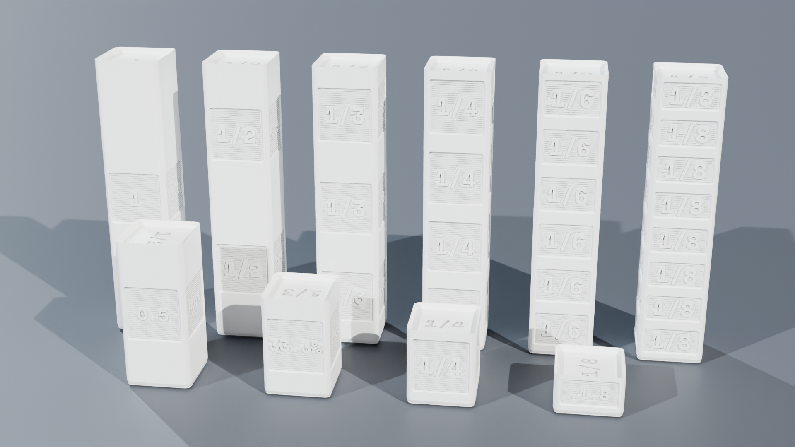
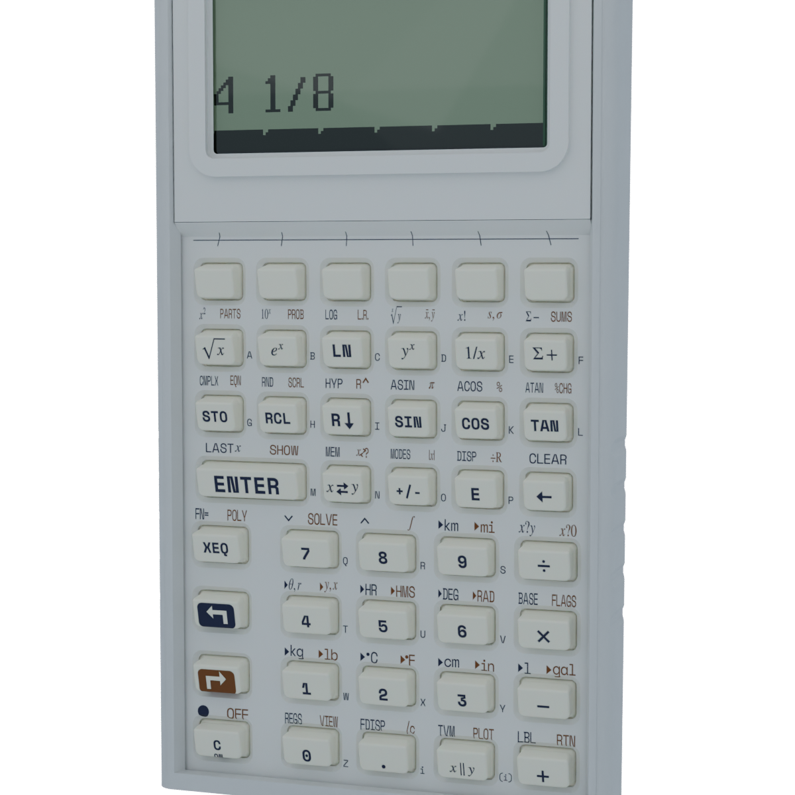
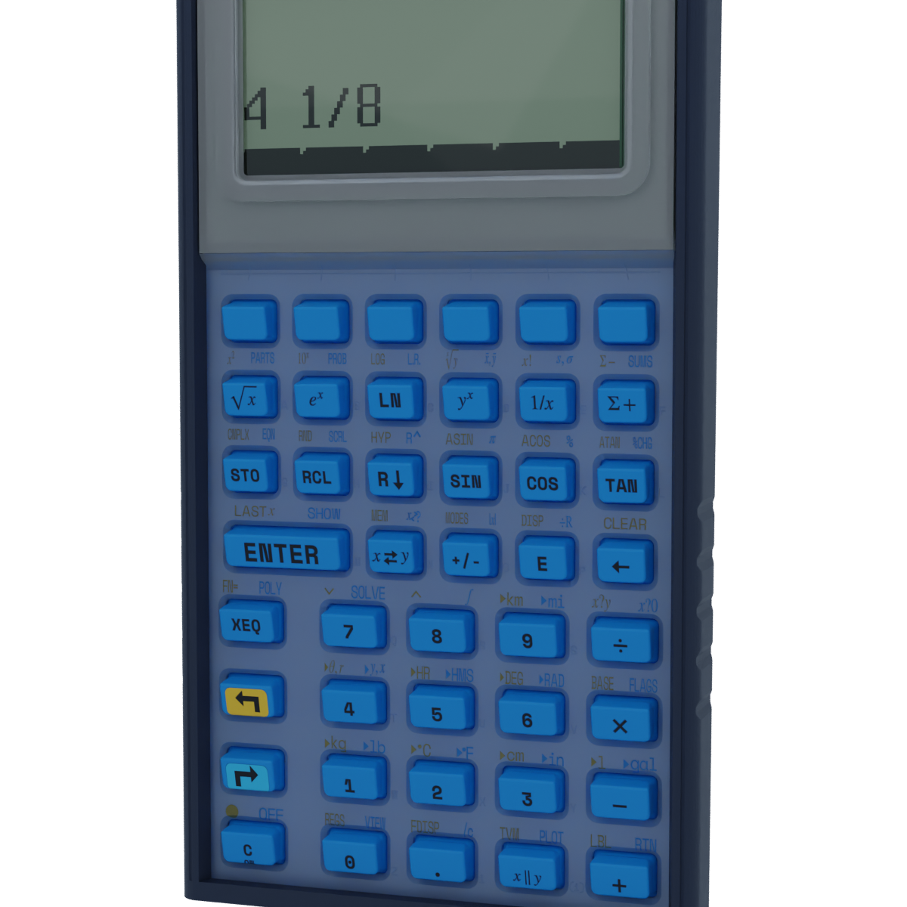
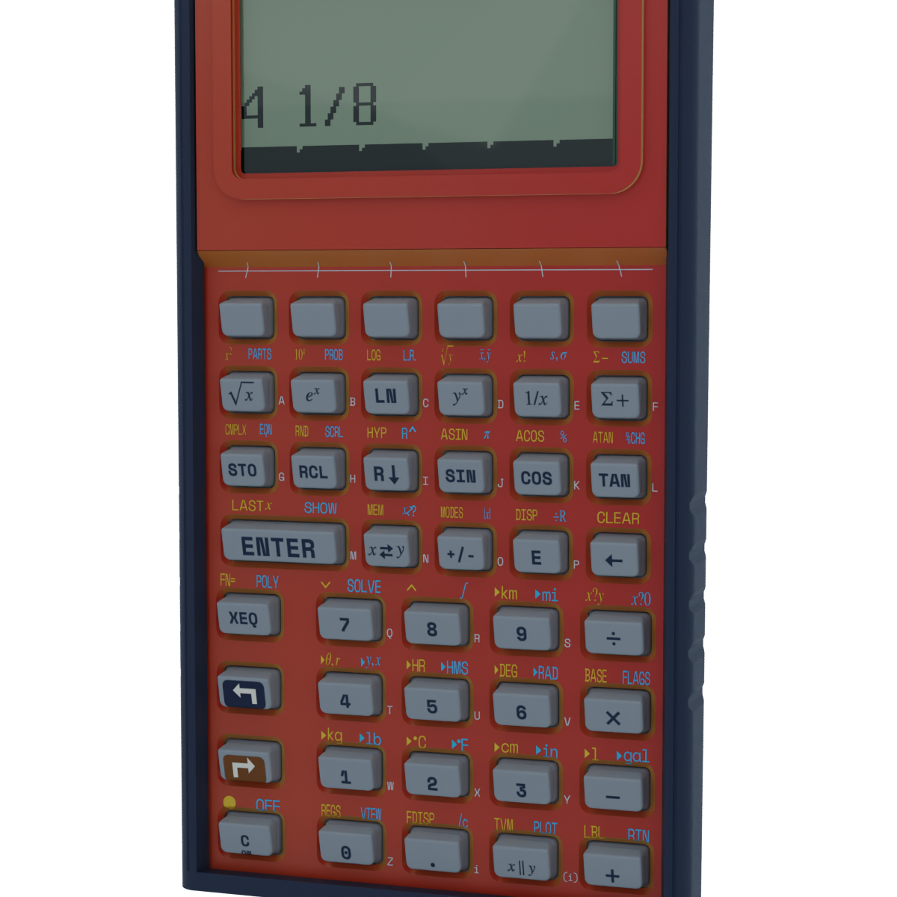
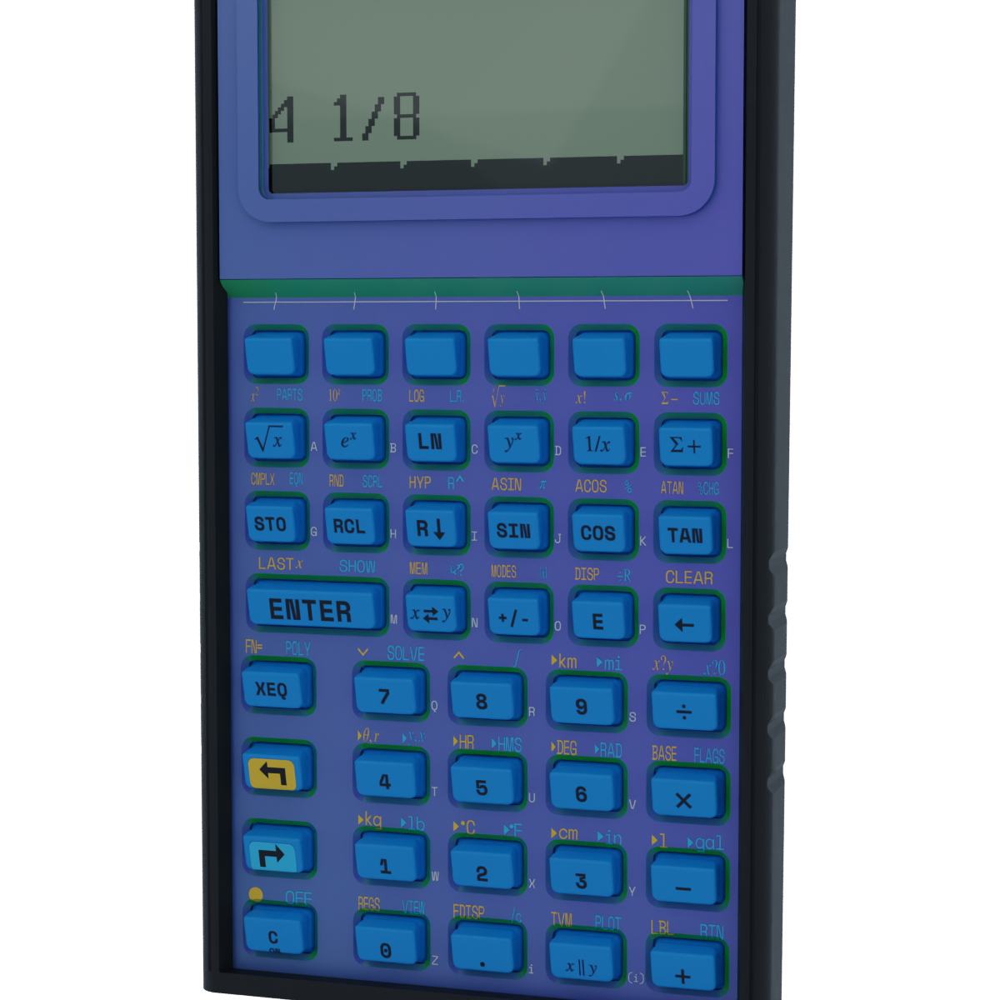
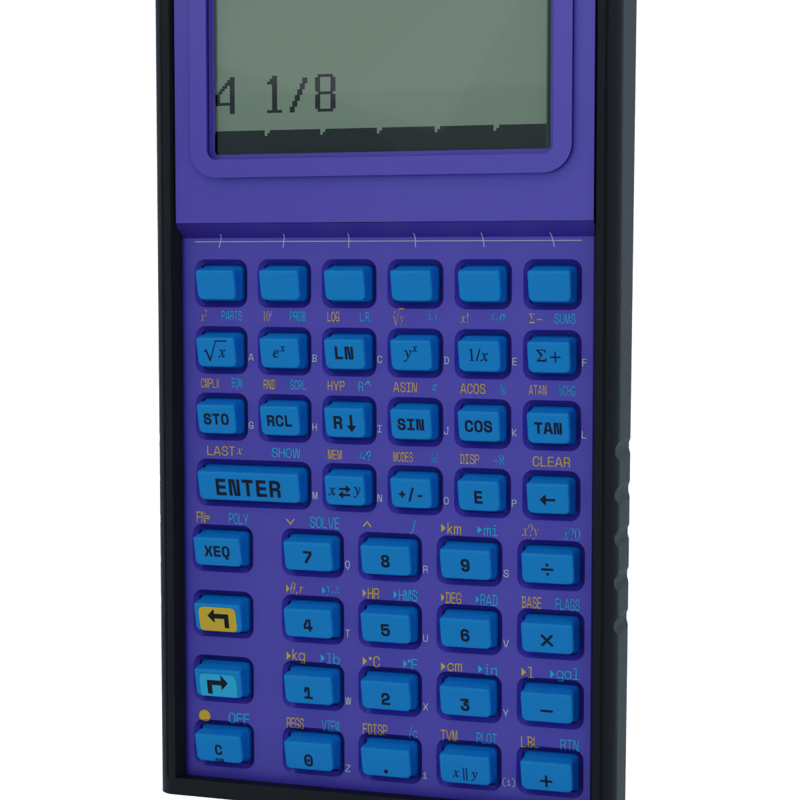

<!-- Schema.org JSON-LD Structured Data for High Google Search & Rich Results Ranking -->

  <!-- Breadcrumb -->
  <nav class="ec-breadcrumb" aria-label="Breadcrumb">
    <a href="../../">Home</a>
    /
    <a href="../">Products &amp; Manipulatives</a>
    /
    SC-32 Scientific Calculator
  </nav>

  <!-- ==========================================================================
       HERO PRODUCT SECTION (2-COLUMN ECOMMERCE SPLIT)
       ========================================================================== -->
  

    <!-- Left Column: Product Gallery -->
    

      <!-- Badge strip cleanly ABOVE image container (Never on top of it!) -->
      

        Scientific RPN
        &bull; Batch 001 Fabrication
      

      

        
      

      <!-- Thumbnail Selector Strip (Includes Real High-Res Editions & Infographics) -->
      

        

          
        

        

          
        

        

          
        

        

          
        

        

          
        

        

          
        

        

          
        

      

    

    <!-- Right Column: Buy Box & Product Info -->
    

      

        Hardware Silicon
        &check; SAT &bull; ACT &bull; AP Exam Permitted
      

      <h1 class="ec-product-title">SC-32 Scientific Calculator</h1>

      <!-- Social Proof & Review Score -->
      

        
★★★★★

        4.9 / 5.0
        &bull; 42 Engineer &amp; Student Reviews
        &check; Exam Legal
      

      

        $59.00 &ndash; $89.00
        &check; Free US Priority Shipping &bull; Batch 001
      

      <!-- Interactive Tactile Faceplate Architecture Selector -->
      

        

          Select Modular Faceplate:
          10s Tool-Free Swap
        

        

          <button type="button" class="te-swatch-btn active" id="pdp-swatch-stealth" onclick="switchPDPFaceplate('stealth', '../../assets/renders/edition_stealth_industrial.png', 'Black PLA 2.0+ (Concentric Micro-Grooves)', 'Black PETG', 'Electric Azure TPU 95A', 'Silver Chrome &amp; Gold')">
            
            Stealth
          </button>
          <button type="button" class="te-swatch-btn" id="pdp-swatch-retro" onclick="switchPDPFaceplate('retro', '../../assets/renders/edition_retrofuturism.png', 'Polar White PLA 2.0+ (Ivory Matte)', 'Polar White PLA 2.0+', 'Polar White TPU 95A', 'Navy &amp; Bronze')">
            
            Retro
          </button>
          <button type="button" class="te-swatch-btn" id="pdp-swatch-voyager" onclick="switchPDPFaceplate('voyager', '../../assets/renders/edition_voyager.png', 'Optical Frosted Translucent PETG', 'Midnight Navy PLA 2.0+', 'Electric Azure TPU 95A', 'Navy &amp; Sky Blue')">
            
            Voyager
          </button>
          <button type="button" class="te-swatch-btn" id="pdp-swatch-supernova" onclick="switchPDPFaceplate('supernova', '../../assets/renders/edition_supernova.png', 'Red+Gold Silk PLA (Anisotropic)', 'Midnight Navy PLA 2.0+', 'Light Gray TPU 95A', 'Mirror Silver &amp; Gold')">
            
            Supernova
          </button>
          <button type="button" class="te-swatch-btn" id="pdp-swatch-deepspace" onclick="switchPDPFaceplate('deepspace', '../../assets/renders/edition_deep_space.png', 'Purp+Grn+Blu Trichromatic Silk PLA', 'Black PLA 2.0+', 'Electric Azure TPU 95A', 'Foam White &amp; Gold')">
            
            Deep Space
          </button>
          <button type="button" class="te-swatch-btn" id="pdp-swatch-synthwave" onclick="switchPDPFaceplate('synthwave', '../../assets/renders/edition_synthwave.png', 'Purple+Black Silk PLA', 'Black PLA 2.0+', 'Electric Azure TPU 95A', 'Foam White &amp; Cyan')">
            
            Synthwave
          </button>
        

        

          <strong>[ACTIVE CMF]</strong> FACEPLATE: Black PLA 2.0+ (Concentric Micro-Grooves) &bull; CHASSIS: Black PETG &bull; KEYS: Electric Azure TPU 95A &bull; FOIL: Silver Chrome &amp; Gold
        

      

      

        The dedicated tactile handheld Reverse Polish Notation scientific instrument engineered for STEM students and technical professionals. Features Raspberry Pi RP2350 silicon, 43 mechanical snap-dome keys (400g actuation), a transflective sunlight-readable ST7567A monochrome LCD with native Terminus typography, and a 4-part tool-free sliding dovetail chassis.
      

      <!-- Highlights Checklist -->
      

        

          &check;
          <strong>Zero Distraction, Total Privacy:</strong> No Bluetooth, Wi-Fi, cameras, or games. 100% legal in testing centers.
        

        

          &check;
          <strong>Physical Tactile Feedback:</strong> 400 grams of snap-dome actuation force for rapid, confident blind touch-typing.
        

        

          &check;
          <strong>Live 4-Line RPN Stack:</strong> Evaluates intermediate values instantly without nested parentheses traps.
        

        

          &check;
          <strong>Months of Battery Life:</strong> Powered by a single CR2032 coin cell or USB-C desktop power.
        

      

      <!-- Action Buttons -->
      

        <a href="https://www.etsy.com/shop/StackCalc" target="_blank" rel="noopener noreferrer" class="ec-btn-primary" style="background-color: #f1641e; border-color: #f1641e; color: #ffffff;">
          Order on Etsy ($89.00) ↗
        </a>
        <a href="#downloads" class="ec-btn-secondary">
          Download Open-Source STLs &darr;
        </a>
      

      <!-- Quick Subpage Links -->
      

        <a href="assembly/" class="text-xs font-semibold px-3 py-1.5 rounded bg-slate-800 text-sky-400 border border-sky-500/30 hover:bg-slate-700">
          &bull; Step-by-Step Dovetail Assembly Guide &amp; Video &rarr;
        </a>
        <a href="lessons/" class="text-xs font-semibold px-3 py-1.5 rounded bg-slate-800 text-emerald-400 border border-emerald-500/30 hover:bg-slate-700">
          &bull; RPN Operational Stack Lessons (1 &amp; 2) &rarr;
        </a>
      

      <!-- Trust Badges -->
      

        

          &check;
          <a href="/exam-compliance/" style="color: inherit; text-decoration: underline;">Approved for SAT, ACT, and AP Tests &rarr;</a>
        

        

          &circlearrowright;
          Tool-Free Dovetail Easy Battery Access
        

        

          &star;
          Open-Source Firmware &amp; Hardware
        

      

    

  

  <!-- ==========================================================================
       SECTION: CORE PHILOSOPHY & WHY RPN MATTERS
       ========================================================================== -->
  <section class="ec-section">
    <h2 class="ec-section-title">Engineered for Mathematical Focus</h2>
    

      Over the last twenty years, calculation was swallowed by the screen: phone notifications, fragile touch displays, and hidden syntax errors. StackCalc SC-32 returns calculation to a dedicated, tactile instrument.
    

    

      

        
&empty;

        <h3 class="ec-feature-title">Elimination of Parentheses Traps</h3>
        

          Standard in-fix calculators force students to parse complicated operator precedence and balance parentheses sets before calculating. In RPN, operators evaluate the instant they are keyed, showing calculations from the inside-out.
        

      

      

        
&equiv;

        <h3 class="ec-feature-title">Full Intermediate State Visibility</h3>
        

          The 4-level operational stack (X, Y, Z, and T) displays every intermediate value on the transflective ST7567A monochrome screen. Students spot conceptual calculation errors immediately, rather than discovering a faulty answer at the end.
        

      

      

        
&bull;

        <h3 class="ec-feature-title">Authoritative 400g Keystrokes</h3>
        

          Glass touchscreens provide zero mechanical feedback, leading to missed keystrokes during time-crunched exams. The SC-32 provides 400 grams of snap-dome force with debossed finger-centering dishes on every keycap.
        

      

    

  </section>

  <!-- ==========================================================================
       SECTION: DEMONSTRATION VIDEOS & ARCHITECTURE
       ========================================================================== -->
  <!-- ==========================================================================
       SECTION: DEMONSTRATION VIDEOS, UNBOXING & KINEMATICS (3-VIDEO MEDIA SUITE)
       ========================================================================== -->
  <section id="product-videos" class="ec-section">
    <h2 class="ec-section-title">The Video Showcase: Mechanical Animation, Unboxing &amp; Engineering Lesson</h2>
    
Experience the complete engineering journey from sliding dovetail CAD kinematics and laser-engraved card unboxing to 4-register RPN stack operations on a work desk.

    

      <!-- 1. CAD / Mechanical Animation -->
      

        

          <video controls playsinline preload="metadata" poster="../../assets/renders/sc32-hero-keynote.png">
            <source src="/assets/videos/sc32-assembly.mp4" type="video/mp4">
            Your browser does not support HTML5 video.
          </video>
          1. CAD KINEMATICS
        

        

          

            <h3 class="text-sm font-bold text-slate-100 mb-1">Mechanical &amp; CAD Animation</h3>
            
Exploded 3D view showing sliding dovetail chassis, Shore 95A tactile keypad membrane, and captive top cap retention.

          

          

            60 FPS Cycles Render
            0.25mm Dovetail Rails
          

        

      

      <!-- 2. Unboxing Experience -->
      

        

          <video controls playsinline preload="metadata" poster="../../assets/renders/sc32-hero-keynote.png">
            <source src="/assets/videos/sc32-unboxing.mp4" type="video/mp4">
            Your browser does not support HTML5 video.
          </video>
          2. UNBOXING EXPERIENCE
        

        

          

            <h3 class="text-sm font-bold text-slate-100 mb-1">Unboxing Experience</h3>
            
Opening the keynote box to reveal the laser-engraved black archival reference card resting on top of the stealth hardware and desktop stand.

          

          

            Laser Engraved Card
            Zero Plastic Wrap
          

        

      

      <!-- 3. Engineering & RPN Lesson in Action -->
      

        

          <video controls playsinline preload="metadata" poster="../../assets/renders/sc32-utility-ortho.png">
            <source src="/assets/videos/sc32-lesson.mp4" type="video/mp4">
            Your browser does not support HTML5 video.
          </video>
          3. RPN STACK LESSON
        

        

          

            <h3 class="text-sm font-bold text-slate-100 mb-1">RPN Architecture Lesson</h3>
            
Evaluating multi-operator expressions with zero parentheses: 4-register RPN stack manipulation (X, Y, Z, T) in real time.

          

          

            RPN Stack Workflow
            Zero Distraction
          

        

      

    

    <!-- Reference Card Download Callout -->
    

      

        
        

          <h4 class="text-sm font-bold text-slate-100">Laser-Engraved Archival Reference Card (135&times;90mm)</h4>
          
Included inside every SC-32 box. Scan Side B to access the full assembly and firmware video suite or inspect Side A for circuit and chassis replacement IDs.

        

      

      

        <a href="/assets/reference_cards/reference_card_SC-32-HW_laser.png" target="_blank" rel="noopener noreferrer" class="px-3 py-1.5 bg-slate-800 hover:bg-slate-700 text-xs font-mono text-slate-200 rounded border border-slate-700 transition">View Laser Card (Side A)</a>
        <a href="/assets/reference_cards/reference_card_SC-32-HW_back_laser.png" target="_blank" rel="noopener noreferrer" class="px-3 py-1.5 bg-cyan-950 hover:bg-cyan-900 text-xs font-mono text-cyan-300 rounded border border-cyan-800 transition">View Back (QR Side B)</a>
        <a href="/downloads/packing_bench_cards.html" class="px-3 py-1.5 bg-emerald-950 hover:bg-emerald-900 text-xs font-mono text-emerald-300 rounded border border-emerald-800 transition">Print Duplex Sheet</a>
      

    

  </section>

  <!-- ==========================================================================
       SECTION: FROM THE TEACHER'S MANUAL (REPRODUCIBLE RPN STACK LAB SHEET)
       ========================================================================== -->
  <section class="ec-section">
    

      

        &bull; Classroom Pedagogy &bull; Concrete-Representational-Abstract (CRA)
        <h2 class="ec-section-title m-0">From the Teacher's Manual: Unit Lab Sheet</h2>
      

      Unit 00 &bull; RPN Stack Mechanics
    

    

      Most traditional math teacher manuals treat calculators as black-box answer boxes. In the StackCalc curriculum, the SC-32 RPN architecture is an active pedagogical instrument that makes order of operations, stack registers, and intermediate states visible at every keystroke.
    

    <!-- Authentic Spiral-Bound Workbook Page Facsimile -->
    

      

        

        

        

        

        

      

      

        

          

            STACKCALC MATH LABS // SERIES 00
            STANDARDS: CCSS MP.1 &bull; CCSS MP.5 &bull; TEKS 111.39.c.1
            PERIOD: 45 MIN STATION
          

          <h3 class="workbook-title">Lab 00: Four-Register Stack Dynamics &amp; Parenthesis Inversion</h3>
          

            <strong>Investigation Goal:</strong> Trace the physical flow of data through the 4-register operational stack (\(X, Y, Z, T\)). Prove mathematically how Reverse Polish Notation evaluates complex rational expressions without parentheses, eliminating algebraic precedence traps.
          

        

        <!-- Phase 1: Concrete Spatial Exploration -->
        

          

            &square; PHASE 1: CONCRETE SPATIAL EXPLORATION (STACK TOKEN DYNAMICS)
          

          

            Arrange 4 tactile manipulative tokens on the desk labeled \(X\) (Active Entry), \(Y\) (Operator Partner), \(Z\) (Buffer), and \(T\) (Top Register). Model the mechanical "Stack Lift" and "Stack Drop":
          

          

            

              <strong class="text-sky-400 block mb-0.5">Operation 1: The Stack Lift</strong>
              Keying ENTER duplicates the \(X\) token into \(Y\), pushing previous registers up (\(Y \rightarrow Z\), \(Z \rightarrow T\)).
            

            

              <strong class="text-amber-400 block mb-0.5">Operation 2: Binary Execution</strong>
              Pressing any operator (+, &times;) consumes \(X\) and \(Y\), drops the stack, and places the result into \(X\).
            

            

              <strong class="text-emerald-400 block mb-0.5">Operation 3: Zero Parentheses</strong>
              Innermost terms evaluate immediately. Intermediate numbers remain live on the display without scratch paper or memory clearing.
            

          

        

        <!-- Phase 2: Structured Observation Table -->
        

          

            &equiv; PHASE 2: REPRESENTATIONAL DATA &amp; STACK REGISTER TRACE
          

          

            Evaluate the multi-operator rational expression: \(\displaystyle \frac{(14 + 6) \times (38 - 13)}{25}\). Record each register state after every tactile keystroke:
          

          <table class="workbook-table">
            <thead>
              <tr>
                <th>Tactile Keystroke</th>
                <th>Register X (Display)</th>
                <th>Register Y</th>
                <th>Register Z</th>
                <th>Operational Meaning</th>
              </tr>
            </thead>
            <tbody>
              <tr>
                <td class="font-mono text-cyan-300">14 [ENTER]</td>
                <td class="font-mono">14.0000</td>
                <td class="font-mono">14.0000</td>
                <td class="font-mono">0.0000</td>
                <td class="font-mono text-slate-300">Push first term into stack</td>
              </tr>
              <tr>
                <td class="font-mono text-cyan-300">6 [+]</td>
                <td class="font-mono text-emerald-400 font-bold">20.0000</td>
                <td class="font-mono">0.0000</td>
                <td class="font-mono">0.0000</td>
                <td class="font-mono text-slate-300">Sum first bracket: \((14 + 6 = 20)\)</td>
              </tr>
              <tr>
                <td class="font-mono text-cyan-300">38 [ENTER]</td>
                <td class="font-mono">38.0000</td>
                <td class="font-mono">20.0000</td>
                <td class="font-mono">0.0000</td>
                <td class="font-mono text-slate-300">Push second factor; preserves 20 in Y</td>
              </tr>
              <tr>
                <td class="font-mono text-cyan-300">13 [-]</td>
                <td class="font-mono text-emerald-400 font-bold">25.0000</td>
                <td class="font-mono">20.0000</td>
                <td class="font-mono">0.0000</td>
                <td class="font-mono text-slate-300">Evaluate second bracket: \((38 - 13 = 25)\)</td>
              </tr>
              <tr>
                <td class="font-mono text-cyan-300">[*]</td>
                <td class="font-mono text-emerald-400 font-bold">500.0000</td>
                <td class="font-mono">0.0000</td>
                <td class="font-mono">0.0000</td>
                <td class="font-mono text-slate-300">Multiply numerator factors: \((20 \times 25 = 500)\)</td>
              </tr>
              <tr>
                <td class="font-mono text-cyan-300">25 [/]</td>
                <td class="font-mono text-emerald-400 font-bold">20.0000</td>
                <td class="font-mono">0.0000</td>
                <td class="font-mono">0.0000</td>
                <td class="font-mono text-slate-300">Divide by denominator: \((500 / 25 = 20)\)</td>
              </tr>
            </tbody>
          </table>
        

        <!-- Phase 3: Abstract Verification via SC-32 RPN Calculator -->
        

          

            &Delta; PHASE 3: ABSTRACT VERIFICATION (SC-32 HARDWARE EXECUTION)
          

          

            Replicate the expression on your physical SC-32 calculator. Verify the snap-dome acoustic response and LCD stack status:
          

          

            

              Complete 11-Keystroke Execution Sequence (Zero Parentheses):
              

                1
                4
                ENTER
                6
                +
                3
                8
                ENTER
                1
                3
                &minus;
                &times;
                2
                5
                &divide;
                &rarr; Result: 20.0000
              

            

          

          

            STACK X: 20.0000 (FINAL EVALUATION)
            STACK Y: 0.0000 (CLEARED BUFFER)
            PARENTHESES USED: 0 (ZERO SYNTAX TRAPS)
            &check; EXACT MATCH TO ANALYTIC SOLUTION
          

        

        <!-- Teacher Facilitation Box -->
        

          <strong>Teacher Diagnostic Note:</strong> When solving \(\frac{(14 + 6) \times (38 - 13)}{25}\) on traditional algebraic calculators, over 35% of secondary students make precedence errors (e.g. entering \(14 + 6 \times 38 - 13 / 25\) without nested brackets), producing the incorrect answer \(222.48\). RPN enforces inside-out evaluation, cultivating authentic structural understanding of mathematical operations.
        

        <!-- Download & Order Row -->
        

          

            <strong>Sample Page 04</strong> from the 36-page <em>StackCalc RPN Math Labs Student Workbook</em>.
          

          

            <a href="/downloads/stackcalc-curriculum-sample-v0.2.0.pdf" class="ec-btn-secondary text-xs">
              &darr; Download Free Lab 00 Worksheet (PDF)
            </a>
            <a href="/products/curriculum-and-decks/" class="ec-btn-primary text-xs">
              Order Complete 36-Page Workbook ($24.00) &rarr;
            </a>
          

        

      

    

  </section>

  <!-- ==========================================================================
       SECTION: COMPLETE THE CLASSROOM MATH STATION (CROSS-SELL BUNDLE)
       ========================================================================== -->
  <section class="cross-sell-section">
    

      &bull; Complete The Math Station
      <h2 class="text-2xl font-bold text-white mt-1 mb-2">Equip Your Classroom With Tactile STEM Manipulatives</h2>
      

        The SC-32 was designed from the ground up to pair with our physical manipulative collection, taking students seamlessly from spatial touch to rapid scientific computation.
      

    

    

      <!-- Cross-Sell 1: Manipulative Starter Duo -->
      

        

          
          <h3 class="cross-sell-card-title">Fraction Studio &amp; Algebra Boxes Duo</h3>
          

            Pair the SC-32 with tactile proportional fraction towers (84mm Whole) and polynomial tile trays. Bridges arithmetic fractions directly into quadratic factoring.
          

        

        

          

            $58.00
            Manipulatives Pair
          

          <a href="/products/fraction-studio/" class="ec-btn-secondary w-full text-center mt-3 text-xs block">
            Explore Manipulatives &rarr;
          </a>
        

      

      <!-- Cross-Sell 2: Curriculum Workbook & Decks -->
      

        

          
          <h3 class="cross-sell-card-title">36-Page Spiral Student Workbook</h3>
          

            Features 20 dedicated laboratory investigations with step-by-step CRA worksheets, tactile token diagrams, teacher diagnostic notes, and full solutions key.
          

        

        

          

            $24.00
            Teacher Approved
          

          <a href="/products/curriculum-and-decks/" class="ec-btn-secondary w-full text-center mt-3 text-xs block">
            Add Workbook &amp; Decks &rarr;
          </a>
        

      

      <!-- Cross-Sell 3: Complete Math Lab Classroom Bundle -->
      

        SAVE $35.00
        

          
          <h3 class="cross-sell-card-title">Complete Classroom Math Lab Bundle</h3>
          

            Includes SC-32 Calculator + Fraction Studio + Algebra Boxes + Sectional Clock + Unit Circle Volvelle + 36-Page Spiral Workbook + CR80 Decks + Modular 3-in-1 Stand.
          

        

        

          

            $185.00
            &check; Save $35 (Was $220)
          

          <a href="https://www.etsy.com/shop/StackCalc" target="_blank" rel="noopener noreferrer" class="ec-btn-primary w-full text-center mt-3 text-xs block" style="background-color: #f1641e; border-color: #f1641e; color: #ffffff;">
            Order Complete Lab Bundle on Etsy ↗
          </a>
        

      

    

  </section>

  <!-- ==========================================================================
       SECTION: HARDWARE BLUEPRINT & EXPLODED VIEW
       ========================================================================== -->
  <section class="ec-section">
    <h2 class="ec-section-title">Tool-Free Sliding Dovetail Architecture</h2>
    

      Zero screws, zero adhesives, zero fragile snap clips. Every component slides into place with mechanical precision.
    

    

      

        
      

      

        <h3 class="text-xl font-bold text-white mb-3">Precision 4-Part Interlocking Stack</h3>
        

          The SC-32 disassembles in seconds along continuous internal dovetail tracks for tool-free battery replacement and modular faceplate customization:
        

        <ul class="text-sm text-gray-300 space-y-2 list-none p-0">
          <li class="flex items-center gap-2">1. <strong>Base Enclosure:</strong> Ergonomic 1.6&deg; planar wedge with anti-wobble desk pads.</li>
          <li class="flex items-center gap-2">2. <strong>Motherboard Core:</strong> Raspberry Pi RP2350 with surface-mount ST7567A reflective graphic LCD.</li>
          <li class="flex items-center gap-2">3. <strong>Tactile Membrane:</strong> Shore 95A flexible TPU sheet with 43 gold-plated snap-domes.</li>
          <li class="flex items-center gap-2">4. <strong>Faceplate &amp; Snap Cap:</strong> Satin matte faceplate with LCD shroud and retaining top cap.</li>
        </ul>
      

    

  </section>

  <!-- ==========================================================================
       SECTION: CURATED FACEPLATE ARCHITECTURES & CMF FINISHES
       ========================================================================== -->
  <section class="ec-section">
    

      

        <h2 class="te-section-title">Curated Faceplate Architectures &amp; CMF Finishes</h2>
        
Modular faceplates slide on in under 10 seconds along internal dovetail rails without tools.

      

      6 EDITIONS &bull; MIL-SPEC POLYMERS &bull; LASER-ENGRAVED FOILS
    

    

      <!-- 1. Stealth Industrial -->
      <article class="te-card">
        

          ED-01 // STEALTH INDUSTRIAL
          ● BATCH 001
        

        

          
        

        

          FACE: BLACK PLA
          CHASSIS: PETG
          KEYS: AZURE TPU
        

        

          
Concentric Micro-Grooves

          <h3 class="te-card-title">Stealth Industrial</h3>
          

            Concentric Archimedean spiral grooved Black PLA 2.0+ faceplate, impact-resistant Black PETG unibody chassis, electric Azure TPU 95A keycaps, and dual-layer laser-etched Silver Chrome &amp; Gold foil markings.
          

        

        

          $59.00
          <button type="button" class="te-card-btn" onclick="switchPDPFaceplate('stealth', '../../assets/renders/edition_stealth_industrial.png', 'Black PLA 2.0+ (Concentric Micro-Grooves)', 'Black PETG', 'Electric Azure TPU 95A', 'Silver Chrome &amp; Gold')">Preview &uarr;</button>
        

      </article>

      <!-- 2. Retrofuturism -->
      <article class="te-card">
        

          ED-02 // RETROFUTURISM
          ● BATCH 001
        

        

          
        

        

          FACE: POLAR WHITE
          CHASSIS: WHITE PLA
          KEYS: WHITE TPU
        

        

          
Archival Polar White

          <h3 class="te-card-title">Retrofuturism</h3>
          

            Monolithic Ivory/Polar White PLA 2.0+ faceplate and chassis, pure Polar White Shore 95A TPU keycaps, and high-contrast Deep Navy &amp; Antique Bronze foil hot-stamped legends.
          

        

        

          $59.00
          <button type="button" class="te-card-btn" onclick="switchPDPFaceplate('retro', '../../assets/renders/edition_retrofuturism.png', 'Polar White PLA 2.0+ (Ivory Matte)', 'Polar White PLA 2.0+', 'Polar White TPU 95A', 'Navy &amp; Bronze')">Preview &uarr;</button>
        

      </article>

      <!-- 3. Voyager -->
      <article class="te-card">
        

          ED-03 // VOYAGER
          ● BATCH 001
        

        

          
        

        

          FACE: FROSTED PETG
          CHASSIS: MIDNIGHT
          KEYS: AZURE TPU
        

        

          
Optical Translucent

          <h3 class="te-card-title">Voyager</h3>
          

            Optical Frosted Clear PETG faceplate revealing the internal matte black motherboard traces and immersion gold test pads, Matte Midnight Navy PLA chassis, Azure TPU keys, and Sky Blue foil.
          

        

        

          $79.00
          <button type="button" class="te-card-btn" onclick="switchPDPFaceplate('voyager', '../../assets/renders/edition_voyager.png', 'Optical Frosted Translucent PETG', 'Midnight Navy PLA 2.0+', 'Electric Azure TPU 95A', 'Navy &amp; Sky Blue')">Preview &uarr;</button>
        

      </article>

      <!-- 4. Supernova -->
      <article class="te-card">
        

          ED-04 // SUPERNOVA
          ● BATCH 001
        

        

          
        

        

          FACE: RED+GOLD SILK
          CHASSIS: MIDNIGHT
          KEYS: GRAY TPU
        

        

          
Anisotropic Silk Sheen

          <h3 class="te-card-title">Supernova</h3>
          

            Dual-Color Silk PLA faceplate transitioning from Crimson Red to Warm Amber Gold with anisotropic light sheen, Midnight Navy PLA chassis, Light Gray TPU keys, and mirrored Silver &amp; Gold foil.
          

        

        

          $79.00
          <button type="button" class="te-card-btn" onclick="switchPDPFaceplate('supernova', '../../assets/renders/edition_supernova.png', 'Red+Gold Silk PLA (Anisotropic)', 'Midnight Navy PLA 2.0+', 'Light Gray TPU 95A', 'Mirror Silver &amp; Gold')">Preview &uarr;</button>
        

      </article>

      <!-- 5. Deep Space -->
      <article class="te-card">
        

          ED-05 // DEEP SPACE
          ● BATCH 001
        

        

          
        

        

          FACE: TRICHROMATIC
          CHASSIS: BLACK PLA
          KEYS: AZURE TPU
        

        

          
Trichromatic Silk PLA

          <h3 class="te-card-title">Deep Space</h3>
          

            Trichromatic co-extruded Silk PLA faceplate shifting continuously between Indigo Purple, Emerald Green, and Deep Cobalt Blue, Solid Black PLA chassis, Azure TPU keys, and gold foil accents.
          

        

        

          $79.00
          <button type="button" class="te-card-btn" onclick="switchPDPFaceplate('deepspace', '../../assets/renders/edition_deep_space.png', 'Purp+Grn+Blu Trichromatic Silk PLA', 'Black PLA 2.0+', 'Electric Azure TPU 95A', 'Foam White &amp; Gold')">Preview &uarr;</button>
        

      </article>

      <!-- 6. Synthwave -->
      <article class="te-card">
        

          ED-06 // SYNTHWAVE
          ● BATCH 001
        

        

          
        

        

          FACE: NEON PURPLE
          CHASSIS: BLACK PLA
          KEYS: AZURE TPU
        

        

          
Dichromatic Violet Silk

          <h3 class="te-card-title">Synthwave</h3>
          

            Dichromatic Silk PLA faceplate in Electric Magenta and Deep Obsidian Violet, Solid Black PLA chassis, Azure TPU keys, and laser-foamed stark white &amp; neon cyan markings.
          

        

        

          $79.00
          <button type="button" class="te-card-btn" onclick="switchPDPFaceplate('synthwave', '../../assets/renders/edition_synthwave.png', 'Purple+Black Silk PLA', 'Black PLA 2.0+', 'Electric Azure TPU 95A', 'Foam White &amp; Cyan')">Preview &uarr;</button>
        

      </article>

    

  </section>

  <!-- ==========================================================================
       SECTION: FULL TECHNICAL SPECIFICATIONS
       ========================================================================== -->
  <section class="ec-section">
    <h2 class="ec-section-title">Technical Specifications</h2>
    
Engineered for durability, speed, and standard test compliance.

    <table class="ec-spec-table">
      <tbody>
        <tr>
          <td class="ec-spec-k">Microcontroller</td>
          <td class="ec-spec-v">Raspberry Pi RP2350 (Dual ARM Cortex-M33 @ 150MHz + Dual Hazard3 RISC-V)</td>
        </tr>
        <tr>
          <td class="ec-spec-k">Operational Engine</td>
          <td class="ec-spec-v">Native bare-metal C / Swift RPN core with IEEE 754 double precision</td>
        </tr>
        <tr>
          <td class="ec-spec-k">Graphic Display</td>
          <td class="ec-spec-v">132&times;65 Reflective FSTN Monochrome LCD (ST7567A controller, native Terminus typography)</td>
        </tr>
        <tr>
          <td class="ec-spec-k">Keypad Switches</td>
          <td class="ec-spec-v">43 stainless steel tactile snap-domes (400g actuation force, 1,000,000 cycle lifespan)</td>
        </tr>
        <tr>
          <td class="ec-spec-k">Keycaps &amp; Membrane</td>
          <td class="ec-spec-v">Custom debossed finger-centering dish caps molded with Shore 95A flexible polymer</td>
        </tr>
        <tr>
          <td class="ec-spec-k">Power Source</td>
          <td class="ec-spec-v">1&times; CR2032 3V coin cell (3&ndash;6 months typical daily use) + USB-C desktop bus power</td>
        </tr>
        <tr>
          <td class="ec-spec-k">Physical Dimensions</td>
          <td class="ec-spec-v">80.0 mm (W) &times; 146.0 mm (L) &times; 16.0 mm (H) &bull; 1.6&deg; ergonomic incline</td>
        </tr>
        <tr>
          <td class="ec-spec-k">Net Weight</td>
          <td class="ec-spec-v">115 grams (including coin cell and faceplate)</td>
        </tr>
        <tr>
          <td class="ec-spec-k">Testing Compliance</td>
          <td class="ec-spec-v">&check; Permitted on SAT, ACT, PSAT, AP Calculus, and AP Physics (Zero wireless radios, Non-CAS)</td>
        </tr>
        <tr>
          <td class="ec-spec-k">Industrial Design &amp; CMF</td>
          <td class="ec-spec-v">Sliding dovetail tool-free chassis &bull; Zero fasteners or adhesives &bull; Satin matte impact-resistant PETG &bull; Custom Shore 95A keycaps &bull; Ergonomic 1.6&deg; planar wedge with anti-wobble desk pads</td>
        </tr>
        <tr>
          <td class="ec-spec-k">Procurement Classification</td>
          <td class="ec-spec-v">UNSPSC: 44101807 (Calculators), 44101800 (Electronic calculators) &bull; NIGP: 204-16 &bull; Perkins V CTE &amp; NSF STEM Grant Eligible</td>
        </tr>
      </tbody>
    </table>
  </section>

  <!-- ==========================================================================
       SECTION: WHAT'S IN THE BOX
       ========================================================================== -->
  <section class="ec-section">
    <h2 class="ec-section-title">What's in the Box</h2>
    
Everything you need to begin immediate calculations.

    

      

        &check;
        StackCalc SC-32 Scientific Calculator (Batch 00 serialized)
      

      

        &check;
        CR2032 3V Lithium Coin Cell Battery (pre-installed)
      

      

        &check;
        Modular 3-in-1 Puzzle Stand &amp; Desk Wedge
      

      

        &check;
        Quick-Start RPN Mathematical Handbook &amp; Cheatsheet
      

    

  </section>

  <!-- ==========================================================================
       SECTION: SAFETY, COMPLIANCE & GUARANTEES
       ========================================================================== -->
  <section class="ec-section">
    <h2 class="ec-section-title">Safety, Compliance &amp; Guarantees</h2>
    
Certified for testing integrity, electrical safety, and classroom durability.

    

      

        <strong class="text-amber-300 flex items-center gap-2 mb-1">
          &#9888; Coin Cell Battery Safety Warning (Reese's Law / 16 CFR 1263)
        </strong>
        

          <strong>WARNING: INGESTION HAZARD.</strong> This product contains a button cell or coin cell battery (CR2032). Death or serious injury can occur if ingested. Keep new and used batteries out of reach of children. Seek immediate medical attention if suspected swallowed or placed inside any part of the body.
        

      

      

        <strong class="text-sky-400 flex items-center gap-2 mb-1">
          &#10003; Standardized Test Compliant (SAT, ACT, AP)
        </strong>
        

          Approved for official college entrance exams. Non-CAS calculation engine with zero wireless antennas, Bluetooth radios, or network capabilities. Retains full exam integrity in all proctored testing halls.
        

      

      

        <strong class="text-emerald-400 flex items-center gap-2 mb-1">
          &#9874; 1-Year Hardware Repair &amp; Serviceability Guarantee
        </strong>
        

          Engineered for sustainability, not planned obsolescence. Snaps apart cleanly via sliding dovetail rails without single-use glue. Individual keypads, LCD modules, and enclosures are available for easy field repair.
        

      

      

        <strong class="text-indigo-400 flex items-center gap-2 mb-1">
          &#9881; RoHS Compliant &amp; Lead-Free Electronics
        </strong>
        

          Fabricated with lead-free ENIG circuit boards and certified RoHS-compliant electronic components. Enclosure manufactured from odorless, non-toxic, recyclable matte polymers.
        

      

    

  </section>

  <!-- ==========================================================================
       SECTION: VERIFIED USER REVIEWS & SOCIAL PROOF
       ========================================================================== -->
  <section class="ec-section">
    

      

        <h2 class="ec-section-title m-0">Engineer &amp; Student Endorsements</h2>
        
Direct impressions from electrical engineers, physics students, and college faculty.

      

      

        4.9
        
★★★★★

        (42 Verified Reviews)
      

    

    

      

        

          
★★★★★

          

            "Finally, an RPN calculator that feels like a true precision instrument. The 400g snap-dome clicks provide unmistakable mechanical confirmation, and the Terminus font on the ST7567A LCD is gorgeous."
          

        

        

          <strong class="text-xs text-white block">Dr. Arthur V.</strong>
          Aerospace Engineering Professor &bull; MIT
        

      

      

        

          
★★★★★

          

            "Carried it through my AP Calculus BC and Physics exams without an issue from proctors. Zero wireless distractions, instantaneous stack calculations, and battery life that just doesn't quit."
          

        

        

          <strong class="text-xs text-white block">Devon S.</strong>
          AP Scholar &bull; STEM Academy
        

      

      

        

          
★★★★★

          

            "The sliding dovetail chassis is a work of industrial design art. Swapping coin cells without tiny screws or glued seams should be mandatory for all hardware."
          

        

        

          <strong class="text-xs text-white block">Kavita P.</strong>
          Senior Embedded Hardware Engineer &bull; San Jose
        

      

    

  </section>

  <!-- ==========================================================================
       SECTION: FREQUENTLY ASKED QUESTIONS (FAQ)
       ========================================================================== -->
  <section class="ec-section">
    <h2 class="ec-section-title">Frequently Asked Questions</h2>
    
Examination compliance, hardware architecture, and firmware details.

    

      

        

          Can I bring the SC-32 into College Board (SAT/AP) or ACT exam rooms?
          +
        

        

          Yes. Testing authorities prohibit calculators with wireless communication (Wi-Fi/Bluetooth), cameras, sound recorders, audio jacks, or computer-style QWERTY keyboards. The SC-32 possesses none of these features, making it fully compliant for standardized testing environments.
        

      

      

        

          Why does the SC-32 use Reverse Polish Notation (RPN)?
          +
        

        

          RPN is a postfix mathematical notation favored by scientists and engineers because operators evaluate operands immediately without ambiguous order-of-operation rules or nested parentheses. Keystroke count drops by approximately 20–30%, and intermediate stack values remain constantly visible on the 4-line display.
        

      

      

        

          How long does the battery last?
          +
        

        

          The transflective ST7567A monochrome LCD requires no active backlight in daylight, consuming mere microamps. Combined with deep-sleep power states on the RP2350 microcontroller, a single CR2032 3V coin cell powers months of typical student problem-solving sessions.
        

      

      

        

          Is the design open hardware?
          +
        

        

          Yes! We provide 100% free open-source STL 3D models, KiCad PCB layout files, and open C firmware on GitHub under an open-source license. You can fabricate, modify, and repair your own calculator freely.
        

      

    

  </section>

  <!-- Open Source Maker Download Callout -->
  <section id="downloads" class="ec-section">
    

      

        &bull; Open Hardware &amp; Firmware
        <h3 class="ec-maker-title">Self-Manufacture &amp; Inspect Source Code</h3>
        

          Download print-tested STLs for the chassis, faceplate, and keys, plus the complete RP2350 C firmware and KiCad PCB schematics.
        

      

      

        <a href="https://www.printables.com/@StackCalc" target="_blank" rel="noopener noreferrer" class="ec-btn-primary" style="background-color: #FA6B05; border-color: #FA6B05;">
          Download on Printables ↗
        </a>
        <a href="/downloads/sc32-calculator-open-source-stls.zip" class="ec-btn-primary">
          Download SC-32 STLs (.ZIP) &darr;
        </a>
        <a href="https://github.com/abagher/watch-calc-32" target="_blank" rel="noopener noreferrer" class="ec-btn-secondary">
          GitHub Firmware Repo ↗
        </a>
      

    

  </section>

  <!-- Discreet Ecosystem Blurb -->
  

    
&Delta;

    

      
Part of the StackCalc Math Learning Ecosystem

      

        The SC-32 connects directly with our physical math manipulatives (Fraction Studio, Algebra Boxes, and Sectional Clock), providing students with a seamless path from hands-on tactile models to high-speed scientific calculation.
      

    

  

<!-- Vanilla JS for PDP Interactive Faceplate and Main Image Switcher -->

