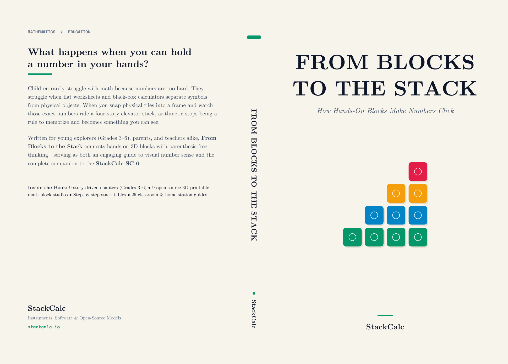
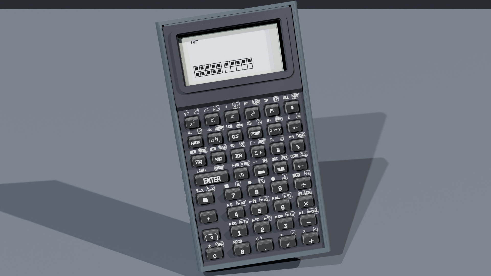

  <!-- Breadcrumb -->
  <nav class="ec-breadcrumb" aria-label="Breadcrumb">
    <a href="../../">Home</a>
    /
    <a href="../">Products &amp; Manipulatives</a>
    /
    From Blocks to the Stack (Book)
  </nav>

  <!-- ==========================================================================
       HERO PRODUCT SECTION (2-COLUMN ECOMMERCE SPLIT)
       ========================================================================== -->
  

    <!-- Left Column: Product Gallery -->
    

      

        
      

      

        

          
        

        

          
        

      

    

    <!-- Right Column: Buy Box & Product Info -->
    

      

        Official Bookstore &amp; Bench Edition
        In Stock
      

      <h1 class="ec-product-title" style="font-size: 2rem; line-height: 1.25;">From Blocks to the Stack</h1>
      
Hands-On Math &amp; the SC-6 Stack Calculator (Grades 3&ndash;6)

      

        $16.00
        &check; Print Book on Amazon Prime &bull; Spiral Workbooks on Lulu
      

      

        Written directly for curious 3rd&ndash;6th graders, homeschool families, and teachers, <em>From Blocks to the Stack</em> bridges the gap between physical math manipulatives and computational fluency. It connects tactile 3D-printed math blocks with the four visible shelves of the StackCalc SC-6 number stack ($X, Y, Z, T$)&mdash;completely eliminating parentheses, syntax errors, and passive worksheet memorization.
      

      <!-- Highlights Checklist -->
      

        

          &check;
          <strong>Physical-to-Abstract Bridge:</strong> Pairs directly with 9 modular 3D-printed manipulatives (Ten-Frames, Fraction Towers, Prime Blocks, Geared Clock).
        

        

          &check;
          <strong>Engine-Verified Keystrokes:</strong> Every single problem, story, and 4-register stack trace is verified directly against the RPNCore engine.
        

        

          &check;
          <strong>25 Complete Teacher Lesson Plans:</strong> Appendix B includes ready-to-teach 45-minute lesson plans aligned with Common Core and state frameworks.
        

        

          &check;
          <strong>Zero Planned Obsolescence:</strong> Includes 3D printable blueprints (Appendix A) to fabricate all manipulative studios in any school makerspace.
        

      

      <!-- Action Buttons: Amazon, Lulu, Etsy Blocks, Slant 3D, and Free Online Reading -->
      

        

          <a href="https://link.amazon/B0f5cP0Ur" target="_blank" rel="noopener noreferrer" class="ec-btn-primary" style="flex: 1; min-width: 200px; text-align: center; background-color: #FF9900; border-color: #FF9900; color: #111827; font-weight: 800;">
            Order Print Book on Amazon ($16.00) ↗
          </a>
          <a href="https://www.lulu.com/spotlight/stackcalc" target="_blank" rel="noopener noreferrer" class="ec-btn-primary" style="flex: 1; min-width: 200px; text-align: center; background-color: #0284C7; border-color: #0284C7; color: #ffffff; font-weight: 800;">
            Order Spiral Workbooks on Lulu ↗
          </a>
        

        

          <a href="https://stackcalcmath.etsy.com" target="_blank" rel="noopener noreferrer" class="ec-btn-secondary" style="flex: 1; min-width: 180px; text-align: center; border-color: #f1641e; color: #f1641e; font-weight: 700;">
            Boxed Block Kits on Etsy ↗
          </a>
          <a href="https://teleportpod.com/portals/profile/StackCalc" target="_blank" rel="noopener noreferrer" class="ec-btn-secondary" style="flex: 1; min-width: 180px; text-align: center; border-color: #38BDF8; color: #38BDF8; font-weight: 700;">
            Factory Blocks on Slant 3D ↗
          </a>
          <a href="../../manuals/sc6/" class="ec-btn-secondary" style="flex: 1; min-width: 180px; text-align: center; font-weight: 700;">
            Read Online Chapters &rarr;
          </a>
        

      

      <!-- Read Free Online Link -->
      

        Complete Open Curriculum &amp; Aligned Standards
        

          <a href="../../manuals/sc6/" class="text-xs font-bold text-sky-400 hover:text-sky-300">
            Read Book Online &rarr;
          </a>
          <a href="../../curriculum/big-ideas-middle-school-sc6-workbook/" class="text-xs font-bold text-amber-400 hover:text-amber-300">
            Middle School Workbook &rarr;
          </a>
          <a href="../../curriculum/teacher-guide/" class="text-xs font-bold text-emerald-400 hover:text-emerald-300">
            Teacher Guide &rarr;
          </a>
        

      

    

  

  <!-- ==========================================================================
       CHAPTER DIRECTORY & COURSE OUTLINE
       ========================================================================== -->
  <section class="ec-section mt-12">
    

      

        <h2 class="te-section-title">Table of Contents &amp; Chapter Guide</h2>
        
Explore each illustrated chapter online or follow along in your print copy.

      

      GRADES 3–6 &bull; 9 CHAPTERS &bull; 4 APPENDICES
    

    

      

        
PREFACE &bull; THE NUMBER STACK

        <h3 class="text-base font-bold text-white"><a href="../../manuals/sc6/index.md" class="hover:text-amber-400">Why Your Brain Already Thinks in a Stack &rarr;</a></h3>
        

          How building with LEGO and stacking blocks taught your hands the stack before you ever saw an equation. Meet the four shelves ($X, Y, Z, T$).
        

      

      

        
CHAPTER 01 &bull; HARDWARE &amp; ARCHITECTURE

        <h3 class="text-base font-bold text-white"><a href="../../manuals/sc6/01-hardware-architecture.md" class="hover:text-sky-400">Meet Your SC-6 Stack Calculator &amp; Math Blocks &rarr;</a></h3>
        

          The sunlit transflective display, tactile TPU keys, sliding dovetail tool-free chassis, and how blocks nest onto 42 mm desk trays.
        

      

      

        
CHAPTER 02 &bull; RPN FUNDAMENTALS

        <h3 class="text-base font-bold text-white"><a href="../../manuals/sc6/02-rpn-for-young-learners.md" class="hover:text-emerald-400">Stacking Numbers Just Like Blocks &rarr;</a></h3>
        

          The 4-story Number Elevator, automatic stack lift, `LASTX` error recovery, dyadic operations, and evaluating formulas from the inside out.
        

      

      

        
CHAPTER 03 &bull; PLACE VALUE &amp; TEN-FRAMES

        <h3 class="text-base font-bold text-white"><a href="../../manuals/sc6/03-counting-place-value.md" class="hover:text-purple-400">Ten-Frames, Number Lines &amp; Place Value &rarr;</a></h3>
        

          Ten-frame dot arrays (`▦`), the 20-bead Number Rack (`COUNT`), base-ten regrouping trades (`PV`), and jumps on the number line (`LINE`).
        

      

      

        
CHAPTER 04 &bull; MULTIPLICATION &amp; REMAINDERS

        <h3 class="text-base font-bold text-white"><a href="../../manuals/sc6/04-operations-skip-counting.md" class="hover:text-pink-400">Tile Arrays, Skip-Counting &amp; Remainders &rarr;</a></h3>
        

          Multiplication tile arrays, skip-counting fact ladders (`REP`), and fair-share division with whole-number remainders (`÷R`).
        

      

      

        
CHAPTER 05 &bull; FRACTIONS &amp; DECIMALS

        <h3 class="text-base font-bold text-white"><a href="../../manuals/sc6/05-fractions-decimals-ratios.md" class="hover:text-cyan-400">Fractions, Decimals, Percents &amp; Ratios &rarr;</a></h3>
        

          Physical height comparisons with 84 mm Fraction Towers, step-by-step simplification (`SIMP`), common denominators (`LCM`), and decimals.
        

      

      

        
CHAPTER 06 &bull; GEOMETRY &amp; CLOCK TIME

        <h3 class="text-base font-bold text-white"><a href="../../manuals/sc6/06-geometry-surface-area.md" class="hover:text-orange-400">Shapes, 3D Boxes &amp; Geared Clock Time &rarr;</a></h3>
        

          Unfolding 2D shapes, 3D surface area with running accumulation (`Σ+`), and hands-on planetary clock gears (`🕒`).
        

      

      

        
CHAPTER 07 &bull; PRIMES &amp; PROBABILITY

        <h3 class="text-base font-bold text-white"><a href="../../manuals/sc6/07-data-probability-primes.md" class="hover:text-teal-400">Prime Numbers, Fair Dice &amp; Data Detective &rarr;</a></h3>
        

          17-year cicada prime cycles, prime factor towers (`FACT`), GCF and LCM comparator stages, polyhedral dice (`🎲`), and mean/MAD statistics.
        

      

      

        
CHAPTER 08 &bull; MENTAL MATH &amp; QUIZ ENGINE

        <h3 class="text-base font-bold text-white"><a href="../../manuals/sc6/08-math-quiz-engine.md" class="hover:text-yellow-400">Mental Math Tricks &amp; The Quiz Game &rarr;</a></h3>
        

          Eight visual mental-math shortcuts, plus 6 progressive difficulty levels of the built-in timed arithmetic fluency game (`?`).
        

      

      

        
CHAPTER 09 &bull; STEM LABS &amp; INVENTIONS

        <h3 class="text-base font-bold text-white"><a href="../../manuals/sc6/09-applied-stem-labs.md" class="hover:text-indigo-400">Kitchen-Table Inventions &amp; Maker Projects &rarr;</a></h3>
        

          Weighing 3D-printed blocks, slicing printer layer heights, pendulum physics, recipe scaling, and testing compound gear reduction.
        

      

    

  </section>

  <!-- ==========================================================================
       ECOSYSTEM HARDWARE PAIRINGS (MANIPULATIVES VIA SLANT 3D)
       ========================================================================== -->
  <section class="ec-section mt-8">
    

      

        On-Demand Fabrication via Slant 3D
        <h3 class="text-xl font-bold text-white">Need the Physical 3D Math Manipulatives?</h3>
        

          Every chapter in <em>From Blocks to the Stack</em> corresponds to a physical manipulative kit. Order individual component refills, complete studio boxes, or classroom fleet packs on-demand through our official <strong>Slant 3D Portal</strong>, or 3D print them locally using our free open-source STL files.
        

      

      

        <a href="https://teleportpod.com/portals/profile/StackCalc" target="_blank" rel="noopener noreferrer" class="px-5 py-2.5 rounded-lg bg-sky-500 hover:bg-sky-400 text-slate-950 font-mono text-xs font-bold transition text-center shadow-md whitespace-nowrap">
          Visit Slant 3D Portal ↗
        </a>
        <a href="https://www.printables.com/@StackCalc_5593834" target="_blank" rel="noopener noreferrer" class="px-5 py-2.5 rounded-lg bg-[#FA6B05] hover:bg-orange-500 text-white font-mono text-xs font-bold transition text-center shadow-md whitespace-nowrap">
          Free STLs on Printables ↗
        </a>
        <a href="https://hackaday.io/project/206743-stackcalc32-a-tactile-rpn-calculator" target="_blank" rel="noopener noreferrer" class="px-5 py-2.5 rounded-lg bg-white/10 hover:bg-white/20 text-white font-mono text-xs font-bold transition text-center whitespace-nowrap">
          Hackaday Build Logs ↗
        </a>
      

    

  </section>

