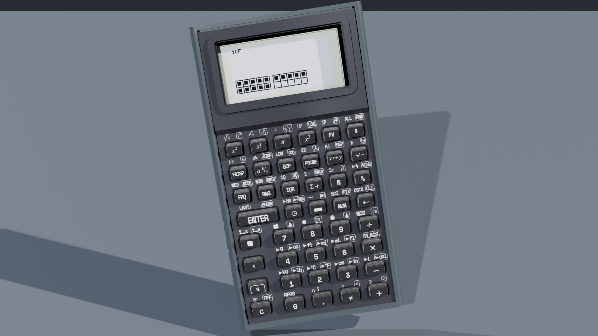
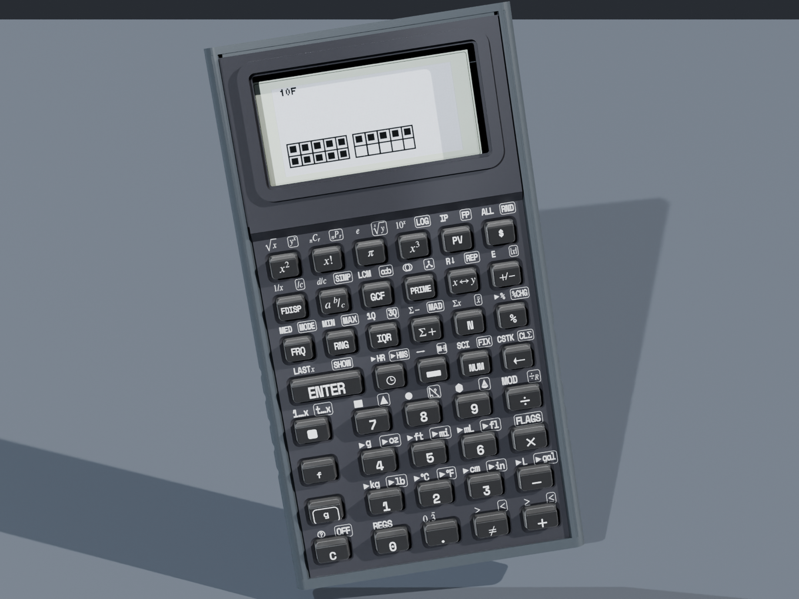
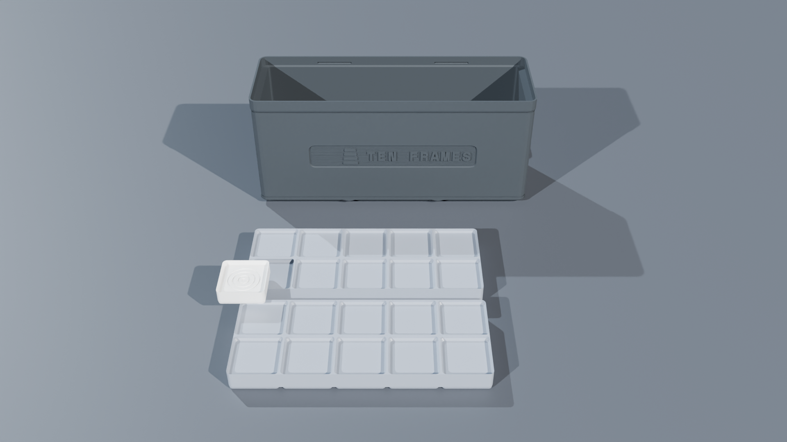
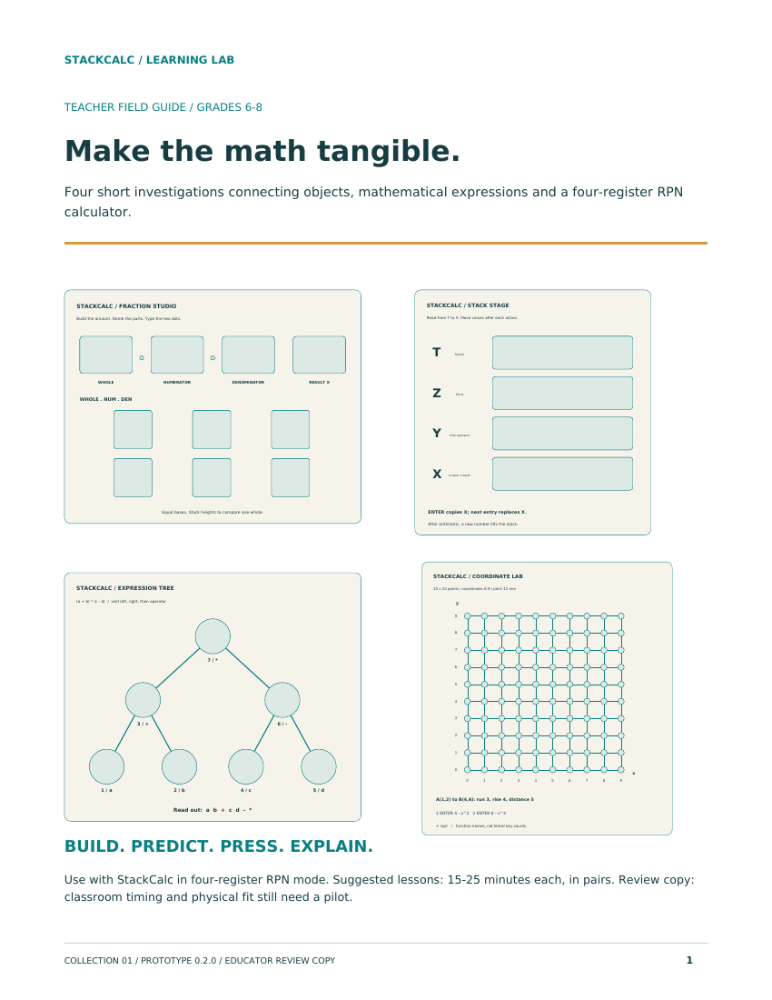

  <!-- Breadcrumb -->
  <nav class="ec-breadcrumb" aria-label="Breadcrumb">
    <a href="../../">Home</a>
    /
    <a href="../">Products &amp; Manipulatives</a>
    /
    SC-6 Elementary Calculator
  </nav>

  <!-- ==========================================================================
       HERO PRODUCT SECTION (2-COLUMN ECOMMERCE SPLIT)
       ========================================================================== -->
  

    <!-- Left Column: Product Gallery -->
    

      

        
      

      <!-- Thumbnail Selector Strip -->
      

        

          
        

        

          
        

        

          
        

        

          
        

      

    

    <!-- Right Column: Buy Box & Product Info -->
    

      <h1 class="ec-product-title">SC-6 Elementary Calculator</h1>

      

        $49.00 &ndash; $59.00
        &check; Free Tracked US Shipping
      

      

        The foundational tactile calculator engineered specifically for Grades K&ndash;6 classrooms and homeschool math. Bridges concrete visual manipulatives (ten-frames, fraction towers) directly to symbolic math with dedicated step-by-step simplification, skip counting, and friendly tactile keys.
      

      <!-- Highlights Checklist -->
      

        

          &check;
          <strong>Default 4-Stack XYZT Display:</strong> Full 4-line live operational stack eliminates parentheses and displays multi-step arithmetic visually. Features automatic 2-stack mode for paired manipulative entries (number racks &amp; dice) and manual toggle via <code>[FLAGS]</code> (<code>[g] [×]</code> &rarr; <code>[5]</code>).
        

        

          &check;
          <strong>Integer Division [÷R] Key:</strong> Displays whole quotient in Line X and remainder in Line Y simultaneously (no confusing decimals for elementary learners).
        

        

          &check;
          <strong>Dedicated [SIMP] Key:</strong> Reduces fractions step-by-step (e.g. \(12/18 \rightarrow 6/9 \rightarrow 2/3\)) revealing common prime factors.
        

        

          &check;
          <strong>Skip-Counting [REP] Key:</strong> Physically steps through multiplication tables (\(7, 14, 21, 28\dots\)) with acoustic tactile snap rhythm.
        

        

          &check;
          <strong>Self-Checking [LAST X] Key:</strong> Restores previous operand to verify operations via inverse arithmetic (\(C - B = A\)) without re-typing.
        

        

          &check;
          <strong>Drop-Tested Kid-Proof Casing:</strong> Impact-resistant dark technical polymer chassis (Elegoo Space Gray / Midnight Navy PLA 2.0+), sliding dovetail cowl, and 400g tactile snap-dome keys.
        

      

      <!-- Action Buttons -->
      

        <a href="https://www.etsy.com/shop/StackCalc" target="_blank" rel="noopener noreferrer" class="ec-btn-primary" style="background-color: #f1641e; border-color: #f1641e; color: #ffffff;">
          Order on Etsy ($49.00) ↗
        </a>
        <a href="/downloads/sc6-elementary-open-source-stls.zip" class="ec-btn-secondary">
          Download Free 3D Print STLs (.ZIP) &darr;
        </a>
      

      <!-- Quick Subpage Links -->
      

        <a href="../../manuals/#sc-6-elementary" class="text-xs font-semibold px-3 py-1.5 rounded bg-slate-800 text-amber-400 border border-amber-500/30 hover:bg-slate-700">
          &bull; Reference Manual &amp; TOC Preview &rarr;
        </a>
        <a href="https://www.etsy.com/shop/StackCalc" target="_blank" rel="noopener noreferrer" class="text-xs font-semibold px-3 py-1.5 rounded bg-slate-800 text-sky-400 border border-sky-500/30 hover:bg-slate-700">
          &bull; Order Spiral Print Edition ($16) ↗
        </a>
      

      <!-- Trust Badges -->
      

        

          &check;
          Zero Distraction / Zero Games
        

        

          &empty;
          Coin Cell Runs For Full School Year
        

        

          &hearts;
          Non-Toxic Food-Grade Silicone Bumper
        

      

    

  

  <!-- ==========================================================================
       SECTION: VISUAL MATH PEDAGOGY
       ========================================================================== -->
  <section class="ec-section">
    <h2 class="ec-section-title">Why Elementary Students Need a Different Calculator</h2>
    

      Standard cheap calculators give children answers without comprehension. The SC-6 turns every calculation into an intuitive, step-by-step visual exploration.
    

    

      

        
&#9776;

        <h3 class="ec-feature-title">1. Default 4-Stack XYZT &amp; 2-Stack Modes</h3>
        

          Standard number mode defaults to a full 4-line live operational stack (\(T, Z, Y, X\)), giving visual permanence to intermediate values. Special entry modes automatically activate a focused 2-stack mode (\(Y, X\)) for concrete manipulatives like rekenrek counting racks and two-dice probability tables (return to 4-stack anytime via [NUM]). Teachers can also manually lock 2-stack mode via <code>[FLAGS]</code> (<code>[g] [×]</code> &rarr; <code>[5]</code>).
        

      

      

        
&divide;

        <h3 class="ec-feature-title">2. Integer Division with Remainders [÷R]</h3>
        

          Entering \(23 \text{ [ENTER] } 4 \text{ [÷R]}\) places the whole quotient \(5\) in Line X and remainder \(3\) in Line Y simultaneously. Zero confusing decimals for Grades 3–5 division units.
        

      

      

        
&plus;

        <h3 class="ec-feature-title">3. Skip-Counting [REP] Key</h3>
        

          Entering \(7\) and pressing [REP] fills the stack, allowing students to repeatedly press [+] to step through \(14, 21, 28, 35\dots\) with an acoustic snap click, anchoring multiplication into rhythm.
        

      

      

        
&infin;

        <h3 class="ec-feature-title">4. Step-by-Step [SIMP] Key</h3>
        

          When students simplify \(\frac{24}{36}\), pressing [SIMP] divides by 2 to yield \(\frac{12}{18}\), flashes the common factor on screen, and allows another press to reach \(\frac{2}{3}\). They understand *why* fractions reduce.
        

      

      

        
&#8635;

        <h3 class="ec-feature-title">5. Instant Self-Checking [LAST X]</h3>
        

          Pressing [LAST X] restores the previous operand into Line X, enabling students to verify addition with subtraction (\(85 - 37 = 48\)) or division via \((Q \times D) + R\) without teacher intervention.
        

      

      

        
&equiv;

        <h3 class="ec-feature-title">6. Concrete-to-Symbolic Bridge</h3>
        

          The SC-6 display mirrors the physical layout of ten-frames and fraction towers, easing the transition from handling physical blocks to solving abstract textbook equations.
        

      

    

    <!-- Pedagogy Banner -->
    

      

        <strong style="color: #38BDF8; font-family: 'Space Mono', monospace; font-size: 0.8rem; text-transform: uppercase;">// CLASSROOM TEACHER CURRICULUM MANUAL</strong>
        
Explore complete lesson modules, stack register diagrams, and classroom challenge cards for the SC-6.

      

      <a href="../../curriculum/rpn-elementary-guide/" style="padding: 0.5rem 1rem; border-radius: 6px; background: #38BDF8; color: #020617; font-family: 'Space Mono', monospace; font-size: 0.75rem; font-weight: 700; text-decoration: none; white-space: nowrap;">READ RPN POWER GUIDE &rarr;</a>
    

  </section>

  <!-- ==========================================================================
       SECTION: DEMONSTRATION VIDEOS & ANIMATED STEP-BY-STEP LESSONS
       ========================================================================== -->
  <section id="product-videos" class="ec-section">
    <h2 class="ec-section-title">The Video Showcase: Animated Step-by-Step Lessons &amp; Keypad Dynamics</h2>
    
Watch how the SC-6 Elementary transforms elementary arithmetic into tangible, step-by-step discovery with native remainders, visible fractions, and rhythm.

    

      <!-- 1. Lesson 1: Integer Division with Remainder [÷R] -->
      

        

          <video controls playsinline preload="metadata" poster="../../assets/renders/sc6-elementary-hero.png">
            <source src="/assets/videos/sc6-lesson-remainder.mp4" type="video/mp4">
            Your browser does not support HTML5 video.
          </video>
          1. CURRICULUM LESSON 01
        

        

          

            <h3 class="text-sm font-bold text-slate-100 mb-1">Integer Division with Remainder [÷R]</h3>
            
Step-by-step key sequence: entering 17 &divide; 5 places whole quotient 3 in Line X and remainder 2 in Line Y simultaneously—no confusing decimals.

          

          

            CCSS 4.OA.A.3
            17 ÷ 5 = 3 R 2
          

        

      

      <!-- 2. Lesson 2: Step-by-Step Fraction Simplification [SIMP] -->
      

        

          <video controls playsinline preload="metadata" poster="../../assets/renders/sc6-elementary-hero.png">
            <source src="/assets/videos/sc6-lesson-simplification.mp4" type="video/mp4">
            Your browser does not support HTML5 video.
          </video>
          2. CURRICULUM LESSON 02
        

        

          

            <h3 class="text-sm font-bold text-slate-100 mb-1">Step-by-Step Simplification [SIMP]</h3>
            
Reducing 12/18 by common factors: first press shows 6/9 (factor 2), second press reaches 2/3 (factor 3), teaching the mechanics of factoring.

          

          

            CCSS 4.NF.A.1
            12/18 &rarr; 6/9 &rarr; 2/3
          

        

      

      <!-- 3. Lesson 3: Rhythmic Skip-Counting [REP] -->
      

        

          <video controls playsinline preload="metadata" poster="../../assets/renders/sc6-elementary-hero.png">
            <source src="/assets/videos/sc6-lesson-skip-counting.mp4" type="video/mp4">
            Your browser does not support HTML5 video.
          </video>
          3. CURRICULUM LESSON 03
        

        

          

            <h3 class="text-sm font-bold text-slate-100 mb-1">Rhythmic Skip-Counting [REP]</h3>
            
Loading step 7 into stack and pressing [+] to chant multiples: 14, 21, 28, 35... connecting tactile mechanical click with multiplication cadence.

          

          

            CCSS 3.OA.C.7
            7 &bull; 14 &bull; 21 &bull; 28 &bull; 35
          

        

      

    

    <!-- Curriculum Guide Callout -->
    

      

        
        

          <h4 class="text-sm font-bold text-slate-100">SC-6 RPN Elementary Power Guide &amp; Challenge Cards</h4>
          
Includes 24 quick-start challenge cards, 4-stack XYZT register flowcharts, and 30-second misconception diagnostics for teachers.

        

      

      

        <a href="/curriculum/rpn-elementary-guide/" class="px-3 py-1.5 bg-slate-800 hover:bg-slate-700 text-xs font-mono text-slate-200 rounded border border-slate-700 transition">Read RPN Power Guide &rarr;</a>
        <a href="/curriculum/worksheets/" class="px-3 py-1.5 bg-cyan-950 hover:bg-cyan-900 text-xs font-mono text-cyan-300 rounded border border-cyan-800 transition">Print Station Lab Sheets &rarr;</a>
      

    

  </section>

  <!-- ==========================================================================
       SECTION: TECHNICAL SPECIFICATIONS
       ========================================================================== -->
  <section class="ec-section">
    <h2 class="ec-section-title">Technical Specifications</h2>
    
Kid-proof engineering and clean graphic display.

    <table class="ec-spec-table">
      <tbody>
        <tr>
          <td class="ec-spec-k">Microcontroller</td>
          <td class="ec-spec-v">Raspberry Pi Silicon (Native elementary RPN arithmetic engine)</td>
        </tr>
        <tr>
          <td class="ec-spec-k">Display</td>
          <td class="ec-spec-v">Transflective ST7567A monochrome LCD &bull; Default 4-line XYZT live operational stack (toggleable 2-stack mode for racks &amp; dice) &bull; Left-justified Terminus font</td>
        </tr>
        <tr>
          <td class="ec-spec-k">Keypad</td>
          <td class="ec-spec-v">28 oversized tactile snap-domes &bull; High-contrast Space Mono legends &bull; Tactile operation keys</td>
        </tr>
        <tr>
          <td class="ec-spec-k">Enclosure</td>
          <td class="ec-spec-v">Impact-resistant dark technical polymer chassis (Elegoo Space Gray / Sunlu Midnight Navy PLA 2.0+) with Slate Gray cowl and drop-resistant wrap-around bumper</td>
        </tr>
        <tr>
          <td class="ec-spec-k">Power</td>
          <td class="ec-spec-v">1&times; CR2032 3V coin cell (6&ndash;12 months typical school year use)</td>
        </tr>
        <tr>
          <td class="ec-spec-k">Dimensions</td>
          <td class="ec-spec-v">82.0 mm (W) &times; 132.0 mm (L) &times; 17.5 mm (H) &bull; 95 grams</td>
        </tr>
      </tbody>
    </table>
  </section>

  <!-- ==========================================================================
       SECTION: WHAT'S IN THE BOX
       ========================================================================== -->
  <section class="ec-section">
    <h2 class="ec-section-title">What's in the Box</h2>
    
Complete elementary math starter kit for home or classroom.

    

      

        

          
🎒

          <h4 class="font-bold text-white text-sm mb-1">SC-6 Handheld Instrument</h4>
          
Impact-resistant Sunlu White PLA 2.0+ chassis, 28 tactile snap-domes, ST7567A display, and math quiz engine.

        

        GRADES K–6 TESTED
      

      

        

          
🛡️

          <h4 class="font-bold text-white text-sm mb-1">Sliding Dovetail Cowl</h4>
          
Durable Slate Gray sliding protective cover snaps over the keyboard for backpack transport and flips into a classroom desk stand.

        

        TOOL-FREE SLIDE
      

      

        

          
🗺️

          <h4 class="font-bold text-white text-sm mb-1">Math Quest Exploration Deck</h4>
          
Set of 12 kid-friendly challenge cards connecting physical ten-frames and fraction towers to skip-counting [REP] and [÷R].

        

        12 ACTIVITY CARDS
      

      

        

          
📖

          <h4 class="font-bold text-white text-sm mb-1">Parent &amp; Teacher Guide</h4>
          
Concise companion explaining the 4-stack elevator metaphor, quotient-remainder checks, and fraction reduction protocols.

        

        CRA FRAMEWORK
      

    

    

      ⚠️
      <strong>Postal Battery Compliance:</strong> Requires 1&times; standard CR2032 3V coin cell battery (omitted from shipping box in compliance with postal hazardous material regulations; widely available locally).
    

  </section>

  <!-- ==========================================================================
       SECTION: SAFETY, COMPLIANCE & GUARANTEES
       ========================================================================== -->
  <section class="ec-section">
    <h2 class="ec-section-title">Safety, Compliance &amp; Guarantees</h2>
    
Engineered for safe early childhood classrooms, homes, and tactile discovery.

    

      

        <strong class="text-amber-300 flex items-center gap-2 mb-1">
          &#9888; Mandatory Safety Disclaimer (CPSIA / ASTM F963)
        </strong>
        

          <strong>WARNING: CHOKING HAZARD &ndash; Small parts.</strong> Not for children under 3 years. Contains tactile physical buttons and modular snap components. Designed for early learners in Grades K&ndash;5 (ages 5 and up) under adult supervision.
        

      

      

        <strong class="text-sky-400 flex items-center gap-2 mb-1">
          &#10003; 100% Non-Toxic &amp; Food-Contact Safe Biopolymers
        </strong>
        

          Manufactured exclusively from odorless, non-toxic, renewable cornstarch PLA and impact-absorbing Shore 95A bumper polymers. Free from BPA, phthalates, and PVC.
        

      

      

        <strong class="text-emerald-400 flex items-center gap-2 mb-1">
          &#9874; "Anti-Heartbreak" Lifetime Guarantee for Parents &amp; Classrooms
        </strong>
        

          Elementary classrooms and homes see active use! If a child misplaces or damages a keypad cover or faceplate, order replacement modular parts anytime for just $2.49 with free envelope shipping.
        

      

      

        <strong class="text-indigo-400 flex items-center gap-2 mb-1">
          &#9881; 100% Screen-Free &amp; Distraction-Free
        </strong>
        

          Zero internet connectivity, zero Bluetooth radios, zero camera tracking, and zero subscription fees. Pure focused tactile mathematics that respects student attention.
        

      

    

  </section>

  <!-- ==========================================================================
       SECTION: COMPLEMENTARY CLASSROOM INSTRUMENTS (STANDALONE CROSS-SELL)
       ========================================================================== -->
  <section class="cross-sell-section">
    

      &bull; Related Instruments
      <h2 class="text-2xl font-bold text-white mt-1 mb-2">Build an Early Numeracy Hands-On Station</h2>
      

        Combine the SC-6 elementary calculator with physical tactile trays and proportional towers for Grades K&ndash;6.
      

    

    

      <!-- Cross-Sell 1: Ten-Frames Studio -->
      

        

          
          <h3 class="cross-sell-card-title">Ten-Frames Studio Trays</h3>
          

            Dual-tier 10-well tactile trays with 20 double-sided bicolor counters. Teaches five-and-ten structures, skip-counting, and base-10 regrouping.
          

        

        

          

            $36.00
            Tactile Trays
          

          <a href="/products/ten-frames/" class="ec-btn-secondary w-full text-center mt-3 text-xs block">
            View Ten-Frames &rarr;
          </a>
        

      

      <!-- Cross-Sell 2: Fraction Studio -->
      

        

          
          <h3 class="cross-sell-card-title">Fraction Studio Proportional Towers</h3>
          

            Precision 84.0mm datum towers covering binary, ternary, and decimal subdivisions with debossed fraction markings and self-correcting alignment.
          

        

        

          

            $48.00
            Proportional Heights
          

          <a href="/products/fraction-studio/" class="ec-btn-secondary w-full text-center mt-3 text-xs block">
            View Fraction Studio &rarr;
          </a>
        

      

      <!-- Cross-Sell 3: Curriculum Workbook & Decks -->
      

        

          
          <h3 class="cross-sell-card-title">36-Page Spiral Student Workbook</h3>
          

            Features 20 dedicated laboratory investigations with step-by-step CRA worksheets, tactile token diagrams, teacher diagnostic notes, and full solutions key.
          

        

        

          

            $24.00
            Print + Digital
          

          <a href="/products/curriculum-and-decks/" class="ec-btn-secondary w-full text-center mt-3 text-xs block">
            View Workbook &amp; Decks &rarr;
          </a>
        

      

    

  </section>

  <!-- ==========================================================================
       SECTION: ELEMENTARY CURRICULUM & UIL NOVICE SPRINT INTEGRATION
       ========================================================================== -->
  <section class="ec-section">
    

      

        

          // CURRICULUM &amp; COMPETITION INTEGRATION
          <h2 class="text-2xl font-bold text-white mt-1">Elementary UIL Tournaments &amp; Station Worksheets</h2>
        

        GRADES 3–6 UIL NOVICE SPRINT &bull; 100% PRE-GENERATED
      

      

        The SC-6 Elementary Calculator is built directly into Texas UIL and TMSCA Elementary Calculator Applications contests (Grades 3&ndash;6), as well as over 80 elementary station editions in our 120-guide curriculum library. Single-mode sections (<code class="px-1 py-0.5 rounded bg-slate-800 text-cyan-300 font-mono text-xs">[123]</code>, <code class="px-1 py-0.5 rounded bg-slate-800 text-cyan-300 font-mono text-xs">[FDISP]</code>, <code class="px-1 py-0.5 rounded bg-slate-800 text-cyan-300 font-mono text-xs">[CLK]</code>) completely eliminate in-test mode confusion.
      

      

        <a href="/curriculum/uil-competition/#3-elementary-school-division-grades-36-sc-6-calculator" class="p-4 rounded-xl bg-white/5 border border-white/10 hover:border-emerald-400 transition flex flex-col justify-between group">
          

            <strong class="text-white group-hover:text-emerald-400 block mb-1">🏆 Elementary UIL Sprints</strong>
            Download Grade 3, 4, 5 &amp; 6 contest test booklets and official 3-sig-fig scoring keys.
          

          &rarr; Practice Sprints
        </a>

        <a href="/curriculum/worksheets/" class="p-4 rounded-xl bg-white/5 border border-white/10 hover:border-cyan-400 transition flex flex-col justify-between group">
          

            <strong class="text-white group-hover:text-cyan-400 block mb-1">📝 120 Station Worksheets</strong>
            Form A &amp; Form B guides for Singapore Dimensions, Bridges, and Big Ideas Math.
          

          &rarr; Station Guides
        </a>

        <a href="/curriculum/alignment-matrix/" class="p-4 rounded-xl bg-white/5 border border-white/10 hover:border-amber-400 transition flex flex-col justify-between group">
          

            <strong class="text-white group-hover:text-amber-400 block mb-1">🎯 Standards Matrix</strong>
            Chapter-by-chapter pacing for early numeracy, fractions, and modulo-60 time.
          

          &rarr; View Matrix
        </a>

        <a href="/curriculum/teacher-guide/" class="p-4 rounded-xl bg-white/5 border border-white/10 hover:border-purple-400 transition flex flex-col justify-between group">
          

            <strong class="text-white group-hover:text-purple-400 block mb-1">🧑‍🏫 Teacher Guide</strong>
            Step-by-step simplification protocols, tactile station rotations, and diagnostics.
          

          &rarr; Read Guide
        </a>
      

      

        

          Perpetual Reproduction License &bull; Free Classroom Photocopy Rights
        

        <a href="/downloads/stackcalc-curriculum-sample-v0.2.0.pdf" download class="px-4 py-2 rounded bg-white/10 hover:bg-white/20 text-white font-bold transition flex items-center gap-1.5">
          Download 36-Page Curriculum Sample (.PDF)
          &darr;
        </a>
      

    

  </section>

  <!-- Owner's Manual & Spiral Print Callout -->
  <section id="manual" class="ec-section">
    

      

        

          // OFFICIAL DOCUMENTATION
          Print Edition Available ($19.00)
        

        <h3 class="text-xl font-bold text-white">SC-6 Elementary Calculator Owner's Manual</h3>
        

          The comprehensive classroom and family handbook: 4-stack XYZT elevator metaphor, stack depth toggling (4-LV vs 2-LV), skip-counting [REP] fact ladders, integer division with remainders [÷R], fraction simplification [SIMP], and the built-in Math Quiz engine. Available as a durable spiral-bound coil bench manual ($16) and school district classroom pack.
        

      

      

        <a href="../../manuals/#sc-6-elementary" class="px-4 py-2.5 rounded-lg bg-emerald-500/20 hover:bg-emerald-500/30 text-emerald-300 border border-emerald-500/40 font-mono text-xs font-bold transition text-center whitespace-nowrap">
          Preview &amp; Table of Contents &rarr;
        </a>
        <a href="https://www.etsy.com/shop/StackCalc" target="_blank" rel="noopener noreferrer" class="px-4 py-2.5 rounded-lg bg-amber-500 hover:bg-amber-400 text-slate-950 font-mono text-xs font-bold transition text-center shadow-md whitespace-nowrap">
          Order Spiral Manual ($16) ↗
        </a>
      

    

  </section>

  <!-- Open Source Maker Download Callout -->
  <section id="downloads" class="ec-section">
    

      

        &bull; 100% Free Open Hardware
        <h3 class="ec-maker-title">3D Print the SC-6 Enclosure</h3>
        

          Download our open-source STL files and print an SC-6 enclosure in your favorite classroom colors.
        

      

      

        <a href="/downloads/sc6-elementary-open-source-stls.zip" class="ec-btn-primary">
          Download SC-6 STLs (.ZIP) &darr;
        </a>
      

    

  </section>

  <!-- Discreet Ecosystem Blurb -->
  

    
&Delta;

    

      
Part of the StackCalc Math Learning Ecosystem

      

        The SC-6 is the entry point into tactile mathematical reasoning. It works harmoniously with our Fraction Studio and Ten-Frames manipulatives, preparing young learners for the flagship SC-32 scientific calculator when they reach middle school.
      

  <!-- FLOATING TACTILE BUY BAR (STICKY CRO INSTRUMENT) -->
  

    

      
06

      

        

          CALC-06 // ELEMENTARY RPN
          ○ PRE-ORDER
        

        
DEFAULT 4-STACK XYZT &bull; QUIZ ENGINE &bull; GRADES K–6

      

    

    

      $49.00
      <a href="https://www.etsy.com/shop/StackCalc" target="_blank" rel="noopener noreferrer" class="px-3.5 py-1.5 rounded bg-[#f1641e] hover:bg-[#e0530d] text-white font-bold transition shadow-md whitespace-nowrap">
        Order on Etsy ($49) ↗
      </a>
      <a href="../../#school-po" class="hidden md:inline-block px-3 py-1.5 rounded bg-white/5 hover:bg-white/10 text-slate-300 border border-white/10 font-bold transition whitespace-nowrap">
        District PO →
      </a>
    

  

<!-- Vanilla JS for SC-6 PDP Floating Sticky Buy Bar -->

