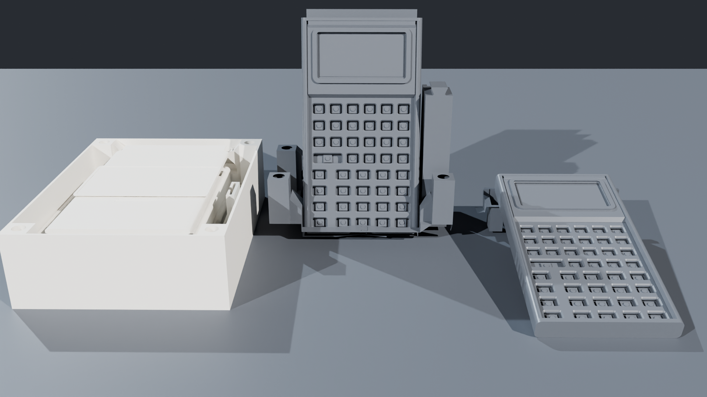

  <!-- Breadcrumb -->
  <nav class="ec-breadcrumb" aria-label="Breadcrumb">
    <a href="../../">Home</a>
    /
    <a href="../">Products &amp; Manipulatives</a>
    /
    Modular Stands &amp; Pouches
  </nav>

  <!-- ==========================================================================
       HERO PRODUCT SECTION (2-COLUMN ECOMMERCE SPLIT)
       ========================================================================== -->
  

    <!-- Left Column: Product Gallery -->
    

      

        

          Hardware Accessories
          &bull; In Stock &bull; Batch 001
        

        
      

      <!-- Thumbnail Selector Strip -->
      

        

          
        

        

          
        

      

    

    <!-- Right Column: Buy Box & Product Info -->
    

      

        Ergonomic Stands &amp; Cases
        &check; 3-in-1 Zero-Waste Design
      

      <h1 class="ec-product-title">Modular 3-in-1 Stands &amp; TPU Pouches</h1>

      

        $15.00 &ndash; $25.00
        &check; Free Tracked US Shipping
      

      

        Tactile, drop-resistant, and ultra-portable accessories engineered specifically for SC-32 and SC-6 calculators. Our zero-waste interlocking puzzle stand transforms from a protective shipping box insert into an upright shelf stand or an ergonomic desk typing wedge.
      

      <!-- Highlights Checklist -->
      

        

          &check;
          <strong>Zero-Waste Packaging Insert:</strong> Protects calculator components during transit, then snaps into your choice of 2 desk stands.
        

        

          &check;
          <strong>78&deg; Shelf Display with Pouch Dock:</strong> Showcases your calculator upright with an integrated rear slot to store the TPU pouch.
        

        

          &check;
          <strong>10&deg; Low Ergonomic Desk Wedge:</strong> Elevates the display to eliminate overhead fluorescent room glare during long study sessions.
        

        

          &check;
          <strong>Shore 95A Flexible TPU Sleeve:</strong> Custom drop-tested sleeve with integrated 3-ring school binder clip ($15).
        

      

      <!-- Action Buttons -->
      

        <a href="https://www.etsy.com/shop/StackCalc" target="_blank" rel="noopener noreferrer" class="ec-btn-primary" style="background-color: #f1641e; border-color: #f1641e; color: #ffffff;">
          Order on Etsy ($18.00) ↗
        </a>
        <a href="/downloads/stands-and-pouches-open-source-stls.zip" class="ec-btn-secondary">
          Download Free 3D Print STLs (.ZIP) &darr;
        </a>
      

      <!-- Trust Badges -->
      

        

          &check;
          Fits SC-32 &amp; SC-6 Perfectly
        

        

          &empty;
          Zero Fasteners or Glues
        

        

          &hearts;
          100% Recyclable Polymer
        

      

    

  

  <!-- ==========================================================================
       SECTION: THREE-IN-ONE CONFIGURATIONS
       ========================================================================== -->
  <section class="ec-section">
    <h2 class="ec-section-title">The Three Configurations of the Puzzle Stand</h2>
    

      Instead of throwing away packaging foam, StackCalc turns protective shipping inserts into functional workspace hardware.
    

    

      

        
&square;

        <h3 class="ec-feature-title">1. Shipping Mailer Insert</h3>
        

          When your calculator kit arrives, the interlocking stand pieces cradle the PCB, keypad membrane, and faceplate securely inside the mailer box, preventing shipping damage without single-use plastics.
        

      

      

        
/

        <h3 class="ec-feature-title">2. 78&deg; Showcase &amp; Dock</h3>
        

          Assemble the two upright struts into the baseplate for a steep 78&deg; showcase angle on your bookshelf or desk. The rear bay neatly holds the folded TPU pouch so you never misplace your case.
        

      

      

        
_

        <h3 class="ec-feature-title">3. 10&deg; Ergonomic Desk Wedge</h3>
        

          Flip the struts horizontally to form a low 10&deg; typing wedge. Angles the ST7567A reflective display directly toward your eyes while keeping your wrists flat during calculations.
        

      

    

  </section>

  <!-- ==========================================================================
       SECTION: TECHNICAL SPECIFICATIONS
       ========================================================================== -->
  <section class="ec-section">
    <h2 class="ec-section-title">Technical Specifications</h2>
    
Tolerances, weights, and material durability.

    <table class="ec-spec-table">
      <tbody>
        <tr>
          <td class="ec-spec-k">Stand Assembly</td>
          <td class="ec-spec-v">3-piece precision interlocking jigsaw tabs &bull; Assembles and disassembles in 5 seconds</td>
        </tr>
        <tr>
          <td class="ec-spec-k">Stand Viewing Angles</td>
          <td class="ec-spec-v">78&deg; (Upright Display &amp; Pouch Dock) and 10&deg; (Ergonomic Typing Wedge)</td>
        </tr>
        <tr>
          <td class="ec-spec-k">TPU Pouch Material</td>
          <td class="ec-spec-v">Shore 95A elastomeric flexible TPU in Azure Blue with debossed StackCalc logo</td>
        </tr>
        <tr>
          <td class="ec-spec-k">Binder Integration</td>
          <td class="ec-spec-v">Molded 3-ring binder flange fits standard school binders without adding bulk</td>
        </tr>
        <tr>
          <td class="ec-spec-k">Compatibility</td>
          <td class="ec-spec-v">100% compatible with SC-32 Scientific Calculator and SC-6 Elementary Edition</td>
        </tr>
      </tbody>
    </table>
  </section>

  <!-- ==========================================================================
       SECTION: SAFETY, COMPLIANCE & GUARANTEES
       ========================================================================== -->
  <section class="ec-section">
    <h2 class="ec-section-title">Safety, Compliance &amp; Guarantees</h2>
    
Durable accessories tested for daily backpack transit and active classroom use.

    

      

        <strong class="text-sky-400 flex items-center gap-2 mb-1">
          &#10003; 100% Non-Toxic Flexible TPU &amp; PETG
        </strong>
        

          The Travel Pouch is molded from non-toxic Shore 95A thermoplastic polyurethane (TPU), and the Puzzle Stand is crafted from recyclable rigid PETG. Free from BPA, phthalates, and latex.
        

      

      

        <strong class="text-emerald-400 flex items-center gap-2 mb-1">
          &#9874; Lifetime Replacement Guarantee on Puzzle Stands
        </strong>
        

          If any panel of your 3-piece interlocking Puzzle Stand ever cracks, chips, or breaks during normal student use, we will replace the broken component free of charge.
        

      

      

        <strong class="text-amber-300 flex items-center gap-2 mb-1">
          &#9888; Classroom Safety Standard (ASTM F963)
        </strong>
        

          Contains zero small detached swallowing hazards. Smooth radii and soft chamfers prevent sharp edges. Safe for students of all ages.
        

      

      

        <strong class="text-indigo-400 flex items-center gap-2 mb-1">
          &#9881; US Farm Manufactured
        </strong>
        

          Produced in the United States using high-precision additive manufacturing with strict layer-adhesion testing and cosmetic inspection.
        

      

    

  </section>

  <!-- ==========================================================================
       SECTION: COMPLEMENTARY HARDWARE & ACCESSORIES (STANDALONE CROSS-SELL)
       ========================================================================== -->
  <section class="cross-sell-section">
    

      &bull; Related Instruments
      <h2 class="text-2xl font-bold text-white mt-1 mb-2">Designed for StackCalc Hardware</h2>
      

        Dock your tactile calculator at the optimal 10&deg; typing angle or 78&deg; display wedge.
      

    

    

      <!-- Cross-Sell 1: SC-32 Calculator -->
      

        

          
          <h3 class="cross-sell-card-title">SC-32 Scientific RPN Calculator</h3>
          

            Tactile 43-key snap-dome instrument with RP2350 silicon, sunlight-readable reflective LCD, and SAT/ACT testing compliance.
          

        

        

          

            $89.00
            Flagship
          

          <a href="/products/sc32-calculator/" class="ec-btn-secondary w-full text-center mt-3 text-xs block">
            View SC-32 Calculator &rarr;
          </a>
        

      

      <!-- Cross-Sell 2: SC-6 Elementary Calculator -->
      

        

          
          <h3 class="cross-sell-card-title">SC-6 Elementary Calculator</h3>
          

            Bridges concrete manipulatives to symbolic math for Grades K&ndash;6 with skip-counting [REP] and step-by-step [SIMP] fraction reduction.
          

        

        

          

            $39.00
            Elementary
          

          <a href="/products/sc6-elementary/" class="ec-btn-secondary w-full text-center mt-3 text-xs block">
            View SC-6 Calculator &rarr;
          </a>
        

      

      <!-- Cross-Sell 3: Curriculum Workbook & Decks -->
      

        

          
          <h3 class="cross-sell-card-title">36-Page Spiral Student Workbook</h3>
          

            Features 20 dedicated laboratory investigations with step-by-step CRA worksheets, tactile token diagrams, and full solutions key.
          

        

        

          

            $24.00
            Print + Digital
          

          <a href="/products/curriculum-and-decks/" class="ec-btn-secondary w-full text-center mt-3 text-xs block">
            View Workbook &amp; Decks &rarr;
          </a>
        

      

    

  </section>

  <!-- Open Source Maker Download Callout -->
  <section id="downloads" class="ec-section">
    

      

        &bull; 100% Free Open Hardware
        <h3 class="ec-maker-title">3D Print Your Stands &amp; Pouches</h3>
        

          Download our pre-sliced STL files for the Puzzle Stand (rigid PLA/PETG) and Travel Pouch (flexible TPU).
        

      

      

        <a href="/downloads/stands-and-pouches-open-source-stls.zip" class="ec-btn-primary">
          Download Stand &amp; Pouch STLs (.ZIP) &darr;
        </a>
      

    

  </section>

  <!-- Discreet Ecosystem Blurb -->
  

    
&Delta;

    

      
Part of the StackCalc Math Learning Ecosystem

      

        Engineered to keep your tactile instruments protected in student backpacks and positioned at optimal ergonomic angles in classroom learning laboratories.
      

    

  

