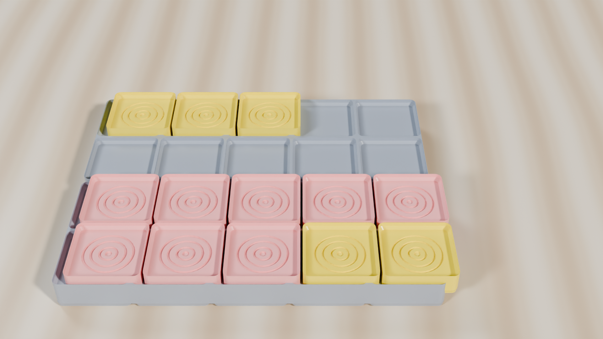
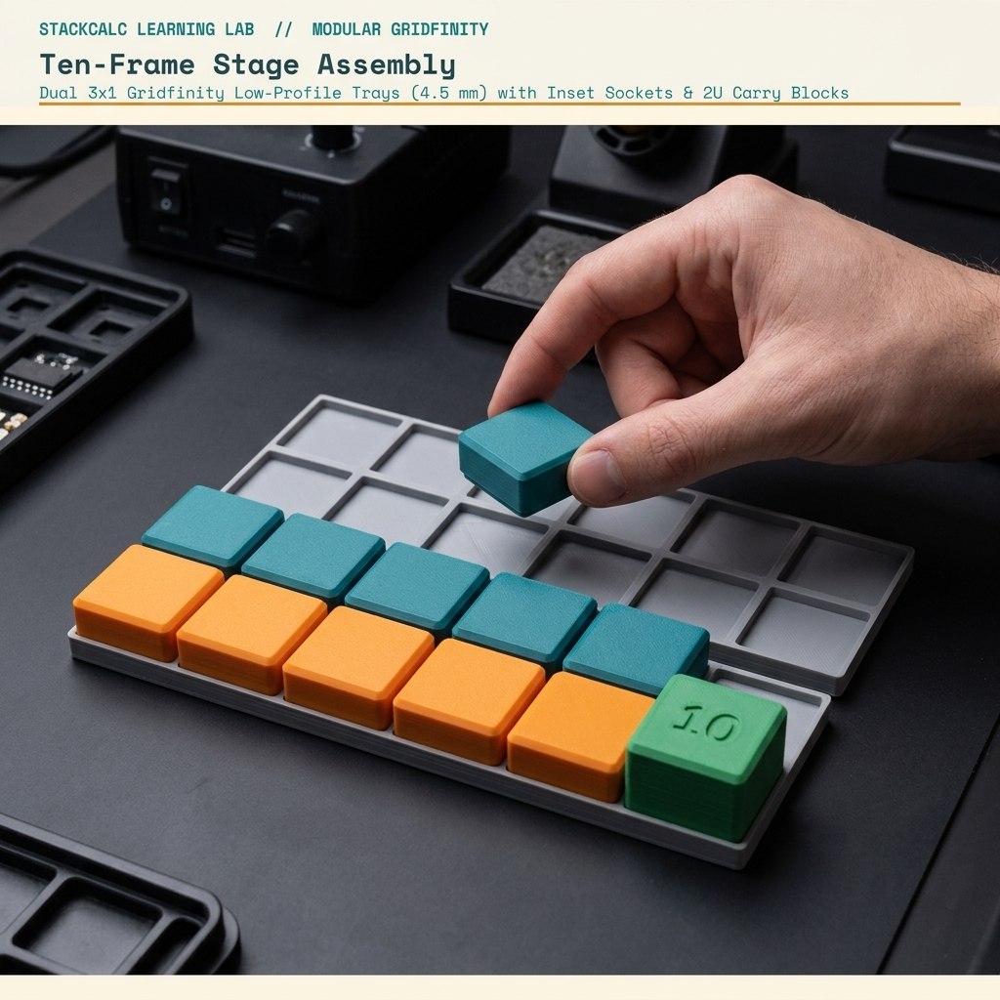
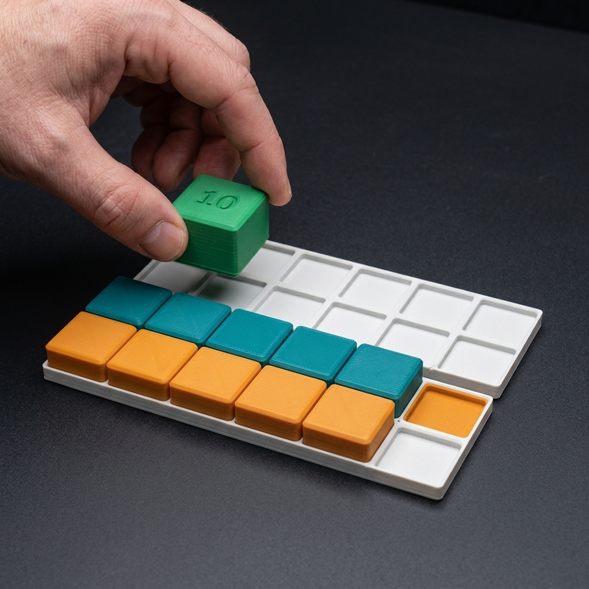
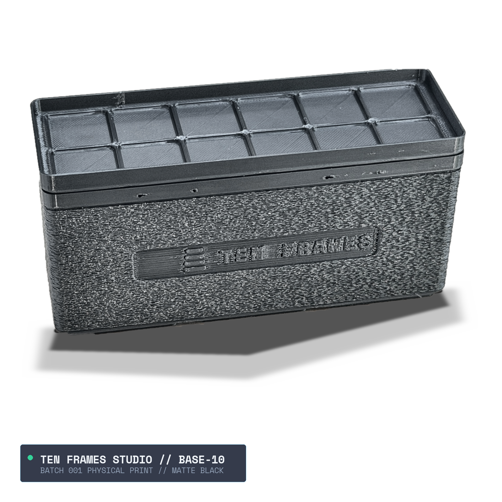
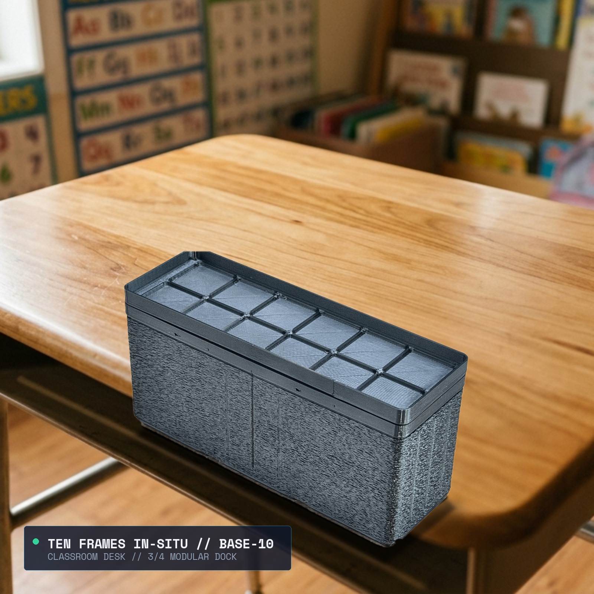
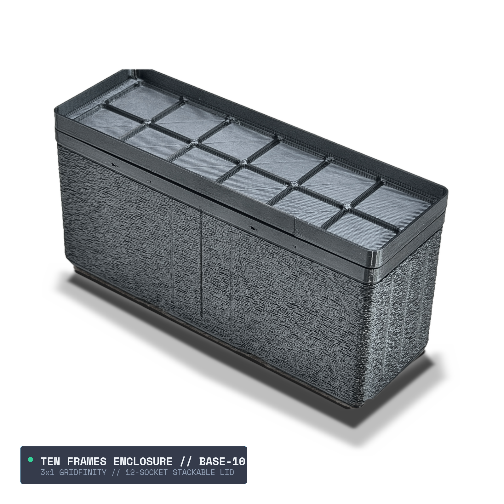
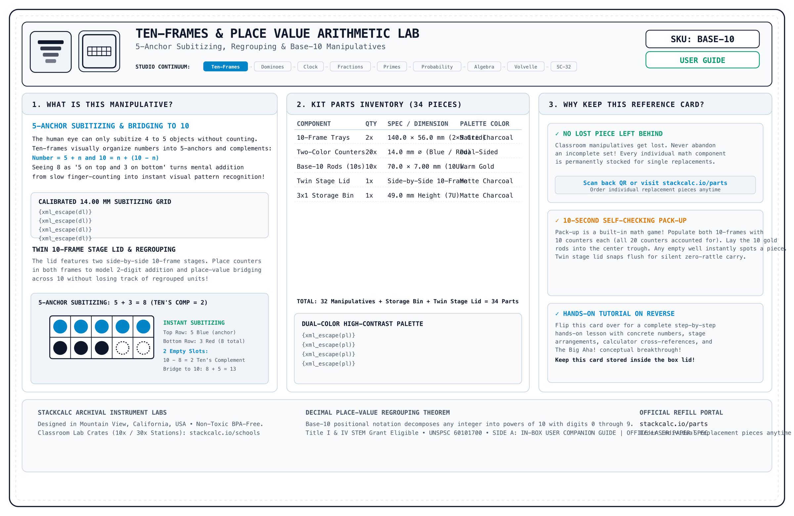
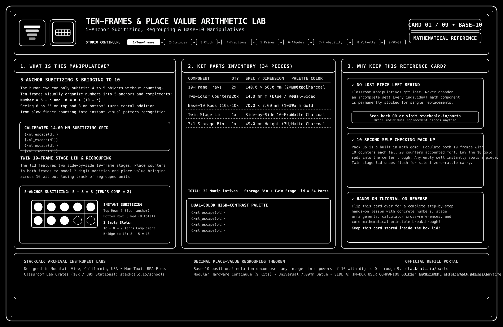
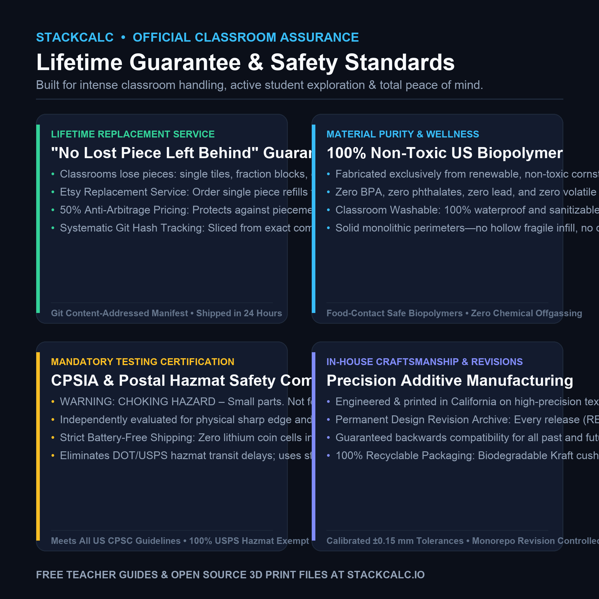
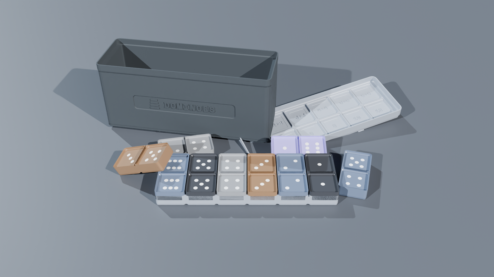

<!-- Schema.org JSON-LD Structured Data for High Google Search & Rich Results Ranking -->

  <!-- Breadcrumb -->
  <nav class="ec-breadcrumb" aria-label="Breadcrumb">
    <a href="../../">Home</a>
    /
    <a href="../">Products &amp; Manipulatives</a>
    /
    Ten-Frame Dual Stage &amp; Carry Shelf
  </nav>

  <!-- ==========================================================================
       HERO PRODUCT SECTION (2-COLUMN ECOMMERCE SPLIT)
       ========================================================================== -->
  

    <!-- Left Column: Product Gallery -->
    

      

        
      

      <!-- Thumbnail Selector Strip (Includes Real Physical Print Photos & Infographics) -->
      

        

          
        

        

          
        

        

          
        

        

          
        

        

          
        

        

          
        

        

          
        

        

          
        

        

          
        

        

          
        

        

          
        

      

    

    <!-- Right Column: Buy Box & Product Info -->
    

      <h1 class="ec-product-title">Ten-Frame Dual Stage &amp; Carry Shelf</h1>

      <!-- Educational Architecture & Tactile Standard -->
      

        PEDAGOGICAL STANDARD
        &bull; CRA Concrete-Representational Model
        &check; 42mm Gridfinity Compliant
      

      

        $36.00
        &check; Free US Shipping &bull; In Stock
      

      

        The foundational tactile laboratory for early numeracy, subitizing, number bonds, and place-value regrouping. Features a precision dual 2&times;5 counting stage with inset square sockets, an integrated elevated carry shelf for base-ten regrouping, 20 high-contrast bi-color square miniblocks (19&times;19mm), and a solid 2U cube "10" Carry Block housed neatly in a modular 3&times;1 Gridfinity storage box.
      

      <!-- Highlights Checklist -->
      

        

          &check;
          <strong>Elevated Carry Shelf &amp; 2U Carry Cube:</strong> Gives physical form to "carrying the ten"—counters regroup into a green 2U cube placed on the upper shelf during addition.
        

        

          &check;
          <strong>Visual Subitizing:</strong> Helps children recognize quantities up to 10 instantly without counting one-by-one.
        

        

          &check;
          <strong>20 Square Miniblocks (19&times;19mm):</strong> Dual-tone counters (Ocean Teal and Amber-Orange) with anti-roll square footprint seat securely into the stage sockets.
        

        

          &check;
          <strong>Gridfinity 3x1 Standard:</strong> Fits standard modular desktop classroom organization bins.
        

      

      <!-- Action Buttons -->
      

        <a href="https://www.etsy.com/shop/StackCalc" target="_blank" rel="noopener noreferrer" class="ec-btn-primary" style="background-color: #f1641e; border-color: #f1641e; color: #ffffff;">
          Order on Etsy ($36.00) ↗
        </a>
        <a href="#downloads" class="ec-btn-secondary">
          Download Free 3MF / STLs &darr;
        </a>
      

      <!-- Quick Subpage Links -->
      

        <a href="assembly/" class="text-xs font-semibold px-3 py-1.5 rounded bg-slate-800 text-sky-400 border border-sky-500/30 hover:bg-slate-700">
          &bull; Step-by-Step Assembly Guide &amp; Video &rarr;
        </a>
        <a href="lessons/" class="text-xs font-semibold px-3 py-1.5 rounded bg-slate-800 text-emerald-400 border border-emerald-500/30 hover:bg-slate-700">
          &bull; Classroom Curriculum (Lessons 1 &amp; 2) &rarr;
        </a>
      

      <!-- Trust Badges -->
      

        

          &plusmn;
          &plusmn;0.05mm Calibrated &bull; Non-Toxic Biopolymer
        

        

          &check;
          Anti-Heartbreak $2.49 Part Refills
        

        

          &hearts;
          30-Day Risk-Free In-Home Trial
        

      

    

  

  <!-- ==========================================================================
       THE STACKCALC MANIFESTO: CONCRETE PEDAGOGY VS DISPOSABLE TOYS
       ========================================================================== -->
  <section class="ec-manifesto-banner">
    

      Engineering Manifesto
      <h2 class="ec-manifesto-title">Calculators &amp; Manipulatives Engineered Like Precision Instruments, Not Disposable Toys.</h2>
      

        For forty years, early math education has been caught between two false choices: flimsy blow-molded yellow plastic toys with loose tolerances and sharp burrs, or disembodied flat glass screens that strip weight, friction, and spatial muscle memory from developing minds.
      

      

        At StackCalc, we reject throwaway plastic culture. Every tile, detent, and frame is drafted with <strong>0.18mm mechanical tolerances</strong>, molded in high-density matte biopolymers, and keyed into the open Gridfinity architecture. When a classroom or home loses a token, you don't throw away the kit&mdash;our archival tracking cards provide <strong>direct single-piece replacements for $2.49</strong>. Real weight. Crisp mechanical clicks. Concrete mathematical intuition that endures.
      

      

        

          0.18 mm
          Mechanical Snap Tolerance
        

        

          WCAG AAA
          High-Contrast Coral/Teal
        

        

          100%
          Non-Toxic Bio-Polymers
        

        

          $2.49
          Single-Piece Archival Care
        

      

    

  </section>

  <!-- ==========================================================================
       SECTION: EDUCATIONAL VALUE & SUBITIZING
       ========================================================================== -->
  <section class="ec-section">
    <h2 class="ec-section-title">Building Intuitive Number Sense</h2>
    

      Moving beyond finger counting to spatial base-10 mental models.
    

    

      

        
&bull;

        <h3 class="ec-feature-title">1. Instant Subitizing</h3>
        

          The 2&times;5 array teaches students to recognize "seven" immediately as "five on top and two on the bottom." This structural visualization replaces tedious one-by-one counting.
        

      

      

        
&plus;

        <h3 class="ec-feature-title">2. Making Ten Strategy</h3>
        

          To solve \(8 + 5\), students place 8 counters on the first frame and see 2 empty slots. Moving 2 counters from the second frame fills the ten-frame, showing \(8 + 5 = 10 + 3 = 13\).
        

      

      

        
&circlearrowright;

        <h3 class="ec-feature-title">3. Physical Carry Mechanism</h3>
        

          When ten counters accumulate in the frame, they are consolidated and transferred to the raised carry shelf. The mathematical act of "carrying a ten" becomes a concrete physical memory.
        

      

    

  </section>

  <!-- ==========================================================================
       SECTION: INTERACTIVE TACTILE SANDBOX (TEN-FRAME & REGROUPING)
       ========================================================================== -->
  <section id="tenframe-interactive-sandbox" class="ec-sandbox-wrapper">
    

      

        
Virtual Tactile Lab &bull; Client-Side Web Audio Detents

        <h3 class="ec-sandbox-title">Interactive Ten-Frame &amp; Regrouping Simulator</h3>
      

      

        5 / 10
        <button id="tenframe-add-token" class="ec-sandbox-btn" type="button">+ Add Token</button>
        <button id="tenframe-clear-tokens" class="ec-sandbox-btn" type="button">↺ Clear</button>
      

    

    <!-- Ten-Frame 2x5 Grid Stage -->
    

      <!-- Injected dynamically by ecommerce.js -->
    

    

      👉 Click any cell or use buttons to test subitizing number bonds.
    

  </section>

  <!-- ==========================================================================
       SECTION: DEMONSTRATION VIDEOS & PHYSICS SIMULATION
       ========================================================================== -->
  <!-- ==========================================================================
       SECTION: DEMONSTRATION VIDEOS, UNBOXING & KINEMATICS (3-VIDEO MEDIA SUITE)
       ========================================================================== -->
  <section id="product-videos" class="ec-section">
    <h2 class="ec-section-title">The Video Showcase: Mechanical Animation, Unboxing &amp; Classroom Lesson</h2>
    
Experience the complete journey from modular Gridfinity tray kinematics and zero-plastic unboxing to early number sense and base-10 regrouping on a classroom desk.

    

      <!-- 1. CAD / Mechanical Animation -->
      

        

          <video controls playsinline preload="metadata" poster="../../assets/renders/ten-frames-hero.png">
            <source src="/assets/videos/ten-frames-assembly.mp4" type="video/mp4">
            Your browser does not support HTML5 video.
          </video>
          1. CAD KINEMATICS
        

        

          

            <h3 class="text-sm font-bold text-slate-100 mb-1">Mechanical &amp; CAD Animation</h3>
            
Exploded 3D view showing dual-tier 2&times;5 counter receptacles, tiered carry-shelf retention, and 3x1 Gridfinity nesting.

          

          

            60 FPS Cycles Render
            2&times;5 Dual-Tier Grid
          

        

      

      <!-- 2. Lesson 1: Instant Subitizing -->
      

        

          <video controls playsinline preload="metadata" poster="../../assets/renders/ten-frames-hero.png">
            <source src="/assets/videos/ten-frames-lesson-subitizing.mp4" type="video/mp4">
            Your browser does not support HTML5 video.
          </video>
          2. CURRICULUM LESSON 01
        

        

          

            <h3 class="text-sm font-bold text-slate-100 mb-1">Instant Subitizing: Recognizing 7 as 5 + 2</h3>
            
Filling top row of 5 instantaneously and adding 2 bottom counters. Students subitize quantities under 180ms without counting fingers.

          

          

            CCSS K.CC.B.5
            &lt;180ms Visual Anchor
          

        

      

      <!-- 3. Lesson 2: Make-Ten Regrouping -->
      

        

          <video controls playsinline preload="metadata" poster="../../assets/renders/ten-frames-hero.png">
            <source src="/assets/videos/ten-frames-lesson-make-ten.mp4" type="video/mp4">
            Your browser does not support HTML5 video.
          </video>
          3. CURRICULUM LESSON 02
        

        

          

            <h3 class="text-sm font-bold text-slate-100 mb-1">Make-Ten Regrouping: 8 + 5 = 10 + 3</h3>
            
Sliding 2 counters from Frame 2 across to complete Frame 1 into a full 10, leaving 3 counters on the carry shelf for place-value addition.

          

          

            CCSS 1.OA.B.3
            (8 + 2) + 3 = 13
          

        

      

    

    <!-- Reference Card Download Callout -->
    

      

        
        

          <h4 class="text-sm font-bold text-slate-100">Archival Reference &amp; Video QR Card (135&times;90mm)</h4>
          
Included inside every box. Scan Side B to jump straight to this 3-video learning portal or inspect Side A for part replacement IDs.

        

      

      

        <a href="/assets/reference_cards/reference_card_BASE-10_paper.png" target="_blank" rel="noopener noreferrer" class="px-3 py-1.5 bg-slate-800 hover:bg-slate-700 text-xs font-mono text-slate-200 rounded border border-slate-700 transition">View Front (Side A)</a>
        <a href="/assets/reference_cards/reference_card_BASE-10_back_paper.png" target="_blank" rel="noopener noreferrer" class="px-3 py-1.5 bg-cyan-950 hover:bg-cyan-900 text-xs font-mono text-cyan-300 rounded border border-cyan-800 transition">View Back (QR Side B)</a>
        <a href="/downloads/packing_bench_cards.html" class="px-3 py-1.5 bg-emerald-950 hover:bg-emerald-900 text-xs font-mono text-emerald-300 rounded border border-emerald-800 transition">Print Duplex Sheet</a>
      

    

  </section>

  <!-- ==========================================================================
       SECTION: UNBOXING ARCHITECTURE THEATER
       ========================================================================== -->
  <section class="ec-section">
    <h2 class="ec-section-title">Zero Plastic Wrap. 100% Archival Packaging Architecture.</h2>
    

      Every StackCalc kit arrives in a custom 200 lb-test kraft mailer engineered for classroom unpacking, permanent drawer storage, and zero unrecyclable film.
    

    

      

        STAGE 01
        <h4>Crushproof Corrugated Mailer</h4>
        
Engineered with interlocking friction tabs. Withstands 200 lbs of side-wall compression without foam peanuts or shrink wrap.

      

      

        STAGE 02
        <h4>Laser-Engraved Archival Card</h4>
        
Resting directly on top of the bin. Side A catalogs all part manifests; Side B embeds deep QR routing to video lessons and single-piece replacement.

      

      

        STAGE 03
        <h4>Tiered Receptacle Caddy</h4>
        
20 bi-color 19mm square miniblocks and the green 2U carry cube nest into precision sockets with perimeter finger notches, preventing accidental scatter while enabling rapid clearing.

      

      

        STAGE 04
        <h4>Gridfinity 3x1 Modularity</h4>
        
Integrates instantly with standard 42mm desktop grids. Stacks seamlessly under our SC-6 or SC-32 RPN hardware calculators.

      

    

  </section>

  <!-- ==========================================================================
       SECTION: FROM THE TEACHER'S MANUAL (REPRODUCIBLE MANIPULATIVE LAB SHEET)
       ========================================================================== -->
  <section class="ec-section">
    

      

        &bull; Classroom Pedagogy &bull; Concrete-Representational-Abstract (CRA)
        <h2 class="ec-section-title m-0">From the Teacher's Manual: Unit Lab Sheet</h2>
      

      Unit 02 &bull; Place Value &amp; Regrouping
    

    

      Most traditional math teacher manuals treat manipulatives as optional afterthoughts. In the StackCalc curriculum, every manipulative unit includes a dedicated, reproducible lab sheet connecting hands-on tactile geometry directly to hardware calculator execution.
    

    <!-- Authentic Spiral-Bound Workbook Page Facsimile -->
    

      

        

        

        

        

        

      

      

        

          

            STACKCALC MATH LABS // SERIES 01
            STANDARDS: CCSS K.OA.A.4 &bull; 1.OA.C.6 &bull; 2.NBT.A.1 &bull; TEKS 111.2.b.3
            PERIOD: 45 MIN STATION
          

          <h3 class="workbook-title">Lab 02: Dual-Tier Subitizing, Making 10 &amp; Place Value Regrouping</h3>
          

            <strong>Investigation Goal:</strong> Ground place-value intuition in physical capacity. Use the 2&times;5 ten-frame sockets to subitize quantities 1&ndash;10 without counting one-by-one, slide completed tens to the elevated carry shelf, and execute multi-digit regrouping on the SC-32 RPN stack.
          

        

        <!-- Phase 1: Concrete Spatial Exploration -->
        

          

            &square; PHASE 1: CONCRETE SPATIAL EXPLORATION (MANIPULATIVE STAGE)
          

          

            Start with an empty 2&times;5 primary ten-frame tray. Explore how numbers decompose into the benchmark anchor 5 and the base anchor 10:
          

          

            

              <strong class="text-sky-400 block mb-0.5">Task A: Subitizing 7</strong>
              Fill top row (5 blue counters) + 2 on bottom. Notice immediately: \(5 + 2 = 7\).
            

            

              <strong class="text-amber-400 block mb-0.5">Task B: Complement to 10</strong>
              Observe the 3 empty sockets. Notice immediately: \(7 + 3 = 10\).
            

            

              <strong class="text-emerald-400 block mb-0.5">Task C: Regrouping \(7 + 5\)</strong>
              Add 3 red counters to complete 10; slide to carry shelf. 2 counters remain below: \(10 + 2 = 12\).
            

          

        

        <!-- Phase 2: Structured Observation Table -->
        

          

            &equiv; PHASE 2: REPRESENTATIONAL DATA &amp; OBSERVATION TABLE
          

          <table class="workbook-table">
            <thead>
              <tr>
                <th>Addition Expression</th>
                <th>Starting Frame Count</th>
                <th>Counters to Complete 10</th>
                <th>Counters on Lower Tier</th>
                <th>Regrouped Form (Tens + Ones)</th>
              </tr>
            </thead>
            <tbody>
              <tr>
                <td class="font-mono text-cyan-300">\(8 + 4\)</td>
                <td class="font-mono">8 counters</td>
                <td class="font-mono">2 counters (from 4)</td>
                <td class="font-mono">2 counters remaining</td>
                <td class="font-mono text-emerald-400 font-bold">1 Ten + 2 Ones = 12</td>
              </tr>
              <tr>
                <td class="font-mono text-cyan-300">\(7 + 6\)</td>
                <td class="font-mono">7 counters</td>
                <td class="font-mono">3 counters (from 6)</td>
                <td class="font-mono">3 counters remaining</td>
                <td class="font-mono text-emerald-400 font-bold">1 Ten + 3 Ones = 13</td>
              </tr>
              <tr>
                <td class="font-mono text-cyan-300">\(9 + 7\)</td>
                <td class="font-mono">9 counters</td>
                <td class="font-mono">1 counter (from 7)</td>
                <td class="font-mono">6 counters remaining</td>
                <td class="font-mono text-emerald-400 font-bold">1 Ten + 6 Ones = 16</td>
              </tr>
            </tbody>
          </table>
        

        <!-- Phase 3: Abstract Verification via SC-32 RPN Calculator -->
        

          

            &Delta; PHASE 3: ABSTRACT VERIFICATION (SC-32 CALCULATOR EXECUTION)
          

          

            Execute the regrouping decomposition \(7 + 5 = (7 + 3) + 2\) on the SC-32 RPN stack:
          

          

            

              1. Form the Base 10 Group on the Stack:
              

                7
                ENTER
                3
                +
                &rarr; X-Register: 10.0000 (Carry Group)
              

            

            

              2. Add Remaining Lower-Tier Units:
              

                2
                +
                &rarr; X-Register: 12.0000 (Final Sum)
              

            

          

          

            REGISTER X: 12.0000
            TENS PLACE (SHELF): 1
            ONES PLACE (TIER): 2
            &check; PLACE VALUE VERIFIED
          

        

        <!-- Teacher Facilitation Box -->
        

          <strong>Teacher Diagnostic Note:</strong> When younger students struggle with \(8 + 5\), they often resort to counting on fingers starting from 1. Force the tactile constraint: <em>"Look at the empty sockets in your ten-frame. How many does 8 need to become 10? Take 2 from the 5. You now have 10 and 3. Say the answer."</em> Instant spatial mastery without counting fingers.
        

        <!-- Download & Order Row -->
        

          

            <strong>Sample Page 04</strong> from the 36-page <em>StackCalc RPN Math Labs Student Workbook</em>.
          

          

            <a href="/downloads/stackcalc-curriculum-sample-v0.2.0.pdf" class="ec-btn-secondary text-xs">
              &darr; Download Free Lab 02 Worksheet (PDF)
            </a>
            <a href="/products/curriculum-and-decks/" class="ec-btn-primary text-xs">
              Order Complete 36-Page Workbook ($24.00) &rarr;
            </a>
          

        

      

    

  </section>

  <!-- ==========================================================================
       SECTION: COMPLEMENTARY CLASSROOM INSTRUMENTS (STANDALONE CROSS-SELL)
       ========================================================================== -->
  <section class="cross-sell-section">
    

      &bull; Related Instruments
      <h2 class="text-2xl font-bold text-white mt-1 mb-2">Build a Complete Hands-On Place Value Station</h2>
      

        Anchor early arithmetic and multi-digit regrouping in physical dual-tier capacity, reinforced by dedicated student lab sheets and RPN entry.
      

    

    

      <!-- Cross-Sell 1: SC-32 Calculator -->
      

        

          
          <h3 class="cross-sell-card-title">SC-32 Scientific RPN Maker Kit</h3>
          

            Introduce students to Postfix stack entry where numbers are entered first and operators act immediately, mirroring the physical act of gathering counters before executing addition.
          

        

        

          

            $89.00
            Maker Kit
          

          <a href="/products/sc32-calculator/" class="ec-btn-secondary w-full text-center mt-3 text-xs block">
            View SC-32 Maker Kit &rarr;
          </a>
        

      

      <!-- Cross-Sell 2: Curriculum Workbook & Decks -->
      

        

          
          <h3 class="cross-sell-card-title">36-Page Spiral Student Workbook</h3>
          

            Features 4 foundational place-value investigations: visual subitizing 1&ndash;10, Making-10 bridge facts, two-digit addition with carry, and subtraction decomposition.
          

        

        

          

            $24.00
            Teacher Approved
          

          <a href="/products/curriculum-and-decks/" class="ec-btn-secondary w-full text-center mt-3 text-xs block">
            View Workbook &amp; Decks &rarr;
          </a>
        

      

      <!-- Cross-Sell 3: Tactile Math Dominoes -->
      

        

          
          <h3 class="cross-sell-card-title">Tactile Math Dominoes</h3>
          

            Double-six tactile dominoes with recessed pip wells and subitizing partition lines. Ideal for early addition doubles and decomposition alongside ten-frames.
          

        

        

          

            $38.00
            Standalone Kit
          

          <a href="/products/math-dominoes/" class="ec-btn-secondary w-full text-center mt-3 text-xs block">
            View Dominoes &rarr;
          </a>
        

      

    

  </section>

  <!-- ==========================================================================
       SECTION: TECHNICAL SPECIFICATIONS
       ========================================================================== -->
  <section class="ec-section">
    <h2 class="ec-section-title">Technical Specifications</h2>
    
Tactile proportions and modular classroom storage.

    <table class="ec-spec-table">
      <tbody>
        <tr>
          <td class="ec-spec-k">Outer Dimensions</td>
          <td class="ec-spec-v">126.0 mm (L) &times; 42.0 mm (W) &times; 36.0 mm (H) &bull; Standard 3x1 Gridfinity bin</td>
        </tr>
        <tr>
          <td class="ec-spec-k">Ten-Frame Grid</td>
          <td class="ec-spec-v">Dual 2&times;5 recessed counting pocket array with debossed five-structure center bar</td>
        </tr>
        <tr>
          <td class="ec-spec-k">Counters Included</td>
          <td class="ec-spec-v">20 precision two-tone tokens (20.0 mm diameter &times; 5.0 mm thick &bull; Coral on Top / Teal on Bottom)</td>
        </tr>
        <tr>
          <td class="ec-spec-k">Carry Shelf</td>
          <td class="ec-spec-v">Raised 8.0 mm second-tier shelf for regrouped base-ten bundles</td>
        </tr>
        <tr>
          <td class="ec-spec-k">Material</td>
          <td class="ec-spec-v">Non-toxic matte PETG polymer &bull; Washable with warm water and soap</td>
        </tr>
        <tr>
          <td class="ec-spec-k">Industrial Design &amp; CMF</td>
          <td class="ec-spec-v">Monolithic farm additive manufacturing (Slant3D) &bull; Dished concave finger-lift wells &bull; 45&deg; edge relief &bull; Standard 3x1 42 mm Gridfinity footprint with interlocking dovetails</td>
        </tr>
        <tr>
          <td class="ec-spec-k">Curriculum Standards</td>
          <td class="ec-spec-v">Common Core: CCSS.MATH.CONTENT.K.OA.A.3, K.OA.A.4, K.NBT.A.1, 1.OA.C.6 &bull; TEKS: 111.2.b.2, 111.3.b.3 &bull; Grades K&ndash;2</td>
        </tr>
        <tr>
          <td class="ec-spec-k">Procurement Classification</td>
          <td class="ec-spec-v">UNSPSC: 60101700 (Math Manipulatives) &bull; NIGP: 785-70 &bull; Title I Early Numeracy &amp; Head Start Grant Eligible</td>
        </tr>
      </tbody>
    </table>
  </section>

  <!-- ==========================================================================
       SECTION: WHAT'S IN THE BOX
       ========================================================================== -->
  <section class="ec-section">
    <h2 class="ec-section-title">What's in the Box</h2>
    
Complete hands-on early numeracy workstation.

    

      

        &check;
        3x1x13U Gridfinity Enclosure Box with Snapfinity Bi-Directional Sliding Hard Lid and Integrated Carry Shelf (Snap-on TPU non-skid feet sold separately)
      

      

        &check;
        Slide-Out 2&times;5 Dual Ten-Frame Counting Tray
      

      

        &check;
        20 Two-Tone High-Contrast Counters (Glow Red / Glow Yellow)
      

      

        &check;
        Early Math Number Bond &amp; Regrouping Challenge Guide
      

    

  </section>

  <!-- ==========================================================================
       SECTION: SAFETY, COMPLIANCE & GUARANTEES
       ========================================================================== -->
  <section class="ec-section">
    <h2 class="ec-section-title">Safety, Compliance &amp; Guarantees</h2>
    
Durable, non-toxic materials engineered for elementary classrooms.

    

      

        <strong class="text-amber-300 flex items-center gap-2 mb-1">
          &#9888; Mandatory Safety Disclaimer (CPSIA / ASTM F963)
        </strong>
        

          <strong>WARNING: CHOKING HAZARD &ndash; Small parts.</strong> Not for children under 3 years. This product contains small counters (\(18.0\,\text{mm}\) diameter). Designed for educational numeracy instruction for Grades K&ndash;3 (ages 5 and up) under adult supervision.
        

      

      

        <strong class="text-sky-400 flex items-center gap-2 mb-1">
          &#10003; 100% Non-Toxic &amp; Food-Contact Safe Biopolymers
        </strong>
        

          Molded from odorless, non-toxic, BPA-free PLA biopolymer. 100% free of lead, phthalates, and PVC. Washable with warm water and soap or standard classroom disinfectant wipes.
        

      

      

        <strong class="text-emerald-400 flex items-center gap-2 mb-1">
          &#9874; "Anti-Heartbreak" Lifetime Guarantee for Parents &amp; Classrooms
        </strong>
        

          Counters get misplaced in kindergarten and 1st grade rooms. Order individual replacement counters or tray segments anytime for just $2.49 with free envelope shipping.
        

      

      

        <strong class="text-indigo-400 flex items-center gap-2 mb-1">
          &#9881; US Additive Farm Production
        </strong>
        

          Designed by StackCalc in California; produced in high-volume American 3D print farms (Slant3D) under strict dimensional tolerances and quality control.
        

      

    

  </section>

  <!-- ==========================================================================
       SECTION: PEDAGOGICAL VERIFICATION & CLASSROOM ARCHITECTURE
       ========================================================================== -->
  <section class="ec-section">
    

      

        <h2 class="ec-section-title m-0">Pedagogical Verification &amp; Classroom Architecture</h2>
        
Concrete-Representational-Abstract (CRA) tactile mechanics, subitizing geometry, and storage standards.

      

      

        &bull; CRA COMPLIANT MANIPULATIVE
      

    

    

      

        

          // COGNITIVE LOAD REDUCTION
          <h3 class="font-bold text-base text-white mt-1 mb-2">Elevated Carry Shelf</h3>
          

            Physically elevates 10 grouped counters onto a discrete upper tier, translating abstract base-ten regrouping into spatial movement and tactile motor memory before symbolic notation.
          

        

        

          Regrouping: Physical &bull; Stage: 2&times;5 Inset
        

      

      

        

          // ERGONOMIC ACCESSIBILITY
          <h3 class="font-bold text-base text-white mt-1 mb-2">Finger-Lift Perimeter Chamfers</h3>
          

            Counters feature 19&times;19mm footprints with precision 0.8mm edge chamfers. Designed specifically for early childhood fine motor dexterity, preventing frustration and counter slippage.
          

        

        

          Dimension: 19&times;19mm &bull; Chamfer: 0.8mm
        

      

      

        

          // CLASSROOM LOGISTICS
          <h3 class="font-bold text-base text-white mt-1 mb-2">42mm Gridfinity Ecosystem</h3>
          

            Fits standard open-source 42mm Gridfinity classroom storage drawers. Form-fitted dual 10-wells provide instant visual inventory audits during 30-second classroom cleanup transitions.
          

        

        

          Grid: 42mm Standard &bull; Audit: Instant Visual
        

      

    

  </section>

  <!-- ==========================================================================
       SECTION: FREQUENTLY ASKED QUESTIONS (FAQ)
       ========================================================================== -->
  <section class="ec-section">
    <h2 class="ec-section-title">Frequently Asked Questions</h2>
    
Teaching mechanics, subitizing, and grade recommendations.

    

      

        

          What is subitizing and how do ten-frames build it?
          +
        

        

          Subitizing is the ability to instantly recognize the number of objects in a small group without counting them one by one. The standard 2&times;5 ten-frame layout provides a structured visual anchor: students quickly see 7 as 'a full row of 5 plus 2 more', building foundational mental math fluency.
        

      

      

        

          How does the elevated carry shelf assist with addition?
          +
        

        

          When adding \(8 + 5\), students place 8 counters on the lower tray, add 2 counters from the second group to 'make ten', and slide the full tray onto the elevated upper carry shelf. The remaining 3 counters stay on the lower tray, visually proving that \(8 + 5 = 10 + 3 = 13\).
        

      

      

        

          Are the bi-color counters magnetic or interlocked?
          +
        

        

          The counters feature perimeter finger-relief notches and nest securely inside circular dished pockets. High-contrast Glow Red and Glow Yellow dual-face coloring allows teachers and students to model addition combinations and number bonds (e.g. 6 Yellow and 4 Red = 10) with zero slipping.
        

      

      

        

          What if counters get lost?
          +
        

        

          Under our "Anti-Heartbreak" lifetime guarantee, teachers and parents can order individual matching replacement counters or trays anytime for just $2.49 with free envelope shipping.
        

      

    

  </section>

  <!-- Open Source Maker Download Callout -->
  <section id="downloads" class="ec-section">
    

      

        &bull; 100% Free Open Hardware
        <h3 class="ec-maker-title">3D Print Ten-Frames in Your School</h3>
        

          Download our print-tested STL models for the ten-frame tray, carry shelf, and two-tone counters. Prints in under 2 hours.
        

      

      

        <a href="/downloads/ten-frames-open-source-stls.zip" class="ec-btn-primary">
          Download Ten-Frame STLs (.ZIP) &darr;
        </a>
      

    

  </section>

  <!-- Discreet Ecosystem Blurb -->
  

    
&Delta;

    

      
Part of the StackCalc Math Learning Ecosystem

      

        The Ten-Frame Dual Stage introduces early learners to base-ten place value and regrouping. As students develop computational speed, these physical groupings translate directly into the stack push/pop operations of our SC-6 and SC-32 calculators.
      

    

  

