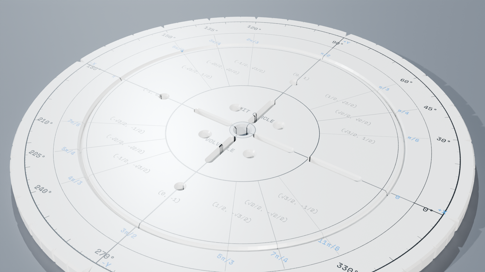
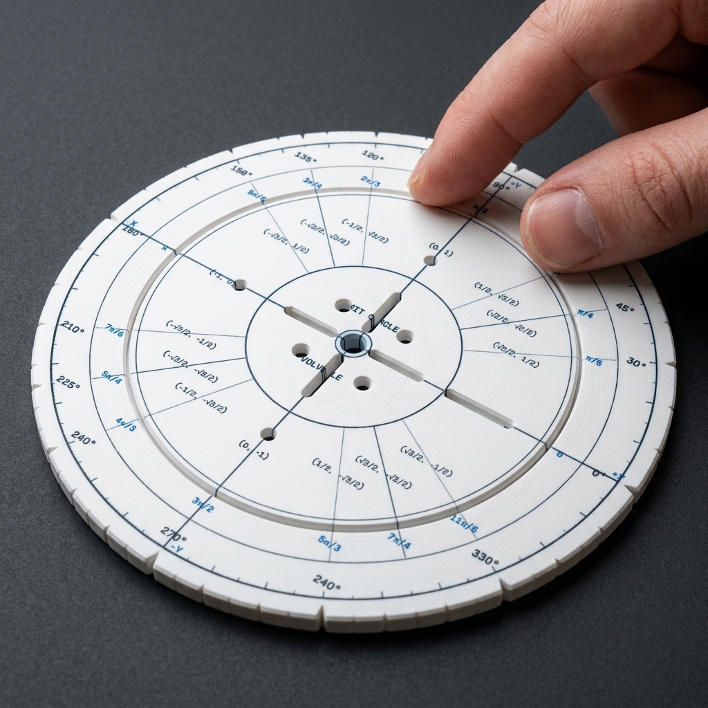
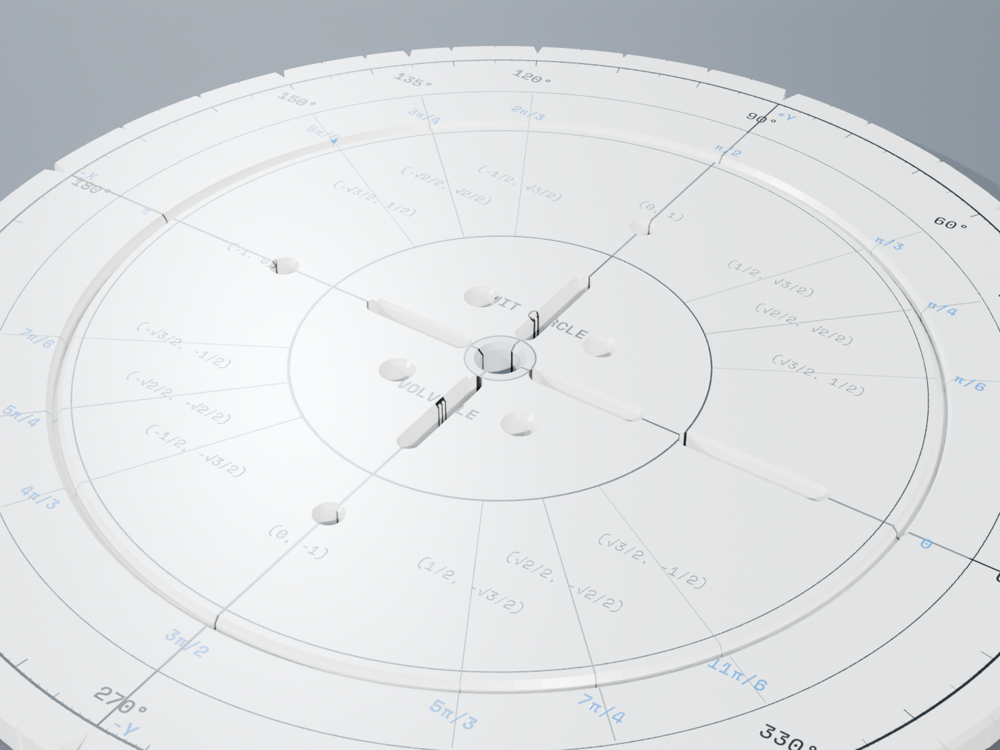
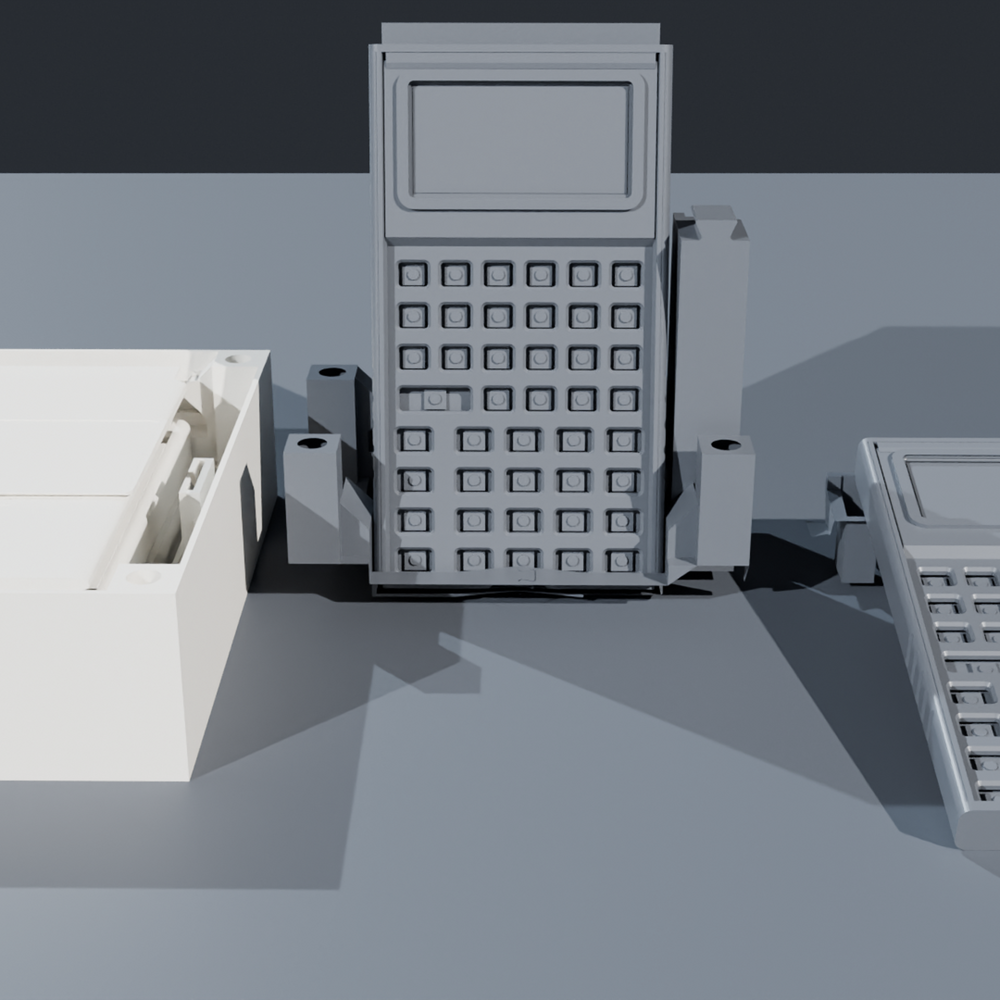
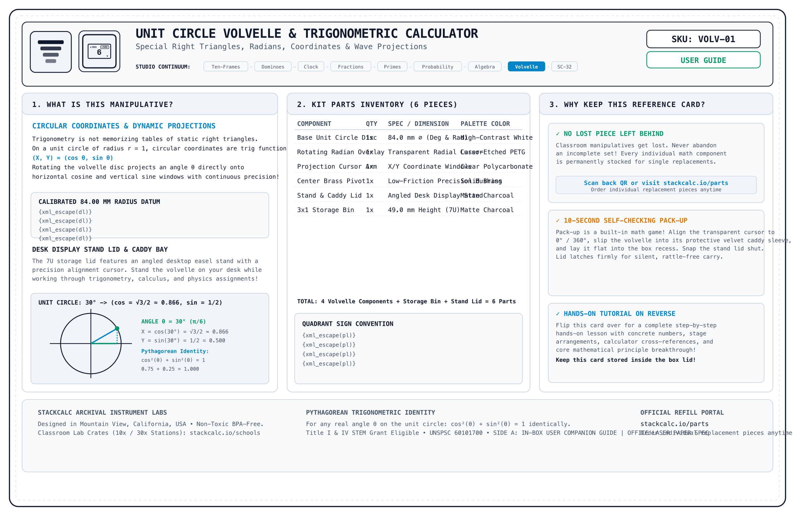
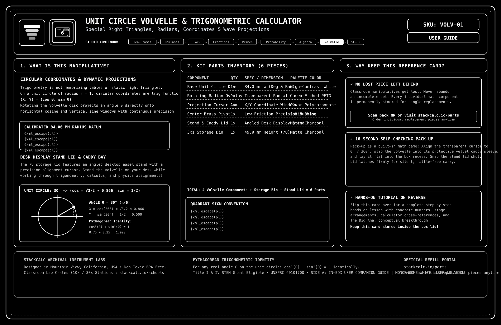
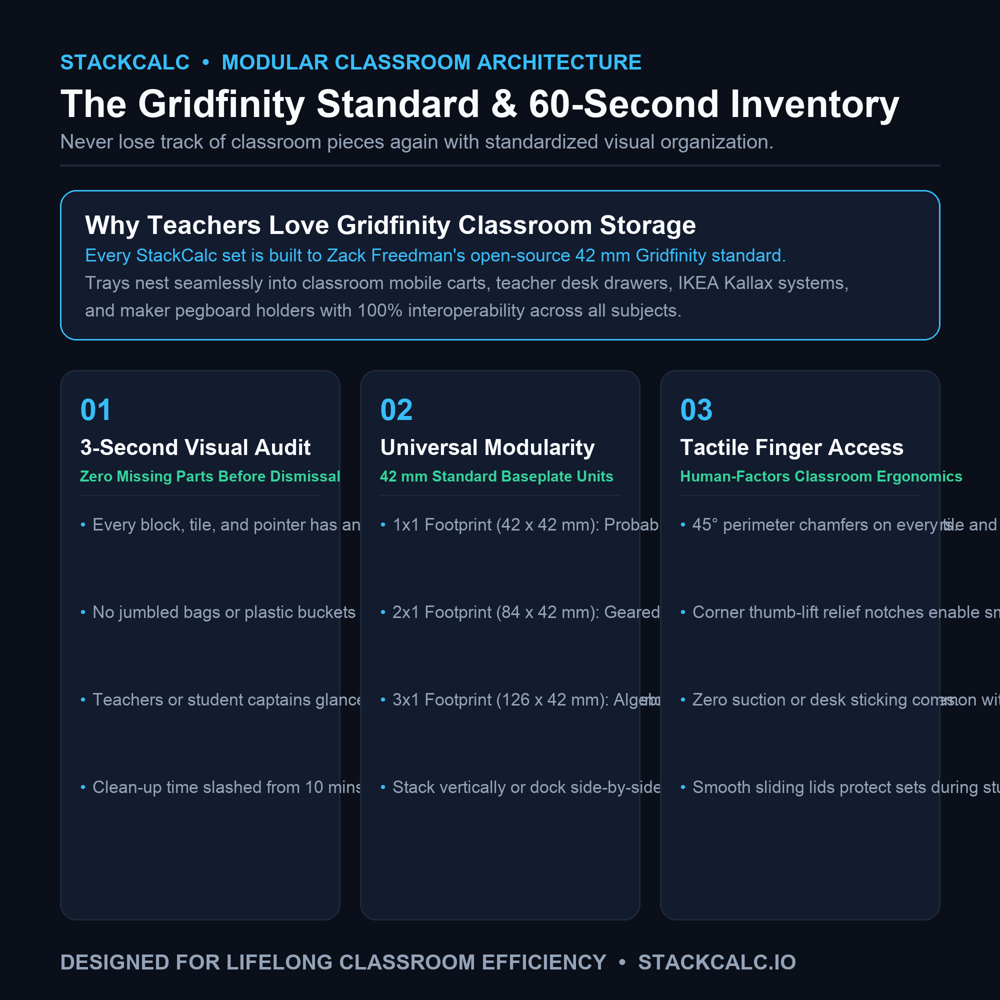
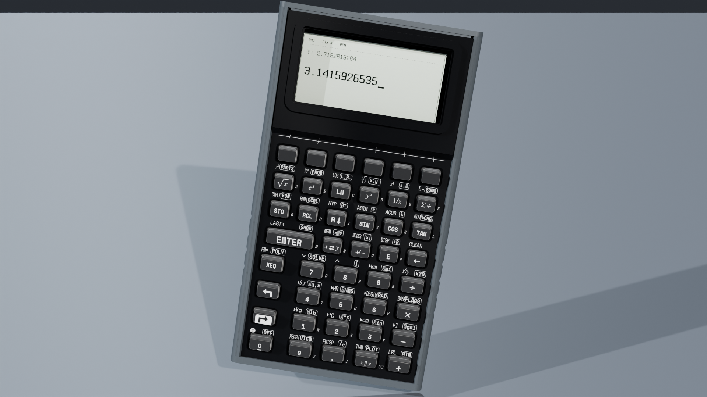

<!-- Schema.org JSON-LD Structured Data for High Google Search & Rich Results Ranking -->

  <!-- Breadcrumb -->
  <nav class="ec-breadcrumb" aria-label="Breadcrumb">
    <a href="../../">Home</a>
    /
    <a href="../">Products &amp; Manipulatives</a>
    /
    Unit Circle Volvelle
  </nav>

  <!-- ==========================================================================
       HERO PRODUCT SECTION (2-COLUMN ECOMMERCE SPLIT)
       ========================================================================== -->
  

    <!-- Left Column: Product Gallery -->
    

      

        

          Grades 9&ndash;College
          &bull; In Stock &bull; Batch 001
        

        
      

      <!-- Thumbnail Selector Strip (Includes Real High-Res Infographics) -->
      

        

          
        

        

          
        

        

          
        

        

          
        

        

          
        

        

          
        

        

          
        

        

          
        

      

    

    <!-- Right Column: Buy Box & Product Info -->
    

      

        Trigonometry &amp; Calculus
        &check; Flat Dual-Disc Dial
      

      <h1 class="ec-product-title">Unit Circle Trigonometry Volvelle</h1>

      <!-- Social Proof & Review Score -->
      

        
★★★★★

        4.9 / 5.0
        &bull; 22 Verified Reviews
        &check; AP Exam Safe
      

      

        $16.00
        &check; Free US Shipping &bull; In Stock
      

      

        The tactile, zero-battery circular mathematical instrument for trigonometry and physics. Two concentric rotating discs made of laser-engraved matte polymer reveal exact radian/degree conversions and \((x, y, \sin \theta, \cos \theta, \tan \theta)\) coordinates through precision aperture windows. Completely flat desk profile with a flush center eyelet.
      

      <!-- Highlights Checklist -->
      

        

          &check;
          <strong>Completely Flat Profile:</strong> Sits flush on notebook pages or desk surfaces with zero center notch or protruding knob.
        

        

          &check;
          <strong>Exact Radical Values:</strong> Instant readout of standard angles with exact roots (e.g., \(\frac{\sqrt{3}}{2}, \frac{1}{2}\)).
        

        

          &check;
          <strong>Zero Batteries Required:</strong> Pure mechanical analog calculation that lasts a lifetime and never needs charging.
        

        

          &check;
          <strong>Pocket Sized (90mm):</strong> Slides directly into pencil cases, textbook pockets, or binder sleeves.
        

      

      <!-- Action Buttons -->
      

        <a href="https://www.etsy.com/shop/StackCalc" target="_blank" rel="noopener noreferrer" class="ec-btn-primary" style="background-color: #f1641e; border-color: #f1641e; color: #ffffff;">
          Order on Etsy ($16.00) ↗
        </a>
        <a href="#downloads" class="ec-btn-secondary">
          Download Free 3MF / STLs &darr;
        </a>
      

      <!-- Trust Badges -->
      

        

          &check;
          AP Precalculus &amp; Physics Legal
        

        

          &empty;
          Flat Flush Brass Eyelet Core
        

        

          &hearts;
          Laser-Engraved Precision Legends
        

      

    

  

  <!-- ==========================================================================
       SECTION: HOW IT WORKS
       ========================================================================== -->
  <section class="ec-section">
    <h2 class="ec-section-title">A Tactile Mechanical Trigonometric Resolver</h2>
    

      Memorizing the 16 key points of the unit circle causes needless anxiety. The Volvelle makes circular angles and coordinate signs physically tangible.
    

    

      

        
&theta;

        <h3 class="ec-feature-title">1. Radian to Degree Synchronization</h3>
        

          Align the top disc to any angle (such as \(150^\circ\)). The inner dial instantly displays the exact fractional radian equivalent (\(\frac{5\pi}{6}\)), teaching students to see radians as arc lengths.
        

      

      

        
&square;

        <h3 class="ec-feature-title">2. Exact Coordinate Pairs</h3>
        

          The window isolates the exact cartesian coordinate \(\left(-\frac{\sqrt{3}}{2}, \frac{1}{2}\right)\). Signs automatically conform to Quadrant II rules, eliminating negative sign errors.
        

      

      

        
&empty;

        <h3 class="ec-feature-title">3. Tangent &amp; Reciprocal Ratios</h3>
        

          The outer perimeter ring catalogs tangent, secant, and cosecant ratios alongside undefined asymptotes at \(\frac{\pi}{2}\) and \(\frac{3\pi}{2}\).
        

      

    

  </section>

  <!-- ==========================================================================
       SECTION: DEMONSTRATION VIDEOS, UNBOXING & KINEMATICS (3-VIDEO MEDIA SUITE)
       ========================================================================== -->
  <section id="product-videos" class="ec-section">
    <h2 class="ec-section-title">The Video Showcase: Mechanical Animation, Unboxing &amp; Classroom Lesson</h2>
    
Experience the complete journey from dual-rotor CAD trigonometry kinematics and zero-plastic unboxing to exact radical coordinate reading on a study desk.

    

      <!-- 1. CAD / Mechanical Animation -->
      

        

          <video controls playsinline preload="metadata" poster="../../assets/renders/unit-circle-volvelle-hero.png">
            <source src="/assets/videos/video-unit-circle-volvelle.mp4" type="video/mp4">
            Your browser does not support HTML5 video.
          </video>
          1. CAD KINEMATICS
        

        

          

            <h3 class="text-sm font-bold text-slate-100 mb-1">Rotary CAD Kinematics</h3>
            
Concentric disc alignment showing laser-etched degree/radian arcs, brass eyelet pivot retention, and viewing aperture tolerances.

          

          

            60 FPS Cycles Render
            Concentric Discs
          

        

      

      <!-- 2. Unboxing Experience -->
      

        

          <video controls playsinline preload="metadata" poster="../../assets/renders/unit-circle-volvelle-hero.png">
            <source src="/assets/videos/volvelle-unboxing.mp4" type="video/mp4">
            Your browser does not support HTML5 video.
          </video>
          2. UNBOXING EXPERIENCE
        

        

          

            <h3 class="text-sm font-bold text-slate-100 mb-1">Unboxing Experience</h3>
            
Opening the protective stay-flat mailer to reveal the 135&times;90mm archival reference card resting over the precision rotary volvelle.

          

          

            135x90mm Duplex Card
            Zero Plastic Wrap
          

        

      

      <!-- 3. Classroom Lesson in Action -->
      

        

          <video controls playsinline preload="metadata" poster="../../assets/renders/unit-circle-volvelle-hero.png">
            <source src="/assets/videos/volvelle-lesson.mp4" type="video/mp4">
            Your browser does not support HTML5 video.
          </video>
          3. CLASSROOM LESSON
        

        

          

            <h3 class="text-sm font-bold text-slate-100 mb-1">Classroom Lesson in Action</h3>
            
Rotating from \(0^\circ \to 90^\circ\): observing trigonometric coordinate transitions \((\cos\theta, \sin\theta)\) across Quadrants I and II.

          

          

            CCSS HSF.TF.A.2
            TEKS 111.42
          

        

      

    

    <!-- Reference Card Download Callout -->
    

      

        
        

          <h4 class="text-sm font-bold text-slate-100">Archival Reference &amp; Video QR Card (135&times;90mm)</h4>
          
Included inside every shipment. Scan Side B to jump straight to this 3-video learning portal or inspect Side A for part replacement IDs.

        

      

      

        <a href="/assets/reference_cards/reference_card_VOLV-01_paper.png" target="_blank" rel="noopener noreferrer" class="px-3 py-1.5 bg-slate-800 hover:bg-slate-700 text-xs font-mono text-slate-200 rounded border border-slate-700 transition">View Front (Side A)</a>
        <a href="/assets/reference_cards/reference_card_VOLV-01_back_paper.png" target="_blank" rel="noopener noreferrer" class="px-3 py-1.5 bg-cyan-950 hover:bg-cyan-900 text-xs font-mono text-cyan-300 rounded border border-cyan-800 transition">View Back (QR Side B)</a>
        <a href="/downloads/packing_bench_cards.html" class="px-3 py-1.5 bg-emerald-950 hover:bg-emerald-900 text-xs font-mono text-emerald-300 rounded border border-emerald-800 transition">Print Duplex Sheet</a>
      

    

  </section>

  <!-- ==========================================================================
       SECTION: FROM THE TEACHER'S MANUAL (REPRODUCIBLE MANIPULATIVE LAB SHEET)
       ========================================================================== -->
  <section class="ec-section">
    

      

        &bull; Classroom Pedagogy &bull; Concrete-Representational-Abstract (CRA)
        <h2 class="ec-section-title m-0">From the Teacher's Manual: Unit Lab Sheet</h2>
      

      Unit 12 &bull; Trigonometry &amp; Pre-Calculus
    

    

      Most traditional math teacher manuals treat manipulatives as optional afterthoughts. In the StackCalc curriculum, every manipulative unit includes a dedicated, reproducible lab sheet connecting hands-on tactile geometry directly to hardware calculator execution.
    

    <!-- Authentic Spiral-Bound Workbook Page Facsimile -->
    

      

        

        

        

        

        

      

      

        

          

            STACKCALC MATH LABS // SERIES 01
            STANDARDS: CCSS HSF.TF.A.1 &bull; HSF.TF.A.2 &bull; HSF.TF.C.8 &bull; TEKS 111.42.c.2
            PERIOD: 45 MIN STATION
          

          <h3 class="workbook-title">Lab 12: Rotary Coordinate Transformations &amp; RPN Trigonometry Verification</h3>
          

            <strong>Investigation Goal:</strong> Transform radian arc rotations into exact cartesian coordinate pairs \((x, y) = (\cos\theta, \sin\theta)\) across all four quadrants. Verify exact radical identities and Pythagorean relations (\(\sin^2\theta + \cos^2\theta = 1\)) using the SC-32 RPN stack.
          

        

        <!-- Phase 1: Concrete Spatial Exploration -->
        

          

            &square; PHASE 1: CONCRETE SPATIAL EXPLORATION (MANIPULATIVE STAGE)
          

          

            Rotate the top disc on its flush brass eyelet pivot. Align the cursor window with standard benchmark angles. Observe how the aperture isolates exact coordinate pairs and sign transitions:
          

          

            

              <strong class="text-sky-400 block mb-0.5">Quadrant I (\(60^\circ / \frac{\pi}{3}\))</strong>
              Aperture reveals \(\left(\frac{1}{2}, \frac{\sqrt{3}}{2}\right)\). Both \(x\) and \(y\) are positive.
            

            

              <strong class="text-amber-400 block mb-0.5">Quadrant II (\(120^\circ / \frac{2\pi}{3}\))</strong>
              Aperture reveals \(\left(-\frac{1}{2}, \frac{\sqrt{3}}{2}\right)\). Cosine switches to negative.
            

            

              <strong class="text-emerald-400 block mb-0.5">Quadrant III (\(210^\circ / \frac{7\pi}{6}\))</strong>
              Aperture reveals \(\left(-\frac{\sqrt{3}}{2}, -\frac{1}{2}\right)\). Tangent is positive (\(\frac{\sqrt{3}}{3}\)).
            

          

        

        <!-- Phase 2: Structured Observation Table -->
        

          

            &equiv; PHASE 2: REPRESENTATIONAL DATA &amp; OBSERVATION TABLE
          

          <table class="workbook-table">
            <thead>
              <tr>
                <th>Angle (&theta;)</th>
                <th>Radian Measure</th>
                <th>Exact Cosine (x)</th>
                <th>Exact Sine (y)</th>
                <th>Exact Tangent (y/x)</th>
              </tr>
            </thead>
            <tbody>
              <tr>
                <td class="font-mono text-cyan-300">\(30^\circ\)</td>
                <td class="font-mono">\(\frac{\pi}{6}\)</td>
                <td class="font-mono text-emerald-400 font-bold">\(\frac{\sqrt{3}}{2}\)</td>
                <td class="font-mono text-emerald-400 font-bold">\(\frac{1}{2}\)</td>
                <td class="font-mono">\(\frac{\sqrt{3}}{3}\)</td>
              </tr>
              <tr>
                <td class="font-mono text-cyan-300">\(120^\circ\)</td>
                <td class="font-mono">\(\frac{2\pi}{3}\)</td>
                <td class="font-mono text-amber-400 font-bold">\(-\frac{1}{2}\)</td>
                <td class="font-mono text-emerald-400 font-bold">\(\frac{\sqrt{3}}{2}\)</td>
                <td class="font-mono">\(-\sqrt{3}\)</td>
              </tr>
              <tr>
                <td class="font-mono text-cyan-300">\(225^\circ\)</td>
                <td class="font-mono">\(\frac{5\pi}{4}\)</td>
                <td class="font-mono text-amber-400 font-bold">\(-\frac{\sqrt{2}}{2}\)</td>
                <td class="font-mono text-amber-400 font-bold">\(-\frac{\sqrt{2}}{2}\)</td>
                <td class="font-mono text-emerald-400 font-bold">\(1\)</td>
              </tr>
            </tbody>
          </table>
        

        <!-- Phase 3: Abstract Verification via SC-32 RPN Calculator -->
        

          

            &Delta; PHASE 3: ABSTRACT VERIFICATION (SC-32 CALCULATOR EXECUTION)
          

          

            Verify the exact radical coordinates of \(\theta = 120^\circ\) and test the fundamental identity \(\sin^2\theta + \cos^2\theta = 1\) on the SC-32 RPN stack:
          

          

            

              1. Calculate \(\cos(120^\circ)\) and \(\sin(120^\circ)\) in DEG mode:
              

                120
                COS
                &rarr; -0.5000 (-1/2)
                120
                SIN
                &rarr; 0.8660 (&radic;3/2)
              

            

            

              2. Verify Pythagorean Identity \(\sin^2(120) + \cos^2(120) = 1\):
              

                x&sup2;
                (0.7500)
                120
                COS
                x&sup2;
                (0.2500)
                +
                &rarr; X-Register: 1.0000
              

            

          

          

            REGISTER X: 1.0000 (IDENTITY)
            COS(120): -0.5000
            SIN(120): 0.8660
            &check; EXACT PYTHAGOREAN PROOF
          

        

        <!-- Teacher Facilitation Box -->
        

          <strong>Teacher Diagnostic Note:</strong> When evaluating tangent near \(90^\circ\) and \(270^\circ\), students often forget why division by zero occurs. Direct their attention to the volvelle window at \(90^\circ\): <em>"Look at the coordinate pair: \((0, 1)\). Since \(\tan\theta = y/x\), we have \(1/0\). The volvelle shows the infinity/undefined symbol directly on the aperture rim."</em>
        

        <!-- Download & Order Row -->
        

          

            <strong>Sample Page 32</strong> from the 36-page <em>StackCalc RPN Math Labs Student Workbook</em>.
          

          

            <a href="/downloads/stackcalc-curriculum-sample-v0.2.0.pdf" class="ec-btn-secondary text-xs">
              &darr; Download Free Lab 12 Worksheet (PDF)
            </a>
            <a href="/products/curriculum-and-decks/" class="ec-btn-primary text-xs">
              Order Complete 36-Page Workbook ($24.00) &rarr;
            </a>
          

        

      

    

  </section>

  <!-- ==========================================================================
       SECTION: COMPLETE THE CLASSROOM MATH STATION (CROSS-SELL BUNDLE)
       ========================================================================== -->
  <section class="cross-sell-section">
    

      &bull; Complete The Math Station
      <h2 class="text-2xl font-bold text-white mt-1 mb-2">Build a Complete Hands-On Trigonometry Station</h2>
      

        Pair rotary unit circle geometry with instant RPN trigonometric execution in degree and radian modes.
      

    

    

      <!-- Cross-Sell 1: SC-32 Calculator -->
      

        

          
          <h3 class="cross-sell-card-title">SC-32 Scientific RPN Calculator</h3>
          

            Equipped with dedicated `SIN`, `COS`, `TAN`, `ASIN`, `ACOS`, `ATAN`, and radian/degree conversion keys. Evaluates trig functions instantly on the RPN stack without parentheses.
          

        

        

          

            $89.00
            Hardware Core
          

          <a href="/products/sc32-calculator/" class="ec-btn-secondary w-full text-center mt-3 text-xs block">
            View SC-32 Calculator &rarr;
          </a>
        

      

      <!-- Cross-Sell 2: Curriculum Workbook & Decks -->
      

        

          
          <h3 class="cross-sell-card-title">36-Page Spiral Student Workbook</h3>
          

            Features 4 advanced trigonometry investigations: unit circle coordinates, Pythagorean identities, tangent asymptotes, and harmonic wave oscillations with full teacher solutions.
          

        

        

          

            $24.00
            Teacher Approved
          

          <a href="/products/curriculum-and-decks/" class="ec-btn-secondary w-full text-center mt-3 text-xs block">
            Add Workbook &amp; Decks &rarr;
          </a>
        

      

      <!-- Cross-Sell 3: Complete Trig Station Bundle -->
      

        SAVE $19.00
        

          
          <h3 class="cross-sell-card-title">Complete Pre-Calculus Station Bundle</h3>
          

            Includes Unit Circle Volvelle + SC-32 Calculator + 36-Page Spiral Student Workbook + CR80 Waterproof Cheatsheet Decks + Desktop Origami Stand.
          

        

        

          

            $110.00
            &check; Save $19 (Was $129)
          

          <a href="https://www.etsy.com/shop/StackCalc" target="_blank" rel="noopener noreferrer" class="ec-btn-primary w-full text-center mt-3 text-xs block" style="background-color: #f1641e; border-color: #f1641e; color: #ffffff;">
            Order Complete Station on Etsy ↗
          </a>
        

      

    

  </section>

  <!-- ==========================================================================
       SECTION: TECHNICAL SPECIFICATIONS
       ========================================================================== -->
  <section class="ec-section">
    <h2 class="ec-section-title">Technical Specifications</h2>
    
Physical dimensions and manufacturing tolerances.

    <table class="ec-spec-table">
      <tbody>
        <tr>
          <td class="ec-spec-k">Outer Diameter</td>
          <td class="ec-spec-v">90.0 mm diameter circular disc &bull; Fits inside standard notebook pockets</td>
        </tr>
        <tr>
          <td class="ec-spec-k">Profile Thickness</td>
          <td class="ec-spec-v">2.4 mm total thickness (Dual 1.2 mm discs) &bull; Completely flat with zero central protrusion</td>
        </tr>
        <tr>
          <td class="ec-spec-k">Center Pivot</td>
          <td class="ec-spec-v">Ultra-low profile brass flush eyelet &bull; Smooth 360&deg; rotation with continuous friction holding</td>
        </tr>
        <tr>
          <td class="ec-spec-k">Markings</td>
          <td class="ec-spec-v">Laser-etched high-contrast vector typography &bull; Scratch-resistant matte surface</td>
        </tr>
        <tr>
          <td class="ec-spec-k">Material</td>
          <td class="ec-spec-v">Engineered micro-grain matte polymer disc &bull; Anti-glare classroom finish</td>
        </tr>
        <tr>
          <td class="ec-spec-k">Industrial Design &amp; CMF</td>
          <td class="ec-spec-v">Precision dual-layer rotary instrument &bull; Flush brass pivot grommet &bull; High-contrast optical readouts &bull; Ultra-thin &lt;3 mm profile for notebook storage</td>
        </tr>
        <tr>
          <td class="ec-spec-k">Curriculum Standards</td>
          <td class="ec-spec-v">Common Core: CCSS.MATH.CONTENT.HSF.TF.A.1, HSF.TF.A.2, HSF.TF.A.3, HSF.TF.C.8 &bull; TEKS: 111.42.c.2 &bull; Precalculus &amp; Trigonometry</td>
        </tr>
        <tr>
          <td class="ec-spec-k">Procurement Classification</td>
          <td class="ec-spec-v">UNSPSC: 60101700 (Math Manipulatives) &bull; NIGP: 785-70 &bull; Title IV STEM &amp; AP Math Grant Eligible</td>
        </tr>
      </tbody>
    </table>
  </section>

  <!-- ==========================================================================
       SECTION: WHAT'S IN THE BOX
       ========================================================================== -->
  <section class="ec-section">
    <h2 class="ec-section-title">What's in the Box</h2>
    
Precision analog trigonometry tool ready for your notebook.

    

      

        &check;
        Assembled Unit Circle Volvelle Rotary Instrument
      

      

        &check;
        Protective Matte Cardstock Storage Sleeve
      

      

        &check;
        Quick-Reference Trigonometric Identities &amp; Proofs Card
      

      

        &check;
        Unit Circle Practice &amp; Graphing Lab Worksheet
      

    

  </section>

  <!-- ==========================================================================
       SECTION: SAFETY, COMPLIANCE & GUARANTEES
       ========================================================================== -->
  <section class="ec-section">
    <h2 class="ec-section-title">Safety, Compliance &amp; Guarantees</h2>
    
Precision rotary instruments built for years of student exploration.

    

      

        <strong class="text-amber-300 flex items-center gap-2 mb-1">
          &#9888; Classroom Safety Note (CPSIA / ASTM F963)
        </strong>
        

          <strong>WARNING: CHOKING HAZARD &ndash; Small parts (central pivot grommet).</strong> Not for children under 3 years. Intended for Grades 8+ (ages 13 and up) in trigonometry, pre-calculus, and physics classrooms.
        

      

      

        <strong class="text-sky-400 flex items-center gap-2 mb-1">
          &#10003; 100% Non-Toxic &amp; Archival Grade
        </strong>
        

          Crafted from 100% recyclable shatter-resistant PETG biopolymer and heavy archival cardstock. Free from BPA, plasticizers, and toxic coatings.
        

      

      

        <strong class="text-emerald-400 flex items-center gap-2 mb-1">
          &#9874; "No Lost Piece Left Behind" Educator Guarantee
        </strong>
        

          If a student steps on or bends a volvelle dial, contact us anytime for a low-cost replacement disk or central pivot hardware ($1.99 postage).
        

      

      

        <strong class="text-indigo-400 flex items-center gap-2 mb-1">
          &#9881; 100% Analog &amp; Test Compliant
        </strong>
        

          Provides pure physical geometric relationship visualization. Ideal for classroom proofs, homework stations, and tactile spatial mastery without screens.
        

      

    

  </section>

  <!-- ==========================================================================
       SECTION: VERIFIED USER REVIEWS & SOCIAL PROOF
       ========================================================================== -->
  <section class="ec-section">
    

      

        <h2 class="ec-section-title m-0">Student &amp; Faculty Endorsements</h2>
        
Feedback from university mathematics lecturers, high school precalculus teachers, and physics students.

      

      

        4.9
        
★★★★★

        (22 Verified Reviews)
      

    

    

      

        

          
★★★★★

          

            "A masterwork of analog calculation. Students who struggled to remember why cosine is negative in Quadrants II and III simply rotate the dial and see the signs change across quadrants instantaneously."
          

        

        

          <strong class="text-xs text-white block">Prof. Daniel R.</strong>
          University Math Lecturer &bull; New York
        

      

      

        

          
★★★★★

          

            "The flush brass center eyelet allows it to lay completely flat inside my AP Precalc notebook without creating an annoying bulge. Slides into my binder pouch with ease."
          

        

        

          <strong class="text-xs text-white block">Claire B.</strong>
          High School Junior &bull; Illinois
        

      

      

        

          
★★★★★

          

            "Laser-sharp contrast and tactile rotating feel. It eliminates the anxiety of angle memorization during homework problem sets. My whole tutoring cohort bought one."
          

        

        

          <strong class="text-xs text-white block">Ethan S.</strong>
          Physics &amp; Engineering Tutor &bull; California
        

      

    

  </section>

  <!-- ==========================================================================
       SECTION: FREQUENTLY ASKED QUESTIONS (FAQ)
       ========================================================================== -->
  <section class="ec-section">
    <h2 class="ec-section-title">Frequently Asked Questions</h2>
    
Aperture alignments, backpack portability, and exam rules.

    

      

        

          Does the volvelle reveal both degrees and radian multiples of pi?
          +
        

        

          Yes. As you rotate the dial across all 16 special angles (0°, 30°, 45°, 60°, 90°, etc.), precision optical windows simultaneously reveal the exact degree measurement and radian fractional value (\(\pi/6, \pi/4, \pi/3, \pi/2\)).
        

      

      

        

          Are exact radical coordinate values shown?
          +
        

        

          Yes! The aperture cutouts show exact radical roots: \((1/2, \sqrt{3}/2)\), \((\sqrt{2}/2, \sqrt{2}/2)\), and tangent values including exact slopes and "undefined" asymptotes at 90° and 270°.
        

      

      

        

          How durable is the rotating dial?
          +
        

        

          The volvelle is crafted from shatterproof, impact-resistant PETG biopolymer fastened with a flush-pressed industrial brass eyelet. Under our "No Lost Piece Left Behind" guarantee, if a student bends or tears the dial, we replace it for just $1.99 postage.
        

      

    

  </section>

  <!-- Open Source Maker Download Callout -->
  <section id="downloads" class="ec-section">
    

      

        &bull; 100% Free Open Hardware
        <h3 class="ec-maker-title">Laser Cut or 3D Print Your Own Volvelle</h3>
        

          Download our exact SVG vector cut sheets for laser cutters, or STL files for dual-extrusion 3D printers.
        

      

      

        <a href="/downloads/unit-circle-volvelle-open-source-stls.zip" class="ec-btn-primary">
          Download Volvelle Vector &amp; STLs (.ZIP) &darr;
        </a>
      

    

  </section>

  <!-- Discreet Ecosystem Blurb -->
  

    
&Delta;

    

      
Part of the StackCalc Math Learning Ecosystem

      

        The Unit Circle Volvelle builds instant geometric intuition for trigonometric ratios. When students solve complex vectors and differential equations, they transition effortlessly to the dedicated trig stack functions on our SC-32 scientific calculator.
      

    

  

