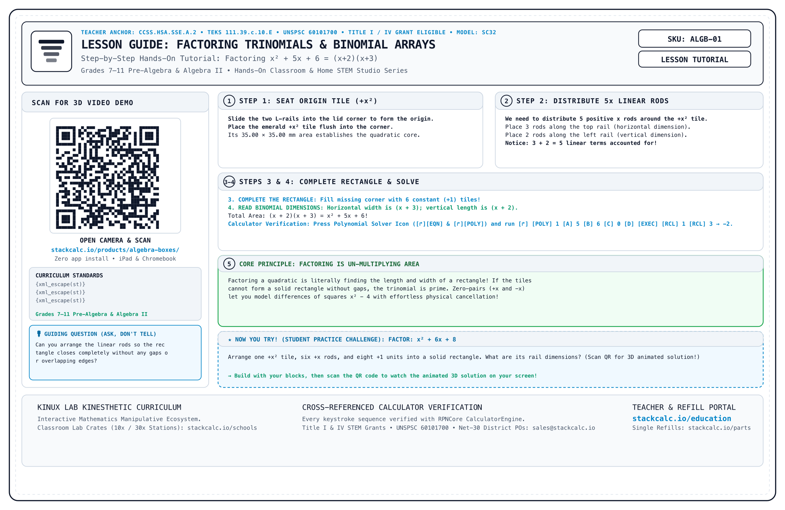
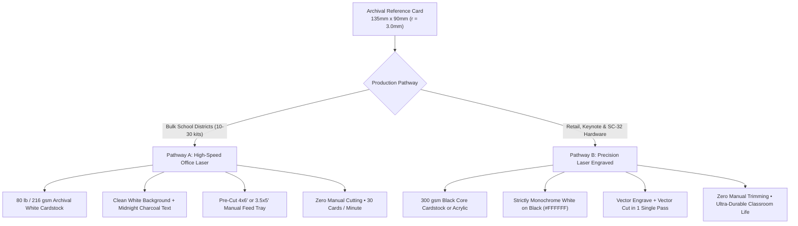
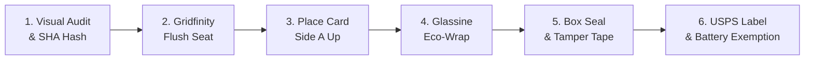
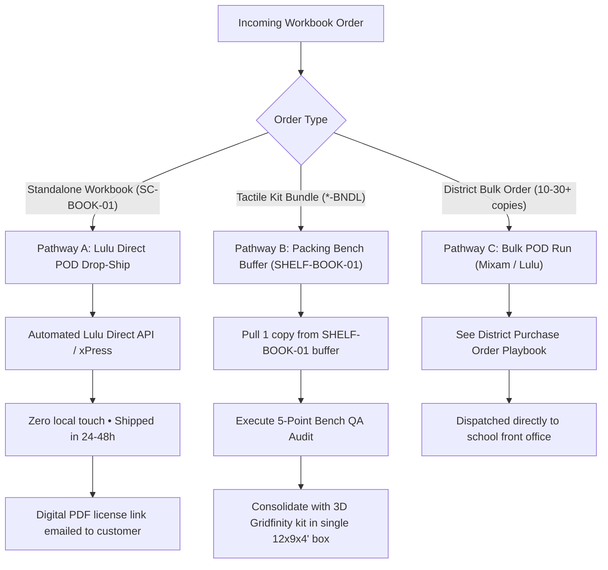
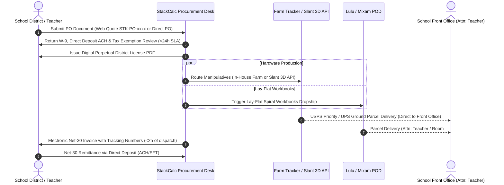

# Shipping, Packaging & Fulfillment Protocol

!!! info "Operational Standard: Revision 2026.10"
    This document governs the physical packaging, reference card manufacturing, mailer box sizing, and quality fulfillment protocols for all StackCalc math manipulatives and hardware devices shipped from our California studio.

---

## 1. The $135\,\text{mm} \times 90\,\text{mm}$ Golden Reference Card Standard

Every physical StackCalc product kit includes a custom duplex **Archival Reference & Video QR Card**. The card acts as a protective cover over the nested Gridfinity tray and provides the customer with an immediate visual schematic and instructional entry point upon lifting the box lid.

<div class="grid grid-cols-1 md:grid-cols-2 gap-6 my-6">
  <div class="border border-slate-700 rounded-xl p-4 bg-slate-900/60 shadow-lg">
    <div class="text-xs font-mono text-cyan-400 font-bold mb-2">SIDE A: FRONT (TOP-FACING)</div>
    
    <ul class="text-sm space-y-1 text-slate-300">
      <li><strong>Exploded CAD Isometric:</strong> Shows component orientation and tolerance alignment.</li>
      <li><strong>Content-Addressed SHA Manifest:</strong> Precise Git commit hashes for every part.</li>
      <li><strong>Anti-Arbitrage Pricing:</strong> 50% premium replacement model ($1.5\times$ amortized cost).</li>
      <li><strong>QC Stamp &amp; Postal Notice:</strong> <code>[ QC-CALIF-01 PASSED ]</code> + USPS Pub 52 exemption.</li>
    </ul>
  </div>

  <div class="border border-slate-700 rounded-xl p-4 bg-slate-900/60 shadow-lg">
    <div class="text-xs font-mono text-cyan-400 font-bold mb-2">SIDE B: BACK (VIDEO PORTAL &amp; LESSON)</div>
    
    <ul class="text-sm space-y-1 text-slate-300">
      <li><strong>High-Contrast Vector QR Code:</strong> Deep links directly to product video suite.</li>
      <li><strong>3-Step Quick Start Lesson:</strong> Zero-to-concept hands-on math under 60 seconds.</li>
      <li><strong>Curriculum Standards:</strong> Explicit CCSS &amp; Texas TEKS alignments.</li>
      <li><strong>District PO Channel:</strong> <code>quotes@stackcalc.io</code> for direct school orders.</li>
    </ul>
  </div>
</div>

### Dimensional Engineering & Fit Rationale

| Dimension | Specification | Engineering Justification |
|---|---|---|
| **Width** | $135.0\,\text{mm}$ | Fits within $150\,\text{mm} \times 150\,\text{mm}$ laser engraving working beds with $7.5\,\text{mm}$ perimeter clamping margin. |
| **Height** | $90.0\,\text{mm}$ | Fits inside standard $6 \times 4 \times 2\text{ in}$ ($152 \times 102\,\text{mm}$) corrugated mailers with $8.5\,\text{mm}$ finger extraction clearance. |
| **Corner Radius** | $r = 3.0\,\text{mm}$ | Eliminates dog-earing, paper cuts, and friction snags inside corrugated boxes. |
| **Aspect Ratio** | $1.50 : 1$ ($3 : 2$) | Golden ratio matching standard photographic index plates and postcard standards. |
| **Gridfinity Overlap** | Spans 3x1 ($125.5\,\text{mm}$) and 3x2 ($125.5 \times 84\,\text{mm}$) | Sits flush on top of organizer bins as an integrated dust shield and presentation layer. |

---

## 2. Production Substrates: Paper Printing vs. Laser Engraving

To balance volume fulfillment speed against premium unboxing aesthetics, StackCalc utilizes two validated manufacturing pathways:



### Pathway A: High-Speed Laser Printer Paper (Bulk School District Orders)
- **Target Orders:** Classroom 10-packs, 30-packs, and school district purchase orders.
- **Substrate:** 80 lb / 216 gsm bright white acid-free cardstock.
- **Toner Strategy:** Clean white background (`#FFFFFF`) with high-contrast midnight charcoal typography (`#0F172A`).
  - *Why avoid full black flood?* Flooding paper with black toner causes thermal curl, ink flaking on folds, and smudge risk during humid classroom use.
- **Zero-Cut Feeding Solution:** Feed pre-cut $4 \times 6\text{ in}$ ($101.6 \times 152.4\,\text{mm}$) or $3.5 \times 5\text{ in}$ ($88.9 \times 127\,\text{mm}$) blank index cardstock into the laser printer's manual bypass tray, completely eliminating manual scissors or paper trimmer labor.
- **Throughput:** ~30 double-sided cards per minute.

### Pathway B: Precision Laser-Engraved Black Card (SC-32 & Retail Kits)
- **Target Orders:** SC-32 scientific calculator, keynote showcase editions, and direct retail.
- **Substrate:** 300 gsm black matte cardstock (with white core) or $1.0\,\text{mm}$ black anodized aluminum / black cast acrylic.
- **Color Constraint:** **Strictly Monochrome White on Black (`#FFFFFF` on `#000000`).** Laser ablation vaporizes the black top coat to reveal crisp white substrate underneath.
- **Single-Pass Automation (Zero Manual Cutting):**
  1. The laser engraves the exploded wireframe, Part ID manifest, California QC badge, and Side B vector QR code.
  2. In the same job without moving the substrate, the laser vector-cuts the outer $135.0 \times 90.0\,\text{mm}$ boundary with $r = 3.0\,\text{mm}$ rounded corners.
  3. Finished, deburred cards drop out ready for packaging—**zero manual labor**.
- **Throughput:** ~90 seconds per double-sided card.

---

## 3. Master Packaging Profiles & Box Dimensions

StackCalc standardizes on crush-proof corrugated shipping mailers that maximize physical protection and postal weight efficiency:

| Profile | Dimensions (Exterior) | Dimensions (Interior) | Reference Card Position | Compatible Products | Postal Class |
|---|---|---|---|---|---|
| **Box Tier 1** | $7 \times 5 \times 2\text{ in}$ ($178 \times 127 \times 51\,\text{mm}$) | $6.5 \times 4.5 \times 1.9\text{ in}$ ($165 \times 114 \times 48\,\text{mm}$) | Rests flat on top of 3x1 Gridfinity bin | Algebra Boxes, Ten-Frames, Dice & Spinner | USPS Ground Advantage (<8 oz) |
| **Box Tier 2** | $8 \times 6 \times 3\text{ in}$ ($203 \times 152 \times 76\,\text{mm}$) | $7.5 \times 5.5 \times 2.8\text{ in}$ ($190 \times 140 \times 71\,\text{mm}$) | Rests flat centered on top of tray | Fraction Studio, Classroom Clock | USPS Ground Advantage (<12 oz) |
| **Box Tier 3** | $9 \times 6 \times 3\text{ in}$ ($229 \times 152 \times 76\,\text{mm}$) | $8.5 \times 5.5 \times 2.8\text{ in}$ ($216 \times 140 \times 71\,\text{mm}$) | Sits in dedicated lid pocket | SC-32 Hardware Maker Kit | USPS Ground Advantage (<16 oz) |
| **Pouch Tier 4** | $6.5 \times 4.5\text{ in}$ Stay-Flat Mailer | $6.2 \times 4.2\text{ in}$ ($158 \times 107\,\text{mm}$) | Encased with part in glassine sleeve | Single Replacement Parts, Volvelle | First-Class Rigid Mailer (<3 oz) |

---

## 4. Fulfillment Bench Protocol: The 6-Step Packing Checklist

Before any shipping label is applied, every kit is verified against our 6-step bench protocol:



1. **Step 1: Visual Audit & Component Verification**  
   Match every physical component against the Side A manifest table. Verify that the debossed Git commit hash on the tray base matches the active release.
2. **Step 2: Gridfinity Flush-Seat Check**  
   Seat all tiles, towers, or gears into their contoured receptacles. Gently tilt the tray 15°; components must remain firmly nested without rattle or shifting.
3. **Step 3: Reference Card Placement**  
   Lay the $135 \times 90\,\text{mm}$ reference card squarely on top of the components. **Side A (Schematic & Inventory) must face upwards** toward the recipient.
4. **Step 4: Plastic-Free Protective Wrap**  
   Enclose the tray and card inside a semi-translucent, biodegradable glassine sleeve or unbleached kraft tissue paper. **Strictly zero plastic bubble wrap or foam peanuts.**
5. **Step 5: Box Closure & Tamper-Evident Seal**  
   Close the corrugated mailer tabs firmly and affix a branded tamper-evident kraft paper seal across the front seam.
6. **Step 6: Shipping Label & Postal Compliance**  
   Affix the 4x6 thermal shipping label (USPS Ground Advantage). Confirm the Class 9 Lithium Battery Exemption text is printed:  
   `NON-REGULATED - NO LITHIUM BATTERIES CONTAINED - 49 CFR / ICAO / USPS PUB 52`.

---

## 5. Spiral-Bound Book & Student Workbook Fulfillment Protocol

To provide students with rugged, lay-flat laboratory workbooks without maintaining costly book warehouse inventory, StackCalc uses a **Hybrid Zero-Inventory Print-on-Demand (POD)** model governed by **`PLAYBOOK-OPS-01`**:



### Essential Binding & QA Requirements
1. **The Lay-Flat Desk Mandate:** Laboratory workbooks must feature **Wire-O or heavy-duty plastic coil binding**. Glued paperback bindings (such as standard Amazon KDP) snap shut on active student desks and are strictly prohibited in StackCalc classrooms.
2. **5-Point Bench Quality Assurance Audit:**
   - **Gate 1 (Spine Integrity):** Loops fully circular and crimped; zero sharp wire snags or crushed teeth.
   - **Gate 2 ($360^\circ$ Fold):** Front cover folds $360^\circ$ behind the back cover with zero resistance.
   - **Gate 3 (43-Page Completeness):** All 20 CRA units, Singapore/Bridges concordances, and answer keys present.
   - **Gate 4 (Punch Margin):** Clean $0.5\text{"}$ spiral punch margin with zero text truncation.
   - **Gate 5 (License Card):** Slip physical Single-Teacher Reproduction License Card inside front cover.
3. **Farm Tracker Integration:** Integrated directly into the operations engine. Workbench operators can review the complete SOP anytime via:
   ```bash
   python3 Tools/farm_tracker.py playbook spiral
   ```

---

## 6. School District & Institutional Purchase Orders (Net-30)

School districts, BOCES, charter networks, and private academies procure educational instruments and manipulatives through formal **Purchase Orders (POs)** operating under standard **Net-30 terms** governed by **`PLAYBOOK-OPS-02`**:



### Institutional Operating Standards
- **Strict Parcel Delivery Mandate (No Freight Docks):** All shipments are delivered as standard **USPS Priority Mail or UPS Ground parcels** directly to the school front office (`Attn: [Educator Name], Math Dept / Room #`). StackCalc never requires or utilizes freight docks, loading bays, or pallet staging.
- **24-Hour Vendor Onboarding SLA:** Signed IRS Form W-9, EFT/ACH Direct Deposit authorizations, and FERPA/Texas DIR compliance statements are dispatched within 24 business hours of request.
- **Zero-Inventory Production Scalability:**
  - **Class Packs (1–15 Units):** Scheduled through the in-house Prusa MK4S sprint queue.
  - **District Fleets (16–100+ Units):** Tactile Gridfinity trays and components are routed directly to **Slant 3D's distributed farm API**, while spiral workbooks drop-ship in volume via Mixam or Lulu.
- **Perpetual District Reproduction License (`DIST-LIC-PERPETUAL`):** Includes perpetual multi-teacher reproduction rights, internal LMS hosting (Canvas, Google Classroom), and all 20 CRA unit answer keys.
- **Farm Tracker Integration:** Operators can review institutional protocols and Net-30 remittance procedures via:
  ```bash
  python3 Tools/farm_tracker.py playbook district
  ```

---

## 7. Downloads & Printable Packing Bench Sheets

- **Printable Packing Bench Sheet (Duplex HTML):**  
  [Open Printable Packing Bench Sheet](downloads/packing_bench_cards.html)
- **Product Catalog & Digital Decks:**  
  Explore all product suites in the [Master Catalog](products.md) or browse [Curriculum Decks](products/curriculum-and-decks.md).
- **Curriculum Alignment Matrix:**  
  Review state and national curriculum alignments in the [Curriculum Alignment Matrix](curriculum/alignment-matrix.md).

